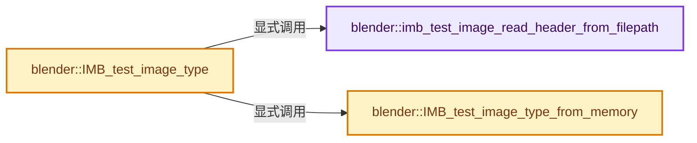
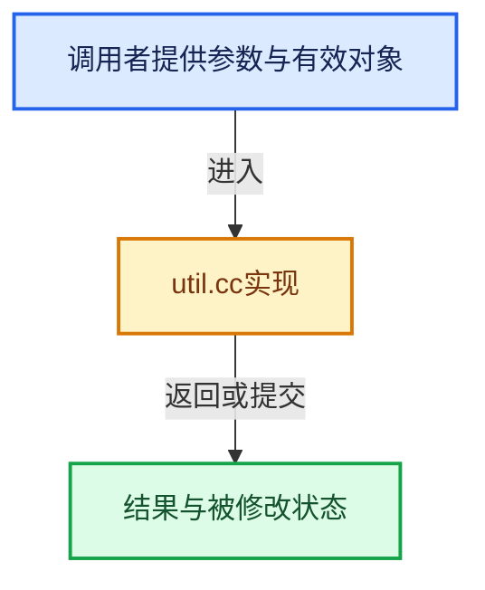

# 实现依赖专题：source/blender/imbuf/intern/util.cc

[方向导航](README.md) · [符号索引](../%E7%AC%A6%E5%8F%B7%E4%BE%9D%E8%B5%96%E4%B8%8E%E5%AE%9E%E7%8E%B0%E7%B4%A2%E5%BC%95.md)

本专题从正文实际调用进入，集中保存共享实现。函数有稳定锚点，可从调用处直接跳到对应完整函数；递归与互相调用通过回链组织。

## 本文件的实现关系






## 完整成员与函数实现

<a id="f-0ead42c18fc92a6c"></a>

### `blender::imb_test_image_read_header_from_filepath`

实现位置：[source/blender/imbuf/intern/util.cc](../../../../../source/blender/imbuf/intern/util.cc) · L113—L138。

接口参数：

- `const char *filepath`
- `uchar buf[HEADER_SIZE]`

**教学注释版**

<!-- annotated:12689a97849ac0 -->

```cpp
static int64_t imb_test_image_read_header_from_filepath(const char *filepath,
                                                        uchar buf[HEADER_SIZE])
{
  BLI_stat_t st;
  int fp;

  BLI_assert(!BLI_path_is_rel(filepath));

  CLOG_TRACE(&LOG, "%s: loading %s", __func__, filepath);

  if (BLI_stat(filepath, &st) == -1) {
    return -1;
  }
  if (((st.st_mode) & S_IFMT) != S_IFREG) {
    return -1;
  }

  if ((fp = BLI_open(filepath, O_BINARY | O_RDONLY, 0)) == -1) {
    return -1;
  }

  const int64_t size = BLI_read(fp, buf, HEADER_SIZE);

  close(fp);
  return size;
}
```

<details>
<summary>核对原始源码：source/blender/imbuf/intern/util.cc · L113—L138</summary>

<!-- original:12689a97849ac0:source/blender/imbuf/intern/util.cc:113:138 -->

```cpp
static int64_t imb_test_image_read_header_from_filepath(const char *filepath,
                                                        uchar buf[HEADER_SIZE])
{
  BLI_stat_t st;
  int fp;

  BLI_assert(!BLI_path_is_rel(filepath));

  CLOG_TRACE(&LOG, "%s: loading %s", __func__, filepath);

  if (BLI_stat(filepath, &st) == -1) {
    return -1;
  }
  if (((st.st_mode) & S_IFMT) != S_IFREG) {
    return -1;
  }

  if ((fp = BLI_open(filepath, O_BINARY | O_RDONLY, 0)) == -1) {
    return -1;
  }

  const int64_t size = BLI_read(fp, buf, HEADER_SIZE);

  close(fp);
  return size;
}
```

</details>

**结果出口**

- `return -1;`
- `return size;`

**继续追踪实现**

- `BLI_assert` → [BLI_assert · L48](../01-%E5%9F%BA%E7%A1%80%E5%AE%B9%E5%99%A8%E4%B8%8E%E7%8E%B0%E4%BB%A3CPP/%E4%BE%9D%E8%B5%96-BLI_assert-cc98e8.md#m-57a88495704d)；[BLI_assert · L63](../01-%E5%9F%BA%E7%A1%80%E5%AE%B9%E5%99%A8%E4%B8%8E%E7%8E%B0%E4%BB%A3CPP/%E4%BE%9D%E8%B5%96-BLI_assert-cc98e8.md#m-d07050020cb5)。宏定义由构建条件选择。
- `BLI_path_is_rel` → [BLI_path_is_rel · L536](../01-%E5%9F%BA%E7%A1%80%E5%AE%B9%E5%99%A8%E4%B8%8E%E7%8E%B0%E4%BB%A3CPP/%E4%BE%9D%E8%B5%96-path_utils-b4d26a.md#f-d938443d331ba72c)。
- `CLOG_TRACE` → [CLOG_TRACE · L192](%E4%BE%9D%E8%B5%96-CLG_log-e9051b.md#m-46273bee5728)。宏定义由构建条件选择。
- `BLI_stat` → [blender::BLI_stat · L426](../01-%E5%9F%BA%E7%A1%80%E5%AE%B9%E5%99%A8%E4%B8%8E%E7%8E%B0%E4%BB%A3CPP/%E4%BE%9D%E8%B5%96-storage-bda15e.md#f-5b88a35ccd1bc680)；[blender::BLI_stat · L451](../01-%E5%9F%BA%E7%A1%80%E5%AE%B9%E5%99%A8%E4%B8%8E%E7%8E%B0%E4%BB%A3CPP/%E4%BE%9D%E8%B5%96-storage-bda15e.md#f-50297595484d5bcc)。同名重载需按实参类型选择。
- `BLI_open` → [blender::BLI_open · L615](../01-%E5%9F%BA%E7%A1%80%E5%AE%B9%E5%99%A8%E4%B8%8E%E7%8E%B0%E4%BB%A3CPP/%E4%BE%9D%E8%B5%96-fileops_c-add581.md#f-5889504ee4df97d2)；[blender::BLI_open · L1199](../01-%E5%9F%BA%E7%A1%80%E5%AE%B9%E5%99%A8%E4%B8%8E%E7%8E%B0%E4%BB%A3CPP/%E4%BE%9D%E8%B5%96-fileops_c-add581.md#f-6144d5d080b79e94)。同名重载需按实参类型选择。
- `BLI_read` → [blender::BLI_read · L98](../01-%E5%9F%BA%E7%A1%80%E5%AE%B9%E5%99%A8%E4%B8%8E%E7%8E%B0%E4%BB%A3CPP/%E4%BE%9D%E8%B5%96-fileops_c-add581.md#f-79f42e0d965e29d7)。
- `close` → [blender::RawWriteWrap::close · L214](%E4%BE%9D%E8%B5%96-writefile-3eb36f.md#f-919e29e563ebcf8c)；[blender::ZstdWriteWrap::close · L404](%E4%BE%9D%E8%B5%96-writefile-3eb36f.md#f-78aad228a13e69b9)。同名重载需按实参类型选择。

<a id="f-507fae1d53ed38cc"></a>

### `blender::IMB_test_image_type_from_memory`

实现位置：[source/blender/imbuf/intern/util.cc](../../../../../source/blender/imbuf/intern/util.cc) · L140—L151。

接口参数：

- `const uchar *buf`
- `const size_t buf_size`

**教学注释版**

<!-- annotated:7e1fddb4f15c6f -->

```cpp
eImbFileType IMB_test_image_type_from_memory(const uchar *buf, const size_t buf_size)
{
  for (const ImFileType *type = IMB_FILE_TYPES; type < IMB_FILE_TYPES_LAST; type++) {
    if (type->is_a != nullptr) {
      if (type->is_a(buf, buf_size)) {
        return type->filetype;
      }
    }
  }

  return IMB_FTYPE_NONE;
}
```

<details>
<summary>核对原始源码：source/blender/imbuf/intern/util.cc · L140—L151</summary>

<!-- original:7e1fddb4f15c6f:source/blender/imbuf/intern/util.cc:140:151 -->

```cpp
eImbFileType IMB_test_image_type_from_memory(const uchar *buf, const size_t buf_size)
{
  for (const ImFileType *type = IMB_FILE_TYPES; type < IMB_FILE_TYPES_LAST; type++) {
    if (type->is_a != nullptr) {
      if (type->is_a(buf, buf_size)) {
        return type->filetype;
      }
    }
  }

  return IMB_FTYPE_NONE;
}
```

</details>

**结果出口**

- `return type->filetype;`
- `return IMB_FTYPE_NONE;`

**继续追踪实现**

- `type->is_a` → [Node::is_a · L777](%E4%BE%9D%E8%B5%96-node-d6ff7e.md#f-7a2abeacb9a17d47)。

<a id="f-49f34f21e9d74c39"></a>

### `blender::IMB_test_image_type`

实现位置：[source/blender/imbuf/intern/util.cc](../../../../../source/blender/imbuf/intern/util.cc) · L153—L161。

接口参数：

- `const char *filepath`

**教学注释版**

<!-- annotated:1ff039ff44b317 -->

```cpp
eImbFileType IMB_test_image_type(const char *filepath)
{
  uchar buf[HEADER_SIZE];
  const int64_t buf_size = imb_test_image_read_header_from_filepath(filepath, buf);
  if (buf_size <= 0) {
    return IMB_FTYPE_NONE;
  }
  return IMB_test_image_type_from_memory(buf, size_t(buf_size));
}
```

<details>
<summary>核对原始源码：source/blender/imbuf/intern/util.cc · L153—L161</summary>

<!-- original:1ff039ff44b317:source/blender/imbuf/intern/util.cc:153:161 -->

```cpp
eImbFileType IMB_test_image_type(const char *filepath)
{
  uchar buf[HEADER_SIZE];
  const int64_t buf_size = imb_test_image_read_header_from_filepath(filepath, buf);
  if (buf_size <= 0) {
    return IMB_FTYPE_NONE;
  }
  return IMB_test_image_type_from_memory(buf, size_t(buf_size));
}
```

</details>

**结果出口**

- `return IMB_FTYPE_NONE;`
- `return IMB_test_image_type_from_memory(buf, size_t(buf_size));`

**继续追踪实现**

- `imb_test_image_read_header_from_filepath` → [blender::imb_test_image_read_header_from_filepath · L113](%E4%BE%9D%E8%B5%96-util-588c44.md#f-0ead42c18fc92a6c)。
- `IMB_test_image_type_from_memory` → [blender::IMB_test_image_type_from_memory · L140](%E4%BE%9D%E8%B5%96-util-588c44.md#f-507fae1d53ed38cc)。
