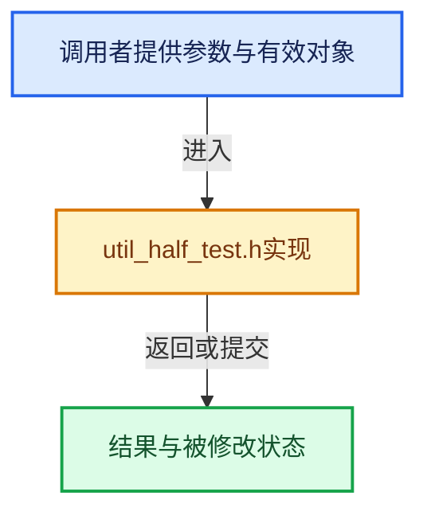

# 实现依赖专题：intern/cycles/test/util_half_test.h

[方向导航](README.md) · [符号索引](../%E7%AC%A6%E5%8F%B7%E4%BE%9D%E8%B5%96%E4%B8%8E%E5%AE%9E%E7%8E%B0%E7%B4%A2%E5%BC%95.md)

本专题从正文实际调用进入，集中保存共享实现。函数有稳定锚点，可从调用处直接跳到对应完整函数；递归与互相调用通过回链组织。

## 本文件的实现关系





<a id="m-171ffd5d7770"></a>

## 宏 `EXPECT_EQ`

<!-- annotated:ccfb75b34b85b0 -->

```cpp
#define EXPECT_HALF_EQ(a, b) \
  do { \
    const uint16_t a_ = (a); \
    const uint16_t b_ = (b); \
    if ((a_ & 0x7fff) == 0 && (b_ & 0x7fff) == 0) { \
      /* Ignore sign of zero, -0.0 getting converted to 0.0 is fine. */ \
    } \
    else { \
      EXPECT_EQ(a_, b_); \
    } \
  } while (0)

```

<details>
<summary>核对原始源码：intern/cycles/test/util_half_test.h · L23—L34</summary>

<!-- original:ccfb75b34b85b0:intern/cycles/test/util_half_test.h:23:34 -->

```cpp
#define EXPECT_HALF_EQ(a, b) \
  do { \
    const uint16_t a_ = (a); \
    const uint16_t b_ = (b); \
    if ((a_ & 0x7fff) == 0 && (b_ & 0x7fff) == 0) { \
      /* Ignore sign of zero, -0.0 getting converted to 0.0 is fine. */ \
    } \
    else { \
      EXPECT_EQ(a_, b_); \
    } \
  } while (0)

```

</details>

宏在预处理阶段展开，参数替换、重复求值和条件编译应直接从该定义检查。与普通函数不同，宏不会自动提供参数类型检查；构建配置选择哪个定义需结合外围条件。

## 完整成员与函数实现
