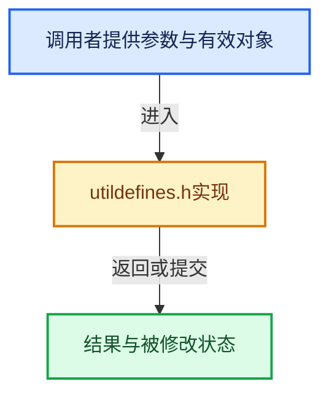

# 实现依赖专题：intern/libmv/intern/utildefines.h

[方向导航](README.md) · [符号索引](../%E7%AC%A6%E5%8F%B7%E4%BE%9D%E8%B5%96%E4%B8%8E%E5%AE%9E%E7%8E%B0%E7%B4%A2%E5%BC%95.md)

本专题从正文实际调用进入，集中保存共享实现。函数有稳定锚点，可从调用处直接跳到对应完整函数；递归与互相调用通过回链组织。

## 本文件的实现关系





<a id="m-79e10878b5b6"></a>

## 宏 `LIBMV_OBJECT_NEW`

<!-- annotated:fd69fbe8314593 -->

```cpp
#    define LIBMV_OBJECT_NEW(type, args...)                                    \
      new (MEM_new_uninitialized(sizeof(type), __func__)) type(args)
#  else
```

<details>
<summary>核对原始源码：intern/libmv/intern/utildefines.h · L16—L18</summary>

<!-- original:fd69fbe8314593:intern/libmv/intern/utildefines.h:16:18 -->

```cpp
#    define LIBMV_OBJECT_NEW(type, args...)                                    \
      new (MEM_new_uninitialized(sizeof(type), __func__)) type(args)
#  else
```

</details>

宏在预处理阶段展开，参数替换、重复求值和条件编译应直接从该定义检查。与普通函数不同，宏不会自动提供参数类型检查；构建配置选择哪个定义需结合外围条件。

<a id="m-84c9b47d1d53"></a>

## 宏 `LIBMV_OBJECT_NEW`

<!-- annotated:51e059c7c929cc -->

```cpp
#    define LIBMV_OBJECT_NEW(type, ...)                                        \
      new (MEM_new_uninitialized(sizeof(type), __FUNCTION__)) type(__VA_ARGS__)
#  endif
```

<details>
<summary>核对原始源码：intern/libmv/intern/utildefines.h · L19—L21</summary>

<!-- original:51e059c7c929cc:intern/libmv/intern/utildefines.h:19:21 -->

```cpp
#    define LIBMV_OBJECT_NEW(type, ...)                                        \
      new (MEM_new_uninitialized(sizeof(type), __FUNCTION__)) type(__VA_ARGS__)
#  endif
```

</details>

宏在预处理阶段展开，参数替换、重复求值和条件编译应直接从该定义检查。与普通函数不同，宏不会自动提供参数类型检查；构建配置选择哪个定义需结合外围条件。

<a id="m-f64e543e498b"></a>

## 宏 `LIBMV_OBJECT_DELETE`

<!-- annotated:8f64c112794023 -->

```cpp
#  define LIBMV_OBJECT_DELETE(what, type)                                      \
    {                                                                          \
      if (what) {                                                              \
        ((type*)what)->~type();                                                \
        MEM_delete_void(const_cast<void*>(static_cast<const void*>(what)));    \
      }                                                                        \
    }                                                                          \
    (void)0
#  define LIBMV_STRUCT_NEW(type, count)                                        \
```

<details>
<summary>核对原始源码：intern/libmv/intern/utildefines.h · L22—L30</summary>

<!-- original:8f64c112794023:intern/libmv/intern/utildefines.h:22:30 -->

```cpp
#  define LIBMV_OBJECT_DELETE(what, type)                                      \
    {                                                                          \
      if (what) {                                                              \
        ((type*)what)->~type();                                                \
        MEM_delete_void(const_cast<void*>(static_cast<const void*>(what)));    \
      }                                                                        \
    }                                                                          \
    (void)0
#  define LIBMV_STRUCT_NEW(type, count)                                        \
```

</details>

宏在预处理阶段展开，参数替换、重复求值和条件编译应直接从该定义检查。与普通函数不同，宏不会自动提供参数类型检查；构建配置选择哪个定义需结合外围条件。

<a id="m-5843c69b6dd0"></a>

## 宏 `LIBMV_OBJECT_NEW`

<!-- annotated:33e70c3912dae4 -->

```cpp
#    define LIBMV_OBJECT_NEW(type, args...)                                    \
      new (malloc(sizeof(type))) type(args)
#  else
```

<details>
<summary>核对原始源码：intern/libmv/intern/utildefines.h · L37—L39</summary>

<!-- original:33e70c3912dae4:intern/libmv/intern/utildefines.h:37:39 -->

```cpp
#    define LIBMV_OBJECT_NEW(type, args...)                                    \
      new (malloc(sizeof(type))) type(args)
#  else
```

</details>

宏在预处理阶段展开，参数替换、重复求值和条件编译应直接从该定义检查。与普通函数不同，宏不会自动提供参数类型检查；构建配置选择哪个定义需结合外围条件。

<a id="m-26726e7dfcf9"></a>

## 宏 `LIBMV_OBJECT_NEW`

<!-- annotated:24f6ddcb474aee -->

```cpp
#    define LIBMV_OBJECT_NEW(type, ...)                                        \
      new (malloc(sizeof(type))) type(__VA_ARGS__)
#  endif
```

<details>
<summary>核对原始源码：intern/libmv/intern/utildefines.h · L40—L42</summary>

<!-- original:24f6ddcb474aee:intern/libmv/intern/utildefines.h:40:42 -->

```cpp
#    define LIBMV_OBJECT_NEW(type, ...)                                        \
      new (malloc(sizeof(type))) type(__VA_ARGS__)
#  endif
```

</details>

宏在预处理阶段展开，参数替换、重复求值和条件编译应直接从该定义检查。与普通函数不同，宏不会自动提供参数类型检查；构建配置选择哪个定义需结合外围条件。

<a id="m-632c2fcd50ed"></a>

## 宏 `LIBMV_OBJECT_DELETE`

<!-- annotated:d2a35da3109521 -->

```cpp
#  define LIBMV_OBJECT_DELETE(what, type)                                      \
    {                                                                          \
      if (what) {                                                              \
        ((type*)(what))->~type();                                              \
        free(what);                                                            \
      }                                                                        \
    }                                                                          \
    (void)0
#  define LIBMV_STRUCT_NEW(type, count) (type*)malloc(sizeof(type) * count)
```

<details>
<summary>核对原始源码：intern/libmv/intern/utildefines.h · L43—L51</summary>

<!-- original:d2a35da3109521:intern/libmv/intern/utildefines.h:43:51 -->

```cpp
#  define LIBMV_OBJECT_DELETE(what, type)                                      \
    {                                                                          \
      if (what) {                                                              \
        ((type*)(what))->~type();                                              \
        free(what);                                                            \
      }                                                                        \
    }                                                                          \
    (void)0
#  define LIBMV_STRUCT_NEW(type, count) (type*)malloc(sizeof(type) * count)
```

</details>

宏在预处理阶段展开，参数替换、重复求值和条件编译应直接从该定义检查。与普通函数不同，宏不会自动提供参数类型检查；构建配置选择哪个定义需结合外围条件。

## 完整成员与函数实现
