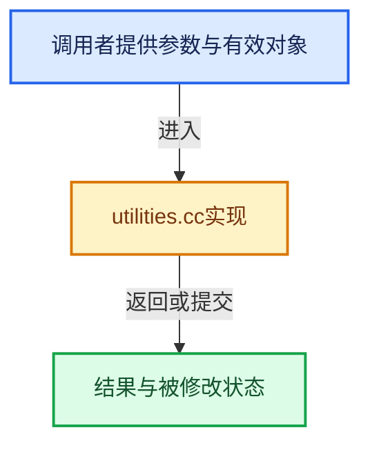

# 实现依赖专题：source/blender/compositor/intern/utilities.cc

[方向导航](README.md) · [符号索引](../%E7%AC%A6%E5%8F%B7%E4%BE%9D%E8%B5%96%E4%B8%8E%E5%AE%9E%E7%8E%B0%E7%B4%A2%E5%BC%95.md)

本专题从正文实际调用进入，集中保存共享实现。函数有稳定锚点，可从调用处直接跳到对应完整函数；递归与互相调用通过回链组织。

## 本文件的实现关系





## 完整成员与函数实现

<a id="f-9bc4ab546a3e2be9"></a>

### `blender::compositor::socket_data_type_to_result_type`

实现位置：[source/blender/compositor/intern/utilities.cc](../../../../../source/blender/compositor/intern/utilities.cc) · L39—L101。

接口参数：

- `const eNodeSocketDatatype data_type`
- `const std::optional<int> dimensions`

**教学注释版**

<!-- annotated:c4badc7d04ac4d -->

```cpp
ResultType socket_data_type_to_result_type(const eNodeSocketDatatype data_type,
                                           const std::optional<int> dimensions)
{
  switch (data_type) {
    case SOCK_FLOAT:
      return ResultType::Float;
    case SOCK_INT:
      return ResultType::Int;
    case SOCK_BOOLEAN:
      return ResultType::Bool;
    case SOCK_VECTOR:
      switch (dimensions.value_or(3)) {
        case 2:
          return ResultType::Float2;
        case 3:
          return ResultType::Float3;
        case 4:
          return ResultType::Float4;
        default:
          BLI_assert_unreachable();
          return ResultType::Float;
      }
    case SOCK_INT_VECTOR:
      switch (dimensions.value_or(2)) {
        case 2:
          return ResultType::Int2;
        case 3:
          return ResultType::Int3;
        default:
          BLI_assert_unreachable();
          return ResultType::Float;
      }
    case SOCK_RGBA:
      return ResultType::Color;
    case SOCK_MATRIX:
      return ResultType::Float4x4;
    case SOCK_MENU:
      return ResultType::Menu;
    case SOCK_STRING:
      return ResultType::String;
    case SOCK_ROTATION:
      return ResultType::Quaternion;
    case SOCK_OBJECT:
      return ResultType::Object;
    case SOCK_IMAGE:
      return ResultType::Image;
    case SOCK_FONT:
      return ResultType::Font;
    case SOCK_SCENE:
      return ResultType::Scene;
    case SOCK_TEXT_ID:
      return ResultType::Text;
    case SOCK_MASK:
      return ResultType::Mask;
    case SOCK_BUNDLE:
      return ResultType::Bundle;
    case SOCK_CLOSURE:
      return ResultType::Closure;
    default:
      BLI_assert_unreachable();
      return ResultType::Float;
  }
}
```

<details>
<summary>核对原始源码：source/blender/compositor/intern/utilities.cc · L39—L101</summary>

<!-- original:c4badc7d04ac4d:source/blender/compositor/intern/utilities.cc:39:101 -->

```cpp
ResultType socket_data_type_to_result_type(const eNodeSocketDatatype data_type,
                                           const std::optional<int> dimensions)
{
  switch (data_type) {
    case SOCK_FLOAT:
      return ResultType::Float;
    case SOCK_INT:
      return ResultType::Int;
    case SOCK_BOOLEAN:
      return ResultType::Bool;
    case SOCK_VECTOR:
      switch (dimensions.value_or(3)) {
        case 2:
          return ResultType::Float2;
        case 3:
          return ResultType::Float3;
        case 4:
          return ResultType::Float4;
        default:
          BLI_assert_unreachable();
          return ResultType::Float;
      }
    case SOCK_INT_VECTOR:
      switch (dimensions.value_or(2)) {
        case 2:
          return ResultType::Int2;
        case 3:
          return ResultType::Int3;
        default:
          BLI_assert_unreachable();
          return ResultType::Float;
      }
    case SOCK_RGBA:
      return ResultType::Color;
    case SOCK_MATRIX:
      return ResultType::Float4x4;
    case SOCK_MENU:
      return ResultType::Menu;
    case SOCK_STRING:
      return ResultType::String;
    case SOCK_ROTATION:
      return ResultType::Quaternion;
    case SOCK_OBJECT:
      return ResultType::Object;
    case SOCK_IMAGE:
      return ResultType::Image;
    case SOCK_FONT:
      return ResultType::Font;
    case SOCK_SCENE:
      return ResultType::Scene;
    case SOCK_TEXT_ID:
      return ResultType::Text;
    case SOCK_MASK:
      return ResultType::Mask;
    case SOCK_BUNDLE:
      return ResultType::Bundle;
    case SOCK_CLOSURE:
      return ResultType::Closure;
    default:
      BLI_assert_unreachable();
      return ResultType::Float;
  }
}
```

</details>

**结果出口**

- `return ResultType::Float;`
- `return ResultType::Int;`
- `return ResultType::Bool;`
- `return ResultType::Float2;`
- `return ResultType::Float3;`
- `return ResultType::Float4;`
- `return ResultType::Int2;`
- `return ResultType::Int3;`
- `return ResultType::Color;`
- `return ResultType::Float4x4;`
- `return ResultType::Menu;`
- `return ResultType::String;`
- `return ResultType::Quaternion;`
- `return ResultType::Object;`
- `return ResultType::Image;`
- `return ResultType::Font;`
- `return ResultType::Scene;`
- `return ResultType::Text;`
- `return ResultType::Mask;`
- `return ResultType::Bundle;`
- `return ResultType::Closure;`

**继续追踪实现**

- `dimensions.value_or` → [外部契约](https://eel.is/c++draft/)：这个边界按实际表达式及所属类型核对参数、返回值、寿命与失败行为。这里提供接口入口，不声称已解释该第三方版本的内部实现。
- `BLI_assert_unreachable` → [BLI_assert_unreachable · L77](../01-%E5%9F%BA%E7%A1%80%E5%AE%B9%E5%99%A8%E4%B8%8E%E7%8E%B0%E4%BB%A3CPP/%E4%BE%9D%E8%B5%96-BLI_assert-cc98e8.md#m-7a2d91a67d8e)。宏定义由构建条件选择。
