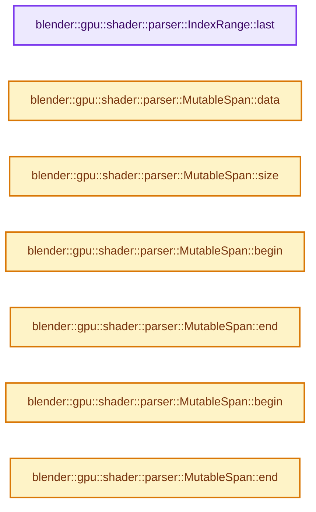
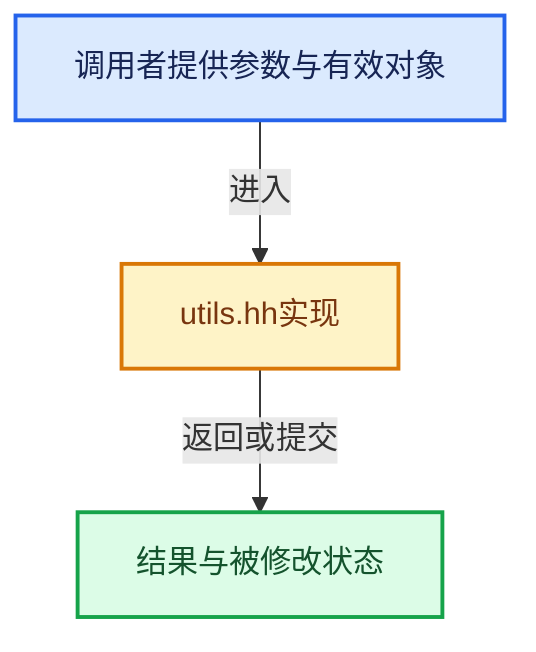

# 实现依赖专题：source/blender/gpu/shader_tool/utils.hh

[方向导航](README.md) · [符号索引](../%E7%AC%A6%E5%8F%B7%E4%BE%9D%E8%B5%96%E4%B8%8E%E5%AE%9E%E7%8E%B0%E7%B4%A2%E5%BC%95.md)

本专题从正文实际调用进入，集中保存共享实现。函数有稳定锚点，可从调用处直接跳到对应完整函数；递归与互相调用通过回链组织。

## 本文件的实现关系






## 相关类型布局与成员入口

<a id="t-61fe8aa0d9c5"></a>

### `blender::gpu::shader::parser::Token`

原始声明：[source/blender/gpu/shader_tool/utils.hh](../../../../../source/blender/gpu/shader_tool/utils.hh) · L22—L22。

以下保留类的数据声明与编译条件，成员函数实现通过后面的精确链接阅读。

<!-- annotated:774b5250154088 -->

```cpp
struct Token;
```

<details>
<summary>核对原始源码：source/blender/gpu/shader_tool/utils.hh · L22—L22</summary>

<!-- original:774b5250154088:source/blender/gpu/shader_tool/utils.hh:22:22 -->

```cpp
struct Token;
```

</details>


<a id="t-82d2bd4ea71c"></a>

### `blender::gpu::shader::parser::IndexRange`

原始声明：[source/blender/gpu/shader_tool/utils.hh](../../../../../source/blender/gpu/shader_tool/utils.hh) · L47—L66。

成员布局：

- `int64_t start`
- `int64_t size`

以下保留类的数据声明与编译条件，成员函数实现通过后面的精确链接阅读。

<!-- annotated:1100a1310e42cc -->

```cpp
struct IndexRange {
  int64_t start;
  int64_t size;

```

<details>
<summary>核对原始源码：source/blender/gpu/shader_tool/utils.hh · L47—L50</summary>

<!-- original:1100a1310e42cc:source/blender/gpu/shader_tool/utils.hh:47:50 -->

```cpp
struct IndexRange {
  int64_t start;
  int64_t size;

```

</details>

<!-- annotated:43ab91c2357fbd -->

```cpp

```

<details>
<summary>核对原始源码：source/blender/gpu/shader_tool/utils.hh · L52—L52</summary>

<!-- original:43ab91c2357fbd:source/blender/gpu/shader_tool/utils.hh:52:52 -->

```cpp

```

</details>

<!-- annotated:f25a5bb68c0b05 -->

```cpp

```

<details>
<summary>核对原始源码：source/blender/gpu/shader_tool/utils.hh · L61—L61</summary>

<!-- original:f25a5bb68c0b05:source/blender/gpu/shader_tool/utils.hh:61:61 -->

```cpp

```

</details>

<!-- annotated:d813d7bc885481 -->

```cpp
};
```

<details>
<summary>核对原始源码：source/blender/gpu/shader_tool/utils.hh · L66—L66</summary>

<!-- original:d813d7bc885481:source/blender/gpu/shader_tool/utils.hh:66:66 -->

```cpp
};
```

</details>

- [last](%E4%BE%9D%E8%B5%96-utils-06433d.md#f-373501206569c3b3)

## 完整成员与函数实现

<a id="f-373501206569c3b3"></a>

### `blender::gpu::shader::parser::IndexRange::last`

读取范围两端的有效索引或值。

实现位置：[source/blender/gpu/shader_tool/utils.hh](../../../../../source/blender/gpu/shader_tool/utils.hh) · L62—L65。

**教学注释版**

<!-- annotated:6de9ae8ada59c3 -->

```cpp
  int64_t last() const
  {
    return start + size - 1;
  }
```

<details>
<summary>核对原始源码：source/blender/gpu/shader_tool/utils.hh · L62—L65</summary>

<!-- original:6de9ae8ada59c3:source/blender/gpu/shader_tool/utils.hh:62:65 -->

```cpp
  int64_t last() const
  {
    return start + size - 1;
  }
```

</details>

**接口与不变量**

空范围不具备普通首末元素，调用者需要先满足非空约定。

**结果出口**

- `return start + size - 1;`

**继续追踪实现**

本实现没有需要继续展开的显式调用；检查返回表达式、对象转换和调用者前置条件。

<a id="f-ad0a09cec9741c65"></a>

### `blender::gpu::shader::parser::MutableSpan::data`

返回借用范围的地址。

实现位置：[source/blender/gpu/shader_tool/utils.hh](../../../../../source/blender/gpu/shader_tool/utils.hh) · L82—L85。

**教学注释版**

<!-- annotated:7a73f278c27b75 -->

```cpp
  T *data()
  {
    return data_;
  }
```

<details>
<summary>核对原始源码：source/blender/gpu/shader_tool/utils.hh · L82—L85</summary>

<!-- original:7a73f278c27b75:source/blender/gpu/shader_tool/utils.hh:82:85 -->

```cpp
  T *data()
  {
    return data_;
  }
```

</details>

**接口与不变量**

复制指针或视图不延长底层数组寿命，尾后位置只用于范围边界。

**结果出口**

- `return data_;`

**继续追踪实现**

本实现没有需要继续展开的显式调用；检查返回表达式、对象转换和调用者前置条件。

<a id="f-5e684af6ee7990e9"></a>

### `blender::gpu::shader::parser::MutableSpan::size`

查询视图长度或生成对应有效索引区间。

实现位置：[source/blender/gpu/shader_tool/utils.hh](../../../../../source/blender/gpu/shader_tool/utils.hh) · L87—L90。

**教学注释版**

<!-- annotated:03511225aff727 -->

```cpp
  uint64_t size() const
  {
    return size_;
  }
```

<details>
<summary>核对原始源码：source/blender/gpu/shader_tool/utils.hh · L87—L90</summary>

<!-- original:03511225aff727:source/blender/gpu/shader_tool/utils.hh:87:90 -->

```cpp
  uint64_t size() const
  {
    return size_;
  }
```

</details>

**接口与不变量**

长度描述逻辑范围，不表达底层存储由谁拥有，也不保证别名不会修改数据。

**结果出口**

- `return size_;`

**继续追踪实现**

本实现没有需要继续展开的显式调用；检查返回表达式、对象转换和调用者前置条件。

<a id="f-707ab8fcbd90899b"></a>

### `blender::gpu::shader::parser::MutableSpan::begin`

返回借用范围的地址。

实现位置：[source/blender/gpu/shader_tool/utils.hh](../../../../../source/blender/gpu/shader_tool/utils.hh) · L97—L100。

**教学注释版**

<!-- annotated:7262ed545bc74d -->

```cpp
  T *begin()
  {
    return data_;
  }
```

<details>
<summary>核对原始源码：source/blender/gpu/shader_tool/utils.hh · L97—L100</summary>

<!-- original:7262ed545bc74d:source/blender/gpu/shader_tool/utils.hh:97:100 -->

```cpp
  T *begin()
  {
    return data_;
  }
```

</details>

**接口与不变量**

复制指针或视图不延长底层数组寿命，尾后位置只用于范围边界。

**结果出口**

- `return data_;`

**继续追踪实现**

本实现没有需要继续展开的显式调用；检查返回表达式、对象转换和调用者前置条件。

<a id="f-21cd00bb95944779"></a>

### `blender::gpu::shader::parser::MutableSpan::end`

返回借用范围的地址。

实现位置：[source/blender/gpu/shader_tool/utils.hh](../../../../../source/blender/gpu/shader_tool/utils.hh) · L101—L104。

**教学注释版**

<!-- annotated:c55ceb1bc6d3c6 -->

```cpp
  T *end()
  {
    return data_ + size_;
  }
```

<details>
<summary>核对原始源码：source/blender/gpu/shader_tool/utils.hh · L101—L104</summary>

<!-- original:c55ceb1bc6d3c6:source/blender/gpu/shader_tool/utils.hh:101:104 -->

```cpp
  T *end()
  {
    return data_ + size_;
  }
```

</details>

**接口与不变量**

复制指针或视图不延长底层数组寿命，尾后位置只用于范围边界。

**结果出口**

- `return data_ + size_;`

**继续追踪实现**

本实现没有需要继续展开的显式调用；检查返回表达式、对象转换和调用者前置条件。

<a id="f-24291c7b5f37860b"></a>

### `blender::gpu::shader::parser::MutableSpan::begin`

返回借用范围的地址。

实现位置：[source/blender/gpu/shader_tool/utils.hh](../../../../../source/blender/gpu/shader_tool/utils.hh) · L106—L109。

**教学注释版**

<!-- annotated:68c5c263c4e771 -->

```cpp
  const T *begin() const
  {
    return data_;
  }
```

<details>
<summary>核对原始源码：source/blender/gpu/shader_tool/utils.hh · L106—L109</summary>

<!-- original:68c5c263c4e771:source/blender/gpu/shader_tool/utils.hh:106:109 -->

```cpp
  const T *begin() const
  {
    return data_;
  }
```

</details>

**接口与不变量**

复制指针或视图不延长底层数组寿命，尾后位置只用于范围边界。

**结果出口**

- `return data_;`

**继续追踪实现**

本实现没有需要继续展开的显式调用；检查返回表达式、对象转换和调用者前置条件。

<a id="f-b75205cae5a07f2c"></a>

### `blender::gpu::shader::parser::MutableSpan::end`

返回借用范围的地址。

实现位置：[source/blender/gpu/shader_tool/utils.hh](../../../../../source/blender/gpu/shader_tool/utils.hh) · L110—L113。

**教学注释版**

<!-- annotated:6dcf3488ff98cc -->

```cpp
  const T *end() const
  {
    return data_ + size_;
  }
```

<details>
<summary>核对原始源码：source/blender/gpu/shader_tool/utils.hh · L110—L113</summary>

<!-- original:6dcf3488ff98cc:source/blender/gpu/shader_tool/utils.hh:110:113 -->

```cpp
  const T *end() const
  {
    return data_ + size_;
  }
```

</details>

**接口与不变量**

复制指针或视图不延长底层数组寿命，尾后位置只用于范围边界。

**结果出口**

- `return data_ + size_;`

**继续追踪实现**

本实现没有需要继续展开的显式调用；检查返回表达式、对象转换和调用者前置条件。
