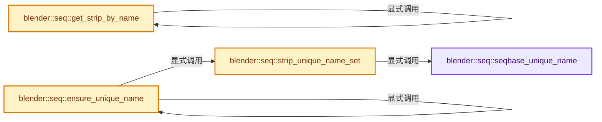
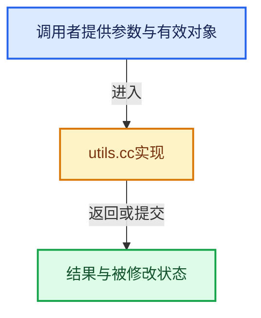

# 实现依赖专题：source/blender/sequencer/intern/utils.cc

[方向导航](README.md) · [符号索引](../%E7%AC%A6%E5%8F%B7%E4%BE%9D%E8%B5%96%E4%B8%8E%E5%AE%9E%E7%8E%B0%E7%B4%A2%E5%BC%95.md)

本专题从正文实际调用进入，集中保存共享实现。函数有稳定锚点，可从调用处直接跳到对应完整函数；递归与互相调用通过回链组织。

## 本文件的实现关系






## 完整成员与函数实现

<a id="f-4cde13f65f06eca2"></a>

### `blender::seq::seqbase_unique_name`

实现位置：[source/blender/sequencer/intern/utils.cc](../../../../../source/blender/sequencer/intern/utils.cc) · L61—L71。

接口参数：

- `ListBaseT<Strip> *seqbasep`
- `StripUniqueInfo *sui`

**教学注释版**

<!-- annotated:7d5b1a5727f09f -->

```cpp
static void seqbase_unique_name(ListBaseT<Strip> *seqbasep, StripUniqueInfo *sui)
{
  for (Strip &strip : *seqbasep) {
    if ((sui->strip != &strip) && STREQ(sui->name_dest, strip.name + 2)) {
      /* STRIP_NAME_MAXSTR -4 for the number, -1 for \0, - 2 for r_prefix */
      SNPRINTF(
          sui->name_dest, "%.*s.%03d", STRIP_NAME_MAXSTR - 4 - 1 - 2, sui->name_src, sui->count++);
      sui->match = 1; /* be sure to re-scan */
    }
  }
}
```

<details>
<summary>核对原始源码：source/blender/sequencer/intern/utils.cc · L61—L71</summary>

<!-- original:7d5b1a5727f09f:source/blender/sequencer/intern/utils.cc:61:71 -->

```cpp
static void seqbase_unique_name(ListBaseT<Strip> *seqbasep, StripUniqueInfo *sui)
{
  for (Strip &strip : *seqbasep) {
    if ((sui->strip != &strip) && STREQ(sui->name_dest, strip.name + 2)) {
      /* STRIP_NAME_MAXSTR -4 for the number, -1 for \0, - 2 for r_prefix */
      SNPRINTF(
          sui->name_dest, "%.*s.%03d", STRIP_NAME_MAXSTR - 4 - 1 - 2, sui->name_src, sui->count++);
      sui->match = 1; /* be sure to re-scan */
    }
  }
}
```

</details>

**沿实际写入检查状态**

- `sui->match = 1; /* be sure to re-scan */`

**继续追踪实现**

- `STREQ` → [STREQ · L112](%E4%BE%9D%E8%B5%96-GHOST_utildefines-34b996.md#m-9549fb6aafd2)；[STREQ · L451](../01-%E5%9F%BA%E7%A1%80%E5%AE%B9%E5%99%A8%E4%B8%8E%E7%8E%B0%E4%BB%A3CPP/%E4%BE%9D%E8%B5%96-BLI_utildefines-293a0a.md#m-c7b745bcfad2)；[STREQ · L55](%E4%BE%9D%E8%B5%96-clog-a0bec8.md#m-96e78f386894)。宏定义由构建条件选择。
- `SNPRINTF` → [SNPRINTF · L601](../01-%E5%9F%BA%E7%A1%80%E5%AE%B9%E5%99%A8%E4%B8%8E%E7%8E%B0%E4%BB%A3CPP/%E4%BE%9D%E8%B5%96-BLI_string-b43058.md#m-6193d55b5ab8)。宏定义由构建条件选择。

<a id="f-758f8af37c71e1fe"></a>

### `blender::seq::strip_unique_name_set`

实现位置：[source/blender/sequencer/intern/utils.cc](../../../../../source/blender/sequencer/intern/utils.cc) · L81—L107。

接口参数：

- `Scene *scene`
- `ListBaseT<Strip> *seqbasep`
- `Strip *strip`

**教学注释版**

<!-- annotated:28aae908bfea44 -->

```cpp
void strip_unique_name_set(Scene *scene, ListBaseT<Strip> *seqbasep, Strip *strip)
{
  StripUniqueInfo sui;
  char *dot;
  sui.strip = strip;
  STRNCPY(sui.name_src, strip->name + 2);
  STRNCPY(sui.name_dest, sui.name_src);
  sui.count = 1;
  sui.match = 1; /* assume the worst to start the loop */

  /* Strip off the suffix only if it is purely numeric. */
  if ((dot = strrchr(sui.name_src, '.'))) {
    char *suffix = dot + 1;
    if (BLI_string_is_decimal(suffix)) {
      *dot = '\0';
      sui.count = atoi(suffix) + 1;
    }
  }

  while (sui.match) {
    sui.match = 0;
    seqbase_unique_name(seqbasep, &sui);
    foreach_strip(seqbasep, seqbase_unique_name_recursive_fn, &sui);
  }

  edit_strip_name_set(scene, strip, sui.name_dest);
}
```

<details>
<summary>核对原始源码：source/blender/sequencer/intern/utils.cc · L81—L107</summary>

<!-- original:28aae908bfea44:source/blender/sequencer/intern/utils.cc:81:107 -->

```cpp
void strip_unique_name_set(Scene *scene, ListBaseT<Strip> *seqbasep, Strip *strip)
{
  StripUniqueInfo sui;
  char *dot;
  sui.strip = strip;
  STRNCPY(sui.name_src, strip->name + 2);
  STRNCPY(sui.name_dest, sui.name_src);
  sui.count = 1;
  sui.match = 1; /* assume the worst to start the loop */

  /* Strip off the suffix only if it is purely numeric. */
  if ((dot = strrchr(sui.name_src, '.'))) {
    char *suffix = dot + 1;
    if (BLI_string_is_decimal(suffix)) {
      *dot = '\0';
      sui.count = atoi(suffix) + 1;
    }
  }

  while (sui.match) {
    sui.match = 0;
    seqbase_unique_name(seqbasep, &sui);
    foreach_strip(seqbasep, seqbase_unique_name_recursive_fn, &sui);
  }

  edit_strip_name_set(scene, strip, sui.name_dest);
}
```

</details>

**沿实际写入检查状态**

- `sui.strip = strip;`
- `sui.count = 1;`
- `sui.match = 1; /* assume the worst to start the loop */`
- `sui.count = atoi(suffix) + 1;`
- `sui.match = 0;`

**继续追踪实现**

- `STRNCPY` → [blender::STRNCPY · L690](../01-%E5%9F%BA%E7%A1%80%E5%AE%B9%E5%99%A8%E4%B8%8E%E7%8E%B0%E4%BB%A3CPP/%E4%BE%9D%E8%B5%96-BLI_string-b43058.md#f-6b2d861724026be6)。
- `strrchr` → [调用协议](../%E6%A8%A1%E6%9D%BF%E5%AE%8F%E4%B8%8E%E5%8A%A8%E6%80%81%E5%88%86%E6%B4%BE%E5%8D%8F%E8%AE%AE.md)：函数指针、局部可调用对象或未展开的宏；必须结合调用者环境。调用位置L92。
- `BLI_string_is_decimal` → [blender::BLI_string_is_decimal · L228](../01-%E5%9F%BA%E7%A1%80%E5%AE%B9%E5%99%A8%E4%B8%8E%E7%8E%B0%E4%BB%A3CPP/%E4%BE%9D%E8%B5%96-string_utils-bbfe0c.md#f-8fb1a1e100d4d690)。
- `atoi` → [调用协议](../%E6%A8%A1%E6%9D%BF%E5%AE%8F%E4%B8%8E%E5%8A%A8%E6%80%81%E5%88%86%E6%B4%BE%E5%8D%8F%E8%AE%AE.md)：函数指针、局部可调用对象或未展开的宏；必须结合调用者环境。调用位置L96。
- `seqbase_unique_name` → [blender::seq::seqbase_unique_name · L61](%E4%BE%9D%E8%B5%96-utils-9efc85.md#f-4cde13f65f06eca2)。
- `foreach_strip` → [blender::seq::foreach_strip · L60](%E4%BE%9D%E8%B5%96-iterator-5c8b05.md#f-86cee6cf86eb707c)；[blender::seq::foreach_strip · L65](%E4%BE%9D%E8%B5%96-iterator-5c8b05.md#f-f628b6218602a592)。同名重载需按实参类型选择。
- `edit_strip_name_set` → [blender::seq::edit_strip_name_set · L537](%E4%BE%9D%E8%B5%96-strip_edit-be093a.md#f-88dfb3230bb6a917)。

<a id="f-b1939056b9613b80"></a>

### `blender::seq::get_strip_by_name`

实现位置：[source/blender/sequencer/intern/utils.cc](../../../../../source/blender/sequencer/intern/utils.cc) · L313—L328。

接口参数：

- `ListBaseT<Strip> *seqbase`
- `const char *name`
- `bool recursive`

**教学注释版**

<!-- annotated:df237773ae19fe -->

```cpp
Strip *get_strip_by_name(ListBaseT<Strip> *seqbase, const char *name, bool recursive)
{
  for (Strip &istrip : *seqbase) {
    if (STREQ(name, istrip.name + 2)) {
      return &istrip;
    }
    if (recursive && !istrip.seqbase.is_empty()) {
      Strip *rseq = get_strip_by_name(&istrip.seqbase, name, true);
      if (rseq != nullptr) {
        return rseq;
      }
    }
  }

  return nullptr;
}
```

<details>
<summary>核对原始源码：source/blender/sequencer/intern/utils.cc · L313—L328</summary>

<!-- original:df237773ae19fe:source/blender/sequencer/intern/utils.cc:313:328 -->

```cpp
Strip *get_strip_by_name(ListBaseT<Strip> *seqbase, const char *name, bool recursive)
{
  for (Strip &istrip : *seqbase) {
    if (STREQ(name, istrip.name + 2)) {
      return &istrip;
    }
    if (recursive && !istrip.seqbase.is_empty()) {
      Strip *rseq = get_strip_by_name(&istrip.seqbase, name, true);
      if (rseq != nullptr) {
        return rseq;
      }
    }
  }

  return nullptr;
}
```

</details>

**结果出口**

- `return &istrip;`
- `return rseq;`
- `return nullptr;`

**继续追踪实现**

- `STREQ` → [STREQ · L112](%E4%BE%9D%E8%B5%96-GHOST_utildefines-34b996.md#m-9549fb6aafd2)；[STREQ · L451](../01-%E5%9F%BA%E7%A1%80%E5%AE%B9%E5%99%A8%E4%B8%8E%E7%8E%B0%E4%BB%A3CPP/%E4%BE%9D%E8%B5%96-BLI_utildefines-293a0a.md#m-c7b745bcfad2)；[STREQ · L55](%E4%BE%9D%E8%B5%96-clog-a0bec8.md#m-96e78f386894)。宏定义由构建条件选择。
- `istrip.seqbase.is_empty` → [调用协议](../%E6%A8%A1%E6%9D%BF%E5%AE%8F%E4%B8%8E%E5%8A%A8%E6%80%81%E5%88%86%E6%B4%BE%E5%8D%8F%E8%AE%AE.md)：接收对象类型依赖auto、返回值或模板实例；不按同名猜测目标。调用位置L319。
- `get_strip_by_name` → [blender::seq::get_strip_by_name · L313](%E4%BE%9D%E8%B5%96-utils-9efc85.md#f-b1939056b9613b80)。

<a id="f-813d77714c845c7d"></a>

### `blender::seq::ensure_unique_name`

实现位置：[source/blender/sequencer/intern/utils.cc](../../../../../source/blender/sequencer/intern/utils.cc) · L412—L430。

接口参数：

- `Strip *strip`
- `Scene *scene`
- `const DriverMap &driver_map`

**教学注释版**

<!-- annotated:844b5791d7f604 -->

```cpp
void ensure_unique_name(Strip *strip, Scene *scene, const DriverMap &driver_map)
{
  char name[STRIP_NAME_MAXSTR];

  STRNCPY_UTF8(name, strip->name + 2);
  strip_unique_name_set(scene, &scene->ed->seqbase, strip);
  BKE_animdata_fix_paths(scene->id,
                         "sequence_editor.strips_all",
                         RNA_path_name_to_infix(name),
                         RNA_path_name_to_infix(strip->name + 2),
                         /*verify_paths=*/false,
                         driver_map);

  if (strip->type == STRIP_TYPE_META) {
    for (Strip &strip_child : strip->seqbase) {
      ensure_unique_name(&strip_child, scene, driver_map);
    }
  }
}
```

<details>
<summary>核对原始源码：source/blender/sequencer/intern/utils.cc · L412—L430</summary>

<!-- original:844b5791d7f604:source/blender/sequencer/intern/utils.cc:412:430 -->

```cpp
void ensure_unique_name(Strip *strip, Scene *scene, const DriverMap &driver_map)
{
  char name[STRIP_NAME_MAXSTR];

  STRNCPY_UTF8(name, strip->name + 2);
  strip_unique_name_set(scene, &scene->ed->seqbase, strip);
  BKE_animdata_fix_paths(scene->id,
                         "sequence_editor.strips_all",
                         RNA_path_name_to_infix(name),
                         RNA_path_name_to_infix(strip->name + 2),
                         /*verify_paths=*/false,
                         driver_map);

  if (strip->type == STRIP_TYPE_META) {
    for (Strip &strip_child : strip->seqbase) {
      ensure_unique_name(&strip_child, scene, driver_map);
    }
  }
}
```

</details>

**继续追踪实现**

- `STRNCPY_UTF8` → [STRNCPY_UTF8 · L335](../01-%E5%9F%BA%E7%A1%80%E5%AE%B9%E5%99%A8%E4%B8%8E%E7%8E%B0%E4%BB%A3CPP/%E4%BE%9D%E8%B5%96-BLI_string_utf8-bcc961.md#m-222967f0ab6a)。宏定义由构建条件选择。
- `strip_unique_name_set` → [blender::seq::strip_unique_name_set · L81](%E4%BE%9D%E8%B5%96-utils-9efc85.md#f-758f8af37c71e1fe)。
- `BKE_animdata_fix_paths` → [blender::BKE_animdata_fix_paths · L1001](%E4%BE%9D%E8%B5%96-anim_data-56c81c.md#f-ba061b4dce9eccbc)；[blender::BKE_animdata_fix_paths · L1044](%E4%BE%9D%E8%B5%96-anim_data-56c81c.md#f-d7648451f6591b0b)。同名重载需按实参类型选择。
- `RNA_path_name_to_infix` → [blender::RNA_path_name_to_infix · L1416](%E4%BE%9D%E8%B5%96-rna_path-495878.md#f-8a0460224c9dd680)。
- `ensure_unique_name` → [blender::seq::ensure_unique_name · L412](%E4%BE%9D%E8%B5%96-utils-9efc85.md#f-813d77714c845c7d)。
