# 实现依赖专题：source/blender/editors/uvedit/uvedit_clipboard.cc

[方向导航](README.md) · [符号索引](../%E7%AC%A6%E5%8F%B7%E4%BE%9D%E8%B5%96%E4%B8%8E%E5%AE%9E%E7%8E%B0%E7%B4%A2%E5%BC%95.md)

本专题从正文实际调用进入，集中保存共享实现。函数有稳定锚点，可从调用处直接跳到对应完整函数；递归与互相调用通过回链组织。

## 本文件的实现关系

```mermaid
flowchart LR
  F0["blender::iso_index_for_loop"]:::abstraction
  F1["blender::add_iso_edge"]:::compute
  F2["blender::build_iso_graph"]:::compute
  F3["blender::UV_ClipboardBuffer::append"]:::compute
  F1 -->|"显式调用"| F0
  F2 -->|"显式调用"| F1
  F3 -->|"显式调用"| F2
  classDef input fill:#DBEAFE,stroke:#2563EB,color:#172554,stroke-width:2px;
  classDef data fill:#CFFAFE,stroke:#0891B2,color:#164E63,stroke-width:2px;
  classDef abstraction fill:#EDE9FE,stroke:#7C3AED,color:#3B0764,stroke-width:2px;
  classDef compute fill:#FEF3C7,stroke:#D97706,color:#78350F,stroke-width:2px;
  classDef result fill:#DCFCE7,stroke:#16A34A,color:#14532D,stroke-width:2px;
  classDef error fill:#FEE2E2,stroke:#DC2626,color:#7F1D1D,stroke-width:2px;
```




## 完整成员与函数实现

<a id="f-aadb570498a72283"></a>

### `blender::iso_index_for_loop`

实现位置：[source/blender/editors/uvedit/uvedit_clipboard.cc](../../../../../source/blender/editors/uvedit/uvedit_clipboard.cc) · L85—L97。

接口参数：

- `const BMLoop *loop`
- `UvElementMap *element_map`
- `const int island_index`

**教学注释版**

<!-- annotated:00b53062177093 -->

```cpp
static int iso_index_for_loop(const BMLoop *loop,
                              UvElementMap *element_map,
                              const int island_index)
{
  UvElement *element = BM_uv_element_get(element_map, loop);
  if (!element) {
    return -1; /* Either unselected, or a different island. */
  }
  const int index = BM_uv_element_get_unique_index(element_map, element);
  const int base_index = BM_uv_element_get_unique_index(
      element_map, element_map->storage + element_map->island_indices[island_index]);
  return index - base_index;
}
```

<details>
<summary>核对原始源码：source/blender/editors/uvedit/uvedit_clipboard.cc · L85—L97</summary>

<!-- original:00b53062177093:source/blender/editors/uvedit/uvedit_clipboard.cc:85:97 -->

```cpp
static int iso_index_for_loop(const BMLoop *loop,
                              UvElementMap *element_map,
                              const int island_index)
{
  UvElement *element = BM_uv_element_get(element_map, loop);
  if (!element) {
    return -1; /* Either unselected, or a different island. */
  }
  const int index = BM_uv_element_get_unique_index(element_map, element);
  const int base_index = BM_uv_element_get_unique_index(
      element_map, element_map->storage + element_map->island_indices[island_index]);
  return index - base_index;
}
```

</details>

**结果出口**

- `return -1; /* Either unselected, or a different island. */`
- `return index - base_index;`

**继续追踪实现**

- `BM_uv_element_get` → [blender::BM_uv_element_get · L1242](%E4%BE%9D%E8%B5%96-editmesh_utils-d4e54c.md#f-82932f6498c48de5)。
- `BM_uv_element_get_unique_index` → [blender::BM_uv_element_get_unique_index · L669](%E4%BE%9D%E8%B5%96-editmesh_utils-d4e54c.md#f-7b099b284e114e0e)。

<a id="f-9151386517728ea4"></a>

### `blender::add_iso_edge`

实现位置：[source/blender/editors/uvedit/uvedit_clipboard.cc](../../../../../source/blender/editors/uvedit/uvedit_clipboard.cc) · L101—L116。

接口参数：

- `GraphISO *graph`
- `BMLoop *loop_v`
- `BMLoop *loop_w`
- `UvElementMap *element_map`
- `int island_index`

**教学注释版**

<!-- annotated:932ad4ed7740f8 -->

```cpp
static void add_iso_edge(
    GraphISO *graph, BMLoop *loop_v, BMLoop *loop_w, UvElementMap *element_map, int island_index)
{
  BLI_assert(loop_v->f == loop_w->f); /* Ensure on the same face. */
  const int index_v = iso_index_for_loop(loop_v, element_map, island_index);
  const int index_w = iso_index_for_loop(loop_w, element_map, island_index);
  BLI_assert(index_v != index_w);
  if (index_v == -1 || index_w == -1) {
    return; /* Unselected. */
  }

  BLI_assert(0 <= index_v && index_v < graph->n);
  BLI_assert(0 <= index_w && index_w < graph->n);

  graph->add_edge(index_v, index_w);
}
```

<details>
<summary>核对原始源码：source/blender/editors/uvedit/uvedit_clipboard.cc · L101—L116</summary>

<!-- original:932ad4ed7740f8:source/blender/editors/uvedit/uvedit_clipboard.cc:101:116 -->

```cpp
static void add_iso_edge(
    GraphISO *graph, BMLoop *loop_v, BMLoop *loop_w, UvElementMap *element_map, int island_index)
{
  BLI_assert(loop_v->f == loop_w->f); /* Ensure on the same face. */
  const int index_v = iso_index_for_loop(loop_v, element_map, island_index);
  const int index_w = iso_index_for_loop(loop_w, element_map, island_index);
  BLI_assert(index_v != index_w);
  if (index_v == -1 || index_w == -1) {
    return; /* Unselected. */
  }

  BLI_assert(0 <= index_v && index_v < graph->n);
  BLI_assert(0 <= index_w && index_w < graph->n);

  graph->add_edge(index_v, index_w);
}
```

</details>

**继续追踪实现**

- `BLI_assert` → [BLI_assert · L48](../01-%E5%9F%BA%E7%A1%80%E5%AE%B9%E5%99%A8%E4%B8%8E%E7%8E%B0%E4%BB%A3CPP/%E4%BE%9D%E8%B5%96-BLI_assert-cc98e8.md#m-57a88495704d)；[BLI_assert · L63](../01-%E5%9F%BA%E7%A1%80%E5%AE%B9%E5%99%A8%E4%B8%8E%E7%8E%B0%E4%BB%A3CPP/%E4%BE%9D%E8%B5%96-BLI_assert-cc98e8.md#m-d07050020cb5)。宏定义由构建条件选择。
- `iso_index_for_loop` → [blender::iso_index_for_loop · L85](%E4%BE%9D%E8%B5%96-uvedit_clipboard-50a9f1.md#f-aadb570498a72283)。
- `graph->add_edge` → [blender::GraphISO::add_edge · L67](%E4%BE%9D%E8%B5%96-uvedit_clipboard_graph_iso-c194b2.md#f-ef4db9fe4cc5d3b0)。

<a id="f-d0160efe23e10f76"></a>

### `blender::build_iso_graph`

实现位置：[source/blender/editors/uvedit/uvedit_clipboard.cc](../../../../../source/blender/editors/uvedit/uvedit_clipboard.cc) · L120—L147。

接口参数：

- `UvElementMap *element_map`
- `const int island_index`
- `int`

**教学注释版**

<!-- annotated:1e02ce83de087c -->

```cpp
static GraphISO *build_iso_graph(UvElementMap *element_map,
                                 const int island_index,
                                 int /*cd_loop_uv_offset*/)
{
  GraphISO *g = new GraphISO(element_map->island_total_unique_uvs[island_index]);
  for (int i = 0; i < g->n; i++) {
    g->label[i] = i;
  }

  const int i0 = element_map->island_indices[island_index];
  const int i1 = i0 + element_map->island_total_uvs[island_index];

  /* Add iso_edges. */
  for (int i = i0; i < i1; i++) {
    const UvElement *element = element_map->storage + i;
    /* Look forward around the current face. */
    add_iso_edge(g, element->l, element->l->next, element_map, island_index);

    /* Look backward around the current face.
     * (Required for certain vertex selection cases.)
     */
    add_iso_edge(g, element->l->prev, element->l, element_map, island_index);
  }

  /* TODO: call g->sort_vertices_by_degree() */

  return g;
}
```

<details>
<summary>核对原始源码：source/blender/editors/uvedit/uvedit_clipboard.cc · L120—L147</summary>

<!-- original:1e02ce83de087c:source/blender/editors/uvedit/uvedit_clipboard.cc:120:147 -->

```cpp
static GraphISO *build_iso_graph(UvElementMap *element_map,
                                 const int island_index,
                                 int /*cd_loop_uv_offset*/)
{
  GraphISO *g = new GraphISO(element_map->island_total_unique_uvs[island_index]);
  for (int i = 0; i < g->n; i++) {
    g->label[i] = i;
  }

  const int i0 = element_map->island_indices[island_index];
  const int i1 = i0 + element_map->island_total_uvs[island_index];

  /* Add iso_edges. */
  for (int i = i0; i < i1; i++) {
    const UvElement *element = element_map->storage + i;
    /* Look forward around the current face. */
    add_iso_edge(g, element->l, element->l->next, element_map, island_index);

    /* Look backward around the current face.
     * (Required for certain vertex selection cases.)
     */
    add_iso_edge(g, element->l->prev, element->l, element_map, island_index);
  }

  /* TODO: call g->sort_vertices_by_degree() */

  return g;
}
```

</details>

**沿实际写入检查状态**

- `g->label[i] = i;`

**结果出口**

- `return g;`

**继续追踪实现**

- `add_iso_edge` → [blender::add_iso_edge · L101](%E4%BE%9D%E8%B5%96-uvedit_clipboard-50a9f1.md#f-9151386517728ea4)。

<a id="f-de8d3eb273c2b6e2"></a>

### `blender::UV_ClipboardBuffer::append`

实现位置：[source/blender/editors/uvedit/uvedit_clipboard.cc](../../../../../source/blender/editors/uvedit/uvedit_clipboard.cc) · L151—L167。

接口参数：

- `UvElementMap *element_map`
- `const int cd_loop_uv_offset`

**教学注释版**

<!-- annotated:75d4f812952657 -->

```cpp
void UV_ClipboardBuffer::append(UvElementMap *element_map, const int cd_loop_uv_offset)
{
  for (int island_index = 0; island_index < element_map->total_islands; island_index++) {
    // [讲解] offset.append：在尾部建立新元素，必要时先扩大存储。
    offset.append(uv.size());
    graph.append(build_iso_graph(element_map, island_index, cd_loop_uv_offset));

    /* TODO: Consider iterating over `BM_uv_element_map_ensure_unique_index` instead. */
    for (int j = 0; j < element_map->island_total_uvs[island_index]; j++) {
      UvElement *element = element_map->storage + element_map->island_indices[island_index] + j;
      if (!element->separate) {
        continue;
      }
      float *luv = BM_ELEM_CD_GET_FLOAT_P(element->l, cd_loop_uv_offset);
      uv.append(std::make_pair(luv[0], luv[1]));
    }
  }
}
```

<details>
<summary>核对原始源码：source/blender/editors/uvedit/uvedit_clipboard.cc · L151—L167</summary>

<!-- original:75d4f812952657:source/blender/editors/uvedit/uvedit_clipboard.cc:151:167 -->

```cpp
void UV_ClipboardBuffer::append(UvElementMap *element_map, const int cd_loop_uv_offset)
{
  for (int island_index = 0; island_index < element_map->total_islands; island_index++) {
    offset.append(uv.size());
    graph.append(build_iso_graph(element_map, island_index, cd_loop_uv_offset));

    /* TODO: Consider iterating over `BM_uv_element_map_ensure_unique_index` instead. */
    for (int j = 0; j < element_map->island_total_uvs[island_index]; j++) {
      UvElement *element = element_map->storage + element_map->island_indices[island_index] + j;
      if (!element->separate) {
        continue;
      }
      float *luv = BM_ELEM_CD_GET_FLOAT_P(element->l, cd_loop_uv_offset);
      uv.append(std::make_pair(luv[0], luv[1]));
    }
  }
}
```

</details>

**继续追踪实现**

- `offset.append` → [blender::Vector::append · L498](../01-%E5%9F%BA%E7%A1%80%E5%AE%B9%E5%99%A8%E4%B8%8E%E7%8E%B0%E4%BB%A3CPP/11-Vector%E6%8F%92%E5%85%A5%E5%88%A0%E9%99%A4%E4%B8%8E%E9%87%8D%E6%8E%92.md#f-5bde268a69e443ec)；[blender::Vector::append · L502](../01-%E5%9F%BA%E7%A1%80%E5%AE%B9%E5%99%A8%E4%B8%8E%E7%8E%B0%E4%BB%A3CPP/11-Vector%E6%8F%92%E5%85%A5%E5%88%A0%E9%99%A4%E4%B8%8E%E9%87%8D%E6%8E%92.md#f-591e0b15e6308532)。同名重载需按实参类型选择。
- `uv.size` → [blender::Vector::size · L780](../01-%E5%9F%BA%E7%A1%80%E5%AE%B9%E5%99%A8%E4%B8%8E%E7%8E%B0%E4%BB%A3CPP/11-Vector%E6%8F%92%E5%85%A5%E5%88%A0%E9%99%A4%E4%B8%8E%E9%87%8D%E6%8E%92.md#f-714773731767349c)。
- `graph.append` → [blender::Vector::append · L498](../01-%E5%9F%BA%E7%A1%80%E5%AE%B9%E5%99%A8%E4%B8%8E%E7%8E%B0%E4%BB%A3CPP/11-Vector%E6%8F%92%E5%85%A5%E5%88%A0%E9%99%A4%E4%B8%8E%E9%87%8D%E6%8E%92.md#f-5bde268a69e443ec)；[blender::Vector::append · L502](../01-%E5%9F%BA%E7%A1%80%E5%AE%B9%E5%99%A8%E4%B8%8E%E7%8E%B0%E4%BB%A3CPP/11-Vector%E6%8F%92%E5%85%A5%E5%88%A0%E9%99%A4%E4%B8%8E%E9%87%8D%E6%8E%92.md#f-591e0b15e6308532)。同名重载需按实参类型选择。
- `build_iso_graph` → [blender::build_iso_graph · L120](%E4%BE%9D%E8%B5%96-uvedit_clipboard-50a9f1.md#f-d0160efe23e10f76)。
- `BM_ELEM_CD_GET_FLOAT_P` → [BM_ELEM_CD_GET_FLOAT_P · L635](%E4%BE%9D%E8%B5%96-bmesh_class-4cf146.md#m-544f72c45c1b)；[BM_ELEM_CD_GET_FLOAT_P · L661](%E4%BE%9D%E8%B5%96-bmesh_class-4cf146.md#m-c11efbe96e86)。宏定义由构建条件选择。
- `uv.append` → [blender::Vector::append · L498](../01-%E5%9F%BA%E7%A1%80%E5%AE%B9%E5%99%A8%E4%B8%8E%E7%8E%B0%E4%BB%A3CPP/11-Vector%E6%8F%92%E5%85%A5%E5%88%A0%E9%99%A4%E4%B8%8E%E9%87%8D%E6%8E%92.md#f-5bde268a69e443ec)；[blender::Vector::append · L502](../01-%E5%9F%BA%E7%A1%80%E5%AE%B9%E5%99%A8%E4%B8%8E%E7%8E%B0%E4%BB%A3CPP/11-Vector%E6%8F%92%E5%85%A5%E5%88%A0%E9%99%A4%E4%B8%8E%E9%87%8D%E6%8E%92.md#f-591e0b15e6308532)。同名重载需按实参类型选择。
- `std::make_pair` → [外部契约](https://eel.is/c++draft/)：这个边界按实际表达式及所属类型核对参数、返回值、寿命与失败行为。这里提供接口入口，不声称已解释该第三方版本的内部实现。
