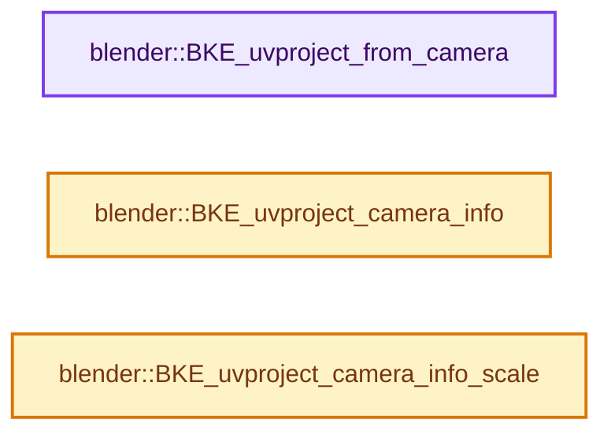
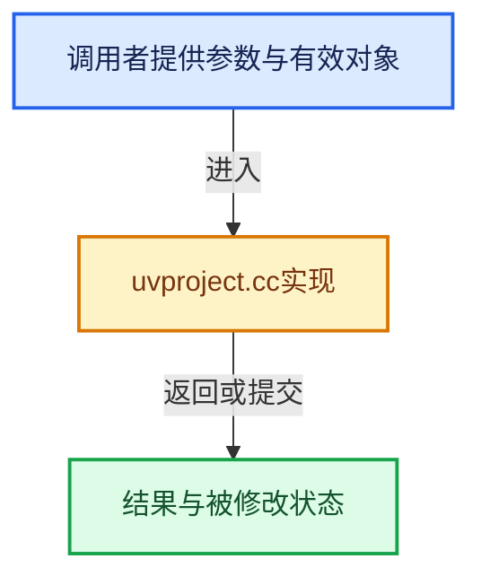

# 实现依赖专题：source/blender/blenkernel/intern/uvproject.cc

[方向导航](README.md) · [符号索引](../%E7%AC%A6%E5%8F%B7%E4%BE%9D%E8%B5%96%E4%B8%8E%E5%AE%9E%E7%8E%B0%E7%B4%A2%E5%BC%95.md)

本专题从正文实际调用进入，集中保存共享实现。函数有稳定锚点，可从调用处直接跳到对应完整函数；递归与互相调用通过回链组织。

## 本文件的实现关系






## 完整成员与函数实现

<a id="f-ae58e1a57e4d2ee0"></a>

### `blender::BKE_uvproject_from_camera`

实现位置：[source/blender/blenkernel/intern/uvproject.cc](../../../../../source/blender/blenkernel/intern/uvproject.cc) · L34—L84。

接口参数：

- `float target[2]`
- `const float source[3]`
- `const ProjCameraInfo *uci`

**教学注释版**

<!-- annotated:caea5758394cdb -->

```cpp
void BKE_uvproject_from_camera(float target[2], const float source[3], const ProjCameraInfo *uci)
{
  float pv4[4];

  copy_v3_v3(pv4, source);
  pv4[3] = 1.0;

  /* rotmat is the object matrix in this case */
  if (uci->do_rotmat) {
    mul_m4_v4(uci->rotmat, pv4);
  }

  /* caminv is the inverse camera matrix */
  mul_m4_v4(uci->caminv, pv4);

  if (uci->do_pano) {
    float angle = atan2f(pv4[0], -pv4[2]) / (float(M_PI) * 2.0f); /* angle around the camera */
    if (uci->do_persp == false) {
      target[0] = angle; /* No correct method here, just map to 0-1. */
      target[1] = pv4[1] / uci->camsize;
    }
    else {
      float vec2d[2]; /* 2D position from the camera */
      vec2d[0] = pv4[0];
      vec2d[1] = pv4[2];
      target[0] = angle * (float(M_PI) / uci->camangle);
      target[1] = pv4[1] / (len_v2(vec2d) * (uci->camsize * 2.0f));
    }
  }
  else {
    if (pv4[2] == 0.0f) {
      pv4[2] = 0.00001f; /* don't allow div by 0 */
    }

    if (uci->do_persp == false) {
      target[0] = (pv4[0] / uci->camsize);
      target[1] = (pv4[1] / uci->camsize);
    }
    else {
      target[0] = (-pv4[0] * ((1.0f / uci->camsize) / pv4[2])) / 2.0f;
      target[1] = (-pv4[1] * ((1.0f / uci->camsize) / pv4[2])) / 2.0f;
    }
  }

  target[0] *= uci->xasp;
  target[1] *= uci->yasp;

  /* adds camera shift + 0.5 */
  target[0] += uci->shiftx;
  target[1] += uci->shifty;
}
```

<details>
<summary>核对原始源码：source/blender/blenkernel/intern/uvproject.cc · L34—L84</summary>

<!-- original:caea5758394cdb:source/blender/blenkernel/intern/uvproject.cc:34:84 -->

```cpp
void BKE_uvproject_from_camera(float target[2], const float source[3], const ProjCameraInfo *uci)
{
  float pv4[4];

  copy_v3_v3(pv4, source);
  pv4[3] = 1.0;

  /* rotmat is the object matrix in this case */
  if (uci->do_rotmat) {
    mul_m4_v4(uci->rotmat, pv4);
  }

  /* caminv is the inverse camera matrix */
  mul_m4_v4(uci->caminv, pv4);

  if (uci->do_pano) {
    float angle = atan2f(pv4[0], -pv4[2]) / (float(M_PI) * 2.0f); /* angle around the camera */
    if (uci->do_persp == false) {
      target[0] = angle; /* No correct method here, just map to 0-1. */
      target[1] = pv4[1] / uci->camsize;
    }
    else {
      float vec2d[2]; /* 2D position from the camera */
      vec2d[0] = pv4[0];
      vec2d[1] = pv4[2];
      target[0] = angle * (float(M_PI) / uci->camangle);
      target[1] = pv4[1] / (len_v2(vec2d) * (uci->camsize * 2.0f));
    }
  }
  else {
    if (pv4[2] == 0.0f) {
      pv4[2] = 0.00001f; /* don't allow div by 0 */
    }

    if (uci->do_persp == false) {
      target[0] = (pv4[0] / uci->camsize);
      target[1] = (pv4[1] / uci->camsize);
    }
    else {
      target[0] = (-pv4[0] * ((1.0f / uci->camsize) / pv4[2])) / 2.0f;
      target[1] = (-pv4[1] * ((1.0f / uci->camsize) / pv4[2])) / 2.0f;
    }
  }

  target[0] *= uci->xasp;
  target[1] *= uci->yasp;

  /* adds camera shift + 0.5 */
  target[0] += uci->shiftx;
  target[1] += uci->shifty;
}
```

</details>

**沿实际写入检查状态**

- `pv4[3] = 1.0;`
- `target[0] = angle; /* No correct method here, just map to 0-1. */`
- `target[1] = pv4[1] / uci->camsize;`
- `vec2d[0] = pv4[0];`
- `vec2d[1] = pv4[2];`
- `target[0] = angle * (float(M_PI) / uci->camangle);`
- `target[1] = pv4[1] / (len_v2(vec2d) * (uci->camsize * 2.0f));`
- `pv4[2] = 0.00001f; /* don't allow div by 0 */`
- `target[0] = (pv4[0] / uci->camsize);`
- `target[1] = (pv4[1] / uci->camsize);`
- `target[0] = (-pv4[0] * ((1.0f / uci->camsize) / pv4[2])) / 2.0f;`
- `target[1] = (-pv4[1] * ((1.0f / uci->camsize) / pv4[2])) / 2.0f;`
- `target[0] *= uci->xasp;`
- `target[1] *= uci->yasp;`
- `target[0] += uci->shiftx;`
- `target[1] += uci->shifty;`

**继续追踪实现**

- `copy_v3_v3` → [blender::copy_v3_v3 · L47](../12-%E7%A9%BA%E9%97%B4%E6%95%B0%E6%8D%AE%E7%BB%93%E6%9E%84%E4%B8%8E%E5%87%A0%E4%BD%95%E7%AE%97%E6%B3%95/%E4%BE%9D%E8%B5%96-math_vector_inline-0c8541.md#f-037a0d5fa5060bd6)。
- `mul_m4_v4` → [blender::mul_m4_v4 · L810](../12-%E7%A9%BA%E9%97%B4%E6%95%B0%E6%8D%AE%E7%BB%93%E6%9E%84%E4%B8%8E%E5%87%A0%E4%BD%95%E7%AE%97%E6%B3%95/%E4%BE%9D%E8%B5%96-math_matrix_c-004123.md#f-aaa7c69c4ac12b2b)。
- `atan2f` → [atan2f · L18](%E4%BE%9D%E8%B5%96-radial_tiling_shared-98abf9.md#m-a77af3382db2)；[atan2f · L40](%E4%BE%9D%E8%B5%96-radial_tiling_shared-98abf9.md#m-cec47b2ce998)；[atan2f · L71](%E4%BE%9D%E8%B5%96-radial_tiling_shared-98abf9.md#m-bd31b1779092)；[atan2f · L22](../01-%E5%9F%BA%E7%A1%80%E5%AE%B9%E5%99%A8%E4%B8%8E%E7%8E%B0%E4%BB%A3CPP/%E4%BE%9D%E8%B5%96-radial_tiling_shared-7989a4.md#m-9b9c2a707484)；[atan2f · L44](../01-%E5%9F%BA%E7%A1%80%E5%AE%B9%E5%99%A8%E4%B8%8E%E7%8E%B0%E4%BB%A3CPP/%E4%BE%9D%E8%B5%96-radial_tiling_shared-7989a4.md#m-63f49b7d81dc)；[atan2f · L75](../01-%E5%9F%BA%E7%A1%80%E5%AE%B9%E5%99%A8%E4%B8%8E%E7%8E%B0%E4%BB%A3CPP/%E4%BE%9D%E8%B5%96-radial_tiling_shared-7989a4.md#m-4201e8b4c423)；[atan2f · L18](%E4%BE%9D%E8%B5%96-node_radial_tiling_shared-b14bc2.md#m-ec4f8238af32)；[atan2f · L40](%E4%BE%9D%E8%B5%96-node_radial_tiling_shared-b14bc2.md#m-980162d675e3)；[atan2f · L71](%E4%BE%9D%E8%B5%96-node_radial_tiling_shared-b14bc2.md#m-bcd4c102a83d)；[atan2f · L179](%E4%BE%9D%E8%B5%96-compat-56205c.md#m-5be26d38bfa7)；[atan2f · L274](%E4%BE%9D%E8%B5%96-compat-efe0e9.md#m-1b9636d3b02f)。宏定义由构建条件选择。
- `len_v2` → [blender::len_v2 · L744](../12-%E7%A9%BA%E9%97%B4%E6%95%B0%E6%8D%AE%E7%BB%93%E6%9E%84%E4%B8%8E%E5%87%A0%E4%BD%95%E7%AE%97%E6%B3%95/%E4%BE%9D%E8%B5%96-math_vector_inline-0c8541.md#f-5cbb0955da676dd1)。

<a id="f-da1f42d3225f5fa7"></a>

### `blender::BKE_uvproject_camera_info`

实现位置：[source/blender/blenkernel/intern/uvproject.cc](../../../../../source/blender/blenkernel/intern/uvproject.cc) · L127—L177。

接口参数：

- `const Object *ob`
- `const float rotmat[4][4]`
- `float winx`
- `float winy`

**教学注释版**

<!-- annotated:421e663163de1c -->

```cpp
ProjCameraInfo *BKE_uvproject_camera_info(const Object *ob,
                                          const float rotmat[4][4],
                                          float winx,
                                          float winy)
{
  ProjCameraInfo uci;
  const Camera *camera = id_cast<Camera *>(ob->data);

  uci.do_pano = (camera->type == CAM_PANO);
  uci.do_persp = ELEM(camera->type, CAM_PERSP, CAM_CUSTOM);

  uci.camangle = focallength_to_fov(camera->lens, camera->sensor_x) / 2.0f;
  uci.camsize = uci.do_persp ? tanf(uci.camangle) : camera->ortho_scale;

  /* account for scaled cameras */
  copy_m4_m4(uci.caminv, ob->object_to_world().ptr());
  normalize_m4(uci.caminv);

  if (invert_m4(uci.caminv)) {
    ProjCameraInfo *uci_pt;

    /* normal projection */
    if (rotmat) {
      copy_m4_m4(uci.rotmat, rotmat);
      uci.do_rotmat = true;
    }
    else {
      uci.do_rotmat = false;
    }

    /* also make aspect ratio adjustment factors */
    if (winx > winy) {
      uci.xasp = 1.0f;
      uci.yasp = winx / winy;
    }
    else {
      uci.xasp = winy / winx;
      uci.yasp = 1.0f;
    }

    /* include 0.5f here to move the UVs into the center */
    uci.shiftx = 0.5f - (camera->shiftx * uci.xasp);
    uci.shifty = 0.5f - (camera->shifty * uci.yasp);

    uci_pt = MEM_new_uninitialized<ProjCameraInfo>(__func__);
    *uci_pt = uci;
    return uci_pt;
  }

  return nullptr;
}
```

<details>
<summary>核对原始源码：source/blender/blenkernel/intern/uvproject.cc · L127—L177</summary>

<!-- original:421e663163de1c:source/blender/blenkernel/intern/uvproject.cc:127:177 -->

```cpp
ProjCameraInfo *BKE_uvproject_camera_info(const Object *ob,
                                          const float rotmat[4][4],
                                          float winx,
                                          float winy)
{
  ProjCameraInfo uci;
  const Camera *camera = id_cast<Camera *>(ob->data);

  uci.do_pano = (camera->type == CAM_PANO);
  uci.do_persp = ELEM(camera->type, CAM_PERSP, CAM_CUSTOM);

  uci.camangle = focallength_to_fov(camera->lens, camera->sensor_x) / 2.0f;
  uci.camsize = uci.do_persp ? tanf(uci.camangle) : camera->ortho_scale;

  /* account for scaled cameras */
  copy_m4_m4(uci.caminv, ob->object_to_world().ptr());
  normalize_m4(uci.caminv);

  if (invert_m4(uci.caminv)) {
    ProjCameraInfo *uci_pt;

    /* normal projection */
    if (rotmat) {
      copy_m4_m4(uci.rotmat, rotmat);
      uci.do_rotmat = true;
    }
    else {
      uci.do_rotmat = false;
    }

    /* also make aspect ratio adjustment factors */
    if (winx > winy) {
      uci.xasp = 1.0f;
      uci.yasp = winx / winy;
    }
    else {
      uci.xasp = winy / winx;
      uci.yasp = 1.0f;
    }

    /* include 0.5f here to move the UVs into the center */
    uci.shiftx = 0.5f - (camera->shiftx * uci.xasp);
    uci.shifty = 0.5f - (camera->shifty * uci.yasp);

    uci_pt = MEM_new_uninitialized<ProjCameraInfo>(__func__);
    *uci_pt = uci;
    return uci_pt;
  }

  return nullptr;
}
```

</details>

**沿实际写入检查状态**

- `uci.do_pano = (camera->type == CAM_PANO);`
- `uci.do_persp = ELEM(camera->type, CAM_PERSP, CAM_CUSTOM);`
- `uci.camangle = focallength_to_fov(camera->lens, camera->sensor_x) / 2.0f;`
- `uci.camsize = uci.do_persp ? tanf(uci.camangle) : camera->ortho_scale;`
- `uci.do_rotmat = true;`
- `uci.do_rotmat = false;`
- `uci.xasp = 1.0f;`
- `uci.yasp = winx / winy;`
- `uci.xasp = winy / winx;`
- `uci.yasp = 1.0f;`
- `uci.shiftx = 0.5f - (camera->shiftx * uci.xasp);`
- `uci.shifty = 0.5f - (camera->shifty * uci.yasp);`
- `uci_pt = MEM_new_uninitialized<ProjCameraInfo>(__func__);`

**结果出口**

- `return uci_pt;`
- `return nullptr;`

**继续追踪实现**

- `id_cast<Camera *>` → [blender::id_cast · L1417](%E4%BE%9D%E8%B5%96-DNA_ID-3eb091.md#f-6c8ac6412850ac5a)。
- `ELEM` → [ELEM · L88](%E4%BE%9D%E8%B5%96-GHOST_utildefines-34b996.md#m-d28724a15928)；[ELEM · L135](../01-%E5%9F%BA%E7%A1%80%E5%AE%B9%E5%99%A8%E4%B8%8E%E7%8E%B0%E4%BB%A3CPP/%E4%BE%9D%E8%B5%96-BLI_utildefines-293a0a.md#m-d6572de7cae0)。宏定义由构建条件选择。
- `focallength_to_fov` → [blender::focallength_to_fov · L2336](../12-%E7%A9%BA%E9%97%B4%E6%95%B0%E6%8D%AE%E7%BB%93%E6%9E%84%E4%B8%8E%E5%87%A0%E4%BD%95%E7%AE%97%E6%B3%95/%E4%BE%9D%E8%B5%96-math_rotation_c-8e57f4.md#f-e8999e0a3cdf4071)。
- `tanf` → [tanf · L30](%E4%BE%9D%E8%B5%96-radial_tiling_shared-98abf9.md#m-59a434b9184c)；[tanf · L52](%E4%BE%9D%E8%B5%96-radial_tiling_shared-98abf9.md#m-96d07165eab2)；[tanf · L83](%E4%BE%9D%E8%B5%96-radial_tiling_shared-98abf9.md#m-7663637581d9)；[tanf · L34](../01-%E5%9F%BA%E7%A1%80%E5%AE%B9%E5%99%A8%E4%B8%8E%E7%8E%B0%E4%BB%A3CPP/%E4%BE%9D%E8%B5%96-radial_tiling_shared-7989a4.md#m-8b35fd329650)；[tanf · L56](../01-%E5%9F%BA%E7%A1%80%E5%AE%B9%E5%99%A8%E4%B8%8E%E7%8E%B0%E4%BB%A3CPP/%E4%BE%9D%E8%B5%96-radial_tiling_shared-7989a4.md#m-9e153fc2f61f)；[tanf · L87](../01-%E5%9F%BA%E7%A1%80%E5%AE%B9%E5%99%A8%E4%B8%8E%E7%8E%B0%E4%BB%A3CPP/%E4%BE%9D%E8%B5%96-radial_tiling_shared-7989a4.md#m-8eb7d6521f7a)；[tanf · L30](%E4%BE%9D%E8%B5%96-node_radial_tiling_shared-b14bc2.md#m-d7bdd765eeff)；[tanf · L52](%E4%BE%9D%E8%B5%96-node_radial_tiling_shared-b14bc2.md#m-2b90b7f17f04)；[tanf · L83](%E4%BE%9D%E8%B5%96-node_radial_tiling_shared-b14bc2.md#m-39bfd36efdd8)；[tanf · L189](%E4%BE%9D%E8%B5%96-compat-56205c.md#m-2c0993e4c930)；[tanf · L289](%E4%BE%9D%E8%B5%96-compat-efe0e9.md#m-377fea82ecaa)；[tanf · L96](%E4%BE%9D%E8%B5%96-compat-9e0a25.md#m-bf249a5884aa)；[tanf · L94](%E4%BE%9D%E8%B5%96-compat-e9eab7.md#m-789daa70cab8)；[tanf · L45](%E4%BE%9D%E8%B5%96-GPU_shader_shared_utils-0adda3.md#m-47237e652f9a)；[tanf · L66](%E4%BE%9D%E8%B5%96-GPU_shader_shared_utils-0adda3.md#m-ec729c327d58)。宏定义由构建条件选择。
- `copy_m4_m4` → [blender::copy_m4_m4 · L84](../12-%E7%A9%BA%E9%97%B4%E6%95%B0%E6%8D%AE%E7%BB%93%E6%9E%84%E4%B8%8E%E5%87%A0%E4%BD%95%E7%AE%97%E6%B3%95/%E4%BE%9D%E8%B5%96-math_matrix_c-004123.md#f-b4390cf8c94710f5)。
- `ob->object_to_world().ptr` → [调用协议](../%E6%A8%A1%E6%9D%BF%E5%AE%8F%E4%B8%8E%E5%8A%A8%E6%80%81%E5%88%86%E6%B4%BE%E5%8D%8F%E8%AE%AE.md)：接收对象类型依赖auto、返回值或模板实例；不按同名猜测目标。调用位置L142。
- `ob->object_to_world` → [blender::Object::object_to_world · L5761](%E4%BE%9D%E8%B5%96-object-843689.md#f-12fc20026327d50c)。
- `normalize_m4` → [blender::normalize_m4 · L1779](../12-%E7%A9%BA%E9%97%B4%E6%95%B0%E6%8D%AE%E7%BB%93%E6%9E%84%E4%B8%8E%E5%87%A0%E4%BD%95%E7%AE%97%E6%B3%95/%E4%BE%9D%E8%B5%96-math_matrix_c-004123.md#f-55c35f5c5d7d4719)。
- `invert_m4` → [blender::invert_m4 · L1069](../12-%E7%A9%BA%E9%97%B4%E6%95%B0%E6%8D%AE%E7%BB%93%E6%9E%84%E4%B8%8E%E5%87%A0%E4%BD%95%E7%AE%97%E6%B3%95/%E4%BE%9D%E8%B5%96-math_matrix_c-004123.md#f-db172dd1e3ce5867)。
- `MEM_new_uninitialized<ProjCameraInfo>` → [MEM_new_uninitialized · L590](../03-%E5%86%85%E5%AD%98%E5%88%86%E9%85%8D%E4%B8%8E%E8%BF%90%E8%A1%8C%E6%97%B6%E7%B1%BB%E5%9E%8B/%E4%BE%9D%E8%B5%96-MEM_guardedalloc-b54eca.md#f-c773b2e5b8fe70e4)；[MEM_new_uninitialized · L124](../03-%E5%86%85%E5%AD%98%E5%88%86%E9%85%8D%E4%B8%8E%E8%BF%90%E8%A1%8C%E6%97%B6%E7%B1%BB%E5%9E%8B/%E4%BE%9D%E8%B5%96-mallocn-afdcd4.md#f-28a7e00a1e67f699)。同名重载需按实参类型选择。

<a id="f-deab22a6871fad54"></a>

### `blender::BKE_uvproject_camera_info_scale`

实现位置：[source/blender/blenkernel/intern/uvproject.cc](../../../../../source/blender/blenkernel/intern/uvproject.cc) · L197—L201。

接口参数：

- `ProjCameraInfo *uci`
- `float scale_x`
- `float scale_y`

**教学注释版**

<!-- annotated:77330ee240a84c -->

```cpp
void BKE_uvproject_camera_info_scale(ProjCameraInfo *uci, float scale_x, float scale_y)
{
  uci->xasp *= scale_x;
  uci->yasp *= scale_y;
}
```

<details>
<summary>核对原始源码：source/blender/blenkernel/intern/uvproject.cc · L197—L201</summary>

<!-- original:77330ee240a84c:source/blender/blenkernel/intern/uvproject.cc:197:201 -->

```cpp
void BKE_uvproject_camera_info_scale(ProjCameraInfo *uci, float scale_x, float scale_y)
{
  uci->xasp *= scale_x;
  uci->yasp *= scale_y;
}
```

</details>

**沿实际写入检查状态**

- `uci->xasp *= scale_x;`
- `uci->yasp *= scale_y;`

**继续追踪实现**

本实现没有需要继续展开的显式调用；检查返回表达式、对象转换和调用者前置条件。
