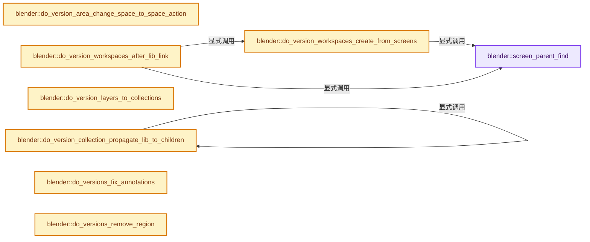

# 实现依赖专题：source/blender/blenloader/intern/versioning_280.cc

[方向导航](README.md) · [符号索引](../%E7%AC%A6%E5%8F%B7%E4%BE%9D%E8%B5%96%E4%B8%8E%E5%AE%9E%E7%8E%B0%E7%B4%A2%E5%BC%95.md)

本专题从正文实际调用进入，集中保存共享实现。函数有稳定锚点，可从调用处直接跳到对应完整函数；递归与互相调用通过回链组织。

## 本文件的实现关系




## 完整成员与函数实现

<a id="f-354673f2f2c8066a"></a>

### `blender::screen_parent_find`

实现位置：[source/blender/blenloader/intern/versioning_280.cc](../../../../../source/blender/blenloader/intern/versioning_280.cc) · L121—L135。

接口参数：

- `const bScreen *screen`

**教学注释版**

<!-- annotated:996b9d1a3a79cd -->

```cpp
static bScreen *screen_parent_find(const bScreen *screen)
{
  /* Can avoid lookup if screen state isn't maximized/full
   * (parent and child store the same state). */
  if (ELEM(screen->state, SCREENMAXIMIZED, SCREENFULL)) {
    for (const ScrArea &area : screen->areabase) {
      if (area.full && area.full != screen) {
        BLI_assert(area.full->state == screen->state);
        return area.full;
      }
    }
  }

  return nullptr;
}
```

<details>
<summary>核对原始源码：source/blender/blenloader/intern/versioning_280.cc · L121—L135</summary>

<!-- original:996b9d1a3a79cd:source/blender/blenloader/intern/versioning_280.cc:121:135 -->

```cpp
static bScreen *screen_parent_find(const bScreen *screen)
{
  /* Can avoid lookup if screen state isn't maximized/full
   * (parent and child store the same state). */
  if (ELEM(screen->state, SCREENMAXIMIZED, SCREENFULL)) {
    for (const ScrArea &area : screen->areabase) {
      if (area.full && area.full != screen) {
        BLI_assert(area.full->state == screen->state);
        return area.full;
      }
    }
  }

  return nullptr;
}
```

</details>

**结果出口**

- `return area.full;`
- `return nullptr;`

**继续追踪实现**

- `ELEM` → [ELEM · L88](%E4%BE%9D%E8%B5%96-GHOST_utildefines-34b996.md#m-d28724a15928)；[ELEM · L135](../01-%E5%9F%BA%E7%A1%80%E5%AE%B9%E5%99%A8%E4%B8%8E%E7%8E%B0%E4%BB%A3CPP/%E4%BE%9D%E8%B5%96-BLI_utildefines-293a0a.md#m-d6572de7cae0)。宏定义由构建条件选择。
- `BLI_assert` → [BLI_assert · L48](../01-%E5%9F%BA%E7%A1%80%E5%AE%B9%E5%99%A8%E4%B8%8E%E7%8E%B0%E4%BB%A3CPP/%E4%BE%9D%E8%B5%96-BLI_assert-cc98e8.md#m-57a88495704d)；[BLI_assert · L63](../01-%E5%9F%BA%E7%A1%80%E5%AE%B9%E5%99%A8%E4%B8%8E%E7%8E%B0%E4%BB%A3CPP/%E4%BE%9D%E8%B5%96-BLI_assert-cc98e8.md#m-d07050020cb5)。宏定义由构建条件选择。

<a id="f-36279921ed8328b0"></a>

### `blender::do_version_workspaces_create_from_screens`

实现位置：[source/blender/blenloader/intern/versioning_280.cc](../../../../../source/blender/blenloader/intern/versioning_280.cc) · L137—L164。

接口参数：

- `Main *bmain`

**教学注释版**

<!-- annotated:25d1a8b8d301be -->

```cpp
static void do_version_workspaces_create_from_screens(Main *bmain)
{
  bmain->is_locked_for_linking = false;

  for (bScreen &screen : bmain->screens) {
    const bScreen *screen_parent = screen_parent_find(&screen);
    WorkSpace *workspace;
    if (screen.temp) {
      continue;
    }

    if (screen_parent) {
      /* Full-screen with "Back to Previous" option, don't create
       * a new workspace, add layout workspace containing parent. */
      workspace = static_cast<WorkSpace *>(
          BLI_findstring(&bmain->workspaces, screen_parent->id.name + 2, offsetof(ID, name) + 2));
    }
    else {
      workspace = BKE_workspace_add(bmain, screen.id.name + 2);
    }
    if (workspace == nullptr) {
      continue; /* Not much we can do. */
    }
    BKE_workspace_layout_add(bmain, *workspace, screen, screen.id.name + 2);
  }

  bmain->is_locked_for_linking = true;
}
```

<details>
<summary>核对原始源码：source/blender/blenloader/intern/versioning_280.cc · L137—L164</summary>

<!-- original:25d1a8b8d301be:source/blender/blenloader/intern/versioning_280.cc:137:164 -->

```cpp
static void do_version_workspaces_create_from_screens(Main *bmain)
{
  bmain->is_locked_for_linking = false;

  for (bScreen &screen : bmain->screens) {
    const bScreen *screen_parent = screen_parent_find(&screen);
    WorkSpace *workspace;
    if (screen.temp) {
      continue;
    }

    if (screen_parent) {
      /* Full-screen with "Back to Previous" option, don't create
       * a new workspace, add layout workspace containing parent. */
      workspace = static_cast<WorkSpace *>(
          BLI_findstring(&bmain->workspaces, screen_parent->id.name + 2, offsetof(ID, name) + 2));
    }
    else {
      workspace = BKE_workspace_add(bmain, screen.id.name + 2);
    }
    if (workspace == nullptr) {
      continue; /* Not much we can do. */
    }
    BKE_workspace_layout_add(bmain, *workspace, screen, screen.id.name + 2);
  }

  bmain->is_locked_for_linking = true;
}
```

</details>

**沿实际写入检查状态**

- `bmain->is_locked_for_linking = false;`
- `workspace = static_cast<WorkSpace *>(`
- `workspace = BKE_workspace_add(bmain, screen.id.name + 2);`
- `bmain->is_locked_for_linking = true;`

**继续追踪实现**

- `screen_parent_find` → [blender::screen_parent_find · L121](%E4%BE%9D%E8%B5%96-versioning_280-a6e928.md#f-354673f2f2c8066a)。
- `BLI_findstring` → [blender::BLI_findstring · L615](../01-%E5%9F%BA%E7%A1%80%E5%AE%B9%E5%99%A8%E4%B8%8E%E7%8E%B0%E4%BB%A3CPP/%E4%BE%9D%E8%B5%96-listbase-2816d9.md#f-d913b13b2651348e)。
- `BKE_workspace_add` → [blender::BKE_workspace_add · L369](%E4%BE%9D%E8%B5%96-workspace-c772d1.md#f-08c7f908aaa3d225)。
- `BKE_workspace_layout_add` → [blender::BKE_workspace_layout_add · L426](%E4%BE%9D%E8%B5%96-workspace-c772d1.md#f-bbbee09d42bcc35a)。

<a id="f-ebf55aab2c237cf9"></a>

### `blender::do_version_area_change_space_to_space_action`

实现位置：[source/blender/blenloader/intern/versioning_280.cc](../../../../../source/blender/blenloader/intern/versioning_280.cc) · L166—L192。

接口参数：

- `ScrArea *area`
- `const Scene *scene`

**教学注释版**

<!-- annotated:3752af5302e54d -->

```cpp
static void do_version_area_change_space_to_space_action(ScrArea *area, const Scene *scene)
{
  SpaceType *stype = BKE_spacetype_from_id(SPACE_ACTION);
  SpaceAction *saction = reinterpret_cast<SpaceAction *>(stype->create(area, scene));
  ARegion *region_channels;

  /* Properly free current regions */
  for (ARegion &region : area->regionbase) {
    BKE_area_region_free(area->type, &region);
  }
  area->regionbase.free_no_destruct();

  area->type = stype;
  area->spacetype = stype->spaceid;

  BLI_addhead(&area->spacedata, saction);
  area->regionbase = saction->regionbase;
  saction->regionbase.clear_no_delete();

  /* Different defaults for timeline */
  region_channels = BKE_area_find_region_type(area, RGN_TYPE_CHANNELS);
  region_channels->flag |= RGN_FLAG_HIDDEN;

  saction->mode = SACTCONT_TIMELINE;
  saction->ads.flag |= ADS_FLAG_SUMMARY_COLLAPSED;
  saction->ads.filterflag |= ADS_FILTER_SUMMARY;
}
```

<details>
<summary>核对原始源码：source/blender/blenloader/intern/versioning_280.cc · L166—L192</summary>

<!-- original:3752af5302e54d:source/blender/blenloader/intern/versioning_280.cc:166:192 -->

```cpp
static void do_version_area_change_space_to_space_action(ScrArea *area, const Scene *scene)
{
  SpaceType *stype = BKE_spacetype_from_id(SPACE_ACTION);
  SpaceAction *saction = reinterpret_cast<SpaceAction *>(stype->create(area, scene));
  ARegion *region_channels;

  /* Properly free current regions */
  for (ARegion &region : area->regionbase) {
    BKE_area_region_free(area->type, &region);
  }
  area->regionbase.free_no_destruct();

  area->type = stype;
  area->spacetype = stype->spaceid;

  BLI_addhead(&area->spacedata, saction);
  area->regionbase = saction->regionbase;
  saction->regionbase.clear_no_delete();

  /* Different defaults for timeline */
  region_channels = BKE_area_find_region_type(area, RGN_TYPE_CHANNELS);
  region_channels->flag |= RGN_FLAG_HIDDEN;

  saction->mode = SACTCONT_TIMELINE;
  saction->ads.flag |= ADS_FLAG_SUMMARY_COLLAPSED;
  saction->ads.filterflag |= ADS_FILTER_SUMMARY;
}
```

</details>

**沿实际写入检查状态**

- `area->type = stype;`
- `area->spacetype = stype->spaceid;`
- `area->regionbase = saction->regionbase;`
- `region_channels = BKE_area_find_region_type(area, RGN_TYPE_CHANNELS);`
- `region_channels->flag |= RGN_FLAG_HIDDEN;`
- `saction->mode = SACTCONT_TIMELINE;`
- `saction->ads.flag |= ADS_FLAG_SUMMARY_COLLAPSED;`
- `saction->ads.filterflag |= ADS_FILTER_SUMMARY;`

**继续追踪实现**

- `BKE_spacetype_from_id` → [blender::BKE_spacetype_from_id · L354](%E4%BE%9D%E8%B5%96-screen-f062a7.md#f-cd8d9b708be9750c)。
- `stype->create` → [blender::BlenderSubprocess::create · L91](../01-%E5%9F%BA%E7%A1%80%E5%AE%B9%E5%99%A8%E4%B8%8E%E7%8E%B0%E4%BB%A3CPP/%E4%BE%9D%E8%B5%96-BLI_subprocess-32585a.md#f-5994dc38c23dce9f)；[blender::BlenderSubprocess::create · L268](../01-%E5%9F%BA%E7%A1%80%E5%AE%B9%E5%99%A8%E4%B8%8E%E7%8E%B0%E4%BB%A3CPP/%E4%BE%9D%E8%B5%96-BLI_subprocess-32585a.md#f-928490ae13cb6ea1)。同名重载需按实参类型选择。
- `BKE_area_region_free` → [blender::BKE_area_region_free · L734](%E4%BE%9D%E8%B5%96-screen-f062a7.md#f-d5d6a94225d341ef)。
- `area->regionbase.free_no_destruct` → [调用协议](../%E6%A8%A1%E6%9D%BF%E5%AE%8F%E4%B8%8E%E5%8A%A8%E6%80%81%E5%88%86%E6%B4%BE%E5%8D%8F%E8%AE%AE.md)：接收对象类型依赖auto、返回值或模板实例；不按同名猜测目标。调用位置L176。
- `BLI_addhead` → [blender::BLI_addhead · L98](../01-%E5%9F%BA%E7%A1%80%E5%AE%B9%E5%99%A8%E4%B8%8E%E7%8E%B0%E4%BB%A3CPP/%E4%BE%9D%E8%B5%96-listbase-2816d9.md#f-fed3ad483fcdfeb9)。
- `saction->regionbase.clear_no_delete` → [调用协议](../%E6%A8%A1%E6%9D%BF%E5%AE%8F%E4%B8%8E%E5%8A%A8%E6%80%81%E5%88%86%E6%B4%BE%E5%8D%8F%E8%AE%AE.md)：接收对象类型依赖auto、返回值或模板实例；不按同名猜测目标。调用位置L183。
- `BKE_area_find_region_type` → [blender::BKE_area_find_region_type · L1022](%E4%BE%9D%E8%B5%96-screen-f062a7.md#f-0196b501297e2f5c)。

<a id="f-6f8f1a89650a6769"></a>

### `blender::do_version_workspaces_after_lib_link`

实现位置：[source/blender/blenloader/intern/versioning_280.cc](../../../../../source/blender/blenloader/intern/versioning_280.cc) · L206—L259。

接口参数：

- `Main *bmain`

**教学注释版**

<!-- annotated:ccc9a46a55153c -->

```cpp
static void do_version_workspaces_after_lib_link(Main *bmain)
{
  BLI_assert(bmain->workspaces.is_empty());

  do_version_workspaces_create_from_screens(bmain);

  for (wmWindowManager &wm : bmain->wm) {
    for (wmWindow &win : wm.windows) {
      bScreen *screen_parent = screen_parent_find(win.screen);
      bScreen *screen = screen_parent ? screen_parent : win.screen;

      if (screen->temp) {
        /* We do not generate a new workspace for those screens...
         * still need to set some data in win. */
        win.workspace_hook = BKE_workspace_instance_hook_create(bmain, win.winid);
        win.scene = screen->scene;
        /* Deprecated from now on! */
        win.screen = nullptr;
        continue;
      }

      WorkSpace *workspace = static_cast<WorkSpace *>(
          BLI_findstring(&bmain->workspaces, screen->id.name + 2, offsetof(ID, name) + 2));
      BLI_assert(workspace != nullptr);
      WorkSpaceLayout *layout = BKE_workspace_layout_find(workspace, win.screen);
      BLI_assert(layout != nullptr);

      win.workspace_hook = BKE_workspace_instance_hook_create(bmain, win.winid);

      BKE_workspace_active_set(win.workspace_hook, workspace);
      BKE_workspace_active_layout_set(win.workspace_hook, win.winid, workspace, layout);

      /* Move scene and view layer to window. */
      Scene *scene = screen->scene;
      ViewLayer *layer = static_cast<ViewLayer *>(
          BLI_findlink(&scene->view_layers, scene->r.actlay));
      if (!layer) {
        layer = BKE_view_layer_default_view(scene);
      }

      win.scene = scene;
      STRNCPY_UTF8(win.view_layer_name, layer->name);

      /* Deprecated from now on! */
      win.screen = nullptr;
    }
  }

  for (bScreen &screen : bmain->screens) {
    /* Deprecated from now on! */
    screen.scene->transform_spaces.free_no_destruct();
    screen.scene = nullptr;
  }
}
```

<details>
<summary>核对原始源码：source/blender/blenloader/intern/versioning_280.cc · L206—L259</summary>

<!-- original:ccc9a46a55153c:source/blender/blenloader/intern/versioning_280.cc:206:259 -->

```cpp
static void do_version_workspaces_after_lib_link(Main *bmain)
{
  BLI_assert(bmain->workspaces.is_empty());

  do_version_workspaces_create_from_screens(bmain);

  for (wmWindowManager &wm : bmain->wm) {
    for (wmWindow &win : wm.windows) {
      bScreen *screen_parent = screen_parent_find(win.screen);
      bScreen *screen = screen_parent ? screen_parent : win.screen;

      if (screen->temp) {
        /* We do not generate a new workspace for those screens...
         * still need to set some data in win. */
        win.workspace_hook = BKE_workspace_instance_hook_create(bmain, win.winid);
        win.scene = screen->scene;
        /* Deprecated from now on! */
        win.screen = nullptr;
        continue;
      }

      WorkSpace *workspace = static_cast<WorkSpace *>(
          BLI_findstring(&bmain->workspaces, screen->id.name + 2, offsetof(ID, name) + 2));
      BLI_assert(workspace != nullptr);
      WorkSpaceLayout *layout = BKE_workspace_layout_find(workspace, win.screen);
      BLI_assert(layout != nullptr);

      win.workspace_hook = BKE_workspace_instance_hook_create(bmain, win.winid);

      BKE_workspace_active_set(win.workspace_hook, workspace);
      BKE_workspace_active_layout_set(win.workspace_hook, win.winid, workspace, layout);

      /* Move scene and view layer to window. */
      Scene *scene = screen->scene;
      ViewLayer *layer = static_cast<ViewLayer *>(
          BLI_findlink(&scene->view_layers, scene->r.actlay));
      if (!layer) {
        layer = BKE_view_layer_default_view(scene);
      }

      win.scene = scene;
      STRNCPY_UTF8(win.view_layer_name, layer->name);

      /* Deprecated from now on! */
      win.screen = nullptr;
    }
  }

  for (bScreen &screen : bmain->screens) {
    /* Deprecated from now on! */
    screen.scene->transform_spaces.free_no_destruct();
    screen.scene = nullptr;
  }
}
```

</details>

**沿实际写入检查状态**

- `win.workspace_hook = BKE_workspace_instance_hook_create(bmain, win.winid);`
- `win.scene = screen->scene;`
- `win.screen = nullptr;`
- `layer = BKE_view_layer_default_view(scene);`
- `win.scene = scene;`
- `screen.scene = nullptr;`

**继续追踪实现**

- `BLI_assert` → [BLI_assert · L48](../01-%E5%9F%BA%E7%A1%80%E5%AE%B9%E5%99%A8%E4%B8%8E%E7%8E%B0%E4%BB%A3CPP/%E4%BE%9D%E8%B5%96-BLI_assert-cc98e8.md#m-57a88495704d)；[BLI_assert · L63](../01-%E5%9F%BA%E7%A1%80%E5%AE%B9%E5%99%A8%E4%B8%8E%E7%8E%B0%E4%BB%A3CPP/%E4%BE%9D%E8%B5%96-BLI_assert-cc98e8.md#m-d07050020cb5)。宏定义由构建条件选择。
- `bmain->workspaces.is_empty` → [调用协议](../%E6%A8%A1%E6%9D%BF%E5%AE%8F%E4%B8%8E%E5%8A%A8%E6%80%81%E5%88%86%E6%B4%BE%E5%8D%8F%E8%AE%AE.md)：接收对象类型依赖auto、返回值或模板实例；不按同名猜测目标。调用位置L208。
- `do_version_workspaces_create_from_screens` → [blender::do_version_workspaces_create_from_screens · L137](%E4%BE%9D%E8%B5%96-versioning_280-a6e928.md#f-36279921ed8328b0)。
- `screen_parent_find` → [blender::screen_parent_find · L121](%E4%BE%9D%E8%B5%96-versioning_280-a6e928.md#f-354673f2f2c8066a)。
- `BKE_workspace_instance_hook_create` → [blender::BKE_workspace_instance_hook_create · L387](%E4%BE%9D%E8%B5%96-workspace-c772d1.md#f-87e0911e5379b009)。
- `BLI_findstring` → [blender::BLI_findstring · L615](../01-%E5%9F%BA%E7%A1%80%E5%AE%B9%E5%99%A8%E4%B8%8E%E7%8E%B0%E4%BB%A3CPP/%E4%BE%9D%E8%B5%96-listbase-2816d9.md#f-d913b13b2651348e)。
- `BKE_workspace_layout_find` → [blender::BKE_workspace_layout_find · L499](%E4%BE%9D%E8%B5%96-workspace-c772d1.md#f-52ee28244a769012)。
- `BKE_workspace_active_set` → [blender::BKE_workspace_active_set · L637](%E4%BE%9D%E8%B5%96-workspace-c772d1.md#f-641ce63cacc32381)。
- `BKE_workspace_active_layout_set` → [blender::BKE_workspace_active_layout_set · L675](%E4%BE%9D%E8%B5%96-workspace-c772d1.md#f-cea62492417d42f5)。
- `BLI_findlink` → [blender::BLI_findlink · L541](../01-%E5%9F%BA%E7%A1%80%E5%AE%B9%E5%99%A8%E4%B8%8E%E7%8E%B0%E4%BB%A3CPP/%E4%BE%9D%E8%B5%96-listbase-2816d9.md#f-6d3fd65974b4e808)。
- `BKE_view_layer_default_view` → [blender::BKE_view_layer_default_view · L126](%E4%BE%9D%E8%B5%96-layer-0bc136.md#f-43eb64033ee54636)。
- `STRNCPY_UTF8` → [STRNCPY_UTF8 · L335](../01-%E5%9F%BA%E7%A1%80%E5%AE%B9%E5%99%A8%E4%B8%8E%E7%8E%B0%E4%BB%A3CPP/%E4%BE%9D%E8%B5%96-BLI_string_utf8-bcc961.md#m-222967f0ab6a)。宏定义由构建条件选择。
- `screen.scene->transform_spaces.free_no_destruct` → [调用协议](../%E6%A8%A1%E6%9D%BF%E5%AE%8F%E4%B8%8E%E5%8A%A8%E6%80%81%E5%88%86%E6%B4%BE%E5%8D%8F%E8%AE%AE.md)：接收对象类型依赖auto、返回值或模板实例；不按同名猜测目标。调用位置L256。

<a id="f-d42f17a9fe5734ef"></a>

### `blender::do_version_layers_to_collections`

实现位置：[source/blender/blenloader/intern/versioning_280.cc](../../../../../source/blender/blenloader/intern/versioning_280.cc) · L261—L418。

接口参数：

- `Main *bmain`
- `Scene *scene`

**教学注释版**

<!-- annotated:d9cf22e2f99c25 -->

```cpp
static void do_version_layers_to_collections(Main *bmain, Scene *scene)
{
  /* Since we don't have access to FileData we check the (always valid) first
   * render layer instead. */
  if (!scene->master_collection) {
    scene->master_collection = BKE_collection_master_add(scene);
  }

  if (scene->view_layers.first()) {
    return;
  }

  /* Create collections from layers. */
  Collection *collection_master = scene->master_collection;
  Collection *collections[20] = {nullptr};

  for (int layer = 0; layer < 20; layer++) {
    for (Base &base : scene->base) {
      if (base.lay & (1 << layer)) {
        /* Create collections when needed only. */
        if (collections[layer] == nullptr) {
          char name[MAX_ID_NAME - 2];

          SNPRINTF_UTF8(name, DATA_("Collection %d"), layer + 1);

          Collection *collection = BKE_collection_add(bmain, collection_master, name);
          collection->id.lib = scene->id.lib;
          if (ID_IS_LINKED(collection)) {
            collection->id.tag |= ID_TAG_INDIRECT;
          }
          collections[layer] = collection;

          if (!(scene->lay & (1 << layer))) {
            collection->flag |= COLLECTION_HIDE_VIEWPORT | COLLECTION_HIDE_RENDER;
          }
        }

        /* Note usually this would do slow collection syncing for view layers,
         * but since no view layers exists yet at this point it's fast. */
        BKE_collection_object_add_notest(bmain, collections[layer], base.object);
      }

      if (base.flag & SELECT) {
        base.object->flag |= OB_SELECT;
      }
      else {
        base.object->flag &= ~OB_SELECT;
      }
    }
  }

  /* Handle legacy render layers. */
  bool have_override = false;
  const bool need_default_renderlayer = scene->r.layers.first() == nullptr;

  for (SceneRenderLayer &srl : scene->r.layers) {
    ViewLayer *view_layer = BKE_view_layer_add(bmain, scene, srl.name, nullptr, VIEWLAYER_ADD_NEW);

    if (srl.layflag & SCE_LAY_DISABLE) {
      view_layer->flag &= ~VIEW_LAYER_RENDER;
    }

    if ((srl.layflag & SCE_LAY_FRS) == 0) {
      view_layer->flag &= ~VIEW_LAYER_FREESTYLE;
    }

    view_layer->layflag = srl.layflag;
    view_layer->passflag = srl.passflag;
    view_layer->pass_alpha_threshold = srl.pass_alpha_threshold;
    view_layer->samples = srl.samples;
    view_layer->mat_override = srl.mat_override;
    view_layer->world_override = srl.world_override;

    BKE_freestyle_config_free(&view_layer->freestyle_config, true);
    view_layer->freestyle_config = srl.freestyleConfig;
    view_layer->id_properties = srl.prop;

    /* Set exclusion and overrides. */
    for (int layer = 0; layer < 20; layer++) {
      Collection *collection = collections[layer];
      if (collection) {
        LayerCollection *lc = BKE_layer_collection_first_from_scene_collection(view_layer,
                                                                               collection);

        if (srl.lay_exclude & (1 << layer)) {
          /* Disable excluded layer. */
          have_override = true;
          lc->flag |= LAYER_COLLECTION_EXCLUDE;
          for (LayerCollection &nlc : lc->layer_collections) {
            nlc.flag |= LAYER_COLLECTION_EXCLUDE;
          }
        }
        else {
          if (srl.lay_zmask & (1 << layer)) {
            have_override = true;
            lc->flag |= LAYER_COLLECTION_HOLDOUT;
          }

          if ((srl.lay & (1 << layer)) == 0) {
            have_override = true;
            lc->flag |= LAYER_COLLECTION_INDIRECT_ONLY;
          }
        }
      }
    }

    BKE_view_layer_synced_ensure(*bmain, scene, view_layer);
    /* for convenience set the same active object in all the layers */
    if (scene->basact) {
      view_layer->basact = BKE_view_layer_base_find(view_layer, scene->basact->object);
    }

    for (Base &base : *BKE_view_layer_object_bases_get(view_layer)) {
      if ((base.flag & BASE_SELECTABLE) && (base.object->flag & SELECT)) {
        base.flag |= BASE_SELECTED;
      }
    }
  }

  scene->r.layers.free_no_destruct();

  /* If render layers included overrides, or there are no render layers,
   * we also create a vanilla viewport layer. */
  if (have_override || need_default_renderlayer) {
    ViewLayer *view_layer = BKE_view_layer_add(
        bmain, scene, "Viewport", nullptr, VIEWLAYER_ADD_NEW);

    /* If we ported all the original render layers,
     * we don't need to make the viewport layer renderable. */
    if (!scene->view_layers.is_single()) {
      view_layer->flag &= ~VIEW_LAYER_RENDER;
    }

    BKE_view_layer_synced_ensure(*bmain, scene, view_layer);
    /* convert active base */
    if (scene->basact) {
      view_layer->basact = BKE_view_layer_base_find(view_layer, scene->basact->object);
    }

    /* convert selected bases */
    for (Base &base : *BKE_view_layer_object_bases_get(view_layer)) {
      if ((base.flag & BASE_SELECTABLE) && (base.object->flag & SELECT)) {
        base.flag |= BASE_SELECTED;
      }

      /* keep lay around for forward compatibility (open those files in 2.79) */
      base.lay = base.object->lay;
    }
  }

  /* remove bases once and for all */
  for (Base &base : scene->base) {
    id_us_min(&base.object->id);
  }

  scene->base.free_no_destruct();
  scene->basact = nullptr;
}
```

<details>
<summary>核对原始源码：source/blender/blenloader/intern/versioning_280.cc · L261—L418</summary>

<!-- original:d9cf22e2f99c25:source/blender/blenloader/intern/versioning_280.cc:261:418 -->

```cpp
static void do_version_layers_to_collections(Main *bmain, Scene *scene)
{
  /* Since we don't have access to FileData we check the (always valid) first
   * render layer instead. */
  if (!scene->master_collection) {
    scene->master_collection = BKE_collection_master_add(scene);
  }

  if (scene->view_layers.first()) {
    return;
  }

  /* Create collections from layers. */
  Collection *collection_master = scene->master_collection;
  Collection *collections[20] = {nullptr};

  for (int layer = 0; layer < 20; layer++) {
    for (Base &base : scene->base) {
      if (base.lay & (1 << layer)) {
        /* Create collections when needed only. */
        if (collections[layer] == nullptr) {
          char name[MAX_ID_NAME - 2];

          SNPRINTF_UTF8(name, DATA_("Collection %d"), layer + 1);

          Collection *collection = BKE_collection_add(bmain, collection_master, name);
          collection->id.lib = scene->id.lib;
          if (ID_IS_LINKED(collection)) {
            collection->id.tag |= ID_TAG_INDIRECT;
          }
          collections[layer] = collection;

          if (!(scene->lay & (1 << layer))) {
            collection->flag |= COLLECTION_HIDE_VIEWPORT | COLLECTION_HIDE_RENDER;
          }
        }

        /* Note usually this would do slow collection syncing for view layers,
         * but since no view layers exists yet at this point it's fast. */
        BKE_collection_object_add_notest(bmain, collections[layer], base.object);
      }

      if (base.flag & SELECT) {
        base.object->flag |= OB_SELECT;
      }
      else {
        base.object->flag &= ~OB_SELECT;
      }
    }
  }

  /* Handle legacy render layers. */
  bool have_override = false;
  const bool need_default_renderlayer = scene->r.layers.first() == nullptr;

  for (SceneRenderLayer &srl : scene->r.layers) {
    ViewLayer *view_layer = BKE_view_layer_add(bmain, scene, srl.name, nullptr, VIEWLAYER_ADD_NEW);

    if (srl.layflag & SCE_LAY_DISABLE) {
      view_layer->flag &= ~VIEW_LAYER_RENDER;
    }

    if ((srl.layflag & SCE_LAY_FRS) == 0) {
      view_layer->flag &= ~VIEW_LAYER_FREESTYLE;
    }

    view_layer->layflag = srl.layflag;
    view_layer->passflag = srl.passflag;
    view_layer->pass_alpha_threshold = srl.pass_alpha_threshold;
    view_layer->samples = srl.samples;
    view_layer->mat_override = srl.mat_override;
    view_layer->world_override = srl.world_override;

    BKE_freestyle_config_free(&view_layer->freestyle_config, true);
    view_layer->freestyle_config = srl.freestyleConfig;
    view_layer->id_properties = srl.prop;

    /* Set exclusion and overrides. */
    for (int layer = 0; layer < 20; layer++) {
      Collection *collection = collections[layer];
      if (collection) {
        LayerCollection *lc = BKE_layer_collection_first_from_scene_collection(view_layer,
                                                                               collection);

        if (srl.lay_exclude & (1 << layer)) {
          /* Disable excluded layer. */
          have_override = true;
          lc->flag |= LAYER_COLLECTION_EXCLUDE;
          for (LayerCollection &nlc : lc->layer_collections) {
            nlc.flag |= LAYER_COLLECTION_EXCLUDE;
          }
        }
        else {
          if (srl.lay_zmask & (1 << layer)) {
            have_override = true;
            lc->flag |= LAYER_COLLECTION_HOLDOUT;
          }

          if ((srl.lay & (1 << layer)) == 0) {
            have_override = true;
            lc->flag |= LAYER_COLLECTION_INDIRECT_ONLY;
          }
        }
      }
    }

    BKE_view_layer_synced_ensure(*bmain, scene, view_layer);
    /* for convenience set the same active object in all the layers */
    if (scene->basact) {
      view_layer->basact = BKE_view_layer_base_find(view_layer, scene->basact->object);
    }

    for (Base &base : *BKE_view_layer_object_bases_get(view_layer)) {
      if ((base.flag & BASE_SELECTABLE) && (base.object->flag & SELECT)) {
        base.flag |= BASE_SELECTED;
      }
    }
  }

  scene->r.layers.free_no_destruct();

  /* If render layers included overrides, or there are no render layers,
   * we also create a vanilla viewport layer. */
  if (have_override || need_default_renderlayer) {
    ViewLayer *view_layer = BKE_view_layer_add(
        bmain, scene, "Viewport", nullptr, VIEWLAYER_ADD_NEW);

    /* If we ported all the original render layers,
     * we don't need to make the viewport layer renderable. */
    if (!scene->view_layers.is_single()) {
      view_layer->flag &= ~VIEW_LAYER_RENDER;
    }

    BKE_view_layer_synced_ensure(*bmain, scene, view_layer);
    /* convert active base */
    if (scene->basact) {
      view_layer->basact = BKE_view_layer_base_find(view_layer, scene->basact->object);
    }

    /* convert selected bases */
    for (Base &base : *BKE_view_layer_object_bases_get(view_layer)) {
      if ((base.flag & BASE_SELECTABLE) && (base.object->flag & SELECT)) {
        base.flag |= BASE_SELECTED;
      }

      /* keep lay around for forward compatibility (open those files in 2.79) */
      base.lay = base.object->lay;
    }
  }

  /* remove bases once and for all */
  for (Base &base : scene->base) {
    id_us_min(&base.object->id);
  }

  scene->base.free_no_destruct();
  scene->basact = nullptr;
}
```

</details>

**沿实际写入检查状态**

- `scene->master_collection = BKE_collection_master_add(scene);`
- `collection->id.lib = scene->id.lib;`
- `collection->id.tag |= ID_TAG_INDIRECT;`
- `collections[layer] = collection;`
- `collection->flag |= COLLECTION_HIDE_VIEWPORT | COLLECTION_HIDE_RENDER;`
- `base.object->flag |= OB_SELECT;`
- `base.object->flag &= ~OB_SELECT;`
- `view_layer->flag &= ~VIEW_LAYER_RENDER;`
- `view_layer->flag &= ~VIEW_LAYER_FREESTYLE;`
- `view_layer->layflag = srl.layflag;`
- `view_layer->passflag = srl.passflag;`
- `view_layer->pass_alpha_threshold = srl.pass_alpha_threshold;`
- `view_layer->samples = srl.samples;`
- `view_layer->mat_override = srl.mat_override;`
- `view_layer->world_override = srl.world_override;`
- `view_layer->freestyle_config = srl.freestyleConfig;`
- `view_layer->id_properties = srl.prop;`
- `have_override = true;`
- `lc->flag |= LAYER_COLLECTION_EXCLUDE;`
- `nlc.flag |= LAYER_COLLECTION_EXCLUDE;`
- `lc->flag |= LAYER_COLLECTION_HOLDOUT;`
- `lc->flag |= LAYER_COLLECTION_INDIRECT_ONLY;`
- `view_layer->basact = BKE_view_layer_base_find(view_layer, scene->basact->object);`
- `base.flag |= BASE_SELECTED;`
- `base.lay = base.object->lay;`
- `scene->basact = nullptr;`

**继续追踪实现**

- `BKE_collection_master_add` → [blender::BKE_collection_master_add · L1055](%E4%BE%9D%E8%B5%96-collection-e11dcd.md#f-3609b5667bfda9df)。
- `scene->view_layers.first` → [调用协议](../%E6%A8%A1%E6%9D%BF%E5%AE%8F%E4%B8%8E%E5%8A%A8%E6%80%81%E5%88%86%E6%B4%BE%E5%8D%8F%E8%AE%AE.md)：接收对象类型依赖auto、返回值或模板实例；不按同名猜测目标。调用位置L269。
- `SNPRINTF_UTF8` → [SNPRINTF_UTF8 · L340](../01-%E5%9F%BA%E7%A1%80%E5%AE%B9%E5%99%A8%E4%B8%8E%E7%8E%B0%E4%BB%A3CPP/%E4%BE%9D%E8%B5%96-BLI_string_utf8-bcc961.md#m-5e57d7a30c64)。宏定义由构建条件选择。
- `DATA_` → [DATA_ · L52](%E4%BE%9D%E8%B5%96-BLT_translation-c89e58.md#m-178736083f83)。宏定义由构建条件选择。
- `BKE_collection_add` → [blender::BKE_collection_add · L498](%E4%BE%9D%E8%B5%96-collection-e11dcd.md#f-c43a1a4e94784fc1)。
- `ID_IS_LINKED` → [ID_IS_LINKED · L697](%E4%BE%9D%E8%B5%96-DNA_ID-3eb091.md#m-7e1e1e9b20e6)。宏定义由构建条件选择。
- `BKE_collection_object_add_notest` → [blender::BKE_collection_object_add_notest · L1695](%E4%BE%9D%E8%B5%96-collection-e11dcd.md#f-86086d90e5866e8e)。
- `scene->r.layers.first` → [调用协议](../%E6%A8%A1%E6%9D%BF%E5%AE%8F%E4%B8%8E%E5%8A%A8%E6%80%81%E5%88%86%E6%B4%BE%E5%8D%8F%E8%AE%AE.md)：接收对象类型依赖auto、返回值或模板实例；不按同名猜测目标。调用位置L314。
- `BKE_view_layer_add` → [blender::BKE_view_layer_add · L191](%E4%BE%9D%E8%B5%96-layer-0bc136.md#f-6c0a6d3db476a793)。
- `BKE_freestyle_config_free` → [blender::BKE_freestyle_config_free · L46](%E4%BE%9D%E8%B5%96-freestyle-17a7e1.md#f-2009d18a37cd9fb5)。
- `BKE_layer_collection_first_from_scene_collection` → [blender::BKE_layer_collection_first_from_scene_collection · L2078](%E4%BE%9D%E8%B5%96-layer-0bc136.md#f-1775bdef03181cb8)。
- `BKE_view_layer_synced_ensure` → [blender::BKE_view_layer_synced_ensure · L1035](%E4%BE%9D%E8%B5%96-layer-0bc136.md#f-602c088654ebcb63)。
- `BKE_view_layer_base_find` → [blender::BKE_view_layer_base_find · L400](%E4%BE%9D%E8%B5%96-layer-0bc136.md#f-17d87edb9b906c67)。
- `BKE_view_layer_object_bases_get` → [blender::BKE_view_layer_object_bases_get · L202](%E4%BE%9D%E8%B5%96-layer_utils-31ba6d.md#f-f7b3adc8941172e4)。
- `scene->r.layers.free_no_destruct` → [调用协议](../%E6%A8%A1%E6%9D%BF%E5%AE%8F%E4%B8%8E%E5%8A%A8%E6%80%81%E5%88%86%E6%B4%BE%E5%8D%8F%E8%AE%AE.md)：接收对象类型依赖auto、返回值或模板实例；不按同名猜测目标。调用位置L380。
- `scene->view_layers.is_single` → [调用协议](../%E6%A8%A1%E6%9D%BF%E5%AE%8F%E4%B8%8E%E5%8A%A8%E6%80%81%E5%88%86%E6%B4%BE%E5%8D%8F%E8%AE%AE.md)：接收对象类型依赖auto、返回值或模板实例；不按同名猜测目标。调用位置L390。
- `id_us_min` → [blender::id_us_min · L441](%E4%BE%9D%E8%B5%96-lib_id-d4e6bd.md#f-c5e5246a79962257)。
- `scene->base.free_no_destruct` → [调用协议](../%E6%A8%A1%E6%9D%BF%E5%AE%8F%E4%B8%8E%E5%8A%A8%E6%80%81%E5%88%86%E6%B4%BE%E5%8D%8F%E8%AE%AE.md)：接收对象类型依赖auto、返回值或模板实例；不按同名猜测目标。调用位置L416。

<a id="f-46992c819972c2e2"></a>

### `blender::do_version_collection_propagate_lib_to_children`

实现位置：[source/blender/blenloader/intern/versioning_280.cc](../../../../../source/blender/blenloader/intern/versioning_280.cc) · L420—L430。

接口参数：

- `Collection *collection`

**教学注释版**

<!-- annotated:7053b546548e22 -->

```cpp
static void do_version_collection_propagate_lib_to_children(Collection *collection)
{
  if (ID_IS_LINKED(collection)) {
    for (CollectionChild &collection_child : collection->children) {
      if (!ID_IS_LINKED(collection_child.collection)) {
        collection_child.collection->id.lib = collection->id.lib;
      }
      do_version_collection_propagate_lib_to_children(collection_child.collection);
    }
  }
}
```

<details>
<summary>核对原始源码：source/blender/blenloader/intern/versioning_280.cc · L420—L430</summary>

<!-- original:7053b546548e22:source/blender/blenloader/intern/versioning_280.cc:420:430 -->

```cpp
static void do_version_collection_propagate_lib_to_children(Collection *collection)
{
  if (ID_IS_LINKED(collection)) {
    for (CollectionChild &collection_child : collection->children) {
      if (!ID_IS_LINKED(collection_child.collection)) {
        collection_child.collection->id.lib = collection->id.lib;
      }
      do_version_collection_propagate_lib_to_children(collection_child.collection);
    }
  }
}
```

</details>

**沿实际写入检查状态**

- `collection_child.collection->id.lib = collection->id.lib;`

**继续追踪实现**

- `ID_IS_LINKED` → [ID_IS_LINKED · L697](%E4%BE%9D%E8%B5%96-DNA_ID-3eb091.md#m-7e1e1e9b20e6)。宏定义由构建条件选择。
- `do_version_collection_propagate_lib_to_children` → [blender::do_version_collection_propagate_lib_to_children · L420](%E4%BE%9D%E8%B5%96-versioning_280-a6e928.md#f-46992c819972c2e2)。

<a id="f-1d14ff317a7e41e1"></a>

### `blender::do_versions_fix_annotations`

实现位置：[source/blender/blenloader/intern/versioning_280.cc](../../../../../source/blender/blenloader/intern/versioning_280.cc) · L433—L458。

接口参数：

- `bGPdata *gpd`

**教学注释版**

<!-- annotated:63370e6ae34305 -->

```cpp
static void do_versions_fix_annotations(bGPdata *gpd)
{
  for (const bGPDpalette &palette : gpd->palettes) {
    for (bGPDpalettecolor &palcolor : palette.colors) {
      /* fix layers */
      for (bGPDlayer &gpl : gpd->layers) {
        /* unlock/unhide layer */
        gpl.flag &= ~GP_LAYER_LOCKED;
        gpl.flag &= ~GP_LAYER_HIDE;
        /* set opacity to 1 */
        gpl.opacity = 1.0f;
        /* disable tint */
        gpl.tintcolor[3] = 0.0f;

        for (bGPDframe &gpf : gpl.frames) {
          for (bGPDstroke &gps : gpf.strokes) {
            if ((gps.colorname[0] != '\0') && STREQ(gps.colorname, palcolor.info)) {
              /* copy color settings */
              copy_v4_v4(gpl.color, palcolor.color);
            }
          }
        }
      }
    }
  }
}
```

<details>
<summary>核对原始源码：source/blender/blenloader/intern/versioning_280.cc · L433—L458</summary>

<!-- original:63370e6ae34305:source/blender/blenloader/intern/versioning_280.cc:433:458 -->

```cpp
static void do_versions_fix_annotations(bGPdata *gpd)
{
  for (const bGPDpalette &palette : gpd->palettes) {
    for (bGPDpalettecolor &palcolor : palette.colors) {
      /* fix layers */
      for (bGPDlayer &gpl : gpd->layers) {
        /* unlock/unhide layer */
        gpl.flag &= ~GP_LAYER_LOCKED;
        gpl.flag &= ~GP_LAYER_HIDE;
        /* set opacity to 1 */
        gpl.opacity = 1.0f;
        /* disable tint */
        gpl.tintcolor[3] = 0.0f;

        for (bGPDframe &gpf : gpl.frames) {
          for (bGPDstroke &gps : gpf.strokes) {
            if ((gps.colorname[0] != '\0') && STREQ(gps.colorname, palcolor.info)) {
              /* copy color settings */
              copy_v4_v4(gpl.color, palcolor.color);
            }
          }
        }
      }
    }
  }
}
```

</details>

**沿实际写入检查状态**

- `gpl.flag &= ~GP_LAYER_LOCKED;`
- `gpl.flag &= ~GP_LAYER_HIDE;`
- `gpl.opacity = 1.0f;`
- `gpl.tintcolor[3] = 0.0f;`

**继续追踪实现**

- `STREQ` → [STREQ · L112](%E4%BE%9D%E8%B5%96-GHOST_utildefines-34b996.md#m-9549fb6aafd2)；[STREQ · L451](../01-%E5%9F%BA%E7%A1%80%E5%AE%B9%E5%99%A8%E4%B8%8E%E7%8E%B0%E4%BB%A3CPP/%E4%BE%9D%E8%B5%96-BLI_utildefines-293a0a.md#m-c7b745bcfad2)；[STREQ · L55](%E4%BE%9D%E8%B5%96-clog-a0bec8.md#m-96e78f386894)。宏定义由构建条件选择。
- `copy_v4_v4` → [blender::copy_v4_v4 · L54](../12-%E7%A9%BA%E9%97%B4%E6%95%B0%E6%8D%AE%E7%BB%93%E6%9E%84%E4%B8%8E%E5%87%A0%E4%BD%95%E7%AE%97%E6%B3%95/%E4%BE%9D%E8%B5%96-math_vector_inline-0c8541.md#f-0cf225fc326edf4a)。

<a id="f-cdd91a10248e6a9c"></a>

### `blender::do_versions_remove_region`

实现位置：[source/blender/blenloader/intern/versioning_280.cc](../../../../../source/blender/blenloader/intern/versioning_280.cc) · L460—L464。

接口参数：

- `ListBaseT<ARegion> *regionbase`
- `ARegion *region`

**教学注释版**

<!-- annotated:717590a852956a -->

```cpp
static void do_versions_remove_region(ListBaseT<ARegion> *regionbase, ARegion *region)
{
  MEM_delete(region->runtime);
  BLI_freelinkN(regionbase, region);
}
```

<details>
<summary>核对原始源码：source/blender/blenloader/intern/versioning_280.cc · L460—L464</summary>

<!-- original:717590a852956a:source/blender/blenloader/intern/versioning_280.cc:460:464 -->

```cpp
static void do_versions_remove_region(ListBaseT<ARegion> *regionbase, ARegion *region)
{
  MEM_delete(region->runtime);
  BLI_freelinkN(regionbase, region);
}
```

</details>

**继续追踪实现**

- `MEM_delete` → [MEM_delete · L400](../03-%E5%86%85%E5%AD%98%E5%88%86%E9%85%8D%E4%B8%8E%E8%BF%90%E8%A1%8C%E6%97%B6%E7%B1%BB%E5%9E%8B/%E4%BE%9D%E8%B5%96-MEM_guardedalloc-b54eca.md#f-9049ffdd1682887c)。
- `BLI_freelinkN` → [blender::BLI_freelinkN · L277](../01-%E5%9F%BA%E7%A1%80%E5%AE%B9%E5%99%A8%E4%B8%8E%E7%8E%B0%E4%BB%A3CPP/%E4%BE%9D%E8%B5%96-listbase-2816d9.md#f-c7719591852af7da)。

<a id="f-2db08db0d3c19f32"></a>

### `blender::do_versions_remove_regions_by_type`

实现位置：[source/blender/blenloader/intern/versioning_280.cc](../../../../../source/blender/blenloader/intern/versioning_280.cc) · L466—L475。

接口参数：

- `ListBaseT<ARegion> *regionbase`
- `int regiontype`

**教学注释版**

<!-- annotated:e038fd758dfe0b -->

```cpp
static void do_versions_remove_regions_by_type(ListBaseT<ARegion> *regionbase, int regiontype)
{
  ARegion *region, *region_next;
  for (region = regionbase->first(); region; region = region_next) {
    region_next = static_cast<ARegion *>(region->next);
    if (region->regiontype == regiontype) {
      do_versions_remove_region(regionbase, region);
    }
  }
}
```

<details>
<summary>核对原始源码：source/blender/blenloader/intern/versioning_280.cc · L466—L475</summary>

<!-- original:e038fd758dfe0b:source/blender/blenloader/intern/versioning_280.cc:466:475 -->

```cpp
static void do_versions_remove_regions_by_type(ListBaseT<ARegion> *regionbase, int regiontype)
{
  ARegion *region, *region_next;
  for (region = regionbase->first(); region; region = region_next) {
    region_next = static_cast<ARegion *>(region->next);
    if (region->regiontype == regiontype) {
      do_versions_remove_region(regionbase, region);
    }
  }
}
```

</details>

**沿实际写入检查状态**

- `region_next = static_cast<ARegion *>(region->next);`

**继续追踪实现**

- `regionbase->first` → [blender::ListBaseT::first · L102](%E4%BE%9D%E8%B5%96-DNA_listBase-48dbc9.md#f-3d12ff35da057c9e)；[blender::ListBaseT::first · L106](%E4%BE%9D%E8%B5%96-DNA_listBase-48dbc9.md#f-0df87c3480e059f9)。同名重载需按实参类型选择。
- `do_versions_remove_region` → [blender::do_versions_remove_region · L460](%E4%BE%9D%E8%B5%96-versioning_280-a6e928.md#f-cdd91a10248e6a9c)。

<a id="f-bbce03dba1eec118"></a>

### `blender::do_versions_find_region_or_null`

实现位置：[source/blender/blenloader/intern/versioning_280.cc](../../../../../source/blender/blenloader/intern/versioning_280.cc) · L477—L485。

接口参数：

- `ListBaseT<ARegion> *regionbase`
- `int regiontype`

**教学注释版**

<!-- annotated:ed29b6d470263b -->

```cpp
static ARegion *do_versions_find_region_or_null(ListBaseT<ARegion> *regionbase, int regiontype)
{
  for (ARegion &region : *regionbase) {
    if (region.regiontype == regiontype) {
      return &region;
    }
  }
  return nullptr;
}
```

<details>
<summary>核对原始源码：source/blender/blenloader/intern/versioning_280.cc · L477—L485</summary>

<!-- original:ed29b6d470263b:source/blender/blenloader/intern/versioning_280.cc:477:485 -->

```cpp
static ARegion *do_versions_find_region_or_null(ListBaseT<ARegion> *regionbase, int regiontype)
{
  for (ARegion &region : *regionbase) {
    if (region.regiontype == regiontype) {
      return &region;
    }
  }
  return nullptr;
}
```

</details>

**结果出口**

- `return &region;`
- `return nullptr;`

**继续追踪实现**

本实现没有需要继续展开的显式调用；检查返回表达式、对象转换和调用者前置条件。

<a id="f-783e0103fd87582b"></a>

### `blender::do_versions_find_region`

实现位置：[source/blender/blenloader/intern/versioning_280.cc](../../../../../source/blender/blenloader/intern/versioning_280.cc) · L487—L494。

接口参数：

- `ListBaseT<ARegion> *regionbase`
- `int regiontype`

**教学注释版**

<!-- annotated:dc00cc882a1da4 -->

```cpp
static ARegion *do_versions_find_region(ListBaseT<ARegion> *regionbase, int regiontype)
{
  ARegion *region = do_versions_find_region_or_null(regionbase, regiontype);
  if (region == nullptr) {
    BLI_assert_msg(0, "Did not find expected region in versioning");
  }
  return region;
}
```

<details>
<summary>核对原始源码：source/blender/blenloader/intern/versioning_280.cc · L487—L494</summary>

<!-- original:dc00cc882a1da4:source/blender/blenloader/intern/versioning_280.cc:487:494 -->

```cpp
static ARegion *do_versions_find_region(ListBaseT<ARegion> *regionbase, int regiontype)
{
  ARegion *region = do_versions_find_region_or_null(regionbase, regiontype);
  if (region == nullptr) {
    BLI_assert_msg(0, "Did not find expected region in versioning");
  }
  return region;
}
```

</details>

**结果出口**

- `return region;`

**继续追踪实现**

- `do_versions_find_region_or_null` → [blender::do_versions_find_region_or_null · L477](%E4%BE%9D%E8%B5%96-versioning_280-a6e928.md#f-bbce03dba1eec118)。
- `BLI_assert_msg` → [BLI_assert_msg · L55](../01-%E5%9F%BA%E7%A1%80%E5%AE%B9%E5%99%A8%E4%B8%8E%E7%8E%B0%E4%BB%A3CPP/%E4%BE%9D%E8%B5%96-BLI_assert-cc98e8.md#m-695eed20dceb)；[BLI_assert_msg · L64](../01-%E5%9F%BA%E7%A1%80%E5%AE%B9%E5%99%A8%E4%B8%8E%E7%8E%B0%E4%BB%A3CPP/%E4%BE%9D%E8%B5%96-BLI_assert-cc98e8.md#m-7de5563de4db)。宏定义由构建条件选择。

<a id="f-bd41868765fab028"></a>

### `blender::do_versions_area_ensure_tool_region`

实现位置：[source/blender/blenloader/intern/versioning_280.cc](../../../../../source/blender/blenloader/intern/versioning_280.cc) · L496—L518。

接口参数：

- `Main *bmain`
- `const short space_type`
- `const short region_flag`

**教学注释版**

<!-- annotated:95f692890a81a6 -->

```cpp
static void do_versions_area_ensure_tool_region(Main *bmain,
                                                const short space_type,
                                                const short region_flag)
{
  for (bScreen &screen : bmain->screens) {
    for (ScrArea &area : screen.areabase) {
      for (SpaceLink &sl : area.spacedata) {
        if (sl.spacetype == space_type) {
          ListBaseT<ARegion> *regionbase = (&sl == area.spacedata.first_) ? &area.regionbase :
                                                                            &sl.regionbase;
          ARegion *region = BKE_area_find_region_type(&area, RGN_TYPE_TOOLS);
          if (!region) {
            ARegion *header = BKE_area_find_region_type(&area, RGN_TYPE_HEADER);
            region = do_versions_add_region(RGN_TYPE_TOOLS, "tools region");
            BLI_insertlinkafter(regionbase, header, region);
            region->alignment = RGN_ALIGN_LEFT;
            region->flag = eRegion_Flag(region_flag);
          }
        }
      }
    }
  }
}
```

<details>
<summary>核对原始源码：source/blender/blenloader/intern/versioning_280.cc · L496—L518</summary>

<!-- original:95f692890a81a6:source/blender/blenloader/intern/versioning_280.cc:496:518 -->

```cpp
static void do_versions_area_ensure_tool_region(Main *bmain,
                                                const short space_type,
                                                const short region_flag)
{
  for (bScreen &screen : bmain->screens) {
    for (ScrArea &area : screen.areabase) {
      for (SpaceLink &sl : area.spacedata) {
        if (sl.spacetype == space_type) {
          ListBaseT<ARegion> *regionbase = (&sl == area.spacedata.first_) ? &area.regionbase :
                                                                            &sl.regionbase;
          ARegion *region = BKE_area_find_region_type(&area, RGN_TYPE_TOOLS);
          if (!region) {
            ARegion *header = BKE_area_find_region_type(&area, RGN_TYPE_HEADER);
            region = do_versions_add_region(RGN_TYPE_TOOLS, "tools region");
            BLI_insertlinkafter(regionbase, header, region);
            region->alignment = RGN_ALIGN_LEFT;
            region->flag = eRegion_Flag(region_flag);
          }
        }
      }
    }
  }
}
```

</details>

**沿实际写入检查状态**

- `region = do_versions_add_region(RGN_TYPE_TOOLS, "tools region");`
- `region->alignment = RGN_ALIGN_LEFT;`
- `region->flag = eRegion_Flag(region_flag);`

**继续追踪实现**

- `BKE_area_find_region_type` → [blender::BKE_area_find_region_type · L1022](%E4%BE%9D%E8%B5%96-screen-f062a7.md#f-0196b501297e2f5c)。
- `do_versions_add_region` → [blender::do_versions_add_region · L533](%E4%BE%9D%E8%B5%96-versioning_common-5f7e5c.md#f-a415fda3f23445e7)。
- `BLI_insertlinkafter` → [blender::BLI_insertlinkafter · L339](../01-%E5%9F%BA%E7%A1%80%E5%AE%B9%E5%99%A8%E4%B8%8E%E7%8E%B0%E4%BB%A3CPP/%E4%BE%9D%E8%B5%96-listbase-2816d9.md#f-fb34ee702e68c1d5)。
- `eRegion_Flag` → [blender::eRegion_Flag](%E4%BE%9D%E8%B5%96-DNA_screen_types-7eab90.md#t-18aac1164ff6)。

<a id="f-26d0559a34870f87"></a>

### `blender::do_version_bones_split_bbone_scale`

实现位置：[source/blender/blenloader/intern/versioning_280.cc](../../../../../source/blender/blenloader/intern/versioning_280.cc) · L520—L528。

接口参数：

- `ListBaseT<Bone> *lb`

**教学注释版**

<!-- annotated:39b390f169b013 -->

```cpp
static void do_version_bones_split_bbone_scale(ListBaseT<Bone> *lb)
{
  for (Bone &bone : *lb) {
    bone.scale_in_z = bone.scale_in_x;
    bone.scale_out_z = bone.scale_out_x;

    do_version_bones_split_bbone_scale(&bone.childbase);
  }
}
```

<details>
<summary>核对原始源码：source/blender/blenloader/intern/versioning_280.cc · L520—L528</summary>

<!-- original:39b390f169b013:source/blender/blenloader/intern/versioning_280.cc:520:528 -->

```cpp
static void do_version_bones_split_bbone_scale(ListBaseT<Bone> *lb)
{
  for (Bone &bone : *lb) {
    bone.scale_in_z = bone.scale_in_x;
    bone.scale_out_z = bone.scale_out_x;

    do_version_bones_split_bbone_scale(&bone.childbase);
  }
}
```

</details>

**沿实际写入检查状态**

- `bone.scale_in_z = bone.scale_in_x;`
- `bone.scale_out_z = bone.scale_out_x;`

**继续追踪实现**

- `do_version_bones_split_bbone_scale` → [blender::do_version_bones_split_bbone_scale · L520](%E4%BE%9D%E8%B5%96-versioning_280-a6e928.md#f-26d0559a34870f87)。

<a id="f-828f8e6ce85a57a2"></a>

### `blender::do_version_bones_inherit_scale`

实现位置：[source/blender/blenloader/intern/versioning_280.cc](../../../../../source/blender/blenloader/intern/versioning_280.cc) · L530—L540。

接口参数：

- `ListBaseT<Bone> *lb`

**教学注释版**

<!-- annotated:4eac056cc6a460 -->

```cpp
static void do_version_bones_inherit_scale(ListBaseT<Bone> *lb)
{
  for (Bone &bone : *lb) {
    if (bone.flag & BONE_NO_SCALE) {
      bone.inherit_scale_mode = BONE_INHERIT_SCALE_NONE_LEGACY;
      bone.flag &= ~BONE_NO_SCALE;
    }

    do_version_bones_inherit_scale(&bone.childbase);
  }
}
```

<details>
<summary>核对原始源码：source/blender/blenloader/intern/versioning_280.cc · L530—L540</summary>

<!-- original:4eac056cc6a460:source/blender/blenloader/intern/versioning_280.cc:530:540 -->

```cpp
static void do_version_bones_inherit_scale(ListBaseT<Bone> *lb)
{
  for (Bone &bone : *lb) {
    if (bone.flag & BONE_NO_SCALE) {
      bone.inherit_scale_mode = BONE_INHERIT_SCALE_NONE_LEGACY;
      bone.flag &= ~BONE_NO_SCALE;
    }

    do_version_bones_inherit_scale(&bone.childbase);
  }
}
```

</details>

**沿实际写入检查状态**

- `bone.inherit_scale_mode = BONE_INHERIT_SCALE_NONE_LEGACY;`
- `bone.flag &= ~BONE_NO_SCALE;`

**继续追踪实现**

- `do_version_bones_inherit_scale` → [blender::do_version_bones_inherit_scale · L530](%E4%BE%9D%E8%B5%96-versioning_280-a6e928.md#f-828f8e6ce85a57a2)。

<a id="f-6d551f69347b85ca"></a>

### `blender::replace_bbone_scale_rnapath`

实现位置：[source/blender/blenloader/intern/versioning_280.cc](../../../../../source/blender/blenloader/intern/versioning_280.cc) · L545—L557。

接口参数：

- `const char *old_path`

**教学注释版**

<!-- annotated:765a56589d01a1 -->

```cpp
static char *replace_bbone_scale_rnapath(const char *old_path)
{
  if (old_path == nullptr) {
    return nullptr;
  }

  if (BLI_str_endswith(old_path, "bbone_scalein") || BLI_str_endswith(old_path, "bbone_scaleout"))
  {
    return BLI_strdupcat(old_path, "x");
  }

  return nullptr;
}
```

<details>
<summary>核对原始源码：source/blender/blenloader/intern/versioning_280.cc · L545—L557</summary>

<!-- original:765a56589d01a1:source/blender/blenloader/intern/versioning_280.cc:545:557 -->

```cpp
static char *replace_bbone_scale_rnapath(const char *old_path)
{
  if (old_path == nullptr) {
    return nullptr;
  }

  if (BLI_str_endswith(old_path, "bbone_scalein") || BLI_str_endswith(old_path, "bbone_scaleout"))
  {
    return BLI_strdupcat(old_path, "x");
  }

  return nullptr;
}
```

</details>

**结果出口**

- `return nullptr;`
- `return BLI_strdupcat(old_path, "x");`

**继续追踪实现**

- `BLI_str_endswith` → [blender::BLI_str_endswith · L907](../01-%E5%9F%BA%E7%A1%80%E5%AE%B9%E5%99%A8%E4%B8%8E%E7%8E%B0%E4%BB%A3CPP/%E4%BE%9D%E8%B5%96-string-1d986f.md#f-2bf007208258ff88)。
- `BLI_strdupcat` → [blender::BLI_strdupcat · L53](../01-%E5%9F%BA%E7%A1%80%E5%AE%B9%E5%99%A8%E4%B8%8E%E7%8E%B0%E4%BB%A3CPP/%E4%BE%9D%E8%B5%96-string-1d986f.md#f-900012b477ce45da)。

<a id="f-a4a54b8b3a69dbb1"></a>

### `blender::do_version_bbone_scale_fcurve_fix`

实现位置：[source/blender/blenloader/intern/versioning_280.cc](../../../../../source/blender/blenloader/intern/versioning_280.cc) · L559—L594。

接口参数：

- `ListBaseT<FCurve> *curves`
- `FCurve *fcu`

**教学注释版**

<!-- annotated:8346e09c439195 -->

```cpp
static void do_version_bbone_scale_fcurve_fix(ListBaseT<FCurve> *curves, FCurve *fcu)
{
  /* Update driver variable paths. */
  if (fcu->driver) {
    for (DriverVar &dvar : fcu->driver->variables) {
      DRIVER_TARGETS_LOOPER_BEGIN (&dvar) {
        if (char *new_path = replace_bbone_scale_rnapath(dtar->rna_path)) {
          MEM_delete(dtar->rna_path);
          dtar->rna_path = new_path;
        }
      }
      DRIVER_TARGETS_LOOPER_END;
    }
  }

  /* Update F-Curve's path. */
  if (char *new_path = replace_bbone_scale_rnapath(fcu->rna_path().c_str())) {
    fcu->rna_path_set_move(new_path);

    /* If matched, duplicate the curve and tweak name. */
    FCurve *second = BKE_fcurve_copy(fcu);

    char *second_path = BLI_strdup(second->rna_path().c_str());
    second_path[strlen(second_path) - 1] = 'y';
    second->rna_path_set_move(second_path);

    BLI_insertlinkafter(curves, fcu, second);

    /* Add to the curve group. */
    second->grp = fcu->grp;

    if (fcu->grp != nullptr && fcu->grp->channels.last() == fcu) {
      fcu->grp->channels.last_ = second;
    }
  }
}
```

<details>
<summary>核对原始源码：source/blender/blenloader/intern/versioning_280.cc · L559—L594</summary>

<!-- original:8346e09c439195:source/blender/blenloader/intern/versioning_280.cc:559:594 -->

```cpp
static void do_version_bbone_scale_fcurve_fix(ListBaseT<FCurve> *curves, FCurve *fcu)
{
  /* Update driver variable paths. */
  if (fcu->driver) {
    for (DriverVar &dvar : fcu->driver->variables) {
      DRIVER_TARGETS_LOOPER_BEGIN (&dvar) {
        if (char *new_path = replace_bbone_scale_rnapath(dtar->rna_path)) {
          MEM_delete(dtar->rna_path);
          dtar->rna_path = new_path;
        }
      }
      DRIVER_TARGETS_LOOPER_END;
    }
  }

  /* Update F-Curve's path. */
  if (char *new_path = replace_bbone_scale_rnapath(fcu->rna_path().c_str())) {
    fcu->rna_path_set_move(new_path);

    /* If matched, duplicate the curve and tweak name. */
    FCurve *second = BKE_fcurve_copy(fcu);

    char *second_path = BLI_strdup(second->rna_path().c_str());
    second_path[strlen(second_path) - 1] = 'y';
    second->rna_path_set_move(second_path);

    BLI_insertlinkafter(curves, fcu, second);

    /* Add to the curve group. */
    second->grp = fcu->grp;

    if (fcu->grp != nullptr && fcu->grp->channels.last() == fcu) {
      fcu->grp->channels.last_ = second;
    }
  }
}
```

</details>

**沿实际写入检查状态**

- `dtar->rna_path = new_path;`
- `second->grp = fcu->grp;`
- `fcu->grp->channels.last_ = second;`

**继续追踪实现**

- `replace_bbone_scale_rnapath` → [blender::replace_bbone_scale_rnapath · L545](%E4%BE%9D%E8%B5%96-versioning_280-a6e928.md#f-6d551f69347b85ca)。
- `MEM_delete` → [MEM_delete · L400](../03-%E5%86%85%E5%AD%98%E5%88%86%E9%85%8D%E4%B8%8E%E8%BF%90%E8%A1%8C%E6%97%B6%E7%B1%BB%E5%9E%8B/%E4%BE%9D%E8%B5%96-MEM_guardedalloc-b54eca.md#f-9049ffdd1682887c)。
- `fcu->rna_path().c_str` → [调用协议](../%E6%A8%A1%E6%9D%BF%E5%AE%8F%E4%B8%8E%E5%8A%A8%E6%80%81%E5%88%86%E6%B4%BE%E5%8D%8F%E8%AE%AE.md)：接收对象类型依赖auto、返回值或模板实例；不按同名猜测目标。调用位置L575。
- `fcu->rna_path` → [blender::FCurve::rna_path · L189](%E4%BE%9D%E8%B5%96-fcurve-593e2e.md#f-b3be61588d36ab9c)。
- `fcu->rna_path_set_move` → [blender::FCurve::rna_path_set_move · L182](%E4%BE%9D%E8%B5%96-fcurve-593e2e.md#f-feffe802a84cd660)。
- `BKE_fcurve_copy` → [blender::BKE_fcurve_copy · L126](%E4%BE%9D%E8%B5%96-fcurve-593e2e.md#f-f9bf6ba1975f49bc)。
- `BLI_strdup` → [blender::BLI_strdup · L43](../01-%E5%9F%BA%E7%A1%80%E5%AE%B9%E5%99%A8%E4%B8%8E%E7%8E%B0%E4%BB%A3CPP/%E4%BE%9D%E8%B5%96-string-1d986f.md#f-7e6d5c696c20c0e1)。
- `second->rna_path().c_str` → [调用协议](../%E6%A8%A1%E6%9D%BF%E5%AE%8F%E4%B8%8E%E5%8A%A8%E6%80%81%E5%88%86%E6%B4%BE%E5%8D%8F%E8%AE%AE.md)：接收对象类型依赖auto、返回值或模板实例；不按同名猜测目标。调用位置L581。
- `second->rna_path` → [blender::FCurve::rna_path · L189](%E4%BE%9D%E8%B5%96-fcurve-593e2e.md#f-b3be61588d36ab9c)。
- `strlen` → [外部契约](https://eel.is/c++draft/)：这个边界按实际表达式及所属类型核对参数、返回值、寿命与失败行为。这里提供接口入口，不声称已解释该第三方版本的内部实现。
- `second->rna_path_set_move` → [blender::FCurve::rna_path_set_move · L182](%E4%BE%9D%E8%B5%96-fcurve-593e2e.md#f-feffe802a84cd660)。
- `BLI_insertlinkafter` → [blender::BLI_insertlinkafter · L339](../01-%E5%9F%BA%E7%A1%80%E5%AE%B9%E5%99%A8%E4%B8%8E%E7%8E%B0%E4%BB%A3CPP/%E4%BE%9D%E8%B5%96-listbase-2816d9.md#f-fb34ee702e68c1d5)。
- `fcu->grp->channels.last` → [调用协议](../%E6%A8%A1%E6%9D%BF%E5%AE%8F%E4%B8%8E%E5%8A%A8%E6%80%81%E5%88%86%E6%B4%BE%E5%8D%8F%E8%AE%AE.md)：接收对象类型依赖auto、返回值或模板实例；不按同名猜测目标。调用位置L590。

<a id="f-42500e572d63cc4c"></a>

### `blender::do_version_constraints_maintain_volume_mode_uniform`

实现位置：[source/blender/blenloader/intern/versioning_280.cc](../../../../../source/blender/blenloader/intern/versioning_280.cc) · L596—L604。

接口参数：

- `ListBaseT<bConstraint> *lb`

**教学注释版**

<!-- annotated:d4cd55609e07ac -->

```cpp
static void do_version_constraints_maintain_volume_mode_uniform(ListBaseT<bConstraint> *lb)
{
  for (bConstraint &con : *lb) {
    if (con.type == CONSTRAINT_TYPE_SAMEVOL) {
      bSameVolumeConstraint *data = static_cast<bSameVolumeConstraint *>(con.data);
      data->mode = SAMEVOL_UNIFORM;
    }
  }
}
```

<details>
<summary>核对原始源码：source/blender/blenloader/intern/versioning_280.cc · L596—L604</summary>

<!-- original:d4cd55609e07ac:source/blender/blenloader/intern/versioning_280.cc:596:604 -->

```cpp
static void do_version_constraints_maintain_volume_mode_uniform(ListBaseT<bConstraint> *lb)
{
  for (bConstraint &con : *lb) {
    if (con.type == CONSTRAINT_TYPE_SAMEVOL) {
      bSameVolumeConstraint *data = static_cast<bSameVolumeConstraint *>(con.data);
      data->mode = SAMEVOL_UNIFORM;
    }
  }
}
```

</details>

**沿实际写入检查状态**

- `data->mode = SAMEVOL_UNIFORM;`

**继续追踪实现**

本实现没有需要继续展开的显式调用；检查返回表达式、对象转换和调用者前置条件。

<a id="f-b3ac57aed005df4b"></a>

### `blender::do_version_constraints_copy_scale_power`

实现位置：[source/blender/blenloader/intern/versioning_280.cc](../../../../../source/blender/blenloader/intern/versioning_280.cc) · L606—L614。

接口参数：

- `ListBaseT<bConstraint> *lb`

**教学注释版**

<!-- annotated:5c6f771c49ba05 -->

```cpp
static void do_version_constraints_copy_scale_power(ListBaseT<bConstraint> *lb)
{
  for (bConstraint &con : *lb) {
    if (con.type == CONSTRAINT_TYPE_SIZELIKE) {
      bSizeLikeConstraint *data = static_cast<bSizeLikeConstraint *>(con.data);
      data->power = 1.0f;
    }
  }
}
```

<details>
<summary>核对原始源码：source/blender/blenloader/intern/versioning_280.cc · L606—L614</summary>

<!-- original:5c6f771c49ba05:source/blender/blenloader/intern/versioning_280.cc:606:614 -->

```cpp
static void do_version_constraints_copy_scale_power(ListBaseT<bConstraint> *lb)
{
  for (bConstraint &con : *lb) {
    if (con.type == CONSTRAINT_TYPE_SIZELIKE) {
      bSizeLikeConstraint *data = static_cast<bSizeLikeConstraint *>(con.data);
      data->power = 1.0f;
    }
  }
}
```

</details>

**沿实际写入检查状态**

- `data->power = 1.0f;`

**继续追踪实现**

本实现没有需要继续展开的显式调用；检查返回表达式、对象转换和调用者前置条件。

<a id="f-b91543735fa1fc14"></a>

### `blender::do_version_constraints_copy_rotation_mix_mode`

实现位置：[source/blender/blenloader/intern/versioning_280.cc](../../../../../source/blender/blenloader/intern/versioning_280.cc) · L616—L625。

接口参数：

- `ListBaseT<bConstraint> *lb`

**教学注释版**

<!-- annotated:a860cac8d367fb -->

```cpp
static void do_version_constraints_copy_rotation_mix_mode(ListBaseT<bConstraint> *lb)
{
  for (bConstraint &con : *lb) {
    if (con.type == CONSTRAINT_TYPE_ROTLIKE) {
      bRotateLikeConstraint *data = static_cast<bRotateLikeConstraint *>(con.data);
      data->mix_mode = (data->flag & ROTLIKE_OFFSET) ? ROTLIKE_MIX_OFFSET : ROTLIKE_MIX_REPLACE;
      data->flag &= ~ROTLIKE_OFFSET;
    }
  }
}
```

<details>
<summary>核对原始源码：source/blender/blenloader/intern/versioning_280.cc · L616—L625</summary>

<!-- original:a860cac8d367fb:source/blender/blenloader/intern/versioning_280.cc:616:625 -->

```cpp
static void do_version_constraints_copy_rotation_mix_mode(ListBaseT<bConstraint> *lb)
{
  for (bConstraint &con : *lb) {
    if (con.type == CONSTRAINT_TYPE_ROTLIKE) {
      bRotateLikeConstraint *data = static_cast<bRotateLikeConstraint *>(con.data);
      data->mix_mode = (data->flag & ROTLIKE_OFFSET) ? ROTLIKE_MIX_OFFSET : ROTLIKE_MIX_REPLACE;
      data->flag &= ~ROTLIKE_OFFSET;
    }
  }
}
```

</details>

**沿实际写入检查状态**

- `data->mix_mode = (data->flag & ROTLIKE_OFFSET) ? ROTLIKE_MIX_OFFSET : ROTLIKE_MIX_REPLACE;`
- `data->flag &= ~ROTLIKE_OFFSET;`

**继续追踪实现**

本实现没有需要继续展开的显式调用；检查返回表达式、对象转换和调用者前置条件。

<a id="f-edcfd31ce1c957e9"></a>

### `blender::do_versions_seq_alloc_transform_and_crop`

实现位置：[source/blender/blenloader/intern/versioning_280.cc](../../../../../source/blender/blenloader/intern/versioning_280.cc) · L627—L644。

接口参数：

- `ListBaseT<Strip> *seqbase`

**教学注释版**

<!-- annotated:e7af7e96ff8f28 -->

```cpp
static void do_versions_seq_alloc_transform_and_crop(ListBaseT<Strip> *seqbase)
{
  for (Strip &strip : *seqbase) {
    if (ELEM(strip.type, STRIP_TYPE_SOUND, STRIP_TYPE_SOUND_HD) == 0) {
      if (strip.data->transform == nullptr) {
        strip.data->transform = MEM_new<StripTransform>("StripTransform");
      }

      if (strip.data->crop == nullptr) {
        strip.data->crop = MEM_new<StripCrop>("StripCrop");
      }

      if (strip.seqbase.first() != nullptr) {
        do_versions_seq_alloc_transform_and_crop(&strip.seqbase);
      }
    }
  }
}
```

<details>
<summary>核对原始源码：source/blender/blenloader/intern/versioning_280.cc · L627—L644</summary>

<!-- original:e7af7e96ff8f28:source/blender/blenloader/intern/versioning_280.cc:627:644 -->

```cpp
static void do_versions_seq_alloc_transform_and_crop(ListBaseT<Strip> *seqbase)
{
  for (Strip &strip : *seqbase) {
    if (ELEM(strip.type, STRIP_TYPE_SOUND, STRIP_TYPE_SOUND_HD) == 0) {
      if (strip.data->transform == nullptr) {
        strip.data->transform = MEM_new<StripTransform>("StripTransform");
      }

      if (strip.data->crop == nullptr) {
        strip.data->crop = MEM_new<StripCrop>("StripCrop");
      }

      if (strip.seqbase.first() != nullptr) {
        do_versions_seq_alloc_transform_and_crop(&strip.seqbase);
      }
    }
  }
}
```

</details>

**沿实际写入检查状态**

- `strip.data->transform = MEM_new<StripTransform>("StripTransform");`
- `strip.data->crop = MEM_new<StripCrop>("StripCrop");`

**继续追踪实现**

- `ELEM` → [ELEM · L88](%E4%BE%9D%E8%B5%96-GHOST_utildefines-34b996.md#m-d28724a15928)；[ELEM · L135](../01-%E5%9F%BA%E7%A1%80%E5%AE%B9%E5%99%A8%E4%B8%8E%E7%8E%B0%E4%BB%A3CPP/%E4%BE%9D%E8%B5%96-BLI_utildefines-293a0a.md#m-d6572de7cae0)。宏定义由构建条件选择。
- `MEM_new<StripTransform>` → [MEM_new · L351](../03-%E5%86%85%E5%AD%98%E5%88%86%E9%85%8D%E4%B8%8E%E8%BF%90%E8%A1%8C%E6%97%B6%E7%B1%BB%E5%9E%8B/%E4%BE%9D%E8%B5%96-MEM_guardedalloc-b54eca.md#f-115f9b6784f89912)。
- `MEM_new<StripCrop>` → [MEM_new · L351](../03-%E5%86%85%E5%AD%98%E5%88%86%E9%85%8D%E4%B8%8E%E8%BF%90%E8%A1%8C%E6%97%B6%E7%B1%BB%E5%9E%8B/%E4%BE%9D%E8%B5%96-MEM_guardedalloc-b54eca.md#f-115f9b6784f89912)。
- `strip.seqbase.first` → [调用协议](../%E6%A8%A1%E6%9D%BF%E5%AE%8F%E4%B8%8E%E5%8A%A8%E6%80%81%E5%88%86%E6%B4%BE%E5%8D%8F%E8%AE%AE.md)：接收对象类型依赖auto、返回值或模板实例；不按同名猜测目标。调用位置L639。
- `do_versions_seq_alloc_transform_and_crop` → [blender::do_versions_seq_alloc_transform_and_crop · L627](%E4%BE%9D%E8%B5%96-versioning_280-a6e928.md#f-edcfd31ce1c957e9)。

<a id="f-7e67b907f529becf"></a>

### `blender::do_versions_material_convert_legacy_blend_mode`

实现位置：[source/blender/blenloader/intern/versioning_280.cc](../../../../../source/blender/blenloader/intern/versioning_280.cc) · L647—L740。

接口参数：

- `bNodeTree *ntree`
- `char blend_method`

**教学注释版**

<!-- annotated:8d737a79582569 -->

```cpp
static void do_versions_material_convert_legacy_blend_mode(bNodeTree *ntree, char blend_method)
{
  bool need_update = false;

  /* Iterate backwards from end so we don't encounter newly added links. */
  bNodeLink *prevlink;
  for (bNodeLink *link = ntree->links.last(); link; link = prevlink) {
    prevlink = static_cast<bNodeLink *>(link->prev);

    /* Detect link to replace. */
    bNode *fromnode = link->fromnode;
    bNodeSocket *fromsock = link->fromsock;
    bNode *tonode = link->tonode;
    bNodeSocket *tosock = link->tosock;

    if (!(tonode->type_legacy == SH_NODE_OUTPUT_MATERIAL && STREQ(tosock->identifier, "Surface")))
    {
      continue;
    }

    /* Only do outputs that are enabled for EEVEE */
    if (!ELEM(tonode->custom1, SHD_OUTPUT_ALL, SHD_OUTPUT_EEVEE)) {
      continue;
    }

    enum {
      MA_BM_ADD = 1,
      MA_BM_MULTIPLY = 2,
    };
    if (blend_method == MA_BM_ADD) {
      bke::node_remove_link(ntree, *link);

      bNode *add_node = bke::node_add_static_node(nullptr, *ntree, SH_NODE_ADD_SHADER);
      add_node->locx_legacy = 0.5f * (fromnode->locx_legacy + tonode->locx_legacy);
      add_node->locy_legacy = 0.5f * (fromnode->locy_legacy + tonode->locy_legacy);

      bNodeSocket *shader1_socket = add_node->inputs.first();
      bNodeSocket *shader2_socket = add_node->inputs.last();
      bNodeSocket *add_socket = bke::node_find_socket(*add_node, SOCK_OUT, "Shader"_ustr);

      bNode *transp_node = bke::node_add_static_node(nullptr, *ntree, SH_NODE_BSDF_TRANSPARENT);
      transp_node->locx_legacy = add_node->locx_legacy;
      transp_node->locy_legacy = add_node->locy_legacy - 110.0f;

      bNodeSocket *transp_socket = bke::node_find_socket(*transp_node, SOCK_OUT, "BSDF"_ustr);

      /* Link to input and material output node. */
      bke::node_add_link(*ntree, *fromnode, *fromsock, *add_node, *shader1_socket);
      bke::node_add_link(*ntree, *transp_node, *transp_socket, *add_node, *shader2_socket);
      bke::node_add_link(*ntree, *add_node, *add_socket, *tonode, *tosock);

      need_update = true;
    }
    else if (blend_method == MA_BM_MULTIPLY) {
      bke::node_remove_link(ntree, *link);

      bNode *transp_node = bke::node_add_static_node(nullptr, *ntree, SH_NODE_BSDF_TRANSPARENT);

      bNodeSocket *color_socket = bke::node_find_socket(*transp_node, SOCK_IN, "Color"_ustr);
      bNodeSocket *transp_socket = bke::node_find_socket(*transp_node, SOCK_OUT, "BSDF"_ustr);

      /* If incoming link is from a closure socket, we need to convert it. */
      if (fromsock->type == SOCK_SHADER) {
        transp_node->locx_legacy = 0.33f * fromnode->locx_legacy + 0.66f * tonode->locx_legacy;
        transp_node->locy_legacy = 0.33f * fromnode->locy_legacy + 0.66f * tonode->locy_legacy;

        bNode *shtorgb_node = bke::node_add_static_node(nullptr, *ntree, SH_NODE_SHADERTORGB);
        shtorgb_node->locx_legacy = 0.66f * fromnode->locx_legacy + 0.33f * tonode->locx_legacy;
        shtorgb_node->locy_legacy = 0.66f * fromnode->locy_legacy + 0.33f * tonode->locy_legacy;

        bNodeSocket *shader_socket = bke::node_find_socket(*shtorgb_node, SOCK_IN, "Shader"_ustr);
        bNodeSocket *rgba_socket = bke::node_find_socket(*shtorgb_node, SOCK_OUT, "Color"_ustr);

        bke::node_add_link(*ntree, *fromnode, *fromsock, *shtorgb_node, *shader_socket);
        bke::node_add_link(*ntree, *shtorgb_node, *rgba_socket, *transp_node, *color_socket);
      }
      else {
        transp_node->locx_legacy = 0.5f * (fromnode->locx_legacy + tonode->locx_legacy);
        transp_node->locy_legacy = 0.5f * (fromnode->locy_legacy + tonode->locy_legacy);

        bke::node_add_link(*ntree, *fromnode, *fromsock, *transp_node, *color_socket);
      }

      /* Link to input and material output node. */
      bke::node_add_link(*ntree, *transp_node, *transp_socket, *tonode, *tosock);

      need_update = true;
    }
  }

  if (need_update) {
    version_socket_update_is_used(ntree);
  }
}
```

<details>
<summary>核对原始源码：source/blender/blenloader/intern/versioning_280.cc · L647—L740</summary>

<!-- original:8d737a79582569:source/blender/blenloader/intern/versioning_280.cc:647:740 -->

```cpp
static void do_versions_material_convert_legacy_blend_mode(bNodeTree *ntree, char blend_method)
{
  bool need_update = false;

  /* Iterate backwards from end so we don't encounter newly added links. */
  bNodeLink *prevlink;
  for (bNodeLink *link = ntree->links.last(); link; link = prevlink) {
    prevlink = static_cast<bNodeLink *>(link->prev);

    /* Detect link to replace. */
    bNode *fromnode = link->fromnode;
    bNodeSocket *fromsock = link->fromsock;
    bNode *tonode = link->tonode;
    bNodeSocket *tosock = link->tosock;

    if (!(tonode->type_legacy == SH_NODE_OUTPUT_MATERIAL && STREQ(tosock->identifier, "Surface")))
    {
      continue;
    }

    /* Only do outputs that are enabled for EEVEE */
    if (!ELEM(tonode->custom1, SHD_OUTPUT_ALL, SHD_OUTPUT_EEVEE)) {
      continue;
    }

    enum {
      MA_BM_ADD = 1,
      MA_BM_MULTIPLY = 2,
    };
    if (blend_method == MA_BM_ADD) {
      bke::node_remove_link(ntree, *link);

      bNode *add_node = bke::node_add_static_node(nullptr, *ntree, SH_NODE_ADD_SHADER);
      add_node->locx_legacy = 0.5f * (fromnode->locx_legacy + tonode->locx_legacy);
      add_node->locy_legacy = 0.5f * (fromnode->locy_legacy + tonode->locy_legacy);

      bNodeSocket *shader1_socket = add_node->inputs.first();
      bNodeSocket *shader2_socket = add_node->inputs.last();
      bNodeSocket *add_socket = bke::node_find_socket(*add_node, SOCK_OUT, "Shader"_ustr);

      bNode *transp_node = bke::node_add_static_node(nullptr, *ntree, SH_NODE_BSDF_TRANSPARENT);
      transp_node->locx_legacy = add_node->locx_legacy;
      transp_node->locy_legacy = add_node->locy_legacy - 110.0f;

      bNodeSocket *transp_socket = bke::node_find_socket(*transp_node, SOCK_OUT, "BSDF"_ustr);

      /* Link to input and material output node. */
      bke::node_add_link(*ntree, *fromnode, *fromsock, *add_node, *shader1_socket);
      bke::node_add_link(*ntree, *transp_node, *transp_socket, *add_node, *shader2_socket);
      bke::node_add_link(*ntree, *add_node, *add_socket, *tonode, *tosock);

      need_update = true;
    }
    else if (blend_method == MA_BM_MULTIPLY) {
      bke::node_remove_link(ntree, *link);

      bNode *transp_node = bke::node_add_static_node(nullptr, *ntree, SH_NODE_BSDF_TRANSPARENT);

      bNodeSocket *color_socket = bke::node_find_socket(*transp_node, SOCK_IN, "Color"_ustr);
      bNodeSocket *transp_socket = bke::node_find_socket(*transp_node, SOCK_OUT, "BSDF"_ustr);

      /* If incoming link is from a closure socket, we need to convert it. */
      if (fromsock->type == SOCK_SHADER) {
        transp_node->locx_legacy = 0.33f * fromnode->locx_legacy + 0.66f * tonode->locx_legacy;
        transp_node->locy_legacy = 0.33f * fromnode->locy_legacy + 0.66f * tonode->locy_legacy;

        bNode *shtorgb_node = bke::node_add_static_node(nullptr, *ntree, SH_NODE_SHADERTORGB);
        shtorgb_node->locx_legacy = 0.66f * fromnode->locx_legacy + 0.33f * tonode->locx_legacy;
        shtorgb_node->locy_legacy = 0.66f * fromnode->locy_legacy + 0.33f * tonode->locy_legacy;

        bNodeSocket *shader_socket = bke::node_find_socket(*shtorgb_node, SOCK_IN, "Shader"_ustr);
        bNodeSocket *rgba_socket = bke::node_find_socket(*shtorgb_node, SOCK_OUT, "Color"_ustr);

        bke::node_add_link(*ntree, *fromnode, *fromsock, *shtorgb_node, *shader_socket);
        bke::node_add_link(*ntree, *shtorgb_node, *rgba_socket, *transp_node, *color_socket);
      }
      else {
        transp_node->locx_legacy = 0.5f * (fromnode->locx_legacy + tonode->locx_legacy);
        transp_node->locy_legacy = 0.5f * (fromnode->locy_legacy + tonode->locy_legacy);

        bke::node_add_link(*ntree, *fromnode, *fromsock, *transp_node, *color_socket);
      }

      /* Link to input and material output node. */
      bke::node_add_link(*ntree, *transp_node, *transp_socket, *tonode, *tosock);

      need_update = true;
    }
  }

  if (need_update) {
    version_socket_update_is_used(ntree);
  }
}
```

</details>

**沿实际写入检查状态**

- `prevlink = static_cast<bNodeLink *>(link->prev);`
- `MA_BM_ADD = 1,`
- `MA_BM_MULTIPLY = 2,`
- `add_node->locx_legacy = 0.5f * (fromnode->locx_legacy + tonode->locx_legacy);`
- `add_node->locy_legacy = 0.5f * (fromnode->locy_legacy + tonode->locy_legacy);`
- `transp_node->locx_legacy = add_node->locx_legacy;`
- `transp_node->locy_legacy = add_node->locy_legacy - 110.0f;`
- `need_update = true;`
- `transp_node->locx_legacy = 0.33f * fromnode->locx_legacy + 0.66f * tonode->locx_legacy;`
- `transp_node->locy_legacy = 0.33f * fromnode->locy_legacy + 0.66f * tonode->locy_legacy;`
- `shtorgb_node->locx_legacy = 0.66f * fromnode->locx_legacy + 0.33f * tonode->locx_legacy;`
- `shtorgb_node->locy_legacy = 0.66f * fromnode->locy_legacy + 0.33f * tonode->locy_legacy;`
- `transp_node->locx_legacy = 0.5f * (fromnode->locx_legacy + tonode->locx_legacy);`
- `transp_node->locy_legacy = 0.5f * (fromnode->locy_legacy + tonode->locy_legacy);`

**继续追踪实现**

- `ntree->links.last` → [调用协议](../%E6%A8%A1%E6%9D%BF%E5%AE%8F%E4%B8%8E%E5%8A%A8%E6%80%81%E5%88%86%E6%B4%BE%E5%8D%8F%E8%AE%AE.md)：接收对象类型依赖auto、返回值或模板实例；不按同名猜测目标。调用位置L653。
- `STREQ` → [STREQ · L112](%E4%BE%9D%E8%B5%96-GHOST_utildefines-34b996.md#m-9549fb6aafd2)；[STREQ · L451](../01-%E5%9F%BA%E7%A1%80%E5%AE%B9%E5%99%A8%E4%B8%8E%E7%8E%B0%E4%BB%A3CPP/%E4%BE%9D%E8%B5%96-BLI_utildefines-293a0a.md#m-c7b745bcfad2)；[STREQ · L55](%E4%BE%9D%E8%B5%96-clog-a0bec8.md#m-96e78f386894)。宏定义由构建条件选择。
- `ELEM` → [ELEM · L88](%E4%BE%9D%E8%B5%96-GHOST_utildefines-34b996.md#m-d28724a15928)；[ELEM · L135](../01-%E5%9F%BA%E7%A1%80%E5%AE%B9%E5%99%A8%E4%B8%8E%E7%8E%B0%E4%BB%A3CPP/%E4%BE%9D%E8%B5%96-BLI_utildefines-293a0a.md#m-d6572de7cae0)。宏定义由构建条件选择。
- `bke::node_remove_link` → [blender::bke::node_remove_link · L4676](%E4%BE%9D%E8%B5%96-node-89d753.md#f-3cf1faf3e4cf3dd2)。
- `bke::node_add_static_node` → [blender::bke::node_add_static_node · L4283](%E4%BE%9D%E8%B5%96-node-89d753.md#f-aaa71011c0fa550b)。
- `add_node->inputs.first` → [调用协议](../%E6%A8%A1%E6%9D%BF%E5%AE%8F%E4%B8%8E%E5%8A%A8%E6%80%81%E5%88%86%E6%B4%BE%E5%8D%8F%E8%AE%AE.md)：接收对象类型依赖auto、返回值或模板实例；不按同名猜测目标。调用位置L683。
- `add_node->inputs.last` → [调用协议](../%E6%A8%A1%E6%9D%BF%E5%AE%8F%E4%B8%8E%E5%8A%A8%E6%80%81%E5%88%86%E6%B4%BE%E5%8D%8F%E8%AE%AE.md)：接收对象类型依赖auto、返回值或模板实例；不按同名猜测目标。调用位置L684。
- `bke::node_find_socket` → [blender::bke::node_find_socket · L3036](%E4%BE%9D%E8%B5%96-node-89d753.md#f-cbf9dec71aff5b59)；[blender::bke::node_find_socket · L3047](%E4%BE%9D%E8%B5%96-node-89d753.md#f-4a7a677634b7fbd1)。同名重载需按实参类型选择。
- `bke::node_add_link` → [blender::bke::node_add_link · L4638](%E4%BE%9D%E8%B5%96-node-89d753.md#f-e4b0f883348f0d24)。
- `version_socket_update_is_used` → [blender::version_socket_update_is_used · L517](%E4%BE%9D%E8%B5%96-versioning_common-5f7e5c.md#f-6809d6759769c2c4)。

<a id="f-ea1c9c2621dd895a"></a>

### `blender::do_versions_local_collection_bits_set`

实现位置：[source/blender/blenloader/intern/versioning_280.cc](../../../../../source/blender/blenloader/intern/versioning_280.cc) · L742—L748。

接口参数：

- `LayerCollection *layer_collection`

**教学注释版**

<!-- annotated:3915446c1b89d6 -->

```cpp
static void do_versions_local_collection_bits_set(LayerCollection *layer_collection)
{
  layer_collection->local_collections_bits = ~0;
  for (LayerCollection &child : layer_collection->layer_collections) {
    do_versions_local_collection_bits_set(&child);
  }
}
```

<details>
<summary>核对原始源码：source/blender/blenloader/intern/versioning_280.cc · L742—L748</summary>

<!-- original:3915446c1b89d6:source/blender/blenloader/intern/versioning_280.cc:742:748 -->

```cpp
static void do_versions_local_collection_bits_set(LayerCollection *layer_collection)
{
  layer_collection->local_collections_bits = ~0;
  for (LayerCollection &child : layer_collection->layer_collections) {
    do_versions_local_collection_bits_set(&child);
  }
}
```

</details>

**沿实际写入检查状态**

- `layer_collection->local_collections_bits = ~0;`

**继续追踪实现**

- `do_versions_local_collection_bits_set` → [blender::do_versions_local_collection_bits_set · L742](%E4%BE%9D%E8%B5%96-versioning_280-a6e928.md#f-ea1c9c2621dd895a)。

<a id="f-4b93a87bd72b0837"></a>

### `blender::do_version_curvemapping_walker`

实现位置：[source/blender/blenloader/intern/versioning_280.cc](../../../../../source/blender/blenloader/intern/versioning_280.cc) · L768—L1013。

接口参数：

- `Main *bmain`
- `void (*callback)(CurveMapping *cumap)`
- `CurveMapping *cumap`

**教学注释版**

<!-- annotated:8bbbd03f707ea6 -->

```cpp
static void do_version_curvemapping_walker(Main *bmain, void (*callback)(CurveMapping *cumap))
{
  for (Scene &scene : bmain->scenes) {
    callback(&scene.r.mblur_shutter_curve);

    if (scene.view_settings.curve_mapping) {
      callback(scene.view_settings.curve_mapping);
    }

    if (scene.ed != nullptr) {
      for (Strip &strip : scene.ed->seqbase) {
        for (StripModifierData &smd : strip.modifiers) {
          const seq::StripModifierTypeInfo *smti = seq::modifier_type_info_get(smd.type);

          if (smti) {
            if (smd.type == eSeqModifierType_Curves) {
              CurvesModifierData *cmd = reinterpret_cast<CurvesModifierData *>(&smd);
              callback(&cmd->curve_mapping);
            }
            else if (smd.type == eSeqModifierType_HueCorrect) {
              HueCorrectModifierData *hcmd = reinterpret_cast<HueCorrectModifierData *>(&smd);
              callback(&hcmd->curve_mapping);
            }
          }
        }
      }
    }

    /* toolsettings */
    ToolSettings *ts = scene.toolsettings;
    if (ts->vpaint) {
      callback(ts->vpaint->paint.cavity_curve);
    }
    if (ts->wpaint) {
      callback(ts->wpaint->paint.cavity_curve);
    }
    if (ts->sculpt) {
      callback(ts->sculpt->paint.cavity_curve);
    }
    if (ts->gp_paint) {
      callback(ts->gp_paint->paint.cavity_curve);
    }
    if (ts->gp_interpolate.custom_ipo) {
      callback(ts->gp_interpolate.custom_ipo);
    }
    if (ts->gp_sculpt.cur_falloff) {
      callback(ts->gp_sculpt.cur_falloff);
    }
    if (ts->gp_sculpt.cur_primitive) {
      callback(ts->gp_sculpt.cur_primitive);
    }
    callback(ts->imapaint.paint.cavity_curve);
  }

  FOREACH_NODETREE_BEGIN (bmain, node_tree, id) {
    for (bNode &node : node_tree->nodes) {
      if (ELEM(node.type_legacy,
               SH_NODE_CURVE_VEC,
               SH_NODE_CURVE_RGB,
               CMP_NODE_CURVE_VEC_DEPRECATED,
               CMP_NODE_CURVE_RGB,
               CMP_NODE_TIME,
               CMP_NODE_HUECORRECT,
               TEX_NODE_CURVE_RGB,
               TEX_NODE_CURVE_TIME))
      {
        if (version_node_ensure_storage_or_invalidate(node)) {
          callback(static_cast<CurveMapping *>(node.storage));
        }
      }
    }
  }
  FOREACH_NODETREE_END;

  for (Brush &brush : bmain->brushes) {
    if (brush.curve_distance_falloff) {
      callback(brush.curve_distance_falloff);
    }
    if (brush.gpencil_settings) {
      if (brush.gpencil_settings->curve_sensitivity) {
        callback(brush.gpencil_settings->curve_sensitivity);
      }
      if (brush.gpencil_settings->curve_strength) {
        callback(brush.gpencil_settings->curve_strength);
      }
      if (brush.gpencil_settings->curve_jitter) {
        callback(brush.gpencil_settings->curve_jitter);
      }
    }
  }

  for (ParticleSettings &part : bmain->particles) {
    if (part.clumpcurve) {
      callback(part.clumpcurve);
    }
    if (part.roughcurve) {
      callback(part.roughcurve);
    }
    if (part.twistcurve) {
      callback(part.twistcurve);
    }
  }

  /* Object */
  for (Object &ob : bmain->objects) {
    /* Object modifiers */
    for (ModifierData &md : ob.modifiers) {
      if (md.type == eModifierType_Hook) {
        HookModifierData *hmd = reinterpret_cast<HookModifierData *>(&md);

        if (hmd->curfalloff) {
          callback(hmd->curfalloff);
        }
      }
      else if (md.type == eModifierType_Warp) {
        WarpModifierData *tmd = reinterpret_cast<WarpModifierData *>(&md);
        if (tmd->curfalloff) {
          callback(tmd->curfalloff);
        }
      }
      else if (md.type == eModifierType_WeightVGEdit) {
        WeightVGEditModifierData *wmd = reinterpret_cast<WeightVGEditModifierData *>(&md);

        if (wmd->cmap_curve) {
          callback(wmd->cmap_curve);
        }
      }
    }
    /* Grease pencil modifiers.
     * No ListBaseT iterator because the type does not match current DNA. */
    for (ModifierData *md = ob.greasepencil_modifiers.first_as<ModifierData>(); md; md = md->next)
    {
      if (GpencilModifierType(md->type) == eGpencilModifierType_Thick) {
        ThickGpencilModifierData *gpmd = reinterpret_cast<ThickGpencilModifierData *>(md);

        if (gpmd->curve_thickness) {
          callback(gpmd->curve_thickness);
        }
      }
      else if (GpencilModifierType(md->type) == eGpencilModifierType_Hook) {
        HookGpencilModifierData *gpmd = reinterpret_cast<HookGpencilModifierData *>(md);

        if (gpmd->curfalloff) {
          callback(gpmd->curfalloff);
        }
      }
      else if (GpencilModifierType(md->type) == eGpencilModifierType_Noise) {
        NoiseGpencilModifierData *gpmd = reinterpret_cast<NoiseGpencilModifierData *>(md);

        if (gpmd->curve_intensity) {
          callback(gpmd->curve_intensity);
        }
      }
      else if (GpencilModifierType(md->type) == eGpencilModifierType_Tint) {
        TintGpencilModifierData *gpmd = reinterpret_cast<TintGpencilModifierData *>(md);

        if (gpmd->curve_intensity) {
          callback(gpmd->curve_intensity);
        }
      }
      else if (GpencilModifierType(md->type) == eGpencilModifierType_Smooth) {
        SmoothGpencilModifierData *gpmd = reinterpret_cast<SmoothGpencilModifierData *>(md);

        if (gpmd->curve_intensity) {
          callback(gpmd->curve_intensity);
        }
      }
      else if (GpencilModifierType(md->type) == eGpencilModifierType_Color) {
        ColorGpencilModifierData *gpmd = reinterpret_cast<ColorGpencilModifierData *>(md);

        if (gpmd->curve_intensity) {
          callback(gpmd->curve_intensity);
        }
      }
      else if (GpencilModifierType(md->type) == eGpencilModifierType_Opacity) {
        OpacityGpencilModifierData *gpmd = reinterpret_cast<OpacityGpencilModifierData *>(md);

        if (gpmd->curve_intensity) {
          callback(gpmd->curve_intensity);
        }
      }
    }
  }

  /* Free Style */
  for (FreestyleLineStyle &linestyle : bmain->linestyles) {
    for (LineStyleModifier &m : linestyle.alpha_modifiers) {
      switch (m.type) {
        case LS_MODIFIER_ALONG_STROKE:
          callback((reinterpret_cast<LineStyleAlphaModifier_AlongStroke *>(&m))->curve);
          break;
        case LS_MODIFIER_DISTANCE_FROM_CAMERA:
          callback((reinterpret_cast<LineStyleAlphaModifier_DistanceFromCamera *>(&m))->curve);
          break;
        case LS_MODIFIER_DISTANCE_FROM_OBJECT:
          callback((reinterpret_cast<LineStyleAlphaModifier_DistanceFromObject *>(&m))->curve);
          break;
        case LS_MODIFIER_MATERIAL:
          callback((reinterpret_cast<LineStyleAlphaModifier_Material *>(&m))->curve);
          break;
        case LS_MODIFIER_TANGENT:
          callback((reinterpret_cast<LineStyleAlphaModifier_Tangent *>(&m))->curve);
          break;
        case LS_MODIFIER_NOISE:
          callback((reinterpret_cast<LineStyleAlphaModifier_Noise *>(&m))->curve);
          break;
        case LS_MODIFIER_CREASE_ANGLE:
          callback((reinterpret_cast<LineStyleAlphaModifier_CreaseAngle *>(&m))->curve);
          break;
        case LS_MODIFIER_CURVATURE_3D:
          callback((reinterpret_cast<LineStyleAlphaModifier_Curvature_3D *>(&m))->curve);
          break;
        default:
          break;
      }
    }

    for (LineStyleModifier &m : linestyle.thickness_modifiers) {
      switch (m.type) {
        case LS_MODIFIER_ALONG_STROKE:
          callback((reinterpret_cast<LineStyleThicknessModifier_AlongStroke *>(&m))->curve);
          break;
        case LS_MODIFIER_DISTANCE_FROM_CAMERA:
          callback((reinterpret_cast<LineStyleThicknessModifier_DistanceFromCamera *>(&m))->curve);
          break;
        case LS_MODIFIER_DISTANCE_FROM_OBJECT:
          callback((reinterpret_cast<LineStyleThicknessModifier_DistanceFromObject *>(&m))->curve);
          break;
        case LS_MODIFIER_MATERIAL:
          callback((reinterpret_cast<LineStyleThicknessModifier_Material *>(&m))->curve);
          break;
        case LS_MODIFIER_TANGENT:
          callback((reinterpret_cast<LineStyleThicknessModifier_Tangent *>(&m))->curve);
          break;
        case LS_MODIFIER_CREASE_ANGLE:
          callback((reinterpret_cast<LineStyleThicknessModifier_CreaseAngle *>(&m))->curve);
          break;
        case LS_MODIFIER_CURVATURE_3D:
          callback((reinterpret_cast<LineStyleThicknessModifier_Curvature_3D *>(&m))->curve);
          break;
        default:
          break;
      }
    }
  }
}
```

<details>
<summary>核对原始源码：source/blender/blenloader/intern/versioning_280.cc · L768—L1013</summary>

<!-- original:8bbbd03f707ea6:source/blender/blenloader/intern/versioning_280.cc:768:1013 -->

```cpp
static void do_version_curvemapping_walker(Main *bmain, void (*callback)(CurveMapping *cumap))
{
  for (Scene &scene : bmain->scenes) {
    callback(&scene.r.mblur_shutter_curve);

    if (scene.view_settings.curve_mapping) {
      callback(scene.view_settings.curve_mapping);
    }

    if (scene.ed != nullptr) {
      for (Strip &strip : scene.ed->seqbase) {
        for (StripModifierData &smd : strip.modifiers) {
          const seq::StripModifierTypeInfo *smti = seq::modifier_type_info_get(smd.type);

          if (smti) {
            if (smd.type == eSeqModifierType_Curves) {
              CurvesModifierData *cmd = reinterpret_cast<CurvesModifierData *>(&smd);
              callback(&cmd->curve_mapping);
            }
            else if (smd.type == eSeqModifierType_HueCorrect) {
              HueCorrectModifierData *hcmd = reinterpret_cast<HueCorrectModifierData *>(&smd);
              callback(&hcmd->curve_mapping);
            }
          }
        }
      }
    }

    /* toolsettings */
    ToolSettings *ts = scene.toolsettings;
    if (ts->vpaint) {
      callback(ts->vpaint->paint.cavity_curve);
    }
    if (ts->wpaint) {
      callback(ts->wpaint->paint.cavity_curve);
    }
    if (ts->sculpt) {
      callback(ts->sculpt->paint.cavity_curve);
    }
    if (ts->gp_paint) {
      callback(ts->gp_paint->paint.cavity_curve);
    }
    if (ts->gp_interpolate.custom_ipo) {
      callback(ts->gp_interpolate.custom_ipo);
    }
    if (ts->gp_sculpt.cur_falloff) {
      callback(ts->gp_sculpt.cur_falloff);
    }
    if (ts->gp_sculpt.cur_primitive) {
      callback(ts->gp_sculpt.cur_primitive);
    }
    callback(ts->imapaint.paint.cavity_curve);
  }

  FOREACH_NODETREE_BEGIN (bmain, node_tree, id) {
    for (bNode &node : node_tree->nodes) {
      if (ELEM(node.type_legacy,
               SH_NODE_CURVE_VEC,
               SH_NODE_CURVE_RGB,
               CMP_NODE_CURVE_VEC_DEPRECATED,
               CMP_NODE_CURVE_RGB,
               CMP_NODE_TIME,
               CMP_NODE_HUECORRECT,
               TEX_NODE_CURVE_RGB,
               TEX_NODE_CURVE_TIME))
      {
        if (version_node_ensure_storage_or_invalidate(node)) {
          callback(static_cast<CurveMapping *>(node.storage));
        }
      }
    }
  }
  FOREACH_NODETREE_END;

  for (Brush &brush : bmain->brushes) {
    if (brush.curve_distance_falloff) {
      callback(brush.curve_distance_falloff);
    }
    if (brush.gpencil_settings) {
      if (brush.gpencil_settings->curve_sensitivity) {
        callback(brush.gpencil_settings->curve_sensitivity);
      }
      if (brush.gpencil_settings->curve_strength) {
        callback(brush.gpencil_settings->curve_strength);
      }
      if (brush.gpencil_settings->curve_jitter) {
        callback(brush.gpencil_settings->curve_jitter);
      }
    }
  }

  for (ParticleSettings &part : bmain->particles) {
    if (part.clumpcurve) {
      callback(part.clumpcurve);
    }
    if (part.roughcurve) {
      callback(part.roughcurve);
    }
    if (part.twistcurve) {
      callback(part.twistcurve);
    }
  }

  /* Object */
  for (Object &ob : bmain->objects) {
    /* Object modifiers */
    for (ModifierData &md : ob.modifiers) {
      if (md.type == eModifierType_Hook) {
        HookModifierData *hmd = reinterpret_cast<HookModifierData *>(&md);

        if (hmd->curfalloff) {
          callback(hmd->curfalloff);
        }
      }
      else if (md.type == eModifierType_Warp) {
        WarpModifierData *tmd = reinterpret_cast<WarpModifierData *>(&md);
        if (tmd->curfalloff) {
          callback(tmd->curfalloff);
        }
      }
      else if (md.type == eModifierType_WeightVGEdit) {
        WeightVGEditModifierData *wmd = reinterpret_cast<WeightVGEditModifierData *>(&md);

        if (wmd->cmap_curve) {
          callback(wmd->cmap_curve);
        }
      }
    }
    /* Grease pencil modifiers.
     * No ListBaseT iterator because the type does not match current DNA. */
    for (ModifierData *md = ob.greasepencil_modifiers.first_as<ModifierData>(); md; md = md->next)
    {
      if (GpencilModifierType(md->type) == eGpencilModifierType_Thick) {
        ThickGpencilModifierData *gpmd = reinterpret_cast<ThickGpencilModifierData *>(md);

        if (gpmd->curve_thickness) {
          callback(gpmd->curve_thickness);
        }
      }
      else if (GpencilModifierType(md->type) == eGpencilModifierType_Hook) {
        HookGpencilModifierData *gpmd = reinterpret_cast<HookGpencilModifierData *>(md);

        if (gpmd->curfalloff) {
          callback(gpmd->curfalloff);
        }
      }
      else if (GpencilModifierType(md->type) == eGpencilModifierType_Noise) {
        NoiseGpencilModifierData *gpmd = reinterpret_cast<NoiseGpencilModifierData *>(md);

        if (gpmd->curve_intensity) {
          callback(gpmd->curve_intensity);
        }
      }
      else if (GpencilModifierType(md->type) == eGpencilModifierType_Tint) {
        TintGpencilModifierData *gpmd = reinterpret_cast<TintGpencilModifierData *>(md);

        if (gpmd->curve_intensity) {
          callback(gpmd->curve_intensity);
        }
      }
      else if (GpencilModifierType(md->type) == eGpencilModifierType_Smooth) {
        SmoothGpencilModifierData *gpmd = reinterpret_cast<SmoothGpencilModifierData *>(md);

        if (gpmd->curve_intensity) {
          callback(gpmd->curve_intensity);
        }
      }
      else if (GpencilModifierType(md->type) == eGpencilModifierType_Color) {
        ColorGpencilModifierData *gpmd = reinterpret_cast<ColorGpencilModifierData *>(md);

        if (gpmd->curve_intensity) {
          callback(gpmd->curve_intensity);
        }
      }
      else if (GpencilModifierType(md->type) == eGpencilModifierType_Opacity) {
        OpacityGpencilModifierData *gpmd = reinterpret_cast<OpacityGpencilModifierData *>(md);

        if (gpmd->curve_intensity) {
          callback(gpmd->curve_intensity);
        }
      }
    }
  }

  /* Free Style */
  for (FreestyleLineStyle &linestyle : bmain->linestyles) {
    for (LineStyleModifier &m : linestyle.alpha_modifiers) {
      switch (m.type) {
        case LS_MODIFIER_ALONG_STROKE:
          callback((reinterpret_cast<LineStyleAlphaModifier_AlongStroke *>(&m))->curve);
          break;
        case LS_MODIFIER_DISTANCE_FROM_CAMERA:
          callback((reinterpret_cast<LineStyleAlphaModifier_DistanceFromCamera *>(&m))->curve);
          break;
        case LS_MODIFIER_DISTANCE_FROM_OBJECT:
          callback((reinterpret_cast<LineStyleAlphaModifier_DistanceFromObject *>(&m))->curve);
          break;
        case LS_MODIFIER_MATERIAL:
          callback((reinterpret_cast<LineStyleAlphaModifier_Material *>(&m))->curve);
          break;
        case LS_MODIFIER_TANGENT:
          callback((reinterpret_cast<LineStyleAlphaModifier_Tangent *>(&m))->curve);
          break;
        case LS_MODIFIER_NOISE:
          callback((reinterpret_cast<LineStyleAlphaModifier_Noise *>(&m))->curve);
          break;
        case LS_MODIFIER_CREASE_ANGLE:
          callback((reinterpret_cast<LineStyleAlphaModifier_CreaseAngle *>(&m))->curve);
          break;
        case LS_MODIFIER_CURVATURE_3D:
          callback((reinterpret_cast<LineStyleAlphaModifier_Curvature_3D *>(&m))->curve);
          break;
        default:
          break;
      }
    }

    for (LineStyleModifier &m : linestyle.thickness_modifiers) {
      switch (m.type) {
        case LS_MODIFIER_ALONG_STROKE:
          callback((reinterpret_cast<LineStyleThicknessModifier_AlongStroke *>(&m))->curve);
          break;
        case LS_MODIFIER_DISTANCE_FROM_CAMERA:
          callback((reinterpret_cast<LineStyleThicknessModifier_DistanceFromCamera *>(&m))->curve);
          break;
        case LS_MODIFIER_DISTANCE_FROM_OBJECT:
          callback((reinterpret_cast<LineStyleThicknessModifier_DistanceFromObject *>(&m))->curve);
          break;
        case LS_MODIFIER_MATERIAL:
          callback((reinterpret_cast<LineStyleThicknessModifier_Material *>(&m))->curve);
          break;
        case LS_MODIFIER_TANGENT:
          callback((reinterpret_cast<LineStyleThicknessModifier_Tangent *>(&m))->curve);
          break;
        case LS_MODIFIER_CREASE_ANGLE:
          callback((reinterpret_cast<LineStyleThicknessModifier_CreaseAngle *>(&m))->curve);
          break;
        case LS_MODIFIER_CURVATURE_3D:
          callback((reinterpret_cast<LineStyleThicknessModifier_Curvature_3D *>(&m))->curve);
          break;
        default:
          break;
      }
    }
  }
}
```

</details>

**继续追踪实现**

- `callback` → [调用协议](../%E6%A8%A1%E6%9D%BF%E5%AE%8F%E4%B8%8E%E5%8A%A8%E6%80%81%E5%88%86%E6%B4%BE%E5%8D%8F%E8%AE%AE.md)：局部可调用对象，须结合其初始化与捕获环境。调用位置L771。
- `seq::modifier_type_info_get` → [blender::seq::modifier_type_info_get · L416](%E4%BE%9D%E8%B5%96-modifier-39433f.md#f-de48cd1b87918836)。
- `ELEM` → [ELEM · L88](%E4%BE%9D%E8%B5%96-GHOST_utildefines-34b996.md#m-d28724a15928)；[ELEM · L135](../01-%E5%9F%BA%E7%A1%80%E5%AE%B9%E5%99%A8%E4%B8%8E%E7%8E%B0%E4%BB%A3CPP/%E4%BE%9D%E8%B5%96-BLI_utildefines-293a0a.md#m-d6572de7cae0)。宏定义由构建条件选择。
- `version_node_ensure_storage_or_invalidate` → [blender::version_node_ensure_storage_or_invalidate · L389](%E4%BE%9D%E8%B5%96-versioning_common-5f7e5c.md#f-72131ae3b96134c2)。
- `ob.greasepencil_modifiers.first_as<ModifierData>` → [调用协议](../%E6%A8%A1%E6%9D%BF%E5%AE%8F%E4%B8%8E%E5%8A%A8%E6%80%81%E5%88%86%E6%B4%BE%E5%8D%8F%E8%AE%AE.md)：接收对象类型依赖auto、返回值或模板实例；不按同名猜测目标。调用位置L898。
- `GpencilModifierType` → [blender::GpencilModifierType](%E4%BE%9D%E8%B5%96-DNA_grease_pencil_modifier_types-398d88.md#t-cd31aa3da735)。

<a id="f-c860e62e3ec514e4"></a>

### `blender::displacement_node_insert`

实现位置：[source/blender/blenloader/intern/versioning_280.cc](../../../../../source/blender/blenloader/intern/versioning_280.cc) · L1015—L1061。

接口参数：

- `bNodeTree *ntree`

**教学注释版**

<!-- annotated:6c287d2f78b4ed -->

```cpp
static void displacement_node_insert(bNodeTree *ntree)
{
  bool need_update = false;

  /* Iterate backwards from end so we don't encounter newly added links. */
  for (bNodeLink &link : ntree->links.items_reversed_mutable()) {
    /* Detect link to replace. */
    bNode *fromnode = link.fromnode;
    bNodeSocket *fromsock = link.fromsock;
    bNode *tonode = link.tonode;
    bNodeSocket *tosock = link.tosock;

    if (!(tonode->type_legacy == SH_NODE_OUTPUT_MATERIAL &&
          fromnode->type_legacy != SH_NODE_DISPLACEMENT &&
          STREQ(tosock->identifier, "Displacement")))
    {
      continue;
    }

    /* Replace link with displacement node. */
    bke::node_remove_link(ntree, link);

    /* Add displacement node. */
    bNode *node = bke::node_add_static_node(nullptr, *ntree, SH_NODE_DISPLACEMENT);
    node->locx_legacy = 0.5f * (fromnode->locx_legacy + tonode->locx_legacy);
    node->locy_legacy = 0.5f * (fromnode->locy_legacy + tonode->locy_legacy);

    bNodeSocket *scale_socket = bke::node_find_socket(*node, SOCK_IN, "Scale"_ustr);
    bNodeSocket *midlevel_socket = bke::node_find_socket(*node, SOCK_IN, "Midlevel"_ustr);
    bNodeSocket *height_socket = bke::node_find_socket(*node, SOCK_IN, "Height"_ustr);
    bNodeSocket *displacement_socket = bke::node_find_socket(*node, SOCK_OUT, "Displacement"_ustr);

    /* Set default values for compatibility. */
    *version_cycles_node_socket_float_value(scale_socket) = 0.1f;
    *version_cycles_node_socket_float_value(midlevel_socket) = 0.0f;

    /* Link to input and material output node. */
    bke::node_add_link(*ntree, *fromnode, *fromsock, *node, *height_socket);
    bke::node_add_link(*ntree, *node, *displacement_socket, *tonode, *tosock);

    need_update = true;
  }

  if (need_update) {
    version_socket_update_is_used(ntree);
  }
}
```

<details>
<summary>核对原始源码：source/blender/blenloader/intern/versioning_280.cc · L1015—L1061</summary>

<!-- original:6c287d2f78b4ed:source/blender/blenloader/intern/versioning_280.cc:1015:1061 -->

```cpp
static void displacement_node_insert(bNodeTree *ntree)
{
  bool need_update = false;

  /* Iterate backwards from end so we don't encounter newly added links. */
  for (bNodeLink &link : ntree->links.items_reversed_mutable()) {
    /* Detect link to replace. */
    bNode *fromnode = link.fromnode;
    bNodeSocket *fromsock = link.fromsock;
    bNode *tonode = link.tonode;
    bNodeSocket *tosock = link.tosock;

    if (!(tonode->type_legacy == SH_NODE_OUTPUT_MATERIAL &&
          fromnode->type_legacy != SH_NODE_DISPLACEMENT &&
          STREQ(tosock->identifier, "Displacement")))
    {
      continue;
    }

    /* Replace link with displacement node. */
    bke::node_remove_link(ntree, link);

    /* Add displacement node. */
    bNode *node = bke::node_add_static_node(nullptr, *ntree, SH_NODE_DISPLACEMENT);
    node->locx_legacy = 0.5f * (fromnode->locx_legacy + tonode->locx_legacy);
    node->locy_legacy = 0.5f * (fromnode->locy_legacy + tonode->locy_legacy);

    bNodeSocket *scale_socket = bke::node_find_socket(*node, SOCK_IN, "Scale"_ustr);
    bNodeSocket *midlevel_socket = bke::node_find_socket(*node, SOCK_IN, "Midlevel"_ustr);
    bNodeSocket *height_socket = bke::node_find_socket(*node, SOCK_IN, "Height"_ustr);
    bNodeSocket *displacement_socket = bke::node_find_socket(*node, SOCK_OUT, "Displacement"_ustr);

    /* Set default values for compatibility. */
    *version_cycles_node_socket_float_value(scale_socket) = 0.1f;
    *version_cycles_node_socket_float_value(midlevel_socket) = 0.0f;

    /* Link to input and material output node. */
    bke::node_add_link(*ntree, *fromnode, *fromsock, *node, *height_socket);
    bke::node_add_link(*ntree, *node, *displacement_socket, *tonode, *tosock);

    need_update = true;
  }

  if (need_update) {
    version_socket_update_is_used(ntree);
  }
}
```

</details>

**沿实际写入检查状态**

- `node->locx_legacy = 0.5f * (fromnode->locx_legacy + tonode->locx_legacy);`
- `node->locy_legacy = 0.5f * (fromnode->locy_legacy + tonode->locy_legacy);`
- `need_update = true;`

**继续追踪实现**

- `ntree->links.items_reversed_mutable` → [调用协议](../%E6%A8%A1%E6%9D%BF%E5%AE%8F%E4%B8%8E%E5%8A%A8%E6%80%81%E5%88%86%E6%B4%BE%E5%8D%8F%E8%AE%AE.md)：接收对象类型依赖auto、返回值或模板实例；不按同名猜测目标。调用位置L1020。
- `STREQ` → [STREQ · L112](%E4%BE%9D%E8%B5%96-GHOST_utildefines-34b996.md#m-9549fb6aafd2)；[STREQ · L451](../01-%E5%9F%BA%E7%A1%80%E5%AE%B9%E5%99%A8%E4%B8%8E%E7%8E%B0%E4%BB%A3CPP/%E4%BE%9D%E8%B5%96-BLI_utildefines-293a0a.md#m-c7b745bcfad2)；[STREQ · L55](%E4%BE%9D%E8%B5%96-clog-a0bec8.md#m-96e78f386894)。宏定义由构建条件选择。
- `bke::node_remove_link` → [blender::bke::node_remove_link · L4676](%E4%BE%9D%E8%B5%96-node-89d753.md#f-3cf1faf3e4cf3dd2)。
- `bke::node_add_static_node` → [blender::bke::node_add_static_node · L4283](%E4%BE%9D%E8%B5%96-node-89d753.md#f-aaa71011c0fa550b)。
- `bke::node_find_socket` → [blender::bke::node_find_socket · L3036](%E4%BE%9D%E8%B5%96-node-89d753.md#f-cbf9dec71aff5b59)；[blender::bke::node_find_socket · L3047](%E4%BE%9D%E8%B5%96-node-89d753.md#f-4a7a677634b7fbd1)。同名重载需按实参类型选择。
- `version_cycles_node_socket_float_value` → [blender::version_cycles_node_socket_float_value · L607](%E4%BE%9D%E8%B5%96-versioning_common-5f7e5c.md#f-3809c86da7c876d6)。
- `bke::node_add_link` → [blender::bke::node_add_link · L4638](%E4%BE%9D%E8%B5%96-node-89d753.md#f-e4b0f883348f0d24)。
- `version_socket_update_is_used` → [blender::version_socket_update_is_used · L517](%E4%BE%9D%E8%B5%96-versioning_common-5f7e5c.md#f-6809d6759769c2c4)。

<a id="f-4957706b8e2c27fb"></a>

### `blender::displacement_principled_nodes`

实现位置：[source/blender/blenloader/intern/versioning_280.cc](../../../../../source/blender/blenloader/intern/versioning_280.cc) · L1063—L1075。

接口参数：

- `bNode *node`

**教学注释版**

<!-- annotated:edd1ecd32c63ac -->

```cpp
static void displacement_principled_nodes(bNode *node)
{
  if (node->type_legacy == SH_NODE_DISPLACEMENT) {
    if (node->custom1 != SHD_SPACE_WORLD) {
      node->custom1 = SHD_SPACE_OBJECT;
    }
  }
  else if (node->type_legacy == SH_NODE_BSDF_PRINCIPLED) {
    if (node->custom2 != SHD_SUBSURFACE_RANDOM_WALK_SKIN) {
      node->custom2 = SHD_SUBSURFACE_BURLEY;
    }
  }
}
```

<details>
<summary>核对原始源码：source/blender/blenloader/intern/versioning_280.cc · L1063—L1075</summary>

<!-- original:edd1ecd32c63ac:source/blender/blenloader/intern/versioning_280.cc:1063:1075 -->

```cpp
static void displacement_principled_nodes(bNode *node)
{
  if (node->type_legacy == SH_NODE_DISPLACEMENT) {
    if (node->custom1 != SHD_SPACE_WORLD) {
      node->custom1 = SHD_SPACE_OBJECT;
    }
  }
  else if (node->type_legacy == SH_NODE_BSDF_PRINCIPLED) {
    if (node->custom2 != SHD_SUBSURFACE_RANDOM_WALK_SKIN) {
      node->custom2 = SHD_SUBSURFACE_BURLEY;
    }
  }
}
```

</details>

**沿实际写入检查状态**

- `node->custom1 = SHD_SPACE_OBJECT;`
- `node->custom2 = SHD_SUBSURFACE_BURLEY;`

**继续追踪实现**

本实现没有需要继续展开的显式调用；检查返回表达式、对象转换和调用者前置条件。

<a id="f-e20e0c3a94508892"></a>

### `blender::square_roughness_node_insert`

实现位置：[source/blender/blenloader/intern/versioning_280.cc](../../../../../source/blender/blenloader/intern/versioning_280.cc) · L1077—L1105。

接口参数：

- `bNodeTree *ntree`

**教学注释版**

<!-- annotated:2d106d5ad53f0d -->

```cpp
static void square_roughness_node_insert(bNodeTree *ntree)
{
  auto check_node = [](const bNode *node) {
    return ELEM(node->type_legacy,
                SH_NODE_BSDF_GLASS,
                SH_NODE_BSDF_GLOSSY_LEGACY,
                SH_NODE_BSDF_GLOSSY,
                SH_NODE_BSDF_REFRACTION);
  };
  auto update_input = [](const bNode *, bNodeSocket *input) {
    float *value = version_cycles_node_socket_float_value(input);
    *value = sqrtf(max_ff(*value, 0.0f));
  };
  auto update_input_link =
      [ntree](bNode *fromnode, bNodeSocket *fromsock, bNode *tonode, bNodeSocket *tosock) {
        /* Add `sqrt` node. */
        bNode *node = bke::node_add_static_node(nullptr, *ntree, SH_NODE_MATH);
        node->custom1 = NODE_MATH_POWER;
        node->locx_legacy = 0.5f * (fromnode->locx_legacy + tonode->locx_legacy);
        node->locy_legacy = 0.5f * (fromnode->locy_legacy + tonode->locy_legacy);

        /* Link to input and material output node. */
        *version_cycles_node_socket_float_value(node->inputs.last()) = 0.5f;
        bke::node_add_link(*ntree, *fromnode, *fromsock, *node, *node->inputs.first());
        bke::node_add_link(*ntree, *node, *node->outputs.first(), *tonode, *tosock);
      };

  version_update_node_input(ntree, check_node, "Roughness", update_input, update_input_link);
}
```

<details>
<summary>核对原始源码：source/blender/blenloader/intern/versioning_280.cc · L1077—L1105</summary>

<!-- original:2d106d5ad53f0d:source/blender/blenloader/intern/versioning_280.cc:1077:1105 -->

```cpp
static void square_roughness_node_insert(bNodeTree *ntree)
{
  auto check_node = [](const bNode *node) {
    return ELEM(node->type_legacy,
                SH_NODE_BSDF_GLASS,
                SH_NODE_BSDF_GLOSSY_LEGACY,
                SH_NODE_BSDF_GLOSSY,
                SH_NODE_BSDF_REFRACTION);
  };
  auto update_input = [](const bNode *, bNodeSocket *input) {
    float *value = version_cycles_node_socket_float_value(input);
    *value = sqrtf(max_ff(*value, 0.0f));
  };
  auto update_input_link =
      [ntree](bNode *fromnode, bNodeSocket *fromsock, bNode *tonode, bNodeSocket *tosock) {
        /* Add `sqrt` node. */
        bNode *node = bke::node_add_static_node(nullptr, *ntree, SH_NODE_MATH);
        node->custom1 = NODE_MATH_POWER;
        node->locx_legacy = 0.5f * (fromnode->locx_legacy + tonode->locx_legacy);
        node->locy_legacy = 0.5f * (fromnode->locy_legacy + tonode->locy_legacy);

        /* Link to input and material output node. */
        *version_cycles_node_socket_float_value(node->inputs.last()) = 0.5f;
        bke::node_add_link(*ntree, *fromnode, *fromsock, *node, *node->inputs.first());
        bke::node_add_link(*ntree, *node, *node->outputs.first(), *tonode, *tosock);
      };

  version_update_node_input(ntree, check_node, "Roughness", update_input, update_input_link);
}
```

</details>

**沿实际写入检查状态**

- `node->custom1 = NODE_MATH_POWER;`
- `node->locx_legacy = 0.5f * (fromnode->locx_legacy + tonode->locx_legacy);`
- `node->locy_legacy = 0.5f * (fromnode->locy_legacy + tonode->locy_legacy);`

**结果出口**

- `return ELEM(node->type_legacy,`

**继续追踪实现**

- `ELEM` → [ELEM · L88](%E4%BE%9D%E8%B5%96-GHOST_utildefines-34b996.md#m-d28724a15928)；[ELEM · L135](../01-%E5%9F%BA%E7%A1%80%E5%AE%B9%E5%99%A8%E4%B8%8E%E7%8E%B0%E4%BB%A3CPP/%E4%BE%9D%E8%B5%96-BLI_utildefines-293a0a.md#m-d6572de7cae0)。宏定义由构建条件选择。
- `version_cycles_node_socket_float_value` → [blender::version_cycles_node_socket_float_value · L607](%E4%BE%9D%E8%B5%96-versioning_common-5f7e5c.md#f-3809c86da7c876d6)。
- `sqrtf` → [外部契约](https://eel.is/c++draft/)：这个边界按实际表达式及所属类型核对参数、返回值、寿命与失败行为。这里提供接口入口，不声称已解释该第三方版本的内部实现。
- `max_ff` → [blender::max_ff · L325](../12-%E7%A9%BA%E9%97%B4%E6%95%B0%E6%8D%AE%E7%BB%93%E6%9E%84%E4%B8%8E%E5%87%A0%E4%BD%95%E7%AE%97%E6%B3%95/%E4%BE%9D%E8%B5%96-math_base_inline-546b00.md#f-05a351a3afd7dc2a)。
- `bke::node_add_static_node` → [blender::bke::node_add_static_node · L4283](%E4%BE%9D%E8%B5%96-node-89d753.md#f-aaa71011c0fa550b)。
- `node->inputs.last` → [调用协议](../%E6%A8%A1%E6%9D%BF%E5%AE%8F%E4%B8%8E%E5%8A%A8%E6%80%81%E5%88%86%E6%B4%BE%E5%8D%8F%E8%AE%AE.md)：接收对象类型依赖auto、返回值或模板实例；不按同名猜测目标。调用位置L1099。
- `bke::node_add_link` → [blender::bke::node_add_link · L4638](%E4%BE%9D%E8%B5%96-node-89d753.md#f-e4b0f883348f0d24)。
- `node->inputs.first` → [调用协议](../%E6%A8%A1%E6%9D%BF%E5%AE%8F%E4%B8%8E%E5%8A%A8%E6%80%81%E5%88%86%E6%B4%BE%E5%8D%8F%E8%AE%AE.md)：接收对象类型依赖auto、返回值或模板实例；不按同名猜测目标。调用位置L1100。
- `node->outputs.first` → [调用协议](../%E6%A8%A1%E6%9D%BF%E5%AE%8F%E4%B8%8E%E5%8A%A8%E6%80%81%E5%88%86%E6%B4%BE%E5%8D%8F%E8%AE%AE.md)：接收对象类型依赖auto、返回值或模板实例；不按同名猜测目标。调用位置L1101。
- `version_update_node_input` → [blender::version_update_node_input · L682](%E4%BE%9D%E8%B5%96-versioning_common-5f7e5c.md#f-ff8329d11a0e4ab2)。

<a id="f-b1230aa192da3ee5"></a>

### `blender::mapping_node_order_flip`

实现位置：[source/blender/blenloader/intern/versioning_280.cc](../../../../../source/blender/blenloader/intern/versioning_280.cc) · L1107—L1117。

接口参数：

- `bNode *node`

**教学注释版**

<!-- annotated:536113b4e02556 -->

```cpp
static void mapping_node_order_flip(bNode *node)
{
  /* Flip euler order of mapping shader node */
  if (node->type_legacy == SH_NODE_MAPPING && node->storage) {
    TexMapping *texmap = static_cast<TexMapping *>(node->storage);

    float quat[4];
    eulO_to_quat(quat, texmap->rot, EULER_ORDER_ZYX);
    quat_to_eulO(texmap->rot, EULER_ORDER_XYZ, quat);
  }
}
```

<details>
<summary>核对原始源码：source/blender/blenloader/intern/versioning_280.cc · L1107—L1117</summary>

<!-- original:536113b4e02556:source/blender/blenloader/intern/versioning_280.cc:1107:1117 -->

```cpp
static void mapping_node_order_flip(bNode *node)
{
  /* Flip euler order of mapping shader node */
  if (node->type_legacy == SH_NODE_MAPPING && node->storage) {
    TexMapping *texmap = static_cast<TexMapping *>(node->storage);

    float quat[4];
    eulO_to_quat(quat, texmap->rot, EULER_ORDER_ZYX);
    quat_to_eulO(texmap->rot, EULER_ORDER_XYZ, quat);
  }
}
```

</details>

**继续追踪实现**

- `eulO_to_quat` → [blender::eulO_to_quat · L1665](../12-%E7%A9%BA%E9%97%B4%E6%95%B0%E6%8D%AE%E7%BB%93%E6%9E%84%E4%B8%8E%E5%87%A0%E4%BD%95%E7%AE%97%E6%B3%95/%E4%BE%9D%E8%B5%96-math_rotation_c-8e57f4.md#f-69b7d16a2b97daa3)。
- `quat_to_eulO` → [blender::quat_to_eulO · L1702](../12-%E7%A9%BA%E9%97%B4%E6%95%B0%E6%8D%AE%E7%BB%93%E6%9E%84%E4%B8%8E%E5%87%A0%E4%BD%95%E7%AE%97%E6%B3%95/%E4%BE%9D%E8%B5%96-math_rotation_c-8e57f4.md#f-debcfeb720c990b5)。

<a id="f-3a576f2f64d58719"></a>

### `blender::vector_curve_node_remap`

实现位置：[source/blender/blenloader/intern/versioning_280.cc](../../../../../source/blender/blenloader/intern/versioning_280.cc) · L1119—L1138。

接口参数：

- `bNode *node`

**教学注释版**

<!-- annotated:fe6b30d4364592 -->

```cpp
static void vector_curve_node_remap(bNode *node)
{
  /* Remap values of vector curve node from normalized to absolute values */
  if (node->type_legacy == SH_NODE_CURVE_VEC && node->storage) {
    CurveMapping *mapping = static_cast<CurveMapping *>(node->storage);
    mapping->flag &= ~CUMA_DO_CLIP;

    for (int curve_index = 0; curve_index < CM_TOT; curve_index++) {
      CurveMap *cm = &mapping->cm[curve_index];
      if (cm->curve) {
        for (int i = 0; i < cm->totpoint; i++) {
          cm->curve[i].x = (cm->curve[i].x * 2.0f) - 1.0f;
          cm->curve[i].y = (cm->curve[i].y - 0.5f) * 2.0f;
        }
      }
    }

    BKE_curvemapping_changed_all(mapping);
  }
}
```

<details>
<summary>核对原始源码：source/blender/blenloader/intern/versioning_280.cc · L1119—L1138</summary>

<!-- original:fe6b30d4364592:source/blender/blenloader/intern/versioning_280.cc:1119:1138 -->

```cpp
static void vector_curve_node_remap(bNode *node)
{
  /* Remap values of vector curve node from normalized to absolute values */
  if (node->type_legacy == SH_NODE_CURVE_VEC && node->storage) {
    CurveMapping *mapping = static_cast<CurveMapping *>(node->storage);
    mapping->flag &= ~CUMA_DO_CLIP;

    for (int curve_index = 0; curve_index < CM_TOT; curve_index++) {
      CurveMap *cm = &mapping->cm[curve_index];
      if (cm->curve) {
        for (int i = 0; i < cm->totpoint; i++) {
          cm->curve[i].x = (cm->curve[i].x * 2.0f) - 1.0f;
          cm->curve[i].y = (cm->curve[i].y - 0.5f) * 2.0f;
        }
      }
    }

    BKE_curvemapping_changed_all(mapping);
  }
}
```

</details>

**沿实际写入检查状态**

- `mapping->flag &= ~CUMA_DO_CLIP;`
- `cm->curve[i].x = (cm->curve[i].x * 2.0f) - 1.0f;`
- `cm->curve[i].y = (cm->curve[i].y - 0.5f) * 2.0f;`

**继续追踪实现**

- `BKE_curvemapping_changed_all` → [blender::BKE_curvemapping_changed_all · L1134](%E4%BE%9D%E8%B5%96-colortools-8bc37a.md#f-45d21facf6ed4053)。

<a id="f-5b886d12752c2c9b"></a>

### `blender::ambient_occlusion_node_relink`

实现位置：[source/blender/blenloader/intern/versioning_280.cc](../../../../../source/blender/blenloader/intern/versioning_280.cc) · L1140—L1177。

接口参数：

- `bNodeTree *ntree`

**教学注释版**

<!-- annotated:cb58e76ae4134b -->

```cpp
static void ambient_occlusion_node_relink(bNodeTree *ntree)
{
  bool need_update = false;

  /* Set default values. */
  for (bNode &node : ntree->nodes) {
    if (node.type_legacy == SH_NODE_AMBIENT_OCCLUSION) {
      node.custom1 = 1; /* samples */
      node.custom2 &= ~SHD_AO_LOCAL;

      bNodeSocket *distance_socket = bke::node_find_socket(node, SOCK_IN, "Distance"_ustr);
      *version_cycles_node_socket_float_value(distance_socket) = 0.0f;
    }
  }

  /* Iterate backwards from end so we don't encounter newly added links. */
  for (bNodeLink &link : ntree->links.items_reversed_mutable()) {
    /* Detect link to replace. */
    bNode *fromnode = link.fromnode;
    bNode *tonode = link.tonode;
    bNodeSocket *tosock = link.tosock;

    if (!(fromnode->type_legacy == SH_NODE_AMBIENT_OCCLUSION)) {
      continue;
    }

    /* Replace links with color socket. */
    bke::node_remove_link(ntree, link);
    bNodeSocket *color_socket = bke::node_find_socket(*fromnode, SOCK_OUT, "Color"_ustr);
    bke::node_add_link(*ntree, *fromnode, *color_socket, *tonode, *tosock);

    need_update = true;
  }

  if (need_update) {
    version_socket_update_is_used(ntree);
  }
}
```

<details>
<summary>核对原始源码：source/blender/blenloader/intern/versioning_280.cc · L1140—L1177</summary>

<!-- original:cb58e76ae4134b:source/blender/blenloader/intern/versioning_280.cc:1140:1177 -->

```cpp
static void ambient_occlusion_node_relink(bNodeTree *ntree)
{
  bool need_update = false;

  /* Set default values. */
  for (bNode &node : ntree->nodes) {
    if (node.type_legacy == SH_NODE_AMBIENT_OCCLUSION) {
      node.custom1 = 1; /* samples */
      node.custom2 &= ~SHD_AO_LOCAL;

      bNodeSocket *distance_socket = bke::node_find_socket(node, SOCK_IN, "Distance"_ustr);
      *version_cycles_node_socket_float_value(distance_socket) = 0.0f;
    }
  }

  /* Iterate backwards from end so we don't encounter newly added links. */
  for (bNodeLink &link : ntree->links.items_reversed_mutable()) {
    /* Detect link to replace. */
    bNode *fromnode = link.fromnode;
    bNode *tonode = link.tonode;
    bNodeSocket *tosock = link.tosock;

    if (!(fromnode->type_legacy == SH_NODE_AMBIENT_OCCLUSION)) {
      continue;
    }

    /* Replace links with color socket. */
    bke::node_remove_link(ntree, link);
    bNodeSocket *color_socket = bke::node_find_socket(*fromnode, SOCK_OUT, "Color"_ustr);
    bke::node_add_link(*ntree, *fromnode, *color_socket, *tonode, *tosock);

    need_update = true;
  }

  if (need_update) {
    version_socket_update_is_used(ntree);
  }
}
```

</details>

**沿实际写入检查状态**

- `node.custom1 = 1; /* samples */`
- `node.custom2 &= ~SHD_AO_LOCAL;`
- `need_update = true;`

**继续追踪实现**

- `bke::node_find_socket` → [blender::bke::node_find_socket · L3036](%E4%BE%9D%E8%B5%96-node-89d753.md#f-cbf9dec71aff5b59)；[blender::bke::node_find_socket · L3047](%E4%BE%9D%E8%B5%96-node-89d753.md#f-4a7a677634b7fbd1)。同名重载需按实参类型选择。
- `version_cycles_node_socket_float_value` → [blender::version_cycles_node_socket_float_value · L607](%E4%BE%9D%E8%B5%96-versioning_common-5f7e5c.md#f-3809c86da7c876d6)。
- `ntree->links.items_reversed_mutable` → [调用协议](../%E6%A8%A1%E6%9D%BF%E5%AE%8F%E4%B8%8E%E5%8A%A8%E6%80%81%E5%88%86%E6%B4%BE%E5%8D%8F%E8%AE%AE.md)：接收对象类型依赖auto、返回值或模板实例；不按同名猜测目标。调用位置L1156。
- `bke::node_remove_link` → [blender::bke::node_remove_link · L4676](%E4%BE%9D%E8%B5%96-node-89d753.md#f-3cf1faf3e4cf3dd2)。
- `bke::node_add_link` → [blender::bke::node_add_link · L4638](%E4%BE%9D%E8%B5%96-node-89d753.md#f-e4b0f883348f0d24)。
- `version_socket_update_is_used` → [blender::version_socket_update_is_used · L517](%E4%BE%9D%E8%B5%96-versioning_common-5f7e5c.md#f-6809d6759769c2c4)。

<a id="f-9bc7b123c0b112dc"></a>

### `blender::image_node_colorspace`

实现位置：[source/blender/blenloader/intern/versioning_280.cc](../../../../../source/blender/blenloader/intern/versioning_280.cc) · L1179—L1204。

接口参数：

- `bNode *node`

**教学注释版**

<!-- annotated:3cb0006c119f8e -->

```cpp
static void image_node_colorspace(bNode *node)
{
  if (node->id == nullptr) {
    return;
  }

  int color_space;
  if (node->type_legacy == SH_NODE_TEX_IMAGE && node->storage) {
    NodeTexImage *tex = static_cast<NodeTexImage *>(node->storage);
    color_space = tex->color_space;
  }
  else if (node->type_legacy == SH_NODE_TEX_ENVIRONMENT && node->storage) {
    NodeTexEnvironment *tex = static_cast<NodeTexEnvironment *>(node->storage);
    color_space = tex->color_space;
  }
  else {
    return;
  }

  enum { SHD_COLORSPACE_NONE = 0 };
  Image *image = id_cast<Image *>(node->id);
  if (color_space == SHD_COLORSPACE_NONE) {
    STRNCPY_UTF8(image->colorspace_settings.name,
                 IMB_colormanagement_role_colorspace_name_get(COLOR_ROLE_DATA));
  }
}
```

<details>
<summary>核对原始源码：source/blender/blenloader/intern/versioning_280.cc · L1179—L1204</summary>

<!-- original:3cb0006c119f8e:source/blender/blenloader/intern/versioning_280.cc:1179:1204 -->

```cpp
static void image_node_colorspace(bNode *node)
{
  if (node->id == nullptr) {
    return;
  }

  int color_space;
  if (node->type_legacy == SH_NODE_TEX_IMAGE && node->storage) {
    NodeTexImage *tex = static_cast<NodeTexImage *>(node->storage);
    color_space = tex->color_space;
  }
  else if (node->type_legacy == SH_NODE_TEX_ENVIRONMENT && node->storage) {
    NodeTexEnvironment *tex = static_cast<NodeTexEnvironment *>(node->storage);
    color_space = tex->color_space;
  }
  else {
    return;
  }

  enum { SHD_COLORSPACE_NONE = 0 };
  Image *image = id_cast<Image *>(node->id);
  if (color_space == SHD_COLORSPACE_NONE) {
    STRNCPY_UTF8(image->colorspace_settings.name,
                 IMB_colormanagement_role_colorspace_name_get(COLOR_ROLE_DATA));
  }
}
```

</details>

**沿实际写入检查状态**

- `color_space = tex->color_space;`

**继续追踪实现**

- `id_cast<Image *>` → [blender::id_cast · L1417](%E4%BE%9D%E8%B5%96-DNA_ID-3eb091.md#f-6c8ac6412850ac5a)。
- `STRNCPY_UTF8` → [STRNCPY_UTF8 · L335](../01-%E5%9F%BA%E7%A1%80%E5%AE%B9%E5%99%A8%E4%B8%8E%E7%8E%B0%E4%BB%A3CPP/%E4%BE%9D%E8%B5%96-BLI_string_utf8-bcc961.md#m-222967f0ab6a)。宏定义由构建条件选择。
- `IMB_colormanagement_role_colorspace_name_get` → [blender::IMB_colormanagement_role_colorspace_name_get · L1247](%E4%BE%9D%E8%B5%96-colormanagement-d4733d.md#f-f2cf0e85682f0fd8)。

<a id="f-6a78f6112dd13e17"></a>

### `blender::light_emission_node_to_energy`

实现位置：[source/blender/blenloader/intern/versioning_280.cc](../../../../../source/blender/blenloader/intern/versioning_280.cc) · L1206—L1252。

接口参数：

- `Light *light`
- `float *energy`
- `float color[3]`

**教学注释版**

<!-- annotated:1c39707b0500e2 -->

```cpp
static void light_emission_node_to_energy(Light *light, float *energy, float color[3])
{
  *energy = 1.0;
  copy_v3_fl(color, 1.0f);

  /* If nodetree has animation or drivers, don't try to convert. */
  bNodeTree *ntree = light->nodetree;
  if (ntree == nullptr || ntree->adt) {
    return;
  }

  /* Find emission node */
  bNode *output_node = ntreeShaderOutputNode(ntree, SHD_OUTPUT_CYCLES);
  if (output_node == nullptr) {
    return;
  }

  bNode *emission_node = nullptr;
  for (bNodeLink &link : ntree->links) {
    if (link.tonode == output_node && link.fromnode->type_legacy == SH_NODE_EMISSION) {
      emission_node = link.fromnode;
      break;
    }
  }

  if (emission_node == nullptr) {
    return;
  }

  /* Don't convert if anything is linked */
  bNodeSocket *strength_socket = bke::node_find_socket(*emission_node, SOCK_IN, "Strength"_ustr);
  bNodeSocket *color_socket = bke::node_find_socket(*emission_node, SOCK_IN, "Color"_ustr);

  if ((strength_socket->flag & SOCK_IS_LINKED) || (color_socket->flag & SOCK_IS_LINKED)) {
    return;
  }

  float *strength_value = version_cycles_node_socket_float_value(strength_socket);
  float *color_value = version_cycles_node_socket_rgba_value(color_socket);

  *energy = *strength_value;
  copy_v3_v3(color, color_value);

  *strength_value = 1.0f;
  copy_v4_fl(color_value, 1.0f);
  light->use_nodes = false;
}
```

<details>
<summary>核对原始源码：source/blender/blenloader/intern/versioning_280.cc · L1206—L1252</summary>

<!-- original:1c39707b0500e2:source/blender/blenloader/intern/versioning_280.cc:1206:1252 -->

```cpp
static void light_emission_node_to_energy(Light *light, float *energy, float color[3])
{
  *energy = 1.0;
  copy_v3_fl(color, 1.0f);

  /* If nodetree has animation or drivers, don't try to convert. */
  bNodeTree *ntree = light->nodetree;
  if (ntree == nullptr || ntree->adt) {
    return;
  }

  /* Find emission node */
  bNode *output_node = ntreeShaderOutputNode(ntree, SHD_OUTPUT_CYCLES);
  if (output_node == nullptr) {
    return;
  }

  bNode *emission_node = nullptr;
  for (bNodeLink &link : ntree->links) {
    if (link.tonode == output_node && link.fromnode->type_legacy == SH_NODE_EMISSION) {
      emission_node = link.fromnode;
      break;
    }
  }

  if (emission_node == nullptr) {
    return;
  }

  /* Don't convert if anything is linked */
  bNodeSocket *strength_socket = bke::node_find_socket(*emission_node, SOCK_IN, "Strength"_ustr);
  bNodeSocket *color_socket = bke::node_find_socket(*emission_node, SOCK_IN, "Color"_ustr);

  if ((strength_socket->flag & SOCK_IS_LINKED) || (color_socket->flag & SOCK_IS_LINKED)) {
    return;
  }

  float *strength_value = version_cycles_node_socket_float_value(strength_socket);
  float *color_value = version_cycles_node_socket_rgba_value(color_socket);

  *energy = *strength_value;
  copy_v3_v3(color, color_value);

  *strength_value = 1.0f;
  copy_v4_fl(color_value, 1.0f);
  light->use_nodes = false;
}
```

</details>

**沿实际写入检查状态**

- `emission_node = link.fromnode;`
- `light->use_nodes = false;`

**继续追踪实现**

- `copy_v3_fl` → [blender::copy_v3_fl · L68](../12-%E7%A9%BA%E9%97%B4%E6%95%B0%E6%8D%AE%E7%BB%93%E6%9E%84%E4%B8%8E%E5%87%A0%E4%BD%95%E7%AE%97%E6%B3%95/%E4%BE%9D%E8%B5%96-math_vector_inline-0c8541.md#f-18676f3d43803485)。
- `ntreeShaderOutputNode` → [ntreeShaderOutputNode · L215](../09-LazyFunction%E4%B8%8E%E8%8A%82%E7%82%B9%E6%89%A7%E8%A1%8C%E6%9E%B6%E6%9E%84/%E4%BE%9D%E8%B5%96-node_shader_tree-d4b0a3.md#f-b8a16259d59b1716)。
- `bke::node_find_socket` → [blender::bke::node_find_socket · L3036](%E4%BE%9D%E8%B5%96-node-89d753.md#f-cbf9dec71aff5b59)；[blender::bke::node_find_socket · L3047](%E4%BE%9D%E8%B5%96-node-89d753.md#f-4a7a677634b7fbd1)。同名重载需按实参类型选择。
- `version_cycles_node_socket_float_value` → [blender::version_cycles_node_socket_float_value · L607](%E4%BE%9D%E8%B5%96-versioning_common-5f7e5c.md#f-3809c86da7c876d6)。
- `version_cycles_node_socket_rgba_value` → [blender::version_cycles_node_socket_rgba_value · L613](%E4%BE%9D%E8%B5%96-versioning_common-5f7e5c.md#f-b5e614b56bf64978)。
- `copy_v3_v3` → [blender::copy_v3_v3 · L47](../12-%E7%A9%BA%E9%97%B4%E6%95%B0%E6%8D%AE%E7%BB%93%E6%9E%84%E4%B8%8E%E5%87%A0%E4%BD%95%E7%AE%97%E6%B3%95/%E4%BE%9D%E8%B5%96-math_vector_inline-0c8541.md#f-037a0d5fa5060bd6)。
- `copy_v4_fl` → [blender::copy_v4_fl · L75](../12-%E7%A9%BA%E9%97%B4%E6%95%B0%E6%8D%AE%E7%BB%93%E6%9E%84%E4%B8%8E%E5%87%A0%E4%BD%95%E7%AE%97%E6%B3%95/%E4%BE%9D%E8%B5%96-math_vector_inline-0c8541.md#f-da9251b67269c335)。

<a id="f-3a66600fa66a9520"></a>

### `blender::light_emission_unify`

实现位置：[source/blender/blenloader/intern/versioning_280.cc](../../../../../source/blender/blenloader/intern/versioning_280.cc) · L1254—L1285。

接口参数：

- `Light *light`
- `const char *engine`

**教学注释版**

<!-- annotated:f15828e5d1034f -->

```cpp
static void light_emission_unify(Light *light, const char *engine)
{
  if (light->type != LA_SUN) {
    light->energy_deprecated *= 100.0f;
  }

  /* Attempt to extract constant energy and color from nodes. */
  bool use_nodes = light->use_nodes;
  float energy, color[3];
  light_emission_node_to_energy(light, &energy, color);

  if (STREQ(engine, "CYCLES")) {
    if (use_nodes) {
      /* Energy extracted from nodes */
      light->energy_deprecated = energy;
      copy_v3_v3(&light->r, color);
    }
    else {
      /* Default cycles multipliers if there are no nodes */
      if (light->type == LA_SUN) {
        light->energy_deprecated = 1.0f;
      }
      else {
        light->energy_deprecated = 100.0f;
      }
    }
  }
  else {
    /* Disable nodes if scene was configured for Eevee */
    light->use_nodes = false;
  }
}
```

<details>
<summary>核对原始源码：source/blender/blenloader/intern/versioning_280.cc · L1254—L1285</summary>

<!-- original:f15828e5d1034f:source/blender/blenloader/intern/versioning_280.cc:1254:1285 -->

```cpp
static void light_emission_unify(Light *light, const char *engine)
{
  if (light->type != LA_SUN) {
    light->energy_deprecated *= 100.0f;
  }

  /* Attempt to extract constant energy and color from nodes. */
  bool use_nodes = light->use_nodes;
  float energy, color[3];
  light_emission_node_to_energy(light, &energy, color);

  if (STREQ(engine, "CYCLES")) {
    if (use_nodes) {
      /* Energy extracted from nodes */
      light->energy_deprecated = energy;
      copy_v3_v3(&light->r, color);
    }
    else {
      /* Default cycles multipliers if there are no nodes */
      if (light->type == LA_SUN) {
        light->energy_deprecated = 1.0f;
      }
      else {
        light->energy_deprecated = 100.0f;
      }
    }
  }
  else {
    /* Disable nodes if scene was configured for Eevee */
    light->use_nodes = false;
  }
}
```

</details>

**沿实际写入检查状态**

- `light->energy_deprecated *= 100.0f;`
- `light->energy_deprecated = energy;`
- `light->energy_deprecated = 1.0f;`
- `light->energy_deprecated = 100.0f;`
- `light->use_nodes = false;`

**继续追踪实现**

- `light_emission_node_to_energy` → [blender::light_emission_node_to_energy · L1206](%E4%BE%9D%E8%B5%96-versioning_280-a6e928.md#f-6a78f6112dd13e17)。
- `STREQ` → [STREQ · L112](%E4%BE%9D%E8%B5%96-GHOST_utildefines-34b996.md#m-9549fb6aafd2)；[STREQ · L451](../01-%E5%9F%BA%E7%A1%80%E5%AE%B9%E5%99%A8%E4%B8%8E%E7%8E%B0%E4%BB%A3CPP/%E4%BE%9D%E8%B5%96-BLI_utildefines-293a0a.md#m-c7b745bcfad2)；[STREQ · L55](%E4%BE%9D%E8%B5%96-clog-a0bec8.md#m-96e78f386894)。宏定义由构建条件选择。
- `copy_v3_v3` → [blender::copy_v3_v3 · L47](../12-%E7%A9%BA%E9%97%B4%E6%95%B0%E6%8D%AE%E7%BB%93%E6%9E%84%E4%B8%8E%E5%87%A0%E4%BD%95%E7%AE%97%E6%B3%95/%E4%BE%9D%E8%B5%96-math_vector_inline-0c8541.md#f-037a0d5fa5060bd6)。

<a id="f-78d5a4ed14ff9ebf"></a>

### `blender::update_math_node_single_operand_operators`

实现位置：[source/blender/blenloader/intern/versioning_280.cc](../../../../../source/blender/blenloader/intern/versioning_280.cc) · L1292—L1326。

接口参数：

- `bNodeTree *ntree`

**教学注释版**

<!-- annotated:99b50a52291952 -->

```cpp
static void update_math_node_single_operand_operators(bNodeTree *ntree)
{
  bool need_update = false;

  for (bNode &node : ntree->nodes) {
    if (node.type_legacy == SH_NODE_MATH) {
      if (ELEM(node.custom1,
               NODE_MATH_SQRT,
               NODE_MATH_CEIL,
               NODE_MATH_SINE,
               NODE_MATH_ROUND,
               NODE_MATH_FLOOR,
               NODE_MATH_COSINE,
               NODE_MATH_ARCSINE,
               NODE_MATH_TANGENT,
               NODE_MATH_ABSOLUTE,
               NODE_MATH_FRACTION,
               NODE_MATH_ARCCOSINE,
               NODE_MATH_ARCTANGENT))
      {
        bNodeSocket *sockA = static_cast<bNodeSocket *>(BLI_findlink(&node.inputs, 0));
        bNodeSocket *sockB = static_cast<bNodeSocket *>(BLI_findlink(&node.inputs, 1));
        if (!sockA->link && sockB->link) {
          bke::node_add_link(*ntree, *sockB->link->fromnode, *sockB->link->fromsock, node, *sockA);
          bke::node_remove_link(ntree, *sockB->link);
          need_update = true;
        }
      }
    }
  }

  if (need_update) {
    version_socket_update_is_used(ntree);
  }
}
```

<details>
<summary>核对原始源码：source/blender/blenloader/intern/versioning_280.cc · L1292—L1326</summary>

<!-- original:99b50a52291952:source/blender/blenloader/intern/versioning_280.cc:1292:1326 -->

```cpp
static void update_math_node_single_operand_operators(bNodeTree *ntree)
{
  bool need_update = false;

  for (bNode &node : ntree->nodes) {
    if (node.type_legacy == SH_NODE_MATH) {
      if (ELEM(node.custom1,
               NODE_MATH_SQRT,
               NODE_MATH_CEIL,
               NODE_MATH_SINE,
               NODE_MATH_ROUND,
               NODE_MATH_FLOOR,
               NODE_MATH_COSINE,
               NODE_MATH_ARCSINE,
               NODE_MATH_TANGENT,
               NODE_MATH_ABSOLUTE,
               NODE_MATH_FRACTION,
               NODE_MATH_ARCCOSINE,
               NODE_MATH_ARCTANGENT))
      {
        bNodeSocket *sockA = static_cast<bNodeSocket *>(BLI_findlink(&node.inputs, 0));
        bNodeSocket *sockB = static_cast<bNodeSocket *>(BLI_findlink(&node.inputs, 1));
        if (!sockA->link && sockB->link) {
          bke::node_add_link(*ntree, *sockB->link->fromnode, *sockB->link->fromsock, node, *sockA);
          bke::node_remove_link(ntree, *sockB->link);
          need_update = true;
        }
      }
    }
  }

  if (need_update) {
    version_socket_update_is_used(ntree);
  }
}
```

</details>

**沿实际写入检查状态**

- `need_update = true;`

**继续追踪实现**

- `ELEM` → [ELEM · L88](%E4%BE%9D%E8%B5%96-GHOST_utildefines-34b996.md#m-d28724a15928)；[ELEM · L135](../01-%E5%9F%BA%E7%A1%80%E5%AE%B9%E5%99%A8%E4%B8%8E%E7%8E%B0%E4%BB%A3CPP/%E4%BE%9D%E8%B5%96-BLI_utildefines-293a0a.md#m-d6572de7cae0)。宏定义由构建条件选择。
- `BLI_findlink` → [blender::BLI_findlink · L541](../01-%E5%9F%BA%E7%A1%80%E5%AE%B9%E5%99%A8%E4%B8%8E%E7%8E%B0%E4%BB%A3CPP/%E4%BE%9D%E8%B5%96-listbase-2816d9.md#f-6d3fd65974b4e808)。
- `bke::node_add_link` → [blender::bke::node_add_link · L4638](%E4%BE%9D%E8%B5%96-node-89d753.md#f-e4b0f883348f0d24)。
- `bke::node_remove_link` → [blender::bke::node_remove_link · L4676](%E4%BE%9D%E8%B5%96-node-89d753.md#f-3cf1faf3e4cf3dd2)。
- `version_socket_update_is_used` → [blender::version_socket_update_is_used · L517](%E4%BE%9D%E8%B5%96-versioning_common-5f7e5c.md#f-6809d6759769c2c4)。

<a id="f-00f8e35ebd1e2a35"></a>

### `blender::update_vector_math_node_add_and_subtract_operators`

实现位置：[source/blender/blenloader/intern/versioning_280.cc](../../../../../source/blender/blenloader/intern/versioning_280.cc) · L1342—L1389。

接口参数：

- `bNodeTree *ntree`

**教学注释版**

<!-- annotated:6a903f98cadafa -->

```cpp
static void update_vector_math_node_add_and_subtract_operators(bNodeTree *ntree)
{
  bool need_update = false;

  for (bNode &node : ntree->nodes) {
    if (node.type_legacy == SH_NODE_VECTOR_MATH) {
      bNodeSocket *sockOutValue = bke::node_find_socket(node, SOCK_OUT, "Value"_ustr);
      if (version_node_socket_is_used(sockOutValue) &&
          ELEM(node.custom1, NODE_VECTOR_MATH_ADD, NODE_VECTOR_MATH_SUBTRACT))
      {

        bNode *absNode = bke::node_add_static_node(nullptr, *ntree, SH_NODE_VECTOR_MATH);
        absNode->custom1 = NODE_VECTOR_MATH_ABSOLUTE;
        absNode->locx_legacy = node.locx_legacy + node.width + 20.0f;
        absNode->locy_legacy = node.locy_legacy;

        bNode *dotNode = bke::node_add_static_node(nullptr, *ntree, SH_NODE_VECTOR_MATH);
        dotNode->custom1 = NODE_VECTOR_MATH_DOT_PRODUCT;
        dotNode->locx_legacy = absNode->locx_legacy + absNode->width + 20.0f;
        dotNode->locy_legacy = absNode->locy_legacy;
        bNodeSocket *sockDotB = static_cast<bNodeSocket *>(BLI_findlink(&dotNode->inputs, 1));
        bNodeSocket *sockDotOutValue = bke::node_find_socket(*dotNode, SOCK_OUT, "Value"_ustr);
        copy_v3_fl(version_cycles_node_socket_vector_value(sockDotB), 1 / 3.0f);

        for (bNodeLink &link : ntree->links.items_reversed_mutable()) {
          if (link.fromsock == sockOutValue) {
            bke::node_add_link(*ntree, *dotNode, *sockDotOutValue, *link.tonode, *link.tosock);
            bke::node_remove_link(ntree, link);
          }
        }

        bNodeSocket *sockAbsA = static_cast<bNodeSocket *>(BLI_findlink(&absNode->inputs, 0));
        bNodeSocket *sockDotA = static_cast<bNodeSocket *>(BLI_findlink(&dotNode->inputs, 0));
        bNodeSocket *sockOutVector = bke::node_find_socket(node, SOCK_OUT, "Vector"_ustr);
        bNodeSocket *sockAbsOutVector = bke::node_find_socket(*absNode, SOCK_OUT, "Vector"_ustr);

        bke::node_add_link(*ntree, node, *sockOutVector, *absNode, *sockAbsA);
        bke::node_add_link(*ntree, *absNode, *sockAbsOutVector, *dotNode, *sockDotA);

        need_update = true;
      }
    }
  }

  if (need_update) {
    version_socket_update_is_used(ntree);
  }
}
```

<details>
<summary>核对原始源码：source/blender/blenloader/intern/versioning_280.cc · L1342—L1389</summary>

<!-- original:6a903f98cadafa:source/blender/blenloader/intern/versioning_280.cc:1342:1389 -->

```cpp
static void update_vector_math_node_add_and_subtract_operators(bNodeTree *ntree)
{
  bool need_update = false;

  for (bNode &node : ntree->nodes) {
    if (node.type_legacy == SH_NODE_VECTOR_MATH) {
      bNodeSocket *sockOutValue = bke::node_find_socket(node, SOCK_OUT, "Value"_ustr);
      if (version_node_socket_is_used(sockOutValue) &&
          ELEM(node.custom1, NODE_VECTOR_MATH_ADD, NODE_VECTOR_MATH_SUBTRACT))
      {

        bNode *absNode = bke::node_add_static_node(nullptr, *ntree, SH_NODE_VECTOR_MATH);
        absNode->custom1 = NODE_VECTOR_MATH_ABSOLUTE;
        absNode->locx_legacy = node.locx_legacy + node.width + 20.0f;
        absNode->locy_legacy = node.locy_legacy;

        bNode *dotNode = bke::node_add_static_node(nullptr, *ntree, SH_NODE_VECTOR_MATH);
        dotNode->custom1 = NODE_VECTOR_MATH_DOT_PRODUCT;
        dotNode->locx_legacy = absNode->locx_legacy + absNode->width + 20.0f;
        dotNode->locy_legacy = absNode->locy_legacy;
        bNodeSocket *sockDotB = static_cast<bNodeSocket *>(BLI_findlink(&dotNode->inputs, 1));
        bNodeSocket *sockDotOutValue = bke::node_find_socket(*dotNode, SOCK_OUT, "Value"_ustr);
        copy_v3_fl(version_cycles_node_socket_vector_value(sockDotB), 1 / 3.0f);

        for (bNodeLink &link : ntree->links.items_reversed_mutable()) {
          if (link.fromsock == sockOutValue) {
            bke::node_add_link(*ntree, *dotNode, *sockDotOutValue, *link.tonode, *link.tosock);
            bke::node_remove_link(ntree, link);
          }
        }

        bNodeSocket *sockAbsA = static_cast<bNodeSocket *>(BLI_findlink(&absNode->inputs, 0));
        bNodeSocket *sockDotA = static_cast<bNodeSocket *>(BLI_findlink(&dotNode->inputs, 0));
        bNodeSocket *sockOutVector = bke::node_find_socket(node, SOCK_OUT, "Vector"_ustr);
        bNodeSocket *sockAbsOutVector = bke::node_find_socket(*absNode, SOCK_OUT, "Vector"_ustr);

        bke::node_add_link(*ntree, node, *sockOutVector, *absNode, *sockAbsA);
        bke::node_add_link(*ntree, *absNode, *sockAbsOutVector, *dotNode, *sockDotA);

        need_update = true;
      }
    }
  }

  if (need_update) {
    version_socket_update_is_used(ntree);
  }
}
```

</details>

**沿实际写入检查状态**

- `absNode->custom1 = NODE_VECTOR_MATH_ABSOLUTE;`
- `absNode->locx_legacy = node.locx_legacy + node.width + 20.0f;`
- `absNode->locy_legacy = node.locy_legacy;`
- `dotNode->custom1 = NODE_VECTOR_MATH_DOT_PRODUCT;`
- `dotNode->locx_legacy = absNode->locx_legacy + absNode->width + 20.0f;`
- `dotNode->locy_legacy = absNode->locy_legacy;`
- `need_update = true;`

**继续追踪实现**

- `bke::node_find_socket` → [blender::bke::node_find_socket · L3036](%E4%BE%9D%E8%B5%96-node-89d753.md#f-cbf9dec71aff5b59)；[blender::bke::node_find_socket · L3047](%E4%BE%9D%E8%B5%96-node-89d753.md#f-4a7a677634b7fbd1)。同名重载需按实参类型选择。
- `version_node_socket_is_used` → [blender::version_node_socket_is_used · L151](%E4%BE%9D%E8%B5%96-versioning_common-5f7e5c.md#f-e68671c3ba22c902)。
- `ELEM` → [ELEM · L88](%E4%BE%9D%E8%B5%96-GHOST_utildefines-34b996.md#m-d28724a15928)；[ELEM · L135](../01-%E5%9F%BA%E7%A1%80%E5%AE%B9%E5%99%A8%E4%B8%8E%E7%8E%B0%E4%BB%A3CPP/%E4%BE%9D%E8%B5%96-BLI_utildefines-293a0a.md#m-d6572de7cae0)。宏定义由构建条件选择。
- `bke::node_add_static_node` → [blender::bke::node_add_static_node · L4283](%E4%BE%9D%E8%B5%96-node-89d753.md#f-aaa71011c0fa550b)。
- `BLI_findlink` → [blender::BLI_findlink · L541](../01-%E5%9F%BA%E7%A1%80%E5%AE%B9%E5%99%A8%E4%B8%8E%E7%8E%B0%E4%BB%A3CPP/%E4%BE%9D%E8%B5%96-listbase-2816d9.md#f-6d3fd65974b4e808)。
- `copy_v3_fl` → [blender::copy_v3_fl · L68](../12-%E7%A9%BA%E9%97%B4%E6%95%B0%E6%8D%AE%E7%BB%93%E6%9E%84%E4%B8%8E%E5%87%A0%E4%BD%95%E7%AE%97%E6%B3%95/%E4%BE%9D%E8%B5%96-math_vector_inline-0c8541.md#f-18676f3d43803485)。
- `version_cycles_node_socket_vector_value` → [blender::version_cycles_node_socket_vector_value · L619](%E4%BE%9D%E8%B5%96-versioning_common-5f7e5c.md#f-4213d1dd98dfcd78)。
- `ntree->links.items_reversed_mutable` → [调用协议](../%E6%A8%A1%E6%9D%BF%E5%AE%8F%E4%B8%8E%E5%8A%A8%E6%80%81%E5%88%86%E6%B4%BE%E5%8D%8F%E8%AE%AE.md)：接收对象类型依赖auto、返回值或模板实例；不按同名猜测目标。调用位置L1366。
- `bke::node_add_link` → [blender::bke::node_add_link · L4638](%E4%BE%9D%E8%B5%96-node-89d753.md#f-e4b0f883348f0d24)。
- `bke::node_remove_link` → [blender::bke::node_remove_link · L4676](%E4%BE%9D%E8%B5%96-node-89d753.md#f-3cf1faf3e4cf3dd2)。
- `version_socket_update_is_used` → [blender::version_socket_update_is_used · L517](%E4%BE%9D%E8%B5%96-versioning_common-5f7e5c.md#f-6809d6759769c2c4)。

<a id="f-0ba0a0a2b6b2780c"></a>

### `blender::update_vector_math_node_dot_product_operator`

实现位置：[source/blender/blenloader/intern/versioning_280.cc](../../../../../source/blender/blenloader/intern/versioning_280.cc) · L1395—L1431。

接口参数：

- `bNodeTree *ntree`

**教学注释版**

<!-- annotated:67a43648032c85 -->

```cpp
static void update_vector_math_node_dot_product_operator(bNodeTree *ntree)
{
  bool need_update = false;

  for (bNode &node : ntree->nodes) {
    if (node.type_legacy == SH_NODE_VECTOR_MATH) {
      bNodeSocket *sockOutVector = bke::node_find_socket(node, SOCK_OUT, "Vector"_ustr);
      if (version_node_socket_is_used(sockOutVector) &&
          node.custom1 == NODE_VECTOR_MATH_DOT_PRODUCT)
      {
        for (bNodeLink &link : ntree->links.items_mutable()) {
          if (link.fromsock == sockOutVector) {
            switch (link.tosock->type) {
              case SOCK_FLOAT:
                *version_cycles_node_socket_float_value(link.tosock) = 0.0f;
                break;
              case SOCK_VECTOR:
                copy_v3_fl(version_cycles_node_socket_vector_value(link.tosock), 0.0f);
                break;
              case SOCK_RGBA:
                copy_v4_fl(version_cycles_node_socket_rgba_value(link.tosock), 0.0f);
                break;
              default:
                break;
            }
            bke::node_remove_link(ntree, link);
          }
        }
        need_update = true;
      }
    }
  }

  if (need_update) {
    version_socket_update_is_used(ntree);
  }
}
```

<details>
<summary>核对原始源码：source/blender/blenloader/intern/versioning_280.cc · L1395—L1431</summary>

<!-- original:67a43648032c85:source/blender/blenloader/intern/versioning_280.cc:1395:1431 -->

```cpp
static void update_vector_math_node_dot_product_operator(bNodeTree *ntree)
{
  bool need_update = false;

  for (bNode &node : ntree->nodes) {
    if (node.type_legacy == SH_NODE_VECTOR_MATH) {
      bNodeSocket *sockOutVector = bke::node_find_socket(node, SOCK_OUT, "Vector"_ustr);
      if (version_node_socket_is_used(sockOutVector) &&
          node.custom1 == NODE_VECTOR_MATH_DOT_PRODUCT)
      {
        for (bNodeLink &link : ntree->links.items_mutable()) {
          if (link.fromsock == sockOutVector) {
            switch (link.tosock->type) {
              case SOCK_FLOAT:
                *version_cycles_node_socket_float_value(link.tosock) = 0.0f;
                break;
              case SOCK_VECTOR:
                copy_v3_fl(version_cycles_node_socket_vector_value(link.tosock), 0.0f);
                break;
              case SOCK_RGBA:
                copy_v4_fl(version_cycles_node_socket_rgba_value(link.tosock), 0.0f);
                break;
              default:
                break;
            }
            bke::node_remove_link(ntree, link);
          }
        }
        need_update = true;
      }
    }
  }

  if (need_update) {
    version_socket_update_is_used(ntree);
  }
}
```

</details>

**沿实际写入检查状态**

- `need_update = true;`

**继续追踪实现**

- `bke::node_find_socket` → [blender::bke::node_find_socket · L3036](%E4%BE%9D%E8%B5%96-node-89d753.md#f-cbf9dec71aff5b59)；[blender::bke::node_find_socket · L3047](%E4%BE%9D%E8%B5%96-node-89d753.md#f-4a7a677634b7fbd1)。同名重载需按实参类型选择。
- `version_node_socket_is_used` → [blender::version_node_socket_is_used · L151](%E4%BE%9D%E8%B5%96-versioning_common-5f7e5c.md#f-e68671c3ba22c902)。
- `ntree->links.items_mutable` → [调用协议](../%E6%A8%A1%E6%9D%BF%E5%AE%8F%E4%B8%8E%E5%8A%A8%E6%80%81%E5%88%86%E6%B4%BE%E5%8D%8F%E8%AE%AE.md)：接收对象类型依赖auto、返回值或模板实例；不按同名猜测目标。调用位置L1405。
- `version_cycles_node_socket_float_value` → [blender::version_cycles_node_socket_float_value · L607](%E4%BE%9D%E8%B5%96-versioning_common-5f7e5c.md#f-3809c86da7c876d6)。
- `copy_v3_fl` → [blender::copy_v3_fl · L68](../12-%E7%A9%BA%E9%97%B4%E6%95%B0%E6%8D%AE%E7%BB%93%E6%9E%84%E4%B8%8E%E5%87%A0%E4%BD%95%E7%AE%97%E6%B3%95/%E4%BE%9D%E8%B5%96-math_vector_inline-0c8541.md#f-18676f3d43803485)。
- `version_cycles_node_socket_vector_value` → [blender::version_cycles_node_socket_vector_value · L619](%E4%BE%9D%E8%B5%96-versioning_common-5f7e5c.md#f-4213d1dd98dfcd78)。
- `copy_v4_fl` → [blender::copy_v4_fl · L75](../12-%E7%A9%BA%E9%97%B4%E6%95%B0%E6%8D%AE%E7%BB%93%E6%9E%84%E4%B8%8E%E5%87%A0%E4%BD%95%E7%AE%97%E6%B3%95/%E4%BE%9D%E8%B5%96-math_vector_inline-0c8541.md#f-da9251b67269c335)。
- `version_cycles_node_socket_rgba_value` → [blender::version_cycles_node_socket_rgba_value · L613](%E4%BE%9D%E8%B5%96-versioning_common-5f7e5c.md#f-b5e614b56bf64978)。
- `bke::node_remove_link` → [blender::bke::node_remove_link · L4676](%E4%BE%9D%E8%B5%96-node-89d753.md#f-3cf1faf3e4cf3dd2)。
- `version_socket_update_is_used` → [blender::version_socket_update_is_used · L517](%E4%BE%9D%E8%B5%96-versioning_common-5f7e5c.md#f-6809d6759769c2c4)。

<a id="f-859e98b41051d61f"></a>

### `blender::update_vector_math_node_cross_product_operator`

实现位置：[source/blender/blenloader/intern/versioning_280.cc](../../../../../source/blender/blenloader/intern/versioning_280.cc) · L1438—L1500。

接口参数：

- `bNodeTree *ntree`

**教学注释版**

<!-- annotated:267ab255c8845b -->

```cpp
static void update_vector_math_node_cross_product_operator(bNodeTree *ntree)
{
  bool need_update = false;

  for (bNode &node : ntree->nodes) {
    if (node.type_legacy == SH_NODE_VECTOR_MATH) {
      if (node.custom1 == NODE_VECTOR_MATH_CROSS_PRODUCT) {
        bNodeSocket *sockOutVector = bke::node_find_socket(node, SOCK_OUT, "Vector"_ustr);
        if (version_node_socket_is_used(sockOutVector)) {
          bNode *normalizeNode = bke::node_add_static_node(nullptr, *ntree, SH_NODE_VECTOR_MATH);
          normalizeNode->custom1 = NODE_VECTOR_MATH_NORMALIZE;
          normalizeNode->locx_legacy = node.locx_legacy + node.width + 20.0f;
          normalizeNode->locy_legacy = node.locy_legacy;
          bNodeSocket *sockNormalizeOut = bke::node_find_socket(
              *normalizeNode, SOCK_OUT, "Vector"_ustr);

          for (bNodeLink &link : ntree->links.items_reversed_mutable()) {
            if (link.fromsock == sockOutVector) {
              bke::node_add_link(
                  *ntree, *normalizeNode, *sockNormalizeOut, *link.tonode, *link.tosock);
              bke::node_remove_link(ntree, link);
            }
          }
          bNodeSocket *sockNormalizeA = static_cast<bNodeSocket *>(
              BLI_findlink(&normalizeNode->inputs, 0));
          bke::node_add_link(*ntree, node, *sockOutVector, *normalizeNode, *sockNormalizeA);

          need_update = true;
        }

        bNodeSocket *sockOutValue = bke::node_find_socket(node, SOCK_OUT, "Value"_ustr);
        if (version_node_socket_is_used(sockOutValue)) {
          bNode *lengthNode = bke::node_add_static_node(nullptr, *ntree, SH_NODE_VECTOR_MATH);
          lengthNode->custom1 = NODE_VECTOR_MATH_LENGTH;
          lengthNode->locx_legacy = node.locx_legacy + node.width + 20.0f;
          if (version_node_socket_is_used(sockOutVector)) {
            lengthNode->locy_legacy = node.locy_legacy - lengthNode->height - 20.0f;
          }
          else {
            lengthNode->locy_legacy = node.locy_legacy;
          }
          bNodeSocket *sockLengthOut = bke::node_find_socket(*lengthNode, SOCK_OUT, "Value"_ustr);

          for (bNodeLink &link : ntree->links.items_reversed_mutable()) {
            if (link.fromsock == sockOutValue) {
              bke::node_add_link(*ntree, *lengthNode, *sockLengthOut, *link.tonode, *link.tosock);
              bke::node_remove_link(ntree, link);
            }
          }
          bNodeSocket *sockLengthA = static_cast<bNodeSocket *>(
              BLI_findlink(&lengthNode->inputs, 0));
          bke::node_add_link(*ntree, node, *sockOutVector, *lengthNode, *sockLengthA);

          need_update = true;
        }
      }
    }
  }

  if (need_update) {
    version_socket_update_is_used(ntree);
  }
}
```

<details>
<summary>核对原始源码：source/blender/blenloader/intern/versioning_280.cc · L1438—L1500</summary>

<!-- original:267ab255c8845b:source/blender/blenloader/intern/versioning_280.cc:1438:1500 -->

```cpp
static void update_vector_math_node_cross_product_operator(bNodeTree *ntree)
{
  bool need_update = false;

  for (bNode &node : ntree->nodes) {
    if (node.type_legacy == SH_NODE_VECTOR_MATH) {
      if (node.custom1 == NODE_VECTOR_MATH_CROSS_PRODUCT) {
        bNodeSocket *sockOutVector = bke::node_find_socket(node, SOCK_OUT, "Vector"_ustr);
        if (version_node_socket_is_used(sockOutVector)) {
          bNode *normalizeNode = bke::node_add_static_node(nullptr, *ntree, SH_NODE_VECTOR_MATH);
          normalizeNode->custom1 = NODE_VECTOR_MATH_NORMALIZE;
          normalizeNode->locx_legacy = node.locx_legacy + node.width + 20.0f;
          normalizeNode->locy_legacy = node.locy_legacy;
          bNodeSocket *sockNormalizeOut = bke::node_find_socket(
              *normalizeNode, SOCK_OUT, "Vector"_ustr);

          for (bNodeLink &link : ntree->links.items_reversed_mutable()) {
            if (link.fromsock == sockOutVector) {
              bke::node_add_link(
                  *ntree, *normalizeNode, *sockNormalizeOut, *link.tonode, *link.tosock);
              bke::node_remove_link(ntree, link);
            }
          }
          bNodeSocket *sockNormalizeA = static_cast<bNodeSocket *>(
              BLI_findlink(&normalizeNode->inputs, 0));
          bke::node_add_link(*ntree, node, *sockOutVector, *normalizeNode, *sockNormalizeA);

          need_update = true;
        }

        bNodeSocket *sockOutValue = bke::node_find_socket(node, SOCK_OUT, "Value"_ustr);
        if (version_node_socket_is_used(sockOutValue)) {
          bNode *lengthNode = bke::node_add_static_node(nullptr, *ntree, SH_NODE_VECTOR_MATH);
          lengthNode->custom1 = NODE_VECTOR_MATH_LENGTH;
          lengthNode->locx_legacy = node.locx_legacy + node.width + 20.0f;
          if (version_node_socket_is_used(sockOutVector)) {
            lengthNode->locy_legacy = node.locy_legacy - lengthNode->height - 20.0f;
          }
          else {
            lengthNode->locy_legacy = node.locy_legacy;
          }
          bNodeSocket *sockLengthOut = bke::node_find_socket(*lengthNode, SOCK_OUT, "Value"_ustr);

          for (bNodeLink &link : ntree->links.items_reversed_mutable()) {
            if (link.fromsock == sockOutValue) {
              bke::node_add_link(*ntree, *lengthNode, *sockLengthOut, *link.tonode, *link.tosock);
              bke::node_remove_link(ntree, link);
            }
          }
          bNodeSocket *sockLengthA = static_cast<bNodeSocket *>(
              BLI_findlink(&lengthNode->inputs, 0));
          bke::node_add_link(*ntree, node, *sockOutVector, *lengthNode, *sockLengthA);

          need_update = true;
        }
      }
    }
  }

  if (need_update) {
    version_socket_update_is_used(ntree);
  }
}
```

</details>

**沿实际写入检查状态**

- `normalizeNode->custom1 = NODE_VECTOR_MATH_NORMALIZE;`
- `normalizeNode->locx_legacy = node.locx_legacy + node.width + 20.0f;`
- `normalizeNode->locy_legacy = node.locy_legacy;`
- `need_update = true;`
- `lengthNode->custom1 = NODE_VECTOR_MATH_LENGTH;`
- `lengthNode->locx_legacy = node.locx_legacy + node.width + 20.0f;`
- `lengthNode->locy_legacy = node.locy_legacy - lengthNode->height - 20.0f;`
- `lengthNode->locy_legacy = node.locy_legacy;`

**继续追踪实现**

- `bke::node_find_socket` → [blender::bke::node_find_socket · L3036](%E4%BE%9D%E8%B5%96-node-89d753.md#f-cbf9dec71aff5b59)；[blender::bke::node_find_socket · L3047](%E4%BE%9D%E8%B5%96-node-89d753.md#f-4a7a677634b7fbd1)。同名重载需按实参类型选择。
- `version_node_socket_is_used` → [blender::version_node_socket_is_used · L151](%E4%BE%9D%E8%B5%96-versioning_common-5f7e5c.md#f-e68671c3ba22c902)。
- `bke::node_add_static_node` → [blender::bke::node_add_static_node · L4283](%E4%BE%9D%E8%B5%96-node-89d753.md#f-aaa71011c0fa550b)。
- `ntree->links.items_reversed_mutable` → [调用协议](../%E6%A8%A1%E6%9D%BF%E5%AE%8F%E4%B8%8E%E5%8A%A8%E6%80%81%E5%88%86%E6%B4%BE%E5%8D%8F%E8%AE%AE.md)：接收对象类型依赖auto、返回值或模板实例；不按同名猜测目标。调用位置L1454。
- `bke::node_add_link` → [blender::bke::node_add_link · L4638](%E4%BE%9D%E8%B5%96-node-89d753.md#f-e4b0f883348f0d24)。
- `bke::node_remove_link` → [blender::bke::node_remove_link · L4676](%E4%BE%9D%E8%B5%96-node-89d753.md#f-3cf1faf3e4cf3dd2)。
- `BLI_findlink` → [blender::BLI_findlink · L541](../01-%E5%9F%BA%E7%A1%80%E5%AE%B9%E5%99%A8%E4%B8%8E%E7%8E%B0%E4%BB%A3CPP/%E4%BE%9D%E8%B5%96-listbase-2816d9.md#f-6d3fd65974b4e808)。
- `version_socket_update_is_used` → [blender::version_socket_update_is_used · L517](%E4%BE%9D%E8%B5%96-versioning_common-5f7e5c.md#f-6809d6759769c2c4)。

<a id="f-6f6086a0cb086f82"></a>

### `blender::update_vector_math_node_normalize_operator`

实现位置：[source/blender/blenloader/intern/versioning_280.cc](../../../../../source/blender/blenloader/intern/versioning_280.cc) · L1508—L1557。

接口参数：

- `bNodeTree *ntree`

**教学注释版**

<!-- annotated:0d9dc1210fcd4d -->

```cpp
static void update_vector_math_node_normalize_operator(bNodeTree *ntree)
{
  bool need_update = false;

  for (bNode &node : ntree->nodes) {
    if (node.type_legacy == SH_NODE_VECTOR_MATH) {
      bNodeSocket *sockOutValue = bke::node_find_socket(node, SOCK_OUT, "Value"_ustr);
      if (node.custom1 == NODE_VECTOR_MATH_NORMALIZE && version_node_socket_is_used(sockOutValue))
      {
        bNodeSocket *sockOutVector = bke::node_find_socket(node, SOCK_OUT, "Vector"_ustr);
        if (version_node_socket_is_used(sockOutVector)) {
          bNode *lengthNode = bke::node_add_static_node(nullptr, *ntree, SH_NODE_VECTOR_MATH);
          lengthNode->custom1 = NODE_VECTOR_MATH_LENGTH;
          lengthNode->locx_legacy = node.locx_legacy + node.width + 20.0f;
          lengthNode->locy_legacy = node.locy_legacy;
          bNodeSocket *sockLengthValue = bke::node_find_socket(
              *lengthNode, SOCK_OUT, "Value"_ustr);

          for (bNodeLink &link : ntree->links.items_reversed_mutable()) {
            if (link.fromsock == sockOutValue) {
              bke::node_add_link(
                  *ntree, *lengthNode, *sockLengthValue, *link.tonode, *link.tosock);
              bke::node_remove_link(ntree, link);
            }
          }
          bNodeSocket *sockA = static_cast<bNodeSocket *>(BLI_findlink(&node.inputs, 0));
          bNodeSocket *sockLengthA = static_cast<bNodeSocket *>(
              BLI_findlink(&lengthNode->inputs, 0));
          if (sockA->link) {
            bNodeLink *link = sockA->link;
            bke::node_add_link(
                *ntree, *link->fromnode, *link->fromsock, *lengthNode, *sockLengthA);
          }
          else {
            copy_v3_v3(version_cycles_node_socket_vector_value(sockLengthA),
                       version_cycles_node_socket_vector_value(sockA));
          }

          need_update = true;
        }
        else {
          node.custom1 = NODE_VECTOR_MATH_LENGTH;
        }
      }
    }
  }
  if (need_update) {
    version_socket_update_is_used(ntree);
  }
}
```

<details>
<summary>核对原始源码：source/blender/blenloader/intern/versioning_280.cc · L1508—L1557</summary>

<!-- original:0d9dc1210fcd4d:source/blender/blenloader/intern/versioning_280.cc:1508:1557 -->

```cpp
static void update_vector_math_node_normalize_operator(bNodeTree *ntree)
{
  bool need_update = false;

  for (bNode &node : ntree->nodes) {
    if (node.type_legacy == SH_NODE_VECTOR_MATH) {
      bNodeSocket *sockOutValue = bke::node_find_socket(node, SOCK_OUT, "Value"_ustr);
      if (node.custom1 == NODE_VECTOR_MATH_NORMALIZE && version_node_socket_is_used(sockOutValue))
      {
        bNodeSocket *sockOutVector = bke::node_find_socket(node, SOCK_OUT, "Vector"_ustr);
        if (version_node_socket_is_used(sockOutVector)) {
          bNode *lengthNode = bke::node_add_static_node(nullptr, *ntree, SH_NODE_VECTOR_MATH);
          lengthNode->custom1 = NODE_VECTOR_MATH_LENGTH;
          lengthNode->locx_legacy = node.locx_legacy + node.width + 20.0f;
          lengthNode->locy_legacy = node.locy_legacy;
          bNodeSocket *sockLengthValue = bke::node_find_socket(
              *lengthNode, SOCK_OUT, "Value"_ustr);

          for (bNodeLink &link : ntree->links.items_reversed_mutable()) {
            if (link.fromsock == sockOutValue) {
              bke::node_add_link(
                  *ntree, *lengthNode, *sockLengthValue, *link.tonode, *link.tosock);
              bke::node_remove_link(ntree, link);
            }
          }
          bNodeSocket *sockA = static_cast<bNodeSocket *>(BLI_findlink(&node.inputs, 0));
          bNodeSocket *sockLengthA = static_cast<bNodeSocket *>(
              BLI_findlink(&lengthNode->inputs, 0));
          if (sockA->link) {
            bNodeLink *link = sockA->link;
            bke::node_add_link(
                *ntree, *link->fromnode, *link->fromsock, *lengthNode, *sockLengthA);
          }
          else {
            copy_v3_v3(version_cycles_node_socket_vector_value(sockLengthA),
                       version_cycles_node_socket_vector_value(sockA));
          }

          need_update = true;
        }
        else {
          node.custom1 = NODE_VECTOR_MATH_LENGTH;
        }
      }
    }
  }
  if (need_update) {
    version_socket_update_is_used(ntree);
  }
}
```

</details>

**沿实际写入检查状态**

- `lengthNode->custom1 = NODE_VECTOR_MATH_LENGTH;`
- `lengthNode->locx_legacy = node.locx_legacy + node.width + 20.0f;`
- `lengthNode->locy_legacy = node.locy_legacy;`
- `need_update = true;`
- `node.custom1 = NODE_VECTOR_MATH_LENGTH;`

**继续追踪实现**

- `bke::node_find_socket` → [blender::bke::node_find_socket · L3036](%E4%BE%9D%E8%B5%96-node-89d753.md#f-cbf9dec71aff5b59)；[blender::bke::node_find_socket · L3047](%E4%BE%9D%E8%B5%96-node-89d753.md#f-4a7a677634b7fbd1)。同名重载需按实参类型选择。
- `version_node_socket_is_used` → [blender::version_node_socket_is_used · L151](%E4%BE%9D%E8%B5%96-versioning_common-5f7e5c.md#f-e68671c3ba22c902)。
- `bke::node_add_static_node` → [blender::bke::node_add_static_node · L4283](%E4%BE%9D%E8%B5%96-node-89d753.md#f-aaa71011c0fa550b)。
- `ntree->links.items_reversed_mutable` → [调用协议](../%E6%A8%A1%E6%9D%BF%E5%AE%8F%E4%B8%8E%E5%8A%A8%E6%80%81%E5%88%86%E6%B4%BE%E5%8D%8F%E8%AE%AE.md)：接收对象类型依赖auto、返回值或模板实例；不按同名猜测目标。调用位置L1526。
- `bke::node_add_link` → [blender::bke::node_add_link · L4638](%E4%BE%9D%E8%B5%96-node-89d753.md#f-e4b0f883348f0d24)。
- `bke::node_remove_link` → [blender::bke::node_remove_link · L4676](%E4%BE%9D%E8%B5%96-node-89d753.md#f-3cf1faf3e4cf3dd2)。
- `BLI_findlink` → [blender::BLI_findlink · L541](../01-%E5%9F%BA%E7%A1%80%E5%AE%B9%E5%99%A8%E4%B8%8E%E7%8E%B0%E4%BB%A3CPP/%E4%BE%9D%E8%B5%96-listbase-2816d9.md#f-6d3fd65974b4e808)。
- `copy_v3_v3` → [blender::copy_v3_v3 · L47](../12-%E7%A9%BA%E9%97%B4%E6%95%B0%E6%8D%AE%E7%BB%93%E6%9E%84%E4%B8%8E%E5%87%A0%E4%BD%95%E7%AE%97%E6%B3%95/%E4%BE%9D%E8%B5%96-math_vector_inline-0c8541.md#f-037a0d5fa5060bd6)。
- `version_cycles_node_socket_vector_value` → [blender::version_cycles_node_socket_vector_value · L619](%E4%BE%9D%E8%B5%96-versioning_common-5f7e5c.md#f-4213d1dd98dfcd78)。
- `version_socket_update_is_used` → [blender::version_socket_update_is_used · L517](%E4%BE%9D%E8%B5%96-versioning_common-5f7e5c.md#f-6809d6759769c2c4)。

<a id="f-010051ef252a7876"></a>

### `blender::update_vector_math_node_operators_enum_mapping`

实现位置：[source/blender/blenloader/intern/versioning_280.cc](../../../../../source/blender/blenloader/intern/versioning_280.cc) · L1573—L1590。

接口参数：

- `bNodeTree *ntree`

**教学注释版**

<!-- annotated:5e4b6c82f87a14 -->

```cpp
static void update_vector_math_node_operators_enum_mapping(bNodeTree *ntree)
{
  for (bNode &node : ntree->nodes) {
    if (node.type_legacy == SH_NODE_VECTOR_MATH) {
      switch (node.custom1) {
        case 2:
          node.custom1 = -1;
          break;
        case 3:
          node.custom1 = 7;
          break;
        case 5:
          node.custom1 = 11;
          break;
      }
    }
  }
}
```

<details>
<summary>核对原始源码：source/blender/blenloader/intern/versioning_280.cc · L1573—L1590</summary>

<!-- original:5e4b6c82f87a14:source/blender/blenloader/intern/versioning_280.cc:1573:1590 -->

```cpp
static void update_vector_math_node_operators_enum_mapping(bNodeTree *ntree)
{
  for (bNode &node : ntree->nodes) {
    if (node.type_legacy == SH_NODE_VECTOR_MATH) {
      switch (node.custom1) {
        case 2:
          node.custom1 = -1;
          break;
        case 3:
          node.custom1 = 7;
          break;
        case 5:
          node.custom1 = 11;
          break;
      }
    }
  }
}
```

</details>

**沿实际写入检查状态**

- `node.custom1 = -1;`
- `node.custom1 = 7;`
- `node.custom1 = 11;`

**继续追踪实现**

本实现没有需要继续展开的显式调用；检查返回表达式、对象转换和调用者前置条件。

<a id="f-9365c712e3682b92"></a>

### `blender::update_vector_math_node_average_operator`

实现位置：[source/blender/blenloader/intern/versioning_280.cc](../../../../../source/blender/blenloader/intern/versioning_280.cc) · L1598—L1662。

接口参数：

- `bNodeTree *ntree`

**教学注释版**

<!-- annotated:b22c9d5fedde65 -->

```cpp
static void update_vector_math_node_average_operator(bNodeTree *ntree)
{
  bool need_update = false;

  for (bNode &node : ntree->nodes) {
    if (node.type_legacy == SH_NODE_VECTOR_MATH) {
      /* See update_vector_math_node_operators_enum_mapping. */
      if (node.custom1 == -1) {
        node.custom1 = NODE_VECTOR_MATH_ADD;
        bNodeSocket *sockOutVector = bke::node_find_socket(node, SOCK_OUT, "Vector"_ustr);
        if (version_node_socket_is_used(sockOutVector)) {
          bNode *normalizeNode = bke::node_add_static_node(nullptr, *ntree, SH_NODE_VECTOR_MATH);
          normalizeNode->custom1 = NODE_VECTOR_MATH_NORMALIZE;
          normalizeNode->locx_legacy = node.locx_legacy + node.width + 20.0f;
          normalizeNode->locy_legacy = node.locy_legacy;
          bNodeSocket *sockNormalizeOut = bke::node_find_socket(
              *normalizeNode, SOCK_OUT, "Vector"_ustr);

          for (bNodeLink &link : ntree->links.items_reversed_mutable()) {
            if (link.fromsock == sockOutVector) {
              bke::node_add_link(
                  *ntree, *normalizeNode, *sockNormalizeOut, *link.tonode, *link.tosock);
              bke::node_remove_link(ntree, link);
            }
          }
          bNodeSocket *sockNormalizeA = static_cast<bNodeSocket *>(
              BLI_findlink(&normalizeNode->inputs, 0));
          bke::node_add_link(*ntree, node, *sockOutVector, *normalizeNode, *sockNormalizeA);

          need_update = true;
        }

        bNodeSocket *sockOutValue = bke::node_find_socket(node, SOCK_OUT, "Value"_ustr);
        if (version_node_socket_is_used(sockOutValue)) {
          bNode *lengthNode = bke::node_add_static_node(nullptr, *ntree, SH_NODE_VECTOR_MATH);
          lengthNode->custom1 = NODE_VECTOR_MATH_LENGTH;
          lengthNode->locx_legacy = node.locx_legacy + node.width + 20.0f;
          if (version_node_socket_is_used(sockOutVector)) {
            lengthNode->locy_legacy = node.locy_legacy - lengthNode->height - 20.0f;
          }
          else {
            lengthNode->locy_legacy = node.locy_legacy;
          }
          bNodeSocket *sockLengthOut = bke::node_find_socket(*lengthNode, SOCK_OUT, "Value"_ustr);

          for (bNodeLink &link : ntree->links.items_reversed_mutable()) {
            if (link.fromsock == sockOutValue) {
              bke::node_add_link(*ntree, *lengthNode, *sockLengthOut, *link.tonode, *link.tosock);
              bke::node_remove_link(ntree, link);
            }
          }
          bNodeSocket *sockLengthA = static_cast<bNodeSocket *>(
              BLI_findlink(&lengthNode->inputs, 0));
          bke::node_add_link(*ntree, node, *sockOutVector, *lengthNode, *sockLengthA);

          need_update = true;
        }
      }
    }
  }

  if (need_update) {
    version_socket_update_is_used(ntree);
  }
}
```

<details>
<summary>核对原始源码：source/blender/blenloader/intern/versioning_280.cc · L1598—L1662</summary>

<!-- original:b22c9d5fedde65:source/blender/blenloader/intern/versioning_280.cc:1598:1662 -->

```cpp
static void update_vector_math_node_average_operator(bNodeTree *ntree)
{
  bool need_update = false;

  for (bNode &node : ntree->nodes) {
    if (node.type_legacy == SH_NODE_VECTOR_MATH) {
      /* See update_vector_math_node_operators_enum_mapping. */
      if (node.custom1 == -1) {
        node.custom1 = NODE_VECTOR_MATH_ADD;
        bNodeSocket *sockOutVector = bke::node_find_socket(node, SOCK_OUT, "Vector"_ustr);
        if (version_node_socket_is_used(sockOutVector)) {
          bNode *normalizeNode = bke::node_add_static_node(nullptr, *ntree, SH_NODE_VECTOR_MATH);
          normalizeNode->custom1 = NODE_VECTOR_MATH_NORMALIZE;
          normalizeNode->locx_legacy = node.locx_legacy + node.width + 20.0f;
          normalizeNode->locy_legacy = node.locy_legacy;
          bNodeSocket *sockNormalizeOut = bke::node_find_socket(
              *normalizeNode, SOCK_OUT, "Vector"_ustr);

          for (bNodeLink &link : ntree->links.items_reversed_mutable()) {
            if (link.fromsock == sockOutVector) {
              bke::node_add_link(
                  *ntree, *normalizeNode, *sockNormalizeOut, *link.tonode, *link.tosock);
              bke::node_remove_link(ntree, link);
            }
          }
          bNodeSocket *sockNormalizeA = static_cast<bNodeSocket *>(
              BLI_findlink(&normalizeNode->inputs, 0));
          bke::node_add_link(*ntree, node, *sockOutVector, *normalizeNode, *sockNormalizeA);

          need_update = true;
        }

        bNodeSocket *sockOutValue = bke::node_find_socket(node, SOCK_OUT, "Value"_ustr);
        if (version_node_socket_is_used(sockOutValue)) {
          bNode *lengthNode = bke::node_add_static_node(nullptr, *ntree, SH_NODE_VECTOR_MATH);
          lengthNode->custom1 = NODE_VECTOR_MATH_LENGTH;
          lengthNode->locx_legacy = node.locx_legacy + node.width + 20.0f;
          if (version_node_socket_is_used(sockOutVector)) {
            lengthNode->locy_legacy = node.locy_legacy - lengthNode->height - 20.0f;
          }
          else {
            lengthNode->locy_legacy = node.locy_legacy;
          }
          bNodeSocket *sockLengthOut = bke::node_find_socket(*lengthNode, SOCK_OUT, "Value"_ustr);

          for (bNodeLink &link : ntree->links.items_reversed_mutable()) {
            if (link.fromsock == sockOutValue) {
              bke::node_add_link(*ntree, *lengthNode, *sockLengthOut, *link.tonode, *link.tosock);
              bke::node_remove_link(ntree, link);
            }
          }
          bNodeSocket *sockLengthA = static_cast<bNodeSocket *>(
              BLI_findlink(&lengthNode->inputs, 0));
          bke::node_add_link(*ntree, node, *sockOutVector, *lengthNode, *sockLengthA);

          need_update = true;
        }
      }
    }
  }

  if (need_update) {
    version_socket_update_is_used(ntree);
  }
}
```

</details>

**沿实际写入检查状态**

- `node.custom1 = NODE_VECTOR_MATH_ADD;`
- `normalizeNode->custom1 = NODE_VECTOR_MATH_NORMALIZE;`
- `normalizeNode->locx_legacy = node.locx_legacy + node.width + 20.0f;`
- `normalizeNode->locy_legacy = node.locy_legacy;`
- `need_update = true;`
- `lengthNode->custom1 = NODE_VECTOR_MATH_LENGTH;`
- `lengthNode->locx_legacy = node.locx_legacy + node.width + 20.0f;`
- `lengthNode->locy_legacy = node.locy_legacy - lengthNode->height - 20.0f;`
- `lengthNode->locy_legacy = node.locy_legacy;`

**继续追踪实现**

- `bke::node_find_socket` → [blender::bke::node_find_socket · L3036](%E4%BE%9D%E8%B5%96-node-89d753.md#f-cbf9dec71aff5b59)；[blender::bke::node_find_socket · L3047](%E4%BE%9D%E8%B5%96-node-89d753.md#f-4a7a677634b7fbd1)。同名重载需按实参类型选择。
- `version_node_socket_is_used` → [blender::version_node_socket_is_used · L151](%E4%BE%9D%E8%B5%96-versioning_common-5f7e5c.md#f-e68671c3ba22c902)。
- `bke::node_add_static_node` → [blender::bke::node_add_static_node · L4283](%E4%BE%9D%E8%B5%96-node-89d753.md#f-aaa71011c0fa550b)。
- `ntree->links.items_reversed_mutable` → [调用协议](../%E6%A8%A1%E6%9D%BF%E5%AE%8F%E4%B8%8E%E5%8A%A8%E6%80%81%E5%88%86%E6%B4%BE%E5%8D%8F%E8%AE%AE.md)：接收对象类型依赖auto、返回值或模板实例；不按同名猜测目标。调用位置L1616。
- `bke::node_add_link` → [blender::bke::node_add_link · L4638](%E4%BE%9D%E8%B5%96-node-89d753.md#f-e4b0f883348f0d24)。
- `bke::node_remove_link` → [blender::bke::node_remove_link · L4676](%E4%BE%9D%E8%B5%96-node-89d753.md#f-3cf1faf3e4cf3dd2)。
- `BLI_findlink` → [blender::BLI_findlink · L541](../01-%E5%9F%BA%E7%A1%80%E5%AE%B9%E5%99%A8%E4%B8%8E%E7%8E%B0%E4%BB%A3CPP/%E4%BE%9D%E8%B5%96-listbase-2816d9.md#f-6d3fd65974b4e808)。
- `version_socket_update_is_used` → [blender::version_socket_update_is_used · L517](%E4%BE%9D%E8%B5%96-versioning_common-5f7e5c.md#f-6809d6759769c2c4)。

<a id="f-722f6f34713de046"></a>

### `blender::update_noise_node_dimensions`

实现位置：[source/blender/blenloader/intern/versioning_280.cc](../../../../../source/blender/blenloader/intern/versioning_280.cc) · L1667—L1675。

接口参数：

- `bNodeTree *ntree`

**教学注释版**

<!-- annotated:a4cf0eeaa78890 -->

```cpp
static void update_noise_node_dimensions(bNodeTree *ntree)
{
  for (bNode &node : ntree->nodes) {
    if (node.type_legacy == SH_NODE_TEX_NOISE && node.storage) {
      NodeTexNoise *tex = static_cast<NodeTexNoise *>(node.storage);
      tex->dimensions = 3;
    }
  }
}
```

<details>
<summary>核对原始源码：source/blender/blenloader/intern/versioning_280.cc · L1667—L1675</summary>

<!-- original:a4cf0eeaa78890:source/blender/blenloader/intern/versioning_280.cc:1667:1675 -->

```cpp
static void update_noise_node_dimensions(bNodeTree *ntree)
{
  for (bNode &node : ntree->nodes) {
    if (node.type_legacy == SH_NODE_TEX_NOISE && node.storage) {
      NodeTexNoise *tex = static_cast<NodeTexNoise *>(node.storage);
      tex->dimensions = 3;
    }
  }
}
```

</details>

**沿实际写入检查状态**

- `tex->dimensions = 3;`

**继续追踪实现**

本实现没有需要继续展开的显式调用；检查返回表达式、对象转换和调用者前置条件。

<a id="f-87be995adba281d1"></a>

### `blender::update_mapping_node_fcurve_rna_path_callback`

实现位置：[source/blender/blenloader/intern/versioning_280.cc](../../../../../source/blender/blenloader/intern/versioning_280.cc) · L1691—L1724。

接口参数：

- `FCurve *fcurve`
- `const char *nodePath`
- `const bNode *minimumNode`
- `const bNode *maximumNode`

**教学注释版**

<!-- annotated:671a9b86ef5c70 -->

```cpp
static void update_mapping_node_fcurve_rna_path_callback(FCurve *fcurve,
                                                         const char *nodePath,
                                                         const bNode *minimumNode,
                                                         const bNode *maximumNode)
{
  if (!STRPREFIX(fcurve->rna_path().c_str(), nodePath) ||
      BLI_str_endswith(fcurve->rna_path().c_str(), "default_value"))
  {
    return;
  }
  const char *old_fcurve_rna_path = fcurve->rna_path().c_str();

  if (BLI_str_endswith(old_fcurve_rna_path, "translation")) {
    fcurve->rna_path_set_move(BLI_sprintfN("%s.%s", nodePath, "inputs[1].default_value"));
  }
  else if (BLI_str_endswith(old_fcurve_rna_path, "rotation")) {
    fcurve->rna_path_set_move(BLI_sprintfN("%s.%s", nodePath, "inputs[2].default_value"));
  }
  else if (BLI_str_endswith(old_fcurve_rna_path, "scale")) {
    fcurve->rna_path_set_move(BLI_sprintfN("%s.%s", nodePath, "inputs[3].default_value"));
  }
  else if (minimumNode && BLI_str_endswith(old_fcurve_rna_path, "max")) {
    char node_name_esc[sizeof(minimumNode->name) * 2];
    BLI_str_escape(node_name_esc, minimumNode->name, sizeof(node_name_esc));
    fcurve->rna_path_set_move(
        BLI_sprintfN("nodes[\"%s\"].%s", node_name_esc, "inputs[1].default_value"));
  }
  else if (maximumNode && BLI_str_endswith(old_fcurve_rna_path, "min")) {
    char node_name_esc[sizeof(maximumNode->name) * 2];
    BLI_str_escape(node_name_esc, maximumNode->name, sizeof(node_name_esc));
    fcurve->rna_path_set_move(
        BLI_sprintfN("nodes[\"%s\"].%s", node_name_esc, "inputs[1].default_value"));
  }
}
```

<details>
<summary>核对原始源码：source/blender/blenloader/intern/versioning_280.cc · L1691—L1724</summary>

<!-- original:671a9b86ef5c70:source/blender/blenloader/intern/versioning_280.cc:1691:1724 -->

```cpp
static void update_mapping_node_fcurve_rna_path_callback(FCurve *fcurve,
                                                         const char *nodePath,
                                                         const bNode *minimumNode,
                                                         const bNode *maximumNode)
{
  if (!STRPREFIX(fcurve->rna_path().c_str(), nodePath) ||
      BLI_str_endswith(fcurve->rna_path().c_str(), "default_value"))
  {
    return;
  }
  const char *old_fcurve_rna_path = fcurve->rna_path().c_str();

  if (BLI_str_endswith(old_fcurve_rna_path, "translation")) {
    fcurve->rna_path_set_move(BLI_sprintfN("%s.%s", nodePath, "inputs[1].default_value"));
  }
  else if (BLI_str_endswith(old_fcurve_rna_path, "rotation")) {
    fcurve->rna_path_set_move(BLI_sprintfN("%s.%s", nodePath, "inputs[2].default_value"));
  }
  else if (BLI_str_endswith(old_fcurve_rna_path, "scale")) {
    fcurve->rna_path_set_move(BLI_sprintfN("%s.%s", nodePath, "inputs[3].default_value"));
  }
  else if (minimumNode && BLI_str_endswith(old_fcurve_rna_path, "max")) {
    char node_name_esc[sizeof(minimumNode->name) * 2];
    BLI_str_escape(node_name_esc, minimumNode->name, sizeof(node_name_esc));
    fcurve->rna_path_set_move(
        BLI_sprintfN("nodes[\"%s\"].%s", node_name_esc, "inputs[1].default_value"));
  }
  else if (maximumNode && BLI_str_endswith(old_fcurve_rna_path, "min")) {
    char node_name_esc[sizeof(maximumNode->name) * 2];
    BLI_str_escape(node_name_esc, maximumNode->name, sizeof(node_name_esc));
    fcurve->rna_path_set_move(
        BLI_sprintfN("nodes[\"%s\"].%s", node_name_esc, "inputs[1].default_value"));
  }
}
```

</details>

**继续追踪实现**

- `STRPREFIX` → [STRPREFIX · L117](%E4%BE%9D%E8%B5%96-GHOST_utildefines-34b996.md#m-f15302dd736a)；[STRPREFIX · L456](../01-%E5%9F%BA%E7%A1%80%E5%AE%B9%E5%99%A8%E4%B8%8E%E7%8E%B0%E4%BB%A3CPP/%E4%BE%9D%E8%B5%96-BLI_utildefines-293a0a.md#m-afbbeb066fe7)；[STRPREFIX · L18](%E4%BE%9D%E8%B5%96-datatoc-5ae3c3.md#m-cc9a805e5520)。宏定义由构建条件选择。
- `fcurve->rna_path().c_str` → [调用协议](../%E6%A8%A1%E6%9D%BF%E5%AE%8F%E4%B8%8E%E5%8A%A8%E6%80%81%E5%88%86%E6%B4%BE%E5%8D%8F%E8%AE%AE.md)：接收对象类型依赖auto、返回值或模板实例；不按同名猜测目标。调用位置L1696。
- `fcurve->rna_path` → [blender::FCurve::rna_path · L189](%E4%BE%9D%E8%B5%96-fcurve-593e2e.md#f-b3be61588d36ab9c)。
- `BLI_str_endswith` → [blender::BLI_str_endswith · L907](../01-%E5%9F%BA%E7%A1%80%E5%AE%B9%E5%99%A8%E4%B8%8E%E7%8E%B0%E4%BB%A3CPP/%E4%BE%9D%E8%B5%96-string-1d986f.md#f-2bf007208258ff88)。
- `fcurve->rna_path_set_move` → [blender::FCurve::rna_path_set_move · L182](%E4%BE%9D%E8%B5%96-fcurve-593e2e.md#f-feffe802a84cd660)。
- `BLI_sprintfN` → [blender::BLI_sprintfN · L296](../01-%E5%9F%BA%E7%A1%80%E5%AE%B9%E5%99%A8%E4%B8%8E%E7%8E%B0%E4%BB%A3CPP/%E4%BE%9D%E8%B5%96-string-1d986f.md#f-bfbc2f7076298fc0)。
- `BLI_str_escape` → [blender::BLI_str_escape · L335](../01-%E5%9F%BA%E7%A1%80%E5%AE%B9%E5%99%A8%E4%B8%8E%E7%8E%B0%E4%BB%A3CPP/%E4%BE%9D%E8%B5%96-string-1d986f.md#f-ade392f6fb397ef6)；[blender::BLI_str_escape · L366](../01-%E5%9F%BA%E7%A1%80%E5%AE%B9%E5%99%A8%E4%B8%8E%E7%8E%B0%E4%BB%A3CPP/%E4%BE%9D%E8%B5%96-string-1d986f.md#f-56725a2c129075c6)。同名重载需按实参类型选择。

<a id="f-c0b55f08077794fb"></a>

### `blender::update_mapping_node_inputs_and_properties`

实现位置：[source/blender/blenloader/intern/versioning_280.cc](../../../../../source/blender/blenloader/intern/versioning_280.cc) · L1744—L1851。

接口参数：

- `bNodeTree *ntree`

**教学注释版**

<!-- annotated:33ab2ea2620585 -->

```cpp
static void update_mapping_node_inputs_and_properties(bNodeTree *ntree)
{
  bool need_update = false;

  for (bNode &node : ntree->nodes) {
    /* If `node->storage` is null, then conversion has already taken place.
     * This can happen if a file with the new mapping node [saved from (2, 81, 8) or newer]
     * is opened in a blender version prior to (2, 81, 8) and saved from there again. */
    if (node.type_legacy == SH_NODE_MAPPING && node.storage) {
      TexMapping *mapping = static_cast<TexMapping *>(node.storage);
      node.custom1 = mapping->type;
      node.width = 140.0f;

      bNodeSocket *sockLocation = bke::node_find_socket(node, SOCK_IN, "Location"_ustr);
      copy_v3_v3(version_cycles_node_socket_vector_value(sockLocation), mapping->loc);
      bNodeSocket *sockRotation = bke::node_find_socket(node, SOCK_IN, "Rotation"_ustr);
      copy_v3_v3(version_cycles_node_socket_vector_value(sockRotation), mapping->rot);
      bNodeSocket *sockScale = bke::node_find_socket(node, SOCK_IN, "Scale"_ustr);
      copy_v3_v3(version_cycles_node_socket_vector_value(sockScale), mapping->size);

      bNode *maximumNode = nullptr;
      if (mapping->flag & TEXMAP_CLIP_MIN) {
        maximumNode = bke::node_add_static_node(nullptr, *ntree, SH_NODE_VECTOR_MATH);
        maximumNode->custom1 = NODE_VECTOR_MATH_MAXIMUM;
        if (mapping->flag & TEXMAP_CLIP_MAX) {
          maximumNode->locx_legacy = node.locx_legacy + (node.width + 20.0f) * 2.0f;
        }
        else {
          maximumNode->locx_legacy = node.locx_legacy + node.width + 20.0f;
        }
        maximumNode->locy_legacy = node.locy_legacy;
        bNodeSocket *sockMaximumB = static_cast<bNodeSocket *>(
            BLI_findlink(&maximumNode->inputs, 1));
        copy_v3_v3(version_cycles_node_socket_vector_value(sockMaximumB), mapping->min);
        bNodeSocket *sockMappingResult = bke::node_find_socket(node, SOCK_OUT, "Vector"_ustr);

        for (bNodeLink &link : ntree->links.items_reversed_mutable()) {
          if (link.fromsock == sockMappingResult) {
            bNodeSocket *sockMaximumResult = bke::node_find_socket(
                *maximumNode, SOCK_OUT, "Vector"_ustr);
            bke::node_add_link(
                *ntree, *maximumNode, *sockMaximumResult, *link.tonode, *link.tosock);
            bke::node_remove_link(ntree, link);
          }
        }
        if (!(mapping->flag & TEXMAP_CLIP_MAX)) {
          bNodeSocket *sockMaximumA = static_cast<bNodeSocket *>(
              BLI_findlink(&maximumNode->inputs, 0));
          bke::node_add_link(*ntree, node, *sockMappingResult, *maximumNode, *sockMaximumA);
        }

        need_update = true;
      }

      bNode *minimumNode = nullptr;
      if (mapping->flag & TEXMAP_CLIP_MAX) {
        minimumNode = bke::node_add_static_node(nullptr, *ntree, SH_NODE_VECTOR_MATH);
        minimumNode->custom1 = NODE_VECTOR_MATH_MINIMUM;
        minimumNode->locx_legacy = node.locx_legacy + node.width + 20.0f;
        minimumNode->locy_legacy = node.locy_legacy;
        bNodeSocket *sockMinimumB = static_cast<bNodeSocket *>(
            BLI_findlink(&minimumNode->inputs, 1));
        copy_v3_v3(version_cycles_node_socket_vector_value(sockMinimumB), mapping->max);

        bNodeSocket *sockMinimumResult = bke::node_find_socket(
            *minimumNode, SOCK_OUT, "Vector"_ustr);
        bNodeSocket *sockMappingResult = bke::node_find_socket(node, SOCK_OUT, "Vector"_ustr);

        if (maximumNode) {
          bNodeSocket *sockMaximumA = static_cast<bNodeSocket *>(
              BLI_findlink(&maximumNode->inputs, 0));
          bke::node_add_link(
              *ntree, *minimumNode, *sockMinimumResult, *maximumNode, *sockMaximumA);
        }
        else {
          for (bNodeLink &link : ntree->links.items_reversed_mutable()) {
            if (link.fromsock == sockMappingResult) {
              bke::node_add_link(
                  *ntree, *minimumNode, *sockMinimumResult, *link.tonode, *link.tosock);
              bke::node_remove_link(ntree, link);
            }
          }
        }
        bNodeSocket *sockMinimumA = static_cast<bNodeSocket *>(
            BLI_findlink(&minimumNode->inputs, 0));
        bke::node_add_link(*ntree, node, *sockMappingResult, *minimumNode, *sockMinimumA);

        need_update = true;
      }

      MEM_delete(mapping);
      node.storage = nullptr;

      char node_name_esc[sizeof(node.name) * 2];
      BLI_str_escape(node_name_esc, node.name, sizeof(node_name_esc));

      char *nodePath = BLI_sprintfN("nodes[\"%s\"]", node_name_esc);
      animrig::versioning::fcurves_id_cb(&ntree->id, [&](ID * /*id*/, FCurve *fcu) {
        update_mapping_node_fcurve_rna_path_callback(fcu, nodePath, minimumNode, maximumNode);
      });
      MEM_delete(nodePath);
    }
  }

  if (need_update) {
    version_socket_update_is_used(ntree);
  }
}
```

<details>
<summary>核对原始源码：source/blender/blenloader/intern/versioning_280.cc · L1744—L1851</summary>

<!-- original:33ab2ea2620585:source/blender/blenloader/intern/versioning_280.cc:1744:1851 -->

```cpp
static void update_mapping_node_inputs_and_properties(bNodeTree *ntree)
{
  bool need_update = false;

  for (bNode &node : ntree->nodes) {
    /* If `node->storage` is null, then conversion has already taken place.
     * This can happen if a file with the new mapping node [saved from (2, 81, 8) or newer]
     * is opened in a blender version prior to (2, 81, 8) and saved from there again. */
    if (node.type_legacy == SH_NODE_MAPPING && node.storage) {
      TexMapping *mapping = static_cast<TexMapping *>(node.storage);
      node.custom1 = mapping->type;
      node.width = 140.0f;

      bNodeSocket *sockLocation = bke::node_find_socket(node, SOCK_IN, "Location"_ustr);
      copy_v3_v3(version_cycles_node_socket_vector_value(sockLocation), mapping->loc);
      bNodeSocket *sockRotation = bke::node_find_socket(node, SOCK_IN, "Rotation"_ustr);
      copy_v3_v3(version_cycles_node_socket_vector_value(sockRotation), mapping->rot);
      bNodeSocket *sockScale = bke::node_find_socket(node, SOCK_IN, "Scale"_ustr);
      copy_v3_v3(version_cycles_node_socket_vector_value(sockScale), mapping->size);

      bNode *maximumNode = nullptr;
      if (mapping->flag & TEXMAP_CLIP_MIN) {
        maximumNode = bke::node_add_static_node(nullptr, *ntree, SH_NODE_VECTOR_MATH);
        maximumNode->custom1 = NODE_VECTOR_MATH_MAXIMUM;
        if (mapping->flag & TEXMAP_CLIP_MAX) {
          maximumNode->locx_legacy = node.locx_legacy + (node.width + 20.0f) * 2.0f;
        }
        else {
          maximumNode->locx_legacy = node.locx_legacy + node.width + 20.0f;
        }
        maximumNode->locy_legacy = node.locy_legacy;
        bNodeSocket *sockMaximumB = static_cast<bNodeSocket *>(
            BLI_findlink(&maximumNode->inputs, 1));
        copy_v3_v3(version_cycles_node_socket_vector_value(sockMaximumB), mapping->min);
        bNodeSocket *sockMappingResult = bke::node_find_socket(node, SOCK_OUT, "Vector"_ustr);

        for (bNodeLink &link : ntree->links.items_reversed_mutable()) {
          if (link.fromsock == sockMappingResult) {
            bNodeSocket *sockMaximumResult = bke::node_find_socket(
                *maximumNode, SOCK_OUT, "Vector"_ustr);
            bke::node_add_link(
                *ntree, *maximumNode, *sockMaximumResult, *link.tonode, *link.tosock);
            bke::node_remove_link(ntree, link);
          }
        }
        if (!(mapping->flag & TEXMAP_CLIP_MAX)) {
          bNodeSocket *sockMaximumA = static_cast<bNodeSocket *>(
              BLI_findlink(&maximumNode->inputs, 0));
          bke::node_add_link(*ntree, node, *sockMappingResult, *maximumNode, *sockMaximumA);
        }

        need_update = true;
      }

      bNode *minimumNode = nullptr;
      if (mapping->flag & TEXMAP_CLIP_MAX) {
        minimumNode = bke::node_add_static_node(nullptr, *ntree, SH_NODE_VECTOR_MATH);
        minimumNode->custom1 = NODE_VECTOR_MATH_MINIMUM;
        minimumNode->locx_legacy = node.locx_legacy + node.width + 20.0f;
        minimumNode->locy_legacy = node.locy_legacy;
        bNodeSocket *sockMinimumB = static_cast<bNodeSocket *>(
            BLI_findlink(&minimumNode->inputs, 1));
        copy_v3_v3(version_cycles_node_socket_vector_value(sockMinimumB), mapping->max);

        bNodeSocket *sockMinimumResult = bke::node_find_socket(
            *minimumNode, SOCK_OUT, "Vector"_ustr);
        bNodeSocket *sockMappingResult = bke::node_find_socket(node, SOCK_OUT, "Vector"_ustr);

        if (maximumNode) {
          bNodeSocket *sockMaximumA = static_cast<bNodeSocket *>(
              BLI_findlink(&maximumNode->inputs, 0));
          bke::node_add_link(
              *ntree, *minimumNode, *sockMinimumResult, *maximumNode, *sockMaximumA);
        }
        else {
          for (bNodeLink &link : ntree->links.items_reversed_mutable()) {
            if (link.fromsock == sockMappingResult) {
              bke::node_add_link(
                  *ntree, *minimumNode, *sockMinimumResult, *link.tonode, *link.tosock);
              bke::node_remove_link(ntree, link);
            }
          }
        }
        bNodeSocket *sockMinimumA = static_cast<bNodeSocket *>(
            BLI_findlink(&minimumNode->inputs, 0));
        bke::node_add_link(*ntree, node, *sockMappingResult, *minimumNode, *sockMinimumA);

        need_update = true;
      }

      MEM_delete(mapping);
      node.storage = nullptr;

      char node_name_esc[sizeof(node.name) * 2];
      BLI_str_escape(node_name_esc, node.name, sizeof(node_name_esc));

      char *nodePath = BLI_sprintfN("nodes[\"%s\"]", node_name_esc);
      animrig::versioning::fcurves_id_cb(&ntree->id, [&](ID * /*id*/, FCurve *fcu) {
        update_mapping_node_fcurve_rna_path_callback(fcu, nodePath, minimumNode, maximumNode);
      });
      MEM_delete(nodePath);
    }
  }

  if (need_update) {
    version_socket_update_is_used(ntree);
  }
}
```

</details>

**沿实际写入检查状态**

- `node.custom1 = mapping->type;`
- `node.width = 140.0f;`
- `maximumNode = bke::node_add_static_node(nullptr, *ntree, SH_NODE_VECTOR_MATH);`
- `maximumNode->custom1 = NODE_VECTOR_MATH_MAXIMUM;`
- `maximumNode->locx_legacy = node.locx_legacy + (node.width + 20.0f) * 2.0f;`
- `maximumNode->locx_legacy = node.locx_legacy + node.width + 20.0f;`
- `maximumNode->locy_legacy = node.locy_legacy;`
- `need_update = true;`
- `minimumNode = bke::node_add_static_node(nullptr, *ntree, SH_NODE_VECTOR_MATH);`
- `minimumNode->custom1 = NODE_VECTOR_MATH_MINIMUM;`
- `minimumNode->locx_legacy = node.locx_legacy + node.width + 20.0f;`
- `minimumNode->locy_legacy = node.locy_legacy;`
- `node.storage = nullptr;`

**继续追踪实现**

- `bke::node_find_socket` → [blender::bke::node_find_socket · L3036](%E4%BE%9D%E8%B5%96-node-89d753.md#f-cbf9dec71aff5b59)；[blender::bke::node_find_socket · L3047](%E4%BE%9D%E8%B5%96-node-89d753.md#f-4a7a677634b7fbd1)。同名重载需按实参类型选择。
- `copy_v3_v3` → [blender::copy_v3_v3 · L47](../12-%E7%A9%BA%E9%97%B4%E6%95%B0%E6%8D%AE%E7%BB%93%E6%9E%84%E4%B8%8E%E5%87%A0%E4%BD%95%E7%AE%97%E6%B3%95/%E4%BE%9D%E8%B5%96-math_vector_inline-0c8541.md#f-037a0d5fa5060bd6)。
- `version_cycles_node_socket_vector_value` → [blender::version_cycles_node_socket_vector_value · L619](%E4%BE%9D%E8%B5%96-versioning_common-5f7e5c.md#f-4213d1dd98dfcd78)。
- `bke::node_add_static_node` → [blender::bke::node_add_static_node · L4283](%E4%BE%9D%E8%B5%96-node-89d753.md#f-aaa71011c0fa550b)。
- `BLI_findlink` → [blender::BLI_findlink · L541](../01-%E5%9F%BA%E7%A1%80%E5%AE%B9%E5%99%A8%E4%B8%8E%E7%8E%B0%E4%BB%A3CPP/%E4%BE%9D%E8%B5%96-listbase-2816d9.md#f-6d3fd65974b4e808)。
- `ntree->links.items_reversed_mutable` → [调用协议](../%E6%A8%A1%E6%9D%BF%E5%AE%8F%E4%B8%8E%E5%8A%A8%E6%80%81%E5%88%86%E6%B4%BE%E5%8D%8F%E8%AE%AE.md)：接收对象类型依赖auto、返回值或模板实例；不按同名猜测目标。调用位置L1780。
- `bke::node_add_link` → [blender::bke::node_add_link · L4638](%E4%BE%9D%E8%B5%96-node-89d753.md#f-e4b0f883348f0d24)。
- `bke::node_remove_link` → [blender::bke::node_remove_link · L4676](%E4%BE%9D%E8%B5%96-node-89d753.md#f-3cf1faf3e4cf3dd2)。
- `MEM_delete` → [MEM_delete · L400](../03-%E5%86%85%E5%AD%98%E5%88%86%E9%85%8D%E4%B8%8E%E8%BF%90%E8%A1%8C%E6%97%B6%E7%B1%BB%E5%9E%8B/%E4%BE%9D%E8%B5%96-MEM_guardedalloc-b54eca.md#f-9049ffdd1682887c)。
- `BLI_str_escape` → [blender::BLI_str_escape · L335](../01-%E5%9F%BA%E7%A1%80%E5%AE%B9%E5%99%A8%E4%B8%8E%E7%8E%B0%E4%BB%A3CPP/%E4%BE%9D%E8%B5%96-string-1d986f.md#f-ade392f6fb397ef6)；[blender::BLI_str_escape · L366](../01-%E5%9F%BA%E7%A1%80%E5%AE%B9%E5%99%A8%E4%B8%8E%E7%8E%B0%E4%BB%A3CPP/%E4%BE%9D%E8%B5%96-string-1d986f.md#f-56725a2c129075c6)。同名重载需按实参类型选择。
- `BLI_sprintfN` → [blender::BLI_sprintfN · L296](../01-%E5%9F%BA%E7%A1%80%E5%AE%B9%E5%99%A8%E4%B8%8E%E7%8E%B0%E4%BB%A3CPP/%E4%BE%9D%E8%B5%96-string-1d986f.md#f-bfbc2f7076298fc0)。
- `animrig::versioning::fcurves_id_cb` → [blender::animrig::versioning::fcurves_id_cb · L368](%E4%BE%9D%E8%B5%96-versioning-fb0df5.md#f-ecc424570bae19e8)。
- `update_mapping_node_fcurve_rna_path_callback` → [blender::update_mapping_node_fcurve_rna_path_callback · L1691](%E4%BE%9D%E8%B5%96-versioning_280-a6e928.md#f-87be995adba281d1)。
- `version_socket_update_is_used` → [blender::version_socket_update_is_used · L517](%E4%BE%9D%E8%B5%96-versioning_common-5f7e5c.md#f-6809d6759769c2c4)。

<a id="f-7b0164cc4a5f20bc"></a>

### `blender::update_musgrave_node_dimensions`

实现位置：[source/blender/blenloader/intern/versioning_280.cc](../../../../../source/blender/blenloader/intern/versioning_280.cc) · L1856—L1864。

接口参数：

- `bNodeTree *ntree`

**教学注释版**

<!-- annotated:40d333dc5e7d79 -->

```cpp
static void update_musgrave_node_dimensions(bNodeTree *ntree)
{
  for (bNode &node : ntree->nodes) {
    if (node.type_legacy == SH_NODE_TEX_MUSGRAVE_DEPRECATED && node.storage) {
      NodeTexMusgrave *tex = static_cast<NodeTexMusgrave *>(node.storage);
      tex->dimensions = 3;
    }
  }
}
```

<details>
<summary>核对原始源码：source/blender/blenloader/intern/versioning_280.cc · L1856—L1864</summary>

<!-- original:40d333dc5e7d79:source/blender/blenloader/intern/versioning_280.cc:1856:1864 -->

```cpp
static void update_musgrave_node_dimensions(bNodeTree *ntree)
{
  for (bNode &node : ntree->nodes) {
    if (node.type_legacy == SH_NODE_TEX_MUSGRAVE_DEPRECATED && node.storage) {
      NodeTexMusgrave *tex = static_cast<NodeTexMusgrave *>(node.storage);
      tex->dimensions = 3;
    }
  }
}
```

</details>

**沿实际写入检查状态**

- `tex->dimensions = 3;`

**继续追踪实现**

本实现没有需要继续展开的显式调用；检查返回表达式、对象转换和调用者前置条件。

<a id="f-e2adfa6dbab1531b"></a>

### `blender::update_musgrave_node_color_output`

实现位置：[source/blender/blenloader/intern/versioning_280.cc](../../../../../source/blender/blenloader/intern/versioning_280.cc) · L1870—L1879。

接口参数：

- `bNodeTree *ntree`

**教学注释版**

<!-- annotated:3bebe714474939 -->

```cpp
static void update_musgrave_node_color_output(bNodeTree *ntree)
{
  for (bNodeLink &link : ntree->links) {
    if (link.fromnode && link.fromnode->type_legacy == SH_NODE_TEX_MUSGRAVE_DEPRECATED) {
      if (link.fromsock->type == SOCK_RGBA) {
        link.fromsock = link.fromsock->next;
      }
    }
  }
}
```

<details>
<summary>核对原始源码：source/blender/blenloader/intern/versioning_280.cc · L1870—L1879</summary>

<!-- original:3bebe714474939:source/blender/blenloader/intern/versioning_280.cc:1870:1879 -->

```cpp
static void update_musgrave_node_color_output(bNodeTree *ntree)
{
  for (bNodeLink &link : ntree->links) {
    if (link.fromnode && link.fromnode->type_legacy == SH_NODE_TEX_MUSGRAVE_DEPRECATED) {
      if (link.fromsock->type == SOCK_RGBA) {
        link.fromsock = link.fromsock->next;
      }
    }
  }
}
```

</details>

**沿实际写入检查状态**

- `link.fromsock = link.fromsock->next;`

**继续追踪实现**

本实现没有需要继续展开的显式调用；检查返回表达式、对象转换和调用者前置条件。

<a id="f-01751fe2e6823932"></a>

### `blender::update_voronoi_node_dimensions`

实现位置：[source/blender/blenloader/intern/versioning_280.cc](../../../../../source/blender/blenloader/intern/versioning_280.cc) · L1884—L1892。

接口参数：

- `bNodeTree *ntree`

**教学注释版**

<!-- annotated:6e9648316f0fdd -->

```cpp
static void update_voronoi_node_dimensions(bNodeTree *ntree)
{
  for (bNode &node : ntree->nodes) {
    if (node.type_legacy == SH_NODE_TEX_VORONOI && node.storage) {
      NodeTexVoronoi *tex = static_cast<NodeTexVoronoi *>(node.storage);
      tex->dimensions = 3;
    }
  }
}
```

<details>
<summary>核对原始源码：source/blender/blenloader/intern/versioning_280.cc · L1884—L1892</summary>

<!-- original:6e9648316f0fdd:source/blender/blenloader/intern/versioning_280.cc:1884:1892 -->

```cpp
static void update_voronoi_node_dimensions(bNodeTree *ntree)
{
  for (bNode &node : ntree->nodes) {
    if (node.type_legacy == SH_NODE_TEX_VORONOI && node.storage) {
      NodeTexVoronoi *tex = static_cast<NodeTexVoronoi *>(node.storage);
      tex->dimensions = 3;
    }
  }
}
```

</details>

**沿实际写入检查状态**

- `tex->dimensions = 3;`

**继续追踪实现**

本实现没有需要继续展开的显式调用；检查返回表达式、对象转换和调用者前置条件。

<a id="f-b60853028fc93986"></a>

### `blender::update_voronoi_node_f3_and_f4`

实现位置：[source/blender/blenloader/intern/versioning_280.cc](../../../../../source/blender/blenloader/intern/versioning_280.cc) · L1899—L1909。

接口参数：

- `bNodeTree *ntree`

**教学注释版**

<!-- annotated:72c42f408c0399 -->

```cpp
static void update_voronoi_node_f3_and_f4(bNodeTree *ntree)
{
  for (bNode &node : ntree->nodes) {
    if (node.type_legacy == SH_NODE_TEX_VORONOI && node.storage) {
      NodeTexVoronoi *tex = static_cast<NodeTexVoronoi *>(node.storage);
      if (ELEM(tex->feature, 2, 3)) {
        tex->feature = SHD_VORONOI_F2;
      }
    }
  }
}
```

<details>
<summary>核对原始源码：source/blender/blenloader/intern/versioning_280.cc · L1899—L1909</summary>

<!-- original:72c42f408c0399:source/blender/blenloader/intern/versioning_280.cc:1899:1909 -->

```cpp
static void update_voronoi_node_f3_and_f4(bNodeTree *ntree)
{
  for (bNode &node : ntree->nodes) {
    if (node.type_legacy == SH_NODE_TEX_VORONOI && node.storage) {
      NodeTexVoronoi *tex = static_cast<NodeTexVoronoi *>(node.storage);
      if (ELEM(tex->feature, 2, 3)) {
        tex->feature = SHD_VORONOI_F2;
      }
    }
  }
}
```

</details>

**沿实际写入检查状态**

- `tex->feature = SHD_VORONOI_F2;`

**继续追踪实现**

- `ELEM` → [ELEM · L88](%E4%BE%9D%E8%B5%96-GHOST_utildefines-34b996.md#m-d28724a15928)；[ELEM · L135](../01-%E5%9F%BA%E7%A1%80%E5%AE%B9%E5%99%A8%E4%B8%8E%E7%8E%B0%E4%BB%A3CPP/%E4%BE%9D%E8%B5%96-BLI_utildefines-293a0a.md#m-d6572de7cae0)。宏定义由构建条件选择。

<a id="f-774ec17a7276a8ca"></a>

### `blender::update_voronoi_node_fac_output`

实现位置：[source/blender/blenloader/intern/versioning_280.cc](../../../../../source/blender/blenloader/intern/versioning_280.cc) · L1917—L1926。

接口参数：

- `bNodeTree *ntree`

**教学注释版**

<!-- annotated:a9ef22eb55890f -->

```cpp
static void update_voronoi_node_fac_output(bNodeTree *ntree)
{
  for (bNode &node : ntree->nodes) {
    if (node.type_legacy == SH_NODE_TEX_VORONOI) {
      bNodeSocket *facOutput = static_cast<bNodeSocket *>(BLI_findlink(&node.outputs, 1));
      version_node_socket_identifier_set(*facOutput, "Distance");
      STRNCPY_UTF8(facOutput->name, "Distance");
    }
  }
}
```

<details>
<summary>核对原始源码：source/blender/blenloader/intern/versioning_280.cc · L1917—L1926</summary>

<!-- original:a9ef22eb55890f:source/blender/blenloader/intern/versioning_280.cc:1917:1926 -->

```cpp
static void update_voronoi_node_fac_output(bNodeTree *ntree)
{
  for (bNode &node : ntree->nodes) {
    if (node.type_legacy == SH_NODE_TEX_VORONOI) {
      bNodeSocket *facOutput = static_cast<bNodeSocket *>(BLI_findlink(&node.outputs, 1));
      version_node_socket_identifier_set(*facOutput, "Distance");
      STRNCPY_UTF8(facOutput->name, "Distance");
    }
  }
}
```

</details>

**继续追踪实现**

- `BLI_findlink` → [blender::BLI_findlink · L541](../01-%E5%9F%BA%E7%A1%80%E5%AE%B9%E5%99%A8%E4%B8%8E%E7%8E%B0%E4%BB%A3CPP/%E4%BE%9D%E8%B5%96-listbase-2816d9.md#f-6d3fd65974b4e808)。
- `version_node_socket_identifier_set` → [blender::version_node_socket_identifier_set · L179](%E4%BE%9D%E8%B5%96-versioning_common-5f7e5c.md#f-15a2cb7eae2868c2)。
- `STRNCPY_UTF8` → [STRNCPY_UTF8 · L335](../01-%E5%9F%BA%E7%A1%80%E5%AE%B9%E5%99%A8%E4%B8%8E%E7%8E%B0%E4%BB%A3CPP/%E4%BE%9D%E8%B5%96-BLI_string_utf8-bcc961.md#m-222967f0ab6a)。宏定义由构建条件选择。

<a id="f-cf454814594dcd23"></a>

### `blender::update_voronoi_node_crackle`

实现位置：[source/blender/blenloader/intern/versioning_280.cc](../../../../../source/blender/blenloader/intern/versioning_280.cc) · L1944—L2034。

接口参数：

- `bNodeTree *ntree`

**教学注释版**

<!-- annotated:11cdd0349c8efa -->

```cpp
static void update_voronoi_node_crackle(bNodeTree *ntree)
{
  bool need_update = false;

  for (bNode &node : ntree->nodes) {
    if (node.type_legacy == SH_NODE_TEX_VORONOI && node.storage) {
      NodeTexVoronoi *tex = static_cast<NodeTexVoronoi *>(node.storage);
      bNodeSocket *sockDistance = bke::node_find_socket(node, SOCK_OUT, "Distance"_ustr);
      bNodeSocket *sockColor = bke::node_find_socket(node, SOCK_OUT, "Color"_ustr);
      if (tex->feature == 4 &&
          (version_node_socket_is_used(sockDistance) || version_node_socket_is_used(sockColor)))
      {
        tex->feature = SHD_VORONOI_F1;

        bNode *voronoiNode = bke::node_add_static_node(nullptr, *ntree, SH_NODE_TEX_VORONOI);
        NodeTexVoronoi *texVoronoi = static_cast<NodeTexVoronoi *>(voronoiNode->storage);
        texVoronoi->feature = SHD_VORONOI_F2;
        texVoronoi->distance = tex->distance;
        texVoronoi->dimensions = 3;
        voronoiNode->locx_legacy = node.locx_legacy + node.width + 20.0f;
        voronoiNode->locy_legacy = node.locy_legacy;

        bNodeSocket *sockVector = bke::node_find_socket(node, SOCK_IN, "Vector"_ustr);
        bNodeSocket *sockScale = bke::node_find_socket(node, SOCK_IN, "Scale"_ustr);
        bNodeSocket *sockExponent = bke::node_find_socket(node, SOCK_IN, "Exponent"_ustr);
        bNodeSocket *sockVoronoiVector = bke::node_find_socket(
            *voronoiNode, SOCK_IN, "Vector"_ustr);
        bNodeSocket *sockVoronoiScale = bke::node_find_socket(*voronoiNode, SOCK_IN, "Scale"_ustr);
        bNodeSocket *sockVoronoiExponent = bke::node_find_socket(
            *voronoiNode, SOCK_IN, "Exponent"_ustr);
        if (sockVector->link) {
          bke::node_add_link(*ntree,
                             *sockVector->link->fromnode,
                             *sockVector->link->fromsock,
                             *voronoiNode,
                             *sockVoronoiVector);
        }
        *version_cycles_node_socket_float_value(
            sockVoronoiScale) = *version_cycles_node_socket_float_value(sockScale);
        if (sockScale->link) {
          bke::node_add_link(*ntree,
                             *sockScale->link->fromnode,
                             *sockScale->link->fromsock,
                             *voronoiNode,
                             *sockVoronoiScale);
        }
        *version_cycles_node_socket_float_value(
            sockVoronoiExponent) = *version_cycles_node_socket_float_value(sockExponent);
        if (sockExponent->link) {
          bke::node_add_link(*ntree,
                             *sockExponent->link->fromnode,
                             *sockExponent->link->fromsock,
                             *voronoiNode,
                             *sockVoronoiExponent);
        }

        bNode *subtractNode = bke::node_add_static_node(nullptr, *ntree, SH_NODE_MATH);
        subtractNode->custom1 = NODE_MATH_SUBTRACT;
        subtractNode->locx_legacy = voronoiNode->locx_legacy + voronoiNode->width + 20.0f;
        subtractNode->locy_legacy = voronoiNode->locy_legacy;
        bNodeSocket *sockSubtractOutValue = bke::node_find_socket(
            *subtractNode, SOCK_OUT, "Value"_ustr);

        for (bNodeLink &link : ntree->links.items_reversed_mutable()) {
          if (link.fromnode == &node) {
            bke::node_add_link(
                *ntree, *subtractNode, *sockSubtractOutValue, *link.tonode, *link.tosock);
            bke::node_remove_link(ntree, link);
          }
        }

        bNodeSocket *sockDistanceF1 = bke::node_find_socket(node, SOCK_OUT, "Distance"_ustr);
        bNodeSocket *sockDistanceF2 = bke::node_find_socket(
            *voronoiNode, SOCK_OUT, "Distance"_ustr);
        bNodeSocket *sockSubtractA = static_cast<bNodeSocket *>(
            BLI_findlink(&subtractNode->inputs, 0));
        bNodeSocket *sockSubtractB = static_cast<bNodeSocket *>(
            BLI_findlink(&subtractNode->inputs, 1));

        bke::node_add_link(*ntree, node, *sockDistanceF1, *subtractNode, *sockSubtractB);
        bke::node_add_link(*ntree, *voronoiNode, *sockDistanceF2, *subtractNode, *sockSubtractA);

        need_update = true;
      }
    }
  }

  if (need_update) {
    version_socket_update_is_used(ntree);
  }
}
```

<details>
<summary>核对原始源码：source/blender/blenloader/intern/versioning_280.cc · L1944—L2034</summary>

<!-- original:11cdd0349c8efa:source/blender/blenloader/intern/versioning_280.cc:1944:2034 -->

```cpp
static void update_voronoi_node_crackle(bNodeTree *ntree)
{
  bool need_update = false;

  for (bNode &node : ntree->nodes) {
    if (node.type_legacy == SH_NODE_TEX_VORONOI && node.storage) {
      NodeTexVoronoi *tex = static_cast<NodeTexVoronoi *>(node.storage);
      bNodeSocket *sockDistance = bke::node_find_socket(node, SOCK_OUT, "Distance"_ustr);
      bNodeSocket *sockColor = bke::node_find_socket(node, SOCK_OUT, "Color"_ustr);
      if (tex->feature == 4 &&
          (version_node_socket_is_used(sockDistance) || version_node_socket_is_used(sockColor)))
      {
        tex->feature = SHD_VORONOI_F1;

        bNode *voronoiNode = bke::node_add_static_node(nullptr, *ntree, SH_NODE_TEX_VORONOI);
        NodeTexVoronoi *texVoronoi = static_cast<NodeTexVoronoi *>(voronoiNode->storage);
        texVoronoi->feature = SHD_VORONOI_F2;
        texVoronoi->distance = tex->distance;
        texVoronoi->dimensions = 3;
        voronoiNode->locx_legacy = node.locx_legacy + node.width + 20.0f;
        voronoiNode->locy_legacy = node.locy_legacy;

        bNodeSocket *sockVector = bke::node_find_socket(node, SOCK_IN, "Vector"_ustr);
        bNodeSocket *sockScale = bke::node_find_socket(node, SOCK_IN, "Scale"_ustr);
        bNodeSocket *sockExponent = bke::node_find_socket(node, SOCK_IN, "Exponent"_ustr);
        bNodeSocket *sockVoronoiVector = bke::node_find_socket(
            *voronoiNode, SOCK_IN, "Vector"_ustr);
        bNodeSocket *sockVoronoiScale = bke::node_find_socket(*voronoiNode, SOCK_IN, "Scale"_ustr);
        bNodeSocket *sockVoronoiExponent = bke::node_find_socket(
            *voronoiNode, SOCK_IN, "Exponent"_ustr);
        if (sockVector->link) {
          bke::node_add_link(*ntree,
                             *sockVector->link->fromnode,
                             *sockVector->link->fromsock,
                             *voronoiNode,
                             *sockVoronoiVector);
        }
        *version_cycles_node_socket_float_value(
            sockVoronoiScale) = *version_cycles_node_socket_float_value(sockScale);
        if (sockScale->link) {
          bke::node_add_link(*ntree,
                             *sockScale->link->fromnode,
                             *sockScale->link->fromsock,
                             *voronoiNode,
                             *sockVoronoiScale);
        }
        *version_cycles_node_socket_float_value(
            sockVoronoiExponent) = *version_cycles_node_socket_float_value(sockExponent);
        if (sockExponent->link) {
          bke::node_add_link(*ntree,
                             *sockExponent->link->fromnode,
                             *sockExponent->link->fromsock,
                             *voronoiNode,
                             *sockVoronoiExponent);
        }

        bNode *subtractNode = bke::node_add_static_node(nullptr, *ntree, SH_NODE_MATH);
        subtractNode->custom1 = NODE_MATH_SUBTRACT;
        subtractNode->locx_legacy = voronoiNode->locx_legacy + voronoiNode->width + 20.0f;
        subtractNode->locy_legacy = voronoiNode->locy_legacy;
        bNodeSocket *sockSubtractOutValue = bke::node_find_socket(
            *subtractNode, SOCK_OUT, "Value"_ustr);

        for (bNodeLink &link : ntree->links.items_reversed_mutable()) {
          if (link.fromnode == &node) {
            bke::node_add_link(
                *ntree, *subtractNode, *sockSubtractOutValue, *link.tonode, *link.tosock);
            bke::node_remove_link(ntree, link);
          }
        }

        bNodeSocket *sockDistanceF1 = bke::node_find_socket(node, SOCK_OUT, "Distance"_ustr);
        bNodeSocket *sockDistanceF2 = bke::node_find_socket(
            *voronoiNode, SOCK_OUT, "Distance"_ustr);
        bNodeSocket *sockSubtractA = static_cast<bNodeSocket *>(
            BLI_findlink(&subtractNode->inputs, 0));
        bNodeSocket *sockSubtractB = static_cast<bNodeSocket *>(
            BLI_findlink(&subtractNode->inputs, 1));

        bke::node_add_link(*ntree, node, *sockDistanceF1, *subtractNode, *sockSubtractB);
        bke::node_add_link(*ntree, *voronoiNode, *sockDistanceF2, *subtractNode, *sockSubtractA);

        need_update = true;
      }
    }
  }

  if (need_update) {
    version_socket_update_is_used(ntree);
  }
}
```

</details>

**沿实际写入检查状态**

- `tex->feature = SHD_VORONOI_F1;`
- `texVoronoi->feature = SHD_VORONOI_F2;`
- `texVoronoi->distance = tex->distance;`
- `texVoronoi->dimensions = 3;`
- `voronoiNode->locx_legacy = node.locx_legacy + node.width + 20.0f;`
- `voronoiNode->locy_legacy = node.locy_legacy;`
- `subtractNode->custom1 = NODE_MATH_SUBTRACT;`
- `subtractNode->locx_legacy = voronoiNode->locx_legacy + voronoiNode->width + 20.0f;`
- `subtractNode->locy_legacy = voronoiNode->locy_legacy;`
- `need_update = true;`

**继续追踪实现**

- `bke::node_find_socket` → [blender::bke::node_find_socket · L3036](%E4%BE%9D%E8%B5%96-node-89d753.md#f-cbf9dec71aff5b59)；[blender::bke::node_find_socket · L3047](%E4%BE%9D%E8%B5%96-node-89d753.md#f-4a7a677634b7fbd1)。同名重载需按实参类型选择。
- `version_node_socket_is_used` → [blender::version_node_socket_is_used · L151](%E4%BE%9D%E8%B5%96-versioning_common-5f7e5c.md#f-e68671c3ba22c902)。
- `bke::node_add_static_node` → [blender::bke::node_add_static_node · L4283](%E4%BE%9D%E8%B5%96-node-89d753.md#f-aaa71011c0fa550b)。
- `bke::node_add_link` → [blender::bke::node_add_link · L4638](%E4%BE%9D%E8%B5%96-node-89d753.md#f-e4b0f883348f0d24)。
- `version_cycles_node_socket_float_value` → [blender::version_cycles_node_socket_float_value · L607](%E4%BE%9D%E8%B5%96-versioning_common-5f7e5c.md#f-3809c86da7c876d6)。
- `ntree->links.items_reversed_mutable` → [调用协议](../%E6%A8%A1%E6%9D%BF%E5%AE%8F%E4%B8%8E%E5%8A%A8%E6%80%81%E5%88%86%E6%B4%BE%E5%8D%8F%E8%AE%AE.md)：接收对象类型依赖auto、返回值或模板实例；不按同名猜测目标。调用位置L2007。
- `bke::node_remove_link` → [blender::bke::node_remove_link · L4676](%E4%BE%9D%E8%B5%96-node-89d753.md#f-3cf1faf3e4cf3dd2)。
- `BLI_findlink` → [blender::BLI_findlink · L541](../01-%E5%9F%BA%E7%A1%80%E5%AE%B9%E5%99%A8%E4%B8%8E%E7%8E%B0%E4%BB%A3CPP/%E4%BE%9D%E8%B5%96-listbase-2816d9.md#f-6d3fd65974b4e808)。
- `version_socket_update_is_used` → [blender::version_socket_update_is_used · L517](%E4%BE%9D%E8%B5%96-versioning_common-5f7e5c.md#f-6809d6759769c2c4)。

<a id="f-093a7ec953416a23"></a>

### `blender::update_voronoi_node_coloring`

实现位置：[source/blender/blenloader/intern/versioning_280.cc](../../../../../source/blender/blenloader/intern/versioning_280.cc) · L2044—L2076。

接口参数：

- `bNodeTree *ntree`

**教学注释版**

<!-- annotated:ed9f234736f261 -->

```cpp
static void update_voronoi_node_coloring(bNodeTree *ntree)
{
  bool need_update = false;

  for (bNodeLink &link : ntree->links.items_reversed_mutable()) {
    bNode *node = link.fromnode;
    if (node && node->type_legacy == SH_NODE_TEX_VORONOI && node->storage) {
      NodeTexVoronoi *tex = static_cast<NodeTexVoronoi *>(node->storage);
      if (tex->coloring == 0) {
        bNodeSocket *sockColor = bke::node_find_socket(*node, SOCK_OUT, "Color"_ustr);
        if (link.fromsock == sockColor) {
          bNodeSocket *sockDistance = bke::node_find_socket(*node, SOCK_OUT, "Distance"_ustr);
          bke::node_add_link(*ntree, *node, *sockDistance, *link.tonode, *link.tosock);
          bke::node_remove_link(ntree, link);
          need_update = true;
        }
      }
      else {
        bNodeSocket *sockDistance = bke::node_find_socket(*node, SOCK_OUT, "Distance"_ustr);
        if (link.fromsock == sockDistance) {
          bNodeSocket *sockColor = bke::node_find_socket(*node, SOCK_OUT, "Color"_ustr);
          bke::node_add_link(*ntree, *node, *sockColor, *link.tonode, *link.tosock);
          bke::node_remove_link(ntree, link);
          need_update = true;
        }
      }
    }
  }

  if (need_update) {
    version_socket_update_is_used(ntree);
  }
}
```

<details>
<summary>核对原始源码：source/blender/blenloader/intern/versioning_280.cc · L2044—L2076</summary>

<!-- original:ed9f234736f261:source/blender/blenloader/intern/versioning_280.cc:2044:2076 -->

```cpp
static void update_voronoi_node_coloring(bNodeTree *ntree)
{
  bool need_update = false;

  for (bNodeLink &link : ntree->links.items_reversed_mutable()) {
    bNode *node = link.fromnode;
    if (node && node->type_legacy == SH_NODE_TEX_VORONOI && node->storage) {
      NodeTexVoronoi *tex = static_cast<NodeTexVoronoi *>(node->storage);
      if (tex->coloring == 0) {
        bNodeSocket *sockColor = bke::node_find_socket(*node, SOCK_OUT, "Color"_ustr);
        if (link.fromsock == sockColor) {
          bNodeSocket *sockDistance = bke::node_find_socket(*node, SOCK_OUT, "Distance"_ustr);
          bke::node_add_link(*ntree, *node, *sockDistance, *link.tonode, *link.tosock);
          bke::node_remove_link(ntree, link);
          need_update = true;
        }
      }
      else {
        bNodeSocket *sockDistance = bke::node_find_socket(*node, SOCK_OUT, "Distance"_ustr);
        if (link.fromsock == sockDistance) {
          bNodeSocket *sockColor = bke::node_find_socket(*node, SOCK_OUT, "Color"_ustr);
          bke::node_add_link(*ntree, *node, *sockColor, *link.tonode, *link.tosock);
          bke::node_remove_link(ntree, link);
          need_update = true;
        }
      }
    }
  }

  if (need_update) {
    version_socket_update_is_used(ntree);
  }
}
```

</details>

**沿实际写入检查状态**

- `need_update = true;`

**继续追踪实现**

- `ntree->links.items_reversed_mutable` → [调用协议](../%E6%A8%A1%E6%9D%BF%E5%AE%8F%E4%B8%8E%E5%8A%A8%E6%80%81%E5%88%86%E6%B4%BE%E5%8D%8F%E8%AE%AE.md)：接收对象类型依赖auto、返回值或模板实例；不按同名猜测目标。调用位置L2048。
- `bke::node_find_socket` → [blender::bke::node_find_socket · L3036](%E4%BE%9D%E8%B5%96-node-89d753.md#f-cbf9dec71aff5b59)；[blender::bke::node_find_socket · L3047](%E4%BE%9D%E8%B5%96-node-89d753.md#f-4a7a677634b7fbd1)。同名重载需按实参类型选择。
- `bke::node_add_link` → [blender::bke::node_add_link · L4638](%E4%BE%9D%E8%B5%96-node-89d753.md#f-e4b0f883348f0d24)。
- `bke::node_remove_link` → [blender::bke::node_remove_link · L4676](%E4%BE%9D%E8%B5%96-node-89d753.md#f-3cf1faf3e4cf3dd2)。
- `version_socket_update_is_used` → [blender::version_socket_update_is_used · L517](%E4%BE%9D%E8%B5%96-versioning_common-5f7e5c.md#f-6809d6759769c2c4)。

<a id="f-c2c61950358246c5"></a>

### `blender::update_voronoi_node_square_distance`

实现位置：[source/blender/blenloader/intern/versioning_280.cc](../../../../../source/blender/blenloader/intern/versioning_280.cc) · L2082—L2123。

接口参数：

- `bNodeTree *ntree`

**教学注释版**

<!-- annotated:d511e38284b473 -->

```cpp
static void update_voronoi_node_square_distance(bNodeTree *ntree)
{
  bool need_update = false;

  for (bNode &node : ntree->nodes) {
    if (node.type_legacy == SH_NODE_TEX_VORONOI && node.storage) {
      NodeTexVoronoi *tex = static_cast<NodeTexVoronoi *>(node.storage);
      bNodeSocket *sockDistance = bke::node_find_socket(node, SOCK_OUT, "Distance"_ustr);
      if (tex->distance == SHD_VORONOI_EUCLIDEAN &&
          ELEM(tex->feature, SHD_VORONOI_F1, SHD_VORONOI_F2) &&
          version_node_socket_is_used(sockDistance))
      {
        bNode *multiplyNode = bke::node_add_static_node(nullptr, *ntree, SH_NODE_MATH);
        multiplyNode->custom1 = NODE_MATH_MULTIPLY;
        multiplyNode->locx_legacy = node.locx_legacy + node.width + 20.0f;
        multiplyNode->locy_legacy = node.locy_legacy;

        bNodeSocket *sockValue = bke::node_find_socket(*multiplyNode, SOCK_OUT, "Value"_ustr);
        for (bNodeLink &link : ntree->links.items_reversed_mutable()) {
          if (link.fromsock == sockDistance) {
            bke::node_add_link(*ntree, *multiplyNode, *sockValue, *link.tonode, *link.tosock);
            bke::node_remove_link(ntree, link);
          }
        }

        bNodeSocket *sockMultiplyA = static_cast<bNodeSocket *>(
            BLI_findlink(&multiplyNode->inputs, 0));
        bNodeSocket *sockMultiplyB = static_cast<bNodeSocket *>(
            BLI_findlink(&multiplyNode->inputs, 1));

        bke::node_add_link(*ntree, node, *sockDistance, *multiplyNode, *sockMultiplyA);
        bke::node_add_link(*ntree, node, *sockDistance, *multiplyNode, *sockMultiplyB);

        need_update = true;
      }
    }
  }

  if (need_update) {
    version_socket_update_is_used(ntree);
  }
}
```

<details>
<summary>核对原始源码：source/blender/blenloader/intern/versioning_280.cc · L2082—L2123</summary>

<!-- original:d511e38284b473:source/blender/blenloader/intern/versioning_280.cc:2082:2123 -->

```cpp
static void update_voronoi_node_square_distance(bNodeTree *ntree)
{
  bool need_update = false;

  for (bNode &node : ntree->nodes) {
    if (node.type_legacy == SH_NODE_TEX_VORONOI && node.storage) {
      NodeTexVoronoi *tex = static_cast<NodeTexVoronoi *>(node.storage);
      bNodeSocket *sockDistance = bke::node_find_socket(node, SOCK_OUT, "Distance"_ustr);
      if (tex->distance == SHD_VORONOI_EUCLIDEAN &&
          ELEM(tex->feature, SHD_VORONOI_F1, SHD_VORONOI_F2) &&
          version_node_socket_is_used(sockDistance))
      {
        bNode *multiplyNode = bke::node_add_static_node(nullptr, *ntree, SH_NODE_MATH);
        multiplyNode->custom1 = NODE_MATH_MULTIPLY;
        multiplyNode->locx_legacy = node.locx_legacy + node.width + 20.0f;
        multiplyNode->locy_legacy = node.locy_legacy;

        bNodeSocket *sockValue = bke::node_find_socket(*multiplyNode, SOCK_OUT, "Value"_ustr);
        for (bNodeLink &link : ntree->links.items_reversed_mutable()) {
          if (link.fromsock == sockDistance) {
            bke::node_add_link(*ntree, *multiplyNode, *sockValue, *link.tonode, *link.tosock);
            bke::node_remove_link(ntree, link);
          }
        }

        bNodeSocket *sockMultiplyA = static_cast<bNodeSocket *>(
            BLI_findlink(&multiplyNode->inputs, 0));
        bNodeSocket *sockMultiplyB = static_cast<bNodeSocket *>(
            BLI_findlink(&multiplyNode->inputs, 1));

        bke::node_add_link(*ntree, node, *sockDistance, *multiplyNode, *sockMultiplyA);
        bke::node_add_link(*ntree, node, *sockDistance, *multiplyNode, *sockMultiplyB);

        need_update = true;
      }
    }
  }

  if (need_update) {
    version_socket_update_is_used(ntree);
  }
}
```

</details>

**沿实际写入检查状态**

- `multiplyNode->custom1 = NODE_MATH_MULTIPLY;`
- `multiplyNode->locx_legacy = node.locx_legacy + node.width + 20.0f;`
- `multiplyNode->locy_legacy = node.locy_legacy;`
- `need_update = true;`

**继续追踪实现**

- `bke::node_find_socket` → [blender::bke::node_find_socket · L3036](%E4%BE%9D%E8%B5%96-node-89d753.md#f-cbf9dec71aff5b59)；[blender::bke::node_find_socket · L3047](%E4%BE%9D%E8%B5%96-node-89d753.md#f-4a7a677634b7fbd1)。同名重载需按实参类型选择。
- `ELEM` → [ELEM · L88](%E4%BE%9D%E8%B5%96-GHOST_utildefines-34b996.md#m-d28724a15928)；[ELEM · L135](../01-%E5%9F%BA%E7%A1%80%E5%AE%B9%E5%99%A8%E4%B8%8E%E7%8E%B0%E4%BB%A3CPP/%E4%BE%9D%E8%B5%96-BLI_utildefines-293a0a.md#m-d6572de7cae0)。宏定义由构建条件选择。
- `version_node_socket_is_used` → [blender::version_node_socket_is_used · L151](%E4%BE%9D%E8%B5%96-versioning_common-5f7e5c.md#f-e68671c3ba22c902)。
- `bke::node_add_static_node` → [blender::bke::node_add_static_node · L4283](%E4%BE%9D%E8%B5%96-node-89d753.md#f-aaa71011c0fa550b)。
- `ntree->links.items_reversed_mutable` → [调用协议](../%E6%A8%A1%E6%9D%BF%E5%AE%8F%E4%B8%8E%E5%8A%A8%E6%80%81%E5%88%86%E6%B4%BE%E5%8D%8F%E8%AE%AE.md)：接收对象类型依赖auto、返回值或模板实例；不按同名猜测目标。调用位置L2100。
- `bke::node_add_link` → [blender::bke::node_add_link · L4638](%E4%BE%9D%E8%B5%96-node-89d753.md#f-e4b0f883348f0d24)。
- `bke::node_remove_link` → [blender::bke::node_remove_link · L4676](%E4%BE%9D%E8%B5%96-node-89d753.md#f-3cf1faf3e4cf3dd2)。
- `BLI_findlink` → [blender::BLI_findlink · L541](../01-%E5%9F%BA%E7%A1%80%E5%AE%B9%E5%99%A8%E4%B8%8E%E7%8E%B0%E4%BB%A3CPP/%E4%BE%9D%E8%B5%96-listbase-2816d9.md#f-6d3fd65974b4e808)。
- `version_socket_update_is_used` → [blender::version_socket_update_is_used · L517](%E4%BE%9D%E8%B5%96-versioning_common-5f7e5c.md#f-6809d6759769c2c4)。

<a id="f-4090a2e4eb32b546"></a>

### `blender::update_noise_and_wave_distortion`

实现位置：[source/blender/blenloader/intern/versioning_280.cc](../../../../../source/blender/blenloader/intern/versioning_280.cc) · L2130—L2170。

接口参数：

- `bNodeTree *ntree`

**教学注释版**

<!-- annotated:c24e5da927a418 -->

```cpp
static void update_noise_and_wave_distortion(bNodeTree *ntree)
{
  bool need_update = false;

  for (bNode &node : ntree->nodes) {
    if (ELEM(node.type_legacy, SH_NODE_TEX_NOISE, SH_NODE_TEX_WAVE)) {

      bNodeSocket *sockDistortion = bke::node_find_socket(node, SOCK_IN, "Distortion"_ustr);
      float *distortion = version_cycles_node_socket_float_value(sockDistortion);

      if (version_node_socket_is_used(sockDistortion) && sockDistortion->link != nullptr) {
        bNode *distortionInputNode = sockDistortion->link->fromnode;
        bNodeSocket *distortionInputSock = sockDistortion->link->fromsock;

        bNode *mulNode = bke::node_add_static_node(nullptr, *ntree, SH_NODE_MATH);
        mulNode->custom1 = NODE_MATH_MULTIPLY;
        mulNode->locx_legacy = node.locx_legacy;
        mulNode->locy_legacy = node.locy_legacy - 240.0f;
        mulNode->flag |= NODE_COLLAPSED;
        bNodeSocket *mulSockA = static_cast<bNodeSocket *>(BLI_findlink(&mulNode->inputs, 0));
        bNodeSocket *mulSockB = static_cast<bNodeSocket *>(BLI_findlink(&mulNode->inputs, 1));
        *version_cycles_node_socket_float_value(mulSockB) = 0.5f;
        bNodeSocket *mulSockOut = bke::node_find_socket(*mulNode, SOCK_OUT, "Value"_ustr);

        bke::node_remove_link(ntree, *sockDistortion->link);
        bke::node_add_link(
            *ntree, *distortionInputNode, *distortionInputSock, *mulNode, *mulSockA);
        bke::node_add_link(*ntree, *mulNode, *mulSockOut, node, *sockDistortion);

        need_update = true;
      }
      else if (*distortion != 0.0f) {
        *distortion = *distortion * 0.5f;
      }
    }
  }

  if (need_update) {
    version_socket_update_is_used(ntree);
  }
}
```

<details>
<summary>核对原始源码：source/blender/blenloader/intern/versioning_280.cc · L2130—L2170</summary>

<!-- original:c24e5da927a418:source/blender/blenloader/intern/versioning_280.cc:2130:2170 -->

```cpp
static void update_noise_and_wave_distortion(bNodeTree *ntree)
{
  bool need_update = false;

  for (bNode &node : ntree->nodes) {
    if (ELEM(node.type_legacy, SH_NODE_TEX_NOISE, SH_NODE_TEX_WAVE)) {

      bNodeSocket *sockDistortion = bke::node_find_socket(node, SOCK_IN, "Distortion"_ustr);
      float *distortion = version_cycles_node_socket_float_value(sockDistortion);

      if (version_node_socket_is_used(sockDistortion) && sockDistortion->link != nullptr) {
        bNode *distortionInputNode = sockDistortion->link->fromnode;
        bNodeSocket *distortionInputSock = sockDistortion->link->fromsock;

        bNode *mulNode = bke::node_add_static_node(nullptr, *ntree, SH_NODE_MATH);
        mulNode->custom1 = NODE_MATH_MULTIPLY;
        mulNode->locx_legacy = node.locx_legacy;
        mulNode->locy_legacy = node.locy_legacy - 240.0f;
        mulNode->flag |= NODE_COLLAPSED;
        bNodeSocket *mulSockA = static_cast<bNodeSocket *>(BLI_findlink(&mulNode->inputs, 0));
        bNodeSocket *mulSockB = static_cast<bNodeSocket *>(BLI_findlink(&mulNode->inputs, 1));
        *version_cycles_node_socket_float_value(mulSockB) = 0.5f;
        bNodeSocket *mulSockOut = bke::node_find_socket(*mulNode, SOCK_OUT, "Value"_ustr);

        bke::node_remove_link(ntree, *sockDistortion->link);
        bke::node_add_link(
            *ntree, *distortionInputNode, *distortionInputSock, *mulNode, *mulSockA);
        bke::node_add_link(*ntree, *mulNode, *mulSockOut, node, *sockDistortion);

        need_update = true;
      }
      else if (*distortion != 0.0f) {
        *distortion = *distortion * 0.5f;
      }
    }
  }

  if (need_update) {
    version_socket_update_is_used(ntree);
  }
}
```

</details>

**沿实际写入检查状态**

- `mulNode->custom1 = NODE_MATH_MULTIPLY;`
- `mulNode->locx_legacy = node.locx_legacy;`
- `mulNode->locy_legacy = node.locy_legacy - 240.0f;`
- `mulNode->flag |= NODE_COLLAPSED;`
- `need_update = true;`

**继续追踪实现**

- `ELEM` → [ELEM · L88](%E4%BE%9D%E8%B5%96-GHOST_utildefines-34b996.md#m-d28724a15928)；[ELEM · L135](../01-%E5%9F%BA%E7%A1%80%E5%AE%B9%E5%99%A8%E4%B8%8E%E7%8E%B0%E4%BB%A3CPP/%E4%BE%9D%E8%B5%96-BLI_utildefines-293a0a.md#m-d6572de7cae0)。宏定义由构建条件选择。
- `bke::node_find_socket` → [blender::bke::node_find_socket · L3036](%E4%BE%9D%E8%B5%96-node-89d753.md#f-cbf9dec71aff5b59)；[blender::bke::node_find_socket · L3047](%E4%BE%9D%E8%B5%96-node-89d753.md#f-4a7a677634b7fbd1)。同名重载需按实参类型选择。
- `version_cycles_node_socket_float_value` → [blender::version_cycles_node_socket_float_value · L607](%E4%BE%9D%E8%B5%96-versioning_common-5f7e5c.md#f-3809c86da7c876d6)。
- `version_node_socket_is_used` → [blender::version_node_socket_is_used · L151](%E4%BE%9D%E8%B5%96-versioning_common-5f7e5c.md#f-e68671c3ba22c902)。
- `bke::node_add_static_node` → [blender::bke::node_add_static_node · L4283](%E4%BE%9D%E8%B5%96-node-89d753.md#f-aaa71011c0fa550b)。
- `BLI_findlink` → [blender::BLI_findlink · L541](../01-%E5%9F%BA%E7%A1%80%E5%AE%B9%E5%99%A8%E4%B8%8E%E7%8E%B0%E4%BB%A3CPP/%E4%BE%9D%E8%B5%96-listbase-2816d9.md#f-6d3fd65974b4e808)。
- `bke::node_remove_link` → [blender::bke::node_remove_link · L4676](%E4%BE%9D%E8%B5%96-node-89d753.md#f-3cf1faf3e4cf3dd2)。
- `bke::node_add_link` → [blender::bke::node_add_link · L4638](%E4%BE%9D%E8%B5%96-node-89d753.md#f-e4b0f883348f0d24)。
- `version_socket_update_is_used` → [blender::version_socket_update_is_used · L517](%E4%BE%9D%E8%B5%96-versioning_common-5f7e5c.md#f-6809d6759769c2c4)。

<a id="f-65a021690085886e"></a>

### `blender::update_wave_node_directions_and_offset`

实现位置：[source/blender/blenloader/intern/versioning_280.cc](../../../../../source/blender/blenloader/intern/versioning_280.cc) · L2182—L2198。

接口参数：

- `bNodeTree *ntree`

**教学注释版**

<!-- annotated:ae101c12980218 -->

```cpp
static void update_wave_node_directions_and_offset(bNodeTree *ntree)
{
  for (bNode &node : ntree->nodes) {
    if (node.type_legacy == SH_NODE_TEX_WAVE) {
      if (version_node_ensure_storage_or_invalidate(node)) {
        NodeTexWave *tex = static_cast<NodeTexWave *>(node.storage);
        tex->bands_direction = SHD_WAVE_BANDS_DIRECTION_DIAGONAL;
        tex->rings_direction = SHD_WAVE_RINGS_DIRECTION_SPHERICAL;

        if (tex->wave_profile == SHD_WAVE_PROFILE_SIN) {
          bNodeSocket *sockPhaseOffset = bke::node_find_socket(node, SOCK_IN, "Phase Offset"_ustr);
          *version_cycles_node_socket_float_value(sockPhaseOffset) = M_PI_2;
        }
      }
    }
  }
}
```

<details>
<summary>核对原始源码：source/blender/blenloader/intern/versioning_280.cc · L2182—L2198</summary>

<!-- original:ae101c12980218:source/blender/blenloader/intern/versioning_280.cc:2182:2198 -->

```cpp
static void update_wave_node_directions_and_offset(bNodeTree *ntree)
{
  for (bNode &node : ntree->nodes) {
    if (node.type_legacy == SH_NODE_TEX_WAVE) {
      if (version_node_ensure_storage_or_invalidate(node)) {
        NodeTexWave *tex = static_cast<NodeTexWave *>(node.storage);
        tex->bands_direction = SHD_WAVE_BANDS_DIRECTION_DIAGONAL;
        tex->rings_direction = SHD_WAVE_RINGS_DIRECTION_SPHERICAL;

        if (tex->wave_profile == SHD_WAVE_PROFILE_SIN) {
          bNodeSocket *sockPhaseOffset = bke::node_find_socket(node, SOCK_IN, "Phase Offset"_ustr);
          *version_cycles_node_socket_float_value(sockPhaseOffset) = M_PI_2;
        }
      }
    }
  }
}
```

</details>

**沿实际写入检查状态**

- `tex->bands_direction = SHD_WAVE_BANDS_DIRECTION_DIAGONAL;`
- `tex->rings_direction = SHD_WAVE_RINGS_DIRECTION_SPHERICAL;`

**继续追踪实现**

- `version_node_ensure_storage_or_invalidate` → [blender::version_node_ensure_storage_or_invalidate · L389](%E4%BE%9D%E8%B5%96-versioning_common-5f7e5c.md#f-72131ae3b96134c2)。
- `bke::node_find_socket` → [blender::bke::node_find_socket · L3036](%E4%BE%9D%E8%B5%96-node-89d753.md#f-cbf9dec71aff5b59)；[blender::bke::node_find_socket · L3047](%E4%BE%9D%E8%B5%96-node-89d753.md#f-4a7a677634b7fbd1)。同名重载需按实参类型选择。
- `version_cycles_node_socket_float_value` → [blender::version_cycles_node_socket_float_value · L607](%E4%BE%9D%E8%B5%96-versioning_common-5f7e5c.md#f-3809c86da7c876d6)。

<a id="f-b32b40b1541f80e1"></a>

### `blender::do_versions_after_linking_280`

实现位置：[source/blender/blenloader/intern/versioning_280.cc](../../../../../source/blender/blenloader/intern/versioning_280.cc) · L2200—L2981。

接口参数：

- `FileData *fd`
- `Main *bmain`

**教学注释版**

<!-- annotated:c78de10bd16770 -->

```cpp
void do_versions_after_linking_280(FileData *fd, Main *bmain)
{
  if (!MAIN_VERSION_FILE_ATLEAST(bmain, 280, 0)) {
    /* Convert group layer visibility flags to hidden nested collection. */
    for (Collection &collection : bmain->collections) {
      /* Add fake user for all existing groups. */
      id_fake_user_set(&collection.id);

      if (collection.flag & (COLLECTION_HIDE_VIEWPORT | COLLECTION_HIDE_RENDER)) {
        continue;
      }

      Collection *hidden_collection_array[20] = {nullptr};
      for (CollectionObject *cob = collection.gobject.first(), *cob_next = nullptr; cob;
           cob = cob_next)
      {
        cob_next = cob->next;
        Object *ob = cob->ob;

        if (!(ob->lay & collection.layer)) {
          /* Find or create hidden collection matching object's first layer. */
          Collection **collection_hidden = nullptr;
          int coll_idx = 0;
          for (; coll_idx < 20; coll_idx++) {
            if (ob->lay & (1 << coll_idx)) {
              collection_hidden = &hidden_collection_array[coll_idx];
              break;
            }
          }
          if (collection_hidden == nullptr) {
            /* This should never happen (objects are always supposed to be instantiated in a
             * scene), but it does sometimes, see e.g. #81168.
             * Just put them in first hidden collection in those cases. */
            collection_hidden = &hidden_collection_array[0];
          }

          if (*collection_hidden == nullptr) {
            char name[MAX_ID_NAME];
            SNPRINTF_UTF8(name, DATA_("Hidden %d"), coll_idx + 1);
            *collection_hidden = BKE_collection_add(bmain, &collection, name);
            (*collection_hidden)->flag |= COLLECTION_HIDE_VIEWPORT | COLLECTION_HIDE_RENDER;
          }

          BKE_collection_object_add_notest(bmain, *collection_hidden, ob);
          BKE_collection_object_remove(bmain, &collection, ob, true);
        }
      }
    }

    /* We need to assign lib pointer to generated hidden collections *after* all have been
     * created, otherwise we'll end up with several data-blocks sharing same name/library,
     * which is FORBIDDEN! NOTE: we need this to be recursive, since a child collection may be
     * sorted before its parent in bmain. */
    for (Collection &collection : bmain->collections) {
      do_version_collection_propagate_lib_to_children(&collection);
    }

    /* Convert layers to collections. */
    for (Scene &scene : bmain->scenes) {
      do_version_layers_to_collections(bmain, &scene);
    }
  }

  if (!MAIN_VERSION_FILE_ATLEAST(bmain, 280, 0)) {
    for (bScreen &screen : bmain->screens) {
      BLO_read_assert_message(screen.scene == nullptr,
                              ,
                              (BlendHandle *)fd,
                              bmain,
                              "No Screen data-block should ever have a nullptr `scene` pointer");

      /* same render-layer as do_version_workspaces_after_lib_link will activate,
       * so same layer as BKE_view_layer_default_view would return */
      ViewLayer *layer = screen.scene->view_layers.first();

      for (ScrArea &area : screen.areabase) {
        for (SpaceLink &space : area.spacedata) {
          if (space.spacetype == SPACE_OUTLINER) {
            SpaceOutliner *space_outliner = reinterpret_cast<SpaceOutliner *>(&space);

            space_outliner->outlinevis = SO_VIEW_LAYER;

            if (layer->layer_collections.is_single()) {
              if (space_outliner->treestore == nullptr) {
                space_outliner->treestore = BLI_mempool_create(
                    sizeof(TreeStoreElem), 1, 512, BLI_MEMPOOL_ALLOW_ITER);
              }

              /* Create a tree store element for the collection. This is normally
               * done in check_persistent `outliner_tree.cc`, but we need to access
               * it here :/ (expand element if it's the only one) */
              TreeStoreElem *tselem = static_cast<TreeStoreElem *>(
                  BLI_mempool_calloc(space_outliner->treestore));
              tselem->type = TSE_LAYER_COLLECTION;
              tselem->id = &(layer->layer_collections.first())->collection->id;
              tselem->nr = tselem->used = 0;
              tselem->flag &= ~TSE_CLOSED;
            }
          }
        }
      }
    }
  }

  if (!MAIN_VERSION_FILE_ATLEAST(bmain, 280, 0)) {
    for (bScreen &screen : bmain->screens) {
      for (ScrArea &area : screen.areabase) {
        for (SpaceLink &space : area.spacedata) {
          if (space.spacetype == SPACE_IMAGE) {
            SpaceImage *sima = reinterpret_cast<SpaceImage *>(&space);
            if ((sima) && (sima->gpd)) {
              sima->gpd->flag |= GP_DATA_ANNOTATIONS;
              do_versions_fix_annotations(sima->gpd);
            }
          }
          if (space.spacetype == SPACE_CLIP) {
            SpaceClip *spclip = reinterpret_cast<SpaceClip *>(&space);
            MovieClip *clip = spclip->clip;
            if ((clip) && (clip->gpd)) {
              clip->gpd->flag |= GP_DATA_ANNOTATIONS;
              do_versions_fix_annotations(clip->gpd);
            }
          }
        }
      }
    }
  }

  /* New workspace design. */
  if (!MAIN_VERSION_FILE_ATLEAST(bmain, 280, 1)) {
    do_version_workspaces_after_lib_link(bmain);
  }

  if (!MAIN_VERSION_FILE_ATLEAST(bmain, 280, 2)) {
    /* Cleanup any remaining SceneRenderLayer data for files that were created
     * with Blender 2.8 before the SceneRenderLayer > RenderLayer refactor. */
    for (Scene &scene : bmain->scenes) {
      for (SceneRenderLayer &srl : scene.r.layers) {
        if (srl.prop) {
          IDP_FreeProperty(srl.prop);
        }
        BKE_freestyle_config_free(&srl.freestyleConfig, true);
      }
      scene.r.layers.free_no_destruct();
    }
  }

  if (!MAIN_VERSION_FILE_ATLEAST(bmain, 280, 3)) {
    /* Due to several changes to particle RNA and draw code particles from older files may
     * no longer be visible.
     * Here we correct this by setting a default draw size for those files. */
    for (Object &object : bmain->objects) {
      for (ParticleSystem &psys : object.particlesystem) {
        if (psys.part->draw_size == 0.0f) {
          psys.part->draw_size = 0.1f;
        }
      }
    }
  }

  if (!MAIN_VERSION_FILE_ATLEAST(bmain, 280, 4)) {
    for (Object &object : bmain->objects) {
      if (object.particlesystem.first_) {
        object.duplicator_visibility_flag = OB_DUPLI_FLAG_VIEWPORT;
        for (ParticleSystem &psys : object.particlesystem) {
          if (psys.part->draw & PART_DRAW_EMITTER) {
            object.duplicator_visibility_flag |= OB_DUPLI_FLAG_RENDER;
            break;
          }
        }
      }
      else if (object.transflag & OB_DUPLI) {
        object.duplicator_visibility_flag = OB_DUPLI_FLAG_VIEWPORT;
      }
      else {
        object.duplicator_visibility_flag = OB_DUPLI_FLAG_VIEWPORT | OB_DUPLI_FLAG_RENDER;
      }
    }

    /* Cleanup deprecated flag from particle-settings data-blocks. */
    for (ParticleSettings &part : bmain->particles) {
      part.draw &= ~PART_DRAW_EMITTER;
    }
  }

  /* SpaceTime & SpaceLogic removal/replacing */
  if (!MAIN_VERSION_FILE_ATLEAST(bmain, 280, 9)) {
    const wmWindowManager *wm = bmain->wm.first();
    const Scene *scene = bmain->scenes.first();

    if (wm != nullptr) {
      /* Action editors need a scene for creation. First, update active
       * screens using the active scene of the window they're displayed in.
       * Next, update remaining screens using first scene in main listbase. */

      for (wmWindow &win : wm->windows) {
        const bScreen *screen = BKE_workspace_active_screen_get(win.workspace_hook);
        for (ScrArea &area : screen->areabase) {
          if (ELEM(area.butspacetype, SPACE_TIME, SPACE_LOGIC)) {
            do_version_area_change_space_to_space_action(&area, win.scene);

            /* Don't forget to unset! */
            area.butspacetype = SPACE_EMPTY;
          }
        }
      }
    }
    if (scene != nullptr) {
      for (bScreen &screen : bmain->screens) {
        for (ScrArea &area : screen.areabase) {
          if (ELEM(area.butspacetype, SPACE_TIME, SPACE_LOGIC)) {
            /* Areas that were already handled won't be handled again */
            do_version_area_change_space_to_space_action(&area, scene);

            /* Don't forget to unset! */
            area.butspacetype = SPACE_EMPTY;
          }
        }
      }
    }
  }

  if (!MAIN_VERSION_FILE_ATLEAST(bmain, 280, 14)) {
    /* This code fixes crashes when loading early 2.80 development files, due to the lack of a
     * master collection after removal of the versioning code handling the 'SceneCollection' data
     * that was part of the very early 2.80 development (commit 23835a393c).
     *
     * NOTE: This code only ensures that there is no crash, since the whole collection hierarchy
     * from these files remain lost, these files will still need a lot of manual work if one want
     * to get them working properly again. Or just open and save them with an older release of
     * Blender (up to 3.6 included). */
    for (Scene &scene : bmain->scenes) {
      if (scene.master_collection == nullptr) {
        scene.master_collection = BKE_collection_master_add(&scene);
        /* #BKE_layer_collection_sync accepts missing view-layer in a scene, but not invalid ones
         * where the first view-layer's layer-collection would not be for the Scene's master
         * collection. */
        for (ViewLayer &view_layer : scene.view_layers) {
          if (LayerCollection *first_layer_collection = static_cast<LayerCollection *>(
                  view_layer.layer_collections.first_))
          {
            first_layer_collection->collection = scene.master_collection;
          }
        }
      }
    }
  }

  /* Update Curve object Shape Key data layout to include the Radius property */
  if (!MAIN_VERSION_FILE_ATLEAST(bmain, 280, 23)) {
    for (Curve &cu : bmain->curves) {
      if (!cu.key || cu.key->elemsize != sizeof(float[4])) {
        continue;
      }

      cu.key->elemstr[0] = 3; /*KEYELEM_ELEM_SIZE_CURVE*/
      cu.key->elemsize = sizeof(float[3]);

      int new_count = BKE_keyblock_curve_element_count(&cu.nurb);

      for (KeyBlock &block : cu.key->block) {
        int old_count = block.totelem;
        void *old_data = block.data;

        if (!old_data || old_count <= 0) {
          continue;
        }

        block.totelem = new_count;
        block.data = MEM_new_array_zeroed<float[3]>(new_count, __func__);

        float *oldptr = static_cast<float *>(old_data);
        float (*newptr)[3] = static_cast<float (*)[3]>(block.data);

        for (Nurb &nu : cu.nurb) {
          if (nu.bezt) {
            BezTriple *bezt = nu.bezt;

            for (int a = 0; a < nu.pntsu; a++, bezt++) {
              if ((old_count -= 3) < 0) {
                // [讲解] memcpy：复制字节，源与目标不应重叠。类型生命周期、对齐和可复制表示须由调用者证明，不是任意对象的复制构造。
                memcpy(newptr, bezt->vec, sizeof(float[3][3]));
                newptr[3][0] = bezt->tilt;
              }
              else {
                memcpy(newptr, oldptr, sizeof(float[3][4]));
              }

              newptr[3][1] = bezt->radius;

              oldptr += 3 * 4;
              newptr += 4; /*KEYELEM_ELEM_LEN_BEZTRIPLE*/
            }
          }
          else if (nu.bp) {
            BPoint *bp = nu.bp;

            for (int a = 0; a < nu.pntsu * nu.pntsv; a++, bp++) {
              if (--old_count < 0) {
                copy_v3_v3(newptr[0], bp->vec);
                newptr[1][0] = bp->tilt;
              }
              else {
                memcpy(newptr, oldptr, sizeof(float[4]));
              }

              newptr[1][1] = bp->radius;

              oldptr += 4;
              newptr += 2; /*KEYELEM_ELEM_LEN_BPOINT*/
            }
          }
        }

        // [讲解] MEM_delete_void：以原始存储释放约定调用当前后端。
        MEM_delete_void(old_data);
      }
    }
  }

  /* Move B-Bone custom handle settings from bPoseChannel to Bone. */
  if (!MAIN_VERSION_FILE_ATLEAST(bmain, 280, 25)) {
    for (Object &ob : bmain->objects) {
      /* If it is an armature from the same file. */
      if (ob.pose && ob.data && ob.data->lib == ob.id.lib) {
        bArmature *arm = id_cast<bArmature *>(ob.data);
        bool rebuild = false;

        for (bPoseChannel &pchan : ob.pose->chanbase) {
          /* If the 2.7 flag is enabled, processing is needed. */
          Bone *pchan_bone = pchan.bone_get(ob);
          if (pchan_bone && (pchan.bboneflag & PCHAN_BBONE_CUSTOM_HANDLES)) {
            /* If the settings in the Bone are not set, copy. */
            if (pchan_bone->bbone_prev_type == BBONE_HANDLE_AUTO &&
                pchan_bone->bbone_next_type == BBONE_HANDLE_AUTO &&
                pchan_bone->bbone_prev == nullptr && pchan_bone->bbone_next == nullptr)
            {
              pchan_bone->bbone_prev_type = (pchan.bboneflag & PCHAN_BBONE_CUSTOM_START_REL) ?
                                                BBONE_HANDLE_RELATIVE :
                                                BBONE_HANDLE_ABSOLUTE;
              pchan_bone->bbone_next_type = (pchan.bboneflag & PCHAN_BBONE_CUSTOM_END_REL) ?
                                                BBONE_HANDLE_RELATIVE :
                                                BBONE_HANDLE_ABSOLUTE;

              if (pchan.bbone_prev) {
                pchan_bone->bbone_prev = pchan.bbone_prev->bone_get(ob);
              }
              if (pchan.bbone_next) {
                pchan_bone->bbone_next = pchan.bbone_next->bone_get(ob);
              }
            }

            rebuild = true;
            pchan.bboneflag = 0;
          }
        }

        /* Tag pose rebuild for all objects that use this armature. */
        if (rebuild) {
          for (Object &ob2 : bmain->objects) {
            if (ob2.pose && ob2.data == id_cast<ID *>(arm)) {
              ob2.pose->flag |= POSE_RECALC;
            }
          }
        }
      }
    }
  }

  if (!MAIN_VERSION_FILE_ATLEAST(bmain, 280, 30)) {
    for (Brush &brush : bmain->brushes) {
      if (brush.gpencil_settings != nullptr) {
        brush.gpencil_brush_type = eBrushGPaintType(brush.gpencil_settings->brush_type);
      }
    }
  }

  if (!MAIN_VERSION_FILE_ATLEAST(bmain, 280, 38)) {
    /* Ensure we get valid rigidbody object/constraint data in relevant collections' objects.
     */
    for (Scene &scene : bmain->scenes) {
      RigidBodyWorld *rbw = scene.rigidbody_world;

      if (rbw == nullptr) {
        continue;
      }

      BKE_rigidbody_objects_collection_validate(bmain, &scene, rbw);
      BKE_rigidbody_constraints_collection_validate(&scene, rbw);
    }
  }

  if (!MAIN_VERSION_FILE_ATLEAST(bmain, 280, 69)) {
    /* Unify DOF settings (EEVEE part only) */
    constexpr eSceneEEVEE_Flag SCE_EEVEE_DOF_ENABLED_V = eSceneEEVEE_Flag(1 << 7);
    for (Scene &scene : bmain->scenes) {
      if (STREQ(scene.r.engine, RE_engine_id_BLENDER_EEVEE)) {
        if (scene.eevee.flag & SCE_EEVEE_DOF_ENABLED_V) {
          Object *cam_ob = scene.camera;
          if (cam_ob && cam_ob->type == OB_CAMERA) {
            Camera *cam = id_cast<Camera *>(cam_ob->data);
            cam->dof.flag |= CAM_DOF_ENABLED;
          }
        }
      }
    }

    for (Camera &camera : bmain->cameras) {
      camera.dof.focus_object = camera.dof_ob;
      camera.dof.focus_distance = camera.dof_distance;
      camera.dof.aperture_fstop = camera.gpu_dof.fstop;
      camera.dof.aperture_rotation = camera.gpu_dof.rotation;
      camera.dof.aperture_ratio = camera.gpu_dof.ratio;
      camera.dof.aperture_blades = camera.gpu_dof.num_blades;
      camera.dof_ob = nullptr;
    }
  }

  if (!MAIN_VERSION_FILE_ATLEAST(bmain, 280, 66)) {
    /* Shader node tree changes. After lib linking so we have all the type-info
     * pointers and updated sockets and we can use the high level node API to
     * manipulate nodes. */
    FOREACH_NODETREE_BEGIN (bmain, ntree, id) {
      if (ntree->type != NTREE_SHADER) {
        continue;
      }

      if (!MAIN_VERSION_FILE_ATLEAST(bmain, 273, 5)) {
        /* Euler order was ZYX in previous versions. */
        for (bNode &node : ntree->nodes) {
          mapping_node_order_flip(&node);
        }
      }

      if (!MAIN_VERSION_FILE_ATLEAST(bmain, 276, 6)) {
        for (bNode &node : ntree->nodes) {
          vector_curve_node_remap(&node);
        }
      }

      if (!MAIN_VERSION_FILE_ATLEAST(bmain, 279, 2) ||
          (MAIN_VERSION_FILE_ATLEAST(bmain, 280, 0) && !MAIN_VERSION_FILE_ATLEAST(bmain, 280, 4)))
      {
        displacement_node_insert(ntree);
      }

      if (!MAIN_VERSION_FILE_ATLEAST(bmain, 279, 3)) {
        for (bNode &node : ntree->nodes) {
          displacement_principled_nodes(&node);
        }
      }

      if (!MAIN_VERSION_FILE_ATLEAST(bmain, 279, 4) ||
          (MAIN_VERSION_FILE_ATLEAST(bmain, 280, 0) && !MAIN_VERSION_FILE_ATLEAST(bmain, 280, 5)))
      {
        /* Switch to squared roughness convention */
        square_roughness_node_insert(ntree);
      }

      if (!MAIN_VERSION_FILE_ATLEAST(bmain, 279, 5)) {
        ambient_occlusion_node_relink(ntree);
      }

      if (!MAIN_VERSION_FILE_ATLEAST(bmain, 280, 66)) {
        for (bNode &node : ntree->nodes) {
          image_node_colorspace(&node);
        }
      }
    }
    FOREACH_NODETREE_END;
  }

  if (!MAIN_VERSION_FILE_ATLEAST(bmain, 280, 64)) {
    /* Unify Cycles and Eevee settings. */
    Scene *scene = bmain->scenes.first();
    const char *engine = (scene) ? scene->r.engine : "CYCLES";

    for (Light &light : bmain->lights) {
      light_emission_unify(&light, engine);
    }
  }

  if (!MAIN_VERSION_FILE_ATLEAST(bmain, 280, 69)) {
    /* Unify Cycles and Eevee depth of field. */
    Scene *scene = bmain->scenes.first();
    const char *engine = (scene) ? scene->r.engine : "CYCLES";

    if (STREQ(engine, RE_engine_id_CYCLES)) {
      for (Camera &camera : bmain->cameras) {
        IDProperty *ccamera = version_cycles_properties_from_ID(&camera.id);
        if (ccamera) {
          const bool is_fstop = version_cycles_property_int(ccamera, "aperture_type", 0) == 1;

          camera.dof.aperture_fstop = version_cycles_property_float(
              ccamera, "aperture_fstop", 5.6f);
          camera.dof.aperture_blades = version_cycles_property_int(ccamera, "aperture_blades", 0);
          camera.dof.aperture_rotation = version_cycles_property_float(
              ccamera, "aperture_rotation", 0.0);
          camera.dof.aperture_ratio = version_cycles_property_float(
              ccamera, "aperture_ratio", 1.0f);
          camera.dof.flag |= CAM_DOF_ENABLED;

          float aperture_size = version_cycles_property_float(ccamera, "aperture_size", 0.0f);

          if (is_fstop) {
            continue;
          }
          if (aperture_size > 0.0f) {
            if (camera.type == CAM_ORTHO) {
              camera.dof.aperture_fstop = 1.0f / (2.0f * aperture_size);
            }
            else {
              camera.dof.aperture_fstop = (camera.lens * 1e-3f) / (2.0f * aperture_size);
            }

            continue;
          }
        }

        /* No depth of field, set default settings. */
        camera.dof.aperture_fstop = 2.8f;
        camera.dof.aperture_blades = 0;
        camera.dof.aperture_rotation = 0.0f;
        camera.dof.aperture_ratio = 1.0f;
        camera.dof.flag &= ~CAM_DOF_ENABLED;
      }
    }
  }

  if (!MAIN_VERSION_FILE_ATLEAST(bmain, 281, 2)) {
    /* Replace Multiply and Additive blend mode by Alpha Blend
     * now that we use dual-source blending. */
    /* We take care of doing only node-trees that are always part of materials
     * with old blending modes. */
    constexpr eMaterial_BlendMethod MA_BM_ADD = eMaterial_BlendMethod(1);
    constexpr eMaterial_BlendMethod MA_BM_MULTIPLY = eMaterial_BlendMethod(2);
    for (Material &ma : bmain->materials) {
      bNodeTree *ntree = ma.nodetree;
      if (ma.blend_method == MA_BM_ADD) {
        if (ma.use_nodes) {
          do_versions_material_convert_legacy_blend_mode(ntree, MA_BM_ADD);
        }
        ma.blend_method = MA_BM_BLEND;
      }
      else if (ma.blend_method == MA_BM_MULTIPLY) {
        if (ma.use_nodes) {
          do_versions_material_convert_legacy_blend_mode(ntree, MA_BM_MULTIPLY);
        }
        ma.blend_method = MA_BM_BLEND;
      }
    }

    /* Update all ruler layers to set new flag. */
    for (Scene &scene : bmain->scenes) {
      bGPdata *gpd = scene.gpd;
      if (gpd == nullptr) {
        continue;
      }
      for (bGPDlayer &gpl : gpd->layers) {
        if (STREQ(gpl.info, "RulerData3D")) {
          gpl.flag |= GP_LAYER_IS_RULER;
          break;
        }
      }
    }

    /* This versioning could probably be done only on earlier versions, not sure however
     * which exact version fully deprecated tessfaces, so think we can keep that one here, no
     * harm to be expected anyway for being over-conservative. */
    for (Mesh &me : bmain->meshes) {
      /* Check if we need to convert mfaces to polys. */
      if (me.totface_legacy && !me.faces_num) {
        /* temporarily switch main so that reading from
         * external CustomData works */
        Main *orig_gmain = BKE_blender_globals_main_swap(bmain);

        BKE_mesh_do_versions_convert_mfaces_to_mpolys(&me);

        Main *tmp_gmain = BKE_blender_globals_main_swap(orig_gmain);
        BLI_assert(tmp_gmain == bmain);
        UNUSED_VARS_NDEBUG(tmp_gmain);
      }

      /* Deprecated, only kept for conversion. */
      BKE_mesh_tessface_clear(&me);
    }
  }

  if (!MAIN_VERSION_FILE_ATLEAST(bmain, 281, 2)) {
    FOREACH_NODETREE_BEGIN (bmain, ntree, id) {
      if (ntree->type == NTREE_SHADER) {
        update_math_node_single_operand_operators(ntree);
      }
    }
    FOREACH_NODETREE_END;
  }

  if (!MAIN_VERSION_FILE_ATLEAST(bmain, 281, 3)) {
    FOREACH_NODETREE_BEGIN (bmain, ntree, id) {
      if (ntree->type == NTREE_SHADER) {
        update_vector_math_node_add_and_subtract_operators(ntree);
        update_vector_math_node_dot_product_operator(ntree);
        update_vector_math_node_cross_product_operator(ntree);
        update_vector_math_node_normalize_operator(ntree);
        update_vector_math_node_average_operator(ntree);
      }
    }
    FOREACH_NODETREE_END;
  }

  if (!MAIN_VERSION_FILE_ATLEAST(bmain, 281, 7)) {
    FOREACH_NODETREE_BEGIN (bmain, ntree, id) {
      if (ntree->type == NTREE_SHADER) {
        update_noise_node_dimensions(ntree);
      }
    }
    FOREACH_NODETREE_END;
  }

  if (!MAIN_VERSION_FILE_ATLEAST(bmain, 281, 8)) {
    FOREACH_NODETREE_BEGIN (bmain, ntree, id) {
      if (ntree->type == NTREE_SHADER) {
        update_mapping_node_inputs_and_properties(ntree);
      }
    }
    FOREACH_NODETREE_END;
  }

  if (!MAIN_VERSION_FILE_ATLEAST(bmain, 281, 10)) {
    FOREACH_NODETREE_BEGIN (bmain, ntree, id) {
      if (ntree->type == NTREE_SHADER) {
        update_musgrave_node_dimensions(ntree);
      }
    }
    FOREACH_NODETREE_END;
  }

  if (!MAIN_VERSION_FILE_ATLEAST(bmain, 281, 11)) {
    FOREACH_NODETREE_BEGIN (bmain, ntree, id) {
      if (ntree->type == NTREE_SHADER) {
        update_voronoi_node_dimensions(ntree);
        update_voronoi_node_crackle(ntree);
        update_voronoi_node_coloring(ntree);
        update_voronoi_node_square_distance(ntree);
      }
    }
    FOREACH_NODETREE_END;
  }

  if (!MAIN_VERSION_FILE_ATLEAST(bmain, 282, 2)) {
    /* Init all Vertex/Sculpt and Weight Paint brushes. */
    Material *ma;
    /* Pen Soft brush. */
    do_versions_rename_id(bmain, ID_BR, "Draw Soft", "Pencil Soft");
    do_versions_rename_id(bmain, ID_BR, "Draw Pencil", "Pencil");
    do_versions_rename_id(bmain, ID_BR, "Draw Pen", "Pen");
    do_versions_rename_id(bmain, ID_BR, "Draw Ink", "Ink Pen");
    do_versions_rename_id(bmain, ID_BR, "Draw Noise", "Ink Pen Rough");
    do_versions_rename_id(bmain, ID_BR, "Draw Marker", "Marker Bold");
    do_versions_rename_id(bmain, ID_BR, "Draw Block", "Marker Chisel");

    ma = static_cast<Material *>(
        BLI_findstring(&bmain->materials, "Black", offsetof(ID, name) + 2));
    if (ma && ma->gp_style) {
      do_versions_rename_id(bmain, ID_MA, "Black", "Solid Stroke");
    }
    ma = static_cast<Material *>(BLI_findstring(&bmain->materials, "Red", offsetof(ID, name) + 2));
    if (ma && ma->gp_style) {
      do_versions_rename_id(bmain, ID_MA, "Red", "Squares Stroke");
    }
    ma = static_cast<Material *>(
        BLI_findstring(&bmain->materials, "Grey", offsetof(ID, name) + 2));
    if (ma && ma->gp_style) {
      do_versions_rename_id(bmain, ID_MA, "Grey", "Solid Fill");
    }
    ma = static_cast<Material *>(
        BLI_findstring(&bmain->materials, "Black Dots", offsetof(ID, name) + 2));
    if (ma && ma->gp_style) {
      do_versions_rename_id(bmain, ID_MA, "Black Dots", "Dots Stroke");
    }

    for (Scene &scene : bmain->scenes) {
      ToolSettings *ts = scene.toolsettings;

      /* Ensure new Paint modes. */
      BKE_paint_ensure_from_paintmode(&scene, PaintMode::GPencil);
      BKE_paint_ensure_from_paintmode(&scene, PaintMode::VertexGPencil);
      BKE_paint_ensure_from_paintmode(&scene, PaintMode::SculptGPencil);
      BKE_paint_ensure_from_paintmode(&scene, PaintMode::WeightGPencil);

      /* Enable cursor by default. */
      Paint *paint = &ts->gp_paint->paint;
      paint->flags |= PAINT_SHOW_BRUSH;
    }
  }

  if (!MAIN_VERSION_FILE_ATLEAST(bmain, 282, 4)) {
    FOREACH_NODETREE_BEGIN (bmain, ntree, id) {
      if (ntree->type == NTREE_SHADER) {
        update_noise_and_wave_distortion(ntree);
      }
    }
    FOREACH_NODETREE_END;
  }

  if (!MAIN_VERSION_FILE_ATLEAST(bmain, 283, 4)) {
    FOREACH_NODETREE_BEGIN (bmain, ntree, id) {
      if (ntree->type == NTREE_SHADER) {
        update_wave_node_directions_and_offset(ntree);
      }
    }
    FOREACH_NODETREE_END;
  }

  if (!MAIN_VERSION_FILE_ATLEAST(bmain, 283, 8)) {

    /* During development of Blender 2.80 the "Object.hide" property was
     * removed, and reintroduced in 5e968a996a53 as "Object.hide_viewport". */
    for (Object &ob : bmain->objects) {
      animrig::versioning::fcurves_id_cb(&ob.id, [&](ID * /*id*/, FCurve *fcu) {
        if (fcu->rna_path() != "hide") {
          return;
        }

        fcu->rna_path_set("hide_viewport");
      });
    }

    /* Reset all grease pencil brushes. */
    for (Scene &scene : bmain->scenes) {
      /* Ensure new Paint modes. */
      BKE_paint_ensure_from_paintmode(&scene, PaintMode::VertexGPencil);
      BKE_paint_ensure_from_paintmode(&scene, PaintMode::SculptGPencil);
      BKE_paint_ensure_from_paintmode(&scene, PaintMode::WeightGPencil);
    }
  }

  /* Old forgotten versioning code. */
  if (!MAIN_VERSION_FILE_ATLEAST(bmain, 300, 39)) {
    /* Paint Brush. This ensure that the brush paints by default. Used during the development and
     * patch review of the initial Sculpt Vertex Colors implementation (D5975) */
    for (Brush &brush : bmain->brushes) {
      if (brush.ob_mode & OB_MODE_SCULPT && brush.sculpt_brush_type == SCULPT_BRUSH_TYPE_PAINT) {
        brush.tip_roundness = 1.0f;
        brush.flow = 1.0f;
        brush.density = 1.0f;
        brush.tip_scale_x = 1.0f;
      }
    }

    /* Pose Brush with support for loose parts. */
    for (Brush &brush : bmain->brushes) {
      if (brush.sculpt_brush_type == SCULPT_BRUSH_TYPE_POSE &&
          brush.disconnected_distance_max == 0.0f)
      {
        brush.flag2 |= BRUSH_USE_CONNECTED_ONLY;
        brush.disconnected_distance_max = 0.1f;
      }
    }

    /* 2.8x dropped support for non-empty dupli instances. but proper do-versioning was never
     * done correctly. So added here as a 'safe' place version wise, always better than in
     * readfile lib-linking code! */
    for (Object &ob : bmain->objects) {
      if (ob.type != OB_EMPTY && ob.instance_collection != nullptr) {
        BLO_reportf_wrap(fd->reports,
                         RPT_INFO,
                         RPT_("Non-Empty object '%s' cannot duplicate collection '%s' "
                              "anymore in Blender 2.80 and later, removed instancing"),
                         ob.id.name + 2,
                         ob.instance_collection->id.name + 2);
        ob.instance_collection = nullptr;
        ob.transflag &= ~OB_DUPLICOLLECTION;
      }
    }
  }

  /**
   * Always bump subversion in BKE_blender_version.h when adding versioning
   * code here, and wrap it inside a MAIN_VERSION_FILE_ATLEAST check.
   *
   * \note Keep this message at the bottom of the function.
   */
}
```

<details>
<summary>核对原始源码：source/blender/blenloader/intern/versioning_280.cc · L2200—L2981</summary>

<!-- original:c78de10bd16770:source/blender/blenloader/intern/versioning_280.cc:2200:2981 -->

```cpp
void do_versions_after_linking_280(FileData *fd, Main *bmain)
{
  if (!MAIN_VERSION_FILE_ATLEAST(bmain, 280, 0)) {
    /* Convert group layer visibility flags to hidden nested collection. */
    for (Collection &collection : bmain->collections) {
      /* Add fake user for all existing groups. */
      id_fake_user_set(&collection.id);

      if (collection.flag & (COLLECTION_HIDE_VIEWPORT | COLLECTION_HIDE_RENDER)) {
        continue;
      }

      Collection *hidden_collection_array[20] = {nullptr};
      for (CollectionObject *cob = collection.gobject.first(), *cob_next = nullptr; cob;
           cob = cob_next)
      {
        cob_next = cob->next;
        Object *ob = cob->ob;

        if (!(ob->lay & collection.layer)) {
          /* Find or create hidden collection matching object's first layer. */
          Collection **collection_hidden = nullptr;
          int coll_idx = 0;
          for (; coll_idx < 20; coll_idx++) {
            if (ob->lay & (1 << coll_idx)) {
              collection_hidden = &hidden_collection_array[coll_idx];
              break;
            }
          }
          if (collection_hidden == nullptr) {
            /* This should never happen (objects are always supposed to be instantiated in a
             * scene), but it does sometimes, see e.g. #81168.
             * Just put them in first hidden collection in those cases. */
            collection_hidden = &hidden_collection_array[0];
          }

          if (*collection_hidden == nullptr) {
            char name[MAX_ID_NAME];
            SNPRINTF_UTF8(name, DATA_("Hidden %d"), coll_idx + 1);
            *collection_hidden = BKE_collection_add(bmain, &collection, name);
            (*collection_hidden)->flag |= COLLECTION_HIDE_VIEWPORT | COLLECTION_HIDE_RENDER;
          }

          BKE_collection_object_add_notest(bmain, *collection_hidden, ob);
          BKE_collection_object_remove(bmain, &collection, ob, true);
        }
      }
    }

    /* We need to assign lib pointer to generated hidden collections *after* all have been
     * created, otherwise we'll end up with several data-blocks sharing same name/library,
     * which is FORBIDDEN! NOTE: we need this to be recursive, since a child collection may be
     * sorted before its parent in bmain. */
    for (Collection &collection : bmain->collections) {
      do_version_collection_propagate_lib_to_children(&collection);
    }

    /* Convert layers to collections. */
    for (Scene &scene : bmain->scenes) {
      do_version_layers_to_collections(bmain, &scene);
    }
  }

  if (!MAIN_VERSION_FILE_ATLEAST(bmain, 280, 0)) {
    for (bScreen &screen : bmain->screens) {
      BLO_read_assert_message(screen.scene == nullptr,
                              ,
                              (BlendHandle *)fd,
                              bmain,
                              "No Screen data-block should ever have a nullptr `scene` pointer");

      /* same render-layer as do_version_workspaces_after_lib_link will activate,
       * so same layer as BKE_view_layer_default_view would return */
      ViewLayer *layer = screen.scene->view_layers.first();

      for (ScrArea &area : screen.areabase) {
        for (SpaceLink &space : area.spacedata) {
          if (space.spacetype == SPACE_OUTLINER) {
            SpaceOutliner *space_outliner = reinterpret_cast<SpaceOutliner *>(&space);

            space_outliner->outlinevis = SO_VIEW_LAYER;

            if (layer->layer_collections.is_single()) {
              if (space_outliner->treestore == nullptr) {
                space_outliner->treestore = BLI_mempool_create(
                    sizeof(TreeStoreElem), 1, 512, BLI_MEMPOOL_ALLOW_ITER);
              }

              /* Create a tree store element for the collection. This is normally
               * done in check_persistent `outliner_tree.cc`, but we need to access
               * it here :/ (expand element if it's the only one) */
              TreeStoreElem *tselem = static_cast<TreeStoreElem *>(
                  BLI_mempool_calloc(space_outliner->treestore));
              tselem->type = TSE_LAYER_COLLECTION;
              tselem->id = &(layer->layer_collections.first())->collection->id;
              tselem->nr = tselem->used = 0;
              tselem->flag &= ~TSE_CLOSED;
            }
          }
        }
      }
    }
  }

  if (!MAIN_VERSION_FILE_ATLEAST(bmain, 280, 0)) {
    for (bScreen &screen : bmain->screens) {
      for (ScrArea &area : screen.areabase) {
        for (SpaceLink &space : area.spacedata) {
          if (space.spacetype == SPACE_IMAGE) {
            SpaceImage *sima = reinterpret_cast<SpaceImage *>(&space);
            if ((sima) && (sima->gpd)) {
              sima->gpd->flag |= GP_DATA_ANNOTATIONS;
              do_versions_fix_annotations(sima->gpd);
            }
          }
          if (space.spacetype == SPACE_CLIP) {
            SpaceClip *spclip = reinterpret_cast<SpaceClip *>(&space);
            MovieClip *clip = spclip->clip;
            if ((clip) && (clip->gpd)) {
              clip->gpd->flag |= GP_DATA_ANNOTATIONS;
              do_versions_fix_annotations(clip->gpd);
            }
          }
        }
      }
    }
  }

  /* New workspace design. */
  if (!MAIN_VERSION_FILE_ATLEAST(bmain, 280, 1)) {
    do_version_workspaces_after_lib_link(bmain);
  }

  if (!MAIN_VERSION_FILE_ATLEAST(bmain, 280, 2)) {
    /* Cleanup any remaining SceneRenderLayer data for files that were created
     * with Blender 2.8 before the SceneRenderLayer > RenderLayer refactor. */
    for (Scene &scene : bmain->scenes) {
      for (SceneRenderLayer &srl : scene.r.layers) {
        if (srl.prop) {
          IDP_FreeProperty(srl.prop);
        }
        BKE_freestyle_config_free(&srl.freestyleConfig, true);
      }
      scene.r.layers.free_no_destruct();
    }
  }

  if (!MAIN_VERSION_FILE_ATLEAST(bmain, 280, 3)) {
    /* Due to several changes to particle RNA and draw code particles from older files may
     * no longer be visible.
     * Here we correct this by setting a default draw size for those files. */
    for (Object &object : bmain->objects) {
      for (ParticleSystem &psys : object.particlesystem) {
        if (psys.part->draw_size == 0.0f) {
          psys.part->draw_size = 0.1f;
        }
      }
    }
  }

  if (!MAIN_VERSION_FILE_ATLEAST(bmain, 280, 4)) {
    for (Object &object : bmain->objects) {
      if (object.particlesystem.first_) {
        object.duplicator_visibility_flag = OB_DUPLI_FLAG_VIEWPORT;
        for (ParticleSystem &psys : object.particlesystem) {
          if (psys.part->draw & PART_DRAW_EMITTER) {
            object.duplicator_visibility_flag |= OB_DUPLI_FLAG_RENDER;
            break;
          }
        }
      }
      else if (object.transflag & OB_DUPLI) {
        object.duplicator_visibility_flag = OB_DUPLI_FLAG_VIEWPORT;
      }
      else {
        object.duplicator_visibility_flag = OB_DUPLI_FLAG_VIEWPORT | OB_DUPLI_FLAG_RENDER;
      }
    }

    /* Cleanup deprecated flag from particle-settings data-blocks. */
    for (ParticleSettings &part : bmain->particles) {
      part.draw &= ~PART_DRAW_EMITTER;
    }
  }

  /* SpaceTime & SpaceLogic removal/replacing */
  if (!MAIN_VERSION_FILE_ATLEAST(bmain, 280, 9)) {
    const wmWindowManager *wm = bmain->wm.first();
    const Scene *scene = bmain->scenes.first();

    if (wm != nullptr) {
      /* Action editors need a scene for creation. First, update active
       * screens using the active scene of the window they're displayed in.
       * Next, update remaining screens using first scene in main listbase. */

      for (wmWindow &win : wm->windows) {
        const bScreen *screen = BKE_workspace_active_screen_get(win.workspace_hook);
        for (ScrArea &area : screen->areabase) {
          if (ELEM(area.butspacetype, SPACE_TIME, SPACE_LOGIC)) {
            do_version_area_change_space_to_space_action(&area, win.scene);

            /* Don't forget to unset! */
            area.butspacetype = SPACE_EMPTY;
          }
        }
      }
    }
    if (scene != nullptr) {
      for (bScreen &screen : bmain->screens) {
        for (ScrArea &area : screen.areabase) {
          if (ELEM(area.butspacetype, SPACE_TIME, SPACE_LOGIC)) {
            /* Areas that were already handled won't be handled again */
            do_version_area_change_space_to_space_action(&area, scene);

            /* Don't forget to unset! */
            area.butspacetype = SPACE_EMPTY;
          }
        }
      }
    }
  }

  if (!MAIN_VERSION_FILE_ATLEAST(bmain, 280, 14)) {
    /* This code fixes crashes when loading early 2.80 development files, due to the lack of a
     * master collection after removal of the versioning code handling the 'SceneCollection' data
     * that was part of the very early 2.80 development (commit 23835a393c).
     *
     * NOTE: This code only ensures that there is no crash, since the whole collection hierarchy
     * from these files remain lost, these files will still need a lot of manual work if one want
     * to get them working properly again. Or just open and save them with an older release of
     * Blender (up to 3.6 included). */
    for (Scene &scene : bmain->scenes) {
      if (scene.master_collection == nullptr) {
        scene.master_collection = BKE_collection_master_add(&scene);
        /* #BKE_layer_collection_sync accepts missing view-layer in a scene, but not invalid ones
         * where the first view-layer's layer-collection would not be for the Scene's master
         * collection. */
        for (ViewLayer &view_layer : scene.view_layers) {
          if (LayerCollection *first_layer_collection = static_cast<LayerCollection *>(
                  view_layer.layer_collections.first_))
          {
            first_layer_collection->collection = scene.master_collection;
          }
        }
      }
    }
  }

  /* Update Curve object Shape Key data layout to include the Radius property */
  if (!MAIN_VERSION_FILE_ATLEAST(bmain, 280, 23)) {
    for (Curve &cu : bmain->curves) {
      if (!cu.key || cu.key->elemsize != sizeof(float[4])) {
        continue;
      }

      cu.key->elemstr[0] = 3; /*KEYELEM_ELEM_SIZE_CURVE*/
      cu.key->elemsize = sizeof(float[3]);

      int new_count = BKE_keyblock_curve_element_count(&cu.nurb);

      for (KeyBlock &block : cu.key->block) {
        int old_count = block.totelem;
        void *old_data = block.data;

        if (!old_data || old_count <= 0) {
          continue;
        }

        block.totelem = new_count;
        block.data = MEM_new_array_zeroed<float[3]>(new_count, __func__);

        float *oldptr = static_cast<float *>(old_data);
        float (*newptr)[3] = static_cast<float (*)[3]>(block.data);

        for (Nurb &nu : cu.nurb) {
          if (nu.bezt) {
            BezTriple *bezt = nu.bezt;

            for (int a = 0; a < nu.pntsu; a++, bezt++) {
              if ((old_count -= 3) < 0) {
                memcpy(newptr, bezt->vec, sizeof(float[3][3]));
                newptr[3][0] = bezt->tilt;
              }
              else {
                memcpy(newptr, oldptr, sizeof(float[3][4]));
              }

              newptr[3][1] = bezt->radius;

              oldptr += 3 * 4;
              newptr += 4; /*KEYELEM_ELEM_LEN_BEZTRIPLE*/
            }
          }
          else if (nu.bp) {
            BPoint *bp = nu.bp;

            for (int a = 0; a < nu.pntsu * nu.pntsv; a++, bp++) {
              if (--old_count < 0) {
                copy_v3_v3(newptr[0], bp->vec);
                newptr[1][0] = bp->tilt;
              }
              else {
                memcpy(newptr, oldptr, sizeof(float[4]));
              }

              newptr[1][1] = bp->radius;

              oldptr += 4;
              newptr += 2; /*KEYELEM_ELEM_LEN_BPOINT*/
            }
          }
        }

        MEM_delete_void(old_data);
      }
    }
  }

  /* Move B-Bone custom handle settings from bPoseChannel to Bone. */
  if (!MAIN_VERSION_FILE_ATLEAST(bmain, 280, 25)) {
    for (Object &ob : bmain->objects) {
      /* If it is an armature from the same file. */
      if (ob.pose && ob.data && ob.data->lib == ob.id.lib) {
        bArmature *arm = id_cast<bArmature *>(ob.data);
        bool rebuild = false;

        for (bPoseChannel &pchan : ob.pose->chanbase) {
          /* If the 2.7 flag is enabled, processing is needed. */
          Bone *pchan_bone = pchan.bone_get(ob);
          if (pchan_bone && (pchan.bboneflag & PCHAN_BBONE_CUSTOM_HANDLES)) {
            /* If the settings in the Bone are not set, copy. */
            if (pchan_bone->bbone_prev_type == BBONE_HANDLE_AUTO &&
                pchan_bone->bbone_next_type == BBONE_HANDLE_AUTO &&
                pchan_bone->bbone_prev == nullptr && pchan_bone->bbone_next == nullptr)
            {
              pchan_bone->bbone_prev_type = (pchan.bboneflag & PCHAN_BBONE_CUSTOM_START_REL) ?
                                                BBONE_HANDLE_RELATIVE :
                                                BBONE_HANDLE_ABSOLUTE;
              pchan_bone->bbone_next_type = (pchan.bboneflag & PCHAN_BBONE_CUSTOM_END_REL) ?
                                                BBONE_HANDLE_RELATIVE :
                                                BBONE_HANDLE_ABSOLUTE;

              if (pchan.bbone_prev) {
                pchan_bone->bbone_prev = pchan.bbone_prev->bone_get(ob);
              }
              if (pchan.bbone_next) {
                pchan_bone->bbone_next = pchan.bbone_next->bone_get(ob);
              }
            }

            rebuild = true;
            pchan.bboneflag = 0;
          }
        }

        /* Tag pose rebuild for all objects that use this armature. */
        if (rebuild) {
          for (Object &ob2 : bmain->objects) {
            if (ob2.pose && ob2.data == id_cast<ID *>(arm)) {
              ob2.pose->flag |= POSE_RECALC;
            }
          }
        }
      }
    }
  }

  if (!MAIN_VERSION_FILE_ATLEAST(bmain, 280, 30)) {
    for (Brush &brush : bmain->brushes) {
      if (brush.gpencil_settings != nullptr) {
        brush.gpencil_brush_type = eBrushGPaintType(brush.gpencil_settings->brush_type);
      }
    }
  }

  if (!MAIN_VERSION_FILE_ATLEAST(bmain, 280, 38)) {
    /* Ensure we get valid rigidbody object/constraint data in relevant collections' objects.
     */
    for (Scene &scene : bmain->scenes) {
      RigidBodyWorld *rbw = scene.rigidbody_world;

      if (rbw == nullptr) {
        continue;
      }

      BKE_rigidbody_objects_collection_validate(bmain, &scene, rbw);
      BKE_rigidbody_constraints_collection_validate(&scene, rbw);
    }
  }

  if (!MAIN_VERSION_FILE_ATLEAST(bmain, 280, 69)) {
    /* Unify DOF settings (EEVEE part only) */
    constexpr eSceneEEVEE_Flag SCE_EEVEE_DOF_ENABLED_V = eSceneEEVEE_Flag(1 << 7);
    for (Scene &scene : bmain->scenes) {
      if (STREQ(scene.r.engine, RE_engine_id_BLENDER_EEVEE)) {
        if (scene.eevee.flag & SCE_EEVEE_DOF_ENABLED_V) {
          Object *cam_ob = scene.camera;
          if (cam_ob && cam_ob->type == OB_CAMERA) {
            Camera *cam = id_cast<Camera *>(cam_ob->data);
            cam->dof.flag |= CAM_DOF_ENABLED;
          }
        }
      }
    }

    for (Camera &camera : bmain->cameras) {
      camera.dof.focus_object = camera.dof_ob;
      camera.dof.focus_distance = camera.dof_distance;
      camera.dof.aperture_fstop = camera.gpu_dof.fstop;
      camera.dof.aperture_rotation = camera.gpu_dof.rotation;
      camera.dof.aperture_ratio = camera.gpu_dof.ratio;
      camera.dof.aperture_blades = camera.gpu_dof.num_blades;
      camera.dof_ob = nullptr;
    }
  }

  if (!MAIN_VERSION_FILE_ATLEAST(bmain, 280, 66)) {
    /* Shader node tree changes. After lib linking so we have all the type-info
     * pointers and updated sockets and we can use the high level node API to
     * manipulate nodes. */
    FOREACH_NODETREE_BEGIN (bmain, ntree, id) {
      if (ntree->type != NTREE_SHADER) {
        continue;
      }

      if (!MAIN_VERSION_FILE_ATLEAST(bmain, 273, 5)) {
        /* Euler order was ZYX in previous versions. */
        for (bNode &node : ntree->nodes) {
          mapping_node_order_flip(&node);
        }
      }

      if (!MAIN_VERSION_FILE_ATLEAST(bmain, 276, 6)) {
        for (bNode &node : ntree->nodes) {
          vector_curve_node_remap(&node);
        }
      }

      if (!MAIN_VERSION_FILE_ATLEAST(bmain, 279, 2) ||
          (MAIN_VERSION_FILE_ATLEAST(bmain, 280, 0) && !MAIN_VERSION_FILE_ATLEAST(bmain, 280, 4)))
      {
        displacement_node_insert(ntree);
      }

      if (!MAIN_VERSION_FILE_ATLEAST(bmain, 279, 3)) {
        for (bNode &node : ntree->nodes) {
          displacement_principled_nodes(&node);
        }
      }

      if (!MAIN_VERSION_FILE_ATLEAST(bmain, 279, 4) ||
          (MAIN_VERSION_FILE_ATLEAST(bmain, 280, 0) && !MAIN_VERSION_FILE_ATLEAST(bmain, 280, 5)))
      {
        /* Switch to squared roughness convention */
        square_roughness_node_insert(ntree);
      }

      if (!MAIN_VERSION_FILE_ATLEAST(bmain, 279, 5)) {
        ambient_occlusion_node_relink(ntree);
      }

      if (!MAIN_VERSION_FILE_ATLEAST(bmain, 280, 66)) {
        for (bNode &node : ntree->nodes) {
          image_node_colorspace(&node);
        }
      }
    }
    FOREACH_NODETREE_END;
  }

  if (!MAIN_VERSION_FILE_ATLEAST(bmain, 280, 64)) {
    /* Unify Cycles and Eevee settings. */
    Scene *scene = bmain->scenes.first();
    const char *engine = (scene) ? scene->r.engine : "CYCLES";

    for (Light &light : bmain->lights) {
      light_emission_unify(&light, engine);
    }
  }

  if (!MAIN_VERSION_FILE_ATLEAST(bmain, 280, 69)) {
    /* Unify Cycles and Eevee depth of field. */
    Scene *scene = bmain->scenes.first();
    const char *engine = (scene) ? scene->r.engine : "CYCLES";

    if (STREQ(engine, RE_engine_id_CYCLES)) {
      for (Camera &camera : bmain->cameras) {
        IDProperty *ccamera = version_cycles_properties_from_ID(&camera.id);
        if (ccamera) {
          const bool is_fstop = version_cycles_property_int(ccamera, "aperture_type", 0) == 1;

          camera.dof.aperture_fstop = version_cycles_property_float(
              ccamera, "aperture_fstop", 5.6f);
          camera.dof.aperture_blades = version_cycles_property_int(ccamera, "aperture_blades", 0);
          camera.dof.aperture_rotation = version_cycles_property_float(
              ccamera, "aperture_rotation", 0.0);
          camera.dof.aperture_ratio = version_cycles_property_float(
              ccamera, "aperture_ratio", 1.0f);
          camera.dof.flag |= CAM_DOF_ENABLED;

          float aperture_size = version_cycles_property_float(ccamera, "aperture_size", 0.0f);

          if (is_fstop) {
            continue;
          }
          if (aperture_size > 0.0f) {
            if (camera.type == CAM_ORTHO) {
              camera.dof.aperture_fstop = 1.0f / (2.0f * aperture_size);
            }
            else {
              camera.dof.aperture_fstop = (camera.lens * 1e-3f) / (2.0f * aperture_size);
            }

            continue;
          }
        }

        /* No depth of field, set default settings. */
        camera.dof.aperture_fstop = 2.8f;
        camera.dof.aperture_blades = 0;
        camera.dof.aperture_rotation = 0.0f;
        camera.dof.aperture_ratio = 1.0f;
        camera.dof.flag &= ~CAM_DOF_ENABLED;
      }
    }
  }

  if (!MAIN_VERSION_FILE_ATLEAST(bmain, 281, 2)) {
    /* Replace Multiply and Additive blend mode by Alpha Blend
     * now that we use dual-source blending. */
    /* We take care of doing only node-trees that are always part of materials
     * with old blending modes. */
    constexpr eMaterial_BlendMethod MA_BM_ADD = eMaterial_BlendMethod(1);
    constexpr eMaterial_BlendMethod MA_BM_MULTIPLY = eMaterial_BlendMethod(2);
    for (Material &ma : bmain->materials) {
      bNodeTree *ntree = ma.nodetree;
      if (ma.blend_method == MA_BM_ADD) {
        if (ma.use_nodes) {
          do_versions_material_convert_legacy_blend_mode(ntree, MA_BM_ADD);
        }
        ma.blend_method = MA_BM_BLEND;
      }
      else if (ma.blend_method == MA_BM_MULTIPLY) {
        if (ma.use_nodes) {
          do_versions_material_convert_legacy_blend_mode(ntree, MA_BM_MULTIPLY);
        }
        ma.blend_method = MA_BM_BLEND;
      }
    }

    /* Update all ruler layers to set new flag. */
    for (Scene &scene : bmain->scenes) {
      bGPdata *gpd = scene.gpd;
      if (gpd == nullptr) {
        continue;
      }
      for (bGPDlayer &gpl : gpd->layers) {
        if (STREQ(gpl.info, "RulerData3D")) {
          gpl.flag |= GP_LAYER_IS_RULER;
          break;
        }
      }
    }

    /* This versioning could probably be done only on earlier versions, not sure however
     * which exact version fully deprecated tessfaces, so think we can keep that one here, no
     * harm to be expected anyway for being over-conservative. */
    for (Mesh &me : bmain->meshes) {
      /* Check if we need to convert mfaces to polys. */
      if (me.totface_legacy && !me.faces_num) {
        /* temporarily switch main so that reading from
         * external CustomData works */
        Main *orig_gmain = BKE_blender_globals_main_swap(bmain);

        BKE_mesh_do_versions_convert_mfaces_to_mpolys(&me);

        Main *tmp_gmain = BKE_blender_globals_main_swap(orig_gmain);
        BLI_assert(tmp_gmain == bmain);
        UNUSED_VARS_NDEBUG(tmp_gmain);
      }

      /* Deprecated, only kept for conversion. */
      BKE_mesh_tessface_clear(&me);
    }
  }

  if (!MAIN_VERSION_FILE_ATLEAST(bmain, 281, 2)) {
    FOREACH_NODETREE_BEGIN (bmain, ntree, id) {
      if (ntree->type == NTREE_SHADER) {
        update_math_node_single_operand_operators(ntree);
      }
    }
    FOREACH_NODETREE_END;
  }

  if (!MAIN_VERSION_FILE_ATLEAST(bmain, 281, 3)) {
    FOREACH_NODETREE_BEGIN (bmain, ntree, id) {
      if (ntree->type == NTREE_SHADER) {
        update_vector_math_node_add_and_subtract_operators(ntree);
        update_vector_math_node_dot_product_operator(ntree);
        update_vector_math_node_cross_product_operator(ntree);
        update_vector_math_node_normalize_operator(ntree);
        update_vector_math_node_average_operator(ntree);
      }
    }
    FOREACH_NODETREE_END;
  }

  if (!MAIN_VERSION_FILE_ATLEAST(bmain, 281, 7)) {
    FOREACH_NODETREE_BEGIN (bmain, ntree, id) {
      if (ntree->type == NTREE_SHADER) {
        update_noise_node_dimensions(ntree);
      }
    }
    FOREACH_NODETREE_END;
  }

  if (!MAIN_VERSION_FILE_ATLEAST(bmain, 281, 8)) {
    FOREACH_NODETREE_BEGIN (bmain, ntree, id) {
      if (ntree->type == NTREE_SHADER) {
        update_mapping_node_inputs_and_properties(ntree);
      }
    }
    FOREACH_NODETREE_END;
  }

  if (!MAIN_VERSION_FILE_ATLEAST(bmain, 281, 10)) {
    FOREACH_NODETREE_BEGIN (bmain, ntree, id) {
      if (ntree->type == NTREE_SHADER) {
        update_musgrave_node_dimensions(ntree);
      }
    }
    FOREACH_NODETREE_END;
  }

  if (!MAIN_VERSION_FILE_ATLEAST(bmain, 281, 11)) {
    FOREACH_NODETREE_BEGIN (bmain, ntree, id) {
      if (ntree->type == NTREE_SHADER) {
        update_voronoi_node_dimensions(ntree);
        update_voronoi_node_crackle(ntree);
        update_voronoi_node_coloring(ntree);
        update_voronoi_node_square_distance(ntree);
      }
    }
    FOREACH_NODETREE_END;
  }

  if (!MAIN_VERSION_FILE_ATLEAST(bmain, 282, 2)) {
    /* Init all Vertex/Sculpt and Weight Paint brushes. */
    Material *ma;
    /* Pen Soft brush. */
    do_versions_rename_id(bmain, ID_BR, "Draw Soft", "Pencil Soft");
    do_versions_rename_id(bmain, ID_BR, "Draw Pencil", "Pencil");
    do_versions_rename_id(bmain, ID_BR, "Draw Pen", "Pen");
    do_versions_rename_id(bmain, ID_BR, "Draw Ink", "Ink Pen");
    do_versions_rename_id(bmain, ID_BR, "Draw Noise", "Ink Pen Rough");
    do_versions_rename_id(bmain, ID_BR, "Draw Marker", "Marker Bold");
    do_versions_rename_id(bmain, ID_BR, "Draw Block", "Marker Chisel");

    ma = static_cast<Material *>(
        BLI_findstring(&bmain->materials, "Black", offsetof(ID, name) + 2));
    if (ma && ma->gp_style) {
      do_versions_rename_id(bmain, ID_MA, "Black", "Solid Stroke");
    }
    ma = static_cast<Material *>(BLI_findstring(&bmain->materials, "Red", offsetof(ID, name) + 2));
    if (ma && ma->gp_style) {
      do_versions_rename_id(bmain, ID_MA, "Red", "Squares Stroke");
    }
    ma = static_cast<Material *>(
        BLI_findstring(&bmain->materials, "Grey", offsetof(ID, name) + 2));
    if (ma && ma->gp_style) {
      do_versions_rename_id(bmain, ID_MA, "Grey", "Solid Fill");
    }
    ma = static_cast<Material *>(
        BLI_findstring(&bmain->materials, "Black Dots", offsetof(ID, name) + 2));
    if (ma && ma->gp_style) {
      do_versions_rename_id(bmain, ID_MA, "Black Dots", "Dots Stroke");
    }

    for (Scene &scene : bmain->scenes) {
      ToolSettings *ts = scene.toolsettings;

      /* Ensure new Paint modes. */
      BKE_paint_ensure_from_paintmode(&scene, PaintMode::GPencil);
      BKE_paint_ensure_from_paintmode(&scene, PaintMode::VertexGPencil);
      BKE_paint_ensure_from_paintmode(&scene, PaintMode::SculptGPencil);
      BKE_paint_ensure_from_paintmode(&scene, PaintMode::WeightGPencil);

      /* Enable cursor by default. */
      Paint *paint = &ts->gp_paint->paint;
      paint->flags |= PAINT_SHOW_BRUSH;
    }
  }

  if (!MAIN_VERSION_FILE_ATLEAST(bmain, 282, 4)) {
    FOREACH_NODETREE_BEGIN (bmain, ntree, id) {
      if (ntree->type == NTREE_SHADER) {
        update_noise_and_wave_distortion(ntree);
      }
    }
    FOREACH_NODETREE_END;
  }

  if (!MAIN_VERSION_FILE_ATLEAST(bmain, 283, 4)) {
    FOREACH_NODETREE_BEGIN (bmain, ntree, id) {
      if (ntree->type == NTREE_SHADER) {
        update_wave_node_directions_and_offset(ntree);
      }
    }
    FOREACH_NODETREE_END;
  }

  if (!MAIN_VERSION_FILE_ATLEAST(bmain, 283, 8)) {

    /* During development of Blender 2.80 the "Object.hide" property was
     * removed, and reintroduced in 5e968a996a53 as "Object.hide_viewport". */
    for (Object &ob : bmain->objects) {
      animrig::versioning::fcurves_id_cb(&ob.id, [&](ID * /*id*/, FCurve *fcu) {
        if (fcu->rna_path() != "hide") {
          return;
        }

        fcu->rna_path_set("hide_viewport");
      });
    }

    /* Reset all grease pencil brushes. */
    for (Scene &scene : bmain->scenes) {
      /* Ensure new Paint modes. */
      BKE_paint_ensure_from_paintmode(&scene, PaintMode::VertexGPencil);
      BKE_paint_ensure_from_paintmode(&scene, PaintMode::SculptGPencil);
      BKE_paint_ensure_from_paintmode(&scene, PaintMode::WeightGPencil);
    }
  }

  /* Old forgotten versioning code. */
  if (!MAIN_VERSION_FILE_ATLEAST(bmain, 300, 39)) {
    /* Paint Brush. This ensure that the brush paints by default. Used during the development and
     * patch review of the initial Sculpt Vertex Colors implementation (D5975) */
    for (Brush &brush : bmain->brushes) {
      if (brush.ob_mode & OB_MODE_SCULPT && brush.sculpt_brush_type == SCULPT_BRUSH_TYPE_PAINT) {
        brush.tip_roundness = 1.0f;
        brush.flow = 1.0f;
        brush.density = 1.0f;
        brush.tip_scale_x = 1.0f;
      }
    }

    /* Pose Brush with support for loose parts. */
    for (Brush &brush : bmain->brushes) {
      if (brush.sculpt_brush_type == SCULPT_BRUSH_TYPE_POSE &&
          brush.disconnected_distance_max == 0.0f)
      {
        brush.flag2 |= BRUSH_USE_CONNECTED_ONLY;
        brush.disconnected_distance_max = 0.1f;
      }
    }

    /* 2.8x dropped support for non-empty dupli instances. but proper do-versioning was never
     * done correctly. So added here as a 'safe' place version wise, always better than in
     * readfile lib-linking code! */
    for (Object &ob : bmain->objects) {
      if (ob.type != OB_EMPTY && ob.instance_collection != nullptr) {
        BLO_reportf_wrap(fd->reports,
                         RPT_INFO,
                         RPT_("Non-Empty object '%s' cannot duplicate collection '%s' "
                              "anymore in Blender 2.80 and later, removed instancing"),
                         ob.id.name + 2,
                         ob.instance_collection->id.name + 2);
        ob.instance_collection = nullptr;
        ob.transflag &= ~OB_DUPLICOLLECTION;
      }
    }
  }

  /**
   * Always bump subversion in BKE_blender_version.h when adding versioning
   * code here, and wrap it inside a MAIN_VERSION_FILE_ATLEAST check.
   *
   * \note Keep this message at the bottom of the function.
   */
}
```

</details>

**沿实际写入检查状态**

- `cob = cob_next)`
- `cob_next = cob->next;`
- `collection_hidden = &hidden_collection_array[coll_idx];`
- `collection_hidden = &hidden_collection_array[0];`
- `space_outliner->outlinevis = SO_VIEW_LAYER;`
- `space_outliner->treestore = BLI_mempool_create(`
- `tselem->type = TSE_LAYER_COLLECTION;`
- `tselem->id = &(layer->layer_collections.first())->collection->id;`
- `tselem->nr = tselem->used = 0;`
- `tselem->flag &= ~TSE_CLOSED;`
- `sima->gpd->flag |= GP_DATA_ANNOTATIONS;`
- `clip->gpd->flag |= GP_DATA_ANNOTATIONS;`
- `psys.part->draw_size = 0.1f;`
- `object.duplicator_visibility_flag = OB_DUPLI_FLAG_VIEWPORT;`
- `object.duplicator_visibility_flag |= OB_DUPLI_FLAG_RENDER;`
- `object.duplicator_visibility_flag = OB_DUPLI_FLAG_VIEWPORT | OB_DUPLI_FLAG_RENDER;`
- `part.draw &= ~PART_DRAW_EMITTER;`
- `area.butspacetype = SPACE_EMPTY;`
- `scene.master_collection = BKE_collection_master_add(&scene);`
- `first_layer_collection->collection = scene.master_collection;`
- `cu.key->elemstr[0] = 3; /*KEYELEM_ELEM_SIZE_CURVE*/`
- `cu.key->elemsize = sizeof(float[3]);`
- `block.totelem = new_count;`
- `block.data = MEM_new_array_zeroed<float[3]>(new_count, __func__);`
- `newptr[3][0] = bezt->tilt;`
- `newptr[3][1] = bezt->radius;`
- `oldptr += 3 * 4;`
- `newptr += 4; /*KEYELEM_ELEM_LEN_BEZTRIPLE*/`
- `newptr[1][0] = bp->tilt;`
- `newptr[1][1] = bp->radius;`
- `oldptr += 4;`
- `newptr += 2; /*KEYELEM_ELEM_LEN_BPOINT*/`
- `pchan_bone->bbone_prev_type = (pchan.bboneflag & PCHAN_BBONE_CUSTOM_START_REL) ?`
- `pchan_bone->bbone_next_type = (pchan.bboneflag & PCHAN_BBONE_CUSTOM_END_REL) ?`
- `pchan_bone->bbone_prev = pchan.bbone_prev->bone_get(ob);`
- `pchan_bone->bbone_next = pchan.bbone_next->bone_get(ob);`
- `rebuild = true;`
- `pchan.bboneflag = 0;`
- `ob2.pose->flag |= POSE_RECALC;`
- `brush.gpencil_brush_type = eBrushGPaintType(brush.gpencil_settings->brush_type);`
- `cam->dof.flag |= CAM_DOF_ENABLED;`
- `camera.dof.focus_object = camera.dof_ob;`
- `camera.dof.focus_distance = camera.dof_distance;`
- `camera.dof.aperture_fstop = camera.gpu_dof.fstop;`
- `camera.dof.aperture_rotation = camera.gpu_dof.rotation;`
- `camera.dof.aperture_ratio = camera.gpu_dof.ratio;`
- `camera.dof.aperture_blades = camera.gpu_dof.num_blades;`
- `camera.dof_ob = nullptr;`
- `camera.dof.aperture_fstop = version_cycles_property_float(`
- `camera.dof.aperture_blades = version_cycles_property_int(ccamera, "aperture_blades", 0);`
- `camera.dof.aperture_rotation = version_cycles_property_float(`
- `camera.dof.aperture_ratio = version_cycles_property_float(`
- `camera.dof.flag |= CAM_DOF_ENABLED;`
- `camera.dof.aperture_fstop = 1.0f / (2.0f * aperture_size);`
- `camera.dof.aperture_fstop = (camera.lens * 1e-3f) / (2.0f * aperture_size);`
- `camera.dof.aperture_fstop = 2.8f;`
- `camera.dof.aperture_blades = 0;`
- `camera.dof.aperture_rotation = 0.0f;`
- `camera.dof.aperture_ratio = 1.0f;`
- `camera.dof.flag &= ~CAM_DOF_ENABLED;`
- `ma.blend_method = MA_BM_BLEND;`
- `gpl.flag |= GP_LAYER_IS_RULER;`
- `ma = static_cast<Material *>(`
- `ma = static_cast<Material *>(BLI_findstring(&bmain->materials, "Red", offsetof(ID, name) + 2));`
- `paint->flags |= PAINT_SHOW_BRUSH;`
- `brush.tip_roundness = 1.0f;`
- `brush.flow = 1.0f;`
- `brush.density = 1.0f;`
- `brush.tip_scale_x = 1.0f;`
- `brush.flag2 |= BRUSH_USE_CONNECTED_ONLY;`
- `brush.disconnected_distance_max = 0.1f;`
- `ob.instance_collection = nullptr;`
- `ob.transflag &= ~OB_DUPLICOLLECTION;`

**继续追踪实现**

- `MAIN_VERSION_FILE_ATLEAST` → [MAIN_VERSION_FILE_ATLEAST · L946](%E4%BE%9D%E8%B5%96-BKE_main-626d8f.md#m-f0c0a8da9411)。宏定义由构建条件选择。
- `id_fake_user_set` → [blender::id_fake_user_set · L471](%E4%BE%9D%E8%B5%96-lib_id-d4e6bd.md#f-b1cc5ae2024991f3)。
- `collection.gobject.first` → [调用协议](../%E6%A8%A1%E6%9D%BF%E5%AE%8F%E4%B8%8E%E5%8A%A8%E6%80%81%E5%88%86%E6%B4%BE%E5%8D%8F%E8%AE%AE.md)：接收对象类型依赖auto、返回值或模板实例；不按同名猜测目标。调用位置L2213。
- `SNPRINTF_UTF8` → [SNPRINTF_UTF8 · L340](../01-%E5%9F%BA%E7%A1%80%E5%AE%B9%E5%99%A8%E4%B8%8E%E7%8E%B0%E4%BB%A3CPP/%E4%BE%9D%E8%B5%96-BLI_string_utf8-bcc961.md#m-5e57d7a30c64)。宏定义由构建条件选择。
- `DATA_` → [DATA_ · L52](%E4%BE%9D%E8%B5%96-BLT_translation-c89e58.md#m-178736083f83)。宏定义由构建条件选择。
- `BKE_collection_add` → [blender::BKE_collection_add · L498](%E4%BE%9D%E8%B5%96-collection-e11dcd.md#f-c43a1a4e94784fc1)。
- `BKE_collection_object_add_notest` → [blender::BKE_collection_object_add_notest · L1695](%E4%BE%9D%E8%B5%96-collection-e11dcd.md#f-86086d90e5866e8e)。
- `BKE_collection_object_remove` → [blender::BKE_collection_object_remove · L1766](%E4%BE%9D%E8%B5%96-collection-e11dcd.md#f-16338aae950cf383)。
- `do_version_collection_propagate_lib_to_children` → [blender::do_version_collection_propagate_lib_to_children · L420](%E4%BE%9D%E8%B5%96-versioning_280-a6e928.md#f-46992c819972c2e2)。
- `do_version_layers_to_collections` → [blender::do_version_layers_to_collections · L261](%E4%BE%9D%E8%B5%96-versioning_280-a6e928.md#f-d42f17a9fe5734ef)。
- `BLO_read_assert_message` → [BLO_read_assert_message · L367](%E4%BE%9D%E8%B5%96-BLO_readfile-7fd143.md#m-860a0c40337a)。宏定义由构建条件选择。
- `screen.scene->view_layers.first` → [调用协议](../%E6%A8%A1%E6%9D%BF%E5%AE%8F%E4%B8%8E%E5%8A%A8%E6%80%81%E5%88%86%E6%B4%BE%E5%8D%8F%E8%AE%AE.md)：接收对象类型依赖auto、返回值或模板实例；不按同名猜测目标。调用位置L2273。
- `layer->layer_collections.is_single` → [调用协议](../%E6%A8%A1%E6%9D%BF%E5%AE%8F%E4%B8%8E%E5%8A%A8%E6%80%81%E5%88%86%E6%B4%BE%E5%8D%8F%E8%AE%AE.md)：接收对象类型依赖auto、返回值或模板实例；不按同名猜测目标。调用位置L2282。
- `BLI_mempool_create` → [blender::BLI_mempool_create · L320](../01-%E5%9F%BA%E7%A1%80%E5%AE%B9%E5%99%A8%E4%B8%8E%E7%8E%B0%E4%BB%A3CPP/%E4%BE%9D%E8%B5%96-BLI_mempool-991442.md#f-90a2c14d1b30f9cf)。
- `BLI_mempool_calloc` → [blender::BLI_mempool_calloc · L428](../01-%E5%9F%BA%E7%A1%80%E5%AE%B9%E5%99%A8%E4%B8%8E%E7%8E%B0%E4%BB%A3CPP/%E4%BE%9D%E8%B5%96-BLI_mempool-991442.md#f-d69998b8a4465dc5)；[blender::BLI_mempool_calloc · L41](../01-%E5%9F%BA%E7%A1%80%E5%AE%B9%E5%99%A8%E4%B8%8E%E7%8E%B0%E4%BB%A3CPP/%E4%BE%9D%E8%B5%96-BLI_mempool-4b5fa7.md#f-202f5a34c11990d3)。同名重载需按实参类型选择。
- `layer->layer_collections.first` → [调用协议](../%E6%A8%A1%E6%9D%BF%E5%AE%8F%E4%B8%8E%E5%8A%A8%E6%80%81%E5%88%86%E6%B4%BE%E5%8D%8F%E8%AE%AE.md)：接收对象类型依赖auto、返回值或模板实例；不按同名猜测目标。调用位置L2294。
- `do_versions_fix_annotations` → [blender::do_versions_fix_annotations · L433](%E4%BE%9D%E8%B5%96-versioning_280-a6e928.md#f-1d14ff317a7e41e1)。
- `do_version_workspaces_after_lib_link` → [blender::do_version_workspaces_after_lib_link · L206](%E4%BE%9D%E8%B5%96-versioning_280-a6e928.md#f-6f8f1a89650a6769)。
- `IDP_FreeProperty` → [blender::IDP_FreeProperty · L1403](%E4%BE%9D%E8%B5%96-idprop-006c65.md#f-389134a630df1bed)。
- `BKE_freestyle_config_free` → [blender::BKE_freestyle_config_free · L46](%E4%BE%9D%E8%B5%96-freestyle-17a7e1.md#f-2009d18a37cd9fb5)。
- `scene.r.layers.free_no_destruct` → [调用协议](../%E6%A8%A1%E6%9D%BF%E5%AE%8F%E4%B8%8E%E5%8A%A8%E6%80%81%E5%88%86%E6%B4%BE%E5%8D%8F%E8%AE%AE.md)：接收对象类型依赖auto、返回值或模板实例；不按同名猜测目标。调用位置L2343。
- `bmain->wm.first` → [调用协议](../%E6%A8%A1%E6%9D%BF%E5%AE%8F%E4%B8%8E%E5%8A%A8%E6%80%81%E5%88%86%E6%B4%BE%E5%8D%8F%E8%AE%AE.md)：接收对象类型依赖auto、返回值或模板实例；不按同名猜测目标。调用位置L2387。
- `bmain->scenes.first` → [调用协议](../%E6%A8%A1%E6%9D%BF%E5%AE%8F%E4%B8%8E%E5%8A%A8%E6%80%81%E5%88%86%E6%B4%BE%E5%8D%8F%E8%AE%AE.md)：接收对象类型依赖auto、返回值或模板实例；不按同名猜测目标。调用位置L2388。
- `BKE_workspace_active_screen_get` → [blender::BKE_workspace_active_screen_get · L684](%E4%BE%9D%E8%B5%96-workspace-c772d1.md#f-514f5bcbd6245e5d)。
- `ELEM` → [ELEM · L88](%E4%BE%9D%E8%B5%96-GHOST_utildefines-34b996.md#m-d28724a15928)；[ELEM · L135](../01-%E5%9F%BA%E7%A1%80%E5%AE%B9%E5%99%A8%E4%B8%8E%E7%8E%B0%E4%BB%A3CPP/%E4%BE%9D%E8%B5%96-BLI_utildefines-293a0a.md#m-d6572de7cae0)。宏定义由构建条件选择。
- `do_version_area_change_space_to_space_action` → [blender::do_version_area_change_space_to_space_action · L166](%E4%BE%9D%E8%B5%96-versioning_280-a6e928.md#f-ebf55aab2c237cf9)。
- `BKE_collection_master_add` → [blender::BKE_collection_master_add · L1055](%E4%BE%9D%E8%B5%96-collection-e11dcd.md#f-3609b5667bfda9df)。
- `BKE_keyblock_curve_element_count` → [blender::BKE_keyblock_curve_element_count · L1528](%E4%BE%9D%E8%B5%96-key-2b3be3.md#f-026103526401f73f)。
- `MEM_new_array_zeroed<float[3]>` → [MEM_new_array_zeroed · L566](../03-%E5%86%85%E5%AD%98%E5%88%86%E9%85%8D%E4%B8%8E%E8%BF%90%E8%A1%8C%E6%97%B6%E7%B1%BB%E5%9E%8B/%E4%BE%9D%E8%B5%96-MEM_guardedalloc-b54eca.md#f-3a0cf63fb5216500)；[MEM_new_array_zeroed · L119](../03-%E5%86%85%E5%AD%98%E5%88%86%E9%85%8D%E4%B8%8E%E8%BF%90%E8%A1%8C%E6%97%B6%E7%B1%BB%E5%9E%8B/%E4%BE%9D%E8%B5%96-mallocn-afdcd4.md#f-6825557da566fdbe)。同名重载需按实参类型选择。
- `memcpy` → [外部契约](https://eel.is/c++draft/cstring.syn)：复制字节，源与目标不应重叠。类型生命周期、对齐和可复制表示须由调用者证明，不是任意对象的复制构造。
- `copy_v3_v3` → [blender::copy_v3_v3 · L47](../12-%E7%A9%BA%E9%97%B4%E6%95%B0%E6%8D%AE%E7%BB%93%E6%9E%84%E4%B8%8E%E5%87%A0%E4%BD%95%E7%AE%97%E6%B3%95/%E4%BE%9D%E8%B5%96-math_vector_inline-0c8541.md#f-037a0d5fa5060bd6)。
- `MEM_delete_void` → [MEM_delete_void · L647](../03-%E5%86%85%E5%AD%98%E5%88%86%E9%85%8D%E4%B8%8E%E8%BF%90%E8%A1%8C%E6%97%B6%E7%B1%BB%E5%9E%8B/%E4%BE%9D%E8%B5%96-MEM_guardedalloc-b54eca.md#f-642896c7c62ff8b9)；[MEM_delete_void · L109](../03-%E5%86%85%E5%AD%98%E5%88%86%E9%85%8D%E4%B8%8E%E8%BF%90%E8%A1%8C%E6%97%B6%E7%B1%BB%E5%9E%8B/%E4%BE%9D%E8%B5%96-mallocn-afdcd4.md#f-9a07b26421f2bee6)。同名重载需按实参类型选择。
- `id_cast<bArmature *>` → [blender::id_cast · L1417](%E4%BE%9D%E8%B5%96-DNA_ID-3eb091.md#f-6c8ac6412850ac5a)。
- `pchan.bone_get` → [调用协议](../%E6%A8%A1%E6%9D%BF%E5%AE%8F%E4%B8%8E%E5%8A%A8%E6%80%81%E5%88%86%E6%B4%BE%E5%8D%8F%E8%AE%AE.md)：接收对象类型依赖auto、返回值或模板实例；不按同名猜测目标。调用位置L2528。
- `pchan.bbone_prev->bone_get` → [调用协议](../%E6%A8%A1%E6%9D%BF%E5%AE%8F%E4%B8%8E%E5%8A%A8%E6%80%81%E5%88%86%E6%B4%BE%E5%8D%8F%E8%AE%AE.md)：接收对象类型依赖auto、返回值或模板实例；不按同名猜测目标。调用位置L2543。
- `pchan.bbone_next->bone_get` → [调用协议](../%E6%A8%A1%E6%9D%BF%E5%AE%8F%E4%B8%8E%E5%8A%A8%E6%80%81%E5%88%86%E6%B4%BE%E5%8D%8F%E8%AE%AE.md)：接收对象类型依赖auto、返回值或模板实例；不按同名猜测目标。调用位置L2546。
- `id_cast<ID *>` → [blender::id_cast · L1417](%E4%BE%9D%E8%B5%96-DNA_ID-3eb091.md#f-6c8ac6412850ac5a)。
- `eBrushGPaintType` → [blender::eBrushGPaintType](%E4%BE%9D%E8%B5%96-DNA_brush_enums-228235.md#t-0cccfb414fad)。
- `BKE_rigidbody_objects_collection_validate` → [blender::BKE_rigidbody_objects_collection_validate · L1340](%E4%BE%9D%E8%B5%96-rigidbody-a0862d.md#f-b610f0c6fe0d196e)；[blender::BKE_rigidbody_objects_collection_validate · L2362](%E4%BE%9D%E8%B5%96-rigidbody-a0862d.md#f-e385eb0d8e9f59d9)。同名重载需按实参类型选择。
- `BKE_rigidbody_constraints_collection_validate` → [blender::BKE_rigidbody_constraints_collection_validate · L1355](%E4%BE%9D%E8%B5%96-rigidbody-a0862d.md#f-da56ac330dce2ba9)；[blender::BKE_rigidbody_constraints_collection_validate · L2363](%E4%BE%9D%E8%B5%96-rigidbody-a0862d.md#f-52c4634fbfa4c0d6)。同名重载需按实参类型选择。
- `eSceneEEVEE_Flag` → [blender::eSceneEEVEE_Flag](%E4%BE%9D%E8%B5%96-DNA_scene_types-6355de.md#t-cd41e802cab2)。
- `STREQ` → [STREQ · L112](%E4%BE%9D%E8%B5%96-GHOST_utildefines-34b996.md#m-9549fb6aafd2)；[STREQ · L451](../01-%E5%9F%BA%E7%A1%80%E5%AE%B9%E5%99%A8%E4%B8%8E%E7%8E%B0%E4%BB%A3CPP/%E4%BE%9D%E8%B5%96-BLI_utildefines-293a0a.md#m-c7b745bcfad2)；[STREQ · L55](%E4%BE%9D%E8%B5%96-clog-a0bec8.md#m-96e78f386894)。宏定义由构建条件选择。
- `id_cast<Camera *>` → [blender::id_cast · L1417](%E4%BE%9D%E8%B5%96-DNA_ID-3eb091.md#f-6c8ac6412850ac5a)。
- `mapping_node_order_flip` → [blender::mapping_node_order_flip · L1107](%E4%BE%9D%E8%B5%96-versioning_280-a6e928.md#f-b1230aa192da3ee5)。
- `vector_curve_node_remap` → [blender::vector_curve_node_remap · L1119](%E4%BE%9D%E8%B5%96-versioning_280-a6e928.md#f-3a576f2f64d58719)。
- `displacement_node_insert` → [blender::displacement_node_insert · L1015](%E4%BE%9D%E8%B5%96-versioning_280-a6e928.md#f-c860e62e3ec514e4)。
- `displacement_principled_nodes` → [blender::displacement_principled_nodes · L1063](%E4%BE%9D%E8%B5%96-versioning_280-a6e928.md#f-4957706b8e2c27fb)。
- `square_roughness_node_insert` → [blender::square_roughness_node_insert · L1077](%E4%BE%9D%E8%B5%96-versioning_280-a6e928.md#f-e20e0c3a94508892)。
- `ambient_occlusion_node_relink` → [blender::ambient_occlusion_node_relink · L1140](%E4%BE%9D%E8%B5%96-versioning_280-a6e928.md#f-5b886d12752c2c9b)。
- `image_node_colorspace` → [blender::image_node_colorspace · L1179](%E4%BE%9D%E8%B5%96-versioning_280-a6e928.md#f-9bc7b123c0b112dc)。
- `light_emission_unify` → [blender::light_emission_unify · L1254](%E4%BE%9D%E8%B5%96-versioning_280-a6e928.md#f-3a66600fa66a9520)。
- `version_cycles_properties_from_ID` → [blender::version_cycles_properties_from_ID · L626](%E4%BE%9D%E8%B5%96-versioning_common-5f7e5c.md#f-000ad58fb3c87ef2)。
- `version_cycles_property_int` → [blender::version_cycles_property_int · L650](%E4%BE%9D%E8%B5%96-versioning_common-5f7e5c.md#f-c64b6c87ad9a7d3e)。
- `version_cycles_property_float` → [blender::version_cycles_property_float · L644](%E4%BE%9D%E8%B5%96-versioning_common-5f7e5c.md#f-719ec55b70b583f4)。
- `eMaterial_BlendMethod` → [blender::eMaterial_BlendMethod](%E4%BE%9D%E8%B5%96-DNA_material_types-c79e8f.md#t-c718f2eec4ff)。
- `do_versions_material_convert_legacy_blend_mode` → [blender::do_versions_material_convert_legacy_blend_mode · L647](%E4%BE%9D%E8%B5%96-versioning_280-a6e928.md#f-7e67b907f529becf)。
- `BKE_blender_globals_main_swap` → [blender::BKE_blender_globals_main_swap · L234](%E4%BE%9D%E8%B5%96-blender-0166ac.md#f-e9758a05e1d13d7b)。
- `BKE_mesh_do_versions_convert_mfaces_to_mpolys` → [blender::BKE_mesh_do_versions_convert_mfaces_to_mpolys · L797](%E4%BE%9D%E8%B5%96-mesh_legacy_convert-87e0b4.md#f-c73d65c589207c24)。
- `BLI_assert` → [BLI_assert · L48](../01-%E5%9F%BA%E7%A1%80%E5%AE%B9%E5%99%A8%E4%B8%8E%E7%8E%B0%E4%BB%A3CPP/%E4%BE%9D%E8%B5%96-BLI_assert-cc98e8.md#m-57a88495704d)；[BLI_assert · L63](../01-%E5%9F%BA%E7%A1%80%E5%AE%B9%E5%99%A8%E4%B8%8E%E7%8E%B0%E4%BB%A3CPP/%E4%BE%9D%E8%B5%96-BLI_assert-cc98e8.md#m-d07050020cb5)。宏定义由构建条件选择。
- `UNUSED_VARS_NDEBUG` → [UNUSED_VARS_NDEBUG · L526](../01-%E5%9F%BA%E7%A1%80%E5%AE%B9%E5%99%A8%E4%B8%8E%E7%8E%B0%E4%BB%A3CPP/%E4%BE%9D%E8%B5%96-BLI_utildefines-293a0a.md#m-fea439f7d366)；[UNUSED_VARS_NDEBUG · L528](../01-%E5%9F%BA%E7%A1%80%E5%AE%B9%E5%99%A8%E4%B8%8E%E7%8E%B0%E4%BB%A3CPP/%E4%BE%9D%E8%B5%96-BLI_utildefines-293a0a.md#m-a8f8cfac06c0)。宏定义由构建条件选择。
- `BKE_mesh_tessface_clear` → [BKE_mesh_tessface_clear · L2108](03-MPoly%E8%BF%81%E7%A7%BB%E4%B8%8E%E5%85%BC%E5%AE%B9.md#f-6e1c9d5c6f446c2d)。
- `update_math_node_single_operand_operators` → [blender::update_math_node_single_operand_operators · L1292](%E4%BE%9D%E8%B5%96-versioning_280-a6e928.md#f-78d5a4ed14ff9ebf)。
- `update_vector_math_node_add_and_subtract_operators` → [blender::update_vector_math_node_add_and_subtract_operators · L1342](%E4%BE%9D%E8%B5%96-versioning_280-a6e928.md#f-00f8e35ebd1e2a35)。
- `update_vector_math_node_dot_product_operator` → [blender::update_vector_math_node_dot_product_operator · L1395](%E4%BE%9D%E8%B5%96-versioning_280-a6e928.md#f-0ba0a0a2b6b2780c)。
- `update_vector_math_node_cross_product_operator` → [blender::update_vector_math_node_cross_product_operator · L1438](%E4%BE%9D%E8%B5%96-versioning_280-a6e928.md#f-859e98b41051d61f)。
- `update_vector_math_node_normalize_operator` → [blender::update_vector_math_node_normalize_operator · L1508](%E4%BE%9D%E8%B5%96-versioning_280-a6e928.md#f-6f6086a0cb086f82)。
- `update_vector_math_node_average_operator` → [blender::update_vector_math_node_average_operator · L1598](%E4%BE%9D%E8%B5%96-versioning_280-a6e928.md#f-9365c712e3682b92)。
- `update_noise_node_dimensions` → [blender::update_noise_node_dimensions · L1667](%E4%BE%9D%E8%B5%96-versioning_280-a6e928.md#f-722f6f34713de046)。
- `update_mapping_node_inputs_and_properties` → [blender::update_mapping_node_inputs_and_properties · L1744](%E4%BE%9D%E8%B5%96-versioning_280-a6e928.md#f-c0b55f08077794fb)。
- `update_musgrave_node_dimensions` → [blender::update_musgrave_node_dimensions · L1856](%E4%BE%9D%E8%B5%96-versioning_280-a6e928.md#f-7b0164cc4a5f20bc)。
- `update_voronoi_node_dimensions` → [blender::update_voronoi_node_dimensions · L1884](%E4%BE%9D%E8%B5%96-versioning_280-a6e928.md#f-01751fe2e6823932)。
- `update_voronoi_node_crackle` → [blender::update_voronoi_node_crackle · L1944](%E4%BE%9D%E8%B5%96-versioning_280-a6e928.md#f-cf454814594dcd23)。
- `update_voronoi_node_coloring` → [blender::update_voronoi_node_coloring · L2044](%E4%BE%9D%E8%B5%96-versioning_280-a6e928.md#f-093a7ec953416a23)。
- `update_voronoi_node_square_distance` → [blender::update_voronoi_node_square_distance · L2082](%E4%BE%9D%E8%B5%96-versioning_280-a6e928.md#f-c2c61950358246c5)。
- `do_versions_rename_id` → [blender::do_versions_rename_id · L113](%E4%BE%9D%E8%B5%96-versioning_common-5f7e5c.md#f-f1590a2c89016495)。
- `BLI_findstring` → [blender::BLI_findstring · L615](../01-%E5%9F%BA%E7%A1%80%E5%AE%B9%E5%99%A8%E4%B8%8E%E7%8E%B0%E4%BB%A3CPP/%E4%BE%9D%E8%B5%96-listbase-2816d9.md#f-d913b13b2651348e)。
- `BKE_paint_ensure_from_paintmode` → [blender::BKE_paint_ensure_from_paintmode · L359](%E4%BE%9D%E8%B5%96-paint-dbafe0.md#f-fb8b2888278a57a4)。
- `update_noise_and_wave_distortion` → [blender::update_noise_and_wave_distortion · L2130](%E4%BE%9D%E8%B5%96-versioning_280-a6e928.md#f-4090a2e4eb32b546)。
- `update_wave_node_directions_and_offset` → [blender::update_wave_node_directions_and_offset · L2182](%E4%BE%9D%E8%B5%96-versioning_280-a6e928.md#f-65a021690085886e)。
- `animrig::versioning::fcurves_id_cb` → [blender::animrig::versioning::fcurves_id_cb · L368](%E4%BE%9D%E8%B5%96-versioning-fb0df5.md#f-ecc424570bae19e8)。
- `fcu->rna_path` → [blender::FCurve::rna_path · L189](%E4%BE%9D%E8%B5%96-fcurve-593e2e.md#f-b3be61588d36ab9c)。
- `fcu->rna_path_set` → [blender::FCurve::rna_path_set · L174](%E4%BE%9D%E8%B5%96-fcurve-593e2e.md#f-3809806ab92b7a0f)。
- `BLO_reportf_wrap` → [blender::BLO_reportf_wrap · L228](%E4%BE%9D%E8%B5%96-readfile-05cc37.md#f-404ef4f090c5be59)。
- `RPT_` → [RPT_ · L51](%E4%BE%9D%E8%B5%96-BLT_translation-c89e58.md#m-c13f94a1a934)。宏定义由构建条件选择。

<a id="f-133f93eac839abd5"></a>

### `blender::do_versions_seq_unique_name_all_strips`

实现位置：[source/blender/blenloader/intern/versioning_280.cc](../../../../../source/blender/blenloader/intern/versioning_280.cc) · L2987—L2995。

接口参数：

- `Scene *sce`
- `ListBaseT<Strip> *seqbasep`

**教学注释版**

<!-- annotated:b703d03ceeabb9 -->

```cpp
static void do_versions_seq_unique_name_all_strips(Scene *sce, ListBaseT<Strip> *seqbasep)
{
  for (Strip &strip : *seqbasep) {
    seq::strip_unique_name_set(sce, &sce->ed->seqbase, &strip);
    if (strip.seqbase.first() != nullptr) {
      do_versions_seq_unique_name_all_strips(sce, &strip.seqbase);
    }
  }
}
```

<details>
<summary>核对原始源码：source/blender/blenloader/intern/versioning_280.cc · L2987—L2995</summary>

<!-- original:b703d03ceeabb9:source/blender/blenloader/intern/versioning_280.cc:2987:2995 -->

```cpp
static void do_versions_seq_unique_name_all_strips(Scene *sce, ListBaseT<Strip> *seqbasep)
{
  for (Strip &strip : *seqbasep) {
    seq::strip_unique_name_set(sce, &sce->ed->seqbase, &strip);
    if (strip.seqbase.first() != nullptr) {
      do_versions_seq_unique_name_all_strips(sce, &strip.seqbase);
    }
  }
}
```

</details>

**继续追踪实现**

- `seq::strip_unique_name_set` → [blender::seq::strip_unique_name_set · L81](%E4%BE%9D%E8%B5%96-utils-9efc85.md#f-758f8af37c71e1fe)。
- `strip.seqbase.first` → [调用协议](../%E6%A8%A1%E6%9D%BF%E5%AE%8F%E4%B8%8E%E5%8A%A8%E6%80%81%E5%88%86%E6%B4%BE%E5%8D%8F%E8%AE%AE.md)：接收对象类型依赖auto、返回值或模板实例；不按同名猜测目标。调用位置L2991。
- `do_versions_seq_unique_name_all_strips` → [blender::do_versions_seq_unique_name_all_strips · L2987](%E4%BE%9D%E8%B5%96-versioning_280-a6e928.md#f-133f93eac839abd5)。

<a id="f-543cc55c9e6bce49"></a>

### `blender::do_versions_seq_set_cache_defaults`

实现位置：[source/blender/blenloader/intern/versioning_280.cc](../../../../../source/blender/blenloader/intern/versioning_280.cc) · L2997—L3000。

接口参数：

- `Editing *ed`

**教学注释版**

<!-- annotated:92975d3064a69e -->

```cpp
static void do_versions_seq_set_cache_defaults(Editing *ed)
{
  ed->cache_flag = SEQ_CACHE_STORE_FINAL_OUT;
}
```

<details>
<summary>核对原始源码：source/blender/blenloader/intern/versioning_280.cc · L2997—L3000</summary>

<!-- original:92975d3064a69e:source/blender/blenloader/intern/versioning_280.cc:2997:3000 -->

```cpp
static void do_versions_seq_set_cache_defaults(Editing *ed)
{
  ed->cache_flag = SEQ_CACHE_STORE_FINAL_OUT;
}
```

</details>

**沿实际写入检查状态**

- `ed->cache_flag = SEQ_CACHE_STORE_FINAL_OUT;`

**继续追踪实现**

本实现没有需要继续展开的显式调用；检查返回表达式、对象转换和调用者前置条件。

<a id="f-1c28278c7d19489a"></a>

### `blender::blo_do_versions_280`

实现位置：[source/blender/blenloader/intern/versioning_280.cc](../../../../../source/blender/blenloader/intern/versioning_280.cc) · L3020—L6322。

接口参数：

- `FileData *fd`
- `Library *`
- `Main *bmain`

**教学注释版**

<!-- annotated:06263f6ef17c3d -->

```cpp
void blo_do_versions_280(FileData *fd, Library * /*lib*/, Main *bmain)
{
  if (!MAIN_VERSION_FILE_ATLEAST(bmain, 280, 0)) {
    for (Scene &scene : bmain->scenes) {
      scene.r.gauss = 1.5f;
    }
  }

  if (!MAIN_VERSION_FILE_ATLEAST(bmain, 280, 1)) {
    if (!DNA_struct_member_exists(fd->filesdna, "GPUDOFSettings", "float", "ratio")) {
      for (Camera &ca : bmain->cameras) {
        ca.gpu_dof.ratio = 1.0f;
      }
    }

    /* MTexPoly now removed. */
    if (DNA_struct_exists(fd->filesdna, "MTexPoly")) {
      for (Mesh &me : bmain->meshes) {
        /* If we have UVs, so this file will have MTexPoly layers too! */
        if (CustomData_has_layer(&me.corner_data, CD_MLOOPUV) ||
            CustomData_has_layer(&me.corner_data, CD_PROP_FLOAT2))
        {
          CustomData_update_typemap(&me.face_data);
          CustomData_free_layers(&me.face_data, CD_MTEXPOLY);
        }
      }
    }
  }

  if (!MAIN_VERSION_FILE_ATLEAST(bmain, 280, 2)) {
    if (!DNA_struct_member_exists(fd->filesdna, "Light", "float", "cascade_max_dist")) {
      for (Light &la : bmain->lights) {
        la.cascade_max_dist = 1000.0f;
        la.cascade_count = 4;
        la.cascade_exponent = 0.8f;
        la.cascade_fade = 0.1f;
      }
    }

    if (!DNA_struct_member_exists(fd->filesdna, "LightProbe", "float", "vis_bias")) {
      for (LightProbe &probe : bmain->lightprobes) {
        probe.vis_bias = 1.0f;
        probe.vis_blur = 0.2f;
      }
    }

    /* Eevee shader nodes renamed because of the output node system.
     * Note that a new output node is not being added here, because it would be overkill
     * to handle this case in lib_verify_nodetree.
     *
     * Also, metallic node is now unified into the principled node. */
    eNTreeDoVersionErrors error = eNTreeDoVersionErrors::NTREE_DOVERSION_NO_ERROR;

    FOREACH_NODETREE_BEGIN (bmain, ntree, id) {
      if (ntree->type == NTREE_SHADER) {
        for (bNode &node : ntree->nodes) {
          if (node.type_legacy == 194 /* SH_NODE_EEVEE_METALLIC */ &&
              STREQ(node.idname, "ShaderNodeOutputMetallic"))
          {
            STRNCPY_UTF8(node.idname, "ShaderNodeEeveeMetallic");
            error |= eNTreeDoVersionErrors::NTREE_DOVERSION_NEED_OUTPUT;
          }

          else if (node.type_legacy == SH_NODE_EEVEE_SPECULAR &&
                   STREQ(node.idname, "ShaderNodeOutputSpecular"))
          {
            STRNCPY_UTF8(node.idname, "ShaderNodeEeveeSpecular");
            error |= eNTreeDoVersionErrors::NTREE_DOVERSION_NEED_OUTPUT;
          }

          else if (node.type_legacy == 196 /* SH_NODE_OUTPUT_EEVEE_MATERIAL */ &&
                   STREQ(node.idname, "ShaderNodeOutputEeveeMaterial"))
          {
            node.type_legacy = SH_NODE_OUTPUT_MATERIAL;
            STRNCPY_UTF8(node.idname, "ShaderNodeOutputMaterial");
          }

          else if (node.type_legacy == 194 /* SH_NODE_EEVEE_METALLIC */ &&
                   STREQ(node.idname, "ShaderNodeEeveeMetallic"))
          {
            node.type_legacy = SH_NODE_BSDF_PRINCIPLED;
            STRNCPY_UTF8(node.idname, "ShaderNodeBsdfPrincipled");
            node.custom1 = SHD_GLOSSY_MULTI_GGX;
            error |= eNTreeDoVersionErrors::NTREE_DOVERSION_TRANSPARENCY_EMISSION;
          }
        }
      }
    }
    FOREACH_NODETREE_END;

    if (flag_is_set(error, eNTreeDoVersionErrors::NTREE_DOVERSION_NEED_OUTPUT)) {
      BKE_report(fd->reports != nullptr ? fd->reports->reports : nullptr,
                 RPT_ERROR,
                 "EEVEE material conversion problem. Error in console");
      printf(
          "You need to connect Principled and EEVEE Specular shader nodes to new material "
          "output "
          "nodes.\n");
    }

    if (flag_is_set(error, eNTreeDoVersionErrors::NTREE_DOVERSION_TRANSPARENCY_EMISSION)) {
      BKE_report(fd->reports != nullptr ? fd->reports->reports : nullptr,
                 RPT_ERROR,
                 "EEVEE material conversion problem. Error in console");
      printf(
          "You need to combine transparency and emission shaders to the converted Principled "
          "shader nodes.\n");
    }

    {
      /* Init grease pencil edit line color */
      if (!DNA_struct_member_exists(fd->filesdna, "bGPdata", "float", "line_color[4]")) {
        for (bGPdata &gpd : bmain->gpencils) {
          ARRAY_SET_ITEMS(gpd.line_color, 0.6f, 0.6f, 0.6f, 0.5f);
        }
      }

      /* Init grease pencil pixel size factor */
      if (!DNA_struct_member_exists(fd->filesdna, "bGPdata", "float", "pixfactor")) {
        for (bGPdata &gpd : bmain->gpencils) {
          gpd.pixfactor = GP_DEFAULT_PIX_FACTOR;
        }
      }

      /* Grease pencil multi-frame falloff curve. */
      if (!DNA_struct_member_exists(
              fd->filesdna, "GP_Sculpt_Settings", "CurveMapping", "cur_falloff"))
      {
        for (Scene &scene : bmain->scenes) {
          /* sculpt brushes */
          GP_Sculpt_Settings &gset = scene.toolsettings->gp_sculpt;
          if (gset.cur_falloff == nullptr) {
            gset.cur_falloff = BKE_curvemapping_add(1, 0.0f, 0.0f, 1.0f, 1.0f);
            BKE_curvemapping_init(gset.cur_falloff);
            BKE_curvemap_reset(gset.cur_falloff->cm,
                               &gset.cur_falloff->clipr,
                               CURVE_PRESET_GAUSS,
                               CurveMapSlopeType::Positive);
          }
        }
      }
    }

    /* 2.79 style Maintain Volume mode. */
    for (Object &ob : bmain->objects) {
      do_version_constraints_maintain_volume_mode_uniform(&ob.constraints);
      if (ob.pose) {
        for (bPoseChannel &pchan : ob.pose->chanbase) {
          do_version_constraints_maintain_volume_mode_uniform(&pchan.constraints);
        }
      }
    }
  }

  /* Files from this version included do get a valid `win->screen` pointer written for backward
   * compatibility, however this should never be used nor needed, so clear these pointers here. */
  if (MAIN_VERSION_FILE_ATLEAST(bmain, 280, 1)) {
    for (wmWindowManager &wm : bmain->wm) {
      for (wmWindow &win : wm.windows) {
        win.screen = nullptr;
      }
    }
  }

  if (!MAIN_VERSION_FILE_ATLEAST(bmain, 280, 3)) {
    /* init grease pencil grids and paper */
    if (!DNA_struct_member_exists(
            fd->filesdna, "View3DOverlay", "float", "gpencil_paper_color[3]"))
    {
      for (bScreen &screen : bmain->screens) {
        for (ScrArea &area : screen.areabase) {
          for (SpaceLink &sl : area.spacedata) {
            if (sl.spacetype == SPACE_VIEW3D) {
              View3D *v3d = reinterpret_cast<View3D *>(&sl);
              v3d->overlay.gpencil_paper_opacity = 0.5f;
              v3d->overlay.gpencil_grid_opacity = 0.9f;
            }
          }
        }
      }
    }
  }

  if (!MAIN_VERSION_FILE_ATLEAST(bmain, 280, 6)) {
    if (DNA_struct_member_exists(fd->filesdna, "SpaceOutliner", "int", "filter") == false) {
      /* Update files using invalid (outdated) outlinevis Outliner values. */
      for (bScreen &screen : bmain->screens) {
        for (ScrArea &area : screen.areabase) {
          for (SpaceLink &sl : area.spacedata) {
            if (sl.spacetype == SPACE_OUTLINER) {
              SpaceOutliner *space_outliner = reinterpret_cast<SpaceOutliner *>(&sl);

              if (!ELEM(space_outliner->outlinevis,
                        SO_SCENES,
                        SO_LIBRARIES,
                        SO_SEQUENCE,
                        SO_DATA_API,
                        SO_ID_ORPHANS))
              {
                space_outliner->outlinevis = SO_VIEW_LAYER;
              }
            }
          }
        }
      }
    }

    if (!DNA_struct_member_exists(fd->filesdna, "LightProbe", "float", "intensity")) {
      for (LightProbe &probe : bmain->lightprobes) {
        probe.intensity = 1.0f;
      }
    }

    for (bScreen &screen : bmain->screens) {
      for (ScrArea &area : screen.areabase) {
        for (SpaceLink &sl : area.spacedata) {
          if (sl.spacetype == SPACE_VIEW3D) {
            View3D *v3d = reinterpret_cast<View3D *>(&sl);
            v3d->shading.light = V3D_LIGHTING_STUDIO;
            v3d->shading.flag |= V3D_SHADING_OBJECT_OUTLINE;

            /* Assume (demo) files written with 2.8 want to show
             * Eevee renders in the viewport. */
            if (MAIN_VERSION_FILE_ATLEAST(bmain, 280, 0)) {
              v3d->drawtype = OB_MATERIAL;
            }
          }
        }
      }
    }
  }

  if (!MAIN_VERSION_FILE_ATLEAST(bmain, 280, 7)) {
    /* Render engine storage moved elsewhere and back during 2.8
     * development, we assume any files saved in 2.8 had Eevee set
     * as scene render engine. */
    if (MAIN_VERSION_FILE_ATLEAST(bmain, 280, 0)) {
      for (Scene &scene : bmain->scenes) {
        STRNCPY_UTF8(scene.r.engine, RE_engine_id_BLENDER_EEVEE);
      }
    }
  }

  if (!MAIN_VERSION_FILE_ATLEAST(bmain, 280, 8)) {
    /* Blender Internal removal */
    for (Scene &scene : bmain->scenes) {
      if (STR_ELEM(scene.r.engine, "BLENDER_RENDER", "BLENDER_GAME")) {
        STRNCPY_UTF8(scene.r.engine, RE_engine_id_BLENDER_EEVEE);
      }
    }

    for (Tex &tex : bmain->textures) {
      /* Removed environment map, point-density, voxel-data, ocean textures. */
      if (ELEM(tex.type, 10, 14, 15, 16)) {
        tex.type = {};
      }
    }
  }

  if (!MAIN_VERSION_FILE_ATLEAST(bmain, 280, 11)) {

    /* Remove info editor, but only if at the top of the window. */
    for (bScreen &screen : bmain->screens) {
      /* Calculate window width/height from screen vertices */
      int win_width = 0, win_height = 0;
      for (ScrVert &vert : screen.vertbase) {
        // [讲解] std::max<int>：按比较关系选取较大值。本讲解中的增长公式同时满足最低请求和几何增长；若保存返回引用，还需注意实参寿命。
        win_width = std::max<int>(win_width, vert.vec.x);
        win_height = std::max<int>(win_height, vert.vec.y);
      }

      for (ScrArea *area = screen.areabase.first(), *area_next; area; area = area_next) {
        area_next = static_cast<ScrArea *>(area->next);

        if (area->spacetype == SPACE_INFO) {
          if ((area->v2->vec.y == win_height) && (area->v1->vec.x == 0) &&
              (area->v4->vec.x == win_width))
          {
            BKE_screen_area_free(area);

            BLI_remlink(&screen.areabase, area);

            BKE_screen_remove_double_scredges(&screen);
            BKE_screen_remove_unused_scredges(&screen);
            BKE_screen_remove_unused_scrverts(&screen);

            MEM_delete(area);
          }
        }
        /* AREA_TEMP_INFO is deprecated from now on, it should only be set for info areas
         * which are deleted above, so don't need to unset it. Its slot/bit can be reused */
      }
    }
  }

  if (!MAIN_VERSION_FILE_ATLEAST(bmain, 280, 11)) {
    for (Light &la : bmain->lights) {
      if (la.mode & (1 << 13)) { /* LA_SHAD_RAY */
        la.mode |= LA_SHADOW;
        la.mode &= ~eLight_Mode(1 << 13);
      }
    }
  }

  if (!MAIN_VERSION_FILE_ATLEAST(bmain, 280, 12)) {
    /* Remove tool property regions. */
    for (bScreen &screen : bmain->screens) {
      for (ScrArea &area : screen.areabase) {
        for (SpaceLink &sl : area.spacedata) {
          if (ELEM(sl.spacetype, SPACE_VIEW3D, SPACE_CLIP)) {
            ListBaseT<ARegion> *regionbase = (&sl == area.spacedata.first_) ? &area.regionbase :
                                                                              &sl.regionbase;

            for (ARegion *region = regionbase->first(), *region_next; region; region = region_next)
            {
              region_next = static_cast<ARegion *>(region->next);

              if (region->regiontype == RGN_TYPE_TOOL_PROPS) {
                BKE_area_region_free(nullptr, region);
                BLI_freelinkN(regionbase, region);
              }
            }
          }
        }
      }
    }
  }

  if (!MAIN_VERSION_FILE_ATLEAST(bmain, 280, 13)) {
    /* Initialize specular factor. */
    if (!DNA_struct_member_exists(fd->filesdna, "Light", "float", "spec_fac")) {
      for (Light &la : bmain->lights) {
        la.spec_fac = 1.0f;
      }
    }

    /* Initialize new view3D options. */
    for (bScreen &screen : bmain->screens) {
      for (ScrArea &area : screen.areabase) {
        for (SpaceLink &sl : area.spacedata) {
          if (sl.spacetype == SPACE_VIEW3D) {
            View3D *v3d = reinterpret_cast<View3D *>(&sl);
            v3d->shading.light = V3D_LIGHTING_STUDIO;
            v3d->shading.color_type = V3D_SHADING_MATERIAL_COLOR;
            copy_v3_fl(v3d->shading.single_color, 0.8f);
            v3d->shading.shadow_intensity = 0.5;

            v3d->overlay.normals_length = 0.1f;
            v3d->overlay.flag = eView3DOverlay_Flag{};
          }
        }
      }
    }
  }

  if (!MAIN_VERSION_FILE_ATLEAST(bmain, 280, 14)) {
    if (!DNA_struct_member_exists(fd->filesdna, "Scene", "SceneDisplay", "display")) {
      /* Initialize new scene.SceneDisplay */
      for (Scene &scene : bmain->scenes) {
        const float vector[3] = {-M_SQRT1_3, -M_SQRT1_3, M_SQRT1_3};
        copy_v3_v3(scene.display.light_direction, vector);
      }
    }
    if (!DNA_struct_member_exists(fd->filesdna, "SceneDisplay", "float", "shadow_shift")) {
      for (Scene &scene : bmain->scenes) {
        scene.display.shadow_shift = 0.1;
      }
    }

    if (!DNA_struct_member_exists(fd->filesdna, "ToolSettings", "char", "transform_pivot_point")) {
      for (Scene &scene : bmain->scenes) {
        scene.toolsettings->transform_pivot_point = V3D_AROUND_CENTER_MEDIAN;
      }
    }

    if (!DNA_struct_exists(fd->filesdna, "SceneEEVEE")) {
      for (Scene &scene : bmain->scenes) {
        /* First set the default for all the properties. */

        scene.eevee.gi_diffuse_bounces = 3;
        scene.eevee.gi_cubemap_resolution = 512;
        scene.eevee.gi_visibility_resolution = 32;

        scene.eevee.taa_samples = 16;
        scene.eevee.taa_render_samples = 64;

        scene.eevee.volumetric_start = 0.1f;
        scene.eevee.volumetric_end = 100.0f;
        scene.eevee.volumetric_tile_size = 8;
        scene.eevee.volumetric_samples = 64;
        scene.eevee.volumetric_sample_distribution = 0.8f;
        scene.eevee.volumetric_light_clamp = 0.0f;
        scene.eevee.volumetric_shadow_samples = 16;

        scene.eevee.gtao_distance = 0.2f;
        scene.eevee.fast_gi_quality = 0.25f;

        scene.eevee.bokeh_max_size = 100.0f;
        scene.eevee.bokeh_threshold = 1.0f;

        scene.eevee.motion_blur_samples = 8;
        scene.eevee.motion_blur_shutter_deprecated = 0.5f;

        scene.eevee.shadow_cube_size_deprecated = 512;

        scene.eevee.flag = SCE_EEVEE_TAA_REPROJECTION;

        /* If the file is pre-2.80 move on. */
        if (scene.layer_properties == nullptr) {
          continue;
        }

        /* Now we handle eventual properties that may be set in the file. */
#define EEVEE_GET_BOOL(_props, _name, _flag) \
  { \
    IDProperty *_idprop = IDP_GetPropertyFromGroup(_props, #_name); \
    if (_idprop != nullptr) { \
      const int _value = IDP_int_get(_idprop); \
      if (_value) { \
        scene.eevee.flag |= _flag; \
      } \
      else { \
        scene.eevee.flag &= ~_flag; \
      } \
    } \
  } \
  ((void)0)

#define EEVEE_GET_INT(_props, _name) \
  { \
    IDProperty *_idprop = IDP_GetPropertyFromGroup(_props, #_name); \
    if (_idprop != nullptr) { \
      scene.eevee._name = IDP_int_get(_idprop); \
    } \
  } \
  ((void)0)

#define EEVEE_GET_FLOAT(_props, _name) \
  { \
    IDProperty *_idprop = IDP_GetPropertyFromGroup(_props, #_name); \
    if (_idprop != nullptr) { \
      scene.eevee._name = IDP_float_get(_idprop); \
    } \
  } \
  ((void)0)

#define EEVEE_GET_FLOAT_ARRAY(_props, _name, _length) \
  { \
    IDProperty *_idprop = IDP_GetPropertyFromGroup(_props, #_name); \
    if (_idprop != nullptr) { \
      const float *_values = static_cast<float *>(IDP_Array(_idprop)); \
      for (int _i = 0; _i < _length; _i++) { \
        scene.eevee._name[_i] = _values[_i]; \
      } \
    } \
  } \
  ((void)0)
        constexpr eSceneEEVEE_Flag SCE_EEVEE_DOF_ENABLED = eSceneEEVEE_Flag(1 << 7);
        IDProperty *props = IDP_GetPropertyFromGroup(scene.layer_properties,
                                                     RE_engine_id_BLENDER_EEVEE);
        // EEVEE_GET_BOOL(props, volumetric_enable, SCE_EEVEE_VOLUMETRIC_ENABLED);
        // EEVEE_GET_BOOL(props, volumetric_lights, SCE_EEVEE_VOLUMETRIC_LIGHTS);
        // EEVEE_GET_BOOL(props, volumetric_shadows, SCE_EEVEE_VOLUMETRIC_SHADOWS);
        EEVEE_GET_BOOL(props, gtao_enable, SCE_EEVEE_GTAO_ENABLED);
        // EEVEE_GET_BOOL(props, gtao_use_bent_normals, SCE_EEVEE_GTAO_BENT_NORMALS);
        // EEVEE_GET_BOOL(props, gtao_bounce, SCE_EEVEE_GTAO_BOUNCE);
        EEVEE_GET_BOOL(props, dof_enable, SCE_EEVEE_DOF_ENABLED);
        // EEVEE_GET_BOOL(props, bloom_enable, SCE_EEVEE_BLOOM_ENABLED);
        EEVEE_GET_BOOL(props, motion_blur_enable, SCE_EEVEE_MOTION_BLUR_ENABLED_DEPRECATED);
        // EEVEE_GET_BOOL(props, shadow_high_bitdepth, SCE_EEVEE_SHADOW_HIGH_BITDEPTH);
        EEVEE_GET_BOOL(props, taa_reprojection, SCE_EEVEE_TAA_REPROJECTION);
        // EEVEE_GET_BOOL(props, sss_enable, SCE_EEVEE_SSS_ENABLED);
        // EEVEE_GET_BOOL(props, sss_separate_albedo, SCE_EEVEE_SSS_SEPARATE_ALBEDO);
        EEVEE_GET_BOOL(props, ssr_enable, SCE_EEVEE_SSR_ENABLED);
        // EEVEE_GET_BOOL(props, ssr_refraction, SCE_EEVEE_SSR_REFRACTION);
        // EEVEE_GET_BOOL(props, ssr_halfres, SCE_EEVEE_SSR_HALF_RESOLUTION);

        EEVEE_GET_INT(props, gi_diffuse_bounces);
        EEVEE_GET_INT(props, gi_diffuse_bounces);
        EEVEE_GET_INT(props, gi_cubemap_resolution);
        EEVEE_GET_INT(props, gi_visibility_resolution);

        EEVEE_GET_INT(props, taa_samples);
        EEVEE_GET_INT(props, taa_render_samples);

        // EEVEE_GET_INT(props, sss_samples);
        // EEVEE_GET_FLOAT(props, sss_jitter_threshold);

        // EEVEE_GET_FLOAT(props, ssr_quality);
        // EEVEE_GET_FLOAT(props, ssr_max_roughness);
        // EEVEE_GET_FLOAT(props, ssr_thickness);
        // EEVEE_GET_FLOAT(props, ssr_border_fade);
        // EEVEE_GET_FLOAT(props, ssr_firefly_fac);

        EEVEE_GET_FLOAT(props, volumetric_start);
        EEVEE_GET_FLOAT(props, volumetric_end);
        EEVEE_GET_INT(props, volumetric_tile_size);
        EEVEE_GET_INT(props, volumetric_samples);
        EEVEE_GET_FLOAT(props, volumetric_sample_distribution);
        EEVEE_GET_FLOAT(props, volumetric_light_clamp);
        EEVEE_GET_INT(props, volumetric_shadow_samples);

        // EEVEE_GET_FLOAT(props, gtao_distance);
        // EEVEE_GET_FLOAT(props, gtao_factor);
        EEVEE_GET_FLOAT(props, fast_gi_quality);

        EEVEE_GET_FLOAT(props, bokeh_max_size);
        EEVEE_GET_FLOAT(props, bokeh_threshold);

        // EEVEE_GET_FLOAT_ARRAY(props, bloom_color, 3);
        // EEVEE_GET_FLOAT(props, bloom_threshold);
        // EEVEE_GET_FLOAT(props, bloom_knee);
        // EEVEE_GET_FLOAT(props, bloom_intensity);
        // EEVEE_GET_FLOAT(props, bloom_radius);
        // EEVEE_GET_FLOAT(props, bloom_clamp);

        EEVEE_GET_INT(props, motion_blur_samples);
        EEVEE_GET_FLOAT(props, motion_blur_shutter_deprecated);

        // EEVEE_GET_INT(props, shadow_method);
        EEVEE_GET_INT(props, shadow_cube_size_deprecated);
        // EEVEE_GET_INT(props, shadow_cascade_size);

        /* Cleanup. */
        IDP_FreeProperty(scene.layer_properties);
        scene.layer_properties = nullptr;

#undef EEVEE_GET_FLOAT_ARRAY
#undef EEVEE_GET_FLOAT
#undef EEVEE_GET_INT
#undef EEVEE_GET_BOOL
      }
    }

    if (!MAIN_VERSION_FILE_ATLEAST(bmain, 280, 15)) {
      for (Scene &scene : bmain->scenes) {
        scene.display.matcap_ssao_distance = 0.2f;
        scene.display.matcap_ssao_attenuation = 1.0f;
        scene.display.matcap_ssao_samples = 16;
      }

      for (bScreen &screen : bmain->screens) {
        for (ScrArea &area : screen.areabase) {
          for (SpaceLink &sl : area.spacedata) {
            if (sl.spacetype == SPACE_OUTLINER) {
              SpaceOutliner *space_outliner = reinterpret_cast<SpaceOutliner *>(&sl);
              space_outliner->filter_id_type = ID_GR;
              space_outliner->outlinevis = SO_VIEW_LAYER;
            }
          }
        }
      }

      for (Scene &scene : bmain->scenes) {
        switch (int(scene.toolsettings->snap_mode)) {
          case 0:
            scene.toolsettings->snap_mode = eSnapMode(1 << 4); /* SCE_SNAP_TO_INCREMENT */
            break;
          case 1:
            scene.toolsettings->snap_mode = eSnapMode(1 << 0); /* SCE_SNAP_TO_VERTEX */
            break;
          case 2:
            scene.toolsettings->snap_mode = eSnapMode(1 << 1); /* SCE_SNAP_TO_EDGE */
            break;
          case 3:
            scene.toolsettings->snap_mode = eSnapMode(1 << 2); /* SCE_SNAP_INDIVIDUAL_PROJECT */
            break;
          case 4:
            scene.toolsettings->snap_mode = eSnapMode(1 << 3); /* SCE_SNAP_TO_VOLUME */
            break;
        }
        switch (scene.toolsettings->snap_node_mode) {
          case 5:
            scene.toolsettings->snap_node_mode = (1 << 5); /* SCE_SNAP_TO_NODE_X */
            break;
          case 6:
            scene.toolsettings->snap_node_mode = (1 << 6); /* SCE_SNAP_TO_NODE_Y */
            break;
          case 7:
            scene.toolsettings->snap_node_mode =
                (1 << 5) | (1 << 6); /* SCE_SNAP_TO_NODE_X | SCE_SNAP_TO_NODE_Y */
            break;
          case 8:
            scene.toolsettings->snap_node_mode = (1 << 7); /* SCE_SNAP_TO_GRID */
            break;
        }
        switch (int(scene.toolsettings->snap_uv_mode)) {
          case 0:
            scene.toolsettings->snap_uv_mode = eSnapMode(1 << 4); /* SCE_SNAP_TO_INCREMENT */
            break;
          case 1:
            scene.toolsettings->snap_uv_mode = eSnapMode(1 << 0); /* SCE_SNAP_TO_VERTEX */
            break;
        }
      }

      for (ParticleSettings &part : bmain->particles) {
        part.shape_flag = PART_SHAPE_CLOSE_TIP;
        part.shape = 0.0f;
        part.rad_root = 1.0f;
        part.rad_tip = 0.0f;
        part.rad_scale = 0.01f;
      }
    }
  }

  /* Particle shape shared with Eevee. */
  if (!MAIN_VERSION_FILE_ATLEAST(bmain, 280, 16)) {
    for (ParticleSettings &part : bmain->particles) {
      IDProperty *cpart = version_cycles_properties_from_ID(&part.id);

      if (cpart) {
        part.shape = version_cycles_property_float(cpart, "shape", 0.0);
        part.rad_root = version_cycles_property_float(cpart, "root_width", 1.0);
        part.rad_tip = version_cycles_property_float(cpart, "tip_width", 0.0);
        part.rad_scale = version_cycles_property_float(cpart, "radius_scale", 0.01);
        if (version_cycles_property_boolean(cpart, "use_closetip", true)) {
          part.shape_flag |= PART_SHAPE_CLOSE_TIP;
        }
      }
    }
  }

  if (!MAIN_VERSION_FILE_ATLEAST(bmain, 280, 18)) {
    if (!DNA_struct_member_exists(fd->filesdna, "Material", "float", "roughness")) {
      for (Material &mat : bmain->materials) {
        if (mat.use_nodes) {
          if (MAIN_VERSION_FILE_ATLEAST(bmain, 280, 0)) {
            mat.roughness = mat.gloss_mir;
          }
          else {
            mat.roughness = 0.25f;
          }
        }
        else {
          mat.roughness = 1.0f - mat.gloss_mir;
        }
        mat.metallic = mat.ray_mirror;
      }

      for (bScreen &screen : bmain->screens) {
        for (ScrArea &area : screen.areabase) {
          for (SpaceLink &sl : area.spacedata) {
            if (sl.spacetype == SPACE_VIEW3D) {
              View3D *v3d = reinterpret_cast<View3D *>(&sl);
              v3d->shading.flag |= V3D_SHADING_SPECULAR_HIGHLIGHT;
            }
          }
        }
      }
    }

    if (!DNA_struct_member_exists(fd->filesdna, "View3DShading", "float", "xray_alpha")) {
      for (bScreen &screen : bmain->screens) {
        for (ScrArea &area : screen.areabase) {
          for (SpaceLink &sl : area.spacedata) {
            if (sl.spacetype == SPACE_VIEW3D) {
              View3D *v3d = reinterpret_cast<View3D *>(&sl);
              v3d->shading.xray_alpha = 0.5f;
            }
          }
        }
      }
    }
    if (!DNA_struct_member_exists(fd->filesdna, "View3DShading", "char", "matcap[256]")) {
      StudioLight *default_matcap = BKE_studiolight_find_default(STUDIOLIGHT_TYPE_MATCAP);
      /* when loading the internal file is loaded before the matcaps */
      if (default_matcap) {
        for (bScreen &screen : bmain->screens) {
          for (ScrArea &area : screen.areabase) {
            for (SpaceLink &sl : area.spacedata) {
              if (sl.spacetype == SPACE_VIEW3D) {
                View3D *v3d = reinterpret_cast<View3D *>(&sl);
                STRNCPY(v3d->shading.matcap, default_matcap->name);
              }
            }
          }
        }
      }
    }
    if (!DNA_struct_member_exists(fd->filesdna, "View3DOverlay", "float", "wireframe_threshold")) {
      for (bScreen &screen : bmain->screens) {
        for (ScrArea &area : screen.areabase) {
          for (SpaceLink &sl : area.spacedata) {
            if (sl.spacetype == SPACE_VIEW3D) {
              View3D *v3d = reinterpret_cast<View3D *>(&sl);
              v3d->overlay.wireframe_threshold = 0.5f;
            }
          }
        }
      }
    }
    if (!DNA_struct_member_exists(fd->filesdna, "View3DShading", "float", "cavity_valley_factor"))
    {
      for (bScreen &screen : bmain->screens) {
        for (ScrArea &area : screen.areabase) {
          for (SpaceLink &sl : area.spacedata) {
            if (sl.spacetype == SPACE_VIEW3D) {
              View3D *v3d = reinterpret_cast<View3D *>(&sl);
              v3d->shading.cavity_valley_factor = 1.0f;
              v3d->shading.cavity_ridge_factor = 1.0f;
            }
          }
        }
      }
    }
    if (!DNA_struct_member_exists(fd->filesdna, "View3DOverlay", "float", "xray_alpha_bone")) {
      for (bScreen &screen : bmain->screens) {
        for (ScrArea &area : screen.areabase) {
          for (SpaceLink &sl : area.spacedata) {
            if (sl.spacetype == SPACE_VIEW3D) {
              View3D *v3d = reinterpret_cast<View3D *>(&sl);
              v3d->overlay.xray_alpha_bone = 0.5f;
            }
          }
        }
      }
    }
  }

  if (!MAIN_VERSION_FILE_ATLEAST(bmain, 280, 19)) {
    if (!DNA_struct_member_exists(fd->filesdna, "Image", "ListBase", "renderslot")) {
      for (Image &ima : bmain->images) {
        if (ima.type == IMA_TYPE_R_RESULT) {
          for (int i = 0; i < 8; i++) {
            RenderSlot *slot = MEM_new<RenderSlot>("Image Render Slot Init");
            SNPRINTF_UTF8(slot->name, "Slot %d", i + 1);
            BLI_addtail(&ima.renderslots, slot);
          }
        }
      }
    }
    if (!DNA_struct_member_exists(fd->filesdna, "SpaceAction", "char", "mode_prev")) {
      for (bScreen &screen : bmain->screens) {
        for (ScrArea &area : screen.areabase) {
          for (SpaceLink &sl : area.spacedata) {
            if (sl.spacetype == SPACE_ACTION) {
              SpaceAction *saction = reinterpret_cast<SpaceAction *>(&sl);
              /* "Dope-sheet" should be default here,
               * unless it looks like the Action Editor was active instead. */
              if ((saction->mode_prev == 0) && (saction->action == nullptr)) {
                saction->mode_prev = SACTCONT_DOPESHEET;
              }
            }
          }
        }
      }
    }

    for (bScreen &screen : bmain->screens) {
      for (ScrArea &area : screen.areabase) {
        for (SpaceLink &sl : area.spacedata) {
          if (sl.spacetype == SPACE_VIEW3D) {
            View3D *v3d = reinterpret_cast<View3D *>(&sl);
            if (v3d->drawtype == OB_TEXTURE) {
              v3d->drawtype = OB_SOLID;
              v3d->shading.light = V3D_LIGHTING_STUDIO;
              v3d->shading.color_type = V3D_SHADING_TEXTURE_COLOR;
            }
          }
        }
      }
    }
  }

  if (!MAIN_VERSION_FILE_ATLEAST(bmain, 280, 21)) {
    for (Scene &sce : bmain->scenes) {
      if (sce.ed != nullptr && sce.ed->seqbase.first() != nullptr) {
        do_versions_seq_unique_name_all_strips(&sce, &sce.ed->seqbase);
      }
    }

    if (!DNA_struct_member_exists(
            fd->filesdna, "View3DOverlay", "float", "texture_paint_mode_opacity"))
    {
      for (bScreen &screen : bmain->screens) {
        for (ScrArea &area : screen.areabase) {
          for (SpaceLink &sl : area.spacedata) {
            if (sl.spacetype == SPACE_VIEW3D) {
              constexpr eView3D_Flag2 V3D_SHOW_MODE_SHADE_OVERRIDE = eView3D_Flag2(1 << 15);
              View3D *v3d = reinterpret_cast<View3D *>(&sl);
              float alpha = (v3d->flag2 & V3D_SHOW_MODE_SHADE_OVERRIDE) ? 0.0f : 1.0f;
              v3d->overlay.texture_paint_mode_opacity = alpha;
              v3d->overlay.vertex_paint_mode_opacity = alpha;
              v3d->overlay.weight_paint_mode_opacity = alpha;
            }
          }
        }
      }
    }

    if (!DNA_struct_member_exists(fd->filesdna, "View3DShading", "char", "background_type")) {
      for (bScreen &screen : bmain->screens) {
        for (ScrArea &area : screen.areabase) {
          for (SpaceLink &sl : area.spacedata) {
            if (sl.spacetype == SPACE_VIEW3D) {
              View3D *v3d = reinterpret_cast<View3D *>(&sl);
              copy_v3_fl(v3d->shading.background_color, 0.05f);
            }
          }
        }
      }
    }

    if (!DNA_struct_member_exists(
            fd->filesdna, "RigidBodyWorld", "RigidBodyWorld_Shared", "*shared"))
    {
      for (Scene &scene : bmain->scenes) {
        RigidBodyWorld *rbw = scene.rigidbody_world;

        if (rbw == nullptr) {
          continue;
        }

        if (rbw->shared == nullptr) {
          rbw->shared = MEM_new<RigidBodyWorld_Shared>("RigidBodyWorld_Shared");
          BKE_rigidbody_world_init_runtime(rbw);
        }

        /* Move shared pointers from deprecated location to current location */
        rbw->shared->pointcache = rbw->pointcache;
        rbw->shared->ptcaches = rbw->ptcaches;

        rbw->pointcache = nullptr;
        rbw->ptcaches.clear_no_delete();

        if (rbw->shared->pointcache == nullptr) {
          rbw->shared->pointcache = BKE_ptcache_add(&(rbw->shared->ptcaches));
        }
      }
    }

    if (!DNA_struct_member_exists(fd->filesdna, "SoftBody", "SoftBody_Shared", "*shared")) {
      for (Object &ob : bmain->objects) {
        SoftBody *sb = ob.soft;
        if (sb == nullptr) {
          continue;
        }
        if (sb->shared == nullptr) {
          sb->shared = MEM_new<SoftBody_Shared>("SoftBody_Shared");
        }

        /* Move shared pointers from deprecated location to current location */
        sb->shared->pointcache = sb->pointcache;
        sb->shared->ptcaches = sb->ptcaches;

        sb->pointcache = nullptr;
        sb->ptcaches.clear_no_delete();
      }
    }

    if (!DNA_struct_member_exists(fd->filesdna, "View3DShading", "short", "type")) {
      for (bScreen &screen : bmain->screens) {
        for (ScrArea &area : screen.areabase) {
          for (SpaceLink &sl : area.spacedata) {
            if (sl.spacetype == SPACE_VIEW3D) {
              View3D *v3d = reinterpret_cast<View3D *>(&sl);
              if (v3d->drawtype == OB_RENDER) {
                v3d->drawtype = OB_SOLID;
              }
              v3d->shading.type = eDrawType(v3d->drawtype);
              v3d->shading.prev_type = OB_SOLID;
            }
          }
        }
      }
    }

    if (!DNA_struct_member_exists(fd->filesdna, "SceneDisplay", "View3DShading", "shading")) {
      for (Scene &scene : bmain->scenes) {
        BKE_screen_view3d_shading_init(&scene.display.shading);
      }
    }
    /* initialize grease pencil view data */
    if (!DNA_struct_member_exists(fd->filesdna, "SpaceView3D", "float", "vertex_opacity")) {
      for (bScreen &screen : bmain->screens) {
        for (ScrArea &area : screen.areabase) {
          for (SpaceLink &sl : area.spacedata) {
            if (sl.spacetype == SPACE_VIEW3D) {
              View3D *v3d = reinterpret_cast<View3D *>(&sl);
              v3d->vertex_opacity = 1.0f;
              v3d->gp_flag |= V3D_GP_SHOW_EDIT_LINES;
            }
          }
        }
      }
    }
  }

  if (!MAIN_VERSION_FILE_ATLEAST(bmain, 280, 22)) {
    if (!DNA_struct_member_exists(fd->filesdna, "ToolSettings", "char", "annotate_v3d_align")) {
      for (Scene &scene : bmain->scenes) {
        scene.toolsettings->annotate_v3d_align = GP_PROJECT_VIEWSPACE | GP_PROJECT_CURSOR;
        scene.toolsettings->annotate_thickness = 3;
      }
    }
    if (!DNA_struct_member_exists(fd->filesdna, "bGPDlayer", "short", "line_change")) {
      for (bGPdata &gpd : bmain->gpencils) {
        for (bGPDlayer &gpl : gpd.layers) {
          gpl.line_change = gpl.thickness;
          if ((gpl.thickness < 1) || (gpl.thickness > 10)) {
            gpl.thickness = 3;
          }
        }
      }
    }
    if (!DNA_struct_member_exists(fd->filesdna, "View3DOverlay", "float", "gpencil_paper_opacity"))
    {
      for (bScreen &screen : bmain->screens) {
        for (ScrArea &area : screen.areabase) {
          for (SpaceLink &sl : area.spacedata) {
            if (sl.spacetype == SPACE_VIEW3D) {
              View3D *v3d = reinterpret_cast<View3D *>(&sl);
              v3d->overlay.gpencil_paper_opacity = 0.5f;
            }
          }
        }
      }
    }
    if (!DNA_struct_member_exists(fd->filesdna, "View3DOverlay", "float", "gpencil_grid_opacity"))
    {
      for (bScreen &screen : bmain->screens) {
        for (ScrArea &area : screen.areabase) {
          for (SpaceLink &sl : area.spacedata) {
            if (sl.spacetype == SPACE_VIEW3D) {
              View3D *v3d = reinterpret_cast<View3D *>(&sl);
              v3d->overlay.gpencil_grid_opacity = 0.5f;
            }
          }
        }
      }
    }

    /* default loc axis */
    if (!DNA_struct_member_exists(fd->filesdna, "GP_Sculpt_Settings", "int", "lock_axis")) {
      for (Scene &scene : bmain->scenes) {
        /* lock axis */
        GP_Sculpt_Settings &gset = scene.toolsettings->gp_sculpt;
        gset.lock_axis = GP_LOCKAXIS_Y;
      }
    }

    /* Versioning code for Subsurf modifier. */
    if (!DNA_struct_member_exists(fd->filesdna, "SubsurfModifier", "short", "uv_smooth")) {
      for (Object &object : bmain->objects) {
        for (ModifierData &md : object.modifiers) {
          if (md.type == eModifierType_Subsurf) {
            SubsurfModifierData *smd = reinterpret_cast<SubsurfModifierData *>(&md);
            if (smd->flags & eSubsurfModifierFlag_SubsurfUv_DEPRECATED) {
              smd->uv_smooth = SUBSURF_UV_SMOOTH_PRESERVE_CORNERS;
            }
            else {
              smd->uv_smooth = SUBSURF_UV_SMOOTH_NONE;
            }
          }
        }
      }
    }

    if (!DNA_struct_member_exists(fd->filesdna, "SubsurfModifier", "short", "quality")) {
      for (Object &object : bmain->objects) {
        for (ModifierData &md : object.modifiers) {
          if (md.type == eModifierType_Subsurf) {
            SubsurfModifierData *smd = reinterpret_cast<SubsurfModifierData *>(&md);
            smd->quality = min_ii(smd->renderLevels, 3);
          }
        }
      }
    }
    /* Versioning code for Multires modifier. */
    if (!DNA_struct_member_exists(fd->filesdna, "MultiresModifier", "short", "quality")) {
      for (Object &object : bmain->objects) {
        for (ModifierData &md : object.modifiers) {
          if (md.type == eModifierType_Multires) {
            MultiresModifierData *mmd = reinterpret_cast<MultiresModifierData *>(&md);
            mmd->quality = 3;
            if (mmd->flags & eMultiresModifierFlag_PlainUv_DEPRECATED) {
              mmd->uv_smooth = SUBSURF_UV_SMOOTH_NONE;
            }
            else {
              mmd->uv_smooth = SUBSURF_UV_SMOOTH_PRESERVE_CORNERS;
            }
          }
        }
      }
    }

    if (!DNA_struct_member_exists(fd->filesdna, "ClothSimSettings", "short", "bending_model")) {
      for (Object &ob : bmain->objects) {
        for (ModifierData &md : ob.modifiers) {
          ClothModifierData *clmd = nullptr;
          if (md.type == eModifierType_Cloth) {
            clmd = reinterpret_cast<ClothModifierData *>(&md);
          }
          else if (md.type == eModifierType_ParticleSystem) {
            ParticleSystemModifierData *psmd = reinterpret_cast<ParticleSystemModifierData *>(&md);
            ParticleSystem *psys = psmd->psys;
            clmd = psys->clmd;
          }
          if (clmd != nullptr) {
            clmd->sim_parms->bending_model = CLOTH_BENDING_LINEAR;
            clmd->sim_parms->tension = clmd->sim_parms->structural;
            clmd->sim_parms->compression = clmd->sim_parms->structural;
            clmd->sim_parms->shear = clmd->sim_parms->structural;
            clmd->sim_parms->max_tension = clmd->sim_parms->max_struct;
            clmd->sim_parms->max_compression = clmd->sim_parms->max_struct;
            clmd->sim_parms->max_shear = clmd->sim_parms->max_struct;
            clmd->sim_parms->vgroup_shear = clmd->sim_parms->vgroup_struct;
            clmd->sim_parms->tension_damp = clmd->sim_parms->Cdis;
            clmd->sim_parms->compression_damp = clmd->sim_parms->Cdis;
            clmd->sim_parms->shear_damp = clmd->sim_parms->Cdis;
          }
        }
      }
    }

    if (!DNA_struct_member_exists(fd->filesdna, "BrushGpencilSettings", "float", "era_strength_f"))
    {
      for (Brush &brush : bmain->brushes) {
        if (brush.gpencil_settings != nullptr) {
          BrushGpencilSettings *gp = brush.gpencil_settings;
          if (gp->brush_type == GPAINT_BRUSH_TYPE_ERASE) {
            gp->era_strength_f = 100.0f;
            gp->era_thickness_f = 10.0f;
          }
        }
      }
    }

    for (Object &ob : bmain->objects) {
      for (ModifierData &md : ob.modifiers) {
        if (md.type == eModifierType_Cloth) {
          ClothModifierData *clmd = reinterpret_cast<ClothModifierData *>(&md);

          if (!(clmd->sim_parms->flags & CLOTH_SIMSETTINGS_FLAG_GOAL)) {
            clmd->sim_parms->vgroup_mass = 0;
          }

          if (!(clmd->sim_parms->flags & CLOTH_SIMSETTINGS_FLAG_SCALING)) {
            clmd->sim_parms->vgroup_struct = 0;
            clmd->sim_parms->vgroup_shear = 0;
            clmd->sim_parms->vgroup_bend = 0;
          }

          if (!(clmd->sim_parms->flags & CLOTH_SIMSETTINGS_FLAG_SEW)) {
            clmd->sim_parms->shrink_min = 0.0f;
            clmd->sim_parms->vgroup_shrink = 0;
          }

          if (!(clmd->coll_parms->flags & CLOTH_COLLSETTINGS_FLAG_ENABLED)) {
            clmd->coll_parms->flags &= ~CLOTH_COLLSETTINGS_FLAG_SELF;
          }
        }
      }
    }
  }

  if (!MAIN_VERSION_FILE_ATLEAST(bmain, 280, 24)) {
    for (bScreen &screen : bmain->screens) {
      for (ScrArea &area : screen.areabase) {
        for (SpaceLink &sl : area.spacedata) {
          if (sl.spacetype == SPACE_VIEW3D) {
            View3D *v3d = reinterpret_cast<View3D *>(&sl);
            v3d->overlay.edit_flag |= V3D_OVERLAY_EDIT_FACES | V3D_OVERLAY_EDIT_SEAMS |
                                      V3D_OVERLAY_EDIT_SHARP | V3D_OVERLAY_EDIT_FREESTYLE_EDGE |
                                      V3D_OVERLAY_EDIT_FREESTYLE_FACE | V3D_OVERLAY_EDIT_CREASES |
                                      V3D_OVERLAY_EDIT_BWEIGHTS;
          }
        }
      }
    }

    if (!DNA_struct_member_exists(fd->filesdna, "ShrinkwrapModifierData", "char", "shrinkMode")) {
      for (Object &ob : bmain->objects) {
        for (ModifierData &md : ob.modifiers) {
          if (md.type == eModifierType_Shrinkwrap) {
            ShrinkwrapModifierData *smd = reinterpret_cast<ShrinkwrapModifierData *>(&md);
            if (smd->shrinkOpts & MOD_SHRINKWRAP_KEEP_ABOVE_SURFACE) {
              smd->shrinkMode = MOD_SHRINKWRAP_ABOVE_SURFACE;
              smd->shrinkOpts &= ~MOD_SHRINKWRAP_KEEP_ABOVE_SURFACE;
            }
          }
        }
      }
    }

    if (!DNA_struct_member_exists(fd->filesdna, "PartDeflect", "float", "pdef_cfrict")) {
      for (Object &ob : bmain->objects) {
        if (ob.pd) {
          ob.pd->pdef_cfrict = 5.0f;
        }

        for (ModifierData &md : ob.modifiers) {
          if (md.type == eModifierType_Cloth) {
            ClothModifierData *clmd = reinterpret_cast<ClothModifierData *>(&md);

            clmd->coll_parms->selfepsilon = 0.015f;
          }
        }
      }
    }

    if (!DNA_struct_member_exists(fd->filesdna, "View3DShading", "float", "xray_alpha_wire")) {
      for (bScreen &screen : bmain->screens) {
        for (ScrArea &area : screen.areabase) {
          for (SpaceLink &sl : area.spacedata) {
            if (sl.spacetype == SPACE_VIEW3D) {
              View3D *v3d = reinterpret_cast<View3D *>(&sl);
              v3d->shading.flag |= V3D_SHADING_XRAY_WIREFRAME;
            }
          }
        }
      }
    }
  }

  if (!MAIN_VERSION_FILE_ATLEAST(bmain, 280, 25)) {
    for (Scene &scene : bmain->scenes) {
      UnitSettings *unit = &scene.unit;
      if (unit->system != USER_UNIT_NONE) {
        unit->length_unit = BKE_unit_base_of_type_get(scene.unit.system, B_UNIT_LENGTH);
        unit->mass_unit = BKE_unit_base_of_type_get(scene.unit.system, B_UNIT_MASS);
      }
      unit->time_unit = BKE_unit_base_of_type_get(USER_UNIT_NONE, B_UNIT_TIME);
    }

    /* gpencil grid settings */
    for (bGPdata &gpd : bmain->gpencils) {
      ARRAY_SET_ITEMS(gpd.grid.color, 0.5f, 0.5f, 0.5f); /* Color */
      ARRAY_SET_ITEMS(gpd.grid.scale, 1.0f, 1.0f);       /* Scale */
      gpd.grid.lines = GP_DEFAULT_GRID_LINES;            /* Number of lines */
    }
  }

  if (!MAIN_VERSION_FILE_ATLEAST(bmain, 280, 29)) {
    for (bScreen &screen : bmain->screens) {
      for (ScrArea &area : screen.areabase) {
        for (SpaceLink &sl : area.spacedata) {
          if (sl.spacetype == SPACE_VIEW3D) {
            constexpr eView3D_Flag2 V3D_OCCLUDE_WIRE = eView3D_Flag2(1 << 14);
            View3D *v3d = reinterpret_cast<View3D *>(&sl);
            if (v3d->flag2 & V3D_OCCLUDE_WIRE) {
              v3d->overlay.edit_flag |= V3D_OVERLAY_EDIT_RETOPOLOGY;
              v3d->flag2 &= ~V3D_OCCLUDE_WIRE;
            }
          }
        }
      }
    }

    /* Files stored pre 2.5 (possibly re-saved with newer versions) may have non-visible
     * spaces without a header (visible/active ones are properly versioned).
     * Multiple version patches below assume there's always a header though. So inserting this
     * patch in-between older ones to add a header when needed.
     *
     * From here on it should be fine to assume there always is a header.
     */
    if (!MAIN_VERSION_FILE_ATLEAST(bmain, 283, 1)) {
      for (bScreen &screen : bmain->screens) {
        for (ScrArea &area : screen.areabase) {
          for (SpaceLink &sl : area.spacedata) {
            ListBaseT<ARegion> *regionbase = (&sl == area.spacedata.first_) ? &area.regionbase :
                                                                              &sl.regionbase;
            ARegion *region_header = do_versions_find_region_or_null(regionbase, RGN_TYPE_HEADER);

            if (!region_header) {
              /* Headers should always be first in the region list, except if there's also a
               * tool-header. These were only introduced in later versions though, so should be
               * fine to always insert headers first. */
              BLI_assert(!do_versions_find_region_or_null(regionbase, RGN_TYPE_TOOL_HEADER));

              ARegion *region = do_versions_add_region(RGN_TYPE_HEADER,
                                                       "header 2.83.1 versioning");
              region->alignment = (U.uiflag & USER_HEADER_BOTTOM) ? RGN_ALIGN_BOTTOM :
                                                                    RGN_ALIGN_TOP;
              BLI_addhead(regionbase, region);
            }
          }
        }
      }
    }

    for (bScreen &screen : bmain->screens) {
      for (ScrArea &area : screen.areabase) {
        for (SpaceLink &sl : area.spacedata) {
          if (sl.spacetype == SPACE_PROPERTIES) {
            ListBaseT<ARegion> *regionbase = (&sl == area.spacedata.first_) ? &area.regionbase :
                                                                              &sl.regionbase;
            ARegion *region = BKE_area_region_new();
            ARegion *region_header = nullptr;

            for (region_header = regionbase->first(); region_header != nullptr;
                 region_header = static_cast<ARegion *>(region_header->next))
            {
              if (region_header->regiontype == RGN_TYPE_HEADER) {
                break;
              }
            }
            BLI_assert(region_header);

            BLI_insertlinkafter(regionbase, region_header, region);

            region->regiontype = RGN_TYPE_NAV_BAR;
            region->alignment = RGN_ALIGN_LEFT;
          }
        }
      }
    }

    /* grease pencil fade layer opacity */
    if (!DNA_struct_member_exists(fd->filesdna, "View3DOverlay", "float", "gpencil_fade_layer")) {
      for (bScreen &screen : bmain->screens) {
        for (ScrArea &area : screen.areabase) {
          for (SpaceLink &sl : area.spacedata) {
            if (sl.spacetype == SPACE_VIEW3D) {
              View3D *v3d = reinterpret_cast<View3D *>(&sl);
              v3d->overlay.gpencil_fade_layer = 0.5f;
            }
          }
        }
      }
    }
  }

  if (!MAIN_VERSION_FILE_ATLEAST(bmain, 280, 30)) {
    /* grease pencil main material show switches */
    for (Material &mat : bmain->materials) {
      if (mat.gp_style) {
        mat.gp_style->flag |= GP_MATERIAL_STROKE_SHOW;
        mat.gp_style->flag |= GP_MATERIAL_FILL_SHOW;
      }
    }
  }

  if (!MAIN_VERSION_FILE_ATLEAST(bmain, 280, 33)) {

    if (!DNA_struct_member_exists(fd->filesdna, "SceneEEVEE", "float", "overscan")) {
      for (Scene &scene : bmain->scenes) {
        scene.eevee.overscan = 3.0f;
      }
    }

    for (Light &la : bmain->lights) {
      /* Removed Hemi lights. */
      if (!ELEM(la.type, LA_LOCAL, LA_SUN, LA_SPOT, LA_AREA)) {
        la.type = LA_SUN;
      }
    }

    if (!DNA_struct_member_exists(fd->filesdna, "SceneEEVEE", "float", "light_threshold")) {
      for (Scene &scene : bmain->scenes) {
        scene.eevee.light_threshold = 0.01f;
      }
    }

    if (!DNA_struct_member_exists(fd->filesdna, "Light", "float", "att_dist")) {
      for (Light &la : bmain->lights) {
        la.att_dist = la.clipend_deprecated;
      }
    }

    if (!DNA_struct_member_exists(fd->filesdna, "Brush", "char", "weight_brush_type")) {
      /* Magic defines from old files (2.7x) */

#define PAINT_BLEND_MIX 0
#define PAINT_BLEND_ADD 1
#define PAINT_BLEND_SUB 2
#define PAINT_BLEND_MUL 3
#define PAINT_BLEND_BLUR 4
#define PAINT_BLEND_LIGHTEN 5
#define PAINT_BLEND_DARKEN 6
#define PAINT_BLEND_AVERAGE 7
#define PAINT_BLEND_SMEAR 8
#define PAINT_BLEND_COLORDODGE 9
#define PAINT_BLEND_DIFFERENCE 10
#define PAINT_BLEND_SCREEN 11
#define PAINT_BLEND_HARDLIGHT 12
#define PAINT_BLEND_OVERLAY 13
#define PAINT_BLEND_SOFTLIGHT 14
#define PAINT_BLEND_EXCLUSION 15
#define PAINT_BLEND_LUMINOSITY 16
#define PAINT_BLEND_SATURATION 17
#define PAINT_BLEND_HUE 18
#define PAINT_BLEND_ALPHA_SUB 19
#define PAINT_BLEND_ALPHA_ADD 20

      for (Brush &brush : bmain->brushes) {
        if (brush.ob_mode & (OB_MODE_VERTEX_PAINT | OB_MODE_WEIGHT_PAINT)) {
          const char tool_init = brush.vertex_brush_type;
          bool is_blend = false;

          {
            char tool;
            switch (tool_init) {
              case PAINT_BLEND_MIX:
                tool = VPAINT_BRUSH_TYPE_DRAW;
                break;
              case PAINT_BLEND_BLUR:
                tool = VPAINT_BRUSH_TYPE_BLUR;
                break;
              case PAINT_BLEND_AVERAGE:
                tool = VPAINT_BRUSH_TYPE_AVERAGE;
                break;
              case PAINT_BLEND_SMEAR:
                tool = VPAINT_BRUSH_TYPE_SMEAR;
                break;
              default:
                tool = VPAINT_BRUSH_TYPE_DRAW;
                is_blend = true;
                break;
            }
            brush.vertex_brush_type = eBrushVertexPaintType(tool);
          }

          if (is_blend == false) {
            brush.blend = IMB_BLEND_MIX;
          }
          else {
            short blend = IMB_BLEND_MIX;
            switch (tool_init) {
              case PAINT_BLEND_ADD:
                blend = IMB_BLEND_ADD;
                break;
              case PAINT_BLEND_SUB:
                blend = IMB_BLEND_SUB;
                break;
              case PAINT_BLEND_MUL:
                blend = IMB_BLEND_MUL;
                break;
              case PAINT_BLEND_LIGHTEN:
                blend = IMB_BLEND_LIGHTEN;
                break;
              case PAINT_BLEND_DARKEN:
                blend = IMB_BLEND_DARKEN;
                break;
              case PAINT_BLEND_COLORDODGE:
                blend = IMB_BLEND_COLORDODGE;
                break;
              case PAINT_BLEND_DIFFERENCE:
                blend = IMB_BLEND_DIFFERENCE;
                break;
              case PAINT_BLEND_SCREEN:
                blend = IMB_BLEND_SCREEN;
                break;
              case PAINT_BLEND_HARDLIGHT:
                blend = IMB_BLEND_HARDLIGHT;
                break;
              case PAINT_BLEND_OVERLAY:
                blend = IMB_BLEND_OVERLAY;
                break;
              case PAINT_BLEND_SOFTLIGHT:
                blend = IMB_BLEND_SOFTLIGHT;
                break;
              case PAINT_BLEND_EXCLUSION:
                blend = IMB_BLEND_EXCLUSION;
                break;
              case PAINT_BLEND_LUMINOSITY:
                blend = IMB_BLEND_LUMINOSITY;
                break;
              case PAINT_BLEND_SATURATION:
                blend = IMB_BLEND_SATURATION;
                break;
              case PAINT_BLEND_HUE:
                blend = IMB_BLEND_HUE;
                break;
              case PAINT_BLEND_ALPHA_SUB:
                blend = IMB_BLEND_ERASE_ALPHA;
                break;
              case PAINT_BLEND_ALPHA_ADD:
                blend = IMB_BLEND_ADD_ALPHA;
                break;
            }
            brush.blend = blend;
          }
        }
        /* For now these match, in the future new items may not. */
        brush.weight_brush_type = eBrushWeightPaintType(int(brush.vertex_brush_type));
      }

#undef PAINT_BLEND_MIX
#undef PAINT_BLEND_ADD
#undef PAINT_BLEND_SUB
#undef PAINT_BLEND_MUL
#undef PAINT_BLEND_BLUR
#undef PAINT_BLEND_LIGHTEN
#undef PAINT_BLEND_DARKEN
#undef PAINT_BLEND_AVERAGE
#undef PAINT_BLEND_SMEAR
#undef PAINT_BLEND_COLORDODGE
#undef PAINT_BLEND_DIFFERENCE
#undef PAINT_BLEND_SCREEN
#undef PAINT_BLEND_HARDLIGHT
#undef PAINT_BLEND_OVERLAY
#undef PAINT_BLEND_SOFTLIGHT
#undef PAINT_BLEND_EXCLUSION
#undef PAINT_BLEND_LUMINOSITY
#undef PAINT_BLEND_SATURATION
#undef PAINT_BLEND_HUE
#undef PAINT_BLEND_ALPHA_SUB
#undef PAINT_BLEND_ALPHA_ADD
    }
  }

  if (!MAIN_VERSION_FILE_ATLEAST(bmain, 280, 34)) {
    for (bScreen &screen : bmain->screens) {
      for (ScrArea &area : screen.areabase) {
        for (SpaceLink &slink : area.spacedata) {
          if (slink.spacetype == SPACE_USERPREF) {
            ARegion *navigation_region = BKE_spacedata_find_region_type(
                &slink, &area, RGN_TYPE_NAV_BAR);

            if (!navigation_region) {
              ARegion *main_region = BKE_spacedata_find_region_type(
                  &slink, &area, RGN_TYPE_WINDOW);
              ListBaseT<ARegion> *regionbase = (&slink == area.spacedata.first_) ?
                                                   &area.regionbase :
                                                   &slink.regionbase;

              navigation_region = BKE_area_region_new();

              /* Order matters, addhead not addtail! */
              BLI_insertlinkbefore(regionbase, main_region, navigation_region);

              navigation_region->regiontype = RGN_TYPE_NAV_BAR;
              navigation_region->alignment = RGN_ALIGN_LEFT;
            }
          }
        }
      }
    }
  }

  if (!MAIN_VERSION_FILE_ATLEAST(bmain, 280, 36)) {
    if (!DNA_struct_member_exists(
            fd->filesdna, "View3DShading", "float", "curvature_ridge_factor"))
    {
      for (bScreen &screen : bmain->screens) {
        for (ScrArea &area : screen.areabase) {
          for (SpaceLink &sl : area.spacedata) {
            if (sl.spacetype == SPACE_VIEW3D) {
              View3D *v3d = reinterpret_cast<View3D *>(&sl);
              v3d->shading.curvature_ridge_factor = 1.0f;
              v3d->shading.curvature_valley_factor = 1.0f;
            }
          }
        }
      }
    }

    /* Rename OpenGL to Workbench. */
    for (Scene &scene : bmain->scenes) {
      if (STREQ(scene.r.engine, "BLENDER_OPENGL")) {
        STRNCPY(scene.r.engine, RE_engine_id_BLENDER_WORKBENCH);
      }
    }

    /* init Annotations onion skin */
    if (!DNA_struct_member_exists(fd->filesdna, "bGPDlayer", "int", "gstep")) {
      for (bGPdata &gpd : bmain->gpencils) {
        for (bGPDlayer &gpl : gpd.layers) {
          ARRAY_SET_ITEMS(gpl.gcolor_prev, 0.302f, 0.851f, 0.302f);
          ARRAY_SET_ITEMS(gpl.gcolor_next, 0.250f, 0.1f, 1.0f);
        }
      }
    }

    /* Move studio_light selection to lookdev_light. */
    if (!DNA_struct_member_exists(fd->filesdna, "View3DShading", "char", "lookdev_light[256]")) {
      for (bScreen &screen : bmain->screens) {
        for (ScrArea &area : screen.areabase) {
          for (SpaceLink &sl : area.spacedata) {
            if (sl.spacetype == SPACE_VIEW3D) {
              View3D *v3d = reinterpret_cast<View3D *>(&sl);
              // [讲解] memcpy：复制字节，源与目标不应重叠。类型生命周期、对齐和可复制表示须由调用者证明，不是任意对象的复制构造。
              memcpy(v3d->shading.lookdev_light, v3d->shading.studio_light, sizeof(char[256]));
            }
          }
        }
      }
    }

    /* Change Solid mode shadow orientation. */
    if (!DNA_struct_member_exists(fd->filesdna, "SceneDisplay", "float", "shadow_focus")) {
      for (Scene &scene : bmain->scenes) {
        float *dir = scene.display.light_direction;
        std::swap(dir[2], dir[1]);
        dir[2] = -dir[2];
        dir[0] = -dir[0];
      }
    }
  }

  if (!MAIN_VERSION_FILE_ATLEAST(bmain, 280, 37)) {
    for (Camera &ca : bmain->cameras) {
      ca.drawsize *= 2.0f;
    }

    /* Grease pencil primitive curve */
    if (!DNA_struct_member_exists(
            fd->filesdna, "GP_Sculpt_Settings", "CurveMapping", "cur_primitive"))
    {
      for (Scene &scene : bmain->scenes) {
        GP_Sculpt_Settings &gset = scene.toolsettings->gp_sculpt;
        if (gset.cur_primitive == nullptr) {
          gset.cur_primitive = BKE_curvemapping_add(1, 0.0f, 0.0f, 1.0f, 1.0f);
          BKE_curvemapping_init(gset.cur_primitive);
          BKE_curvemap_reset(gset.cur_primitive->cm,
                             &gset.cur_primitive->clipr,
                             CURVE_PRESET_BELL,
                             CurveMapSlopeType::Positive);
        }
      }
    }
  }

  if (!MAIN_VERSION_FILE_ATLEAST(bmain, 280, 38)) {
    if (DNA_struct_member_exists(fd->filesdna, "Object", "char", "empty_image_visibility_flag")) {
      for (Object &ob : bmain->objects) {
        ob.empty_image_visibility_flag ^= (OB_EMPTY_IMAGE_HIDE_PERSPECTIVE |
                                           OB_EMPTY_IMAGE_HIDE_ORTHOGRAPHIC |
                                           OB_EMPTY_IMAGE_HIDE_BACK);
      }
    }

    for (bScreen &screen : bmain->screens) {
      for (ScrArea &area : screen.areabase) {
        for (SpaceLink &sl : area.spacedata) {
          switch (sl.spacetype) {
            case SPACE_IMAGE: {
              SpaceImage *sima = reinterpret_cast<SpaceImage *>(&sl);
              sima->flag &= ~(SI_FLAG_UNUSED_0 | SI_FLAG_UNUSED_1 | SI_FLAG_UNUSED_3 |
                              SI_FLAG_UNUSED_6 | SI_FLAG_UNUSED_7 | SI_FLAG_UNUSED_8 |
                              SI_FLAG_UNUSED_17 | SI_FLAG_UNUSED_18 | SI_FLAG_UNUSED_23 |
                              SI_FLAG_UNUSED_24);
              break;
            }
            case SPACE_VIEW3D: {
              View3D *v3d = reinterpret_cast<View3D *>(&sl);
              v3d->flag &= ~(V3D_LOCAL_COLLECTIONS | V3D_FLAG_UNUSED_1 | V3D_FLAG_UNUSED_10 |
                             V3D_FLAG_UNUSED_12);
              v3d->flag2 &= ~(eView3D_Flag2(1 << 3) | V3D_FLAG2_UNUSED_6 | V3D_FLAG2_UNUSED_12 |
                              V3D_FLAG2_UNUSED_13 | V3D_FLAG2_UNUSED_14 | V3D_FLAG2_UNUSED_15);
              break;
            }
            case SPACE_OUTLINER: {
              SpaceOutliner *space_outliner = reinterpret_cast<SpaceOutliner *>(&sl);
              space_outliner->filter &= ~(SO_FILTER_CLEARED_1 | SO_FILTER_UNUSED_5 |
                                          SO_FILTER_OB_STATE_SELECTABLE);
              space_outliner->storeflag &= ~SO_TREESTORE_UNUSED_1;
              break;
            }
            case SPACE_FILE: {
              SpaceFile *sfile = reinterpret_cast<SpaceFile *>(&sl);
              if (sfile->params) {
                sfile->params->flag &= ~(FILE_PARAMS_FLAG_UNUSED_1 | FILE_PARAMS_FLAG_UNUSED_2 |
                                         FILE_PARAMS_FLAG_UNUSED_3);
              }
              break;
            }
            case SPACE_NODE: {
              SpaceNode *snode = reinterpret_cast<SpaceNode *>(&sl);
              snode->flag &= ~(SNODE_FLAG_UNUSED_6 | SNODE_FLAG_UNUSED_10 | SNODE_FLAG_UNUSED_11);
              break;
            }
            case SPACE_PROPERTIES: {
              SpaceProperties *sbuts = reinterpret_cast<SpaceProperties *>(&sl);
              sbuts->flag &= ~(SB_FLAG_UNUSED_2 | SB_FLAG_UNUSED_3);
              break;
            }
            case SPACE_NLA: {
              SpaceNla *snla = reinterpret_cast<SpaceNla *>(&sl);
              snla->flag &= ~(SNLA_FLAG_UNUSED_0 | SNLA_FLAG_UNUSED_1 | SNLA_FLAG_UNUSED_3);
              break;
            }
          }
        }
      }
    }

    for (Scene &scene : bmain->scenes) {
      scene.r.mode &= ~(R_SIMPLIFY_NORMALS | R_MODE_UNUSED_2 | R_MODE_UNUSED_3 | R_MODE_UNUSED_4 |
                        R_MODE_UNUSED_5 | R_MODE_UNUSED_6 | R_MODE_UNUSED_7 | R_MODE_UNUSED_8 |
                        R_MODE_UNUSED_10 | R_MODE_UNUSED_13 | R_MODE_UNUSED_16 | R_MODE_UNUSED_17 |
                        R_MODE_UNUSED_18 | R_MODE_UNUSED_19 | R_MODE_UNUSED_20 | R_MODE_UNUSED_21 |
                        R_MODE_UNUSED_27);

      scene.r.scemode &= ~(R_SCEMODE_UNUSED_8 | R_SCEMODE_UNUSED_11 | R_SCEMODE_UNUSED_13 |
                           R_SCEMODE_UNUSED_16 | R_SCEMODE_UNUSED_17 | R_SCEMODE_UNUSED_19);

      if (scene.toolsettings->sculpt) {
        scene.toolsettings->sculpt->flags &= ~(SCULPT_FLAG_UNUSED_0 | SCULPT_FLAG_UNUSED_1 |
                                               SCULPT_FLAG_UNUSED_2);
      }

      if (scene.ed) {
        seq::foreach_strip(&scene.ed->seqbase, strip_update_flags_cb, nullptr);
      }
    }

    for (World &world : bmain->worlds) {
      world.flag &= ~eWorld_Flag(WO_MODE_UNUSED_1 | WO_MODE_UNUSED_2 | WO_MODE_UNUSED_3 |
                                 WO_MODE_UNUSED_4 | WO_MODE_UNUSED_5 | WO_MODE_UNUSED_7);
    }

    for (Image &image : bmain->images) {
      image.flag &= ~(IMA_HIGH_BITDEPTH | IMA_FLAG_UNUSED_1 | IMA_FLAG_UNUSED_4 |
                      IMA_FLAG_UNUSED_6 | IMA_FLAG_UNUSED_8 | IMA_FLAG_UNUSED_15 |
                      IMA_FLAG_UNUSED_16);
    }

    for (Object &ob : bmain->objects) {
      ob.flag &= ~(OB_FLAG_USE_SIMULATION_CACHE | OB_FLAG_ACTIVE_CLIPBOARD);
      ob.transflag &= ~(OB_TRANSFORM_ADJUST_ROOT_PARENT_FOR_VIEW_LOCK | OB_TRANSFLAG_UNUSED_1);
      ob.shapeflag &= ~OB_SHAPE_FLAG_UNUSED_1;
    }

    for (Mesh &me : bmain->meshes) {
      me.flag &= ~(ME_FLAG_UNUSED_0 | ME_FLAG_UNUSED_1 | ME_FLAG_UV_SELECT_SYNC_VALID |
                   ME_FLAG_UNUSED_4 | ME_FLAG_UNUSED_6 | ME_FLAG_UNUSED_7 |
                   ME_REMESH_REPROJECT_ATTRIBUTES);
    }

    for (Material &mat : bmain->materials) {
      mat.blend_flag &= ~eMaterial_BlendFlag(1 << 2); /* UNUSED */
    }
  }

  if (!MAIN_VERSION_FILE_ATLEAST(bmain, 280, 40)) {
    if (!DNA_struct_member_exists(
            fd->filesdna, "ToolSettings", "char", "snap_transform_mode_flag"))
    {
      for (Scene &scene : bmain->scenes) {
        scene.toolsettings->snap_transform_mode_flag = SCE_SNAP_TRANSFORM_MODE_TRANSLATE;
      }
    }

    for (bScreen &screen : bmain->screens) {
      for (ScrArea &area : screen.areabase) {
        for (SpaceLink &sl : area.spacedata) {
          switch (sl.spacetype) {
            case SPACE_VIEW3D: {
              constexpr eView3D_Flag2 V3D_BACKFACE_CULLING = eView3D_Flag2(1 << 10);
              View3D *v3d = reinterpret_cast<View3D *>(&sl);
              if (v3d->flag2 & V3D_BACKFACE_CULLING) {
                v3d->flag2 &= ~V3D_BACKFACE_CULLING;
                v3d->shading.flag |= V3D_SHADING_BACKFACE_CULLING;
              }
              break;
            }
          }
        }
      }
    }

    if (!DNA_struct_exists(fd->filesdna, "TransformOrientationSlot")) {
      for (Scene &scene : bmain->scenes) {
        for (int i = 0; i < ARRAY_SIZE(scene.orientation_slots); i++) {
          scene.orientation_slots[i].index_custom = -1;
        }
      }
    }

    /* Grease pencil cutter/select segment intersection threshold. */
    if (!DNA_struct_member_exists(fd->filesdna, "GP_Sculpt_Settings", "float", "isect_threshold"))
    {
      for (Scene &scene : bmain->scenes) {
        GP_Sculpt_Settings &gset = scene.toolsettings->gp_sculpt;
        gset.isect_threshold = 0.1f;
      }
    }

    /* Fix anamorphic bokeh eevee rna limits. */
    for (Camera &ca : bmain->cameras) {
      ca.gpu_dof.ratio = std::max(ca.gpu_dof.ratio, 0.01f);
    }

    for (bScreen &screen : bmain->screens) {
      for (ScrArea &area : screen.areabase) {
        for (SpaceLink &sl : area.spacedata) {
          if (sl.spacetype == SPACE_USERPREF) {
            ARegion *execute_region = BKE_spacedata_find_region_type(&sl, &area, RGN_TYPE_EXECUTE);

            if (!execute_region) {
              ListBaseT<ARegion> *regionbase = (&sl == area.spacedata.first_) ? &area.regionbase :
                                                                                &sl.regionbase;
              ARegion *region_navbar = BKE_spacedata_find_region_type(
                  &sl, &area, RGN_TYPE_NAV_BAR);

              execute_region = BKE_area_region_new();

              BLI_assert(region_navbar);

              BLI_insertlinkafter(regionbase, region_navbar, execute_region);

              execute_region->regiontype = RGN_TYPE_EXECUTE;
              execute_region->alignment = RGN_ALIGN_BOTTOM | RGN_SPLIT_PREV;
              execute_region->flag |= RGN_FLAG_DYNAMIC_SIZE;
            }
          }
        }
      }
    }
  }

  if (!MAIN_VERSION_FILE_ATLEAST(bmain, 280, 43)) {
    ListBaseT<ID> *lb = which_libbase(bmain, ID_BR);
    BKE_main_id_repair_duplicate_names_listbase(bmain, lb);
  }

  if (!MAIN_VERSION_FILE_ATLEAST(bmain, 280, 44)) {
    if (!DNA_struct_member_exists(fd->filesdna, "Material", "float", "a")) {
      for (Material &mat : bmain->materials) {
        mat.a = 1.0f;
      }
    }

    for (Scene &scene : bmain->scenes) {
      enum {
        R_ALPHAKEY = 2,
      };
      scene.r.seq_flag &= ~(R_SEQ_UNUSED_0 | R_SEQ_UNUSED_1 | R_SEQ_UNUSED_2);
      scene.r.color_mgt_flag &= ~R_COLOR_MANAGEMENT_UNUSED_1;
      if (scene.r.alphamode == R_ALPHAKEY) {
        scene.r.alphamode = R_ADDSKY;
      }
      ToolSettings *ts = scene.toolsettings;
      ts->particle.flag &= ~PE_UNUSED_6;
      if (ts->sculpt != nullptr) {
        ts->sculpt->flags &= ~SCULPT_FLAG_UNUSED_6;
      }
    }
  }

  if (!MAIN_VERSION_FILE_ATLEAST(bmain, 280, 46)) {
    /* Add wireframe color. */
    if (!DNA_struct_member_exists(fd->filesdna, "View3DShading", "char", "wire_color_type")) {
      for (bScreen &screen : bmain->screens) {
        for (ScrArea &area : screen.areabase) {
          for (SpaceLink &sl : area.spacedata) {
            if (sl.spacetype == SPACE_VIEW3D) {
              View3D *v3d = reinterpret_cast<View3D *>(&sl);
              v3d->shading.wire_color_type = V3D_SHADING_SINGLE_COLOR;
            }
          }
        }
      }
    }

    if (!DNA_struct_member_exists(fd->filesdna, "View3DCursor", "short", "rotation_mode")) {
      for (Scene &scene : bmain->scenes) {
        if (is_zero_v3(scene.cursor.rotation_axis)) {
          scene.cursor.rotation_mode = ROT_MODE_XYZ;
          scene.cursor.rotation_quaternion[0] = 1.0f;
          scene.cursor.rotation_axis[1] = 1.0f;
        }
      }
    }
  }

  if (!MAIN_VERSION_FILE_ATLEAST(bmain, 280, 47)) {
    for (Scene &scene : bmain->scenes) {
      ParticleEditSettings *pset = &scene.toolsettings->particle;
      if (pset->brushtype < 0) {
        pset->brushtype = PE_BRUSH_COMB;
      }
    }

    for (Object &ob : bmain->objects) {
      {
        constexpr eObject_Partype PARCURVE_V = eObject_Partype(1);
        constexpr eObject_Partype PARKEY_V = eObject_Partype(2);
        constexpr eObject_Partype PAR_DEPRECATED_V = eObject_Partype(16);
        if (ELEM(ob.partype, PARCURVE_V, PARKEY_V, PAR_DEPRECATED_V)) {
          ob.partype = PAROBJECT;
        }
      }

      {
        enum { OB_WAVE = 21, OB_LIFE = 23, OB_SECTOR = 24 };
        if (ELEM(int(ob.type), OB_WAVE, OB_LIFE, OB_SECTOR)) {
          ob.type = OB_EMPTY;
        }
      }

      ob.transflag &= ~(OB_TRANSFORM_ADJUST_ROOT_PARENT_FOR_VIEW_LOCK | OB_TRANSFLAG_UNUSED_1 |
                        OB_TRANSFLAG_UNUSED_3 | OB_TRANSFLAG_UNUSED_6 | OB_TRANSFLAG_UNUSED_12);

      ob.nlaflag &= ~(OB_ADS_UNUSED_1 | OB_ADS_UNUSED_2);
    }

    for (bArmature &arm : bmain->armatures) {
      arm.flag &= ~(ARM_FLAG_UNUSED_1 | ARM_DRAW_RELATION_FROM_HEAD | ARM_BCOLL_SOLO_ACTIVE |
                    ARM_FLAG_UNUSED_7 | ARM_FLAG_UNUSED_12);
    }

    for (Text &text : bmain->texts) {
      text.flags &= ~(TXT_FLAG_UNUSED_8 | TXT_FLAG_UNUSED_9);
    }
  }

  if (!MAIN_VERSION_FILE_ATLEAST(bmain, 280, 48)) {
    for (Scene &scene : bmain->scenes) {
      /* Those are not currently used, but are accessible through RNA API and were not
       * properly initialized previously. This is mere copy of #scene_init_data code. */
      if (scene.r.im_format.view_settings.look[0] == '\0') {
        BKE_color_managed_display_settings_init(&scene.r.im_format.display_settings);
        BKE_color_managed_view_settings_init(
            &scene.r.im_format.view_settings, &scene.r.im_format.display_settings, "Filmic");
      }

      if (scene.r.bake.im_format.view_settings.look[0] == '\0') {
        BKE_color_managed_display_settings_init(&scene.r.bake.im_format.display_settings);
        BKE_color_managed_view_settings_init(&scene.r.bake.im_format.view_settings,
                                             &scene.r.bake.im_format.display_settings,
                                             "Filmic");
      }
    }
  }

  if (!MAIN_VERSION_FILE_ATLEAST(bmain, 280, 49)) {
    /* All tool names changed, reset to defaults. */
    for (WorkSpace &workspace : bmain->workspaces) {
      while (!workspace.tools.is_empty()) {
        BKE_workspace_tool_remove(&workspace, workspace.tools.first());
      }
    }
  }

  if (!MAIN_VERSION_FILE_ATLEAST(bmain, 280, 52)) {
    for (ParticleSettings &part : bmain->particles) {
      /* Replace deprecated PART_DRAW_BB by PART_DRAW_NOT */
      if (part.ren_as == PART_DRAW_BB) {
        part.ren_as = PART_DRAW_NOT;
      }
      if (part.draw_as == PART_DRAW_BB) {
        part.draw_as = PART_DRAW_NOT;
      }
    }

    if (!DNA_struct_member_exists(fd->filesdna, "TriangulateModifierData", "int", "min_vertices"))
    {
      for (Object &ob : bmain->objects) {
        for (ModifierData &md : ob.modifiers) {
          if (md.type == eModifierType_Triangulate) {
            TriangulateModifierData *smd = reinterpret_cast<TriangulateModifierData *>(&md);
            smd->min_vertices = 4;
          }
        }
      }
    }

    FOREACH_NODETREE_BEGIN (bmain, ntree, id) {
      if (ntree->type == NTREE_SHADER) {
        for (bNode &node : ntree->nodes) {
          /* Fix missing version patching from earlier changes. */
          if (STREQ(node.idname, "ShaderNodeOutputLamp")) {
            STRNCPY_UTF8(node.idname, "ShaderNodeOutputLight");
          }
          if (node.type_legacy == SH_NODE_BSDF_PRINCIPLED && node.custom2 == 0) {
            node.custom2 = SHD_SUBSURFACE_BURLEY;
          }
        }
      }
    }
    FOREACH_NODETREE_END;
  }

  if (!MAIN_VERSION_FILE_ATLEAST(bmain, 280, 53)) {
    for (Material &mat : bmain->materials) {
      /* Eevee: Keep material appearance consistent with previous behavior. */
      if (!mat.use_nodes || !mat.nodetree || mat.blend_method == MA_BM_SOLID) {
        mat.blend_shadow = MA_BS_SOLID;
      }
    }

    /* grease pencil default animation channel color */
    {
      for (bGPdata &gpd : bmain->gpencils) {
        if (gpd.flag & GP_DATA_ANNOTATIONS) {
          continue;
        }
        for (bGPDlayer &gpl : gpd.layers) {
          /* default channel color */
          ARRAY_SET_ITEMS(gpl.color, 0.2f, 0.2f, 0.2f);
        }
      }
    }
  }

  if (!MAIN_VERSION_FILE_ATLEAST(bmain, 280, 54)) {
    for (Object &ob : bmain->objects) {
      bool is_first_subdiv = true;
      for (ModifierData &md : ob.modifiers) {
        if (md.type == eModifierType_Subsurf) {
          SubsurfModifierData *smd = reinterpret_cast<SubsurfModifierData *>(&md);
          if (is_first_subdiv) {
            smd->flags |= eSubsurfModifierFlag_UseCrease;
          }
          else {
            smd->flags &= ~eSubsurfModifierFlag_UseCrease;
          }
          is_first_subdiv = false;
        }
        else if (md.type == eModifierType_Multires) {
          MultiresModifierData *mmd = reinterpret_cast<MultiresModifierData *>(&md);
          if (is_first_subdiv) {
            mmd->flags |= eMultiresModifierFlag_UseCrease;
          }
          else {
            mmd->flags &= ~eMultiresModifierFlag_UseCrease;
          }
          is_first_subdiv = false;
        }
      }
    }
  }

  if (!MAIN_VERSION_FILE_ATLEAST(bmain, 280, 55)) {
    for (bScreen &screen : bmain->screens) {
      for (ScrArea &area : screen.areabase) {
        for (SpaceLink &sl : area.spacedata) {
          if (sl.spacetype == SPACE_TEXT) {
            ListBaseT<ARegion> *regionbase = (&sl == area.spacedata.first_) ? &area.regionbase :
                                                                              &sl.regionbase;

            /* Remove multiple footers that were added by mistake. */
            do_versions_remove_regions_by_type(regionbase, RGN_TYPE_FOOTER);

            /* Add footer. */
            ARegion *region = do_versions_add_region(RGN_TYPE_FOOTER, "footer for text");
            region->alignment = (U.uiflag & USER_HEADER_BOTTOM) ? RGN_ALIGN_TOP : RGN_ALIGN_BOTTOM;

            ARegion *region_header = do_versions_find_region(regionbase, RGN_TYPE_HEADER);
            BLI_insertlinkafter(regionbase, region_header, region);
          }
        }
      }
    }
  }

  if (!MAIN_VERSION_FILE_ATLEAST(bmain, 280, 56)) {
    for (bScreen &screen : bmain->screens) {
      for (ScrArea &area : screen.areabase) {
        for (SpaceLink &sl : area.spacedata) {
          if (sl.spacetype == SPACE_VIEW3D) {
            View3D *v3d = reinterpret_cast<View3D *>(&sl);
            v3d->gizmo_show_armature = V3D_GIZMO_SHOW_ARMATURE_BBONE |
                                       V3D_GIZMO_SHOW_ARMATURE_ROLL;
            v3d->gizmo_show_empty = V3D_GIZMO_SHOW_EMPTY_IMAGE | V3D_GIZMO_SHOW_EMPTY_FORCE_FIELD;
            v3d->gizmo_show_light = V3D_GIZMO_SHOW_LIGHT_SIZE | V3D_GIZMO_SHOW_LIGHT_LOOK_AT;
            v3d->gizmo_show_camera = V3D_GIZMO_SHOW_CAMERA_LENS | V3D_GIZMO_SHOW_CAMERA_DOF_DIST;
          }
        }
      }
    }
  }

  if (!MAIN_VERSION_FILE_ATLEAST(bmain, 280, 57)) {
    /* Enable Show Interpolation in dope-sheet by default. */
    for (bScreen &screen : bmain->screens) {
      for (ScrArea &area : screen.areabase) {
        for (SpaceLink &sl : area.spacedata) {
          if (sl.spacetype == SPACE_ACTION) {
            SpaceAction *saction = reinterpret_cast<SpaceAction *>(&sl);
            if ((saction->flag & SACTION_SHOW_EXTREMES) == 0) {
              saction->flag |= SACTION_SHOW_INTERPOLATION;
            }
          }
        }
      }
    }

    /* init grease pencil brush gradients */
    if (!DNA_struct_member_exists(fd->filesdna, "BrushGpencilSettings", "float", "hardness")) {
      for (Brush &brush : bmain->brushes) {
        if (brush.gpencil_settings != nullptr) {
          BrushGpencilSettings *gp = brush.gpencil_settings;
          gp->hardness = 1.0f;
          copy_v2_fl(gp->aspect_ratio, 1.0f);
        }
      }
    }

    /* init grease pencil stroke gradients */
    if (!DNA_struct_member_exists(fd->filesdna, "bGPDstroke", "float", "hardness")) {
      for (bGPdata &gpd : bmain->gpencils) {
        for (bGPDlayer &gpl : gpd.layers) {
          for (bGPDframe &gpf : gpl.frames) {
            for (bGPDstroke &gps : gpf.strokes) {
              gps.hardness = 1.0f;
              copy_v2_fl(gps.aspect_ratio, 1.0f);
            }
          }
        }
      }
    }

    /* enable the axis aligned ortho grid by default */
    for (bScreen &screen : bmain->screens) {
      for (ScrArea &area : screen.areabase) {
        for (SpaceLink &sl : area.spacedata) {
          if (sl.spacetype == SPACE_VIEW3D) {
            View3D *v3d = reinterpret_cast<View3D *>(&sl);
            v3d->gridflag |= V3D_SHOW_ORTHO_GRID;
          }
        }
      }
    }
  }

  /* Keep un-versioned until we're finished adding space types. */
  {
    for (bScreen &screen : bmain->screens) {
      for (ScrArea &area : screen.areabase) {
        for (SpaceLink &sl : area.spacedata) {
          ListBaseT<ARegion> *regionbase = (&sl == area.spacedata.first_) ? &area.regionbase :
                                                                            &sl.regionbase;
          /* All spaces that use tools must be eventually added. */
          ARegion *region = nullptr;
          if (ELEM(sl.spacetype, SPACE_VIEW3D, SPACE_IMAGE, SPACE_SEQ) &&
              ((region = do_versions_find_region_or_null(regionbase, RGN_TYPE_TOOL_HEADER)) ==
               nullptr))
          {
            /* Add tool header. */
            region = do_versions_add_region(RGN_TYPE_TOOL_HEADER, "tool header");
            region->alignment = (U.uiflag & USER_HEADER_BOTTOM) ? RGN_ALIGN_BOTTOM : RGN_ALIGN_TOP;

            ARegion *region_header = do_versions_find_region(regionbase, RGN_TYPE_HEADER);
            BLI_insertlinkbefore(regionbase, region_header, region);
            /* Hide by default, enable for painting workspaces (startup only). */
            region->flag |= RGN_FLAG_HIDDEN | RGN_FLAG_HIDDEN_BY_USER;
          }
          if (region != nullptr) {
            SET_FLAG_FROM_TEST(
                region->flag, region->flag & RGN_FLAG_HIDDEN_BY_USER, RGN_FLAG_HIDDEN);
          }
        }
      }
    }
  }

  if (!MAIN_VERSION_FILE_ATLEAST(bmain, 280, 60)) {
    if (!DNA_struct_member_exists(fd->filesdna, "bSplineIKConstraint", "short", "yScaleMode")) {
      for (Object &ob : bmain->objects) {
        if (ob.pose) {
          for (bPoseChannel &pchan : ob.pose->chanbase) {
            for (bConstraint &con : pchan.constraints) {
              if (con.type == CONSTRAINT_TYPE_SPLINEIK) {
                bSplineIKConstraint *data = static_cast<bSplineIKConstraint *>(con.data);
                if ((data->flag & CONSTRAINT_SPLINEIK_SCALE_LIMITED) == 0) {
                  data->yScaleMode = CONSTRAINT_SPLINEIK_YS_FIT_CURVE;
                }
              }
            }
          }
        }
      }
    }

    if (!DNA_struct_member_exists(
            fd->filesdna, "View3DOverlay", "float", "sculpt_mode_mask_opacity"))
    {
      for (bScreen &screen : bmain->screens) {
        for (ScrArea &area : screen.areabase) {
          for (SpaceLink &sl : area.spacedata) {
            if (sl.spacetype == SPACE_VIEW3D) {
              View3D *v3d = reinterpret_cast<View3D *>(&sl);
              v3d->overlay.sculpt_mode_mask_opacity = 0.75f;
            }
          }
        }
      }
    }
    if (!DNA_struct_member_exists(fd->filesdna, "SceneDisplay", "char", "render_aa")) {
      for (Scene &scene : bmain->scenes) {
        scene.display.render_aa = SCE_DISPLAY_AA_SAMPLES_8;
        scene.display.viewport_aa = SCE_DISPLAY_AA_FXAA;
      }
    }

    /* Split bbone_scalein/bbone_scaleout into x and y fields. */
    if (!DNA_struct_member_exists(fd->filesdna, "bPoseChannel", "float", "scale_out_z")) {
      /* Update armature data and pose channels. */
      for (bArmature &arm : bmain->armatures) {
        do_version_bones_split_bbone_scale(&arm.bonebase);
      }

      for (Object &ob : bmain->objects) {
        if (ob.pose) {
          for (bPoseChannel &pchan : ob.pose->chanbase) {
            pchan.scale_in_z = pchan.scale_in_x;
            pchan.scale_out_z = pchan.scale_out_x;
          }
        }
      }

      /* Update action curves and drivers. */
      for (bAction &act : bmain->actions) {
        for (FCurve &fcu : act.curves.items_mutable()) {
          do_version_bbone_scale_fcurve_fix(&act.curves, &fcu);
        }
      }

      BKE_animdata_main_cb(bmain, [](ID * /*id*/, AnimData *adt) {
        for (FCurve &fcu : adt->drivers.items_mutable()) {
          do_version_bbone_scale_fcurve_fix(&adt->drivers, &fcu);
        }
      });
    }

    for (Scene &sce : bmain->scenes) {
      if (sce.ed != nullptr) {
        do_versions_seq_set_cache_defaults(sce.ed);
      }
    }
  }

  if (!MAIN_VERSION_FILE_ATLEAST(bmain, 280, 61)) {
    /* Added a power option to Copy Scale. */
    if (!DNA_struct_member_exists(fd->filesdna, "bSizeLikeConstraint", "float", "power")) {
      for (Object &ob : bmain->objects) {
        do_version_constraints_copy_scale_power(&ob.constraints);
        if (ob.pose) {
          for (bPoseChannel &pchan : ob.pose->chanbase) {
            do_version_constraints_copy_scale_power(&pchan.constraints);
          }
        }
      }
    }

    for (bScreen &screen : bmain->screens) {
      for (ScrArea &area : screen.areabase) {
        for (SpaceLink &sl : area.spacedata) {
          if (ELEM(sl.spacetype, SPACE_CLIP, SPACE_GRAPH, SPACE_SEQ)) {
            ListBaseT<ARegion> *regionbase = (&sl == area.spacedata.first_) ? &area.regionbase :
                                                                              &sl.regionbase;

            ARegion *region = nullptr;
            if (sl.spacetype == SPACE_CLIP) {
              if ((reinterpret_cast<SpaceClip *>(&sl))->view == SC_VIEW_GRAPH) {
                region = do_versions_find_region_or_null(regionbase, RGN_TYPE_PREVIEW);
              }
            }
            else {
              region = do_versions_find_region_or_null(regionbase, RGN_TYPE_WINDOW);
            }

            if (region != nullptr) {
              region->v2d.scroll &= ~V2D_SCROLL_LEFT;
              region->v2d.scroll |= V2D_SCROLL_RIGHT;
            }
          }
        }
      }
    }

    for (bScreen &screen : bmain->screens) {
      for (ScrArea &area : screen.areabase) {
        for (SpaceLink &sl : area.spacedata) {
          if (sl.spacetype != SPACE_OUTLINER) {
            continue;
          }
          SpaceOutliner *space_outliner = reinterpret_cast<SpaceOutliner *>(&sl);
          space_outliner->filter &= ~eSpaceOutliner_Filter(SO_FLAG_UNUSED_1);
          space_outliner->show_restrict_flags = SO_RESTRICT_ENABLE | SO_RESTRICT_HIDE;
        }
      }
    }
  }

  if (!MAIN_VERSION_FILE_ATLEAST(bmain, 280, 68)) {
    /* Unify Cycles and Eevee film transparency. */
    for (Scene &scene : bmain->scenes) {
      if (STREQ(scene.r.engine, RE_engine_id_CYCLES)) {
        IDProperty *cscene = version_cycles_properties_from_ID(&scene.id);
        if (cscene) {
          bool cycles_film_transparency = version_cycles_property_boolean(
              cscene, "film_transparent", false);
          scene.r.alphamode = cycles_film_transparency ? R_ALPHAPREMUL : R_ADDSKY;
        }
      }
    }
  }

  if (!MAIN_VERSION_FILE_ATLEAST(bmain, 280, 69)) {
    for (bArmature &arm : bmain->armatures) {
      arm.flag &= ~(ARM_FLAG_UNUSED_7 | ARM_FLAG_UNUSED_9);
    }

    /* Initializes sun lights with the new angular diameter property */
    if (!DNA_struct_member_exists(fd->filesdna, "Light", "float", "sun_angle")) {
      for (Light &light : bmain->lights) {
        light.sun_angle = 2.0f * atanf(light.area_size);
      }
    }
  }

  if (!MAIN_VERSION_FILE_ATLEAST(bmain, 280, 70)) {
    /* New image alpha modes. */
    for (Image &image : bmain->images) {
      enum { IMA_IGNORE_ALPHA = (1 << 12) };
      if (int(image.flag) & IMA_IGNORE_ALPHA) {
        image.alpha_mode = IMA_ALPHA_IGNORE;
        image.flag &= ~eImage_Flag(IMA_IGNORE_ALPHA);
      }
    }
  }

  if (!MAIN_VERSION_FILE_ATLEAST(bmain, 280, 71)) {
    /* This assumes the Blender builtin config. Depending on the OCIO
     * environment variable for versioning is weak, and these deprecated view
     * transforms and look names don't seem to exist in other commonly used
     * OCIO configs so .blend files created for those would be unaffected. */
    for (Scene &scene : bmain->scenes) {
      ColorManagedViewSettings *view_settings;
      view_settings = &scene.view_settings;

      if (STREQ(view_settings->view_transform, "Default")) {
        STRNCPY_UTF8(view_settings->view_transform, "Standard");
      }
      else if (STR_ELEM(view_settings->view_transform, "RRT", "Film")) {
        STRNCPY_UTF8(view_settings->view_transform, "Filmic");
      }
      else if (STREQ(view_settings->view_transform, "Log")) {
        STRNCPY_UTF8(view_settings->view_transform, "Filmic Log");
      }

      if (STREQ(view_settings->look, "Filmic - Base Contrast")) {
        STRNCPY_UTF8(view_settings->look, "None");
      }
    }
  }

  if (!MAIN_VERSION_FILE_ATLEAST(bmain, 280, 74)) {
    for (Scene &scene : bmain->scenes) {
      if (scene.ed != nullptr) {
        do_versions_seq_alloc_transform_and_crop(&scene.ed->seqbase);
      }
    }
  }

  if (!MAIN_VERSION_FILE_ATLEAST(bmain, 280, 75)) {
    for (Scene &scene : bmain->scenes) {
      if (scene.master_collection != nullptr) {
        scene.master_collection->flag &= ~(COLLECTION_HIDE_VIEWPORT | COLLECTION_HIDE_SELECT |
                                           COLLECTION_HIDE_RENDER);
      }

      UnitSettings *unit = &scene.unit;
      if (unit->system == USER_UNIT_NONE) {
        unit->length_unit = char(USER_UNIT_ADAPTIVE);
        unit->mass_unit = char(USER_UNIT_ADAPTIVE);
      }

      RenderData *render_data = &scene.r;
      switch (render_data->ffcodecdata.ffmpeg_preset) {
        case FFM_PRESET_ULTRAFAST:
        case FFM_PRESET_SUPERFAST:
          render_data->ffcodecdata.ffmpeg_preset = FFM_PRESET_REALTIME;
          break;
        case FFM_PRESET_VERYFAST:
        case FFM_PRESET_FASTER:
        case FFM_PRESET_FAST:
        case FFM_PRESET_MEDIUM:
          render_data->ffcodecdata.ffmpeg_preset = FFM_PRESET_GOOD;
          break;
        case FFM_PRESET_SLOW:
        case FFM_PRESET_SLOWER:
        case FFM_PRESET_VERYSLOW:
          render_data->ffcodecdata.ffmpeg_preset = FFM_PRESET_BEST;
          break;
        default:
          break;
      }
    }

    for (bArmature &arm : bmain->armatures) {
      arm.flag &= ~ARM_BCOLL_SOLO_ACTIVE;
    }
  }

  if (!MAIN_VERSION_FILE_ATLEAST(bmain, 281, 1)) {
    for (Object &ob : bmain->objects) {
      for (ModifierData &md : ob.modifiers) {
        if (md.type == eModifierType_DataTransfer) {
          /* Now data-transfer's mix factor is multiplied with weights when any,
           * instead of being ignored,
           * we need to take care of that to keep 'old' files compatible. */
          DataTransferModifierData *dtmd = reinterpret_cast<DataTransferModifierData *>(&md);
          if (dtmd->defgrp_name[0] != '\0') {
            dtmd->mix_factor = 1.0f;
          }
        }
      }
    }
  }

  if (!MAIN_VERSION_FILE_ATLEAST(bmain, 281, 3)) {
    for (bScreen &screen : bmain->screens) {
      for (ScrArea &area : screen.areabase) {
        for (SpaceLink &sl : area.spacedata) {
          if (sl.spacetype == SPACE_TEXT) {
            ListBaseT<ARegion> *regionbase = (&sl == area.spacedata.first_) ? &area.regionbase :
                                                                              &sl.regionbase;
            ARegion *region = do_versions_find_region_or_null(regionbase, RGN_TYPE_UI);
            if (region) {
              region->alignment = RGN_ALIGN_RIGHT;
            }
          }
          /* Mark outliners as dirty for syncing and enable synced selection */
          if (sl.spacetype == SPACE_OUTLINER) {
            SpaceOutliner *space_outliner = reinterpret_cast<SpaceOutliner *>(&sl);
            space_outliner->sync_select_dirty |= WM_OUTLINER_SYNC_SELECT_FROM_ALL;
            space_outliner->flag |= SO_SYNC_SELECT;
          }
        }
      }
    }
    for (Mesh &mesh : bmain->meshes) {
      if (mesh.remesh_voxel_size == 0.0f) {
        mesh.remesh_voxel_size = 0.1f;
      }
    }
  }

  if (!MAIN_VERSION_FILE_ATLEAST(bmain, 281, 3)) {
    FOREACH_NODETREE_BEGIN (bmain, ntree, id) {
      if (ntree->type == NTREE_SHADER) {
        update_vector_math_node_operators_enum_mapping(ntree);
      }
    }
    FOREACH_NODETREE_END;
  }

  if (!MAIN_VERSION_FILE_ATLEAST(bmain, 281, 4)) {
    ID *id;
    FOREACH_MAIN_ID_BEGIN (bmain, id) {
      bNodeTree *ntree = bke::node_tree_from_id(id);
      if (ntree) {
        ntree->id.flag |= ID_FLAG_EMBEDDED_DATA;
      }
    }
    FOREACH_MAIN_ID_END;
  }

  if (!MAIN_VERSION_FILE_ATLEAST(bmain, 281, 5)) {
    for (Brush &br : bmain->brushes) {
      if (br.ob_mode & OB_MODE_SCULPT && br.normal_radius_factor == 0.0f) {
        br.normal_radius_factor = 0.5f;
      }
    }

    for (Scene &scene : bmain->scenes) {
      /* Older files do not have a master collection, which is then added through
       * `BKE_collection_master_add()`, so everything is fine. */
      if (scene.master_collection != nullptr) {
        scene.master_collection->id.flag |= ID_FLAG_EMBEDDED_DATA;
      }
    }
  }

  if (!MAIN_VERSION_FILE_ATLEAST(bmain, 281, 6)) {
    for (bScreen &screen : bmain->screens) {
      for (ScrArea &area : screen.areabase) {
        for (SpaceLink &sl : area.spacedata) {
          if (sl.spacetype == SPACE_VIEW3D) {
            View3D *v3d = reinterpret_cast<View3D *>(&sl);
            v3d->shading.flag |= V3D_SHADING_SCENE_LIGHTS_RENDER | V3D_SHADING_SCENE_WORLD_RENDER;

            /* files by default don't have studio lights selected unless interacted
             * with the shading popover. When no studio-light could be read, we will
             * select the default world one. */
            StudioLight *studio_light = BKE_studiolight_find(v3d->shading.lookdev_light,
                                                             STUDIOLIGHT_TYPE_WORLD);
            if (studio_light != nullptr) {
              STRNCPY(v3d->shading.lookdev_light, studio_light->name);
            }
          }
        }
      }
    }
  }

  if (!MAIN_VERSION_FILE_ATLEAST(bmain, 281, 9)) {
    for (bScreen &screen : bmain->screens) {
      for (ScrArea &area : screen.areabase) {
        for (SpaceLink &sl : area.spacedata) {
          if (sl.spacetype == SPACE_FILE) {
            SpaceFile *sfile = reinterpret_cast<SpaceFile *>(&sl);
            ListBaseT<ARegion> *regionbase = (&sl == area.spacedata.first_) ? &area.regionbase :
                                                                              &sl.regionbase;
            ARegion *region_ui = do_versions_find_region(regionbase, RGN_TYPE_UI);
            ARegion *region_header = do_versions_find_region(regionbase, RGN_TYPE_HEADER);
            ARegion *region_toolprops = do_versions_find_region_or_null(regionbase,
                                                                        RGN_TYPE_TOOL_PROPS);

            /* Check, even though this is expected to be valid. */
            if (region_ui) {
              /* Reinsert UI region so that it spawns entire area width. */
              BLI_remlink(regionbase, region_ui);
              BLI_insertlinkafter(regionbase, region_header, region_ui);

              region_ui->flag |= RGN_FLAG_DYNAMIC_SIZE;
            }

            if (region_toolprops &&
                (region_toolprops->alignment == (RGN_ALIGN_BOTTOM | RGN_SPLIT_PREV)))
            {
              SpaceType *stype = BKE_spacetype_from_id(sl.spacetype);

              /* Remove empty region at old location. */
              BLI_assert(sfile->op == nullptr);
              BKE_area_region_free(stype, region_toolprops);
              BLI_freelinkN(regionbase, region_toolprops);
            }

            if (sfile->params) {
              sfile->params->details_flags |= FILE_DETAILS_SIZE | FILE_DETAILS_DATETIME;
            }
          }
        }
      }
    }

    /* Convert the BONE_NO_SCALE flag to inherit_scale_mode enum. */
    if (!DNA_struct_member_exists(fd->filesdna, "Bone", "char", "inherit_scale_mode")) {
      for (bArmature &arm : bmain->armatures) {
        do_version_bones_inherit_scale(&arm.bonebase);
      }
    }

    /* Convert the Offset flag to the mix mode enum. */
    if (!DNA_struct_member_exists(fd->filesdna, "bRotateLikeConstraint", "char", "mix_mode")) {
      for (Object &ob : bmain->objects) {
        do_version_constraints_copy_rotation_mix_mode(&ob.constraints);
        if (ob.pose) {
          for (bPoseChannel &pchan : ob.pose->chanbase) {
            do_version_constraints_copy_rotation_mix_mode(&pchan.constraints);
          }
        }
      }
    }

    /* Added studio-light intensity. */
    if (!DNA_struct_member_exists(fd->filesdna, "View3DShading", "float", "studiolight_intensity"))
    {
      for (bScreen &screen : bmain->screens) {
        for (ScrArea &area : screen.areabase) {
          for (SpaceLink &sl : area.spacedata) {
            if (sl.spacetype == SPACE_VIEW3D) {
              View3D *v3d = reinterpret_cast<View3D *>(&sl);
              v3d->shading.studiolight_intensity = 1.0f;
            }
          }
        }
      }
    }

    /* Elastic deform brush */
    for (Brush &br : bmain->brushes) {
      if (br.ob_mode & OB_MODE_SCULPT && br.elastic_deform_volume_preservation == 0.0f) {
        br.elastic_deform_volume_preservation = 0.5f;
      }
    }
  }

  if (!MAIN_VERSION_FILE_ATLEAST(bmain, 281, 10)) {
    FOREACH_NODETREE_BEGIN (bmain, ntree, id) {
      if (ntree->type == NTREE_SHADER) {
        update_musgrave_node_color_output(ntree);
      }
    }
    FOREACH_NODETREE_END;
  }

  if (!MAIN_VERSION_FILE_ATLEAST(bmain, 281, 11)) {
    FOREACH_NODETREE_BEGIN (bmain, ntree, id) {
      if (ntree->type == NTREE_SHADER) {
        update_voronoi_node_f3_and_f4(ntree);
        update_voronoi_node_fac_output(ntree);
      }
    }
    FOREACH_NODETREE_END;
  }

  if (!MAIN_VERSION_FILE_ATLEAST(bmain, 281, 15)) {
    for (Scene &scene : bmain->scenes) {
      constexpr char SCE_SNAP_TO_NODE_X = (1 << 1);
      if (scene.toolsettings->snap_node_mode == SCE_SNAP_TO_NODE_X) {
        scene.toolsettings->snap_node_mode = SCE_SNAP_TO_GRID;
      }
    }

    if (!DNA_struct_member_exists(
            fd->filesdna, "LayerCollection", "short", "local_collections_bits"))
    {
      for (Scene &scene : bmain->scenes) {
        for (ViewLayer &view_layer : scene.view_layers) {
          for (LayerCollection &layer_collection : view_layer.layer_collections) {
            do_versions_local_collection_bits_set(&layer_collection);
          }
        }
      }
    }

    for (bScreen &screen : bmain->screens) {
      for (ScrArea &area : screen.areabase) {
        for (SpaceLink &sl : area.spacedata) {
          if (sl.spacetype == SPACE_VIEW3D) {
            View3D *v3d = reinterpret_cast<View3D *>(&sl);

            for (ScrArea &area_other : screen.areabase) {
              for (SpaceLink &sl_other : area_other.spacedata) {
                if (&sl != &sl_other && sl_other.spacetype == SPACE_VIEW3D) {
                  View3D *v3d_other = reinterpret_cast<View3D *>(&sl_other);

                  if (v3d->shading.prop == v3d_other->shading.prop) {
                    v3d_other->shading.prop = nullptr;
                  }
                }
              }
            }
          }
          else if (sl.spacetype == SPACE_FILE) {
            ListBaseT<ARegion> *regionbase = (&sl == area.spacedata.first_) ? &area.regionbase :
                                                                              &sl.regionbase;
            ARegion *region_tools = do_versions_find_region_or_null(regionbase, RGN_TYPE_TOOLS);
            ARegion *region_header = do_versions_find_region(regionbase, RGN_TYPE_HEADER);

            if (region_tools) {
              ARegion *region_next = region_tools->next;

              /* We temporarily had two tools regions, get rid of the second one. */
              if (region_next && region_next->regiontype == RGN_TYPE_TOOLS) {
                do_versions_remove_region(regionbase, region_next);
              }

              BLI_remlink(regionbase, region_tools);
              BLI_insertlinkafter(regionbase, region_header, region_tools);
            }
            else {
              region_tools = do_versions_add_region(RGN_TYPE_TOOLS,
                                                    "versioning file tools region");
              BLI_insertlinkafter(regionbase, region_header, region_tools);
              region_tools->alignment = RGN_ALIGN_LEFT;
            }
          }
        }
      }
    }

    for (Brush &br : bmain->brushes) {
      if (br.ob_mode & OB_MODE_SCULPT && br.area_radius_factor == 0.0f) {
        br.area_radius_factor = 0.5f;
      }
    }
  }

  if (!MAIN_VERSION_FILE_ATLEAST(bmain, 282, 2)) {
    do_version_curvemapping_walker(bmain, do_version_curvemapping_flag_extend_extrapolate);

    for (bScreen &screen : bmain->screens) {
      for (ScrArea &area : screen.areabase) {
        area.flag &= ~AREA_FLAG_UNUSED_6;
      }
    }

    /* Add custom curve profile to toolsettings for bevel tool */
    if (!DNA_struct_member_exists(fd->filesdna, "ToolSettings", "CurveProfile", "custom_profile"))
    {
      for (Scene &scene : bmain->scenes) {
        ToolSettings *ts = scene.toolsettings;
        if ((ts) && (ts->custom_bevel_profile_preset == nullptr)) {
          ts->custom_bevel_profile_preset = BKE_curveprofile_add(PROF_PRESET_LINE);
        }
      }
    }

    /* Add custom curve profile to bevel modifier */
    if (!DNA_struct_member_exists(fd->filesdna, "BevelModifier", "CurveProfile", "custom_profile"))
    {
      for (Object &ob : bmain->objects) {
        for (ModifierData &md : ob.modifiers) {
          if (md.type == eModifierType_Bevel) {
            BevelModifierData *bmd = reinterpret_cast<BevelModifierData *>(&md);
            if (!bmd->custom_profile) {
              bmd->custom_profile = BKE_curveprofile_add(PROF_PRESET_LINE);
            }
          }
        }
      }
    }

    /* Dash Ratio and Dash Samples */
    if (!DNA_struct_member_exists(fd->filesdna, "Brush", "float", "dash_ratio")) {
      for (Brush &br : bmain->brushes) {
        br.dash_ratio = 1.0f;
        br.dash_samples = 20;
      }
    }

    /* Pose brush smooth iterations */
    if (!DNA_struct_member_exists(fd->filesdna, "Brush", "float", "pose_smooth_iterations")) {
      for (Brush &br : bmain->brushes) {
        br.pose_smooth_iterations = 4;
      }
    }

    /* Cloth pressure */
    for (Object &ob : bmain->objects) {
      for (ModifierData &md : ob.modifiers) {
        if (md.type == eModifierType_Cloth) {
          ClothModifierData *clmd = reinterpret_cast<ClothModifierData *>(&md);

          clmd->sim_parms->pressure_factor = 1;
        }
      }
    }
  }

  if (!MAIN_VERSION_FILE_ATLEAST(bmain, 282, 3)) {
    /* Remove Unified pressure/size and pressure/alpha */
    for (Scene &scene : bmain->scenes) {
      ToolSettings *ts = scene.toolsettings;
      UnifiedPaintSettings *ups = &ts->unified_paint_settings;
      ups->flag &= ~(UNIFIED_PAINT_FLAG_UNUSED_0 | UNIFIED_PAINT_FLAG_UNUSED_1);
    }

    /* Set the default render pass in the viewport to Combined. */
    if (!DNA_struct_member_exists(fd->filesdna, "View3DShading", "int", "render_pass")) {
      for (Scene &scene : bmain->scenes) {
        scene.display.shading.render_pass = SCE_PASS_COMBINED;
      }

      for (bScreen &screen : bmain->screens) {
        for (ScrArea &area : screen.areabase) {
          for (SpaceLink &sl : area.spacedata) {
            if (sl.spacetype == SPACE_VIEW3D) {
              View3D *v3d = reinterpret_cast<View3D *>(&sl);
              v3d->shading.render_pass = SCE_PASS_COMBINED;
            }
          }
        }
      }
    }

    /* Make markers region visible by default. */
    for (bScreen &screen : bmain->screens) {
      for (ScrArea &area : screen.areabase) {
        for (SpaceLink &sl : area.spacedata) {
          switch (sl.spacetype) {
            case SPACE_SEQ: {
              SpaceSeq *sseq = reinterpret_cast<SpaceSeq *>(&sl);
              sseq->flag |= SEQ_SHOW_MARKERS;
              break;
            }
            case SPACE_ACTION: {
              SpaceAction *saction = reinterpret_cast<SpaceAction *>(&sl);
              saction->flag |= SACTION_SHOW_MARKERS;
              break;
            }
            case SPACE_GRAPH: {
              SpaceGraph *sipo = reinterpret_cast<SpaceGraph *>(&sl);
              sipo->flag |= SIPO_SHOW_MARKERS;
              break;
            }
            case SPACE_NLA: {
              SpaceNla *snla = reinterpret_cast<SpaceNla *>(&sl);
              snla->flag |= SNLA_SHOW_MARKERS;
              break;
            }
          }
        }
      }
    }
  }

  if (!MAIN_VERSION_FILE_ATLEAST(bmain, 283, 3)) {
    /* Color Management Look. */
    for (Scene &scene : bmain->scenes) {
      ColorManagedViewSettings *view_settings;
      view_settings = &scene.view_settings;
      if (BLI_str_startswith(view_settings->look, "Filmic - ")) {
        char *src = view_settings->look + strlen("Filmic - ");
        // [讲解] memmove：复制可能重叠的字节区间；允许字节重叠不代表自动满足任意C++对象的移动构造契约。
        memmove(view_settings->look, src, strlen(src) + 1);
      }
      else if (BLI_str_startswith(view_settings->look, "Standard - ")) {
        char *src = view_settings->look + strlen("Standard - ");
        memmove(view_settings->look, src, strlen(src) + 1);
      }
    }

    /* Sequencer Tool region */
    do_versions_area_ensure_tool_region(bmain, SPACE_SEQ, RGN_FLAG_HIDDEN);

    /* Cloth internal springs */
    for (Object &ob : bmain->objects) {
      for (ModifierData &md : ob.modifiers) {
        if (md.type == eModifierType_Cloth) {
          ClothModifierData *clmd = reinterpret_cast<ClothModifierData *>(&md);

          clmd->sim_parms->internal_tension = 15.0f;
          clmd->sim_parms->max_internal_tension = 15.0f;
          clmd->sim_parms->internal_compression = 15.0f;
          clmd->sim_parms->max_internal_compression = 15.0f;
          clmd->sim_parms->internal_spring_max_diversion = M_PI_4;
        }
      }
    }

    /* Add primary tile to images. */
    if (!DNA_struct_member_exists(fd->filesdna, "Image", "ListBase", "tiles")) {
      for (Image &ima : bmain->images) {
        ImageTile *tile = MEM_new<ImageTile>("Image Tile");
        tile->tile_number = 1001;
        BLI_addtail(&ima.tiles, tile);
      }
    }

    /* UDIM Image Editor change. */
    if (!DNA_struct_member_exists(fd->filesdna, "SpaceImage", "int", "tile_grid_shape[2]")) {
      for (bScreen &screen : bmain->screens) {
        for (ScrArea &area : screen.areabase) {
          for (SpaceLink &sl : area.spacedata) {
            if (sl.spacetype == SPACE_IMAGE) {
              SpaceImage *sima = reinterpret_cast<SpaceImage *>(&sl);
              sima->tile_grid_shape[0] = 1;
              sima->tile_grid_shape[1] = 1;
            }
          }
        }
      }
    }

    for (Brush &br : bmain->brushes) {
      br.add_col[3] = 0.9f;
      br.sub_col[3] = 0.9f;
    }

    /* Pose brush IK segments. */
    for (Brush &br : bmain->brushes) {
      if (br.pose_ik_segments == 0) {
        br.pose_ik_segments = 1;
      }
    }

    /* Pose brush keep anchor point. */
    for (Brush &br : bmain->brushes) {
      if (br.sculpt_brush_type == SCULPT_BRUSH_TYPE_POSE) {
        br.flag2 |= BRUSH_POSE_IK_ANCHORED;
      }
    }

    /* Tip Roundness. */
    if (!DNA_struct_member_exists(fd->filesdna, "Brush", "float", "tip_roundness")) {
      for (Brush &br : bmain->brushes) {
        if (br.ob_mode & OB_MODE_SCULPT && br.sculpt_brush_type == SCULPT_BRUSH_TYPE_CLAY_STRIPS) {
          br.tip_roundness = 0.18f;
        }
      }
    }
  }

  if (!MAIN_VERSION_FILE_ATLEAST(bmain, 283, 5)) {
    /* Alembic Transform Cache changed from world to local space. */
    for (Object &ob : bmain->objects) {
      for (bConstraint &con : ob.constraints) {
        if (con.type == CONSTRAINT_TYPE_TRANSFORM_CACHE) {
          con.ownspace = CONSTRAINT_SPACE_LOCAL;
        }
      }
    }

    /* Add 2D transform to UV Warp modifier. */
    if (!DNA_struct_member_exists(fd->filesdna, "UVWarpModifierData", "float", "scale[2]")) {
      for (Object &ob : bmain->objects) {
        for (ModifierData &md : ob.modifiers) {
          if (md.type == eModifierType_UVWarp) {
            UVWarpModifierData *umd = reinterpret_cast<UVWarpModifierData *>(&md);
            copy_v2_fl(umd->scale, 1.0f);
          }
        }
      }
    }

    /* Add Lookdev blur property. */
    if (!DNA_struct_member_exists(fd->filesdna, "View3DShading", "float", "studiolight_blur")) {
      for (bScreen &screen : bmain->screens) {
        for (ScrArea &area : screen.areabase) {
          for (SpaceLink &sl : area.spacedata) {
            if (sl.spacetype == SPACE_VIEW3D) {
              View3D *v3d = reinterpret_cast<View3D *>(&sl);
              v3d->shading.studiolight_blur = 0.5f;
            }
          }
        }
      }
    }
  }

  if (!MAIN_VERSION_FILE_ATLEAST(bmain, 283, 7)) {
    /* Init default Grease Pencil Vertex paint mix factor for Viewport. */
    if (!DNA_struct_member_exists(
            fd->filesdna, "View3DOverlay", "float", "gpencil_vertex_paint_opacity"))
    {
      for (bScreen &screen : bmain->screens) {
        for (ScrArea &area : screen.areabase) {
          for (SpaceLink &sl : area.spacedata) {
            if (sl.spacetype == SPACE_VIEW3D) {
              View3D *v3d = reinterpret_cast<View3D *>(&sl);
              v3d->overlay.gpencil_vertex_paint_opacity = 1.0f;
            }
          }
        }
      }
    }

    /* Update Grease Pencil after drawing engine and code refactor.
     * It uses the seed variable of Array modifier to avoid double patching for
     * files created with a development version. */
    if (!DNA_struct_member_exists(fd->filesdna, "ArrayGpencilModifierData", "int", "seed")) {
      /* Init new Grease Pencil Paint tools. */
      {
        for (Brush &brush : bmain->brushes) {
          if (brush.gpencil_settings != nullptr) {
            brush.gpencil_vertex_brush_type = eBrushGPVertexType(
                brush.gpencil_settings->brush_type);
            brush.gpencil_sculpt_brush_type = eBrushGPSculptType(
                brush.gpencil_settings->brush_type);
            brush.gpencil_weight_brush_type = eBrushGPWeightType(
                brush.gpencil_settings->brush_type);
          }
        }
      }

      for (Material &mat : bmain->materials) {
        MaterialGPencilStyle *gp_style = mat.gp_style;
        if (gp_style == nullptr) {
          continue;
        }
        /* Fix Grease Pencil Material colors to Linear. */
        srgb_to_linearrgb_v4(gp_style->stroke_rgba, gp_style->stroke_rgba);
        srgb_to_linearrgb_v4(gp_style->fill_rgba, gp_style->fill_rgba);

        /* Move old gradient variables to texture. */
        if (gp_style->fill_style == GP_MATERIAL_FILL_STYLE_GRADIENT) {
          gp_style->texture_angle = gp_style->gradient_angle;
          copy_v2_v2(gp_style->texture_scale, gp_style->gradient_scale);
          copy_v2_v2(gp_style->texture_offset, gp_style->gradient_shift);
        }
        /* Set Checker material as Solid. This fill mode has been removed and replaced
         * by textures. */
        if (gp_style->fill_style == GP_MATERIAL_FILL_STYLE_CHECKER) {
          gp_style->fill_style = GP_MATERIAL_FILL_STYLE_SOLID;
        }
        /* Update Alpha channel for texture opacity. */
        if (gp_style->fill_style == GP_MATERIAL_FILL_STYLE_TEXTURE) {
          gp_style->fill_rgba[3] *= gp_style->texture_opacity;
        }
        /* Stroke stencil mask to mix = 1. */
        if (gp_style->flag & GP_MATERIAL_STROKE_PATTERN) {
          gp_style->mix_stroke_factor = 1.0f;
          gp_style->flag &= ~GP_MATERIAL_STROKE_PATTERN;
        }
        /* Mix disabled, set mix factor to 0. */
        else if ((gp_style->flag & GP_MATERIAL_STROKE_TEX_MIX) == 0) {
          gp_style->mix_stroke_factor = 0.0f;
        }
      }

      /* Fix Grease Pencil VFX and modifiers. */
      for (Object &ob : bmain->objects) {
        if (ob.type != OB_GPENCIL_LEGACY) {
          continue;
        }

        /* VFX. */
        for (ShaderFxData &fx : ob.shader_fx) {
          switch (fx.type) {
            case eShaderFxType_Colorize: {
              ColorizeShaderFxData *vfx = reinterpret_cast<ColorizeShaderFxData *>(&fx);
              if (ELEM(vfx->mode, eShaderFxColorizeMode_GrayScale, eShaderFxColorizeMode_Sepia)) {
                vfx->factor = 1.0f;
              }
              srgb_to_linearrgb_v4(vfx->low_color, vfx->low_color);
              srgb_to_linearrgb_v4(vfx->high_color, vfx->high_color);
              break;
            }
            case eShaderFxType_Pixel: {
              PixelShaderFxData *vfx = reinterpret_cast<PixelShaderFxData *>(&fx);
              srgb_to_linearrgb_v4(vfx->rgba, vfx->rgba);
              break;
            }
            case eShaderFxType_Rim: {
              RimShaderFxData *vfx = reinterpret_cast<RimShaderFxData *>(&fx);
              srgb_to_linearrgb_v3_v3(vfx->rim_rgb, vfx->rim_rgb);
              srgb_to_linearrgb_v3_v3(vfx->mask_rgb, vfx->mask_rgb);
              break;
            }
            case eShaderFxType_Shadow: {
              ShadowShaderFxData *vfx = reinterpret_cast<ShadowShaderFxData *>(&fx);
              srgb_to_linearrgb_v4(vfx->shadow_rgba, vfx->shadow_rgba);
              break;
            }
            case eShaderFxType_Glow: {
              GlowShaderFxData *vfx = reinterpret_cast<GlowShaderFxData *>(&fx);
              srgb_to_linearrgb_v3_v3(vfx->glow_color, vfx->glow_color);
              vfx->glow_color[3] = 1.0f;
              srgb_to_linearrgb_v3_v3(vfx->select_color, vfx->select_color);
              vfx->blur[1] = vfx->blur[0];
              break;
            }
            default:
              break;
          }
        }

        /* Modifiers. */
        for (GpencilModifierData &md : ob.greasepencil_modifiers) {
          switch (GpencilModifierType(md.type)) {
            case eGpencilModifierType_Array: {
              ArrayGpencilModifierData *mmd = reinterpret_cast<ArrayGpencilModifierData *>(&md);
              mmd->seed = 1;
              if ((mmd->offset[0] != 0.0f) || (mmd->offset[1] != 0.0f) || (mmd->offset[2] != 0.0f))
              {
                mmd->flag |= GP_ARRAY_USE_OFFSET;
              }
              if ((mmd->shift[0] != 0.0f) || (mmd->shift[1] != 0.0f) || (mmd->shift[2] != 0.0f)) {
                mmd->flag |= GP_ARRAY_USE_OFFSET;
              }
              if (mmd->object != nullptr) {
                mmd->flag |= GP_ARRAY_USE_OB_OFFSET;
              }
              break;
            }
            case eGpencilModifierType_Noise: {
              NoiseGpencilModifierData *mmd = reinterpret_cast<NoiseGpencilModifierData *>(&md);
              float factor = mmd->factor / 25.0f;
              mmd->factor = (mmd->flag & GP_NOISE_MOD_LOCATION) ? factor : 0.0f;
              mmd->factor_thickness = (mmd->flag & GP_NOISE_MOD_STRENGTH) ? factor : 0.0f;
              mmd->factor_strength = (mmd->flag & GP_NOISE_MOD_THICKNESS) ? factor : 0.0f;
              mmd->factor_uvs = (mmd->flag & GP_NOISE_MOD_UV) ? factor : 0.0f;

              mmd->noise_scale = (mmd->flag & GP_NOISE_FULL_STROKE) ? 0.0f : 1.0f;

              if (mmd->curve_intensity == nullptr) {
                mmd->curve_intensity = BKE_curvemapping_add(1, 0.0f, 0.0f, 1.0f, 1.0f);
                if (mmd->curve_intensity) {
                  BKE_curvemapping_init(mmd->curve_intensity);
                }
              }
              break;
            }
            case eGpencilModifierType_Tint: {
              TintGpencilModifierData *mmd = reinterpret_cast<TintGpencilModifierData *>(&md);
              srgb_to_linearrgb_v3_v3(mmd->rgb, mmd->rgb);
              if (mmd->curve_intensity == nullptr) {
                mmd->curve_intensity = BKE_curvemapping_add(1, 0.0f, 0.0f, 1.0f, 1.0f);
                if (mmd->curve_intensity) {
                  BKE_curvemapping_init(mmd->curve_intensity);
                }
              }
              break;
            }
            case eGpencilModifierType_Smooth: {
              SmoothGpencilModifierData *mmd = reinterpret_cast<SmoothGpencilModifierData *>(&md);
              if (mmd->curve_intensity == nullptr) {
                mmd->curve_intensity = BKE_curvemapping_add(1, 0.0f, 0.0f, 1.0f, 1.0f);
                if (mmd->curve_intensity) {
                  BKE_curvemapping_init(mmd->curve_intensity);
                }
              }
              break;
            }
            case eGpencilModifierType_Opacity: {
              OpacityGpencilModifierData *mmd = reinterpret_cast<OpacityGpencilModifierData *>(
                  &md);
              if (mmd->curve_intensity == nullptr) {
                mmd->curve_intensity = BKE_curvemapping_add(1, 0.0f, 0.0f, 1.0f, 1.0f);
                if (mmd->curve_intensity) {
                  BKE_curvemapping_init(mmd->curve_intensity);
                }
              }
              break;
            }
            case eGpencilModifierType_Color: {
              ColorGpencilModifierData *mmd = reinterpret_cast<ColorGpencilModifierData *>(&md);
              if (mmd->curve_intensity == nullptr) {
                mmd->curve_intensity = BKE_curvemapping_add(1, 0.0f, 0.0f, 1.0f, 1.0f);
                if (mmd->curve_intensity) {
                  BKE_curvemapping_init(mmd->curve_intensity);
                }
              }
              break;
            }
            case eGpencilModifierType_Thick: {
              if (!DNA_struct_member_exists(
                      fd->filesdna, "ThickGpencilModifierData", "float", "thickness_fac"))
              {
                ThickGpencilModifierData *mmd = reinterpret_cast<ThickGpencilModifierData *>(&md);
                mmd->thickness_fac = mmd->thickness;
              }
              break;
            }
            case eGpencilModifierType_Multiply: {
              MultiplyGpencilModifierData *mmd = reinterpret_cast<MultiplyGpencilModifierData *>(
                  &md);
              mmd->fading_opacity = 1.0 - mmd->fading_opacity;
              break;
            }
            case eGpencilModifierType_Subdiv: {
              const short simple = (1 << 0);
              SubdivGpencilModifierData *mmd = reinterpret_cast<SubdivGpencilModifierData *>(&md);
              if (mmd->flag & simple) {
                mmd->flag &= ~eSubdivGpencil_Flag(simple);
                mmd->type = GP_SUBDIV_SIMPLE;
              }
              break;
            }
            default:
              break;
          }
        }
      }

      /* Fix Layers Colors and Vertex Colors to Linear.
       * Also set lights to on for layers. */
      for (bGPdata &gpd : bmain->gpencils) {
        if (gpd.flag & GP_DATA_ANNOTATIONS) {
          continue;
        }
        /* Onion colors. */
        srgb_to_linearrgb_v3_v3(gpd.gcolor_prev, gpd.gcolor_prev);
        srgb_to_linearrgb_v3_v3(gpd.gcolor_next, gpd.gcolor_next);
        /* Z-depth Offset. */
        gpd.zdepth_offset = 0.150f;

        for (bGPDlayer &gpl : gpd.layers) {
          gpl.flag |= GP_LAYER_USE_LIGHTS;
          srgb_to_linearrgb_v4(gpl.tintcolor, gpl.tintcolor);
          gpl.vertex_paint_opacity = 1.0f;

          for (bGPDframe &gpf : gpl.frames) {
            for (bGPDstroke &gps : gpf.strokes) {
              /* Set initial opacity for fill color. */
              gps.fill_opacity_fac = 1.0f;

              /* Calc geometry data because in old versions this data was not saved. */
              BKE_annotation_stroke_geometry_update(&gpd, &gps);

              srgb_to_linearrgb_v4(gps.vert_color_fill, gps.vert_color_fill);
              int i;
              bGPDspoint *pt;
              for (i = 0, pt = gps.points; i < gps.totpoints; i++, pt++) {
                srgb_to_linearrgb_v4(pt->vert_color, pt->vert_color);
              }
            }
          }
        }
      }
    }
  }

  if (!MAIN_VERSION_FILE_ATLEAST(bmain, 283, 8)) {
    if (!DNA_struct_member_exists(
            fd->filesdna, "View3DOverlay", "float", "sculpt_mode_face_sets_opacity"))
    {
      for (bScreen &screen : bmain->screens) {
        for (ScrArea &area : screen.areabase) {
          for (SpaceLink &sl : area.spacedata) {
            if (sl.spacetype == SPACE_VIEW3D) {
              View3D *v3d = reinterpret_cast<View3D *>(&sl);
              v3d->overlay.sculpt_mode_face_sets_opacity = 1.0f;
            }
          }
        }
      }
    }

    /* Alembic Transform Cache changed from local to world space. */
    for (Object &ob : bmain->objects) {
      for (bConstraint &con : ob.constraints) {
        if (con.type == CONSTRAINT_TYPE_TRANSFORM_CACHE) {
          con.ownspace = CONSTRAINT_SPACE_WORLD;
        }
      }
    }

    /* Boundary Edges Auto-masking. */
    if (!DNA_struct_member_exists(
            fd->filesdna, "Brush", "int", "automasking_boundary_edges_propagation_steps"))
    {
      for (Brush &br : bmain->brushes) {
        br.automasking_boundary_edges_propagation_steps = 1;
      }
    }

    /* Corrective smooth modifier scale. */
    if (!DNA_struct_member_exists(fd->filesdna, "CorrectiveSmoothModifierData", "float", "scale"))
    {
      for (Object &ob : bmain->objects) {
        for (ModifierData &md : ob.modifiers) {
          if (md.type == eModifierType_CorrectiveSmooth) {
            CorrectiveSmoothModifierData *csmd = reinterpret_cast<CorrectiveSmoothModifierData *>(
                &md);
            csmd->scale = 1.0f;
          }
        }
      }
    }

    /* Default Face Set Color. */
    for (Mesh &me : bmain->meshes) {
      if (me.faces_num > 0) {
        const int *face_sets = static_cast<const int *>(
            CustomData_get_layer(&me.face_data, CD_SCULPT_FACE_SETS));
        if (face_sets) {
          me.face_sets_color_default = abs(face_sets[0]);
        }
      }
    }
  }

  if (!MAIN_VERSION_FILE_ATLEAST(bmain, 283, 11)) {
    if (!DNA_struct_member_exists(fd->filesdna, "OceanModifierData", "float", "fetch_jonswap")) {
      for (Object &object : bmain->objects) {
        for (ModifierData &md : object.modifiers) {
          if (md.type == eModifierType_Ocean) {
            OceanModifierData *omd = reinterpret_cast<OceanModifierData *>(&md);
            omd->fetch_jonswap = 120.0f;
          }
        }
      }
    }

    if (!DNA_struct_exists(fd->filesdna, "XrSessionSettings")) {
      for (wmWindowManager &wm : bmain->wm) {
        const View3D v3d_default = {};

        wm.xr.session_settings.shading = v3d_default.shading;
        wm.xr.session_settings.draw_flags = (V3D_OFSDRAW_SHOW_GRIDFLOOR |
                                             V3D_OFSDRAW_SHOW_ANNOTATION);
        wm.xr.session_settings.clip_start = v3d_default.clip_start;
        wm.xr.session_settings.clip_end = v3d_default.clip_end;

        wm.xr.session_settings.flag = XR_SESSION_USE_POSITION_TRACKING;
      }
    }

    /* Surface deform modifier strength. */
    if (!DNA_struct_member_exists(fd->filesdna, "SurfaceDeformModifierData", "float", "strength"))
    {
      for (Object &ob : bmain->objects) {
        for (ModifierData &md : ob.modifiers) {
          if (md.type == eModifierType_SurfaceDeform) {
            SurfaceDeformModifierData *sdmd = reinterpret_cast<SurfaceDeformModifierData *>(&md);
            sdmd->strength = 1.0f;
          }
        }
      }
    }
  }

  if (!MAIN_VERSION_FILE_ATLEAST(bmain, 283, 12)) {
    /* Activate f-curve drawing in the sequencer. */
    for (bScreen &screen : bmain->screens) {
      for (ScrArea &area : screen.areabase) {
        for (SpaceLink &sl : area.spacedata) {
          if (sl.spacetype == SPACE_SEQ) {
            SpaceSeq *sseq = reinterpret_cast<SpaceSeq *>(&sl);
            sseq->flag |= eSpaceSeq_Flag(SEQ_TIMELINE_SHOW_FCURVES);
          }
        }
      }
    }

    /* Remesh Modifier Voxel Mode. */
    if (!DNA_struct_member_exists(fd->filesdna, "RemeshModifierData", "float", "voxel_size")) {
      for (Object &ob : bmain->objects) {
        for (ModifierData &md : ob.modifiers) {
          if (md.type == eModifierType_Remesh) {
            RemeshModifierData *rmd = reinterpret_cast<RemeshModifierData *>(&md);
            rmd->voxel_size = 0.1f;
            rmd->adaptivity = 0.0f;
          }
        }
      }
    }
  }

  if (!MAIN_VERSION_FILE_ATLEAST(bmain, 283, 14)) {
    /* Solidify modifier merge tolerance. */
    if (!DNA_struct_member_exists(
            fd->filesdna, "SolidifyModifierData", "float", "merge_tolerance"))
    {
      for (Object &ob : bmain->objects) {
        for (ModifierData &md : ob.modifiers) {
          if (md.type == eModifierType_Solidify) {
            SolidifyModifierData *smd = reinterpret_cast<SolidifyModifierData *>(&md);
            /* set to 0.0003 since that is what was used before, default now is 0.0001 */
            smd->merge_tolerance = 0.0003f;
          }
        }
      }
    }

    /* Enumerator was incorrect for a time in 2.83 development.
     * Note that this only corrects values known to be invalid. */
    for (Object &ob : bmain->objects) {
      RigidBodyCon *rbc = ob.rigidbody_constraint;
      if (rbc != nullptr) {
        enum {
          INVALID_RBC_TYPE_SLIDER = 2,
          INVALID_RBC_TYPE_6DOF_SPRING = 4,
          INVALID_RBC_TYPE_MOTOR = 7,
        };
        switch (int(rbc->type)) {
          case INVALID_RBC_TYPE_SLIDER:
            rbc->type = RBC_TYPE_SLIDER;
            break;
          case INVALID_RBC_TYPE_6DOF_SPRING:
            rbc->type = RBC_TYPE_6DOF_SPRING;
            break;
          case INVALID_RBC_TYPE_MOTOR:
            rbc->type = RBC_TYPE_MOTOR;
            break;
        }
      }
    }
  }

  /* Match scale of fluid modifier gravity with scene gravity. */
  if (!MAIN_VERSION_FILE_ATLEAST(bmain, 283, 15)) {
    for (Object &ob : bmain->objects) {
      for (ModifierData &md : ob.modifiers) {
        if (md.type == eModifierType_Fluid) {
          FluidModifierData *fmd = reinterpret_cast<FluidModifierData *>(&md);
          if (fmd->domain != nullptr) {
            mul_v3_fl(fmd->domain->gravity, 9.81f);
          }
        }
      }
    }
  }

  if (!MAIN_VERSION_FILE_ATLEAST(bmain, 283, 16)) {
    /* Init SMAA threshold for grease pencil render. */
    for (Scene &scene : bmain->scenes) {
      scene.grease_pencil_settings.smaa_threshold = 1.0f;
    }
  }

  if (!MAIN_VERSION_FILE_ATLEAST(bmain, 283, 17)) {
    /* Reset the cloth mass to 1.0 in brushes with an invalid value. */
    for (Brush &br : bmain->brushes) {
      if (br.sculpt_brush_type == SCULPT_BRUSH_TYPE_CLOTH) {
        if (br.cloth_mass == 0.0f) {
          br.cloth_mass = 1.0f;
        }
      }
    }

    /* Set Brush default color for grease pencil. */
    for (Brush &brush : bmain->brushes) {
      if (brush.gpencil_settings) {
        brush.rgb[0] = 0.498f;
        brush.rgb[1] = 1.0f;
        brush.rgb[2] = 0.498f;
      }
    }
  }

  /* Old forgotten versioning code. */
  if (!MAIN_VERSION_FILE_ATLEAST(bmain, 300, 39)) {
    /* Set the cloth wind factor to 1 for old forces. */
    if (!DNA_struct_member_exists(fd->filesdna, "PartDeflect", "float", "f_wind_factor")) {
      for (Object &ob : bmain->objects) {
        if (ob.pd) {
          ob.pd->f_wind_factor = 1.0f;
        }
      }
      for (ParticleSettings &part : bmain->particles) {
        if (part.pd) {
          part.pd->f_wind_factor = 1.0f;
        }
        if (part.pd2) {
          part.pd2->f_wind_factor = 1.0f;
        }
      }
    }

    for (wmWindowManager &wm : bmain->wm) {
      /* Don't rotate light with the viewer by default, make it fixed. Shading settings can't be
       * edited and this flag should always be set. */
      wm.xr.session_settings.shading.flag |= V3D_SHADING_WORLD_ORIENTATION;
    }
  }

  /**
   * Always bump subversion in BKE_blender_version.h when adding versioning
   * code here, and wrap it inside a MAIN_VERSION_FILE_ATLEAST check.
   *
   * \note Keep this message at the bottom of the function.
   */
}
```

<details>
<summary>核对原始源码：source/blender/blenloader/intern/versioning_280.cc · L3020—L6322</summary>

<!-- original:06263f6ef17c3d:source/blender/blenloader/intern/versioning_280.cc:3020:6322 -->

```cpp
void blo_do_versions_280(FileData *fd, Library * /*lib*/, Main *bmain)
{
  if (!MAIN_VERSION_FILE_ATLEAST(bmain, 280, 0)) {
    for (Scene &scene : bmain->scenes) {
      scene.r.gauss = 1.5f;
    }
  }

  if (!MAIN_VERSION_FILE_ATLEAST(bmain, 280, 1)) {
    if (!DNA_struct_member_exists(fd->filesdna, "GPUDOFSettings", "float", "ratio")) {
      for (Camera &ca : bmain->cameras) {
        ca.gpu_dof.ratio = 1.0f;
      }
    }

    /* MTexPoly now removed. */
    if (DNA_struct_exists(fd->filesdna, "MTexPoly")) {
      for (Mesh &me : bmain->meshes) {
        /* If we have UVs, so this file will have MTexPoly layers too! */
        if (CustomData_has_layer(&me.corner_data, CD_MLOOPUV) ||
            CustomData_has_layer(&me.corner_data, CD_PROP_FLOAT2))
        {
          CustomData_update_typemap(&me.face_data);
          CustomData_free_layers(&me.face_data, CD_MTEXPOLY);
        }
      }
    }
  }

  if (!MAIN_VERSION_FILE_ATLEAST(bmain, 280, 2)) {
    if (!DNA_struct_member_exists(fd->filesdna, "Light", "float", "cascade_max_dist")) {
      for (Light &la : bmain->lights) {
        la.cascade_max_dist = 1000.0f;
        la.cascade_count = 4;
        la.cascade_exponent = 0.8f;
        la.cascade_fade = 0.1f;
      }
    }

    if (!DNA_struct_member_exists(fd->filesdna, "LightProbe", "float", "vis_bias")) {
      for (LightProbe &probe : bmain->lightprobes) {
        probe.vis_bias = 1.0f;
        probe.vis_blur = 0.2f;
      }
    }

    /* Eevee shader nodes renamed because of the output node system.
     * Note that a new output node is not being added here, because it would be overkill
     * to handle this case in lib_verify_nodetree.
     *
     * Also, metallic node is now unified into the principled node. */
    eNTreeDoVersionErrors error = eNTreeDoVersionErrors::NTREE_DOVERSION_NO_ERROR;

    FOREACH_NODETREE_BEGIN (bmain, ntree, id) {
      if (ntree->type == NTREE_SHADER) {
        for (bNode &node : ntree->nodes) {
          if (node.type_legacy == 194 /* SH_NODE_EEVEE_METALLIC */ &&
              STREQ(node.idname, "ShaderNodeOutputMetallic"))
          {
            STRNCPY_UTF8(node.idname, "ShaderNodeEeveeMetallic");
            error |= eNTreeDoVersionErrors::NTREE_DOVERSION_NEED_OUTPUT;
          }

          else if (node.type_legacy == SH_NODE_EEVEE_SPECULAR &&
                   STREQ(node.idname, "ShaderNodeOutputSpecular"))
          {
            STRNCPY_UTF8(node.idname, "ShaderNodeEeveeSpecular");
            error |= eNTreeDoVersionErrors::NTREE_DOVERSION_NEED_OUTPUT;
          }

          else if (node.type_legacy == 196 /* SH_NODE_OUTPUT_EEVEE_MATERIAL */ &&
                   STREQ(node.idname, "ShaderNodeOutputEeveeMaterial"))
          {
            node.type_legacy = SH_NODE_OUTPUT_MATERIAL;
            STRNCPY_UTF8(node.idname, "ShaderNodeOutputMaterial");
          }

          else if (node.type_legacy == 194 /* SH_NODE_EEVEE_METALLIC */ &&
                   STREQ(node.idname, "ShaderNodeEeveeMetallic"))
          {
            node.type_legacy = SH_NODE_BSDF_PRINCIPLED;
            STRNCPY_UTF8(node.idname, "ShaderNodeBsdfPrincipled");
            node.custom1 = SHD_GLOSSY_MULTI_GGX;
            error |= eNTreeDoVersionErrors::NTREE_DOVERSION_TRANSPARENCY_EMISSION;
          }
        }
      }
    }
    FOREACH_NODETREE_END;

    if (flag_is_set(error, eNTreeDoVersionErrors::NTREE_DOVERSION_NEED_OUTPUT)) {
      BKE_report(fd->reports != nullptr ? fd->reports->reports : nullptr,
                 RPT_ERROR,
                 "EEVEE material conversion problem. Error in console");
      printf(
          "You need to connect Principled and EEVEE Specular shader nodes to new material "
          "output "
          "nodes.\n");
    }

    if (flag_is_set(error, eNTreeDoVersionErrors::NTREE_DOVERSION_TRANSPARENCY_EMISSION)) {
      BKE_report(fd->reports != nullptr ? fd->reports->reports : nullptr,
                 RPT_ERROR,
                 "EEVEE material conversion problem. Error in console");
      printf(
          "You need to combine transparency and emission shaders to the converted Principled "
          "shader nodes.\n");
    }

    {
      /* Init grease pencil edit line color */
      if (!DNA_struct_member_exists(fd->filesdna, "bGPdata", "float", "line_color[4]")) {
        for (bGPdata &gpd : bmain->gpencils) {
          ARRAY_SET_ITEMS(gpd.line_color, 0.6f, 0.6f, 0.6f, 0.5f);
        }
      }

      /* Init grease pencil pixel size factor */
      if (!DNA_struct_member_exists(fd->filesdna, "bGPdata", "float", "pixfactor")) {
        for (bGPdata &gpd : bmain->gpencils) {
          gpd.pixfactor = GP_DEFAULT_PIX_FACTOR;
        }
      }

      /* Grease pencil multi-frame falloff curve. */
      if (!DNA_struct_member_exists(
              fd->filesdna, "GP_Sculpt_Settings", "CurveMapping", "cur_falloff"))
      {
        for (Scene &scene : bmain->scenes) {
          /* sculpt brushes */
          GP_Sculpt_Settings &gset = scene.toolsettings->gp_sculpt;
          if (gset.cur_falloff == nullptr) {
            gset.cur_falloff = BKE_curvemapping_add(1, 0.0f, 0.0f, 1.0f, 1.0f);
            BKE_curvemapping_init(gset.cur_falloff);
            BKE_curvemap_reset(gset.cur_falloff->cm,
                               &gset.cur_falloff->clipr,
                               CURVE_PRESET_GAUSS,
                               CurveMapSlopeType::Positive);
          }
        }
      }
    }

    /* 2.79 style Maintain Volume mode. */
    for (Object &ob : bmain->objects) {
      do_version_constraints_maintain_volume_mode_uniform(&ob.constraints);
      if (ob.pose) {
        for (bPoseChannel &pchan : ob.pose->chanbase) {
          do_version_constraints_maintain_volume_mode_uniform(&pchan.constraints);
        }
      }
    }
  }

  /* Files from this version included do get a valid `win->screen` pointer written for backward
   * compatibility, however this should never be used nor needed, so clear these pointers here. */
  if (MAIN_VERSION_FILE_ATLEAST(bmain, 280, 1)) {
    for (wmWindowManager &wm : bmain->wm) {
      for (wmWindow &win : wm.windows) {
        win.screen = nullptr;
      }
    }
  }

  if (!MAIN_VERSION_FILE_ATLEAST(bmain, 280, 3)) {
    /* init grease pencil grids and paper */
    if (!DNA_struct_member_exists(
            fd->filesdna, "View3DOverlay", "float", "gpencil_paper_color[3]"))
    {
      for (bScreen &screen : bmain->screens) {
        for (ScrArea &area : screen.areabase) {
          for (SpaceLink &sl : area.spacedata) {
            if (sl.spacetype == SPACE_VIEW3D) {
              View3D *v3d = reinterpret_cast<View3D *>(&sl);
              v3d->overlay.gpencil_paper_opacity = 0.5f;
              v3d->overlay.gpencil_grid_opacity = 0.9f;
            }
          }
        }
      }
    }
  }

  if (!MAIN_VERSION_FILE_ATLEAST(bmain, 280, 6)) {
    if (DNA_struct_member_exists(fd->filesdna, "SpaceOutliner", "int", "filter") == false) {
      /* Update files using invalid (outdated) outlinevis Outliner values. */
      for (bScreen &screen : bmain->screens) {
        for (ScrArea &area : screen.areabase) {
          for (SpaceLink &sl : area.spacedata) {
            if (sl.spacetype == SPACE_OUTLINER) {
              SpaceOutliner *space_outliner = reinterpret_cast<SpaceOutliner *>(&sl);

              if (!ELEM(space_outliner->outlinevis,
                        SO_SCENES,
                        SO_LIBRARIES,
                        SO_SEQUENCE,
                        SO_DATA_API,
                        SO_ID_ORPHANS))
              {
                space_outliner->outlinevis = SO_VIEW_LAYER;
              }
            }
          }
        }
      }
    }

    if (!DNA_struct_member_exists(fd->filesdna, "LightProbe", "float", "intensity")) {
      for (LightProbe &probe : bmain->lightprobes) {
        probe.intensity = 1.0f;
      }
    }

    for (bScreen &screen : bmain->screens) {
      for (ScrArea &area : screen.areabase) {
        for (SpaceLink &sl : area.spacedata) {
          if (sl.spacetype == SPACE_VIEW3D) {
            View3D *v3d = reinterpret_cast<View3D *>(&sl);
            v3d->shading.light = V3D_LIGHTING_STUDIO;
            v3d->shading.flag |= V3D_SHADING_OBJECT_OUTLINE;

            /* Assume (demo) files written with 2.8 want to show
             * Eevee renders in the viewport. */
            if (MAIN_VERSION_FILE_ATLEAST(bmain, 280, 0)) {
              v3d->drawtype = OB_MATERIAL;
            }
          }
        }
      }
    }
  }

  if (!MAIN_VERSION_FILE_ATLEAST(bmain, 280, 7)) {
    /* Render engine storage moved elsewhere and back during 2.8
     * development, we assume any files saved in 2.8 had Eevee set
     * as scene render engine. */
    if (MAIN_VERSION_FILE_ATLEAST(bmain, 280, 0)) {
      for (Scene &scene : bmain->scenes) {
        STRNCPY_UTF8(scene.r.engine, RE_engine_id_BLENDER_EEVEE);
      }
    }
  }

  if (!MAIN_VERSION_FILE_ATLEAST(bmain, 280, 8)) {
    /* Blender Internal removal */
    for (Scene &scene : bmain->scenes) {
      if (STR_ELEM(scene.r.engine, "BLENDER_RENDER", "BLENDER_GAME")) {
        STRNCPY_UTF8(scene.r.engine, RE_engine_id_BLENDER_EEVEE);
      }
    }

    for (Tex &tex : bmain->textures) {
      /* Removed environment map, point-density, voxel-data, ocean textures. */
      if (ELEM(tex.type, 10, 14, 15, 16)) {
        tex.type = {};
      }
    }
  }

  if (!MAIN_VERSION_FILE_ATLEAST(bmain, 280, 11)) {

    /* Remove info editor, but only if at the top of the window. */
    for (bScreen &screen : bmain->screens) {
      /* Calculate window width/height from screen vertices */
      int win_width = 0, win_height = 0;
      for (ScrVert &vert : screen.vertbase) {
        win_width = std::max<int>(win_width, vert.vec.x);
        win_height = std::max<int>(win_height, vert.vec.y);
      }

      for (ScrArea *area = screen.areabase.first(), *area_next; area; area = area_next) {
        area_next = static_cast<ScrArea *>(area->next);

        if (area->spacetype == SPACE_INFO) {
          if ((area->v2->vec.y == win_height) && (area->v1->vec.x == 0) &&
              (area->v4->vec.x == win_width))
          {
            BKE_screen_area_free(area);

            BLI_remlink(&screen.areabase, area);

            BKE_screen_remove_double_scredges(&screen);
            BKE_screen_remove_unused_scredges(&screen);
            BKE_screen_remove_unused_scrverts(&screen);

            MEM_delete(area);
          }
        }
        /* AREA_TEMP_INFO is deprecated from now on, it should only be set for info areas
         * which are deleted above, so don't need to unset it. Its slot/bit can be reused */
      }
    }
  }

  if (!MAIN_VERSION_FILE_ATLEAST(bmain, 280, 11)) {
    for (Light &la : bmain->lights) {
      if (la.mode & (1 << 13)) { /* LA_SHAD_RAY */
        la.mode |= LA_SHADOW;
        la.mode &= ~eLight_Mode(1 << 13);
      }
    }
  }

  if (!MAIN_VERSION_FILE_ATLEAST(bmain, 280, 12)) {
    /* Remove tool property regions. */
    for (bScreen &screen : bmain->screens) {
      for (ScrArea &area : screen.areabase) {
        for (SpaceLink &sl : area.spacedata) {
          if (ELEM(sl.spacetype, SPACE_VIEW3D, SPACE_CLIP)) {
            ListBaseT<ARegion> *regionbase = (&sl == area.spacedata.first_) ? &area.regionbase :
                                                                              &sl.regionbase;

            for (ARegion *region = regionbase->first(), *region_next; region; region = region_next)
            {
              region_next = static_cast<ARegion *>(region->next);

              if (region->regiontype == RGN_TYPE_TOOL_PROPS) {
                BKE_area_region_free(nullptr, region);
                BLI_freelinkN(regionbase, region);
              }
            }
          }
        }
      }
    }
  }

  if (!MAIN_VERSION_FILE_ATLEAST(bmain, 280, 13)) {
    /* Initialize specular factor. */
    if (!DNA_struct_member_exists(fd->filesdna, "Light", "float", "spec_fac")) {
      for (Light &la : bmain->lights) {
        la.spec_fac = 1.0f;
      }
    }

    /* Initialize new view3D options. */
    for (bScreen &screen : bmain->screens) {
      for (ScrArea &area : screen.areabase) {
        for (SpaceLink &sl : area.spacedata) {
          if (sl.spacetype == SPACE_VIEW3D) {
            View3D *v3d = reinterpret_cast<View3D *>(&sl);
            v3d->shading.light = V3D_LIGHTING_STUDIO;
            v3d->shading.color_type = V3D_SHADING_MATERIAL_COLOR;
            copy_v3_fl(v3d->shading.single_color, 0.8f);
            v3d->shading.shadow_intensity = 0.5;

            v3d->overlay.normals_length = 0.1f;
            v3d->overlay.flag = eView3DOverlay_Flag{};
          }
        }
      }
    }
  }

  if (!MAIN_VERSION_FILE_ATLEAST(bmain, 280, 14)) {
    if (!DNA_struct_member_exists(fd->filesdna, "Scene", "SceneDisplay", "display")) {
      /* Initialize new scene.SceneDisplay */
      for (Scene &scene : bmain->scenes) {
        const float vector[3] = {-M_SQRT1_3, -M_SQRT1_3, M_SQRT1_3};
        copy_v3_v3(scene.display.light_direction, vector);
      }
    }
    if (!DNA_struct_member_exists(fd->filesdna, "SceneDisplay", "float", "shadow_shift")) {
      for (Scene &scene : bmain->scenes) {
        scene.display.shadow_shift = 0.1;
      }
    }

    if (!DNA_struct_member_exists(fd->filesdna, "ToolSettings", "char", "transform_pivot_point")) {
      for (Scene &scene : bmain->scenes) {
        scene.toolsettings->transform_pivot_point = V3D_AROUND_CENTER_MEDIAN;
      }
    }

    if (!DNA_struct_exists(fd->filesdna, "SceneEEVEE")) {
      for (Scene &scene : bmain->scenes) {
        /* First set the default for all the properties. */

        scene.eevee.gi_diffuse_bounces = 3;
        scene.eevee.gi_cubemap_resolution = 512;
        scene.eevee.gi_visibility_resolution = 32;

        scene.eevee.taa_samples = 16;
        scene.eevee.taa_render_samples = 64;

        scene.eevee.volumetric_start = 0.1f;
        scene.eevee.volumetric_end = 100.0f;
        scene.eevee.volumetric_tile_size = 8;
        scene.eevee.volumetric_samples = 64;
        scene.eevee.volumetric_sample_distribution = 0.8f;
        scene.eevee.volumetric_light_clamp = 0.0f;
        scene.eevee.volumetric_shadow_samples = 16;

        scene.eevee.gtao_distance = 0.2f;
        scene.eevee.fast_gi_quality = 0.25f;

        scene.eevee.bokeh_max_size = 100.0f;
        scene.eevee.bokeh_threshold = 1.0f;

        scene.eevee.motion_blur_samples = 8;
        scene.eevee.motion_blur_shutter_deprecated = 0.5f;

        scene.eevee.shadow_cube_size_deprecated = 512;

        scene.eevee.flag = SCE_EEVEE_TAA_REPROJECTION;

        /* If the file is pre-2.80 move on. */
        if (scene.layer_properties == nullptr) {
          continue;
        }

        /* Now we handle eventual properties that may be set in the file. */
#define EEVEE_GET_BOOL(_props, _name, _flag) \
  { \
    IDProperty *_idprop = IDP_GetPropertyFromGroup(_props, #_name); \
    if (_idprop != nullptr) { \
      const int _value = IDP_int_get(_idprop); \
      if (_value) { \
        scene.eevee.flag |= _flag; \
      } \
      else { \
        scene.eevee.flag &= ~_flag; \
      } \
    } \
  } \
  ((void)0)

#define EEVEE_GET_INT(_props, _name) \
  { \
    IDProperty *_idprop = IDP_GetPropertyFromGroup(_props, #_name); \
    if (_idprop != nullptr) { \
      scene.eevee._name = IDP_int_get(_idprop); \
    } \
  } \
  ((void)0)

#define EEVEE_GET_FLOAT(_props, _name) \
  { \
    IDProperty *_idprop = IDP_GetPropertyFromGroup(_props, #_name); \
    if (_idprop != nullptr) { \
      scene.eevee._name = IDP_float_get(_idprop); \
    } \
  } \
  ((void)0)

#define EEVEE_GET_FLOAT_ARRAY(_props, _name, _length) \
  { \
    IDProperty *_idprop = IDP_GetPropertyFromGroup(_props, #_name); \
    if (_idprop != nullptr) { \
      const float *_values = static_cast<float *>(IDP_Array(_idprop)); \
      for (int _i = 0; _i < _length; _i++) { \
        scene.eevee._name[_i] = _values[_i]; \
      } \
    } \
  } \
  ((void)0)
        constexpr eSceneEEVEE_Flag SCE_EEVEE_DOF_ENABLED = eSceneEEVEE_Flag(1 << 7);
        IDProperty *props = IDP_GetPropertyFromGroup(scene.layer_properties,
                                                     RE_engine_id_BLENDER_EEVEE);
        // EEVEE_GET_BOOL(props, volumetric_enable, SCE_EEVEE_VOLUMETRIC_ENABLED);
        // EEVEE_GET_BOOL(props, volumetric_lights, SCE_EEVEE_VOLUMETRIC_LIGHTS);
        // EEVEE_GET_BOOL(props, volumetric_shadows, SCE_EEVEE_VOLUMETRIC_SHADOWS);
        EEVEE_GET_BOOL(props, gtao_enable, SCE_EEVEE_GTAO_ENABLED);
        // EEVEE_GET_BOOL(props, gtao_use_bent_normals, SCE_EEVEE_GTAO_BENT_NORMALS);
        // EEVEE_GET_BOOL(props, gtao_bounce, SCE_EEVEE_GTAO_BOUNCE);
        EEVEE_GET_BOOL(props, dof_enable, SCE_EEVEE_DOF_ENABLED);
        // EEVEE_GET_BOOL(props, bloom_enable, SCE_EEVEE_BLOOM_ENABLED);
        EEVEE_GET_BOOL(props, motion_blur_enable, SCE_EEVEE_MOTION_BLUR_ENABLED_DEPRECATED);
        // EEVEE_GET_BOOL(props, shadow_high_bitdepth, SCE_EEVEE_SHADOW_HIGH_BITDEPTH);
        EEVEE_GET_BOOL(props, taa_reprojection, SCE_EEVEE_TAA_REPROJECTION);
        // EEVEE_GET_BOOL(props, sss_enable, SCE_EEVEE_SSS_ENABLED);
        // EEVEE_GET_BOOL(props, sss_separate_albedo, SCE_EEVEE_SSS_SEPARATE_ALBEDO);
        EEVEE_GET_BOOL(props, ssr_enable, SCE_EEVEE_SSR_ENABLED);
        // EEVEE_GET_BOOL(props, ssr_refraction, SCE_EEVEE_SSR_REFRACTION);
        // EEVEE_GET_BOOL(props, ssr_halfres, SCE_EEVEE_SSR_HALF_RESOLUTION);

        EEVEE_GET_INT(props, gi_diffuse_bounces);
        EEVEE_GET_INT(props, gi_diffuse_bounces);
        EEVEE_GET_INT(props, gi_cubemap_resolution);
        EEVEE_GET_INT(props, gi_visibility_resolution);

        EEVEE_GET_INT(props, taa_samples);
        EEVEE_GET_INT(props, taa_render_samples);

        // EEVEE_GET_INT(props, sss_samples);
        // EEVEE_GET_FLOAT(props, sss_jitter_threshold);

        // EEVEE_GET_FLOAT(props, ssr_quality);
        // EEVEE_GET_FLOAT(props, ssr_max_roughness);
        // EEVEE_GET_FLOAT(props, ssr_thickness);
        // EEVEE_GET_FLOAT(props, ssr_border_fade);
        // EEVEE_GET_FLOAT(props, ssr_firefly_fac);

        EEVEE_GET_FLOAT(props, volumetric_start);
        EEVEE_GET_FLOAT(props, volumetric_end);
        EEVEE_GET_INT(props, volumetric_tile_size);
        EEVEE_GET_INT(props, volumetric_samples);
        EEVEE_GET_FLOAT(props, volumetric_sample_distribution);
        EEVEE_GET_FLOAT(props, volumetric_light_clamp);
        EEVEE_GET_INT(props, volumetric_shadow_samples);

        // EEVEE_GET_FLOAT(props, gtao_distance);
        // EEVEE_GET_FLOAT(props, gtao_factor);
        EEVEE_GET_FLOAT(props, fast_gi_quality);

        EEVEE_GET_FLOAT(props, bokeh_max_size);
        EEVEE_GET_FLOAT(props, bokeh_threshold);

        // EEVEE_GET_FLOAT_ARRAY(props, bloom_color, 3);
        // EEVEE_GET_FLOAT(props, bloom_threshold);
        // EEVEE_GET_FLOAT(props, bloom_knee);
        // EEVEE_GET_FLOAT(props, bloom_intensity);
        // EEVEE_GET_FLOAT(props, bloom_radius);
        // EEVEE_GET_FLOAT(props, bloom_clamp);

        EEVEE_GET_INT(props, motion_blur_samples);
        EEVEE_GET_FLOAT(props, motion_blur_shutter_deprecated);

        // EEVEE_GET_INT(props, shadow_method);
        EEVEE_GET_INT(props, shadow_cube_size_deprecated);
        // EEVEE_GET_INT(props, shadow_cascade_size);

        /* Cleanup. */
        IDP_FreeProperty(scene.layer_properties);
        scene.layer_properties = nullptr;

#undef EEVEE_GET_FLOAT_ARRAY
#undef EEVEE_GET_FLOAT
#undef EEVEE_GET_INT
#undef EEVEE_GET_BOOL
      }
    }

    if (!MAIN_VERSION_FILE_ATLEAST(bmain, 280, 15)) {
      for (Scene &scene : bmain->scenes) {
        scene.display.matcap_ssao_distance = 0.2f;
        scene.display.matcap_ssao_attenuation = 1.0f;
        scene.display.matcap_ssao_samples = 16;
      }

      for (bScreen &screen : bmain->screens) {
        for (ScrArea &area : screen.areabase) {
          for (SpaceLink &sl : area.spacedata) {
            if (sl.spacetype == SPACE_OUTLINER) {
              SpaceOutliner *space_outliner = reinterpret_cast<SpaceOutliner *>(&sl);
              space_outliner->filter_id_type = ID_GR;
              space_outliner->outlinevis = SO_VIEW_LAYER;
            }
          }
        }
      }

      for (Scene &scene : bmain->scenes) {
        switch (int(scene.toolsettings->snap_mode)) {
          case 0:
            scene.toolsettings->snap_mode = eSnapMode(1 << 4); /* SCE_SNAP_TO_INCREMENT */
            break;
          case 1:
            scene.toolsettings->snap_mode = eSnapMode(1 << 0); /* SCE_SNAP_TO_VERTEX */
            break;
          case 2:
            scene.toolsettings->snap_mode = eSnapMode(1 << 1); /* SCE_SNAP_TO_EDGE */
            break;
          case 3:
            scene.toolsettings->snap_mode = eSnapMode(1 << 2); /* SCE_SNAP_INDIVIDUAL_PROJECT */
            break;
          case 4:
            scene.toolsettings->snap_mode = eSnapMode(1 << 3); /* SCE_SNAP_TO_VOLUME */
            break;
        }
        switch (scene.toolsettings->snap_node_mode) {
          case 5:
            scene.toolsettings->snap_node_mode = (1 << 5); /* SCE_SNAP_TO_NODE_X */
            break;
          case 6:
            scene.toolsettings->snap_node_mode = (1 << 6); /* SCE_SNAP_TO_NODE_Y */
            break;
          case 7:
            scene.toolsettings->snap_node_mode =
                (1 << 5) | (1 << 6); /* SCE_SNAP_TO_NODE_X | SCE_SNAP_TO_NODE_Y */
            break;
          case 8:
            scene.toolsettings->snap_node_mode = (1 << 7); /* SCE_SNAP_TO_GRID */
            break;
        }
        switch (int(scene.toolsettings->snap_uv_mode)) {
          case 0:
            scene.toolsettings->snap_uv_mode = eSnapMode(1 << 4); /* SCE_SNAP_TO_INCREMENT */
            break;
          case 1:
            scene.toolsettings->snap_uv_mode = eSnapMode(1 << 0); /* SCE_SNAP_TO_VERTEX */
            break;
        }
      }

      for (ParticleSettings &part : bmain->particles) {
        part.shape_flag = PART_SHAPE_CLOSE_TIP;
        part.shape = 0.0f;
        part.rad_root = 1.0f;
        part.rad_tip = 0.0f;
        part.rad_scale = 0.01f;
      }
    }
  }

  /* Particle shape shared with Eevee. */
  if (!MAIN_VERSION_FILE_ATLEAST(bmain, 280, 16)) {
    for (ParticleSettings &part : bmain->particles) {
      IDProperty *cpart = version_cycles_properties_from_ID(&part.id);

      if (cpart) {
        part.shape = version_cycles_property_float(cpart, "shape", 0.0);
        part.rad_root = version_cycles_property_float(cpart, "root_width", 1.0);
        part.rad_tip = version_cycles_property_float(cpart, "tip_width", 0.0);
        part.rad_scale = version_cycles_property_float(cpart, "radius_scale", 0.01);
        if (version_cycles_property_boolean(cpart, "use_closetip", true)) {
          part.shape_flag |= PART_SHAPE_CLOSE_TIP;
        }
      }
    }
  }

  if (!MAIN_VERSION_FILE_ATLEAST(bmain, 280, 18)) {
    if (!DNA_struct_member_exists(fd->filesdna, "Material", "float", "roughness")) {
      for (Material &mat : bmain->materials) {
        if (mat.use_nodes) {
          if (MAIN_VERSION_FILE_ATLEAST(bmain, 280, 0)) {
            mat.roughness = mat.gloss_mir;
          }
          else {
            mat.roughness = 0.25f;
          }
        }
        else {
          mat.roughness = 1.0f - mat.gloss_mir;
        }
        mat.metallic = mat.ray_mirror;
      }

      for (bScreen &screen : bmain->screens) {
        for (ScrArea &area : screen.areabase) {
          for (SpaceLink &sl : area.spacedata) {
            if (sl.spacetype == SPACE_VIEW3D) {
              View3D *v3d = reinterpret_cast<View3D *>(&sl);
              v3d->shading.flag |= V3D_SHADING_SPECULAR_HIGHLIGHT;
            }
          }
        }
      }
    }

    if (!DNA_struct_member_exists(fd->filesdna, "View3DShading", "float", "xray_alpha")) {
      for (bScreen &screen : bmain->screens) {
        for (ScrArea &area : screen.areabase) {
          for (SpaceLink &sl : area.spacedata) {
            if (sl.spacetype == SPACE_VIEW3D) {
              View3D *v3d = reinterpret_cast<View3D *>(&sl);
              v3d->shading.xray_alpha = 0.5f;
            }
          }
        }
      }
    }
    if (!DNA_struct_member_exists(fd->filesdna, "View3DShading", "char", "matcap[256]")) {
      StudioLight *default_matcap = BKE_studiolight_find_default(STUDIOLIGHT_TYPE_MATCAP);
      /* when loading the internal file is loaded before the matcaps */
      if (default_matcap) {
        for (bScreen &screen : bmain->screens) {
          for (ScrArea &area : screen.areabase) {
            for (SpaceLink &sl : area.spacedata) {
              if (sl.spacetype == SPACE_VIEW3D) {
                View3D *v3d = reinterpret_cast<View3D *>(&sl);
                STRNCPY(v3d->shading.matcap, default_matcap->name);
              }
            }
          }
        }
      }
    }
    if (!DNA_struct_member_exists(fd->filesdna, "View3DOverlay", "float", "wireframe_threshold")) {
      for (bScreen &screen : bmain->screens) {
        for (ScrArea &area : screen.areabase) {
          for (SpaceLink &sl : area.spacedata) {
            if (sl.spacetype == SPACE_VIEW3D) {
              View3D *v3d = reinterpret_cast<View3D *>(&sl);
              v3d->overlay.wireframe_threshold = 0.5f;
            }
          }
        }
      }
    }
    if (!DNA_struct_member_exists(fd->filesdna, "View3DShading", "float", "cavity_valley_factor"))
    {
      for (bScreen &screen : bmain->screens) {
        for (ScrArea &area : screen.areabase) {
          for (SpaceLink &sl : area.spacedata) {
            if (sl.spacetype == SPACE_VIEW3D) {
              View3D *v3d = reinterpret_cast<View3D *>(&sl);
              v3d->shading.cavity_valley_factor = 1.0f;
              v3d->shading.cavity_ridge_factor = 1.0f;
            }
          }
        }
      }
    }
    if (!DNA_struct_member_exists(fd->filesdna, "View3DOverlay", "float", "xray_alpha_bone")) {
      for (bScreen &screen : bmain->screens) {
        for (ScrArea &area : screen.areabase) {
          for (SpaceLink &sl : area.spacedata) {
            if (sl.spacetype == SPACE_VIEW3D) {
              View3D *v3d = reinterpret_cast<View3D *>(&sl);
              v3d->overlay.xray_alpha_bone = 0.5f;
            }
          }
        }
      }
    }
  }

  if (!MAIN_VERSION_FILE_ATLEAST(bmain, 280, 19)) {
    if (!DNA_struct_member_exists(fd->filesdna, "Image", "ListBase", "renderslot")) {
      for (Image &ima : bmain->images) {
        if (ima.type == IMA_TYPE_R_RESULT) {
          for (int i = 0; i < 8; i++) {
            RenderSlot *slot = MEM_new<RenderSlot>("Image Render Slot Init");
            SNPRINTF_UTF8(slot->name, "Slot %d", i + 1);
            BLI_addtail(&ima.renderslots, slot);
          }
        }
      }
    }
    if (!DNA_struct_member_exists(fd->filesdna, "SpaceAction", "char", "mode_prev")) {
      for (bScreen &screen : bmain->screens) {
        for (ScrArea &area : screen.areabase) {
          for (SpaceLink &sl : area.spacedata) {
            if (sl.spacetype == SPACE_ACTION) {
              SpaceAction *saction = reinterpret_cast<SpaceAction *>(&sl);
              /* "Dope-sheet" should be default here,
               * unless it looks like the Action Editor was active instead. */
              if ((saction->mode_prev == 0) && (saction->action == nullptr)) {
                saction->mode_prev = SACTCONT_DOPESHEET;
              }
            }
          }
        }
      }
    }

    for (bScreen &screen : bmain->screens) {
      for (ScrArea &area : screen.areabase) {
        for (SpaceLink &sl : area.spacedata) {
          if (sl.spacetype == SPACE_VIEW3D) {
            View3D *v3d = reinterpret_cast<View3D *>(&sl);
            if (v3d->drawtype == OB_TEXTURE) {
              v3d->drawtype = OB_SOLID;
              v3d->shading.light = V3D_LIGHTING_STUDIO;
              v3d->shading.color_type = V3D_SHADING_TEXTURE_COLOR;
            }
          }
        }
      }
    }
  }

  if (!MAIN_VERSION_FILE_ATLEAST(bmain, 280, 21)) {
    for (Scene &sce : bmain->scenes) {
      if (sce.ed != nullptr && sce.ed->seqbase.first() != nullptr) {
        do_versions_seq_unique_name_all_strips(&sce, &sce.ed->seqbase);
      }
    }

    if (!DNA_struct_member_exists(
            fd->filesdna, "View3DOverlay", "float", "texture_paint_mode_opacity"))
    {
      for (bScreen &screen : bmain->screens) {
        for (ScrArea &area : screen.areabase) {
          for (SpaceLink &sl : area.spacedata) {
            if (sl.spacetype == SPACE_VIEW3D) {
              constexpr eView3D_Flag2 V3D_SHOW_MODE_SHADE_OVERRIDE = eView3D_Flag2(1 << 15);
              View3D *v3d = reinterpret_cast<View3D *>(&sl);
              float alpha = (v3d->flag2 & V3D_SHOW_MODE_SHADE_OVERRIDE) ? 0.0f : 1.0f;
              v3d->overlay.texture_paint_mode_opacity = alpha;
              v3d->overlay.vertex_paint_mode_opacity = alpha;
              v3d->overlay.weight_paint_mode_opacity = alpha;
            }
          }
        }
      }
    }

    if (!DNA_struct_member_exists(fd->filesdna, "View3DShading", "char", "background_type")) {
      for (bScreen &screen : bmain->screens) {
        for (ScrArea &area : screen.areabase) {
          for (SpaceLink &sl : area.spacedata) {
            if (sl.spacetype == SPACE_VIEW3D) {
              View3D *v3d = reinterpret_cast<View3D *>(&sl);
              copy_v3_fl(v3d->shading.background_color, 0.05f);
            }
          }
        }
      }
    }

    if (!DNA_struct_member_exists(
            fd->filesdna, "RigidBodyWorld", "RigidBodyWorld_Shared", "*shared"))
    {
      for (Scene &scene : bmain->scenes) {
        RigidBodyWorld *rbw = scene.rigidbody_world;

        if (rbw == nullptr) {
          continue;
        }

        if (rbw->shared == nullptr) {
          rbw->shared = MEM_new<RigidBodyWorld_Shared>("RigidBodyWorld_Shared");
          BKE_rigidbody_world_init_runtime(rbw);
        }

        /* Move shared pointers from deprecated location to current location */
        rbw->shared->pointcache = rbw->pointcache;
        rbw->shared->ptcaches = rbw->ptcaches;

        rbw->pointcache = nullptr;
        rbw->ptcaches.clear_no_delete();

        if (rbw->shared->pointcache == nullptr) {
          rbw->shared->pointcache = BKE_ptcache_add(&(rbw->shared->ptcaches));
        }
      }
    }

    if (!DNA_struct_member_exists(fd->filesdna, "SoftBody", "SoftBody_Shared", "*shared")) {
      for (Object &ob : bmain->objects) {
        SoftBody *sb = ob.soft;
        if (sb == nullptr) {
          continue;
        }
        if (sb->shared == nullptr) {
          sb->shared = MEM_new<SoftBody_Shared>("SoftBody_Shared");
        }

        /* Move shared pointers from deprecated location to current location */
        sb->shared->pointcache = sb->pointcache;
        sb->shared->ptcaches = sb->ptcaches;

        sb->pointcache = nullptr;
        sb->ptcaches.clear_no_delete();
      }
    }

    if (!DNA_struct_member_exists(fd->filesdna, "View3DShading", "short", "type")) {
      for (bScreen &screen : bmain->screens) {
        for (ScrArea &area : screen.areabase) {
          for (SpaceLink &sl : area.spacedata) {
            if (sl.spacetype == SPACE_VIEW3D) {
              View3D *v3d = reinterpret_cast<View3D *>(&sl);
              if (v3d->drawtype == OB_RENDER) {
                v3d->drawtype = OB_SOLID;
              }
              v3d->shading.type = eDrawType(v3d->drawtype);
              v3d->shading.prev_type = OB_SOLID;
            }
          }
        }
      }
    }

    if (!DNA_struct_member_exists(fd->filesdna, "SceneDisplay", "View3DShading", "shading")) {
      for (Scene &scene : bmain->scenes) {
        BKE_screen_view3d_shading_init(&scene.display.shading);
      }
    }
    /* initialize grease pencil view data */
    if (!DNA_struct_member_exists(fd->filesdna, "SpaceView3D", "float", "vertex_opacity")) {
      for (bScreen &screen : bmain->screens) {
        for (ScrArea &area : screen.areabase) {
          for (SpaceLink &sl : area.spacedata) {
            if (sl.spacetype == SPACE_VIEW3D) {
              View3D *v3d = reinterpret_cast<View3D *>(&sl);
              v3d->vertex_opacity = 1.0f;
              v3d->gp_flag |= V3D_GP_SHOW_EDIT_LINES;
            }
          }
        }
      }
    }
  }

  if (!MAIN_VERSION_FILE_ATLEAST(bmain, 280, 22)) {
    if (!DNA_struct_member_exists(fd->filesdna, "ToolSettings", "char", "annotate_v3d_align")) {
      for (Scene &scene : bmain->scenes) {
        scene.toolsettings->annotate_v3d_align = GP_PROJECT_VIEWSPACE | GP_PROJECT_CURSOR;
        scene.toolsettings->annotate_thickness = 3;
      }
    }
    if (!DNA_struct_member_exists(fd->filesdna, "bGPDlayer", "short", "line_change")) {
      for (bGPdata &gpd : bmain->gpencils) {
        for (bGPDlayer &gpl : gpd.layers) {
          gpl.line_change = gpl.thickness;
          if ((gpl.thickness < 1) || (gpl.thickness > 10)) {
            gpl.thickness = 3;
          }
        }
      }
    }
    if (!DNA_struct_member_exists(fd->filesdna, "View3DOverlay", "float", "gpencil_paper_opacity"))
    {
      for (bScreen &screen : bmain->screens) {
        for (ScrArea &area : screen.areabase) {
          for (SpaceLink &sl : area.spacedata) {
            if (sl.spacetype == SPACE_VIEW3D) {
              View3D *v3d = reinterpret_cast<View3D *>(&sl);
              v3d->overlay.gpencil_paper_opacity = 0.5f;
            }
          }
        }
      }
    }
    if (!DNA_struct_member_exists(fd->filesdna, "View3DOverlay", "float", "gpencil_grid_opacity"))
    {
      for (bScreen &screen : bmain->screens) {
        for (ScrArea &area : screen.areabase) {
          for (SpaceLink &sl : area.spacedata) {
            if (sl.spacetype == SPACE_VIEW3D) {
              View3D *v3d = reinterpret_cast<View3D *>(&sl);
              v3d->overlay.gpencil_grid_opacity = 0.5f;
            }
          }
        }
      }
    }

    /* default loc axis */
    if (!DNA_struct_member_exists(fd->filesdna, "GP_Sculpt_Settings", "int", "lock_axis")) {
      for (Scene &scene : bmain->scenes) {
        /* lock axis */
        GP_Sculpt_Settings &gset = scene.toolsettings->gp_sculpt;
        gset.lock_axis = GP_LOCKAXIS_Y;
      }
    }

    /* Versioning code for Subsurf modifier. */
    if (!DNA_struct_member_exists(fd->filesdna, "SubsurfModifier", "short", "uv_smooth")) {
      for (Object &object : bmain->objects) {
        for (ModifierData &md : object.modifiers) {
          if (md.type == eModifierType_Subsurf) {
            SubsurfModifierData *smd = reinterpret_cast<SubsurfModifierData *>(&md);
            if (smd->flags & eSubsurfModifierFlag_SubsurfUv_DEPRECATED) {
              smd->uv_smooth = SUBSURF_UV_SMOOTH_PRESERVE_CORNERS;
            }
            else {
              smd->uv_smooth = SUBSURF_UV_SMOOTH_NONE;
            }
          }
        }
      }
    }

    if (!DNA_struct_member_exists(fd->filesdna, "SubsurfModifier", "short", "quality")) {
      for (Object &object : bmain->objects) {
        for (ModifierData &md : object.modifiers) {
          if (md.type == eModifierType_Subsurf) {
            SubsurfModifierData *smd = reinterpret_cast<SubsurfModifierData *>(&md);
            smd->quality = min_ii(smd->renderLevels, 3);
          }
        }
      }
    }
    /* Versioning code for Multires modifier. */
    if (!DNA_struct_member_exists(fd->filesdna, "MultiresModifier", "short", "quality")) {
      for (Object &object : bmain->objects) {
        for (ModifierData &md : object.modifiers) {
          if (md.type == eModifierType_Multires) {
            MultiresModifierData *mmd = reinterpret_cast<MultiresModifierData *>(&md);
            mmd->quality = 3;
            if (mmd->flags & eMultiresModifierFlag_PlainUv_DEPRECATED) {
              mmd->uv_smooth = SUBSURF_UV_SMOOTH_NONE;
            }
            else {
              mmd->uv_smooth = SUBSURF_UV_SMOOTH_PRESERVE_CORNERS;
            }
          }
        }
      }
    }

    if (!DNA_struct_member_exists(fd->filesdna, "ClothSimSettings", "short", "bending_model")) {
      for (Object &ob : bmain->objects) {
        for (ModifierData &md : ob.modifiers) {
          ClothModifierData *clmd = nullptr;
          if (md.type == eModifierType_Cloth) {
            clmd = reinterpret_cast<ClothModifierData *>(&md);
          }
          else if (md.type == eModifierType_ParticleSystem) {
            ParticleSystemModifierData *psmd = reinterpret_cast<ParticleSystemModifierData *>(&md);
            ParticleSystem *psys = psmd->psys;
            clmd = psys->clmd;
          }
          if (clmd != nullptr) {
            clmd->sim_parms->bending_model = CLOTH_BENDING_LINEAR;
            clmd->sim_parms->tension = clmd->sim_parms->structural;
            clmd->sim_parms->compression = clmd->sim_parms->structural;
            clmd->sim_parms->shear = clmd->sim_parms->structural;
            clmd->sim_parms->max_tension = clmd->sim_parms->max_struct;
            clmd->sim_parms->max_compression = clmd->sim_parms->max_struct;
            clmd->sim_parms->max_shear = clmd->sim_parms->max_struct;
            clmd->sim_parms->vgroup_shear = clmd->sim_parms->vgroup_struct;
            clmd->sim_parms->tension_damp = clmd->sim_parms->Cdis;
            clmd->sim_parms->compression_damp = clmd->sim_parms->Cdis;
            clmd->sim_parms->shear_damp = clmd->sim_parms->Cdis;
          }
        }
      }
    }

    if (!DNA_struct_member_exists(fd->filesdna, "BrushGpencilSettings", "float", "era_strength_f"))
    {
      for (Brush &brush : bmain->brushes) {
        if (brush.gpencil_settings != nullptr) {
          BrushGpencilSettings *gp = brush.gpencil_settings;
          if (gp->brush_type == GPAINT_BRUSH_TYPE_ERASE) {
            gp->era_strength_f = 100.0f;
            gp->era_thickness_f = 10.0f;
          }
        }
      }
    }

    for (Object &ob : bmain->objects) {
      for (ModifierData &md : ob.modifiers) {
        if (md.type == eModifierType_Cloth) {
          ClothModifierData *clmd = reinterpret_cast<ClothModifierData *>(&md);

          if (!(clmd->sim_parms->flags & CLOTH_SIMSETTINGS_FLAG_GOAL)) {
            clmd->sim_parms->vgroup_mass = 0;
          }

          if (!(clmd->sim_parms->flags & CLOTH_SIMSETTINGS_FLAG_SCALING)) {
            clmd->sim_parms->vgroup_struct = 0;
            clmd->sim_parms->vgroup_shear = 0;
            clmd->sim_parms->vgroup_bend = 0;
          }

          if (!(clmd->sim_parms->flags & CLOTH_SIMSETTINGS_FLAG_SEW)) {
            clmd->sim_parms->shrink_min = 0.0f;
            clmd->sim_parms->vgroup_shrink = 0;
          }

          if (!(clmd->coll_parms->flags & CLOTH_COLLSETTINGS_FLAG_ENABLED)) {
            clmd->coll_parms->flags &= ~CLOTH_COLLSETTINGS_FLAG_SELF;
          }
        }
      }
    }
  }

  if (!MAIN_VERSION_FILE_ATLEAST(bmain, 280, 24)) {
    for (bScreen &screen : bmain->screens) {
      for (ScrArea &area : screen.areabase) {
        for (SpaceLink &sl : area.spacedata) {
          if (sl.spacetype == SPACE_VIEW3D) {
            View3D *v3d = reinterpret_cast<View3D *>(&sl);
            v3d->overlay.edit_flag |= V3D_OVERLAY_EDIT_FACES | V3D_OVERLAY_EDIT_SEAMS |
                                      V3D_OVERLAY_EDIT_SHARP | V3D_OVERLAY_EDIT_FREESTYLE_EDGE |
                                      V3D_OVERLAY_EDIT_FREESTYLE_FACE | V3D_OVERLAY_EDIT_CREASES |
                                      V3D_OVERLAY_EDIT_BWEIGHTS;
          }
        }
      }
    }

    if (!DNA_struct_member_exists(fd->filesdna, "ShrinkwrapModifierData", "char", "shrinkMode")) {
      for (Object &ob : bmain->objects) {
        for (ModifierData &md : ob.modifiers) {
          if (md.type == eModifierType_Shrinkwrap) {
            ShrinkwrapModifierData *smd = reinterpret_cast<ShrinkwrapModifierData *>(&md);
            if (smd->shrinkOpts & MOD_SHRINKWRAP_KEEP_ABOVE_SURFACE) {
              smd->shrinkMode = MOD_SHRINKWRAP_ABOVE_SURFACE;
              smd->shrinkOpts &= ~MOD_SHRINKWRAP_KEEP_ABOVE_SURFACE;
            }
          }
        }
      }
    }

    if (!DNA_struct_member_exists(fd->filesdna, "PartDeflect", "float", "pdef_cfrict")) {
      for (Object &ob : bmain->objects) {
        if (ob.pd) {
          ob.pd->pdef_cfrict = 5.0f;
        }

        for (ModifierData &md : ob.modifiers) {
          if (md.type == eModifierType_Cloth) {
            ClothModifierData *clmd = reinterpret_cast<ClothModifierData *>(&md);

            clmd->coll_parms->selfepsilon = 0.015f;
          }
        }
      }
    }

    if (!DNA_struct_member_exists(fd->filesdna, "View3DShading", "float", "xray_alpha_wire")) {
      for (bScreen &screen : bmain->screens) {
        for (ScrArea &area : screen.areabase) {
          for (SpaceLink &sl : area.spacedata) {
            if (sl.spacetype == SPACE_VIEW3D) {
              View3D *v3d = reinterpret_cast<View3D *>(&sl);
              v3d->shading.flag |= V3D_SHADING_XRAY_WIREFRAME;
            }
          }
        }
      }
    }
  }

  if (!MAIN_VERSION_FILE_ATLEAST(bmain, 280, 25)) {
    for (Scene &scene : bmain->scenes) {
      UnitSettings *unit = &scene.unit;
      if (unit->system != USER_UNIT_NONE) {
        unit->length_unit = BKE_unit_base_of_type_get(scene.unit.system, B_UNIT_LENGTH);
        unit->mass_unit = BKE_unit_base_of_type_get(scene.unit.system, B_UNIT_MASS);
      }
      unit->time_unit = BKE_unit_base_of_type_get(USER_UNIT_NONE, B_UNIT_TIME);
    }

    /* gpencil grid settings */
    for (bGPdata &gpd : bmain->gpencils) {
      ARRAY_SET_ITEMS(gpd.grid.color, 0.5f, 0.5f, 0.5f); /* Color */
      ARRAY_SET_ITEMS(gpd.grid.scale, 1.0f, 1.0f);       /* Scale */
      gpd.grid.lines = GP_DEFAULT_GRID_LINES;            /* Number of lines */
    }
  }

  if (!MAIN_VERSION_FILE_ATLEAST(bmain, 280, 29)) {
    for (bScreen &screen : bmain->screens) {
      for (ScrArea &area : screen.areabase) {
        for (SpaceLink &sl : area.spacedata) {
          if (sl.spacetype == SPACE_VIEW3D) {
            constexpr eView3D_Flag2 V3D_OCCLUDE_WIRE = eView3D_Flag2(1 << 14);
            View3D *v3d = reinterpret_cast<View3D *>(&sl);
            if (v3d->flag2 & V3D_OCCLUDE_WIRE) {
              v3d->overlay.edit_flag |= V3D_OVERLAY_EDIT_RETOPOLOGY;
              v3d->flag2 &= ~V3D_OCCLUDE_WIRE;
            }
          }
        }
      }
    }

    /* Files stored pre 2.5 (possibly re-saved with newer versions) may have non-visible
     * spaces without a header (visible/active ones are properly versioned).
     * Multiple version patches below assume there's always a header though. So inserting this
     * patch in-between older ones to add a header when needed.
     *
     * From here on it should be fine to assume there always is a header.
     */
    if (!MAIN_VERSION_FILE_ATLEAST(bmain, 283, 1)) {
      for (bScreen &screen : bmain->screens) {
        for (ScrArea &area : screen.areabase) {
          for (SpaceLink &sl : area.spacedata) {
            ListBaseT<ARegion> *regionbase = (&sl == area.spacedata.first_) ? &area.regionbase :
                                                                              &sl.regionbase;
            ARegion *region_header = do_versions_find_region_or_null(regionbase, RGN_TYPE_HEADER);

            if (!region_header) {
              /* Headers should always be first in the region list, except if there's also a
               * tool-header. These were only introduced in later versions though, so should be
               * fine to always insert headers first. */
              BLI_assert(!do_versions_find_region_or_null(regionbase, RGN_TYPE_TOOL_HEADER));

              ARegion *region = do_versions_add_region(RGN_TYPE_HEADER,
                                                       "header 2.83.1 versioning");
              region->alignment = (U.uiflag & USER_HEADER_BOTTOM) ? RGN_ALIGN_BOTTOM :
                                                                    RGN_ALIGN_TOP;
              BLI_addhead(regionbase, region);
            }
          }
        }
      }
    }

    for (bScreen &screen : bmain->screens) {
      for (ScrArea &area : screen.areabase) {
        for (SpaceLink &sl : area.spacedata) {
          if (sl.spacetype == SPACE_PROPERTIES) {
            ListBaseT<ARegion> *regionbase = (&sl == area.spacedata.first_) ? &area.regionbase :
                                                                              &sl.regionbase;
            ARegion *region = BKE_area_region_new();
            ARegion *region_header = nullptr;

            for (region_header = regionbase->first(); region_header != nullptr;
                 region_header = static_cast<ARegion *>(region_header->next))
            {
              if (region_header->regiontype == RGN_TYPE_HEADER) {
                break;
              }
            }
            BLI_assert(region_header);

            BLI_insertlinkafter(regionbase, region_header, region);

            region->regiontype = RGN_TYPE_NAV_BAR;
            region->alignment = RGN_ALIGN_LEFT;
          }
        }
      }
    }

    /* grease pencil fade layer opacity */
    if (!DNA_struct_member_exists(fd->filesdna, "View3DOverlay", "float", "gpencil_fade_layer")) {
      for (bScreen &screen : bmain->screens) {
        for (ScrArea &area : screen.areabase) {
          for (SpaceLink &sl : area.spacedata) {
            if (sl.spacetype == SPACE_VIEW3D) {
              View3D *v3d = reinterpret_cast<View3D *>(&sl);
              v3d->overlay.gpencil_fade_layer = 0.5f;
            }
          }
        }
      }
    }
  }

  if (!MAIN_VERSION_FILE_ATLEAST(bmain, 280, 30)) {
    /* grease pencil main material show switches */
    for (Material &mat : bmain->materials) {
      if (mat.gp_style) {
        mat.gp_style->flag |= GP_MATERIAL_STROKE_SHOW;
        mat.gp_style->flag |= GP_MATERIAL_FILL_SHOW;
      }
    }
  }

  if (!MAIN_VERSION_FILE_ATLEAST(bmain, 280, 33)) {

    if (!DNA_struct_member_exists(fd->filesdna, "SceneEEVEE", "float", "overscan")) {
      for (Scene &scene : bmain->scenes) {
        scene.eevee.overscan = 3.0f;
      }
    }

    for (Light &la : bmain->lights) {
      /* Removed Hemi lights. */
      if (!ELEM(la.type, LA_LOCAL, LA_SUN, LA_SPOT, LA_AREA)) {
        la.type = LA_SUN;
      }
    }

    if (!DNA_struct_member_exists(fd->filesdna, "SceneEEVEE", "float", "light_threshold")) {
      for (Scene &scene : bmain->scenes) {
        scene.eevee.light_threshold = 0.01f;
      }
    }

    if (!DNA_struct_member_exists(fd->filesdna, "Light", "float", "att_dist")) {
      for (Light &la : bmain->lights) {
        la.att_dist = la.clipend_deprecated;
      }
    }

    if (!DNA_struct_member_exists(fd->filesdna, "Brush", "char", "weight_brush_type")) {
      /* Magic defines from old files (2.7x) */

#define PAINT_BLEND_MIX 0
#define PAINT_BLEND_ADD 1
#define PAINT_BLEND_SUB 2
#define PAINT_BLEND_MUL 3
#define PAINT_BLEND_BLUR 4
#define PAINT_BLEND_LIGHTEN 5
#define PAINT_BLEND_DARKEN 6
#define PAINT_BLEND_AVERAGE 7
#define PAINT_BLEND_SMEAR 8
#define PAINT_BLEND_COLORDODGE 9
#define PAINT_BLEND_DIFFERENCE 10
#define PAINT_BLEND_SCREEN 11
#define PAINT_BLEND_HARDLIGHT 12
#define PAINT_BLEND_OVERLAY 13
#define PAINT_BLEND_SOFTLIGHT 14
#define PAINT_BLEND_EXCLUSION 15
#define PAINT_BLEND_LUMINOSITY 16
#define PAINT_BLEND_SATURATION 17
#define PAINT_BLEND_HUE 18
#define PAINT_BLEND_ALPHA_SUB 19
#define PAINT_BLEND_ALPHA_ADD 20

      for (Brush &brush : bmain->brushes) {
        if (brush.ob_mode & (OB_MODE_VERTEX_PAINT | OB_MODE_WEIGHT_PAINT)) {
          const char tool_init = brush.vertex_brush_type;
          bool is_blend = false;

          {
            char tool;
            switch (tool_init) {
              case PAINT_BLEND_MIX:
                tool = VPAINT_BRUSH_TYPE_DRAW;
                break;
              case PAINT_BLEND_BLUR:
                tool = VPAINT_BRUSH_TYPE_BLUR;
                break;
              case PAINT_BLEND_AVERAGE:
                tool = VPAINT_BRUSH_TYPE_AVERAGE;
                break;
              case PAINT_BLEND_SMEAR:
                tool = VPAINT_BRUSH_TYPE_SMEAR;
                break;
              default:
                tool = VPAINT_BRUSH_TYPE_DRAW;
                is_blend = true;
                break;
            }
            brush.vertex_brush_type = eBrushVertexPaintType(tool);
          }

          if (is_blend == false) {
            brush.blend = IMB_BLEND_MIX;
          }
          else {
            short blend = IMB_BLEND_MIX;
            switch (tool_init) {
              case PAINT_BLEND_ADD:
                blend = IMB_BLEND_ADD;
                break;
              case PAINT_BLEND_SUB:
                blend = IMB_BLEND_SUB;
                break;
              case PAINT_BLEND_MUL:
                blend = IMB_BLEND_MUL;
                break;
              case PAINT_BLEND_LIGHTEN:
                blend = IMB_BLEND_LIGHTEN;
                break;
              case PAINT_BLEND_DARKEN:
                blend = IMB_BLEND_DARKEN;
                break;
              case PAINT_BLEND_COLORDODGE:
                blend = IMB_BLEND_COLORDODGE;
                break;
              case PAINT_BLEND_DIFFERENCE:
                blend = IMB_BLEND_DIFFERENCE;
                break;
              case PAINT_BLEND_SCREEN:
                blend = IMB_BLEND_SCREEN;
                break;
              case PAINT_BLEND_HARDLIGHT:
                blend = IMB_BLEND_HARDLIGHT;
                break;
              case PAINT_BLEND_OVERLAY:
                blend = IMB_BLEND_OVERLAY;
                break;
              case PAINT_BLEND_SOFTLIGHT:
                blend = IMB_BLEND_SOFTLIGHT;
                break;
              case PAINT_BLEND_EXCLUSION:
                blend = IMB_BLEND_EXCLUSION;
                break;
              case PAINT_BLEND_LUMINOSITY:
                blend = IMB_BLEND_LUMINOSITY;
                break;
              case PAINT_BLEND_SATURATION:
                blend = IMB_BLEND_SATURATION;
                break;
              case PAINT_BLEND_HUE:
                blend = IMB_BLEND_HUE;
                break;
              case PAINT_BLEND_ALPHA_SUB:
                blend = IMB_BLEND_ERASE_ALPHA;
                break;
              case PAINT_BLEND_ALPHA_ADD:
                blend = IMB_BLEND_ADD_ALPHA;
                break;
            }
            brush.blend = blend;
          }
        }
        /* For now these match, in the future new items may not. */
        brush.weight_brush_type = eBrushWeightPaintType(int(brush.vertex_brush_type));
      }

#undef PAINT_BLEND_MIX
#undef PAINT_BLEND_ADD
#undef PAINT_BLEND_SUB
#undef PAINT_BLEND_MUL
#undef PAINT_BLEND_BLUR
#undef PAINT_BLEND_LIGHTEN
#undef PAINT_BLEND_DARKEN
#undef PAINT_BLEND_AVERAGE
#undef PAINT_BLEND_SMEAR
#undef PAINT_BLEND_COLORDODGE
#undef PAINT_BLEND_DIFFERENCE
#undef PAINT_BLEND_SCREEN
#undef PAINT_BLEND_HARDLIGHT
#undef PAINT_BLEND_OVERLAY
#undef PAINT_BLEND_SOFTLIGHT
#undef PAINT_BLEND_EXCLUSION
#undef PAINT_BLEND_LUMINOSITY
#undef PAINT_BLEND_SATURATION
#undef PAINT_BLEND_HUE
#undef PAINT_BLEND_ALPHA_SUB
#undef PAINT_BLEND_ALPHA_ADD
    }
  }

  if (!MAIN_VERSION_FILE_ATLEAST(bmain, 280, 34)) {
    for (bScreen &screen : bmain->screens) {
      for (ScrArea &area : screen.areabase) {
        for (SpaceLink &slink : area.spacedata) {
          if (slink.spacetype == SPACE_USERPREF) {
            ARegion *navigation_region = BKE_spacedata_find_region_type(
                &slink, &area, RGN_TYPE_NAV_BAR);

            if (!navigation_region) {
              ARegion *main_region = BKE_spacedata_find_region_type(
                  &slink, &area, RGN_TYPE_WINDOW);
              ListBaseT<ARegion> *regionbase = (&slink == area.spacedata.first_) ?
                                                   &area.regionbase :
                                                   &slink.regionbase;

              navigation_region = BKE_area_region_new();

              /* Order matters, addhead not addtail! */
              BLI_insertlinkbefore(regionbase, main_region, navigation_region);

              navigation_region->regiontype = RGN_TYPE_NAV_BAR;
              navigation_region->alignment = RGN_ALIGN_LEFT;
            }
          }
        }
      }
    }
  }

  if (!MAIN_VERSION_FILE_ATLEAST(bmain, 280, 36)) {
    if (!DNA_struct_member_exists(
            fd->filesdna, "View3DShading", "float", "curvature_ridge_factor"))
    {
      for (bScreen &screen : bmain->screens) {
        for (ScrArea &area : screen.areabase) {
          for (SpaceLink &sl : area.spacedata) {
            if (sl.spacetype == SPACE_VIEW3D) {
              View3D *v3d = reinterpret_cast<View3D *>(&sl);
              v3d->shading.curvature_ridge_factor = 1.0f;
              v3d->shading.curvature_valley_factor = 1.0f;
            }
          }
        }
      }
    }

    /* Rename OpenGL to Workbench. */
    for (Scene &scene : bmain->scenes) {
      if (STREQ(scene.r.engine, "BLENDER_OPENGL")) {
        STRNCPY(scene.r.engine, RE_engine_id_BLENDER_WORKBENCH);
      }
    }

    /* init Annotations onion skin */
    if (!DNA_struct_member_exists(fd->filesdna, "bGPDlayer", "int", "gstep")) {
      for (bGPdata &gpd : bmain->gpencils) {
        for (bGPDlayer &gpl : gpd.layers) {
          ARRAY_SET_ITEMS(gpl.gcolor_prev, 0.302f, 0.851f, 0.302f);
          ARRAY_SET_ITEMS(gpl.gcolor_next, 0.250f, 0.1f, 1.0f);
        }
      }
    }

    /* Move studio_light selection to lookdev_light. */
    if (!DNA_struct_member_exists(fd->filesdna, "View3DShading", "char", "lookdev_light[256]")) {
      for (bScreen &screen : bmain->screens) {
        for (ScrArea &area : screen.areabase) {
          for (SpaceLink &sl : area.spacedata) {
            if (sl.spacetype == SPACE_VIEW3D) {
              View3D *v3d = reinterpret_cast<View3D *>(&sl);
              memcpy(v3d->shading.lookdev_light, v3d->shading.studio_light, sizeof(char[256]));
            }
          }
        }
      }
    }

    /* Change Solid mode shadow orientation. */
    if (!DNA_struct_member_exists(fd->filesdna, "SceneDisplay", "float", "shadow_focus")) {
      for (Scene &scene : bmain->scenes) {
        float *dir = scene.display.light_direction;
        std::swap(dir[2], dir[1]);
        dir[2] = -dir[2];
        dir[0] = -dir[0];
      }
    }
  }

  if (!MAIN_VERSION_FILE_ATLEAST(bmain, 280, 37)) {
    for (Camera &ca : bmain->cameras) {
      ca.drawsize *= 2.0f;
    }

    /* Grease pencil primitive curve */
    if (!DNA_struct_member_exists(
            fd->filesdna, "GP_Sculpt_Settings", "CurveMapping", "cur_primitive"))
    {
      for (Scene &scene : bmain->scenes) {
        GP_Sculpt_Settings &gset = scene.toolsettings->gp_sculpt;
        if (gset.cur_primitive == nullptr) {
          gset.cur_primitive = BKE_curvemapping_add(1, 0.0f, 0.0f, 1.0f, 1.0f);
          BKE_curvemapping_init(gset.cur_primitive);
          BKE_curvemap_reset(gset.cur_primitive->cm,
                             &gset.cur_primitive->clipr,
                             CURVE_PRESET_BELL,
                             CurveMapSlopeType::Positive);
        }
      }
    }
  }

  if (!MAIN_VERSION_FILE_ATLEAST(bmain, 280, 38)) {
    if (DNA_struct_member_exists(fd->filesdna, "Object", "char", "empty_image_visibility_flag")) {
      for (Object &ob : bmain->objects) {
        ob.empty_image_visibility_flag ^= (OB_EMPTY_IMAGE_HIDE_PERSPECTIVE |
                                           OB_EMPTY_IMAGE_HIDE_ORTHOGRAPHIC |
                                           OB_EMPTY_IMAGE_HIDE_BACK);
      }
    }

    for (bScreen &screen : bmain->screens) {
      for (ScrArea &area : screen.areabase) {
        for (SpaceLink &sl : area.spacedata) {
          switch (sl.spacetype) {
            case SPACE_IMAGE: {
              SpaceImage *sima = reinterpret_cast<SpaceImage *>(&sl);
              sima->flag &= ~(SI_FLAG_UNUSED_0 | SI_FLAG_UNUSED_1 | SI_FLAG_UNUSED_3 |
                              SI_FLAG_UNUSED_6 | SI_FLAG_UNUSED_7 | SI_FLAG_UNUSED_8 |
                              SI_FLAG_UNUSED_17 | SI_FLAG_UNUSED_18 | SI_FLAG_UNUSED_23 |
                              SI_FLAG_UNUSED_24);
              break;
            }
            case SPACE_VIEW3D: {
              View3D *v3d = reinterpret_cast<View3D *>(&sl);
              v3d->flag &= ~(V3D_LOCAL_COLLECTIONS | V3D_FLAG_UNUSED_1 | V3D_FLAG_UNUSED_10 |
                             V3D_FLAG_UNUSED_12);
              v3d->flag2 &= ~(eView3D_Flag2(1 << 3) | V3D_FLAG2_UNUSED_6 | V3D_FLAG2_UNUSED_12 |
                              V3D_FLAG2_UNUSED_13 | V3D_FLAG2_UNUSED_14 | V3D_FLAG2_UNUSED_15);
              break;
            }
            case SPACE_OUTLINER: {
              SpaceOutliner *space_outliner = reinterpret_cast<SpaceOutliner *>(&sl);
              space_outliner->filter &= ~(SO_FILTER_CLEARED_1 | SO_FILTER_UNUSED_5 |
                                          SO_FILTER_OB_STATE_SELECTABLE);
              space_outliner->storeflag &= ~SO_TREESTORE_UNUSED_1;
              break;
            }
            case SPACE_FILE: {
              SpaceFile *sfile = reinterpret_cast<SpaceFile *>(&sl);
              if (sfile->params) {
                sfile->params->flag &= ~(FILE_PARAMS_FLAG_UNUSED_1 | FILE_PARAMS_FLAG_UNUSED_2 |
                                         FILE_PARAMS_FLAG_UNUSED_3);
              }
              break;
            }
            case SPACE_NODE: {
              SpaceNode *snode = reinterpret_cast<SpaceNode *>(&sl);
              snode->flag &= ~(SNODE_FLAG_UNUSED_6 | SNODE_FLAG_UNUSED_10 | SNODE_FLAG_UNUSED_11);
              break;
            }
            case SPACE_PROPERTIES: {
              SpaceProperties *sbuts = reinterpret_cast<SpaceProperties *>(&sl);
              sbuts->flag &= ~(SB_FLAG_UNUSED_2 | SB_FLAG_UNUSED_3);
              break;
            }
            case SPACE_NLA: {
              SpaceNla *snla = reinterpret_cast<SpaceNla *>(&sl);
              snla->flag &= ~(SNLA_FLAG_UNUSED_0 | SNLA_FLAG_UNUSED_1 | SNLA_FLAG_UNUSED_3);
              break;
            }
          }
        }
      }
    }

    for (Scene &scene : bmain->scenes) {
      scene.r.mode &= ~(R_SIMPLIFY_NORMALS | R_MODE_UNUSED_2 | R_MODE_UNUSED_3 | R_MODE_UNUSED_4 |
                        R_MODE_UNUSED_5 | R_MODE_UNUSED_6 | R_MODE_UNUSED_7 | R_MODE_UNUSED_8 |
                        R_MODE_UNUSED_10 | R_MODE_UNUSED_13 | R_MODE_UNUSED_16 | R_MODE_UNUSED_17 |
                        R_MODE_UNUSED_18 | R_MODE_UNUSED_19 | R_MODE_UNUSED_20 | R_MODE_UNUSED_21 |
                        R_MODE_UNUSED_27);

      scene.r.scemode &= ~(R_SCEMODE_UNUSED_8 | R_SCEMODE_UNUSED_11 | R_SCEMODE_UNUSED_13 |
                           R_SCEMODE_UNUSED_16 | R_SCEMODE_UNUSED_17 | R_SCEMODE_UNUSED_19);

      if (scene.toolsettings->sculpt) {
        scene.toolsettings->sculpt->flags &= ~(SCULPT_FLAG_UNUSED_0 | SCULPT_FLAG_UNUSED_1 |
                                               SCULPT_FLAG_UNUSED_2);
      }

      if (scene.ed) {
        seq::foreach_strip(&scene.ed->seqbase, strip_update_flags_cb, nullptr);
      }
    }

    for (World &world : bmain->worlds) {
      world.flag &= ~eWorld_Flag(WO_MODE_UNUSED_1 | WO_MODE_UNUSED_2 | WO_MODE_UNUSED_3 |
                                 WO_MODE_UNUSED_4 | WO_MODE_UNUSED_5 | WO_MODE_UNUSED_7);
    }

    for (Image &image : bmain->images) {
      image.flag &= ~(IMA_HIGH_BITDEPTH | IMA_FLAG_UNUSED_1 | IMA_FLAG_UNUSED_4 |
                      IMA_FLAG_UNUSED_6 | IMA_FLAG_UNUSED_8 | IMA_FLAG_UNUSED_15 |
                      IMA_FLAG_UNUSED_16);
    }

    for (Object &ob : bmain->objects) {
      ob.flag &= ~(OB_FLAG_USE_SIMULATION_CACHE | OB_FLAG_ACTIVE_CLIPBOARD);
      ob.transflag &= ~(OB_TRANSFORM_ADJUST_ROOT_PARENT_FOR_VIEW_LOCK | OB_TRANSFLAG_UNUSED_1);
      ob.shapeflag &= ~OB_SHAPE_FLAG_UNUSED_1;
    }

    for (Mesh &me : bmain->meshes) {
      me.flag &= ~(ME_FLAG_UNUSED_0 | ME_FLAG_UNUSED_1 | ME_FLAG_UV_SELECT_SYNC_VALID |
                   ME_FLAG_UNUSED_4 | ME_FLAG_UNUSED_6 | ME_FLAG_UNUSED_7 |
                   ME_REMESH_REPROJECT_ATTRIBUTES);
    }

    for (Material &mat : bmain->materials) {
      mat.blend_flag &= ~eMaterial_BlendFlag(1 << 2); /* UNUSED */
    }
  }

  if (!MAIN_VERSION_FILE_ATLEAST(bmain, 280, 40)) {
    if (!DNA_struct_member_exists(
            fd->filesdna, "ToolSettings", "char", "snap_transform_mode_flag"))
    {
      for (Scene &scene : bmain->scenes) {
        scene.toolsettings->snap_transform_mode_flag = SCE_SNAP_TRANSFORM_MODE_TRANSLATE;
      }
    }

    for (bScreen &screen : bmain->screens) {
      for (ScrArea &area : screen.areabase) {
        for (SpaceLink &sl : area.spacedata) {
          switch (sl.spacetype) {
            case SPACE_VIEW3D: {
              constexpr eView3D_Flag2 V3D_BACKFACE_CULLING = eView3D_Flag2(1 << 10);
              View3D *v3d = reinterpret_cast<View3D *>(&sl);
              if (v3d->flag2 & V3D_BACKFACE_CULLING) {
                v3d->flag2 &= ~V3D_BACKFACE_CULLING;
                v3d->shading.flag |= V3D_SHADING_BACKFACE_CULLING;
              }
              break;
            }
          }
        }
      }
    }

    if (!DNA_struct_exists(fd->filesdna, "TransformOrientationSlot")) {
      for (Scene &scene : bmain->scenes) {
        for (int i = 0; i < ARRAY_SIZE(scene.orientation_slots); i++) {
          scene.orientation_slots[i].index_custom = -1;
        }
      }
    }

    /* Grease pencil cutter/select segment intersection threshold. */
    if (!DNA_struct_member_exists(fd->filesdna, "GP_Sculpt_Settings", "float", "isect_threshold"))
    {
      for (Scene &scene : bmain->scenes) {
        GP_Sculpt_Settings &gset = scene.toolsettings->gp_sculpt;
        gset.isect_threshold = 0.1f;
      }
    }

    /* Fix anamorphic bokeh eevee rna limits. */
    for (Camera &ca : bmain->cameras) {
      ca.gpu_dof.ratio = std::max(ca.gpu_dof.ratio, 0.01f);
    }

    for (bScreen &screen : bmain->screens) {
      for (ScrArea &area : screen.areabase) {
        for (SpaceLink &sl : area.spacedata) {
          if (sl.spacetype == SPACE_USERPREF) {
            ARegion *execute_region = BKE_spacedata_find_region_type(&sl, &area, RGN_TYPE_EXECUTE);

            if (!execute_region) {
              ListBaseT<ARegion> *regionbase = (&sl == area.spacedata.first_) ? &area.regionbase :
                                                                                &sl.regionbase;
              ARegion *region_navbar = BKE_spacedata_find_region_type(
                  &sl, &area, RGN_TYPE_NAV_BAR);

              execute_region = BKE_area_region_new();

              BLI_assert(region_navbar);

              BLI_insertlinkafter(regionbase, region_navbar, execute_region);

              execute_region->regiontype = RGN_TYPE_EXECUTE;
              execute_region->alignment = RGN_ALIGN_BOTTOM | RGN_SPLIT_PREV;
              execute_region->flag |= RGN_FLAG_DYNAMIC_SIZE;
            }
          }
        }
      }
    }
  }

  if (!MAIN_VERSION_FILE_ATLEAST(bmain, 280, 43)) {
    ListBaseT<ID> *lb = which_libbase(bmain, ID_BR);
    BKE_main_id_repair_duplicate_names_listbase(bmain, lb);
  }

  if (!MAIN_VERSION_FILE_ATLEAST(bmain, 280, 44)) {
    if (!DNA_struct_member_exists(fd->filesdna, "Material", "float", "a")) {
      for (Material &mat : bmain->materials) {
        mat.a = 1.0f;
      }
    }

    for (Scene &scene : bmain->scenes) {
      enum {
        R_ALPHAKEY = 2,
      };
      scene.r.seq_flag &= ~(R_SEQ_UNUSED_0 | R_SEQ_UNUSED_1 | R_SEQ_UNUSED_2);
      scene.r.color_mgt_flag &= ~R_COLOR_MANAGEMENT_UNUSED_1;
      if (scene.r.alphamode == R_ALPHAKEY) {
        scene.r.alphamode = R_ADDSKY;
      }
      ToolSettings *ts = scene.toolsettings;
      ts->particle.flag &= ~PE_UNUSED_6;
      if (ts->sculpt != nullptr) {
        ts->sculpt->flags &= ~SCULPT_FLAG_UNUSED_6;
      }
    }
  }

  if (!MAIN_VERSION_FILE_ATLEAST(bmain, 280, 46)) {
    /* Add wireframe color. */
    if (!DNA_struct_member_exists(fd->filesdna, "View3DShading", "char", "wire_color_type")) {
      for (bScreen &screen : bmain->screens) {
        for (ScrArea &area : screen.areabase) {
          for (SpaceLink &sl : area.spacedata) {
            if (sl.spacetype == SPACE_VIEW3D) {
              View3D *v3d = reinterpret_cast<View3D *>(&sl);
              v3d->shading.wire_color_type = V3D_SHADING_SINGLE_COLOR;
            }
          }
        }
      }
    }

    if (!DNA_struct_member_exists(fd->filesdna, "View3DCursor", "short", "rotation_mode")) {
      for (Scene &scene : bmain->scenes) {
        if (is_zero_v3(scene.cursor.rotation_axis)) {
          scene.cursor.rotation_mode = ROT_MODE_XYZ;
          scene.cursor.rotation_quaternion[0] = 1.0f;
          scene.cursor.rotation_axis[1] = 1.0f;
        }
      }
    }
  }

  if (!MAIN_VERSION_FILE_ATLEAST(bmain, 280, 47)) {
    for (Scene &scene : bmain->scenes) {
      ParticleEditSettings *pset = &scene.toolsettings->particle;
      if (pset->brushtype < 0) {
        pset->brushtype = PE_BRUSH_COMB;
      }
    }

    for (Object &ob : bmain->objects) {
      {
        constexpr eObject_Partype PARCURVE_V = eObject_Partype(1);
        constexpr eObject_Partype PARKEY_V = eObject_Partype(2);
        constexpr eObject_Partype PAR_DEPRECATED_V = eObject_Partype(16);
        if (ELEM(ob.partype, PARCURVE_V, PARKEY_V, PAR_DEPRECATED_V)) {
          ob.partype = PAROBJECT;
        }
      }

      {
        enum { OB_WAVE = 21, OB_LIFE = 23, OB_SECTOR = 24 };
        if (ELEM(int(ob.type), OB_WAVE, OB_LIFE, OB_SECTOR)) {
          ob.type = OB_EMPTY;
        }
      }

      ob.transflag &= ~(OB_TRANSFORM_ADJUST_ROOT_PARENT_FOR_VIEW_LOCK | OB_TRANSFLAG_UNUSED_1 |
                        OB_TRANSFLAG_UNUSED_3 | OB_TRANSFLAG_UNUSED_6 | OB_TRANSFLAG_UNUSED_12);

      ob.nlaflag &= ~(OB_ADS_UNUSED_1 | OB_ADS_UNUSED_2);
    }

    for (bArmature &arm : bmain->armatures) {
      arm.flag &= ~(ARM_FLAG_UNUSED_1 | ARM_DRAW_RELATION_FROM_HEAD | ARM_BCOLL_SOLO_ACTIVE |
                    ARM_FLAG_UNUSED_7 | ARM_FLAG_UNUSED_12);
    }

    for (Text &text : bmain->texts) {
      text.flags &= ~(TXT_FLAG_UNUSED_8 | TXT_FLAG_UNUSED_9);
    }
  }

  if (!MAIN_VERSION_FILE_ATLEAST(bmain, 280, 48)) {
    for (Scene &scene : bmain->scenes) {
      /* Those are not currently used, but are accessible through RNA API and were not
       * properly initialized previously. This is mere copy of #scene_init_data code. */
      if (scene.r.im_format.view_settings.look[0] == '\0') {
        BKE_color_managed_display_settings_init(&scene.r.im_format.display_settings);
        BKE_color_managed_view_settings_init(
            &scene.r.im_format.view_settings, &scene.r.im_format.display_settings, "Filmic");
      }

      if (scene.r.bake.im_format.view_settings.look[0] == '\0') {
        BKE_color_managed_display_settings_init(&scene.r.bake.im_format.display_settings);
        BKE_color_managed_view_settings_init(&scene.r.bake.im_format.view_settings,
                                             &scene.r.bake.im_format.display_settings,
                                             "Filmic");
      }
    }
  }

  if (!MAIN_VERSION_FILE_ATLEAST(bmain, 280, 49)) {
    /* All tool names changed, reset to defaults. */
    for (WorkSpace &workspace : bmain->workspaces) {
      while (!workspace.tools.is_empty()) {
        BKE_workspace_tool_remove(&workspace, workspace.tools.first());
      }
    }
  }

  if (!MAIN_VERSION_FILE_ATLEAST(bmain, 280, 52)) {
    for (ParticleSettings &part : bmain->particles) {
      /* Replace deprecated PART_DRAW_BB by PART_DRAW_NOT */
      if (part.ren_as == PART_DRAW_BB) {
        part.ren_as = PART_DRAW_NOT;
      }
      if (part.draw_as == PART_DRAW_BB) {
        part.draw_as = PART_DRAW_NOT;
      }
    }

    if (!DNA_struct_member_exists(fd->filesdna, "TriangulateModifierData", "int", "min_vertices"))
    {
      for (Object &ob : bmain->objects) {
        for (ModifierData &md : ob.modifiers) {
          if (md.type == eModifierType_Triangulate) {
            TriangulateModifierData *smd = reinterpret_cast<TriangulateModifierData *>(&md);
            smd->min_vertices = 4;
          }
        }
      }
    }

    FOREACH_NODETREE_BEGIN (bmain, ntree, id) {
      if (ntree->type == NTREE_SHADER) {
        for (bNode &node : ntree->nodes) {
          /* Fix missing version patching from earlier changes. */
          if (STREQ(node.idname, "ShaderNodeOutputLamp")) {
            STRNCPY_UTF8(node.idname, "ShaderNodeOutputLight");
          }
          if (node.type_legacy == SH_NODE_BSDF_PRINCIPLED && node.custom2 == 0) {
            node.custom2 = SHD_SUBSURFACE_BURLEY;
          }
        }
      }
    }
    FOREACH_NODETREE_END;
  }

  if (!MAIN_VERSION_FILE_ATLEAST(bmain, 280, 53)) {
    for (Material &mat : bmain->materials) {
      /* Eevee: Keep material appearance consistent with previous behavior. */
      if (!mat.use_nodes || !mat.nodetree || mat.blend_method == MA_BM_SOLID) {
        mat.blend_shadow = MA_BS_SOLID;
      }
    }

    /* grease pencil default animation channel color */
    {
      for (bGPdata &gpd : bmain->gpencils) {
        if (gpd.flag & GP_DATA_ANNOTATIONS) {
          continue;
        }
        for (bGPDlayer &gpl : gpd.layers) {
          /* default channel color */
          ARRAY_SET_ITEMS(gpl.color, 0.2f, 0.2f, 0.2f);
        }
      }
    }
  }

  if (!MAIN_VERSION_FILE_ATLEAST(bmain, 280, 54)) {
    for (Object &ob : bmain->objects) {
      bool is_first_subdiv = true;
      for (ModifierData &md : ob.modifiers) {
        if (md.type == eModifierType_Subsurf) {
          SubsurfModifierData *smd = reinterpret_cast<SubsurfModifierData *>(&md);
          if (is_first_subdiv) {
            smd->flags |= eSubsurfModifierFlag_UseCrease;
          }
          else {
            smd->flags &= ~eSubsurfModifierFlag_UseCrease;
          }
          is_first_subdiv = false;
        }
        else if (md.type == eModifierType_Multires) {
          MultiresModifierData *mmd = reinterpret_cast<MultiresModifierData *>(&md);
          if (is_first_subdiv) {
            mmd->flags |= eMultiresModifierFlag_UseCrease;
          }
          else {
            mmd->flags &= ~eMultiresModifierFlag_UseCrease;
          }
          is_first_subdiv = false;
        }
      }
    }
  }

  if (!MAIN_VERSION_FILE_ATLEAST(bmain, 280, 55)) {
    for (bScreen &screen : bmain->screens) {
      for (ScrArea &area : screen.areabase) {
        for (SpaceLink &sl : area.spacedata) {
          if (sl.spacetype == SPACE_TEXT) {
            ListBaseT<ARegion> *regionbase = (&sl == area.spacedata.first_) ? &area.regionbase :
                                                                              &sl.regionbase;

            /* Remove multiple footers that were added by mistake. */
            do_versions_remove_regions_by_type(regionbase, RGN_TYPE_FOOTER);

            /* Add footer. */
            ARegion *region = do_versions_add_region(RGN_TYPE_FOOTER, "footer for text");
            region->alignment = (U.uiflag & USER_HEADER_BOTTOM) ? RGN_ALIGN_TOP : RGN_ALIGN_BOTTOM;

            ARegion *region_header = do_versions_find_region(regionbase, RGN_TYPE_HEADER);
            BLI_insertlinkafter(regionbase, region_header, region);
          }
        }
      }
    }
  }

  if (!MAIN_VERSION_FILE_ATLEAST(bmain, 280, 56)) {
    for (bScreen &screen : bmain->screens) {
      for (ScrArea &area : screen.areabase) {
        for (SpaceLink &sl : area.spacedata) {
          if (sl.spacetype == SPACE_VIEW3D) {
            View3D *v3d = reinterpret_cast<View3D *>(&sl);
            v3d->gizmo_show_armature = V3D_GIZMO_SHOW_ARMATURE_BBONE |
                                       V3D_GIZMO_SHOW_ARMATURE_ROLL;
            v3d->gizmo_show_empty = V3D_GIZMO_SHOW_EMPTY_IMAGE | V3D_GIZMO_SHOW_EMPTY_FORCE_FIELD;
            v3d->gizmo_show_light = V3D_GIZMO_SHOW_LIGHT_SIZE | V3D_GIZMO_SHOW_LIGHT_LOOK_AT;
            v3d->gizmo_show_camera = V3D_GIZMO_SHOW_CAMERA_LENS | V3D_GIZMO_SHOW_CAMERA_DOF_DIST;
          }
        }
      }
    }
  }

  if (!MAIN_VERSION_FILE_ATLEAST(bmain, 280, 57)) {
    /* Enable Show Interpolation in dope-sheet by default. */
    for (bScreen &screen : bmain->screens) {
      for (ScrArea &area : screen.areabase) {
        for (SpaceLink &sl : area.spacedata) {
          if (sl.spacetype == SPACE_ACTION) {
            SpaceAction *saction = reinterpret_cast<SpaceAction *>(&sl);
            if ((saction->flag & SACTION_SHOW_EXTREMES) == 0) {
              saction->flag |= SACTION_SHOW_INTERPOLATION;
            }
          }
        }
      }
    }

    /* init grease pencil brush gradients */
    if (!DNA_struct_member_exists(fd->filesdna, "BrushGpencilSettings", "float", "hardness")) {
      for (Brush &brush : bmain->brushes) {
        if (brush.gpencil_settings != nullptr) {
          BrushGpencilSettings *gp = brush.gpencil_settings;
          gp->hardness = 1.0f;
          copy_v2_fl(gp->aspect_ratio, 1.0f);
        }
      }
    }

    /* init grease pencil stroke gradients */
    if (!DNA_struct_member_exists(fd->filesdna, "bGPDstroke", "float", "hardness")) {
      for (bGPdata &gpd : bmain->gpencils) {
        for (bGPDlayer &gpl : gpd.layers) {
          for (bGPDframe &gpf : gpl.frames) {
            for (bGPDstroke &gps : gpf.strokes) {
              gps.hardness = 1.0f;
              copy_v2_fl(gps.aspect_ratio, 1.0f);
            }
          }
        }
      }
    }

    /* enable the axis aligned ortho grid by default */
    for (bScreen &screen : bmain->screens) {
      for (ScrArea &area : screen.areabase) {
        for (SpaceLink &sl : area.spacedata) {
          if (sl.spacetype == SPACE_VIEW3D) {
            View3D *v3d = reinterpret_cast<View3D *>(&sl);
            v3d->gridflag |= V3D_SHOW_ORTHO_GRID;
          }
        }
      }
    }
  }

  /* Keep un-versioned until we're finished adding space types. */
  {
    for (bScreen &screen : bmain->screens) {
      for (ScrArea &area : screen.areabase) {
        for (SpaceLink &sl : area.spacedata) {
          ListBaseT<ARegion> *regionbase = (&sl == area.spacedata.first_) ? &area.regionbase :
                                                                            &sl.regionbase;
          /* All spaces that use tools must be eventually added. */
          ARegion *region = nullptr;
          if (ELEM(sl.spacetype, SPACE_VIEW3D, SPACE_IMAGE, SPACE_SEQ) &&
              ((region = do_versions_find_region_or_null(regionbase, RGN_TYPE_TOOL_HEADER)) ==
               nullptr))
          {
            /* Add tool header. */
            region = do_versions_add_region(RGN_TYPE_TOOL_HEADER, "tool header");
            region->alignment = (U.uiflag & USER_HEADER_BOTTOM) ? RGN_ALIGN_BOTTOM : RGN_ALIGN_TOP;

            ARegion *region_header = do_versions_find_region(regionbase, RGN_TYPE_HEADER);
            BLI_insertlinkbefore(regionbase, region_header, region);
            /* Hide by default, enable for painting workspaces (startup only). */
            region->flag |= RGN_FLAG_HIDDEN | RGN_FLAG_HIDDEN_BY_USER;
          }
          if (region != nullptr) {
            SET_FLAG_FROM_TEST(
                region->flag, region->flag & RGN_FLAG_HIDDEN_BY_USER, RGN_FLAG_HIDDEN);
          }
        }
      }
    }
  }

  if (!MAIN_VERSION_FILE_ATLEAST(bmain, 280, 60)) {
    if (!DNA_struct_member_exists(fd->filesdna, "bSplineIKConstraint", "short", "yScaleMode")) {
      for (Object &ob : bmain->objects) {
        if (ob.pose) {
          for (bPoseChannel &pchan : ob.pose->chanbase) {
            for (bConstraint &con : pchan.constraints) {
              if (con.type == CONSTRAINT_TYPE_SPLINEIK) {
                bSplineIKConstraint *data = static_cast<bSplineIKConstraint *>(con.data);
                if ((data->flag & CONSTRAINT_SPLINEIK_SCALE_LIMITED) == 0) {
                  data->yScaleMode = CONSTRAINT_SPLINEIK_YS_FIT_CURVE;
                }
              }
            }
          }
        }
      }
    }

    if (!DNA_struct_member_exists(
            fd->filesdna, "View3DOverlay", "float", "sculpt_mode_mask_opacity"))
    {
      for (bScreen &screen : bmain->screens) {
        for (ScrArea &area : screen.areabase) {
          for (SpaceLink &sl : area.spacedata) {
            if (sl.spacetype == SPACE_VIEW3D) {
              View3D *v3d = reinterpret_cast<View3D *>(&sl);
              v3d->overlay.sculpt_mode_mask_opacity = 0.75f;
            }
          }
        }
      }
    }
    if (!DNA_struct_member_exists(fd->filesdna, "SceneDisplay", "char", "render_aa")) {
      for (Scene &scene : bmain->scenes) {
        scene.display.render_aa = SCE_DISPLAY_AA_SAMPLES_8;
        scene.display.viewport_aa = SCE_DISPLAY_AA_FXAA;
      }
    }

    /* Split bbone_scalein/bbone_scaleout into x and y fields. */
    if (!DNA_struct_member_exists(fd->filesdna, "bPoseChannel", "float", "scale_out_z")) {
      /* Update armature data and pose channels. */
      for (bArmature &arm : bmain->armatures) {
        do_version_bones_split_bbone_scale(&arm.bonebase);
      }

      for (Object &ob : bmain->objects) {
        if (ob.pose) {
          for (bPoseChannel &pchan : ob.pose->chanbase) {
            pchan.scale_in_z = pchan.scale_in_x;
            pchan.scale_out_z = pchan.scale_out_x;
          }
        }
      }

      /* Update action curves and drivers. */
      for (bAction &act : bmain->actions) {
        for (FCurve &fcu : act.curves.items_mutable()) {
          do_version_bbone_scale_fcurve_fix(&act.curves, &fcu);
        }
      }

      BKE_animdata_main_cb(bmain, [](ID * /*id*/, AnimData *adt) {
        for (FCurve &fcu : adt->drivers.items_mutable()) {
          do_version_bbone_scale_fcurve_fix(&adt->drivers, &fcu);
        }
      });
    }

    for (Scene &sce : bmain->scenes) {
      if (sce.ed != nullptr) {
        do_versions_seq_set_cache_defaults(sce.ed);
      }
    }
  }

  if (!MAIN_VERSION_FILE_ATLEAST(bmain, 280, 61)) {
    /* Added a power option to Copy Scale. */
    if (!DNA_struct_member_exists(fd->filesdna, "bSizeLikeConstraint", "float", "power")) {
      for (Object &ob : bmain->objects) {
        do_version_constraints_copy_scale_power(&ob.constraints);
        if (ob.pose) {
          for (bPoseChannel &pchan : ob.pose->chanbase) {
            do_version_constraints_copy_scale_power(&pchan.constraints);
          }
        }
      }
    }

    for (bScreen &screen : bmain->screens) {
      for (ScrArea &area : screen.areabase) {
        for (SpaceLink &sl : area.spacedata) {
          if (ELEM(sl.spacetype, SPACE_CLIP, SPACE_GRAPH, SPACE_SEQ)) {
            ListBaseT<ARegion> *regionbase = (&sl == area.spacedata.first_) ? &area.regionbase :
                                                                              &sl.regionbase;

            ARegion *region = nullptr;
            if (sl.spacetype == SPACE_CLIP) {
              if ((reinterpret_cast<SpaceClip *>(&sl))->view == SC_VIEW_GRAPH) {
                region = do_versions_find_region_or_null(regionbase, RGN_TYPE_PREVIEW);
              }
            }
            else {
              region = do_versions_find_region_or_null(regionbase, RGN_TYPE_WINDOW);
            }

            if (region != nullptr) {
              region->v2d.scroll &= ~V2D_SCROLL_LEFT;
              region->v2d.scroll |= V2D_SCROLL_RIGHT;
            }
          }
        }
      }
    }

    for (bScreen &screen : bmain->screens) {
      for (ScrArea &area : screen.areabase) {
        for (SpaceLink &sl : area.spacedata) {
          if (sl.spacetype != SPACE_OUTLINER) {
            continue;
          }
          SpaceOutliner *space_outliner = reinterpret_cast<SpaceOutliner *>(&sl);
          space_outliner->filter &= ~eSpaceOutliner_Filter(SO_FLAG_UNUSED_1);
          space_outliner->show_restrict_flags = SO_RESTRICT_ENABLE | SO_RESTRICT_HIDE;
        }
      }
    }
  }

  if (!MAIN_VERSION_FILE_ATLEAST(bmain, 280, 68)) {
    /* Unify Cycles and Eevee film transparency. */
    for (Scene &scene : bmain->scenes) {
      if (STREQ(scene.r.engine, RE_engine_id_CYCLES)) {
        IDProperty *cscene = version_cycles_properties_from_ID(&scene.id);
        if (cscene) {
          bool cycles_film_transparency = version_cycles_property_boolean(
              cscene, "film_transparent", false);
          scene.r.alphamode = cycles_film_transparency ? R_ALPHAPREMUL : R_ADDSKY;
        }
      }
    }
  }

  if (!MAIN_VERSION_FILE_ATLEAST(bmain, 280, 69)) {
    for (bArmature &arm : bmain->armatures) {
      arm.flag &= ~(ARM_FLAG_UNUSED_7 | ARM_FLAG_UNUSED_9);
    }

    /* Initializes sun lights with the new angular diameter property */
    if (!DNA_struct_member_exists(fd->filesdna, "Light", "float", "sun_angle")) {
      for (Light &light : bmain->lights) {
        light.sun_angle = 2.0f * atanf(light.area_size);
      }
    }
  }

  if (!MAIN_VERSION_FILE_ATLEAST(bmain, 280, 70)) {
    /* New image alpha modes. */
    for (Image &image : bmain->images) {
      enum { IMA_IGNORE_ALPHA = (1 << 12) };
      if (int(image.flag) & IMA_IGNORE_ALPHA) {
        image.alpha_mode = IMA_ALPHA_IGNORE;
        image.flag &= ~eImage_Flag(IMA_IGNORE_ALPHA);
      }
    }
  }

  if (!MAIN_VERSION_FILE_ATLEAST(bmain, 280, 71)) {
    /* This assumes the Blender builtin config. Depending on the OCIO
     * environment variable for versioning is weak, and these deprecated view
     * transforms and look names don't seem to exist in other commonly used
     * OCIO configs so .blend files created for those would be unaffected. */
    for (Scene &scene : bmain->scenes) {
      ColorManagedViewSettings *view_settings;
      view_settings = &scene.view_settings;

      if (STREQ(view_settings->view_transform, "Default")) {
        STRNCPY_UTF8(view_settings->view_transform, "Standard");
      }
      else if (STR_ELEM(view_settings->view_transform, "RRT", "Film")) {
        STRNCPY_UTF8(view_settings->view_transform, "Filmic");
      }
      else if (STREQ(view_settings->view_transform, "Log")) {
        STRNCPY_UTF8(view_settings->view_transform, "Filmic Log");
      }

      if (STREQ(view_settings->look, "Filmic - Base Contrast")) {
        STRNCPY_UTF8(view_settings->look, "None");
      }
    }
  }

  if (!MAIN_VERSION_FILE_ATLEAST(bmain, 280, 74)) {
    for (Scene &scene : bmain->scenes) {
      if (scene.ed != nullptr) {
        do_versions_seq_alloc_transform_and_crop(&scene.ed->seqbase);
      }
    }
  }

  if (!MAIN_VERSION_FILE_ATLEAST(bmain, 280, 75)) {
    for (Scene &scene : bmain->scenes) {
      if (scene.master_collection != nullptr) {
        scene.master_collection->flag &= ~(COLLECTION_HIDE_VIEWPORT | COLLECTION_HIDE_SELECT |
                                           COLLECTION_HIDE_RENDER);
      }

      UnitSettings *unit = &scene.unit;
      if (unit->system == USER_UNIT_NONE) {
        unit->length_unit = char(USER_UNIT_ADAPTIVE);
        unit->mass_unit = char(USER_UNIT_ADAPTIVE);
      }

      RenderData *render_data = &scene.r;
      switch (render_data->ffcodecdata.ffmpeg_preset) {
        case FFM_PRESET_ULTRAFAST:
        case FFM_PRESET_SUPERFAST:
          render_data->ffcodecdata.ffmpeg_preset = FFM_PRESET_REALTIME;
          break;
        case FFM_PRESET_VERYFAST:
        case FFM_PRESET_FASTER:
        case FFM_PRESET_FAST:
        case FFM_PRESET_MEDIUM:
          render_data->ffcodecdata.ffmpeg_preset = FFM_PRESET_GOOD;
          break;
        case FFM_PRESET_SLOW:
        case FFM_PRESET_SLOWER:
        case FFM_PRESET_VERYSLOW:
          render_data->ffcodecdata.ffmpeg_preset = FFM_PRESET_BEST;
          break;
        default:
          break;
      }
    }

    for (bArmature &arm : bmain->armatures) {
      arm.flag &= ~ARM_BCOLL_SOLO_ACTIVE;
    }
  }

  if (!MAIN_VERSION_FILE_ATLEAST(bmain, 281, 1)) {
    for (Object &ob : bmain->objects) {
      for (ModifierData &md : ob.modifiers) {
        if (md.type == eModifierType_DataTransfer) {
          /* Now data-transfer's mix factor is multiplied with weights when any,
           * instead of being ignored,
           * we need to take care of that to keep 'old' files compatible. */
          DataTransferModifierData *dtmd = reinterpret_cast<DataTransferModifierData *>(&md);
          if (dtmd->defgrp_name[0] != '\0') {
            dtmd->mix_factor = 1.0f;
          }
        }
      }
    }
  }

  if (!MAIN_VERSION_FILE_ATLEAST(bmain, 281, 3)) {
    for (bScreen &screen : bmain->screens) {
      for (ScrArea &area : screen.areabase) {
        for (SpaceLink &sl : area.spacedata) {
          if (sl.spacetype == SPACE_TEXT) {
            ListBaseT<ARegion> *regionbase = (&sl == area.spacedata.first_) ? &area.regionbase :
                                                                              &sl.regionbase;
            ARegion *region = do_versions_find_region_or_null(regionbase, RGN_TYPE_UI);
            if (region) {
              region->alignment = RGN_ALIGN_RIGHT;
            }
          }
          /* Mark outliners as dirty for syncing and enable synced selection */
          if (sl.spacetype == SPACE_OUTLINER) {
            SpaceOutliner *space_outliner = reinterpret_cast<SpaceOutliner *>(&sl);
            space_outliner->sync_select_dirty |= WM_OUTLINER_SYNC_SELECT_FROM_ALL;
            space_outliner->flag |= SO_SYNC_SELECT;
          }
        }
      }
    }
    for (Mesh &mesh : bmain->meshes) {
      if (mesh.remesh_voxel_size == 0.0f) {
        mesh.remesh_voxel_size = 0.1f;
      }
    }
  }

  if (!MAIN_VERSION_FILE_ATLEAST(bmain, 281, 3)) {
    FOREACH_NODETREE_BEGIN (bmain, ntree, id) {
      if (ntree->type == NTREE_SHADER) {
        update_vector_math_node_operators_enum_mapping(ntree);
      }
    }
    FOREACH_NODETREE_END;
  }

  if (!MAIN_VERSION_FILE_ATLEAST(bmain, 281, 4)) {
    ID *id;
    FOREACH_MAIN_ID_BEGIN (bmain, id) {
      bNodeTree *ntree = bke::node_tree_from_id(id);
      if (ntree) {
        ntree->id.flag |= ID_FLAG_EMBEDDED_DATA;
      }
    }
    FOREACH_MAIN_ID_END;
  }

  if (!MAIN_VERSION_FILE_ATLEAST(bmain, 281, 5)) {
    for (Brush &br : bmain->brushes) {
      if (br.ob_mode & OB_MODE_SCULPT && br.normal_radius_factor == 0.0f) {
        br.normal_radius_factor = 0.5f;
      }
    }

    for (Scene &scene : bmain->scenes) {
      /* Older files do not have a master collection, which is then added through
       * `BKE_collection_master_add()`, so everything is fine. */
      if (scene.master_collection != nullptr) {
        scene.master_collection->id.flag |= ID_FLAG_EMBEDDED_DATA;
      }
    }
  }

  if (!MAIN_VERSION_FILE_ATLEAST(bmain, 281, 6)) {
    for (bScreen &screen : bmain->screens) {
      for (ScrArea &area : screen.areabase) {
        for (SpaceLink &sl : area.spacedata) {
          if (sl.spacetype == SPACE_VIEW3D) {
            View3D *v3d = reinterpret_cast<View3D *>(&sl);
            v3d->shading.flag |= V3D_SHADING_SCENE_LIGHTS_RENDER | V3D_SHADING_SCENE_WORLD_RENDER;

            /* files by default don't have studio lights selected unless interacted
             * with the shading popover. When no studio-light could be read, we will
             * select the default world one. */
            StudioLight *studio_light = BKE_studiolight_find(v3d->shading.lookdev_light,
                                                             STUDIOLIGHT_TYPE_WORLD);
            if (studio_light != nullptr) {
              STRNCPY(v3d->shading.lookdev_light, studio_light->name);
            }
          }
        }
      }
    }
  }

  if (!MAIN_VERSION_FILE_ATLEAST(bmain, 281, 9)) {
    for (bScreen &screen : bmain->screens) {
      for (ScrArea &area : screen.areabase) {
        for (SpaceLink &sl : area.spacedata) {
          if (sl.spacetype == SPACE_FILE) {
            SpaceFile *sfile = reinterpret_cast<SpaceFile *>(&sl);
            ListBaseT<ARegion> *regionbase = (&sl == area.spacedata.first_) ? &area.regionbase :
                                                                              &sl.regionbase;
            ARegion *region_ui = do_versions_find_region(regionbase, RGN_TYPE_UI);
            ARegion *region_header = do_versions_find_region(regionbase, RGN_TYPE_HEADER);
            ARegion *region_toolprops = do_versions_find_region_or_null(regionbase,
                                                                        RGN_TYPE_TOOL_PROPS);

            /* Check, even though this is expected to be valid. */
            if (region_ui) {
              /* Reinsert UI region so that it spawns entire area width. */
              BLI_remlink(regionbase, region_ui);
              BLI_insertlinkafter(regionbase, region_header, region_ui);

              region_ui->flag |= RGN_FLAG_DYNAMIC_SIZE;
            }

            if (region_toolprops &&
                (region_toolprops->alignment == (RGN_ALIGN_BOTTOM | RGN_SPLIT_PREV)))
            {
              SpaceType *stype = BKE_spacetype_from_id(sl.spacetype);

              /* Remove empty region at old location. */
              BLI_assert(sfile->op == nullptr);
              BKE_area_region_free(stype, region_toolprops);
              BLI_freelinkN(regionbase, region_toolprops);
            }

            if (sfile->params) {
              sfile->params->details_flags |= FILE_DETAILS_SIZE | FILE_DETAILS_DATETIME;
            }
          }
        }
      }
    }

    /* Convert the BONE_NO_SCALE flag to inherit_scale_mode enum. */
    if (!DNA_struct_member_exists(fd->filesdna, "Bone", "char", "inherit_scale_mode")) {
      for (bArmature &arm : bmain->armatures) {
        do_version_bones_inherit_scale(&arm.bonebase);
      }
    }

    /* Convert the Offset flag to the mix mode enum. */
    if (!DNA_struct_member_exists(fd->filesdna, "bRotateLikeConstraint", "char", "mix_mode")) {
      for (Object &ob : bmain->objects) {
        do_version_constraints_copy_rotation_mix_mode(&ob.constraints);
        if (ob.pose) {
          for (bPoseChannel &pchan : ob.pose->chanbase) {
            do_version_constraints_copy_rotation_mix_mode(&pchan.constraints);
          }
        }
      }
    }

    /* Added studio-light intensity. */
    if (!DNA_struct_member_exists(fd->filesdna, "View3DShading", "float", "studiolight_intensity"))
    {
      for (bScreen &screen : bmain->screens) {
        for (ScrArea &area : screen.areabase) {
          for (SpaceLink &sl : area.spacedata) {
            if (sl.spacetype == SPACE_VIEW3D) {
              View3D *v3d = reinterpret_cast<View3D *>(&sl);
              v3d->shading.studiolight_intensity = 1.0f;
            }
          }
        }
      }
    }

    /* Elastic deform brush */
    for (Brush &br : bmain->brushes) {
      if (br.ob_mode & OB_MODE_SCULPT && br.elastic_deform_volume_preservation == 0.0f) {
        br.elastic_deform_volume_preservation = 0.5f;
      }
    }
  }

  if (!MAIN_VERSION_FILE_ATLEAST(bmain, 281, 10)) {
    FOREACH_NODETREE_BEGIN (bmain, ntree, id) {
      if (ntree->type == NTREE_SHADER) {
        update_musgrave_node_color_output(ntree);
      }
    }
    FOREACH_NODETREE_END;
  }

  if (!MAIN_VERSION_FILE_ATLEAST(bmain, 281, 11)) {
    FOREACH_NODETREE_BEGIN (bmain, ntree, id) {
      if (ntree->type == NTREE_SHADER) {
        update_voronoi_node_f3_and_f4(ntree);
        update_voronoi_node_fac_output(ntree);
      }
    }
    FOREACH_NODETREE_END;
  }

  if (!MAIN_VERSION_FILE_ATLEAST(bmain, 281, 15)) {
    for (Scene &scene : bmain->scenes) {
      constexpr char SCE_SNAP_TO_NODE_X = (1 << 1);
      if (scene.toolsettings->snap_node_mode == SCE_SNAP_TO_NODE_X) {
        scene.toolsettings->snap_node_mode = SCE_SNAP_TO_GRID;
      }
    }

    if (!DNA_struct_member_exists(
            fd->filesdna, "LayerCollection", "short", "local_collections_bits"))
    {
      for (Scene &scene : bmain->scenes) {
        for (ViewLayer &view_layer : scene.view_layers) {
          for (LayerCollection &layer_collection : view_layer.layer_collections) {
            do_versions_local_collection_bits_set(&layer_collection);
          }
        }
      }
    }

    for (bScreen &screen : bmain->screens) {
      for (ScrArea &area : screen.areabase) {
        for (SpaceLink &sl : area.spacedata) {
          if (sl.spacetype == SPACE_VIEW3D) {
            View3D *v3d = reinterpret_cast<View3D *>(&sl);

            for (ScrArea &area_other : screen.areabase) {
              for (SpaceLink &sl_other : area_other.spacedata) {
                if (&sl != &sl_other && sl_other.spacetype == SPACE_VIEW3D) {
                  View3D *v3d_other = reinterpret_cast<View3D *>(&sl_other);

                  if (v3d->shading.prop == v3d_other->shading.prop) {
                    v3d_other->shading.prop = nullptr;
                  }
                }
              }
            }
          }
          else if (sl.spacetype == SPACE_FILE) {
            ListBaseT<ARegion> *regionbase = (&sl == area.spacedata.first_) ? &area.regionbase :
                                                                              &sl.regionbase;
            ARegion *region_tools = do_versions_find_region_or_null(regionbase, RGN_TYPE_TOOLS);
            ARegion *region_header = do_versions_find_region(regionbase, RGN_TYPE_HEADER);

            if (region_tools) {
              ARegion *region_next = region_tools->next;

              /* We temporarily had two tools regions, get rid of the second one. */
              if (region_next && region_next->regiontype == RGN_TYPE_TOOLS) {
                do_versions_remove_region(regionbase, region_next);
              }

              BLI_remlink(regionbase, region_tools);
              BLI_insertlinkafter(regionbase, region_header, region_tools);
            }
            else {
              region_tools = do_versions_add_region(RGN_TYPE_TOOLS,
                                                    "versioning file tools region");
              BLI_insertlinkafter(regionbase, region_header, region_tools);
              region_tools->alignment = RGN_ALIGN_LEFT;
            }
          }
        }
      }
    }

    for (Brush &br : bmain->brushes) {
      if (br.ob_mode & OB_MODE_SCULPT && br.area_radius_factor == 0.0f) {
        br.area_radius_factor = 0.5f;
      }
    }
  }

  if (!MAIN_VERSION_FILE_ATLEAST(bmain, 282, 2)) {
    do_version_curvemapping_walker(bmain, do_version_curvemapping_flag_extend_extrapolate);

    for (bScreen &screen : bmain->screens) {
      for (ScrArea &area : screen.areabase) {
        area.flag &= ~AREA_FLAG_UNUSED_6;
      }
    }

    /* Add custom curve profile to toolsettings for bevel tool */
    if (!DNA_struct_member_exists(fd->filesdna, "ToolSettings", "CurveProfile", "custom_profile"))
    {
      for (Scene &scene : bmain->scenes) {
        ToolSettings *ts = scene.toolsettings;
        if ((ts) && (ts->custom_bevel_profile_preset == nullptr)) {
          ts->custom_bevel_profile_preset = BKE_curveprofile_add(PROF_PRESET_LINE);
        }
      }
    }

    /* Add custom curve profile to bevel modifier */
    if (!DNA_struct_member_exists(fd->filesdna, "BevelModifier", "CurveProfile", "custom_profile"))
    {
      for (Object &ob : bmain->objects) {
        for (ModifierData &md : ob.modifiers) {
          if (md.type == eModifierType_Bevel) {
            BevelModifierData *bmd = reinterpret_cast<BevelModifierData *>(&md);
            if (!bmd->custom_profile) {
              bmd->custom_profile = BKE_curveprofile_add(PROF_PRESET_LINE);
            }
          }
        }
      }
    }

    /* Dash Ratio and Dash Samples */
    if (!DNA_struct_member_exists(fd->filesdna, "Brush", "float", "dash_ratio")) {
      for (Brush &br : bmain->brushes) {
        br.dash_ratio = 1.0f;
        br.dash_samples = 20;
      }
    }

    /* Pose brush smooth iterations */
    if (!DNA_struct_member_exists(fd->filesdna, "Brush", "float", "pose_smooth_iterations")) {
      for (Brush &br : bmain->brushes) {
        br.pose_smooth_iterations = 4;
      }
    }

    /* Cloth pressure */
    for (Object &ob : bmain->objects) {
      for (ModifierData &md : ob.modifiers) {
        if (md.type == eModifierType_Cloth) {
          ClothModifierData *clmd = reinterpret_cast<ClothModifierData *>(&md);

          clmd->sim_parms->pressure_factor = 1;
        }
      }
    }
  }

  if (!MAIN_VERSION_FILE_ATLEAST(bmain, 282, 3)) {
    /* Remove Unified pressure/size and pressure/alpha */
    for (Scene &scene : bmain->scenes) {
      ToolSettings *ts = scene.toolsettings;
      UnifiedPaintSettings *ups = &ts->unified_paint_settings;
      ups->flag &= ~(UNIFIED_PAINT_FLAG_UNUSED_0 | UNIFIED_PAINT_FLAG_UNUSED_1);
    }

    /* Set the default render pass in the viewport to Combined. */
    if (!DNA_struct_member_exists(fd->filesdna, "View3DShading", "int", "render_pass")) {
      for (Scene &scene : bmain->scenes) {
        scene.display.shading.render_pass = SCE_PASS_COMBINED;
      }

      for (bScreen &screen : bmain->screens) {
        for (ScrArea &area : screen.areabase) {
          for (SpaceLink &sl : area.spacedata) {
            if (sl.spacetype == SPACE_VIEW3D) {
              View3D *v3d = reinterpret_cast<View3D *>(&sl);
              v3d->shading.render_pass = SCE_PASS_COMBINED;
            }
          }
        }
      }
    }

    /* Make markers region visible by default. */
    for (bScreen &screen : bmain->screens) {
      for (ScrArea &area : screen.areabase) {
        for (SpaceLink &sl : area.spacedata) {
          switch (sl.spacetype) {
            case SPACE_SEQ: {
              SpaceSeq *sseq = reinterpret_cast<SpaceSeq *>(&sl);
              sseq->flag |= SEQ_SHOW_MARKERS;
              break;
            }
            case SPACE_ACTION: {
              SpaceAction *saction = reinterpret_cast<SpaceAction *>(&sl);
              saction->flag |= SACTION_SHOW_MARKERS;
              break;
            }
            case SPACE_GRAPH: {
              SpaceGraph *sipo = reinterpret_cast<SpaceGraph *>(&sl);
              sipo->flag |= SIPO_SHOW_MARKERS;
              break;
            }
            case SPACE_NLA: {
              SpaceNla *snla = reinterpret_cast<SpaceNla *>(&sl);
              snla->flag |= SNLA_SHOW_MARKERS;
              break;
            }
          }
        }
      }
    }
  }

  if (!MAIN_VERSION_FILE_ATLEAST(bmain, 283, 3)) {
    /* Color Management Look. */
    for (Scene &scene : bmain->scenes) {
      ColorManagedViewSettings *view_settings;
      view_settings = &scene.view_settings;
      if (BLI_str_startswith(view_settings->look, "Filmic - ")) {
        char *src = view_settings->look + strlen("Filmic - ");
        memmove(view_settings->look, src, strlen(src) + 1);
      }
      else if (BLI_str_startswith(view_settings->look, "Standard - ")) {
        char *src = view_settings->look + strlen("Standard - ");
        memmove(view_settings->look, src, strlen(src) + 1);
      }
    }

    /* Sequencer Tool region */
    do_versions_area_ensure_tool_region(bmain, SPACE_SEQ, RGN_FLAG_HIDDEN);

    /* Cloth internal springs */
    for (Object &ob : bmain->objects) {
      for (ModifierData &md : ob.modifiers) {
        if (md.type == eModifierType_Cloth) {
          ClothModifierData *clmd = reinterpret_cast<ClothModifierData *>(&md);

          clmd->sim_parms->internal_tension = 15.0f;
          clmd->sim_parms->max_internal_tension = 15.0f;
          clmd->sim_parms->internal_compression = 15.0f;
          clmd->sim_parms->max_internal_compression = 15.0f;
          clmd->sim_parms->internal_spring_max_diversion = M_PI_4;
        }
      }
    }

    /* Add primary tile to images. */
    if (!DNA_struct_member_exists(fd->filesdna, "Image", "ListBase", "tiles")) {
      for (Image &ima : bmain->images) {
        ImageTile *tile = MEM_new<ImageTile>("Image Tile");
        tile->tile_number = 1001;
        BLI_addtail(&ima.tiles, tile);
      }
    }

    /* UDIM Image Editor change. */
    if (!DNA_struct_member_exists(fd->filesdna, "SpaceImage", "int", "tile_grid_shape[2]")) {
      for (bScreen &screen : bmain->screens) {
        for (ScrArea &area : screen.areabase) {
          for (SpaceLink &sl : area.spacedata) {
            if (sl.spacetype == SPACE_IMAGE) {
              SpaceImage *sima = reinterpret_cast<SpaceImage *>(&sl);
              sima->tile_grid_shape[0] = 1;
              sima->tile_grid_shape[1] = 1;
            }
          }
        }
      }
    }

    for (Brush &br : bmain->brushes) {
      br.add_col[3] = 0.9f;
      br.sub_col[3] = 0.9f;
    }

    /* Pose brush IK segments. */
    for (Brush &br : bmain->brushes) {
      if (br.pose_ik_segments == 0) {
        br.pose_ik_segments = 1;
      }
    }

    /* Pose brush keep anchor point. */
    for (Brush &br : bmain->brushes) {
      if (br.sculpt_brush_type == SCULPT_BRUSH_TYPE_POSE) {
        br.flag2 |= BRUSH_POSE_IK_ANCHORED;
      }
    }

    /* Tip Roundness. */
    if (!DNA_struct_member_exists(fd->filesdna, "Brush", "float", "tip_roundness")) {
      for (Brush &br : bmain->brushes) {
        if (br.ob_mode & OB_MODE_SCULPT && br.sculpt_brush_type == SCULPT_BRUSH_TYPE_CLAY_STRIPS) {
          br.tip_roundness = 0.18f;
        }
      }
    }
  }

  if (!MAIN_VERSION_FILE_ATLEAST(bmain, 283, 5)) {
    /* Alembic Transform Cache changed from world to local space. */
    for (Object &ob : bmain->objects) {
      for (bConstraint &con : ob.constraints) {
        if (con.type == CONSTRAINT_TYPE_TRANSFORM_CACHE) {
          con.ownspace = CONSTRAINT_SPACE_LOCAL;
        }
      }
    }

    /* Add 2D transform to UV Warp modifier. */
    if (!DNA_struct_member_exists(fd->filesdna, "UVWarpModifierData", "float", "scale[2]")) {
      for (Object &ob : bmain->objects) {
        for (ModifierData &md : ob.modifiers) {
          if (md.type == eModifierType_UVWarp) {
            UVWarpModifierData *umd = reinterpret_cast<UVWarpModifierData *>(&md);
            copy_v2_fl(umd->scale, 1.0f);
          }
        }
      }
    }

    /* Add Lookdev blur property. */
    if (!DNA_struct_member_exists(fd->filesdna, "View3DShading", "float", "studiolight_blur")) {
      for (bScreen &screen : bmain->screens) {
        for (ScrArea &area : screen.areabase) {
          for (SpaceLink &sl : area.spacedata) {
            if (sl.spacetype == SPACE_VIEW3D) {
              View3D *v3d = reinterpret_cast<View3D *>(&sl);
              v3d->shading.studiolight_blur = 0.5f;
            }
          }
        }
      }
    }
  }

  if (!MAIN_VERSION_FILE_ATLEAST(bmain, 283, 7)) {
    /* Init default Grease Pencil Vertex paint mix factor for Viewport. */
    if (!DNA_struct_member_exists(
            fd->filesdna, "View3DOverlay", "float", "gpencil_vertex_paint_opacity"))
    {
      for (bScreen &screen : bmain->screens) {
        for (ScrArea &area : screen.areabase) {
          for (SpaceLink &sl : area.spacedata) {
            if (sl.spacetype == SPACE_VIEW3D) {
              View3D *v3d = reinterpret_cast<View3D *>(&sl);
              v3d->overlay.gpencil_vertex_paint_opacity = 1.0f;
            }
          }
        }
      }
    }

    /* Update Grease Pencil after drawing engine and code refactor.
     * It uses the seed variable of Array modifier to avoid double patching for
     * files created with a development version. */
    if (!DNA_struct_member_exists(fd->filesdna, "ArrayGpencilModifierData", "int", "seed")) {
      /* Init new Grease Pencil Paint tools. */
      {
        for (Brush &brush : bmain->brushes) {
          if (brush.gpencil_settings != nullptr) {
            brush.gpencil_vertex_brush_type = eBrushGPVertexType(
                brush.gpencil_settings->brush_type);
            brush.gpencil_sculpt_brush_type = eBrushGPSculptType(
                brush.gpencil_settings->brush_type);
            brush.gpencil_weight_brush_type = eBrushGPWeightType(
                brush.gpencil_settings->brush_type);
          }
        }
      }

      for (Material &mat : bmain->materials) {
        MaterialGPencilStyle *gp_style = mat.gp_style;
        if (gp_style == nullptr) {
          continue;
        }
        /* Fix Grease Pencil Material colors to Linear. */
        srgb_to_linearrgb_v4(gp_style->stroke_rgba, gp_style->stroke_rgba);
        srgb_to_linearrgb_v4(gp_style->fill_rgba, gp_style->fill_rgba);

        /* Move old gradient variables to texture. */
        if (gp_style->fill_style == GP_MATERIAL_FILL_STYLE_GRADIENT) {
          gp_style->texture_angle = gp_style->gradient_angle;
          copy_v2_v2(gp_style->texture_scale, gp_style->gradient_scale);
          copy_v2_v2(gp_style->texture_offset, gp_style->gradient_shift);
        }
        /* Set Checker material as Solid. This fill mode has been removed and replaced
         * by textures. */
        if (gp_style->fill_style == GP_MATERIAL_FILL_STYLE_CHECKER) {
          gp_style->fill_style = GP_MATERIAL_FILL_STYLE_SOLID;
        }
        /* Update Alpha channel for texture opacity. */
        if (gp_style->fill_style == GP_MATERIAL_FILL_STYLE_TEXTURE) {
          gp_style->fill_rgba[3] *= gp_style->texture_opacity;
        }
        /* Stroke stencil mask to mix = 1. */
        if (gp_style->flag & GP_MATERIAL_STROKE_PATTERN) {
          gp_style->mix_stroke_factor = 1.0f;
          gp_style->flag &= ~GP_MATERIAL_STROKE_PATTERN;
        }
        /* Mix disabled, set mix factor to 0. */
        else if ((gp_style->flag & GP_MATERIAL_STROKE_TEX_MIX) == 0) {
          gp_style->mix_stroke_factor = 0.0f;
        }
      }

      /* Fix Grease Pencil VFX and modifiers. */
      for (Object &ob : bmain->objects) {
        if (ob.type != OB_GPENCIL_LEGACY) {
          continue;
        }

        /* VFX. */
        for (ShaderFxData &fx : ob.shader_fx) {
          switch (fx.type) {
            case eShaderFxType_Colorize: {
              ColorizeShaderFxData *vfx = reinterpret_cast<ColorizeShaderFxData *>(&fx);
              if (ELEM(vfx->mode, eShaderFxColorizeMode_GrayScale, eShaderFxColorizeMode_Sepia)) {
                vfx->factor = 1.0f;
              }
              srgb_to_linearrgb_v4(vfx->low_color, vfx->low_color);
              srgb_to_linearrgb_v4(vfx->high_color, vfx->high_color);
              break;
            }
            case eShaderFxType_Pixel: {
              PixelShaderFxData *vfx = reinterpret_cast<PixelShaderFxData *>(&fx);
              srgb_to_linearrgb_v4(vfx->rgba, vfx->rgba);
              break;
            }
            case eShaderFxType_Rim: {
              RimShaderFxData *vfx = reinterpret_cast<RimShaderFxData *>(&fx);
              srgb_to_linearrgb_v3_v3(vfx->rim_rgb, vfx->rim_rgb);
              srgb_to_linearrgb_v3_v3(vfx->mask_rgb, vfx->mask_rgb);
              break;
            }
            case eShaderFxType_Shadow: {
              ShadowShaderFxData *vfx = reinterpret_cast<ShadowShaderFxData *>(&fx);
              srgb_to_linearrgb_v4(vfx->shadow_rgba, vfx->shadow_rgba);
              break;
            }
            case eShaderFxType_Glow: {
              GlowShaderFxData *vfx = reinterpret_cast<GlowShaderFxData *>(&fx);
              srgb_to_linearrgb_v3_v3(vfx->glow_color, vfx->glow_color);
              vfx->glow_color[3] = 1.0f;
              srgb_to_linearrgb_v3_v3(vfx->select_color, vfx->select_color);
              vfx->blur[1] = vfx->blur[0];
              break;
            }
            default:
              break;
          }
        }

        /* Modifiers. */
        for (GpencilModifierData &md : ob.greasepencil_modifiers) {
          switch (GpencilModifierType(md.type)) {
            case eGpencilModifierType_Array: {
              ArrayGpencilModifierData *mmd = reinterpret_cast<ArrayGpencilModifierData *>(&md);
              mmd->seed = 1;
              if ((mmd->offset[0] != 0.0f) || (mmd->offset[1] != 0.0f) || (mmd->offset[2] != 0.0f))
              {
                mmd->flag |= GP_ARRAY_USE_OFFSET;
              }
              if ((mmd->shift[0] != 0.0f) || (mmd->shift[1] != 0.0f) || (mmd->shift[2] != 0.0f)) {
                mmd->flag |= GP_ARRAY_USE_OFFSET;
              }
              if (mmd->object != nullptr) {
                mmd->flag |= GP_ARRAY_USE_OB_OFFSET;
              }
              break;
            }
            case eGpencilModifierType_Noise: {
              NoiseGpencilModifierData *mmd = reinterpret_cast<NoiseGpencilModifierData *>(&md);
              float factor = mmd->factor / 25.0f;
              mmd->factor = (mmd->flag & GP_NOISE_MOD_LOCATION) ? factor : 0.0f;
              mmd->factor_thickness = (mmd->flag & GP_NOISE_MOD_STRENGTH) ? factor : 0.0f;
              mmd->factor_strength = (mmd->flag & GP_NOISE_MOD_THICKNESS) ? factor : 0.0f;
              mmd->factor_uvs = (mmd->flag & GP_NOISE_MOD_UV) ? factor : 0.0f;

              mmd->noise_scale = (mmd->flag & GP_NOISE_FULL_STROKE) ? 0.0f : 1.0f;

              if (mmd->curve_intensity == nullptr) {
                mmd->curve_intensity = BKE_curvemapping_add(1, 0.0f, 0.0f, 1.0f, 1.0f);
                if (mmd->curve_intensity) {
                  BKE_curvemapping_init(mmd->curve_intensity);
                }
              }
              break;
            }
            case eGpencilModifierType_Tint: {
              TintGpencilModifierData *mmd = reinterpret_cast<TintGpencilModifierData *>(&md);
              srgb_to_linearrgb_v3_v3(mmd->rgb, mmd->rgb);
              if (mmd->curve_intensity == nullptr) {
                mmd->curve_intensity = BKE_curvemapping_add(1, 0.0f, 0.0f, 1.0f, 1.0f);
                if (mmd->curve_intensity) {
                  BKE_curvemapping_init(mmd->curve_intensity);
                }
              }
              break;
            }
            case eGpencilModifierType_Smooth: {
              SmoothGpencilModifierData *mmd = reinterpret_cast<SmoothGpencilModifierData *>(&md);
              if (mmd->curve_intensity == nullptr) {
                mmd->curve_intensity = BKE_curvemapping_add(1, 0.0f, 0.0f, 1.0f, 1.0f);
                if (mmd->curve_intensity) {
                  BKE_curvemapping_init(mmd->curve_intensity);
                }
              }
              break;
            }
            case eGpencilModifierType_Opacity: {
              OpacityGpencilModifierData *mmd = reinterpret_cast<OpacityGpencilModifierData *>(
                  &md);
              if (mmd->curve_intensity == nullptr) {
                mmd->curve_intensity = BKE_curvemapping_add(1, 0.0f, 0.0f, 1.0f, 1.0f);
                if (mmd->curve_intensity) {
                  BKE_curvemapping_init(mmd->curve_intensity);
                }
              }
              break;
            }
            case eGpencilModifierType_Color: {
              ColorGpencilModifierData *mmd = reinterpret_cast<ColorGpencilModifierData *>(&md);
              if (mmd->curve_intensity == nullptr) {
                mmd->curve_intensity = BKE_curvemapping_add(1, 0.0f, 0.0f, 1.0f, 1.0f);
                if (mmd->curve_intensity) {
                  BKE_curvemapping_init(mmd->curve_intensity);
                }
              }
              break;
            }
            case eGpencilModifierType_Thick: {
              if (!DNA_struct_member_exists(
                      fd->filesdna, "ThickGpencilModifierData", "float", "thickness_fac"))
              {
                ThickGpencilModifierData *mmd = reinterpret_cast<ThickGpencilModifierData *>(&md);
                mmd->thickness_fac = mmd->thickness;
              }
              break;
            }
            case eGpencilModifierType_Multiply: {
              MultiplyGpencilModifierData *mmd = reinterpret_cast<MultiplyGpencilModifierData *>(
                  &md);
              mmd->fading_opacity = 1.0 - mmd->fading_opacity;
              break;
            }
            case eGpencilModifierType_Subdiv: {
              const short simple = (1 << 0);
              SubdivGpencilModifierData *mmd = reinterpret_cast<SubdivGpencilModifierData *>(&md);
              if (mmd->flag & simple) {
                mmd->flag &= ~eSubdivGpencil_Flag(simple);
                mmd->type = GP_SUBDIV_SIMPLE;
              }
              break;
            }
            default:
              break;
          }
        }
      }

      /* Fix Layers Colors and Vertex Colors to Linear.
       * Also set lights to on for layers. */
      for (bGPdata &gpd : bmain->gpencils) {
        if (gpd.flag & GP_DATA_ANNOTATIONS) {
          continue;
        }
        /* Onion colors. */
        srgb_to_linearrgb_v3_v3(gpd.gcolor_prev, gpd.gcolor_prev);
        srgb_to_linearrgb_v3_v3(gpd.gcolor_next, gpd.gcolor_next);
        /* Z-depth Offset. */
        gpd.zdepth_offset = 0.150f;

        for (bGPDlayer &gpl : gpd.layers) {
          gpl.flag |= GP_LAYER_USE_LIGHTS;
          srgb_to_linearrgb_v4(gpl.tintcolor, gpl.tintcolor);
          gpl.vertex_paint_opacity = 1.0f;

          for (bGPDframe &gpf : gpl.frames) {
            for (bGPDstroke &gps : gpf.strokes) {
              /* Set initial opacity for fill color. */
              gps.fill_opacity_fac = 1.0f;

              /* Calc geometry data because in old versions this data was not saved. */
              BKE_annotation_stroke_geometry_update(&gpd, &gps);

              srgb_to_linearrgb_v4(gps.vert_color_fill, gps.vert_color_fill);
              int i;
              bGPDspoint *pt;
              for (i = 0, pt = gps.points; i < gps.totpoints; i++, pt++) {
                srgb_to_linearrgb_v4(pt->vert_color, pt->vert_color);
              }
            }
          }
        }
      }
    }
  }

  if (!MAIN_VERSION_FILE_ATLEAST(bmain, 283, 8)) {
    if (!DNA_struct_member_exists(
            fd->filesdna, "View3DOverlay", "float", "sculpt_mode_face_sets_opacity"))
    {
      for (bScreen &screen : bmain->screens) {
        for (ScrArea &area : screen.areabase) {
          for (SpaceLink &sl : area.spacedata) {
            if (sl.spacetype == SPACE_VIEW3D) {
              View3D *v3d = reinterpret_cast<View3D *>(&sl);
              v3d->overlay.sculpt_mode_face_sets_opacity = 1.0f;
            }
          }
        }
      }
    }

    /* Alembic Transform Cache changed from local to world space. */
    for (Object &ob : bmain->objects) {
      for (bConstraint &con : ob.constraints) {
        if (con.type == CONSTRAINT_TYPE_TRANSFORM_CACHE) {
          con.ownspace = CONSTRAINT_SPACE_WORLD;
        }
      }
    }

    /* Boundary Edges Auto-masking. */
    if (!DNA_struct_member_exists(
            fd->filesdna, "Brush", "int", "automasking_boundary_edges_propagation_steps"))
    {
      for (Brush &br : bmain->brushes) {
        br.automasking_boundary_edges_propagation_steps = 1;
      }
    }

    /* Corrective smooth modifier scale. */
    if (!DNA_struct_member_exists(fd->filesdna, "CorrectiveSmoothModifierData", "float", "scale"))
    {
      for (Object &ob : bmain->objects) {
        for (ModifierData &md : ob.modifiers) {
          if (md.type == eModifierType_CorrectiveSmooth) {
            CorrectiveSmoothModifierData *csmd = reinterpret_cast<CorrectiveSmoothModifierData *>(
                &md);
            csmd->scale = 1.0f;
          }
        }
      }
    }

    /* Default Face Set Color. */
    for (Mesh &me : bmain->meshes) {
      if (me.faces_num > 0) {
        const int *face_sets = static_cast<const int *>(
            CustomData_get_layer(&me.face_data, CD_SCULPT_FACE_SETS));
        if (face_sets) {
          me.face_sets_color_default = abs(face_sets[0]);
        }
      }
    }
  }

  if (!MAIN_VERSION_FILE_ATLEAST(bmain, 283, 11)) {
    if (!DNA_struct_member_exists(fd->filesdna, "OceanModifierData", "float", "fetch_jonswap")) {
      for (Object &object : bmain->objects) {
        for (ModifierData &md : object.modifiers) {
          if (md.type == eModifierType_Ocean) {
            OceanModifierData *omd = reinterpret_cast<OceanModifierData *>(&md);
            omd->fetch_jonswap = 120.0f;
          }
        }
      }
    }

    if (!DNA_struct_exists(fd->filesdna, "XrSessionSettings")) {
      for (wmWindowManager &wm : bmain->wm) {
        const View3D v3d_default = {};

        wm.xr.session_settings.shading = v3d_default.shading;
        wm.xr.session_settings.draw_flags = (V3D_OFSDRAW_SHOW_GRIDFLOOR |
                                             V3D_OFSDRAW_SHOW_ANNOTATION);
        wm.xr.session_settings.clip_start = v3d_default.clip_start;
        wm.xr.session_settings.clip_end = v3d_default.clip_end;

        wm.xr.session_settings.flag = XR_SESSION_USE_POSITION_TRACKING;
      }
    }

    /* Surface deform modifier strength. */
    if (!DNA_struct_member_exists(fd->filesdna, "SurfaceDeformModifierData", "float", "strength"))
    {
      for (Object &ob : bmain->objects) {
        for (ModifierData &md : ob.modifiers) {
          if (md.type == eModifierType_SurfaceDeform) {
            SurfaceDeformModifierData *sdmd = reinterpret_cast<SurfaceDeformModifierData *>(&md);
            sdmd->strength = 1.0f;
          }
        }
      }
    }
  }

  if (!MAIN_VERSION_FILE_ATLEAST(bmain, 283, 12)) {
    /* Activate f-curve drawing in the sequencer. */
    for (bScreen &screen : bmain->screens) {
      for (ScrArea &area : screen.areabase) {
        for (SpaceLink &sl : area.spacedata) {
          if (sl.spacetype == SPACE_SEQ) {
            SpaceSeq *sseq = reinterpret_cast<SpaceSeq *>(&sl);
            sseq->flag |= eSpaceSeq_Flag(SEQ_TIMELINE_SHOW_FCURVES);
          }
        }
      }
    }

    /* Remesh Modifier Voxel Mode. */
    if (!DNA_struct_member_exists(fd->filesdna, "RemeshModifierData", "float", "voxel_size")) {
      for (Object &ob : bmain->objects) {
        for (ModifierData &md : ob.modifiers) {
          if (md.type == eModifierType_Remesh) {
            RemeshModifierData *rmd = reinterpret_cast<RemeshModifierData *>(&md);
            rmd->voxel_size = 0.1f;
            rmd->adaptivity = 0.0f;
          }
        }
      }
    }
  }

  if (!MAIN_VERSION_FILE_ATLEAST(bmain, 283, 14)) {
    /* Solidify modifier merge tolerance. */
    if (!DNA_struct_member_exists(
            fd->filesdna, "SolidifyModifierData", "float", "merge_tolerance"))
    {
      for (Object &ob : bmain->objects) {
        for (ModifierData &md : ob.modifiers) {
          if (md.type == eModifierType_Solidify) {
            SolidifyModifierData *smd = reinterpret_cast<SolidifyModifierData *>(&md);
            /* set to 0.0003 since that is what was used before, default now is 0.0001 */
            smd->merge_tolerance = 0.0003f;
          }
        }
      }
    }

    /* Enumerator was incorrect for a time in 2.83 development.
     * Note that this only corrects values known to be invalid. */
    for (Object &ob : bmain->objects) {
      RigidBodyCon *rbc = ob.rigidbody_constraint;
      if (rbc != nullptr) {
        enum {
          INVALID_RBC_TYPE_SLIDER = 2,
          INVALID_RBC_TYPE_6DOF_SPRING = 4,
          INVALID_RBC_TYPE_MOTOR = 7,
        };
        switch (int(rbc->type)) {
          case INVALID_RBC_TYPE_SLIDER:
            rbc->type = RBC_TYPE_SLIDER;
            break;
          case INVALID_RBC_TYPE_6DOF_SPRING:
            rbc->type = RBC_TYPE_6DOF_SPRING;
            break;
          case INVALID_RBC_TYPE_MOTOR:
            rbc->type = RBC_TYPE_MOTOR;
            break;
        }
      }
    }
  }

  /* Match scale of fluid modifier gravity with scene gravity. */
  if (!MAIN_VERSION_FILE_ATLEAST(bmain, 283, 15)) {
    for (Object &ob : bmain->objects) {
      for (ModifierData &md : ob.modifiers) {
        if (md.type == eModifierType_Fluid) {
          FluidModifierData *fmd = reinterpret_cast<FluidModifierData *>(&md);
          if (fmd->domain != nullptr) {
            mul_v3_fl(fmd->domain->gravity, 9.81f);
          }
        }
      }
    }
  }

  if (!MAIN_VERSION_FILE_ATLEAST(bmain, 283, 16)) {
    /* Init SMAA threshold for grease pencil render. */
    for (Scene &scene : bmain->scenes) {
      scene.grease_pencil_settings.smaa_threshold = 1.0f;
    }
  }

  if (!MAIN_VERSION_FILE_ATLEAST(bmain, 283, 17)) {
    /* Reset the cloth mass to 1.0 in brushes with an invalid value. */
    for (Brush &br : bmain->brushes) {
      if (br.sculpt_brush_type == SCULPT_BRUSH_TYPE_CLOTH) {
        if (br.cloth_mass == 0.0f) {
          br.cloth_mass = 1.0f;
        }
      }
    }

    /* Set Brush default color for grease pencil. */
    for (Brush &brush : bmain->brushes) {
      if (brush.gpencil_settings) {
        brush.rgb[0] = 0.498f;
        brush.rgb[1] = 1.0f;
        brush.rgb[2] = 0.498f;
      }
    }
  }

  /* Old forgotten versioning code. */
  if (!MAIN_VERSION_FILE_ATLEAST(bmain, 300, 39)) {
    /* Set the cloth wind factor to 1 for old forces. */
    if (!DNA_struct_member_exists(fd->filesdna, "PartDeflect", "float", "f_wind_factor")) {
      for (Object &ob : bmain->objects) {
        if (ob.pd) {
          ob.pd->f_wind_factor = 1.0f;
        }
      }
      for (ParticleSettings &part : bmain->particles) {
        if (part.pd) {
          part.pd->f_wind_factor = 1.0f;
        }
        if (part.pd2) {
          part.pd2->f_wind_factor = 1.0f;
        }
      }
    }

    for (wmWindowManager &wm : bmain->wm) {
      /* Don't rotate light with the viewer by default, make it fixed. Shading settings can't be
       * edited and this flag should always be set. */
      wm.xr.session_settings.shading.flag |= V3D_SHADING_WORLD_ORIENTATION;
    }
  }

  /**
   * Always bump subversion in BKE_blender_version.h when adding versioning
   * code here, and wrap it inside a MAIN_VERSION_FILE_ATLEAST check.
   *
   * \note Keep this message at the bottom of the function.
   */
}
```

</details>

**沿实际写入检查状态**

- `scene.r.gauss = 1.5f;`
- `ca.gpu_dof.ratio = 1.0f;`
- `la.cascade_max_dist = 1000.0f;`
- `la.cascade_count = 4;`
- `la.cascade_exponent = 0.8f;`
- `la.cascade_fade = 0.1f;`
- `probe.vis_bias = 1.0f;`
- `probe.vis_blur = 0.2f;`
- `error |= eNTreeDoVersionErrors::NTREE_DOVERSION_NEED_OUTPUT;`
- `node.type_legacy = SH_NODE_OUTPUT_MATERIAL;`
- `node.type_legacy = SH_NODE_BSDF_PRINCIPLED;`
- `node.custom1 = SHD_GLOSSY_MULTI_GGX;`
- `error |= eNTreeDoVersionErrors::NTREE_DOVERSION_TRANSPARENCY_EMISSION;`
- `gpd.pixfactor = GP_DEFAULT_PIX_FACTOR;`
- `gset.cur_falloff = BKE_curvemapping_add(1, 0.0f, 0.0f, 1.0f, 1.0f);`
- `win.screen = nullptr;`
- `v3d->overlay.gpencil_paper_opacity = 0.5f;`
- `v3d->overlay.gpencil_grid_opacity = 0.9f;`
- `space_outliner->outlinevis = SO_VIEW_LAYER;`
- `probe.intensity = 1.0f;`
- `v3d->shading.light = V3D_LIGHTING_STUDIO;`
- `v3d->shading.flag |= V3D_SHADING_OBJECT_OUTLINE;`
- `v3d->drawtype = OB_MATERIAL;`
- `tex.type = {};`
- `win_width = std::max<int>(win_width, vert.vec.x);`
- `win_height = std::max<int>(win_height, vert.vec.y);`
- `area_next = static_cast<ScrArea *>(area->next);`
- `la.mode |= LA_SHADOW;`
- `la.mode &= ~eLight_Mode(1 << 13);`
- `region_next = static_cast<ARegion *>(region->next);`
- `la.spec_fac = 1.0f;`
- `v3d->shading.color_type = V3D_SHADING_MATERIAL_COLOR;`
- `v3d->shading.shadow_intensity = 0.5;`
- `v3d->overlay.normals_length = 0.1f;`
- `v3d->overlay.flag = eView3DOverlay_Flag{};`
- `scene.display.shadow_shift = 0.1;`
- `scene.toolsettings->transform_pivot_point = V3D_AROUND_CENTER_MEDIAN;`
- `scene.eevee.gi_diffuse_bounces = 3;`
- `scene.eevee.gi_cubemap_resolution = 512;`
- `scene.eevee.gi_visibility_resolution = 32;`
- `scene.eevee.taa_samples = 16;`
- `scene.eevee.taa_render_samples = 64;`
- `scene.eevee.volumetric_start = 0.1f;`
- `scene.eevee.volumetric_end = 100.0f;`
- `scene.eevee.volumetric_tile_size = 8;`
- `scene.eevee.volumetric_samples = 64;`
- `scene.eevee.volumetric_sample_distribution = 0.8f;`
- `scene.eevee.volumetric_light_clamp = 0.0f;`
- `scene.eevee.volumetric_shadow_samples = 16;`
- `scene.eevee.gtao_distance = 0.2f;`
- `scene.eevee.fast_gi_quality = 0.25f;`
- `scene.eevee.bokeh_max_size = 100.0f;`
- `scene.eevee.bokeh_threshold = 1.0f;`
- `scene.eevee.motion_blur_samples = 8;`
- `scene.eevee.motion_blur_shutter_deprecated = 0.5f;`
- `scene.eevee.shadow_cube_size_deprecated = 512;`
- `scene.eevee.flag = SCE_EEVEE_TAA_REPROJECTION;`
- `scene.eevee.flag |= _flag; \`
- `scene.eevee.flag &= ~_flag; \`
- `scene.eevee._name = IDP_int_get(_idprop); \`
- `scene.eevee._name = IDP_float_get(_idprop); \`
- `scene.eevee._name[_i] = _values[_i]; \`
- `scene.layer_properties = nullptr;`
- `scene.display.matcap_ssao_distance = 0.2f;`
- `scene.display.matcap_ssao_attenuation = 1.0f;`
- `scene.display.matcap_ssao_samples = 16;`
- `space_outliner->filter_id_type = ID_GR;`
- `scene.toolsettings->snap_mode = eSnapMode(1 << 4); /* SCE_SNAP_TO_INCREMENT */`
- `scene.toolsettings->snap_mode = eSnapMode(1 << 0); /* SCE_SNAP_TO_VERTEX */`
- `scene.toolsettings->snap_mode = eSnapMode(1 << 1); /* SCE_SNAP_TO_EDGE */`
- `scene.toolsettings->snap_mode = eSnapMode(1 << 2); /* SCE_SNAP_INDIVIDUAL_PROJECT */`
- `scene.toolsettings->snap_mode = eSnapMode(1 << 3); /* SCE_SNAP_TO_VOLUME */`
- `scene.toolsettings->snap_node_mode = (1 << 5); /* SCE_SNAP_TO_NODE_X */`
- `scene.toolsettings->snap_node_mode = (1 << 6); /* SCE_SNAP_TO_NODE_Y */`
- `scene.toolsettings->snap_node_mode =`
- `scene.toolsettings->snap_node_mode = (1 << 7); /* SCE_SNAP_TO_GRID */`
- `scene.toolsettings->snap_uv_mode = eSnapMode(1 << 4); /* SCE_SNAP_TO_INCREMENT */`
- `scene.toolsettings->snap_uv_mode = eSnapMode(1 << 0); /* SCE_SNAP_TO_VERTEX */`
- `part.shape_flag = PART_SHAPE_CLOSE_TIP;`
- `part.shape = 0.0f;`
- `part.rad_root = 1.0f;`
- `part.rad_tip = 0.0f;`
- `part.rad_scale = 0.01f;`
- `part.shape = version_cycles_property_float(cpart, "shape", 0.0);`
- `part.rad_root = version_cycles_property_float(cpart, "root_width", 1.0);`
- `part.rad_tip = version_cycles_property_float(cpart, "tip_width", 0.0);`
- `part.rad_scale = version_cycles_property_float(cpart, "radius_scale", 0.01);`
- `part.shape_flag |= PART_SHAPE_CLOSE_TIP;`
- `mat.roughness = mat.gloss_mir;`
- `mat.roughness = 0.25f;`
- `mat.roughness = 1.0f - mat.gloss_mir;`
- `mat.metallic = mat.ray_mirror;`
- `v3d->shading.flag |= V3D_SHADING_SPECULAR_HIGHLIGHT;`
- `v3d->shading.xray_alpha = 0.5f;`
- `v3d->overlay.wireframe_threshold = 0.5f;`
- `v3d->shading.cavity_valley_factor = 1.0f;`
- `v3d->shading.cavity_ridge_factor = 1.0f;`
- `v3d->overlay.xray_alpha_bone = 0.5f;`
- `saction->mode_prev = SACTCONT_DOPESHEET;`
- `v3d->drawtype = OB_SOLID;`
- `v3d->shading.color_type = V3D_SHADING_TEXTURE_COLOR;`
- `v3d->overlay.texture_paint_mode_opacity = alpha;`
- `v3d->overlay.vertex_paint_mode_opacity = alpha;`
- `v3d->overlay.weight_paint_mode_opacity = alpha;`
- `rbw->shared = MEM_new<RigidBodyWorld_Shared>("RigidBodyWorld_Shared");`
- `rbw->shared->pointcache = rbw->pointcache;`
- `rbw->shared->ptcaches = rbw->ptcaches;`
- `rbw->pointcache = nullptr;`
- `rbw->shared->pointcache = BKE_ptcache_add(&(rbw->shared->ptcaches));`
- `sb->shared = MEM_new<SoftBody_Shared>("SoftBody_Shared");`
- `sb->shared->pointcache = sb->pointcache;`
- `sb->shared->ptcaches = sb->ptcaches;`
- `sb->pointcache = nullptr;`
- `v3d->shading.type = eDrawType(v3d->drawtype);`
- `v3d->shading.prev_type = OB_SOLID;`
- `v3d->vertex_opacity = 1.0f;`
- `v3d->gp_flag |= V3D_GP_SHOW_EDIT_LINES;`
- `scene.toolsettings->annotate_v3d_align = GP_PROJECT_VIEWSPACE | GP_PROJECT_CURSOR;`
- `scene.toolsettings->annotate_thickness = 3;`
- `gpl.line_change = gpl.thickness;`
- `gpl.thickness = 3;`
- `v3d->overlay.gpencil_grid_opacity = 0.5f;`
- `gset.lock_axis = GP_LOCKAXIS_Y;`
- `smd->uv_smooth = SUBSURF_UV_SMOOTH_PRESERVE_CORNERS;`
- `smd->uv_smooth = SUBSURF_UV_SMOOTH_NONE;`
- `smd->quality = min_ii(smd->renderLevels, 3);`
- `mmd->quality = 3;`
- `mmd->uv_smooth = SUBSURF_UV_SMOOTH_NONE;`
- `mmd->uv_smooth = SUBSURF_UV_SMOOTH_PRESERVE_CORNERS;`
- `clmd = reinterpret_cast<ClothModifierData *>(&md);`
- `clmd = psys->clmd;`
- `clmd->sim_parms->bending_model = CLOTH_BENDING_LINEAR;`
- `clmd->sim_parms->tension = clmd->sim_parms->structural;`
- `clmd->sim_parms->compression = clmd->sim_parms->structural;`
- `clmd->sim_parms->shear = clmd->sim_parms->structural;`
- `clmd->sim_parms->max_tension = clmd->sim_parms->max_struct;`
- `clmd->sim_parms->max_compression = clmd->sim_parms->max_struct;`
- `clmd->sim_parms->max_shear = clmd->sim_parms->max_struct;`
- `clmd->sim_parms->vgroup_shear = clmd->sim_parms->vgroup_struct;`
- `clmd->sim_parms->tension_damp = clmd->sim_parms->Cdis;`
- `clmd->sim_parms->compression_damp = clmd->sim_parms->Cdis;`
- `clmd->sim_parms->shear_damp = clmd->sim_parms->Cdis;`
- `gp->era_strength_f = 100.0f;`
- `gp->era_thickness_f = 10.0f;`
- `clmd->sim_parms->vgroup_mass = 0;`
- `clmd->sim_parms->vgroup_struct = 0;`
- `clmd->sim_parms->vgroup_shear = 0;`
- `clmd->sim_parms->vgroup_bend = 0;`
- `clmd->sim_parms->shrink_min = 0.0f;`
- `clmd->sim_parms->vgroup_shrink = 0;`
- `clmd->coll_parms->flags &= ~CLOTH_COLLSETTINGS_FLAG_SELF;`
- `v3d->overlay.edit_flag |= V3D_OVERLAY_EDIT_FACES | V3D_OVERLAY_EDIT_SEAMS |`
- `smd->shrinkMode = MOD_SHRINKWRAP_ABOVE_SURFACE;`
- `smd->shrinkOpts &= ~MOD_SHRINKWRAP_KEEP_ABOVE_SURFACE;`
- `ob.pd->pdef_cfrict = 5.0f;`
- `clmd->coll_parms->selfepsilon = 0.015f;`
- `v3d->shading.flag |= V3D_SHADING_XRAY_WIREFRAME;`
- `unit->length_unit = BKE_unit_base_of_type_get(scene.unit.system, B_UNIT_LENGTH);`
- `unit->mass_unit = BKE_unit_base_of_type_get(scene.unit.system, B_UNIT_MASS);`
- `unit->time_unit = BKE_unit_base_of_type_get(USER_UNIT_NONE, B_UNIT_TIME);`
- `gpd.grid.lines = GP_DEFAULT_GRID_LINES;            /* Number of lines */`
- `v3d->overlay.edit_flag |= V3D_OVERLAY_EDIT_RETOPOLOGY;`
- `v3d->flag2 &= ~V3D_OCCLUDE_WIRE;`
- `region->alignment = (U.uiflag & USER_HEADER_BOTTOM) ? RGN_ALIGN_BOTTOM :`
- `region_header = static_cast<ARegion *>(region_header->next))`
- `region->regiontype = RGN_TYPE_NAV_BAR;`
- `region->alignment = RGN_ALIGN_LEFT;`
- `v3d->overlay.gpencil_fade_layer = 0.5f;`
- `mat.gp_style->flag |= GP_MATERIAL_STROKE_SHOW;`
- `mat.gp_style->flag |= GP_MATERIAL_FILL_SHOW;`
- `scene.eevee.overscan = 3.0f;`
- `la.type = LA_SUN;`
- `scene.eevee.light_threshold = 0.01f;`
- `la.att_dist = la.clipend_deprecated;`
- `tool = VPAINT_BRUSH_TYPE_DRAW;`
- `tool = VPAINT_BRUSH_TYPE_BLUR;`
- `tool = VPAINT_BRUSH_TYPE_AVERAGE;`
- `tool = VPAINT_BRUSH_TYPE_SMEAR;`
- `is_blend = true;`
- `brush.vertex_brush_type = eBrushVertexPaintType(tool);`
- `brush.blend = IMB_BLEND_MIX;`
- `blend = IMB_BLEND_ADD;`
- `blend = IMB_BLEND_SUB;`
- `blend = IMB_BLEND_MUL;`
- `blend = IMB_BLEND_LIGHTEN;`
- `blend = IMB_BLEND_DARKEN;`
- `blend = IMB_BLEND_COLORDODGE;`
- `blend = IMB_BLEND_DIFFERENCE;`
- `blend = IMB_BLEND_SCREEN;`
- `blend = IMB_BLEND_HARDLIGHT;`
- `blend = IMB_BLEND_OVERLAY;`
- `blend = IMB_BLEND_SOFTLIGHT;`
- `blend = IMB_BLEND_EXCLUSION;`
- `blend = IMB_BLEND_LUMINOSITY;`
- `blend = IMB_BLEND_SATURATION;`
- `blend = IMB_BLEND_HUE;`
- `blend = IMB_BLEND_ERASE_ALPHA;`
- `blend = IMB_BLEND_ADD_ALPHA;`
- `brush.blend = blend;`
- `brush.weight_brush_type = eBrushWeightPaintType(int(brush.vertex_brush_type));`
- `navigation_region = BKE_area_region_new();`
- `navigation_region->regiontype = RGN_TYPE_NAV_BAR;`
- `navigation_region->alignment = RGN_ALIGN_LEFT;`
- `v3d->shading.curvature_ridge_factor = 1.0f;`
- `v3d->shading.curvature_valley_factor = 1.0f;`
- `dir[2] = -dir[2];`
- `dir[0] = -dir[0];`
- `ca.drawsize *= 2.0f;`
- `gset.cur_primitive = BKE_curvemapping_add(1, 0.0f, 0.0f, 1.0f, 1.0f);`
- `sima->flag &= ~(SI_FLAG_UNUSED_0 | SI_FLAG_UNUSED_1 | SI_FLAG_UNUSED_3 |`
- `v3d->flag &= ~(V3D_LOCAL_COLLECTIONS | V3D_FLAG_UNUSED_1 | V3D_FLAG_UNUSED_10 |`
- `v3d->flag2 &= ~(eView3D_Flag2(1 << 3) | V3D_FLAG2_UNUSED_6 | V3D_FLAG2_UNUSED_12 |`
- `space_outliner->filter &= ~(SO_FILTER_CLEARED_1 | SO_FILTER_UNUSED_5 |`
- `space_outliner->storeflag &= ~SO_TREESTORE_UNUSED_1;`
- `sfile->params->flag &= ~(FILE_PARAMS_FLAG_UNUSED_1 | FILE_PARAMS_FLAG_UNUSED_2 |`
- `snode->flag &= ~(SNODE_FLAG_UNUSED_6 | SNODE_FLAG_UNUSED_10 | SNODE_FLAG_UNUSED_11);`
- `sbuts->flag &= ~(SB_FLAG_UNUSED_2 | SB_FLAG_UNUSED_3);`
- `snla->flag &= ~(SNLA_FLAG_UNUSED_0 | SNLA_FLAG_UNUSED_1 | SNLA_FLAG_UNUSED_3);`
- `scene.r.mode &= ~(R_SIMPLIFY_NORMALS | R_MODE_UNUSED_2 | R_MODE_UNUSED_3 | R_MODE_UNUSED_4 |`
- `scene.r.scemode &= ~(R_SCEMODE_UNUSED_8 | R_SCEMODE_UNUSED_11 | R_SCEMODE_UNUSED_13 |`
- `scene.toolsettings->sculpt->flags &= ~(SCULPT_FLAG_UNUSED_0 | SCULPT_FLAG_UNUSED_1 |`
- `world.flag &= ~eWorld_Flag(WO_MODE_UNUSED_1 | WO_MODE_UNUSED_2 | WO_MODE_UNUSED_3 |`
- `image.flag &= ~(IMA_HIGH_BITDEPTH | IMA_FLAG_UNUSED_1 | IMA_FLAG_UNUSED_4 |`
- `ob.flag &= ~(OB_FLAG_USE_SIMULATION_CACHE | OB_FLAG_ACTIVE_CLIPBOARD);`
- `ob.transflag &= ~(OB_TRANSFORM_ADJUST_ROOT_PARENT_FOR_VIEW_LOCK | OB_TRANSFLAG_UNUSED_1);`
- `ob.shapeflag &= ~OB_SHAPE_FLAG_UNUSED_1;`
- `me.flag &= ~(ME_FLAG_UNUSED_0 | ME_FLAG_UNUSED_1 | ME_FLAG_UV_SELECT_SYNC_VALID |`
- `mat.blend_flag &= ~eMaterial_BlendFlag(1 << 2); /* UNUSED */`
- `scene.toolsettings->snap_transform_mode_flag = SCE_SNAP_TRANSFORM_MODE_TRANSLATE;`
- `v3d->flag2 &= ~V3D_BACKFACE_CULLING;`
- `v3d->shading.flag |= V3D_SHADING_BACKFACE_CULLING;`
- `scene.orientation_slots[i].index_custom = -1;`
- `gset.isect_threshold = 0.1f;`
- `ca.gpu_dof.ratio = std::max(ca.gpu_dof.ratio, 0.01f);`
- `execute_region = BKE_area_region_new();`
- `execute_region->regiontype = RGN_TYPE_EXECUTE;`
- `execute_region->alignment = RGN_ALIGN_BOTTOM | RGN_SPLIT_PREV;`
- `execute_region->flag |= RGN_FLAG_DYNAMIC_SIZE;`
- `mat.a = 1.0f;`
- `R_ALPHAKEY = 2,`
- `scene.r.seq_flag &= ~(R_SEQ_UNUSED_0 | R_SEQ_UNUSED_1 | R_SEQ_UNUSED_2);`
- `scene.r.color_mgt_flag &= ~R_COLOR_MANAGEMENT_UNUSED_1;`
- `scene.r.alphamode = R_ADDSKY;`
- `ts->particle.flag &= ~PE_UNUSED_6;`
- `ts->sculpt->flags &= ~SCULPT_FLAG_UNUSED_6;`
- `v3d->shading.wire_color_type = V3D_SHADING_SINGLE_COLOR;`
- `scene.cursor.rotation_mode = ROT_MODE_XYZ;`
- `scene.cursor.rotation_quaternion[0] = 1.0f;`
- `scene.cursor.rotation_axis[1] = 1.0f;`
- `pset->brushtype = PE_BRUSH_COMB;`
- `ob.partype = PAROBJECT;`
- `ob.type = OB_EMPTY;`
- `ob.transflag &= ~(OB_TRANSFORM_ADJUST_ROOT_PARENT_FOR_VIEW_LOCK | OB_TRANSFLAG_UNUSED_1 |`
- `ob.nlaflag &= ~(OB_ADS_UNUSED_1 | OB_ADS_UNUSED_2);`
- `arm.flag &= ~(ARM_FLAG_UNUSED_1 | ARM_DRAW_RELATION_FROM_HEAD | ARM_BCOLL_SOLO_ACTIVE |`
- `text.flags &= ~(TXT_FLAG_UNUSED_8 | TXT_FLAG_UNUSED_9);`
- `part.ren_as = PART_DRAW_NOT;`
- `part.draw_as = PART_DRAW_NOT;`
- `smd->min_vertices = 4;`
- `node.custom2 = SHD_SUBSURFACE_BURLEY;`
- `mat.blend_shadow = MA_BS_SOLID;`
- `smd->flags |= eSubsurfModifierFlag_UseCrease;`
- `smd->flags &= ~eSubsurfModifierFlag_UseCrease;`
- `is_first_subdiv = false;`
- `mmd->flags |= eMultiresModifierFlag_UseCrease;`
- `mmd->flags &= ~eMultiresModifierFlag_UseCrease;`
- `region->alignment = (U.uiflag & USER_HEADER_BOTTOM) ? RGN_ALIGN_TOP : RGN_ALIGN_BOTTOM;`
- `v3d->gizmo_show_armature = V3D_GIZMO_SHOW_ARMATURE_BBONE |`
- `v3d->gizmo_show_empty = V3D_GIZMO_SHOW_EMPTY_IMAGE | V3D_GIZMO_SHOW_EMPTY_FORCE_FIELD;`
- `v3d->gizmo_show_light = V3D_GIZMO_SHOW_LIGHT_SIZE | V3D_GIZMO_SHOW_LIGHT_LOOK_AT;`
- `v3d->gizmo_show_camera = V3D_GIZMO_SHOW_CAMERA_LENS | V3D_GIZMO_SHOW_CAMERA_DOF_DIST;`
- `saction->flag |= SACTION_SHOW_INTERPOLATION;`
- `gp->hardness = 1.0f;`
- `gps.hardness = 1.0f;`
- `v3d->gridflag |= V3D_SHOW_ORTHO_GRID;`
- `region = do_versions_add_region(RGN_TYPE_TOOL_HEADER, "tool header");`
- `region->alignment = (U.uiflag & USER_HEADER_BOTTOM) ? RGN_ALIGN_BOTTOM : RGN_ALIGN_TOP;`
- `region->flag |= RGN_FLAG_HIDDEN | RGN_FLAG_HIDDEN_BY_USER;`
- `data->yScaleMode = CONSTRAINT_SPLINEIK_YS_FIT_CURVE;`
- `v3d->overlay.sculpt_mode_mask_opacity = 0.75f;`
- `scene.display.render_aa = SCE_DISPLAY_AA_SAMPLES_8;`
- `scene.display.viewport_aa = SCE_DISPLAY_AA_FXAA;`
- `pchan.scale_in_z = pchan.scale_in_x;`
- `pchan.scale_out_z = pchan.scale_out_x;`
- `region = do_versions_find_region_or_null(regionbase, RGN_TYPE_PREVIEW);`
- `region = do_versions_find_region_or_null(regionbase, RGN_TYPE_WINDOW);`
- `region->v2d.scroll &= ~V2D_SCROLL_LEFT;`
- `region->v2d.scroll |= V2D_SCROLL_RIGHT;`
- `space_outliner->filter &= ~eSpaceOutliner_Filter(SO_FLAG_UNUSED_1);`
- `space_outliner->show_restrict_flags = SO_RESTRICT_ENABLE | SO_RESTRICT_HIDE;`
- `scene.r.alphamode = cycles_film_transparency ? R_ALPHAPREMUL : R_ADDSKY;`
- `arm.flag &= ~(ARM_FLAG_UNUSED_7 | ARM_FLAG_UNUSED_9);`
- `light.sun_angle = 2.0f * atanf(light.area_size);`
- `image.alpha_mode = IMA_ALPHA_IGNORE;`
- `image.flag &= ~eImage_Flag(IMA_IGNORE_ALPHA);`
- `view_settings = &scene.view_settings;`
- `scene.master_collection->flag &= ~(COLLECTION_HIDE_VIEWPORT | COLLECTION_HIDE_SELECT |`
- `unit->length_unit = char(USER_UNIT_ADAPTIVE);`
- `unit->mass_unit = char(USER_UNIT_ADAPTIVE);`
- `render_data->ffcodecdata.ffmpeg_preset = FFM_PRESET_REALTIME;`
- `render_data->ffcodecdata.ffmpeg_preset = FFM_PRESET_GOOD;`
- `render_data->ffcodecdata.ffmpeg_preset = FFM_PRESET_BEST;`
- `arm.flag &= ~ARM_BCOLL_SOLO_ACTIVE;`
- `dtmd->mix_factor = 1.0f;`
- `region->alignment = RGN_ALIGN_RIGHT;`
- `space_outliner->sync_select_dirty |= WM_OUTLINER_SYNC_SELECT_FROM_ALL;`
- `space_outliner->flag |= SO_SYNC_SELECT;`
- `mesh.remesh_voxel_size = 0.1f;`
- `ntree->id.flag |= ID_FLAG_EMBEDDED_DATA;`
- `br.normal_radius_factor = 0.5f;`
- `scene.master_collection->id.flag |= ID_FLAG_EMBEDDED_DATA;`
- `v3d->shading.flag |= V3D_SHADING_SCENE_LIGHTS_RENDER | V3D_SHADING_SCENE_WORLD_RENDER;`
- `region_ui->flag |= RGN_FLAG_DYNAMIC_SIZE;`
- `sfile->params->details_flags |= FILE_DETAILS_SIZE | FILE_DETAILS_DATETIME;`
- `v3d->shading.studiolight_intensity = 1.0f;`
- `br.elastic_deform_volume_preservation = 0.5f;`
- `scene.toolsettings->snap_node_mode = SCE_SNAP_TO_GRID;`
- `v3d_other->shading.prop = nullptr;`
- `region_tools = do_versions_add_region(RGN_TYPE_TOOLS,`
- `region_tools->alignment = RGN_ALIGN_LEFT;`
- `br.area_radius_factor = 0.5f;`
- `area.flag &= ~AREA_FLAG_UNUSED_6;`
- `ts->custom_bevel_profile_preset = BKE_curveprofile_add(PROF_PRESET_LINE);`
- `bmd->custom_profile = BKE_curveprofile_add(PROF_PRESET_LINE);`
- `br.dash_ratio = 1.0f;`
- `br.dash_samples = 20;`
- `br.pose_smooth_iterations = 4;`
- `clmd->sim_parms->pressure_factor = 1;`
- `ups->flag &= ~(UNIFIED_PAINT_FLAG_UNUSED_0 | UNIFIED_PAINT_FLAG_UNUSED_1);`
- `scene.display.shading.render_pass = SCE_PASS_COMBINED;`
- `v3d->shading.render_pass = SCE_PASS_COMBINED;`
- `sseq->flag |= SEQ_SHOW_MARKERS;`
- `saction->flag |= SACTION_SHOW_MARKERS;`
- `sipo->flag |= SIPO_SHOW_MARKERS;`
- `snla->flag |= SNLA_SHOW_MARKERS;`
- `clmd->sim_parms->internal_tension = 15.0f;`
- `clmd->sim_parms->max_internal_tension = 15.0f;`
- `clmd->sim_parms->internal_compression = 15.0f;`
- `clmd->sim_parms->max_internal_compression = 15.0f;`
- `clmd->sim_parms->internal_spring_max_diversion = M_PI_4;`
- `tile->tile_number = 1001;`
- `sima->tile_grid_shape[0] = 1;`
- `sima->tile_grid_shape[1] = 1;`
- `br.add_col[3] = 0.9f;`
- `br.sub_col[3] = 0.9f;`
- `br.pose_ik_segments = 1;`
- `br.flag2 |= BRUSH_POSE_IK_ANCHORED;`
- `br.tip_roundness = 0.18f;`
- `con.ownspace = CONSTRAINT_SPACE_LOCAL;`
- `v3d->shading.studiolight_blur = 0.5f;`
- `v3d->overlay.gpencil_vertex_paint_opacity = 1.0f;`
- `brush.gpencil_vertex_brush_type = eBrushGPVertexType(`
- `brush.gpencil_sculpt_brush_type = eBrushGPSculptType(`
- `brush.gpencil_weight_brush_type = eBrushGPWeightType(`
- `gp_style->texture_angle = gp_style->gradient_angle;`
- `gp_style->fill_style = GP_MATERIAL_FILL_STYLE_SOLID;`
- `gp_style->fill_rgba[3] *= gp_style->texture_opacity;`
- `gp_style->mix_stroke_factor = 1.0f;`
- `gp_style->flag &= ~GP_MATERIAL_STROKE_PATTERN;`
- `gp_style->mix_stroke_factor = 0.0f;`
- `vfx->factor = 1.0f;`
- `vfx->glow_color[3] = 1.0f;`
- `vfx->blur[1] = vfx->blur[0];`
- `mmd->seed = 1;`
- `mmd->flag |= GP_ARRAY_USE_OFFSET;`
- `mmd->flag |= GP_ARRAY_USE_OB_OFFSET;`
- `mmd->factor = (mmd->flag & GP_NOISE_MOD_LOCATION) ? factor : 0.0f;`
- `mmd->factor_thickness = (mmd->flag & GP_NOISE_MOD_STRENGTH) ? factor : 0.0f;`
- `mmd->factor_strength = (mmd->flag & GP_NOISE_MOD_THICKNESS) ? factor : 0.0f;`
- `mmd->factor_uvs = (mmd->flag & GP_NOISE_MOD_UV) ? factor : 0.0f;`
- `mmd->noise_scale = (mmd->flag & GP_NOISE_FULL_STROKE) ? 0.0f : 1.0f;`
- `mmd->curve_intensity = BKE_curvemapping_add(1, 0.0f, 0.0f, 1.0f, 1.0f);`
- `mmd->thickness_fac = mmd->thickness;`
- `mmd->fading_opacity = 1.0 - mmd->fading_opacity;`
- `mmd->flag &= ~eSubdivGpencil_Flag(simple);`
- `mmd->type = GP_SUBDIV_SIMPLE;`
- `gpd.zdepth_offset = 0.150f;`
- `gpl.flag |= GP_LAYER_USE_LIGHTS;`
- `gpl.vertex_paint_opacity = 1.0f;`
- `gps.fill_opacity_fac = 1.0f;`
- `v3d->overlay.sculpt_mode_face_sets_opacity = 1.0f;`
- `con.ownspace = CONSTRAINT_SPACE_WORLD;`
- `br.automasking_boundary_edges_propagation_steps = 1;`
- `csmd->scale = 1.0f;`
- `me.face_sets_color_default = abs(face_sets[0]);`
- `omd->fetch_jonswap = 120.0f;`
- `wm.xr.session_settings.shading = v3d_default.shading;`
- `wm.xr.session_settings.draw_flags = (V3D_OFSDRAW_SHOW_GRIDFLOOR |`
- `wm.xr.session_settings.clip_start = v3d_default.clip_start;`
- `wm.xr.session_settings.clip_end = v3d_default.clip_end;`
- `wm.xr.session_settings.flag = XR_SESSION_USE_POSITION_TRACKING;`
- `sdmd->strength = 1.0f;`
- `sseq->flag |= eSpaceSeq_Flag(SEQ_TIMELINE_SHOW_FCURVES);`
- `rmd->voxel_size = 0.1f;`
- `rmd->adaptivity = 0.0f;`
- `smd->merge_tolerance = 0.0003f;`
- `INVALID_RBC_TYPE_SLIDER = 2,`
- `INVALID_RBC_TYPE_6DOF_SPRING = 4,`
- `INVALID_RBC_TYPE_MOTOR = 7,`
- `rbc->type = RBC_TYPE_SLIDER;`
- `rbc->type = RBC_TYPE_6DOF_SPRING;`
- `rbc->type = RBC_TYPE_MOTOR;`
- `scene.grease_pencil_settings.smaa_threshold = 1.0f;`
- `br.cloth_mass = 1.0f;`
- `brush.rgb[0] = 0.498f;`
- `brush.rgb[1] = 1.0f;`
- `brush.rgb[2] = 0.498f;`
- `ob.pd->f_wind_factor = 1.0f;`
- `part.pd->f_wind_factor = 1.0f;`
- `part.pd2->f_wind_factor = 1.0f;`
- `wm.xr.session_settings.shading.flag |= V3D_SHADING_WORLD_ORIENTATION;`

**继续追踪实现**

- `MAIN_VERSION_FILE_ATLEAST` → [MAIN_VERSION_FILE_ATLEAST · L946](%E4%BE%9D%E8%B5%96-BKE_main-626d8f.md#m-f0c0a8da9411)。宏定义由构建条件选择。
- `DNA_struct_member_exists` → [DNA_struct_member_exists · L236](%E4%BE%9D%E8%B5%96-DNA_genfile-794e21.md#m-b937e198178a)。宏定义由构建条件选择。
- `DNA_struct_exists` → [DNA_struct_exists · L235](%E4%BE%9D%E8%B5%96-DNA_genfile-794e21.md#m-e23df20d6cd4)。宏定义由构建条件选择。
- `CustomData_has_layer` → [blender::CustomData_has_layer · L3005](%E4%BE%9D%E8%B5%96-customdata-2eef81.md#f-7333340531d48ea3)。
- `CustomData_update_typemap` → [blender::CustomData_update_typemap · L2149](%E4%BE%9D%E8%B5%96-customdata-2eef81.md#f-3dab2a9f34d99eba)。
- `CustomData_free_layers` → [blender::CustomData_free_layers · L2988](%E4%BE%9D%E8%B5%96-customdata-2eef81.md#f-13fed7d5cd3b8b69)。
- `STREQ` → [STREQ · L112](%E4%BE%9D%E8%B5%96-GHOST_utildefines-34b996.md#m-9549fb6aafd2)；[STREQ · L451](../01-%E5%9F%BA%E7%A1%80%E5%AE%B9%E5%99%A8%E4%B8%8E%E7%8E%B0%E4%BB%A3CPP/%E4%BE%9D%E8%B5%96-BLI_utildefines-293a0a.md#m-c7b745bcfad2)；[STREQ · L55](%E4%BE%9D%E8%B5%96-clog-a0bec8.md#m-96e78f386894)。宏定义由构建条件选择。
- `STRNCPY_UTF8` → [STRNCPY_UTF8 · L335](../01-%E5%9F%BA%E7%A1%80%E5%AE%B9%E5%99%A8%E4%B8%8E%E7%8E%B0%E4%BB%A3CPP/%E4%BE%9D%E8%B5%96-BLI_string_utf8-bcc961.md#m-222967f0ab6a)。宏定义由构建条件选择。
- `flag_is_set` → [调用协议](../%E6%A8%A1%E6%9D%BF%E5%AE%8F%E4%B8%8E%E5%8A%A8%E6%80%81%E5%88%86%E6%B4%BE%E5%8D%8F%E8%AE%AE.md)：函数指针、局部可调用对象或未展开的宏；必须结合调用者环境。调用位置L3110。
- `BKE_report` → [blender::BKE_report · L162](%E4%BE%9D%E8%B5%96-report-f916fd.md#f-56816f68adfe537b)。
- `printf` → [外部契约](https://eel.is/c++draft/)：这个边界按实际表达式及所属类型核对参数、返回值、寿命与失败行为。这里提供接口入口，不声称已解释该第三方版本的内部实现。
- `ARRAY_SET_ITEMS` → [ARRAY_SET_ITEMS · L304](../01-%E5%9F%BA%E7%A1%80%E5%AE%B9%E5%99%A8%E4%B8%8E%E7%8E%B0%E4%BB%A3CPP/%E4%BE%9D%E8%B5%96-BLI_utildefines-293a0a.md#m-80336b50a95e)。宏定义由构建条件选择。
- `BKE_curvemapping_add` → [blender::BKE_curvemapping_add · L99](%E4%BE%9D%E8%B5%96-colortools-8bc37a.md#f-5eb2107731235af2)。
- `BKE_curvemapping_init` → [blender::BKE_curvemapping_init · L1441](%E4%BE%9D%E8%B5%96-colortools-8bc37a.md#f-f7d75fd7ad2a5ee6)。
- `BKE_curvemap_reset` → [blender::BKE_curvemap_reset · L301](%E4%BE%9D%E8%B5%96-colortools-8bc37a.md#f-1994e7546d0d653c)。
- `do_version_constraints_maintain_volume_mode_uniform` → [blender::do_version_constraints_maintain_volume_mode_uniform · L596](%E4%BE%9D%E8%B5%96-versioning_280-a6e928.md#f-42500e572d63cc4c)。
- `ELEM` → [ELEM · L88](%E4%BE%9D%E8%B5%96-GHOST_utildefines-34b996.md#m-d28724a15928)；[ELEM · L135](../01-%E5%9F%BA%E7%A1%80%E5%AE%B9%E5%99%A8%E4%B8%8E%E7%8E%B0%E4%BB%A3CPP/%E4%BE%9D%E8%B5%96-BLI_utildefines-293a0a.md#m-d6572de7cae0)。宏定义由构建条件选择。
- `STR_ELEM` → [STR_ELEM · L658](../01-%E5%9F%BA%E7%A1%80%E5%AE%B9%E5%99%A8%E4%B8%8E%E7%8E%B0%E4%BB%A3CPP/%E4%BE%9D%E8%B5%96-BLI_string-b43058.md#m-101109e97582)。宏定义由构建条件选择。
- `std::max<int>` → [外部契约](https://eel.is/c++draft/alg.min.max)：按比较关系选取较大值。本讲解中的增长公式同时满足最低请求和几何增长；若保存返回引用，还需注意实参寿命。
- `screen.areabase.first` → [调用协议](../%E6%A8%A1%E6%9D%BF%E5%AE%8F%E4%B8%8E%E5%8A%A8%E6%80%81%E5%88%86%E6%B4%BE%E5%8D%8F%E8%AE%AE.md)：接收对象类型依赖auto、返回值或模板实例；不按同名猜测目标。调用位置L3290。
- `BKE_screen_area_free` → [blender::BKE_screen_area_free · L781](%E4%BE%9D%E8%B5%96-screen-f062a7.md#f-09b5fd8c4f58213a)。
- `BLI_remlink` → [blender::BLI_remlink · L138](../01-%E5%9F%BA%E7%A1%80%E5%AE%B9%E5%99%A8%E4%B8%8E%E7%8E%B0%E4%BB%A3CPP/%E4%BE%9D%E8%B5%96-listbase-2816d9.md#f-120d80f281ca4cb7)。
- `BKE_screen_remove_double_scredges` → [blender::BKE_screen_remove_double_scredges · L899](%E4%BE%9D%E8%B5%96-screen-f062a7.md#f-0eb7f19397497a97)。
- `BKE_screen_remove_unused_scredges` → [blender::BKE_screen_remove_unused_scredges · L915](%E4%BE%9D%E8%B5%96-screen-f062a7.md#f-fb0d97f6959cca39)。
- `BKE_screen_remove_unused_scrverts` → [blender::BKE_screen_remove_unused_scrverts · L960](%E4%BE%9D%E8%B5%96-screen-f062a7.md#f-3e742d45e0ee8f65)。
- `MEM_delete` → [MEM_delete · L400](../03-%E5%86%85%E5%AD%98%E5%88%86%E9%85%8D%E4%B8%8E%E8%BF%90%E8%A1%8C%E6%97%B6%E7%B1%BB%E5%9E%8B/%E4%BE%9D%E8%B5%96-MEM_guardedalloc-b54eca.md#f-9049ffdd1682887c)。
- `eLight_Mode` → [blender::eLight_Mode](%E4%BE%9D%E8%B5%96-DNA_light_types-11f819.md#t-6c2e99fc7874)。
- `regionbase->first` → [blender::ListBaseT::first · L102](%E4%BE%9D%E8%B5%96-DNA_listBase-48dbc9.md#f-3d12ff35da057c9e)；[blender::ListBaseT::first · L106](%E4%BE%9D%E8%B5%96-DNA_listBase-48dbc9.md#f-0df87c3480e059f9)。同名重载需按实参类型选择。
- `BKE_area_region_free` → [blender::BKE_area_region_free · L734](%E4%BE%9D%E8%B5%96-screen-f062a7.md#f-d5d6a94225d341ef)。
- `BLI_freelinkN` → [blender::BLI_freelinkN · L277](../01-%E5%9F%BA%E7%A1%80%E5%AE%B9%E5%99%A8%E4%B8%8E%E7%8E%B0%E4%BB%A3CPP/%E4%BE%9D%E8%B5%96-listbase-2816d9.md#f-c7719591852af7da)。
- `copy_v3_fl` → [blender::copy_v3_fl · L68](../12-%E7%A9%BA%E9%97%B4%E6%95%B0%E6%8D%AE%E7%BB%93%E6%9E%84%E4%B8%8E%E5%87%A0%E4%BD%95%E7%AE%97%E6%B3%95/%E4%BE%9D%E8%B5%96-math_vector_inline-0c8541.md#f-18676f3d43803485)。
- `copy_v3_v3` → [blender::copy_v3_v3 · L47](../12-%E7%A9%BA%E9%97%B4%E6%95%B0%E6%8D%AE%E7%BB%93%E6%9E%84%E4%B8%8E%E5%87%A0%E4%BD%95%E7%AE%97%E6%B3%95/%E4%BE%9D%E8%B5%96-math_vector_inline-0c8541.md#f-037a0d5fa5060bd6)。
- `eSceneEEVEE_Flag` → [blender::eSceneEEVEE_Flag](%E4%BE%9D%E8%B5%96-DNA_scene_types-6355de.md#t-cd41e802cab2)。
- `IDP_GetPropertyFromGroup` → [blender::IDP_GetPropertyFromGroup · L818](%E4%BE%9D%E8%B5%96-idprop-006c65.md#f-a8d678499d89359e)。
- `EEVEE_GET_BOOL` → [调用协议](../%E6%A8%A1%E6%9D%BF%E5%AE%8F%E4%B8%8E%E5%8A%A8%E6%80%81%E5%88%86%E6%B4%BE%E5%8D%8F%E8%AE%AE.md)：函数指针、局部可调用对象或未展开的宏；必须结合调用者环境。调用位置L3482。
- `EEVEE_GET_INT` → [调用协议](../%E6%A8%A1%E6%9D%BF%E5%AE%8F%E4%B8%8E%E5%8A%A8%E6%80%81%E5%88%86%E6%B4%BE%E5%8D%8F%E8%AE%AE.md)：函数指针、局部可调用对象或未展开的宏；必须结合调用者环境。调用位置L3496。
- `EEVEE_GET_FLOAT` → [调用协议](../%E6%A8%A1%E6%9D%BF%E5%AE%8F%E4%B8%8E%E5%8A%A8%E6%80%81%E5%88%86%E6%B4%BE%E5%8D%8F%E8%AE%AE.md)：函数指针、局部可调用对象或未展开的宏；必须结合调用者环境。调用位置L3513。
- `IDP_FreeProperty` → [blender::IDP_FreeProperty · L1403](%E4%BE%9D%E8%B5%96-idprop-006c65.md#f-389134a630df1bed)。
- `eSnapMode` → [blender::eSnapMode](%E4%BE%9D%E8%B5%96-DNA_scene_types-6355de.md#t-cca1a4c0cb32)。
- `version_cycles_properties_from_ID` → [blender::version_cycles_properties_from_ID · L626](%E4%BE%9D%E8%B5%96-versioning_common-5f7e5c.md#f-000ad58fb3c87ef2)。
- `version_cycles_property_float` → [blender::version_cycles_property_float · L644](%E4%BE%9D%E8%B5%96-versioning_common-5f7e5c.md#f-719ec55b70b583f4)。
- `version_cycles_property_boolean` → [blender::version_cycles_property_boolean · L666](%E4%BE%9D%E8%B5%96-versioning_common-5f7e5c.md#f-c0d65d30569da9e3)。
- `BKE_studiolight_find_default` → [BKE_studiolight_find_default · L840](%E4%BE%9D%E8%B5%96-studiolight-d558b7.md#f-ea16fbb430295308)。
- `STRNCPY` → [blender::STRNCPY · L690](../01-%E5%9F%BA%E7%A1%80%E5%AE%B9%E5%99%A8%E4%B8%8E%E7%8E%B0%E4%BB%A3CPP/%E4%BE%9D%E8%B5%96-BLI_string-b43058.md#f-6b2d861724026be6)。
- `MEM_new<RenderSlot>` → [MEM_new · L351](../03-%E5%86%85%E5%AD%98%E5%88%86%E9%85%8D%E4%B8%8E%E8%BF%90%E8%A1%8C%E6%97%B6%E7%B1%BB%E5%9E%8B/%E4%BE%9D%E8%B5%96-MEM_guardedalloc-b54eca.md#f-115f9b6784f89912)。
- `SNPRINTF_UTF8` → [SNPRINTF_UTF8 · L340](../01-%E5%9F%BA%E7%A1%80%E5%AE%B9%E5%99%A8%E4%B8%8E%E7%8E%B0%E4%BB%A3CPP/%E4%BE%9D%E8%B5%96-BLI_string_utf8-bcc961.md#m-5e57d7a30c64)。宏定义由构建条件选择。
- `BLI_addtail` → [blender::BLI_addtail · L118](../01-%E5%9F%BA%E7%A1%80%E5%AE%B9%E5%99%A8%E4%B8%8E%E7%8E%B0%E4%BB%A3CPP/%E4%BE%9D%E8%B5%96-listbase-2816d9.md#f-4fb027713fa3115b)。
- `sce.ed->seqbase.first` → [调用协议](../%E6%A8%A1%E6%9D%BF%E5%AE%8F%E4%B8%8E%E5%8A%A8%E6%80%81%E5%88%86%E6%B4%BE%E5%8D%8F%E8%AE%AE.md)：接收对象类型依赖auto、返回值或模板实例；不按同名猜测目标。调用位置L3786。
- `do_versions_seq_unique_name_all_strips` → [blender::do_versions_seq_unique_name_all_strips · L2987](%E4%BE%9D%E8%B5%96-versioning_280-a6e928.md#f-133f93eac839abd5)。
- `eView3D_Flag2` → [blender::eView3D_Flag2](%E4%BE%9D%E8%B5%96-DNA_view3d_types-26da97.md#t-193cf794b34b)。
- `MEM_new<RigidBodyWorld_Shared>` → [MEM_new · L351](../03-%E5%86%85%E5%AD%98%E5%88%86%E9%85%8D%E4%B8%8E%E8%BF%90%E8%A1%8C%E6%97%B6%E7%B1%BB%E5%9E%8B/%E4%BE%9D%E8%B5%96-MEM_guardedalloc-b54eca.md#f-115f9b6784f89912)。
- `BKE_rigidbody_world_init_runtime` → [blender::BKE_rigidbody_world_init_runtime · L98](%E4%BE%9D%E8%B5%96-rigidbody-a0862d.md#f-0189749b09bf048a)。
- `rbw->ptcaches.clear_no_delete` → [调用协议](../%E6%A8%A1%E6%9D%BF%E5%AE%8F%E4%B8%8E%E5%8A%A8%E6%80%81%E5%88%86%E6%B4%BE%E5%8D%8F%E8%AE%AE.md)：接收对象类型依赖auto、返回值或模板实例；不按同名猜测目标。调用位置L3843。
- `BKE_ptcache_add` → [blender::BKE_ptcache_add · L2946](%E4%BE%9D%E8%B5%96-pointcache-0bc3be.md#f-38defead0f419693)。
- `MEM_new<SoftBody_Shared>` → [MEM_new · L351](../03-%E5%86%85%E5%AD%98%E5%88%86%E9%85%8D%E4%B8%8E%E8%BF%90%E8%A1%8C%E6%97%B6%E7%B1%BB%E5%9E%8B/%E4%BE%9D%E8%B5%96-MEM_guardedalloc-b54eca.md#f-115f9b6784f89912)。
- `sb->ptcaches.clear_no_delete` → [调用协议](../%E6%A8%A1%E6%9D%BF%E5%AE%8F%E4%B8%8E%E5%8A%A8%E6%80%81%E5%88%86%E6%B4%BE%E5%8D%8F%E8%AE%AE.md)：接收对象类型依赖auto、返回值或模板实例；不按同名猜测目标。调用位置L3866。
- `eDrawType` → [blender::eDrawType](%E4%BE%9D%E8%B5%96-DNA_object_enums-36cda3.md#t-3447fb786588)。
- `BKE_screen_view3d_shading_init` → [blender::BKE_screen_view3d_shading_init · L1260](%E4%BE%9D%E8%B5%96-screen-f062a7.md#f-df1dd269a6bbf20e)。
- `min_ii` → [blender::min_ii · L364](../12-%E7%A9%BA%E9%97%B4%E6%95%B0%E6%8D%AE%E7%BB%93%E6%9E%84%E4%B8%8E%E5%87%A0%E4%BD%95%E7%AE%97%E6%B3%95/%E4%BE%9D%E8%B5%96-math_base_inline-546b00.md#f-30336db35b2810b8)。
- `BKE_unit_base_of_type_get` → [blender::BKE_unit_base_of_type_get · L2594](%E4%BE%9D%E8%B5%96-unit-b8ceb8.md#f-37d2fe8f89f5d204)。
- `do_versions_find_region_or_null` → [blender::do_versions_find_region_or_null · L477](%E4%BE%9D%E8%B5%96-versioning_280-a6e928.md#f-bbce03dba1eec118)。
- `BLI_assert` → [BLI_assert · L48](../01-%E5%9F%BA%E7%A1%80%E5%AE%B9%E5%99%A8%E4%B8%8E%E7%8E%B0%E4%BB%A3CPP/%E4%BE%9D%E8%B5%96-BLI_assert-cc98e8.md#m-57a88495704d)；[BLI_assert · L63](../01-%E5%9F%BA%E7%A1%80%E5%AE%B9%E5%99%A8%E4%B8%8E%E7%8E%B0%E4%BB%A3CPP/%E4%BE%9D%E8%B5%96-BLI_assert-cc98e8.md#m-d07050020cb5)。宏定义由构建条件选择。
- `do_versions_add_region` → [blender::do_versions_add_region · L533](%E4%BE%9D%E8%B5%96-versioning_common-5f7e5c.md#f-a415fda3f23445e7)。
- `BLI_addhead` → [blender::BLI_addhead · L98](../01-%E5%9F%BA%E7%A1%80%E5%AE%B9%E5%99%A8%E4%B8%8E%E7%8E%B0%E4%BB%A3CPP/%E4%BE%9D%E8%B5%96-listbase-2816d9.md#f-fed3ad483fcdfeb9)。
- `BKE_area_region_new` → [blender::BKE_area_region_new · L520](%E4%BE%9D%E8%B5%96-screen-f062a7.md#f-65d2bf9c04020290)。
- `BLI_insertlinkafter` → [blender::BLI_insertlinkafter · L339](../01-%E5%9F%BA%E7%A1%80%E5%AE%B9%E5%99%A8%E4%B8%8E%E7%8E%B0%E4%BB%A3CPP/%E4%BE%9D%E8%B5%96-listbase-2816d9.md#f-fb34ee702e68c1d5)。
- `eBrushVertexPaintType` → [blender::eBrushVertexPaintType](%E4%BE%9D%E8%B5%96-DNA_brush_enums-228235.md#t-4f63101759d2)。
- `eBrushWeightPaintType` → [blender::eBrushWeightPaintType](%E4%BE%9D%E8%B5%96-DNA_brush_enums-228235.md#t-0e7152a0c75f)。
- `BKE_spacedata_find_region_type` → [blender::BKE_spacedata_find_region_type · L570](%E4%BE%9D%E8%B5%96-screen-f062a7.md#f-c1c84630f0af24f4)。
- `BLI_insertlinkbefore` → [blender::BLI_insertlinkbefore · L378](../01-%E5%9F%BA%E7%A1%80%E5%AE%B9%E5%99%A8%E4%B8%8E%E7%8E%B0%E4%BB%A3CPP/%E4%BE%9D%E8%B5%96-listbase-2816d9.md#f-b9a49151feaf9c08)。
- `memcpy` → [外部契约](https://eel.is/c++draft/cstring.syn)：复制字节，源与目标不应重叠。类型生命周期、对齐和可复制表示须由调用者证明，不是任意对象的复制构造。
- `std::swap` → [外部契约](https://eel.is/c++draft/)：这个边界按实际表达式及所属类型核对参数、返回值、寿命与失败行为。这里提供接口入口，不声称已解释该第三方版本的内部实现。
- `seq::foreach_strip` → [blender::seq::foreach_strip · L60](%E4%BE%9D%E8%B5%96-iterator-5c8b05.md#f-86cee6cf86eb707c)；[blender::seq::foreach_strip · L65](%E4%BE%9D%E8%B5%96-iterator-5c8b05.md#f-f628b6218602a592)。同名重载需按实参类型选择。
- `eWorld_Flag` → [blender::eWorld_Flag](%E4%BE%9D%E8%B5%96-DNA_world_types-c19005.md#t-0862b47070c5)。
- `eMaterial_BlendFlag` → [blender::eMaterial_BlendFlag](%E4%BE%9D%E8%B5%96-DNA_material_types-c79e8f.md#t-a1fd8ec5c0ec)。
- `ARRAY_SIZE` → [blender::ARRAY_SIZE · L608](../01-%E5%9F%BA%E7%A1%80%E5%AE%B9%E5%99%A8%E4%B8%8E%E7%8E%B0%E4%BB%A3CPP/%E4%BE%9D%E8%B5%96-BLI_utildefines-293a0a.md#f-eaec3a7e47b85c7c)。
- `std::max` → [外部契约](https://eel.is/c++draft/alg.min.max)：按比较关系选取较大值。本讲解中的增长公式同时满足最低请求和几何增长；若保存返回引用，还需注意实参寿命。
- `which_libbase` → [blender::which_libbase · L1073](%E4%BE%9D%E8%B5%96-main-ffa8b3.md#f-87eb528420a3faf0)。
- `BKE_main_id_repair_duplicate_names_listbase` → [blender::BKE_main_id_repair_duplicate_names_listbase · L1348](%E4%BE%9D%E8%B5%96-lib_id-d4e6bd.md#f-9bbd3278e34099f5)。
- `is_zero_v3` → [blender::is_zero_v3 · L963](../12-%E7%A9%BA%E9%97%B4%E6%95%B0%E6%8D%AE%E7%BB%93%E6%9E%84%E4%B8%8E%E5%87%A0%E4%BD%95%E7%AE%97%E6%B3%95/%E4%BE%9D%E8%B5%96-math_vector_inline-0c8541.md#f-80d0c8ecffdfad5b)。
- `eObject_Partype` → [blender::eObject_Partype](%E4%BE%9D%E8%B5%96-ED_object-eec6ba.md#t-113b3128308c)；[blender::eObject_Partype](%E4%BE%9D%E8%B5%96-DNA_object_types-2c8fa3.md#t-99f255625174)。
- `BKE_color_managed_display_settings_init` → [blender::BKE_color_managed_display_settings_init · L2057](%E4%BE%9D%E8%B5%96-colortools-8bc37a.md#f-b824b74422e24ef5)。
- `BKE_color_managed_view_settings_init` → [blender::BKE_color_managed_view_settings_init · L2072](%E4%BE%9D%E8%B5%96-colortools-8bc37a.md#f-e7c867f23704cf15)。
- `workspace.tools.is_empty` → [调用协议](../%E6%A8%A1%E6%9D%BF%E5%AE%8F%E4%B8%8E%E5%8A%A8%E6%80%81%E5%88%86%E6%B4%BE%E5%8D%8F%E8%AE%AE.md)：接收对象类型依赖auto、返回值或模板实例；不按同名猜测目标。调用位置L4840。
- `BKE_workspace_tool_remove` → [blender::BKE_workspace_tool_remove · L569](%E4%BE%9D%E8%B5%96-workspace-c772d1.md#f-a34272faf21a82c1)。
- `workspace.tools.first` → [调用协议](../%E6%A8%A1%E6%9D%BF%E5%AE%8F%E4%B8%8E%E5%8A%A8%E6%80%81%E5%88%86%E6%B4%BE%E5%8D%8F%E8%AE%AE.md)：接收对象类型依赖auto、返回值或模板实例；不按同名猜测目标。调用位置L4841。
- `do_versions_remove_regions_by_type` → [blender::do_versions_remove_regions_by_type · L466](%E4%BE%9D%E8%B5%96-versioning_280-a6e928.md#f-2db08db0d3c19f32)。
- `do_versions_find_region` → [blender::do_versions_find_region · L487](%E4%BE%9D%E8%B5%96-versioning_280-a6e928.md#f-783e0103fd87582b)。
- `copy_v2_fl` → [blender::copy_v2_fl · L62](../12-%E7%A9%BA%E9%97%B4%E6%95%B0%E6%8D%AE%E7%BB%93%E6%9E%84%E4%B8%8E%E5%87%A0%E4%BD%95%E7%AE%97%E6%B3%95/%E4%BE%9D%E8%B5%96-math_vector_inline-0c8541.md#f-cf07ce4f241d3a3c)。
- `SET_FLAG_FROM_TEST` → [SET_FLAG_FROM_TEST · L557](../01-%E5%9F%BA%E7%A1%80%E5%AE%B9%E5%99%A8%E4%B8%8E%E7%8E%B0%E4%BB%A3CPP/%E4%BE%9D%E8%B5%96-BLI_utildefines-293a0a.md#m-8e0dc83e01a8)。宏定义由构建条件选择。
- `do_version_bones_split_bbone_scale` → [blender::do_version_bones_split_bbone_scale · L520](%E4%BE%9D%E8%B5%96-versioning_280-a6e928.md#f-26d0559a34870f87)。
- `act.curves.items_mutable` → [调用协议](../%E6%A8%A1%E6%9D%BF%E5%AE%8F%E4%B8%8E%E5%8A%A8%E6%80%81%E5%88%86%E6%B4%BE%E5%8D%8F%E8%AE%AE.md)：接收对象类型依赖auto、返回值或模板实例；不按同名猜测目标。调用位置L5116。
- `do_version_bbone_scale_fcurve_fix` → [blender::do_version_bbone_scale_fcurve_fix · L559](%E4%BE%9D%E8%B5%96-versioning_280-a6e928.md#f-a4a54b8b3a69dbb1)。
- `BKE_animdata_main_cb` → [blender::BKE_animdata_main_cb · L27](%E4%BE%9D%E8%B5%96-anim_data_bmain_utils-7be283.md#f-099bef57f1e1e41b)。
- `adt->drivers.items_mutable` → [调用协议](../%E6%A8%A1%E6%9D%BF%E5%AE%8F%E4%B8%8E%E5%8A%A8%E6%80%81%E5%88%86%E6%B4%BE%E5%8D%8F%E8%AE%AE.md)：接收对象类型依赖auto、返回值或模板实例；不按同名猜测目标。调用位置L5122。
- `do_versions_seq_set_cache_defaults` → [blender::do_versions_seq_set_cache_defaults · L2997](%E4%BE%9D%E8%B5%96-versioning_280-a6e928.md#f-543cc55c9e6bce49)。
- `do_version_constraints_copy_scale_power` → [blender::do_version_constraints_copy_scale_power · L606](%E4%BE%9D%E8%B5%96-versioning_280-a6e928.md#f-b3ac57aed005df4b)。
- `eSpaceOutliner_Filter` → [blender::eSpaceOutliner_Filter](%E4%BE%9D%E8%B5%96-DNA_space_enums-4e70fa.md#t-316e46d625de)。
- `atanf` → [atanf · L17](%E4%BE%9D%E8%B5%96-radial_tiling_shared-98abf9.md#m-b0b88656637a)；[atanf · L39](%E4%BE%9D%E8%B5%96-radial_tiling_shared-98abf9.md#m-506bd97c52ec)；[atanf · L70](%E4%BE%9D%E8%B5%96-radial_tiling_shared-98abf9.md#m-f423567b08e4)；[atanf · L21](../01-%E5%9F%BA%E7%A1%80%E5%AE%B9%E5%99%A8%E4%B8%8E%E7%8E%B0%E4%BB%A3CPP/%E4%BE%9D%E8%B5%96-radial_tiling_shared-7989a4.md#m-4dfefa39d9e9)；[atanf · L43](../01-%E5%9F%BA%E7%A1%80%E5%AE%B9%E5%99%A8%E4%B8%8E%E7%8E%B0%E4%BB%A3CPP/%E4%BE%9D%E8%B5%96-radial_tiling_shared-7989a4.md#m-4271cb81cd13)；[atanf · L74](../01-%E5%9F%BA%E7%A1%80%E5%AE%B9%E5%99%A8%E4%B8%8E%E7%8E%B0%E4%BB%A3CPP/%E4%BE%9D%E8%B5%96-radial_tiling_shared-7989a4.md#m-f82cd410ea0a)；[atanf · L17](%E4%BE%9D%E8%B5%96-node_radial_tiling_shared-b14bc2.md#m-f6de2a0fc473)；[atanf · L39](%E4%BE%9D%E8%B5%96-node_radial_tiling_shared-b14bc2.md#m-b7ee5082bb01)；[atanf · L70](%E4%BE%9D%E8%B5%96-node_radial_tiling_shared-b14bc2.md#m-ec33435831ce)；[atanf · L171](%E4%BE%9D%E8%B5%96-compat-56205c.md#m-caeefe73fc01)；[atanf · L269](%E4%BE%9D%E8%B5%96-compat-efe0e9.md#m-da3e3271f62f)；[atanf · L48](%E4%BE%9D%E8%B5%96-GPU_shader_shared_utils-0adda3.md#m-1866f68d50ab)；[atanf · L69](%E4%BE%9D%E8%B5%96-GPU_shader_shared_utils-0adda3.md#m-37b533001f22)。宏定义由构建条件选择。
- `eImage_Flag` → [blender::eImage_Flag](%E4%BE%9D%E8%B5%96-DNA_image_types-447487.md#t-936d3ff32bb4)。
- `do_versions_seq_alloc_transform_and_crop` → [blender::do_versions_seq_alloc_transform_and_crop · L627](%E4%BE%9D%E8%B5%96-versioning_280-a6e928.md#f-edcfd31ce1c957e9)。
- `update_vector_math_node_operators_enum_mapping` → [blender::update_vector_math_node_operators_enum_mapping · L1573](%E4%BE%9D%E8%B5%96-versioning_280-a6e928.md#f-010051ef252a7876)。
- `bke::node_tree_from_id` → [blender::bke::node_tree_from_id · L5337](%E4%BE%9D%E8%B5%96-node-89d753.md#f-9bb7511df53d8493)。
- `BKE_studiolight_find` → [BKE_studiolight_find · L865](%E4%BE%9D%E8%B5%96-studiolight-d558b7.md#f-7808af8e21c0b75e)。
- `BKE_spacetype_from_id` → [blender::BKE_spacetype_from_id · L354](%E4%BE%9D%E8%B5%96-screen-f062a7.md#f-cd8d9b708be9750c)。
- `do_version_bones_inherit_scale` → [blender::do_version_bones_inherit_scale · L530](%E4%BE%9D%E8%B5%96-versioning_280-a6e928.md#f-828f8e6ce85a57a2)。
- `do_version_constraints_copy_rotation_mix_mode` → [blender::do_version_constraints_copy_rotation_mix_mode · L616](%E4%BE%9D%E8%B5%96-versioning_280-a6e928.md#f-b91543735fa1fc14)。
- `update_musgrave_node_color_output` → [blender::update_musgrave_node_color_output · L1870](%E4%BE%9D%E8%B5%96-versioning_280-a6e928.md#f-e2adfa6dbab1531b)。
- `update_voronoi_node_f3_and_f4` → [blender::update_voronoi_node_f3_and_f4 · L1899](%E4%BE%9D%E8%B5%96-versioning_280-a6e928.md#f-b60853028fc93986)。
- `update_voronoi_node_fac_output` → [blender::update_voronoi_node_fac_output · L1917](%E4%BE%9D%E8%B5%96-versioning_280-a6e928.md#f-774ec17a7276a8ca)。
- `do_versions_local_collection_bits_set` → [blender::do_versions_local_collection_bits_set · L742](%E4%BE%9D%E8%B5%96-versioning_280-a6e928.md#f-ea1c9c2621dd895a)。
- `do_versions_remove_region` → [blender::do_versions_remove_region · L460](%E4%BE%9D%E8%B5%96-versioning_280-a6e928.md#f-cdd91a10248e6a9c)。
- `do_version_curvemapping_walker` → [blender::do_version_curvemapping_walker · L768](%E4%BE%9D%E8%B5%96-versioning_280-a6e928.md#f-4b93a87bd72b0837)。
- `BKE_curveprofile_add` → [blender::BKE_curveprofile_add · L35](%E4%BE%9D%E8%B5%96-curveprofile-85268d.md#f-9a5ae25791db4646)。
- `BLI_str_startswith` → [blender::BLI_str_startswith · L880](../01-%E5%9F%BA%E7%A1%80%E5%AE%B9%E5%99%A8%E4%B8%8E%E7%8E%B0%E4%BB%A3CPP/%E4%BE%9D%E8%B5%96-string-1d986f.md#f-445c516c6655a756)。
- `strlen` → [外部契约](https://eel.is/c++draft/)：这个边界按实际表达式及所属类型核对参数、返回值、寿命与失败行为。这里提供接口入口，不声称已解释该第三方版本的内部实现。
- `memmove` → [外部契约](https://eel.is/c++draft/cstring.syn)：复制可能重叠的字节区间；允许字节重叠不代表自动满足任意C++对象的移动构造契约。
- `do_versions_area_ensure_tool_region` → [blender::do_versions_area_ensure_tool_region · L496](%E4%BE%9D%E8%B5%96-versioning_280-a6e928.md#f-bd41868765fab028)。
- `MEM_new<ImageTile>` → [MEM_new · L351](../03-%E5%86%85%E5%AD%98%E5%88%86%E9%85%8D%E4%B8%8E%E8%BF%90%E8%A1%8C%E6%97%B6%E7%B1%BB%E5%9E%8B/%E4%BE%9D%E8%B5%96-MEM_guardedalloc-b54eca.md#f-115f9b6784f89912)。
- `eBrushGPVertexType` → [blender::eBrushGPVertexType](%E4%BE%9D%E8%B5%96-DNA_brush_enums-228235.md#t-dbc32878cca0)。
- `eBrushGPSculptType` → [blender::eBrushGPSculptType](%E4%BE%9D%E8%B5%96-DNA_brush_enums-228235.md#t-c72f8fa90d69)。
- `eBrushGPWeightType` → [blender::eBrushGPWeightType](%E4%BE%9D%E8%B5%96-DNA_brush_enums-228235.md#t-e763969ead9b)。
- `srgb_to_linearrgb_v4` → [blender::srgb_to_linearrgb_v4 · L22](../12-%E7%A9%BA%E9%97%B4%E6%95%B0%E6%8D%AE%E7%BB%93%E6%9E%84%E4%B8%8E%E5%87%A0%E4%BD%95%E7%AE%97%E6%B3%95/%E4%BE%9D%E8%B5%96-math_color_inline-48fb4c.md#f-4bd7ba0484fc512b)。
- `copy_v2_v2` → [blender::copy_v2_v2 · L41](../12-%E7%A9%BA%E9%97%B4%E6%95%B0%E6%8D%AE%E7%BB%93%E6%9E%84%E4%B8%8E%E5%87%A0%E4%BD%95%E7%AE%97%E6%B3%95/%E4%BE%9D%E8%B5%96-math_vector_inline-0c8541.md#f-e736ee2dd71cd821)。
- `srgb_to_linearrgb_v3_v3` → [blender::srgb_to_linearrgb_v3_v3 · L634](../12-%E7%A9%BA%E9%97%B4%E6%95%B0%E6%8D%AE%E7%BB%93%E6%9E%84%E4%B8%8E%E5%87%A0%E4%BD%95%E7%AE%97%E6%B3%95/%E4%BE%9D%E8%B5%96-math_color-98507f.md#f-726cc9f39ac13d69)；[blender::srgb_to_linearrgb_v3_v3 · L785](../12-%E7%A9%BA%E9%97%B4%E6%95%B0%E6%8D%AE%E7%BB%93%E6%9E%84%E4%B8%8E%E5%87%A0%E4%BD%95%E7%AE%97%E6%B3%95/%E4%BE%9D%E8%B5%96-math_color-98507f.md#f-6e6e32feab47a3b3)。同名重载需按实参类型选择。
- `GpencilModifierType` → [blender::GpencilModifierType](%E4%BE%9D%E8%B5%96-DNA_grease_pencil_modifier_types-398d88.md#t-cd31aa3da735)。
- `eSubdivGpencil_Flag` → [blender::eSubdivGpencil_Flag](%E4%BE%9D%E8%B5%96-DNA_grease_pencil_modifier_types-398d88.md#t-04934acaaafb)。
- `BKE_annotation_stroke_geometry_update` → [blender::BKE_annotation_stroke_geometry_update · L226](%E4%BE%9D%E8%B5%96-annotations_geom-a28fa4.md#f-e86c303a529e87ea)。
- `CustomData_get_layer` → [blender::CustomData_get_layer · L3308](%E4%BE%9D%E8%B5%96-customdata-2eef81.md#f-add1273f3ef3e57b)。
- `abs` → [abs · L104](%E4%BE%9D%E8%B5%96-gpu_shader_cxx_builtin-8ae191.md#m-14b5712612c4)。宏定义由构建条件选择。
- `eSpaceSeq_Flag` → [blender::eSpaceSeq_Flag](%E4%BE%9D%E8%B5%96-DNA_space_enums-4e70fa.md#t-c81619ada859)。
- `mul_v3_fl` → [blender::mul_v3_fl · L414](../12-%E7%A9%BA%E9%97%B4%E6%95%B0%E6%8D%AE%E7%BB%93%E6%9E%84%E4%B8%8E%E5%87%A0%E4%BD%95%E7%AE%97%E6%B3%95/%E4%BE%9D%E8%B5%96-math_vector_inline-0c8541.md#f-00165156a06d1224)。
