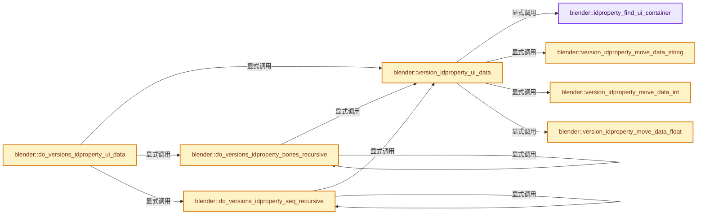
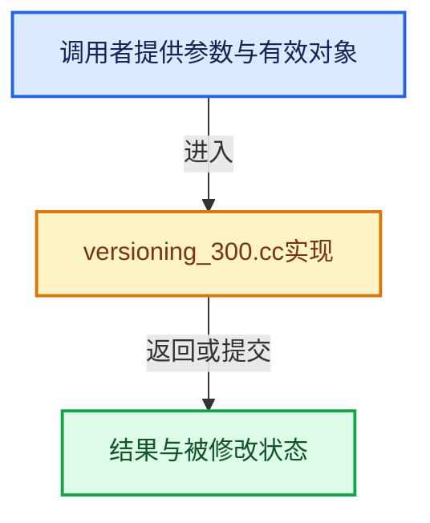

# 实现依赖专题：source/blender/blenloader/intern/versioning_300.cc

[方向导航](README.md) · [符号索引](../%E7%AC%A6%E5%8F%B7%E4%BE%9D%E8%B5%96%E4%B8%8E%E5%AE%9E%E7%8E%B0%E7%B4%A2%E5%BC%95.md)

本专题从正文实际调用进入，集中保存共享实现。函数有稳定锚点，可从调用处直接跳到对应完整函数；递归与互相调用通过回链组织。

## 本文件的实现关系






## 完整成员与函数实现

<a id="f-3abe83d82b1933b4"></a>

### `blender::idproperty_find_ui_container`

实现位置：[source/blender/blenloader/intern/versioning_300.cc](../../../../../source/blender/blenloader/intern/versioning_300.cc) · L112—L120。

接口参数：

- `IDProperty *idprop_group`

**教学注释版**

<!-- annotated:df2f88c0b9d001 -->

```cpp
static IDProperty *idproperty_find_ui_container(IDProperty *idprop_group)
{
  for (IDProperty &prop : idprop_group->data.group) {
    if (prop.type == IDP_GROUP && STREQ(prop.name, "_RNA_UI")) {
      return &prop;
    }
  }
  return nullptr;
}
```

<details>
<summary>核对原始源码：source/blender/blenloader/intern/versioning_300.cc · L112—L120</summary>

<!-- original:df2f88c0b9d001:source/blender/blenloader/intern/versioning_300.cc:112:120 -->

```cpp
static IDProperty *idproperty_find_ui_container(IDProperty *idprop_group)
{
  for (IDProperty &prop : idprop_group->data.group) {
    if (prop.type == IDP_GROUP && STREQ(prop.name, "_RNA_UI")) {
      return &prop;
    }
  }
  return nullptr;
}
```

</details>

**结果出口**

- `return &prop;`
- `return nullptr;`

**继续追踪实现**

- `STREQ` → [STREQ · L112](%E4%BE%9D%E8%B5%96-GHOST_utildefines-34b996.md#m-9549fb6aafd2)；[STREQ · L451](../01-%E5%9F%BA%E7%A1%80%E5%AE%B9%E5%99%A8%E4%B8%8E%E7%8E%B0%E4%BB%A3CPP/%E4%BE%9D%E8%B5%96-BLI_utildefines-293a0a.md#m-c7b745bcfad2)；[STREQ · L55](%E4%BE%9D%E8%B5%96-clog-a0bec8.md#m-96e78f386894)。宏定义由构建条件选择。

<a id="f-7fdf46273ee0e651"></a>

### `blender::version_idproperty_move_data_int`

实现位置：[source/blender/blenloader/intern/versioning_300.cc](../../../../../source/blender/blenloader/intern/versioning_300.cc) · L122—L163。

接口参数：

- `IDPropertyUIDataInt *ui_data`
- `const IDProperty *prop_ui_data`

**教学注释版**

<!-- annotated:defb2168552e4f -->

```cpp
static void version_idproperty_move_data_int(IDPropertyUIDataInt *ui_data,
                                             const IDProperty *prop_ui_data)
{
  IDProperty *min = IDP_GetPropertyFromGroup(prop_ui_data, "min");
  if (min != nullptr) {
    ui_data->min = ui_data->soft_min = IDP_coerce_to_int_or_zero(min);
  }
  IDProperty *max = IDP_GetPropertyFromGroup(prop_ui_data, "max");
  if (max != nullptr) {
    ui_data->max = ui_data->soft_max = IDP_coerce_to_int_or_zero(max);
  }
  IDProperty *soft_min = IDP_GetPropertyFromGroup(prop_ui_data, "soft_min");
  if (soft_min != nullptr) {
    ui_data->soft_min = IDP_coerce_to_int_or_zero(soft_min);
    // [讲解] std::min：按比较关系选取较小值；截断范围时还需先满足非负和可表示范围，min本身不会证明边界安全。
    ui_data->soft_min = std::min(ui_data->soft_min, ui_data->min);
  }
  IDProperty *soft_max = IDP_GetPropertyFromGroup(prop_ui_data, "soft_max");
  if (soft_max != nullptr) {
    ui_data->soft_max = IDP_coerce_to_int_or_zero(soft_max);
    // [讲解] std::max：按比较关系选取较大值。本讲解中的增长公式同时满足最低请求和几何增长；若保存返回引用，还需注意实参寿命。
    ui_data->soft_max = std::max(ui_data->soft_max, ui_data->max);
  }
  IDProperty *step = IDP_GetPropertyFromGroup(prop_ui_data, "step");
  if (step != nullptr) {
    ui_data->step = IDP_coerce_to_int_or_zero(soft_max);
  }
  IDProperty *default_value = IDP_GetPropertyFromGroup(prop_ui_data, "default");
  if (default_value != nullptr) {
    if (default_value->type == IDP_ARRAY) {
      if (default_value->subtype == IDP_INT) {
        ui_data->default_array = MEM_new_array_uninitialized<int>(size_t(default_value->len),
                                                                  __func__);
        // [讲解] memcpy：复制字节，源与目标不应重叠。类型生命周期、对齐和可复制表示须由调用者证明，不是任意对象的复制构造。
        memcpy(ui_data->default_array,
               IDP_array_int_get(default_value),
               sizeof(int) * default_value->len);
        ui_data->default_array_len = default_value->len;
      }
    }
    else if (default_value->type == IDP_INT) {
      ui_data->default_value = IDP_coerce_to_int_or_zero(default_value);
    }
  }
}
```

<details>
<summary>核对原始源码：source/blender/blenloader/intern/versioning_300.cc · L122—L163</summary>

<!-- original:defb2168552e4f:source/blender/blenloader/intern/versioning_300.cc:122:163 -->

```cpp
static void version_idproperty_move_data_int(IDPropertyUIDataInt *ui_data,
                                             const IDProperty *prop_ui_data)
{
  IDProperty *min = IDP_GetPropertyFromGroup(prop_ui_data, "min");
  if (min != nullptr) {
    ui_data->min = ui_data->soft_min = IDP_coerce_to_int_or_zero(min);
  }
  IDProperty *max = IDP_GetPropertyFromGroup(prop_ui_data, "max");
  if (max != nullptr) {
    ui_data->max = ui_data->soft_max = IDP_coerce_to_int_or_zero(max);
  }
  IDProperty *soft_min = IDP_GetPropertyFromGroup(prop_ui_data, "soft_min");
  if (soft_min != nullptr) {
    ui_data->soft_min = IDP_coerce_to_int_or_zero(soft_min);
    ui_data->soft_min = std::min(ui_data->soft_min, ui_data->min);
  }
  IDProperty *soft_max = IDP_GetPropertyFromGroup(prop_ui_data, "soft_max");
  if (soft_max != nullptr) {
    ui_data->soft_max = IDP_coerce_to_int_or_zero(soft_max);
    ui_data->soft_max = std::max(ui_data->soft_max, ui_data->max);
  }
  IDProperty *step = IDP_GetPropertyFromGroup(prop_ui_data, "step");
  if (step != nullptr) {
    ui_data->step = IDP_coerce_to_int_or_zero(soft_max);
  }
  IDProperty *default_value = IDP_GetPropertyFromGroup(prop_ui_data, "default");
  if (default_value != nullptr) {
    if (default_value->type == IDP_ARRAY) {
      if (default_value->subtype == IDP_INT) {
        ui_data->default_array = MEM_new_array_uninitialized<int>(size_t(default_value->len),
                                                                  __func__);
        memcpy(ui_data->default_array,
               IDP_array_int_get(default_value),
               sizeof(int) * default_value->len);
        ui_data->default_array_len = default_value->len;
      }
    }
    else if (default_value->type == IDP_INT) {
      ui_data->default_value = IDP_coerce_to_int_or_zero(default_value);
    }
  }
}
```

</details>

**沿实际写入检查状态**

- `ui_data->min = ui_data->soft_min = IDP_coerce_to_int_or_zero(min);`
- `ui_data->max = ui_data->soft_max = IDP_coerce_to_int_or_zero(max);`
- `ui_data->soft_min = IDP_coerce_to_int_or_zero(soft_min);`
- `ui_data->soft_min = std::min(ui_data->soft_min, ui_data->min);`
- `ui_data->soft_max = IDP_coerce_to_int_or_zero(soft_max);`
- `ui_data->soft_max = std::max(ui_data->soft_max, ui_data->max);`
- `ui_data->step = IDP_coerce_to_int_or_zero(soft_max);`
- `ui_data->default_array = MEM_new_array_uninitialized<int>(size_t(default_value->len),`
- `ui_data->default_array_len = default_value->len;`
- `ui_data->default_value = IDP_coerce_to_int_or_zero(default_value);`

**继续追踪实现**

- `IDP_GetPropertyFromGroup` → [blender::IDP_GetPropertyFromGroup · L818](%E4%BE%9D%E8%B5%96-idprop-006c65.md#f-a8d678499d89359e)。
- `IDP_coerce_to_int_or_zero` → [blender::IDP_coerce_to_int_or_zero · L920](%E4%BE%9D%E8%B5%96-idprop-006c65.md#f-e466fb480cecb0bc)。
- `std::min` → [外部契约](https://eel.is/c++draft/alg.min.max)：按比较关系选取较小值；截断范围时还需先满足非负和可表示范围，min本身不会证明边界安全。
- `std::max` → [外部契约](https://eel.is/c++draft/alg.min.max)：按比较关系选取较大值。本讲解中的增长公式同时满足最低请求和几何增长；若保存返回引用，还需注意实参寿命。
- `MEM_new_array_uninitialized<int>` → [MEM_new_array_uninitialized · L608](../03-%E5%86%85%E5%AD%98%E5%88%86%E9%85%8D%E4%B8%8E%E8%BF%90%E8%A1%8C%E6%97%B6%E7%B1%BB%E5%9E%8B/%E4%BE%9D%E8%B5%96-MEM_guardedalloc-b54eca.md#f-b7103eae8eb57b05)；[MEM_new_array_uninitialized · L129](../03-%E5%86%85%E5%AD%98%E5%88%86%E9%85%8D%E4%B8%8E%E8%BF%90%E8%A1%8C%E6%97%B6%E7%B1%BB%E5%9E%8B/%E4%BE%9D%E8%B5%96-mallocn-afdcd4.md#f-bf6ef4ddcfb6e5df)。同名重载需按实参类型选择。
- `memcpy` → [外部契约](https://eel.is/c++draft/cstring.syn)：复制字节，源与目标不应重叠。类型生命周期、对齐和可复制表示须由调用者证明，不是任意对象的复制构造。
- `IDP_array_int_get` → [IDP_array_int_get · L364](%E4%BE%9D%E8%B5%96-BKE_idprop-fe422c.md#m-be08ca3b0480)。宏定义由构建条件选择。

<a id="f-1140955ea7771ffc"></a>

### `blender::version_idproperty_move_data_float`

实现位置：[source/blender/blenloader/intern/versioning_300.cc](../../../../../source/blender/blenloader/intern/versioning_300.cc) · L165—L217。

接口参数：

- `IDPropertyUIDataFloat *ui_data`
- `const IDProperty *prop_ui_data`

**教学注释版**

<!-- annotated:776764ed2e6dc8 -->

```cpp
static void version_idproperty_move_data_float(IDPropertyUIDataFloat *ui_data,
                                               const IDProperty *prop_ui_data)
{
  IDProperty *min = IDP_GetPropertyFromGroup(prop_ui_data, "min");
  if (min != nullptr) {
    ui_data->min = ui_data->soft_min = IDP_coerce_to_double_or_zero(min);
  }
  IDProperty *max = IDP_GetPropertyFromGroup(prop_ui_data, "max");
  if (max != nullptr) {
    ui_data->max = ui_data->soft_max = IDP_coerce_to_double_or_zero(max);
  }
  IDProperty *soft_min = IDP_GetPropertyFromGroup(prop_ui_data, "soft_min");
  if (soft_min != nullptr) {
    ui_data->soft_min = IDP_coerce_to_double_or_zero(soft_min);
    // [讲解] std::max：按比较关系选取较大值。本讲解中的增长公式同时满足最低请求和几何增长；若保存返回引用，还需注意实参寿命。
    ui_data->soft_min = std::max(ui_data->soft_min, ui_data->min);
  }
  IDProperty *soft_max = IDP_GetPropertyFromGroup(prop_ui_data, "soft_max");
  if (soft_max != nullptr) {
    ui_data->soft_max = IDP_coerce_to_double_or_zero(soft_max);
    // [讲解] std::min：按比较关系选取较小值；截断范围时还需先满足非负和可表示范围，min本身不会证明边界安全。
    ui_data->soft_max = std::min(ui_data->soft_max, ui_data->max);
  }
  IDProperty *step = IDP_GetPropertyFromGroup(prop_ui_data, "step");
  if (step != nullptr) {
    ui_data->step = IDP_coerce_to_float_or_zero(step);
  }
  IDProperty *precision = IDP_GetPropertyFromGroup(prop_ui_data, "precision");
  if (precision != nullptr) {
    ui_data->precision = IDP_coerce_to_int_or_zero(precision);
  }
  IDProperty *default_value = IDP_GetPropertyFromGroup(prop_ui_data, "default");
  if (default_value != nullptr) {
    if (default_value->type == IDP_ARRAY) {
      const int array_len = default_value->len;
      ui_data->default_array_len = array_len;
      if (default_value->subtype == IDP_FLOAT) {
        ui_data->default_array = MEM_new_array_uninitialized<double>(size_t(array_len), __func__);
        const float *old_default_array = IDP_array_float_get(default_value);
        for (int i = 0; i < ui_data->default_array_len; i++) {
          ui_data->default_array[i] = double(old_default_array[i]);
        }
      }
      else if (default_value->subtype == IDP_DOUBLE) {
        ui_data->default_array = MEM_new_array_uninitialized<double>(size_t(array_len), __func__);
        // [讲解] memcpy：复制字节，源与目标不应重叠。类型生命周期、对齐和可复制表示须由调用者证明，不是任意对象的复制构造。
        memcpy(ui_data->default_array,
               IDP_array_double_get(default_value),
               sizeof(double) * array_len);
      }
    }
    else if (ELEM(default_value->type, IDP_DOUBLE, IDP_FLOAT)) {
      ui_data->default_value = IDP_coerce_to_double_or_zero(default_value);
    }
  }
}
```

<details>
<summary>核对原始源码：source/blender/blenloader/intern/versioning_300.cc · L165—L217</summary>

<!-- original:776764ed2e6dc8:source/blender/blenloader/intern/versioning_300.cc:165:217 -->

```cpp
static void version_idproperty_move_data_float(IDPropertyUIDataFloat *ui_data,
                                               const IDProperty *prop_ui_data)
{
  IDProperty *min = IDP_GetPropertyFromGroup(prop_ui_data, "min");
  if (min != nullptr) {
    ui_data->min = ui_data->soft_min = IDP_coerce_to_double_or_zero(min);
  }
  IDProperty *max = IDP_GetPropertyFromGroup(prop_ui_data, "max");
  if (max != nullptr) {
    ui_data->max = ui_data->soft_max = IDP_coerce_to_double_or_zero(max);
  }
  IDProperty *soft_min = IDP_GetPropertyFromGroup(prop_ui_data, "soft_min");
  if (soft_min != nullptr) {
    ui_data->soft_min = IDP_coerce_to_double_or_zero(soft_min);
    ui_data->soft_min = std::max(ui_data->soft_min, ui_data->min);
  }
  IDProperty *soft_max = IDP_GetPropertyFromGroup(prop_ui_data, "soft_max");
  if (soft_max != nullptr) {
    ui_data->soft_max = IDP_coerce_to_double_or_zero(soft_max);
    ui_data->soft_max = std::min(ui_data->soft_max, ui_data->max);
  }
  IDProperty *step = IDP_GetPropertyFromGroup(prop_ui_data, "step");
  if (step != nullptr) {
    ui_data->step = IDP_coerce_to_float_or_zero(step);
  }
  IDProperty *precision = IDP_GetPropertyFromGroup(prop_ui_data, "precision");
  if (precision != nullptr) {
    ui_data->precision = IDP_coerce_to_int_or_zero(precision);
  }
  IDProperty *default_value = IDP_GetPropertyFromGroup(prop_ui_data, "default");
  if (default_value != nullptr) {
    if (default_value->type == IDP_ARRAY) {
      const int array_len = default_value->len;
      ui_data->default_array_len = array_len;
      if (default_value->subtype == IDP_FLOAT) {
        ui_data->default_array = MEM_new_array_uninitialized<double>(size_t(array_len), __func__);
        const float *old_default_array = IDP_array_float_get(default_value);
        for (int i = 0; i < ui_data->default_array_len; i++) {
          ui_data->default_array[i] = double(old_default_array[i]);
        }
      }
      else if (default_value->subtype == IDP_DOUBLE) {
        ui_data->default_array = MEM_new_array_uninitialized<double>(size_t(array_len), __func__);
        memcpy(ui_data->default_array,
               IDP_array_double_get(default_value),
               sizeof(double) * array_len);
      }
    }
    else if (ELEM(default_value->type, IDP_DOUBLE, IDP_FLOAT)) {
      ui_data->default_value = IDP_coerce_to_double_or_zero(default_value);
    }
  }
}
```

</details>

**沿实际写入检查状态**

- `ui_data->min = ui_data->soft_min = IDP_coerce_to_double_or_zero(min);`
- `ui_data->max = ui_data->soft_max = IDP_coerce_to_double_or_zero(max);`
- `ui_data->soft_min = IDP_coerce_to_double_or_zero(soft_min);`
- `ui_data->soft_min = std::max(ui_data->soft_min, ui_data->min);`
- `ui_data->soft_max = IDP_coerce_to_double_or_zero(soft_max);`
- `ui_data->soft_max = std::min(ui_data->soft_max, ui_data->max);`
- `ui_data->step = IDP_coerce_to_float_or_zero(step);`
- `ui_data->precision = IDP_coerce_to_int_or_zero(precision);`
- `ui_data->default_array_len = array_len;`
- `ui_data->default_array = MEM_new_array_uninitialized<double>(size_t(array_len), __func__);`
- `ui_data->default_array[i] = double(old_default_array[i]);`
- `ui_data->default_value = IDP_coerce_to_double_or_zero(default_value);`

**继续追踪实现**

- `IDP_GetPropertyFromGroup` → [blender::IDP_GetPropertyFromGroup · L818](%E4%BE%9D%E8%B5%96-idprop-006c65.md#f-a8d678499d89359e)。
- `IDP_coerce_to_double_or_zero` → [blender::IDP_coerce_to_double_or_zero · L936](%E4%BE%9D%E8%B5%96-idprop-006c65.md#f-0e9c3599010937b8)。
- `std::max` → [外部契约](https://eel.is/c++draft/alg.min.max)：按比较关系选取较大值。本讲解中的增长公式同时满足最低请求和几何增长；若保存返回引用，还需注意实参寿命。
- `std::min` → [外部契约](https://eel.is/c++draft/alg.min.max)：按比较关系选取较小值；截断范围时还需先满足非负和可表示范围，min本身不会证明边界安全。
- `IDP_coerce_to_float_or_zero` → [blender::IDP_coerce_to_float_or_zero · L952](%E4%BE%9D%E8%B5%96-idprop-006c65.md#f-aacd744673d3f950)。
- `IDP_coerce_to_int_or_zero` → [blender::IDP_coerce_to_int_or_zero · L920](%E4%BE%9D%E8%B5%96-idprop-006c65.md#f-e466fb480cecb0bc)。
- `MEM_new_array_uninitialized<double>` → [MEM_new_array_uninitialized · L608](../03-%E5%86%85%E5%AD%98%E5%88%86%E9%85%8D%E4%B8%8E%E8%BF%90%E8%A1%8C%E6%97%B6%E7%B1%BB%E5%9E%8B/%E4%BE%9D%E8%B5%96-MEM_guardedalloc-b54eca.md#f-b7103eae8eb57b05)；[MEM_new_array_uninitialized · L129](../03-%E5%86%85%E5%AD%98%E5%88%86%E9%85%8D%E4%B8%8E%E8%BF%90%E8%A1%8C%E6%97%B6%E7%B1%BB%E5%9E%8B/%E4%BE%9D%E8%B5%96-mallocn-afdcd4.md#f-bf6ef4ddcfb6e5df)。同名重载需按实参类型选择。
- `IDP_array_float_get` → [IDP_array_float_get · L368](%E4%BE%9D%E8%B5%96-BKE_idprop-fe422c.md#m-af8b95ead8cf)。宏定义由构建条件选择。
- `memcpy` → [外部契约](https://eel.is/c++draft/cstring.syn)：复制字节，源与目标不应重叠。类型生命周期、对齐和可复制表示须由调用者证明，不是任意对象的复制构造。
- `IDP_array_double_get` → [IDP_array_double_get · L370](%E4%BE%9D%E8%B5%96-BKE_idprop-fe422c.md#m-7d2e90991c8d)。宏定义由构建条件选择。
- `ELEM` → [ELEM · L88](%E4%BE%9D%E8%B5%96-GHOST_utildefines-34b996.md#m-d28724a15928)；[ELEM · L135](../01-%E5%9F%BA%E7%A1%80%E5%AE%B9%E5%99%A8%E4%B8%8E%E7%8E%B0%E4%BB%A3CPP/%E4%BE%9D%E8%B5%96-BLI_utildefines-293a0a.md#m-d6572de7cae0)。宏定义由构建条件选择。

<a id="f-f55beb124b64ae71"></a>

### `blender::version_idproperty_move_data_string`

实现位置：[source/blender/blenloader/intern/versioning_300.cc](../../../../../source/blender/blenloader/intern/versioning_300.cc) · L219—L226。

接口参数：

- `IDPropertyUIDataString *ui_data`
- `const IDProperty *prop_ui_data`

**教学注释版**

<!-- annotated:7dbd034c7c69b3 -->

```cpp
static void version_idproperty_move_data_string(IDPropertyUIDataString *ui_data,
                                                const IDProperty *prop_ui_data)
{
  IDProperty *default_value = IDP_GetPropertyFromGroup(prop_ui_data, "default");
  if (default_value != nullptr && default_value->type == IDP_STRING) {
    ui_data->default_value = BLI_strdup(IDP_string_get(default_value));
  }
}
```

<details>
<summary>核对原始源码：source/blender/blenloader/intern/versioning_300.cc · L219—L226</summary>

<!-- original:7dbd034c7c69b3:source/blender/blenloader/intern/versioning_300.cc:219:226 -->

```cpp
static void version_idproperty_move_data_string(IDPropertyUIDataString *ui_data,
                                                const IDProperty *prop_ui_data)
{
  IDProperty *default_value = IDP_GetPropertyFromGroup(prop_ui_data, "default");
  if (default_value != nullptr && default_value->type == IDP_STRING) {
    ui_data->default_value = BLI_strdup(IDP_string_get(default_value));
  }
}
```

</details>

**沿实际写入检查状态**

- `ui_data->default_value = BLI_strdup(IDP_string_get(default_value));`

**继续追踪实现**

- `IDP_GetPropertyFromGroup` → [blender::IDP_GetPropertyFromGroup · L818](%E4%BE%9D%E8%B5%96-idprop-006c65.md#f-a8d678499d89359e)。
- `BLI_strdup` → [blender::BLI_strdup · L43](../01-%E5%9F%BA%E7%A1%80%E5%AE%B9%E5%99%A8%E4%B8%8E%E7%8E%B0%E4%BB%A3CPP/%E4%BE%9D%E8%B5%96-string-1d986f.md#f-7e6d5c696c20c0e1)。
- `IDP_string_get` → [IDP_string_get · L375](%E4%BE%9D%E8%B5%96-BKE_idprop-fe422c.md#m-bedef49dcb76)。宏定义由构建条件选择。

<a id="f-bf9848118eaf0e8a"></a>

### `blender::version_idproperty_ui_data`

实现位置：[source/blender/blenloader/intern/versioning_300.cc](../../../../../source/blender/blenloader/intern/versioning_300.cc) · L228—L294。

接口参数：

- `IDProperty *idprop_group`

**教学注释版**

<!-- annotated:347f48aa281814 -->

```cpp
static void version_idproperty_ui_data(IDProperty *idprop_group)
{
  /* `nullptr` check here to reduce verbosity of calls to this function. */
  if (idprop_group == nullptr) {
    return;
  }

  IDProperty *ui_container = idproperty_find_ui_container(idprop_group);
  if (ui_container == nullptr) {
    return;
  }

  for (IDProperty &prop : idprop_group->data.group) {
    IDProperty *prop_ui_data = IDP_GetPropertyFromGroup(ui_container, prop.name);
    if (prop_ui_data == nullptr) {
      continue;
    }
    if (prop_ui_data->type != IDP_GROUP) {
      continue;
    }

    if (!IDP_ui_data_supported(&prop)) {
      continue;
    }

    IDPropertyUIData *ui_data = IDP_ui_data_ensure(&prop);

    IDProperty *subtype = IDP_GetPropertyFromGroup(prop_ui_data, "subtype");
    if (subtype != nullptr && subtype->type == IDP_STRING) {
      const char *subtype_string = IDP_string_get(subtype);
      int result = PROP_NONE;
      RNA_enum_value_from_id(rna_enum_property_subtype_items, subtype_string, &result);
      ui_data->rna_subtype = result;
    }

    IDProperty *description = IDP_GetPropertyFromGroup(prop_ui_data, "description");
    if (description != nullptr && description->type == IDP_STRING) {
      ui_data->description = BLI_strdup(IDP_string_get(description));
    }

    /* Type specific data. */
    switch (IDP_ui_data_type(&prop)) {
      case IDP_UI_DATA_TYPE_STRING:
        version_idproperty_move_data_string(reinterpret_cast<IDPropertyUIDataString *>(ui_data),
                                            prop_ui_data);
        break;
      case IDP_UI_DATA_TYPE_ID:
        break;
      case IDP_UI_DATA_TYPE_INT:
        version_idproperty_move_data_int(reinterpret_cast<IDPropertyUIDataInt *>(ui_data),
                                         prop_ui_data);
        break;
      case IDP_UI_DATA_TYPE_FLOAT:
        version_idproperty_move_data_float(reinterpret_cast<IDPropertyUIDataFloat *>(ui_data),
                                           prop_ui_data);
        break;
      case IDP_UI_DATA_TYPE_BOOLEAN:
      case IDP_UI_DATA_TYPE_UNSUPPORTED:
        BLI_assert_unreachable();
        break;
    }

    IDP_FreeFromGroup(ui_container, prop_ui_data);
  }

  IDP_FreeFromGroup(idprop_group, ui_container);
}
```

<details>
<summary>核对原始源码：source/blender/blenloader/intern/versioning_300.cc · L228—L294</summary>

<!-- original:347f48aa281814:source/blender/blenloader/intern/versioning_300.cc:228:294 -->

```cpp
static void version_idproperty_ui_data(IDProperty *idprop_group)
{
  /* `nullptr` check here to reduce verbosity of calls to this function. */
  if (idprop_group == nullptr) {
    return;
  }

  IDProperty *ui_container = idproperty_find_ui_container(idprop_group);
  if (ui_container == nullptr) {
    return;
  }

  for (IDProperty &prop : idprop_group->data.group) {
    IDProperty *prop_ui_data = IDP_GetPropertyFromGroup(ui_container, prop.name);
    if (prop_ui_data == nullptr) {
      continue;
    }
    if (prop_ui_data->type != IDP_GROUP) {
      continue;
    }

    if (!IDP_ui_data_supported(&prop)) {
      continue;
    }

    IDPropertyUIData *ui_data = IDP_ui_data_ensure(&prop);

    IDProperty *subtype = IDP_GetPropertyFromGroup(prop_ui_data, "subtype");
    if (subtype != nullptr && subtype->type == IDP_STRING) {
      const char *subtype_string = IDP_string_get(subtype);
      int result = PROP_NONE;
      RNA_enum_value_from_id(rna_enum_property_subtype_items, subtype_string, &result);
      ui_data->rna_subtype = result;
    }

    IDProperty *description = IDP_GetPropertyFromGroup(prop_ui_data, "description");
    if (description != nullptr && description->type == IDP_STRING) {
      ui_data->description = BLI_strdup(IDP_string_get(description));
    }

    /* Type specific data. */
    switch (IDP_ui_data_type(&prop)) {
      case IDP_UI_DATA_TYPE_STRING:
        version_idproperty_move_data_string(reinterpret_cast<IDPropertyUIDataString *>(ui_data),
                                            prop_ui_data);
        break;
      case IDP_UI_DATA_TYPE_ID:
        break;
      case IDP_UI_DATA_TYPE_INT:
        version_idproperty_move_data_int(reinterpret_cast<IDPropertyUIDataInt *>(ui_data),
                                         prop_ui_data);
        break;
      case IDP_UI_DATA_TYPE_FLOAT:
        version_idproperty_move_data_float(reinterpret_cast<IDPropertyUIDataFloat *>(ui_data),
                                           prop_ui_data);
        break;
      case IDP_UI_DATA_TYPE_BOOLEAN:
      case IDP_UI_DATA_TYPE_UNSUPPORTED:
        BLI_assert_unreachable();
        break;
    }

    IDP_FreeFromGroup(ui_container, prop_ui_data);
  }

  IDP_FreeFromGroup(idprop_group, ui_container);
}
```

</details>

**沿实际写入检查状态**

- `ui_data->rna_subtype = result;`
- `ui_data->description = BLI_strdup(IDP_string_get(description));`

**继续追踪实现**

- `idproperty_find_ui_container` → [blender::idproperty_find_ui_container · L112](%E4%BE%9D%E8%B5%96-versioning_300-69de3d.md#f-3abe83d82b1933b4)。
- `IDP_GetPropertyFromGroup` → [blender::IDP_GetPropertyFromGroup · L818](%E4%BE%9D%E8%B5%96-idprop-006c65.md#f-a8d678499d89359e)。
- `IDP_ui_data_supported` → [blender::IDP_ui_data_supported · L1986](%E4%BE%9D%E8%B5%96-idprop-006c65.md#f-ebcf91eb229adf0b)。
- `IDP_ui_data_ensure` → [blender::IDP_ui_data_ensure · L2034](%E4%BE%9D%E8%B5%96-idprop-006c65.md#f-51c9a7734f195280)。
- `IDP_string_get` → [IDP_string_get · L375](%E4%BE%9D%E8%B5%96-BKE_idprop-fe422c.md#m-bedef49dcb76)。宏定义由构建条件选择。
- `RNA_enum_value_from_id` → [blender::RNA_enum_value_from_id · L6939](%E4%BE%9D%E8%B5%96-rna_access-706bea.md#f-f1b6c0cd2c682a9c)。
- `BLI_strdup` → [blender::BLI_strdup · L43](../01-%E5%9F%BA%E7%A1%80%E5%AE%B9%E5%99%A8%E4%B8%8E%E7%8E%B0%E4%BB%A3CPP/%E4%BE%9D%E8%B5%96-string-1d986f.md#f-7e6d5c696c20c0e1)。
- `IDP_ui_data_type` → [blender::IDP_ui_data_type · L1964](%E4%BE%9D%E8%B5%96-idprop-006c65.md#f-cb19896255b76760)。
- `version_idproperty_move_data_string` → [blender::version_idproperty_move_data_string · L219](%E4%BE%9D%E8%B5%96-versioning_300-69de3d.md#f-f55beb124b64ae71)。
- `version_idproperty_move_data_int` → [blender::version_idproperty_move_data_int · L122](%E4%BE%9D%E8%B5%96-versioning_300-69de3d.md#f-7fdf46273ee0e651)。
- `version_idproperty_move_data_float` → [blender::version_idproperty_move_data_float · L165](%E4%BE%9D%E8%B5%96-versioning_300-69de3d.md#f-1140955ea7771ffc)。
- `BLI_assert_unreachable` → [BLI_assert_unreachable · L77](../01-%E5%9F%BA%E7%A1%80%E5%AE%B9%E5%99%A8%E4%B8%8E%E7%8E%B0%E4%BB%A3CPP/%E4%BE%9D%E8%B5%96-BLI_assert-cc98e8.md#m-7a2d91a67d8e)。宏定义由构建条件选择。
- `IDP_FreeFromGroup` → [blender::IDP_FreeFromGroup · L812](%E4%BE%9D%E8%B5%96-idprop-006c65.md#f-9d2ebd4c4f38d2fd)。

<a id="f-a5abdb927553f899"></a>

### `blender::do_versions_idproperty_bones_recursive`

实现位置：[source/blender/blenloader/intern/versioning_300.cc](../../../../../source/blender/blenloader/intern/versioning_300.cc) · L296—L302。

接口参数：

- `Bone *bone`

**教学注释版**

<!-- annotated:313c63d498ddf1 -->

```cpp
static void do_versions_idproperty_bones_recursive(Bone *bone)
{
  version_idproperty_ui_data(bone->prop);
  for (Bone &child_bone : bone->childbase) {
    do_versions_idproperty_bones_recursive(&child_bone);
  }
}
```

<details>
<summary>核对原始源码：source/blender/blenloader/intern/versioning_300.cc · L296—L302</summary>

<!-- original:313c63d498ddf1:source/blender/blenloader/intern/versioning_300.cc:296:302 -->

```cpp
static void do_versions_idproperty_bones_recursive(Bone *bone)
{
  version_idproperty_ui_data(bone->prop);
  for (Bone &child_bone : bone->childbase) {
    do_versions_idproperty_bones_recursive(&child_bone);
  }
}
```

</details>

**继续追踪实现**

- `version_idproperty_ui_data` → [blender::version_idproperty_ui_data · L228](%E4%BE%9D%E8%B5%96-versioning_300-69de3d.md#f-bf9848118eaf0e8a)。
- `do_versions_idproperty_bones_recursive` → [blender::do_versions_idproperty_bones_recursive · L296](%E4%BE%9D%E8%B5%96-versioning_300-69de3d.md#f-a5abdb927553f899)。

<a id="f-89626f367391980a"></a>

### `blender::do_versions_idproperty_seq_recursive`

实现位置：[source/blender/blenloader/intern/versioning_300.cc](../../../../../source/blender/blenloader/intern/versioning_300.cc) · L304—L312。

接口参数：

- `ListBaseT<Strip> *seqbase`

**教学注释版**

<!-- annotated:3ce32b11d0ccea -->

```cpp
static void do_versions_idproperty_seq_recursive(ListBaseT<Strip> *seqbase)
{
  for (Strip &strip : *seqbase) {
    version_idproperty_ui_data(strip.prop);
    if (strip.type == STRIP_TYPE_META) {
      do_versions_idproperty_seq_recursive(&strip.seqbase);
    }
  }
}
```

<details>
<summary>核对原始源码：source/blender/blenloader/intern/versioning_300.cc · L304—L312</summary>

<!-- original:3ce32b11d0ccea:source/blender/blenloader/intern/versioning_300.cc:304:312 -->

```cpp
static void do_versions_idproperty_seq_recursive(ListBaseT<Strip> *seqbase)
{
  for (Strip &strip : *seqbase) {
    version_idproperty_ui_data(strip.prop);
    if (strip.type == STRIP_TYPE_META) {
      do_versions_idproperty_seq_recursive(&strip.seqbase);
    }
  }
}
```

</details>

**继续追踪实现**

- `version_idproperty_ui_data` → [blender::version_idproperty_ui_data · L228](%E4%BE%9D%E8%B5%96-versioning_300-69de3d.md#f-bf9848118eaf0e8a)。
- `do_versions_idproperty_seq_recursive` → [blender::do_versions_idproperty_seq_recursive · L304](%E4%BE%9D%E8%B5%96-versioning_300-69de3d.md#f-89626f367391980a)。

<a id="f-72b6da0a8c1a567f"></a>

### `blender::do_versions_idproperty_ui_data`

实现位置：[source/blender/blenloader/intern/versioning_300.cc](../../../../../source/blender/blenloader/intern/versioning_300.cc) · L323—L377。

接口参数：

- `Main *bmain`

**教学注释版**

<!-- annotated:1035763a90f982 -->

```cpp
static void do_versions_idproperty_ui_data(Main *bmain)
{
  /* ID data. */
  ID *id;
  FOREACH_MAIN_ID_BEGIN (bmain, id) {
    IDProperty *idprop_group = IDP_GetProperties(id);
    version_idproperty_ui_data(idprop_group);
  }
  FOREACH_MAIN_ID_END;

  /* Bones. */
  for (bArmature &armature : bmain->armatures) {
    for (Bone &bone : armature.bonebase) {
      do_versions_idproperty_bones_recursive(&bone);
    }
  }

  /* Nodes and node sockets. */
  for (bNodeTree &ntree : bmain->nodetrees) {
    for (bNode &node : ntree.nodes) {
      version_idproperty_ui_data(node.prop);
    }
    for (bNodeSocket &socket : ntree.inputs_legacy) {
      version_idproperty_ui_data(socket.prop);
    }
    for (bNodeSocket &socket : ntree.outputs_legacy) {
      version_idproperty_ui_data(socket.prop);
    }
  }

  for (Object &ob : bmain->objects) {
    /* The UI data from exposed node modifier properties is just copied from the corresponding node
     * group, but the copying only runs when necessary, so we still need to version data here. */
    for (ModifierData &md : ob.modifiers) {
      if (md.type == eModifierType_Nodes) {
        NodesModifierData *nmd = reinterpret_cast<NodesModifierData *>(&md);
        version_idproperty_ui_data(nmd->settings_legacy.properties);
      }
    }

    /* Object post bones. */
    if (ob.type == OB_ARMATURE && ob.pose != nullptr) {
      for (bPoseChannel &pchan : ob.pose->chanbase) {
        version_idproperty_ui_data(pchan.prop);
      }
    }
  }

  /* Sequences. */
  for (Scene &scene : bmain->scenes) {
    if (scene.ed != nullptr) {
      do_versions_idproperty_seq_recursive(&scene.ed->seqbase);
    }
  }
}
```

<details>
<summary>核对原始源码：source/blender/blenloader/intern/versioning_300.cc · L323—L377</summary>

<!-- original:1035763a90f982:source/blender/blenloader/intern/versioning_300.cc:323:377 -->

```cpp
static void do_versions_idproperty_ui_data(Main *bmain)
{
  /* ID data. */
  ID *id;
  FOREACH_MAIN_ID_BEGIN (bmain, id) {
    IDProperty *idprop_group = IDP_GetProperties(id);
    version_idproperty_ui_data(idprop_group);
  }
  FOREACH_MAIN_ID_END;

  /* Bones. */
  for (bArmature &armature : bmain->armatures) {
    for (Bone &bone : armature.bonebase) {
      do_versions_idproperty_bones_recursive(&bone);
    }
  }

  /* Nodes and node sockets. */
  for (bNodeTree &ntree : bmain->nodetrees) {
    for (bNode &node : ntree.nodes) {
      version_idproperty_ui_data(node.prop);
    }
    for (bNodeSocket &socket : ntree.inputs_legacy) {
      version_idproperty_ui_data(socket.prop);
    }
    for (bNodeSocket &socket : ntree.outputs_legacy) {
      version_idproperty_ui_data(socket.prop);
    }
  }

  for (Object &ob : bmain->objects) {
    /* The UI data from exposed node modifier properties is just copied from the corresponding node
     * group, but the copying only runs when necessary, so we still need to version data here. */
    for (ModifierData &md : ob.modifiers) {
      if (md.type == eModifierType_Nodes) {
        NodesModifierData *nmd = reinterpret_cast<NodesModifierData *>(&md);
        version_idproperty_ui_data(nmd->settings_legacy.properties);
      }
    }

    /* Object post bones. */
    if (ob.type == OB_ARMATURE && ob.pose != nullptr) {
      for (bPoseChannel &pchan : ob.pose->chanbase) {
        version_idproperty_ui_data(pchan.prop);
      }
    }
  }

  /* Sequences. */
  for (Scene &scene : bmain->scenes) {
    if (scene.ed != nullptr) {
      do_versions_idproperty_seq_recursive(&scene.ed->seqbase);
    }
  }
}
```

</details>

**继续追踪实现**

- `IDP_GetProperties` → [blender::IDP_GetProperties · L1000](%E4%BE%9D%E8%B5%96-idprop-006c65.md#f-9d57288c074537c2)。
- `version_idproperty_ui_data` → [blender::version_idproperty_ui_data · L228](%E4%BE%9D%E8%B5%96-versioning_300-69de3d.md#f-bf9848118eaf0e8a)。
- `do_versions_idproperty_bones_recursive` → [blender::do_versions_idproperty_bones_recursive · L296](%E4%BE%9D%E8%B5%96-versioning_300-69de3d.md#f-a5abdb927553f899)。
- `do_versions_idproperty_seq_recursive` → [blender::do_versions_idproperty_seq_recursive · L304](%E4%BE%9D%E8%B5%96-versioning_300-69de3d.md#f-89626f367391980a)。

<a id="f-0d7e31e1b28d1ecc"></a>

### `blender::sort_linked_ids`

实现位置：[source/blender/blenloader/intern/versioning_300.cc](../../../../../source/blender/blenloader/intern/versioning_300.cc) · L379—L395。

接口参数：

- `Main *bmain`

**教学注释版**

<!-- annotated:815c09334aac03 -->

```cpp
static void sort_linked_ids(Main *bmain)
{
  ListBaseT<ID> *lb;
  FOREACH_MAIN_LISTBASE_BEGIN (bmain, lb) {
    ListBaseT<ID> temp_list;
    temp_list.clear_no_delete();
    for (ID &id : lb->items_mutable()) {
      if (ID_IS_LINKED(&id)) {
        BLI_remlink(lb, &id);
        BLI_addtail(&temp_list, &id);
        id_sort_by_name(&temp_list, &id, nullptr);
      }
    }
    BLI_movelisttolist(lb, &temp_list);
  }
  FOREACH_MAIN_LISTBASE_END;
}
```

<details>
<summary>核对原始源码：source/blender/blenloader/intern/versioning_300.cc · L379—L395</summary>

<!-- original:815c09334aac03:source/blender/blenloader/intern/versioning_300.cc:379:395 -->

```cpp
static void sort_linked_ids(Main *bmain)
{
  ListBaseT<ID> *lb;
  FOREACH_MAIN_LISTBASE_BEGIN (bmain, lb) {
    ListBaseT<ID> temp_list;
    temp_list.clear_no_delete();
    for (ID &id : lb->items_mutable()) {
      if (ID_IS_LINKED(&id)) {
        BLI_remlink(lb, &id);
        BLI_addtail(&temp_list, &id);
        id_sort_by_name(&temp_list, &id, nullptr);
      }
    }
    BLI_movelisttolist(lb, &temp_list);
  }
  FOREACH_MAIN_LISTBASE_END;
}
```

</details>

**继续追踪实现**

- `temp_list.clear_no_delete` → [blender::ListBaseT::clear_no_delete · L68](%E4%BE%9D%E8%B5%96-DNA_listBase-48dbc9.md#f-431defdf189ae643)。
- `lb->items_mutable` → [blender::ListBaseT::items_mutable · L163](%E4%BE%9D%E8%B5%96-DNA_listBase-48dbc9.md#f-cc603252f543d4ad)。
- `ID_IS_LINKED` → [ID_IS_LINKED · L697](%E4%BE%9D%E8%B5%96-DNA_ID-3eb091.md#m-7e1e1e9b20e6)。宏定义由构建条件选择。
- `BLI_remlink` → [blender::BLI_remlink · L138](../01-%E5%9F%BA%E7%A1%80%E5%AE%B9%E5%99%A8%E4%B8%8E%E7%8E%B0%E4%BB%A3CPP/%E4%BE%9D%E8%B5%96-listbase-2816d9.md#f-120d80f281ca4cb7)。
- `BLI_addtail` → [blender::BLI_addtail · L118](../01-%E5%9F%BA%E7%A1%80%E5%AE%B9%E5%99%A8%E4%B8%8E%E7%8E%B0%E4%BB%A3CPP/%E4%BE%9D%E8%B5%96-listbase-2816d9.md#f-4fb027713fa3115b)。
- `id_sort_by_name` → [blender::id_sort_by_name · L1888](%E4%BE%9D%E8%B5%96-lib_id-d4e6bd.md#f-5eca74a0911de674)。
- `BLI_movelisttolist` → [blender::BLI_movelisttolist · L32](../01-%E5%9F%BA%E7%A1%80%E5%AE%B9%E5%99%A8%E4%B8%8E%E7%8E%B0%E4%BB%A3CPP/%E4%BE%9D%E8%B5%96-listbase-2816d9.md#f-c7a706073038a4be)。

<a id="f-aa201f973dffeb75"></a>

### `blender::assert_sorted_ids`

实现位置：[source/blender/blenloader/intern/versioning_300.cc](../../../../../source/blender/blenloader/intern/versioning_300.cc) · L397—L414。

接口参数：

- `Main *bmain`

**教学注释版**

<!-- annotated:43a8d8cf5b4153 -->

```cpp
static void assert_sorted_ids(Main *bmain)
{
#ifndef NDEBUG
  ListBaseT<ID> *lb;
  FOREACH_MAIN_LISTBASE_BEGIN (bmain, lb) {
    ID *id_prev = nullptr;
    for (ID &id : *lb) {
      if (id_prev == nullptr) {
        continue;
      }
      BLI_assert(id_prev->lib != id.lib || BLI_strcasecmp(id_prev->name, id.name) < 0);
    }
  }
  FOREACH_MAIN_LISTBASE_END;
#else
  UNUSED_VARS_NDEBUG(bmain);
#endif
}
```

<details>
<summary>核对原始源码：source/blender/blenloader/intern/versioning_300.cc · L397—L414</summary>

<!-- original:43a8d8cf5b4153:source/blender/blenloader/intern/versioning_300.cc:397:414 -->

```cpp
static void assert_sorted_ids(Main *bmain)
{
#ifndef NDEBUG
  ListBaseT<ID> *lb;
  FOREACH_MAIN_LISTBASE_BEGIN (bmain, lb) {
    ID *id_prev = nullptr;
    for (ID &id : *lb) {
      if (id_prev == nullptr) {
        continue;
      }
      BLI_assert(id_prev->lib != id.lib || BLI_strcasecmp(id_prev->name, id.name) < 0);
    }
  }
  FOREACH_MAIN_LISTBASE_END;
#else
  UNUSED_VARS_NDEBUG(bmain);
#endif
}
```

</details>

**继续追踪实现**

- `BLI_assert` → [BLI_assert · L48](../01-%E5%9F%BA%E7%A1%80%E5%AE%B9%E5%99%A8%E4%B8%8E%E7%8E%B0%E4%BB%A3CPP/%E4%BE%9D%E8%B5%96-BLI_assert-cc98e8.md#m-57a88495704d)；[BLI_assert · L63](../01-%E5%9F%BA%E7%A1%80%E5%AE%B9%E5%99%A8%E4%B8%8E%E7%8E%B0%E4%BB%A3CPP/%E4%BE%9D%E8%B5%96-BLI_assert-cc98e8.md#m-d07050020cb5)。宏定义由构建条件选择。
- `BLI_strcasecmp` → [blender::BLI_strcasecmp · L643](../01-%E5%9F%BA%E7%A1%80%E5%AE%B9%E5%99%A8%E4%B8%8E%E7%8E%B0%E4%BB%A3CPP/%E4%BE%9D%E8%B5%96-string-1d986f.md#f-4d435afbbbd61278)。
- `UNUSED_VARS_NDEBUG` → [UNUSED_VARS_NDEBUG · L526](../01-%E5%9F%BA%E7%A1%80%E5%AE%B9%E5%99%A8%E4%B8%8E%E7%8E%B0%E4%BB%A3CPP/%E4%BE%9D%E8%B5%96-BLI_utildefines-293a0a.md#m-fea439f7d366)；[UNUSED_VARS_NDEBUG · L528](../01-%E5%9F%BA%E7%A1%80%E5%AE%B9%E5%99%A8%E4%B8%8E%E7%8E%B0%E4%BB%A3CPP/%E4%BE%9D%E8%B5%96-BLI_utildefines-293a0a.md#m-a8f8cfac06c0)。宏定义由构建条件选择。

<a id="f-a02d96bb2cfa963d"></a>

### `blender::move_vertex_group_names_to_object_data`

实现位置：[source/blender/blenloader/intern/versioning_300.cc](../../../../../source/blender/blenloader/intern/versioning_300.cc) · L416—L434。

接口参数：

- `Main *bmain`

**教学注释版**

<!-- annotated:bffd78c21569d5 -->

```cpp
static void move_vertex_group_names_to_object_data(Main *bmain)
{
  for (Object &object : bmain->objects) {
    if (ELEM(object.type, OB_MESH, OB_LATTICE, OB_GPENCIL_LEGACY)) {
      ListBaseT<bDeformGroup> *new_defbase = BKE_object_defgroup_list_mutable(&object);

      /* Choose the longest vertex group name list among all linked duplicates. */
      if (object.defbase.count() < new_defbase->count()) {
        object.defbase.free_no_destruct();
      }
      else {
        /* Clear the list in case the it was already assigned from another object. */
        new_defbase->free_no_destruct();
        *new_defbase = object.defbase;
        BKE_object_defgroup_active_index_set(&object, object.actdef);
      }
    }
  }
}
```

<details>
<summary>核对原始源码：source/blender/blenloader/intern/versioning_300.cc · L416—L434</summary>

<!-- original:bffd78c21569d5:source/blender/blenloader/intern/versioning_300.cc:416:434 -->

```cpp
static void move_vertex_group_names_to_object_data(Main *bmain)
{
  for (Object &object : bmain->objects) {
    if (ELEM(object.type, OB_MESH, OB_LATTICE, OB_GPENCIL_LEGACY)) {
      ListBaseT<bDeformGroup> *new_defbase = BKE_object_defgroup_list_mutable(&object);

      /* Choose the longest vertex group name list among all linked duplicates. */
      if (object.defbase.count() < new_defbase->count()) {
        object.defbase.free_no_destruct();
      }
      else {
        /* Clear the list in case the it was already assigned from another object. */
        new_defbase->free_no_destruct();
        *new_defbase = object.defbase;
        BKE_object_defgroup_active_index_set(&object, object.actdef);
      }
    }
  }
}
```

</details>

**继续追踪实现**

- `ELEM` → [ELEM · L88](%E4%BE%9D%E8%B5%96-GHOST_utildefines-34b996.md#m-d28724a15928)；[ELEM · L135](../01-%E5%9F%BA%E7%A1%80%E5%AE%B9%E5%99%A8%E4%B8%8E%E7%8E%B0%E4%BB%A3CPP/%E4%BE%9D%E8%B5%96-BLI_utildefines-293a0a.md#m-d6572de7cae0)。宏定义由构建条件选择。
- `BKE_object_defgroup_list_mutable` → [blender::BKE_object_defgroup_list_mutable · L602](%E4%BE%9D%E8%B5%96-deform-6949f4.md#f-44acd6000881023d)。
- `object.defbase.count` → [调用协议](../%E6%A8%A1%E6%9D%BF%E5%AE%8F%E4%B8%8E%E5%8A%A8%E6%80%81%E5%88%86%E6%B4%BE%E5%8D%8F%E8%AE%AE.md)：接收对象类型依赖auto、返回值或模板实例；不按同名猜测目标。调用位置L423。
- `new_defbase->count` → [blender::ListBaseT::count · L92](%E4%BE%9D%E8%B5%96-DNA_listBase-48dbc9.md#f-7d243d006ac4c693)。
- `object.defbase.free_no_destruct` → [调用协议](../%E6%A8%A1%E6%9D%BF%E5%AE%8F%E4%B8%8E%E5%8A%A8%E6%80%81%E5%88%86%E6%B4%BE%E5%8D%8F%E8%AE%AE.md)：接收对象类型依赖auto、返回值或模板实例；不按同名猜测目标。调用位置L424。
- `new_defbase->free_no_destruct` → [blender::ListBaseT::free_no_destruct · L78](%E4%BE%9D%E8%B5%96-DNA_listBase-48dbc9.md#f-8656670edd0f6b7e)。
- `BKE_object_defgroup_active_index_set` → [blender::BKE_object_defgroup_active_index_set · L618](%E4%BE%9D%E8%B5%96-deform-6949f4.md#f-ce6a7bad4f150255)。

<a id="f-8a911d4210521bda"></a>

### `blender::do_versions_sequencer_speed_effect_recursive`

实现位置：[source/blender/blenloader/intern/versioning_300.cc](../../../../../source/blender/blenloader/intern/versioning_300.cc) · L436—L504。

接口参数：

- `Scene *scene`
- `const ListBaseT<Strip> *seqbase`

**教学注释版**

<!-- annotated:0229ae94e738f0 -->

```cpp
static void do_versions_sequencer_speed_effect_recursive(Scene *scene,
                                                         const ListBaseT<Strip> *seqbase)
{
  /* Old SpeedControlVars->flags. */
#define STRIP_SPEED_INTEGRATE (1 << 0)
#define STRIP_SPEED_COMPRESS_IPO_Y (1 << 2)

  for (Strip &strip : *seqbase) {
    if (strip.type == STRIP_TYPE_SPEED) {
      SpeedControlVars *v = static_cast<SpeedControlVars *>(strip.effectdata);
      const char *substr = nullptr;
      float globalSpeed_legacy = v->globalSpeed_legacy;
      if (strip.flag & SEQ_USE_EFFECT_DEFAULT_FADE) {
        if (globalSpeed_legacy == 1.0f) {
          v->speed_control_type = SEQ_SPEED_STRETCH;
        }
        else {
          v->speed_control_type = SEQ_SPEED_MULTIPLY;
          v->speed_fader = globalSpeed_legacy *
                           (float(strip.input1->len) /
                            max_ff(float(strip.input1->right_handle(scene) - strip.input1->start),
                                   1.0f));
        }
      }
      else if (v->flags & STRIP_SPEED_INTEGRATE) {
        v->speed_control_type = SEQ_SPEED_MULTIPLY;
        v->speed_fader = strip.speed_fader_legacy * globalSpeed_legacy;
      }
      else if (v->flags & STRIP_SPEED_COMPRESS_IPO_Y) {
        globalSpeed_legacy *= 100.0f;
        v->speed_control_type = SEQ_SPEED_LENGTH;
        v->speed_fader_length = strip.speed_fader_legacy * globalSpeed_legacy;
        substr = "speed_length";
      }
      else {
        v->speed_control_type = SEQ_SPEED_FRAME_NUMBER;
        v->speed_fader_frame_number = int(strip.speed_fader_legacy * globalSpeed_legacy);
        substr = "speed_frame_number";
      }

      v->flags &= ~eEffectSpeedControlFlags(STRIP_SPEED_INTEGRATE | STRIP_SPEED_COMPRESS_IPO_Y);

      if (substr || globalSpeed_legacy != 1.0f) {
        FCurve *fcu = id_data_find_fcurve(
            &scene->id, &strip, RNA_Strip, "speed_factor", 0, nullptr);
        if (fcu) {
          if (globalSpeed_legacy != 1.0f) {
            for (int i = 0; i < fcu->totvert; i++) {
              BezTriple *bezt = &fcu->bezt[i];
              bezt->vec[0][1] *= globalSpeed_legacy;
              bezt->vec[1][1] *= globalSpeed_legacy;
              bezt->vec[2][1] *= globalSpeed_legacy;
            }
          }
          if (substr) {
            char *new_path = BLI_string_replaceN(fcu->rna_path().c_str(), "speed_factor", substr);
            fcu->rna_path_set_move(new_path);
          }
        }
      }
    }
    else if (strip.type == STRIP_TYPE_META) {
      do_versions_sequencer_speed_effect_recursive(scene, &strip.seqbase);
    }
  }

#undef STRIP_SPEED_INTEGRATE
#undef STRIP_SPEED_COMPRESS_IPO_Y
}
```

<details>
<summary>核对原始源码：source/blender/blenloader/intern/versioning_300.cc · L436—L504</summary>

<!-- original:0229ae94e738f0:source/blender/blenloader/intern/versioning_300.cc:436:504 -->

```cpp
static void do_versions_sequencer_speed_effect_recursive(Scene *scene,
                                                         const ListBaseT<Strip> *seqbase)
{
  /* Old SpeedControlVars->flags. */
#define STRIP_SPEED_INTEGRATE (1 << 0)
#define STRIP_SPEED_COMPRESS_IPO_Y (1 << 2)

  for (Strip &strip : *seqbase) {
    if (strip.type == STRIP_TYPE_SPEED) {
      SpeedControlVars *v = static_cast<SpeedControlVars *>(strip.effectdata);
      const char *substr = nullptr;
      float globalSpeed_legacy = v->globalSpeed_legacy;
      if (strip.flag & SEQ_USE_EFFECT_DEFAULT_FADE) {
        if (globalSpeed_legacy == 1.0f) {
          v->speed_control_type = SEQ_SPEED_STRETCH;
        }
        else {
          v->speed_control_type = SEQ_SPEED_MULTIPLY;
          v->speed_fader = globalSpeed_legacy *
                           (float(strip.input1->len) /
                            max_ff(float(strip.input1->right_handle(scene) - strip.input1->start),
                                   1.0f));
        }
      }
      else if (v->flags & STRIP_SPEED_INTEGRATE) {
        v->speed_control_type = SEQ_SPEED_MULTIPLY;
        v->speed_fader = strip.speed_fader_legacy * globalSpeed_legacy;
      }
      else if (v->flags & STRIP_SPEED_COMPRESS_IPO_Y) {
        globalSpeed_legacy *= 100.0f;
        v->speed_control_type = SEQ_SPEED_LENGTH;
        v->speed_fader_length = strip.speed_fader_legacy * globalSpeed_legacy;
        substr = "speed_length";
      }
      else {
        v->speed_control_type = SEQ_SPEED_FRAME_NUMBER;
        v->speed_fader_frame_number = int(strip.speed_fader_legacy * globalSpeed_legacy);
        substr = "speed_frame_number";
      }

      v->flags &= ~eEffectSpeedControlFlags(STRIP_SPEED_INTEGRATE | STRIP_SPEED_COMPRESS_IPO_Y);

      if (substr || globalSpeed_legacy != 1.0f) {
        FCurve *fcu = id_data_find_fcurve(
            &scene->id, &strip, RNA_Strip, "speed_factor", 0, nullptr);
        if (fcu) {
          if (globalSpeed_legacy != 1.0f) {
            for (int i = 0; i < fcu->totvert; i++) {
              BezTriple *bezt = &fcu->bezt[i];
              bezt->vec[0][1] *= globalSpeed_legacy;
              bezt->vec[1][1] *= globalSpeed_legacy;
              bezt->vec[2][1] *= globalSpeed_legacy;
            }
          }
          if (substr) {
            char *new_path = BLI_string_replaceN(fcu->rna_path().c_str(), "speed_factor", substr);
            fcu->rna_path_set_move(new_path);
          }
        }
      }
    }
    else if (strip.type == STRIP_TYPE_META) {
      do_versions_sequencer_speed_effect_recursive(scene, &strip.seqbase);
    }
  }

#undef STRIP_SPEED_INTEGRATE
#undef STRIP_SPEED_COMPRESS_IPO_Y
}
```

</details>

**沿实际写入检查状态**

- `v->speed_control_type = SEQ_SPEED_STRETCH;`
- `v->speed_control_type = SEQ_SPEED_MULTIPLY;`
- `v->speed_fader = globalSpeed_legacy *`
- `v->speed_fader = strip.speed_fader_legacy * globalSpeed_legacy;`
- `globalSpeed_legacy *= 100.0f;`
- `v->speed_control_type = SEQ_SPEED_LENGTH;`
- `v->speed_fader_length = strip.speed_fader_legacy * globalSpeed_legacy;`
- `substr = "speed_length";`
- `v->speed_control_type = SEQ_SPEED_FRAME_NUMBER;`
- `v->speed_fader_frame_number = int(strip.speed_fader_legacy * globalSpeed_legacy);`
- `substr = "speed_frame_number";`
- `v->flags &= ~eEffectSpeedControlFlags(STRIP_SPEED_INTEGRATE | STRIP_SPEED_COMPRESS_IPO_Y);`
- `bezt->vec[0][1] *= globalSpeed_legacy;`
- `bezt->vec[1][1] *= globalSpeed_legacy;`
- `bezt->vec[2][1] *= globalSpeed_legacy;`

**继续追踪实现**

- `max_ff` → [blender::max_ff · L325](../12-%E7%A9%BA%E9%97%B4%E6%95%B0%E6%8D%AE%E7%BB%93%E6%9E%84%E4%B8%8E%E5%87%A0%E4%BD%95%E7%AE%97%E6%B3%95/%E4%BE%9D%E8%B5%96-math_base_inline-546b00.md#f-05a351a3afd7dc2a)。
- `strip.input1->right_handle` → [调用协议](../%E6%A8%A1%E6%9D%BF%E5%AE%8F%E4%B8%8E%E5%8A%A8%E6%80%81%E5%88%86%E6%B4%BE%E5%8D%8F%E8%AE%AE.md)：接收对象类型依赖auto、返回值或模板实例；不按同名猜测目标。调用位置L456。
- `eEffectSpeedControlFlags` → [blender::eEffectSpeedControlFlags](%E4%BE%9D%E8%B5%96-DNA_sequence_types-23a7e4.md#t-c8100f5144c1)。
- `id_data_find_fcurve` → [blender::id_data_find_fcurve · L246](%E4%BE%9D%E8%B5%96-fcurve-593e2e.md#f-864773db4a7699eb)。
- `BLI_string_replaceN` → [blender::BLI_string_replaceN · L39](../01-%E5%9F%BA%E7%A1%80%E5%AE%B9%E5%99%A8%E4%B8%8E%E7%8E%B0%E4%BB%A3CPP/%E4%BE%9D%E8%B5%96-string_utils-bbfe0c.md#f-839ddd92c1c06244)。
- `fcu->rna_path().c_str` → [调用协议](../%E6%A8%A1%E6%9D%BF%E5%AE%8F%E4%B8%8E%E5%8A%A8%E6%80%81%E5%88%86%E6%B4%BE%E5%8D%8F%E8%AE%AE.md)：接收对象类型依赖auto、返回值或模板实例；不按同名猜测目标。调用位置L491。
- `fcu->rna_path` → [blender::FCurve::rna_path · L189](%E4%BE%9D%E8%B5%96-fcurve-593e2e.md#f-b3be61588d36ab9c)。
- `fcu->rna_path_set_move` → [blender::FCurve::rna_path_set_move · L182](%E4%BE%9D%E8%B5%96-fcurve-593e2e.md#f-feffe802a84cd660)。
- `do_versions_sequencer_speed_effect_recursive` → [blender::do_versions_sequencer_speed_effect_recursive · L436](%E4%BE%9D%E8%B5%96-versioning_300-69de3d.md#f-8a911d4210521bda)。

<a id="f-bcc7afad89961caf"></a>

### `blender::version_geometry_nodes_add_realize_instance_nodes`

实现位置：[source/blender/blenloader/intern/versioning_300.cc](../../../../../source/blender/blenloader/intern/versioning_300.cc) · L533—L559。

接口参数：

- `bNodeTree *ntree`

**教学注释版**

<!-- annotated:dff326c6a65c25 -->

```cpp
static void version_geometry_nodes_add_realize_instance_nodes(bNodeTree *ntree)
{
  for (bNode &node : ntree->nodes.items_mutable()) {
    if (ELEM(node.type_legacy,
             GEO_NODE_CAPTURE_ATTRIBUTE,
             GEO_NODE_SEPARATE_COMPONENTS,
             GEO_NODE_CONVEX_HULL,
             GEO_NODE_CURVE_LENGTH,
             GEO_NODE_MESH_BOOLEAN,
             GEO_NODE_FILLET_CURVE,
             GEO_NODE_RESAMPLE_CURVE,
             GEO_NODE_CURVE_TO_MESH,
             GEO_NODE_TRIM_CURVE,
             GEO_NODE_REPLACE_MATERIAL,
             GEO_NODE_SUBDIVIDE_MESH,
             GEO_NODE_TRIANGULATE))
    {
      bNodeSocket *geometry_socket = node.inputs.first();
      add_realize_instances_before_socket(ntree, &node, geometry_socket);
    }
    /* Also realize instances for the profile input of the curve to mesh node. */
    if (node.type_legacy == GEO_NODE_CURVE_TO_MESH) {
      bNodeSocket *profile_socket = static_cast<bNodeSocket *>(BLI_findlink(&node.inputs, 1));
      add_realize_instances_before_socket(ntree, &node, profile_socket);
    }
  }
}
```

<details>
<summary>核对原始源码：source/blender/blenloader/intern/versioning_300.cc · L533—L559</summary>

<!-- original:dff326c6a65c25:source/blender/blenloader/intern/versioning_300.cc:533:559 -->

```cpp
static void version_geometry_nodes_add_realize_instance_nodes(bNodeTree *ntree)
{
  for (bNode &node : ntree->nodes.items_mutable()) {
    if (ELEM(node.type_legacy,
             GEO_NODE_CAPTURE_ATTRIBUTE,
             GEO_NODE_SEPARATE_COMPONENTS,
             GEO_NODE_CONVEX_HULL,
             GEO_NODE_CURVE_LENGTH,
             GEO_NODE_MESH_BOOLEAN,
             GEO_NODE_FILLET_CURVE,
             GEO_NODE_RESAMPLE_CURVE,
             GEO_NODE_CURVE_TO_MESH,
             GEO_NODE_TRIM_CURVE,
             GEO_NODE_REPLACE_MATERIAL,
             GEO_NODE_SUBDIVIDE_MESH,
             GEO_NODE_TRIANGULATE))
    {
      bNodeSocket *geometry_socket = node.inputs.first();
      add_realize_instances_before_socket(ntree, &node, geometry_socket);
    }
    /* Also realize instances for the profile input of the curve to mesh node. */
    if (node.type_legacy == GEO_NODE_CURVE_TO_MESH) {
      bNodeSocket *profile_socket = static_cast<bNodeSocket *>(BLI_findlink(&node.inputs, 1));
      add_realize_instances_before_socket(ntree, &node, profile_socket);
    }
  }
}
```

</details>

**继续追踪实现**

- `ntree->nodes.items_mutable` → [调用协议](../%E6%A8%A1%E6%9D%BF%E5%AE%8F%E4%B8%8E%E5%8A%A8%E6%80%81%E5%88%86%E6%B4%BE%E5%8D%8F%E8%AE%AE.md)：接收对象类型依赖auto、返回值或模板实例；不按同名猜测目标。调用位置L535。
- `ELEM` → [ELEM · L88](%E4%BE%9D%E8%B5%96-GHOST_utildefines-34b996.md#m-d28724a15928)；[ELEM · L135](../01-%E5%9F%BA%E7%A1%80%E5%AE%B9%E5%99%A8%E4%B8%8E%E7%8E%B0%E4%BB%A3CPP/%E4%BE%9D%E8%B5%96-BLI_utildefines-293a0a.md#m-d6572de7cae0)。宏定义由构建条件选择。
- `node.inputs.first` → [调用协议](../%E6%A8%A1%E6%9D%BF%E5%AE%8F%E4%B8%8E%E5%8A%A8%E6%80%81%E5%88%86%E6%B4%BE%E5%8D%8F%E8%AE%AE.md)：接收对象类型依赖auto、返回值或模板实例；不按同名猜测目标。调用位置L550。
- `add_realize_instances_before_socket` → [blender::add_realize_instances_before_socket · L584](%E4%BE%9D%E8%B5%96-versioning_common-5f7e5c.md#f-9d25c2adda63fe59)。
- `BLI_findlink` → [blender::BLI_findlink · L541](../01-%E5%9F%BA%E7%A1%80%E5%AE%B9%E5%99%A8%E4%B8%8E%E7%8E%B0%E4%BB%A3CPP/%E4%BE%9D%E8%B5%96-listbase-2816d9.md#f-6d3fd65974b4e808)。

<a id="f-6c220707f6bafee3"></a>

### `blender::add_realize_node_tree`

实现位置：[source/blender/blenloader/intern/versioning_300.cc](../../../../../source/blender/blenloader/intern/versioning_300.cc) · L566—L626。

接口参数：

- `Main *bmain`

**教学注释版**

<!-- annotated:6432f85442cc34 -->

```cpp
static bNodeTree *add_realize_node_tree(Main *bmain)
{
  bNodeTree *node_tree = bke::node_tree_add_tree(
      bmain, "Realize Instances 2.93 Legacy", "GeometryNodeTree");

  node_tree->tree_interface.add_socket(
      "Geometry", "", "NodeSocketGeometry", NODE_INTERFACE_SOCKET_OUTPUT, nullptr);
  node_tree->tree_interface.add_socket(
      "Geometry", "", "NodeSocketGeometry", NODE_INTERFACE_SOCKET_INPUT, nullptr);

  bNode *group_input = bke::node_add_static_node(nullptr, *node_tree, NODE_GROUP_INPUT);
  group_input->locx_legacy = -400.0f;
  bNode *group_output = bke::node_add_static_node(nullptr, *node_tree, NODE_GROUP_OUTPUT);
  group_output->locx_legacy = 500.0f;
  group_output->flag |= NODE_DO_OUTPUT;

  bNode *join = bke::node_add_static_node(nullptr, *node_tree, GEO_NODE_JOIN_GEOMETRY);
  join->locx_legacy = group_output->locx_legacy - 175.0f;
  join->locy_legacy = group_output->locy_legacy;
  bNode *conv = bke::node_add_static_node(nullptr, *node_tree, GEO_NODE_POINTS_TO_VERTICES);
  conv->locx_legacy = join->locx_legacy - 175.0f;
  conv->locy_legacy = join->locy_legacy - 70.0;
  bNode *separate = bke::node_add_static_node(nullptr, *node_tree, GEO_NODE_SEPARATE_COMPONENTS);
  separate->locx_legacy = join->locx_legacy - 350.0f;
  separate->locy_legacy = join->locy_legacy + 50.0f;
  bNode *realize = bke::node_add_static_node(nullptr, *node_tree, GEO_NODE_REALIZE_INSTANCES);
  realize->locx_legacy = separate->locx_legacy - 200.0f;
  realize->locy_legacy = join->locy_legacy;

  bke::node_add_link(
      *node_tree, *group_input, *group_input->outputs.first(), *realize, *realize->inputs.first());
  bke::node_add_link(
      *node_tree, *realize, *realize->outputs.first(), *separate, *separate->inputs.first());
  bke::node_add_link(*node_tree, *conv, *conv->outputs.first(), *join, *join->inputs.first());
  bke::node_add_link(*node_tree,
                     *separate,
                     *static_cast<bNodeSocket *>(BLI_findlink(&separate->outputs, 3)),
                     *join,
                     *join->inputs.first());
  bke::node_add_link(*node_tree,
                     *separate,
                     *static_cast<bNodeSocket *>(BLI_findlink(&separate->outputs, 1)),
                     *conv,
                     *conv->inputs.first());
  bke::node_add_link(*node_tree,
                     *separate,
                     *static_cast<bNodeSocket *>(BLI_findlink(&separate->outputs, 2)),
                     *join,
                     *join->inputs.first());
  bke::node_add_link(
      *node_tree, *separate, *separate->outputs.first(), *join, *join->inputs.first());
  bke::node_add_link(
      *node_tree, *join, *join->outputs.first(), *group_output, *group_output->inputs.first());

  for (bNode &node : node_tree->nodes) {
    bke::node_set_selected(node, false);
  }

  version_socket_update_is_used(node_tree);
  return node_tree;
}
```

<details>
<summary>核对原始源码：source/blender/blenloader/intern/versioning_300.cc · L566—L626</summary>

<!-- original:6432f85442cc34:source/blender/blenloader/intern/versioning_300.cc:566:626 -->

```cpp
static bNodeTree *add_realize_node_tree(Main *bmain)
{
  bNodeTree *node_tree = bke::node_tree_add_tree(
      bmain, "Realize Instances 2.93 Legacy", "GeometryNodeTree");

  node_tree->tree_interface.add_socket(
      "Geometry", "", "NodeSocketGeometry", NODE_INTERFACE_SOCKET_OUTPUT, nullptr);
  node_tree->tree_interface.add_socket(
      "Geometry", "", "NodeSocketGeometry", NODE_INTERFACE_SOCKET_INPUT, nullptr);

  bNode *group_input = bke::node_add_static_node(nullptr, *node_tree, NODE_GROUP_INPUT);
  group_input->locx_legacy = -400.0f;
  bNode *group_output = bke::node_add_static_node(nullptr, *node_tree, NODE_GROUP_OUTPUT);
  group_output->locx_legacy = 500.0f;
  group_output->flag |= NODE_DO_OUTPUT;

  bNode *join = bke::node_add_static_node(nullptr, *node_tree, GEO_NODE_JOIN_GEOMETRY);
  join->locx_legacy = group_output->locx_legacy - 175.0f;
  join->locy_legacy = group_output->locy_legacy;
  bNode *conv = bke::node_add_static_node(nullptr, *node_tree, GEO_NODE_POINTS_TO_VERTICES);
  conv->locx_legacy = join->locx_legacy - 175.0f;
  conv->locy_legacy = join->locy_legacy - 70.0;
  bNode *separate = bke::node_add_static_node(nullptr, *node_tree, GEO_NODE_SEPARATE_COMPONENTS);
  separate->locx_legacy = join->locx_legacy - 350.0f;
  separate->locy_legacy = join->locy_legacy + 50.0f;
  bNode *realize = bke::node_add_static_node(nullptr, *node_tree, GEO_NODE_REALIZE_INSTANCES);
  realize->locx_legacy = separate->locx_legacy - 200.0f;
  realize->locy_legacy = join->locy_legacy;

  bke::node_add_link(
      *node_tree, *group_input, *group_input->outputs.first(), *realize, *realize->inputs.first());
  bke::node_add_link(
      *node_tree, *realize, *realize->outputs.first(), *separate, *separate->inputs.first());
  bke::node_add_link(*node_tree, *conv, *conv->outputs.first(), *join, *join->inputs.first());
  bke::node_add_link(*node_tree,
                     *separate,
                     *static_cast<bNodeSocket *>(BLI_findlink(&separate->outputs, 3)),
                     *join,
                     *join->inputs.first());
  bke::node_add_link(*node_tree,
                     *separate,
                     *static_cast<bNodeSocket *>(BLI_findlink(&separate->outputs, 1)),
                     *conv,
                     *conv->inputs.first());
  bke::node_add_link(*node_tree,
                     *separate,
                     *static_cast<bNodeSocket *>(BLI_findlink(&separate->outputs, 2)),
                     *join,
                     *join->inputs.first());
  bke::node_add_link(
      *node_tree, *separate, *separate->outputs.first(), *join, *join->inputs.first());
  bke::node_add_link(
      *node_tree, *join, *join->outputs.first(), *group_output, *group_output->inputs.first());

  for (bNode &node : node_tree->nodes) {
    bke::node_set_selected(node, false);
  }

  version_socket_update_is_used(node_tree);
  return node_tree;
}
```

</details>

**沿实际写入检查状态**

- `group_input->locx_legacy = -400.0f;`
- `group_output->locx_legacy = 500.0f;`
- `group_output->flag |= NODE_DO_OUTPUT;`
- `join->locx_legacy = group_output->locx_legacy - 175.0f;`
- `join->locy_legacy = group_output->locy_legacy;`
- `conv->locx_legacy = join->locx_legacy - 175.0f;`
- `conv->locy_legacy = join->locy_legacy - 70.0;`
- `separate->locx_legacy = join->locx_legacy - 350.0f;`
- `separate->locy_legacy = join->locy_legacy + 50.0f;`
- `realize->locx_legacy = separate->locx_legacy - 200.0f;`
- `realize->locy_legacy = join->locy_legacy;`

**结果出口**

- `return node_tree;`

**继续追踪实现**

- `bke::node_tree_add_tree` → [blender::bke::node_tree_add_tree · L4992](%E4%BE%9D%E8%B5%96-node-89d753.md#f-e6f0c595c82bd72b)。
- `node_tree->tree_interface.add_socket` → [调用协议](../%E6%A8%A1%E6%9D%BF%E5%AE%8F%E4%B8%8E%E5%8A%A8%E6%80%81%E5%88%86%E6%B4%BE%E5%8D%8F%E8%AE%AE.md)：接收对象类型依赖auto、返回值或模板实例；不按同名猜测目标。调用位置L571。
- `bke::node_add_static_node` → [blender::bke::node_add_static_node · L4283](%E4%BE%9D%E8%B5%96-node-89d753.md#f-aaa71011c0fa550b)。
- `bke::node_add_link` → [blender::bke::node_add_link · L4638](%E4%BE%9D%E8%B5%96-node-89d753.md#f-e4b0f883348f0d24)。
- `group_input->outputs.first` → [调用协议](../%E6%A8%A1%E6%9D%BF%E5%AE%8F%E4%B8%8E%E5%8A%A8%E6%80%81%E5%88%86%E6%B4%BE%E5%8D%8F%E8%AE%AE.md)：接收对象类型依赖auto、返回值或模板实例；不按同名猜测目标。调用位置L596。
- `realize->inputs.first` → [调用协议](../%E6%A8%A1%E6%9D%BF%E5%AE%8F%E4%B8%8E%E5%8A%A8%E6%80%81%E5%88%86%E6%B4%BE%E5%8D%8F%E8%AE%AE.md)：接收对象类型依赖auto、返回值或模板实例；不按同名猜测目标。调用位置L596。
- `realize->outputs.first` → [调用协议](../%E6%A8%A1%E6%9D%BF%E5%AE%8F%E4%B8%8E%E5%8A%A8%E6%80%81%E5%88%86%E6%B4%BE%E5%8D%8F%E8%AE%AE.md)：接收对象类型依赖auto、返回值或模板实例；不按同名猜测目标。调用位置L598。
- `separate->inputs.first` → [调用协议](../%E6%A8%A1%E6%9D%BF%E5%AE%8F%E4%B8%8E%E5%8A%A8%E6%80%81%E5%88%86%E6%B4%BE%E5%8D%8F%E8%AE%AE.md)：接收对象类型依赖auto、返回值或模板实例；不按同名猜测目标。调用位置L598。
- `conv->outputs.first` → [调用协议](../%E6%A8%A1%E6%9D%BF%E5%AE%8F%E4%B8%8E%E5%8A%A8%E6%80%81%E5%88%86%E6%B4%BE%E5%8D%8F%E8%AE%AE.md)：接收对象类型依赖auto、返回值或模板实例；不按同名猜测目标。调用位置L599。
- `join->inputs.first` → [调用协议](../%E6%A8%A1%E6%9D%BF%E5%AE%8F%E4%B8%8E%E5%8A%A8%E6%80%81%E5%88%86%E6%B4%BE%E5%8D%8F%E8%AE%AE.md)：接收对象类型依赖auto、返回值或模板实例；不按同名猜测目标。调用位置L599。
- `BLI_findlink` → [blender::BLI_findlink · L541](../01-%E5%9F%BA%E7%A1%80%E5%AE%B9%E5%99%A8%E4%B8%8E%E7%8E%B0%E4%BB%A3CPP/%E4%BE%9D%E8%B5%96-listbase-2816d9.md#f-6d3fd65974b4e808)。
- `conv->inputs.first` → [调用协议](../%E6%A8%A1%E6%9D%BF%E5%AE%8F%E4%B8%8E%E5%8A%A8%E6%80%81%E5%88%86%E6%B4%BE%E5%8D%8F%E8%AE%AE.md)：接收对象类型依赖auto、返回值或模板实例；不按同名猜测目标。调用位置L609。
- `separate->outputs.first` → [调用协议](../%E6%A8%A1%E6%9D%BF%E5%AE%8F%E4%B8%8E%E5%8A%A8%E6%80%81%E5%88%86%E6%B4%BE%E5%8D%8F%E8%AE%AE.md)：接收对象类型依赖auto、返回值或模板实例；不按同名猜测目标。调用位置L616。
- `join->outputs.first` → [调用协议](../%E6%A8%A1%E6%9D%BF%E5%AE%8F%E4%B8%8E%E5%8A%A8%E6%80%81%E5%88%86%E6%B4%BE%E5%8D%8F%E8%AE%AE.md)：接收对象类型依赖auto、返回值或模板实例；不按同名猜测目标。调用位置L618。
- `group_output->inputs.first` → [调用协议](../%E6%A8%A1%E6%9D%BF%E5%AE%8F%E4%B8%8E%E5%8A%A8%E6%80%81%E5%88%86%E6%B4%BE%E5%8D%8F%E8%AE%AE.md)：接收对象类型依赖auto、返回值或模板实例；不按同名猜测目标。调用位置L618。
- `bke::node_set_selected` → [blender::bke::node_set_selected · L5455](%E4%BE%9D%E8%B5%96-node-89d753.md#f-cfbe7202b8559527)。
- `version_socket_update_is_used` → [blender::version_socket_update_is_used · L517](%E4%BE%9D%E8%B5%96-versioning_common-5f7e5c.md#f-6809d6759769c2c4)。

<a id="f-ca68b0f14c7ab274"></a>

### `blender::version_geometry_nodes_replace_transfer_attribute_node`

实现位置：[source/blender/blenloader/intern/versioning_300.cc](../../../../../source/blender/blenloader/intern/versioning_300.cc) · L675—L821。

接口参数：

- `bNodeTree *ntree`

**教学注释版**

<!-- annotated:25511d7ed8ef5b -->

```cpp
static void version_geometry_nodes_replace_transfer_attribute_node(bNodeTree *ntree)
{
  using namespace blender::bke;
  /* Otherwise `ntree->typeInfo` is null. */
  bke::node_tree_set_type(*ntree);
  for (bNode &node : ntree->nodes.items_mutable()) {
    if (node.type_legacy != GEO_NODE_TRANSFER_ATTRIBUTE_DEPRECATED) {
      continue;
    }
    if (!version_node_ensure_storage_or_invalidate(node)) {
      continue;
    }
    bNodeSocket *old_geometry_socket = bke::node_find_socket(node, SOCK_IN, "Source"_ustr);
    const NodeGeometryTransferAttribute *storage =
        static_cast<const NodeGeometryTransferAttribute *>(node.storage);
    switch (storage->mode) {
      case GEO_NODE_ATTRIBUTE_TRANSFER_NEAREST_FACE_INTERPOLATED: {
        bNode *sample_nearest_surface = bke::node_add_static_node(
            nullptr, *ntree, GEO_NODE_SAMPLE_NEAREST_SURFACE);
        sample_nearest_surface->parent = node.parent;
        sample_nearest_surface->custom1 = storage->data_type;
        sample_nearest_surface->locx_legacy = node.locx_legacy;
        sample_nearest_surface->locy_legacy = node.locy_legacy;
        static auto socket_remap = []() {
          Map<std::string, std::string> map;
          // [讲解] map.add_new：按哈希与相等关系加入键或键值。
          map.add_new("Attribute", "Value");
          map.add_new("Attribute_001", "Value");
          map.add_new("Attribute_002", "Value");
          map.add_new("Attribute_003", "Value");
          map.add_new("Attribute_004", "Value");
          map.add_new("Source", "Mesh");
          map.add_new("Source Position", "Sample Position");
          return map;
        }();
        node_tree_relink_with_socket_id_map(*ntree, node, *sample_nearest_surface, socket_remap);
        break;
      }
      case GEO_NODE_ATTRIBUTE_TRANSFER_NEAREST: {
        /* These domains weren't supported by the index transfer mode, but were selectable. */
        const AttrDomain domain = ELEM(AttrDomain(storage->domain),
                                       AttrDomain::Instance,
                                       AttrDomain::Curve) ?
                                      AttrDomain::Point :
                                      AttrDomain(storage->domain);

        /* Use a sample index node to retrieve the data with this node's index output. */
        bNode *sample_index = bke::node_add_static_node(nullptr, *ntree, GEO_NODE_SAMPLE_INDEX);
        NodeGeometrySampleIndex *sample_storage = static_cast<NodeGeometrySampleIndex *>(
            sample_index->storage);
        sample_storage->data_type = storage->data_type;
        sample_storage->domain = int8_t(domain);
        sample_index->parent = node.parent;
        sample_index->locx_legacy = node.locx_legacy + 25.0f;
        sample_index->locy_legacy = node.locy_legacy;
        if (old_geometry_socket->link) {
          bke::node_add_link(*ntree,
                             *old_geometry_socket->link->fromnode,
                             *old_geometry_socket->link->fromsock,
                             *sample_index,
                             *bke::node_find_socket(*sample_index, SOCK_IN, "Geometry"_ustr));
        }

        bNode *sample_nearest = bke::node_add_static_node(
            nullptr, *ntree, GEO_NODE_SAMPLE_NEAREST);
        sample_nearest->parent = node.parent;
        sample_nearest->custom1 = storage->data_type;
        sample_nearest->custom2 = int8_t(domain);
        sample_nearest->locx_legacy = node.locx_legacy - 25.0f;
        sample_nearest->locy_legacy = node.locy_legacy;
        if (old_geometry_socket->link) {
          bke::node_add_link(*ntree,
                             *old_geometry_socket->link->fromnode,
                             *old_geometry_socket->link->fromsock,
                             *sample_nearest,
                             *bke::node_find_socket(*sample_nearest, SOCK_IN, "Geometry"_ustr));
        }
        static auto sample_nearest_remap = []() {
          Map<std::string, std::string> map;
          map.add_new("Source Position", "Sample Position");
          return map;
        }();
        node_tree_relink_with_socket_id_map(*ntree, node, *sample_nearest, sample_nearest_remap);

        static auto sample_index_remap = []() {
          Map<std::string, std::string> map;
          map.add_new("Attribute", "Value");
          map.add_new("Attribute_001", "Value");
          map.add_new("Attribute_002", "Value");
          map.add_new("Attribute_003", "Value");
          map.add_new("Attribute_004", "Value");
          map.add_new("Source Position", "Sample Position");
          return map;
        }();
        node_tree_relink_with_socket_id_map(*ntree, node, *sample_index, sample_index_remap);

        bke::node_add_link(*ntree,
                           *sample_nearest,
                           *bke::node_find_socket(*sample_nearest, SOCK_OUT, "Index"_ustr),
                           *sample_index,
                           *bke::node_find_socket(*sample_index, SOCK_IN, "Index"_ustr));
        break;
      }
      case GEO_NODE_ATTRIBUTE_TRANSFER_INDEX: {
        bNode *sample_index = bke::node_add_static_node(nullptr, *ntree, GEO_NODE_SAMPLE_INDEX);
        NodeGeometrySampleIndex *sample_storage = static_cast<NodeGeometrySampleIndex *>(
            sample_index->storage);
        sample_storage->data_type = storage->data_type;
        sample_storage->domain = storage->domain;
        sample_storage->clamp = 1;
        sample_index->parent = node.parent;
        sample_index->locx_legacy = node.locx_legacy;
        sample_index->locy_legacy = node.locy_legacy;
        const bool index_was_linked = bke::node_find_socket(node, SOCK_IN, "Index"_ustr)->link !=
                                      nullptr;
        static auto socket_remap = []() {
          Map<std::string, std::string> map;
          map.add_new("Attribute", "Value");
          map.add_new("Attribute_001", "Value");
          map.add_new("Attribute_002", "Value");
          map.add_new("Attribute_003", "Value");
          map.add_new("Attribute_004", "Value");
          map.add_new("Source", "Geometry");
          map.add_new("Index", "Index");
          return map;
        }();
        node_tree_relink_with_socket_id_map(*ntree, node, *sample_index, socket_remap);

        if (!index_was_linked) {
          /* Add an index input node, since the new node doesn't use an implicit input. */
          bNode *index = bke::node_add_static_node(nullptr, *ntree, GEO_NODE_INPUT_INDEX);
          index->parent = node.parent;
          index->locx_legacy = node.locx_legacy - 25.0f;
          index->locy_legacy = node.locy_legacy - 25.0f;
          bke::node_add_link(*ntree,
                             *index,
                             *bke::node_find_socket(*index, SOCK_OUT, "Index"_ustr),
                             *sample_index,
                             *bke::node_find_socket(*sample_index, SOCK_IN, "Index"_ustr));
        }
        break;
      }
    }
    /* The storage must be freed manually because the node type isn't defined anymore. */
    MEM_delete(storage);
    bke::node_remove_node(nullptr, *ntree, node, false);
  }
}
```

<details>
<summary>核对原始源码：source/blender/blenloader/intern/versioning_300.cc · L675—L821</summary>

<!-- original:25511d7ed8ef5b:source/blender/blenloader/intern/versioning_300.cc:675:821 -->

```cpp
static void version_geometry_nodes_replace_transfer_attribute_node(bNodeTree *ntree)
{
  using namespace blender::bke;
  /* Otherwise `ntree->typeInfo` is null. */
  bke::node_tree_set_type(*ntree);
  for (bNode &node : ntree->nodes.items_mutable()) {
    if (node.type_legacy != GEO_NODE_TRANSFER_ATTRIBUTE_DEPRECATED) {
      continue;
    }
    if (!version_node_ensure_storage_or_invalidate(node)) {
      continue;
    }
    bNodeSocket *old_geometry_socket = bke::node_find_socket(node, SOCK_IN, "Source"_ustr);
    const NodeGeometryTransferAttribute *storage =
        static_cast<const NodeGeometryTransferAttribute *>(node.storage);
    switch (storage->mode) {
      case GEO_NODE_ATTRIBUTE_TRANSFER_NEAREST_FACE_INTERPOLATED: {
        bNode *sample_nearest_surface = bke::node_add_static_node(
            nullptr, *ntree, GEO_NODE_SAMPLE_NEAREST_SURFACE);
        sample_nearest_surface->parent = node.parent;
        sample_nearest_surface->custom1 = storage->data_type;
        sample_nearest_surface->locx_legacy = node.locx_legacy;
        sample_nearest_surface->locy_legacy = node.locy_legacy;
        static auto socket_remap = []() {
          Map<std::string, std::string> map;
          map.add_new("Attribute", "Value");
          map.add_new("Attribute_001", "Value");
          map.add_new("Attribute_002", "Value");
          map.add_new("Attribute_003", "Value");
          map.add_new("Attribute_004", "Value");
          map.add_new("Source", "Mesh");
          map.add_new("Source Position", "Sample Position");
          return map;
        }();
        node_tree_relink_with_socket_id_map(*ntree, node, *sample_nearest_surface, socket_remap);
        break;
      }
      case GEO_NODE_ATTRIBUTE_TRANSFER_NEAREST: {
        /* These domains weren't supported by the index transfer mode, but were selectable. */
        const AttrDomain domain = ELEM(AttrDomain(storage->domain),
                                       AttrDomain::Instance,
                                       AttrDomain::Curve) ?
                                      AttrDomain::Point :
                                      AttrDomain(storage->domain);

        /* Use a sample index node to retrieve the data with this node's index output. */
        bNode *sample_index = bke::node_add_static_node(nullptr, *ntree, GEO_NODE_SAMPLE_INDEX);
        NodeGeometrySampleIndex *sample_storage = static_cast<NodeGeometrySampleIndex *>(
            sample_index->storage);
        sample_storage->data_type = storage->data_type;
        sample_storage->domain = int8_t(domain);
        sample_index->parent = node.parent;
        sample_index->locx_legacy = node.locx_legacy + 25.0f;
        sample_index->locy_legacy = node.locy_legacy;
        if (old_geometry_socket->link) {
          bke::node_add_link(*ntree,
                             *old_geometry_socket->link->fromnode,
                             *old_geometry_socket->link->fromsock,
                             *sample_index,
                             *bke::node_find_socket(*sample_index, SOCK_IN, "Geometry"_ustr));
        }

        bNode *sample_nearest = bke::node_add_static_node(
            nullptr, *ntree, GEO_NODE_SAMPLE_NEAREST);
        sample_nearest->parent = node.parent;
        sample_nearest->custom1 = storage->data_type;
        sample_nearest->custom2 = int8_t(domain);
        sample_nearest->locx_legacy = node.locx_legacy - 25.0f;
        sample_nearest->locy_legacy = node.locy_legacy;
        if (old_geometry_socket->link) {
          bke::node_add_link(*ntree,
                             *old_geometry_socket->link->fromnode,
                             *old_geometry_socket->link->fromsock,
                             *sample_nearest,
                             *bke::node_find_socket(*sample_nearest, SOCK_IN, "Geometry"_ustr));
        }
        static auto sample_nearest_remap = []() {
          Map<std::string, std::string> map;
          map.add_new("Source Position", "Sample Position");
          return map;
        }();
        node_tree_relink_with_socket_id_map(*ntree, node, *sample_nearest, sample_nearest_remap);

        static auto sample_index_remap = []() {
          Map<std::string, std::string> map;
          map.add_new("Attribute", "Value");
          map.add_new("Attribute_001", "Value");
          map.add_new("Attribute_002", "Value");
          map.add_new("Attribute_003", "Value");
          map.add_new("Attribute_004", "Value");
          map.add_new("Source Position", "Sample Position");
          return map;
        }();
        node_tree_relink_with_socket_id_map(*ntree, node, *sample_index, sample_index_remap);

        bke::node_add_link(*ntree,
                           *sample_nearest,
                           *bke::node_find_socket(*sample_nearest, SOCK_OUT, "Index"_ustr),
                           *sample_index,
                           *bke::node_find_socket(*sample_index, SOCK_IN, "Index"_ustr));
        break;
      }
      case GEO_NODE_ATTRIBUTE_TRANSFER_INDEX: {
        bNode *sample_index = bke::node_add_static_node(nullptr, *ntree, GEO_NODE_SAMPLE_INDEX);
        NodeGeometrySampleIndex *sample_storage = static_cast<NodeGeometrySampleIndex *>(
            sample_index->storage);
        sample_storage->data_type = storage->data_type;
        sample_storage->domain = storage->domain;
        sample_storage->clamp = 1;
        sample_index->parent = node.parent;
        sample_index->locx_legacy = node.locx_legacy;
        sample_index->locy_legacy = node.locy_legacy;
        const bool index_was_linked = bke::node_find_socket(node, SOCK_IN, "Index"_ustr)->link !=
                                      nullptr;
        static auto socket_remap = []() {
          Map<std::string, std::string> map;
          map.add_new("Attribute", "Value");
          map.add_new("Attribute_001", "Value");
          map.add_new("Attribute_002", "Value");
          map.add_new("Attribute_003", "Value");
          map.add_new("Attribute_004", "Value");
          map.add_new("Source", "Geometry");
          map.add_new("Index", "Index");
          return map;
        }();
        node_tree_relink_with_socket_id_map(*ntree, node, *sample_index, socket_remap);

        if (!index_was_linked) {
          /* Add an index input node, since the new node doesn't use an implicit input. */
          bNode *index = bke::node_add_static_node(nullptr, *ntree, GEO_NODE_INPUT_INDEX);
          index->parent = node.parent;
          index->locx_legacy = node.locx_legacy - 25.0f;
          index->locy_legacy = node.locy_legacy - 25.0f;
          bke::node_add_link(*ntree,
                             *index,
                             *bke::node_find_socket(*index, SOCK_OUT, "Index"_ustr),
                             *sample_index,
                             *bke::node_find_socket(*sample_index, SOCK_IN, "Index"_ustr));
        }
        break;
      }
    }
    /* The storage must be freed manually because the node type isn't defined anymore. */
    MEM_delete(storage);
    bke::node_remove_node(nullptr, *ntree, node, false);
  }
}
```

</details>

**沿实际写入检查状态**

- `sample_nearest_surface->parent = node.parent;`
- `sample_nearest_surface->custom1 = storage->data_type;`
- `sample_nearest_surface->locx_legacy = node.locx_legacy;`
- `sample_nearest_surface->locy_legacy = node.locy_legacy;`
- `sample_storage->data_type = storage->data_type;`
- `sample_storage->domain = int8_t(domain);`
- `sample_index->parent = node.parent;`
- `sample_index->locx_legacy = node.locx_legacy + 25.0f;`
- `sample_index->locy_legacy = node.locy_legacy;`
- `sample_nearest->parent = node.parent;`
- `sample_nearest->custom1 = storage->data_type;`
- `sample_nearest->custom2 = int8_t(domain);`
- `sample_nearest->locx_legacy = node.locx_legacy - 25.0f;`
- `sample_nearest->locy_legacy = node.locy_legacy;`
- `sample_storage->domain = storage->domain;`
- `sample_storage->clamp = 1;`
- `sample_index->locx_legacy = node.locx_legacy;`
- `index->parent = node.parent;`
- `index->locx_legacy = node.locx_legacy - 25.0f;`
- `index->locy_legacy = node.locy_legacy - 25.0f;`

**结果出口**

- `return map;`

**继续追踪实现**

- `bke::node_tree_set_type` → [blender::bke::node_tree_set_type · L2748](%E4%BE%9D%E8%B5%96-node-89d753.md#f-fc30a35ccbffc505)。
- `ntree->nodes.items_mutable` → [调用协议](../%E6%A8%A1%E6%9D%BF%E5%AE%8F%E4%B8%8E%E5%8A%A8%E6%80%81%E5%88%86%E6%B4%BE%E5%8D%8F%E8%AE%AE.md)：接收对象类型依赖auto、返回值或模板实例；不按同名猜测目标。调用位置L680。
- `version_node_ensure_storage_or_invalidate` → [blender::version_node_ensure_storage_or_invalidate · L389](%E4%BE%9D%E8%B5%96-versioning_common-5f7e5c.md#f-72131ae3b96134c2)。
- `bke::node_find_socket` → [blender::bke::node_find_socket · L3036](%E4%BE%9D%E8%B5%96-node-89d753.md#f-cbf9dec71aff5b59)；[blender::bke::node_find_socket · L3047](%E4%BE%9D%E8%B5%96-node-89d753.md#f-4a7a677634b7fbd1)。同名重载需按实参类型选择。
- `bke::node_add_static_node` → [blender::bke::node_add_static_node · L4283](%E4%BE%9D%E8%B5%96-node-89d753.md#f-aaa71011c0fa550b)。
- `[]() { Map<std::string, std::string> map; map.add_new("Attribute", "Value"); map.add_new("Attribute_001", "Value"); map.add_new("Attribute_002", "Value"); map.add_new("Attribute_00 …（完整表达式见本函数源码）` → [blender::() · L390](../12-%E7%A9%BA%E9%97%B4%E6%95%B0%E6%8D%AE%E7%BB%93%E6%9E%84%E4%B8%8E%E5%87%A0%E4%BD%95%E7%AE%97%E6%B3%95/%E4%BE%9D%E8%B5%96-BLI_math_vector_types-5b9874.md#f-26f597afed18e002)。
- `map.add_new` → [blender::Map::add_new · L265](../02-%E5%93%88%E5%B8%8C%E8%A1%A8%E4%B8%8E%E5%85%B3%E8%81%94%E6%95%B0%E6%8D%AE%E7%BB%93%E6%9E%84/02-Map%E6%80%BB%E4%BD%93%E5%B8%83%E5%B1%80.md#f-521ff0865e8229d0)；[blender::Map::add_new · L269](../02-%E5%93%88%E5%B8%8C%E8%A1%A8%E4%B8%8E%E5%85%B3%E8%81%94%E6%95%B0%E6%8D%AE%E7%BB%93%E6%9E%84/02-Map%E6%80%BB%E4%BD%93%E5%B8%83%E5%B1%80.md#f-d89cee0e3d2848a0)；[blender::Map::add_new · L273](../02-%E5%93%88%E5%B8%8C%E8%A1%A8%E4%B8%8E%E5%85%B3%E8%81%94%E6%95%B0%E6%8D%AE%E7%BB%93%E6%9E%84/02-Map%E6%80%BB%E4%BD%93%E5%B8%83%E5%B1%80.md#f-c13142c32e703ebd)；[blender::Map::add_new · L277](../02-%E5%93%88%E5%B8%8C%E8%A1%A8%E4%B8%8E%E5%85%B3%E8%81%94%E6%95%B0%E6%8D%AE%E7%BB%93%E6%9E%84/04-Map%E6%9F%A5%E6%89%BE%E4%B8%8E%E9%94%AE%E8%AE%BF%E9%97%AE.md#f-da1e537f229db040)。同名重载需按实参类型选择。
- `node_tree_relink_with_socket_id_map` → [blender::node_tree_relink_with_socket_id_map · L540](%E4%BE%9D%E8%B5%96-versioning_common-5f7e5c.md#f-dae2f60ea2df950f)。
- `ELEM` → [ELEM · L88](%E4%BE%9D%E8%B5%96-GHOST_utildefines-34b996.md#m-d28724a15928)；[ELEM · L135](../01-%E5%9F%BA%E7%A1%80%E5%AE%B9%E5%99%A8%E4%B8%8E%E7%8E%B0%E4%BB%A3CPP/%E4%BE%9D%E8%B5%96-BLI_utildefines-293a0a.md#m-d6572de7cae0)。宏定义由构建条件选择。
- `AttrDomain` → [blender::bke::AttrDomain](%E4%BE%9D%E8%B5%96-BKE_paint-5c7185.md#t-ae92b13feae6)；[blender::bke::AttrDomain](%E4%BE%9D%E8%B5%96-BKE_mesh-aad89c.md#t-f30c01e5b4fb)；[blender::bke::AttrDomain](../06-%E9%9A%90%E5%BC%8F%E5%85%B1%E4%BA%AB%E4%B8%8E%E7%BC%93%E5%AD%98%E7%B3%BB%E7%BB%9F/%E4%BE%9D%E8%B5%96-BKE_geometry_set-0a0da4.md#t-d8c3d48d64fd)；[blender::bke::AttrDomain](%E4%BE%9D%E8%B5%96-BKE_customdata-f70cc3.md#t-8bae57d2e84e)；[blender::bke::AttrDomain](%E4%BE%9D%E8%B5%96-BKE_curves-a4dcb4.md#t-3430ce450ac1)；[blender::bke::AttrDomain](%E4%BE%9D%E8%B5%96-BKE_attribute_storage-58c142.md#t-8c716c3bc0e2)；[blender::bke::AttrDomain](%E4%BE%9D%E8%B5%96-BKE_attribute_enums-4912bd.md#t-ab5d7f0de9b9)；[blender::bke::AttrDomain](%E4%BE%9D%E8%B5%96-BKE_attribute-613f58.md#t-6f4684f2acc6)；[blender::bke::AttrDomain](%E4%BE%9D%E8%B5%96-ED_grease_pencil-f07330.md#t-192388c4f6ee)；[blender::bke::AttrDomain](%E4%BE%9D%E8%B5%96-ED_geometry-b8393d.md#t-c6a71de8e2bd)；[blender::bke::AttrDomain](%E4%BE%9D%E8%B5%96-ED_curves-2ef205.md#t-18711a84bdb6)；[blender::bke::AttrDomain](%E4%BE%9D%E8%B5%96-draw_attributes-60ec88.md#t-d19aef280967)；[blender::bke::AttrDomain](%E4%BE%9D%E8%B5%96-sculpt_smooth-3ee437.md#t-95875e915616)；[blender::bke::AttrDomain](%E4%BE%9D%E8%B5%96-sculpt_color-9e6258.md#t-cd61c67682d8)；[blender::bke::AttrDomain](%E4%BE%9D%E8%B5%96-GEO_mesh_copy_selection-318d03.md#t-a77e129d699e)；[blender::bke::AttrDomain](%E4%BE%9D%E8%B5%96-DRW_pbvh-bc1e20.md#t-a2ee59fc840b)；[blender::bke::AttrDomain](%E4%BE%9D%E8%B5%96-bmesh_interp-09ee27.md#t-43fd5574e936)。
- `bke::node_add_link` → [blender::bke::node_add_link · L4638](%E4%BE%9D%E8%B5%96-node-89d753.md#f-e4b0f883348f0d24)。
- `[]() { Map<std::string, std::string> map; map.add_new("Source Position", "Sample Position"); return map; }` → [blender::() · L390](../12-%E7%A9%BA%E9%97%B4%E6%95%B0%E6%8D%AE%E7%BB%93%E6%9E%84%E4%B8%8E%E5%87%A0%E4%BD%95%E7%AE%97%E6%B3%95/%E4%BE%9D%E8%B5%96-BLI_math_vector_types-5b9874.md#f-26f597afed18e002)。
- `[]() { Map<std::string, std::string> map; map.add_new("Attribute", "Value"); map.add_new("Attribute_001", "Value"); map.add_new("Attribute_002", "Value"); map.add_new("Attribute_00 …（完整表达式见本函数源码）` → [blender::() · L390](../12-%E7%A9%BA%E9%97%B4%E6%95%B0%E6%8D%AE%E7%BB%93%E6%9E%84%E4%B8%8E%E5%87%A0%E4%BD%95%E7%AE%97%E6%B3%95/%E4%BE%9D%E8%B5%96-BLI_math_vector_types-5b9874.md#f-26f597afed18e002)。
- `[]() { Map<std::string, std::string> map; map.add_new("Attribute", "Value"); map.add_new("Attribute_001", "Value"); map.add_new("Attribute_002", "Value"); map.add_new("Attribute_00 …（完整表达式见本函数源码）` → [blender::() · L390](../12-%E7%A9%BA%E9%97%B4%E6%95%B0%E6%8D%AE%E7%BB%93%E6%9E%84%E4%B8%8E%E5%87%A0%E4%BD%95%E7%AE%97%E6%B3%95/%E4%BE%9D%E8%B5%96-BLI_math_vector_types-5b9874.md#f-26f597afed18e002)。
- `MEM_delete` → [MEM_delete · L400](../03-%E5%86%85%E5%AD%98%E5%88%86%E9%85%8D%E4%B8%8E%E8%BF%90%E8%A1%8C%E6%97%B6%E7%B1%BB%E5%9E%8B/%E4%BE%9D%E8%B5%96-MEM_guardedalloc-b54eca.md#f-9049ffdd1682887c)。
- `bke::node_remove_node` → [blender::bke::node_remove_node · L5155](%E4%BE%9D%E8%B5%96-node-89d753.md#f-31551854b80d54b5)。

<a id="f-4d85e0a3a17e9b31"></a>

### `blender::version_geometry_nodes_primitive_uv_maps`

实现位置：[source/blender/blenloader/intern/versioning_300.cc](../../../../../source/blender/blenloader/intern/versioning_300.cc) · L828—L909。

接口参数：

- `bNodeTree &ntree`

**教学注释版**

<!-- annotated:bdeec513f9de2d -->

```cpp
static void version_geometry_nodes_primitive_uv_maps(bNodeTree &ntree)
{
  Vector<bNode *> new_nodes;
  for (bNode &node : ntree.nodes.items_mutable()) {
    if (!ELEM(node.type_legacy,
              GEO_NODE_MESH_PRIMITIVE_CONE,
              GEO_NODE_MESH_PRIMITIVE_CUBE,
              GEO_NODE_MESH_PRIMITIVE_CYLINDER,
              GEO_NODE_MESH_PRIMITIVE_GRID,
              GEO_NODE_MESH_PRIMITIVE_ICO_SPHERE,
              GEO_NODE_MESH_PRIMITIVE_UV_SPHERE))
    {
      continue;
    }
    bNodeSocket *primitive_output_socket = nullptr;
    bNodeSocket *uv_map_output_socket = nullptr;
    for (bNodeSocket &socket : node.outputs) {
      if (STREQ(socket.name, "UV Map")) {
        uv_map_output_socket = &socket;
      }
      if (socket.type == SOCK_GEOMETRY) {
        primitive_output_socket = &socket;
      }
    }
    if (uv_map_output_socket != nullptr) {
      continue;
    }
    uv_map_output_socket = &version_node_add_socket(
        ntree, node, SOCK_OUT, "NodeSocketVector", "UV Map");

    bNode *store_attribute_node = &version_node_add_empty(ntree,
                                                          "GeometryNodeStoreNamedAttribute");
    // [讲解] new_nodes.append：在尾部建立新元素，必要时先扩大存储。
    new_nodes.append(store_attribute_node);
    store_attribute_node->parent = node.parent;
    store_attribute_node->locx_legacy = node.locx_legacy + 25;
    store_attribute_node->locy_legacy = node.locy_legacy;
    auto &storage = *MEM_new<NodeGeometryStoreNamedAttribute>(__func__);
    store_attribute_node->storage = &storage;
    storage.domain = int8_t(bke::AttrDomain::Corner);
    /* Intentionally use 3D instead of 2D vectors, because 2D vectors did not exist in older
     * releases and would make the file crash when trying to open it. */
    storage.data_type = CD_PROP_FLOAT3;

    bNodeSocket &store_attribute_geometry_input = version_node_add_socket(
        ntree, *store_attribute_node, SOCK_IN, "NodeSocketGeometry", "Geometry");
    bNodeSocket &store_attribute_name_input = version_node_add_socket(
        ntree, *store_attribute_node, SOCK_IN, "NodeSocketString", "Name");
    bNodeSocket &store_attribute_value_input = version_node_add_socket(
        ntree, *store_attribute_node, SOCK_IN, "NodeSocketVector", "Value");
    bNodeSocket &store_attribute_geometry_output = version_node_add_socket(
        ntree, *store_attribute_node, SOCK_OUT, "NodeSocketGeometry", "Geometry");
    for (bNodeLink &link : ntree.links) {
      if (link.fromsock == primitive_output_socket) {
        link.fromnode = store_attribute_node;
        link.fromsock = &store_attribute_geometry_output;
      }
    }

    bNodeSocketValueString *name_value = static_cast<bNodeSocketValueString *>(
        store_attribute_name_input.default_value);
    const char *uv_map_name = node.type_legacy == GEO_NODE_MESH_PRIMITIVE_ICO_SPHERE ? "UVMap" :
                                                                                       "uv_map";
    STRNCPY_UTF8(name_value->value, uv_map_name);

    version_node_add_link(ntree,
                          node,
                          *primitive_output_socket,
                          *store_attribute_node,
                          store_attribute_geometry_input);
    version_node_add_link(
        ntree, node, *uv_map_output_socket, *store_attribute_node, store_attribute_value_input);
  }

  /* Move nodes to the front so that they are drawn behind existing nodes. */
  for (bNode *node : new_nodes) {
    BLI_remlink(&ntree.nodes, node);
    BLI_addhead(&ntree.nodes, node);
  }
  if (!new_nodes.is_empty()) {
    bke::node_rebuild_id_vector(ntree);
  }
}
```

<details>
<summary>核对原始源码：source/blender/blenloader/intern/versioning_300.cc · L828—L909</summary>

<!-- original:bdeec513f9de2d:source/blender/blenloader/intern/versioning_300.cc:828:909 -->

```cpp
static void version_geometry_nodes_primitive_uv_maps(bNodeTree &ntree)
{
  Vector<bNode *> new_nodes;
  for (bNode &node : ntree.nodes.items_mutable()) {
    if (!ELEM(node.type_legacy,
              GEO_NODE_MESH_PRIMITIVE_CONE,
              GEO_NODE_MESH_PRIMITIVE_CUBE,
              GEO_NODE_MESH_PRIMITIVE_CYLINDER,
              GEO_NODE_MESH_PRIMITIVE_GRID,
              GEO_NODE_MESH_PRIMITIVE_ICO_SPHERE,
              GEO_NODE_MESH_PRIMITIVE_UV_SPHERE))
    {
      continue;
    }
    bNodeSocket *primitive_output_socket = nullptr;
    bNodeSocket *uv_map_output_socket = nullptr;
    for (bNodeSocket &socket : node.outputs) {
      if (STREQ(socket.name, "UV Map")) {
        uv_map_output_socket = &socket;
      }
      if (socket.type == SOCK_GEOMETRY) {
        primitive_output_socket = &socket;
      }
    }
    if (uv_map_output_socket != nullptr) {
      continue;
    }
    uv_map_output_socket = &version_node_add_socket(
        ntree, node, SOCK_OUT, "NodeSocketVector", "UV Map");

    bNode *store_attribute_node = &version_node_add_empty(ntree,
                                                          "GeometryNodeStoreNamedAttribute");
    new_nodes.append(store_attribute_node);
    store_attribute_node->parent = node.parent;
    store_attribute_node->locx_legacy = node.locx_legacy + 25;
    store_attribute_node->locy_legacy = node.locy_legacy;
    auto &storage = *MEM_new<NodeGeometryStoreNamedAttribute>(__func__);
    store_attribute_node->storage = &storage;
    storage.domain = int8_t(bke::AttrDomain::Corner);
    /* Intentionally use 3D instead of 2D vectors, because 2D vectors did not exist in older
     * releases and would make the file crash when trying to open it. */
    storage.data_type = CD_PROP_FLOAT3;

    bNodeSocket &store_attribute_geometry_input = version_node_add_socket(
        ntree, *store_attribute_node, SOCK_IN, "NodeSocketGeometry", "Geometry");
    bNodeSocket &store_attribute_name_input = version_node_add_socket(
        ntree, *store_attribute_node, SOCK_IN, "NodeSocketString", "Name");
    bNodeSocket &store_attribute_value_input = version_node_add_socket(
        ntree, *store_attribute_node, SOCK_IN, "NodeSocketVector", "Value");
    bNodeSocket &store_attribute_geometry_output = version_node_add_socket(
        ntree, *store_attribute_node, SOCK_OUT, "NodeSocketGeometry", "Geometry");
    for (bNodeLink &link : ntree.links) {
      if (link.fromsock == primitive_output_socket) {
        link.fromnode = store_attribute_node;
        link.fromsock = &store_attribute_geometry_output;
      }
    }

    bNodeSocketValueString *name_value = static_cast<bNodeSocketValueString *>(
        store_attribute_name_input.default_value);
    const char *uv_map_name = node.type_legacy == GEO_NODE_MESH_PRIMITIVE_ICO_SPHERE ? "UVMap" :
                                                                                       "uv_map";
    STRNCPY_UTF8(name_value->value, uv_map_name);

    version_node_add_link(ntree,
                          node,
                          *primitive_output_socket,
                          *store_attribute_node,
                          store_attribute_geometry_input);
    version_node_add_link(
        ntree, node, *uv_map_output_socket, *store_attribute_node, store_attribute_value_input);
  }

  /* Move nodes to the front so that they are drawn behind existing nodes. */
  for (bNode *node : new_nodes) {
    BLI_remlink(&ntree.nodes, node);
    BLI_addhead(&ntree.nodes, node);
  }
  if (!new_nodes.is_empty()) {
    bke::node_rebuild_id_vector(ntree);
  }
}
```

</details>

**沿实际写入检查状态**

- `uv_map_output_socket = &socket;`
- `primitive_output_socket = &socket;`
- `uv_map_output_socket = &version_node_add_socket(`
- `store_attribute_node->parent = node.parent;`
- `store_attribute_node->locx_legacy = node.locx_legacy + 25;`
- `store_attribute_node->locy_legacy = node.locy_legacy;`
- `store_attribute_node->storage = &storage;`
- `storage.domain = int8_t(bke::AttrDomain::Corner);`
- `storage.data_type = CD_PROP_FLOAT3;`
- `link.fromnode = store_attribute_node;`
- `link.fromsock = &store_attribute_geometry_output;`

**继续追踪实现**

- `ntree.nodes.items_mutable` → [调用协议](../%E6%A8%A1%E6%9D%BF%E5%AE%8F%E4%B8%8E%E5%8A%A8%E6%80%81%E5%88%86%E6%B4%BE%E5%8D%8F%E8%AE%AE.md)：接收对象类型依赖auto、返回值或模板实例；不按同名猜测目标。调用位置L831。
- `ELEM` → [ELEM · L88](%E4%BE%9D%E8%B5%96-GHOST_utildefines-34b996.md#m-d28724a15928)；[ELEM · L135](../01-%E5%9F%BA%E7%A1%80%E5%AE%B9%E5%99%A8%E4%B8%8E%E7%8E%B0%E4%BB%A3CPP/%E4%BE%9D%E8%B5%96-BLI_utildefines-293a0a.md#m-d6572de7cae0)。宏定义由构建条件选择。
- `STREQ` → [STREQ · L112](%E4%BE%9D%E8%B5%96-GHOST_utildefines-34b996.md#m-9549fb6aafd2)；[STREQ · L451](../01-%E5%9F%BA%E7%A1%80%E5%AE%B9%E5%99%A8%E4%B8%8E%E7%8E%B0%E4%BB%A3CPP/%E4%BE%9D%E8%B5%96-BLI_utildefines-293a0a.md#m-c7b745bcfad2)；[STREQ · L55](%E4%BE%9D%E8%B5%96-clog-a0bec8.md#m-96e78f386894)。宏定义由构建条件选择。
- `version_node_add_socket` → [blender::version_node_add_socket · L332](%E4%BE%9D%E8%B5%96-versioning_common-5f7e5c.md#f-846a4268eff6ea5d)。
- `version_node_add_empty` → [blender::version_node_add_empty · L250](%E4%BE%9D%E8%B5%96-versioning_common-5f7e5c.md#f-5f6c9b1704901087)。
- `new_nodes.append` → [blender::Vector::append · L498](../01-%E5%9F%BA%E7%A1%80%E5%AE%B9%E5%99%A8%E4%B8%8E%E7%8E%B0%E4%BB%A3CPP/11-Vector%E6%8F%92%E5%85%A5%E5%88%A0%E9%99%A4%E4%B8%8E%E9%87%8D%E6%8E%92.md#f-5bde268a69e443ec)；[blender::Vector::append · L502](../01-%E5%9F%BA%E7%A1%80%E5%AE%B9%E5%99%A8%E4%B8%8E%E7%8E%B0%E4%BB%A3CPP/11-Vector%E6%8F%92%E5%85%A5%E5%88%A0%E9%99%A4%E4%B8%8E%E9%87%8D%E6%8E%92.md#f-591e0b15e6308532)。同名重载需按实参类型选择。
- `MEM_new<NodeGeometryStoreNamedAttribute>` → [MEM_new · L351](../03-%E5%86%85%E5%AD%98%E5%88%86%E9%85%8D%E4%B8%8E%E8%BF%90%E8%A1%8C%E6%97%B6%E7%B1%BB%E5%9E%8B/%E4%BE%9D%E8%B5%96-MEM_guardedalloc-b54eca.md#f-115f9b6784f89912)。
- `STRNCPY_UTF8` → [STRNCPY_UTF8 · L335](../01-%E5%9F%BA%E7%A1%80%E5%AE%B9%E5%99%A8%E4%B8%8E%E7%8E%B0%E4%BB%A3CPP/%E4%BE%9D%E8%B5%96-BLI_string_utf8-bcc961.md#m-222967f0ab6a)。宏定义由构建条件选择。
- `version_node_add_link` → [blender::version_node_add_link · L365](%E4%BE%9D%E8%B5%96-versioning_common-5f7e5c.md#f-93b7d089bdf6807c)。
- `BLI_remlink` → [blender::BLI_remlink · L138](../01-%E5%9F%BA%E7%A1%80%E5%AE%B9%E5%99%A8%E4%B8%8E%E7%8E%B0%E4%BB%A3CPP/%E4%BE%9D%E8%B5%96-listbase-2816d9.md#f-120d80f281ca4cb7)。
- `BLI_addhead` → [blender::BLI_addhead · L98](../01-%E5%9F%BA%E7%A1%80%E5%AE%B9%E5%99%A8%E4%B8%8E%E7%8E%B0%E4%BB%A3CPP/%E4%BE%9D%E8%B5%96-listbase-2816d9.md#f-fed3ad483fcdfeb9)。
- `new_nodes.is_empty` → [blender::Vector::is_empty · L792](../01-%E5%9F%BA%E7%A1%80%E5%AE%B9%E5%99%A8%E4%B8%8E%E7%8E%B0%E4%BB%A3CPP/11-Vector%E6%8F%92%E5%85%A5%E5%88%A0%E9%99%A4%E4%B8%8E%E9%87%8D%E6%8E%92.md#f-937bbd9cb80bdcc8)。
- `bke::node_rebuild_id_vector` → [blender::bke::node_rebuild_id_vector · L5062](%E4%BE%9D%E8%B5%96-node-89d753.md#f-897243d54e778162)。

<a id="f-4e65101d1df8efd8"></a>

### `blender::version_geometry_nodes_extrude_smooth_propagation`

实现位置：[source/blender/blenloader/intern/versioning_300.cc](../../../../../source/blender/blenloader/intern/versioning_300.cc) · L916—L1060。

接口参数：

- `bNodeTree &ntree`

**教学注释版**

<!-- annotated:8ace793766531b -->

```cpp
static void version_geometry_nodes_extrude_smooth_propagation(bNodeTree &ntree)
{
  Vector<bNode *> new_nodes;
  for (bNode &node : ntree.nodes.items_mutable()) {
    if (node.idname != StringRef("GeometryNodeExtrudeMesh")) {
      continue;
    }
    if (!version_node_ensure_storage_or_invalidate(node)) {
      continue;
    }
    if (static_cast<const NodeGeometryExtrudeMesh *>(node.storage)->mode !=
        GEO_NODE_EXTRUDE_MESH_EDGES)
    {
      continue;
    }
    bNodeSocket *geometry_in_socket = bke::node_find_socket(node, SOCK_IN, "Mesh"_ustr);
    bNodeSocket *geometry_out_socket = bke::node_find_socket(node, SOCK_OUT, "Mesh"_ustr);

    Map<bNodeSocket *, bNodeLink *> in_links_per_socket;
    MultiValueMap<bNodeSocket *, bNodeLink *> out_links_per_socket;
    for (bNodeLink &link : ntree.links) {
      // [讲解] in_links_per_socket.add：按哈希与相等关系加入键或键值。
      in_links_per_socket.add(link.tosock, &link);
      out_links_per_socket.add(link.fromsock, &link);
    }

    // [讲解] in_links_per_socket.lookup_default：按键查找对应项。
    bNodeLink *geometry_in_link = in_links_per_socket.lookup_default(geometry_in_socket, nullptr);
    Span<bNodeLink *> geometry_out_links = out_links_per_socket.lookup(geometry_out_socket);
    // [讲解] geometry_out_links.is_empty：查询视图长度或生成对应有效索引区间。
    if (!geometry_in_link || geometry_out_links.is_empty()) {
      continue;
    }

    const bool versioning_already_done = [&]() {
      if (geometry_in_link->fromnode->idname != StringRef("GeometryNodeCaptureAttribute")) {
        return false;
      }
      if (!version_node_ensure_storage_or_invalidate(node)) {
        return false;
      }
      bNode *capture_node = geometry_in_link->fromnode;
      const NodeGeometryAttributeCapture &capture_storage =
          *static_cast<const NodeGeometryAttributeCapture *>(capture_node->storage);
      if (capture_storage.data_type_legacy != CD_PROP_BOOL ||
          bke::AttrDomain(capture_storage.domain) != bke::AttrDomain::Face)
      {
        return false;
      }
      bNodeSocket *capture_in_socket = bke::node_find_socket(
          *capture_node, SOCK_IN, "Value_003"_ustr);
      bNodeLink *capture_in_link = in_links_per_socket.lookup_default(capture_in_socket, nullptr);
      if (!capture_in_link) {
        return false;
      }
      if (capture_in_link->fromnode->idname != StringRef("GeometryNodeInputShadeSmooth")) {
        return false;
      }
      // [讲解] geometry_out_links.size：查询视图长度或生成对应有效索引区间。
      if (geometry_out_links.size() != 1) {
        return false;
      }
      // [讲解] geometry_out_links.first：按视图边界访问元素。
      bNodeLink *geometry_out_link = geometry_out_links.first();
      if (geometry_out_link->tonode->idname != StringRef("GeometryNodeSetShadeSmooth")) {
        return false;
      }
      bNode *set_smooth_node = geometry_out_link->tonode;
      bNodeSocket *smooth_in_socket = bke::node_find_socket(
          *set_smooth_node, SOCK_IN, "Shade Smooth"_ustr);
      bNodeLink *connecting_link = in_links_per_socket.lookup_default(smooth_in_socket, nullptr);
      if (!connecting_link) {
        return false;
      }
      if (connecting_link->fromnode != capture_node) {
        return false;
      }
      return true;
    }();
    if (versioning_already_done) {
      continue;
    }

    bNode &capture_node = version_node_add_empty(ntree, "GeometryNodeCaptureAttribute");
    capture_node.parent = node.parent;
    capture_node.locx_legacy = node.locx_legacy - 25;
    capture_node.locy_legacy = node.locy_legacy;
    // [讲解] new_nodes.append：在尾部建立新元素，必要时先扩大存储。
    new_nodes.append(&capture_node);
    auto *capture_node_storage = MEM_new<NodeGeometryAttributeCapture>(__func__);
    capture_node.storage = capture_node_storage;
    capture_node_storage->data_type_legacy = CD_PROP_BOOL;
    capture_node_storage->domain = int8_t(bke::AttrDomain::Face);
    bNodeSocket &capture_node_geo_in = version_node_add_socket(
        ntree, capture_node, SOCK_IN, "NodeSocketGeometry", "Geometry");
    bNodeSocket &capture_node_geo_out = version_node_add_socket(
        ntree, capture_node, SOCK_OUT, "NodeSocketGeometry", "Geometry");
    bNodeSocket &capture_node_value_in = version_node_add_socket(
        ntree, capture_node, SOCK_IN, "NodeSocketBool", "Value_003");
    bNodeSocket &capture_node_attribute_out = version_node_add_socket(
        ntree, capture_node, SOCK_OUT, "NodeSocketBool", "Attribute_003");

    bNode &is_smooth_node = version_node_add_empty(ntree, "GeometryNodeInputShadeSmooth");
    is_smooth_node.parent = node.parent;
    is_smooth_node.locx_legacy = capture_node.locx_legacy - 25;
    is_smooth_node.locy_legacy = capture_node.locy_legacy;
    bNodeSocket &is_smooth_out = version_node_add_socket(
        ntree, is_smooth_node, SOCK_OUT, "NodeSocketBool", "Smooth");
    new_nodes.append(&is_smooth_node);
    version_node_add_link(
        ntree, is_smooth_node, is_smooth_out, capture_node, capture_node_value_in);
    version_node_add_link(ntree, capture_node, capture_node_geo_out, node, *geometry_in_socket);
    geometry_in_link->tonode = &capture_node;
    geometry_in_link->tosock = &capture_node_geo_in;

    bNode &set_smooth_node = version_node_add_empty(ntree, "GeometryNodeSetShadeSmooth");
    set_smooth_node.custom1 = int16_t(bke::AttrDomain::Face);
    set_smooth_node.parent = node.parent;
    set_smooth_node.locx_legacy = node.locx_legacy + 25;
    set_smooth_node.locy_legacy = node.locy_legacy;
    new_nodes.append(&set_smooth_node);
    bNodeSocket &set_smooth_node_geo_in = version_node_add_socket(
        ntree, set_smooth_node, SOCK_IN, "NodeSocketGeometry", "Geometry");
    bNodeSocket &set_smooth_node_geo_out = version_node_add_socket(
        ntree, set_smooth_node, SOCK_OUT, "NodeSocketGeometry", "Geometry");
    bNodeSocket &set_smooth_node_smooth_in = version_node_add_socket(
        ntree, set_smooth_node, SOCK_IN, "NodeSocketBool", "Shade Smooth");

    version_node_add_link(
        ntree, node, *geometry_out_socket, set_smooth_node, set_smooth_node_geo_in);

    for (bNodeLink *link : geometry_out_links) {
      link->fromnode = &set_smooth_node;
      link->fromsock = &set_smooth_node_geo_out;
    }
    version_node_add_link(ntree,
                          capture_node,
                          capture_node_attribute_out,
                          set_smooth_node,
                          set_smooth_node_smooth_in);
  }

  /* Move nodes to the front so that they are drawn behind existing nodes. */
  for (bNode *node : new_nodes) {
    BLI_remlink(&ntree.nodes, node);
    BLI_addhead(&ntree.nodes, node);
  }
  if (!new_nodes.is_empty()) {
    bke::node_rebuild_id_vector(ntree);
  }
}
```

<details>
<summary>核对原始源码：source/blender/blenloader/intern/versioning_300.cc · L916—L1060</summary>

<!-- original:8ace793766531b:source/blender/blenloader/intern/versioning_300.cc:916:1060 -->

```cpp
static void version_geometry_nodes_extrude_smooth_propagation(bNodeTree &ntree)
{
  Vector<bNode *> new_nodes;
  for (bNode &node : ntree.nodes.items_mutable()) {
    if (node.idname != StringRef("GeometryNodeExtrudeMesh")) {
      continue;
    }
    if (!version_node_ensure_storage_or_invalidate(node)) {
      continue;
    }
    if (static_cast<const NodeGeometryExtrudeMesh *>(node.storage)->mode !=
        GEO_NODE_EXTRUDE_MESH_EDGES)
    {
      continue;
    }
    bNodeSocket *geometry_in_socket = bke::node_find_socket(node, SOCK_IN, "Mesh"_ustr);
    bNodeSocket *geometry_out_socket = bke::node_find_socket(node, SOCK_OUT, "Mesh"_ustr);

    Map<bNodeSocket *, bNodeLink *> in_links_per_socket;
    MultiValueMap<bNodeSocket *, bNodeLink *> out_links_per_socket;
    for (bNodeLink &link : ntree.links) {
      in_links_per_socket.add(link.tosock, &link);
      out_links_per_socket.add(link.fromsock, &link);
    }

    bNodeLink *geometry_in_link = in_links_per_socket.lookup_default(geometry_in_socket, nullptr);
    Span<bNodeLink *> geometry_out_links = out_links_per_socket.lookup(geometry_out_socket);
    if (!geometry_in_link || geometry_out_links.is_empty()) {
      continue;
    }

    const bool versioning_already_done = [&]() {
      if (geometry_in_link->fromnode->idname != StringRef("GeometryNodeCaptureAttribute")) {
        return false;
      }
      if (!version_node_ensure_storage_or_invalidate(node)) {
        return false;
      }
      bNode *capture_node = geometry_in_link->fromnode;
      const NodeGeometryAttributeCapture &capture_storage =
          *static_cast<const NodeGeometryAttributeCapture *>(capture_node->storage);
      if (capture_storage.data_type_legacy != CD_PROP_BOOL ||
          bke::AttrDomain(capture_storage.domain) != bke::AttrDomain::Face)
      {
        return false;
      }
      bNodeSocket *capture_in_socket = bke::node_find_socket(
          *capture_node, SOCK_IN, "Value_003"_ustr);
      bNodeLink *capture_in_link = in_links_per_socket.lookup_default(capture_in_socket, nullptr);
      if (!capture_in_link) {
        return false;
      }
      if (capture_in_link->fromnode->idname != StringRef("GeometryNodeInputShadeSmooth")) {
        return false;
      }
      if (geometry_out_links.size() != 1) {
        return false;
      }
      bNodeLink *geometry_out_link = geometry_out_links.first();
      if (geometry_out_link->tonode->idname != StringRef("GeometryNodeSetShadeSmooth")) {
        return false;
      }
      bNode *set_smooth_node = geometry_out_link->tonode;
      bNodeSocket *smooth_in_socket = bke::node_find_socket(
          *set_smooth_node, SOCK_IN, "Shade Smooth"_ustr);
      bNodeLink *connecting_link = in_links_per_socket.lookup_default(smooth_in_socket, nullptr);
      if (!connecting_link) {
        return false;
      }
      if (connecting_link->fromnode != capture_node) {
        return false;
      }
      return true;
    }();
    if (versioning_already_done) {
      continue;
    }

    bNode &capture_node = version_node_add_empty(ntree, "GeometryNodeCaptureAttribute");
    capture_node.parent = node.parent;
    capture_node.locx_legacy = node.locx_legacy - 25;
    capture_node.locy_legacy = node.locy_legacy;
    new_nodes.append(&capture_node);
    auto *capture_node_storage = MEM_new<NodeGeometryAttributeCapture>(__func__);
    capture_node.storage = capture_node_storage;
    capture_node_storage->data_type_legacy = CD_PROP_BOOL;
    capture_node_storage->domain = int8_t(bke::AttrDomain::Face);
    bNodeSocket &capture_node_geo_in = version_node_add_socket(
        ntree, capture_node, SOCK_IN, "NodeSocketGeometry", "Geometry");
    bNodeSocket &capture_node_geo_out = version_node_add_socket(
        ntree, capture_node, SOCK_OUT, "NodeSocketGeometry", "Geometry");
    bNodeSocket &capture_node_value_in = version_node_add_socket(
        ntree, capture_node, SOCK_IN, "NodeSocketBool", "Value_003");
    bNodeSocket &capture_node_attribute_out = version_node_add_socket(
        ntree, capture_node, SOCK_OUT, "NodeSocketBool", "Attribute_003");

    bNode &is_smooth_node = version_node_add_empty(ntree, "GeometryNodeInputShadeSmooth");
    is_smooth_node.parent = node.parent;
    is_smooth_node.locx_legacy = capture_node.locx_legacy - 25;
    is_smooth_node.locy_legacy = capture_node.locy_legacy;
    bNodeSocket &is_smooth_out = version_node_add_socket(
        ntree, is_smooth_node, SOCK_OUT, "NodeSocketBool", "Smooth");
    new_nodes.append(&is_smooth_node);
    version_node_add_link(
        ntree, is_smooth_node, is_smooth_out, capture_node, capture_node_value_in);
    version_node_add_link(ntree, capture_node, capture_node_geo_out, node, *geometry_in_socket);
    geometry_in_link->tonode = &capture_node;
    geometry_in_link->tosock = &capture_node_geo_in;

    bNode &set_smooth_node = version_node_add_empty(ntree, "GeometryNodeSetShadeSmooth");
    set_smooth_node.custom1 = int16_t(bke::AttrDomain::Face);
    set_smooth_node.parent = node.parent;
    set_smooth_node.locx_legacy = node.locx_legacy + 25;
    set_smooth_node.locy_legacy = node.locy_legacy;
    new_nodes.append(&set_smooth_node);
    bNodeSocket &set_smooth_node_geo_in = version_node_add_socket(
        ntree, set_smooth_node, SOCK_IN, "NodeSocketGeometry", "Geometry");
    bNodeSocket &set_smooth_node_geo_out = version_node_add_socket(
        ntree, set_smooth_node, SOCK_OUT, "NodeSocketGeometry", "Geometry");
    bNodeSocket &set_smooth_node_smooth_in = version_node_add_socket(
        ntree, set_smooth_node, SOCK_IN, "NodeSocketBool", "Shade Smooth");

    version_node_add_link(
        ntree, node, *geometry_out_socket, set_smooth_node, set_smooth_node_geo_in);

    for (bNodeLink *link : geometry_out_links) {
      link->fromnode = &set_smooth_node;
      link->fromsock = &set_smooth_node_geo_out;
    }
    version_node_add_link(ntree,
                          capture_node,
                          capture_node_attribute_out,
                          set_smooth_node,
                          set_smooth_node_smooth_in);
  }

  /* Move nodes to the front so that they are drawn behind existing nodes. */
  for (bNode *node : new_nodes) {
    BLI_remlink(&ntree.nodes, node);
    BLI_addhead(&ntree.nodes, node);
  }
  if (!new_nodes.is_empty()) {
    bke::node_rebuild_id_vector(ntree);
  }
}
```

</details>

**沿实际写入检查状态**

- `capture_node.parent = node.parent;`
- `capture_node.locx_legacy = node.locx_legacy - 25;`
- `capture_node.locy_legacy = node.locy_legacy;`
- `capture_node.storage = capture_node_storage;`
- `capture_node_storage->data_type_legacy = CD_PROP_BOOL;`
- `capture_node_storage->domain = int8_t(bke::AttrDomain::Face);`
- `is_smooth_node.parent = node.parent;`
- `is_smooth_node.locx_legacy = capture_node.locx_legacy - 25;`
- `is_smooth_node.locy_legacy = capture_node.locy_legacy;`
- `geometry_in_link->tonode = &capture_node;`
- `geometry_in_link->tosock = &capture_node_geo_in;`
- `set_smooth_node.custom1 = int16_t(bke::AttrDomain::Face);`
- `set_smooth_node.parent = node.parent;`
- `set_smooth_node.locx_legacy = node.locx_legacy + 25;`
- `set_smooth_node.locy_legacy = node.locy_legacy;`
- `link->fromnode = &set_smooth_node;`
- `link->fromsock = &set_smooth_node_geo_out;`

**结果出口**

- `return false;`
- `return true;`

**继续追踪实现**

- `ntree.nodes.items_mutable` → [调用协议](../%E6%A8%A1%E6%9D%BF%E5%AE%8F%E4%B8%8E%E5%8A%A8%E6%80%81%E5%88%86%E6%B4%BE%E5%8D%8F%E8%AE%AE.md)：接收对象类型依赖auto、返回值或模板实例；不按同名猜测目标。调用位置L919。
- `StringRef` → [blender::StringRef::StringRef · L555](../01-%E5%9F%BA%E7%A1%80%E5%AE%B9%E5%99%A8%E4%B8%8E%E7%8E%B0%E4%BB%A3CPP/15-StringRef%E5%AD%97%E7%AC%A6%E4%B8%B2%E8%A7%86%E5%9B%BE.md#f-f6aca324a36faa7e)；[blender::StringRef::StringRef · L560](../01-%E5%9F%BA%E7%A1%80%E5%AE%B9%E5%99%A8%E4%B8%8E%E7%8E%B0%E4%BB%A3CPP/15-StringRef%E5%AD%97%E7%AC%A6%E4%B8%B2%E8%A7%86%E5%9B%BE.md#f-ab9714781ca51bac)；[blender::StringRef::StringRef · L565](../01-%E5%9F%BA%E7%A1%80%E5%AE%B9%E5%99%A8%E4%B8%8E%E7%8E%B0%E4%BB%A3CPP/15-StringRef%E5%AD%97%E7%AC%A6%E4%B8%B2%E8%A7%86%E5%9B%BE.md#f-95f0b483bbdd7739)；[blender::StringRef::StringRef · L570](../01-%E5%9F%BA%E7%A1%80%E5%AE%B9%E5%99%A8%E4%B8%8E%E7%8E%B0%E4%BB%A3CPP/15-StringRef%E5%AD%97%E7%AC%A6%E4%B8%B2%E8%A7%86%E5%9B%BE.md#f-808d05699cb33334)；[blender::StringRef::StringRef · L631](../01-%E5%9F%BA%E7%A1%80%E5%AE%B9%E5%99%A8%E4%B8%8E%E7%8E%B0%E4%BB%A3CPP/15-StringRef%E5%AD%97%E7%AC%A6%E4%B8%B2%E8%A7%86%E5%9B%BE.md#f-37788e5f3fa3b736)；[blender::StringRef::StringRef · L641](../01-%E5%9F%BA%E7%A1%80%E5%AE%B9%E5%99%A8%E4%B8%8E%E7%8E%B0%E4%BB%A3CPP/15-StringRef%E5%AD%97%E7%AC%A6%E4%B8%B2%E8%A7%86%E5%9B%BE.md#f-11abd0510fb6b926)；[blender::StringRef::StringRef · L646](../01-%E5%9F%BA%E7%A1%80%E5%AE%B9%E5%99%A8%E4%B8%8E%E7%8E%B0%E4%BB%A3CPP/15-StringRef%E5%AD%97%E7%AC%A6%E4%B8%B2%E8%A7%86%E5%9B%BE.md#f-8437dbd8a582eefd)；[blender::StringRef::StringRef · L651](../01-%E5%9F%BA%E7%A1%80%E5%AE%B9%E5%99%A8%E4%B8%8E%E7%8E%B0%E4%BB%A3CPP/15-StringRef%E5%AD%97%E7%AC%A6%E4%B8%B2%E8%A7%86%E5%9B%BE.md#f-70bcb338de0db978)。同名重载需按实参类型选择。
- `version_node_ensure_storage_or_invalidate` → [blender::version_node_ensure_storage_or_invalidate · L389](%E4%BE%9D%E8%B5%96-versioning_common-5f7e5c.md#f-72131ae3b96134c2)。
- `bke::node_find_socket` → [blender::bke::node_find_socket · L3036](%E4%BE%9D%E8%B5%96-node-89d753.md#f-cbf9dec71aff5b59)；[blender::bke::node_find_socket · L3047](%E4%BE%9D%E8%B5%96-node-89d753.md#f-4a7a677634b7fbd1)。同名重载需按实参类型选择。
- `in_links_per_socket.add` → [blender::Map::add · L295](../02-%E5%93%88%E5%B8%8C%E8%A1%A8%E4%B8%8E%E5%85%B3%E8%81%94%E6%95%B0%E6%8D%AE%E7%BB%93%E6%9E%84/04-Map%E6%9F%A5%E6%89%BE%E4%B8%8E%E9%94%AE%E8%AE%BF%E9%97%AE.md#f-8d38101abf162f88)；[blender::Map::add · L299](../02-%E5%93%88%E5%B8%8C%E8%A1%A8%E4%B8%8E%E5%85%B3%E8%81%94%E6%95%B0%E6%8D%AE%E7%BB%93%E6%9E%84/04-Map%E6%9F%A5%E6%89%BE%E4%B8%8E%E9%94%AE%E8%AE%BF%E9%97%AE.md#f-1f59510cdfbd9f87)；[blender::Map::add · L303](../02-%E5%93%88%E5%B8%8C%E8%A1%A8%E4%B8%8E%E5%85%B3%E8%81%94%E6%95%B0%E6%8D%AE%E7%BB%93%E6%9E%84/04-Map%E6%9F%A5%E6%89%BE%E4%B8%8E%E9%94%AE%E8%AE%BF%E9%97%AE.md#f-645e0522347aa018)；[blender::Map::add · L307](../02-%E5%93%88%E5%B8%8C%E8%A1%A8%E4%B8%8E%E5%85%B3%E8%81%94%E6%95%B0%E6%8D%AE%E7%BB%93%E6%9E%84/04-Map%E6%9F%A5%E6%89%BE%E4%B8%8E%E9%94%AE%E8%AE%BF%E9%97%AE.md#f-03405db0730cedc0)。同名重载需按实参类型选择。
- `out_links_per_socket.add` → [blender::MultiValueMap::add · L41](../02-%E5%93%88%E5%B8%8C%E8%A1%A8%E4%B8%8E%E5%85%B3%E8%81%94%E6%95%B0%E6%8D%AE%E7%BB%93%E6%9E%84/09-MultiValueMap%E4%B8%80%E9%94%AE%E5%A4%9A%E5%80%BC.md#f-63372b49311db5a5)；[blender::MultiValueMap::add · L45](../02-%E5%93%88%E5%B8%8C%E8%A1%A8%E4%B8%8E%E5%85%B3%E8%81%94%E6%95%B0%E6%8D%AE%E7%BB%93%E6%9E%84/09-MultiValueMap%E4%B8%80%E9%94%AE%E5%A4%9A%E5%80%BC.md#f-05dd4addb1fcb0b0)；[blender::MultiValueMap::add · L49](../02-%E5%93%88%E5%B8%8C%E8%A1%A8%E4%B8%8E%E5%85%B3%E8%81%94%E6%95%B0%E6%8D%AE%E7%BB%93%E6%9E%84/09-MultiValueMap%E4%B8%80%E9%94%AE%E5%A4%9A%E5%80%BC.md#f-c897543def377b93)；[blender::MultiValueMap::add · L53](../02-%E5%93%88%E5%B8%8C%E8%A1%A8%E4%B8%8E%E5%85%B3%E8%81%94%E6%95%B0%E6%8D%AE%E7%BB%93%E6%9E%84/09-MultiValueMap%E4%B8%80%E9%94%AE%E5%A4%9A%E5%80%BC.md#f-3cf2c275172b7900)。同名重载需按实参类型选择。
- `in_links_per_socket.lookup_default` → [blender::Map::lookup_default · L570](../02-%E5%93%88%E5%B8%8C%E8%A1%A8%E4%B8%8E%E5%85%B3%E8%81%94%E6%95%B0%E6%8D%AE%E7%BB%93%E6%9E%84/05-Map%E6%8F%92%E5%85%A5%E4%B8%8E%E5%9B%9E%E8%B0%83.md#f-40294aaf345f6a8b)。
- `out_links_per_socket.lookup` → [blender::MultiValueMap::lookup · L90](../02-%E5%93%88%E5%B8%8C%E8%A1%A8%E4%B8%8E%E5%85%B3%E8%81%94%E6%95%B0%E6%8D%AE%E7%BB%93%E6%9E%84/09-MultiValueMap%E4%B8%80%E9%94%AE%E5%A4%9A%E5%80%BC.md#f-f383a2c94301a8b5)；[blender::MultiValueMap::lookup · L106](../02-%E5%93%88%E5%B8%8C%E8%A1%A8%E4%B8%8E%E5%85%B3%E8%81%94%E6%95%B0%E6%8D%AE%E7%BB%93%E6%9E%84/09-MultiValueMap%E4%B8%80%E9%94%AE%E5%A4%9A%E5%80%BC.md#f-d41a0c2c200fd60f)。同名重载需按实参类型选择。
- `geometry_out_links.is_empty` → [blender::Span::is_empty · L264](../01-%E5%9F%BA%E7%A1%80%E5%AE%B9%E5%99%A8%E4%B8%8E%E7%8E%B0%E4%BB%A3CPP/05-Span%E5%8F%AA%E8%AF%BB%E8%BF%9E%E7%BB%AD%E8%A7%86%E5%9B%BE.md#f-8cc1d7ba8feb50e6)。
- `[&]() { if (geometry_in_link->fromnode->idname != StringRef("GeometryNodeCaptureAttribute")) { return false; } if (!version_node_ensure_storage_or_invalidate(node)) { return false; …（完整表达式见本函数源码）` → [blender::() · L390](../12-%E7%A9%BA%E9%97%B4%E6%95%B0%E6%8D%AE%E7%BB%93%E6%9E%84%E4%B8%8E%E5%87%A0%E4%BD%95%E7%AE%97%E6%B3%95/%E4%BE%9D%E8%B5%96-BLI_math_vector_types-5b9874.md#f-26f597afed18e002)。
- `bke::AttrDomain` → [blender::bke::AttrDomain](%E4%BE%9D%E8%B5%96-BKE_paint-5c7185.md#t-ae92b13feae6)；[blender::bke::AttrDomain](%E4%BE%9D%E8%B5%96-BKE_mesh-aad89c.md#t-f30c01e5b4fb)；[blender::bke::AttrDomain](../06-%E9%9A%90%E5%BC%8F%E5%85%B1%E4%BA%AB%E4%B8%8E%E7%BC%93%E5%AD%98%E7%B3%BB%E7%BB%9F/%E4%BE%9D%E8%B5%96-BKE_geometry_set-0a0da4.md#t-d8c3d48d64fd)；[blender::bke::AttrDomain](%E4%BE%9D%E8%B5%96-BKE_customdata-f70cc3.md#t-8bae57d2e84e)；[blender::bke::AttrDomain](%E4%BE%9D%E8%B5%96-BKE_curves-a4dcb4.md#t-3430ce450ac1)；[blender::bke::AttrDomain](%E4%BE%9D%E8%B5%96-BKE_attribute_storage-58c142.md#t-8c716c3bc0e2)；[blender::bke::AttrDomain](%E4%BE%9D%E8%B5%96-BKE_attribute_enums-4912bd.md#t-ab5d7f0de9b9)；[blender::bke::AttrDomain](%E4%BE%9D%E8%B5%96-BKE_attribute-613f58.md#t-6f4684f2acc6)；[blender::bke::AttrDomain](%E4%BE%9D%E8%B5%96-ED_grease_pencil-f07330.md#t-192388c4f6ee)；[blender::bke::AttrDomain](%E4%BE%9D%E8%B5%96-ED_geometry-b8393d.md#t-c6a71de8e2bd)；[blender::bke::AttrDomain](%E4%BE%9D%E8%B5%96-ED_curves-2ef205.md#t-18711a84bdb6)；[blender::bke::AttrDomain](%E4%BE%9D%E8%B5%96-draw_attributes-60ec88.md#t-d19aef280967)；[blender::bke::AttrDomain](%E4%BE%9D%E8%B5%96-sculpt_smooth-3ee437.md#t-95875e915616)；[blender::bke::AttrDomain](%E4%BE%9D%E8%B5%96-sculpt_color-9e6258.md#t-cd61c67682d8)；[blender::bke::AttrDomain](%E4%BE%9D%E8%B5%96-GEO_mesh_copy_selection-318d03.md#t-a77e129d699e)；[blender::bke::AttrDomain](%E4%BE%9D%E8%B5%96-DRW_pbvh-bc1e20.md#t-a2ee59fc840b)；[blender::bke::AttrDomain](%E4%BE%9D%E8%B5%96-bmesh_interp-09ee27.md#t-43fd5574e936)。
- `geometry_out_links.size` → [blender::Span::size · L256](../01-%E5%9F%BA%E7%A1%80%E5%AE%B9%E5%99%A8%E4%B8%8E%E7%8E%B0%E4%BB%A3CPP/05-Span%E5%8F%AA%E8%AF%BB%E8%BF%9E%E7%BB%AD%E8%A7%86%E5%9B%BE.md#f-5f80fa006089c998)。
- `geometry_out_links.first` → [blender::Span::first · L319](../01-%E5%9F%BA%E7%A1%80%E5%AE%B9%E5%99%A8%E4%B8%8E%E7%8E%B0%E4%BB%A3CPP/05-Span%E5%8F%AA%E8%AF%BB%E8%BF%9E%E7%BB%AD%E8%A7%86%E5%9B%BE.md#f-d8c9bcc3e9757248)。
- `version_node_add_empty` → [blender::version_node_add_empty · L250](%E4%BE%9D%E8%B5%96-versioning_common-5f7e5c.md#f-5f6c9b1704901087)。
- `new_nodes.append` → [blender::Vector::append · L498](../01-%E5%9F%BA%E7%A1%80%E5%AE%B9%E5%99%A8%E4%B8%8E%E7%8E%B0%E4%BB%A3CPP/11-Vector%E6%8F%92%E5%85%A5%E5%88%A0%E9%99%A4%E4%B8%8E%E9%87%8D%E6%8E%92.md#f-5bde268a69e443ec)；[blender::Vector::append · L502](../01-%E5%9F%BA%E7%A1%80%E5%AE%B9%E5%99%A8%E4%B8%8E%E7%8E%B0%E4%BB%A3CPP/11-Vector%E6%8F%92%E5%85%A5%E5%88%A0%E9%99%A4%E4%B8%8E%E9%87%8D%E6%8E%92.md#f-591e0b15e6308532)。同名重载需按实参类型选择。
- `MEM_new<NodeGeometryAttributeCapture>` → [MEM_new · L351](../03-%E5%86%85%E5%AD%98%E5%88%86%E9%85%8D%E4%B8%8E%E8%BF%90%E8%A1%8C%E6%97%B6%E7%B1%BB%E5%9E%8B/%E4%BE%9D%E8%B5%96-MEM_guardedalloc-b54eca.md#f-115f9b6784f89912)。
- `version_node_add_socket` → [blender::version_node_add_socket · L332](%E4%BE%9D%E8%B5%96-versioning_common-5f7e5c.md#f-846a4268eff6ea5d)。
- `version_node_add_link` → [blender::version_node_add_link · L365](%E4%BE%9D%E8%B5%96-versioning_common-5f7e5c.md#f-93b7d089bdf6807c)。
- `BLI_remlink` → [blender::BLI_remlink · L138](../01-%E5%9F%BA%E7%A1%80%E5%AE%B9%E5%99%A8%E4%B8%8E%E7%8E%B0%E4%BB%A3CPP/%E4%BE%9D%E8%B5%96-listbase-2816d9.md#f-120d80f281ca4cb7)。
- `BLI_addhead` → [blender::BLI_addhead · L98](../01-%E5%9F%BA%E7%A1%80%E5%AE%B9%E5%99%A8%E4%B8%8E%E7%8E%B0%E4%BB%A3CPP/%E4%BE%9D%E8%B5%96-listbase-2816d9.md#f-fed3ad483fcdfeb9)。
- `new_nodes.is_empty` → [blender::Vector::is_empty · L792](../01-%E5%9F%BA%E7%A1%80%E5%AE%B9%E5%99%A8%E4%B8%8E%E7%8E%B0%E4%BB%A3CPP/11-Vector%E6%8F%92%E5%85%A5%E5%88%A0%E9%99%A4%E4%B8%8E%E9%87%8D%E6%8E%92.md#f-937bbd9cb80bdcc8)。
- `bke::node_rebuild_id_vector` → [blender::bke::node_rebuild_id_vector · L5062](%E4%BE%9D%E8%B5%96-node-89d753.md#f-897243d54e778162)。

<a id="f-8621b6562e03129a"></a>

### `blender::version_nla_action_strip_hold`

实现位置：[source/blender/blenloader/intern/versioning_300.cc](../../../../../source/blender/blenloader/intern/versioning_300.cc) · L1064—L1081。

接口参数：

- `Main *bmain`

**教学注释版**

<!-- annotated:2ee1b34c0e7136 -->

```cpp
static void version_nla_action_strip_hold(Main *bmain)
{
  ID *id;
  FOREACH_MAIN_ID_BEGIN (bmain, id) {
    AnimData *adt = BKE_animdata_from_id(id);
    /* We only want to preserve existing behavior if there's an action and 1 or more NLA strips. */
    if (adt == nullptr || adt->action == nullptr ||
        adt->act_extendmode != NLASTRIP_EXTEND_HOLD_FORWARD)
    {
      continue;
    }

    if (BKE_nlatrack_has_strips(&adt->nla_tracks)) {
      adt->act_extendmode = NLASTRIP_EXTEND_HOLD;
    }
  }
  FOREACH_MAIN_ID_END;
}
```

<details>
<summary>核对原始源码：source/blender/blenloader/intern/versioning_300.cc · L1064—L1081</summary>

<!-- original:2ee1b34c0e7136:source/blender/blenloader/intern/versioning_300.cc:1064:1081 -->

```cpp
static void version_nla_action_strip_hold(Main *bmain)
{
  ID *id;
  FOREACH_MAIN_ID_BEGIN (bmain, id) {
    AnimData *adt = BKE_animdata_from_id(id);
    /* We only want to preserve existing behavior if there's an action and 1 or more NLA strips. */
    if (adt == nullptr || adt->action == nullptr ||
        adt->act_extendmode != NLASTRIP_EXTEND_HOLD_FORWARD)
    {
      continue;
    }

    if (BKE_nlatrack_has_strips(&adt->nla_tracks)) {
      adt->act_extendmode = NLASTRIP_EXTEND_HOLD;
    }
  }
  FOREACH_MAIN_ID_END;
}
```

</details>

**沿实际写入检查状态**

- `adt->act_extendmode = NLASTRIP_EXTEND_HOLD;`

**继续追踪实现**

- `BKE_animdata_from_id` → [blender::BKE_animdata_from_id · L93](%E4%BE%9D%E8%B5%96-anim_data-56c81c.md#f-354e5421ff0a6c96)。
- `BKE_nlatrack_has_strips` → [blender::BKE_nlatrack_has_strips · L1327](%E4%BE%9D%E8%B5%96-nla-763f5d.md#f-ce869f1f777c80e2)。

<a id="f-6931e88e17a1f546"></a>

### `blender::do_versions_after_linking_300`

实现位置：[source/blender/blenloader/intern/versioning_300.cc](../../../../../source/blender/blenloader/intern/versioning_300.cc) · L1083—L1366。

接口参数：

- `FileData *`
- `Main *bmain`

**教学注释版**

<!-- annotated:7fb00b423f379d -->

```cpp
void do_versions_after_linking_300(FileData * /*fd*/, Main *bmain)
{
  if (MAIN_VERSION_FILE_ATLEAST(bmain, 300, 0) && !MAIN_VERSION_FILE_ATLEAST(bmain, 300, 1)) {
    /* Set zero user text objects to have a fake user. */
    for (Text &text : bmain->texts) {
      if (text.id.us == 0) {
        id_fake_user_set(&text.id);
      }
    }
  }

  if (!MAIN_VERSION_FILE_ATLEAST(bmain, 300, 3)) {
    sort_linked_ids(bmain);
    assert_sorted_ids(bmain);
  }

  if (MAIN_VERSION_FILE_ATLEAST(bmain, 300, 3)) {
    assert_sorted_ids(bmain);
  }

  if (!MAIN_VERSION_FILE_ATLEAST(bmain, 300, 11)) {
    move_vertex_group_names_to_object_data(bmain);
  }

  if (!MAIN_VERSION_FILE_ATLEAST(bmain, 300, 13)) {
    for (Scene &scene : bmain->scenes) {
      if (scene.ed != nullptr) {
        do_versions_sequencer_speed_effect_recursive(&scene, &scene.ed->seqbase);
      }
    }
  }

  if (!MAIN_VERSION_FILE_ATLEAST(bmain, 300, 25)) {
    version_node_socket_index_animdata(bmain, NTREE_SHADER, SH_NODE_BSDF_PRINCIPLED, 4, 2, 25);
  }

  if (!MAIN_VERSION_FILE_ATLEAST(bmain, 300, 26)) {
    for (Scene &scene : bmain->scenes) {
      ToolSettings *tool_settings = scene.toolsettings;
      ImagePaintSettings *imapaint = &tool_settings->imapaint;
      if (imapaint->canvas != nullptr &&
          ELEM(imapaint->canvas->type, IMA_TYPE_R_RESULT, IMA_TYPE_COMPOSITE))
      {
        imapaint->canvas = nullptr;
      }
      if (imapaint->stencil != nullptr &&
          ELEM(imapaint->stencil->type, IMA_TYPE_R_RESULT, IMA_TYPE_COMPOSITE))
      {
        imapaint->stencil = nullptr;
      }
      if (imapaint->clone != nullptr &&
          ELEM(imapaint->clone->type, IMA_TYPE_R_RESULT, IMA_TYPE_COMPOSITE))
      {
        imapaint->clone = nullptr;
      }
    }
  }

  if (!MAIN_VERSION_FILE_ATLEAST(bmain, 300, 28)) {
    for (bNodeTree &ntree : bmain->nodetrees) {
      if (ntree.type == NTREE_GEOMETRY) {
        version_geometry_nodes_add_realize_instance_nodes(&ntree);
      }
    }
  }

  if (!MAIN_VERSION_FILE_ATLEAST(bmain, 300, 30)) {
    do_versions_idproperty_ui_data(bmain);
  }

  if (!MAIN_VERSION_FILE_ATLEAST(bmain, 300, 32)) {
    /* Update Switch Node Non-Fields switch input to Switch_001. */
    for (bNodeTree &ntree : bmain->nodetrees) {
      if (ntree.type != NTREE_GEOMETRY) {
        continue;
      }

      for (bNodeLink &link : ntree.links) {
        if (link.tonode->type_legacy == GEO_NODE_SWITCH) {
          if (STREQ(link.tosock->identifier, "Switch")) {
            bNode *to_node = link.tonode;

            if (version_node_ensure_storage_or_invalidate(*to_node)) {
              uint8_t mode = (static_cast<NodeSwitch *>(to_node->storage))->input_type;
              if (ELEM(mode,
                       SOCK_GEOMETRY,
                       SOCK_OBJECT,
                       SOCK_COLLECTION,
                       SOCK_TEXTURE,
                       SOCK_MATERIAL))
              {
                link.tosock = link.tosock->next;
              }
            }
          }
        }
      }
    }
  }

  if (!MAIN_VERSION_FILE_ATLEAST(bmain, 300, 33)) {
    /* This was missing from #move_vertex_group_names_to_object_data. */
    for (Object &object : bmain->objects) {
      if (ELEM(object.type, OB_MESH, OB_LATTICE, OB_GPENCIL_LEGACY)) {
        /* This uses the fact that the active vertex group index starts counting at 1. */
        if (BKE_object_defgroup_active_index_get(&object) == 0) {
          BKE_object_defgroup_active_index_set(&object, object.actdef);
        }
      }
    }
  }

  if (!MAIN_VERSION_FILE_ATLEAST(bmain, 300, 35)) {
    /* Add a new modifier to realize instances from previous modifiers.
     * Previously that was done automatically by geometry nodes. */
    bNodeTree *realize_instances_node_tree = nullptr;
    for (Object &ob : bmain->objects) {
      for (ModifierData &md : ob.modifiers.items_mutable()) {
        if (md.type != eModifierType_Nodes) {
          continue;
        }
        if (md.next == nullptr) {
          break;
        }
        if (md.next->type == eModifierType_Nodes) {
          continue;
        }
        NodesModifierData *nmd = reinterpret_cast<NodesModifierData *>(&md);
        if (nmd->node_group == nullptr || ID_MISSING(nmd->node_group)) {
          continue;
        }

        NodesModifierData *new_nmd = reinterpret_cast<NodesModifierData *>(
            BKE_modifier_new(eModifierType_Nodes));
        STRNCPY_UTF8(new_nmd->modifier.name, "Realize Instances 2.93 Legacy");
        BKE_modifier_unique_name(&ob.modifiers, &new_nmd->modifier);
        BLI_insertlinkafter(&ob.modifiers, &md, new_nmd);
        if (realize_instances_node_tree == nullptr) {
          realize_instances_node_tree = add_realize_node_tree(bmain);
        }
        new_nmd->node_group = realize_instances_node_tree;
      }
    }
  }

  if (!MAIN_VERSION_FILE_ATLEAST(bmain, 300, 37)) {
    for (bNodeTree &ntree : bmain->nodetrees) {
      if (ntree.type == NTREE_GEOMETRY) {
        for (bNode &node : ntree.nodes.items_mutable()) {
          if (node.type_legacy == GEO_NODE_BOUNDING_BOX) {
            bNodeSocket *geometry_socket = node.inputs.first();
            add_realize_instances_before_socket(&ntree, &node, geometry_socket);
          }
        }
      }
    }
  }

  if (!MAIN_VERSION_FILE_ATLEAST(bmain, 301, 6)) {
    { /* Ensure driver variable names are unique within the driver. */
      ID *id;
      FOREACH_MAIN_ID_BEGIN (bmain, id) {
        AnimData *adt = BKE_animdata_from_id(id);
        if (adt == nullptr) {
          continue;
        }
        for (FCurve &fcu : adt->drivers) {
          ChannelDriver *driver = fcu.driver;
          /* Ensure the uniqueness front to back. Given a list of identically
           * named variables, the last one gets to keep its original name. This
           * matches the evaluation order, and thus shouldn't change the evaluated
           * value of the driver expression. */
          for (DriverVar &dvar : driver->variables) {
            BLI_uniquename(&driver->variables,
                           &dvar,
                           dvar.name,
                           '_',
                           offsetof(DriverVar, name),
                           sizeof(dvar.name));
          }
        }
      }
      FOREACH_MAIN_ID_END;
    }

    /* Ensure tiled image sources contain a UDIM token. */
    for (Image &ima : bmain->images) {
      if (ima.source == IMA_SRC_TILED) {
        BKE_image_ensure_tile_token(ima.filepath, sizeof(ima.filepath));
      }
    }
  }

  if (!MAIN_VERSION_FILE_ATLEAST(bmain, 302, 14)) {
    /* Sequencer channels region. */
    for (bScreen &screen : bmain->screens) {
      for (ScrArea &area : screen.areabase) {
        for (SpaceLink &sl : area.spacedata) {
          if (sl.spacetype != SPACE_SEQ) {
            continue;
          }
          SpaceSeq *sseq = reinterpret_cast<SpaceSeq *>(&sl);
          ListBaseT<ARegion> *regionbase = (&sl == area.spacedata.first_) ? &area.regionbase :
                                                                            &sl.regionbase;
          sseq->flag |= SEQ_CLAMP_VIEW;

          if (ELEM(sseq->view, SEQ_VIEW_PREVIEW, SEQ_VIEW_SEQUENCE_PREVIEW)) {
            continue;
          }

          ARegion *timeline_region = BKE_region_find_in_listbase_by_type(regionbase,
                                                                         RGN_TYPE_WINDOW);

          if (timeline_region == nullptr) {
            continue;
          }

          timeline_region->v2d.cur.ymax = 8.5f;
          timeline_region->v2d.align &= ~V2D_ALIGN_NO_NEG_Y;
        }
      }
    }
  }

  if (!MAIN_VERSION_FILE_ATLEAST(bmain, 303, 5)) {
    for (Scene &scene : bmain->scenes) {
      Editing *ed = seq::editing_get(&scene);
      if (ed == nullptr) {
        continue;
      }
      seq::foreach_strip(&ed->seqbase, strip_speed_factor_set, &scene);
      seq::foreach_strip(&ed->seqbase, version_fix_seq_meta_range, &scene);
    }
  }

  if (!MAIN_VERSION_FILE_ATLEAST(bmain, 303, 6)) {
    /* In the Dope Sheet, for every mode other than Timeline, open the Properties panel. */
    for (bScreen &screen : bmain->screens) {
      for (ScrArea &area : screen.areabase) {
        for (SpaceLink &sl : area.spacedata) {
          if (sl.spacetype != SPACE_ACTION) {
            continue;
          }

          /* Skip the timeline, it shouldn't get its Properties panel opened. */
          SpaceAction *saction = reinterpret_cast<SpaceAction *>(&sl);
          if (saction->mode == SACTCONT_TIMELINE) {
            continue;
          }

          const bool is_first_space = &sl == area.spacedata.first_;
          ListBaseT<ARegion> *regionbase = is_first_space ? &area.regionbase : &sl.regionbase;
          ARegion *region = BKE_region_find_in_listbase_by_type(regionbase, RGN_TYPE_UI);
          if (region == nullptr) {
            continue;
          }

          region->flag &= ~RGN_FLAG_HIDDEN;
        }
      }
    }
  }

  if (!MAIN_VERSION_FILE_ATLEAST(bmain, 304, 1)) {
    /* Split the transfer attribute node into multiple smaller nodes. */
    FOREACH_NODETREE_BEGIN (bmain, ntree, id) {
      if (ntree->type == NTREE_GEOMETRY) {
        version_geometry_nodes_replace_transfer_attribute_node(ntree);
      }
    }
    FOREACH_NODETREE_END;
  }

  if (!MAIN_VERSION_FILE_ATLEAST(bmain, 306, 13)) {
    version_nla_action_strip_hold(bmain);
  }

  /**
   * Always bump subversion in BKE_blender_version.h when adding versioning
   * code here, and wrap it inside a MAIN_VERSION_FILE_ATLEAST check.
   *
   * \note Keep this message at the bottom of the function.
   */
}
```

<details>
<summary>核对原始源码：source/blender/blenloader/intern/versioning_300.cc · L1083—L1366</summary>

<!-- original:7fb00b423f379d:source/blender/blenloader/intern/versioning_300.cc:1083:1366 -->

```cpp
void do_versions_after_linking_300(FileData * /*fd*/, Main *bmain)
{
  if (MAIN_VERSION_FILE_ATLEAST(bmain, 300, 0) && !MAIN_VERSION_FILE_ATLEAST(bmain, 300, 1)) {
    /* Set zero user text objects to have a fake user. */
    for (Text &text : bmain->texts) {
      if (text.id.us == 0) {
        id_fake_user_set(&text.id);
      }
    }
  }

  if (!MAIN_VERSION_FILE_ATLEAST(bmain, 300, 3)) {
    sort_linked_ids(bmain);
    assert_sorted_ids(bmain);
  }

  if (MAIN_VERSION_FILE_ATLEAST(bmain, 300, 3)) {
    assert_sorted_ids(bmain);
  }

  if (!MAIN_VERSION_FILE_ATLEAST(bmain, 300, 11)) {
    move_vertex_group_names_to_object_data(bmain);
  }

  if (!MAIN_VERSION_FILE_ATLEAST(bmain, 300, 13)) {
    for (Scene &scene : bmain->scenes) {
      if (scene.ed != nullptr) {
        do_versions_sequencer_speed_effect_recursive(&scene, &scene.ed->seqbase);
      }
    }
  }

  if (!MAIN_VERSION_FILE_ATLEAST(bmain, 300, 25)) {
    version_node_socket_index_animdata(bmain, NTREE_SHADER, SH_NODE_BSDF_PRINCIPLED, 4, 2, 25);
  }

  if (!MAIN_VERSION_FILE_ATLEAST(bmain, 300, 26)) {
    for (Scene &scene : bmain->scenes) {
      ToolSettings *tool_settings = scene.toolsettings;
      ImagePaintSettings *imapaint = &tool_settings->imapaint;
      if (imapaint->canvas != nullptr &&
          ELEM(imapaint->canvas->type, IMA_TYPE_R_RESULT, IMA_TYPE_COMPOSITE))
      {
        imapaint->canvas = nullptr;
      }
      if (imapaint->stencil != nullptr &&
          ELEM(imapaint->stencil->type, IMA_TYPE_R_RESULT, IMA_TYPE_COMPOSITE))
      {
        imapaint->stencil = nullptr;
      }
      if (imapaint->clone != nullptr &&
          ELEM(imapaint->clone->type, IMA_TYPE_R_RESULT, IMA_TYPE_COMPOSITE))
      {
        imapaint->clone = nullptr;
      }
    }
  }

  if (!MAIN_VERSION_FILE_ATLEAST(bmain, 300, 28)) {
    for (bNodeTree &ntree : bmain->nodetrees) {
      if (ntree.type == NTREE_GEOMETRY) {
        version_geometry_nodes_add_realize_instance_nodes(&ntree);
      }
    }
  }

  if (!MAIN_VERSION_FILE_ATLEAST(bmain, 300, 30)) {
    do_versions_idproperty_ui_data(bmain);
  }

  if (!MAIN_VERSION_FILE_ATLEAST(bmain, 300, 32)) {
    /* Update Switch Node Non-Fields switch input to Switch_001. */
    for (bNodeTree &ntree : bmain->nodetrees) {
      if (ntree.type != NTREE_GEOMETRY) {
        continue;
      }

      for (bNodeLink &link : ntree.links) {
        if (link.tonode->type_legacy == GEO_NODE_SWITCH) {
          if (STREQ(link.tosock->identifier, "Switch")) {
            bNode *to_node = link.tonode;

            if (version_node_ensure_storage_or_invalidate(*to_node)) {
              uint8_t mode = (static_cast<NodeSwitch *>(to_node->storage))->input_type;
              if (ELEM(mode,
                       SOCK_GEOMETRY,
                       SOCK_OBJECT,
                       SOCK_COLLECTION,
                       SOCK_TEXTURE,
                       SOCK_MATERIAL))
              {
                link.tosock = link.tosock->next;
              }
            }
          }
        }
      }
    }
  }

  if (!MAIN_VERSION_FILE_ATLEAST(bmain, 300, 33)) {
    /* This was missing from #move_vertex_group_names_to_object_data. */
    for (Object &object : bmain->objects) {
      if (ELEM(object.type, OB_MESH, OB_LATTICE, OB_GPENCIL_LEGACY)) {
        /* This uses the fact that the active vertex group index starts counting at 1. */
        if (BKE_object_defgroup_active_index_get(&object) == 0) {
          BKE_object_defgroup_active_index_set(&object, object.actdef);
        }
      }
    }
  }

  if (!MAIN_VERSION_FILE_ATLEAST(bmain, 300, 35)) {
    /* Add a new modifier to realize instances from previous modifiers.
     * Previously that was done automatically by geometry nodes. */
    bNodeTree *realize_instances_node_tree = nullptr;
    for (Object &ob : bmain->objects) {
      for (ModifierData &md : ob.modifiers.items_mutable()) {
        if (md.type != eModifierType_Nodes) {
          continue;
        }
        if (md.next == nullptr) {
          break;
        }
        if (md.next->type == eModifierType_Nodes) {
          continue;
        }
        NodesModifierData *nmd = reinterpret_cast<NodesModifierData *>(&md);
        if (nmd->node_group == nullptr || ID_MISSING(nmd->node_group)) {
          continue;
        }

        NodesModifierData *new_nmd = reinterpret_cast<NodesModifierData *>(
            BKE_modifier_new(eModifierType_Nodes));
        STRNCPY_UTF8(new_nmd->modifier.name, "Realize Instances 2.93 Legacy");
        BKE_modifier_unique_name(&ob.modifiers, &new_nmd->modifier);
        BLI_insertlinkafter(&ob.modifiers, &md, new_nmd);
        if (realize_instances_node_tree == nullptr) {
          realize_instances_node_tree = add_realize_node_tree(bmain);
        }
        new_nmd->node_group = realize_instances_node_tree;
      }
    }
  }

  if (!MAIN_VERSION_FILE_ATLEAST(bmain, 300, 37)) {
    for (bNodeTree &ntree : bmain->nodetrees) {
      if (ntree.type == NTREE_GEOMETRY) {
        for (bNode &node : ntree.nodes.items_mutable()) {
          if (node.type_legacy == GEO_NODE_BOUNDING_BOX) {
            bNodeSocket *geometry_socket = node.inputs.first();
            add_realize_instances_before_socket(&ntree, &node, geometry_socket);
          }
        }
      }
    }
  }

  if (!MAIN_VERSION_FILE_ATLEAST(bmain, 301, 6)) {
    { /* Ensure driver variable names are unique within the driver. */
      ID *id;
      FOREACH_MAIN_ID_BEGIN (bmain, id) {
        AnimData *adt = BKE_animdata_from_id(id);
        if (adt == nullptr) {
          continue;
        }
        for (FCurve &fcu : adt->drivers) {
          ChannelDriver *driver = fcu.driver;
          /* Ensure the uniqueness front to back. Given a list of identically
           * named variables, the last one gets to keep its original name. This
           * matches the evaluation order, and thus shouldn't change the evaluated
           * value of the driver expression. */
          for (DriverVar &dvar : driver->variables) {
            BLI_uniquename(&driver->variables,
                           &dvar,
                           dvar.name,
                           '_',
                           offsetof(DriverVar, name),
                           sizeof(dvar.name));
          }
        }
      }
      FOREACH_MAIN_ID_END;
    }

    /* Ensure tiled image sources contain a UDIM token. */
    for (Image &ima : bmain->images) {
      if (ima.source == IMA_SRC_TILED) {
        BKE_image_ensure_tile_token(ima.filepath, sizeof(ima.filepath));
      }
    }
  }

  if (!MAIN_VERSION_FILE_ATLEAST(bmain, 302, 14)) {
    /* Sequencer channels region. */
    for (bScreen &screen : bmain->screens) {
      for (ScrArea &area : screen.areabase) {
        for (SpaceLink &sl : area.spacedata) {
          if (sl.spacetype != SPACE_SEQ) {
            continue;
          }
          SpaceSeq *sseq = reinterpret_cast<SpaceSeq *>(&sl);
          ListBaseT<ARegion> *regionbase = (&sl == area.spacedata.first_) ? &area.regionbase :
                                                                            &sl.regionbase;
          sseq->flag |= SEQ_CLAMP_VIEW;

          if (ELEM(sseq->view, SEQ_VIEW_PREVIEW, SEQ_VIEW_SEQUENCE_PREVIEW)) {
            continue;
          }

          ARegion *timeline_region = BKE_region_find_in_listbase_by_type(regionbase,
                                                                         RGN_TYPE_WINDOW);

          if (timeline_region == nullptr) {
            continue;
          }

          timeline_region->v2d.cur.ymax = 8.5f;
          timeline_region->v2d.align &= ~V2D_ALIGN_NO_NEG_Y;
        }
      }
    }
  }

  if (!MAIN_VERSION_FILE_ATLEAST(bmain, 303, 5)) {
    for (Scene &scene : bmain->scenes) {
      Editing *ed = seq::editing_get(&scene);
      if (ed == nullptr) {
        continue;
      }
      seq::foreach_strip(&ed->seqbase, strip_speed_factor_set, &scene);
      seq::foreach_strip(&ed->seqbase, version_fix_seq_meta_range, &scene);
    }
  }

  if (!MAIN_VERSION_FILE_ATLEAST(bmain, 303, 6)) {
    /* In the Dope Sheet, for every mode other than Timeline, open the Properties panel. */
    for (bScreen &screen : bmain->screens) {
      for (ScrArea &area : screen.areabase) {
        for (SpaceLink &sl : area.spacedata) {
          if (sl.spacetype != SPACE_ACTION) {
            continue;
          }

          /* Skip the timeline, it shouldn't get its Properties panel opened. */
          SpaceAction *saction = reinterpret_cast<SpaceAction *>(&sl);
          if (saction->mode == SACTCONT_TIMELINE) {
            continue;
          }

          const bool is_first_space = &sl == area.spacedata.first_;
          ListBaseT<ARegion> *regionbase = is_first_space ? &area.regionbase : &sl.regionbase;
          ARegion *region = BKE_region_find_in_listbase_by_type(regionbase, RGN_TYPE_UI);
          if (region == nullptr) {
            continue;
          }

          region->flag &= ~RGN_FLAG_HIDDEN;
        }
      }
    }
  }

  if (!MAIN_VERSION_FILE_ATLEAST(bmain, 304, 1)) {
    /* Split the transfer attribute node into multiple smaller nodes. */
    FOREACH_NODETREE_BEGIN (bmain, ntree, id) {
      if (ntree->type == NTREE_GEOMETRY) {
        version_geometry_nodes_replace_transfer_attribute_node(ntree);
      }
    }
    FOREACH_NODETREE_END;
  }

  if (!MAIN_VERSION_FILE_ATLEAST(bmain, 306, 13)) {
    version_nla_action_strip_hold(bmain);
  }

  /**
   * Always bump subversion in BKE_blender_version.h when adding versioning
   * code here, and wrap it inside a MAIN_VERSION_FILE_ATLEAST check.
   *
   * \note Keep this message at the bottom of the function.
   */
}
```

</details>

**沿实际写入检查状态**

- `imapaint->canvas = nullptr;`
- `imapaint->stencil = nullptr;`
- `imapaint->clone = nullptr;`
- `link.tosock = link.tosock->next;`
- `realize_instances_node_tree = add_realize_node_tree(bmain);`
- `new_nmd->node_group = realize_instances_node_tree;`
- `sseq->flag |= SEQ_CLAMP_VIEW;`
- `timeline_region->v2d.cur.ymax = 8.5f;`
- `timeline_region->v2d.align &= ~V2D_ALIGN_NO_NEG_Y;`
- `region->flag &= ~RGN_FLAG_HIDDEN;`

**继续追踪实现**

- `MAIN_VERSION_FILE_ATLEAST` → [MAIN_VERSION_FILE_ATLEAST · L946](%E4%BE%9D%E8%B5%96-BKE_main-626d8f.md#m-f0c0a8da9411)。宏定义由构建条件选择。
- `id_fake_user_set` → [blender::id_fake_user_set · L471](%E4%BE%9D%E8%B5%96-lib_id-d4e6bd.md#f-b1cc5ae2024991f3)。
- `sort_linked_ids` → [blender::sort_linked_ids · L379](%E4%BE%9D%E8%B5%96-versioning_300-69de3d.md#f-0d7e31e1b28d1ecc)。
- `assert_sorted_ids` → [blender::assert_sorted_ids · L397](%E4%BE%9D%E8%B5%96-versioning_300-69de3d.md#f-aa201f973dffeb75)。
- `move_vertex_group_names_to_object_data` → [blender::move_vertex_group_names_to_object_data · L416](%E4%BE%9D%E8%B5%96-versioning_300-69de3d.md#f-a02d96bb2cfa963d)。
- `do_versions_sequencer_speed_effect_recursive` → [blender::do_versions_sequencer_speed_effect_recursive · L436](%E4%BE%9D%E8%B5%96-versioning_300-69de3d.md#f-8a911d4210521bda)。
- `version_node_socket_index_animdata` → [blender::version_node_socket_index_animdata · L484](%E4%BE%9D%E8%B5%96-versioning_common-5f7e5c.md#f-27c2e2a91a515631)；[blender::version_node_socket_index_animdata · L500](%E4%BE%9D%E8%B5%96-versioning_common-5f7e5c.md#f-522ccbf91978b798)。同名重载需按实参类型选择。
- `ELEM` → [ELEM · L88](%E4%BE%9D%E8%B5%96-GHOST_utildefines-34b996.md#m-d28724a15928)；[ELEM · L135](../01-%E5%9F%BA%E7%A1%80%E5%AE%B9%E5%99%A8%E4%B8%8E%E7%8E%B0%E4%BB%A3CPP/%E4%BE%9D%E8%B5%96-BLI_utildefines-293a0a.md#m-d6572de7cae0)。宏定义由构建条件选择。
- `version_geometry_nodes_add_realize_instance_nodes` → [blender::version_geometry_nodes_add_realize_instance_nodes · L533](%E4%BE%9D%E8%B5%96-versioning_300-69de3d.md#f-bcc7afad89961caf)。
- `do_versions_idproperty_ui_data` → [blender::do_versions_idproperty_ui_data · L323](%E4%BE%9D%E8%B5%96-versioning_300-69de3d.md#f-72b6da0a8c1a567f)。
- `STREQ` → [STREQ · L112](%E4%BE%9D%E8%B5%96-GHOST_utildefines-34b996.md#m-9549fb6aafd2)；[STREQ · L451](../01-%E5%9F%BA%E7%A1%80%E5%AE%B9%E5%99%A8%E4%B8%8E%E7%8E%B0%E4%BB%A3CPP/%E4%BE%9D%E8%B5%96-BLI_utildefines-293a0a.md#m-c7b745bcfad2)；[STREQ · L55](%E4%BE%9D%E8%B5%96-clog-a0bec8.md#m-96e78f386894)。宏定义由构建条件选择。
- `version_node_ensure_storage_or_invalidate` → [blender::version_node_ensure_storage_or_invalidate · L389](%E4%BE%9D%E8%B5%96-versioning_common-5f7e5c.md#f-72131ae3b96134c2)。
- `BKE_object_defgroup_active_index_get` → [blender::BKE_object_defgroup_active_index_get · L613](%E4%BE%9D%E8%B5%96-deform-6949f4.md#f-40a8a7738f44a93a)。
- `BKE_object_defgroup_active_index_set` → [blender::BKE_object_defgroup_active_index_set · L618](%E4%BE%9D%E8%B5%96-deform-6949f4.md#f-ce6a7bad4f150255)。
- `ob.modifiers.items_mutable` → [调用协议](../%E6%A8%A1%E6%9D%BF%E5%AE%8F%E4%B8%8E%E5%8A%A8%E6%80%81%E5%88%86%E6%B4%BE%E5%8D%8F%E8%AE%AE.md)：接收对象类型依赖auto、返回值或模板实例；不按同名猜测目标。调用位置L1200。
- `ID_MISSING` → [ID_MISSING · L695](%E4%BE%9D%E8%B5%96-DNA_ID-3eb091.md#m-ab9a2a270fb3)。宏定义由构建条件选择。
- `BKE_modifier_new` → [blender::BKE_modifier_new · L169](%E4%BE%9D%E8%B5%96-modifier-ab0273.md#f-2cf62e2f18a9b71f)。
- `STRNCPY_UTF8` → [STRNCPY_UTF8 · L335](../01-%E5%9F%BA%E7%A1%80%E5%AE%B9%E5%99%A8%E4%B8%8E%E7%8E%B0%E4%BB%A3CPP/%E4%BE%9D%E8%B5%96-BLI_string_utf8-bcc961.md#m-222967f0ab6a)。宏定义由构建条件选择。
- `BKE_modifier_unique_name` → [blender::BKE_modifier_unique_name · L231](%E4%BE%9D%E8%B5%96-modifier-ab0273.md#f-bbd0fc56e175304e)。
- `BLI_insertlinkafter` → [blender::BLI_insertlinkafter · L339](../01-%E5%9F%BA%E7%A1%80%E5%AE%B9%E5%99%A8%E4%B8%8E%E7%8E%B0%E4%BB%A3CPP/%E4%BE%9D%E8%B5%96-listbase-2816d9.md#f-fb34ee702e68c1d5)。
- `add_realize_node_tree` → [blender::add_realize_node_tree · L566](%E4%BE%9D%E8%B5%96-versioning_300-69de3d.md#f-6c220707f6bafee3)。
- `ntree.nodes.items_mutable` → [调用协议](../%E6%A8%A1%E6%9D%BF%E5%AE%8F%E4%B8%8E%E5%8A%A8%E6%80%81%E5%88%86%E6%B4%BE%E5%8D%8F%E8%AE%AE.md)：接收对象类型依赖auto、返回值或模板实例；不按同名猜测目标。调用位置L1231。
- `node.inputs.first` → [调用协议](../%E6%A8%A1%E6%9D%BF%E5%AE%8F%E4%B8%8E%E5%8A%A8%E6%80%81%E5%88%86%E6%B4%BE%E5%8D%8F%E8%AE%AE.md)：接收对象类型依赖auto、返回值或模板实例；不按同名猜测目标。调用位置L1233。
- `add_realize_instances_before_socket` → [blender::add_realize_instances_before_socket · L584](%E4%BE%9D%E8%B5%96-versioning_common-5f7e5c.md#f-9d25c2adda63fe59)。
- `BKE_animdata_from_id` → [blender::BKE_animdata_from_id · L93](%E4%BE%9D%E8%B5%96-anim_data-56c81c.md#f-354e5421ff0a6c96)。
- `BLI_uniquename` → [blender::BLI_uniquename · L491](../01-%E5%9F%BA%E7%A1%80%E5%AE%B9%E5%99%A8%E4%B8%8E%E7%8E%B0%E4%BB%A3CPP/%E4%BE%9D%E8%B5%96-string_utils-bbfe0c.md#f-bcf1a000dbfb87d1)。
- `BKE_image_ensure_tile_token` → [blender::BKE_image_ensure_tile_token · L3802](%E4%BE%9D%E8%B5%96-image-4859ac.md#f-1d974d02c150ecd9)。
- `BKE_region_find_in_listbase_by_type` → [blender::BKE_region_find_in_listbase_by_type · L985](%E4%BE%9D%E8%B5%96-screen-f062a7.md#f-e698d8ac9b7aafeb)。
- `seq::editing_get` → [blender::seq::editing_get · L304](%E4%BE%9D%E8%B5%96-sequencer-837668.md#f-6332e57a33c5dd16)。
- `seq::foreach_strip` → [blender::seq::foreach_strip · L60](%E4%BE%9D%E8%B5%96-iterator-5c8b05.md#f-86cee6cf86eb707c)；[blender::seq::foreach_strip · L65](%E4%BE%9D%E8%B5%96-iterator-5c8b05.md#f-f628b6218602a592)。同名重载需按实参类型选择。
- `version_geometry_nodes_replace_transfer_attribute_node` → [blender::version_geometry_nodes_replace_transfer_attribute_node · L675](%E4%BE%9D%E8%B5%96-versioning_300-69de3d.md#f-ca68b0f14c7ab274)。
- `version_nla_action_strip_hold` → [blender::version_nla_action_strip_hold · L1064](%E4%BE%9D%E8%B5%96-versioning_300-69de3d.md#f-8621b6562e03129a)。

<a id="f-ac51ec21ce8e6db7"></a>

### `blender::version_switch_node_input_prefix`

实现位置：[source/blender/blenloader/intern/versioning_300.cc](../../../../../source/blender/blenloader/intern/versioning_300.cc) · L1368—L1392。

接口参数：

- `Main *bmain`

**教学注释版**

<!-- annotated:f94080f5646ebe -->

```cpp
static void version_switch_node_input_prefix(Main *bmain)
{
  FOREACH_NODETREE_BEGIN (bmain, ntree, id) {
    if (ntree->type == NTREE_GEOMETRY) {
      for (bNode &node : ntree->nodes) {
        if (node.type_legacy == GEO_NODE_SWITCH) {
          for (bNodeSocket &socket : node.inputs) {
            /* Skip the "switch" socket. */
            if (&socket == node.inputs.first_) {
              continue;
            }
            STRNCPY_UTF8(socket.name, socket.name[0] == 'A' ? "False" : "True");

            /* Replace "A" and "B", but keep the unique number suffix at the end. */
            char number_suffix[8];
            STRNCPY_UTF8(number_suffix, socket.identifier + 1);
            BLI_string_join(
                socket.identifier, sizeof(socket.identifier), socket.name, number_suffix);
          }
        }
      }
    }
  }
  FOREACH_NODETREE_END;
}
```

<details>
<summary>核对原始源码：source/blender/blenloader/intern/versioning_300.cc · L1368—L1392</summary>

<!-- original:f94080f5646ebe:source/blender/blenloader/intern/versioning_300.cc:1368:1392 -->

```cpp
static void version_switch_node_input_prefix(Main *bmain)
{
  FOREACH_NODETREE_BEGIN (bmain, ntree, id) {
    if (ntree->type == NTREE_GEOMETRY) {
      for (bNode &node : ntree->nodes) {
        if (node.type_legacy == GEO_NODE_SWITCH) {
          for (bNodeSocket &socket : node.inputs) {
            /* Skip the "switch" socket. */
            if (&socket == node.inputs.first_) {
              continue;
            }
            STRNCPY_UTF8(socket.name, socket.name[0] == 'A' ? "False" : "True");

            /* Replace "A" and "B", but keep the unique number suffix at the end. */
            char number_suffix[8];
            STRNCPY_UTF8(number_suffix, socket.identifier + 1);
            BLI_string_join(
                socket.identifier, sizeof(socket.identifier), socket.name, number_suffix);
          }
        }
      }
    }
  }
  FOREACH_NODETREE_END;
}
```

</details>

**继续追踪实现**

- `STRNCPY_UTF8` → [STRNCPY_UTF8 · L335](../01-%E5%9F%BA%E7%A1%80%E5%AE%B9%E5%99%A8%E4%B8%8E%E7%8E%B0%E4%BB%A3CPP/%E4%BE%9D%E8%B5%96-BLI_string_utf8-bcc961.md#m-222967f0ab6a)。宏定义由构建条件选择。
- `BLI_string_join` → [BLI_string_join · L239](../01-%E5%9F%BA%E7%A1%80%E5%AE%B9%E5%99%A8%E4%B8%8E%E7%8E%B0%E4%BB%A3CPP/%E4%BE%9D%E8%B5%96-BLI_string_utils-a32cc1.md#m-65f445bb442b)。宏定义由构建条件选择。

<a id="f-e1156a538f7e3774"></a>

### `blender::replace_bbone_len_scale_rnapath`

实现位置：[source/blender/blenloader/intern/versioning_300.cc](../../../../../source/blender/blenloader/intern/versioning_300.cc) · L1397—L1428。

接口参数：

- `const char *old_path`
- `int *p_index`

**教学注释版**

<!-- annotated:e7a289a0923f2d -->

```cpp
static char *replace_bbone_len_scale_rnapath(const char *old_path, int *p_index)
{
  if (old_path == nullptr) {
    return nullptr;
  }

  int len = strlen(old_path);

  if (BLI_str_endswith(old_path, ".bbone_curveiny") ||
      BLI_str_endswith(old_path, ".bbone_curveouty"))
  {
    char *new_path = BLI_strdup(old_path);
    new_path[len - 1] = 'z';
    return new_path;
  }

  if (BLI_str_endswith(old_path, ".bbone_scaleinx") ||
      BLI_str_endswith(old_path, ".bbone_scaleiny") ||
      BLI_str_endswith(old_path, ".bbone_scaleoutx") ||
      BLI_str_endswith(old_path, ".bbone_scaleouty"))
  {
    int index = (old_path[len - 1] == 'y' ? 2 : 0);

    if (p_index) {
      *p_index = index;
      return BLI_strdupn(old_path, len - 1);
    }
    return BLI_sprintfN("%.*s[%d]", len - 1, old_path, index);
  }

  return nullptr;
}
```

<details>
<summary>核对原始源码：source/blender/blenloader/intern/versioning_300.cc · L1397—L1428</summary>

<!-- original:e7a289a0923f2d:source/blender/blenloader/intern/versioning_300.cc:1397:1428 -->

```cpp
static char *replace_bbone_len_scale_rnapath(const char *old_path, int *p_index)
{
  if (old_path == nullptr) {
    return nullptr;
  }

  int len = strlen(old_path);

  if (BLI_str_endswith(old_path, ".bbone_curveiny") ||
      BLI_str_endswith(old_path, ".bbone_curveouty"))
  {
    char *new_path = BLI_strdup(old_path);
    new_path[len - 1] = 'z';
    return new_path;
  }

  if (BLI_str_endswith(old_path, ".bbone_scaleinx") ||
      BLI_str_endswith(old_path, ".bbone_scaleiny") ||
      BLI_str_endswith(old_path, ".bbone_scaleoutx") ||
      BLI_str_endswith(old_path, ".bbone_scaleouty"))
  {
    int index = (old_path[len - 1] == 'y' ? 2 : 0);

    if (p_index) {
      *p_index = index;
      return BLI_strdupn(old_path, len - 1);
    }
    return BLI_sprintfN("%.*s[%d]", len - 1, old_path, index);
  }

  return nullptr;
}
```

</details>

**结果出口**

- `return nullptr;`
- `return new_path;`
- `return BLI_strdupn(old_path, len - 1);`
- `return BLI_sprintfN("%.*s[%d]", len - 1, old_path, index);`

**继续追踪实现**

- `strlen` → [外部契约](https://eel.is/c++draft/)：这个边界按实际表达式及所属类型核对参数、返回值、寿命与失败行为。这里提供接口入口，不声称已解释该第三方版本的内部实现。
- `BLI_str_endswith` → [blender::BLI_str_endswith · L907](../01-%E5%9F%BA%E7%A1%80%E5%AE%B9%E5%99%A8%E4%B8%8E%E7%8E%B0%E4%BB%A3CPP/%E4%BE%9D%E8%B5%96-string-1d986f.md#f-2bf007208258ff88)。
- `BLI_strdup` → [blender::BLI_strdup · L43](../01-%E5%9F%BA%E7%A1%80%E5%AE%B9%E5%99%A8%E4%B8%8E%E7%8E%B0%E4%BB%A3CPP/%E4%BE%9D%E8%B5%96-string-1d986f.md#f-7e6d5c696c20c0e1)。
- `BLI_strdupn` → [blender::BLI_strdupn · L32](../01-%E5%9F%BA%E7%A1%80%E5%AE%B9%E5%99%A8%E4%B8%8E%E7%8E%B0%E4%BB%A3CPP/%E4%BE%9D%E8%B5%96-string-1d986f.md#f-65dc033cf6e67cff)。
- `BLI_sprintfN` → [blender::BLI_sprintfN · L296](../01-%E5%9F%BA%E7%A1%80%E5%AE%B9%E5%99%A8%E4%B8%8E%E7%8E%B0%E4%BB%A3CPP/%E4%BE%9D%E8%B5%96-string-1d986f.md#f-bfbc2f7076298fc0)。

<a id="f-41d18028846a040c"></a>

### `blender::do_version_bbone_len_scale_fcurve_fix`

实现位置：[source/blender/blenloader/intern/versioning_300.cc](../../../../../source/blender/blenloader/intern/versioning_300.cc) · L1430—L1450。

接口参数：

- `FCurve *fcu`

**教学注释版**

<!-- annotated:0fd747139a3418 -->

```cpp
static void do_version_bbone_len_scale_fcurve_fix(FCurve *fcu)
{
  /* Update driver variable paths. */
  if (fcu->driver) {
    for (DriverVar &dvar : fcu->driver->variables) {
      DRIVER_TARGETS_LOOPER_BEGIN (&dvar) {
        if (char *new_path = replace_bbone_len_scale_rnapath(dtar->rna_path, nullptr)) {
          MEM_delete(dtar->rna_path);
          dtar->rna_path = new_path;
        }
      }
      DRIVER_TARGETS_LOOPER_END;
    }
  }

  /* Update F-Curve's path. */
  if (char *new_path = replace_bbone_len_scale_rnapath(fcu->rna_path().c_str(), &fcu->array_index))
  {
    fcu->rna_path_set_move(new_path);
  }
}
```

<details>
<summary>核对原始源码：source/blender/blenloader/intern/versioning_300.cc · L1430—L1450</summary>

<!-- original:0fd747139a3418:source/blender/blenloader/intern/versioning_300.cc:1430:1450 -->

```cpp
static void do_version_bbone_len_scale_fcurve_fix(FCurve *fcu)
{
  /* Update driver variable paths. */
  if (fcu->driver) {
    for (DriverVar &dvar : fcu->driver->variables) {
      DRIVER_TARGETS_LOOPER_BEGIN (&dvar) {
        if (char *new_path = replace_bbone_len_scale_rnapath(dtar->rna_path, nullptr)) {
          MEM_delete(dtar->rna_path);
          dtar->rna_path = new_path;
        }
      }
      DRIVER_TARGETS_LOOPER_END;
    }
  }

  /* Update F-Curve's path. */
  if (char *new_path = replace_bbone_len_scale_rnapath(fcu->rna_path().c_str(), &fcu->array_index))
  {
    fcu->rna_path_set_move(new_path);
  }
}
```

</details>

**沿实际写入检查状态**

- `dtar->rna_path = new_path;`

**继续追踪实现**

- `replace_bbone_len_scale_rnapath` → [blender::replace_bbone_len_scale_rnapath · L1397](%E4%BE%9D%E8%B5%96-versioning_300-69de3d.md#f-e1156a538f7e3774)。
- `MEM_delete` → [MEM_delete · L400](../03-%E5%86%85%E5%AD%98%E5%88%86%E9%85%8D%E4%B8%8E%E8%BF%90%E8%A1%8C%E6%97%B6%E7%B1%BB%E5%9E%8B/%E4%BE%9D%E8%B5%96-MEM_guardedalloc-b54eca.md#f-9049ffdd1682887c)。
- `fcu->rna_path().c_str` → [调用协议](../%E6%A8%A1%E6%9D%BF%E5%AE%8F%E4%B8%8E%E5%8A%A8%E6%80%81%E5%88%86%E6%B4%BE%E5%8D%8F%E8%AE%AE.md)：接收对象类型依赖auto、返回值或模板实例；不按同名猜测目标。调用位置L1446。
- `fcu->rna_path` → [blender::FCurve::rna_path · L189](%E4%BE%9D%E8%B5%96-fcurve-593e2e.md#f-b3be61588d36ab9c)。
- `fcu->rna_path_set_move` → [blender::FCurve::rna_path_set_move · L182](%E4%BE%9D%E8%B5%96-fcurve-593e2e.md#f-feffe802a84cd660)。

<a id="f-8215a7826e44c201"></a>

### `blender::do_version_bones_bbone_len_scale`

实现位置：[source/blender/blenloader/intern/versioning_300.cc](../../../../../source/blender/blenloader/intern/versioning_300.cc) · L1452—L1464。

接口参数：

- `ListBaseT<Bone> *lb`

**教学注释版**

<!-- annotated:7d3c16b7054ceb -->

```cpp
static void do_version_bones_bbone_len_scale(ListBaseT<Bone> *lb)
{
  for (Bone &bone : *lb) {
    if (bone.flag & BONE_ADD_PARENT_END_ROLL) {
      bone.bbone_flag |= BBONE_ADD_PARENT_END_ROLL;
    }

    copy_v3_fl3(bone.scale_in, bone.scale_in_x, 1.0f, bone.scale_in_z);
    copy_v3_fl3(bone.scale_out, bone.scale_out_x, 1.0f, bone.scale_out_z);

    do_version_bones_bbone_len_scale(&bone.childbase);
  }
}
```

<details>
<summary>核对原始源码：source/blender/blenloader/intern/versioning_300.cc · L1452—L1464</summary>

<!-- original:7d3c16b7054ceb:source/blender/blenloader/intern/versioning_300.cc:1452:1464 -->

```cpp
static void do_version_bones_bbone_len_scale(ListBaseT<Bone> *lb)
{
  for (Bone &bone : *lb) {
    if (bone.flag & BONE_ADD_PARENT_END_ROLL) {
      bone.bbone_flag |= BBONE_ADD_PARENT_END_ROLL;
    }

    copy_v3_fl3(bone.scale_in, bone.scale_in_x, 1.0f, bone.scale_in_z);
    copy_v3_fl3(bone.scale_out, bone.scale_out_x, 1.0f, bone.scale_out_z);

    do_version_bones_bbone_len_scale(&bone.childbase);
  }
}
```

</details>

**沿实际写入检查状态**

- `bone.bbone_flag |= BBONE_ADD_PARENT_END_ROLL;`

**继续追踪实现**

- `copy_v3_fl3` → [blender::copy_v3_fl3 · L240](../12-%E7%A9%BA%E9%97%B4%E6%95%B0%E6%8D%AE%E7%BB%93%E6%9E%84%E4%B8%8E%E5%87%A0%E4%BD%95%E7%AE%97%E6%B3%95/%E4%BE%9D%E8%B5%96-math_vector_inline-0c8541.md#f-16dac73e7ccf137f)。
- `do_version_bones_bbone_len_scale` → [blender::do_version_bones_bbone_len_scale · L1452](%E4%BE%9D%E8%B5%96-versioning_300-69de3d.md#f-8215a7826e44c201)。

<a id="f-ce3578fd9219c535"></a>

### `blender::do_version_constraints_spline_ik_joint_bindings`

实现位置：[source/blender/blenloader/intern/versioning_300.cc](../../../../../source/blender/blenloader/intern/versioning_300.cc) · L1466—L1477。

接口参数：

- `ListBaseT<bConstraint> *lb`

**教学注释版**

<!-- annotated:3d4c0d01769969 -->

```cpp
static void do_version_constraints_spline_ik_joint_bindings(ListBaseT<bConstraint> *lb)
{
  /* Binding array data could be freed without properly resetting its size data. */
  for (bConstraint &con : *lb) {
    if (con.type == CONSTRAINT_TYPE_SPLINEIK) {
      bSplineIKConstraint *data = static_cast<bSplineIKConstraint *>(con.data);
      if (data->points == nullptr) {
        data->numpoints = 0;
      }
    }
  }
}
```

<details>
<summary>核对原始源码：source/blender/blenloader/intern/versioning_300.cc · L1466—L1477</summary>

<!-- original:3d4c0d01769969:source/blender/blenloader/intern/versioning_300.cc:1466:1477 -->

```cpp
static void do_version_constraints_spline_ik_joint_bindings(ListBaseT<bConstraint> *lb)
{
  /* Binding array data could be freed without properly resetting its size data. */
  for (bConstraint &con : *lb) {
    if (con.type == CONSTRAINT_TYPE_SPLINEIK) {
      bSplineIKConstraint *data = static_cast<bSplineIKConstraint *>(con.data);
      if (data->points == nullptr) {
        data->numpoints = 0;
      }
    }
  }
}
```

</details>

**沿实际写入检查状态**

- `data->numpoints = 0;`

**继续追踪实现**

本实现没有需要继续展开的显式调用；检查返回表达式、对象转换和调用者前置条件。

<a id="f-ac9a9200ab262232"></a>

### `blender::do_version_replace_float_size_with_vector`

实现位置：[source/blender/blenloader/intern/versioning_300.cc](../../../../../source/blender/blenloader/intern/versioning_300.cc) · L1479—L1498。

接口参数：

- `bNodeTree *ntree`
- `bNode *node`
- `bNodeSocket *socket`

**教学注释版**

<!-- annotated:9e510154b254f9 -->

```cpp
static bNodeSocket *do_version_replace_float_size_with_vector(bNodeTree *ntree,
                                                              bNode *node,
                                                              bNodeSocket *socket)
{
  const bNodeSocketValueFloat *socket_value = static_cast<const bNodeSocketValueFloat *>(
      socket->default_value);
  const float old_value = socket_value->value;
  bke::node_remove_socket(*ntree, *node, *socket);
  bNodeSocket *new_socket = bke::node_add_socket(
      *ntree,
      *node,
      SOCK_IN,
      *bke::node_static_socket_type(SOCK_VECTOR, PROP_TRANSLATION),
      "Size",
      "Size");
  bNodeSocketValueVector *value_vector = static_cast<bNodeSocketValueVector *>(
      new_socket->default_value);
  copy_v3_fl(value_vector->value, old_value);
  return new_socket;
}
```

<details>
<summary>核对原始源码：source/blender/blenloader/intern/versioning_300.cc · L1479—L1498</summary>

<!-- original:9e510154b254f9:source/blender/blenloader/intern/versioning_300.cc:1479:1498 -->

```cpp
static bNodeSocket *do_version_replace_float_size_with_vector(bNodeTree *ntree,
                                                              bNode *node,
                                                              bNodeSocket *socket)
{
  const bNodeSocketValueFloat *socket_value = static_cast<const bNodeSocketValueFloat *>(
      socket->default_value);
  const float old_value = socket_value->value;
  bke::node_remove_socket(*ntree, *node, *socket);
  bNodeSocket *new_socket = bke::node_add_socket(
      *ntree,
      *node,
      SOCK_IN,
      *bke::node_static_socket_type(SOCK_VECTOR, PROP_TRANSLATION),
      "Size",
      "Size");
  bNodeSocketValueVector *value_vector = static_cast<bNodeSocketValueVector *>(
      new_socket->default_value);
  copy_v3_fl(value_vector->value, old_value);
  return new_socket;
}
```

</details>

**结果出口**

- `return new_socket;`

**继续追踪实现**

- `bke::node_remove_socket` → [blender::bke::node_remove_socket · L4015](%E4%BE%9D%E8%B5%96-node-89d753.md#f-20598036ce8bb344)。
- `bke::node_add_socket` → [blender::bke::node_add_socket · L3461](%E4%BE%9D%E8%B5%96-node-89d753.md#f-73ea3895949137b4)。
- `bke::node_static_socket_type` → [blender::bke::node_static_socket_type · L3492](%E4%BE%9D%E8%B5%96-node-89d753.md#f-6782d37bd8af183e)。
- `copy_v3_fl` → [blender::copy_v3_fl · L68](../12-%E7%A9%BA%E9%97%B4%E6%95%B0%E6%8D%AE%E7%BB%93%E6%9E%84%E4%B8%8E%E5%87%A0%E4%BD%95%E7%AE%97%E6%B3%95/%E4%BE%9D%E8%B5%96-math_vector_inline-0c8541.md#f-18676f3d43803485)。

<a id="f-f5acc50a9803d17f"></a>

### `blender::do_version_subsurface_methods`

实现位置：[source/blender/blenloader/intern/versioning_300.cc](../../../../../source/blender/blenloader/intern/versioning_300.cc) · L1526—L1538。

接口参数：

- `bNode *node`

**教学注释版**

<!-- annotated:371eb6e01ad42c -->

```cpp
static void do_version_subsurface_methods(bNode *node)
{
  if (node->type_legacy == SH_NODE_SUBSURFACE_SCATTERING) {
    if (!ELEM(node->custom1, SHD_SUBSURFACE_BURLEY, SHD_SUBSURFACE_RANDOM_WALK_SKIN)) {
      node->custom1 = SHD_SUBSURFACE_RANDOM_WALK_LEGACY;
    }
  }
  else if (node->type_legacy == SH_NODE_BSDF_PRINCIPLED) {
    if (!ELEM(node->custom2, SHD_SUBSURFACE_BURLEY, SHD_SUBSURFACE_RANDOM_WALK_SKIN)) {
      node->custom2 = SHD_SUBSURFACE_RANDOM_WALK_LEGACY;
    }
  }
}
```

<details>
<summary>核对原始源码：source/blender/blenloader/intern/versioning_300.cc · L1526—L1538</summary>

<!-- original:371eb6e01ad42c:source/blender/blenloader/intern/versioning_300.cc:1526:1538 -->

```cpp
static void do_version_subsurface_methods(bNode *node)
{
  if (node->type_legacy == SH_NODE_SUBSURFACE_SCATTERING) {
    if (!ELEM(node->custom1, SHD_SUBSURFACE_BURLEY, SHD_SUBSURFACE_RANDOM_WALK_SKIN)) {
      node->custom1 = SHD_SUBSURFACE_RANDOM_WALK_LEGACY;
    }
  }
  else if (node->type_legacy == SH_NODE_BSDF_PRINCIPLED) {
    if (!ELEM(node->custom2, SHD_SUBSURFACE_BURLEY, SHD_SUBSURFACE_RANDOM_WALK_SKIN)) {
      node->custom2 = SHD_SUBSURFACE_RANDOM_WALK_LEGACY;
    }
  }
}
```

</details>

**沿实际写入检查状态**

- `node->custom1 = SHD_SUBSURFACE_RANDOM_WALK_LEGACY;`
- `node->custom2 = SHD_SUBSURFACE_RANDOM_WALK_LEGACY;`

**继续追踪实现**

- `ELEM` → [ELEM · L88](%E4%BE%9D%E8%B5%96-GHOST_utildefines-34b996.md#m-d28724a15928)；[ELEM · L135](../01-%E5%9F%BA%E7%A1%80%E5%AE%B9%E5%99%A8%E4%B8%8E%E7%8E%B0%E4%BB%A3CPP/%E4%BE%9D%E8%B5%96-BLI_utildefines-293a0a.md#m-d6572de7cae0)。宏定义由构建条件选择。

<a id="f-0562c80aad879c4a"></a>

### `blender::version_geometry_nodes_add_attribute_input_settings`

实现位置：[source/blender/blenloader/intern/versioning_300.cc](../../../../../source/blender/blenloader/intern/versioning_300.cc) · L1540—L1573。

接口参数：

- `NodesModifierData *nmd`

**教学注释版**

<!-- annotated:0356151fa1f615 -->

```cpp
static void version_geometry_nodes_add_attribute_input_settings(NodesModifierData *nmd)
{
  if (nmd->settings_legacy.properties == nullptr) {
    return;
  }
  /* Before versioning the properties, make sure it hasn't been done already. */
  for (const IDProperty &property : nmd->settings_legacy.properties->data.group) {
    if (strstr(property.name, "_use_attribute") || strstr(property.name, "_attribute_name")) {
      return;
    }
  }

  for (IDProperty &property : nmd->settings_legacy.properties->data.group.items_mutable()) {
    if (!ELEM(property.type, IDP_FLOAT, IDP_INT, IDP_ARRAY)) {
      continue;
    }

    if (strstr(property.name, "_use_attribute") || strstr(property.name, "_attribute_name")) {
      continue;
    }

    char use_attribute_prop_name[MAX_IDPROP_NAME];
    SNPRINTF(use_attribute_prop_name, "%s%s", property.name, "_use_attribute");

    IDProperty *use_attribute_prop = bke::idprop::create(use_attribute_prop_name, 0).release();
    IDP_AddToGroup(nmd->settings_legacy.properties, use_attribute_prop);

    char attribute_name_prop_name[MAX_IDPROP_NAME];
    SNPRINTF(attribute_name_prop_name, "%s%s", property.name, "_attribute_name");

    IDProperty *attribute_prop = bke::idprop::create(attribute_name_prop_name, "").release();
    IDP_AddToGroup(nmd->settings_legacy.properties, attribute_prop);
  }
}
```

<details>
<summary>核对原始源码：source/blender/blenloader/intern/versioning_300.cc · L1540—L1573</summary>

<!-- original:0356151fa1f615:source/blender/blenloader/intern/versioning_300.cc:1540:1573 -->

```cpp
static void version_geometry_nodes_add_attribute_input_settings(NodesModifierData *nmd)
{
  if (nmd->settings_legacy.properties == nullptr) {
    return;
  }
  /* Before versioning the properties, make sure it hasn't been done already. */
  for (const IDProperty &property : nmd->settings_legacy.properties->data.group) {
    if (strstr(property.name, "_use_attribute") || strstr(property.name, "_attribute_name")) {
      return;
    }
  }

  for (IDProperty &property : nmd->settings_legacy.properties->data.group.items_mutable()) {
    if (!ELEM(property.type, IDP_FLOAT, IDP_INT, IDP_ARRAY)) {
      continue;
    }

    if (strstr(property.name, "_use_attribute") || strstr(property.name, "_attribute_name")) {
      continue;
    }

    char use_attribute_prop_name[MAX_IDPROP_NAME];
    SNPRINTF(use_attribute_prop_name, "%s%s", property.name, "_use_attribute");

    IDProperty *use_attribute_prop = bke::idprop::create(use_attribute_prop_name, 0).release();
    IDP_AddToGroup(nmd->settings_legacy.properties, use_attribute_prop);

    char attribute_name_prop_name[MAX_IDPROP_NAME];
    SNPRINTF(attribute_name_prop_name, "%s%s", property.name, "_attribute_name");

    IDProperty *attribute_prop = bke::idprop::create(attribute_name_prop_name, "").release();
    IDP_AddToGroup(nmd->settings_legacy.properties, attribute_prop);
  }
}
```

</details>

**继续追踪实现**

- `strstr` → [调用协议](../%E6%A8%A1%E6%9D%BF%E5%AE%8F%E4%B8%8E%E5%8A%A8%E6%80%81%E5%88%86%E6%B4%BE%E5%8D%8F%E8%AE%AE.md)：函数指针、局部可调用对象或未展开的宏；必须结合调用者环境。调用位置L1547。
- `nmd->settings_legacy.properties->data.group.items_mutable` → [调用协议](../%E6%A8%A1%E6%9D%BF%E5%AE%8F%E4%B8%8E%E5%8A%A8%E6%80%81%E5%88%86%E6%B4%BE%E5%8D%8F%E8%AE%AE.md)：接收对象类型依赖auto、返回值或模板实例；不按同名猜测目标。调用位置L1552。
- `ELEM` → [ELEM · L88](%E4%BE%9D%E8%B5%96-GHOST_utildefines-34b996.md#m-d28724a15928)；[ELEM · L135](../01-%E5%9F%BA%E7%A1%80%E5%AE%B9%E5%99%A8%E4%B8%8E%E7%8E%B0%E4%BB%A3CPP/%E4%BE%9D%E8%B5%96-BLI_utildefines-293a0a.md#m-d6572de7cae0)。宏定义由构建条件选择。
- `SNPRINTF` → [SNPRINTF · L601](../01-%E5%9F%BA%E7%A1%80%E5%AE%B9%E5%99%A8%E4%B8%8E%E7%8E%B0%E4%BB%A3CPP/%E4%BE%9D%E8%B5%96-BLI_string-b43058.md#m-6193d55b5ab8)。宏定义由构建条件选择。
- `bke::idprop::create(use_attribute_prop_name, 0).release` → [调用协议](../%E6%A8%A1%E6%9D%BF%E5%AE%8F%E4%B8%8E%E5%8A%A8%E6%80%81%E5%88%86%E6%B4%BE%E5%8D%8F%E8%AE%AE.md)：接收对象类型依赖auto、返回值或模板实例；不按同名猜测目标。调用位置L1564。
- `bke::idprop::create` → [blender::bke::idprop::create · L21](%E4%BE%9D%E8%B5%96-idprop_create-f89f51.md#f-9f46f3367aea5850)；[blender::bke::idprop::create · L41](%E4%BE%9D%E8%B5%96-idprop_create-f89f51.md#f-fb8f0fd79ae0a7b2)；[blender::bke::idprop::create · L51](%E4%BE%9D%E8%B5%96-idprop_create-f89f51.md#f-3c724b83c1b70000)；[blender::bke::idprop::create · L61](%E4%BE%9D%E8%B5%96-idprop_create-f89f51.md#f-3e8bfbe29fbc5b06)；[blender::bke::idprop::create · L69](%E4%BE%9D%E8%B5%96-idprop_create-f89f51.md#f-da73ef629d404b53)；[blender::bke::idprop::create · L134](%E4%BE%9D%E8%B5%96-idprop_create-f89f51.md#f-db9e605ad4939d5d)；[blender::bke::idprop::create · L141](%E4%BE%9D%E8%B5%96-idprop_create-f89f51.md#f-1198c99845e5eb1f)；[blender::bke::idprop::create · L148](%E4%BE%9D%E8%B5%96-idprop_create-f89f51.md#f-d9cb1affee65ed50)。同名重载需按实参类型选择。
- `IDP_AddToGroup` → [blender::IDP_AddToGroup · L788](%E4%BE%9D%E8%B5%96-idprop-006c65.md#f-35f2075430483def)。
- `bke::idprop::create(attribute_name_prop_name, "").release` → [调用协议](../%E6%A8%A1%E6%9D%BF%E5%AE%8F%E4%B8%8E%E5%8A%A8%E6%80%81%E5%88%86%E6%B4%BE%E5%8D%8F%E8%AE%AE.md)：接收对象类型依赖auto、返回值或模板实例；不按同名猜测目标。调用位置L1570。

<a id="f-327cc5a52d5ab0d3"></a>

### `blender::legacy_vec_roll_to_mat3_normalized`

实现位置：[source/blender/blenloader/intern/versioning_300.cc](../../../../../source/blender/blenloader/intern/versioning_300.cc) · L1576—L1632。

接口参数：

- `const float nor[3]`
- `const float roll`
- `float r_mat[3][3]`

**教学注释版**

<!-- annotated:f50c6bc038ad4f -->

```cpp
static void legacy_vec_roll_to_mat3_normalized(const float nor[3],
                                               const float roll,
                                               float r_mat[3][3])
{
  const float SAFE_THRESHOLD = 1.0e-5f;     /* theta above this value has good enough precision. */
  const float CRITICAL_THRESHOLD = 1.0e-9f; /* above this is safe under certain conditions. */
  const float THRESHOLD_SQUARED = CRITICAL_THRESHOLD * CRITICAL_THRESHOLD;

  const float x = nor[0];
  const float y = nor[1];
  const float z = nor[2];

  const float theta = 1.0f + y;          /* remapping Y from [-1,+1] to [0,2]. */
  const float theta_alt = x * x + z * z; /* Helper value for matrix calculations. */
  float rMatrix[3][3], bMatrix[3][3];

  BLI_ASSERT_UNIT_V3(nor);

  /* When theta is close to zero (nor is aligned close to negative Y Axis),
   * we have to check we do have non-null X/Z components as well.
   * Also, due to float precision errors, nor can be (0.0, -0.99999994, 0.0) which results
   * in theta being close to zero. This will cause problems when theta is used as divisor.
   */
  if (theta > SAFE_THRESHOLD || (theta > CRITICAL_THRESHOLD && theta_alt > THRESHOLD_SQUARED)) {
    /* nor is *not* aligned to negative Y-axis (0,-1,0). */

    bMatrix[0][1] = -x;
    bMatrix[1][0] = x;
    bMatrix[1][1] = y;
    bMatrix[1][2] = z;
    bMatrix[2][1] = -z;

    if (theta > SAFE_THRESHOLD) {
      /* nor differs significantly from negative Y axis (0,-1,0): apply the general case. */
      bMatrix[0][0] = 1 - x * x / theta;
      bMatrix[2][2] = 1 - z * z / theta;
      bMatrix[2][0] = bMatrix[0][2] = -x * z / theta;
    }
    else {
      /* nor is close to negative Y axis (0,-1,0): apply the special case. */
      bMatrix[0][0] = (x + z) * (x - z) / -theta_alt;
      bMatrix[2][2] = -bMatrix[0][0];
      bMatrix[2][0] = bMatrix[0][2] = 2.0f * x * z / theta_alt;
    }
  }
  else {
    /* nor is very close to negative Y axis (0,-1,0): use simple symmetry by Z axis. */
    unit_m3(bMatrix);
    bMatrix[0][0] = bMatrix[1][1] = -1.0;
  }

  /* Make Roll matrix */
  axis_angle_normalized_to_mat3(rMatrix, nor, roll);

  /* Combine and output result */
  mul_m3_m3m3(r_mat, rMatrix, bMatrix);
}
```

<details>
<summary>核对原始源码：source/blender/blenloader/intern/versioning_300.cc · L1576—L1632</summary>

<!-- original:f50c6bc038ad4f:source/blender/blenloader/intern/versioning_300.cc:1576:1632 -->

```cpp
static void legacy_vec_roll_to_mat3_normalized(const float nor[3],
                                               const float roll,
                                               float r_mat[3][3])
{
  const float SAFE_THRESHOLD = 1.0e-5f;     /* theta above this value has good enough precision. */
  const float CRITICAL_THRESHOLD = 1.0e-9f; /* above this is safe under certain conditions. */
  const float THRESHOLD_SQUARED = CRITICAL_THRESHOLD * CRITICAL_THRESHOLD;

  const float x = nor[0];
  const float y = nor[1];
  const float z = nor[2];

  const float theta = 1.0f + y;          /* remapping Y from [-1,+1] to [0,2]. */
  const float theta_alt = x * x + z * z; /* Helper value for matrix calculations. */
  float rMatrix[3][3], bMatrix[3][3];

  BLI_ASSERT_UNIT_V3(nor);

  /* When theta is close to zero (nor is aligned close to negative Y Axis),
   * we have to check we do have non-null X/Z components as well.
   * Also, due to float precision errors, nor can be (0.0, -0.99999994, 0.0) which results
   * in theta being close to zero. This will cause problems when theta is used as divisor.
   */
  if (theta > SAFE_THRESHOLD || (theta > CRITICAL_THRESHOLD && theta_alt > THRESHOLD_SQUARED)) {
    /* nor is *not* aligned to negative Y-axis (0,-1,0). */

    bMatrix[0][1] = -x;
    bMatrix[1][0] = x;
    bMatrix[1][1] = y;
    bMatrix[1][2] = z;
    bMatrix[2][1] = -z;

    if (theta > SAFE_THRESHOLD) {
      /* nor differs significantly from negative Y axis (0,-1,0): apply the general case. */
      bMatrix[0][0] = 1 - x * x / theta;
      bMatrix[2][2] = 1 - z * z / theta;
      bMatrix[2][0] = bMatrix[0][2] = -x * z / theta;
    }
    else {
      /* nor is close to negative Y axis (0,-1,0): apply the special case. */
      bMatrix[0][0] = (x + z) * (x - z) / -theta_alt;
      bMatrix[2][2] = -bMatrix[0][0];
      bMatrix[2][0] = bMatrix[0][2] = 2.0f * x * z / theta_alt;
    }
  }
  else {
    /* nor is very close to negative Y axis (0,-1,0): use simple symmetry by Z axis. */
    unit_m3(bMatrix);
    bMatrix[0][0] = bMatrix[1][1] = -1.0;
  }

  /* Make Roll matrix */
  axis_angle_normalized_to_mat3(rMatrix, nor, roll);

  /* Combine and output result */
  mul_m3_m3m3(r_mat, rMatrix, bMatrix);
}
```

</details>

**沿实际写入检查状态**

- `bMatrix[0][1] = -x;`
- `bMatrix[1][0] = x;`
- `bMatrix[1][1] = y;`
- `bMatrix[1][2] = z;`
- `bMatrix[2][1] = -z;`
- `bMatrix[0][0] = 1 - x * x / theta;`
- `bMatrix[2][2] = 1 - z * z / theta;`
- `bMatrix[2][0] = bMatrix[0][2] = -x * z / theta;`
- `bMatrix[0][0] = (x + z) * (x - z) / -theta_alt;`
- `bMatrix[2][2] = -bMatrix[0][0];`
- `bMatrix[2][0] = bMatrix[0][2] = 2.0f * x * z / theta_alt;`
- `bMatrix[0][0] = bMatrix[1][1] = -1.0;`

**继续追踪实现**

- `BLI_ASSERT_UNIT_V3` → [BLI_ASSERT_UNIT_V3 · L315](../12-%E7%A9%BA%E9%97%B4%E6%95%B0%E6%8D%AE%E7%BB%93%E6%9E%84%E4%B8%8E%E5%87%A0%E4%BD%95%E7%AE%97%E6%B3%95/%E4%BE%9D%E8%B5%96-BLI_math_base_c-171dae.md#m-7f347402189a)；[BLI_ASSERT_UNIT_V3 · L359](../12-%E7%A9%BA%E9%97%B4%E6%95%B0%E6%8D%AE%E7%BB%93%E6%9E%84%E4%B8%8E%E5%87%A0%E4%BD%95%E7%AE%97%E6%B3%95/%E4%BE%9D%E8%B5%96-BLI_math_base_c-171dae.md#m-fe91af053d50)。宏定义由构建条件选择。
- `unit_m3` → [blender::unit_m3 · L47](../12-%E7%A9%BA%E9%97%B4%E6%95%B0%E6%8D%AE%E7%BB%93%E6%9E%84%E4%B8%8E%E5%87%A0%E4%BD%95%E7%AE%97%E6%B3%95/%E4%BE%9D%E8%B5%96-math_matrix_c-004123.md#f-85e0073adca4ccff)。
- `axis_angle_normalized_to_mat3` → [blender::axis_angle_normalized_to_mat3 · L1173](../12-%E7%A9%BA%E9%97%B4%E6%95%B0%E6%8D%AE%E7%BB%93%E6%9E%84%E4%B8%8E%E5%87%A0%E4%BD%95%E7%AE%97%E6%B3%95/%E4%BE%9D%E8%B5%96-math_rotation_c-8e57f4.md#f-36c222e5be313b4c)。
- `mul_m3_m3m3` → [blender::mul_m3_m3m3 · L319](../12-%E7%A9%BA%E9%97%B4%E6%95%B0%E6%8D%AE%E7%BB%93%E6%9E%84%E4%B8%8E%E5%87%A0%E4%BD%95%E7%AE%97%E6%B3%95/%E4%BE%9D%E8%B5%96-math_matrix_c-004123.md#f-a94832ebc0ebc84d)。

<a id="f-2d4bda087deb41d5"></a>

### `blender::correct_bone_roll_value`

实现位置：[source/blender/blenloader/intern/versioning_300.cc](../../../../../source/blender/blenloader/intern/versioning_300.cc) · L1634—L1664。

接口参数：

- `const float head[3]`
- `const float tail[3]`
- `const float check_x_axis[3]`
- `const float check_y_axis[3]`
- `float *r_roll`

**教学注释版**

<!-- annotated:3f65fcac23c3fe -->

```cpp
static void correct_bone_roll_value(const float head[3],
                                    const float tail[3],
                                    const float check_x_axis[3],
                                    const float check_y_axis[3],
                                    float *r_roll)
{
  const float SAFE_THRESHOLD = 1.0e-5f;
  float vec[3], bone_mat[3][3], vec2[3];

  /* Compute the Y axis vector. */
  sub_v3_v3v3(vec, tail, head);
  normalize_v3(vec);

  /* Only correct when in the danger zone. */
  if (1.0f + vec[1] < SAFE_THRESHOLD * 2 && (vec[0] || vec[2])) {
    /* Use the armature matrix to double-check if adjustment is needed.
     * This should minimize issues if the file is bounced back and forth between
     * 2.92 and 2.91, provided Edit Mode isn't entered on the armature in 2.91. */
    vec_roll_to_mat3(vec, *r_roll, bone_mat);

    UNUSED_VARS_NDEBUG(check_y_axis);
    BLI_assert(dot_v3v3(bone_mat[1], check_y_axis) > 0.999f);

    if (dot_v3v3(bone_mat[0], check_x_axis) < 0.999f) {
      /* Recompute roll using legacy code to interpret the old value. */
      legacy_vec_roll_to_mat3_normalized(vec, *r_roll, bone_mat);
      mat3_to_vec_roll(bone_mat, vec2, r_roll);
      BLI_assert(compare_v3v3(vec, vec2, 0.001f));
    }
  }
}
```

<details>
<summary>核对原始源码：source/blender/blenloader/intern/versioning_300.cc · L1634—L1664</summary>

<!-- original:3f65fcac23c3fe:source/blender/blenloader/intern/versioning_300.cc:1634:1664 -->

```cpp
static void correct_bone_roll_value(const float head[3],
                                    const float tail[3],
                                    const float check_x_axis[3],
                                    const float check_y_axis[3],
                                    float *r_roll)
{
  const float SAFE_THRESHOLD = 1.0e-5f;
  float vec[3], bone_mat[3][3], vec2[3];

  /* Compute the Y axis vector. */
  sub_v3_v3v3(vec, tail, head);
  normalize_v3(vec);

  /* Only correct when in the danger zone. */
  if (1.0f + vec[1] < SAFE_THRESHOLD * 2 && (vec[0] || vec[2])) {
    /* Use the armature matrix to double-check if adjustment is needed.
     * This should minimize issues if the file is bounced back and forth between
     * 2.92 and 2.91, provided Edit Mode isn't entered on the armature in 2.91. */
    vec_roll_to_mat3(vec, *r_roll, bone_mat);

    UNUSED_VARS_NDEBUG(check_y_axis);
    BLI_assert(dot_v3v3(bone_mat[1], check_y_axis) > 0.999f);

    if (dot_v3v3(bone_mat[0], check_x_axis) < 0.999f) {
      /* Recompute roll using legacy code to interpret the old value. */
      legacy_vec_roll_to_mat3_normalized(vec, *r_roll, bone_mat);
      mat3_to_vec_roll(bone_mat, vec2, r_roll);
      BLI_assert(compare_v3v3(vec, vec2, 0.001f));
    }
  }
}
```

</details>

**继续追踪实现**

- `sub_v3_v3v3` → [blender::sub_v3_v3v3 · L360](../12-%E7%A9%BA%E9%97%B4%E6%95%B0%E6%8D%AE%E7%BB%93%E6%9E%84%E4%B8%8E%E5%87%A0%E4%BD%95%E7%AE%97%E6%B3%95/%E4%BE%9D%E8%B5%96-math_vector_inline-0c8541.md#f-23781c252db8b30c)。
- `normalize_v3` → [blender::normalize_v3 · L933](../12-%E7%A9%BA%E9%97%B4%E6%95%B0%E6%8D%AE%E7%BB%93%E6%9E%84%E4%B8%8E%E5%87%A0%E4%BD%95%E7%AE%97%E6%B3%95/%E4%BE%9D%E8%B5%96-math_vector_inline-0c8541.md#f-5f3257e657ef732c)。
- `vec_roll_to_mat3` → [blender::vec_roll_to_mat3 · L2872](%E4%BE%9D%E8%B5%96-armature-cc8366.md#f-f0edab14c3061ef1)。
- `UNUSED_VARS_NDEBUG` → [UNUSED_VARS_NDEBUG · L526](../01-%E5%9F%BA%E7%A1%80%E5%AE%B9%E5%99%A8%E4%B8%8E%E7%8E%B0%E4%BB%A3CPP/%E4%BE%9D%E8%B5%96-BLI_utildefines-293a0a.md#m-fea439f7d366)；[UNUSED_VARS_NDEBUG · L528](../01-%E5%9F%BA%E7%A1%80%E5%AE%B9%E5%99%A8%E4%B8%8E%E7%8E%B0%E4%BB%A3CPP/%E4%BE%9D%E8%B5%96-BLI_utildefines-293a0a.md#m-a8f8cfac06c0)。宏定义由构建条件选择。
- `BLI_assert` → [BLI_assert · L48](../01-%E5%9F%BA%E7%A1%80%E5%AE%B9%E5%99%A8%E4%B8%8E%E7%8E%B0%E4%BB%A3CPP/%E4%BE%9D%E8%B5%96-BLI_assert-cc98e8.md#m-57a88495704d)；[BLI_assert · L63](../01-%E5%9F%BA%E7%A1%80%E5%AE%B9%E5%99%A8%E4%B8%8E%E7%8E%B0%E4%BB%A3CPP/%E4%BE%9D%E8%B5%96-BLI_assert-cc98e8.md#m-d07050020cb5)。宏定义由构建条件选择。
- `dot_v3v3` → [blender::dot_v3v3 · L646](../12-%E7%A9%BA%E9%97%B4%E6%95%B0%E6%8D%AE%E7%BB%93%E6%9E%84%E4%B8%8E%E5%87%A0%E4%BD%95%E7%AE%97%E6%B3%95/%E4%BE%9D%E8%B5%96-math_vector_inline-0c8541.md#f-c88befa67d07591a)。
- `legacy_vec_roll_to_mat3_normalized` → [blender::legacy_vec_roll_to_mat3_normalized · L1576](%E4%BE%9D%E8%B5%96-versioning_300-69de3d.md#f-327cc5a52d5ab0d3)。
- `mat3_to_vec_roll` → [blender::mat3_to_vec_roll · L2717](%E4%BE%9D%E8%B5%96-armature-cc8366.md#f-b18eb62683427b36)。
- `compare_v3v3` → [blender::compare_v3v3 · L1026](../12-%E7%A9%BA%E9%97%B4%E6%95%B0%E6%8D%AE%E7%BB%93%E6%9E%84%E4%B8%8E%E5%87%A0%E4%BD%95%E7%AE%97%E6%B3%95/%E4%BE%9D%E8%B5%96-math_vector_inline-0c8541.md#f-201177e3ff1f8b64)。

<a id="f-8b97c15ef94d5f54"></a>

### `blender::do_version_bones_roll`

实现位置：[source/blender/blenloader/intern/versioning_300.cc](../../../../../source/blender/blenloader/intern/versioning_300.cc) · L1667—L1679。

接口参数：

- `ListBaseT<Bone> *lb`

**教学注释版**

<!-- annotated:37b54978f36b68 -->

```cpp
static void do_version_bones_roll(ListBaseT<Bone> *lb)
{
  for (Bone &bone : *lb) {
    /* Parent-relative orientation (used for posing). */
    correct_bone_roll_value(bone.head, bone.tail, bone.bone_mat[0], bone.bone_mat[1], &bone.roll);

    /* Absolute orientation (used for Edit mode). */
    correct_bone_roll_value(
        bone.arm_head, bone.arm_tail, bone.arm_mat[0], bone.arm_mat[1], &bone.arm_roll);

    do_version_bones_roll(&bone.childbase);
  }
}
```

<details>
<summary>核对原始源码：source/blender/blenloader/intern/versioning_300.cc · L1667—L1679</summary>

<!-- original:37b54978f36b68:source/blender/blenloader/intern/versioning_300.cc:1667:1679 -->

```cpp
static void do_version_bones_roll(ListBaseT<Bone> *lb)
{
  for (Bone &bone : *lb) {
    /* Parent-relative orientation (used for posing). */
    correct_bone_roll_value(bone.head, bone.tail, bone.bone_mat[0], bone.bone_mat[1], &bone.roll);

    /* Absolute orientation (used for Edit mode). */
    correct_bone_roll_value(
        bone.arm_head, bone.arm_tail, bone.arm_mat[0], bone.arm_mat[1], &bone.arm_roll);

    do_version_bones_roll(&bone.childbase);
  }
}
```

</details>

**继续追踪实现**

- `correct_bone_roll_value` → [blender::correct_bone_roll_value · L1634](%E4%BE%9D%E8%B5%96-versioning_300-69de3d.md#f-2d4bda087deb41d5)。
- `do_version_bones_roll` → [blender::do_version_bones_roll · L1667](%E4%BE%9D%E8%B5%96-versioning_300-69de3d.md#f-8b97c15ef94d5f54)。

<a id="f-56af35a24dacda55"></a>

### `blender::version_geometry_nodes_set_position_node_offset`

实现位置：[source/blender/blenloader/intern/versioning_300.cc](../../../../../source/blender/blenloader/intern/versioning_300.cc) · L1681—L1731。

接口参数：

- `bNodeTree *ntree`

**教学注释版**

<!-- annotated:1e584926b0d892 -->

```cpp
static void version_geometry_nodes_set_position_node_offset(bNodeTree *ntree)
{
  /* Add the new Offset socket. */
  for (bNode &node : ntree->nodes) {
    if (node.type_legacy != GEO_NODE_SET_POSITION) {
      continue;
    }
    if (node.inputs.count() < 4) {
      /* The offset socket didn't exist in the file yet. */
      return;
    }
    bNodeSocket *old_offset_socket = static_cast<bNodeSocket *>(BLI_findlink(&node.inputs, 3));
    if (old_offset_socket->type == SOCK_VECTOR) {
      /* Versioning happened already. */
      return;
    }
    /* Change identifier of old socket, so that there is no name collision. */
    version_node_socket_identifier_set(*old_offset_socket, "Offset_old");
    bke::node_add_static_socket(
        *ntree, node, SOCK_IN, SOCK_VECTOR, PROP_TRANSLATION, "Offset", "Offset");
  }

  /* Relink links that were connected to Position while Offset was enabled. */
  for (bNodeLink &link : ntree->links) {
    if (link.tonode->type_legacy != GEO_NODE_SET_POSITION) {
      continue;
    }
    if (!STREQ(link.tosock->identifier, "Position")) {
      continue;
    }
    bNodeSocket *old_offset_socket = static_cast<bNodeSocket *>(
        BLI_findlink(&link.tonode->inputs, 3));
    /* This assumes that the offset is not linked to something else. That seems to be a reasonable
     * assumption, because the node is probably only ever used in one or the other mode. */
    const bool offset_enabled =
        (static_cast<bNodeSocketValueBoolean *>(old_offset_socket->default_value))->value;
    if (offset_enabled) {
      /* Relink to new offset socket. */
      link.tosock = old_offset_socket->next;
    }
  }

  /* Remove old Offset socket. */
  for (bNode &node : ntree->nodes) {
    if (node.type_legacy != GEO_NODE_SET_POSITION) {
      continue;
    }
    bNodeSocket *old_offset_socket = static_cast<bNodeSocket *>(BLI_findlink(&node.inputs, 3));
    bke::node_remove_socket(*ntree, node, *old_offset_socket);
  }
}
```

<details>
<summary>核对原始源码：source/blender/blenloader/intern/versioning_300.cc · L1681—L1731</summary>

<!-- original:1e584926b0d892:source/blender/blenloader/intern/versioning_300.cc:1681:1731 -->

```cpp
static void version_geometry_nodes_set_position_node_offset(bNodeTree *ntree)
{
  /* Add the new Offset socket. */
  for (bNode &node : ntree->nodes) {
    if (node.type_legacy != GEO_NODE_SET_POSITION) {
      continue;
    }
    if (node.inputs.count() < 4) {
      /* The offset socket didn't exist in the file yet. */
      return;
    }
    bNodeSocket *old_offset_socket = static_cast<bNodeSocket *>(BLI_findlink(&node.inputs, 3));
    if (old_offset_socket->type == SOCK_VECTOR) {
      /* Versioning happened already. */
      return;
    }
    /* Change identifier of old socket, so that there is no name collision. */
    version_node_socket_identifier_set(*old_offset_socket, "Offset_old");
    bke::node_add_static_socket(
        *ntree, node, SOCK_IN, SOCK_VECTOR, PROP_TRANSLATION, "Offset", "Offset");
  }

  /* Relink links that were connected to Position while Offset was enabled. */
  for (bNodeLink &link : ntree->links) {
    if (link.tonode->type_legacy != GEO_NODE_SET_POSITION) {
      continue;
    }
    if (!STREQ(link.tosock->identifier, "Position")) {
      continue;
    }
    bNodeSocket *old_offset_socket = static_cast<bNodeSocket *>(
        BLI_findlink(&link.tonode->inputs, 3));
    /* This assumes that the offset is not linked to something else. That seems to be a reasonable
     * assumption, because the node is probably only ever used in one or the other mode. */
    const bool offset_enabled =
        (static_cast<bNodeSocketValueBoolean *>(old_offset_socket->default_value))->value;
    if (offset_enabled) {
      /* Relink to new offset socket. */
      link.tosock = old_offset_socket->next;
    }
  }

  /* Remove old Offset socket. */
  for (bNode &node : ntree->nodes) {
    if (node.type_legacy != GEO_NODE_SET_POSITION) {
      continue;
    }
    bNodeSocket *old_offset_socket = static_cast<bNodeSocket *>(BLI_findlink(&node.inputs, 3));
    bke::node_remove_socket(*ntree, node, *old_offset_socket);
  }
}
```

</details>

**沿实际写入检查状态**

- `link.tosock = old_offset_socket->next;`

**继续追踪实现**

- `node.inputs.count` → [调用协议](../%E6%A8%A1%E6%9D%BF%E5%AE%8F%E4%B8%8E%E5%8A%A8%E6%80%81%E5%88%86%E6%B4%BE%E5%8D%8F%E8%AE%AE.md)：接收对象类型依赖auto、返回值或模板实例；不按同名猜测目标。调用位置L1688。
- `BLI_findlink` → [blender::BLI_findlink · L541](../01-%E5%9F%BA%E7%A1%80%E5%AE%B9%E5%99%A8%E4%B8%8E%E7%8E%B0%E4%BB%A3CPP/%E4%BE%9D%E8%B5%96-listbase-2816d9.md#f-6d3fd65974b4e808)。
- `version_node_socket_identifier_set` → [blender::version_node_socket_identifier_set · L179](%E4%BE%9D%E8%B5%96-versioning_common-5f7e5c.md#f-15a2cb7eae2868c2)。
- `bke::node_add_static_socket` → [blender::bke::node_add_static_socket · L3980](%E4%BE%9D%E8%B5%96-node-89d753.md#f-d6d2fde9e1919837)。
- `STREQ` → [STREQ · L112](%E4%BE%9D%E8%B5%96-GHOST_utildefines-34b996.md#m-9549fb6aafd2)；[STREQ · L451](../01-%E5%9F%BA%E7%A1%80%E5%AE%B9%E5%99%A8%E4%B8%8E%E7%8E%B0%E4%BB%A3CPP/%E4%BE%9D%E8%B5%96-BLI_utildefines-293a0a.md#m-c7b745bcfad2)；[STREQ · L55](%E4%BE%9D%E8%B5%96-clog-a0bec8.md#m-96e78f386894)。宏定义由构建条件选择。
- `bke::node_remove_socket` → [blender::bke::node_remove_socket · L4015](%E4%BE%9D%E8%B5%96-node-89d753.md#f-20598036ce8bb344)。

<a id="f-5108911dde777098"></a>

### `blender::version_node_tree_socket_id_delim`

实现位置：[source/blender/blenloader/intern/versioning_300.cc](../../../../../source/blender/blenloader/intern/versioning_300.cc) · L1733—L1743。

接口参数：

- `bNodeTree *ntree`

**教学注释版**

<!-- annotated:4a169dbf716733 -->

```cpp
static void version_node_tree_socket_id_delim(bNodeTree *ntree)
{
  for (bNode &node : ntree->nodes) {
    for (bNodeSocket &socket : node.inputs) {
      version_node_socket_id_delim(&socket);
    }
    for (bNodeSocket &socket : node.outputs) {
      version_node_socket_id_delim(&socket);
    }
  }
}
```

<details>
<summary>核对原始源码：source/blender/blenloader/intern/versioning_300.cc · L1733—L1743</summary>

<!-- original:4a169dbf716733:source/blender/blenloader/intern/versioning_300.cc:1733:1743 -->

```cpp
static void version_node_tree_socket_id_delim(bNodeTree *ntree)
{
  for (bNode &node : ntree->nodes) {
    for (bNodeSocket &socket : node.inputs) {
      version_node_socket_id_delim(&socket);
    }
    for (bNodeSocket &socket : node.outputs) {
      version_node_socket_id_delim(&socket);
    }
  }
}
```

</details>

**继续追踪实现**

- `version_node_socket_id_delim` → [blender::version_node_socket_id_delim · L157](%E4%BE%9D%E8%B5%96-versioning_common-5f7e5c.md#f-ff91ad19531c4c3b)。

<a id="f-c493d3fa381ae00c"></a>

### `blender::version_liboverride_rnacollections_insertion_object_constraints`

实现位置：[source/blender/blenloader/intern/versioning_300.cc](../../../../../source/blender/blenloader/intern/versioning_300.cc) · L1789—L1816。

接口参数：

- `ListBaseT<bConstraint> *constraints`
- `IDOverrideLibraryProperty *op`

**教学注释版**

<!-- annotated:39f4a1db8266d8 -->

```cpp
static void version_liboverride_rnacollections_insertion_object_constraints(
    ListBaseT<bConstraint> *constraints, IDOverrideLibraryProperty *op)
{
  for (IDOverrideLibraryPropertyOperation &opop : op->operations.items_mutable()) {
    if (opop.operation != LIBOVERRIDE_OP_INSERT_AFTER) {
      continue;
    }
    bConstraint *constraint_anchor = static_cast<bConstraint *>(
        BLI_listbase_string_or_index_find(constraints,
                                          opop.subitem_local_name,
                                          offsetof(bConstraint, name),
                                          opop.subitem_local_index));
    bConstraint *constraint_src = constraint_anchor != nullptr ? constraint_anchor->next :
                                                                 constraints->first();

    if (constraint_src == nullptr) {
      /* Invalid case, just remove that override property operation. */
      CLOG_ERROR(&LOG, "Could not find source constraint in stored override data");
      BKE_lib_override_library_property_operation_delete(op, &opop);
      continue;
    }

    opop.subitem_reference_name = opop.subitem_local_name;
    opop.subitem_local_name = BLI_strdup(constraint_src->name);
    opop.subitem_reference_index = opop.subitem_local_index;
    opop.subitem_local_index++;
  }
}
```

<details>
<summary>核对原始源码：source/blender/blenloader/intern/versioning_300.cc · L1789—L1816</summary>

<!-- original:39f4a1db8266d8:source/blender/blenloader/intern/versioning_300.cc:1789:1816 -->

```cpp
static void version_liboverride_rnacollections_insertion_object_constraints(
    ListBaseT<bConstraint> *constraints, IDOverrideLibraryProperty *op)
{
  for (IDOverrideLibraryPropertyOperation &opop : op->operations.items_mutable()) {
    if (opop.operation != LIBOVERRIDE_OP_INSERT_AFTER) {
      continue;
    }
    bConstraint *constraint_anchor = static_cast<bConstraint *>(
        BLI_listbase_string_or_index_find(constraints,
                                          opop.subitem_local_name,
                                          offsetof(bConstraint, name),
                                          opop.subitem_local_index));
    bConstraint *constraint_src = constraint_anchor != nullptr ? constraint_anchor->next :
                                                                 constraints->first();

    if (constraint_src == nullptr) {
      /* Invalid case, just remove that override property operation. */
      CLOG_ERROR(&LOG, "Could not find source constraint in stored override data");
      BKE_lib_override_library_property_operation_delete(op, &opop);
      continue;
    }

    opop.subitem_reference_name = opop.subitem_local_name;
    opop.subitem_local_name = BLI_strdup(constraint_src->name);
    opop.subitem_reference_index = opop.subitem_local_index;
    opop.subitem_local_index++;
  }
}
```

</details>

**沿实际写入检查状态**

- `opop.subitem_reference_name = opop.subitem_local_name;`
- `opop.subitem_local_name = BLI_strdup(constraint_src->name);`
- `opop.subitem_reference_index = opop.subitem_local_index;`

**继续追踪实现**

- `op->operations.items_mutable` → [调用协议](../%E6%A8%A1%E6%9D%BF%E5%AE%8F%E4%B8%8E%E5%8A%A8%E6%80%81%E5%88%86%E6%B4%BE%E5%8D%8F%E8%AE%AE.md)：接收对象类型依赖auto、返回值或模板实例；不按同名猜测目标。调用位置L1792。
- `BLI_listbase_string_or_index_find` → [blender::BLI_listbase_string_or_index_find · L768](../01-%E5%9F%BA%E7%A1%80%E5%AE%B9%E5%99%A8%E4%B8%8E%E7%8E%B0%E4%BB%A3CPP/%E4%BE%9D%E8%B5%96-listbase-2816d9.md#f-d4aa1fef45257fa2)。
- `constraints->first` → [blender::ListBaseT::first · L102](%E4%BE%9D%E8%B5%96-DNA_listBase-48dbc9.md#f-3d12ff35da057c9e)；[blender::ListBaseT::first · L106](%E4%BE%9D%E8%B5%96-DNA_listBase-48dbc9.md#f-0df87c3480e059f9)。同名重载需按实参类型选择。
- `CLOG_ERROR` → [CLOG_ERROR · L188](%E4%BE%9D%E8%B5%96-CLG_log-e9051b.md#m-081575cdc8d0)。宏定义由构建条件选择。
- `BKE_lib_override_library_property_operation_delete` → [blender::BKE_lib_override_library_property_operation_delete · L4666](%E4%BE%9D%E8%B5%96-lib_override-90a5a9.md#f-ceb6302af3ad1837)。
- `BLI_strdup` → [blender::BLI_strdup · L43](../01-%E5%9F%BA%E7%A1%80%E5%AE%B9%E5%99%A8%E4%B8%8E%E7%8E%B0%E4%BB%A3CPP/%E4%BE%9D%E8%B5%96-string-1d986f.md#f-7e6d5c696c20c0e1)。

<a id="f-808ee70668f37866"></a>

### `blender::version_liboverride_rnacollections_insertion_object`

实现位置：[source/blender/blenloader/intern/versioning_300.cc](../../../../../source/blender/blenloader/intern/versioning_300.cc) · L1818—L1897。

接口参数：

- `Object *object`

**教学注释版**

<!-- annotated:6c702551d878fe -->

```cpp
static void version_liboverride_rnacollections_insertion_object(Object *object)
{
  IDOverrideLibrary *liboverride = object->id.override_library;
  IDOverrideLibraryProperty *op;

  op = BKE_lib_override_library_property_find(liboverride, "modifiers");
  if (op != nullptr) {
    for (IDOverrideLibraryPropertyOperation &opop : op->operations.items_mutable()) {
      if (opop.operation != LIBOVERRIDE_OP_INSERT_AFTER) {
        continue;
      }
      ModifierData *mod_anchor = static_cast<ModifierData *>(
          BLI_listbase_string_or_index_find(&object->modifiers,
                                            opop.subitem_local_name,
                                            offsetof(ModifierData, name),
                                            opop.subitem_local_index));
      ModifierData *mod_src = mod_anchor != nullptr ? mod_anchor->next : object->modifiers.first();

      if (mod_src == nullptr) {
        /* Invalid case, just remove that override property operation. */
        CLOG_ERROR(&LOG, "Could not find source modifier in stored override data");
        BKE_lib_override_library_property_operation_delete(op, &opop);
        continue;
      }

      opop.subitem_reference_name = opop.subitem_local_name;
      opop.subitem_local_name = BLI_strdup(mod_src->name);
      opop.subitem_reference_index = opop.subitem_local_index;
      opop.subitem_local_index++;
    }
  }

  op = BKE_lib_override_library_property_find(liboverride, "grease_pencil_modifiers");
  if (op != nullptr) {
    for (IDOverrideLibraryPropertyOperation &opop : op->operations.items_mutable()) {
      if (opop.operation != LIBOVERRIDE_OP_INSERT_AFTER) {
        continue;
      }
      GpencilModifierData *gp_mod_anchor = static_cast<GpencilModifierData *>(
          BLI_listbase_string_or_index_find(&object->greasepencil_modifiers,
                                            opop.subitem_local_name,
                                            offsetof(GpencilModifierData, name),
                                            opop.subitem_local_index));
      GpencilModifierData *gp_mod_src = gp_mod_anchor != nullptr ?
                                            gp_mod_anchor->next :
                                            static_cast<GpencilModifierData *>(
                                                object->greasepencil_modifiers.first());

      if (gp_mod_src == nullptr) {
        /* Invalid case, just remove that override property operation. */
        CLOG_ERROR(&LOG, "Could not find source GP modifier in stored override data");
        BKE_lib_override_library_property_operation_delete(op, &opop);
        continue;
      }

      opop.subitem_reference_name = opop.subitem_local_name;
      opop.subitem_local_name = BLI_strdup(gp_mod_src->name);
      opop.subitem_reference_index = opop.subitem_local_index;
      opop.subitem_local_index++;
    }
  }

  op = BKE_lib_override_library_property_find(liboverride, "constraints");
  if (op != nullptr) {
    version_liboverride_rnacollections_insertion_object_constraints(&object->constraints, op);
  }

  if (object->pose != nullptr) {
    for (bPoseChannel &pchan : object->pose->chanbase) {
      char rna_path[26 + (sizeof(pchan.name) * 2) + 1];
      char name_esc[sizeof(pchan.name) * 2];
      BLI_str_escape(name_esc, pchan.name, sizeof(name_esc));
      SNPRINTF_UTF8(rna_path, "pose.bones[\"%s\"].constraints", name_esc);
      op = BKE_lib_override_library_property_find(liboverride, rna_path);
      if (op != nullptr) {
        version_liboverride_rnacollections_insertion_object_constraints(&pchan.constraints, op);
      }
    }
  }
}
```

<details>
<summary>核对原始源码：source/blender/blenloader/intern/versioning_300.cc · L1818—L1897</summary>

<!-- original:6c702551d878fe:source/blender/blenloader/intern/versioning_300.cc:1818:1897 -->

```cpp
static void version_liboverride_rnacollections_insertion_object(Object *object)
{
  IDOverrideLibrary *liboverride = object->id.override_library;
  IDOverrideLibraryProperty *op;

  op = BKE_lib_override_library_property_find(liboverride, "modifiers");
  if (op != nullptr) {
    for (IDOverrideLibraryPropertyOperation &opop : op->operations.items_mutable()) {
      if (opop.operation != LIBOVERRIDE_OP_INSERT_AFTER) {
        continue;
      }
      ModifierData *mod_anchor = static_cast<ModifierData *>(
          BLI_listbase_string_or_index_find(&object->modifiers,
                                            opop.subitem_local_name,
                                            offsetof(ModifierData, name),
                                            opop.subitem_local_index));
      ModifierData *mod_src = mod_anchor != nullptr ? mod_anchor->next : object->modifiers.first();

      if (mod_src == nullptr) {
        /* Invalid case, just remove that override property operation. */
        CLOG_ERROR(&LOG, "Could not find source modifier in stored override data");
        BKE_lib_override_library_property_operation_delete(op, &opop);
        continue;
      }

      opop.subitem_reference_name = opop.subitem_local_name;
      opop.subitem_local_name = BLI_strdup(mod_src->name);
      opop.subitem_reference_index = opop.subitem_local_index;
      opop.subitem_local_index++;
    }
  }

  op = BKE_lib_override_library_property_find(liboverride, "grease_pencil_modifiers");
  if (op != nullptr) {
    for (IDOverrideLibraryPropertyOperation &opop : op->operations.items_mutable()) {
      if (opop.operation != LIBOVERRIDE_OP_INSERT_AFTER) {
        continue;
      }
      GpencilModifierData *gp_mod_anchor = static_cast<GpencilModifierData *>(
          BLI_listbase_string_or_index_find(&object->greasepencil_modifiers,
                                            opop.subitem_local_name,
                                            offsetof(GpencilModifierData, name),
                                            opop.subitem_local_index));
      GpencilModifierData *gp_mod_src = gp_mod_anchor != nullptr ?
                                            gp_mod_anchor->next :
                                            static_cast<GpencilModifierData *>(
                                                object->greasepencil_modifiers.first());

      if (gp_mod_src == nullptr) {
        /* Invalid case, just remove that override property operation. */
        CLOG_ERROR(&LOG, "Could not find source GP modifier in stored override data");
        BKE_lib_override_library_property_operation_delete(op, &opop);
        continue;
      }

      opop.subitem_reference_name = opop.subitem_local_name;
      opop.subitem_local_name = BLI_strdup(gp_mod_src->name);
      opop.subitem_reference_index = opop.subitem_local_index;
      opop.subitem_local_index++;
    }
  }

  op = BKE_lib_override_library_property_find(liboverride, "constraints");
  if (op != nullptr) {
    version_liboverride_rnacollections_insertion_object_constraints(&object->constraints, op);
  }

  if (object->pose != nullptr) {
    for (bPoseChannel &pchan : object->pose->chanbase) {
      char rna_path[26 + (sizeof(pchan.name) * 2) + 1];
      char name_esc[sizeof(pchan.name) * 2];
      BLI_str_escape(name_esc, pchan.name, sizeof(name_esc));
      SNPRINTF_UTF8(rna_path, "pose.bones[\"%s\"].constraints", name_esc);
      op = BKE_lib_override_library_property_find(liboverride, rna_path);
      if (op != nullptr) {
        version_liboverride_rnacollections_insertion_object_constraints(&pchan.constraints, op);
      }
    }
  }
}
```

</details>

**沿实际写入检查状态**

- `op = BKE_lib_override_library_property_find(liboverride, "modifiers");`
- `opop.subitem_reference_name = opop.subitem_local_name;`
- `opop.subitem_local_name = BLI_strdup(mod_src->name);`
- `opop.subitem_reference_index = opop.subitem_local_index;`
- `op = BKE_lib_override_library_property_find(liboverride, "grease_pencil_modifiers");`
- `opop.subitem_local_name = BLI_strdup(gp_mod_src->name);`
- `op = BKE_lib_override_library_property_find(liboverride, "constraints");`
- `op = BKE_lib_override_library_property_find(liboverride, rna_path);`

**继续追踪实现**

- `BKE_lib_override_library_property_find` → [blender::BKE_lib_override_library_property_find · L4296](%E4%BE%9D%E8%B5%96-lib_override-90a5a9.md#f-89bb6dd7701212a4)。
- `op->operations.items_mutable` → [调用协议](../%E6%A8%A1%E6%9D%BF%E5%AE%8F%E4%B8%8E%E5%8A%A8%E6%80%81%E5%88%86%E6%B4%BE%E5%8D%8F%E8%AE%AE.md)：接收对象类型依赖auto、返回值或模板实例；不按同名猜测目标。调用位置L1825。
- `BLI_listbase_string_or_index_find` → [blender::BLI_listbase_string_or_index_find · L768](../01-%E5%9F%BA%E7%A1%80%E5%AE%B9%E5%99%A8%E4%B8%8E%E7%8E%B0%E4%BB%A3CPP/%E4%BE%9D%E8%B5%96-listbase-2816d9.md#f-d4aa1fef45257fa2)。
- `object->modifiers.first` → [调用协议](../%E6%A8%A1%E6%9D%BF%E5%AE%8F%E4%B8%8E%E5%8A%A8%E6%80%81%E5%88%86%E6%B4%BE%E5%8D%8F%E8%AE%AE.md)：接收对象类型依赖auto、返回值或模板实例；不按同名猜测目标。调用位置L1834。
- `CLOG_ERROR` → [CLOG_ERROR · L188](%E4%BE%9D%E8%B5%96-CLG_log-e9051b.md#m-081575cdc8d0)。宏定义由构建条件选择。
- `BKE_lib_override_library_property_operation_delete` → [blender::BKE_lib_override_library_property_operation_delete · L4666](%E4%BE%9D%E8%B5%96-lib_override-90a5a9.md#f-ceb6302af3ad1837)。
- `BLI_strdup` → [blender::BLI_strdup · L43](../01-%E5%9F%BA%E7%A1%80%E5%AE%B9%E5%99%A8%E4%B8%8E%E7%8E%B0%E4%BB%A3CPP/%E4%BE%9D%E8%B5%96-string-1d986f.md#f-7e6d5c696c20c0e1)。
- `object->greasepencil_modifiers.first` → [调用协议](../%E6%A8%A1%E6%9D%BF%E5%AE%8F%E4%B8%8E%E5%8A%A8%E6%80%81%E5%88%86%E6%B4%BE%E5%8D%8F%E8%AE%AE.md)：接收对象类型依赖auto、返回值或模板实例；不按同名猜测目标。调用位置L1864。
- `version_liboverride_rnacollections_insertion_object_constraints` → [blender::version_liboverride_rnacollections_insertion_object_constraints · L1789](%E4%BE%9D%E8%B5%96-versioning_300-69de3d.md#f-c493d3fa381ae00c)。
- `BLI_str_escape` → [blender::BLI_str_escape · L335](../01-%E5%9F%BA%E7%A1%80%E5%AE%B9%E5%99%A8%E4%B8%8E%E7%8E%B0%E4%BB%A3CPP/%E4%BE%9D%E8%B5%96-string-1d986f.md#f-ade392f6fb397ef6)；[blender::BLI_str_escape · L366](../01-%E5%9F%BA%E7%A1%80%E5%AE%B9%E5%99%A8%E4%B8%8E%E7%8E%B0%E4%BB%A3CPP/%E4%BE%9D%E8%B5%96-string-1d986f.md#f-56725a2c129075c6)。同名重载需按实参类型选择。
- `SNPRINTF_UTF8` → [SNPRINTF_UTF8 · L340](../01-%E5%9F%BA%E7%A1%80%E5%AE%B9%E5%99%A8%E4%B8%8E%E7%8E%B0%E4%BB%A3CPP/%E4%BE%9D%E8%B5%96-BLI_string_utf8-bcc961.md#m-5e57d7a30c64)。宏定义由构建条件选择。

<a id="f-ce081f4b2b6dd0a6"></a>

### `blender::version_liboverride_rnacollections_insertion_animdata`

实现位置：[source/blender/blenloader/intern/versioning_300.cc](../../../../../source/blender/blenloader/intern/versioning_300.cc) · L1899—L1925。

接口参数：

- `ID *id`

**教学注释版**

<!-- annotated:358624be83538a -->

```cpp
static void version_liboverride_rnacollections_insertion_animdata(ID *id)
{
  AnimData *anim_data = BKE_animdata_from_id(id);
  if (anim_data == nullptr) {
    return;
  }

  IDOverrideLibrary *liboverride = id->override_library;
  IDOverrideLibraryProperty *op;

  op = BKE_lib_override_library_property_find(liboverride, "animation_data.nla_tracks");
  if (op != nullptr) {
    for (IDOverrideLibraryPropertyOperation &opop : op->operations) {
      if (opop.operation != LIBOVERRIDE_OP_INSERT_AFTER) {
        continue;
      }
      /* NLA tracks are only referenced by index, which limits possibilities, basically they are
       * always added at the end of the list, see #rna_NLA_tracks_override_apply.
       *
       * This makes things simple here. */
      opop.subitem_reference_name = opop.subitem_local_name;
      opop.subitem_local_name = nullptr;
      opop.subitem_reference_index = opop.subitem_local_index;
      opop.subitem_local_index++;
    }
  }
}
```

<details>
<summary>核对原始源码：source/blender/blenloader/intern/versioning_300.cc · L1899—L1925</summary>

<!-- original:358624be83538a:source/blender/blenloader/intern/versioning_300.cc:1899:1925 -->

```cpp
static void version_liboverride_rnacollections_insertion_animdata(ID *id)
{
  AnimData *anim_data = BKE_animdata_from_id(id);
  if (anim_data == nullptr) {
    return;
  }

  IDOverrideLibrary *liboverride = id->override_library;
  IDOverrideLibraryProperty *op;

  op = BKE_lib_override_library_property_find(liboverride, "animation_data.nla_tracks");
  if (op != nullptr) {
    for (IDOverrideLibraryPropertyOperation &opop : op->operations) {
      if (opop.operation != LIBOVERRIDE_OP_INSERT_AFTER) {
        continue;
      }
      /* NLA tracks are only referenced by index, which limits possibilities, basically they are
       * always added at the end of the list, see #rna_NLA_tracks_override_apply.
       *
       * This makes things simple here. */
      opop.subitem_reference_name = opop.subitem_local_name;
      opop.subitem_local_name = nullptr;
      opop.subitem_reference_index = opop.subitem_local_index;
      opop.subitem_local_index++;
    }
  }
}
```

</details>

**沿实际写入检查状态**

- `op = BKE_lib_override_library_property_find(liboverride, "animation_data.nla_tracks");`
- `opop.subitem_reference_name = opop.subitem_local_name;`
- `opop.subitem_local_name = nullptr;`
- `opop.subitem_reference_index = opop.subitem_local_index;`

**继续追踪实现**

- `BKE_animdata_from_id` → [blender::BKE_animdata_from_id · L93](%E4%BE%9D%E8%B5%96-anim_data-56c81c.md#f-354e5421ff0a6c96)。
- `BKE_lib_override_library_property_find` → [blender::BKE_lib_override_library_property_find · L4296](%E4%BE%9D%E8%B5%96-lib_override-90a5a9.md#f-89bb6dd7701212a4)。

<a id="f-f3da6a468a1de2bc"></a>

### `blender::versioning_replace_legacy_mix_rgb_node`

实现位置：[source/blender/blenloader/intern/versioning_300.cc](../../../../../source/blender/blenloader/intern/versioning_300.cc) · L1927—L1946。

接口参数：

- `bNodeTree *ntree`

**教学注释版**

<!-- annotated:37a69c12dd5087 -->

```cpp
static void versioning_replace_legacy_mix_rgb_node(bNodeTree *ntree)
{
  version_node_input_socket_name(ntree, SH_NODE_MIX_RGB_LEGACY, "Fac", "Factor_Float");
  version_node_input_socket_name(ntree, SH_NODE_MIX_RGB_LEGACY, "Color1", "A_Color");
  version_node_input_socket_name(ntree, SH_NODE_MIX_RGB_LEGACY, "Color2", "B_Color");
  version_node_output_socket_name(ntree, SH_NODE_MIX_RGB_LEGACY, "Color", "Result_Color");
  for (bNode &node : ntree->nodes) {
    if (node.type_legacy == SH_NODE_MIX_RGB_LEGACY) {
      STRNCPY_UTF8(node.idname, "ShaderNodeMix");
      node.type_legacy = SH_NODE_MIX;
      NodeShaderMix *data = MEM_new<NodeShaderMix>(__func__);
      data->blend_type = node.custom1;
      data->clamp_result = (node.custom2 & SHD_MIXRGB_CLAMP) ? 1 : 0;
      data->clamp_factor = 1;
      data->data_type = SOCK_RGBA;
      data->factor_mode = NODE_MIX_MODE_UNIFORM;
      node.storage = data;
    }
  }
}
```

<details>
<summary>核对原始源码：source/blender/blenloader/intern/versioning_300.cc · L1927—L1946</summary>

<!-- original:37a69c12dd5087:source/blender/blenloader/intern/versioning_300.cc:1927:1946 -->

```cpp
static void versioning_replace_legacy_mix_rgb_node(bNodeTree *ntree)
{
  version_node_input_socket_name(ntree, SH_NODE_MIX_RGB_LEGACY, "Fac", "Factor_Float");
  version_node_input_socket_name(ntree, SH_NODE_MIX_RGB_LEGACY, "Color1", "A_Color");
  version_node_input_socket_name(ntree, SH_NODE_MIX_RGB_LEGACY, "Color2", "B_Color");
  version_node_output_socket_name(ntree, SH_NODE_MIX_RGB_LEGACY, "Color", "Result_Color");
  for (bNode &node : ntree->nodes) {
    if (node.type_legacy == SH_NODE_MIX_RGB_LEGACY) {
      STRNCPY_UTF8(node.idname, "ShaderNodeMix");
      node.type_legacy = SH_NODE_MIX;
      NodeShaderMix *data = MEM_new<NodeShaderMix>(__func__);
      data->blend_type = node.custom1;
      data->clamp_result = (node.custom2 & SHD_MIXRGB_CLAMP) ? 1 : 0;
      data->clamp_factor = 1;
      data->data_type = SOCK_RGBA;
      data->factor_mode = NODE_MIX_MODE_UNIFORM;
      node.storage = data;
    }
  }
}
```

</details>

**沿实际写入检查状态**

- `node.type_legacy = SH_NODE_MIX;`
- `data->blend_type = node.custom1;`
- `data->clamp_result = (node.custom2 & SHD_MIXRGB_CLAMP) ? 1 : 0;`
- `data->clamp_factor = 1;`
- `data->data_type = SOCK_RGBA;`
- `data->factor_mode = NODE_MIX_MODE_UNIFORM;`
- `node.storage = data;`

**继续追踪实现**

- `version_node_input_socket_name` → [blender::version_node_input_socket_name · L198](%E4%BE%9D%E8%B5%96-versioning_common-5f7e5c.md#f-7bc10a617bce857b)。
- `version_node_output_socket_name` → [blender::version_node_output_socket_name · L210](%E4%BE%9D%E8%B5%96-versioning_common-5f7e5c.md#f-e7964084381ccf06)。
- `STRNCPY_UTF8` → [STRNCPY_UTF8 · L335](../01-%E5%9F%BA%E7%A1%80%E5%AE%B9%E5%99%A8%E4%B8%8E%E7%8E%B0%E4%BB%A3CPP/%E4%BE%9D%E8%B5%96-BLI_string_utf8-bcc961.md#m-222967f0ab6a)。宏定义由构建条件选择。
- `MEM_new<NodeShaderMix>` → [MEM_new · L351](../03-%E5%86%85%E5%AD%98%E5%88%86%E9%85%8D%E4%B8%8E%E8%BF%90%E8%A1%8C%E6%97%B6%E7%B1%BB%E5%9E%8B/%E4%BE%9D%E8%B5%96-MEM_guardedalloc-b54eca.md#f-115f9b6784f89912)。

<a id="f-d3d6d4822edb1bae"></a>

### `blender::version_fix_image_format_copy`

实现位置：[source/blender/blenloader/intern/versioning_300.cc](../../../../../source/blender/blenloader/intern/versioning_300.cc) · L1948—L1972。

接口参数：

- `Main *bmain`
- `ImageFormatData *format`

**教学注释版**

<!-- annotated:229a194099735a -->

```cpp
static void version_fix_image_format_copy(Main *bmain, ImageFormatData *format)
{
  /* Fix bug where curves in image format were not properly copied to file output
   * node, incorrectly sharing a pointer with the scene settings. Copy the data
   * structure now as it should have been done in the first place. */
  if (format->view_settings.curve_mapping) {
    for (Scene &scene : bmain->scenes) {
      if (format != &scene.r.im_format && ELEM(format->view_settings.curve_mapping,
                                               scene.view_settings.curve_mapping,
                                               scene.r.im_format.view_settings.curve_mapping))
      {
        format->view_settings.curve_mapping = BKE_curvemapping_copy(
            format->view_settings.curve_mapping);
        break;
      }
    }

    /* Remove any invalid curves with missing data. */
    if (format->view_settings.curve_mapping->cm[0].curve == nullptr) {
      BKE_curvemapping_free(format->view_settings.curve_mapping);
      format->view_settings.curve_mapping = nullptr;
      format->view_settings.flag &= ~COLORMANAGE_VIEW_USE_CURVES;
    }
  }
}
```

<details>
<summary>核对原始源码：source/blender/blenloader/intern/versioning_300.cc · L1948—L1972</summary>

<!-- original:229a194099735a:source/blender/blenloader/intern/versioning_300.cc:1948:1972 -->

```cpp
static void version_fix_image_format_copy(Main *bmain, ImageFormatData *format)
{
  /* Fix bug where curves in image format were not properly copied to file output
   * node, incorrectly sharing a pointer with the scene settings. Copy the data
   * structure now as it should have been done in the first place. */
  if (format->view_settings.curve_mapping) {
    for (Scene &scene : bmain->scenes) {
      if (format != &scene.r.im_format && ELEM(format->view_settings.curve_mapping,
                                               scene.view_settings.curve_mapping,
                                               scene.r.im_format.view_settings.curve_mapping))
      {
        format->view_settings.curve_mapping = BKE_curvemapping_copy(
            format->view_settings.curve_mapping);
        break;
      }
    }

    /* Remove any invalid curves with missing data. */
    if (format->view_settings.curve_mapping->cm[0].curve == nullptr) {
      BKE_curvemapping_free(format->view_settings.curve_mapping);
      format->view_settings.curve_mapping = nullptr;
      format->view_settings.flag &= ~COLORMANAGE_VIEW_USE_CURVES;
    }
  }
}
```

</details>

**沿实际写入检查状态**

- `format->view_settings.curve_mapping = BKE_curvemapping_copy(`
- `format->view_settings.curve_mapping = nullptr;`
- `format->view_settings.flag &= ~COLORMANAGE_VIEW_USE_CURVES;`

**继续追踪实现**

- `ELEM` → [ELEM · L88](%E4%BE%9D%E8%B5%96-GHOST_utildefines-34b996.md#m-d28724a15928)；[ELEM · L135](../01-%E5%9F%BA%E7%A1%80%E5%AE%B9%E5%99%A8%E4%B8%8E%E7%8E%B0%E4%BB%A3CPP/%E4%BE%9D%E8%B5%96-BLI_utildefines-293a0a.md#m-d6572de7cae0)。宏定义由构建条件选择。
- `BKE_curvemapping_copy` → [blender::BKE_curvemapping_copy · L175](%E4%BE%9D%E8%B5%96-colortools-8bc37a.md#f-06fdd8ce5d9a5b10)。
- `BKE_curvemapping_free` → [blender::BKE_curvemapping_free · L135](%E4%BE%9D%E8%B5%96-colortools-8bc37a.md#f-8bede43499273823)。

<a id="f-c59fcd95757eb6dc"></a>

### `blender::version_ensure_missing_regions`

实现位置：[source/blender/blenloader/intern/versioning_300.cc](../../../../../source/blender/blenloader/intern/versioning_300.cc) · L1978—L2048。

接口参数：

- `ScrArea *area`
- `SpaceLink *sl`

**教学注释版**

<!-- annotated:551173ee5f43ce -->

```cpp
static void version_ensure_missing_regions(ScrArea *area, SpaceLink *sl)
{
  ListBaseT<ARegion> *regionbase = (sl == area->spacedata.first_) ? &area->regionbase :
                                                                    &sl->regionbase;

  switch (sl->spacetype) {
    case SPACE_FILE: {
      if (ARegion *ui_region = do_versions_add_region_if_not_found(
              regionbase, RGN_TYPE_UI, "versioning: UI region for file", RGN_TYPE_TOOLS))
      {
        ui_region->alignment = RGN_ALIGN_TOP;
        ui_region->flag |= RGN_FLAG_DYNAMIC_SIZE;
      }

      if (ARegion *exec_region = do_versions_add_region_if_not_found(
              regionbase, RGN_TYPE_EXECUTE, "versioning: execute region for file", RGN_TYPE_UI))
      {
        exec_region->alignment = RGN_ALIGN_BOTTOM;
        exec_region->flag = RGN_FLAG_DYNAMIC_SIZE;
      }

      if (ARegion *tool_props_region = do_versions_add_region_if_not_found(
              regionbase,
              RGN_TYPE_TOOL_PROPS,
              "versioning: tool props region for file",
              RGN_TYPE_EXECUTE))
      {
        tool_props_region->alignment = RGN_ALIGN_RIGHT;
        tool_props_region->flag = RGN_FLAG_HIDDEN;
      }
      break;
    }
    case SPACE_CLIP: {
      ARegion *region;

      region = do_versions_ensure_region(
          regionbase, RGN_TYPE_UI, "versioning: properties region for clip", RGN_TYPE_HEADER);
      region->alignment = RGN_ALIGN_RIGHT;
      region->flag &= ~RGN_FLAG_HIDDEN;

      region = do_versions_ensure_region(
          regionbase, RGN_TYPE_CHANNELS, "versioning: channels region for clip", RGN_TYPE_UI);
      region->alignment = RGN_ALIGN_LEFT;
      region->flag &= ~RGN_FLAG_HIDDEN;
      region->v2d.scroll = V2D_SCROLL_BOTTOM;
      region->v2d.flag = V2D_VIEWSYNC_AREA_VERTICAL;

      region = do_versions_ensure_region(
          regionbase, RGN_TYPE_PREVIEW, "versioning: preview region for clip", RGN_TYPE_WINDOW);
      region->flag &= ~RGN_FLAG_HIDDEN;

      break;
    }
    case SPACE_SEQ: {
      ARegion *region;

      do_versions_ensure_region(regionbase,
                                RGN_TYPE_CHANNELS,
                                "versioning: channels region for sequencer",
                                RGN_TYPE_TOOLS);

      region = do_versions_ensure_region(regionbase,
                                         RGN_TYPE_PREVIEW,
                                         "versioning: preview region for sequencer",
                                         RGN_TYPE_CHANNELS);
      sequencer_init_preview_region(region);

      break;
    }
  }
}
```

<details>
<summary>核对原始源码：source/blender/blenloader/intern/versioning_300.cc · L1978—L2048</summary>

<!-- original:551173ee5f43ce:source/blender/blenloader/intern/versioning_300.cc:1978:2048 -->

```cpp
static void version_ensure_missing_regions(ScrArea *area, SpaceLink *sl)
{
  ListBaseT<ARegion> *regionbase = (sl == area->spacedata.first_) ? &area->regionbase :
                                                                    &sl->regionbase;

  switch (sl->spacetype) {
    case SPACE_FILE: {
      if (ARegion *ui_region = do_versions_add_region_if_not_found(
              regionbase, RGN_TYPE_UI, "versioning: UI region for file", RGN_TYPE_TOOLS))
      {
        ui_region->alignment = RGN_ALIGN_TOP;
        ui_region->flag |= RGN_FLAG_DYNAMIC_SIZE;
      }

      if (ARegion *exec_region = do_versions_add_region_if_not_found(
              regionbase, RGN_TYPE_EXECUTE, "versioning: execute region for file", RGN_TYPE_UI))
      {
        exec_region->alignment = RGN_ALIGN_BOTTOM;
        exec_region->flag = RGN_FLAG_DYNAMIC_SIZE;
      }

      if (ARegion *tool_props_region = do_versions_add_region_if_not_found(
              regionbase,
              RGN_TYPE_TOOL_PROPS,
              "versioning: tool props region for file",
              RGN_TYPE_EXECUTE))
      {
        tool_props_region->alignment = RGN_ALIGN_RIGHT;
        tool_props_region->flag = RGN_FLAG_HIDDEN;
      }
      break;
    }
    case SPACE_CLIP: {
      ARegion *region;

      region = do_versions_ensure_region(
          regionbase, RGN_TYPE_UI, "versioning: properties region for clip", RGN_TYPE_HEADER);
      region->alignment = RGN_ALIGN_RIGHT;
      region->flag &= ~RGN_FLAG_HIDDEN;

      region = do_versions_ensure_region(
          regionbase, RGN_TYPE_CHANNELS, "versioning: channels region for clip", RGN_TYPE_UI);
      region->alignment = RGN_ALIGN_LEFT;
      region->flag &= ~RGN_FLAG_HIDDEN;
      region->v2d.scroll = V2D_SCROLL_BOTTOM;
      region->v2d.flag = V2D_VIEWSYNC_AREA_VERTICAL;

      region = do_versions_ensure_region(
          regionbase, RGN_TYPE_PREVIEW, "versioning: preview region for clip", RGN_TYPE_WINDOW);
      region->flag &= ~RGN_FLAG_HIDDEN;

      break;
    }
    case SPACE_SEQ: {
      ARegion *region;

      do_versions_ensure_region(regionbase,
                                RGN_TYPE_CHANNELS,
                                "versioning: channels region for sequencer",
                                RGN_TYPE_TOOLS);

      region = do_versions_ensure_region(regionbase,
                                         RGN_TYPE_PREVIEW,
                                         "versioning: preview region for sequencer",
                                         RGN_TYPE_CHANNELS);
      sequencer_init_preview_region(region);

      break;
    }
  }
}
```

</details>

**沿实际写入检查状态**

- `ui_region->alignment = RGN_ALIGN_TOP;`
- `ui_region->flag |= RGN_FLAG_DYNAMIC_SIZE;`
- `exec_region->alignment = RGN_ALIGN_BOTTOM;`
- `exec_region->flag = RGN_FLAG_DYNAMIC_SIZE;`
- `tool_props_region->alignment = RGN_ALIGN_RIGHT;`
- `tool_props_region->flag = RGN_FLAG_HIDDEN;`
- `region = do_versions_ensure_region(`
- `region->alignment = RGN_ALIGN_RIGHT;`
- `region->flag &= ~RGN_FLAG_HIDDEN;`
- `region->alignment = RGN_ALIGN_LEFT;`
- `region->v2d.scroll = V2D_SCROLL_BOTTOM;`
- `region->v2d.flag = V2D_VIEWSYNC_AREA_VERTICAL;`
- `region = do_versions_ensure_region(regionbase,`

**继续追踪实现**

- `do_versions_add_region_if_not_found` → [blender::do_versions_add_region_if_not_found · L71](%E4%BE%9D%E8%B5%96-versioning_common-5f7e5c.md#f-c439e80c0eaf4554)。
- `do_versions_ensure_region` → [blender::do_versions_ensure_region · L92](%E4%BE%9D%E8%B5%96-versioning_common-5f7e5c.md#f-ecca97fd547de179)。
- `sequencer_init_preview_region` → [blender::sequencer_init_preview_region · L111](%E4%BE%9D%E8%B5%96-versioning_250-efbc8e.md#f-ea15289a7ee1d56d)。

<a id="f-a01ced6bdaa59099"></a>

### `blender::blo_do_versions_300`

实现位置：[source/blender/blenloader/intern/versioning_300.cc](../../../../../source/blender/blenloader/intern/versioning_300.cc) · L2117—L4285。

接口参数：

- `FileData *fd`
- `Library *`
- `Main *bmain`

**教学注释版**

<!-- annotated:d235db795d2a69 -->

```cpp
void blo_do_versions_300(FileData *fd, Library * /*lib*/, Main *bmain)
{
  /* The #SCE_SNAP_SEQ flag has been removed in favor of the #SCE_SNAP which can be used for each
   * snap_flag member individually. */
  constexpr eSnapFlag SCE_SNAP_SEQ = eSnapFlag(1 << 7);

  if (!MAIN_VERSION_FILE_ATLEAST(bmain, 300, 1)) {
    /* Set default value for the new bisect_threshold parameter in the mirror modifier. */
    if (!DNA_struct_member_exists(fd->filesdna, "MirrorModifierData", "float", "bisect_threshold"))
    {
      for (Object &ob : bmain->objects) {
        for (ModifierData &md : ob.modifiers) {
          if (md.type == eModifierType_Mirror) {
            MirrorModifierData *mmd = reinterpret_cast<MirrorModifierData *>(&md);
            /* This was the previous hard-coded value. */
            mmd->bisect_threshold = 0.001f;
          }
        }
      }
    }
    /* Grease Pencil: Set default value for dilate pixels. */
    if (!DNA_struct_member_exists(fd->filesdna, "BrushGpencilSettings", "int", "dilate_pixels")) {
      for (Brush &brush : bmain->brushes) {
        if (brush.gpencil_settings) {
          brush.gpencil_settings->dilate_pixels = 1;
        }
      }
    }
  }

  if (!MAIN_VERSION_FILE_ATLEAST(bmain, 300, 2)) {
    version_switch_node_input_prefix(bmain);

    if (!DNA_struct_member_exists(fd->filesdna, "bPoseChannel", "float", "custom_scale_xyz[3]")) {
      for (Object &ob : bmain->objects) {
        if (ob.pose == nullptr) {
          continue;
        }
        for (bPoseChannel &pchan : ob.pose->chanbase) {
          copy_v3_fl(pchan.custom_scale_xyz, pchan.custom_scale);
        }
      }
    }
  }

  if (!MAIN_VERSION_FILE_ATLEAST(bmain, 300, 4)) {
    /* Add a properties sidebar to the spreadsheet editor. */
    for (bScreen &screen : bmain->screens) {
      for (ScrArea &area : screen.areabase) {
        for (SpaceLink &sl : area.spacedata) {
          if (sl.spacetype == SPACE_SPREADSHEET) {
            ListBaseT<ARegion> *regionbase = (&sl == area.spacedata.first_) ? &area.regionbase :
                                                                              &sl.regionbase;
            ARegion *new_sidebar = do_versions_add_region_if_not_found(
                regionbase, RGN_TYPE_UI, "sidebar for spreadsheet", RGN_TYPE_FOOTER);
            if (new_sidebar != nullptr) {
              new_sidebar->alignment = RGN_ALIGN_RIGHT;
              new_sidebar->flag |= RGN_FLAG_HIDDEN;
            }
          }
        }
      }
    }

    /* Enable spreadsheet filtering in old files without row filters. */
    for (bScreen &screen : bmain->screens) {
      for (ScrArea &area : screen.areabase) {
        for (SpaceLink &sl : area.spacedata) {
          if (sl.spacetype == SPACE_SPREADSHEET) {
            SpaceSpreadsheet *sspreadsheet = reinterpret_cast<SpaceSpreadsheet *>(&sl);
            sspreadsheet->filter_flag |= SPREADSHEET_FILTER_ENABLE;
          }
        }
      }
    }

    FOREACH_NODETREE_BEGIN (bmain, ntree, id) {
      if (ntree->type == NTREE_GEOMETRY) {
        version_node_socket_name(ntree, GEO_NODE_BOUNDING_BOX, "Mesh", "Bounding Box");
      }
    }
    FOREACH_NODETREE_END;

    if (!DNA_struct_member_exists(fd->filesdna, "FileAssetSelectParams", "short", "import_method"))
    {
      for (bScreen &screen : bmain->screens) {
        for (ScrArea &area : screen.areabase) {
          for (SpaceLink &sl : area.spacedata) {
            if (sl.spacetype == SPACE_FILE) {
              SpaceFile *sfile = reinterpret_cast<SpaceFile *>(&sl);
              if (sfile->asset_params) {
                sfile->asset_params->import_method = FILE_ASSET_IMPORT_APPEND;
              }
            }
          }
        }
      }
    }

    /* Initialize length-wise scale B-Bone settings. */
    if (!DNA_struct_member_exists(fd->filesdna, "Bone", "int", "bbone_flag")) {
      /* Update armature data and pose channels. */
      for (bArmature &arm : bmain->armatures) {
        do_version_bones_bbone_len_scale(&arm.bonebase);
      }

      for (Object &ob : bmain->objects) {
        if (ob.pose) {
          for (bPoseChannel &pchan : ob.pose->chanbase) {
            copy_v3_fl3(pchan.scale_in, pchan.scale_in_x, 1.0f, pchan.scale_in_z);
            copy_v3_fl3(pchan.scale_out, pchan.scale_out_x, 1.0f, pchan.scale_out_z);
          }
        }
      }

      /* Update action curves and drivers. */
      for (bAction &act : bmain->actions) {
        for (FCurve &fcu : act.curves.items_mutable()) {
          do_version_bbone_len_scale_fcurve_fix(&fcu);
        }
      }

      BKE_animdata_main_cb(bmain, [](ID * /*id*/, AnimData *adt) {
        for (FCurve &fcu : adt->drivers.items_mutable()) {
          do_version_bbone_len_scale_fcurve_fix(&fcu);
        }
      });
    }
  }

  if (!MAIN_VERSION_FILE_ATLEAST(bmain, 300, 5)) {
    /* Add a dataset sidebar to the spreadsheet editor. */
    for (bScreen &screen : bmain->screens) {
      for (ScrArea &area : screen.areabase) {
        for (SpaceLink &sl : area.spacedata) {
          if (sl.spacetype == SPACE_SPREADSHEET) {
            ListBaseT<ARegion> *regionbase = (&sl == area.spacedata.first_) ? &area.regionbase :
                                                                              &sl.regionbase;
            ARegion *spreadsheet_dataset_region = do_versions_add_region_if_not_found(
                regionbase, RGN_TYPE_CHANNELS, "spreadsheet dataset region", RGN_TYPE_FOOTER);

            if (spreadsheet_dataset_region) {
              spreadsheet_dataset_region->alignment = RGN_ALIGN_LEFT;
              spreadsheet_dataset_region->v2d.scroll = (V2D_SCROLL_RIGHT | V2D_SCROLL_BOTTOM);
            }
          }
        }
      }
    }
  }

  if (!MAIN_VERSION_FILE_ATLEAST(bmain, 300, 6)) {
    for (bScreen &screen : bmain->screens) {
      for (ScrArea &area : screen.areabase) {
        for (SpaceLink &space : area.spacedata) {
          /* Disable View Layers filter. */
          if (space.spacetype == SPACE_OUTLINER) {
            SpaceOutliner *space_outliner = reinterpret_cast<SpaceOutliner *>(&space);
            space_outliner->filter |= SO_FILTER_NO_VIEW_LAYERS;
          }
        }
      }
    }
  }

  if (!MAIN_VERSION_FILE_ATLEAST(bmain, 300, 7)) {
    for (Scene &scene : bmain->scenes) {
      ToolSettings *tool_settings = scene.toolsettings;
      tool_settings->snap_flag |= SCE_SNAP_SEQ;
      short snap_mode = tool_settings->snap_mode;
      short snap_node_mode = tool_settings->snap_node_mode;
      short snap_uv_mode = tool_settings->snap_uv_mode;
      tool_settings->snap_mode &= ~eSnapMode((1 << 4) | (1 << 5) | (1 << 6));
      tool_settings->snap_node_mode &= ~((1 << 5) | (1 << 6));
      tool_settings->snap_uv_mode &= ~eSnapMode(1 << 4);
      if (snap_mode & (1 << 4)) {
        tool_settings->snap_mode |= eSnapMode(1 << 6); /* SCE_SNAP_TO_INCREMENT */
      }
      if (snap_mode & (1 << 5)) {
        tool_settings->snap_mode |= eSnapMode(1 << 4); /* SCE_SNAP_TO_EDGE_MIDPOINT */
      }
      if (snap_mode & (1 << 6)) {
        tool_settings->snap_mode |= eSnapMode(1 << 5); /* SCE_SNAP_TO_EDGE_PERPENDICULAR */
      }
      if (snap_node_mode & (1 << 5)) {
        tool_settings->snap_node_mode |= (1 << 0); /* SCE_SNAP_TO_NODE_X */
      }
      if (snap_node_mode & (1 << 6)) {
        tool_settings->snap_node_mode |= (1 << 1); /* SCE_SNAP_TO_NODE_Y */
      }
      if (snap_uv_mode & (1 << 4)) {
        tool_settings->snap_uv_mode |= eSnapMode(1 << 6); /* SCE_SNAP_TO_INCREMENT */
      }

      SequencerToolSettings *sequencer_tool_settings = seq::tool_settings_ensure(&scene);
      sequencer_tool_settings->snap_mode = SEQ_SNAP_TO_STRIPS | SEQ_SNAP_TO_CURRENT_FRAME |
                                           SEQ_SNAP_TO_STRIP_HOLD;
      sequencer_tool_settings->snap_distance = 15;
    }
  }

  if (!MAIN_VERSION_FILE_ATLEAST(bmain, 300, 8)) {
    for (Scene &scene : bmain->scenes) {
      if (scene.master_collection != nullptr) {
        BLI_strncpy_utf8(scene.master_collection->id.name + 2,
                         BKE_SCENE_COLLECTION_NAME,
                         sizeof(scene.master_collection->id.name) - 2);
      }
    }
  }

  if (!MAIN_VERSION_FILE_ATLEAST(bmain, 300, 9)) {
    /* Fix a bug where reordering FCurves and bActionGroups could cause some corruption. Just
     * reconstruct all the action groups & ensure that the FCurves of a group are continuously
     * stored (i.e. not mixed with other groups) to be sure. See #89435. */
    for (bAction &act : bmain->actions) {
      animrig::versioning::action_groups_reconstruct(&act);
    }

    FOREACH_NODETREE_BEGIN (bmain, ntree, id) {
      if (ntree->type == NTREE_GEOMETRY) {
        for (bNode &node : ntree->nodes) {
          if (node.type_legacy == GEO_NODE_SUBDIVIDE_MESH) {
            STRNCPY_UTF8(node.idname, "GeometryNodeMeshSubdivide");
          }
        }
      }
    }
    FOREACH_NODETREE_END;
  }

  if (!MAIN_VERSION_FILE_ATLEAST(bmain, 300, 10)) {
    for (Scene &scene : bmain->scenes) {
      ToolSettings *tool_settings = scene.toolsettings;
      if (tool_settings->snap_uv_mode & eSnapMode(1 << 4)) {
        tool_settings->snap_uv_mode |= eSnapMode(1 << 6); /* SCE_SNAP_TO_INCREMENT */
        tool_settings->snap_uv_mode &= ~eSnapMode(1 << 4);
      }
    }
    for (Material &mat : bmain->materials) {
      if (!(mat.lineart.flags & LRT_MATERIAL_CUSTOM_OCCLUSION_EFFECTIVENESS)) {
        mat.lineart.mat_occlusion = 1;
      }
    }
  }

  if (!MAIN_VERSION_FILE_ATLEAST(bmain, 300, 13)) {
    /* Convert Surface Deform to sparse-capable bind structure. */
    if (!DNA_struct_member_exists(
            fd->filesdna, "SurfaceDeformModifierData", "int", "mesh_verts_num"))
    {
      for (Object &ob : bmain->objects) {
        for (ModifierData &md : ob.modifiers) {
          if (md.type == eModifierType_SurfaceDeform) {
            SurfaceDeformModifierData *smd = reinterpret_cast<SurfaceDeformModifierData *>(&md);
            if (smd->bind_verts_num && smd->verts) {
              smd->mesh_verts_num = smd->bind_verts_num;

              for (uint i = 0; i < smd->bind_verts_num; i++) {
                smd->verts[i].vertex_idx = i;
              }
            }
          }
        }
        if (ob.type == OB_GPENCIL_LEGACY) {
          for (GpencilModifierData &md : ob.greasepencil_modifiers) {
            if (md.type == eGpencilModifierType_Lineart) {
              LineartGpencilModifierData *lmd = reinterpret_cast<LineartGpencilModifierData *>(
                  &md);
              lmd->flags |= MOD_LINEART_USE_CACHE;
              lmd->chain_smooth_tolerance = 0.2f;
            }
          }
        }
      }
    }

    if (!DNA_struct_member_exists(
            fd->filesdna, "WorkSpace", "AssetLibraryReference", "asset_library"))
    {
      for (WorkSpace &workspace : bmain->workspaces) {
        BKE_asset_library_reference_init_default(&workspace.asset_library_ref);
      }
    }

    if (!DNA_struct_member_exists(
            fd->filesdna, "FileAssetSelectParams", "AssetLibraryReference", "asset_library_ref"))
    {
      for (bScreen &screen : bmain->screens) {
        for (ScrArea &area : screen.areabase) {
          for (SpaceLink &space : area.spacedata) {
            if (space.spacetype == SPACE_FILE) {
              SpaceFile *sfile = reinterpret_cast<SpaceFile *>(&space);
              if (sfile->browse_mode != FILE_BROWSE_MODE_ASSETS) {
                continue;
              }
              BKE_asset_library_reference_init_default(&sfile->asset_params->asset_library_ref);
            }
          }
        }
      }
    }

    /* Set default 2D annotation placement. */
    for (Scene &scene : bmain->scenes) {
      ToolSettings *ts = scene.toolsettings;
      ts->gpencil_v2d_align = GP_PROJECT_VIEWSPACE | GP_PROJECT_CURSOR;
    }
  }

  if (!MAIN_VERSION_FILE_ATLEAST(bmain, 300, 14)) {
    for (Scene &scene : bmain->scenes) {
      ToolSettings *tool_settings = scene.toolsettings;
      tool_settings->snap_flag &= ~SCE_SNAP_SEQ;
    }
  }

  if (!MAIN_VERSION_FILE_ATLEAST(bmain, 300, 15)) {
    for (bScreen &screen : bmain->screens) {
      for (ScrArea &area : screen.areabase) {
        for (SpaceLink &sl : area.spacedata) {
          if (sl.spacetype == SPACE_SEQ) {
            SpaceSeq *sseq = reinterpret_cast<SpaceSeq *>(&sl);
            sseq->flag |= eSpaceSeq_Flag(SEQ_TIMELINE_SHOW_GRID);
          }
        }
      }
    }
  }

  /* Font names were copied directly into ID names, see: #90417. */
  if (!MAIN_VERSION_FILE_ATLEAST(bmain, 300, 16)) {
    ListBaseT<ID> *lb = which_libbase(bmain, ID_VF);
    BKE_main_id_repair_duplicate_names_listbase(bmain, lb);
  }

  if (!MAIN_VERSION_FILE_ATLEAST(bmain, 300, 17)) {
    if (!DNA_struct_member_exists(
            fd->filesdna, "View3DOverlay", "float", "normals_constant_screen_size"))
    {
      for (bScreen &screen : bmain->screens) {
        for (ScrArea &area : screen.areabase) {
          for (SpaceLink &sl : area.spacedata) {
            if (sl.spacetype == SPACE_VIEW3D) {
              View3D *v3d = reinterpret_cast<View3D *>(&sl);
              v3d->overlay.normals_constant_screen_size = 7.0f;
            }
          }
        }
      }
    }

    /* Fix SplineIK constraint's inconsistency between binding points array and its stored size.
     */
    for (Object &ob : bmain->objects) {
      /* NOTE: Objects should never have SplineIK constraint, so no need to apply this fix on
       * their constraints. */
      if (ob.pose) {
        for (bPoseChannel &pchan : ob.pose->chanbase) {
          do_version_constraints_spline_ik_joint_bindings(&pchan.constraints);
        }
      }
    }
  }

  /* Move visibility from Cycles to Blender. */
  if (!MAIN_VERSION_FILE_ATLEAST(bmain, 300, 17)) {
    for (Object &object : bmain->objects) {
      IDProperty *cvisibility = version_cycles_visibility_properties_from_ID(&object.id);
      int flag = 0;

      if (cvisibility) {
        flag |= version_cycles_property_boolean(cvisibility, "camera", true) ? 0 : OB_HIDE_CAMERA;
        flag |= version_cycles_property_boolean(cvisibility, "diffuse", true) ? 0 :
                                                                                OB_HIDE_DIFFUSE;
        flag |= version_cycles_property_boolean(cvisibility, "glossy", true) ? 0 : OB_HIDE_GLOSSY;
        flag |= version_cycles_property_boolean(cvisibility, "transmission", true) ?
                    0 :
                    OB_HIDE_TRANSMISSION;
        flag |= version_cycles_property_boolean(cvisibility, "scatter", true) ?
                    0 :
                    OB_HIDE_VOLUME_SCATTER;
        flag |= version_cycles_property_boolean(cvisibility, "shadow", true) ? 0 : OB_HIDE_SHADOW;
      }

      IDProperty *cobject = version_cycles_properties_from_ID(&object.id);
      if (cobject) {
        flag |= version_cycles_property_boolean(cobject, "is_holdout", false) ? OB_HOLDOUT : 0;
        flag |= version_cycles_property_boolean(cobject, "is_shadow_catcher", false) ?
                    OB_SHADOW_CATCHER :
                    0;
      }

      if (object.type == OB_LAMP) {
        flag |= OB_HIDE_CAMERA | OB_SHADOW_CATCHER;
      }

      /* Clear unused bits from old version, and add new flags. */
      object.visibility_flag &= (OB_HIDE_VIEWPORT | OB_HIDE_SELECT | OB_HIDE_RENDER);
      object.visibility_flag |= eObject_VisibilityFlag(flag);
    }
  }

  if (!MAIN_VERSION_FILE_ATLEAST(bmain, 300, 18)) {
    if (!DNA_struct_member_exists(
            fd->filesdna, "WorkSpace", "AssetLibraryReference", "asset_library_ref"))
    {
      for (WorkSpace &workspace : bmain->workspaces) {
        BKE_asset_library_reference_init_default(&workspace.asset_library_ref);
      }
    }

    if (!DNA_struct_member_exists(
            fd->filesdna, "FileAssetSelectParams", "AssetLibraryReference", "asset_library_ref"))
    {
      for (bScreen &screen : bmain->screens) {
        for (ScrArea &area : screen.areabase) {
          for (SpaceLink &space : area.spacedata) {
            if (space.spacetype != SPACE_FILE) {
              continue;
            }

            SpaceFile *sfile = reinterpret_cast<SpaceFile *>(&space);
            if (sfile->browse_mode != FILE_BROWSE_MODE_ASSETS) {
              continue;
            }
            BKE_asset_library_reference_init_default(&sfile->asset_params->asset_library_ref);
          }
        }
      }
    }

    /* Previously, only text ending with `.py` would run, apply this logic
     * to existing files so text that happens to have the "Register" enabled
     * doesn't suddenly start running code on startup that was previously ignored. */
    for (Text &text : bmain->texts) {
      if ((text.flags & TXT_ISSCRIPT) && !BLI_path_extension_check(text.id.name + 2, ".py")) {
        text.flags &= ~TXT_ISSCRIPT;
      }
    }
  }

  if (!MAIN_VERSION_FILE_ATLEAST(bmain, 300, 19)) {
    /* Disable Fade Inactive Overlay by default as it is redundant after introducing flash on
     * mode transfer. */
    for (bScreen &screen : bmain->screens) {
      for (ScrArea &area : screen.areabase) {
        for (SpaceLink &sl : area.spacedata) {
          if (sl.spacetype == SPACE_VIEW3D) {
            View3D *v3d = reinterpret_cast<View3D *>(&sl);
            v3d->overlay.flag &= ~V3D_OVERLAY_FADE_INACTIVE;
          }
        }
      }
    }

    for (Scene &scene : bmain->scenes) {
      SequencerToolSettings *sequencer_tool_settings = seq::tool_settings_ensure(&scene);
      sequencer_tool_settings->overlap_mode = SEQ_OVERLAP_SHUFFLE;
    }
  }

  if (!MAIN_VERSION_FILE_ATLEAST(bmain, 300, 20)) {
    /* Use new vector Size socket in Cube Mesh Primitive node. */
    for (bNodeTree &ntree : bmain->nodetrees) {
      if (ntree.type != NTREE_GEOMETRY) {
        continue;
      }

      for (bNodeLink &link : ntree.links.items_mutable()) {
        if (link.tonode->type_legacy == GEO_NODE_MESH_PRIMITIVE_CUBE) {
          bNode *node = link.tonode;
          if (STREQ(link.tosock->identifier, "Size") && link.tosock->type == SOCK_FLOAT) {
            bNode *link_fromnode = link.fromnode;
            bNodeSocket *link_fromsock = link.fromsock;
            bNodeSocket *socket = link.tosock;
            BLI_assert(socket);

            bNodeSocket *new_socket = do_version_replace_float_size_with_vector(
                &ntree, node, socket);
            bke::node_add_link(ntree, *link_fromnode, *link_fromsock, *node, *new_socket);
          }
        }
      }

      for (bNode &node : ntree.nodes) {
        if (node.type_legacy != GEO_NODE_MESH_PRIMITIVE_CUBE) {
          continue;
        }
        for (bNodeSocket &socket : node.inputs) {
          if (STREQ(socket.identifier, "Size") && (socket.type == SOCK_FLOAT)) {
            do_version_replace_float_size_with_vector(&ntree, &node, &socket);
            break;
          }
        }
      }
    }
  }

  if (!MAIN_VERSION_FILE_ATLEAST(bmain, 300, 22)) {
    if (!DNA_struct_member_exists(
            fd->filesdna, "LineartGpencilModifierData", "bool", "use_crease_on_smooth"))
    {
      for (Object &ob : bmain->objects) {
        if (ob.type == OB_GPENCIL_LEGACY) {
          for (GpencilModifierData &md : ob.greasepencil_modifiers) {
            if (md.type == eGpencilModifierType_Lineart) {
              LineartGpencilModifierData *lmd = reinterpret_cast<LineartGpencilModifierData *>(
                  &md);
              lmd->calculation_flags |= MOD_LINEART_USE_CREASE_ON_SMOOTH_SURFACES;
            }
          }
        }
      }
    }
  }

  if (!MAIN_VERSION_FILE_ATLEAST(bmain, 300, 23)) {
    for (bScreen &screen : bmain->screens) {
      for (ScrArea &area : screen.areabase) {
        for (SpaceLink &sl : area.spacedata) {
          if (sl.spacetype == SPACE_FILE) {
            SpaceFile *sfile = reinterpret_cast<SpaceFile *>(&sl);
            if (sfile->asset_params) {
              sfile->asset_params->base_params.recursion_level = FILE_SELECT_MAX_RECURSIONS;
            }
          }
        }
      }
    }

    for (bScreen &screen : bmain->screens) {
      for (ScrArea &area : screen.areabase) {
        for (SpaceLink &sl : area.spacedata) {
          if (sl.spacetype == SPACE_SEQ) {
            SpaceSeq *sseq = reinterpret_cast<SpaceSeq *>(&sl);
            const int sseq_flag = int(sseq->flag);
            const int sseq_draw_flag = int(sseq->draw_flag);
            int seq_show_safe_margins = (sseq_flag & SEQ_PREVIEW_SHOW_SAFE_MARGINS);
            int seq_show_gpencil = (sseq_flag & SEQ_PREVIEW_SHOW_GPENCIL);
            int seq_show_fcurves = (sseq_flag & SEQ_TIMELINE_SHOW_FCURVES);
            int seq_show_safe_center = (sseq_flag & SEQ_PREVIEW_SHOW_SAFE_CENTER);
            int seq_show_metadata = (sseq_flag & SEQ_PREVIEW_SHOW_METADATA);
            int seq_show_strip_name = (sseq_flag & SEQ_TIMELINE_SHOW_STRIP_NAME);
            int seq_show_strip_source = (sseq_flag & SEQ_TIMELINE_SHOW_STRIP_SOURCE);
            int seq_show_strip_duration = (sseq_flag & SEQ_TIMELINE_SHOW_STRIP_DURATION);
            int seq_show_grid = (sseq_flag & SEQ_TIMELINE_SHOW_GRID);
            int show_strip_offset = (sseq_draw_flag & SEQ_TIMELINE_SHOW_STRIP_OFFSETS);
            sseq->preview_overlay.flag = eSpaceSeq_SequencerPreviewOverlay_Flag(
                seq_show_safe_margins | seq_show_gpencil | seq_show_safe_center |
                seq_show_metadata);
            sseq->timeline_overlay.flag = eSpaceSeq_SequencerTimelineOverlay_Flag(
                seq_show_fcurves | seq_show_strip_name | seq_show_strip_source |
                seq_show_strip_duration | seq_show_grid | show_strip_offset);
          }
        }
      }
    }
  }

  if (!MAIN_VERSION_FILE_ATLEAST(bmain, 300, 24)) {
    for (Scene &scene : bmain->scenes) {
      SequencerToolSettings *sequencer_tool_settings = seq::tool_settings_ensure(&scene);
      sequencer_tool_settings->pivot_point = V3D_AROUND_CENTER_MEDIAN;

      if (scene.ed != nullptr) {
        seq::foreach_strip(&scene.ed->seqbase, strip_transform_origin_set, nullptr);
      }
    }
    for (bScreen &screen : bmain->screens) {
      for (ScrArea &area : screen.areabase) {
        for (SpaceLink &sl : area.spacedata) {
          if (sl.spacetype == SPACE_SEQ) {
            SpaceSeq *sseq = reinterpret_cast<SpaceSeq *>(&sl);
            sseq->preview_overlay.flag |= SEQ_PREVIEW_SHOW_OUTLINE_SELECTED;
          }
        }
      }
    }

    for (bScreen &screen : bmain->screens) {
      for (ScrArea &area : screen.areabase) {
        for (SpaceLink &sl : area.spacedata) {
          if (sl.spacetype == SPACE_SEQ) {
            ListBaseT<ARegion> *regionbase = (&sl == area.spacedata.first_) ? &area.regionbase :
                                                                              &sl.regionbase;
            for (ARegion &region : *regionbase) {
              if (region.regiontype == RGN_TYPE_WINDOW) {
                region.v2d.min[1] = 4.0f;
              }
            }
          }
        }
      }
    }
  }

  if (!MAIN_VERSION_FILE_ATLEAST(bmain, 300, 25)) {
    FOREACH_NODETREE_BEGIN (bmain, ntree, id) {
      if (ntree->type == NTREE_SHADER) {
        for (bNode &node : ntree->nodes) {
          do_version_subsurface_methods(&node);
        }
      }
    }
    FOREACH_NODETREE_END;

    enum {
      R_EXR_TILE_FILE = (1 << 10),
      R_FULL_SAMPLE = (1 << 15),
    };
    for (Scene &scene : bmain->scenes) {
      scene.r.scemode &= ~(R_EXR_TILE_FILE | R_FULL_SAMPLE);
    }
  }

  if (!MAIN_VERSION_FILE_ATLEAST(bmain, 300, 25)) {
    enum {
      DENOISER_NLM = 1,
      DENOISER_OPENIMAGEDENOISE = 4,
    };

    /* Removal of NLM denoiser. */
    for (Scene &scene : bmain->scenes) {
      IDProperty *cscene = version_cycles_properties_from_ID(&scene.id);

      if (cscene) {
        if (version_cycles_property_int(cscene, "denoiser", DENOISER_NLM) == DENOISER_NLM) {
          version_cycles_property_int_set(cscene, "denoiser", DENOISER_OPENIMAGEDENOISE);
        }
      }
    }
  }

  if (!MAIN_VERSION_FILE_ATLEAST(bmain, 300, 26)) {
    for (Object &ob : bmain->objects) {
      for (ModifierData &md : ob.modifiers) {
        if (md.type == eModifierType_Nodes) {
          version_geometry_nodes_add_attribute_input_settings(
              reinterpret_cast<NodesModifierData *>(&md));
        }
      }
    }

    for (bScreen &screen : bmain->screens) {
      for (ScrArea &area : screen.areabase) {
        for (SpaceLink &sl : area.spacedata) {
          switch (sl.spacetype) {
            case SPACE_FILE: {
              SpaceFile *sfile = reinterpret_cast<SpaceFile *>(&sl);
              if (sfile->params) {
                sfile->params->flag &= ~(FILE_PARAMS_FLAG_UNUSED_1 | FILE_PARAMS_FLAG_UNUSED_2 |
                                         FILE_PARAMS_FLAG_UNUSED_3 | FILE_PATH_TOKENS_ALLOW);
              }

              /* New default import method: Append with reuse. */
              if (sfile->asset_params) {
                sfile->asset_params->import_method = FILE_ASSET_IMPORT_APPEND_REUSE;
              }
              break;
            }
            default:
              break;
          }
        }
      }
    }
  }

  if (!MAIN_VERSION_FILE_ATLEAST(bmain, 300, 29)) {
    for (bScreen &screen : bmain->screens) {
      for (ScrArea &area : screen.areabase) {
        for (SpaceLink &sl : area.spacedata) {
          switch (sl.spacetype) {
            case SPACE_SEQ: {
              ListBaseT<ARegion> *regionbase = (&sl == area.spacedata.first_) ? &area.regionbase :
                                                                                &sl.regionbase;
              for (ARegion &region : *regionbase) {
                if (region.regiontype == RGN_TYPE_WINDOW) {
                  region.v2d.max[1] = seq::MAX_CHANNELS;
                }
              }
              break;
            }
          }
        }
      }
    }
  }

  if (!MAIN_VERSION_FILE_ATLEAST(bmain, 300, 31)) {
    /* Swap header with the tool header so the regular header is always on the edge. */
    for (bScreen &screen : bmain->screens) {
      for (ScrArea &area : screen.areabase) {
        for (SpaceLink &sl : area.spacedata) {
          ListBaseT<ARegion> *regionbase = (&sl == area.spacedata.first_) ? &area.regionbase :
                                                                            &sl.regionbase;
          ARegion *region_tool = nullptr, *region_head = nullptr;
          int region_tool_index = -1, region_head_index = -1;
          for (const auto [i, region] : (regionbase)->enumerate()) {
            if (region.regiontype == RGN_TYPE_TOOL_HEADER) {
              region_tool = &region;
              region_tool_index = i;
            }
            else if (region.regiontype == RGN_TYPE_HEADER) {
              region_head = &region;
              region_head_index = i;
            }
          }
          if ((region_tool && region_head) && (region_head_index > region_tool_index)) {
            BLI_listbase_swaplinks(regionbase, region_tool, region_head);
          }
        }
      }
    }

    /* Set strip color tags to STRIP_COLOR_NONE. */
    for (Scene &scene : bmain->scenes) {
      if (scene.ed != nullptr) {
        seq::foreach_strip(&scene.ed->seqbase, do_versions_sequencer_color_tags, nullptr);
      }
    }

    /* Show sequencer color tags by default. */
    for (bScreen &screen : bmain->screens) {
      for (ScrArea &area : screen.areabase) {
        for (SpaceLink &sl : area.spacedata) {
          if (sl.spacetype == SPACE_SEQ) {
            SpaceSeq *sseq = reinterpret_cast<SpaceSeq *>(&sl);
            sseq->timeline_overlay.flag |= SEQ_TIMELINE_SHOW_STRIP_COLOR_TAG;
          }
        }
      }
    }

    /* Set defaults for new color balance modifier parameters. */
    for (Scene &scene : bmain->scenes) {
      if (scene.ed != nullptr) {
        seq::foreach_strip(&scene.ed->seqbase, do_versions_sequencer_color_balance_sop, nullptr);
      }
    }
  }

  if (!MAIN_VERSION_FILE_ATLEAST(bmain, 300, 33)) {
    for (bScreen &screen : bmain->screens) {
      for (ScrArea &area : screen.areabase) {
        for (SpaceLink &sl : area.spacedata) {
          switch (sl.spacetype) {
            case SPACE_SEQ: {
              SpaceSeq *sseq = reinterpret_cast<SpaceSeq *>(&sl);
              constexpr eSpaceSeq_RegionType SEQ_DRAW_SEQUENCE = eSpaceSeq_RegionType(0);
              if (sseq->mainb == SEQ_DRAW_SEQUENCE) {
                sseq->mainb = SEQ_DRAW_IMG_IMBUF;
              }
              break;
            }
            case SPACE_TEXT: {
              SpaceText *st = reinterpret_cast<SpaceText *>(&sl);
              st->flags &= ~ST_FLAG_UNUSED_4;
              break;
            }
          }
        }
      }
    }
  }

  if (!MAIN_VERSION_FILE_ATLEAST(bmain, 300, 36)) {
    /* Update the `idnames` for renamed geometry and function nodes. */
    for (bNodeTree &ntree : bmain->nodetrees) {
      if (ntree.type != NTREE_GEOMETRY) {
        continue;
      }
      version_node_id(&ntree, FN_NODE_COMPARE, "FunctionNodeCompareFloats");
      version_node_id(&ntree, GEO_NODE_CAPTURE_ATTRIBUTE, "GeometryNodeCaptureAttribute");
      version_node_id(&ntree, GEO_NODE_MESH_BOOLEAN, "GeometryNodeMeshBoolean");
      version_node_id(&ntree, GEO_NODE_FILL_CURVE, "GeometryNodeFillCurve");
      version_node_id(&ntree, GEO_NODE_FILLET_CURVE, "GeometryNodeFilletCurve");
      version_node_id(&ntree, GEO_NODE_REVERSE_CURVE, "GeometryNodeReverseCurve");
      version_node_id(&ntree, GEO_NODE_SAMPLE_CURVE, "GeometryNodeSampleCurve");
      version_node_id(&ntree, GEO_NODE_RESAMPLE_CURVE, "GeometryNodeResampleCurve");
      version_node_id(&ntree, GEO_NODE_SUBDIVIDE_CURVE, "GeometryNodeSubdivideCurve");
      version_node_id(&ntree, GEO_NODE_TRIM_CURVE, "GeometryNodeTrimCurve");
      version_node_id(&ntree, GEO_NODE_REPLACE_MATERIAL, "GeometryNodeReplaceMaterial");
      version_node_id(&ntree, GEO_NODE_SUBDIVIDE_MESH, "GeometryNodeSubdivideMesh");
      version_node_id(&ntree, GEO_NODE_SET_MATERIAL, "GeometryNodeSetMaterial");
      version_node_id(&ntree, GEO_NODE_SPLIT_EDGES, "GeometryNodeSplitEdges");
    }

    /* Update bone roll after a fix to vec_roll_to_mat3_normalized. */
    for (bArmature &arm : bmain->armatures) {
      do_version_bones_roll(&arm.bonebase);
    }
  }

  if (!MAIN_VERSION_FILE_ATLEAST(bmain, 300, 37)) {
    /* Node Editor: toggle overlays on. */
    if (!DNA_struct_exists(fd->filesdna, "SpaceNodeOverlay")) {
      for (bScreen &screen : bmain->screens) {
        for (ScrArea &area : screen.areabase) {
          for (SpaceLink &space : area.spacedata) {
            if (space.spacetype == SPACE_NODE) {
              SpaceNode *snode = reinterpret_cast<SpaceNode *>(&space);
              snode->overlay.flag |= SN_OVERLAY_SHOW_OVERLAYS;
              snode->overlay.flag |= SN_OVERLAY_SHOW_WIRE_COLORS;
            }
          }
        }
      }
    }
  }

  if (!MAIN_VERSION_FILE_ATLEAST(bmain, 300, 38)) {
    for (bScreen &screen : bmain->screens) {
      for (ScrArea &area : screen.areabase) {
        for (SpaceLink &space : area.spacedata) {
          if (space.spacetype == SPACE_FILE) {
            SpaceFile *sfile = reinterpret_cast<SpaceFile *>(&space);
            FileAssetSelectParams *asset_params = sfile->asset_params;
            if (asset_params) {
              asset_params->base_params.filter_id = FILTER_ID_ALL;
            }
          }
        }
      }
    }
  }

  if (!MAIN_VERSION_FILE_ATLEAST(bmain, 300, 39)) {
    for (wmWindowManager &wm : bmain->wm) {
      wm.xr.session_settings.base_scale = 1.0f;
      wm.xr.session_settings.draw_flags |= (V3D_OFSDRAW_SHOW_SELECTION |
                                            V3D_OFSDRAW_XR_SHOW_CONTROLLERS |
                                            V3D_OFSDRAW_XR_SHOW_CUSTOM_OVERLAYS);
    }
  }

  if (!MAIN_VERSION_FILE_ATLEAST(bmain, 300, 40)) {
    /* Update the `idnames` for renamed geometry and function nodes. */
    for (bNodeTree &ntree : bmain->nodetrees) {
      if (ntree.type != NTREE_GEOMETRY) {
        continue;
      }
      version_node_id(&ntree, FN_NODE_SLICE_STRING, "FunctionNodeSliceString");
      version_geometry_nodes_set_position_node_offset(&ntree);
    }

    /* Add storage to viewer node. */
    for (bNodeTree &ntree : bmain->nodetrees) {
      if (ntree.type != NTREE_GEOMETRY) {
        continue;
      }
      for (bNode &node : ntree.nodes) {
        if (node.type_legacy == GEO_NODE_VIEWER) {
          if (node.storage == nullptr) {
            NodeGeometryViewer *data = MEM_new<NodeGeometryViewer>(__func__);
            data->data_type_legacy = CD_PROP_FLOAT;
            node.storage = data;
          }
        }
      }
    }

    for (bNodeTree &ntree : bmain->nodetrees) {
      if (ntree.type == NTREE_GEOMETRY) {
        version_node_input_socket_name(
            &ntree, GEO_NODE_DISTRIBUTE_POINTS_ON_FACES, "Geometry", "Mesh");
        version_node_input_socket_name(&ntree, GEO_NODE_POINTS_TO_VOLUME, "Geometry", "Points");
        version_node_output_socket_name(&ntree, GEO_NODE_POINTS_TO_VOLUME, "Geometry", "Volume");
        version_node_socket_name(&ntree, GEO_NODE_SUBDIVISION_SURFACE, "Geometry", "Mesh");
        version_node_socket_name(&ntree, GEO_NODE_RESAMPLE_CURVE, "Geometry", "Curve");
        version_node_socket_name(&ntree, GEO_NODE_SUBDIVIDE_CURVE, "Geometry", "Curve");
        version_node_socket_name(&ntree, GEO_NODE_SET_CURVE_RADIUS, "Geometry", "Curve");
        version_node_socket_name(&ntree, GEO_NODE_SET_CURVE_TILT, "Geometry", "Curve");
        version_node_socket_name(&ntree, GEO_NODE_SET_CURVE_HANDLES, "Geometry", "Curve");
        version_node_socket_name(&ntree, GEO_NODE_TRANSLATE_INSTANCES, "Geometry", "Instances");
        version_node_socket_name(&ntree, GEO_NODE_ROTATE_INSTANCES, "Geometry", "Instances");
        version_node_socket_name(&ntree, GEO_NODE_SCALE_INSTANCES, "Geometry", "Instances");
        version_node_output_socket_name(&ntree, GEO_NODE_MESH_BOOLEAN, "Geometry", "Mesh");
        version_node_input_socket_name(&ntree, GEO_NODE_MESH_BOOLEAN, "Geometry 1", "Mesh 1");
        version_node_input_socket_name(&ntree, GEO_NODE_MESH_BOOLEAN, "Geometry 2", "Mesh 2");
        version_node_socket_name(&ntree, GEO_NODE_SUBDIVIDE_MESH, "Geometry", "Mesh");
        version_node_socket_name(&ntree, GEO_NODE_TRIANGULATE, "Geometry", "Mesh");
        version_node_output_socket_name(&ntree, GEO_NODE_MESH_PRIMITIVE_CONE, "Geometry", "Mesh");
        version_node_output_socket_name(&ntree, GEO_NODE_MESH_PRIMITIVE_CUBE, "Geometry", "Mesh");
        version_node_output_socket_name(
            &ntree, GEO_NODE_MESH_PRIMITIVE_CYLINDER, "Geometry", "Mesh");
        version_node_output_socket_name(&ntree, GEO_NODE_MESH_PRIMITIVE_GRID, "Geometry", "Mesh");
        version_node_output_socket_name(
            &ntree, GEO_NODE_MESH_PRIMITIVE_ICO_SPHERE, "Geometry", "Mesh");
        version_node_output_socket_name(
            &ntree, GEO_NODE_MESH_PRIMITIVE_CIRCLE, "Geometry", "Mesh");
        version_node_output_socket_name(&ntree, GEO_NODE_MESH_PRIMITIVE_LINE, "Geometry", "Mesh");
        version_node_output_socket_name(
            &ntree, GEO_NODE_MESH_PRIMITIVE_UV_SPHERE, "Geometry", "Mesh");
        version_node_socket_name(&ntree, GEO_NODE_SET_POINT_RADIUS, "Geometry", "Points");
      }
    }
  }

  if (!MAIN_VERSION_FILE_ATLEAST(bmain, 300, 42)) {
    for (bScreen &screen : bmain->screens) {
      for (ScrArea &area : screen.areabase) {
        for (SpaceLink &sl : area.spacedata) {
          if (sl.spacetype == SPACE_SEQ) {
            ListBaseT<ARegion> *regionbase = (&sl == area.spacedata.first_) ? &area.regionbase :
                                                                              &sl.regionbase;
            for (ARegion &region : *regionbase) {
              if (region.regiontype == RGN_TYPE_WINDOW) {
                region.v2d.min[1] = 1.0f;
              }
            }
          }
        }
      }
    }

    /* Change minimum zoom to 0.05f in the node editor. */
    for (bScreen &screen : bmain->screens) {
      for (ScrArea &area : screen.areabase) {
        for (SpaceLink &sl : area.spacedata) {
          if (sl.spacetype == SPACE_NODE) {
            ListBaseT<ARegion> *regionbase = (&sl == area.spacedata.first_) ? &area.regionbase :
                                                                              &sl.regionbase;
            for (ARegion &region : *regionbase) {
              if (region.regiontype == RGN_TYPE_WINDOW) {
                // [讲解] std::min：按比较关系选取较小值；截断范围时还需先满足非负和可表示范围，min本身不会证明边界安全。
                region.v2d.minzoom = std::min(region.v2d.minzoom, 0.05f);
              }
            }
          }
        }
      }
    }
  }

  /* Special case to handle older in-development 3.1 files, before change from 3.0 branch gets
   * merged in master. */
  if (!MAIN_VERSION_FILE_ATLEAST(bmain, 300, 42) ||
      (bmain->versionfile == 301 && !MAIN_VERSION_FILE_ATLEAST(bmain, 301, 3)))
  {
    /* Update LibOverride operations regarding insertions in RNA collections (i.e. modifiers,
     * constraints and NLA tracks). */
    ID *id_iter;
    FOREACH_MAIN_ID_BEGIN (bmain, id_iter) {
      if (ID_IS_OVERRIDE_LIBRARY_REAL(id_iter)) {
        version_liboverride_rnacollections_insertion_animdata(id_iter);
        if (id_iter->id_type() == ID_OB) {
          version_liboverride_rnacollections_insertion_object(id_cast<Object *>(id_iter));
        }
      }
    }
    FOREACH_MAIN_ID_END;
  }

  if (!MAIN_VERSION_FILE_ATLEAST(bmain, 300, 43)) {
    /* Use consistent socket identifiers for the math node.
     * The code to make unique identifiers from the names was inconsistent. */
    FOREACH_NODETREE_BEGIN (bmain, ntree, id) {
      if (ntree->type != NTREE_CUSTOM) {
        version_node_tree_socket_id_delim(ntree);
      }
    }
    FOREACH_NODETREE_END;
  }

  if (!MAIN_VERSION_FILE_ATLEAST(bmain, 301, 4)) {
    for (bNodeTree &ntree : bmain->nodetrees) {
      if (ntree.type != NTREE_GEOMETRY) {
        continue;
      }
      version_node_id(&ntree, GEO_NODE_CURVE_SPLINE_PARAMETER, "GeometryNodeSplineParameter");
      for (bNode &node : ntree.nodes) {
        if (node.type_legacy == GEO_NODE_CURVE_SPLINE_PARAMETER) {
          version_node_add_socket_if_not_exist(
              &ntree, &node, SOCK_OUT, SOCK_INT, PROP_NONE, "Index", "Index");
        }

        /* Convert float compare into a more general compare node. */
        if (node.type_legacy == FN_NODE_COMPARE) {
          if (node.storage == nullptr) {
            NodeFunctionCompare *data = MEM_new<NodeFunctionCompare>(__func__);
            data->data_type = SOCK_FLOAT;
            data->operation = NodeCompareOperation(node.custom1);
            STRNCPY_UTF8(node.idname, "FunctionNodeCompare");
            node.storage = data;
          }
        }
      }
    }

    /* Add a toggle for the breadcrumbs overlay in the node editor. */
    for (bScreen &screen : bmain->screens) {
      for (ScrArea &area : screen.areabase) {
        for (SpaceLink &space : area.spacedata) {
          if (space.spacetype == SPACE_NODE) {
            SpaceNode *snode = reinterpret_cast<SpaceNode *>(&space);
            snode->overlay.flag |= SN_OVERLAY_SHOW_PATH;
          }
        }
      }
    }
  }

  if (!MAIN_VERSION_FILE_ATLEAST(bmain, 301, 6)) {
    /* Add node storage for map range node. */
    FOREACH_NODETREE_BEGIN (bmain, ntree, id) {
      for (bNode &node : ntree->nodes) {
        if (node.type_legacy == SH_NODE_MAP_RANGE) {
          if (node.storage == nullptr) {
            NodeMapRange *data = MEM_new<NodeMapRange>(__func__);
            data->clamp = node.custom1;
            data->data_type = CD_PROP_FLOAT;
            data->interpolation_type = node.custom2;
            node.storage = data;
          }
        }
      }
    }
    FOREACH_NODETREE_END;

    /* Update spreadsheet data set region type. */
    for (bScreen &screen : bmain->screens) {
      for (ScrArea &area : screen.areabase) {
        for (SpaceLink &sl : area.spacedata) {
          if (sl.spacetype == SPACE_SPREADSHEET) {
            ListBaseT<ARegion> *regionbase = (&sl == area.spacedata.first_) ? &area.regionbase :
                                                                              &sl.regionbase;
            for (ARegion &region : *regionbase) {
              if (region.regiontype == RGN_TYPE_CHANNELS) {
                region.regiontype = RGN_TYPE_TOOLS;
              }
            }
          }
        }
      }
    }

    for (Curve &curve : bmain->curves) {
      for (Nurb &nurb : curve.nurb) {
        /* Previously other flags were ignored if CU_NURB_CYCLIC is set. */
        if (nurb.flagu & CU_NURB_CYCLIC) {
          nurb.flagu = CU_NURB_CYCLIC;
          BKE_nurb_knot_calc_u(&nurb);
        }
        /* Previously other flags were ignored if CU_NURB_CYCLIC is set. */
        if (nurb.flagv & CU_NURB_CYCLIC) {
          nurb.flagv = CU_NURB_CYCLIC;
          BKE_nurb_knot_calc_v(&nurb);
        }
      }
    }

    /* Initialize the bone wireframe opacity setting. */
    if (!DNA_struct_member_exists(fd->filesdna, "View3DOverlay", "float", "bone_wire_alpha")) {
      for (bScreen &screen : bmain->screens) {
        for (ScrArea &area : screen.areabase) {
          for (SpaceLink &sl : area.spacedata) {
            if (sl.spacetype == SPACE_VIEW3D) {
              View3D *v3d = reinterpret_cast<View3D *>(&sl);
              v3d->overlay.bone_wire_alpha = 1.0f;
            }
          }
        }
      }
    }

    /* Rename sockets on multiple nodes */
    for (bNodeTree &ntree : bmain->nodetrees) {
      if (ntree.type == NTREE_GEOMETRY) {
        version_node_output_socket_name(
            &ntree, GEO_NODE_STRING_TO_CURVES, "Curves", "Curve Instances");
        version_node_output_socket_name(
            &ntree, GEO_NODE_INPUT_MESH_EDGE_ANGLE, "Angle", "Unsigned Angle");
        version_node_output_socket_name(
            &ntree, GEO_NODE_INPUT_MESH_ISLAND, "Index", "Island Index");
        version_node_input_socket_name(
            &ntree, GEO_NODE_TRANSFER_ATTRIBUTE_DEPRECATED, "Target", "Source");
      }
    }
  }

  if (!MAIN_VERSION_FILE_ATLEAST(bmain, 301, 7) ||
      (bmain->versionfile == 302 && !MAIN_VERSION_FILE_ATLEAST(bmain, 302, 4)))
  {
    /* Duplicate value for two flags that mistakenly had the same numeric value. */
    for (Object &ob : bmain->objects) {
      for (ModifierData &md : ob.modifiers) {
        if (md.type == eModifierType_WeightVGProximity) {
          WeightVGProximityModifierData *wpmd = reinterpret_cast<WeightVGProximityModifierData *>(
              &md);
          if (wpmd->proximity_flags & MOD_WVG_PROXIMITY_INVERT_VGROUP_MASK) {
            wpmd->proximity_flags |= MOD_WVG_PROXIMITY_WEIGHTS_NORMALIZE;
          }
        }
      }
    }
  }

  if (!MAIN_VERSION_FILE_ATLEAST(bmain, 302, 2)) {
    for (Scene &scene : bmain->scenes) {
      if (scene.ed != nullptr) {
        seq::foreach_strip(&scene.ed->seqbase, strip_transform_filter_set, nullptr);
      }
    }
  }

  if (!MAIN_VERSION_FILE_ATLEAST(bmain, 302, 6)) {
    for (Scene &scene : bmain->scenes) {
      ToolSettings *tool_settings = scene.toolsettings;
      tool_settings->snap_flag_seq = tool_settings->snap_flag & ~(SCE_SNAP | SCE_SNAP_SEQ);
      if (tool_settings->snap_flag & SCE_SNAP_SEQ) {
        tool_settings->snap_flag_seq |= SCE_SNAP;
        tool_settings->snap_flag &= ~SCE_SNAP_SEQ;
      }

      tool_settings->snap_flag_node = tool_settings->snap_flag;
      tool_settings->snap_uv_flag |= tool_settings->snap_flag & SCE_SNAP;
    }

    /* Alter NURBS knot mode flags to fit new modes. */
    for (Curve &curve : bmain->curves) {
      for (Nurb &nurb : curve.nurb) {
        /* CU_NURB_BEZIER and CU_NURB_ENDPOINT were ignored if combined. */
        if (nurb.flagu & CU_NURB_BEZIER && nurb.flagu & CU_NURB_ENDPOINT) {
          nurb.flagu &= ~(CU_NURB_BEZIER | CU_NURB_ENDPOINT);
          BKE_nurb_knot_calc_u(&nurb);
        }
        else if (nurb.flagu & CU_NURB_CYCLIC) {
          /* In 45d038181ae2 cyclic bezier support is added, but CU_NURB_ENDPOINT still ignored. */
          nurb.flagu = CU_NURB_CYCLIC | (nurb.flagu & CU_NURB_BEZIER);
          BKE_nurb_knot_calc_u(&nurb);
        }
        /* Bezier NURBS of order 3 were clamped to first control point. */
        if (nurb.orderu == 3 && (nurb.flagu & CU_NURB_BEZIER)) {
          nurb.flagu |= CU_NURB_ENDPOINT;
          BKE_nurb_knot_calc_u(&nurb);
        }
        /* CU_NURB_BEZIER and CU_NURB_ENDPOINT were ignored if combined. */
        if (nurb.flagv & CU_NURB_BEZIER && nurb.flagv & CU_NURB_ENDPOINT) {
          nurb.flagv &= ~(CU_NURB_BEZIER | CU_NURB_ENDPOINT);
          BKE_nurb_knot_calc_v(&nurb);
        }
        else if (nurb.flagv & CU_NURB_CYCLIC) {
          /* In 45d038181ae2 cyclic bezier support is added, but CU_NURB_ENDPOINT still ignored. */
          nurb.flagv = CU_NURB_CYCLIC | (nurb.flagv & CU_NURB_BEZIER);
          BKE_nurb_knot_calc_v(&nurb);
        }
        /* Bezier NURBS of order 3 were clamped to first control point. */
        if (nurb.orderv == 3 && (nurb.flagv & CU_NURB_BEZIER)) {
          nurb.flagv |= CU_NURB_ENDPOINT;
          BKE_nurb_knot_calc_v(&nurb);
        }
      }
    }

    /* Change grease pencil smooth iterations to match old results with new algorithm. */
    for (Object &ob : bmain->objects) {
      for (GpencilModifierData &md : ob.greasepencil_modifiers) {
        if (md.type == eGpencilModifierType_Smooth) {
          SmoothGpencilModifierData *gpmd = reinterpret_cast<SmoothGpencilModifierData *>(&md);
          if (gpmd->step == 1 && gpmd->factor <= 0.5f) {
            gpmd->factor *= 2.0f;
          }
          else {
            gpmd->step = 1 + int(gpmd->factor * max_ff(0.0f,
                                                       min_ff(5.1f * sqrtf(gpmd->step) - 3.0f,
                                                              gpmd->step + 2.0f)));
            gpmd->factor = 1.0f;
          }
        }
      }
    }
  }

  /* Rebuild active/render color attribute references. */
  if (!MAIN_VERSION_FILE_ATLEAST(bmain, 302, 6)) {
    for (Brush &br : bmain->brushes) {
      /* Buggy code in wm_toolsystem broke smear in old files,
       * reset to defaults. */
      if (br.sculpt_brush_type == SCULPT_BRUSH_TYPE_SMEAR) {
        br.alpha = 1.0f;
        br.spacing = 5;
        br.flag &= ~BRUSH_ALPHA_PRESSURE;
        br.flag &= ~BRUSH_SPACE_ATTEN;
        br.curve_distance_falloff_preset = BRUSH_CURVE_SPHERE;
      }
    }

    for (Mesh &me : bmain->meshes) {
      for (int step = 0; step < 2; step++) {
        CustomDataLayer *actlayer = nullptr;

        int vact1, vact2;

        if (step) {
          vact1 = CustomData_get_render_layer_index(&me.vert_data, CD_PROP_COLOR);
          vact2 = CustomData_get_render_layer_index(&me.corner_data, CD_PROP_BYTE_COLOR);
        }
        else {
          vact1 = CustomData_get_active_layer_index(&me.vert_data, CD_PROP_COLOR);
          vact2 = CustomData_get_active_layer_index(&me.corner_data, CD_PROP_BYTE_COLOR);
        }

        if (vact1 != -1) {
          actlayer = me.vert_data.layers + vact1;
        }
        else if (vact2 != -1) {
          actlayer = me.corner_data.layers + vact2;
        }

        if (actlayer) {
          if (step) {
            BKE_id_attributes_default_color_set(&me.id, actlayer->name);
          }
          else {
            BKE_id_attributes_active_color_set(&me.id, actlayer->name);
          }
        }
      }
    }
  }

  if (!MAIN_VERSION_FILE_ATLEAST(bmain, 302, 7)) {
    /* Generate 'system' liboverrides IDs.
     * NOTE: This is a fairly rough process, based on very basic heuristics. Should be enough for a
     * do_version code though, this is a new optional feature, not a critical conversion. */
    ID *id;
    FOREACH_MAIN_ID_BEGIN (bmain, id) {
      if (!ID_IS_OVERRIDE_LIBRARY_REAL(id) || ID_IS_LINKED(id)) {
        /* Ignore non-real liboverrides, and linked ones. */
        continue;
      }
      if (id->id_type() == ID_OB) {
        /* Never 'lock' an object into a system override for now. */
        continue;
      }
      if (BKE_lib_override_library_is_user_edited(id)) {
        /* Do not 'lock' an ID already edited by the user. */
        continue;
      }
      id->override_library->flag |= LIBOVERRIDE_FLAG_SYSTEM_DEFINED;
    }
    FOREACH_MAIN_ID_END;

    /* Initialize brush curves sculpt settings. */
    for (Brush &brush : bmain->brushes) {
      if (brush.ob_mode != OB_MODE_SCULPT_CURVES) {
        continue;
      }
      if (brush.curves_sculpt_settings != nullptr) {
        continue;
      }
      brush.curves_sculpt_settings = MEM_new<BrushCurvesSculptSettings>(__func__);
      brush.curves_sculpt_settings->add_amount = 1;
    }

    for (bScreen &screen : bmain->screens) {
      for (ScrArea &area : screen.areabase) {
        for (SpaceLink &sl : area.spacedata) {
          if (sl.spacetype == SPACE_OUTLINER) {
            SpaceOutliner *space_outliner = reinterpret_cast<SpaceOutliner *>(&sl);
            space_outliner->filter &= ~SO_FILTER_CLEARED_1;
          }
        }
      }
    }
  }

  if (!MAIN_VERSION_FILE_ATLEAST(bmain, 302, 9)) {
    /* Sequencer channels region. */
    for (bScreen &screen : bmain->screens) {
      for (ScrArea &area : screen.areabase) {
        for (SpaceLink &sl : area.spacedata) {
          if (sl.spacetype != SPACE_SEQ) {
            continue;
          }
          if (ELEM(((SpaceSeq *)&sl)->view, SEQ_VIEW_PREVIEW, SEQ_VIEW_SEQUENCE_PREVIEW)) {
            continue;
          }

          ListBaseT<ARegion> *regionbase = (&sl == area.spacedata.first_) ? &area.regionbase :
                                                                            &sl.regionbase;
          ARegion *region = BKE_region_find_in_listbase_by_type(regionbase, RGN_TYPE_CHANNELS);
          if (!region) {
            /* Find sequencer tools region. */
            ARegion *tools_region = BKE_region_find_in_listbase_by_type(regionbase,
                                                                        RGN_TYPE_TOOLS);
            region = do_versions_add_region(RGN_TYPE_CHANNELS, "channels region");
            BLI_insertlinkafter(regionbase, tools_region, region);
            region->alignment = RGN_ALIGN_LEFT;
            region->v2d.flag |= V2D_VIEWSYNC_AREA_VERTICAL;
          }

          ARegion *timeline_region = BKE_region_find_in_listbase_by_type(regionbase,
                                                                         RGN_TYPE_WINDOW);
          if (timeline_region != nullptr) {
            timeline_region->v2d.flag |= V2D_VIEWSYNC_AREA_VERTICAL;
          }
        }
      }
    }

    /* Initialize channels. */
    for (Scene &scene : bmain->scenes) {
      Editing *ed = seq::editing_get(&scene);
      if (ed == nullptr) {
        continue;
      }
      seq::channels_ensure(&ed->channels);
      seq::foreach_strip(&scene.ed->seqbase, strip_meta_channels_ensure, nullptr);
    }
  }

  if (!MAIN_VERSION_FILE_ATLEAST(bmain, 302, 10)) {
    for (bScreen &screen : bmain->screens) {
      for (ScrArea &area : screen.areabase) {
        for (SpaceLink &sl : area.spacedata) {
          if (sl.spacetype != SPACE_FILE) {
            continue;
          }
          SpaceFile *sfile = reinterpret_cast<SpaceFile *>(&sl);
          if (sfile->browse_mode != FILE_BROWSE_MODE_ASSETS) {
            continue;
          }
          sfile->asset_params->base_params.filter_id |= FILTER_ID_GR;
        }
      }
    }

    /* While vertex-colors were experimental the smear tool became corrupt due
     * to bugs in the wm_toolsystem API (auto-creation of sculpt brushes
     * was broken).  Go through and reset all smear brushes. */
    for (Brush &br : bmain->brushes) {
      if (br.sculpt_brush_type == SCULPT_BRUSH_TYPE_SMEAR) {
        br.alpha = 1.0f;
        br.spacing = 5;
        br.flag &= ~BRUSH_ALPHA_PRESSURE;
        br.flag &= ~BRUSH_SPACE_ATTEN;
        br.curve_distance_falloff_preset = BRUSH_CURVE_SPHERE;
      }
    }

    /* Rebuild active/render color attribute references. */
    for (Mesh &me : bmain->meshes) {
      for (int step = 0; step < 2; step++) {
        CustomDataLayer *actlayer = nullptr;

        int vact1, vact2;

        if (step) {
          vact1 = CustomData_get_render_layer_index(&me.vert_data, CD_PROP_COLOR);
          vact2 = CustomData_get_render_layer_index(&me.corner_data, CD_PROP_BYTE_COLOR);
        }
        else {
          vact1 = CustomData_get_active_layer_index(&me.vert_data, CD_PROP_COLOR);
          vact2 = CustomData_get_active_layer_index(&me.corner_data, CD_PROP_BYTE_COLOR);
        }

        if (vact1 != -1) {
          actlayer = me.vert_data.layers + vact1;
        }
        else if (vact2 != -1) {
          actlayer = me.corner_data.layers + vact2;
        }

        if (actlayer) {
          if (step) {
            BKE_id_attributes_default_color_set(&me.id, actlayer->name);
          }
          else {
            BKE_id_attributes_active_color_set(&me.id, actlayer->name);
          }
        }
      }
    }

    /* Update data transfer modifiers */
    for (Object &ob : bmain->objects) {
      for (ModifierData &md : ob.modifiers) {
        if (md.type == eModifierType_DataTransfer) {
          DataTransferModifierData *dtmd = reinterpret_cast<DataTransferModifierData *>(&md);

          for (int i = 0; i < DT_MULTILAYER_INDEX_MAX; i++) {
            if (dtmd->layers_select_src[i] == 0) {
              dtmd->layers_select_src[i] = DT_LAYERS_ALL_SRC;
            }

            if (dtmd->layers_select_dst[i] == 0) {
              dtmd->layers_select_dst[i] = DT_LAYERS_NAME_DST;
            }
          }
        }
      }
    }
  }

  if (!MAIN_VERSION_FILE_ATLEAST(bmain, 302, 12)) {
    /* UV/Image show background grid option. */
    for (bScreen &screen : bmain->screens) {
      for (ScrArea &area : screen.areabase) {
        for (SpaceLink &space : area.spacedata) {
          if (space.spacetype == SPACE_IMAGE) {
            SpaceImage *sima = reinterpret_cast<SpaceImage *>(&space);
            sima->overlay.flag |= SI_OVERLAY_SHOW_GRID_BACKGROUND;
          }
        }
      }
    }

    /* Add node storage for the merge by distance node. */
    FOREACH_NODETREE_BEGIN (bmain, ntree, id) {
      if (ntree->type == NTREE_GEOMETRY) {
        for (bNode &node : ntree->nodes) {
          if (node.type_legacy == GEO_NODE_MERGE_BY_DISTANCE) {
            if (node.storage == nullptr) {
              NodeGeometryMergeByDistance *data = MEM_new<NodeGeometryMergeByDistance>(__func__);
              data->mode = GEO_NODE_MERGE_BY_DISTANCE_MODE_ALL;
              node.storage = data;
            }
          }
        }
      }
    }
    FOREACH_NODETREE_END;

    for (bNodeTree &ntree : bmain->nodetrees) {
      if (ntree.type == NTREE_GEOMETRY) {
        version_node_input_socket_name(
            &ntree, GEO_NODE_SUBDIVISION_SURFACE, "Crease", "Edge Crease");
      }
    }
  }

  if (!MAIN_VERSION_FILE_ATLEAST(bmain, 302, 13)) {
    /* Enable named attributes overlay in node editor. */
    for (bScreen &screen : bmain->screens) {
      for (ScrArea &area : screen.areabase) {
        for (SpaceLink &space : area.spacedata) {
          if (space.spacetype == SPACE_NODE) {
            SpaceNode *snode = reinterpret_cast<SpaceNode *>(&space);
            snode->overlay.flag |= SN_OVERLAY_SHOW_NAMED_ATTRIBUTES;
          }
        }
      }
    }

    for (Brush &brush : bmain->brushes) {
      BrushCurvesSculptSettings *settings = brush.curves_sculpt_settings;
      if (settings == nullptr) {
        continue;
      }
      if (settings->curve_length == 0.0f) {
        settings->curve_length = 0.3f;
      }
    }
  }

  if (!DNA_struct_member_exists(fd->filesdna, "Sculpt", "float", "automasking_cavity_factor")) {
    for (Scene &scene : bmain->scenes) {
      if (scene.toolsettings && scene.toolsettings->sculpt) {
        scene.toolsettings->sculpt->automasking_cavity_factor = 0.5f;
      }
    }
  }

  if (!MAIN_VERSION_FILE_ATLEAST(bmain, 302, 14)) {
    /* Compensate for previously wrong squared distance. */
    for (Scene &scene : bmain->scenes) {
      scene.r.bake.max_ray_distance = safe_sqrtf(scene.r.bake.max_ray_distance);
    }
  }

  if (!MAIN_VERSION_FILE_ATLEAST(bmain, 303, 1)) {
    /* Initialize brush curves sculpt settings. */
    for (Brush &brush : bmain->brushes) {
      if (brush.ob_mode != OB_MODE_SCULPT_CURVES) {
        continue;
      }
      if (brush.curves_sculpt_settings->points_per_curve == 0) {
        brush.curves_sculpt_settings->points_per_curve = 8;
      }
    }

    /* UDIM Packing. */
    if (!DNA_struct_member_exists(fd->filesdna, "ImagePackedFile", "int", "tile_number")) {
      for (Image &ima : bmain->images) {

        for (const auto [view, imapf] : ima.packedfiles.enumerate()) {
          imapf.view = view;
          imapf.tile_number = 1001;
        }
      }
    }

    /* Merge still offsets into start/end offsets. */
    for (Scene &scene : bmain->scenes) {
      Editing *ed = seq::editing_get(&scene);
      if (ed != nullptr) {
        seq::foreach_strip(&ed->seqbase, version_merge_still_offsets, nullptr);
      }
    }

    /* Use the curves type enum for the set spline type node, instead of a special one. */
    FOREACH_NODETREE_BEGIN (bmain, ntree, id) {
      if (ntree->type == NTREE_GEOMETRY) {
        for (bNode &node : ntree->nodes) {
          if (node.type_legacy == GEO_NODE_CURVE_SPLINE_TYPE) {
            if (version_node_ensure_storage_or_invalidate(node)) {
              NodeGeometryCurveSplineType *storage = static_cast<NodeGeometryCurveSplineType *>(
                  node.storage);
              switch (storage->spline_type) {
                case 0: /* GEO_NODE_SPLINE_TYPE_BEZIER */
                  storage->spline_type = CURVE_TYPE_BEZIER;
                  break;
                case 1: /* GEO_NODE_SPLINE_TYPE_NURBS */
                  storage->spline_type = CURVE_TYPE_NURBS;
                  break;
                case 2: /* GEO_NODE_SPLINE_TYPE_POLY */
                  storage->spline_type = CURVE_TYPE_POLY;
                  break;
              }
            }
          }
        }
      }
    }
    FOREACH_NODETREE_END;

    for (Object &ob : bmain->objects) {
      for (GpencilModifierData &gpd : ob.greasepencil_modifiers) {
        if (gpd.type == eGpencilModifierType_Lineart) {
          LineartGpencilModifierData *lmd = reinterpret_cast<LineartGpencilModifierData *>(&gpd);
          lmd->shadow_camera_near = 0.1f;
          lmd->shadow_camera_far = 200.0f;
          lmd->shadow_camera_size = 200.0f;
        }
      }
    }
  }

  if (!MAIN_VERSION_FILE_ATLEAST(bmain, 303, 2)) {
    for (bScreen &screen : bmain->screens) {
      for (ScrArea &area : screen.areabase) {
        for (SpaceLink &sl : area.spacedata) {
          if (sl.spacetype == SPACE_CLIP) {
            (reinterpret_cast<SpaceClip *>(&sl))->mask_info.blend_factor = 1.0;
          }
        }
      }
    }
  }

  if (!MAIN_VERSION_FILE_ATLEAST(bmain, 303, 3)) {
    for (bScreen &screen : bmain->screens) {
      for (ScrArea &area : screen.areabase) {
        for (SpaceLink &sl : area.spacedata) {
          if (sl.spacetype == SPACE_CLIP) {
            (reinterpret_cast<SpaceClip *>(&sl))->mask_info.draw_flag |= MASK_DRAWFLAG_SPLINE;
          }
          else if (sl.spacetype == SPACE_IMAGE) {
            (reinterpret_cast<SpaceImage *>(&sl))->mask_info.draw_flag |= MASK_DRAWFLAG_SPLINE;
          }
        }
      }
    }

    for (Scene &scene : bmain->scenes) {
      ToolSettings *tool_settings = scene.toolsettings;
      /* Zero isn't a valid value, use for versioning. */
      if (tool_settings->snap_face_nearest_steps == 0) {
        /* Minimum of snap steps for face nearest is 1. */
        tool_settings->snap_face_nearest_steps = 1;
        /* Set snap to edited and non-edited as default. */
        tool_settings->snap_flag |= SCE_SNAP_TO_INCLUDE_EDITED | SCE_SNAP_TO_INCLUDE_NONEDITED;
      }
    }
  }

  if (!MAIN_VERSION_FILE_ATLEAST(bmain, 303, 4)) {
    FOREACH_NODETREE_BEGIN (bmain, ntree, id) {
      if (ntree->type == NTREE_COMPOSIT) {
        for (bNode &node : ntree->nodes) {
          if (node.type_legacy == CMP_NODE_OUTPUT_FILE) {
            for (bNodeSocket &sock : node.inputs) {
              if (sock.storage) {
                NodeImageMultiFileSocket *sockdata = static_cast<NodeImageMultiFileSocket *>(
                    sock.storage);
                version_fix_image_format_copy(bmain, &sockdata->format);
              }
            }

            if (node.storage) {
              NodeCompositorFileOutput *nimf = static_cast<NodeCompositorFileOutput *>(
                  node.storage);
              version_fix_image_format_copy(bmain, &nimf->format);
            }
          }
        }
      }
    }
    FOREACH_NODETREE_END;

    for (Scene &scene : bmain->scenes) {
      version_fix_image_format_copy(bmain, &scene.r.im_format);
    }
  }

  if (!MAIN_VERSION_FILE_ATLEAST(bmain, 303, 5)) {
    /* Fix for #98925 - remove channels region, that was initialized in incorrect editor types. */
    for (bScreen &screen : bmain->screens) {
      for (ScrArea &area : screen.areabase) {
        for (SpaceLink &sl : area.spacedata) {
          if (ELEM(sl.spacetype, SPACE_ACTION, SPACE_CLIP, SPACE_GRAPH, SPACE_NLA, SPACE_SEQ)) {
            continue;
          }

          ListBaseT<ARegion> *regionbase = (&sl == area.spacedata.first_) ? &area.regionbase :
                                                                            &sl.regionbase;
          ARegion *channels_region = BKE_region_find_in_listbase_by_type(regionbase,
                                                                         RGN_TYPE_CHANNELS);
          if (channels_region) {
            MEM_delete(channels_region->runtime);
            BLI_freelinkN(regionbase, channels_region);
          }
        }
      }
    }
  }

  if (!MAIN_VERSION_FILE_ATLEAST(bmain, 303, 6)) {
    /* Initialize brush curves sculpt settings. */
    for (Brush &brush : bmain->brushes) {
      if (brush.ob_mode != OB_MODE_SCULPT_CURVES) {
        continue;
      }
      brush.curves_sculpt_settings->density_add_attempts = 100;
    }

    /* Disable 'show_bounds' option of curve objects. Option was set as there was no object mode
     * outline implementation. See #95933. */
    for (Object &ob : bmain->objects) {
      if (ob.type == OB_CURVES) {
        ob.dtx &= ~OB_DRAWBOUNDOX;
      }
    }

    BKE_main_namemap_validate_and_fix(*bmain);
  }

  if (!MAIN_VERSION_FILE_ATLEAST(bmain, 304, 1)) {
    /* Image generation information transferred to tiles. */
    if (!DNA_struct_member_exists(fd->filesdna, "ImageTile", "int", "gen_x")) {
      for (Image &ima : bmain->images) {
        for (ImageTile &tile : ima.tiles) {
          tile.gen_x = ima.gen_x;
          tile.gen_y = ima.gen_y;
          tile.gen_type = ima.gen_type;
          tile.gen_flag = ima.gen_flag;
          tile.gen_depth = ima.gen_depth;
          copy_v4_v4(tile.gen_color, ima.gen_color);
        }
      }
    }

    /* Convert mix rgb node to new mix node and add storage. */
    FOREACH_NODETREE_BEGIN (bmain, ntree, id) {
      versioning_replace_legacy_mix_rgb_node(ntree);
    }
    FOREACH_NODETREE_END;

    /* Face sets no longer store whether the corresponding face is hidden. */
    for (Mesh &mesh : bmain->meshes) {
      int *face_sets = static_cast<int *>(
          const_cast<void *>(CustomData_get_layer(&mesh.face_data, CD_SCULPT_FACE_SETS)));
      if (face_sets) {
        for (int i = 0; i < mesh.faces_num; i++) {
          face_sets[i] = abs(face_sets[i]);
        }
      }
    }

    /* Custom grids in UV Editor have separate X and Y divisions. */
    for (bScreen &screen : bmain->screens) {
      for (ScrArea &area : screen.areabase) {
        for (SpaceLink &sl : area.spacedata) {
          switch (sl.spacetype) {
            case SPACE_IMAGE: {
              SpaceImage *sima = reinterpret_cast<SpaceImage *>(&sl);
              sima->custom_grid_subdiv[0] = 10;
              sima->custom_grid_subdiv[1] = 10;
              break;
            }
          }
        }
      }
    }
  }

  if (!MAIN_VERSION_FILE_ATLEAST(bmain, 304, 2)) {
    /* Initialize brush curves sculpt settings. */
    for (Brush &brush : bmain->brushes) {
      brush.automasking_cavity_factor = 0.5f;
    }
  }

  if (!MAIN_VERSION_FILE_ATLEAST(bmain, 304, 3)) {
    for (bScreen &screen : bmain->screens) {
      for (ScrArea &area : screen.areabase) {
        for (SpaceLink &sl : area.spacedata) {
          if (sl.spacetype == SPACE_VIEW3D) {
            View3D *v3d = reinterpret_cast<View3D *>(&sl);
            v3d->flag2 |= V3D_SHOW_VIEWER;
            v3d->overlay.flag |= V3D_OVERLAY_VIEWER_ATTRIBUTE;
            v3d->overlay.viewer_attribute_opacity = 1.0f;
          }
          if (sl.spacetype == SPACE_IMAGE) {
            SpaceImage *sima = reinterpret_cast<SpaceImage *>(&sl);
            if (sima->flag & SI_FLAG_UNUSED_18) { /* Was #SI_CUSTOM_GRID. */
              sima->grid_shape_source = SI_GRID_SHAPE_FIXED;
              sima->flag &= ~SI_FLAG_UNUSED_18;
            }
          }
        }
      }
    }

    for (bNodeTree &ntree : bmain->nodetrees) {
      if (ntree.type != NTREE_GEOMETRY) {
        continue;
      }
      version_node_id(&ntree, GEO_NODE_OFFSET_POINT_IN_CURVE, "GeometryNodeOffsetPointInCurve");
    }
  }

  if (!MAIN_VERSION_FILE_ATLEAST(bmain, 304, 4)) {
    /* Update brush sculpt settings. */
    for (Brush &brush : bmain->brushes) {
      brush.automasking_cavity_factor = 1.0f;
    }
  }

  if (!MAIN_VERSION_FILE_ATLEAST(bmain, 304, 5)) {
    /* Fix for #101622 - update flags of sequence editor regions that were not initialized
     * properly. */
    for (bScreen &screen : bmain->screens) {
      for (ScrArea &area : screen.areabase) {
        for (SpaceLink &sl : area.spacedata) {
          ListBaseT<ARegion> *regionbase = (&sl == area.spacedata.first_) ? &area.regionbase :
                                                                            &sl.regionbase;
          if (sl.spacetype == SPACE_SEQ) {
            for (ARegion &region : *regionbase) {
              if (region.regiontype == RGN_TYPE_TOOLS) {
                region.v2d.flag &= ~V2D_VIEWSYNC_AREA_VERTICAL;
              }
              if (region.regiontype == RGN_TYPE_CHANNELS) {
                region.v2d.flag |= V2D_VIEWSYNC_AREA_VERTICAL;
              }
            }
          }
        }
      }
    }
  }

  if (!MAIN_VERSION_FILE_ATLEAST(bmain, 304, 6)) {
    for (bNodeTree &ntree : bmain->nodetrees) {
      if (ntree.type != NTREE_GEOMETRY) {
        continue;
      }
      for (bNode &node : ntree.nodes) {
        if (node.type_legacy != GEO_NODE_SAMPLE_CURVE) {
          continue;
        }
        if (version_node_ensure_storage_or_invalidate(node)) {
          static_cast<NodeGeometryCurveSample *>(node.storage)->use_all_curves = true;
          static_cast<NodeGeometryCurveSample *>(node.storage)->data_type = CD_PROP_FLOAT;
          bNodeSocket *curve_socket = bke::node_find_socket(node, SOCK_IN, "Curve"_ustr);
          BLI_assert(curve_socket != nullptr);
          STRNCPY_UTF8(curve_socket->name, "Curves");
          version_node_socket_identifier_set(*curve_socket, "Curves");
        }
      }
    }
  }

  if (!MAIN_VERSION_FILE_ATLEAST(bmain, 305, 2)) {
    for (MovieClip &clip : bmain->movieclips) {
      MovieTracking *tracking = &clip.tracking;

      const float frame_center_x = float(clip.lastsize[0]) / 2;
      const float frame_center_y = float(clip.lastsize[1]) / 2;

      tracking->camera.principal_point[0] = (tracking->camera.principal_legacy[0] -
                                             frame_center_x) /
                                            frame_center_x;
      tracking->camera.principal_point[1] = (tracking->camera.principal_legacy[1] -
                                             frame_center_y) /
                                            frame_center_y;
    }
  }

  if (!MAIN_VERSION_FILE_ATLEAST(bmain, 305, 4)) {
    for (bNodeTree &ntree : bmain->nodetrees) {
      if (ntree.type == NTREE_GEOMETRY) {
        version_node_socket_name(&ntree, GEO_NODE_COLLECTION_INFO, "Geometry", "Instances");
      }
    }

    /* UVSeam fixing distance. */
    if (!DNA_struct_member_exists(fd->filesdna, "Image", "short", "seam_margin")) {
      for (Image &image : bmain->images) {
        image.seam_margin = 8;
      }
    }

    for (bNodeTree &ntree : bmain->nodetrees) {
      if (ntree.type == NTREE_GEOMETRY) {
        version_geometry_nodes_primitive_uv_maps(ntree);
      }
    }
  }

  if (!MAIN_VERSION_FILE_ATLEAST(bmain, 305, 6)) {
    for (bScreen &screen : bmain->screens) {
      for (ScrArea &area : screen.areabase) {
        for (SpaceLink &sl : area.spacedata) {
          if (sl.spacetype == SPACE_VIEW3D) {
            View3D *v3d = reinterpret_cast<View3D *>(&sl);
            v3d->overlay.flag |= V3D_OVERLAY_SCULPT_SHOW_MASK | V3D_OVERLAY_SCULPT_SHOW_FACE_SETS;
          }
        }
      }
    }
  }

  if (!MAIN_VERSION_FILE_ATLEAST(bmain, 305, 7)) {
    for (Light &light : bmain->lights) {
      light.radius = light.area_size;
    }
    /* Grease Pencil Build modifier:
     * Set default value for new natural draw-speed factor and maximum gap. */
    if (!DNA_struct_member_exists(
            fd->filesdna, "BuildGpencilModifierData", "float", "speed_fac") ||
        !DNA_struct_member_exists(
            fd->filesdna, "BuildGpencilModifierData", "float", "speed_maxgap"))
    {
      for (Object &ob : bmain->objects) {
        for (GpencilModifierData &md : ob.greasepencil_modifiers) {
          if (md.type == eGpencilModifierType_Build) {
            BuildGpencilModifierData *mmd = reinterpret_cast<BuildGpencilModifierData *>(&md);
            mmd->speed_fac = 1.2f;
            mmd->speed_maxgap = 0.5f;
          }
        }
      }
    }
  }

  if (!MAIN_VERSION_FILE_ATLEAST(bmain, 305, 8)) {
    const int CV_SCULPT_SELECTION_ENABLED = (1 << 1);
    for (Curves &curves_id : bmain->hair_curves) {
      curves_id.flag &= ~eCurves_Flag(CV_SCULPT_SELECTION_ENABLED);
    }
    for (Curves &curves_id : bmain->hair_curves) {
      AttributeOwner owner = AttributeOwner::from_id(&curves_id.id);
      BKE_attribute_rename(owner, ".selection_point_float", ".selection", nullptr);
      BKE_attribute_rename(owner, ".selection_curve_float", ".selection", nullptr);
    }

    /* Toggle the Invert Vertex Group flag on Armature modifiers in some cases. */
    for (Object &ob : bmain->objects) {
      bool after_armature = false;
      for (ModifierData &md : ob.modifiers) {
        if (md.type == eModifierType_Armature) {
          ArmatureModifierData *amd = reinterpret_cast<ArmatureModifierData *>(&md);
          if (amd->multi) {
            /* Toggle the invert vertex group flag on operational Multi Modifier entries. */
            if (after_armature && amd->defgrp_name[0]) {
              amd->deformflag ^= ARM_DEF_INVERT_VGROUP;
            }
          }
          else {
            /* Disabled multi modifiers don't reset propagation, but non-multi ones do. */
            after_armature = false;
          }
          /* Multi Modifier is only valid and operational after an active Armature modifier. */
          if (md.mode & (eModifierMode_Realtime | eModifierMode_Render)) {
            after_armature = true;
          }
        }
        else if (ELEM(md.type, eModifierType_Lattice, eModifierType_MeshDeform)) {
          /* These modifiers will also allow a following Multi Modifier to work. */
          after_armature = (md.mode & (eModifierMode_Realtime | eModifierMode_Render)) != 0;
        }
        else {
          after_armature = false;
        }
      }
    }
  }

  if (!MAIN_VERSION_FILE_ATLEAST(bmain, 305, 9)) {
    /* Enable legacy normal and rotation outputs in Distribute Points on Faces node. */
    for (bNodeTree &ntree : bmain->nodetrees) {
      if (ntree.type != NTREE_GEOMETRY) {
        continue;
      }
      for (bNode &node : ntree.nodes) {
        if (node.type_legacy != GEO_NODE_DISTRIBUTE_POINTS_ON_FACES) {
          continue;
        }
        node.custom2 = true;
      }
    }
  }

  if (!MAIN_VERSION_FILE_ATLEAST(bmain, 305, 10)) {
    for (bScreen &screen : bmain->screens) {
      for (ScrArea &area : screen.areabase) {
        for (SpaceLink &sl : area.spacedata) {
          if (sl.spacetype != SPACE_FILE) {
            continue;
          }
          SpaceFile *sfile = reinterpret_cast<SpaceFile *>(&sl);
          if (!sfile->asset_params) {
            continue;
          }

          /* When an asset browser uses the default import method, make it follow the new
           * preference setting. This means no effective default behavior change. */
          if (sfile->asset_params->import_method == FILE_ASSET_IMPORT_APPEND_REUSE) {
            sfile->asset_params->import_method = FILE_ASSET_IMPORT_FOLLOW_PREFS;
          }
        }
      }
    }

    if (!DNA_struct_member_exists(fd->filesdna, "SceneEEVEE", "int", "shadow_pool_size")) {
      for (Scene &scene : bmain->scenes) {
        scene.eevee.flag |= SCE_EEVEE_SHADOW_ENABLED;
        scene.eevee.shadow_pool_size = 512;
      }
    }

    for (bScreen &screen : bmain->screens) {
      for (ScrArea &area : screen.areabase) {
        for (SpaceLink &sl : area.spacedata) {
          if (sl.spacetype == SPACE_VIEW3D) {
            View3D *v3d = reinterpret_cast<View3D *>(&sl);
            v3d->overlay.flag |= V3D_OVERLAY_SCULPT_CURVES_CAGE;
            v3d->overlay.sculpt_curves_cage_opacity = 0.5f;
          }
        }
      }
    }

    for (Brush &brush : bmain->brushes) {
      if (brush.ob_mode == OB_MODE_SCULPT_CURVES) {
        if (brush.curves_sculpt_settings->curve_parameter_falloff == nullptr) {
          brush.curves_sculpt_settings->curve_parameter_falloff = BKE_curvemapping_add(
              1, 0.0f, 0.0f, 1.0f, 1.0f);
        }
      }
    }
  }

  if (!MAIN_VERSION_FILE_ATLEAST(bmain, 306, 3)) {
    /* Z bias for retopology overlay. */
    if (!DNA_struct_member_exists(fd->filesdna, "View3DOverlay", "float", "retopology_offset")) {
      for (bScreen &screen : bmain->screens) {
        for (ScrArea &area : screen.areabase) {
          for (SpaceLink &sl : area.spacedata) {
            if (sl.spacetype == SPACE_VIEW3D) {
              View3D *v3d = reinterpret_cast<View3D *>(&sl);
              v3d->overlay.retopology_offset = 0.2f;
            }
          }
        }
      }
    }

    /* Use `SEQ_SINGLE_FRAME_CONTENT` flag instead of weird function to check if strip has multiple
     * frames. */
    for (Scene &scene : bmain->scenes) {
      Editing *ed = seq::editing_get(&scene);
      if (ed != nullptr) {
        seq::foreach_strip(&ed->seqbase, version_set_seq_single_frame_content, nullptr);
      }
    }

    for (bNodeTree &ntree : bmain->nodetrees) {
      if (ntree.type == NTREE_GEOMETRY) {
        version_geometry_nodes_extrude_smooth_propagation(ntree);
      }
    }
  }

  if (!MAIN_VERSION_FILE_ATLEAST(bmain, 306, 5)) {
    /* Some regions used to be added/removed dynamically. Ensure they are always there, there is a
     * `ARegionType.poll()` now. */
    for (bScreen &screen : bmain->screens) {
      for (ScrArea &area : screen.areabase) {
        for (SpaceLink &sl : area.spacedata) {
          version_ensure_missing_regions(&area, &sl);

          /* Ensure expected region state. Previously this was modified to hide/unhide regions. */

          const ListBaseT<ARegion> *regionbase = (&sl == area.spacedata.first_) ?
                                                     &area.regionbase :
                                                     &sl.regionbase;
          if (sl.spacetype == SPACE_SEQ) {
            ARegion *region_main = BKE_region_find_in_listbase_by_type(regionbase,
                                                                       RGN_TYPE_WINDOW);
            region_main->flag &= ~RGN_FLAG_HIDDEN;
            region_main->alignment = RGN_ALIGN_NONE;

            ARegion *region_preview = BKE_region_find_in_listbase_by_type(regionbase,
                                                                          RGN_TYPE_PREVIEW);
            region_preview->flag &= ~RGN_FLAG_HIDDEN;
            region_preview->alignment = RGN_ALIGN_NONE;

            ARegion *region_channels = BKE_region_find_in_listbase_by_type(regionbase,
                                                                           RGN_TYPE_CHANNELS);
            region_channels->alignment = RGN_ALIGN_LEFT;
          }
        }
      }

      /* Replace old hard coded names with brush names, see: #106057. */
      const char *tool_replace_table[][2] = {
          {"selection_paint", "Paint Selection"},
          {"add", "Add"},
          {"delete", "Delete"},
          {"density", "Density"},
          {"comb", "Comb"},
          {"snake_hook", "Snake Hook"},
          {"grow_shrink", "Grow / Shrink"},
          {"pinch", "Pinch"},
          {"puff", "Puff"},
          {"smooth", "Comb"},
          {"slide", "Slide"},
      };
      for (WorkSpace &workspace : bmain->workspaces) {
        BKE_workspace_tool_id_replace_table(&workspace,
                                            SPACE_VIEW3D,
                                            CTX_MODE_SCULPT_CURVES,
                                            "builtin_brush.",
                                            tool_replace_table,
                                            ARRAY_SIZE(tool_replace_table));
      }
    }

    /* Rename Grease Pencil weight draw brush. */
    do_versions_rename_id(bmain, ID_BR, "Draw Weight", "Weight Draw");
  }

  /* `fcm->name` was never used to store modifier name so it has always been an empty string.
   * Now this property supports name editing. So assign value to name variable of F-modifier
   * otherwise modifier interface would show an empty name field.
   * Also ensure uniqueness when opening old files. */
  if (!MAIN_VERSION_FILE_ATLEAST(bmain, 306, 7)) {
    for (bAction &act : bmain->actions) {
      for (FCurve &fcu : act.curves) {
        for (FModifier &fcm : fcu.modifiers) {
          BKE_fmodifier_name_set(&fcm, "");
        }
      }
    }
  }

  if (!MAIN_VERSION_FILE_ATLEAST(bmain, 306, 8)) {
    for (Object &ob : bmain->objects) {
      ob.flag |= OB_FLAG_USE_SIMULATION_CACHE;
    }
  }

  if (!MAIN_VERSION_FILE_ATLEAST(bmain, 306, 9)) {
    /* Fix sound strips with speed factor set to 0. See #107289. */
    for (Scene &scene : bmain->scenes) {
      Editing *ed = seq::editing_get(&scene);
      if (ed != nullptr) {
        seq::foreach_strip(&ed->seqbase, version_seq_fix_broken_sound_strips, nullptr);
      }
    }

    for (bScreen &screen : bmain->screens) {
      for (ScrArea &area : screen.areabase) {
        for (SpaceLink &sl : area.spacedata) {
          if (sl.spacetype == SPACE_ACTION) {
            SpaceAction *saction = reinterpret_cast<SpaceAction *>(&sl);
            saction->cache_display |= TIME_CACHE_SIMULATION_NODES;
          }
        }
      }
    }

    /* Enable the iTaSC ITASC_TRANSLATE_ROOT_BONES flag for backward compatibility.
     * See #104606. */
    for (Object &ob : bmain->objects) {
      if (ob.type != OB_ARMATURE || ob.pose == nullptr) {
        continue;
      }
      bPose *pose = ob.pose;
      if (pose->iksolver != IKSOLVER_ITASC || pose->ikparam == nullptr) {
        continue;
      }
      bItasc *ikparam = static_cast<bItasc *>(pose->ikparam);
      ikparam->flag |= ITASC_TRANSLATE_ROOT_BONES;
    }
  }

  if (!MAIN_VERSION_FILE_ATLEAST(bmain, 306, 10)) {
    for (Scene &scene : bmain->scenes) {
      /* Set default values for new members. */
      short snap_mode_geom = (1 << 0) | (1 << 1) | (1 << 2) | (1 << 4) | (1 << 5);
      scene.toolsettings->snap_mode_tools = eSnapMode(snap_mode_geom);
      scene.toolsettings->plane_axis = 2;
    }
  }

  if (!MAIN_VERSION_FILE_ATLEAST(bmain, 306, 11)) {
    BKE_animdata_main_cb(bmain, version_liboverride_nla_frame_start_end);

    for (bScreen &screen : bmain->screens) {
      for (ScrArea &area : screen.areabase) {
        for (SpaceLink &sl : area.spacedata) {
          /* #107870: Movie Clip Editor hangs in "Clip" view */
          if (sl.spacetype == SPACE_CLIP) {
            const ListBaseT<ARegion> *regionbase = (&sl == area.spacedata.first_) ?
                                                       &area.regionbase :
                                                       &sl.regionbase;
            ARegion *region_main = BKE_region_find_in_listbase_by_type(regionbase,
                                                                       RGN_TYPE_WINDOW);
            region_main->flag &= ~RGN_FLAG_HIDDEN;
            ARegion *region_tools = BKE_region_find_in_listbase_by_type(regionbase,
                                                                        RGN_TYPE_TOOLS);
            region_tools->alignment = RGN_ALIGN_LEFT;
            if (!(region_tools->flag & RGN_FLAG_HIDDEN_BY_USER)) {
              region_tools->flag &= ~RGN_FLAG_HIDDEN;
            }
          }
        }
      }
    }

    FOREACH_NODETREE_BEGIN (bmain, ntree, id) {
      if (ntree->type == NTREE_COMPOSIT) {
        version_node_socket_name(ntree, CMP_NODE_LENSDIST, "Distort", "Distortion");
      }
    }
    FOREACH_NODETREE_END;
  }

  {
    /* Keep this block, even when empty. */
    for (Scene &scene : bmain->scenes) {
      scene.toolsettings->uvcalc_iterations = 10;
      scene.toolsettings->uvcalc_weight_factor = 1.0f;
      STRNCPY_UTF8(scene.toolsettings->uvcalc_weight_group, "uv_importance");
    }
  }

  /**
   * Always bump subversion in BKE_blender_version.h when adding versioning
   * code here, and wrap it inside a MAIN_VERSION_FILE_ATLEAST check.
   *
   * \note Keep this message at the bottom of the function.
   */
}
```

<details>
<summary>核对原始源码：source/blender/blenloader/intern/versioning_300.cc · L2117—L4285</summary>

<!-- original:d235db795d2a69:source/blender/blenloader/intern/versioning_300.cc:2117:4285 -->

```cpp
void blo_do_versions_300(FileData *fd, Library * /*lib*/, Main *bmain)
{
  /* The #SCE_SNAP_SEQ flag has been removed in favor of the #SCE_SNAP which can be used for each
   * snap_flag member individually. */
  constexpr eSnapFlag SCE_SNAP_SEQ = eSnapFlag(1 << 7);

  if (!MAIN_VERSION_FILE_ATLEAST(bmain, 300, 1)) {
    /* Set default value for the new bisect_threshold parameter in the mirror modifier. */
    if (!DNA_struct_member_exists(fd->filesdna, "MirrorModifierData", "float", "bisect_threshold"))
    {
      for (Object &ob : bmain->objects) {
        for (ModifierData &md : ob.modifiers) {
          if (md.type == eModifierType_Mirror) {
            MirrorModifierData *mmd = reinterpret_cast<MirrorModifierData *>(&md);
            /* This was the previous hard-coded value. */
            mmd->bisect_threshold = 0.001f;
          }
        }
      }
    }
    /* Grease Pencil: Set default value for dilate pixels. */
    if (!DNA_struct_member_exists(fd->filesdna, "BrushGpencilSettings", "int", "dilate_pixels")) {
      for (Brush &brush : bmain->brushes) {
        if (brush.gpencil_settings) {
          brush.gpencil_settings->dilate_pixels = 1;
        }
      }
    }
  }

  if (!MAIN_VERSION_FILE_ATLEAST(bmain, 300, 2)) {
    version_switch_node_input_prefix(bmain);

    if (!DNA_struct_member_exists(fd->filesdna, "bPoseChannel", "float", "custom_scale_xyz[3]")) {
      for (Object &ob : bmain->objects) {
        if (ob.pose == nullptr) {
          continue;
        }
        for (bPoseChannel &pchan : ob.pose->chanbase) {
          copy_v3_fl(pchan.custom_scale_xyz, pchan.custom_scale);
        }
      }
    }
  }

  if (!MAIN_VERSION_FILE_ATLEAST(bmain, 300, 4)) {
    /* Add a properties sidebar to the spreadsheet editor. */
    for (bScreen &screen : bmain->screens) {
      for (ScrArea &area : screen.areabase) {
        for (SpaceLink &sl : area.spacedata) {
          if (sl.spacetype == SPACE_SPREADSHEET) {
            ListBaseT<ARegion> *regionbase = (&sl == area.spacedata.first_) ? &area.regionbase :
                                                                              &sl.regionbase;
            ARegion *new_sidebar = do_versions_add_region_if_not_found(
                regionbase, RGN_TYPE_UI, "sidebar for spreadsheet", RGN_TYPE_FOOTER);
            if (new_sidebar != nullptr) {
              new_sidebar->alignment = RGN_ALIGN_RIGHT;
              new_sidebar->flag |= RGN_FLAG_HIDDEN;
            }
          }
        }
      }
    }

    /* Enable spreadsheet filtering in old files without row filters. */
    for (bScreen &screen : bmain->screens) {
      for (ScrArea &area : screen.areabase) {
        for (SpaceLink &sl : area.spacedata) {
          if (sl.spacetype == SPACE_SPREADSHEET) {
            SpaceSpreadsheet *sspreadsheet = reinterpret_cast<SpaceSpreadsheet *>(&sl);
            sspreadsheet->filter_flag |= SPREADSHEET_FILTER_ENABLE;
          }
        }
      }
    }

    FOREACH_NODETREE_BEGIN (bmain, ntree, id) {
      if (ntree->type == NTREE_GEOMETRY) {
        version_node_socket_name(ntree, GEO_NODE_BOUNDING_BOX, "Mesh", "Bounding Box");
      }
    }
    FOREACH_NODETREE_END;

    if (!DNA_struct_member_exists(fd->filesdna, "FileAssetSelectParams", "short", "import_method"))
    {
      for (bScreen &screen : bmain->screens) {
        for (ScrArea &area : screen.areabase) {
          for (SpaceLink &sl : area.spacedata) {
            if (sl.spacetype == SPACE_FILE) {
              SpaceFile *sfile = reinterpret_cast<SpaceFile *>(&sl);
              if (sfile->asset_params) {
                sfile->asset_params->import_method = FILE_ASSET_IMPORT_APPEND;
              }
            }
          }
        }
      }
    }

    /* Initialize length-wise scale B-Bone settings. */
    if (!DNA_struct_member_exists(fd->filesdna, "Bone", "int", "bbone_flag")) {
      /* Update armature data and pose channels. */
      for (bArmature &arm : bmain->armatures) {
        do_version_bones_bbone_len_scale(&arm.bonebase);
      }

      for (Object &ob : bmain->objects) {
        if (ob.pose) {
          for (bPoseChannel &pchan : ob.pose->chanbase) {
            copy_v3_fl3(pchan.scale_in, pchan.scale_in_x, 1.0f, pchan.scale_in_z);
            copy_v3_fl3(pchan.scale_out, pchan.scale_out_x, 1.0f, pchan.scale_out_z);
          }
        }
      }

      /* Update action curves and drivers. */
      for (bAction &act : bmain->actions) {
        for (FCurve &fcu : act.curves.items_mutable()) {
          do_version_bbone_len_scale_fcurve_fix(&fcu);
        }
      }

      BKE_animdata_main_cb(bmain, [](ID * /*id*/, AnimData *adt) {
        for (FCurve &fcu : adt->drivers.items_mutable()) {
          do_version_bbone_len_scale_fcurve_fix(&fcu);
        }
      });
    }
  }

  if (!MAIN_VERSION_FILE_ATLEAST(bmain, 300, 5)) {
    /* Add a dataset sidebar to the spreadsheet editor. */
    for (bScreen &screen : bmain->screens) {
      for (ScrArea &area : screen.areabase) {
        for (SpaceLink &sl : area.spacedata) {
          if (sl.spacetype == SPACE_SPREADSHEET) {
            ListBaseT<ARegion> *regionbase = (&sl == area.spacedata.first_) ? &area.regionbase :
                                                                              &sl.regionbase;
            ARegion *spreadsheet_dataset_region = do_versions_add_region_if_not_found(
                regionbase, RGN_TYPE_CHANNELS, "spreadsheet dataset region", RGN_TYPE_FOOTER);

            if (spreadsheet_dataset_region) {
              spreadsheet_dataset_region->alignment = RGN_ALIGN_LEFT;
              spreadsheet_dataset_region->v2d.scroll = (V2D_SCROLL_RIGHT | V2D_SCROLL_BOTTOM);
            }
          }
        }
      }
    }
  }

  if (!MAIN_VERSION_FILE_ATLEAST(bmain, 300, 6)) {
    for (bScreen &screen : bmain->screens) {
      for (ScrArea &area : screen.areabase) {
        for (SpaceLink &space : area.spacedata) {
          /* Disable View Layers filter. */
          if (space.spacetype == SPACE_OUTLINER) {
            SpaceOutliner *space_outliner = reinterpret_cast<SpaceOutliner *>(&space);
            space_outliner->filter |= SO_FILTER_NO_VIEW_LAYERS;
          }
        }
      }
    }
  }

  if (!MAIN_VERSION_FILE_ATLEAST(bmain, 300, 7)) {
    for (Scene &scene : bmain->scenes) {
      ToolSettings *tool_settings = scene.toolsettings;
      tool_settings->snap_flag |= SCE_SNAP_SEQ;
      short snap_mode = tool_settings->snap_mode;
      short snap_node_mode = tool_settings->snap_node_mode;
      short snap_uv_mode = tool_settings->snap_uv_mode;
      tool_settings->snap_mode &= ~eSnapMode((1 << 4) | (1 << 5) | (1 << 6));
      tool_settings->snap_node_mode &= ~((1 << 5) | (1 << 6));
      tool_settings->snap_uv_mode &= ~eSnapMode(1 << 4);
      if (snap_mode & (1 << 4)) {
        tool_settings->snap_mode |= eSnapMode(1 << 6); /* SCE_SNAP_TO_INCREMENT */
      }
      if (snap_mode & (1 << 5)) {
        tool_settings->snap_mode |= eSnapMode(1 << 4); /* SCE_SNAP_TO_EDGE_MIDPOINT */
      }
      if (snap_mode & (1 << 6)) {
        tool_settings->snap_mode |= eSnapMode(1 << 5); /* SCE_SNAP_TO_EDGE_PERPENDICULAR */
      }
      if (snap_node_mode & (1 << 5)) {
        tool_settings->snap_node_mode |= (1 << 0); /* SCE_SNAP_TO_NODE_X */
      }
      if (snap_node_mode & (1 << 6)) {
        tool_settings->snap_node_mode |= (1 << 1); /* SCE_SNAP_TO_NODE_Y */
      }
      if (snap_uv_mode & (1 << 4)) {
        tool_settings->snap_uv_mode |= eSnapMode(1 << 6); /* SCE_SNAP_TO_INCREMENT */
      }

      SequencerToolSettings *sequencer_tool_settings = seq::tool_settings_ensure(&scene);
      sequencer_tool_settings->snap_mode = SEQ_SNAP_TO_STRIPS | SEQ_SNAP_TO_CURRENT_FRAME |
                                           SEQ_SNAP_TO_STRIP_HOLD;
      sequencer_tool_settings->snap_distance = 15;
    }
  }

  if (!MAIN_VERSION_FILE_ATLEAST(bmain, 300, 8)) {
    for (Scene &scene : bmain->scenes) {
      if (scene.master_collection != nullptr) {
        BLI_strncpy_utf8(scene.master_collection->id.name + 2,
                         BKE_SCENE_COLLECTION_NAME,
                         sizeof(scene.master_collection->id.name) - 2);
      }
    }
  }

  if (!MAIN_VERSION_FILE_ATLEAST(bmain, 300, 9)) {
    /* Fix a bug where reordering FCurves and bActionGroups could cause some corruption. Just
     * reconstruct all the action groups & ensure that the FCurves of a group are continuously
     * stored (i.e. not mixed with other groups) to be sure. See #89435. */
    for (bAction &act : bmain->actions) {
      animrig::versioning::action_groups_reconstruct(&act);
    }

    FOREACH_NODETREE_BEGIN (bmain, ntree, id) {
      if (ntree->type == NTREE_GEOMETRY) {
        for (bNode &node : ntree->nodes) {
          if (node.type_legacy == GEO_NODE_SUBDIVIDE_MESH) {
            STRNCPY_UTF8(node.idname, "GeometryNodeMeshSubdivide");
          }
        }
      }
    }
    FOREACH_NODETREE_END;
  }

  if (!MAIN_VERSION_FILE_ATLEAST(bmain, 300, 10)) {
    for (Scene &scene : bmain->scenes) {
      ToolSettings *tool_settings = scene.toolsettings;
      if (tool_settings->snap_uv_mode & eSnapMode(1 << 4)) {
        tool_settings->snap_uv_mode |= eSnapMode(1 << 6); /* SCE_SNAP_TO_INCREMENT */
        tool_settings->snap_uv_mode &= ~eSnapMode(1 << 4);
      }
    }
    for (Material &mat : bmain->materials) {
      if (!(mat.lineart.flags & LRT_MATERIAL_CUSTOM_OCCLUSION_EFFECTIVENESS)) {
        mat.lineart.mat_occlusion = 1;
      }
    }
  }

  if (!MAIN_VERSION_FILE_ATLEAST(bmain, 300, 13)) {
    /* Convert Surface Deform to sparse-capable bind structure. */
    if (!DNA_struct_member_exists(
            fd->filesdna, "SurfaceDeformModifierData", "int", "mesh_verts_num"))
    {
      for (Object &ob : bmain->objects) {
        for (ModifierData &md : ob.modifiers) {
          if (md.type == eModifierType_SurfaceDeform) {
            SurfaceDeformModifierData *smd = reinterpret_cast<SurfaceDeformModifierData *>(&md);
            if (smd->bind_verts_num && smd->verts) {
              smd->mesh_verts_num = smd->bind_verts_num;

              for (uint i = 0; i < smd->bind_verts_num; i++) {
                smd->verts[i].vertex_idx = i;
              }
            }
          }
        }
        if (ob.type == OB_GPENCIL_LEGACY) {
          for (GpencilModifierData &md : ob.greasepencil_modifiers) {
            if (md.type == eGpencilModifierType_Lineart) {
              LineartGpencilModifierData *lmd = reinterpret_cast<LineartGpencilModifierData *>(
                  &md);
              lmd->flags |= MOD_LINEART_USE_CACHE;
              lmd->chain_smooth_tolerance = 0.2f;
            }
          }
        }
      }
    }

    if (!DNA_struct_member_exists(
            fd->filesdna, "WorkSpace", "AssetLibraryReference", "asset_library"))
    {
      for (WorkSpace &workspace : bmain->workspaces) {
        BKE_asset_library_reference_init_default(&workspace.asset_library_ref);
      }
    }

    if (!DNA_struct_member_exists(
            fd->filesdna, "FileAssetSelectParams", "AssetLibraryReference", "asset_library_ref"))
    {
      for (bScreen &screen : bmain->screens) {
        for (ScrArea &area : screen.areabase) {
          for (SpaceLink &space : area.spacedata) {
            if (space.spacetype == SPACE_FILE) {
              SpaceFile *sfile = reinterpret_cast<SpaceFile *>(&space);
              if (sfile->browse_mode != FILE_BROWSE_MODE_ASSETS) {
                continue;
              }
              BKE_asset_library_reference_init_default(&sfile->asset_params->asset_library_ref);
            }
          }
        }
      }
    }

    /* Set default 2D annotation placement. */
    for (Scene &scene : bmain->scenes) {
      ToolSettings *ts = scene.toolsettings;
      ts->gpencil_v2d_align = GP_PROJECT_VIEWSPACE | GP_PROJECT_CURSOR;
    }
  }

  if (!MAIN_VERSION_FILE_ATLEAST(bmain, 300, 14)) {
    for (Scene &scene : bmain->scenes) {
      ToolSettings *tool_settings = scene.toolsettings;
      tool_settings->snap_flag &= ~SCE_SNAP_SEQ;
    }
  }

  if (!MAIN_VERSION_FILE_ATLEAST(bmain, 300, 15)) {
    for (bScreen &screen : bmain->screens) {
      for (ScrArea &area : screen.areabase) {
        for (SpaceLink &sl : area.spacedata) {
          if (sl.spacetype == SPACE_SEQ) {
            SpaceSeq *sseq = reinterpret_cast<SpaceSeq *>(&sl);
            sseq->flag |= eSpaceSeq_Flag(SEQ_TIMELINE_SHOW_GRID);
          }
        }
      }
    }
  }

  /* Font names were copied directly into ID names, see: #90417. */
  if (!MAIN_VERSION_FILE_ATLEAST(bmain, 300, 16)) {
    ListBaseT<ID> *lb = which_libbase(bmain, ID_VF);
    BKE_main_id_repair_duplicate_names_listbase(bmain, lb);
  }

  if (!MAIN_VERSION_FILE_ATLEAST(bmain, 300, 17)) {
    if (!DNA_struct_member_exists(
            fd->filesdna, "View3DOverlay", "float", "normals_constant_screen_size"))
    {
      for (bScreen &screen : bmain->screens) {
        for (ScrArea &area : screen.areabase) {
          for (SpaceLink &sl : area.spacedata) {
            if (sl.spacetype == SPACE_VIEW3D) {
              View3D *v3d = reinterpret_cast<View3D *>(&sl);
              v3d->overlay.normals_constant_screen_size = 7.0f;
            }
          }
        }
      }
    }

    /* Fix SplineIK constraint's inconsistency between binding points array and its stored size.
     */
    for (Object &ob : bmain->objects) {
      /* NOTE: Objects should never have SplineIK constraint, so no need to apply this fix on
       * their constraints. */
      if (ob.pose) {
        for (bPoseChannel &pchan : ob.pose->chanbase) {
          do_version_constraints_spline_ik_joint_bindings(&pchan.constraints);
        }
      }
    }
  }

  /* Move visibility from Cycles to Blender. */
  if (!MAIN_VERSION_FILE_ATLEAST(bmain, 300, 17)) {
    for (Object &object : bmain->objects) {
      IDProperty *cvisibility = version_cycles_visibility_properties_from_ID(&object.id);
      int flag = 0;

      if (cvisibility) {
        flag |= version_cycles_property_boolean(cvisibility, "camera", true) ? 0 : OB_HIDE_CAMERA;
        flag |= version_cycles_property_boolean(cvisibility, "diffuse", true) ? 0 :
                                                                                OB_HIDE_DIFFUSE;
        flag |= version_cycles_property_boolean(cvisibility, "glossy", true) ? 0 : OB_HIDE_GLOSSY;
        flag |= version_cycles_property_boolean(cvisibility, "transmission", true) ?
                    0 :
                    OB_HIDE_TRANSMISSION;
        flag |= version_cycles_property_boolean(cvisibility, "scatter", true) ?
                    0 :
                    OB_HIDE_VOLUME_SCATTER;
        flag |= version_cycles_property_boolean(cvisibility, "shadow", true) ? 0 : OB_HIDE_SHADOW;
      }

      IDProperty *cobject = version_cycles_properties_from_ID(&object.id);
      if (cobject) {
        flag |= version_cycles_property_boolean(cobject, "is_holdout", false) ? OB_HOLDOUT : 0;
        flag |= version_cycles_property_boolean(cobject, "is_shadow_catcher", false) ?
                    OB_SHADOW_CATCHER :
                    0;
      }

      if (object.type == OB_LAMP) {
        flag |= OB_HIDE_CAMERA | OB_SHADOW_CATCHER;
      }

      /* Clear unused bits from old version, and add new flags. */
      object.visibility_flag &= (OB_HIDE_VIEWPORT | OB_HIDE_SELECT | OB_HIDE_RENDER);
      object.visibility_flag |= eObject_VisibilityFlag(flag);
    }
  }

  if (!MAIN_VERSION_FILE_ATLEAST(bmain, 300, 18)) {
    if (!DNA_struct_member_exists(
            fd->filesdna, "WorkSpace", "AssetLibraryReference", "asset_library_ref"))
    {
      for (WorkSpace &workspace : bmain->workspaces) {
        BKE_asset_library_reference_init_default(&workspace.asset_library_ref);
      }
    }

    if (!DNA_struct_member_exists(
            fd->filesdna, "FileAssetSelectParams", "AssetLibraryReference", "asset_library_ref"))
    {
      for (bScreen &screen : bmain->screens) {
        for (ScrArea &area : screen.areabase) {
          for (SpaceLink &space : area.spacedata) {
            if (space.spacetype != SPACE_FILE) {
              continue;
            }

            SpaceFile *sfile = reinterpret_cast<SpaceFile *>(&space);
            if (sfile->browse_mode != FILE_BROWSE_MODE_ASSETS) {
              continue;
            }
            BKE_asset_library_reference_init_default(&sfile->asset_params->asset_library_ref);
          }
        }
      }
    }

    /* Previously, only text ending with `.py` would run, apply this logic
     * to existing files so text that happens to have the "Register" enabled
     * doesn't suddenly start running code on startup that was previously ignored. */
    for (Text &text : bmain->texts) {
      if ((text.flags & TXT_ISSCRIPT) && !BLI_path_extension_check(text.id.name + 2, ".py")) {
        text.flags &= ~TXT_ISSCRIPT;
      }
    }
  }

  if (!MAIN_VERSION_FILE_ATLEAST(bmain, 300, 19)) {
    /* Disable Fade Inactive Overlay by default as it is redundant after introducing flash on
     * mode transfer. */
    for (bScreen &screen : bmain->screens) {
      for (ScrArea &area : screen.areabase) {
        for (SpaceLink &sl : area.spacedata) {
          if (sl.spacetype == SPACE_VIEW3D) {
            View3D *v3d = reinterpret_cast<View3D *>(&sl);
            v3d->overlay.flag &= ~V3D_OVERLAY_FADE_INACTIVE;
          }
        }
      }
    }

    for (Scene &scene : bmain->scenes) {
      SequencerToolSettings *sequencer_tool_settings = seq::tool_settings_ensure(&scene);
      sequencer_tool_settings->overlap_mode = SEQ_OVERLAP_SHUFFLE;
    }
  }

  if (!MAIN_VERSION_FILE_ATLEAST(bmain, 300, 20)) {
    /* Use new vector Size socket in Cube Mesh Primitive node. */
    for (bNodeTree &ntree : bmain->nodetrees) {
      if (ntree.type != NTREE_GEOMETRY) {
        continue;
      }

      for (bNodeLink &link : ntree.links.items_mutable()) {
        if (link.tonode->type_legacy == GEO_NODE_MESH_PRIMITIVE_CUBE) {
          bNode *node = link.tonode;
          if (STREQ(link.tosock->identifier, "Size") && link.tosock->type == SOCK_FLOAT) {
            bNode *link_fromnode = link.fromnode;
            bNodeSocket *link_fromsock = link.fromsock;
            bNodeSocket *socket = link.tosock;
            BLI_assert(socket);

            bNodeSocket *new_socket = do_version_replace_float_size_with_vector(
                &ntree, node, socket);
            bke::node_add_link(ntree, *link_fromnode, *link_fromsock, *node, *new_socket);
          }
        }
      }

      for (bNode &node : ntree.nodes) {
        if (node.type_legacy != GEO_NODE_MESH_PRIMITIVE_CUBE) {
          continue;
        }
        for (bNodeSocket &socket : node.inputs) {
          if (STREQ(socket.identifier, "Size") && (socket.type == SOCK_FLOAT)) {
            do_version_replace_float_size_with_vector(&ntree, &node, &socket);
            break;
          }
        }
      }
    }
  }

  if (!MAIN_VERSION_FILE_ATLEAST(bmain, 300, 22)) {
    if (!DNA_struct_member_exists(
            fd->filesdna, "LineartGpencilModifierData", "bool", "use_crease_on_smooth"))
    {
      for (Object &ob : bmain->objects) {
        if (ob.type == OB_GPENCIL_LEGACY) {
          for (GpencilModifierData &md : ob.greasepencil_modifiers) {
            if (md.type == eGpencilModifierType_Lineart) {
              LineartGpencilModifierData *lmd = reinterpret_cast<LineartGpencilModifierData *>(
                  &md);
              lmd->calculation_flags |= MOD_LINEART_USE_CREASE_ON_SMOOTH_SURFACES;
            }
          }
        }
      }
    }
  }

  if (!MAIN_VERSION_FILE_ATLEAST(bmain, 300, 23)) {
    for (bScreen &screen : bmain->screens) {
      for (ScrArea &area : screen.areabase) {
        for (SpaceLink &sl : area.spacedata) {
          if (sl.spacetype == SPACE_FILE) {
            SpaceFile *sfile = reinterpret_cast<SpaceFile *>(&sl);
            if (sfile->asset_params) {
              sfile->asset_params->base_params.recursion_level = FILE_SELECT_MAX_RECURSIONS;
            }
          }
        }
      }
    }

    for (bScreen &screen : bmain->screens) {
      for (ScrArea &area : screen.areabase) {
        for (SpaceLink &sl : area.spacedata) {
          if (sl.spacetype == SPACE_SEQ) {
            SpaceSeq *sseq = reinterpret_cast<SpaceSeq *>(&sl);
            const int sseq_flag = int(sseq->flag);
            const int sseq_draw_flag = int(sseq->draw_flag);
            int seq_show_safe_margins = (sseq_flag & SEQ_PREVIEW_SHOW_SAFE_MARGINS);
            int seq_show_gpencil = (sseq_flag & SEQ_PREVIEW_SHOW_GPENCIL);
            int seq_show_fcurves = (sseq_flag & SEQ_TIMELINE_SHOW_FCURVES);
            int seq_show_safe_center = (sseq_flag & SEQ_PREVIEW_SHOW_SAFE_CENTER);
            int seq_show_metadata = (sseq_flag & SEQ_PREVIEW_SHOW_METADATA);
            int seq_show_strip_name = (sseq_flag & SEQ_TIMELINE_SHOW_STRIP_NAME);
            int seq_show_strip_source = (sseq_flag & SEQ_TIMELINE_SHOW_STRIP_SOURCE);
            int seq_show_strip_duration = (sseq_flag & SEQ_TIMELINE_SHOW_STRIP_DURATION);
            int seq_show_grid = (sseq_flag & SEQ_TIMELINE_SHOW_GRID);
            int show_strip_offset = (sseq_draw_flag & SEQ_TIMELINE_SHOW_STRIP_OFFSETS);
            sseq->preview_overlay.flag = eSpaceSeq_SequencerPreviewOverlay_Flag(
                seq_show_safe_margins | seq_show_gpencil | seq_show_safe_center |
                seq_show_metadata);
            sseq->timeline_overlay.flag = eSpaceSeq_SequencerTimelineOverlay_Flag(
                seq_show_fcurves | seq_show_strip_name | seq_show_strip_source |
                seq_show_strip_duration | seq_show_grid | show_strip_offset);
          }
        }
      }
    }
  }

  if (!MAIN_VERSION_FILE_ATLEAST(bmain, 300, 24)) {
    for (Scene &scene : bmain->scenes) {
      SequencerToolSettings *sequencer_tool_settings = seq::tool_settings_ensure(&scene);
      sequencer_tool_settings->pivot_point = V3D_AROUND_CENTER_MEDIAN;

      if (scene.ed != nullptr) {
        seq::foreach_strip(&scene.ed->seqbase, strip_transform_origin_set, nullptr);
      }
    }
    for (bScreen &screen : bmain->screens) {
      for (ScrArea &area : screen.areabase) {
        for (SpaceLink &sl : area.spacedata) {
          if (sl.spacetype == SPACE_SEQ) {
            SpaceSeq *sseq = reinterpret_cast<SpaceSeq *>(&sl);
            sseq->preview_overlay.flag |= SEQ_PREVIEW_SHOW_OUTLINE_SELECTED;
          }
        }
      }
    }

    for (bScreen &screen : bmain->screens) {
      for (ScrArea &area : screen.areabase) {
        for (SpaceLink &sl : area.spacedata) {
          if (sl.spacetype == SPACE_SEQ) {
            ListBaseT<ARegion> *regionbase = (&sl == area.spacedata.first_) ? &area.regionbase :
                                                                              &sl.regionbase;
            for (ARegion &region : *regionbase) {
              if (region.regiontype == RGN_TYPE_WINDOW) {
                region.v2d.min[1] = 4.0f;
              }
            }
          }
        }
      }
    }
  }

  if (!MAIN_VERSION_FILE_ATLEAST(bmain, 300, 25)) {
    FOREACH_NODETREE_BEGIN (bmain, ntree, id) {
      if (ntree->type == NTREE_SHADER) {
        for (bNode &node : ntree->nodes) {
          do_version_subsurface_methods(&node);
        }
      }
    }
    FOREACH_NODETREE_END;

    enum {
      R_EXR_TILE_FILE = (1 << 10),
      R_FULL_SAMPLE = (1 << 15),
    };
    for (Scene &scene : bmain->scenes) {
      scene.r.scemode &= ~(R_EXR_TILE_FILE | R_FULL_SAMPLE);
    }
  }

  if (!MAIN_VERSION_FILE_ATLEAST(bmain, 300, 25)) {
    enum {
      DENOISER_NLM = 1,
      DENOISER_OPENIMAGEDENOISE = 4,
    };

    /* Removal of NLM denoiser. */
    for (Scene &scene : bmain->scenes) {
      IDProperty *cscene = version_cycles_properties_from_ID(&scene.id);

      if (cscene) {
        if (version_cycles_property_int(cscene, "denoiser", DENOISER_NLM) == DENOISER_NLM) {
          version_cycles_property_int_set(cscene, "denoiser", DENOISER_OPENIMAGEDENOISE);
        }
      }
    }
  }

  if (!MAIN_VERSION_FILE_ATLEAST(bmain, 300, 26)) {
    for (Object &ob : bmain->objects) {
      for (ModifierData &md : ob.modifiers) {
        if (md.type == eModifierType_Nodes) {
          version_geometry_nodes_add_attribute_input_settings(
              reinterpret_cast<NodesModifierData *>(&md));
        }
      }
    }

    for (bScreen &screen : bmain->screens) {
      for (ScrArea &area : screen.areabase) {
        for (SpaceLink &sl : area.spacedata) {
          switch (sl.spacetype) {
            case SPACE_FILE: {
              SpaceFile *sfile = reinterpret_cast<SpaceFile *>(&sl);
              if (sfile->params) {
                sfile->params->flag &= ~(FILE_PARAMS_FLAG_UNUSED_1 | FILE_PARAMS_FLAG_UNUSED_2 |
                                         FILE_PARAMS_FLAG_UNUSED_3 | FILE_PATH_TOKENS_ALLOW);
              }

              /* New default import method: Append with reuse. */
              if (sfile->asset_params) {
                sfile->asset_params->import_method = FILE_ASSET_IMPORT_APPEND_REUSE;
              }
              break;
            }
            default:
              break;
          }
        }
      }
    }
  }

  if (!MAIN_VERSION_FILE_ATLEAST(bmain, 300, 29)) {
    for (bScreen &screen : bmain->screens) {
      for (ScrArea &area : screen.areabase) {
        for (SpaceLink &sl : area.spacedata) {
          switch (sl.spacetype) {
            case SPACE_SEQ: {
              ListBaseT<ARegion> *regionbase = (&sl == area.spacedata.first_) ? &area.regionbase :
                                                                                &sl.regionbase;
              for (ARegion &region : *regionbase) {
                if (region.regiontype == RGN_TYPE_WINDOW) {
                  region.v2d.max[1] = seq::MAX_CHANNELS;
                }
              }
              break;
            }
          }
        }
      }
    }
  }

  if (!MAIN_VERSION_FILE_ATLEAST(bmain, 300, 31)) {
    /* Swap header with the tool header so the regular header is always on the edge. */
    for (bScreen &screen : bmain->screens) {
      for (ScrArea &area : screen.areabase) {
        for (SpaceLink &sl : area.spacedata) {
          ListBaseT<ARegion> *regionbase = (&sl == area.spacedata.first_) ? &area.regionbase :
                                                                            &sl.regionbase;
          ARegion *region_tool = nullptr, *region_head = nullptr;
          int region_tool_index = -1, region_head_index = -1;
          for (const auto [i, region] : (regionbase)->enumerate()) {
            if (region.regiontype == RGN_TYPE_TOOL_HEADER) {
              region_tool = &region;
              region_tool_index = i;
            }
            else if (region.regiontype == RGN_TYPE_HEADER) {
              region_head = &region;
              region_head_index = i;
            }
          }
          if ((region_tool && region_head) && (region_head_index > region_tool_index)) {
            BLI_listbase_swaplinks(regionbase, region_tool, region_head);
          }
        }
      }
    }

    /* Set strip color tags to STRIP_COLOR_NONE. */
    for (Scene &scene : bmain->scenes) {
      if (scene.ed != nullptr) {
        seq::foreach_strip(&scene.ed->seqbase, do_versions_sequencer_color_tags, nullptr);
      }
    }

    /* Show sequencer color tags by default. */
    for (bScreen &screen : bmain->screens) {
      for (ScrArea &area : screen.areabase) {
        for (SpaceLink &sl : area.spacedata) {
          if (sl.spacetype == SPACE_SEQ) {
            SpaceSeq *sseq = reinterpret_cast<SpaceSeq *>(&sl);
            sseq->timeline_overlay.flag |= SEQ_TIMELINE_SHOW_STRIP_COLOR_TAG;
          }
        }
      }
    }

    /* Set defaults for new color balance modifier parameters. */
    for (Scene &scene : bmain->scenes) {
      if (scene.ed != nullptr) {
        seq::foreach_strip(&scene.ed->seqbase, do_versions_sequencer_color_balance_sop, nullptr);
      }
    }
  }

  if (!MAIN_VERSION_FILE_ATLEAST(bmain, 300, 33)) {
    for (bScreen &screen : bmain->screens) {
      for (ScrArea &area : screen.areabase) {
        for (SpaceLink &sl : area.spacedata) {
          switch (sl.spacetype) {
            case SPACE_SEQ: {
              SpaceSeq *sseq = reinterpret_cast<SpaceSeq *>(&sl);
              constexpr eSpaceSeq_RegionType SEQ_DRAW_SEQUENCE = eSpaceSeq_RegionType(0);
              if (sseq->mainb == SEQ_DRAW_SEQUENCE) {
                sseq->mainb = SEQ_DRAW_IMG_IMBUF;
              }
              break;
            }
            case SPACE_TEXT: {
              SpaceText *st = reinterpret_cast<SpaceText *>(&sl);
              st->flags &= ~ST_FLAG_UNUSED_4;
              break;
            }
          }
        }
      }
    }
  }

  if (!MAIN_VERSION_FILE_ATLEAST(bmain, 300, 36)) {
    /* Update the `idnames` for renamed geometry and function nodes. */
    for (bNodeTree &ntree : bmain->nodetrees) {
      if (ntree.type != NTREE_GEOMETRY) {
        continue;
      }
      version_node_id(&ntree, FN_NODE_COMPARE, "FunctionNodeCompareFloats");
      version_node_id(&ntree, GEO_NODE_CAPTURE_ATTRIBUTE, "GeometryNodeCaptureAttribute");
      version_node_id(&ntree, GEO_NODE_MESH_BOOLEAN, "GeometryNodeMeshBoolean");
      version_node_id(&ntree, GEO_NODE_FILL_CURVE, "GeometryNodeFillCurve");
      version_node_id(&ntree, GEO_NODE_FILLET_CURVE, "GeometryNodeFilletCurve");
      version_node_id(&ntree, GEO_NODE_REVERSE_CURVE, "GeometryNodeReverseCurve");
      version_node_id(&ntree, GEO_NODE_SAMPLE_CURVE, "GeometryNodeSampleCurve");
      version_node_id(&ntree, GEO_NODE_RESAMPLE_CURVE, "GeometryNodeResampleCurve");
      version_node_id(&ntree, GEO_NODE_SUBDIVIDE_CURVE, "GeometryNodeSubdivideCurve");
      version_node_id(&ntree, GEO_NODE_TRIM_CURVE, "GeometryNodeTrimCurve");
      version_node_id(&ntree, GEO_NODE_REPLACE_MATERIAL, "GeometryNodeReplaceMaterial");
      version_node_id(&ntree, GEO_NODE_SUBDIVIDE_MESH, "GeometryNodeSubdivideMesh");
      version_node_id(&ntree, GEO_NODE_SET_MATERIAL, "GeometryNodeSetMaterial");
      version_node_id(&ntree, GEO_NODE_SPLIT_EDGES, "GeometryNodeSplitEdges");
    }

    /* Update bone roll after a fix to vec_roll_to_mat3_normalized. */
    for (bArmature &arm : bmain->armatures) {
      do_version_bones_roll(&arm.bonebase);
    }
  }

  if (!MAIN_VERSION_FILE_ATLEAST(bmain, 300, 37)) {
    /* Node Editor: toggle overlays on. */
    if (!DNA_struct_exists(fd->filesdna, "SpaceNodeOverlay")) {
      for (bScreen &screen : bmain->screens) {
        for (ScrArea &area : screen.areabase) {
          for (SpaceLink &space : area.spacedata) {
            if (space.spacetype == SPACE_NODE) {
              SpaceNode *snode = reinterpret_cast<SpaceNode *>(&space);
              snode->overlay.flag |= SN_OVERLAY_SHOW_OVERLAYS;
              snode->overlay.flag |= SN_OVERLAY_SHOW_WIRE_COLORS;
            }
          }
        }
      }
    }
  }

  if (!MAIN_VERSION_FILE_ATLEAST(bmain, 300, 38)) {
    for (bScreen &screen : bmain->screens) {
      for (ScrArea &area : screen.areabase) {
        for (SpaceLink &space : area.spacedata) {
          if (space.spacetype == SPACE_FILE) {
            SpaceFile *sfile = reinterpret_cast<SpaceFile *>(&space);
            FileAssetSelectParams *asset_params = sfile->asset_params;
            if (asset_params) {
              asset_params->base_params.filter_id = FILTER_ID_ALL;
            }
          }
        }
      }
    }
  }

  if (!MAIN_VERSION_FILE_ATLEAST(bmain, 300, 39)) {
    for (wmWindowManager &wm : bmain->wm) {
      wm.xr.session_settings.base_scale = 1.0f;
      wm.xr.session_settings.draw_flags |= (V3D_OFSDRAW_SHOW_SELECTION |
                                            V3D_OFSDRAW_XR_SHOW_CONTROLLERS |
                                            V3D_OFSDRAW_XR_SHOW_CUSTOM_OVERLAYS);
    }
  }

  if (!MAIN_VERSION_FILE_ATLEAST(bmain, 300, 40)) {
    /* Update the `idnames` for renamed geometry and function nodes. */
    for (bNodeTree &ntree : bmain->nodetrees) {
      if (ntree.type != NTREE_GEOMETRY) {
        continue;
      }
      version_node_id(&ntree, FN_NODE_SLICE_STRING, "FunctionNodeSliceString");
      version_geometry_nodes_set_position_node_offset(&ntree);
    }

    /* Add storage to viewer node. */
    for (bNodeTree &ntree : bmain->nodetrees) {
      if (ntree.type != NTREE_GEOMETRY) {
        continue;
      }
      for (bNode &node : ntree.nodes) {
        if (node.type_legacy == GEO_NODE_VIEWER) {
          if (node.storage == nullptr) {
            NodeGeometryViewer *data = MEM_new<NodeGeometryViewer>(__func__);
            data->data_type_legacy = CD_PROP_FLOAT;
            node.storage = data;
          }
        }
      }
    }

    for (bNodeTree &ntree : bmain->nodetrees) {
      if (ntree.type == NTREE_GEOMETRY) {
        version_node_input_socket_name(
            &ntree, GEO_NODE_DISTRIBUTE_POINTS_ON_FACES, "Geometry", "Mesh");
        version_node_input_socket_name(&ntree, GEO_NODE_POINTS_TO_VOLUME, "Geometry", "Points");
        version_node_output_socket_name(&ntree, GEO_NODE_POINTS_TO_VOLUME, "Geometry", "Volume");
        version_node_socket_name(&ntree, GEO_NODE_SUBDIVISION_SURFACE, "Geometry", "Mesh");
        version_node_socket_name(&ntree, GEO_NODE_RESAMPLE_CURVE, "Geometry", "Curve");
        version_node_socket_name(&ntree, GEO_NODE_SUBDIVIDE_CURVE, "Geometry", "Curve");
        version_node_socket_name(&ntree, GEO_NODE_SET_CURVE_RADIUS, "Geometry", "Curve");
        version_node_socket_name(&ntree, GEO_NODE_SET_CURVE_TILT, "Geometry", "Curve");
        version_node_socket_name(&ntree, GEO_NODE_SET_CURVE_HANDLES, "Geometry", "Curve");
        version_node_socket_name(&ntree, GEO_NODE_TRANSLATE_INSTANCES, "Geometry", "Instances");
        version_node_socket_name(&ntree, GEO_NODE_ROTATE_INSTANCES, "Geometry", "Instances");
        version_node_socket_name(&ntree, GEO_NODE_SCALE_INSTANCES, "Geometry", "Instances");
        version_node_output_socket_name(&ntree, GEO_NODE_MESH_BOOLEAN, "Geometry", "Mesh");
        version_node_input_socket_name(&ntree, GEO_NODE_MESH_BOOLEAN, "Geometry 1", "Mesh 1");
        version_node_input_socket_name(&ntree, GEO_NODE_MESH_BOOLEAN, "Geometry 2", "Mesh 2");
        version_node_socket_name(&ntree, GEO_NODE_SUBDIVIDE_MESH, "Geometry", "Mesh");
        version_node_socket_name(&ntree, GEO_NODE_TRIANGULATE, "Geometry", "Mesh");
        version_node_output_socket_name(&ntree, GEO_NODE_MESH_PRIMITIVE_CONE, "Geometry", "Mesh");
        version_node_output_socket_name(&ntree, GEO_NODE_MESH_PRIMITIVE_CUBE, "Geometry", "Mesh");
        version_node_output_socket_name(
            &ntree, GEO_NODE_MESH_PRIMITIVE_CYLINDER, "Geometry", "Mesh");
        version_node_output_socket_name(&ntree, GEO_NODE_MESH_PRIMITIVE_GRID, "Geometry", "Mesh");
        version_node_output_socket_name(
            &ntree, GEO_NODE_MESH_PRIMITIVE_ICO_SPHERE, "Geometry", "Mesh");
        version_node_output_socket_name(
            &ntree, GEO_NODE_MESH_PRIMITIVE_CIRCLE, "Geometry", "Mesh");
        version_node_output_socket_name(&ntree, GEO_NODE_MESH_PRIMITIVE_LINE, "Geometry", "Mesh");
        version_node_output_socket_name(
            &ntree, GEO_NODE_MESH_PRIMITIVE_UV_SPHERE, "Geometry", "Mesh");
        version_node_socket_name(&ntree, GEO_NODE_SET_POINT_RADIUS, "Geometry", "Points");
      }
    }
  }

  if (!MAIN_VERSION_FILE_ATLEAST(bmain, 300, 42)) {
    for (bScreen &screen : bmain->screens) {
      for (ScrArea &area : screen.areabase) {
        for (SpaceLink &sl : area.spacedata) {
          if (sl.spacetype == SPACE_SEQ) {
            ListBaseT<ARegion> *regionbase = (&sl == area.spacedata.first_) ? &area.regionbase :
                                                                              &sl.regionbase;
            for (ARegion &region : *regionbase) {
              if (region.regiontype == RGN_TYPE_WINDOW) {
                region.v2d.min[1] = 1.0f;
              }
            }
          }
        }
      }
    }

    /* Change minimum zoom to 0.05f in the node editor. */
    for (bScreen &screen : bmain->screens) {
      for (ScrArea &area : screen.areabase) {
        for (SpaceLink &sl : area.spacedata) {
          if (sl.spacetype == SPACE_NODE) {
            ListBaseT<ARegion> *regionbase = (&sl == area.spacedata.first_) ? &area.regionbase :
                                                                              &sl.regionbase;
            for (ARegion &region : *regionbase) {
              if (region.regiontype == RGN_TYPE_WINDOW) {
                region.v2d.minzoom = std::min(region.v2d.minzoom, 0.05f);
              }
            }
          }
        }
      }
    }
  }

  /* Special case to handle older in-development 3.1 files, before change from 3.0 branch gets
   * merged in master. */
  if (!MAIN_VERSION_FILE_ATLEAST(bmain, 300, 42) ||
      (bmain->versionfile == 301 && !MAIN_VERSION_FILE_ATLEAST(bmain, 301, 3)))
  {
    /* Update LibOverride operations regarding insertions in RNA collections (i.e. modifiers,
     * constraints and NLA tracks). */
    ID *id_iter;
    FOREACH_MAIN_ID_BEGIN (bmain, id_iter) {
      if (ID_IS_OVERRIDE_LIBRARY_REAL(id_iter)) {
        version_liboverride_rnacollections_insertion_animdata(id_iter);
        if (id_iter->id_type() == ID_OB) {
          version_liboverride_rnacollections_insertion_object(id_cast<Object *>(id_iter));
        }
      }
    }
    FOREACH_MAIN_ID_END;
  }

  if (!MAIN_VERSION_FILE_ATLEAST(bmain, 300, 43)) {
    /* Use consistent socket identifiers for the math node.
     * The code to make unique identifiers from the names was inconsistent. */
    FOREACH_NODETREE_BEGIN (bmain, ntree, id) {
      if (ntree->type != NTREE_CUSTOM) {
        version_node_tree_socket_id_delim(ntree);
      }
    }
    FOREACH_NODETREE_END;
  }

  if (!MAIN_VERSION_FILE_ATLEAST(bmain, 301, 4)) {
    for (bNodeTree &ntree : bmain->nodetrees) {
      if (ntree.type != NTREE_GEOMETRY) {
        continue;
      }
      version_node_id(&ntree, GEO_NODE_CURVE_SPLINE_PARAMETER, "GeometryNodeSplineParameter");
      for (bNode &node : ntree.nodes) {
        if (node.type_legacy == GEO_NODE_CURVE_SPLINE_PARAMETER) {
          version_node_add_socket_if_not_exist(
              &ntree, &node, SOCK_OUT, SOCK_INT, PROP_NONE, "Index", "Index");
        }

        /* Convert float compare into a more general compare node. */
        if (node.type_legacy == FN_NODE_COMPARE) {
          if (node.storage == nullptr) {
            NodeFunctionCompare *data = MEM_new<NodeFunctionCompare>(__func__);
            data->data_type = SOCK_FLOAT;
            data->operation = NodeCompareOperation(node.custom1);
            STRNCPY_UTF8(node.idname, "FunctionNodeCompare");
            node.storage = data;
          }
        }
      }
    }

    /* Add a toggle for the breadcrumbs overlay in the node editor. */
    for (bScreen &screen : bmain->screens) {
      for (ScrArea &area : screen.areabase) {
        for (SpaceLink &space : area.spacedata) {
          if (space.spacetype == SPACE_NODE) {
            SpaceNode *snode = reinterpret_cast<SpaceNode *>(&space);
            snode->overlay.flag |= SN_OVERLAY_SHOW_PATH;
          }
        }
      }
    }
  }

  if (!MAIN_VERSION_FILE_ATLEAST(bmain, 301, 6)) {
    /* Add node storage for map range node. */
    FOREACH_NODETREE_BEGIN (bmain, ntree, id) {
      for (bNode &node : ntree->nodes) {
        if (node.type_legacy == SH_NODE_MAP_RANGE) {
          if (node.storage == nullptr) {
            NodeMapRange *data = MEM_new<NodeMapRange>(__func__);
            data->clamp = node.custom1;
            data->data_type = CD_PROP_FLOAT;
            data->interpolation_type = node.custom2;
            node.storage = data;
          }
        }
      }
    }
    FOREACH_NODETREE_END;

    /* Update spreadsheet data set region type. */
    for (bScreen &screen : bmain->screens) {
      for (ScrArea &area : screen.areabase) {
        for (SpaceLink &sl : area.spacedata) {
          if (sl.spacetype == SPACE_SPREADSHEET) {
            ListBaseT<ARegion> *regionbase = (&sl == area.spacedata.first_) ? &area.regionbase :
                                                                              &sl.regionbase;
            for (ARegion &region : *regionbase) {
              if (region.regiontype == RGN_TYPE_CHANNELS) {
                region.regiontype = RGN_TYPE_TOOLS;
              }
            }
          }
        }
      }
    }

    for (Curve &curve : bmain->curves) {
      for (Nurb &nurb : curve.nurb) {
        /* Previously other flags were ignored if CU_NURB_CYCLIC is set. */
        if (nurb.flagu & CU_NURB_CYCLIC) {
          nurb.flagu = CU_NURB_CYCLIC;
          BKE_nurb_knot_calc_u(&nurb);
        }
        /* Previously other flags were ignored if CU_NURB_CYCLIC is set. */
        if (nurb.flagv & CU_NURB_CYCLIC) {
          nurb.flagv = CU_NURB_CYCLIC;
          BKE_nurb_knot_calc_v(&nurb);
        }
      }
    }

    /* Initialize the bone wireframe opacity setting. */
    if (!DNA_struct_member_exists(fd->filesdna, "View3DOverlay", "float", "bone_wire_alpha")) {
      for (bScreen &screen : bmain->screens) {
        for (ScrArea &area : screen.areabase) {
          for (SpaceLink &sl : area.spacedata) {
            if (sl.spacetype == SPACE_VIEW3D) {
              View3D *v3d = reinterpret_cast<View3D *>(&sl);
              v3d->overlay.bone_wire_alpha = 1.0f;
            }
          }
        }
      }
    }

    /* Rename sockets on multiple nodes */
    for (bNodeTree &ntree : bmain->nodetrees) {
      if (ntree.type == NTREE_GEOMETRY) {
        version_node_output_socket_name(
            &ntree, GEO_NODE_STRING_TO_CURVES, "Curves", "Curve Instances");
        version_node_output_socket_name(
            &ntree, GEO_NODE_INPUT_MESH_EDGE_ANGLE, "Angle", "Unsigned Angle");
        version_node_output_socket_name(
            &ntree, GEO_NODE_INPUT_MESH_ISLAND, "Index", "Island Index");
        version_node_input_socket_name(
            &ntree, GEO_NODE_TRANSFER_ATTRIBUTE_DEPRECATED, "Target", "Source");
      }
    }
  }

  if (!MAIN_VERSION_FILE_ATLEAST(bmain, 301, 7) ||
      (bmain->versionfile == 302 && !MAIN_VERSION_FILE_ATLEAST(bmain, 302, 4)))
  {
    /* Duplicate value for two flags that mistakenly had the same numeric value. */
    for (Object &ob : bmain->objects) {
      for (ModifierData &md : ob.modifiers) {
        if (md.type == eModifierType_WeightVGProximity) {
          WeightVGProximityModifierData *wpmd = reinterpret_cast<WeightVGProximityModifierData *>(
              &md);
          if (wpmd->proximity_flags & MOD_WVG_PROXIMITY_INVERT_VGROUP_MASK) {
            wpmd->proximity_flags |= MOD_WVG_PROXIMITY_WEIGHTS_NORMALIZE;
          }
        }
      }
    }
  }

  if (!MAIN_VERSION_FILE_ATLEAST(bmain, 302, 2)) {
    for (Scene &scene : bmain->scenes) {
      if (scene.ed != nullptr) {
        seq::foreach_strip(&scene.ed->seqbase, strip_transform_filter_set, nullptr);
      }
    }
  }

  if (!MAIN_VERSION_FILE_ATLEAST(bmain, 302, 6)) {
    for (Scene &scene : bmain->scenes) {
      ToolSettings *tool_settings = scene.toolsettings;
      tool_settings->snap_flag_seq = tool_settings->snap_flag & ~(SCE_SNAP | SCE_SNAP_SEQ);
      if (tool_settings->snap_flag & SCE_SNAP_SEQ) {
        tool_settings->snap_flag_seq |= SCE_SNAP;
        tool_settings->snap_flag &= ~SCE_SNAP_SEQ;
      }

      tool_settings->snap_flag_node = tool_settings->snap_flag;
      tool_settings->snap_uv_flag |= tool_settings->snap_flag & SCE_SNAP;
    }

    /* Alter NURBS knot mode flags to fit new modes. */
    for (Curve &curve : bmain->curves) {
      for (Nurb &nurb : curve.nurb) {
        /* CU_NURB_BEZIER and CU_NURB_ENDPOINT were ignored if combined. */
        if (nurb.flagu & CU_NURB_BEZIER && nurb.flagu & CU_NURB_ENDPOINT) {
          nurb.flagu &= ~(CU_NURB_BEZIER | CU_NURB_ENDPOINT);
          BKE_nurb_knot_calc_u(&nurb);
        }
        else if (nurb.flagu & CU_NURB_CYCLIC) {
          /* In 45d038181ae2 cyclic bezier support is added, but CU_NURB_ENDPOINT still ignored. */
          nurb.flagu = CU_NURB_CYCLIC | (nurb.flagu & CU_NURB_BEZIER);
          BKE_nurb_knot_calc_u(&nurb);
        }
        /* Bezier NURBS of order 3 were clamped to first control point. */
        if (nurb.orderu == 3 && (nurb.flagu & CU_NURB_BEZIER)) {
          nurb.flagu |= CU_NURB_ENDPOINT;
          BKE_nurb_knot_calc_u(&nurb);
        }
        /* CU_NURB_BEZIER and CU_NURB_ENDPOINT were ignored if combined. */
        if (nurb.flagv & CU_NURB_BEZIER && nurb.flagv & CU_NURB_ENDPOINT) {
          nurb.flagv &= ~(CU_NURB_BEZIER | CU_NURB_ENDPOINT);
          BKE_nurb_knot_calc_v(&nurb);
        }
        else if (nurb.flagv & CU_NURB_CYCLIC) {
          /* In 45d038181ae2 cyclic bezier support is added, but CU_NURB_ENDPOINT still ignored. */
          nurb.flagv = CU_NURB_CYCLIC | (nurb.flagv & CU_NURB_BEZIER);
          BKE_nurb_knot_calc_v(&nurb);
        }
        /* Bezier NURBS of order 3 were clamped to first control point. */
        if (nurb.orderv == 3 && (nurb.flagv & CU_NURB_BEZIER)) {
          nurb.flagv |= CU_NURB_ENDPOINT;
          BKE_nurb_knot_calc_v(&nurb);
        }
      }
    }

    /* Change grease pencil smooth iterations to match old results with new algorithm. */
    for (Object &ob : bmain->objects) {
      for (GpencilModifierData &md : ob.greasepencil_modifiers) {
        if (md.type == eGpencilModifierType_Smooth) {
          SmoothGpencilModifierData *gpmd = reinterpret_cast<SmoothGpencilModifierData *>(&md);
          if (gpmd->step == 1 && gpmd->factor <= 0.5f) {
            gpmd->factor *= 2.0f;
          }
          else {
            gpmd->step = 1 + int(gpmd->factor * max_ff(0.0f,
                                                       min_ff(5.1f * sqrtf(gpmd->step) - 3.0f,
                                                              gpmd->step + 2.0f)));
            gpmd->factor = 1.0f;
          }
        }
      }
    }
  }

  /* Rebuild active/render color attribute references. */
  if (!MAIN_VERSION_FILE_ATLEAST(bmain, 302, 6)) {
    for (Brush &br : bmain->brushes) {
      /* Buggy code in wm_toolsystem broke smear in old files,
       * reset to defaults. */
      if (br.sculpt_brush_type == SCULPT_BRUSH_TYPE_SMEAR) {
        br.alpha = 1.0f;
        br.spacing = 5;
        br.flag &= ~BRUSH_ALPHA_PRESSURE;
        br.flag &= ~BRUSH_SPACE_ATTEN;
        br.curve_distance_falloff_preset = BRUSH_CURVE_SPHERE;
      }
    }

    for (Mesh &me : bmain->meshes) {
      for (int step = 0; step < 2; step++) {
        CustomDataLayer *actlayer = nullptr;

        int vact1, vact2;

        if (step) {
          vact1 = CustomData_get_render_layer_index(&me.vert_data, CD_PROP_COLOR);
          vact2 = CustomData_get_render_layer_index(&me.corner_data, CD_PROP_BYTE_COLOR);
        }
        else {
          vact1 = CustomData_get_active_layer_index(&me.vert_data, CD_PROP_COLOR);
          vact2 = CustomData_get_active_layer_index(&me.corner_data, CD_PROP_BYTE_COLOR);
        }

        if (vact1 != -1) {
          actlayer = me.vert_data.layers + vact1;
        }
        else if (vact2 != -1) {
          actlayer = me.corner_data.layers + vact2;
        }

        if (actlayer) {
          if (step) {
            BKE_id_attributes_default_color_set(&me.id, actlayer->name);
          }
          else {
            BKE_id_attributes_active_color_set(&me.id, actlayer->name);
          }
        }
      }
    }
  }

  if (!MAIN_VERSION_FILE_ATLEAST(bmain, 302, 7)) {
    /* Generate 'system' liboverrides IDs.
     * NOTE: This is a fairly rough process, based on very basic heuristics. Should be enough for a
     * do_version code though, this is a new optional feature, not a critical conversion. */
    ID *id;
    FOREACH_MAIN_ID_BEGIN (bmain, id) {
      if (!ID_IS_OVERRIDE_LIBRARY_REAL(id) || ID_IS_LINKED(id)) {
        /* Ignore non-real liboverrides, and linked ones. */
        continue;
      }
      if (id->id_type() == ID_OB) {
        /* Never 'lock' an object into a system override for now. */
        continue;
      }
      if (BKE_lib_override_library_is_user_edited(id)) {
        /* Do not 'lock' an ID already edited by the user. */
        continue;
      }
      id->override_library->flag |= LIBOVERRIDE_FLAG_SYSTEM_DEFINED;
    }
    FOREACH_MAIN_ID_END;

    /* Initialize brush curves sculpt settings. */
    for (Brush &brush : bmain->brushes) {
      if (brush.ob_mode != OB_MODE_SCULPT_CURVES) {
        continue;
      }
      if (brush.curves_sculpt_settings != nullptr) {
        continue;
      }
      brush.curves_sculpt_settings = MEM_new<BrushCurvesSculptSettings>(__func__);
      brush.curves_sculpt_settings->add_amount = 1;
    }

    for (bScreen &screen : bmain->screens) {
      for (ScrArea &area : screen.areabase) {
        for (SpaceLink &sl : area.spacedata) {
          if (sl.spacetype == SPACE_OUTLINER) {
            SpaceOutliner *space_outliner = reinterpret_cast<SpaceOutliner *>(&sl);
            space_outliner->filter &= ~SO_FILTER_CLEARED_1;
          }
        }
      }
    }
  }

  if (!MAIN_VERSION_FILE_ATLEAST(bmain, 302, 9)) {
    /* Sequencer channels region. */
    for (bScreen &screen : bmain->screens) {
      for (ScrArea &area : screen.areabase) {
        for (SpaceLink &sl : area.spacedata) {
          if (sl.spacetype != SPACE_SEQ) {
            continue;
          }
          if (ELEM(((SpaceSeq *)&sl)->view, SEQ_VIEW_PREVIEW, SEQ_VIEW_SEQUENCE_PREVIEW)) {
            continue;
          }

          ListBaseT<ARegion> *regionbase = (&sl == area.spacedata.first_) ? &area.regionbase :
                                                                            &sl.regionbase;
          ARegion *region = BKE_region_find_in_listbase_by_type(regionbase, RGN_TYPE_CHANNELS);
          if (!region) {
            /* Find sequencer tools region. */
            ARegion *tools_region = BKE_region_find_in_listbase_by_type(regionbase,
                                                                        RGN_TYPE_TOOLS);
            region = do_versions_add_region(RGN_TYPE_CHANNELS, "channels region");
            BLI_insertlinkafter(regionbase, tools_region, region);
            region->alignment = RGN_ALIGN_LEFT;
            region->v2d.flag |= V2D_VIEWSYNC_AREA_VERTICAL;
          }

          ARegion *timeline_region = BKE_region_find_in_listbase_by_type(regionbase,
                                                                         RGN_TYPE_WINDOW);
          if (timeline_region != nullptr) {
            timeline_region->v2d.flag |= V2D_VIEWSYNC_AREA_VERTICAL;
          }
        }
      }
    }

    /* Initialize channels. */
    for (Scene &scene : bmain->scenes) {
      Editing *ed = seq::editing_get(&scene);
      if (ed == nullptr) {
        continue;
      }
      seq::channels_ensure(&ed->channels);
      seq::foreach_strip(&scene.ed->seqbase, strip_meta_channels_ensure, nullptr);
    }
  }

  if (!MAIN_VERSION_FILE_ATLEAST(bmain, 302, 10)) {
    for (bScreen &screen : bmain->screens) {
      for (ScrArea &area : screen.areabase) {
        for (SpaceLink &sl : area.spacedata) {
          if (sl.spacetype != SPACE_FILE) {
            continue;
          }
          SpaceFile *sfile = reinterpret_cast<SpaceFile *>(&sl);
          if (sfile->browse_mode != FILE_BROWSE_MODE_ASSETS) {
            continue;
          }
          sfile->asset_params->base_params.filter_id |= FILTER_ID_GR;
        }
      }
    }

    /* While vertex-colors were experimental the smear tool became corrupt due
     * to bugs in the wm_toolsystem API (auto-creation of sculpt brushes
     * was broken).  Go through and reset all smear brushes. */
    for (Brush &br : bmain->brushes) {
      if (br.sculpt_brush_type == SCULPT_BRUSH_TYPE_SMEAR) {
        br.alpha = 1.0f;
        br.spacing = 5;
        br.flag &= ~BRUSH_ALPHA_PRESSURE;
        br.flag &= ~BRUSH_SPACE_ATTEN;
        br.curve_distance_falloff_preset = BRUSH_CURVE_SPHERE;
      }
    }

    /* Rebuild active/render color attribute references. */
    for (Mesh &me : bmain->meshes) {
      for (int step = 0; step < 2; step++) {
        CustomDataLayer *actlayer = nullptr;

        int vact1, vact2;

        if (step) {
          vact1 = CustomData_get_render_layer_index(&me.vert_data, CD_PROP_COLOR);
          vact2 = CustomData_get_render_layer_index(&me.corner_data, CD_PROP_BYTE_COLOR);
        }
        else {
          vact1 = CustomData_get_active_layer_index(&me.vert_data, CD_PROP_COLOR);
          vact2 = CustomData_get_active_layer_index(&me.corner_data, CD_PROP_BYTE_COLOR);
        }

        if (vact1 != -1) {
          actlayer = me.vert_data.layers + vact1;
        }
        else if (vact2 != -1) {
          actlayer = me.corner_data.layers + vact2;
        }

        if (actlayer) {
          if (step) {
            BKE_id_attributes_default_color_set(&me.id, actlayer->name);
          }
          else {
            BKE_id_attributes_active_color_set(&me.id, actlayer->name);
          }
        }
      }
    }

    /* Update data transfer modifiers */
    for (Object &ob : bmain->objects) {
      for (ModifierData &md : ob.modifiers) {
        if (md.type == eModifierType_DataTransfer) {
          DataTransferModifierData *dtmd = reinterpret_cast<DataTransferModifierData *>(&md);

          for (int i = 0; i < DT_MULTILAYER_INDEX_MAX; i++) {
            if (dtmd->layers_select_src[i] == 0) {
              dtmd->layers_select_src[i] = DT_LAYERS_ALL_SRC;
            }

            if (dtmd->layers_select_dst[i] == 0) {
              dtmd->layers_select_dst[i] = DT_LAYERS_NAME_DST;
            }
          }
        }
      }
    }
  }

  if (!MAIN_VERSION_FILE_ATLEAST(bmain, 302, 12)) {
    /* UV/Image show background grid option. */
    for (bScreen &screen : bmain->screens) {
      for (ScrArea &area : screen.areabase) {
        for (SpaceLink &space : area.spacedata) {
          if (space.spacetype == SPACE_IMAGE) {
            SpaceImage *sima = reinterpret_cast<SpaceImage *>(&space);
            sima->overlay.flag |= SI_OVERLAY_SHOW_GRID_BACKGROUND;
          }
        }
      }
    }

    /* Add node storage for the merge by distance node. */
    FOREACH_NODETREE_BEGIN (bmain, ntree, id) {
      if (ntree->type == NTREE_GEOMETRY) {
        for (bNode &node : ntree->nodes) {
          if (node.type_legacy == GEO_NODE_MERGE_BY_DISTANCE) {
            if (node.storage == nullptr) {
              NodeGeometryMergeByDistance *data = MEM_new<NodeGeometryMergeByDistance>(__func__);
              data->mode = GEO_NODE_MERGE_BY_DISTANCE_MODE_ALL;
              node.storage = data;
            }
          }
        }
      }
    }
    FOREACH_NODETREE_END;

    for (bNodeTree &ntree : bmain->nodetrees) {
      if (ntree.type == NTREE_GEOMETRY) {
        version_node_input_socket_name(
            &ntree, GEO_NODE_SUBDIVISION_SURFACE, "Crease", "Edge Crease");
      }
    }
  }

  if (!MAIN_VERSION_FILE_ATLEAST(bmain, 302, 13)) {
    /* Enable named attributes overlay in node editor. */
    for (bScreen &screen : bmain->screens) {
      for (ScrArea &area : screen.areabase) {
        for (SpaceLink &space : area.spacedata) {
          if (space.spacetype == SPACE_NODE) {
            SpaceNode *snode = reinterpret_cast<SpaceNode *>(&space);
            snode->overlay.flag |= SN_OVERLAY_SHOW_NAMED_ATTRIBUTES;
          }
        }
      }
    }

    for (Brush &brush : bmain->brushes) {
      BrushCurvesSculptSettings *settings = brush.curves_sculpt_settings;
      if (settings == nullptr) {
        continue;
      }
      if (settings->curve_length == 0.0f) {
        settings->curve_length = 0.3f;
      }
    }
  }

  if (!DNA_struct_member_exists(fd->filesdna, "Sculpt", "float", "automasking_cavity_factor")) {
    for (Scene &scene : bmain->scenes) {
      if (scene.toolsettings && scene.toolsettings->sculpt) {
        scene.toolsettings->sculpt->automasking_cavity_factor = 0.5f;
      }
    }
  }

  if (!MAIN_VERSION_FILE_ATLEAST(bmain, 302, 14)) {
    /* Compensate for previously wrong squared distance. */
    for (Scene &scene : bmain->scenes) {
      scene.r.bake.max_ray_distance = safe_sqrtf(scene.r.bake.max_ray_distance);
    }
  }

  if (!MAIN_VERSION_FILE_ATLEAST(bmain, 303, 1)) {
    /* Initialize brush curves sculpt settings. */
    for (Brush &brush : bmain->brushes) {
      if (brush.ob_mode != OB_MODE_SCULPT_CURVES) {
        continue;
      }
      if (brush.curves_sculpt_settings->points_per_curve == 0) {
        brush.curves_sculpt_settings->points_per_curve = 8;
      }
    }

    /* UDIM Packing. */
    if (!DNA_struct_member_exists(fd->filesdna, "ImagePackedFile", "int", "tile_number")) {
      for (Image &ima : bmain->images) {

        for (const auto [view, imapf] : ima.packedfiles.enumerate()) {
          imapf.view = view;
          imapf.tile_number = 1001;
        }
      }
    }

    /* Merge still offsets into start/end offsets. */
    for (Scene &scene : bmain->scenes) {
      Editing *ed = seq::editing_get(&scene);
      if (ed != nullptr) {
        seq::foreach_strip(&ed->seqbase, version_merge_still_offsets, nullptr);
      }
    }

    /* Use the curves type enum for the set spline type node, instead of a special one. */
    FOREACH_NODETREE_BEGIN (bmain, ntree, id) {
      if (ntree->type == NTREE_GEOMETRY) {
        for (bNode &node : ntree->nodes) {
          if (node.type_legacy == GEO_NODE_CURVE_SPLINE_TYPE) {
            if (version_node_ensure_storage_or_invalidate(node)) {
              NodeGeometryCurveSplineType *storage = static_cast<NodeGeometryCurveSplineType *>(
                  node.storage);
              switch (storage->spline_type) {
                case 0: /* GEO_NODE_SPLINE_TYPE_BEZIER */
                  storage->spline_type = CURVE_TYPE_BEZIER;
                  break;
                case 1: /* GEO_NODE_SPLINE_TYPE_NURBS */
                  storage->spline_type = CURVE_TYPE_NURBS;
                  break;
                case 2: /* GEO_NODE_SPLINE_TYPE_POLY */
                  storage->spline_type = CURVE_TYPE_POLY;
                  break;
              }
            }
          }
        }
      }
    }
    FOREACH_NODETREE_END;

    for (Object &ob : bmain->objects) {
      for (GpencilModifierData &gpd : ob.greasepencil_modifiers) {
        if (gpd.type == eGpencilModifierType_Lineart) {
          LineartGpencilModifierData *lmd = reinterpret_cast<LineartGpencilModifierData *>(&gpd);
          lmd->shadow_camera_near = 0.1f;
          lmd->shadow_camera_far = 200.0f;
          lmd->shadow_camera_size = 200.0f;
        }
      }
    }
  }

  if (!MAIN_VERSION_FILE_ATLEAST(bmain, 303, 2)) {
    for (bScreen &screen : bmain->screens) {
      for (ScrArea &area : screen.areabase) {
        for (SpaceLink &sl : area.spacedata) {
          if (sl.spacetype == SPACE_CLIP) {
            (reinterpret_cast<SpaceClip *>(&sl))->mask_info.blend_factor = 1.0;
          }
        }
      }
    }
  }

  if (!MAIN_VERSION_FILE_ATLEAST(bmain, 303, 3)) {
    for (bScreen &screen : bmain->screens) {
      for (ScrArea &area : screen.areabase) {
        for (SpaceLink &sl : area.spacedata) {
          if (sl.spacetype == SPACE_CLIP) {
            (reinterpret_cast<SpaceClip *>(&sl))->mask_info.draw_flag |= MASK_DRAWFLAG_SPLINE;
          }
          else if (sl.spacetype == SPACE_IMAGE) {
            (reinterpret_cast<SpaceImage *>(&sl))->mask_info.draw_flag |= MASK_DRAWFLAG_SPLINE;
          }
        }
      }
    }

    for (Scene &scene : bmain->scenes) {
      ToolSettings *tool_settings = scene.toolsettings;
      /* Zero isn't a valid value, use for versioning. */
      if (tool_settings->snap_face_nearest_steps == 0) {
        /* Minimum of snap steps for face nearest is 1. */
        tool_settings->snap_face_nearest_steps = 1;
        /* Set snap to edited and non-edited as default. */
        tool_settings->snap_flag |= SCE_SNAP_TO_INCLUDE_EDITED | SCE_SNAP_TO_INCLUDE_NONEDITED;
      }
    }
  }

  if (!MAIN_VERSION_FILE_ATLEAST(bmain, 303, 4)) {
    FOREACH_NODETREE_BEGIN (bmain, ntree, id) {
      if (ntree->type == NTREE_COMPOSIT) {
        for (bNode &node : ntree->nodes) {
          if (node.type_legacy == CMP_NODE_OUTPUT_FILE) {
            for (bNodeSocket &sock : node.inputs) {
              if (sock.storage) {
                NodeImageMultiFileSocket *sockdata = static_cast<NodeImageMultiFileSocket *>(
                    sock.storage);
                version_fix_image_format_copy(bmain, &sockdata->format);
              }
            }

            if (node.storage) {
              NodeCompositorFileOutput *nimf = static_cast<NodeCompositorFileOutput *>(
                  node.storage);
              version_fix_image_format_copy(bmain, &nimf->format);
            }
          }
        }
      }
    }
    FOREACH_NODETREE_END;

    for (Scene &scene : bmain->scenes) {
      version_fix_image_format_copy(bmain, &scene.r.im_format);
    }
  }

  if (!MAIN_VERSION_FILE_ATLEAST(bmain, 303, 5)) {
    /* Fix for #98925 - remove channels region, that was initialized in incorrect editor types. */
    for (bScreen &screen : bmain->screens) {
      for (ScrArea &area : screen.areabase) {
        for (SpaceLink &sl : area.spacedata) {
          if (ELEM(sl.spacetype, SPACE_ACTION, SPACE_CLIP, SPACE_GRAPH, SPACE_NLA, SPACE_SEQ)) {
            continue;
          }

          ListBaseT<ARegion> *regionbase = (&sl == area.spacedata.first_) ? &area.regionbase :
                                                                            &sl.regionbase;
          ARegion *channels_region = BKE_region_find_in_listbase_by_type(regionbase,
                                                                         RGN_TYPE_CHANNELS);
          if (channels_region) {
            MEM_delete(channels_region->runtime);
            BLI_freelinkN(regionbase, channels_region);
          }
        }
      }
    }
  }

  if (!MAIN_VERSION_FILE_ATLEAST(bmain, 303, 6)) {
    /* Initialize brush curves sculpt settings. */
    for (Brush &brush : bmain->brushes) {
      if (brush.ob_mode != OB_MODE_SCULPT_CURVES) {
        continue;
      }
      brush.curves_sculpt_settings->density_add_attempts = 100;
    }

    /* Disable 'show_bounds' option of curve objects. Option was set as there was no object mode
     * outline implementation. See #95933. */
    for (Object &ob : bmain->objects) {
      if (ob.type == OB_CURVES) {
        ob.dtx &= ~OB_DRAWBOUNDOX;
      }
    }

    BKE_main_namemap_validate_and_fix(*bmain);
  }

  if (!MAIN_VERSION_FILE_ATLEAST(bmain, 304, 1)) {
    /* Image generation information transferred to tiles. */
    if (!DNA_struct_member_exists(fd->filesdna, "ImageTile", "int", "gen_x")) {
      for (Image &ima : bmain->images) {
        for (ImageTile &tile : ima.tiles) {
          tile.gen_x = ima.gen_x;
          tile.gen_y = ima.gen_y;
          tile.gen_type = ima.gen_type;
          tile.gen_flag = ima.gen_flag;
          tile.gen_depth = ima.gen_depth;
          copy_v4_v4(tile.gen_color, ima.gen_color);
        }
      }
    }

    /* Convert mix rgb node to new mix node and add storage. */
    FOREACH_NODETREE_BEGIN (bmain, ntree, id) {
      versioning_replace_legacy_mix_rgb_node(ntree);
    }
    FOREACH_NODETREE_END;

    /* Face sets no longer store whether the corresponding face is hidden. */
    for (Mesh &mesh : bmain->meshes) {
      int *face_sets = static_cast<int *>(
          const_cast<void *>(CustomData_get_layer(&mesh.face_data, CD_SCULPT_FACE_SETS)));
      if (face_sets) {
        for (int i = 0; i < mesh.faces_num; i++) {
          face_sets[i] = abs(face_sets[i]);
        }
      }
    }

    /* Custom grids in UV Editor have separate X and Y divisions. */
    for (bScreen &screen : bmain->screens) {
      for (ScrArea &area : screen.areabase) {
        for (SpaceLink &sl : area.spacedata) {
          switch (sl.spacetype) {
            case SPACE_IMAGE: {
              SpaceImage *sima = reinterpret_cast<SpaceImage *>(&sl);
              sima->custom_grid_subdiv[0] = 10;
              sima->custom_grid_subdiv[1] = 10;
              break;
            }
          }
        }
      }
    }
  }

  if (!MAIN_VERSION_FILE_ATLEAST(bmain, 304, 2)) {
    /* Initialize brush curves sculpt settings. */
    for (Brush &brush : bmain->brushes) {
      brush.automasking_cavity_factor = 0.5f;
    }
  }

  if (!MAIN_VERSION_FILE_ATLEAST(bmain, 304, 3)) {
    for (bScreen &screen : bmain->screens) {
      for (ScrArea &area : screen.areabase) {
        for (SpaceLink &sl : area.spacedata) {
          if (sl.spacetype == SPACE_VIEW3D) {
            View3D *v3d = reinterpret_cast<View3D *>(&sl);
            v3d->flag2 |= V3D_SHOW_VIEWER;
            v3d->overlay.flag |= V3D_OVERLAY_VIEWER_ATTRIBUTE;
            v3d->overlay.viewer_attribute_opacity = 1.0f;
          }
          if (sl.spacetype == SPACE_IMAGE) {
            SpaceImage *sima = reinterpret_cast<SpaceImage *>(&sl);
            if (sima->flag & SI_FLAG_UNUSED_18) { /* Was #SI_CUSTOM_GRID. */
              sima->grid_shape_source = SI_GRID_SHAPE_FIXED;
              sima->flag &= ~SI_FLAG_UNUSED_18;
            }
          }
        }
      }
    }

    for (bNodeTree &ntree : bmain->nodetrees) {
      if (ntree.type != NTREE_GEOMETRY) {
        continue;
      }
      version_node_id(&ntree, GEO_NODE_OFFSET_POINT_IN_CURVE, "GeometryNodeOffsetPointInCurve");
    }
  }

  if (!MAIN_VERSION_FILE_ATLEAST(bmain, 304, 4)) {
    /* Update brush sculpt settings. */
    for (Brush &brush : bmain->brushes) {
      brush.automasking_cavity_factor = 1.0f;
    }
  }

  if (!MAIN_VERSION_FILE_ATLEAST(bmain, 304, 5)) {
    /* Fix for #101622 - update flags of sequence editor regions that were not initialized
     * properly. */
    for (bScreen &screen : bmain->screens) {
      for (ScrArea &area : screen.areabase) {
        for (SpaceLink &sl : area.spacedata) {
          ListBaseT<ARegion> *regionbase = (&sl == area.spacedata.first_) ? &area.regionbase :
                                                                            &sl.regionbase;
          if (sl.spacetype == SPACE_SEQ) {
            for (ARegion &region : *regionbase) {
              if (region.regiontype == RGN_TYPE_TOOLS) {
                region.v2d.flag &= ~V2D_VIEWSYNC_AREA_VERTICAL;
              }
              if (region.regiontype == RGN_TYPE_CHANNELS) {
                region.v2d.flag |= V2D_VIEWSYNC_AREA_VERTICAL;
              }
            }
          }
        }
      }
    }
  }

  if (!MAIN_VERSION_FILE_ATLEAST(bmain, 304, 6)) {
    for (bNodeTree &ntree : bmain->nodetrees) {
      if (ntree.type != NTREE_GEOMETRY) {
        continue;
      }
      for (bNode &node : ntree.nodes) {
        if (node.type_legacy != GEO_NODE_SAMPLE_CURVE) {
          continue;
        }
        if (version_node_ensure_storage_or_invalidate(node)) {
          static_cast<NodeGeometryCurveSample *>(node.storage)->use_all_curves = true;
          static_cast<NodeGeometryCurveSample *>(node.storage)->data_type = CD_PROP_FLOAT;
          bNodeSocket *curve_socket = bke::node_find_socket(node, SOCK_IN, "Curve"_ustr);
          BLI_assert(curve_socket != nullptr);
          STRNCPY_UTF8(curve_socket->name, "Curves");
          version_node_socket_identifier_set(*curve_socket, "Curves");
        }
      }
    }
  }

  if (!MAIN_VERSION_FILE_ATLEAST(bmain, 305, 2)) {
    for (MovieClip &clip : bmain->movieclips) {
      MovieTracking *tracking = &clip.tracking;

      const float frame_center_x = float(clip.lastsize[0]) / 2;
      const float frame_center_y = float(clip.lastsize[1]) / 2;

      tracking->camera.principal_point[0] = (tracking->camera.principal_legacy[0] -
                                             frame_center_x) /
                                            frame_center_x;
      tracking->camera.principal_point[1] = (tracking->camera.principal_legacy[1] -
                                             frame_center_y) /
                                            frame_center_y;
    }
  }

  if (!MAIN_VERSION_FILE_ATLEAST(bmain, 305, 4)) {
    for (bNodeTree &ntree : bmain->nodetrees) {
      if (ntree.type == NTREE_GEOMETRY) {
        version_node_socket_name(&ntree, GEO_NODE_COLLECTION_INFO, "Geometry", "Instances");
      }
    }

    /* UVSeam fixing distance. */
    if (!DNA_struct_member_exists(fd->filesdna, "Image", "short", "seam_margin")) {
      for (Image &image : bmain->images) {
        image.seam_margin = 8;
      }
    }

    for (bNodeTree &ntree : bmain->nodetrees) {
      if (ntree.type == NTREE_GEOMETRY) {
        version_geometry_nodes_primitive_uv_maps(ntree);
      }
    }
  }

  if (!MAIN_VERSION_FILE_ATLEAST(bmain, 305, 6)) {
    for (bScreen &screen : bmain->screens) {
      for (ScrArea &area : screen.areabase) {
        for (SpaceLink &sl : area.spacedata) {
          if (sl.spacetype == SPACE_VIEW3D) {
            View3D *v3d = reinterpret_cast<View3D *>(&sl);
            v3d->overlay.flag |= V3D_OVERLAY_SCULPT_SHOW_MASK | V3D_OVERLAY_SCULPT_SHOW_FACE_SETS;
          }
        }
      }
    }
  }

  if (!MAIN_VERSION_FILE_ATLEAST(bmain, 305, 7)) {
    for (Light &light : bmain->lights) {
      light.radius = light.area_size;
    }
    /* Grease Pencil Build modifier:
     * Set default value for new natural draw-speed factor and maximum gap. */
    if (!DNA_struct_member_exists(
            fd->filesdna, "BuildGpencilModifierData", "float", "speed_fac") ||
        !DNA_struct_member_exists(
            fd->filesdna, "BuildGpencilModifierData", "float", "speed_maxgap"))
    {
      for (Object &ob : bmain->objects) {
        for (GpencilModifierData &md : ob.greasepencil_modifiers) {
          if (md.type == eGpencilModifierType_Build) {
            BuildGpencilModifierData *mmd = reinterpret_cast<BuildGpencilModifierData *>(&md);
            mmd->speed_fac = 1.2f;
            mmd->speed_maxgap = 0.5f;
          }
        }
      }
    }
  }

  if (!MAIN_VERSION_FILE_ATLEAST(bmain, 305, 8)) {
    const int CV_SCULPT_SELECTION_ENABLED = (1 << 1);
    for (Curves &curves_id : bmain->hair_curves) {
      curves_id.flag &= ~eCurves_Flag(CV_SCULPT_SELECTION_ENABLED);
    }
    for (Curves &curves_id : bmain->hair_curves) {
      AttributeOwner owner = AttributeOwner::from_id(&curves_id.id);
      BKE_attribute_rename(owner, ".selection_point_float", ".selection", nullptr);
      BKE_attribute_rename(owner, ".selection_curve_float", ".selection", nullptr);
    }

    /* Toggle the Invert Vertex Group flag on Armature modifiers in some cases. */
    for (Object &ob : bmain->objects) {
      bool after_armature = false;
      for (ModifierData &md : ob.modifiers) {
        if (md.type == eModifierType_Armature) {
          ArmatureModifierData *amd = reinterpret_cast<ArmatureModifierData *>(&md);
          if (amd->multi) {
            /* Toggle the invert vertex group flag on operational Multi Modifier entries. */
            if (after_armature && amd->defgrp_name[0]) {
              amd->deformflag ^= ARM_DEF_INVERT_VGROUP;
            }
          }
          else {
            /* Disabled multi modifiers don't reset propagation, but non-multi ones do. */
            after_armature = false;
          }
          /* Multi Modifier is only valid and operational after an active Armature modifier. */
          if (md.mode & (eModifierMode_Realtime | eModifierMode_Render)) {
            after_armature = true;
          }
        }
        else if (ELEM(md.type, eModifierType_Lattice, eModifierType_MeshDeform)) {
          /* These modifiers will also allow a following Multi Modifier to work. */
          after_armature = (md.mode & (eModifierMode_Realtime | eModifierMode_Render)) != 0;
        }
        else {
          after_armature = false;
        }
      }
    }
  }

  if (!MAIN_VERSION_FILE_ATLEAST(bmain, 305, 9)) {
    /* Enable legacy normal and rotation outputs in Distribute Points on Faces node. */
    for (bNodeTree &ntree : bmain->nodetrees) {
      if (ntree.type != NTREE_GEOMETRY) {
        continue;
      }
      for (bNode &node : ntree.nodes) {
        if (node.type_legacy != GEO_NODE_DISTRIBUTE_POINTS_ON_FACES) {
          continue;
        }
        node.custom2 = true;
      }
    }
  }

  if (!MAIN_VERSION_FILE_ATLEAST(bmain, 305, 10)) {
    for (bScreen &screen : bmain->screens) {
      for (ScrArea &area : screen.areabase) {
        for (SpaceLink &sl : area.spacedata) {
          if (sl.spacetype != SPACE_FILE) {
            continue;
          }
          SpaceFile *sfile = reinterpret_cast<SpaceFile *>(&sl);
          if (!sfile->asset_params) {
            continue;
          }

          /* When an asset browser uses the default import method, make it follow the new
           * preference setting. This means no effective default behavior change. */
          if (sfile->asset_params->import_method == FILE_ASSET_IMPORT_APPEND_REUSE) {
            sfile->asset_params->import_method = FILE_ASSET_IMPORT_FOLLOW_PREFS;
          }
        }
      }
    }

    if (!DNA_struct_member_exists(fd->filesdna, "SceneEEVEE", "int", "shadow_pool_size")) {
      for (Scene &scene : bmain->scenes) {
        scene.eevee.flag |= SCE_EEVEE_SHADOW_ENABLED;
        scene.eevee.shadow_pool_size = 512;
      }
    }

    for (bScreen &screen : bmain->screens) {
      for (ScrArea &area : screen.areabase) {
        for (SpaceLink &sl : area.spacedata) {
          if (sl.spacetype == SPACE_VIEW3D) {
            View3D *v3d = reinterpret_cast<View3D *>(&sl);
            v3d->overlay.flag |= V3D_OVERLAY_SCULPT_CURVES_CAGE;
            v3d->overlay.sculpt_curves_cage_opacity = 0.5f;
          }
        }
      }
    }

    for (Brush &brush : bmain->brushes) {
      if (brush.ob_mode == OB_MODE_SCULPT_CURVES) {
        if (brush.curves_sculpt_settings->curve_parameter_falloff == nullptr) {
          brush.curves_sculpt_settings->curve_parameter_falloff = BKE_curvemapping_add(
              1, 0.0f, 0.0f, 1.0f, 1.0f);
        }
      }
    }
  }

  if (!MAIN_VERSION_FILE_ATLEAST(bmain, 306, 3)) {
    /* Z bias for retopology overlay. */
    if (!DNA_struct_member_exists(fd->filesdna, "View3DOverlay", "float", "retopology_offset")) {
      for (bScreen &screen : bmain->screens) {
        for (ScrArea &area : screen.areabase) {
          for (SpaceLink &sl : area.spacedata) {
            if (sl.spacetype == SPACE_VIEW3D) {
              View3D *v3d = reinterpret_cast<View3D *>(&sl);
              v3d->overlay.retopology_offset = 0.2f;
            }
          }
        }
      }
    }

    /* Use `SEQ_SINGLE_FRAME_CONTENT` flag instead of weird function to check if strip has multiple
     * frames. */
    for (Scene &scene : bmain->scenes) {
      Editing *ed = seq::editing_get(&scene);
      if (ed != nullptr) {
        seq::foreach_strip(&ed->seqbase, version_set_seq_single_frame_content, nullptr);
      }
    }

    for (bNodeTree &ntree : bmain->nodetrees) {
      if (ntree.type == NTREE_GEOMETRY) {
        version_geometry_nodes_extrude_smooth_propagation(ntree);
      }
    }
  }

  if (!MAIN_VERSION_FILE_ATLEAST(bmain, 306, 5)) {
    /* Some regions used to be added/removed dynamically. Ensure they are always there, there is a
     * `ARegionType.poll()` now. */
    for (bScreen &screen : bmain->screens) {
      for (ScrArea &area : screen.areabase) {
        for (SpaceLink &sl : area.spacedata) {
          version_ensure_missing_regions(&area, &sl);

          /* Ensure expected region state. Previously this was modified to hide/unhide regions. */

          const ListBaseT<ARegion> *regionbase = (&sl == area.spacedata.first_) ?
                                                     &area.regionbase :
                                                     &sl.regionbase;
          if (sl.spacetype == SPACE_SEQ) {
            ARegion *region_main = BKE_region_find_in_listbase_by_type(regionbase,
                                                                       RGN_TYPE_WINDOW);
            region_main->flag &= ~RGN_FLAG_HIDDEN;
            region_main->alignment = RGN_ALIGN_NONE;

            ARegion *region_preview = BKE_region_find_in_listbase_by_type(regionbase,
                                                                          RGN_TYPE_PREVIEW);
            region_preview->flag &= ~RGN_FLAG_HIDDEN;
            region_preview->alignment = RGN_ALIGN_NONE;

            ARegion *region_channels = BKE_region_find_in_listbase_by_type(regionbase,
                                                                           RGN_TYPE_CHANNELS);
            region_channels->alignment = RGN_ALIGN_LEFT;
          }
        }
      }

      /* Replace old hard coded names with brush names, see: #106057. */
      const char *tool_replace_table[][2] = {
          {"selection_paint", "Paint Selection"},
          {"add", "Add"},
          {"delete", "Delete"},
          {"density", "Density"},
          {"comb", "Comb"},
          {"snake_hook", "Snake Hook"},
          {"grow_shrink", "Grow / Shrink"},
          {"pinch", "Pinch"},
          {"puff", "Puff"},
          {"smooth", "Comb"},
          {"slide", "Slide"},
      };
      for (WorkSpace &workspace : bmain->workspaces) {
        BKE_workspace_tool_id_replace_table(&workspace,
                                            SPACE_VIEW3D,
                                            CTX_MODE_SCULPT_CURVES,
                                            "builtin_brush.",
                                            tool_replace_table,
                                            ARRAY_SIZE(tool_replace_table));
      }
    }

    /* Rename Grease Pencil weight draw brush. */
    do_versions_rename_id(bmain, ID_BR, "Draw Weight", "Weight Draw");
  }

  /* `fcm->name` was never used to store modifier name so it has always been an empty string.
   * Now this property supports name editing. So assign value to name variable of F-modifier
   * otherwise modifier interface would show an empty name field.
   * Also ensure uniqueness when opening old files. */
  if (!MAIN_VERSION_FILE_ATLEAST(bmain, 306, 7)) {
    for (bAction &act : bmain->actions) {
      for (FCurve &fcu : act.curves) {
        for (FModifier &fcm : fcu.modifiers) {
          BKE_fmodifier_name_set(&fcm, "");
        }
      }
    }
  }

  if (!MAIN_VERSION_FILE_ATLEAST(bmain, 306, 8)) {
    for (Object &ob : bmain->objects) {
      ob.flag |= OB_FLAG_USE_SIMULATION_CACHE;
    }
  }

  if (!MAIN_VERSION_FILE_ATLEAST(bmain, 306, 9)) {
    /* Fix sound strips with speed factor set to 0. See #107289. */
    for (Scene &scene : bmain->scenes) {
      Editing *ed = seq::editing_get(&scene);
      if (ed != nullptr) {
        seq::foreach_strip(&ed->seqbase, version_seq_fix_broken_sound_strips, nullptr);
      }
    }

    for (bScreen &screen : bmain->screens) {
      for (ScrArea &area : screen.areabase) {
        for (SpaceLink &sl : area.spacedata) {
          if (sl.spacetype == SPACE_ACTION) {
            SpaceAction *saction = reinterpret_cast<SpaceAction *>(&sl);
            saction->cache_display |= TIME_CACHE_SIMULATION_NODES;
          }
        }
      }
    }

    /* Enable the iTaSC ITASC_TRANSLATE_ROOT_BONES flag for backward compatibility.
     * See #104606. */
    for (Object &ob : bmain->objects) {
      if (ob.type != OB_ARMATURE || ob.pose == nullptr) {
        continue;
      }
      bPose *pose = ob.pose;
      if (pose->iksolver != IKSOLVER_ITASC || pose->ikparam == nullptr) {
        continue;
      }
      bItasc *ikparam = static_cast<bItasc *>(pose->ikparam);
      ikparam->flag |= ITASC_TRANSLATE_ROOT_BONES;
    }
  }

  if (!MAIN_VERSION_FILE_ATLEAST(bmain, 306, 10)) {
    for (Scene &scene : bmain->scenes) {
      /* Set default values for new members. */
      short snap_mode_geom = (1 << 0) | (1 << 1) | (1 << 2) | (1 << 4) | (1 << 5);
      scene.toolsettings->snap_mode_tools = eSnapMode(snap_mode_geom);
      scene.toolsettings->plane_axis = 2;
    }
  }

  if (!MAIN_VERSION_FILE_ATLEAST(bmain, 306, 11)) {
    BKE_animdata_main_cb(bmain, version_liboverride_nla_frame_start_end);

    for (bScreen &screen : bmain->screens) {
      for (ScrArea &area : screen.areabase) {
        for (SpaceLink &sl : area.spacedata) {
          /* #107870: Movie Clip Editor hangs in "Clip" view */
          if (sl.spacetype == SPACE_CLIP) {
            const ListBaseT<ARegion> *regionbase = (&sl == area.spacedata.first_) ?
                                                       &area.regionbase :
                                                       &sl.regionbase;
            ARegion *region_main = BKE_region_find_in_listbase_by_type(regionbase,
                                                                       RGN_TYPE_WINDOW);
            region_main->flag &= ~RGN_FLAG_HIDDEN;
            ARegion *region_tools = BKE_region_find_in_listbase_by_type(regionbase,
                                                                        RGN_TYPE_TOOLS);
            region_tools->alignment = RGN_ALIGN_LEFT;
            if (!(region_tools->flag & RGN_FLAG_HIDDEN_BY_USER)) {
              region_tools->flag &= ~RGN_FLAG_HIDDEN;
            }
          }
        }
      }
    }

    FOREACH_NODETREE_BEGIN (bmain, ntree, id) {
      if (ntree->type == NTREE_COMPOSIT) {
        version_node_socket_name(ntree, CMP_NODE_LENSDIST, "Distort", "Distortion");
      }
    }
    FOREACH_NODETREE_END;
  }

  {
    /* Keep this block, even when empty. */
    for (Scene &scene : bmain->scenes) {
      scene.toolsettings->uvcalc_iterations = 10;
      scene.toolsettings->uvcalc_weight_factor = 1.0f;
      STRNCPY_UTF8(scene.toolsettings->uvcalc_weight_group, "uv_importance");
    }
  }

  /**
   * Always bump subversion in BKE_blender_version.h when adding versioning
   * code here, and wrap it inside a MAIN_VERSION_FILE_ATLEAST check.
   *
   * \note Keep this message at the bottom of the function.
   */
}
```

</details>

**沿实际写入检查状态**

- `mmd->bisect_threshold = 0.001f;`
- `brush.gpencil_settings->dilate_pixels = 1;`
- `new_sidebar->alignment = RGN_ALIGN_RIGHT;`
- `new_sidebar->flag |= RGN_FLAG_HIDDEN;`
- `sspreadsheet->filter_flag |= SPREADSHEET_FILTER_ENABLE;`
- `sfile->asset_params->import_method = FILE_ASSET_IMPORT_APPEND;`
- `spreadsheet_dataset_region->alignment = RGN_ALIGN_LEFT;`
- `spreadsheet_dataset_region->v2d.scroll = (V2D_SCROLL_RIGHT | V2D_SCROLL_BOTTOM);`
- `space_outliner->filter |= SO_FILTER_NO_VIEW_LAYERS;`
- `tool_settings->snap_flag |= SCE_SNAP_SEQ;`
- `tool_settings->snap_mode &= ~eSnapMode((1 << 4) | (1 << 5) | (1 << 6));`
- `tool_settings->snap_node_mode &= ~((1 << 5) | (1 << 6));`
- `tool_settings->snap_uv_mode &= ~eSnapMode(1 << 4);`
- `tool_settings->snap_mode |= eSnapMode(1 << 6); /* SCE_SNAP_TO_INCREMENT */`
- `tool_settings->snap_mode |= eSnapMode(1 << 4); /* SCE_SNAP_TO_EDGE_MIDPOINT */`
- `tool_settings->snap_mode |= eSnapMode(1 << 5); /* SCE_SNAP_TO_EDGE_PERPENDICULAR */`
- `tool_settings->snap_node_mode |= (1 << 0); /* SCE_SNAP_TO_NODE_X */`
- `tool_settings->snap_node_mode |= (1 << 1); /* SCE_SNAP_TO_NODE_Y */`
- `tool_settings->snap_uv_mode |= eSnapMode(1 << 6); /* SCE_SNAP_TO_INCREMENT */`
- `sequencer_tool_settings->snap_mode = SEQ_SNAP_TO_STRIPS | SEQ_SNAP_TO_CURRENT_FRAME |`
- `sequencer_tool_settings->snap_distance = 15;`
- `mat.lineart.mat_occlusion = 1;`
- `smd->mesh_verts_num = smd->bind_verts_num;`
- `smd->verts[i].vertex_idx = i;`
- `lmd->flags |= MOD_LINEART_USE_CACHE;`
- `lmd->chain_smooth_tolerance = 0.2f;`
- `ts->gpencil_v2d_align = GP_PROJECT_VIEWSPACE | GP_PROJECT_CURSOR;`
- `tool_settings->snap_flag &= ~SCE_SNAP_SEQ;`
- `sseq->flag |= eSpaceSeq_Flag(SEQ_TIMELINE_SHOW_GRID);`
- `v3d->overlay.normals_constant_screen_size = 7.0f;`
- `flag |= version_cycles_property_boolean(cvisibility, "camera", true) ? 0 : OB_HIDE_CAMERA;`
- `flag |= version_cycles_property_boolean(cvisibility, "diffuse", true) ? 0 :`
- `flag |= version_cycles_property_boolean(cvisibility, "glossy", true) ? 0 : OB_HIDE_GLOSSY;`
- `flag |= version_cycles_property_boolean(cvisibility, "transmission", true) ?`
- `flag |= version_cycles_property_boolean(cvisibility, "scatter", true) ?`
- `flag |= version_cycles_property_boolean(cvisibility, "shadow", true) ? 0 : OB_HIDE_SHADOW;`
- `flag |= version_cycles_property_boolean(cobject, "is_holdout", false) ? OB_HOLDOUT : 0;`
- `flag |= version_cycles_property_boolean(cobject, "is_shadow_catcher", false) ?`
- `flag |= OB_HIDE_CAMERA | OB_SHADOW_CATCHER;`
- `object.visibility_flag &= (OB_HIDE_VIEWPORT | OB_HIDE_SELECT | OB_HIDE_RENDER);`
- `object.visibility_flag |= eObject_VisibilityFlag(flag);`
- `text.flags &= ~TXT_ISSCRIPT;`
- `v3d->overlay.flag &= ~V3D_OVERLAY_FADE_INACTIVE;`
- `sequencer_tool_settings->overlap_mode = SEQ_OVERLAP_SHUFFLE;`
- `lmd->calculation_flags |= MOD_LINEART_USE_CREASE_ON_SMOOTH_SURFACES;`
- `sfile->asset_params->base_params.recursion_level = FILE_SELECT_MAX_RECURSIONS;`
- `sseq->preview_overlay.flag = eSpaceSeq_SequencerPreviewOverlay_Flag(`
- `sseq->timeline_overlay.flag = eSpaceSeq_SequencerTimelineOverlay_Flag(`
- `sequencer_tool_settings->pivot_point = V3D_AROUND_CENTER_MEDIAN;`
- `sseq->preview_overlay.flag |= SEQ_PREVIEW_SHOW_OUTLINE_SELECTED;`
- `region.v2d.min[1] = 4.0f;`
- `R_EXR_TILE_FILE = (1 << 10),`
- `R_FULL_SAMPLE = (1 << 15),`
- `scene.r.scemode &= ~(R_EXR_TILE_FILE | R_FULL_SAMPLE);`
- `DENOISER_NLM = 1,`
- `DENOISER_OPENIMAGEDENOISE = 4,`
- `sfile->params->flag &= ~(FILE_PARAMS_FLAG_UNUSED_1 | FILE_PARAMS_FLAG_UNUSED_2 |`
- `sfile->asset_params->import_method = FILE_ASSET_IMPORT_APPEND_REUSE;`
- `region.v2d.max[1] = seq::MAX_CHANNELS;`
- `region_tool = &region;`
- `region_tool_index = i;`
- `region_head = &region;`
- `region_head_index = i;`
- `sseq->timeline_overlay.flag |= SEQ_TIMELINE_SHOW_STRIP_COLOR_TAG;`
- `sseq->mainb = SEQ_DRAW_IMG_IMBUF;`
- `st->flags &= ~ST_FLAG_UNUSED_4;`
- `snode->overlay.flag |= SN_OVERLAY_SHOW_OVERLAYS;`
- `snode->overlay.flag |= SN_OVERLAY_SHOW_WIRE_COLORS;`
- `asset_params->base_params.filter_id = FILTER_ID_ALL;`
- `wm.xr.session_settings.base_scale = 1.0f;`
- `wm.xr.session_settings.draw_flags |= (V3D_OFSDRAW_SHOW_SELECTION |`
- `data->data_type_legacy = CD_PROP_FLOAT;`
- `node.storage = data;`
- `region.v2d.min[1] = 1.0f;`
- `region.v2d.minzoom = std::min(region.v2d.minzoom, 0.05f);`
- `data->data_type = SOCK_FLOAT;`
- `data->operation = NodeCompareOperation(node.custom1);`
- `snode->overlay.flag |= SN_OVERLAY_SHOW_PATH;`
- `data->clamp = node.custom1;`
- `data->data_type = CD_PROP_FLOAT;`
- `data->interpolation_type = node.custom2;`
- `region.regiontype = RGN_TYPE_TOOLS;`
- `nurb.flagu = CU_NURB_CYCLIC;`
- `nurb.flagv = CU_NURB_CYCLIC;`
- `v3d->overlay.bone_wire_alpha = 1.0f;`
- `wpmd->proximity_flags |= MOD_WVG_PROXIMITY_WEIGHTS_NORMALIZE;`
- `tool_settings->snap_flag_seq = tool_settings->snap_flag & ~(SCE_SNAP | SCE_SNAP_SEQ);`
- `tool_settings->snap_flag_seq |= SCE_SNAP;`
- `tool_settings->snap_flag_node = tool_settings->snap_flag;`
- `tool_settings->snap_uv_flag |= tool_settings->snap_flag & SCE_SNAP;`
- `nurb.flagu &= ~(CU_NURB_BEZIER | CU_NURB_ENDPOINT);`
- `nurb.flagu = CU_NURB_CYCLIC | (nurb.flagu & CU_NURB_BEZIER);`
- `nurb.flagu |= CU_NURB_ENDPOINT;`
- `nurb.flagv &= ~(CU_NURB_BEZIER | CU_NURB_ENDPOINT);`
- `nurb.flagv = CU_NURB_CYCLIC | (nurb.flagv & CU_NURB_BEZIER);`
- `nurb.flagv |= CU_NURB_ENDPOINT;`
- `gpmd->factor *= 2.0f;`
- `gpmd->step = 1 + int(gpmd->factor * max_ff(0.0f,`
- `gpmd->factor = 1.0f;`
- `br.alpha = 1.0f;`
- `br.spacing = 5;`
- `br.flag &= ~BRUSH_ALPHA_PRESSURE;`
- `br.flag &= ~BRUSH_SPACE_ATTEN;`
- `br.curve_distance_falloff_preset = BRUSH_CURVE_SPHERE;`
- `vact1 = CustomData_get_render_layer_index(&me.vert_data, CD_PROP_COLOR);`
- `vact2 = CustomData_get_render_layer_index(&me.corner_data, CD_PROP_BYTE_COLOR);`
- `vact1 = CustomData_get_active_layer_index(&me.vert_data, CD_PROP_COLOR);`
- `vact2 = CustomData_get_active_layer_index(&me.corner_data, CD_PROP_BYTE_COLOR);`
- `actlayer = me.vert_data.layers + vact1;`
- `actlayer = me.corner_data.layers + vact2;`
- `id->override_library->flag |= LIBOVERRIDE_FLAG_SYSTEM_DEFINED;`
- `brush.curves_sculpt_settings = MEM_new<BrushCurvesSculptSettings>(__func__);`
- `brush.curves_sculpt_settings->add_amount = 1;`
- `space_outliner->filter &= ~SO_FILTER_CLEARED_1;`
- `region = do_versions_add_region(RGN_TYPE_CHANNELS, "channels region");`
- `region->alignment = RGN_ALIGN_LEFT;`
- `region->v2d.flag |= V2D_VIEWSYNC_AREA_VERTICAL;`
- `timeline_region->v2d.flag |= V2D_VIEWSYNC_AREA_VERTICAL;`
- `sfile->asset_params->base_params.filter_id |= FILTER_ID_GR;`
- `dtmd->layers_select_src[i] = DT_LAYERS_ALL_SRC;`
- `dtmd->layers_select_dst[i] = DT_LAYERS_NAME_DST;`
- `sima->overlay.flag |= SI_OVERLAY_SHOW_GRID_BACKGROUND;`
- `data->mode = GEO_NODE_MERGE_BY_DISTANCE_MODE_ALL;`
- `snode->overlay.flag |= SN_OVERLAY_SHOW_NAMED_ATTRIBUTES;`
- `settings->curve_length = 0.3f;`
- `scene.toolsettings->sculpt->automasking_cavity_factor = 0.5f;`
- `scene.r.bake.max_ray_distance = safe_sqrtf(scene.r.bake.max_ray_distance);`
- `brush.curves_sculpt_settings->points_per_curve = 8;`
- `imapf.view = view;`
- `imapf.tile_number = 1001;`
- `storage->spline_type = CURVE_TYPE_BEZIER;`
- `storage->spline_type = CURVE_TYPE_NURBS;`
- `storage->spline_type = CURVE_TYPE_POLY;`
- `lmd->shadow_camera_near = 0.1f;`
- `lmd->shadow_camera_far = 200.0f;`
- `lmd->shadow_camera_size = 200.0f;`
- `tool_settings->snap_face_nearest_steps = 1;`
- `tool_settings->snap_flag |= SCE_SNAP_TO_INCLUDE_EDITED | SCE_SNAP_TO_INCLUDE_NONEDITED;`
- `brush.curves_sculpt_settings->density_add_attempts = 100;`
- `ob.dtx &= ~OB_DRAWBOUNDOX;`
- `tile.gen_x = ima.gen_x;`
- `tile.gen_y = ima.gen_y;`
- `tile.gen_type = ima.gen_type;`
- `tile.gen_flag = ima.gen_flag;`
- `tile.gen_depth = ima.gen_depth;`
- `face_sets[i] = abs(face_sets[i]);`
- `sima->custom_grid_subdiv[0] = 10;`
- `sima->custom_grid_subdiv[1] = 10;`
- `brush.automasking_cavity_factor = 0.5f;`
- `v3d->flag2 |= V3D_SHOW_VIEWER;`
- `v3d->overlay.flag |= V3D_OVERLAY_VIEWER_ATTRIBUTE;`
- `v3d->overlay.viewer_attribute_opacity = 1.0f;`
- `sima->grid_shape_source = SI_GRID_SHAPE_FIXED;`
- `sima->flag &= ~SI_FLAG_UNUSED_18;`
- `brush.automasking_cavity_factor = 1.0f;`
- `region.v2d.flag &= ~V2D_VIEWSYNC_AREA_VERTICAL;`
- `region.v2d.flag |= V2D_VIEWSYNC_AREA_VERTICAL;`
- `tracking->camera.principal_point[0] = (tracking->camera.principal_legacy[0] -`
- `tracking->camera.principal_point[1] = (tracking->camera.principal_legacy[1] -`
- `image.seam_margin = 8;`
- `v3d->overlay.flag |= V3D_OVERLAY_SCULPT_SHOW_MASK | V3D_OVERLAY_SCULPT_SHOW_FACE_SETS;`
- `light.radius = light.area_size;`
- `mmd->speed_fac = 1.2f;`
- `mmd->speed_maxgap = 0.5f;`
- `curves_id.flag &= ~eCurves_Flag(CV_SCULPT_SELECTION_ENABLED);`
- `after_armature = false;`
- `after_armature = true;`
- `after_armature = (md.mode & (eModifierMode_Realtime | eModifierMode_Render)) != 0;`
- `node.custom2 = true;`
- `sfile->asset_params->import_method = FILE_ASSET_IMPORT_FOLLOW_PREFS;`
- `scene.eevee.flag |= SCE_EEVEE_SHADOW_ENABLED;`
- `scene.eevee.shadow_pool_size = 512;`
- `v3d->overlay.flag |= V3D_OVERLAY_SCULPT_CURVES_CAGE;`
- `v3d->overlay.sculpt_curves_cage_opacity = 0.5f;`
- `brush.curves_sculpt_settings->curve_parameter_falloff = BKE_curvemapping_add(`
- `v3d->overlay.retopology_offset = 0.2f;`
- `region_main->flag &= ~RGN_FLAG_HIDDEN;`
- `region_main->alignment = RGN_ALIGN_NONE;`
- `region_preview->flag &= ~RGN_FLAG_HIDDEN;`
- `region_preview->alignment = RGN_ALIGN_NONE;`
- `region_channels->alignment = RGN_ALIGN_LEFT;`
- `ob.flag |= OB_FLAG_USE_SIMULATION_CACHE;`
- `saction->cache_display |= TIME_CACHE_SIMULATION_NODES;`
- `ikparam->flag |= ITASC_TRANSLATE_ROOT_BONES;`
- `scene.toolsettings->snap_mode_tools = eSnapMode(snap_mode_geom);`
- `scene.toolsettings->plane_axis = 2;`
- `region_tools->alignment = RGN_ALIGN_LEFT;`
- `region_tools->flag &= ~RGN_FLAG_HIDDEN;`
- `scene.toolsettings->uvcalc_iterations = 10;`
- `scene.toolsettings->uvcalc_weight_factor = 1.0f;`

**继续追踪实现**

- `eSnapFlag` → [blender::eSnapFlag](%E4%BE%9D%E8%B5%96-transform_snap-0b304f.md#t-6b927a67e477)；[blender::eSnapFlag](%E4%BE%9D%E8%B5%96-DNA_scene_types-6355de.md#t-9aeb0b412db3)。
- `MAIN_VERSION_FILE_ATLEAST` → [MAIN_VERSION_FILE_ATLEAST · L946](%E4%BE%9D%E8%B5%96-BKE_main-626d8f.md#m-f0c0a8da9411)。宏定义由构建条件选择。
- `DNA_struct_member_exists` → [DNA_struct_member_exists · L236](%E4%BE%9D%E8%B5%96-DNA_genfile-794e21.md#m-b937e198178a)。宏定义由构建条件选择。
- `version_switch_node_input_prefix` → [blender::version_switch_node_input_prefix · L1368](%E4%BE%9D%E8%B5%96-versioning_300-69de3d.md#f-ac51ec21ce8e6db7)。
- `copy_v3_fl` → [blender::copy_v3_fl · L68](../12-%E7%A9%BA%E9%97%B4%E6%95%B0%E6%8D%AE%E7%BB%93%E6%9E%84%E4%B8%8E%E5%87%A0%E4%BD%95%E7%AE%97%E6%B3%95/%E4%BE%9D%E8%B5%96-math_vector_inline-0c8541.md#f-18676f3d43803485)。
- `do_versions_add_region_if_not_found` → [blender::do_versions_add_region_if_not_found · L71](%E4%BE%9D%E8%B5%96-versioning_common-5f7e5c.md#f-c439e80c0eaf4554)。
- `version_node_socket_name` → [blender::version_node_socket_name · L185](%E4%BE%9D%E8%B5%96-versioning_common-5f7e5c.md#f-f6103c52dc09628f)。
- `do_version_bones_bbone_len_scale` → [blender::do_version_bones_bbone_len_scale · L1452](%E4%BE%9D%E8%B5%96-versioning_300-69de3d.md#f-8215a7826e44c201)。
- `copy_v3_fl3` → [blender::copy_v3_fl3 · L240](../12-%E7%A9%BA%E9%97%B4%E6%95%B0%E6%8D%AE%E7%BB%93%E6%9E%84%E4%B8%8E%E5%87%A0%E4%BD%95%E7%AE%97%E6%B3%95/%E4%BE%9D%E8%B5%96-math_vector_inline-0c8541.md#f-16dac73e7ccf137f)。
- `act.curves.items_mutable` → [调用协议](../%E6%A8%A1%E6%9D%BF%E5%AE%8F%E4%B8%8E%E5%8A%A8%E6%80%81%E5%88%86%E6%B4%BE%E5%8D%8F%E8%AE%AE.md)：接收对象类型依赖auto、返回值或模板实例；不按同名猜测目标。调用位置L2234。
- `do_version_bbone_len_scale_fcurve_fix` → [blender::do_version_bbone_len_scale_fcurve_fix · L1430](%E4%BE%9D%E8%B5%96-versioning_300-69de3d.md#f-41d18028846a040c)。
- `BKE_animdata_main_cb` → [blender::BKE_animdata_main_cb · L27](%E4%BE%9D%E8%B5%96-anim_data_bmain_utils-7be283.md#f-099bef57f1e1e41b)。
- `adt->drivers.items_mutable` → [调用协议](../%E6%A8%A1%E6%9D%BF%E5%AE%8F%E4%B8%8E%E5%8A%A8%E6%80%81%E5%88%86%E6%B4%BE%E5%8D%8F%E8%AE%AE.md)：接收对象类型依赖auto、返回值或模板实例；不按同名猜测目标。调用位置L2240。
- `eSnapMode` → [blender::eSnapMode](%E4%BE%9D%E8%B5%96-DNA_scene_types-6355de.md#t-cca1a4c0cb32)。
- `seq::tool_settings_ensure` → [blender::seq::tool_settings_ensure · L393](%E4%BE%9D%E8%B5%96-sequencer-837668.md#f-af1a4d92b8dd56b2)。
- `BLI_strncpy_utf8` → [blender::BLI_strncpy_utf8 · L404](../01-%E5%9F%BA%E7%A1%80%E5%AE%B9%E5%99%A8%E4%B8%8E%E7%8E%B0%E4%BB%A3CPP/%E4%BE%9D%E8%B5%96-string_utf8-3c62ca.md#f-ff7c5f28742085a0)。
- `animrig::versioning::action_groups_reconstruct` → [blender::animrig::versioning::action_groups_reconstruct · L269](%E4%BE%9D%E8%B5%96-versioning-fb0df5.md#f-21f2457f282b8e81)。
- `STRNCPY_UTF8` → [STRNCPY_UTF8 · L335](../01-%E5%9F%BA%E7%A1%80%E5%AE%B9%E5%99%A8%E4%B8%8E%E7%8E%B0%E4%BB%A3CPP/%E4%BE%9D%E8%B5%96-BLI_string_utf8-bcc961.md#m-222967f0ab6a)。宏定义由构建条件选择。
- `BKE_asset_library_reference_init_default` → [blender::BKE_asset_library_reference_init_default · L153](%E4%BE%9D%E8%B5%96-asset-354441.md#f-84006e69bba75007)。
- `eSpaceSeq_Flag` → [blender::eSpaceSeq_Flag](%E4%BE%9D%E8%B5%96-DNA_space_enums-4e70fa.md#t-c81619ada859)。
- `which_libbase` → [blender::which_libbase · L1073](%E4%BE%9D%E8%B5%96-main-ffa8b3.md#f-87eb528420a3faf0)。
- `BKE_main_id_repair_duplicate_names_listbase` → [blender::BKE_main_id_repair_duplicate_names_listbase · L1348](%E4%BE%9D%E8%B5%96-lib_id-d4e6bd.md#f-9bbd3278e34099f5)。
- `do_version_constraints_spline_ik_joint_bindings` → [blender::do_version_constraints_spline_ik_joint_bindings · L1466](%E4%BE%9D%E8%B5%96-versioning_300-69de3d.md#f-ce3578fd9219c535)。
- `version_cycles_visibility_properties_from_ID` → [blender::version_cycles_visibility_properties_from_ID · L676](%E4%BE%9D%E8%B5%96-versioning_common-5f7e5c.md#f-5a6cc282b2548703)。
- `version_cycles_property_boolean` → [blender::version_cycles_property_boolean · L666](%E4%BE%9D%E8%B5%96-versioning_common-5f7e5c.md#f-c0d65d30569da9e3)。
- `version_cycles_properties_from_ID` → [blender::version_cycles_properties_from_ID · L626](%E4%BE%9D%E8%B5%96-versioning_common-5f7e5c.md#f-000ad58fb3c87ef2)。
- `eObject_VisibilityFlag` → [blender::eObject_VisibilityFlag](%E4%BE%9D%E8%B5%96-DNA_object_types-2c8fa3.md#t-211d5a023c74)。
- `BLI_path_extension_check` → [BLI_path_extension_check · L1478](../01-%E5%9F%BA%E7%A1%80%E5%AE%B9%E5%99%A8%E4%B8%8E%E7%8E%B0%E4%BB%A3CPP/%E4%BE%9D%E8%B5%96-path_utils-b4d26a.md#f-592869c7e73e0de7)。
- `ntree.links.items_mutable` → [调用协议](../%E6%A8%A1%E6%9D%BF%E5%AE%8F%E4%B8%8E%E5%8A%A8%E6%80%81%E5%88%86%E6%B4%BE%E5%8D%8F%E8%AE%AE.md)：接收对象类型依赖auto、返回值或模板实例；不按同名猜测目标。调用位置L2586。
- `STREQ` → [STREQ · L112](%E4%BE%9D%E8%B5%96-GHOST_utildefines-34b996.md#m-9549fb6aafd2)；[STREQ · L451](../01-%E5%9F%BA%E7%A1%80%E5%AE%B9%E5%99%A8%E4%B8%8E%E7%8E%B0%E4%BB%A3CPP/%E4%BE%9D%E8%B5%96-BLI_utildefines-293a0a.md#m-c7b745bcfad2)；[STREQ · L55](%E4%BE%9D%E8%B5%96-clog-a0bec8.md#m-96e78f386894)。宏定义由构建条件选择。
- `BLI_assert` → [BLI_assert · L48](../01-%E5%9F%BA%E7%A1%80%E5%AE%B9%E5%99%A8%E4%B8%8E%E7%8E%B0%E4%BB%A3CPP/%E4%BE%9D%E8%B5%96-BLI_assert-cc98e8.md#m-57a88495704d)；[BLI_assert · L63](../01-%E5%9F%BA%E7%A1%80%E5%AE%B9%E5%99%A8%E4%B8%8E%E7%8E%B0%E4%BB%A3CPP/%E4%BE%9D%E8%B5%96-BLI_assert-cc98e8.md#m-d07050020cb5)。宏定义由构建条件选择。
- `do_version_replace_float_size_with_vector` → [blender::do_version_replace_float_size_with_vector · L1479](%E4%BE%9D%E8%B5%96-versioning_300-69de3d.md#f-ac9a9200ab262232)。
- `bke::node_add_link` → [blender::bke::node_add_link · L4638](%E4%BE%9D%E8%B5%96-node-89d753.md#f-e4b0f883348f0d24)。
- `eSpaceSeq_SequencerPreviewOverlay_Flag` → [blender::eSpaceSeq_SequencerPreviewOverlay_Flag](%E4%BE%9D%E8%B5%96-DNA_space_enums-4e70fa.md#t-632360171f39)。
- `eSpaceSeq_SequencerTimelineOverlay_Flag` → [blender::eSpaceSeq_SequencerTimelineOverlay_Flag](%E4%BE%9D%E8%B5%96-DNA_space_enums-4e70fa.md#t-d63b1fb11134)。
- `seq::foreach_strip` → [blender::seq::foreach_strip · L60](%E4%BE%9D%E8%B5%96-iterator-5c8b05.md#f-86cee6cf86eb707c)；[blender::seq::foreach_strip · L65](%E4%BE%9D%E8%B5%96-iterator-5c8b05.md#f-f628b6218602a592)。同名重载需按实参类型选择。
- `do_version_subsurface_methods` → [blender::do_version_subsurface_methods · L1526](%E4%BE%9D%E8%B5%96-versioning_300-69de3d.md#f-f5acc50a9803d17f)。
- `version_cycles_property_int` → [blender::version_cycles_property_int · L650](%E4%BE%9D%E8%B5%96-versioning_common-5f7e5c.md#f-c64b6c87ad9a7d3e)。
- `version_cycles_property_int_set` → [blender::version_cycles_property_int_set · L656](%E4%BE%9D%E8%B5%96-versioning_common-5f7e5c.md#f-d9c6f9749ed26ccf)。
- `version_geometry_nodes_add_attribute_input_settings` → [blender::version_geometry_nodes_add_attribute_input_settings · L1540](%E4%BE%9D%E8%B5%96-versioning_300-69de3d.md#f-0562c80aad879c4a)。
- `(regionbase)->enumerate` → [blender::ListBaseT::enumerate · L152](%E4%BE%9D%E8%B5%96-DNA_listBase-48dbc9.md#f-73544c49caea6d30)；[blender::ListBaseT::enumerate · L157](%E4%BE%9D%E8%B5%96-DNA_listBase-48dbc9.md#f-b4ef4f7169c0afd0)。同名重载需按实参类型选择。
- `BLI_listbase_swaplinks` → [blender::BLI_listbase_swaplinks · L171](../01-%E5%9F%BA%E7%A1%80%E5%AE%B9%E5%99%A8%E4%B8%8E%E7%8E%B0%E4%BB%A3CPP/%E4%BE%9D%E8%B5%96-listbase-2816d9.md#f-7603d3f980be3243)。
- `eSpaceSeq_RegionType` → [blender::eSpaceSeq_RegionType](%E4%BE%9D%E8%B5%96-DNA_space_enums-4e70fa.md#t-ed8f998c72dd)。
- `version_node_id` → [blender::version_node_id · L423](%E4%BE%9D%E8%B5%96-versioning_common-5f7e5c.md#f-fab2efd04b0f6579)。
- `do_version_bones_roll` → [blender::do_version_bones_roll · L1667](%E4%BE%9D%E8%B5%96-versioning_300-69de3d.md#f-8b97c15ef94d5f54)。
- `DNA_struct_exists` → [DNA_struct_exists · L235](%E4%BE%9D%E8%B5%96-DNA_genfile-794e21.md#m-e23df20d6cd4)。宏定义由构建条件选择。
- `version_geometry_nodes_set_position_node_offset` → [blender::version_geometry_nodes_set_position_node_offset · L1681](%E4%BE%9D%E8%B5%96-versioning_300-69de3d.md#f-56af35a24dacda55)。
- `MEM_new<NodeGeometryViewer>` → [MEM_new · L351](../03-%E5%86%85%E5%AD%98%E5%88%86%E9%85%8D%E4%B8%8E%E8%BF%90%E8%A1%8C%E6%97%B6%E7%B1%BB%E5%9E%8B/%E4%BE%9D%E8%B5%96-MEM_guardedalloc-b54eca.md#f-115f9b6784f89912)。
- `version_node_input_socket_name` → [blender::version_node_input_socket_name · L198](%E4%BE%9D%E8%B5%96-versioning_common-5f7e5c.md#f-7bc10a617bce857b)。
- `version_node_output_socket_name` → [blender::version_node_output_socket_name · L210](%E4%BE%9D%E8%B5%96-versioning_common-5f7e5c.md#f-e7964084381ccf06)。
- `std::min` → [外部契约](https://eel.is/c++draft/alg.min.max)：按比较关系选取较小值；截断范围时还需先满足非负和可表示范围，min本身不会证明边界安全。
- `ID_IS_OVERRIDE_LIBRARY_REAL` → [ID_IS_OVERRIDE_LIBRARY_REAL · L729](%E4%BE%9D%E8%B5%96-DNA_ID-3eb091.md#m-aad2bb9f5d75)。宏定义由构建条件选择。
- `version_liboverride_rnacollections_insertion_animdata` → [blender::version_liboverride_rnacollections_insertion_animdata · L1899](%E4%BE%9D%E8%B5%96-versioning_300-69de3d.md#f-ce081f4b2b6dd0a6)。
- `id_iter->id_type` → [blender::ID::id_type · L544](%E4%BE%9D%E8%B5%96-DNA_ID-3eb091.md#f-ee8fe63f3948aa47)。
- `version_liboverride_rnacollections_insertion_object` → [blender::version_liboverride_rnacollections_insertion_object · L1818](%E4%BE%9D%E8%B5%96-versioning_300-69de3d.md#f-808ee70668f37866)。
- `id_cast<Object *>` → [blender::id_cast · L1417](%E4%BE%9D%E8%B5%96-DNA_ID-3eb091.md#f-6c8ac6412850ac5a)。
- `version_node_tree_socket_id_delim` → [blender::version_node_tree_socket_id_delim · L1733](%E4%BE%9D%E8%B5%96-versioning_300-69de3d.md#f-5108911dde777098)。
- `version_node_add_socket_if_not_exist` → [blender::version_node_add_socket_if_not_exist · L402](%E4%BE%9D%E8%B5%96-versioning_common-5f7e5c.md#f-8937a61934845ed4)。
- `MEM_new<NodeFunctionCompare>` → [MEM_new · L351](../03-%E5%86%85%E5%AD%98%E5%88%86%E9%85%8D%E4%B8%8E%E8%BF%90%E8%A1%8C%E6%97%B6%E7%B1%BB%E5%9E%8B/%E4%BE%9D%E8%B5%96-MEM_guardedalloc-b54eca.md#f-115f9b6784f89912)。
- `NodeCompareOperation` → [blender::NodeCompareOperation](%E4%BE%9D%E8%B5%96-DNA_node_types-6708b9.md#t-40009178bb3f)。
- `MEM_new<NodeMapRange>` → [MEM_new · L351](../03-%E5%86%85%E5%AD%98%E5%88%86%E9%85%8D%E4%B8%8E%E8%BF%90%E8%A1%8C%E6%97%B6%E7%B1%BB%E5%9E%8B/%E4%BE%9D%E8%B5%96-MEM_guardedalloc-b54eca.md#f-115f9b6784f89912)。
- `BKE_nurb_knot_calc_u` → [blender::BKE_nurb_knot_calc_u · L1214](%E4%BE%9D%E8%B5%96-curve-ae13d5.md#f-4cc36b19d0424992)。
- `BKE_nurb_knot_calc_v` → [blender::BKE_nurb_knot_calc_v · L1219](%E4%BE%9D%E8%B5%96-curve-ae13d5.md#f-bd5558da7ef32f61)。
- `max_ff` → [blender::max_ff · L325](../12-%E7%A9%BA%E9%97%B4%E6%95%B0%E6%8D%AE%E7%BB%93%E6%9E%84%E4%B8%8E%E5%87%A0%E4%BD%95%E7%AE%97%E6%B3%95/%E4%BE%9D%E8%B5%96-math_base_inline-546b00.md#f-05a351a3afd7dc2a)。
- `min_ff` → [blender::min_ff · L321](../12-%E7%A9%BA%E9%97%B4%E6%95%B0%E6%8D%AE%E7%BB%93%E6%9E%84%E4%B8%8E%E5%87%A0%E4%BD%95%E7%AE%97%E6%B3%95/%E4%BE%9D%E8%B5%96-math_base_inline-546b00.md#f-5b8d83d6f191be1a)。
- `sqrtf` → [外部契约](https://eel.is/c++draft/)：这个边界按实际表达式及所属类型核对参数、返回值、寿命与失败行为。这里提供接口入口，不声称已解释该第三方版本的内部实现。
- `CustomData_get_render_layer_index` → [blender::CustomData_get_render_layer_index · L2608](%E4%BE%9D%E8%B5%96-customdata-2eef81.md#f-f6a7d625036fe683)。
- `CustomData_get_active_layer_index` → [blender::CustomData_get_active_layer_index · L2601](%E4%BE%9D%E8%B5%96-customdata-2eef81.md#f-43892ac7d0450607)。
- `BKE_id_attributes_default_color_set` → [blender::BKE_id_attributes_default_color_set · L979](%E4%BE%9D%E8%B5%96-attribute-2d9c29.md#f-99ea706f48f96326)。
- `BKE_id_attributes_active_color_set` → [blender::BKE_id_attributes_active_color_set · L950](%E4%BE%9D%E8%B5%96-attribute-2d9c29.md#f-bbcdbe451f12ced6)。
- `ID_IS_LINKED` → [ID_IS_LINKED · L697](%E4%BE%9D%E8%B5%96-DNA_ID-3eb091.md#m-7e1e1e9b20e6)。宏定义由构建条件选择。
- `id->id_type` → [blender::ID::id_type · L544](%E4%BE%9D%E8%B5%96-DNA_ID-3eb091.md#f-ee8fe63f3948aa47)。
- `BKE_lib_override_library_is_user_edited` → [blender::BKE_lib_override_library_is_user_edited · L347](%E4%BE%9D%E8%B5%96-lib_override-90a5a9.md#f-29d9e8457eb51b47)。
- `MEM_new<BrushCurvesSculptSettings>` → [MEM_new · L351](../03-%E5%86%85%E5%AD%98%E5%88%86%E9%85%8D%E4%B8%8E%E8%BF%90%E8%A1%8C%E6%97%B6%E7%B1%BB%E5%9E%8B/%E4%BE%9D%E8%B5%96-MEM_guardedalloc-b54eca.md#f-115f9b6784f89912)。
- `ELEM` → [ELEM · L88](%E4%BE%9D%E8%B5%96-GHOST_utildefines-34b996.md#m-d28724a15928)；[ELEM · L135](../01-%E5%9F%BA%E7%A1%80%E5%AE%B9%E5%99%A8%E4%B8%8E%E7%8E%B0%E4%BB%A3CPP/%E4%BE%9D%E8%B5%96-BLI_utildefines-293a0a.md#m-d6572de7cae0)。宏定义由构建条件选择。
- `BKE_region_find_in_listbase_by_type` → [blender::BKE_region_find_in_listbase_by_type · L985](%E4%BE%9D%E8%B5%96-screen-f062a7.md#f-e698d8ac9b7aafeb)。
- `do_versions_add_region` → [blender::do_versions_add_region · L533](%E4%BE%9D%E8%B5%96-versioning_common-5f7e5c.md#f-a415fda3f23445e7)。
- `BLI_insertlinkafter` → [blender::BLI_insertlinkafter · L339](../01-%E5%9F%BA%E7%A1%80%E5%AE%B9%E5%99%A8%E4%B8%8E%E7%8E%B0%E4%BB%A3CPP/%E4%BE%9D%E8%B5%96-listbase-2816d9.md#f-fb34ee702e68c1d5)。
- `seq::editing_get` → [blender::seq::editing_get · L304](%E4%BE%9D%E8%B5%96-sequencer-837668.md#f-6332e57a33c5dd16)。
- `seq::channels_ensure` → [blender::seq::channels_ensure · L31](%E4%BE%9D%E8%B5%96-channels-b95241.md#f-eee04a6cad17ce75)。
- `MEM_new<NodeGeometryMergeByDistance>` → [MEM_new · L351](../03-%E5%86%85%E5%AD%98%E5%88%86%E9%85%8D%E4%B8%8E%E8%BF%90%E8%A1%8C%E6%97%B6%E7%B1%BB%E5%9E%8B/%E4%BE%9D%E8%B5%96-MEM_guardedalloc-b54eca.md#f-115f9b6784f89912)。
- `safe_sqrtf` → [blender::safe_sqrtf · L39](../12-%E7%A9%BA%E9%97%B4%E6%95%B0%E6%8D%AE%E7%BB%93%E6%9E%84%E4%B8%8E%E5%87%A0%E4%BD%95%E7%AE%97%E6%B3%95/%E4%BE%9D%E8%B5%96-math_base_safe_inline-c0d62b.md#f-dc452a8af103a306)。
- `ima.packedfiles.enumerate` → [调用协议](../%E6%A8%A1%E6%9D%BF%E5%AE%8F%E4%B8%8E%E5%8A%A8%E6%80%81%E5%88%86%E6%B4%BE%E5%8D%8F%E8%AE%AE.md)：接收对象类型依赖auto、返回值或模板实例；不按同名猜测目标。调用位置L3604。
- `version_node_ensure_storage_or_invalidate` → [blender::version_node_ensure_storage_or_invalidate · L389](%E4%BE%9D%E8%B5%96-versioning_common-5f7e5c.md#f-72131ae3b96134c2)。
- `version_fix_image_format_copy` → [blender::version_fix_image_format_copy · L1948](%E4%BE%9D%E8%B5%96-versioning_300-69de3d.md#f-d3d6d4822edb1bae)。
- `MEM_delete` → [MEM_delete · L400](../03-%E5%86%85%E5%AD%98%E5%88%86%E9%85%8D%E4%B8%8E%E8%BF%90%E8%A1%8C%E6%97%B6%E7%B1%BB%E5%9E%8B/%E4%BE%9D%E8%B5%96-MEM_guardedalloc-b54eca.md#f-9049ffdd1682887c)。
- `BLI_freelinkN` → [blender::BLI_freelinkN · L277](../01-%E5%9F%BA%E7%A1%80%E5%AE%B9%E5%99%A8%E4%B8%8E%E7%8E%B0%E4%BB%A3CPP/%E4%BE%9D%E8%B5%96-listbase-2816d9.md#f-c7719591852af7da)。
- `BKE_main_namemap_validate_and_fix` → [blender::BKE_main_namemap_validate_and_fix · L775](%E4%BE%9D%E8%B5%96-main_namemap-dbe2fc.md#f-7cabc7cfcf649303)。
- `copy_v4_v4` → [blender::copy_v4_v4 · L54](../12-%E7%A9%BA%E9%97%B4%E6%95%B0%E6%8D%AE%E7%BB%93%E6%9E%84%E4%B8%8E%E5%87%A0%E4%BD%95%E7%AE%97%E6%B3%95/%E4%BE%9D%E8%B5%96-math_vector_inline-0c8541.md#f-0cf225fc326edf4a)。
- `versioning_replace_legacy_mix_rgb_node` → [blender::versioning_replace_legacy_mix_rgb_node · L1927](%E4%BE%9D%E8%B5%96-versioning_300-69de3d.md#f-f3da6a468a1de2bc)。
- `CustomData_get_layer` → [blender::CustomData_get_layer · L3308](%E4%BE%9D%E8%B5%96-customdata-2eef81.md#f-add1273f3ef3e57b)。
- `abs` → [abs · L104](%E4%BE%9D%E8%B5%96-gpu_shader_cxx_builtin-8ae191.md#m-14b5712612c4)。宏定义由构建条件选择。
- `bke::node_find_socket` → [blender::bke::node_find_socket · L3036](%E4%BE%9D%E8%B5%96-node-89d753.md#f-cbf9dec71aff5b59)；[blender::bke::node_find_socket · L3047](%E4%BE%9D%E8%B5%96-node-89d753.md#f-4a7a677634b7fbd1)。同名重载需按实参类型选择。
- `version_node_socket_identifier_set` → [blender::version_node_socket_identifier_set · L179](%E4%BE%9D%E8%B5%96-versioning_common-5f7e5c.md#f-15a2cb7eae2868c2)。
- `version_geometry_nodes_primitive_uv_maps` → [blender::version_geometry_nodes_primitive_uv_maps · L828](%E4%BE%9D%E8%B5%96-versioning_300-69de3d.md#f-4d85e0a3a17e9b31)。
- `eCurves_Flag` → [blender::eCurves_Flag](%E4%BE%9D%E8%B5%96-DNA_curves_types-3af677.md#t-7a3bf703b763)。
- `AttributeOwner::from_id` → [blender::AttributeOwner::from_id · L46](%E4%BE%9D%E8%B5%96-attribute-2d9c29.md#f-866554bb7829a861)。
- `BKE_attribute_rename` → [blender::BKE_attribute_rename · L234](%E4%BE%9D%E8%B5%96-attribute-2d9c29.md#f-67e3b04ce2cdfb26)。
- `BKE_curvemapping_add` → [blender::BKE_curvemapping_add · L99](%E4%BE%9D%E8%B5%96-colortools-8bc37a.md#f-5eb2107731235af2)。
- `version_geometry_nodes_extrude_smooth_propagation` → [blender::version_geometry_nodes_extrude_smooth_propagation · L916](%E4%BE%9D%E8%B5%96-versioning_300-69de3d.md#f-4e65101d1df8efd8)。
- `version_ensure_missing_regions` → [blender::version_ensure_missing_regions · L1978](%E4%BE%9D%E8%B5%96-versioning_300-69de3d.md#f-c59fcd95757eb6dc)。
- `BKE_workspace_tool_id_replace_table` → [blender::BKE_workspace_tool_id_replace_table · L581](%E4%BE%9D%E8%B5%96-workspace-c772d1.md#f-7f52f1bc23484b22)。
- `ARRAY_SIZE` → [blender::ARRAY_SIZE · L608](../01-%E5%9F%BA%E7%A1%80%E5%AE%B9%E5%99%A8%E4%B8%8E%E7%8E%B0%E4%BB%A3CPP/%E4%BE%9D%E8%B5%96-BLI_utildefines-293a0a.md#f-eaec3a7e47b85c7c)。
- `do_versions_rename_id` → [blender::do_versions_rename_id · L113](%E4%BE%9D%E8%B5%96-versioning_common-5f7e5c.md#f-f1590a2c89016495)。
- `BKE_fmodifier_name_set` → [blender::BKE_fmodifier_name_set · L202](%E4%BE%9D%E8%B5%96-fcurve-593e2e.md#f-24ed980a4da9dd25)。
