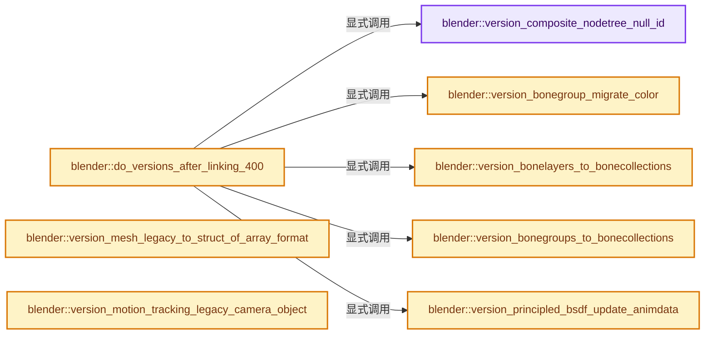
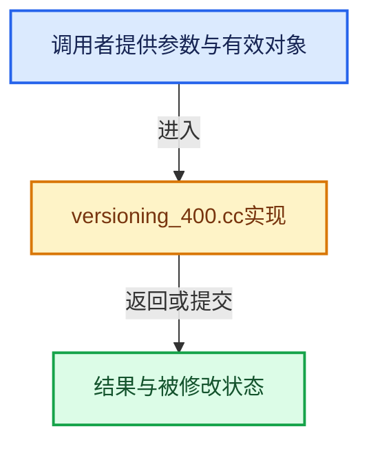

# 实现依赖专题：source/blender/blenloader/intern/versioning_400.cc

[方向导航](README.md) · [符号索引](../%E7%AC%A6%E5%8F%B7%E4%BE%9D%E8%B5%96%E4%B8%8E%E5%AE%9E%E7%8E%B0%E7%B4%A2%E5%BC%95.md)

本专题从正文实际调用进入，集中保存共享实现。函数有稳定锚点，可从调用处直接跳到对应完整函数；递归与互相调用通过回链组织。

## 本文件的实现关系






## 完整成员与函数实现

<a id="f-a3999ebcd0221344"></a>

### `blender::version_composite_nodetree_null_id`

实现位置：[source/blender/blenloader/intern/versioning_400.cc](../../../../../source/blender/blenloader/intern/versioning_400.cc) · L68—L78。

接口参数：

- `bNodeTree *ntree`
- `Scene *scene`

**教学注释版**

<!-- annotated:cc53c65cc51147 -->

```cpp
static void version_composite_nodetree_null_id(bNodeTree *ntree, Scene *scene)
{
  for (bNode *node : ntree->all_nodes()) {
    if (node->id == nullptr && ((node->type_legacy == CMP_NODE_R_LAYERS) ||
                                (node->type_legacy == CMP_NODE_CRYPTOMATTE &&
                                 node->custom1 == CMP_NODE_CRYPTOMATTE_SOURCE_RENDER)))
    {
      node->id = &scene->id;
    }
  }
}
```

<details>
<summary>核对原始源码：source/blender/blenloader/intern/versioning_400.cc · L68—L78</summary>

<!-- original:cc53c65cc51147:source/blender/blenloader/intern/versioning_400.cc:68:78 -->

```cpp
static void version_composite_nodetree_null_id(bNodeTree *ntree, Scene *scene)
{
  for (bNode *node : ntree->all_nodes()) {
    if (node->id == nullptr && ((node->type_legacy == CMP_NODE_R_LAYERS) ||
                                (node->type_legacy == CMP_NODE_CRYPTOMATTE &&
                                 node->custom1 == CMP_NODE_CRYPTOMATTE_SOURCE_RENDER)))
    {
      node->id = &scene->id;
    }
  }
}
```

</details>

**沿实际写入检查状态**

- `node->id = &scene->id;`

**继续追踪实现**

- `ntree->all_nodes` → [blender::bNodeTree::all_nodes · L500](%E4%BE%9D%E8%B5%96-BKE_node_runtime-ee561b.md#f-cda455cbcc6c7f36)；[blender::bNodeTree::all_nodes · L505](%E4%BE%9D%E8%B5%96-BKE_node_runtime-ee561b.md#f-358b65e5678f8a32)。同名重载需按实参类型选择。

<a id="f-b697e15f4e00f4c7"></a>

### `blender::version_bonegroup_migrate_color`

实现位置：[source/blender/blenloader/intern/versioning_400.cc](../../../../../source/blender/blenloader/intern/versioning_400.cc) · L81—L128。

接口参数：

- `Main *bmain`

**教学注释版**

<!-- annotated:267356f4de9058 -->

```cpp
static void version_bonegroup_migrate_color(Main *bmain)
{
  using PoseObSet = Set<Object *>;
  Map<bArmature *, PoseObSet> armature_poses;

  /* Gather a mapping from armature to the poses that use it. */
  for (Object &ob : bmain->objects) {
    if (ob.type != OB_ARMATURE || !ob.pose) {
      continue;
    }

    bArmature *arm = reinterpret_cast<bArmature *>(ob.data);
    BLI_assert_msg(GS(arm->id.name) == ID_AR,
                   "Expected ARMATURE object to have an Armature as data");

    /* There is no guarantee that the current state of poses is in sync with the Armature data.
     *
     * NOTE: No need to handle user reference-counting in readfile code. */
    BKE_pose_ensure(bmain, &ob, arm, false);

    PoseObSet &pose_set = armature_poses.lookup_or_add_default(arm);
    pose_set.add(&ob);
  }

  /* Move colors from the pose's bone-group to either the armature bones or the
   * pose bones, depending on how many poses use the Armature. */
  for (const PoseObSet &pose_set : armature_poses.values()) {
    /* If the Armature is shared, the bone group colors might be different, and thus they have to
     * be stored on the pose bones. If the Armature is NOT shared, the bone colors can be stored
     * directly on the Armature bones. */
    const bool store_on_armature = pose_set.size() == 1;

    for (Object *pose_ob : pose_set) {
      bPose *pose = pose_ob->pose;
      for (bPoseChannel &pchan : pose->chanbase) {
        const bActionGroup *bgrp = static_cast<const bActionGroup *>(
            BLI_findlink(&pose->agroups, (pchan.agrp_index - 1)));
        if (!bgrp) {
          continue;
        }

        BoneColor &bone_color = store_on_armature ? pchan.bone_get(*pose_ob)->color : pchan.color;
        bone_color.palette_index = bgrp->customCol;
        // [讲解] memcpy：复制字节，源与目标不应重叠。类型生命周期、对齐和可复制表示须由调用者证明，不是任意对象的复制构造。
        memcpy(&bone_color.custom, &bgrp->cs, sizeof(bone_color.custom));
      }
    }
  }
}
```

<details>
<summary>核对原始源码：source/blender/blenloader/intern/versioning_400.cc · L81—L128</summary>

<!-- original:267356f4de9058:source/blender/blenloader/intern/versioning_400.cc:81:128 -->

```cpp
static void version_bonegroup_migrate_color(Main *bmain)
{
  using PoseObSet = Set<Object *>;
  Map<bArmature *, PoseObSet> armature_poses;

  /* Gather a mapping from armature to the poses that use it. */
  for (Object &ob : bmain->objects) {
    if (ob.type != OB_ARMATURE || !ob.pose) {
      continue;
    }

    bArmature *arm = reinterpret_cast<bArmature *>(ob.data);
    BLI_assert_msg(GS(arm->id.name) == ID_AR,
                   "Expected ARMATURE object to have an Armature as data");

    /* There is no guarantee that the current state of poses is in sync with the Armature data.
     *
     * NOTE: No need to handle user reference-counting in readfile code. */
    BKE_pose_ensure(bmain, &ob, arm, false);

    PoseObSet &pose_set = armature_poses.lookup_or_add_default(arm);
    pose_set.add(&ob);
  }

  /* Move colors from the pose's bone-group to either the armature bones or the
   * pose bones, depending on how many poses use the Armature. */
  for (const PoseObSet &pose_set : armature_poses.values()) {
    /* If the Armature is shared, the bone group colors might be different, and thus they have to
     * be stored on the pose bones. If the Armature is NOT shared, the bone colors can be stored
     * directly on the Armature bones. */
    const bool store_on_armature = pose_set.size() == 1;

    for (Object *pose_ob : pose_set) {
      bPose *pose = pose_ob->pose;
      for (bPoseChannel &pchan : pose->chanbase) {
        const bActionGroup *bgrp = static_cast<const bActionGroup *>(
            BLI_findlink(&pose->agroups, (pchan.agrp_index - 1)));
        if (!bgrp) {
          continue;
        }

        BoneColor &bone_color = store_on_armature ? pchan.bone_get(*pose_ob)->color : pchan.color;
        bone_color.palette_index = bgrp->customCol;
        memcpy(&bone_color.custom, &bgrp->cs, sizeof(bone_color.custom));
      }
    }
  }
}
```

</details>

**沿实际写入检查状态**

- `bone_color.palette_index = bgrp->customCol;`

**继续追踪实现**

- `BLI_assert_msg` → [BLI_assert_msg · L55](../01-%E5%9F%BA%E7%A1%80%E5%AE%B9%E5%99%A8%E4%B8%8E%E7%8E%B0%E4%BB%A3CPP/%E4%BE%9D%E8%B5%96-BLI_assert-cc98e8.md#m-695eed20dceb)；[BLI_assert_msg · L64](../01-%E5%9F%BA%E7%A1%80%E5%AE%B9%E5%99%A8%E4%B8%8E%E7%8E%B0%E4%BB%A3CPP/%E4%BE%9D%E8%B5%96-BLI_assert-cc98e8.md#m-7de5563de4db)。宏定义由构建条件选择。
- `GS` → [blender::GS · L410](%E4%BE%9D%E8%B5%96-DNA_ID-3eb091.md#f-c3ff509f79f21b05)。
- `BKE_pose_ensure` → [blender::BKE_pose_ensure · L3061](%E4%BE%9D%E8%B5%96-armature-cc8366.md#f-22c1bff7ca18e20e)。
- `armature_poses.lookup_or_add_default` → [blender::Map::lookup_or_add_default · L639](../02-%E5%93%88%E5%B8%8C%E8%A1%A8%E4%B8%8E%E5%85%B3%E8%81%94%E6%95%B0%E6%8D%AE%E7%BB%93%E6%9E%84/05-Map%E6%8F%92%E5%85%A5%E4%B8%8E%E5%9B%9E%E8%B0%83.md#f-e8d33f0bfe1f3153)；[blender::Map::lookup_or_add_default · L643](../02-%E5%93%88%E5%B8%8C%E8%A1%A8%E4%B8%8E%E5%85%B3%E8%81%94%E6%95%B0%E6%8D%AE%E7%BB%93%E6%9E%84/05-Map%E6%8F%92%E5%85%A5%E4%B8%8E%E5%9B%9E%E8%B0%83.md#f-d67ab6e12fd0a267)。同名重载需按实参类型选择。
- `pose_set.add` → [blender::ResourceScope::add · L158](../03-%E5%86%85%E5%AD%98%E5%88%86%E9%85%8D%E4%B8%8E%E8%BF%90%E8%A1%8C%E6%97%B6%E7%B1%BB%E5%9E%8B/05-ResourceScope%E9%94%80%E6%AF%81%E8%B4%A3%E4%BB%BB.md#f-ea50aaeb75a3ae88)；[blender::ResourceScope::add · L171](../03-%E5%86%85%E5%AD%98%E5%88%86%E9%85%8D%E4%B8%8E%E8%BF%90%E8%A1%8C%E6%97%B6%E7%B1%BB%E5%9E%8B/05-ResourceScope%E9%94%80%E6%AF%81%E8%B4%A3%E4%BB%BB.md#f-69a0755cd9372e60)；[blender::ResourceScope::add · L181](../03-%E5%86%85%E5%AD%98%E5%88%86%E9%85%8D%E4%B8%8E%E8%BF%90%E8%A1%8C%E6%97%B6%E7%B1%BB%E5%9E%8B/05-ResourceScope%E9%94%80%E6%AF%81%E8%B4%A3%E4%BB%BB.md#f-af785bf57d715c47)；[blender::ResourceScope::add · L199](../03-%E5%86%85%E5%AD%98%E5%88%86%E9%85%8D%E4%B8%8E%E8%BF%90%E8%A1%8C%E6%97%B6%E7%B1%BB%E5%9E%8B/05-ResourceScope%E9%94%80%E6%AF%81%E8%B4%A3%E4%BB%BB.md#f-bd09b45cee23317d)；[blender::add · L222](%E4%BE%9D%E8%B5%96-msgfmt-76f41a.md#f-7292fc7e06488a67)。同名重载需按实参类型选择。
- `armature_poses.values` → [blender::Map::values · L884](../02-%E5%93%88%E5%B8%8C%E8%A1%A8%E4%B8%8E%E5%85%B3%E8%81%94%E6%95%B0%E6%8D%AE%E7%BB%93%E6%9E%84/06-%E5%88%A0%E9%99%A4%E5%A2%93%E7%A2%91%E4%B8%8E%E5%80%BC%E9%94%80%E6%AF%81.md#f-1ac557fce41bc5ad)；[blender::Map::values · L893](../02-%E5%93%88%E5%B8%8C%E8%A1%A8%E4%B8%8E%E5%85%B3%E8%81%94%E6%95%B0%E6%8D%AE%E7%BB%93%E6%9E%84/06-%E5%88%A0%E9%99%A4%E5%A2%93%E7%A2%91%E4%B8%8E%E5%80%BC%E9%94%80%E6%AF%81.md#f-990baba928a54f33)；[blender::Map::values · L924](../02-%E5%93%88%E5%B8%8C%E8%A1%A8%E4%B8%8E%E5%85%B3%E8%81%94%E6%95%B0%E6%8D%AE%E7%BB%93%E6%9E%84/06-%E5%88%A0%E9%99%A4%E5%A2%93%E7%A2%91%E4%B8%8E%E5%80%BC%E9%94%80%E6%AF%81.md#f-170edfefcc9656c1)；[blender::Map::values · L925](../02-%E5%93%88%E5%B8%8C%E8%A1%A8%E4%B8%8E%E5%85%B3%E8%81%94%E6%95%B0%E6%8D%AE%E7%BB%93%E6%9E%84/06-%E5%88%A0%E9%99%A4%E5%A2%93%E7%A2%91%E4%B8%8E%E5%80%BC%E9%94%80%E6%AF%81.md#f-b7260376cafdd01d)。同名重载需按实参类型选择。
- `pose_set.size` → [blender::Bounds<T>::size · L543](../12-%E7%A9%BA%E9%97%B4%E6%95%B0%E6%8D%AE%E7%BB%93%E6%9E%84%E4%B8%8E%E5%87%A0%E4%BD%95%E7%AE%97%E6%B3%95/07-Bounds%E4%B8%8EBVH%E5%AF%B9%E6%AF%94.md#f-fcce88c0824fcd97)；[blender::GVArrayImpl::size · L651](../04-%E8%99%9A%E6%8B%9F%E6%95%B0%E7%BB%84%E4%B8%8E%E7%B4%A2%E5%BC%95%E9%80%89%E6%8B%A9/05-GVArray%E8%BF%90%E8%A1%8C%E6%97%B6%E7%B1%BB%E5%9E%8B.md#f-f23d3d1f3b110f1e)；[blender::GVArrayCommon::size · L759](../04-%E8%99%9A%E6%8B%9F%E6%95%B0%E7%BB%84%E4%B8%8E%E7%B4%A2%E5%BC%95%E9%80%89%E6%8B%A9/05-GVArray%E8%BF%90%E8%A1%8C%E6%97%B6%E7%B1%BB%E5%9E%8B.md#f-0856784f4e4fd3c9)；[blender::StringRefBase::size · L196](../01-%E5%9F%BA%E7%A1%80%E5%AE%B9%E5%99%A8%E4%B8%8E%E7%8E%B0%E4%BB%A3CPP/15-StringRef%E5%AD%97%E7%AC%A6%E4%B8%B2%E8%A7%86%E5%9B%BE.md#f-60d4631c74931d2e)；[blender::KDTreeNew<T>::size · L493](../12-%E7%A9%BA%E9%97%B4%E6%95%B0%E6%8D%AE%E7%BB%93%E6%9E%84%E4%B8%8E%E5%87%A0%E4%BD%95%E7%AE%97%E6%B3%95/05-K%E8%BF%91%E9%82%BB%E4%B8%8E%E8%8C%83%E5%9B%B4%E6%9F%A5%E8%AF%A2.md#f-233c05ce6d5c8d39)；[blender::MainAllIDsIterator::size · L1291](%E4%BE%9D%E8%B5%96-main-ffa8b3.md#f-520d1311c646452f)；[blender::GLSourcesBaked::size · L1541](%E4%BE%9D%E8%B5%96-gl_shader-766737.md#f-5b5b539d533c6792)。同名重载需按实参类型选择。
- `BLI_findlink` → [blender::BLI_findlink · L541](../01-%E5%9F%BA%E7%A1%80%E5%AE%B9%E5%99%A8%E4%B8%8E%E7%8E%B0%E4%BB%A3CPP/%E4%BE%9D%E8%B5%96-listbase-2816d9.md#f-6d3fd65974b4e808)。
- `pchan.bone_get` → [调用协议](../%E6%A8%A1%E6%9D%BF%E5%AE%8F%E4%B8%8E%E5%8A%A8%E6%80%81%E5%88%86%E6%B4%BE%E5%8D%8F%E8%AE%AE.md)：接收对象类型依赖auto、返回值或模板实例；不按同名猜测目标。调用位置L122。
- `memcpy` → [外部契约](https://eel.is/c++draft/cstring.syn)：复制字节，源与目标不应重叠。类型生命周期、对齐和可复制表示须由调用者证明，不是任意对象的复制构造。

<a id="f-29a69608119a3d1d"></a>

### `blender::version_bonelayers_to_bonecollections`

实现位置：[source/blender/blenloader/intern/versioning_400.cc](../../../../../source/blender/blenloader/intern/versioning_400.cc) · L130—L189。

接口参数：

- `Main *bmain`

**教学注释版**

<!-- annotated:d917bdf2dd7ffa -->

```cpp
static void version_bonelayers_to_bonecollections(Main *bmain)
{
  char bcoll_name[MAX_NAME];
  char custom_prop_name[MAX_NAME];

  for (bArmature &arm : bmain->armatures) {
    IDProperty *arm_idprops = IDP_GetProperties(&arm.id);

    BLI_assert_msg(arm.edbo == nullptr, "did not expect an Armature to be saved in edit mode");
    const uint layer_used = arm.layer_used;

    /* Construct a bone collection for each layer that contains at least one bone. */
    Vector<std::pair<uint, BoneCollection *>> layermask_collection;
    for (uint layer = 0; layer < 32; ++layer) {
      const uint layer_mask = 1u << layer;
      if ((layer_used & layer_mask) == 0) {
        /* Layer is empty, so no need to convert to collection. */
        continue;
      }

      /* Construct a suitable name for this bone layer. */
      bcoll_name[0] = '\0';
      if (arm_idprops) {
        /* See if we can use the layer name from the Bone Manager add-on. This is a popular add-on
         * for managing bone layers and giving them names. */
        SNPRINTF_UTF8(custom_prop_name, "layer_name_%u", layer);
        IDProperty *prop = IDP_GetPropertyFromGroup(arm_idprops, custom_prop_name);
        if (prop != nullptr && prop->type == IDP_STRING && IDP_string_get(prop)[0] != '\0') {
          SNPRINTF_UTF8(bcoll_name, "Layer %u - %s", layer + 1, IDP_string_get(prop));
        }
      }
      if (bcoll_name[0] == '\0') {
        /* Either there was no name defined in the custom property, or
         * it was the empty string. */
        SNPRINTF_UTF8(bcoll_name, "Layer %u", layer + 1);
      }

      /* Create a new bone collection for this layer. */
      BoneCollection *bcoll = ANIM_armature_bonecoll_new(&arm, bcoll_name);
      // [讲解] layermask_collection.append：在尾部建立新元素，必要时先扩大存储。
      layermask_collection.append(std::make_pair(layer_mask, bcoll));

      if ((arm.layer & layer_mask) == 0) {
        ANIM_bonecoll_hide(&arm, bcoll);
      }
    }

    /* Iterate over the bones to assign them to their layers. */
    animrig::ANIM_armature_foreach_bone(&arm.bonebase, [&](Bone *bone) {
      for (auto layer_bcoll : layermask_collection) {
        const uint layer_mask = layer_bcoll.first;
        if ((bone->layer & layer_mask) == 0) {
          continue;
        }

        BoneCollection *bcoll = layer_bcoll.second;
        ANIM_armature_bonecoll_assign(bcoll, bone);
      }
    });
  }
}
```

<details>
<summary>核对原始源码：source/blender/blenloader/intern/versioning_400.cc · L130—L189</summary>

<!-- original:d917bdf2dd7ffa:source/blender/blenloader/intern/versioning_400.cc:130:189 -->

```cpp
static void version_bonelayers_to_bonecollections(Main *bmain)
{
  char bcoll_name[MAX_NAME];
  char custom_prop_name[MAX_NAME];

  for (bArmature &arm : bmain->armatures) {
    IDProperty *arm_idprops = IDP_GetProperties(&arm.id);

    BLI_assert_msg(arm.edbo == nullptr, "did not expect an Armature to be saved in edit mode");
    const uint layer_used = arm.layer_used;

    /* Construct a bone collection for each layer that contains at least one bone. */
    Vector<std::pair<uint, BoneCollection *>> layermask_collection;
    for (uint layer = 0; layer < 32; ++layer) {
      const uint layer_mask = 1u << layer;
      if ((layer_used & layer_mask) == 0) {
        /* Layer is empty, so no need to convert to collection. */
        continue;
      }

      /* Construct a suitable name for this bone layer. */
      bcoll_name[0] = '\0';
      if (arm_idprops) {
        /* See if we can use the layer name from the Bone Manager add-on. This is a popular add-on
         * for managing bone layers and giving them names. */
        SNPRINTF_UTF8(custom_prop_name, "layer_name_%u", layer);
        IDProperty *prop = IDP_GetPropertyFromGroup(arm_idprops, custom_prop_name);
        if (prop != nullptr && prop->type == IDP_STRING && IDP_string_get(prop)[0] != '\0') {
          SNPRINTF_UTF8(bcoll_name, "Layer %u - %s", layer + 1, IDP_string_get(prop));
        }
      }
      if (bcoll_name[0] == '\0') {
        /* Either there was no name defined in the custom property, or
         * it was the empty string. */
        SNPRINTF_UTF8(bcoll_name, "Layer %u", layer + 1);
      }

      /* Create a new bone collection for this layer. */
      BoneCollection *bcoll = ANIM_armature_bonecoll_new(&arm, bcoll_name);
      layermask_collection.append(std::make_pair(layer_mask, bcoll));

      if ((arm.layer & layer_mask) == 0) {
        ANIM_bonecoll_hide(&arm, bcoll);
      }
    }

    /* Iterate over the bones to assign them to their layers. */
    animrig::ANIM_armature_foreach_bone(&arm.bonebase, [&](Bone *bone) {
      for (auto layer_bcoll : layermask_collection) {
        const uint layer_mask = layer_bcoll.first;
        if ((bone->layer & layer_mask) == 0) {
          continue;
        }

        BoneCollection *bcoll = layer_bcoll.second;
        ANIM_armature_bonecoll_assign(bcoll, bone);
      }
    });
  }
}
```

</details>

**沿实际写入检查状态**

- `bcoll_name[0] = '\0';`

**继续追踪实现**

- `IDP_GetProperties` → [blender::IDP_GetProperties · L1000](%E4%BE%9D%E8%B5%96-idprop-006c65.md#f-9d57288c074537c2)。
- `BLI_assert_msg` → [BLI_assert_msg · L55](../01-%E5%9F%BA%E7%A1%80%E5%AE%B9%E5%99%A8%E4%B8%8E%E7%8E%B0%E4%BB%A3CPP/%E4%BE%9D%E8%B5%96-BLI_assert-cc98e8.md#m-695eed20dceb)；[BLI_assert_msg · L64](../01-%E5%9F%BA%E7%A1%80%E5%AE%B9%E5%99%A8%E4%B8%8E%E7%8E%B0%E4%BB%A3CPP/%E4%BE%9D%E8%B5%96-BLI_assert-cc98e8.md#m-7de5563de4db)。宏定义由构建条件选择。
- `SNPRINTF_UTF8` → [SNPRINTF_UTF8 · L340](../01-%E5%9F%BA%E7%A1%80%E5%AE%B9%E5%99%A8%E4%B8%8E%E7%8E%B0%E4%BB%A3CPP/%E4%BE%9D%E8%B5%96-BLI_string_utf8-bcc961.md#m-5e57d7a30c64)。宏定义由构建条件选择。
- `IDP_GetPropertyFromGroup` → [blender::IDP_GetPropertyFromGroup · L818](%E4%BE%9D%E8%B5%96-idprop-006c65.md#f-a8d678499d89359e)。
- `IDP_string_get` → [IDP_string_get · L375](%E4%BE%9D%E8%B5%96-BKE_idprop-fe422c.md#m-bedef49dcb76)。宏定义由构建条件选择。
- `ANIM_armature_bonecoll_new` → [blender::ANIM_armature_bonecoll_new · L218](%E4%BE%9D%E8%B5%96-bone_collections-88bf14.md#f-76c624d18358b0ac)。
- `layermask_collection.append` → [blender::Vector::append · L498](../01-%E5%9F%BA%E7%A1%80%E5%AE%B9%E5%99%A8%E4%B8%8E%E7%8E%B0%E4%BB%A3CPP/11-Vector%E6%8F%92%E5%85%A5%E5%88%A0%E9%99%A4%E4%B8%8E%E9%87%8D%E6%8E%92.md#f-5bde268a69e443ec)；[blender::Vector::append · L502](../01-%E5%9F%BA%E7%A1%80%E5%AE%B9%E5%99%A8%E4%B8%8E%E7%8E%B0%E4%BB%A3CPP/11-Vector%E6%8F%92%E5%85%A5%E5%88%A0%E9%99%A4%E4%B8%8E%E9%87%8D%E6%8E%92.md#f-591e0b15e6308532)。同名重载需按实参类型选择。
- `std::make_pair` → [外部契约](https://eel.is/c++draft/)：这个边界按实际表达式及所属类型核对参数、返回值、寿命与失败行为。这里提供接口入口，不声称已解释该第三方版本的内部实现。
- `ANIM_bonecoll_hide` → [blender::ANIM_bonecoll_hide · L813](%E4%BE%9D%E8%B5%96-bone_collections-88bf14.md#f-3d0b45161787c921)。
- `animrig::ANIM_armature_foreach_bone` → [blender::animrig::ANIM_armature_foreach_bone · L26](%E4%BE%9D%E8%B5%96-ANIM_armature_iter-ef2cb2.md#f-b270fb54491eb0dc)；[blender::animrig::ANIM_armature_foreach_bone · L42](%E4%BE%9D%E8%B5%96-ANIM_armature_iter-ef2cb2.md#f-3e30d073899df5cc)。同名重载需按实参类型选择。
- `ANIM_armature_bonecoll_assign` → [blender::ANIM_armature_bonecoll_assign · L904](%E4%BE%9D%E8%B5%96-bone_collections-88bf14.md#f-9e9cc035424ef7a2)。

<a id="f-fa6f3f5a03936657"></a>

### `blender::version_bonegroups_to_bonecollections`

实现位置：[source/blender/blenloader/intern/versioning_400.cc](../../../../../source/blender/blenloader/intern/versioning_400.cc) · L191—L234。

接口参数：

- `Main *bmain`

**教学注释版**

<!-- annotated:dcde4f30efe2d3 -->

```cpp
static void version_bonegroups_to_bonecollections(Main *bmain)
{
  for (Object &ob : bmain->objects) {
    if (ob.type != OB_ARMATURE || !ob.pose) {
      continue;
    }

    /* Convert the bone groups on a bone-by-bone basis. */
    bArmature *arm = reinterpret_cast<bArmature *>(ob.data);
    bPose *pose = ob.pose;

    Map<const bActionGroup *, BoneCollection *> collections_by_group;
    /* Convert all bone groups, regardless of whether they contain any bones. */
    for (bActionGroup &bgrp : pose->agroups) {
      BoneCollection *bcoll = ANIM_armature_bonecoll_new(arm, bgrp.name);
      // [讲解] collections_by_group.add_new：按哈希与相等关系加入键或键值。
      collections_by_group.add_new(&bgrp, bcoll);

      /* Before now, bone visibility was determined by armature layers, and bone
       * groups did not have any impact on this. To retain the behavior, that
       * hiding all layers a bone is on hides the bone, the
       * bone-group-collections should be created hidden. */
      ANIM_bonecoll_hide(arm, bcoll);
    }

    /* Assign the bones to their bone group based collection. */
    for (bPoseChannel &pchan : pose->chanbase) {
      /* Find the bone group of this pose channel. */
      const bActionGroup *bgrp = static_cast<const bActionGroup *>(
          BLI_findlink(&pose->agroups, (pchan.agrp_index - 1)));
      if (!bgrp) {
        continue;
      }

      /* Assign the bone. */
      // [讲解] collections_by_group.lookup：按键查找对应项。
      BoneCollection *bcoll = collections_by_group.lookup(bgrp);
      ANIM_armature_bonecoll_assign(bcoll, pchan.bone_get(ob));
    }

    /* The list of bone groups (pose->agroups) is intentionally left alone here. This will allow
     * for older versions of Blender to open the file with bone groups intact. Of course the bone
     * groups will not be updated any more, but this way the data at least survives an accidental
     * save with Blender 4.0. */
  }
}
```

<details>
<summary>核对原始源码：source/blender/blenloader/intern/versioning_400.cc · L191—L234</summary>

<!-- original:dcde4f30efe2d3:source/blender/blenloader/intern/versioning_400.cc:191:234 -->

```cpp
static void version_bonegroups_to_bonecollections(Main *bmain)
{
  for (Object &ob : bmain->objects) {
    if (ob.type != OB_ARMATURE || !ob.pose) {
      continue;
    }

    /* Convert the bone groups on a bone-by-bone basis. */
    bArmature *arm = reinterpret_cast<bArmature *>(ob.data);
    bPose *pose = ob.pose;

    Map<const bActionGroup *, BoneCollection *> collections_by_group;
    /* Convert all bone groups, regardless of whether they contain any bones. */
    for (bActionGroup &bgrp : pose->agroups) {
      BoneCollection *bcoll = ANIM_armature_bonecoll_new(arm, bgrp.name);
      collections_by_group.add_new(&bgrp, bcoll);

      /* Before now, bone visibility was determined by armature layers, and bone
       * groups did not have any impact on this. To retain the behavior, that
       * hiding all layers a bone is on hides the bone, the
       * bone-group-collections should be created hidden. */
      ANIM_bonecoll_hide(arm, bcoll);
    }

    /* Assign the bones to their bone group based collection. */
    for (bPoseChannel &pchan : pose->chanbase) {
      /* Find the bone group of this pose channel. */
      const bActionGroup *bgrp = static_cast<const bActionGroup *>(
          BLI_findlink(&pose->agroups, (pchan.agrp_index - 1)));
      if (!bgrp) {
        continue;
      }

      /* Assign the bone. */
      BoneCollection *bcoll = collections_by_group.lookup(bgrp);
      ANIM_armature_bonecoll_assign(bcoll, pchan.bone_get(ob));
    }

    /* The list of bone groups (pose->agroups) is intentionally left alone here. This will allow
     * for older versions of Blender to open the file with bone groups intact. Of course the bone
     * groups will not be updated any more, but this way the data at least survives an accidental
     * save with Blender 4.0. */
  }
}
```

</details>

**继续追踪实现**

- `ANIM_armature_bonecoll_new` → [blender::ANIM_armature_bonecoll_new · L218](%E4%BE%9D%E8%B5%96-bone_collections-88bf14.md#f-76c624d18358b0ac)。
- `collections_by_group.add_new` → [blender::Map::add_new · L265](../02-%E5%93%88%E5%B8%8C%E8%A1%A8%E4%B8%8E%E5%85%B3%E8%81%94%E6%95%B0%E6%8D%AE%E7%BB%93%E6%9E%84/02-Map%E6%80%BB%E4%BD%93%E5%B8%83%E5%B1%80.md#f-521ff0865e8229d0)；[blender::Map::add_new · L269](../02-%E5%93%88%E5%B8%8C%E8%A1%A8%E4%B8%8E%E5%85%B3%E8%81%94%E6%95%B0%E6%8D%AE%E7%BB%93%E6%9E%84/02-Map%E6%80%BB%E4%BD%93%E5%B8%83%E5%B1%80.md#f-d89cee0e3d2848a0)；[blender::Map::add_new · L273](../02-%E5%93%88%E5%B8%8C%E8%A1%A8%E4%B8%8E%E5%85%B3%E8%81%94%E6%95%B0%E6%8D%AE%E7%BB%93%E6%9E%84/02-Map%E6%80%BB%E4%BD%93%E5%B8%83%E5%B1%80.md#f-c13142c32e703ebd)；[blender::Map::add_new · L277](../02-%E5%93%88%E5%B8%8C%E8%A1%A8%E4%B8%8E%E5%85%B3%E8%81%94%E6%95%B0%E6%8D%AE%E7%BB%93%E6%9E%84/04-Map%E6%9F%A5%E6%89%BE%E4%B8%8E%E9%94%AE%E8%AE%BF%E9%97%AE.md#f-da1e537f229db040)。同名重载需按实参类型选择。
- `ANIM_bonecoll_hide` → [blender::ANIM_bonecoll_hide · L813](%E4%BE%9D%E8%B5%96-bone_collections-88bf14.md#f-3d0b45161787c921)。
- `BLI_findlink` → [blender::BLI_findlink · L541](../01-%E5%9F%BA%E7%A1%80%E5%AE%B9%E5%99%A8%E4%B8%8E%E7%8E%B0%E4%BB%A3CPP/%E4%BE%9D%E8%B5%96-listbase-2816d9.md#f-6d3fd65974b4e808)。
- `collections_by_group.lookup` → [blender::Map::lookup · L545](../02-%E5%93%88%E5%B8%8C%E8%A1%A8%E4%B8%8E%E5%85%B3%E8%81%94%E6%95%B0%E6%8D%AE%E7%BB%93%E6%9E%84/04-Map%E6%9F%A5%E6%89%BE%E4%B8%8E%E9%94%AE%E8%AE%BF%E9%97%AE.md#f-f25ef95f1454656d)；[blender::Map::lookup · L549](../02-%E5%93%88%E5%B8%8C%E8%A1%A8%E4%B8%8E%E5%85%B3%E8%81%94%E6%95%B0%E6%8D%AE%E7%BB%93%E6%9E%84/04-Map%E6%9F%A5%E6%89%BE%E4%B8%8E%E9%94%AE%E8%AE%BF%E9%97%AE.md#f-742f9454fa7ea4b9)。同名重载需按实参类型选择。
- `ANIM_armature_bonecoll_assign` → [blender::ANIM_armature_bonecoll_assign · L904](%E4%BE%9D%E8%B5%96-bone_collections-88bf14.md#f-9e9cc035424ef7a2)。
- `pchan.bone_get` → [调用协议](../%E6%A8%A1%E6%9D%BF%E5%AE%8F%E4%B8%8E%E5%8A%A8%E6%80%81%E5%88%86%E6%B4%BE%E5%8D%8F%E8%AE%AE.md)：接收对象类型依赖auto、返回值或模板实例；不按同名猜测目标。调用位置L226。

<a id="f-bd9eb5647bdb5e5c"></a>

### `blender::version_principled_bsdf_update_animdata`

实现位置：[source/blender/blenloader/intern/versioning_400.cc](../../../../../source/blender/blenloader/intern/versioning_400.cc) · L236—L292。

接口参数：

- `Main *bmain`
- `bNodeTree *ntree`

**教学注释版**

<!-- annotated:0f33923451ac74 -->

```cpp
static void version_principled_bsdf_update_animdata(Main *bmain, bNodeTree *ntree)
{
  ID *id = &ntree->id;
  DriverMap driver_map = BKE_animdata_build_driver_target_map(*bmain);

  for (bNode &node : ntree->nodes) {
    if (node.type_legacy != SH_NODE_BSDF_PRINCIPLED) {
      continue;
    }

    char node_name_escaped[MAX_NAME * 2];
    BLI_str_escape(node_name_escaped, node.name, sizeof(node_name_escaped));
    std::string prefix = "nodes[\"" + std::string(node_name_escaped) + "\"].inputs";

    /* Remove animdata for inputs 18 (Transmission Roughness) and 3 (Subsurface Color). */
    BKE_animdata_fix_paths_remove(id, (prefix + "[18]").c_str());
    BKE_animdata_fix_paths_remove(id, (prefix + "[3]").c_str());

    /* Order is important here: If we e.g. want to change A->B and B->C, but perform A->B first,
     * then later we don't know whether a B entry is an original B (and therefore should be
     * changed to C) or used to be A and was already handled.
     * In practice, going reverse mostly works, the two notable dependency chains are:
     * - 8->13, then 2->8, then 9->2 (13 was changed before)
     * - 1->9, then 6->1 (9 was changed before)
     * - 4->10, then 21->4 (10 was changed before)
     *
     * 0 (Base Color) and 17 (Transmission) are fine as-is. */
    std::pair<int, int> remap_table[] = {
        {20, 27}, /* Emission Strength */
        {19, 26}, /* Emission */
        {16, 3},  /* IOR */
        {15, 19}, /* Clearcoat Roughness */
        {14, 18}, /* Clearcoat */
        {13, 25}, /* Sheen Tint */
        {12, 23}, /* Sheen */
        {11, 15}, /* Anisotropic Rotation */
        {10, 14}, /* Anisotropic */
        {8, 13},  /* Specular Tint */
        {2, 8},   /* Subsurface Radius */
        {9, 2},   /* Roughness */
        {7, 12},  /* Specular */
        {1, 9},   /* Subsurface Scale */
        {6, 1},   /* Metallic */
        {5, 11},  /* Subsurface Anisotropy */
        {4, 10},  /* Subsurface IOR */
        {21, 4}   /* Alpha */
    };
    for (const auto &entry : remap_table) {
      BKE_animdata_fix_paths(*id,
                             prefix,
                             RNA_path_number_to_infix(entry.first),
                             RNA_path_number_to_infix(entry.second),
                             /*verify_paths=*/false,
                             driver_map);
    }
  }
}
```

<details>
<summary>核对原始源码：source/blender/blenloader/intern/versioning_400.cc · L236—L292</summary>

<!-- original:0f33923451ac74:source/blender/blenloader/intern/versioning_400.cc:236:292 -->

```cpp
static void version_principled_bsdf_update_animdata(Main *bmain, bNodeTree *ntree)
{
  ID *id = &ntree->id;
  DriverMap driver_map = BKE_animdata_build_driver_target_map(*bmain);

  for (bNode &node : ntree->nodes) {
    if (node.type_legacy != SH_NODE_BSDF_PRINCIPLED) {
      continue;
    }

    char node_name_escaped[MAX_NAME * 2];
    BLI_str_escape(node_name_escaped, node.name, sizeof(node_name_escaped));
    std::string prefix = "nodes[\"" + std::string(node_name_escaped) + "\"].inputs";

    /* Remove animdata for inputs 18 (Transmission Roughness) and 3 (Subsurface Color). */
    BKE_animdata_fix_paths_remove(id, (prefix + "[18]").c_str());
    BKE_animdata_fix_paths_remove(id, (prefix + "[3]").c_str());

    /* Order is important here: If we e.g. want to change A->B and B->C, but perform A->B first,
     * then later we don't know whether a B entry is an original B (and therefore should be
     * changed to C) or used to be A and was already handled.
     * In practice, going reverse mostly works, the two notable dependency chains are:
     * - 8->13, then 2->8, then 9->2 (13 was changed before)
     * - 1->9, then 6->1 (9 was changed before)
     * - 4->10, then 21->4 (10 was changed before)
     *
     * 0 (Base Color) and 17 (Transmission) are fine as-is. */
    std::pair<int, int> remap_table[] = {
        {20, 27}, /* Emission Strength */
        {19, 26}, /* Emission */
        {16, 3},  /* IOR */
        {15, 19}, /* Clearcoat Roughness */
        {14, 18}, /* Clearcoat */
        {13, 25}, /* Sheen Tint */
        {12, 23}, /* Sheen */
        {11, 15}, /* Anisotropic Rotation */
        {10, 14}, /* Anisotropic */
        {8, 13},  /* Specular Tint */
        {2, 8},   /* Subsurface Radius */
        {9, 2},   /* Roughness */
        {7, 12},  /* Specular */
        {1, 9},   /* Subsurface Scale */
        {6, 1},   /* Metallic */
        {5, 11},  /* Subsurface Anisotropy */
        {4, 10},  /* Subsurface IOR */
        {21, 4}   /* Alpha */
    };
    for (const auto &entry : remap_table) {
      BKE_animdata_fix_paths(*id,
                             prefix,
                             RNA_path_number_to_infix(entry.first),
                             RNA_path_number_to_infix(entry.second),
                             /*verify_paths=*/false,
                             driver_map);
    }
  }
}
```

</details>

**继续追踪实现**

- `BKE_animdata_build_driver_target_map` → [blender::BKE_animdata_build_driver_target_map · L980](%E4%BE%9D%E8%B5%96-anim_data-56c81c.md#f-756c69b4ccf4bd7c)。
- `BLI_str_escape` → [blender::BLI_str_escape · L335](../01-%E5%9F%BA%E7%A1%80%E5%AE%B9%E5%99%A8%E4%B8%8E%E7%8E%B0%E4%BB%A3CPP/%E4%BE%9D%E8%B5%96-string-1d986f.md#f-ade392f6fb397ef6)；[blender::BLI_str_escape · L366](../01-%E5%9F%BA%E7%A1%80%E5%AE%B9%E5%99%A8%E4%B8%8E%E7%8E%B0%E4%BB%A3CPP/%E4%BE%9D%E8%B5%96-string-1d986f.md#f-56725a2c129075c6)。同名重载需按实参类型选择。
- `std::string` → [外部契约](https://eel.is/c++draft/)：这个边界按实际表达式及所属类型核对参数、返回值、寿命与失败行为。这里提供接口入口，不声称已解释该第三方版本的内部实现。
- `BKE_animdata_fix_paths_remove` → [blender::BKE_animdata_fix_paths_remove · L1099](%E4%BE%9D%E8%B5%96-anim_data-56c81c.md#f-68de586516884602)。
- `(prefix + "[18]").c_str` → [调用协议](../%E6%A8%A1%E6%9D%BF%E5%AE%8F%E4%B8%8E%E5%8A%A8%E6%80%81%E5%88%86%E6%B4%BE%E5%8D%8F%E8%AE%AE.md)：接收对象类型依赖auto、返回值或模板实例；不按同名猜测目标。调用位置L251。
- `(prefix + "[3]").c_str` → [调用协议](../%E6%A8%A1%E6%9D%BF%E5%AE%8F%E4%B8%8E%E5%8A%A8%E6%80%81%E5%88%86%E6%B4%BE%E5%8D%8F%E8%AE%AE.md)：接收对象类型依赖auto、返回值或模板实例；不按同名猜测目标。调用位置L252。
- `BKE_animdata_fix_paths` → [blender::BKE_animdata_fix_paths · L1001](%E4%BE%9D%E8%B5%96-anim_data-56c81c.md#f-ba061b4dce9eccbc)；[blender::BKE_animdata_fix_paths · L1044](%E4%BE%9D%E8%B5%96-anim_data-56c81c.md#f-d7648451f6591b0b)。同名重载需按实参类型选择。
- `RNA_path_number_to_infix` → [blender::RNA_path_number_to_infix · L1422](%E4%BE%9D%E8%B5%96-rna_path-495878.md#f-903f4c4efe958947)。

<a id="f-df2de2ad5983671d"></a>

### `blender::do_versions_after_linking_400`

实现位置：[source/blender/blenloader/intern/versioning_400.cc](../../../../../source/blender/blenloader/intern/versioning_400.cc) · L319—L411。

接口参数：

- `FileData *fd`
- `Main *bmain`

**教学注释版**

<!-- annotated:43ecc1dbd87f22 -->

```cpp
void do_versions_after_linking_400(FileData *fd, Main *bmain)
{
  if (!MAIN_VERSION_FILE_ATLEAST(bmain, 400, 9)) {
    /* Fix area light scaling. */
    for (Light &light : bmain->lights) {
      light.energy = light.energy_deprecated;
      if (light.type == LA_AREA) {
        light.energy *= M_PI_4;
      }
    }

    /* XXX This was added several years ago in `lib_link` code of Scene... Should be safe enough
     * here. */
    for (Scene &scene : bmain->scenes) {
      if (scene.nodetree) {
        version_composite_nodetree_null_id(scene.nodetree, &scene);
      }
    }

    /* XXX This was added many years ago (1c19940198) in `lib_link` code of particles as a bug-fix.
     * But this is actually versioning. Should be safe enough here. */
    for (ParticleSettings &part : bmain->particles) {
      if (!part.effector_weights) {
        part.effector_weights = BKE_effector_add_weights(part.force_group);
      }
    }

    /* Object proxies have been deprecated sine 3.x era, so their update & sanity check can now
     * happen in do_versions code. */
    for (Object &ob : bmain->objects) {
      if (ob.proxy) {
        /* Paranoia check, actually a proxy_from pointer should never be written... */
        if (!ID_IS_LINKED(ob.proxy)) {
          ob.proxy->proxy_from = nullptr;
          ob.proxy = nullptr;

          if (ob.id.lib) {
            BLO_reportf_wrap(fd->reports,
                             RPT_INFO,
                             RPT_("Proxy lost from object %s lib %s\n"),
                             ob.id.name + 2,
                             ob.id.lib->filepath);
          }
          else {
            BLO_reportf_wrap(fd->reports,
                             RPT_INFO,
                             RPT_("Proxy lost from object %s lib <NONE>\n"),
                             ob.id.name + 2);
          }
          fd->reports->count.missing_obproxies++;
        }
        else {
          /* This triggers object_update to always use a copy. */
          ob.proxy->proxy_from = &ob;
        }
      }
    }
  }

  if (!MAIN_VERSION_FILE_ATLEAST(bmain, 400, 21)) {
    if (!DNA_struct_member_exists(fd->filesdna, "bPoseChannel", "BoneColor", "color")) {
      version_bonegroup_migrate_color(bmain);
    }

    if (!DNA_struct_member_exists(fd->filesdna, "bArmature", "ListBase", "collections")) {
      version_bonelayers_to_bonecollections(bmain);
      version_bonegroups_to_bonecollections(bmain);
    }
  }

  if (!MAIN_VERSION_FILE_ATLEAST(bmain, 400, 24)) {
    FOREACH_NODETREE_BEGIN (bmain, ntree, id) {
      if (ntree->type == NTREE_SHADER) {
        /* Convert animdata on the Principled BSDF sockets. */
        version_principled_bsdf_update_animdata(bmain, ntree);
      }
    }
    FOREACH_NODETREE_END;
  }

  if (!MAIN_VERSION_FILE_ATLEAST(bmain, 400, 27)) {
    for (Scene &scene : bmain->scenes) {
      Editing *ed = seq::editing_get(&scene);
      if (ed != nullptr) {
        seq::foreach_strip(&ed->seqbase, versioning_convert_strip_speed_factor, &scene);
      }
    }
  }

  if (!MAIN_VERSION_FILE_ATLEAST(bmain, 400, 34)) {
    BKE_mesh_legacy_face_map_to_generic(bmain);
  }
}
```

<details>
<summary>核对原始源码：source/blender/blenloader/intern/versioning_400.cc · L319—L411</summary>

<!-- original:43ecc1dbd87f22:source/blender/blenloader/intern/versioning_400.cc:319:411 -->

```cpp
void do_versions_after_linking_400(FileData *fd, Main *bmain)
{
  if (!MAIN_VERSION_FILE_ATLEAST(bmain, 400, 9)) {
    /* Fix area light scaling. */
    for (Light &light : bmain->lights) {
      light.energy = light.energy_deprecated;
      if (light.type == LA_AREA) {
        light.energy *= M_PI_4;
      }
    }

    /* XXX This was added several years ago in `lib_link` code of Scene... Should be safe enough
     * here. */
    for (Scene &scene : bmain->scenes) {
      if (scene.nodetree) {
        version_composite_nodetree_null_id(scene.nodetree, &scene);
      }
    }

    /* XXX This was added many years ago (1c19940198) in `lib_link` code of particles as a bug-fix.
     * But this is actually versioning. Should be safe enough here. */
    for (ParticleSettings &part : bmain->particles) {
      if (!part.effector_weights) {
        part.effector_weights = BKE_effector_add_weights(part.force_group);
      }
    }

    /* Object proxies have been deprecated sine 3.x era, so their update & sanity check can now
     * happen in do_versions code. */
    for (Object &ob : bmain->objects) {
      if (ob.proxy) {
        /* Paranoia check, actually a proxy_from pointer should never be written... */
        if (!ID_IS_LINKED(ob.proxy)) {
          ob.proxy->proxy_from = nullptr;
          ob.proxy = nullptr;

          if (ob.id.lib) {
            BLO_reportf_wrap(fd->reports,
                             RPT_INFO,
                             RPT_("Proxy lost from object %s lib %s\n"),
                             ob.id.name + 2,
                             ob.id.lib->filepath);
          }
          else {
            BLO_reportf_wrap(fd->reports,
                             RPT_INFO,
                             RPT_("Proxy lost from object %s lib <NONE>\n"),
                             ob.id.name + 2);
          }
          fd->reports->count.missing_obproxies++;
        }
        else {
          /* This triggers object_update to always use a copy. */
          ob.proxy->proxy_from = &ob;
        }
      }
    }
  }

  if (!MAIN_VERSION_FILE_ATLEAST(bmain, 400, 21)) {
    if (!DNA_struct_member_exists(fd->filesdna, "bPoseChannel", "BoneColor", "color")) {
      version_bonegroup_migrate_color(bmain);
    }

    if (!DNA_struct_member_exists(fd->filesdna, "bArmature", "ListBase", "collections")) {
      version_bonelayers_to_bonecollections(bmain);
      version_bonegroups_to_bonecollections(bmain);
    }
  }

  if (!MAIN_VERSION_FILE_ATLEAST(bmain, 400, 24)) {
    FOREACH_NODETREE_BEGIN (bmain, ntree, id) {
      if (ntree->type == NTREE_SHADER) {
        /* Convert animdata on the Principled BSDF sockets. */
        version_principled_bsdf_update_animdata(bmain, ntree);
      }
    }
    FOREACH_NODETREE_END;
  }

  if (!MAIN_VERSION_FILE_ATLEAST(bmain, 400, 27)) {
    for (Scene &scene : bmain->scenes) {
      Editing *ed = seq::editing_get(&scene);
      if (ed != nullptr) {
        seq::foreach_strip(&ed->seqbase, versioning_convert_strip_speed_factor, &scene);
      }
    }
  }

  if (!MAIN_VERSION_FILE_ATLEAST(bmain, 400, 34)) {
    BKE_mesh_legacy_face_map_to_generic(bmain);
  }
}
```

</details>

**沿实际写入检查状态**

- `light.energy = light.energy_deprecated;`
- `light.energy *= M_PI_4;`
- `part.effector_weights = BKE_effector_add_weights(part.force_group);`
- `ob.proxy->proxy_from = nullptr;`
- `ob.proxy = nullptr;`
- `ob.proxy->proxy_from = &ob;`

**继续追踪实现**

- `MAIN_VERSION_FILE_ATLEAST` → [MAIN_VERSION_FILE_ATLEAST · L946](%E4%BE%9D%E8%B5%96-BKE_main-626d8f.md#m-f0c0a8da9411)。宏定义由构建条件选择。
- `version_composite_nodetree_null_id` → [blender::version_composite_nodetree_null_id · L68](%E4%BE%9D%E8%B5%96-versioning_400-f1a810.md#f-a3999ebcd0221344)。
- `BKE_effector_add_weights` → [blender::BKE_effector_add_weights · L63](%E4%BE%9D%E8%B5%96-effect-9eb97f.md#f-ce184d2946a57299)。
- `ID_IS_LINKED` → [ID_IS_LINKED · L697](%E4%BE%9D%E8%B5%96-DNA_ID-3eb091.md#m-7e1e1e9b20e6)。宏定义由构建条件选择。
- `BLO_reportf_wrap` → [blender::BLO_reportf_wrap · L228](%E4%BE%9D%E8%B5%96-readfile-05cc37.md#f-404ef4f090c5be59)。
- `RPT_` → [RPT_ · L51](%E4%BE%9D%E8%B5%96-BLT_translation-c89e58.md#m-c13f94a1a934)。宏定义由构建条件选择。
- `DNA_struct_member_exists` → [DNA_struct_member_exists · L236](%E4%BE%9D%E8%B5%96-DNA_genfile-794e21.md#m-b937e198178a)。宏定义由构建条件选择。
- `version_bonegroup_migrate_color` → [blender::version_bonegroup_migrate_color · L81](%E4%BE%9D%E8%B5%96-versioning_400-f1a810.md#f-b697e15f4e00f4c7)。
- `version_bonelayers_to_bonecollections` → [blender::version_bonelayers_to_bonecollections · L130](%E4%BE%9D%E8%B5%96-versioning_400-f1a810.md#f-29a69608119a3d1d)。
- `version_bonegroups_to_bonecollections` → [blender::version_bonegroups_to_bonecollections · L191](%E4%BE%9D%E8%B5%96-versioning_400-f1a810.md#f-fa6f3f5a03936657)。
- `version_principled_bsdf_update_animdata` → [blender::version_principled_bsdf_update_animdata · L236](%E4%BE%9D%E8%B5%96-versioning_400-f1a810.md#f-bd9eb5647bdb5e5c)。
- `seq::editing_get` → [blender::seq::editing_get · L304](%E4%BE%9D%E8%B5%96-sequencer-837668.md#f-6332e57a33c5dd16)。
- `seq::foreach_strip` → [blender::seq::foreach_strip · L60](%E4%BE%9D%E8%B5%96-iterator-5c8b05.md#f-86cee6cf86eb707c)；[blender::seq::foreach_strip · L65](%E4%BE%9D%E8%B5%96-iterator-5c8b05.md#f-f628b6218602a592)。同名重载需按实参类型选择。
- `BKE_mesh_legacy_face_map_to_generic` → [BKE_mesh_legacy_face_map_to_generic · L1378](%E4%BE%9D%E8%B5%96-mesh_legacy_convert-87e0b4.md#f-ba69af8ec1f592b9)。

<a id="f-c272ff807364a79e"></a>

### `blender::version_mesh_legacy_to_struct_of_array_format`

实现位置：[source/blender/blenloader/intern/versioning_400.cc](../../../../../source/blender/blenloader/intern/versioning_400.cc) · L413—L430。

接口参数：

- `Mesh &mesh`

**教学注释版**

<!-- annotated:024343092fece0 -->

```cpp
static void version_mesh_legacy_to_struct_of_array_format(Mesh &mesh)
{
  BKE_mesh_legacy_convert_flags_to_selection_layers(&mesh);
  BKE_mesh_legacy_convert_flags_to_hide_layers(&mesh);
  BKE_mesh_legacy_convert_uvs_to_generic(&mesh);
  BKE_mesh_legacy_convert_mpoly_to_material_indices(&mesh);
  BKE_mesh_legacy_sharp_faces_from_flags(&mesh);
  BKE_mesh_legacy_bevel_weight_to_layers(&mesh);
  BKE_mesh_legacy_sharp_edges_from_flags(&mesh);
  BKE_mesh_legacy_face_set_to_generic(&mesh);
  BKE_mesh_legacy_edge_crease_to_layers(&mesh);
  BKE_mesh_legacy_uv_seam_from_flags(&mesh);
  BKE_mesh_legacy_convert_verts_to_positions(&mesh);
  BKE_mesh_legacy_attribute_flags_to_strings(&mesh);
  BKE_mesh_legacy_convert_loops_to_corners(&mesh);
  BKE_mesh_legacy_convert_polys_to_offsets(&mesh);
  BKE_mesh_legacy_convert_edges_to_generic(&mesh);
}
```

<details>
<summary>核对原始源码：source/blender/blenloader/intern/versioning_400.cc · L413—L430</summary>

<!-- original:024343092fece0:source/blender/blenloader/intern/versioning_400.cc:413:430 -->

```cpp
static void version_mesh_legacy_to_struct_of_array_format(Mesh &mesh)
{
  BKE_mesh_legacy_convert_flags_to_selection_layers(&mesh);
  BKE_mesh_legacy_convert_flags_to_hide_layers(&mesh);
  BKE_mesh_legacy_convert_uvs_to_generic(&mesh);
  BKE_mesh_legacy_convert_mpoly_to_material_indices(&mesh);
  BKE_mesh_legacy_sharp_faces_from_flags(&mesh);
  BKE_mesh_legacy_bevel_weight_to_layers(&mesh);
  BKE_mesh_legacy_sharp_edges_from_flags(&mesh);
  BKE_mesh_legacy_face_set_to_generic(&mesh);
  BKE_mesh_legacy_edge_crease_to_layers(&mesh);
  BKE_mesh_legacy_uv_seam_from_flags(&mesh);
  BKE_mesh_legacy_convert_verts_to_positions(&mesh);
  BKE_mesh_legacy_attribute_flags_to_strings(&mesh);
  BKE_mesh_legacy_convert_loops_to_corners(&mesh);
  BKE_mesh_legacy_convert_polys_to_offsets(&mesh);
  BKE_mesh_legacy_convert_edges_to_generic(&mesh);
}
```

</details>

**继续追踪实现**

- `BKE_mesh_legacy_convert_flags_to_selection_layers` → [BKE_mesh_legacy_convert_flags_to_selection_layers · L1766](%E4%BE%9D%E8%B5%96-mesh_legacy_convert-87e0b4.md#f-5963b2efb5e61094)。
- `BKE_mesh_legacy_convert_flags_to_hide_layers` → [BKE_mesh_legacy_convert_flags_to_hide_layers · L1574](%E4%BE%9D%E8%B5%96-mesh_legacy_convert-87e0b4.md#f-31cbd01e0b88e04c)。
- `BKE_mesh_legacy_convert_uvs_to_generic` → [BKE_mesh_legacy_convert_uvs_to_generic · L1669](%E4%BE%9D%E8%B5%96-mesh_legacy_convert-87e0b4.md#f-8611097b87b2ef0f)。
- `BKE_mesh_legacy_convert_mpoly_to_material_indices` → [BKE_mesh_legacy_convert_mpoly_to_material_indices · L1639](%E4%BE%9D%E8%B5%96-mesh_legacy_convert-87e0b4.md#f-5104c71f92f31b16)。
- `BKE_mesh_legacy_sharp_faces_from_flags` → [BKE_mesh_legacy_sharp_faces_from_flags · L1259](%E4%BE%9D%E8%B5%96-mesh_legacy_convert-87e0b4.md#f-3e2b68e56154b50d)。
- `BKE_mesh_legacy_bevel_weight_to_layers` → [BKE_mesh_legacy_bevel_weight_to_layers · L1403](%E4%BE%9D%E8%B5%96-mesh_legacy_convert-87e0b4.md#f-7ca0d8fa988eef10)。
- `BKE_mesh_legacy_sharp_edges_from_flags` → [BKE_mesh_legacy_sharp_edges_from_flags · L1510](%E4%BE%9D%E8%B5%96-mesh_legacy_convert-87e0b4.md#f-f66b32c7d697f9f8)。
- `BKE_mesh_legacy_face_set_to_generic` → [BKE_mesh_legacy_face_set_to_generic · L1293](%E4%BE%9D%E8%B5%96-mesh_legacy_convert-87e0b4.md#f-c5e03e5a69ab9b20)。
- `BKE_mesh_legacy_edge_crease_to_layers` → [BKE_mesh_legacy_edge_crease_to_layers · L1474](%E4%BE%9D%E8%B5%96-mesh_legacy_convert-87e0b4.md#f-1919097ff3c7e461)。
- `BKE_mesh_legacy_uv_seam_from_flags` → [BKE_mesh_legacy_uv_seam_from_flags · L1542](%E4%BE%9D%E8%B5%96-mesh_legacy_convert-87e0b4.md#f-d8ef63e8afa71f0c)。
- `BKE_mesh_legacy_convert_verts_to_positions` → [BKE_mesh_legacy_convert_verts_to_positions · L1831](%E4%BE%9D%E8%B5%96-mesh_legacy_convert-87e0b4.md#f-077c5041f291ba01)。
- `BKE_mesh_legacy_attribute_flags_to_strings` → [BKE_mesh_legacy_attribute_flags_to_strings · L1891](%E4%BE%9D%E8%B5%96-mesh_legacy_convert-87e0b4.md#f-6ea6021d8b6e44fa)。
- `BKE_mesh_legacy_convert_loops_to_corners` → [BKE_mesh_legacy_convert_loops_to_corners · L1960](%E4%BE%9D%E8%B5%96-mesh_legacy_convert-87e0b4.md#f-59b580aded4dd4d0)。
- `BKE_mesh_legacy_convert_polys_to_offsets` → [BKE_mesh_legacy_convert_polys_to_offsets · L2004](%E4%BE%9D%E8%B5%96-mesh_legacy_convert-87e0b4.md#f-f34a08ce820c7e6d)。
- `BKE_mesh_legacy_convert_edges_to_generic` → [BKE_mesh_legacy_convert_edges_to_generic · L1861](%E4%BE%9D%E8%B5%96-mesh_legacy_convert-87e0b4.md#f-9d9a537f3db97bfa)。

<a id="f-6c5d21af360be5fc"></a>

### `blender::version_motion_tracking_legacy_camera_object`

实现位置：[source/blender/blenloader/intern/versioning_400.cc](../../../../../source/blender/blenloader/intern/versioning_400.cc) · L432—L462。

接口参数：

- `MovieClip &movieclip`

**教学注释版**

<!-- annotated:8466b00661ad2b -->

```cpp
static void version_motion_tracking_legacy_camera_object(MovieClip &movieclip)
{
  MovieTracking &tracking = movieclip.tracking;
  MovieTrackingObject *active_tracking_object = BKE_tracking_object_get_active(&tracking);
  MovieTrackingObject *tracking_camera_object = BKE_tracking_object_get_camera(&tracking);

  BLI_assert(tracking_camera_object != nullptr);

  if (tracking_camera_object->tracks.is_empty()) {
    tracking_camera_object->tracks = tracking.tracks_legacy;
    active_tracking_object->active_track = tracking.act_track_legacy;
  }

  if (tracking_camera_object->plane_tracks.is_empty()) {
    tracking_camera_object->plane_tracks = tracking.plane_tracks_legacy;
    active_tracking_object->active_plane_track = tracking.act_plane_track_legacy;
  }

  if (tracking_camera_object->reconstruction.cameras == nullptr) {
    tracking_camera_object->reconstruction = tracking.reconstruction_legacy;
  }

  /* Clear pointers in the legacy storage.
   * Always do it, in the case something got missed in the logic above, so that the legacy storage
   * is always ensured to be empty after load. */
  tracking.tracks_legacy.clear_no_delete();
  tracking.plane_tracks_legacy.clear_no_delete();
  tracking.act_track_legacy = nullptr;
  tracking.act_plane_track_legacy = nullptr;
  tracking.reconstruction_legacy = MovieTrackingReconstruction{};
}
```

<details>
<summary>核对原始源码：source/blender/blenloader/intern/versioning_400.cc · L432—L462</summary>

<!-- original:8466b00661ad2b:source/blender/blenloader/intern/versioning_400.cc:432:462 -->

```cpp
static void version_motion_tracking_legacy_camera_object(MovieClip &movieclip)
{
  MovieTracking &tracking = movieclip.tracking;
  MovieTrackingObject *active_tracking_object = BKE_tracking_object_get_active(&tracking);
  MovieTrackingObject *tracking_camera_object = BKE_tracking_object_get_camera(&tracking);

  BLI_assert(tracking_camera_object != nullptr);

  if (tracking_camera_object->tracks.is_empty()) {
    tracking_camera_object->tracks = tracking.tracks_legacy;
    active_tracking_object->active_track = tracking.act_track_legacy;
  }

  if (tracking_camera_object->plane_tracks.is_empty()) {
    tracking_camera_object->plane_tracks = tracking.plane_tracks_legacy;
    active_tracking_object->active_plane_track = tracking.act_plane_track_legacy;
  }

  if (tracking_camera_object->reconstruction.cameras == nullptr) {
    tracking_camera_object->reconstruction = tracking.reconstruction_legacy;
  }

  /* Clear pointers in the legacy storage.
   * Always do it, in the case something got missed in the logic above, so that the legacy storage
   * is always ensured to be empty after load. */
  tracking.tracks_legacy.clear_no_delete();
  tracking.plane_tracks_legacy.clear_no_delete();
  tracking.act_track_legacy = nullptr;
  tracking.act_plane_track_legacy = nullptr;
  tracking.reconstruction_legacy = MovieTrackingReconstruction{};
}
```

</details>

**沿实际写入检查状态**

- `tracking_camera_object->tracks = tracking.tracks_legacy;`
- `active_tracking_object->active_track = tracking.act_track_legacy;`
- `tracking_camera_object->plane_tracks = tracking.plane_tracks_legacy;`
- `active_tracking_object->active_plane_track = tracking.act_plane_track_legacy;`
- `tracking_camera_object->reconstruction = tracking.reconstruction_legacy;`
- `tracking.act_track_legacy = nullptr;`
- `tracking.act_plane_track_legacy = nullptr;`
- `tracking.reconstruction_legacy = MovieTrackingReconstruction{};`

**继续追踪实现**

- `BKE_tracking_object_get_active` → [blender::BKE_tracking_object_get_active · L1982](%E4%BE%9D%E8%B5%96-tracking-31679a.md#f-82e9430e69d552bc)。
- `BKE_tracking_object_get_camera` → [blender::BKE_tracking_object_get_camera · L1987](%E4%BE%9D%E8%B5%96-tracking-31679a.md#f-79c3e6daf2465aa3)。
- `BLI_assert` → [BLI_assert · L48](../01-%E5%9F%BA%E7%A1%80%E5%AE%B9%E5%99%A8%E4%B8%8E%E7%8E%B0%E4%BB%A3CPP/%E4%BE%9D%E8%B5%96-BLI_assert-cc98e8.md#m-57a88495704d)；[BLI_assert · L63](../01-%E5%9F%BA%E7%A1%80%E5%AE%B9%E5%99%A8%E4%B8%8E%E7%8E%B0%E4%BB%A3CPP/%E4%BE%9D%E8%B5%96-BLI_assert-cc98e8.md#m-d07050020cb5)。宏定义由构建条件选择。
- `tracking_camera_object->tracks.is_empty` → [调用协议](../%E6%A8%A1%E6%9D%BF%E5%AE%8F%E4%B8%8E%E5%8A%A8%E6%80%81%E5%88%86%E6%B4%BE%E5%8D%8F%E8%AE%AE.md)：接收对象类型依赖auto、返回值或模板实例；不按同名猜测目标。调用位置L440。
- `tracking_camera_object->plane_tracks.is_empty` → [调用协议](../%E6%A8%A1%E6%9D%BF%E5%AE%8F%E4%B8%8E%E5%8A%A8%E6%80%81%E5%88%86%E6%B4%BE%E5%8D%8F%E8%AE%AE.md)：接收对象类型依赖auto、返回值或模板实例；不按同名猜测目标。调用位置L445。
- `tracking.tracks_legacy.clear_no_delete` → [调用协议](../%E6%A8%A1%E6%9D%BF%E5%AE%8F%E4%B8%8E%E5%8A%A8%E6%80%81%E5%88%86%E6%B4%BE%E5%8D%8F%E8%AE%AE.md)：接收对象类型依赖auto、返回值或模板实例；不按同名猜测目标。调用位置L457。
- `tracking.plane_tracks_legacy.clear_no_delete` → [调用协议](../%E6%A8%A1%E6%9D%BF%E5%AE%8F%E4%B8%8E%E5%8A%A8%E6%80%81%E5%88%86%E6%B4%BE%E5%8D%8F%E8%AE%AE.md)：接收对象类型依赖auto、返回值或模板实例；不按同名猜测目标。调用位置L458。

<a id="f-5c88fa12e164fd4a"></a>

### `blender::version_movieclips_legacy_camera_object`

实现位置：[source/blender/blenloader/intern/versioning_400.cc](../../../../../source/blender/blenloader/intern/versioning_400.cc) · L464—L469。

接口参数：

- `Main *bmain`

**教学注释版**

<!-- annotated:1615f6838354f7 -->

```cpp
static void version_movieclips_legacy_camera_object(Main *bmain)
{
  for (MovieClip &movieclip : bmain->movieclips) {
    version_motion_tracking_legacy_camera_object(movieclip);
  }
}
```

<details>
<summary>核对原始源码：source/blender/blenloader/intern/versioning_400.cc · L464—L469</summary>

<!-- original:1615f6838354f7:source/blender/blenloader/intern/versioning_400.cc:464:469 -->

```cpp
static void version_movieclips_legacy_camera_object(Main *bmain)
{
  for (MovieClip &movieclip : bmain->movieclips) {
    version_motion_tracking_legacy_camera_object(movieclip);
  }
}
```

</details>

**继续追踪实现**

- `version_motion_tracking_legacy_camera_object` → [blender::version_motion_tracking_legacy_camera_object · L432](%E4%BE%9D%E8%B5%96-versioning_400-f1a810.md#f-6c5d21af360be5fc)。

<a id="f-718badb01e779d88"></a>

### `blender::versioning_replace_legacy_glossy_node`

实现位置：[source/blender/blenloader/intern/versioning_400.cc](../../../../../source/blender/blenloader/intern/versioning_400.cc) · L471—L479。

接口参数：

- `bNodeTree *ntree`

**教学注释版**

<!-- annotated:1960bca5af1c66 -->

```cpp
static void versioning_replace_legacy_glossy_node(bNodeTree *ntree)
{
  for (bNode &node : ntree->nodes) {
    if (node.type_legacy == SH_NODE_BSDF_GLOSSY_LEGACY) {
      STRNCPY_UTF8(node.idname, "ShaderNodeBsdfAnisotropic");
      node.type_legacy = SH_NODE_BSDF_GLOSSY;
    }
  }
}
```

<details>
<summary>核对原始源码：source/blender/blenloader/intern/versioning_400.cc · L471—L479</summary>

<!-- original:1960bca5af1c66:source/blender/blenloader/intern/versioning_400.cc:471:479 -->

```cpp
static void versioning_replace_legacy_glossy_node(bNodeTree *ntree)
{
  for (bNode &node : ntree->nodes) {
    if (node.type_legacy == SH_NODE_BSDF_GLOSSY_LEGACY) {
      STRNCPY_UTF8(node.idname, "ShaderNodeBsdfAnisotropic");
      node.type_legacy = SH_NODE_BSDF_GLOSSY;
    }
  }
}
```

</details>

**沿实际写入检查状态**

- `node.type_legacy = SH_NODE_BSDF_GLOSSY;`

**继续追踪实现**

- `STRNCPY_UTF8` → [STRNCPY_UTF8 · L335](../01-%E5%9F%BA%E7%A1%80%E5%AE%B9%E5%99%A8%E4%B8%8E%E7%8E%B0%E4%BB%A3CPP/%E4%BE%9D%E8%B5%96-BLI_string_utf8-bcc961.md#m-222967f0ab6a)。宏定义由构建条件选择。

<a id="f-fc3272eeb7de0f32"></a>

### `blender::versioning_remove_microfacet_sharp_distribution`

实现位置：[source/blender/blenloader/intern/versioning_400.cc](../../../../../source/blender/blenloader/intern/versioning_400.cc) · L481—L511。

接口参数：

- `bNodeTree *ntree`

**教学注释版**

<!-- annotated:f5af53b893ac90 -->

```cpp
static void versioning_remove_microfacet_sharp_distribution(bNodeTree *ntree)
{
  /* Find all glossy, glass and refraction BSDF nodes that have their distribution
   * set to SHARP and set them to GGX, disconnect any link to the Roughness input
   * and set its value to zero. */
  for (bNode &node : ntree->nodes) {
    if (!ELEM(node.type_legacy, SH_NODE_BSDF_GLOSSY, SH_NODE_BSDF_GLASS, SH_NODE_BSDF_REFRACTION))
    {
      continue;
    }
    if (node.custom1 != SHD_GLOSSY_SHARP_DEPRECATED) {
      continue;
    }

    node.custom1 = SHD_GLOSSY_GGX;
    for (bNodeSocket &socket : node.inputs) {
      if (!STREQ(socket.identifier, "Roughness")) {
        continue;
      }

      if (socket.link != nullptr) {
        bke::node_remove_link(ntree, *socket.link);
      }
      bNodeSocketValueFloat *socket_value = static_cast<bNodeSocketValueFloat *>(
          socket.default_value);
      socket_value->value = 0.0f;

      break;
    }
  }
}
```

<details>
<summary>核对原始源码：source/blender/blenloader/intern/versioning_400.cc · L481—L511</summary>

<!-- original:f5af53b893ac90:source/blender/blenloader/intern/versioning_400.cc:481:511 -->

```cpp
static void versioning_remove_microfacet_sharp_distribution(bNodeTree *ntree)
{
  /* Find all glossy, glass and refraction BSDF nodes that have their distribution
   * set to SHARP and set them to GGX, disconnect any link to the Roughness input
   * and set its value to zero. */
  for (bNode &node : ntree->nodes) {
    if (!ELEM(node.type_legacy, SH_NODE_BSDF_GLOSSY, SH_NODE_BSDF_GLASS, SH_NODE_BSDF_REFRACTION))
    {
      continue;
    }
    if (node.custom1 != SHD_GLOSSY_SHARP_DEPRECATED) {
      continue;
    }

    node.custom1 = SHD_GLOSSY_GGX;
    for (bNodeSocket &socket : node.inputs) {
      if (!STREQ(socket.identifier, "Roughness")) {
        continue;
      }

      if (socket.link != nullptr) {
        bke::node_remove_link(ntree, *socket.link);
      }
      bNodeSocketValueFloat *socket_value = static_cast<bNodeSocketValueFloat *>(
          socket.default_value);
      socket_value->value = 0.0f;

      break;
    }
  }
}
```

</details>

**沿实际写入检查状态**

- `node.custom1 = SHD_GLOSSY_GGX;`
- `socket_value->value = 0.0f;`

**继续追踪实现**

- `ELEM` → [ELEM · L88](%E4%BE%9D%E8%B5%96-GHOST_utildefines-34b996.md#m-d28724a15928)；[ELEM · L135](../01-%E5%9F%BA%E7%A1%80%E5%AE%B9%E5%99%A8%E4%B8%8E%E7%8E%B0%E4%BB%A3CPP/%E4%BE%9D%E8%B5%96-BLI_utildefines-293a0a.md#m-d6572de7cae0)。宏定义由构建条件选择。
- `STREQ` → [STREQ · L112](%E4%BE%9D%E8%B5%96-GHOST_utildefines-34b996.md#m-9549fb6aafd2)；[STREQ · L451](../01-%E5%9F%BA%E7%A1%80%E5%AE%B9%E5%99%A8%E4%B8%8E%E7%8E%B0%E4%BB%A3CPP/%E4%BE%9D%E8%B5%96-BLI_utildefines-293a0a.md#m-c7b745bcfad2)；[STREQ · L55](%E4%BE%9D%E8%B5%96-clog-a0bec8.md#m-96e78f386894)。宏定义由构建条件选择。
- `bke::node_remove_link` → [blender::bke::node_remove_link · L4676](%E4%BE%9D%E8%B5%96-node-89d753.md#f-3cf1faf3e4cf3dd2)。

<a id="f-f5b192532b04223a"></a>

### `blender::version_mesh_crease_generic`

实现位置：[source/blender/blenloader/intern/versioning_400.cc](../../../../../source/blender/blenloader/intern/versioning_400.cc) · L513—L556。

接口参数：

- `Main &bmain`

**教学注释版**

<!-- annotated:8c459afd2fffe2 -->

```cpp
static void version_mesh_crease_generic(Main &bmain)
{
  for (Mesh &mesh : bmain.meshes) {
    BKE_mesh_legacy_crease_to_generic(&mesh);
  }

  for (bNodeTree &ntree : bmain.nodetrees) {
    if (ntree.type == NTREE_GEOMETRY) {
      for (bNode &node : ntree.nodes) {
        if (STR_ELEM(
                node.idname, "GeometryNodeStoreNamedAttribute", "GeometryNodeInputNamedAttribute"))
        {
          bNodeSocket *socket = bke::node_find_socket(node, SOCK_IN, "Name"_ustr);
          if (STREQ(socket->default_value_typed<bNodeSocketValueString>()->value, "crease")) {
            STRNCPY_UTF8(socket->default_value_typed<bNodeSocketValueString>()->value,
                         "crease_edge");
          }
        }
      }
    }
  }

  for (Object &object : bmain.objects) {
    for (ModifierData &md : object.modifiers) {
      if (md.type != eModifierType_Nodes) {
        continue;
      }
      if (IDProperty *settings =
              reinterpret_cast<NodesModifierData *>(&md)->settings_legacy.properties)
      {
        for (IDProperty &prop : settings->data.group) {
          if (prop.type != IDP_STRING) {
            continue;
          }
          if (StringRef(prop.name).endswith("_attribute_name")) {
            if (STREQ(IDP_string_get(&prop), "crease")) {
              IDP_AssignString(&prop, "crease_edge");
            }
          }
        }
      }
    }
  }
}
```

<details>
<summary>核对原始源码：source/blender/blenloader/intern/versioning_400.cc · L513—L556</summary>

<!-- original:8c459afd2fffe2:source/blender/blenloader/intern/versioning_400.cc:513:556 -->

```cpp
static void version_mesh_crease_generic(Main &bmain)
{
  for (Mesh &mesh : bmain.meshes) {
    BKE_mesh_legacy_crease_to_generic(&mesh);
  }

  for (bNodeTree &ntree : bmain.nodetrees) {
    if (ntree.type == NTREE_GEOMETRY) {
      for (bNode &node : ntree.nodes) {
        if (STR_ELEM(
                node.idname, "GeometryNodeStoreNamedAttribute", "GeometryNodeInputNamedAttribute"))
        {
          bNodeSocket *socket = bke::node_find_socket(node, SOCK_IN, "Name"_ustr);
          if (STREQ(socket->default_value_typed<bNodeSocketValueString>()->value, "crease")) {
            STRNCPY_UTF8(socket->default_value_typed<bNodeSocketValueString>()->value,
                         "crease_edge");
          }
        }
      }
    }
  }

  for (Object &object : bmain.objects) {
    for (ModifierData &md : object.modifiers) {
      if (md.type != eModifierType_Nodes) {
        continue;
      }
      if (IDProperty *settings =
              reinterpret_cast<NodesModifierData *>(&md)->settings_legacy.properties)
      {
        for (IDProperty &prop : settings->data.group) {
          if (prop.type != IDP_STRING) {
            continue;
          }
          if (StringRef(prop.name).endswith("_attribute_name")) {
            if (STREQ(IDP_string_get(&prop), "crease")) {
              IDP_AssignString(&prop, "crease_edge");
            }
          }
        }
      }
    }
  }
}
```

</details>

**继续追踪实现**

- `BKE_mesh_legacy_crease_to_generic` → [BKE_mesh_legacy_crease_to_generic · L1492](%E4%BE%9D%E8%B5%96-mesh_legacy_convert-87e0b4.md#f-ec04192f80c2f557)。
- `STR_ELEM` → [STR_ELEM · L658](../01-%E5%9F%BA%E7%A1%80%E5%AE%B9%E5%99%A8%E4%B8%8E%E7%8E%B0%E4%BB%A3CPP/%E4%BE%9D%E8%B5%96-BLI_string-b43058.md#m-101109e97582)。宏定义由构建条件选择。
- `bke::node_find_socket` → [blender::bke::node_find_socket · L3036](%E4%BE%9D%E8%B5%96-node-89d753.md#f-cbf9dec71aff5b59)；[blender::bke::node_find_socket · L3047](%E4%BE%9D%E8%B5%96-node-89d753.md#f-4a7a677634b7fbd1)。同名重载需按实参类型选择。
- `STREQ` → [STREQ · L112](%E4%BE%9D%E8%B5%96-GHOST_utildefines-34b996.md#m-9549fb6aafd2)；[STREQ · L451](../01-%E5%9F%BA%E7%A1%80%E5%AE%B9%E5%99%A8%E4%B8%8E%E7%8E%B0%E4%BB%A3CPP/%E4%BE%9D%E8%B5%96-BLI_utildefines-293a0a.md#m-c7b745bcfad2)；[STREQ · L55](%E4%BE%9D%E8%B5%96-clog-a0bec8.md#m-96e78f386894)。宏定义由构建条件选择。
- `socket->default_value_typed<bNodeSocketValueString>` → [blender::bNodeSocket::default_value_typed · L1134](%E4%BE%9D%E8%B5%96-BKE_node_runtime-ee561b.md#f-ce490d0e5a28d98d)；[blender::bNodeSocket::default_value_typed · L1139](%E4%BE%9D%E8%B5%96-BKE_node_runtime-ee561b.md#f-392726ff93a0389d)。同名重载需按实参类型选择。
- `STRNCPY_UTF8` → [STRNCPY_UTF8 · L335](../01-%E5%9F%BA%E7%A1%80%E5%AE%B9%E5%99%A8%E4%B8%8E%E7%8E%B0%E4%BB%A3CPP/%E4%BE%9D%E8%B5%96-BLI_string_utf8-bcc961.md#m-222967f0ab6a)。宏定义由构建条件选择。
- `StringRef(prop.name).endswith` → [调用协议](../%E6%A8%A1%E6%9D%BF%E5%AE%8F%E4%B8%8E%E5%8A%A8%E6%80%81%E5%88%86%E6%B4%BE%E5%8D%8F%E8%AE%AE.md)：接收对象类型依赖auto、返回值或模板实例；不按同名猜测目标。调用位置L547。
- `StringRef` → [blender::StringRef::StringRef · L555](../01-%E5%9F%BA%E7%A1%80%E5%AE%B9%E5%99%A8%E4%B8%8E%E7%8E%B0%E4%BB%A3CPP/15-StringRef%E5%AD%97%E7%AC%A6%E4%B8%B2%E8%A7%86%E5%9B%BE.md#f-f6aca324a36faa7e)；[blender::StringRef::StringRef · L560](../01-%E5%9F%BA%E7%A1%80%E5%AE%B9%E5%99%A8%E4%B8%8E%E7%8E%B0%E4%BB%A3CPP/15-StringRef%E5%AD%97%E7%AC%A6%E4%B8%B2%E8%A7%86%E5%9B%BE.md#f-ab9714781ca51bac)；[blender::StringRef::StringRef · L565](../01-%E5%9F%BA%E7%A1%80%E5%AE%B9%E5%99%A8%E4%B8%8E%E7%8E%B0%E4%BB%A3CPP/15-StringRef%E5%AD%97%E7%AC%A6%E4%B8%B2%E8%A7%86%E5%9B%BE.md#f-95f0b483bbdd7739)；[blender::StringRef::StringRef · L570](../01-%E5%9F%BA%E7%A1%80%E5%AE%B9%E5%99%A8%E4%B8%8E%E7%8E%B0%E4%BB%A3CPP/15-StringRef%E5%AD%97%E7%AC%A6%E4%B8%B2%E8%A7%86%E5%9B%BE.md#f-808d05699cb33334)；[blender::StringRef::StringRef · L631](../01-%E5%9F%BA%E7%A1%80%E5%AE%B9%E5%99%A8%E4%B8%8E%E7%8E%B0%E4%BB%A3CPP/15-StringRef%E5%AD%97%E7%AC%A6%E4%B8%B2%E8%A7%86%E5%9B%BE.md#f-37788e5f3fa3b736)；[blender::StringRef::StringRef · L641](../01-%E5%9F%BA%E7%A1%80%E5%AE%B9%E5%99%A8%E4%B8%8E%E7%8E%B0%E4%BB%A3CPP/15-StringRef%E5%AD%97%E7%AC%A6%E4%B8%B2%E8%A7%86%E5%9B%BE.md#f-11abd0510fb6b926)；[blender::StringRef::StringRef · L646](../01-%E5%9F%BA%E7%A1%80%E5%AE%B9%E5%99%A8%E4%B8%8E%E7%8E%B0%E4%BB%A3CPP/15-StringRef%E5%AD%97%E7%AC%A6%E4%B8%B2%E8%A7%86%E5%9B%BE.md#f-8437dbd8a582eefd)；[blender::StringRef::StringRef · L651](../01-%E5%9F%BA%E7%A1%80%E5%AE%B9%E5%99%A8%E4%B8%8E%E7%8E%B0%E4%BB%A3CPP/15-StringRef%E5%AD%97%E7%AC%A6%E4%B8%B2%E8%A7%86%E5%9B%BE.md#f-70bcb338de0db978)。同名重载需按实参类型选择。
- `IDP_string_get` → [IDP_string_get · L375](%E4%BE%9D%E8%B5%96-BKE_idprop-fe422c.md#m-bedef49dcb76)。宏定义由构建条件选择。
- `IDP_AssignString` → [blender::IDP_AssignString · L505](%E4%BE%9D%E8%B5%96-idprop-006c65.md#f-2b677c94264b662d)。

<a id="f-9d75d2bb6f7867ba"></a>

### `blender::version_replace_texcoord_normal_socket`

实现位置：[source/blender/blenloader/intern/versioning_400.cc](../../../../../source/blender/blenloader/intern/versioning_400.cc) · L558—L591。

接口参数：

- `bNodeTree *ntree`

**教学注释版**

<!-- annotated:7b947b8c19d533 -->

```cpp
static void version_replace_texcoord_normal_socket(bNodeTree *ntree)
{
  /* The normal of a spot light was set to the incoming light direction, replace with the
   * `Incoming` socket from the Geometry shader node. */
  bNode *geometry_node = nullptr;
  bNode *transform_node = nullptr;
  bNodeSocket *incoming_socket = nullptr;
  bNodeSocket *vec_in_socket = nullptr;
  bNodeSocket *vec_out_socket = nullptr;

  for (bNodeLink &link : ntree->links.items_mutable()) {
    if (link.fromnode->type_legacy == SH_NODE_TEX_COORD &&
        STREQ(link.fromsock->identifier, "Normal"))
    {
      if (geometry_node == nullptr) {
        geometry_node = bke::node_add_static_node(nullptr, *ntree, SH_NODE_NEW_GEOMETRY);
        incoming_socket = bke::node_find_socket(*geometry_node, SOCK_OUT, "Incoming"_ustr);

        transform_node = bke::node_add_static_node(nullptr, *ntree, SH_NODE_VECT_TRANSFORM);
        vec_in_socket = bke::node_find_socket(*transform_node, SOCK_IN, "Vector"_ustr);
        vec_out_socket = bke::node_find_socket(*transform_node, SOCK_OUT, "Vector"_ustr);

        NodeShaderVectTransform *nodeprop = static_cast<NodeShaderVectTransform *>(
            transform_node->storage);
        nodeprop->type = SHD_VECT_TRANSFORM_TYPE_NORMAL;

        bke::node_add_link(
            *ntree, *geometry_node, *incoming_socket, *transform_node, *vec_in_socket);
      }
      bke::node_add_link(*ntree, *transform_node, *vec_out_socket, *link.tonode, *link.tosock);
      bke::node_remove_link(ntree, link);
    }
  }
}
```

<details>
<summary>核对原始源码：source/blender/blenloader/intern/versioning_400.cc · L558—L591</summary>

<!-- original:7b947b8c19d533:source/blender/blenloader/intern/versioning_400.cc:558:591 -->

```cpp
static void version_replace_texcoord_normal_socket(bNodeTree *ntree)
{
  /* The normal of a spot light was set to the incoming light direction, replace with the
   * `Incoming` socket from the Geometry shader node. */
  bNode *geometry_node = nullptr;
  bNode *transform_node = nullptr;
  bNodeSocket *incoming_socket = nullptr;
  bNodeSocket *vec_in_socket = nullptr;
  bNodeSocket *vec_out_socket = nullptr;

  for (bNodeLink &link : ntree->links.items_mutable()) {
    if (link.fromnode->type_legacy == SH_NODE_TEX_COORD &&
        STREQ(link.fromsock->identifier, "Normal"))
    {
      if (geometry_node == nullptr) {
        geometry_node = bke::node_add_static_node(nullptr, *ntree, SH_NODE_NEW_GEOMETRY);
        incoming_socket = bke::node_find_socket(*geometry_node, SOCK_OUT, "Incoming"_ustr);

        transform_node = bke::node_add_static_node(nullptr, *ntree, SH_NODE_VECT_TRANSFORM);
        vec_in_socket = bke::node_find_socket(*transform_node, SOCK_IN, "Vector"_ustr);
        vec_out_socket = bke::node_find_socket(*transform_node, SOCK_OUT, "Vector"_ustr);

        NodeShaderVectTransform *nodeprop = static_cast<NodeShaderVectTransform *>(
            transform_node->storage);
        nodeprop->type = SHD_VECT_TRANSFORM_TYPE_NORMAL;

        bke::node_add_link(
            *ntree, *geometry_node, *incoming_socket, *transform_node, *vec_in_socket);
      }
      bke::node_add_link(*ntree, *transform_node, *vec_out_socket, *link.tonode, *link.tosock);
      bke::node_remove_link(ntree, link);
    }
  }
}
```

</details>

**沿实际写入检查状态**

- `geometry_node = bke::node_add_static_node(nullptr, *ntree, SH_NODE_NEW_GEOMETRY);`
- `incoming_socket = bke::node_find_socket(*geometry_node, SOCK_OUT, "Incoming"_ustr);`
- `transform_node = bke::node_add_static_node(nullptr, *ntree, SH_NODE_VECT_TRANSFORM);`
- `vec_in_socket = bke::node_find_socket(*transform_node, SOCK_IN, "Vector"_ustr);`
- `vec_out_socket = bke::node_find_socket(*transform_node, SOCK_OUT, "Vector"_ustr);`
- `nodeprop->type = SHD_VECT_TRANSFORM_TYPE_NORMAL;`

**继续追踪实现**

- `ntree->links.items_mutable` → [调用协议](../%E6%A8%A1%E6%9D%BF%E5%AE%8F%E4%B8%8E%E5%8A%A8%E6%80%81%E5%88%86%E6%B4%BE%E5%8D%8F%E8%AE%AE.md)：接收对象类型依赖auto、返回值或模板实例；不按同名猜测目标。调用位置L568。
- `STREQ` → [STREQ · L112](%E4%BE%9D%E8%B5%96-GHOST_utildefines-34b996.md#m-9549fb6aafd2)；[STREQ · L451](../01-%E5%9F%BA%E7%A1%80%E5%AE%B9%E5%99%A8%E4%B8%8E%E7%8E%B0%E4%BB%A3CPP/%E4%BE%9D%E8%B5%96-BLI_utildefines-293a0a.md#m-c7b745bcfad2)；[STREQ · L55](%E4%BE%9D%E8%B5%96-clog-a0bec8.md#m-96e78f386894)。宏定义由构建条件选择。
- `bke::node_add_static_node` → [blender::bke::node_add_static_node · L4283](%E4%BE%9D%E8%B5%96-node-89d753.md#f-aaa71011c0fa550b)。
- `bke::node_find_socket` → [blender::bke::node_find_socket · L3036](%E4%BE%9D%E8%B5%96-node-89d753.md#f-cbf9dec71aff5b59)；[blender::bke::node_find_socket · L3047](%E4%BE%9D%E8%B5%96-node-89d753.md#f-4a7a677634b7fbd1)。同名重载需按实参类型选择。
- `bke::node_add_link` → [blender::bke::node_add_link · L4638](%E4%BE%9D%E8%B5%96-node-89d753.md#f-e4b0f883348f0d24)。
- `bke::node_remove_link` → [blender::bke::node_remove_link · L4676](%E4%BE%9D%E8%B5%96-node-89d753.md#f-3cf1faf3e4cf3dd2)。

<a id="f-6d15737bb70c2754"></a>

### `blender::version_vertex_weight_edit_preserve_threshold_exclusivity`

实现位置：[source/blender/blenloader/intern/versioning_400.cc](../../../../../source/blender/blenloader/intern/versioning_400.cc) · L594—L609。

接口参数：

- `Main *bmain`

**教学注释版**

<!-- annotated:755417a1fb0569 -->

```cpp
static void version_vertex_weight_edit_preserve_threshold_exclusivity(Main *bmain)
{
  for (Object &ob : bmain->objects) {
    if (ob.type != OB_MESH) {
      continue;
    }

    for (ModifierData &md : ob.modifiers) {
      if (md.type == eModifierType_WeightVGEdit) {
        WeightVGEditModifierData *wmd = reinterpret_cast<WeightVGEditModifierData *>(&md);
        wmd->add_threshold = nexttoward(wmd->add_threshold, 2.0);
        wmd->rem_threshold = nexttoward(wmd->rem_threshold, -1.0);
      }
    }
  }
}
```

<details>
<summary>核对原始源码：source/blender/blenloader/intern/versioning_400.cc · L594—L609</summary>

<!-- original:755417a1fb0569:source/blender/blenloader/intern/versioning_400.cc:594:609 -->

```cpp
static void version_vertex_weight_edit_preserve_threshold_exclusivity(Main *bmain)
{
  for (Object &ob : bmain->objects) {
    if (ob.type != OB_MESH) {
      continue;
    }

    for (ModifierData &md : ob.modifiers) {
      if (md.type == eModifierType_WeightVGEdit) {
        WeightVGEditModifierData *wmd = reinterpret_cast<WeightVGEditModifierData *>(&md);
        wmd->add_threshold = nexttoward(wmd->add_threshold, 2.0);
        wmd->rem_threshold = nexttoward(wmd->rem_threshold, -1.0);
      }
    }
  }
}
```

</details>

**沿实际写入检查状态**

- `wmd->add_threshold = nexttoward(wmd->add_threshold, 2.0);`
- `wmd->rem_threshold = nexttoward(wmd->rem_threshold, -1.0);`

**继续追踪实现**

- `nexttoward` → [调用协议](../%E6%A8%A1%E6%9D%BF%E5%AE%8F%E4%B8%8E%E5%8A%A8%E6%80%81%E5%88%86%E6%B4%BE%E5%8D%8F%E8%AE%AE.md)：函数指针、局部可调用对象或未展开的宏；必须结合调用者环境。调用位置L604。

<a id="f-a2349b7837b9a1a8"></a>

### `blender::version_principled_transmission_roughness`

实现位置：[source/blender/blenloader/intern/versioning_400.cc](../../../../../source/blender/blenloader/intern/versioning_400.cc) · L611—L622。

接口参数：

- `bNodeTree *ntree`

**教学注释版**

<!-- annotated:768e4810ae5c24 -->

```cpp
static void version_principled_transmission_roughness(bNodeTree *ntree)
{
  for (bNode &node : ntree->nodes) {
    if (node.type_legacy != SH_NODE_BSDF_PRINCIPLED) {
      continue;
    }
    bNodeSocket *sock = bke::node_find_socket(node, SOCK_IN, "Transmission Roughness"_ustr);
    if (sock != nullptr) {
      bke::node_remove_socket(*ntree, node, *sock);
    }
  }
}
```

<details>
<summary>核对原始源码：source/blender/blenloader/intern/versioning_400.cc · L611—L622</summary>

<!-- original:768e4810ae5c24:source/blender/blenloader/intern/versioning_400.cc:611:622 -->

```cpp
static void version_principled_transmission_roughness(bNodeTree *ntree)
{
  for (bNode &node : ntree->nodes) {
    if (node.type_legacy != SH_NODE_BSDF_PRINCIPLED) {
      continue;
    }
    bNodeSocket *sock = bke::node_find_socket(node, SOCK_IN, "Transmission Roughness"_ustr);
    if (sock != nullptr) {
      bke::node_remove_socket(*ntree, node, *sock);
    }
  }
}
```

</details>

**继续追踪实现**

- `bke::node_find_socket` → [blender::bke::node_find_socket · L3036](%E4%BE%9D%E8%B5%96-node-89d753.md#f-cbf9dec71aff5b59)；[blender::bke::node_find_socket · L3047](%E4%BE%9D%E8%B5%96-node-89d753.md#f-4a7a677634b7fbd1)。同名重载需按实参类型选择。
- `bke::node_remove_socket` → [blender::bke::node_remove_socket · L4015](%E4%BE%9D%E8%B5%96-node-89d753.md#f-20598036ce8bb344)。

<a id="f-e2e0bd8703da89c3"></a>

### `blender::version_replace_velvet_sheen_node`

实现位置：[source/blender/blenloader/intern/versioning_400.cc](../../../../../source/blender/blenloader/intern/versioning_400.cc) · L625—L639。

接口参数：

- `bNodeTree *ntree`

**教学注释版**

<!-- annotated:d277115b77ce2a -->

```cpp
static void version_replace_velvet_sheen_node(bNodeTree *ntree)
{
  for (bNode &node : ntree->nodes) {
    if (node.type_legacy == SH_NODE_BSDF_SHEEN) {
      STRNCPY_UTF8(node.idname, "ShaderNodeBsdfSheen");

      bNodeSocket *sigmaInput = bke::node_find_socket(node, SOCK_IN, "Sigma"_ustr);
      if (sigmaInput != nullptr) {
        node.custom1 = SHD_SHEEN_ASHIKHMIN;
        version_node_socket_identifier_set(*sigmaInput, "Roughness");
        STRNCPY_UTF8(sigmaInput->name, "Roughness");
      }
    }
  }
}
```

<details>
<summary>核对原始源码：source/blender/blenloader/intern/versioning_400.cc · L625—L639</summary>

<!-- original:d277115b77ce2a:source/blender/blenloader/intern/versioning_400.cc:625:639 -->

```cpp
static void version_replace_velvet_sheen_node(bNodeTree *ntree)
{
  for (bNode &node : ntree->nodes) {
    if (node.type_legacy == SH_NODE_BSDF_SHEEN) {
      STRNCPY_UTF8(node.idname, "ShaderNodeBsdfSheen");

      bNodeSocket *sigmaInput = bke::node_find_socket(node, SOCK_IN, "Sigma"_ustr);
      if (sigmaInput != nullptr) {
        node.custom1 = SHD_SHEEN_ASHIKHMIN;
        version_node_socket_identifier_set(*sigmaInput, "Roughness");
        STRNCPY_UTF8(sigmaInput->name, "Roughness");
      }
    }
  }
}
```

</details>

**沿实际写入检查状态**

- `node.custom1 = SHD_SHEEN_ASHIKHMIN;`

**继续追踪实现**

- `STRNCPY_UTF8` → [STRNCPY_UTF8 · L335](../01-%E5%9F%BA%E7%A1%80%E5%AE%B9%E5%99%A8%E4%B8%8E%E7%8E%B0%E4%BB%A3CPP/%E4%BE%9D%E8%B5%96-BLI_string_utf8-bcc961.md#m-222967f0ab6a)。宏定义由构建条件选择。
- `bke::node_find_socket` → [blender::bke::node_find_socket · L3036](%E4%BE%9D%E8%B5%96-node-89d753.md#f-cbf9dec71aff5b59)；[blender::bke::node_find_socket · L3047](%E4%BE%9D%E8%B5%96-node-89d753.md#f-4a7a677634b7fbd1)。同名重载需按实参类型选择。
- `version_node_socket_identifier_set` → [blender::version_node_socket_identifier_set · L179](%E4%BE%9D%E8%B5%96-versioning_common-5f7e5c.md#f-15a2cb7eae2868c2)。

<a id="f-3104f333d701a2e4"></a>

### `blender::version_principled_bsdf_sheen`

实现位置：[source/blender/blenloader/intern/versioning_400.cc](../../../../../source/blender/blenloader/intern/versioning_400.cc) · L642—L673。

接口参数：

- `bNodeTree *ntree`

**教学注释版**

<!-- annotated:89f64e07993a22 -->

```cpp
static void version_principled_bsdf_sheen(bNodeTree *ntree)
{
  auto check_node = [](const bNode *node) {
    return (node->type_legacy == SH_NODE_BSDF_PRINCIPLED) &&
           (bke::node_find_socket(*node, SOCK_IN, "Sheen Roughness"_ustr) == nullptr);
  };
  auto update_input = [ntree](bNode *node, bNodeSocket *input) {
    /* Change socket type to Color. */
    bke::node_modify_socket_type_static(ntree, node, input, SOCK_RGBA, 0);

    /* Account for the change in intensity between the old and new model.
     * If the Sheen input is set to a fixed value, adjust it and set the tint to white.
     * Otherwise, if it's connected, keep it as-is but set the tint to 0.2 instead. */
    bNodeSocket *sheen = bke::node_find_socket(*node, SOCK_IN, "Sheen"_ustr);
    if (sheen != nullptr && sheen->link == nullptr) {
      *version_cycles_node_socket_float_value(sheen) *= 0.2f;

      static float default_value[] = {1.0f, 1.0f, 1.0f, 1.0f};
      copy_v4_v4(version_cycles_node_socket_rgba_value(input), default_value);
    }
    else {
      static float default_value[] = {0.2f, 0.2f, 0.2f, 1.0f};
      copy_v4_v4(version_cycles_node_socket_rgba_value(input), default_value);
    }
  };
  auto update_input_link = [](bNode *, bNodeSocket *, bNode *, bNodeSocket *) {
    /* Don't replace the link here, tint works differently enough now to make conversion
     * impractical. */
  };

  version_update_node_input(ntree, check_node, "Sheen Tint", update_input, update_input_link);
}
```

<details>
<summary>核对原始源码：source/blender/blenloader/intern/versioning_400.cc · L642—L673</summary>

<!-- original:89f64e07993a22:source/blender/blenloader/intern/versioning_400.cc:642:673 -->

```cpp
static void version_principled_bsdf_sheen(bNodeTree *ntree)
{
  auto check_node = [](const bNode *node) {
    return (node->type_legacy == SH_NODE_BSDF_PRINCIPLED) &&
           (bke::node_find_socket(*node, SOCK_IN, "Sheen Roughness"_ustr) == nullptr);
  };
  auto update_input = [ntree](bNode *node, bNodeSocket *input) {
    /* Change socket type to Color. */
    bke::node_modify_socket_type_static(ntree, node, input, SOCK_RGBA, 0);

    /* Account for the change in intensity between the old and new model.
     * If the Sheen input is set to a fixed value, adjust it and set the tint to white.
     * Otherwise, if it's connected, keep it as-is but set the tint to 0.2 instead. */
    bNodeSocket *sheen = bke::node_find_socket(*node, SOCK_IN, "Sheen"_ustr);
    if (sheen != nullptr && sheen->link == nullptr) {
      *version_cycles_node_socket_float_value(sheen) *= 0.2f;

      static float default_value[] = {1.0f, 1.0f, 1.0f, 1.0f};
      copy_v4_v4(version_cycles_node_socket_rgba_value(input), default_value);
    }
    else {
      static float default_value[] = {0.2f, 0.2f, 0.2f, 1.0f};
      copy_v4_v4(version_cycles_node_socket_rgba_value(input), default_value);
    }
  };
  auto update_input_link = [](bNode *, bNodeSocket *, bNode *, bNodeSocket *) {
    /* Don't replace the link here, tint works differently enough now to make conversion
     * impractical. */
  };

  version_update_node_input(ntree, check_node, "Sheen Tint", update_input, update_input_link);
}
```

</details>

**结果出口**

- `return (node->type_legacy == SH_NODE_BSDF_PRINCIPLED) &&`

**继续追踪实现**

- `bke::node_find_socket` → [blender::bke::node_find_socket · L3036](%E4%BE%9D%E8%B5%96-node-89d753.md#f-cbf9dec71aff5b59)；[blender::bke::node_find_socket · L3047](%E4%BE%9D%E8%B5%96-node-89d753.md#f-4a7a677634b7fbd1)。同名重载需按实参类型选择。
- `bke::node_modify_socket_type_static` → [blender::bke::node_modify_socket_type_static · L3448](%E4%BE%9D%E8%B5%96-node-89d753.md#f-0e078a59542639a3)。
- `version_cycles_node_socket_float_value` → [blender::version_cycles_node_socket_float_value · L607](%E4%BE%9D%E8%B5%96-versioning_common-5f7e5c.md#f-3809c86da7c876d6)。
- `copy_v4_v4` → [blender::copy_v4_v4 · L54](../12-%E7%A9%BA%E9%97%B4%E6%95%B0%E6%8D%AE%E7%BB%93%E6%9E%84%E4%B8%8E%E5%87%A0%E4%BD%95%E7%AE%97%E6%B3%95/%E4%BE%9D%E8%B5%96-math_vector_inline-0c8541.md#f-0cf225fc326edf4a)。
- `version_cycles_node_socket_rgba_value` → [blender::version_cycles_node_socket_rgba_value · L613](%E4%BE%9D%E8%B5%96-versioning_common-5f7e5c.md#f-b5e614b56bf64978)。
- `version_update_node_input` → [blender::version_update_node_input · L682](%E4%BE%9D%E8%B5%96-versioning_common-5f7e5c.md#f-ff8329d11a0e4ab2)。

<a id="f-b8c4a1f7d7e1edf4"></a>

### `blender::version_replace_principled_hair_model`

实现位置：[source/blender/blenloader/intern/versioning_400.cc](../../../../../source/blender/blenloader/intern/versioning_400.cc) · L676—L688。

接口参数：

- `bNodeTree *ntree`

**教学注释版**

<!-- annotated:15f6d6aad256f0 -->

```cpp
static void version_replace_principled_hair_model(bNodeTree *ntree)
{
  for (bNode &node : ntree->nodes) {
    if (node.type_legacy != SH_NODE_BSDF_HAIR_PRINCIPLED) {
      continue;
    }
    NodeShaderHairPrincipled *data = MEM_new<NodeShaderHairPrincipled>(__func__);
    data->model = SHD_PRINCIPLED_HAIR_CHIANG;
    data->parametrization = node.custom1;

    node.storage = data;
  }
}
```

<details>
<summary>核对原始源码：source/blender/blenloader/intern/versioning_400.cc · L676—L688</summary>

<!-- original:15f6d6aad256f0:source/blender/blenloader/intern/versioning_400.cc:676:688 -->

```cpp
static void version_replace_principled_hair_model(bNodeTree *ntree)
{
  for (bNode &node : ntree->nodes) {
    if (node.type_legacy != SH_NODE_BSDF_HAIR_PRINCIPLED) {
      continue;
    }
    NodeShaderHairPrincipled *data = MEM_new<NodeShaderHairPrincipled>(__func__);
    data->model = SHD_PRINCIPLED_HAIR_CHIANG;
    data->parametrization = node.custom1;

    node.storage = data;
  }
}
```

</details>

**沿实际写入检查状态**

- `data->model = SHD_PRINCIPLED_HAIR_CHIANG;`
- `data->parametrization = node.custom1;`
- `node.storage = data;`

**继续追踪实现**

- `MEM_new<NodeShaderHairPrincipled>` → [MEM_new · L351](../03-%E5%86%85%E5%AD%98%E5%88%86%E9%85%8D%E4%B8%8E%E8%BF%90%E8%A1%8C%E6%97%B6%E7%B1%BB%E5%9E%8B/%E4%BE%9D%E8%B5%96-MEM_guardedalloc-b54eca.md#f-115f9b6784f89912)。

<a id="f-65b504b374c76fe4"></a>

### `blender::legacy_socket_move_to_interface`

实现位置：[source/blender/blenloader/intern/versioning_400.cc](../../../../../source/blender/blenloader/intern/versioning_400.cc) · L690—L727。

接口参数：

- `bNodeSocket &legacy_socket`
- `const eNodeSocketInOut in_out`

**教学注释版**

<!-- annotated:0468a1fcc3cd2a -->

```cpp
static bNodeTreeInterfaceItem *legacy_socket_move_to_interface(bNodeSocket &legacy_socket,
                                                               const eNodeSocketInOut in_out)
{
  bNodeTreeInterfaceSocket *new_socket = MEM_new<bNodeTreeInterfaceSocket>(__func__);
  new_socket->item.item_type = NodeTreeInterfaceItemType::Socket;

  /* Move reusable data. */
  new_socket->name_ = BLI_strdup(legacy_socket.name);
  new_socket->identifier = BLI_strdup(legacy_socket.identifier);
  new_socket->description_ = BLI_strdup(legacy_socket.description);
  /* If the socket idname includes a subtype (e.g. "NodeSocketFloatFactor") this will convert it to
   * the base type name ("NodeSocketFloat"). */
  new_socket->socket_type = BLI_strdup(
      legacy_socket_idname_to_socket_type(legacy_socket.idname).data());
  new_socket->flag = (in_out == SOCK_IN ? NODE_INTERFACE_SOCKET_INPUT :
                                          NODE_INTERFACE_SOCKET_OUTPUT);
  SET_FLAG_FROM_TEST(
      new_socket->flag, legacy_socket.flag & SOCK_HIDE_VALUE, NODE_INTERFACE_SOCKET_HIDE_VALUE);
  SET_FLAG_FROM_TEST(new_socket->flag,
                     legacy_socket.flag & SOCK_HIDE_IN_MODIFIER,
                     NODE_INTERFACE_SOCKET_HIDE_IN_MODIFIER);
  new_socket->attribute_domain = legacy_socket.attribute_domain;

  /* The following data are stolen from the old data, the ownership of their memory is directly
   * transferred to the new data. */
  new_socket->default_attribute_name = legacy_socket.default_attribute_name;
  legacy_socket.default_attribute_name = nullptr;
  new_socket->socket_data = legacy_socket.default_value;
  legacy_socket.default_value = nullptr;
  new_socket->properties = legacy_socket.prop;
  legacy_socket.prop = nullptr;

  /* Unused data. */
  MEM_delete(legacy_socket.runtime);
  legacy_socket.runtime = nullptr;

  return &new_socket->item;
}
```

<details>
<summary>核对原始源码：source/blender/blenloader/intern/versioning_400.cc · L690—L727</summary>

<!-- original:0468a1fcc3cd2a:source/blender/blenloader/intern/versioning_400.cc:690:727 -->

```cpp
static bNodeTreeInterfaceItem *legacy_socket_move_to_interface(bNodeSocket &legacy_socket,
                                                               const eNodeSocketInOut in_out)
{
  bNodeTreeInterfaceSocket *new_socket = MEM_new<bNodeTreeInterfaceSocket>(__func__);
  new_socket->item.item_type = NodeTreeInterfaceItemType::Socket;

  /* Move reusable data. */
  new_socket->name_ = BLI_strdup(legacy_socket.name);
  new_socket->identifier = BLI_strdup(legacy_socket.identifier);
  new_socket->description_ = BLI_strdup(legacy_socket.description);
  /* If the socket idname includes a subtype (e.g. "NodeSocketFloatFactor") this will convert it to
   * the base type name ("NodeSocketFloat"). */
  new_socket->socket_type = BLI_strdup(
      legacy_socket_idname_to_socket_type(legacy_socket.idname).data());
  new_socket->flag = (in_out == SOCK_IN ? NODE_INTERFACE_SOCKET_INPUT :
                                          NODE_INTERFACE_SOCKET_OUTPUT);
  SET_FLAG_FROM_TEST(
      new_socket->flag, legacy_socket.flag & SOCK_HIDE_VALUE, NODE_INTERFACE_SOCKET_HIDE_VALUE);
  SET_FLAG_FROM_TEST(new_socket->flag,
                     legacy_socket.flag & SOCK_HIDE_IN_MODIFIER,
                     NODE_INTERFACE_SOCKET_HIDE_IN_MODIFIER);
  new_socket->attribute_domain = legacy_socket.attribute_domain;

  /* The following data are stolen from the old data, the ownership of their memory is directly
   * transferred to the new data. */
  new_socket->default_attribute_name = legacy_socket.default_attribute_name;
  legacy_socket.default_attribute_name = nullptr;
  new_socket->socket_data = legacy_socket.default_value;
  legacy_socket.default_value = nullptr;
  new_socket->properties = legacy_socket.prop;
  legacy_socket.prop = nullptr;

  /* Unused data. */
  MEM_delete(legacy_socket.runtime);
  legacy_socket.runtime = nullptr;

  return &new_socket->item;
}
```

</details>

**沿实际写入检查状态**

- `new_socket->item.item_type = NodeTreeInterfaceItemType::Socket;`
- `new_socket->name_ = BLI_strdup(legacy_socket.name);`
- `new_socket->identifier = BLI_strdup(legacy_socket.identifier);`
- `new_socket->description_ = BLI_strdup(legacy_socket.description);`
- `new_socket->socket_type = BLI_strdup(`
- `new_socket->flag = (in_out == SOCK_IN ? NODE_INTERFACE_SOCKET_INPUT :`
- `new_socket->attribute_domain = legacy_socket.attribute_domain;`
- `new_socket->default_attribute_name = legacy_socket.default_attribute_name;`
- `legacy_socket.default_attribute_name = nullptr;`
- `new_socket->socket_data = legacy_socket.default_value;`
- `legacy_socket.default_value = nullptr;`
- `new_socket->properties = legacy_socket.prop;`
- `legacy_socket.prop = nullptr;`
- `legacy_socket.runtime = nullptr;`

**结果出口**

- `return &new_socket->item;`

**继续追踪实现**

- `MEM_new<bNodeTreeInterfaceSocket>` → [MEM_new · L351](../03-%E5%86%85%E5%AD%98%E5%88%86%E9%85%8D%E4%B8%8E%E8%BF%90%E8%A1%8C%E6%97%B6%E7%B1%BB%E5%9E%8B/%E4%BE%9D%E8%B5%96-MEM_guardedalloc-b54eca.md#f-115f9b6784f89912)。
- `BLI_strdup` → [blender::BLI_strdup · L43](../01-%E5%9F%BA%E7%A1%80%E5%AE%B9%E5%99%A8%E4%B8%8E%E7%8E%B0%E4%BB%A3CPP/%E4%BE%9D%E8%B5%96-string-1d986f.md#f-7e6d5c696c20c0e1)。
- `legacy_socket_idname_to_socket_type(legacy_socket.idname).data` → [调用协议](../%E6%A8%A1%E6%9D%BF%E5%AE%8F%E4%B8%8E%E5%8A%A8%E6%80%81%E5%88%86%E6%B4%BE%E5%8D%8F%E8%AE%AE.md)：接收对象类型依赖auto、返回值或模板实例；不按同名猜测目标。调用位置L703。
- `legacy_socket_idname_to_socket_type` → [blender::legacy_socket_idname_to_socket_type · L222](%E4%BE%9D%E8%B5%96-versioning_common-5f7e5c.md#f-40493a67fa50dc56)。
- `SET_FLAG_FROM_TEST` → [SET_FLAG_FROM_TEST · L557](../01-%E5%9F%BA%E7%A1%80%E5%AE%B9%E5%99%A8%E4%B8%8E%E7%8E%B0%E4%BB%A3CPP/%E4%BE%9D%E8%B5%96-BLI_utildefines-293a0a.md#m-8e0dc83e01a8)。宏定义由构建条件选择。
- `MEM_delete` → [MEM_delete · L400](../03-%E5%86%85%E5%AD%98%E5%88%86%E9%85%8D%E4%B8%8E%E8%BF%90%E8%A1%8C%E6%97%B6%E7%B1%BB%E5%9E%8B/%E4%BE%9D%E8%B5%96-MEM_guardedalloc-b54eca.md#f-9049ffdd1682887c)。

<a id="f-fa668ea447c46f85"></a>

### `blender::versioning_convert_node_tree_socket_lists_to_interface`

实现位置：[source/blender/blenloader/intern/versioning_400.cc](../../../../../source/blender/blenloader/intern/versioning_400.cc) · L729—L749。

接口参数：

- `bNodeTree *ntree`

**教学注释版**

<!-- annotated:502f8b5b48e6b1 -->

```cpp
static void versioning_convert_node_tree_socket_lists_to_interface(bNodeTree *ntree)
{
  bNodeTreeInterface &tree_interface = ntree->tree_interface;

  const int num_inputs = ntree->inputs_legacy.count();
  const int num_outputs = ntree->outputs_legacy.count();
  tree_interface.root_panel.items_num = num_inputs + num_outputs;
  tree_interface.root_panel.items_array = MEM_new_array_uninitialized<bNodeTreeInterfaceItem *>(
      size_t(tree_interface.root_panel.items_num), __func__);

  /* Convert outputs first to retain old outputs/inputs ordering. */

  for (const auto [index, socket] : ntree->outputs_legacy.enumerate()) {
    tree_interface.root_panel.items_array[index] = legacy_socket_move_to_interface(socket,
                                                                                   SOCK_OUT);
  }
  for (const auto [index, socket] : ntree->inputs_legacy.enumerate()) {
    tree_interface.root_panel.items_array[num_outputs + index] = legacy_socket_move_to_interface(
        socket, SOCK_IN);
  }
}
```

<details>
<summary>核对原始源码：source/blender/blenloader/intern/versioning_400.cc · L729—L749</summary>

<!-- original:502f8b5b48e6b1:source/blender/blenloader/intern/versioning_400.cc:729:749 -->

```cpp
static void versioning_convert_node_tree_socket_lists_to_interface(bNodeTree *ntree)
{
  bNodeTreeInterface &tree_interface = ntree->tree_interface;

  const int num_inputs = ntree->inputs_legacy.count();
  const int num_outputs = ntree->outputs_legacy.count();
  tree_interface.root_panel.items_num = num_inputs + num_outputs;
  tree_interface.root_panel.items_array = MEM_new_array_uninitialized<bNodeTreeInterfaceItem *>(
      size_t(tree_interface.root_panel.items_num), __func__);

  /* Convert outputs first to retain old outputs/inputs ordering. */

  for (const auto [index, socket] : ntree->outputs_legacy.enumerate()) {
    tree_interface.root_panel.items_array[index] = legacy_socket_move_to_interface(socket,
                                                                                   SOCK_OUT);
  }
  for (const auto [index, socket] : ntree->inputs_legacy.enumerate()) {
    tree_interface.root_panel.items_array[num_outputs + index] = legacy_socket_move_to_interface(
        socket, SOCK_IN);
  }
}
```

</details>

**沿实际写入检查状态**

- `tree_interface.root_panel.items_num = num_inputs + num_outputs;`
- `tree_interface.root_panel.items_array = MEM_new_array_uninitialized<bNodeTreeInterfaceItem *>(`
- `tree_interface.root_panel.items_array[index] = legacy_socket_move_to_interface(socket,`

**继续追踪实现**

- `ntree->inputs_legacy.count` → [调用协议](../%E6%A8%A1%E6%9D%BF%E5%AE%8F%E4%B8%8E%E5%8A%A8%E6%80%81%E5%88%86%E6%B4%BE%E5%8D%8F%E8%AE%AE.md)：接收对象类型依赖auto、返回值或模板实例；不按同名猜测目标。调用位置L733。
- `ntree->outputs_legacy.count` → [调用协议](../%E6%A8%A1%E6%9D%BF%E5%AE%8F%E4%B8%8E%E5%8A%A8%E6%80%81%E5%88%86%E6%B4%BE%E5%8D%8F%E8%AE%AE.md)：接收对象类型依赖auto、返回值或模板实例；不按同名猜测目标。调用位置L734。
- `MEM_new_array_uninitialized<bNodeTreeInterfaceItem *>` → [MEM_new_array_uninitialized · L608](../03-%E5%86%85%E5%AD%98%E5%88%86%E9%85%8D%E4%B8%8E%E8%BF%90%E8%A1%8C%E6%97%B6%E7%B1%BB%E5%9E%8B/%E4%BE%9D%E8%B5%96-MEM_guardedalloc-b54eca.md#f-b7103eae8eb57b05)；[MEM_new_array_uninitialized · L129](../03-%E5%86%85%E5%AD%98%E5%88%86%E9%85%8D%E4%B8%8E%E8%BF%90%E8%A1%8C%E6%97%B6%E7%B1%BB%E5%9E%8B/%E4%BE%9D%E8%B5%96-mallocn-afdcd4.md#f-bf6ef4ddcfb6e5df)。同名重载需按实参类型选择。
- `ntree->outputs_legacy.enumerate` → [调用协议](../%E6%A8%A1%E6%9D%BF%E5%AE%8F%E4%B8%8E%E5%8A%A8%E6%80%81%E5%88%86%E6%B4%BE%E5%8D%8F%E8%AE%AE.md)：接收对象类型依赖auto、返回值或模板实例；不按同名猜测目标。调用位置L741。
- `legacy_socket_move_to_interface` → [blender::legacy_socket_move_to_interface · L690](%E4%BE%9D%E8%B5%96-versioning_400-f1a810.md#f-65b504b374c76fe4)。
- `ntree->inputs_legacy.enumerate` → [调用协议](../%E6%A8%A1%E6%9D%BF%E5%AE%8F%E4%B8%8E%E5%8A%A8%E6%80%81%E5%88%86%E6%B4%BE%E5%8D%8F%E8%AE%AE.md)：接收对象类型依赖auto、返回值或模板实例；不按同名猜测目标。调用位置L745。

<a id="f-8ae69f8deb481e23"></a>

### `blender::version_principled_bsdf_coat`

实现位置：[source/blender/blenloader/intern/versioning_400.cc](../../../../../source/blender/blenloader/intern/versioning_400.cc) · L752—L778。

接口参数：

- `bNodeTree *ntree`

**教学注释版**

<!-- annotated:edde7ce73beec0 -->

```cpp
static void version_principled_bsdf_coat(bNodeTree *ntree)
{
  for (bNode &node : ntree->nodes) {
    if (node.type_legacy != SH_NODE_BSDF_PRINCIPLED) {
      continue;
    }
    if (bke::node_find_socket(node, SOCK_IN, "Coat IOR"_ustr) != nullptr) {
      continue;
    }
    bNodeSocket *coat_ior_input = bke::node_add_static_socket(
        *ntree, node, SOCK_IN, SOCK_FLOAT, PROP_NONE, "Coat IOR", "Coat IOR");

    /* Adjust for 4x change in intensity. */
    bNodeSocket *coat_input = bke::node_find_socket(node, SOCK_IN, "Clearcoat"_ustr);
    *version_cycles_node_socket_float_value(coat_input) *= 0.25f;
    /* When the coat input is dynamic, instead of inserting a *0.25 math node, set the Coat IOR
     * to 1.2 instead - this also roughly quarters reflectivity compared to the 1.5 default. */
    *version_cycles_node_socket_float_value(coat_ior_input) = (coat_input->link) ? 1.2f : 1.5f;
  }

  /* Rename sockets. */
  version_node_input_socket_name(ntree, SH_NODE_BSDF_PRINCIPLED, "Clearcoat", "Coat");
  version_node_input_socket_name(
      ntree, SH_NODE_BSDF_PRINCIPLED, "Clearcoat Roughness", "Coat Roughness");
  version_node_input_socket_name(
      ntree, SH_NODE_BSDF_PRINCIPLED, "Clearcoat Normal", "Coat Normal");
}
```

<details>
<summary>核对原始源码：source/blender/blenloader/intern/versioning_400.cc · L752—L778</summary>

<!-- original:edde7ce73beec0:source/blender/blenloader/intern/versioning_400.cc:752:778 -->

```cpp
static void version_principled_bsdf_coat(bNodeTree *ntree)
{
  for (bNode &node : ntree->nodes) {
    if (node.type_legacy != SH_NODE_BSDF_PRINCIPLED) {
      continue;
    }
    if (bke::node_find_socket(node, SOCK_IN, "Coat IOR"_ustr) != nullptr) {
      continue;
    }
    bNodeSocket *coat_ior_input = bke::node_add_static_socket(
        *ntree, node, SOCK_IN, SOCK_FLOAT, PROP_NONE, "Coat IOR", "Coat IOR");

    /* Adjust for 4x change in intensity. */
    bNodeSocket *coat_input = bke::node_find_socket(node, SOCK_IN, "Clearcoat"_ustr);
    *version_cycles_node_socket_float_value(coat_input) *= 0.25f;
    /* When the coat input is dynamic, instead of inserting a *0.25 math node, set the Coat IOR
     * to 1.2 instead - this also roughly quarters reflectivity compared to the 1.5 default. */
    *version_cycles_node_socket_float_value(coat_ior_input) = (coat_input->link) ? 1.2f : 1.5f;
  }

  /* Rename sockets. */
  version_node_input_socket_name(ntree, SH_NODE_BSDF_PRINCIPLED, "Clearcoat", "Coat");
  version_node_input_socket_name(
      ntree, SH_NODE_BSDF_PRINCIPLED, "Clearcoat Roughness", "Coat Roughness");
  version_node_input_socket_name(
      ntree, SH_NODE_BSDF_PRINCIPLED, "Clearcoat Normal", "Coat Normal");
}
```

</details>

**继续追踪实现**

- `bke::node_find_socket` → [blender::bke::node_find_socket · L3036](%E4%BE%9D%E8%B5%96-node-89d753.md#f-cbf9dec71aff5b59)；[blender::bke::node_find_socket · L3047](%E4%BE%9D%E8%B5%96-node-89d753.md#f-4a7a677634b7fbd1)。同名重载需按实参类型选择。
- `bke::node_add_static_socket` → [blender::bke::node_add_static_socket · L3980](%E4%BE%9D%E8%B5%96-node-89d753.md#f-d6d2fde9e1919837)。
- `version_cycles_node_socket_float_value` → [blender::version_cycles_node_socket_float_value · L607](%E4%BE%9D%E8%B5%96-versioning_common-5f7e5c.md#f-3809c86da7c876d6)。
- `version_node_input_socket_name` → [blender::version_node_input_socket_name · L198](%E4%BE%9D%E8%B5%96-versioning_common-5f7e5c.md#f-7bc10a617bce857b)。

<a id="f-61bc66fd922576e3"></a>

### `blender::version_principled_bsdf_subsurface`

实现位置：[source/blender/blenloader/intern/versioning_400.cc](../../../../../source/blender/blenloader/intern/versioning_400.cc) · L781—L868。

接口参数：

- `bNodeTree *ntree`

**教学注释版**

<!-- annotated:d57f65ab1d8599 -->

```cpp
static void version_principled_bsdf_subsurface(bNodeTree *ntree)
{
  /* - Create Subsurface Scale input
   * - If a node's Subsurface input was connected or nonzero:
   *   - Make the Base Color a mix of old Base Color and Subsurface Color,
   *     using Subsurface as the mix factor
   *   - Move Subsurface link and default value to the new Subsurface Scale input
   *   - Set the Subsurface input to 1.0
   * - Remove Subsurface Color input
   */
  for (bNode &node : ntree->nodes) {
    if (node.type_legacy != SH_NODE_BSDF_PRINCIPLED) {
      continue;
    }
    if (bke::node_find_socket(node, SOCK_IN, "Subsurface Scale"_ustr)) {
      /* Node is already updated. */
      continue;
    }

    /* Add Scale input */
    bNodeSocket *scale_in = bke::node_add_static_socket(
        *ntree, node, SOCK_IN, SOCK_FLOAT, PROP_DISTANCE, "Subsurface Scale", "Subsurface Scale");

    bNodeSocket *subsurf = bke::node_find_socket(node, SOCK_IN, "Subsurface"_ustr);
    float *subsurf_val = version_cycles_node_socket_float_value(subsurf);

    if (!subsurf->link && *subsurf_val == 0.0f) {
      *version_cycles_node_socket_float_value(scale_in) = 0.05f;
    }
    else {
      *version_cycles_node_socket_float_value(scale_in) = *subsurf_val;
    }

    if (subsurf->link == nullptr && *subsurf_val == 0.0f) {
      /* Node doesn't use Subsurf, we're done here. */
      continue;
    }

    /* Fix up Subsurface Color input */
    bNodeSocket *base_col = bke::node_find_socket(node, SOCK_IN, "Base Color"_ustr);
    bNodeSocket *subsurf_col = bke::node_find_socket(node, SOCK_IN, "Subsurface Color"_ustr);
    float *base_col_val = version_cycles_node_socket_rgba_value(base_col);
    float *subsurf_col_val = version_cycles_node_socket_rgba_value(subsurf_col);
    /* If any of the three inputs is dynamic, we need a Mix node. */
    if (subsurf->link || subsurf_col->link || base_col->link) {
      bNode *mix = bke::node_add_static_node(nullptr, *ntree, SH_NODE_MIX);
      static_cast<NodeShaderMix *>(mix->storage)->data_type = SOCK_RGBA;
      mix->locx_legacy = node.locx_legacy - 170;
      mix->locy_legacy = node.locy_legacy - 120;

      bNodeSocket *a_in = bke::node_find_socket(*mix, SOCK_IN, "A_Color"_ustr);
      bNodeSocket *b_in = bke::node_find_socket(*mix, SOCK_IN, "B_Color"_ustr);
      bNodeSocket *fac_in = bke::node_find_socket(*mix, SOCK_IN, "Factor_Float"_ustr);
      bNodeSocket *result_out = bke::node_find_socket(*mix, SOCK_OUT, "Result_Color"_ustr);

      copy_v4_v4(version_cycles_node_socket_rgba_value(a_in), base_col_val);
      copy_v4_v4(version_cycles_node_socket_rgba_value(b_in), subsurf_col_val);
      *version_cycles_node_socket_float_value(fac_in) = *subsurf_val;

      if (base_col->link) {
        bke::node_add_link(
            *ntree, *base_col->link->fromnode, *base_col->link->fromsock, *mix, *a_in);
        bke::node_remove_link(ntree, *base_col->link);
      }
      if (subsurf_col->link) {
        bke::node_add_link(
            *ntree, *subsurf_col->link->fromnode, *subsurf_col->link->fromsock, *mix, *b_in);
        bke::node_remove_link(ntree, *subsurf_col->link);
      }
      if (subsurf->link) {
        bke::node_add_link(
            *ntree, *subsurf->link->fromnode, *subsurf->link->fromsock, *mix, *fac_in);
        bke::node_add_link(
            *ntree, *subsurf->link->fromnode, *subsurf->link->fromsock, node, *scale_in);
        bke::node_remove_link(ntree, *subsurf->link);
      }
      bke::node_add_link(*ntree, *mix, *result_out, node, *base_col);
    }
    /* Mix the fixed values. */
    interp_v4_v4v4(base_col_val, base_col_val, subsurf_col_val, *subsurf_val);

    /* Set node to 100% subsurface, 0% diffuse. */
    *subsurf_val = 1.0f;

    /* Delete Subsurface Color input */
    bke::node_remove_socket(*ntree, node, *subsurf_col);
  }
}
```

<details>
<summary>核对原始源码：source/blender/blenloader/intern/versioning_400.cc · L781—L868</summary>

<!-- original:d57f65ab1d8599:source/blender/blenloader/intern/versioning_400.cc:781:868 -->

```cpp
static void version_principled_bsdf_subsurface(bNodeTree *ntree)
{
  /* - Create Subsurface Scale input
   * - If a node's Subsurface input was connected or nonzero:
   *   - Make the Base Color a mix of old Base Color and Subsurface Color,
   *     using Subsurface as the mix factor
   *   - Move Subsurface link and default value to the new Subsurface Scale input
   *   - Set the Subsurface input to 1.0
   * - Remove Subsurface Color input
   */
  for (bNode &node : ntree->nodes) {
    if (node.type_legacy != SH_NODE_BSDF_PRINCIPLED) {
      continue;
    }
    if (bke::node_find_socket(node, SOCK_IN, "Subsurface Scale"_ustr)) {
      /* Node is already updated. */
      continue;
    }

    /* Add Scale input */
    bNodeSocket *scale_in = bke::node_add_static_socket(
        *ntree, node, SOCK_IN, SOCK_FLOAT, PROP_DISTANCE, "Subsurface Scale", "Subsurface Scale");

    bNodeSocket *subsurf = bke::node_find_socket(node, SOCK_IN, "Subsurface"_ustr);
    float *subsurf_val = version_cycles_node_socket_float_value(subsurf);

    if (!subsurf->link && *subsurf_val == 0.0f) {
      *version_cycles_node_socket_float_value(scale_in) = 0.05f;
    }
    else {
      *version_cycles_node_socket_float_value(scale_in) = *subsurf_val;
    }

    if (subsurf->link == nullptr && *subsurf_val == 0.0f) {
      /* Node doesn't use Subsurf, we're done here. */
      continue;
    }

    /* Fix up Subsurface Color input */
    bNodeSocket *base_col = bke::node_find_socket(node, SOCK_IN, "Base Color"_ustr);
    bNodeSocket *subsurf_col = bke::node_find_socket(node, SOCK_IN, "Subsurface Color"_ustr);
    float *base_col_val = version_cycles_node_socket_rgba_value(base_col);
    float *subsurf_col_val = version_cycles_node_socket_rgba_value(subsurf_col);
    /* If any of the three inputs is dynamic, we need a Mix node. */
    if (subsurf->link || subsurf_col->link || base_col->link) {
      bNode *mix = bke::node_add_static_node(nullptr, *ntree, SH_NODE_MIX);
      static_cast<NodeShaderMix *>(mix->storage)->data_type = SOCK_RGBA;
      mix->locx_legacy = node.locx_legacy - 170;
      mix->locy_legacy = node.locy_legacy - 120;

      bNodeSocket *a_in = bke::node_find_socket(*mix, SOCK_IN, "A_Color"_ustr);
      bNodeSocket *b_in = bke::node_find_socket(*mix, SOCK_IN, "B_Color"_ustr);
      bNodeSocket *fac_in = bke::node_find_socket(*mix, SOCK_IN, "Factor_Float"_ustr);
      bNodeSocket *result_out = bke::node_find_socket(*mix, SOCK_OUT, "Result_Color"_ustr);

      copy_v4_v4(version_cycles_node_socket_rgba_value(a_in), base_col_val);
      copy_v4_v4(version_cycles_node_socket_rgba_value(b_in), subsurf_col_val);
      *version_cycles_node_socket_float_value(fac_in) = *subsurf_val;

      if (base_col->link) {
        bke::node_add_link(
            *ntree, *base_col->link->fromnode, *base_col->link->fromsock, *mix, *a_in);
        bke::node_remove_link(ntree, *base_col->link);
      }
      if (subsurf_col->link) {
        bke::node_add_link(
            *ntree, *subsurf_col->link->fromnode, *subsurf_col->link->fromsock, *mix, *b_in);
        bke::node_remove_link(ntree, *subsurf_col->link);
      }
      if (subsurf->link) {
        bke::node_add_link(
            *ntree, *subsurf->link->fromnode, *subsurf->link->fromsock, *mix, *fac_in);
        bke::node_add_link(
            *ntree, *subsurf->link->fromnode, *subsurf->link->fromsock, node, *scale_in);
        bke::node_remove_link(ntree, *subsurf->link);
      }
      bke::node_add_link(*ntree, *mix, *result_out, node, *base_col);
    }
    /* Mix the fixed values. */
    interp_v4_v4v4(base_col_val, base_col_val, subsurf_col_val, *subsurf_val);

    /* Set node to 100% subsurface, 0% diffuse. */
    *subsurf_val = 1.0f;

    /* Delete Subsurface Color input */
    bke::node_remove_socket(*ntree, node, *subsurf_col);
  }
}
```

</details>

**沿实际写入检查状态**

- `mix->locx_legacy = node.locx_legacy - 170;`
- `mix->locy_legacy = node.locy_legacy - 120;`

**继续追踪实现**

- `bke::node_find_socket` → [blender::bke::node_find_socket · L3036](%E4%BE%9D%E8%B5%96-node-89d753.md#f-cbf9dec71aff5b59)；[blender::bke::node_find_socket · L3047](%E4%BE%9D%E8%B5%96-node-89d753.md#f-4a7a677634b7fbd1)。同名重载需按实参类型选择。
- `bke::node_add_static_socket` → [blender::bke::node_add_static_socket · L3980](%E4%BE%9D%E8%B5%96-node-89d753.md#f-d6d2fde9e1919837)。
- `version_cycles_node_socket_float_value` → [blender::version_cycles_node_socket_float_value · L607](%E4%BE%9D%E8%B5%96-versioning_common-5f7e5c.md#f-3809c86da7c876d6)。
- `version_cycles_node_socket_rgba_value` → [blender::version_cycles_node_socket_rgba_value · L613](%E4%BE%9D%E8%B5%96-versioning_common-5f7e5c.md#f-b5e614b56bf64978)。
- `bke::node_add_static_node` → [blender::bke::node_add_static_node · L4283](%E4%BE%9D%E8%B5%96-node-89d753.md#f-aaa71011c0fa550b)。
- `copy_v4_v4` → [blender::copy_v4_v4 · L54](../12-%E7%A9%BA%E9%97%B4%E6%95%B0%E6%8D%AE%E7%BB%93%E6%9E%84%E4%B8%8E%E5%87%A0%E4%BD%95%E7%AE%97%E6%B3%95/%E4%BE%9D%E8%B5%96-math_vector_inline-0c8541.md#f-0cf225fc326edf4a)。
- `bke::node_add_link` → [blender::bke::node_add_link · L4638](%E4%BE%9D%E8%B5%96-node-89d753.md#f-e4b0f883348f0d24)。
- `bke::node_remove_link` → [blender::bke::node_remove_link · L4676](%E4%BE%9D%E8%B5%96-node-89d753.md#f-3cf1faf3e4cf3dd2)。
- `interp_v4_v4v4` → [blender::interp_v4_v4v4 · L50](../12-%E7%A9%BA%E9%97%B4%E6%95%B0%E6%8D%AE%E7%BB%93%E6%9E%84%E4%B8%8E%E5%87%A0%E4%BD%95%E7%AE%97%E6%B3%95/%E4%BE%9D%E8%B5%96-math_vector-5f35fa.md#f-922b4ce22bd7c0c7)。
- `bke::node_remove_socket` → [blender::bke::node_remove_socket · L4015](%E4%BE%9D%E8%B5%96-node-89d753.md#f-20598036ce8bb344)。

<a id="f-6741a75cdcb9f5d4"></a>

### `blender::version_principled_bsdf_emission`

实现位置：[source/blender/blenloader/intern/versioning_400.cc](../../../../../source/blender/blenloader/intern/versioning_400.cc) · L871—L895。

接口参数：

- `bNodeTree *ntree`

**教学注释版**

<!-- annotated:37e56221edb802 -->

```cpp
static void version_principled_bsdf_emission(bNodeTree *ntree)
{
  /* Blender 3.x and before would default to Emission = 0.0, Emission Strength = 1.0.
   * Now we default the other way around (1.0 and 0.0), but because the Strength input was added
   * a bit later, a file that only has the Emission socket would now end up as (1.0, 0.0) instead
   * of (1.0, 1.0).
   * Therefore, set strength to 1.0 for those files.
   */
  for (bNode &node : ntree->nodes) {
    if (node.type_legacy != SH_NODE_BSDF_PRINCIPLED) {
      continue;
    }
    if (!bke::node_find_socket(node, SOCK_IN, "Emission"_ustr)) {
      /* Old enough to have neither, new defaults are fine. */
      continue;
    }
    if (bke::node_find_socket(node, SOCK_IN, "Emission Strength"_ustr)) {
      /* New enough to have both, no need to do anything. */
      continue;
    }
    bNodeSocket *sock = bke::node_add_static_socket(
        *ntree, node, SOCK_IN, SOCK_FLOAT, PROP_NONE, "Emission Strength", "Emission Strength");
    *version_cycles_node_socket_float_value(sock) = 1.0f;
  }
}
```

<details>
<summary>核对原始源码：source/blender/blenloader/intern/versioning_400.cc · L871—L895</summary>

<!-- original:37e56221edb802:source/blender/blenloader/intern/versioning_400.cc:871:895 -->

```cpp
static void version_principled_bsdf_emission(bNodeTree *ntree)
{
  /* Blender 3.x and before would default to Emission = 0.0, Emission Strength = 1.0.
   * Now we default the other way around (1.0 and 0.0), but because the Strength input was added
   * a bit later, a file that only has the Emission socket would now end up as (1.0, 0.0) instead
   * of (1.0, 1.0).
   * Therefore, set strength to 1.0 for those files.
   */
  for (bNode &node : ntree->nodes) {
    if (node.type_legacy != SH_NODE_BSDF_PRINCIPLED) {
      continue;
    }
    if (!bke::node_find_socket(node, SOCK_IN, "Emission"_ustr)) {
      /* Old enough to have neither, new defaults are fine. */
      continue;
    }
    if (bke::node_find_socket(node, SOCK_IN, "Emission Strength"_ustr)) {
      /* New enough to have both, no need to do anything. */
      continue;
    }
    bNodeSocket *sock = bke::node_add_static_socket(
        *ntree, node, SOCK_IN, SOCK_FLOAT, PROP_NONE, "Emission Strength", "Emission Strength");
    *version_cycles_node_socket_float_value(sock) = 1.0f;
  }
}
```

</details>

**继续追踪实现**

- `bke::node_find_socket` → [blender::bke::node_find_socket · L3036](%E4%BE%9D%E8%B5%96-node-89d753.md#f-cbf9dec71aff5b59)；[blender::bke::node_find_socket · L3047](%E4%BE%9D%E8%B5%96-node-89d753.md#f-4a7a677634b7fbd1)。同名重载需按实参类型选择。
- `bke::node_add_static_socket` → [blender::bke::node_add_static_socket · L3980](%E4%BE%9D%E8%B5%96-node-89d753.md#f-d6d2fde9e1919837)。
- `version_cycles_node_socket_float_value` → [blender::version_cycles_node_socket_float_value · L607](%E4%BE%9D%E8%B5%96-versioning_common-5f7e5c.md#f-3809c86da7c876d6)。

<a id="f-ca53c0b3d6a62c21"></a>

### `blender::version_copy_socket`

实现位置：[source/blender/blenloader/intern/versioning_400.cc](../../../../../source/blender/blenloader/intern/versioning_400.cc) · L897—L914。

接口参数：

- `bNodeTreeInterfaceSocket &dst`
- `const bNodeTreeInterfaceSocket &src`
- `char *identifier`

**教学注释版**

<!-- annotated:137203c5f822af -->

```cpp
static void version_copy_socket(bNodeTreeInterfaceSocket &dst,
                                const bNodeTreeInterfaceSocket &src,
                                char *identifier)
{
  /* Node socket copy function based on bNodeTreeInterface::item_copy to avoid using blenkernel. */
  dst.name_ = BLI_strdup_null(src.name_);
  dst.description_ = BLI_strdup_null(src.description_);
  dst.socket_type = BLI_strdup(src.socket_type);
  dst.default_attribute_name = BLI_strdup_null(src.default_attribute_name);
  dst.identifier = identifier;
  if (src.properties) {
    dst.properties = IDP_CopyProperty_ex(src.properties, 0);
  }
  if (src.socket_data != nullptr) {
    dst.socket_data = MEM_dupalloc_void(src.socket_data);
    /* No user count increment needed, gets reset after versioning. */
  }
}
```

<details>
<summary>核对原始源码：source/blender/blenloader/intern/versioning_400.cc · L897—L914</summary>

<!-- original:137203c5f822af:source/blender/blenloader/intern/versioning_400.cc:897:914 -->

```cpp
static void version_copy_socket(bNodeTreeInterfaceSocket &dst,
                                const bNodeTreeInterfaceSocket &src,
                                char *identifier)
{
  /* Node socket copy function based on bNodeTreeInterface::item_copy to avoid using blenkernel. */
  dst.name_ = BLI_strdup_null(src.name_);
  dst.description_ = BLI_strdup_null(src.description_);
  dst.socket_type = BLI_strdup(src.socket_type);
  dst.default_attribute_name = BLI_strdup_null(src.default_attribute_name);
  dst.identifier = identifier;
  if (src.properties) {
    dst.properties = IDP_CopyProperty_ex(src.properties, 0);
  }
  if (src.socket_data != nullptr) {
    dst.socket_data = MEM_dupalloc_void(src.socket_data);
    /* No user count increment needed, gets reset after versioning. */
  }
}
```

</details>

**沿实际写入检查状态**

- `dst.name_ = BLI_strdup_null(src.name_);`
- `dst.description_ = BLI_strdup_null(src.description_);`
- `dst.socket_type = BLI_strdup(src.socket_type);`
- `dst.default_attribute_name = BLI_strdup_null(src.default_attribute_name);`
- `dst.identifier = identifier;`
- `dst.properties = IDP_CopyProperty_ex(src.properties, 0);`
- `dst.socket_data = MEM_dupalloc_void(src.socket_data);`

**继续追踪实现**

- `BLI_strdup_null` → [blender::BLI_strdup_null · L48](../01-%E5%9F%BA%E7%A1%80%E5%AE%B9%E5%99%A8%E4%B8%8E%E7%8E%B0%E4%BB%A3CPP/%E4%BE%9D%E8%B5%96-string-1d986f.md#f-c1cd7c6336fe3fe0)。
- `BLI_strdup` → [blender::BLI_strdup · L43](../01-%E5%9F%BA%E7%A1%80%E5%AE%B9%E5%99%A8%E4%B8%8E%E7%8E%B0%E4%BB%A3CPP/%E4%BE%9D%E8%B5%96-string-1d986f.md#f-7e6d5c696c20c0e1)。
- `IDP_CopyProperty_ex` → [blender::IDP_CopyProperty_ex · L968](%E4%BE%9D%E8%B5%96-idprop-006c65.md#f-df4a72661231af0c)。
- `MEM_dupalloc_void` → [MEM_dupalloc_void · L139](../03-%E5%86%85%E5%AD%98%E5%88%86%E9%85%8D%E4%B8%8E%E8%BF%90%E8%A1%8C%E6%97%B6%E7%B1%BB%E5%9E%8B/%E4%BE%9D%E8%B5%96-mallocn-afdcd4.md#f-7a16d9233cb67bd0)。

<a id="f-05f4bdf2e403e9f1"></a>

### `blender::version_nodes_find_valid_insert_position_for_item`

实现位置：[source/blender/blenloader/intern/versioning_400.cc](../../../../../source/blender/blenloader/intern/versioning_400.cc) · L916—L958。

接口参数：

- `const bNodeTreeInterfacePanel &panel`
- `const bNodeTreeInterfaceItem &item`
- `const int initial_pos`

**教学注释版**

<!-- annotated:6e1b95e1f973f2 -->

```cpp
static int version_nodes_find_valid_insert_position_for_item(const bNodeTreeInterfacePanel &panel,
                                                             const bNodeTreeInterfaceItem &item,
                                                             const int initial_pos)
{
  const bool sockets_above_panels = !(panel.flag &
                                      NODE_INTERFACE_PANEL_ALLOW_SOCKETS_AFTER_PANELS);
  const Span<const bNodeTreeInterfaceItem *> items = {panel.items_array, panel.items_num};

  int pos = initial_pos;

  if (sockets_above_panels) {
    if (item.item_type == NodeTreeInterfaceItemType::Panel) {
      /* Find the closest valid position from the end, only panels at or after #position. */
      // [讲解] items.size：查询视图长度或生成对应有效索引区间。
      for (int test_pos = items.size() - 1; test_pos >= initial_pos; test_pos--) {
        if (test_pos < 0) {
          /* Initial position is out of range but valid. */
          break;
        }
        if (items[test_pos]->item_type != NodeTreeInterfaceItemType::Panel) {
          /* Found valid position, insert after the last socket item. */
          pos = test_pos + 1;
          break;
        }
      }
    }
    else {
      /* Find the closest valid position from the start, no panels at or after #position. */
      for (int test_pos = 0; test_pos <= initial_pos; test_pos++) {
        if (test_pos >= items.size()) {
          /* Initial position is out of range but valid. */
          break;
        }
        if (items[test_pos]->item_type == NodeTreeInterfaceItemType::Panel) {
          /* Found valid position, inserting moves the first panel. */
          pos = test_pos;
          break;
        }
      }
    }
  }

  return pos;
}
```

<details>
<summary>核对原始源码：source/blender/blenloader/intern/versioning_400.cc · L916—L958</summary>

<!-- original:6e1b95e1f973f2:source/blender/blenloader/intern/versioning_400.cc:916:958 -->

```cpp
static int version_nodes_find_valid_insert_position_for_item(const bNodeTreeInterfacePanel &panel,
                                                             const bNodeTreeInterfaceItem &item,
                                                             const int initial_pos)
{
  const bool sockets_above_panels = !(panel.flag &
                                      NODE_INTERFACE_PANEL_ALLOW_SOCKETS_AFTER_PANELS);
  const Span<const bNodeTreeInterfaceItem *> items = {panel.items_array, panel.items_num};

  int pos = initial_pos;

  if (sockets_above_panels) {
    if (item.item_type == NodeTreeInterfaceItemType::Panel) {
      /* Find the closest valid position from the end, only panels at or after #position. */
      for (int test_pos = items.size() - 1; test_pos >= initial_pos; test_pos--) {
        if (test_pos < 0) {
          /* Initial position is out of range but valid. */
          break;
        }
        if (items[test_pos]->item_type != NodeTreeInterfaceItemType::Panel) {
          /* Found valid position, insert after the last socket item. */
          pos = test_pos + 1;
          break;
        }
      }
    }
    else {
      /* Find the closest valid position from the start, no panels at or after #position. */
      for (int test_pos = 0; test_pos <= initial_pos; test_pos++) {
        if (test_pos >= items.size()) {
          /* Initial position is out of range but valid. */
          break;
        }
        if (items[test_pos]->item_type == NodeTreeInterfaceItemType::Panel) {
          /* Found valid position, inserting moves the first panel. */
          pos = test_pos;
          break;
        }
      }
    }
  }

  return pos;
}
```

</details>

**沿实际写入检查状态**

- `pos = test_pos + 1;`
- `pos = test_pos;`

**结果出口**

- `return pos;`

**继续追踪实现**

- `items.size` → [blender::Span::size · L256](../01-%E5%9F%BA%E7%A1%80%E5%AE%B9%E5%99%A8%E4%B8%8E%E7%8E%B0%E4%BB%A3CPP/05-Span%E5%8F%AA%E8%AF%BB%E8%BF%9E%E7%BB%AD%E8%A7%86%E5%9B%BE.md#f-5f80fa006089c998)。

<a id="f-faa95870357be2bf"></a>

### `blender::version_nodes_insert_item`

实现位置：[source/blender/blenloader/intern/versioning_400.cc](../../../../../source/blender/blenloader/intern/versioning_400.cc) · L960—L978。

接口参数：

- `bNodeTreeInterfacePanel &parent`
- `bNodeTreeInterfaceSocket &socket`
- `int position`

**教学注释版**

<!-- annotated:38832fd658ac12 -->

```cpp
static void version_nodes_insert_item(bNodeTreeInterfacePanel &parent,
                                      bNodeTreeInterfaceSocket &socket,
                                      int position)
{
  /* Apply any constraints on the item positions. */
  position = version_nodes_find_valid_insert_position_for_item(parent, socket.item, position);
  // [讲解] std::min：按比较关系选取较小值；截断范围时还需先满足非负和可表示范围，min本身不会证明边界安全。
  position = std::min(std::max(position, 0), parent.items_num);

  MutableSpan<bNodeTreeInterfaceItem *> old_items = {parent.items_array, parent.items_num};
  parent.items_num++;
  parent.items_array = MEM_new_array_zeroed<bNodeTreeInterfaceItem *>(parent.items_num, __func__);
  // [讲解] old_items.take_front：从两端裁去或选取一定数量元素形成新视图。
  parent.items().take_front(position).copy_from(old_items.take_front(position));
  // [讲解] old_items.drop_front：从两端裁去或选取一定数量元素形成新视图。
  parent.items().drop_front(position + 1).copy_from(old_items.drop_front(position));
  parent.items()[position] = &socket.item;

  // [讲解] old_items.data：返回借用范围的地址。
  if (old_items.data()) {
    MEM_delete(old_items.data());
  }
}
```

<details>
<summary>核对原始源码：source/blender/blenloader/intern/versioning_400.cc · L960—L978</summary>

<!-- original:38832fd658ac12:source/blender/blenloader/intern/versioning_400.cc:960:978 -->

```cpp
static void version_nodes_insert_item(bNodeTreeInterfacePanel &parent,
                                      bNodeTreeInterfaceSocket &socket,
                                      int position)
{
  /* Apply any constraints on the item positions. */
  position = version_nodes_find_valid_insert_position_for_item(parent, socket.item, position);
  position = std::min(std::max(position, 0), parent.items_num);

  MutableSpan<bNodeTreeInterfaceItem *> old_items = {parent.items_array, parent.items_num};
  parent.items_num++;
  parent.items_array = MEM_new_array_zeroed<bNodeTreeInterfaceItem *>(parent.items_num, __func__);
  parent.items().take_front(position).copy_from(old_items.take_front(position));
  parent.items().drop_front(position + 1).copy_from(old_items.drop_front(position));
  parent.items()[position] = &socket.item;

  if (old_items.data()) {
    MEM_delete(old_items.data());
  }
}
```

</details>

**沿实际写入检查状态**

- `position = version_nodes_find_valid_insert_position_for_item(parent, socket.item, position);`
- `position = std::min(std::max(position, 0), parent.items_num);`
- `parent.items_array = MEM_new_array_zeroed<bNodeTreeInterfaceItem *>(parent.items_num, __func__);`

**继续追踪实现**

- `version_nodes_find_valid_insert_position_for_item` → [blender::version_nodes_find_valid_insert_position_for_item · L916](%E4%BE%9D%E8%B5%96-versioning_400-f1a810.md#f-05f4bdf2e403e9f1)。
- `std::min` → [外部契约](https://eel.is/c++draft/alg.min.max)：按比较关系选取较小值；截断范围时还需先满足非负和可表示范围，min本身不会证明边界安全。
- `std::max` → [外部契约](https://eel.is/c++draft/alg.min.max)：按比较关系选取较大值。本讲解中的增长公式同时满足最低请求和几何增长；若保存返回引用，还需注意实参寿命。
- `MEM_new_array_zeroed<bNodeTreeInterfaceItem *>` → [MEM_new_array_zeroed · L566](../03-%E5%86%85%E5%AD%98%E5%88%86%E9%85%8D%E4%B8%8E%E8%BF%90%E8%A1%8C%E6%97%B6%E7%B1%BB%E5%9E%8B/%E4%BE%9D%E8%B5%96-MEM_guardedalloc-b54eca.md#f-3a0cf63fb5216500)；[MEM_new_array_zeroed · L119](../03-%E5%86%85%E5%AD%98%E5%88%86%E9%85%8D%E4%B8%8E%E8%BF%90%E8%A1%8C%E6%97%B6%E7%B1%BB%E5%9E%8B/%E4%BE%9D%E8%B5%96-mallocn-afdcd4.md#f-6825557da566fdbe)。同名重载需按实参类型选择。
- `parent.items().take_front(position).copy_from` → [调用协议](../%E6%A8%A1%E6%9D%BF%E5%AE%8F%E4%B8%8E%E5%8A%A8%E6%80%81%E5%88%86%E6%B4%BE%E5%8D%8F%E8%AE%AE.md)：接收对象类型依赖auto、返回值或模板实例；不按同名猜测目标。调用位置L971。
- `parent.items().take_front` → [调用协议](../%E6%A8%A1%E6%9D%BF%E5%AE%8F%E4%B8%8E%E5%8A%A8%E6%80%81%E5%88%86%E6%B4%BE%E5%8D%8F%E8%AE%AE.md)：接收对象类型依赖auto、返回值或模板实例；不按同名猜测目标。调用位置L971。
- `parent.items` → [blender::bNodeTreeInterfacePanel::items · L913](%E4%BE%9D%E8%B5%96-node_tree_interface-893d31.md#f-8f062acb6aeed4ab)；[blender::bNodeTreeInterfacePanel::items · L918](%E4%BE%9D%E8%B5%96-node_tree_interface-893d31.md#f-2ab0a0fed01de607)。同名重载需按实参类型选择。
- `old_items.take_front` → [blender::MutableSpan::take_front · L635](../01-%E5%9F%BA%E7%A1%80%E5%AE%B9%E5%99%A8%E4%B8%8E%E7%8E%B0%E4%BB%A3CPP/06-MutableSpan%E5%8F%AF%E5%86%99%E8%A7%86%E5%9B%BE.md#f-0a0235d84ddc265d)。
- `parent.items().drop_front(position + 1).copy_from` → [调用协议](../%E6%A8%A1%E6%9D%BF%E5%AE%8F%E4%B8%8E%E5%8A%A8%E6%80%81%E5%88%86%E6%B4%BE%E5%8D%8F%E8%AE%AE.md)：接收对象类型依赖auto、返回值或模板实例；不按同名猜测目标。调用位置L972。
- `parent.items().drop_front` → [调用协议](../%E6%A8%A1%E6%9D%BF%E5%AE%8F%E4%B8%8E%E5%8A%A8%E6%80%81%E5%88%86%E6%B4%BE%E5%8D%8F%E8%AE%AE.md)：接收对象类型依赖auto、返回值或模板实例；不按同名猜测目标。调用位置L972。
- `old_items.drop_front` → [blender::MutableSpan::drop_front · L613](../01-%E5%9F%BA%E7%A1%80%E5%AE%B9%E5%99%A8%E4%B8%8E%E7%8E%B0%E4%BB%A3CPP/06-MutableSpan%E5%8F%AF%E5%86%99%E8%A7%86%E5%9B%BE.md#f-3ed1464d2e0d1608)。
- `old_items.data` → [blender::MutableSpan::data · L545](../01-%E5%9F%BA%E7%A1%80%E5%AE%B9%E5%99%A8%E4%B8%8E%E7%8E%B0%E4%BB%A3CPP/06-MutableSpan%E5%8F%AF%E5%86%99%E8%A7%86%E5%9B%BE.md#f-eb45a6e4d8211efd)；[blender::gpu::shader::parser::MutableSpan::data · L82](%E4%BE%9D%E8%B5%96-utils-06433d.md#f-ad0a09cec9741c65)。同名重载需按实参类型选择。
- `MEM_delete` → [MEM_delete · L400](../03-%E5%86%85%E5%AD%98%E5%88%86%E9%85%8D%E4%B8%8E%E8%BF%90%E8%A1%8C%E6%97%B6%E7%B1%BB%E5%9E%8B/%E4%BE%9D%E8%B5%96-MEM_guardedalloc-b54eca.md#f-9049ffdd1682887c)。

<a id="f-e59e095123f32bf8"></a>

### `blender::version_node_group_split_socket`

实现位置：[source/blender/blenloader/intern/versioning_400.cc](../../../../../source/blender/blenloader/intern/versioning_400.cc) · L981—L1003。

接口参数：

- `bNodeTreeInterface &tree_interface`
- `bNodeTreeInterfaceSocket &socket`
- `bNodeTreeInterfacePanel *parent`
- `int position`

**教学注释版**

<!-- annotated:655cf5f9c9ebba -->

```cpp
static void version_node_group_split_socket(bNodeTreeInterface &tree_interface,
                                            bNodeTreeInterfaceSocket &socket,
                                            bNodeTreeInterfacePanel *parent,
                                            int position)
{
  if (parent == nullptr) {
    parent = &tree_interface.root_panel;
  }

  bNodeTreeInterfaceSocket *csocket = static_cast<bNodeTreeInterfaceSocket *>(
      MEM_dupalloc(&socket));
  /* Generate a new unique identifier.
   * This might break existing links, but the identifiers were duplicate anyway. */
  char *dst_identifier = BLI_sprintfN("Socket_%d", tree_interface.next_uid++);
  version_copy_socket(*csocket, socket, dst_identifier);

  version_nodes_insert_item(*parent, *csocket, position);

  /* Original socket becomes output. */
  socket.flag &= ~NODE_INTERFACE_SOCKET_INPUT;
  /* Copied socket becomes input. */
  csocket->flag &= ~NODE_INTERFACE_SOCKET_OUTPUT;
}
```

<details>
<summary>核对原始源码：source/blender/blenloader/intern/versioning_400.cc · L981—L1003</summary>

<!-- original:655cf5f9c9ebba:source/blender/blenloader/intern/versioning_400.cc:981:1003 -->

```cpp
static void version_node_group_split_socket(bNodeTreeInterface &tree_interface,
                                            bNodeTreeInterfaceSocket &socket,
                                            bNodeTreeInterfacePanel *parent,
                                            int position)
{
  if (parent == nullptr) {
    parent = &tree_interface.root_panel;
  }

  bNodeTreeInterfaceSocket *csocket = static_cast<bNodeTreeInterfaceSocket *>(
      MEM_dupalloc(&socket));
  /* Generate a new unique identifier.
   * This might break existing links, but the identifiers were duplicate anyway. */
  char *dst_identifier = BLI_sprintfN("Socket_%d", tree_interface.next_uid++);
  version_copy_socket(*csocket, socket, dst_identifier);

  version_nodes_insert_item(*parent, *csocket, position);

  /* Original socket becomes output. */
  socket.flag &= ~NODE_INTERFACE_SOCKET_INPUT;
  /* Copied socket becomes input. */
  csocket->flag &= ~NODE_INTERFACE_SOCKET_OUTPUT;
}
```

</details>

**沿实际写入检查状态**

- `parent = &tree_interface.root_panel;`
- `socket.flag &= ~NODE_INTERFACE_SOCKET_INPUT;`
- `csocket->flag &= ~NODE_INTERFACE_SOCKET_OUTPUT;`

**继续追踪实现**

- `MEM_dupalloc` → [MEM_dupalloc · L627](../03-%E5%86%85%E5%AD%98%E5%88%86%E9%85%8D%E4%B8%8E%E8%BF%90%E8%A1%8C%E6%97%B6%E7%B1%BB%E5%9E%8B/%E4%BE%9D%E8%B5%96-MEM_guardedalloc-b54eca.md#f-78a72b71e3c57010)。
- `BLI_sprintfN` → [blender::BLI_sprintfN · L296](../01-%E5%9F%BA%E7%A1%80%E5%AE%B9%E5%99%A8%E4%B8%8E%E7%8E%B0%E4%BB%A3CPP/%E4%BE%9D%E8%B5%96-string-1d986f.md#f-bfbc2f7076298fc0)。
- `version_copy_socket` → [blender::version_copy_socket · L897](%E4%BE%9D%E8%B5%96-versioning_400-f1a810.md#f-ca53c0b3d6a62c21)。
- `version_nodes_insert_item` → [blender::version_nodes_insert_item · L960](%E4%BE%9D%E8%B5%96-versioning_400-f1a810.md#f-faa95870357be2bf)。

<a id="f-a6cd874b18d5fa45"></a>

### `blender::versioning_node_group_sort_sockets_recursive`

实现位置：[source/blender/blenloader/intern/versioning_400.cc](../../../../../source/blender/blenloader/intern/versioning_400.cc) · L1005—L1038。

接口参数：

- `bNodeTreeInterfacePanel &panel`

**教学注释版**

<!-- annotated:46be583d7214c0 -->

```cpp
static void versioning_node_group_sort_sockets_recursive(bNodeTreeInterfacePanel &panel)
{
  /* True if item a should be above item b. */
  auto item_compare = [](const bNodeTreeInterfaceItem *a,
                         const bNodeTreeInterfaceItem *b) -> bool {
    if (a->item_type != b->item_type) {
      /* Keep sockets above panels. */
      return a->item_type == NodeTreeInterfaceItemType::Socket;
    }
    /* Keep outputs above inputs. */
    if (a->item_type == NodeTreeInterfaceItemType::Socket) {
      const bNodeTreeInterfaceSocket *sa = reinterpret_cast<const bNodeTreeInterfaceSocket *>(a);
      const bNodeTreeInterfaceSocket *sb = reinterpret_cast<const bNodeTreeInterfaceSocket *>(b);
      const bool is_output_a = sa->flag & NODE_INTERFACE_SOCKET_OUTPUT;
      const bool is_output_b = sb->flag & NODE_INTERFACE_SOCKET_OUTPUT;
      if (is_output_a != is_output_b) {
        return is_output_a;
      }
    }

    return false;
  };

  /* Sort panel content. */
  std::stable_sort(panel.items().begin(), panel.items().end(), item_compare);

  /* Sort any child panels too. */
  for (bNodeTreeInterfaceItem *item : panel.items()) {
    if (item->item_type == NodeTreeInterfaceItemType::Panel) {
      versioning_node_group_sort_sockets_recursive(
          *reinterpret_cast<bNodeTreeInterfacePanel *>(item));
    }
  }
}
```

<details>
<summary>核对原始源码：source/blender/blenloader/intern/versioning_400.cc · L1005—L1038</summary>

<!-- original:46be583d7214c0:source/blender/blenloader/intern/versioning_400.cc:1005:1038 -->

```cpp
static void versioning_node_group_sort_sockets_recursive(bNodeTreeInterfacePanel &panel)
{
  /* True if item a should be above item b. */
  auto item_compare = [](const bNodeTreeInterfaceItem *a,
                         const bNodeTreeInterfaceItem *b) -> bool {
    if (a->item_type != b->item_type) {
      /* Keep sockets above panels. */
      return a->item_type == NodeTreeInterfaceItemType::Socket;
    }
    /* Keep outputs above inputs. */
    if (a->item_type == NodeTreeInterfaceItemType::Socket) {
      const bNodeTreeInterfaceSocket *sa = reinterpret_cast<const bNodeTreeInterfaceSocket *>(a);
      const bNodeTreeInterfaceSocket *sb = reinterpret_cast<const bNodeTreeInterfaceSocket *>(b);
      const bool is_output_a = sa->flag & NODE_INTERFACE_SOCKET_OUTPUT;
      const bool is_output_b = sb->flag & NODE_INTERFACE_SOCKET_OUTPUT;
      if (is_output_a != is_output_b) {
        return is_output_a;
      }
    }

    return false;
  };

  /* Sort panel content. */
  std::stable_sort(panel.items().begin(), panel.items().end(), item_compare);

  /* Sort any child panels too. */
  for (bNodeTreeInterfaceItem *item : panel.items()) {
    if (item->item_type == NodeTreeInterfaceItemType::Panel) {
      versioning_node_group_sort_sockets_recursive(
          *reinterpret_cast<bNodeTreeInterfacePanel *>(item));
    }
  }
}
```

</details>

**结果出口**

- `return a->item_type == NodeTreeInterfaceItemType::Socket;`
- `return is_output_a;`
- `return false;`

**继续追踪实现**

- `std::stable_sort` → [外部契约](https://eel.is/c++draft/)：这个边界按实际表达式及所属类型核对参数、返回值、寿命与失败行为。这里提供接口入口，不声称已解释该第三方版本的内部实现。
- `panel.items().begin` → [调用协议](../%E6%A8%A1%E6%9D%BF%E5%AE%8F%E4%B8%8E%E5%8A%A8%E6%80%81%E5%88%86%E6%B4%BE%E5%8D%8F%E8%AE%AE.md)：接收对象类型依赖auto、返回值或模板实例；不按同名猜测目标。调用位置L1029。
- `panel.items` → [blender::bNodeTreeInterfacePanel::items · L913](%E4%BE%9D%E8%B5%96-node_tree_interface-893d31.md#f-8f062acb6aeed4ab)；[blender::bNodeTreeInterfacePanel::items · L918](%E4%BE%9D%E8%B5%96-node_tree_interface-893d31.md#f-2ab0a0fed01de607)。同名重载需按实参类型选择。
- `panel.items().end` → [调用协议](../%E6%A8%A1%E6%9D%BF%E5%AE%8F%E4%B8%8E%E5%8A%A8%E6%80%81%E5%88%86%E6%B4%BE%E5%8D%8F%E8%AE%AE.md)：接收对象类型依赖auto、返回值或模板实例；不按同名猜测目标。调用位置L1029。
- `versioning_node_group_sort_sockets_recursive` → [blender::versioning_node_group_sort_sockets_recursive · L1005](%E4%BE%9D%E8%B5%96-versioning_400-f1a810.md#f-a6cd874b18d5fa45)。

<a id="f-26f41e6723b6daef"></a>

### `blender::version_principled_bsdf_specular_tint`

实现位置：[source/blender/blenloader/intern/versioning_400.cc](../../../../../source/blender/blenloader/intern/versioning_400.cc) · L1041—L1150。

接口参数：

- `bNodeTree *ntree`

**教学注释版**

<!-- annotated:02539f94e7aaea -->

```cpp
static void version_principled_bsdf_specular_tint(bNodeTree *ntree)
{
  for (bNode &node : ntree->nodes) {
    if (node.type_legacy != SH_NODE_BSDF_PRINCIPLED) {
      continue;
    }
    bNodeSocket *specular_tint_sock = bke::node_find_socket(node, SOCK_IN, "Specular Tint"_ustr);
    if (specular_tint_sock->type == SOCK_RGBA) {
      /* Node is already updated. */
      continue;
    }

    bNodeSocket *base_color_sock = bke::node_find_socket(node, SOCK_IN, "Base Color"_ustr);
    bNodeSocket *metallic_sock = bke::node_find_socket(node, SOCK_IN, "Metallic"_ustr);
    float specular_tint_old = *version_cycles_node_socket_float_value(specular_tint_sock);
    float *base_color = version_cycles_node_socket_rgba_value(base_color_sock);
    float metallic = *version_cycles_node_socket_float_value(metallic_sock);

    /* Change socket type to Color. */
    bke::node_modify_socket_type_static(ntree, &node, specular_tint_sock, SOCK_RGBA, 0);
    float *specular_tint = version_cycles_node_socket_rgba_value(specular_tint_sock);

    /* The conversion logic here is that the new Specular Tint should be
     * mix(one, mix(base_color, one, metallic), old_specular_tint).
     * This needs to be handled both for the fixed values, as well as for any potential connected
     * inputs. */

    static float one[] = {1.0f, 1.0f, 1.0f, 1.0f};

    /* Mix the fixed values. */
    float metallic_mix[4];
    interp_v4_v4v4(metallic_mix, base_color, one, metallic);
    interp_v4_v4v4(specular_tint, one, metallic_mix, specular_tint_old);

    if (specular_tint_sock->link == nullptr && specular_tint_old <= 0.0f) {
      /* Specular Tint was fixed at zero, we don't need any conversion node setup. */
      continue;
    }

    /* If the Metallic input is dynamic, or fixed > 0 and base color is dynamic,
     * we need to insert a node to compute the metallic_mix.
     * Otherwise, use whatever is connected to the base color, or the static value
     * if it's unconnected. */
    bNodeSocket *metallic_mix_out = nullptr;
    bNode *metallic_mix_node = nullptr;
    if (metallic_sock->link || (base_color_sock->link && metallic > 0.0f)) {
      /* Metallic Mix needs to be dynamically mixed. */
      bNode *mix = bke::node_add_static_node(nullptr, *ntree, SH_NODE_MIX);
      static_cast<NodeShaderMix *>(mix->storage)->data_type = SOCK_RGBA;
      mix->locx_legacy = node.locx_legacy - 270;
      mix->locy_legacy = node.locy_legacy - 120;

      bNodeSocket *a_in = bke::node_find_socket(*mix, SOCK_IN, "A_Color"_ustr);
      bNodeSocket *b_in = bke::node_find_socket(*mix, SOCK_IN, "B_Color"_ustr);
      bNodeSocket *fac_in = bke::node_find_socket(*mix, SOCK_IN, "Factor_Float"_ustr);
      metallic_mix_out = bke::node_find_socket(*mix, SOCK_OUT, "Result_Color"_ustr);
      metallic_mix_node = mix;

      copy_v4_v4(version_cycles_node_socket_rgba_value(a_in), base_color);
      if (base_color_sock->link) {
        bke::node_add_link(*ntree,
                           *base_color_sock->link->fromnode,
                           *base_color_sock->link->fromsock,
                           *mix,
                           *a_in);
      }
      copy_v4_v4(version_cycles_node_socket_rgba_value(b_in), one);
      *version_cycles_node_socket_float_value(fac_in) = metallic;
      if (metallic_sock->link) {
        bke::node_add_link(
            *ntree, *metallic_sock->link->fromnode, *metallic_sock->link->fromsock, *mix, *fac_in);
      }
    }
    else if (base_color_sock->link) {
      /* Metallic Mix is a no-op and equivalent to Base Color. */
      metallic_mix_out = base_color_sock->link->fromsock;
      metallic_mix_node = base_color_sock->link->fromnode;
    }

    /* Similar to above, if the Specular Tint input is dynamic, or fixed > 0 and metallic mix
     * is dynamic, we need to insert a node to compute the new specular tint. */
    if (specular_tint_sock->link || (metallic_mix_out && specular_tint_old > 0.0f)) {
      bNode *mix = bke::node_add_static_node(nullptr, *ntree, SH_NODE_MIX);
      static_cast<NodeShaderMix *>(mix->storage)->data_type = SOCK_RGBA;
      mix->locx_legacy = node.locx_legacy - 170;
      mix->locy_legacy = node.locy_legacy - 120;

      bNodeSocket *a_in = bke::node_find_socket(*mix, SOCK_IN, "A_Color"_ustr);
      bNodeSocket *b_in = bke::node_find_socket(*mix, SOCK_IN, "B_Color"_ustr);
      bNodeSocket *fac_in = bke::node_find_socket(*mix, SOCK_IN, "Factor_Float"_ustr);
      bNodeSocket *result_out = bke::node_find_socket(*mix, SOCK_OUT, "Result_Color"_ustr);

      copy_v4_v4(version_cycles_node_socket_rgba_value(a_in), one);
      copy_v4_v4(version_cycles_node_socket_rgba_value(b_in), metallic_mix);
      if (metallic_mix_out) {
        bke::node_add_link(*ntree, *metallic_mix_node, *metallic_mix_out, *mix, *b_in);
      }
      *version_cycles_node_socket_float_value(fac_in) = specular_tint_old;
      if (specular_tint_sock->link) {
        bke::node_add_link(*ntree,
                           *specular_tint_sock->link->fromnode,
                           *specular_tint_sock->link->fromsock,
                           *mix,
                           *fac_in);
        bke::node_remove_link(ntree, *specular_tint_sock->link);
      }
      bke::node_add_link(*ntree, *mix, *result_out, node, *specular_tint_sock);
    }
  }
}
```

<details>
<summary>核对原始源码：source/blender/blenloader/intern/versioning_400.cc · L1041—L1150</summary>

<!-- original:02539f94e7aaea:source/blender/blenloader/intern/versioning_400.cc:1041:1150 -->

```cpp
static void version_principled_bsdf_specular_tint(bNodeTree *ntree)
{
  for (bNode &node : ntree->nodes) {
    if (node.type_legacy != SH_NODE_BSDF_PRINCIPLED) {
      continue;
    }
    bNodeSocket *specular_tint_sock = bke::node_find_socket(node, SOCK_IN, "Specular Tint"_ustr);
    if (specular_tint_sock->type == SOCK_RGBA) {
      /* Node is already updated. */
      continue;
    }

    bNodeSocket *base_color_sock = bke::node_find_socket(node, SOCK_IN, "Base Color"_ustr);
    bNodeSocket *metallic_sock = bke::node_find_socket(node, SOCK_IN, "Metallic"_ustr);
    float specular_tint_old = *version_cycles_node_socket_float_value(specular_tint_sock);
    float *base_color = version_cycles_node_socket_rgba_value(base_color_sock);
    float metallic = *version_cycles_node_socket_float_value(metallic_sock);

    /* Change socket type to Color. */
    bke::node_modify_socket_type_static(ntree, &node, specular_tint_sock, SOCK_RGBA, 0);
    float *specular_tint = version_cycles_node_socket_rgba_value(specular_tint_sock);

    /* The conversion logic here is that the new Specular Tint should be
     * mix(one, mix(base_color, one, metallic), old_specular_tint).
     * This needs to be handled both for the fixed values, as well as for any potential connected
     * inputs. */

    static float one[] = {1.0f, 1.0f, 1.0f, 1.0f};

    /* Mix the fixed values. */
    float metallic_mix[4];
    interp_v4_v4v4(metallic_mix, base_color, one, metallic);
    interp_v4_v4v4(specular_tint, one, metallic_mix, specular_tint_old);

    if (specular_tint_sock->link == nullptr && specular_tint_old <= 0.0f) {
      /* Specular Tint was fixed at zero, we don't need any conversion node setup. */
      continue;
    }

    /* If the Metallic input is dynamic, or fixed > 0 and base color is dynamic,
     * we need to insert a node to compute the metallic_mix.
     * Otherwise, use whatever is connected to the base color, or the static value
     * if it's unconnected. */
    bNodeSocket *metallic_mix_out = nullptr;
    bNode *metallic_mix_node = nullptr;
    if (metallic_sock->link || (base_color_sock->link && metallic > 0.0f)) {
      /* Metallic Mix needs to be dynamically mixed. */
      bNode *mix = bke::node_add_static_node(nullptr, *ntree, SH_NODE_MIX);
      static_cast<NodeShaderMix *>(mix->storage)->data_type = SOCK_RGBA;
      mix->locx_legacy = node.locx_legacy - 270;
      mix->locy_legacy = node.locy_legacy - 120;

      bNodeSocket *a_in = bke::node_find_socket(*mix, SOCK_IN, "A_Color"_ustr);
      bNodeSocket *b_in = bke::node_find_socket(*mix, SOCK_IN, "B_Color"_ustr);
      bNodeSocket *fac_in = bke::node_find_socket(*mix, SOCK_IN, "Factor_Float"_ustr);
      metallic_mix_out = bke::node_find_socket(*mix, SOCK_OUT, "Result_Color"_ustr);
      metallic_mix_node = mix;

      copy_v4_v4(version_cycles_node_socket_rgba_value(a_in), base_color);
      if (base_color_sock->link) {
        bke::node_add_link(*ntree,
                           *base_color_sock->link->fromnode,
                           *base_color_sock->link->fromsock,
                           *mix,
                           *a_in);
      }
      copy_v4_v4(version_cycles_node_socket_rgba_value(b_in), one);
      *version_cycles_node_socket_float_value(fac_in) = metallic;
      if (metallic_sock->link) {
        bke::node_add_link(
            *ntree, *metallic_sock->link->fromnode, *metallic_sock->link->fromsock, *mix, *fac_in);
      }
    }
    else if (base_color_sock->link) {
      /* Metallic Mix is a no-op and equivalent to Base Color. */
      metallic_mix_out = base_color_sock->link->fromsock;
      metallic_mix_node = base_color_sock->link->fromnode;
    }

    /* Similar to above, if the Specular Tint input is dynamic, or fixed > 0 and metallic mix
     * is dynamic, we need to insert a node to compute the new specular tint. */
    if (specular_tint_sock->link || (metallic_mix_out && specular_tint_old > 0.0f)) {
      bNode *mix = bke::node_add_static_node(nullptr, *ntree, SH_NODE_MIX);
      static_cast<NodeShaderMix *>(mix->storage)->data_type = SOCK_RGBA;
      mix->locx_legacy = node.locx_legacy - 170;
      mix->locy_legacy = node.locy_legacy - 120;

      bNodeSocket *a_in = bke::node_find_socket(*mix, SOCK_IN, "A_Color"_ustr);
      bNodeSocket *b_in = bke::node_find_socket(*mix, SOCK_IN, "B_Color"_ustr);
      bNodeSocket *fac_in = bke::node_find_socket(*mix, SOCK_IN, "Factor_Float"_ustr);
      bNodeSocket *result_out = bke::node_find_socket(*mix, SOCK_OUT, "Result_Color"_ustr);

      copy_v4_v4(version_cycles_node_socket_rgba_value(a_in), one);
      copy_v4_v4(version_cycles_node_socket_rgba_value(b_in), metallic_mix);
      if (metallic_mix_out) {
        bke::node_add_link(*ntree, *metallic_mix_node, *metallic_mix_out, *mix, *b_in);
      }
      *version_cycles_node_socket_float_value(fac_in) = specular_tint_old;
      if (specular_tint_sock->link) {
        bke::node_add_link(*ntree,
                           *specular_tint_sock->link->fromnode,
                           *specular_tint_sock->link->fromsock,
                           *mix,
                           *fac_in);
        bke::node_remove_link(ntree, *specular_tint_sock->link);
      }
      bke::node_add_link(*ntree, *mix, *result_out, node, *specular_tint_sock);
    }
  }
}
```

</details>

**沿实际写入检查状态**

- `mix->locx_legacy = node.locx_legacy - 270;`
- `mix->locy_legacy = node.locy_legacy - 120;`
- `metallic_mix_out = bke::node_find_socket(*mix, SOCK_OUT, "Result_Color"_ustr);`
- `metallic_mix_node = mix;`
- `metallic_mix_out = base_color_sock->link->fromsock;`
- `metallic_mix_node = base_color_sock->link->fromnode;`
- `mix->locx_legacy = node.locx_legacy - 170;`

**继续追踪实现**

- `bke::node_find_socket` → [blender::bke::node_find_socket · L3036](%E4%BE%9D%E8%B5%96-node-89d753.md#f-cbf9dec71aff5b59)；[blender::bke::node_find_socket · L3047](%E4%BE%9D%E8%B5%96-node-89d753.md#f-4a7a677634b7fbd1)。同名重载需按实参类型选择。
- `version_cycles_node_socket_float_value` → [blender::version_cycles_node_socket_float_value · L607](%E4%BE%9D%E8%B5%96-versioning_common-5f7e5c.md#f-3809c86da7c876d6)。
- `version_cycles_node_socket_rgba_value` → [blender::version_cycles_node_socket_rgba_value · L613](%E4%BE%9D%E8%B5%96-versioning_common-5f7e5c.md#f-b5e614b56bf64978)。
- `bke::node_modify_socket_type_static` → [blender::bke::node_modify_socket_type_static · L3448](%E4%BE%9D%E8%B5%96-node-89d753.md#f-0e078a59542639a3)。
- `interp_v4_v4v4` → [blender::interp_v4_v4v4 · L50](../12-%E7%A9%BA%E9%97%B4%E6%95%B0%E6%8D%AE%E7%BB%93%E6%9E%84%E4%B8%8E%E5%87%A0%E4%BD%95%E7%AE%97%E6%B3%95/%E4%BE%9D%E8%B5%96-math_vector-5f35fa.md#f-922b4ce22bd7c0c7)。
- `bke::node_add_static_node` → [blender::bke::node_add_static_node · L4283](%E4%BE%9D%E8%B5%96-node-89d753.md#f-aaa71011c0fa550b)。
- `copy_v4_v4` → [blender::copy_v4_v4 · L54](../12-%E7%A9%BA%E9%97%B4%E6%95%B0%E6%8D%AE%E7%BB%93%E6%9E%84%E4%B8%8E%E5%87%A0%E4%BD%95%E7%AE%97%E6%B3%95/%E4%BE%9D%E8%B5%96-math_vector_inline-0c8541.md#f-0cf225fc326edf4a)。
- `bke::node_add_link` → [blender::bke::node_add_link · L4638](%E4%BE%9D%E8%B5%96-node-89d753.md#f-e4b0f883348f0d24)。
- `bke::node_remove_link` → [blender::bke::node_remove_link · L4676](%E4%BE%9D%E8%B5%96-node-89d753.md#f-3cf1faf3e4cf3dd2)。

<a id="f-a8a8a5e7250fc184"></a>

### `blender::version_principled_bsdf_rename_sockets`

实现位置：[source/blender/blenloader/intern/versioning_400.cc](../../../../../source/blender/blenloader/intern/versioning_400.cc) · L1153—L1163。

接口参数：

- `bNodeTree *ntree`

**教学注释版**

<!-- annotated:73d75464ce101d -->

```cpp
static void version_principled_bsdf_rename_sockets(bNodeTree *ntree)
{
  version_node_input_socket_name(ntree, SH_NODE_BSDF_PRINCIPLED, "Emission", "Emission Color");
  version_node_input_socket_name(ntree, SH_NODE_BSDF_PRINCIPLED, "Specular", "Specular IOR Level");
  version_node_input_socket_name(
      ntree, SH_NODE_BSDF_PRINCIPLED, "Subsurface", "Subsurface Weight");
  version_node_input_socket_name(
      ntree, SH_NODE_BSDF_PRINCIPLED, "Transmission", "Transmission Weight");
  version_node_input_socket_name(ntree, SH_NODE_BSDF_PRINCIPLED, "Coat", "Coat Weight");
  version_node_input_socket_name(ntree, SH_NODE_BSDF_PRINCIPLED, "Sheen", "Sheen Weight");
}
```

<details>
<summary>核对原始源码：source/blender/blenloader/intern/versioning_400.cc · L1153—L1163</summary>

<!-- original:73d75464ce101d:source/blender/blenloader/intern/versioning_400.cc:1153:1163 -->

```cpp
static void version_principled_bsdf_rename_sockets(bNodeTree *ntree)
{
  version_node_input_socket_name(ntree, SH_NODE_BSDF_PRINCIPLED, "Emission", "Emission Color");
  version_node_input_socket_name(ntree, SH_NODE_BSDF_PRINCIPLED, "Specular", "Specular IOR Level");
  version_node_input_socket_name(
      ntree, SH_NODE_BSDF_PRINCIPLED, "Subsurface", "Subsurface Weight");
  version_node_input_socket_name(
      ntree, SH_NODE_BSDF_PRINCIPLED, "Transmission", "Transmission Weight");
  version_node_input_socket_name(ntree, SH_NODE_BSDF_PRINCIPLED, "Coat", "Coat Weight");
  version_node_input_socket_name(ntree, SH_NODE_BSDF_PRINCIPLED, "Sheen", "Sheen Weight");
}
```

</details>

**继续追踪实现**

- `version_node_input_socket_name` → [blender::version_node_input_socket_name · L198](%E4%BE%9D%E8%B5%96-versioning_common-5f7e5c.md#f-7bc10a617bce857b)。

<a id="f-5ee3daa6627ee934"></a>

### `blender::enable_geometry_nodes_is_modifier`

实现位置：[source/blender/blenloader/intern/versioning_400.cc](../../../../../source/blender/blenloader/intern/versioning_400.cc) · L1165—L1192。

接口参数：

- `Main &bmain`

**教学注释版**

<!-- annotated:304474681f7b8e -->

```cpp
static void enable_geometry_nodes_is_modifier(Main &bmain)
{
  /* Any node group with a first socket geometry output can potentially be a modifier. Previously
   * this wasn't an explicit option, so better to enable too many groups rather than too few. */
  for (bNodeTree &group : bmain.nodetrees) {
    if (group.type != NTREE_GEOMETRY) {
      continue;
    }
    group.tree_interface.foreach_item([&](const bNodeTreeInterfaceItem &item) {
      if (item.item_type != NodeTreeInterfaceItemType::Socket) {
        return true;
      }
      const auto &socket = reinterpret_cast<const bNodeTreeInterfaceSocket &>(item);
      if ((socket.flag & NODE_INTERFACE_SOCKET_OUTPUT) == 0) {
        return true;
      }
      if (!STREQ(socket.socket_type, "NodeSocketGeometry")) {
        return true;
      }
      if (!group.geometry_node_asset_traits) {
        group.geometry_node_asset_traits = MEM_new<GeometryNodeAssetTraits>(
            "enable_geometry_nodes_is_modifier geometry_node_asset_traits");
      }
      group.geometry_node_asset_traits->flag |= GEO_NODE_ASSET_MODIFIER;
      return false;
    });
  }
}
```

<details>
<summary>核对原始源码：source/blender/blenloader/intern/versioning_400.cc · L1165—L1192</summary>

<!-- original:304474681f7b8e:source/blender/blenloader/intern/versioning_400.cc:1165:1192 -->

```cpp
static void enable_geometry_nodes_is_modifier(Main &bmain)
{
  /* Any node group with a first socket geometry output can potentially be a modifier. Previously
   * this wasn't an explicit option, so better to enable too many groups rather than too few. */
  for (bNodeTree &group : bmain.nodetrees) {
    if (group.type != NTREE_GEOMETRY) {
      continue;
    }
    group.tree_interface.foreach_item([&](const bNodeTreeInterfaceItem &item) {
      if (item.item_type != NodeTreeInterfaceItemType::Socket) {
        return true;
      }
      const auto &socket = reinterpret_cast<const bNodeTreeInterfaceSocket &>(item);
      if ((socket.flag & NODE_INTERFACE_SOCKET_OUTPUT) == 0) {
        return true;
      }
      if (!STREQ(socket.socket_type, "NodeSocketGeometry")) {
        return true;
      }
      if (!group.geometry_node_asset_traits) {
        group.geometry_node_asset_traits = MEM_new<GeometryNodeAssetTraits>(
            "enable_geometry_nodes_is_modifier geometry_node_asset_traits");
      }
      group.geometry_node_asset_traits->flag |= GEO_NODE_ASSET_MODIFIER;
      return false;
    });
  }
}
```

</details>

**沿实际写入检查状态**

- `group.geometry_node_asset_traits = MEM_new<GeometryNodeAssetTraits>(`
- `group.geometry_node_asset_traits->flag |= GEO_NODE_ASSET_MODIFIER;`

**结果出口**

- `return true;`
- `return false;`

**继续追踪实现**

- `group.tree_interface.foreach_item` → [调用协议](../%E6%A8%A1%E6%9D%BF%E5%AE%8F%E4%B8%8E%E5%8A%A8%E6%80%81%E5%88%86%E6%B4%BE%E5%8D%8F%E8%AE%AE.md)：接收对象类型依赖auto、返回值或模板实例；不按同名猜测目标。调用位置L1173。
- `STREQ` → [STREQ · L112](%E4%BE%9D%E8%B5%96-GHOST_utildefines-34b996.md#m-9549fb6aafd2)；[STREQ · L451](../01-%E5%9F%BA%E7%A1%80%E5%AE%B9%E5%99%A8%E4%B8%8E%E7%8E%B0%E4%BB%A3CPP/%E4%BE%9D%E8%B5%96-BLI_utildefines-293a0a.md#m-c7b745bcfad2)；[STREQ · L55](%E4%BE%9D%E8%B5%96-clog-a0bec8.md#m-96e78f386894)。宏定义由构建条件选择。
- `MEM_new<GeometryNodeAssetTraits>` → [MEM_new · L351](../03-%E5%86%85%E5%AD%98%E5%88%86%E9%85%8D%E4%B8%8E%E8%BF%90%E8%A1%8C%E6%97%B6%E7%B1%BB%E5%9E%8B/%E4%BE%9D%E8%B5%96-MEM_guardedalloc-b54eca.md#f-115f9b6784f89912)。

<a id="f-0104a2fe061a5ec7"></a>

### `blender::blo_do_versions_400`

实现位置：[source/blender/blenloader/intern/versioning_400.cc](../../../../../source/blender/blenloader/intern/versioning_400.cc) · L1194—L1782。

接口参数：

- `FileData *fd`
- `Library *`
- `Main *bmain`

**教学注释版**

<!-- annotated:464bd99ddbb00c -->

```cpp
void blo_do_versions_400(FileData *fd, Library * /*lib*/, Main *bmain)
{
  if (!MAIN_VERSION_FILE_ATLEAST(bmain, 400, 1)) {
    for (Mesh &mesh : bmain->meshes) {
      version_mesh_legacy_to_struct_of_array_format(mesh);
    }
    version_movieclips_legacy_camera_object(bmain);
  }

  if (!MAIN_VERSION_FILE_ATLEAST(bmain, 400, 2)) {
    for (Mesh &mesh : bmain->meshes) {
      BKE_mesh_legacy_bevel_weight_to_generic(&mesh);
    }
  }

  if (!MAIN_VERSION_FILE_ATLEAST(bmain, 400, 5)) {
    for (Scene &scene : bmain->scenes) {
      ToolSettings *ts = scene.toolsettings;
      if (ts->snap_mode_tools != SCE_SNAP_TO_NONE) {
        ts->snap_mode_tools = SCE_SNAP_TO_GEOM;
      }

#define SCE_SNAP_PROJECT (1 << 3)
      if (ts->snap_flag & SCE_SNAP_PROJECT) {
        ts->snap_mode &= ~eSnapMode(1 << 2); /* SCE_SNAP_TO_FACE */
        ts->snap_mode |= eSnapMode(1 << 8);  /* SCE_SNAP_INDIVIDUAL_PROJECT */
      }
#undef SCE_SNAP_PROJECT
    }
  }

  if (!MAIN_VERSION_FILE_ATLEAST(bmain, 400, 6)) {
    FOREACH_NODETREE_BEGIN (bmain, ntree, id) {
      versioning_replace_legacy_glossy_node(ntree);
      versioning_remove_microfacet_sharp_distribution(ntree);
    }
    FOREACH_NODETREE_END;
  }

  if (!MAIN_VERSION_FILE_ATLEAST(bmain, 400, 7)) {
    version_mesh_crease_generic(*bmain);
  }

  if (!MAIN_VERSION_FILE_ATLEAST(bmain, 400, 8)) {
    for (bAction &act : bmain->actions) {
      act.frame_start = max_ff(act.frame_start, MINAFRAMEF);
      act.frame_end = min_ff(act.frame_end, MAXFRAMEF);
    }
  }

  if (!MAIN_VERSION_FILE_ATLEAST(bmain, 400, 9)) {
    for (Light &light : bmain->lights) {
      if (light.type == LA_SPOT && light.nodetree) {
        version_replace_texcoord_normal_socket(light.nodetree);
      }
    }
  }

  if (!MAIN_VERSION_FILE_ATLEAST(bmain, 400, 10)) {
    for (bScreen &screen : bmain->screens) {
      for (ScrArea &area : screen.areabase) {
        for (SpaceLink &space : area.spacedata) {
          if (space.spacetype == SPACE_NODE) {
            SpaceNode *snode = reinterpret_cast<SpaceNode *>(&space);
            snode->overlay.flag |= SN_OVERLAY_SHOW_PREVIEWS;
          }
        }
      }
    }
  }

  if (!MAIN_VERSION_FILE_ATLEAST(bmain, 400, 11)) {
    version_vertex_weight_edit_preserve_threshold_exclusivity(bmain);
  }

  if (!MAIN_VERSION_FILE_ATLEAST(bmain, 400, 12)) {
    if (!DNA_struct_member_exists(fd->filesdna, "LightProbe", "int", "grid_bake_samples")) {
      for (LightProbe &lightprobe : bmain->lightprobes) {
        lightprobe.grid_bake_samples = 2048;
        lightprobe.grid_normal_bias = 0.3f;
        lightprobe.grid_view_bias = 0.0f;
        lightprobe.grid_facing_bias = 0.5f;
        lightprobe.grid_dilation_threshold = 0.5f;
        lightprobe.grid_dilation_radius = 1.0f;
      }
    }

    /* Set default bake resolution. */
    if (!DNA_struct_member_exists(fd->filesdna, "World", "int", "probe_resolution")) {
      for (World &world : bmain->worlds) {
        world.probe_resolution = LIGHT_PROBE_RESOLUTION_1024;
      }
    }

    if (!DNA_struct_member_exists(fd->filesdna, "LightProbe", "float", "grid_surface_bias")) {
      for (LightProbe &lightprobe : bmain->lightprobes) {
        lightprobe.grid_surface_bias = 0.05f;
        lightprobe.grid_escape_bias = 0.1f;
      }
    }

    /* Clear removed "Z Buffer" flag. */
    {
      const int R_IMF_FLAG_ZBUF_LEGACY = 1 << 0;
      for (Scene &scene : bmain->scenes) {
        scene.r.im_format.flag &= ~R_IMF_FLAG_ZBUF_LEGACY;
      }
    }

    /* Reset the layer opacity for all layers to 1. */
    for (GreasePencil &grease_pencil : bmain->grease_pencils) {
      for (bke::greasepencil::Layer *layer : grease_pencil.layers_for_write()) {
        layer->opacity = 1.0f;
      }
    }

    FOREACH_NODETREE_BEGIN (bmain, ntree, id) {
      if (ntree->type == NTREE_SHADER) {
        /* Remove Transmission Roughness from Principled BSDF. */
        version_principled_transmission_roughness(ntree);
        /* Convert legacy Velvet BSDF nodes into the new Sheen BSDF node. */
        version_replace_velvet_sheen_node(ntree);
        /* Convert sheen inputs on the Principled BSDF. */
        version_principled_bsdf_sheen(ntree);
      }
    }
    FOREACH_NODETREE_END;

    for (bScreen &screen : bmain->screens) {
      for (ScrArea &area : screen.areabase) {
        for (SpaceLink &sl : area.spacedata) {
          ListBaseT<ARegion> *regionbase = (&sl == area.spacedata.first_) ? &area.regionbase :
                                                                            &sl.regionbase;

          /* Layout based regions used to also disallow resizing, now these are separate flags.
           * Make sure they are set together for old regions. */
          for (ARegion &region : *regionbase) {
            if (region.flag & RGN_FLAG_DYNAMIC_SIZE) {
              region.flag |= RGN_FLAG_NO_USER_RESIZE;
            }
          }
        }
      }
    }
  }

  if (!MAIN_VERSION_FILE_ATLEAST(bmain, 400, 13)) {
    /* For the scenes configured to use the "None" display disable the color management
     * again. This will handle situation when the "None" display is removed and is replaced with
     * a "Raw" view instead.
     *
     * Note that this versioning will do nothing if the "None" display exists in the OCIO
     * configuration. */
    for (Scene &scene : bmain->scenes) {
      const ColorManagedDisplaySettings &display_settings = scene.display_settings;
      if (STREQ(display_settings.display_device, "None")) {
        BKE_scene_disable_color_management(&scene);
      }
    }
  }

  if (!MAIN_VERSION_FILE_ATLEAST(bmain, 400, 14)) {
    if (!DNA_struct_member_exists(fd->filesdna, "SceneEEVEE", "int", "ray_tracing_method")) {
      for (Scene &scene : bmain->scenes) {
        scene.eevee.ray_tracing_method = RAYTRACE_EEVEE_METHOD_SCREEN;
      }
    }

    if (!DNA_struct_exists(fd->filesdna, "RegionAssetShelf")) {
      for (bScreen &screen : bmain->screens) {
        for (ScrArea &area : screen.areabase) {
          for (SpaceLink &sl : area.spacedata) {
            if (sl.spacetype != SPACE_VIEW3D) {
              continue;
            }

            ListBaseT<ARegion> *regionbase = (&sl == area.spacedata.first_) ? &area.regionbase :
                                                                              &sl.regionbase;

            if (ARegion *new_shelf_region = do_versions_add_region_if_not_found(
                    regionbase,
                    RGN_TYPE_ASSET_SHELF,
                    "asset shelf for view3d (versioning)",
                    RGN_TYPE_TOOL_HEADER))
            {
              new_shelf_region->alignment = RGN_ALIGN_BOTTOM;
            }
            if (ARegion *new_shelf_header = do_versions_add_region_if_not_found(
                    regionbase,
                    RGN_TYPE_ASSET_SHELF_HEADER,
                    "asset shelf header for view3d (versioning)",
                    RGN_TYPE_ASSET_SHELF))
            {
              new_shelf_header->alignment = RGN_ALIGN_BOTTOM | RGN_SPLIT_PREV;
            }
          }
        }
      }
    }
  }

  if (!MAIN_VERSION_FILE_ATLEAST(bmain, 400, 16)) {
    /* Set Normalize property of Noise Texture node to true. */
    FOREACH_NODETREE_BEGIN (bmain, ntree, id) {
      if (ntree->type != NTREE_CUSTOM) {
        for (bNode &node : ntree->nodes) {
          if (node.type_legacy == SH_NODE_TEX_NOISE) {
            if (!node.storage) {
              NodeTexNoise *tex = MEM_new<NodeTexNoise>(__func__);
              BKE_texture_mapping_default(&tex->base.tex_mapping, TEXMAP_TYPE_POINT);
              BKE_texture_colormapping_default(&tex->base.color_mapping);
              tex->dimensions = 3;
              tex->type = SHD_NOISE_FBM;
              node.storage = tex;
            }
            (static_cast<NodeTexNoise *>(node.storage))->normalize = true;
          }
        }
      }
    }
    FOREACH_NODETREE_END;
  }

  if (!MAIN_VERSION_FILE_ATLEAST(bmain, 400, 17)) {
    if (!DNA_struct_exists(fd->filesdna, "NodeShaderHairPrincipled")) {
      FOREACH_NODETREE_BEGIN (bmain, ntree, id) {
        if (ntree->type == NTREE_SHADER) {
          version_replace_principled_hair_model(ntree);
        }
      }
      FOREACH_NODETREE_END;
    }

    /* Panorama properties shared with Eevee. */
    if (!DNA_struct_member_exists(fd->filesdna, "Camera", "float", "fisheye_fov")) {
      Camera default_cam = {};
      for (Camera &camera : bmain->cameras) {
        IDProperty *ccam = version_cycles_properties_from_ID(&camera.id);
        if (ccam) {
          camera.panorama_type = eCamera_PanoType(
              version_cycles_property_int(ccam, "panorama_type", default_cam.panorama_type));
          camera.fisheye_fov = version_cycles_property_float(
              ccam, "fisheye_fov", default_cam.fisheye_fov);
          camera.fisheye_lens = version_cycles_property_float(
              ccam, "fisheye_lens", default_cam.fisheye_lens);
          camera.latitude_min = version_cycles_property_float(
              ccam, "latitude_min", default_cam.latitude_min);
          camera.latitude_max = version_cycles_property_float(
              ccam, "latitude_max", default_cam.latitude_max);
          camera.longitude_min = version_cycles_property_float(
              ccam, "longitude_min", default_cam.longitude_min);
          camera.longitude_max = version_cycles_property_float(
              ccam, "longitude_max", default_cam.longitude_max);
          /* Fit to match default projective camera with focal_length 50 and sensor_width 36. */
          camera.fisheye_polynomial_k0 = version_cycles_property_float(
              ccam, "fisheye_polynomial_k0", default_cam.fisheye_polynomial_k0);
          camera.fisheye_polynomial_k1 = version_cycles_property_float(
              ccam, "fisheye_polynomial_k1", default_cam.fisheye_polynomial_k1);
          camera.fisheye_polynomial_k2 = version_cycles_property_float(
              ccam, "fisheye_polynomial_k2", default_cam.fisheye_polynomial_k2);
          camera.fisheye_polynomial_k3 = version_cycles_property_float(
              ccam, "fisheye_polynomial_k3", default_cam.fisheye_polynomial_k3);
          camera.fisheye_polynomial_k4 = version_cycles_property_float(
              ccam, "fisheye_polynomial_k4", default_cam.fisheye_polynomial_k4);
        }
        else {
          camera.panorama_type = default_cam.panorama_type;
          camera.fisheye_fov = default_cam.fisheye_fov;
          camera.fisheye_lens = default_cam.fisheye_lens;
          camera.latitude_min = default_cam.latitude_min;
          camera.latitude_max = default_cam.latitude_max;
          camera.longitude_min = default_cam.longitude_min;
          camera.longitude_max = default_cam.longitude_max;
          /* Fit to match default projective camera with focal_length 50 and sensor_width 36. */
          camera.fisheye_polynomial_k0 = default_cam.fisheye_polynomial_k0;
          camera.fisheye_polynomial_k1 = default_cam.fisheye_polynomial_k1;
          camera.fisheye_polynomial_k2 = default_cam.fisheye_polynomial_k2;
          camera.fisheye_polynomial_k3 = default_cam.fisheye_polynomial_k3;
          camera.fisheye_polynomial_k4 = default_cam.fisheye_polynomial_k4;
        }
      }
    }

    if (!DNA_struct_member_exists(fd->filesdna, "LightProbe", "float", "grid_flag")) {
      for (LightProbe &lightprobe : bmain->lightprobes) {
        /* Keep old behavior of baking the whole lighting. */
        lightprobe.grid_flag = LIGHTPROBE_GRID_CAPTURE_WORLD | LIGHTPROBE_GRID_CAPTURE_INDIRECT |
                               LIGHTPROBE_GRID_CAPTURE_EMISSION;
      }
    }

    if (!DNA_struct_member_exists(fd->filesdna, "SceneEEVEE", "int", "gi_irradiance_pool_size")) {
      for (Scene &scene : bmain->scenes) {
        scene.eevee.gi_irradiance_pool_size = 16;
      }
    }

    for (Scene &scene : bmain->scenes) {
      scene.toolsettings->snap_flag_anim |= SCE_SNAP;
      scene.toolsettings->snap_anim_mode |= eSnapMode(1 << 10); /* SCE_SNAP_TO_FRAME */
    }
  }

  if (!MAIN_VERSION_FILE_ATLEAST(bmain, 400, 20)) {
    /* Convert old socket lists into new interface items. */
    FOREACH_NODETREE_BEGIN (bmain, ntree, id) {
      versioning_convert_node_tree_socket_lists_to_interface(ntree);
      /* Clear legacy sockets after conversion.
       * Internal data pointers have been moved or freed already. */
      ntree->inputs_legacy.free_no_destruct();
      ntree->outputs_legacy.free_no_destruct();
    }
    FOREACH_NODETREE_END;
  }
  else {
    /* Legacy node tree sockets are created for forward compatibility,
     * but have to be freed after loading and versioning. */
    FOREACH_NODETREE_BEGIN (bmain, ntree, id) {
      for (bNodeSocket &legacy_socket : ntree->inputs_legacy.items_mutable()) {
        MEM_SAFE_DELETE(legacy_socket.default_attribute_name);
        MEM_SAFE_DELETE_VOID(legacy_socket.default_value);
        if (legacy_socket.prop) {
          IDP_FreeProperty(legacy_socket.prop);
        }
        MEM_delete(legacy_socket.runtime);
        MEM_delete(&legacy_socket);
      }
      for (bNodeSocket &legacy_socket : ntree->outputs_legacy.items_mutable()) {
        MEM_SAFE_DELETE(legacy_socket.default_attribute_name);
        MEM_SAFE_DELETE_VOID(legacy_socket.default_value);
        if (legacy_socket.prop) {
          IDP_FreeProperty(legacy_socket.prop);
        }
        MEM_delete(legacy_socket.runtime);
        MEM_delete(&legacy_socket);
      }
      ntree->inputs_legacy.clear_no_delete();
      ntree->outputs_legacy.clear_no_delete();
    }
    FOREACH_NODETREE_END;
  }

  if (!MAIN_VERSION_FILE_ATLEAST(bmain, 400, 22)) {
    /* Initialize root panel flags in files created before these flags were added. */
    FOREACH_NODETREE_BEGIN (bmain, ntree, id) {
      ntree->tree_interface.root_panel.flag |= NODE_INTERFACE_PANEL_ALLOW_CHILD_PANELS_LEGACY;
    }
    FOREACH_NODETREE_END;
  }

  if (!MAIN_VERSION_FILE_ATLEAST(bmain, 400, 23)) {
    for (bNodeTree &ntree : bmain->nodetrees) {
      if (ntree.type == NTREE_GEOMETRY) {
        for (bNode &node : ntree.nodes) {
          if (node.type_legacy == GEO_NODE_SET_SHADE_SMOOTH) {
            node.custom1 = int8_t(bke::AttrDomain::Face);
          }
        }
      }
    }
  }

  if (!MAIN_VERSION_FILE_ATLEAST(bmain, 400, 24)) {
    FOREACH_NODETREE_BEGIN (bmain, ntree, id) {
      if (ntree->type == NTREE_SHADER) {
        /* Convert coat inputs on the Principled BSDF. */
        version_principled_bsdf_coat(ntree);
        /* Convert subsurface inputs on the Principled BSDF. */
        version_principled_bsdf_subsurface(ntree);
        /* Convert emission on the Principled BSDF. */
        version_principled_bsdf_emission(ntree);
      }
    }
    FOREACH_NODETREE_END;

    {
      for (bScreen &screen : bmain->screens) {
        for (ScrArea &area : screen.areabase) {
          for (SpaceLink &sl : area.spacedata) {
            const ListBaseT<ARegion> *regionbase = (&sl == area.spacedata.first_) ?
                                                       &area.regionbase :
                                                       &sl.regionbase;
            for (ARegion &region : *regionbase) {
              if (region.regiontype != RGN_TYPE_ASSET_SHELF) {
                continue;
              }

              RegionAssetShelf *shelf_data = static_cast<RegionAssetShelf *>(region.regiondata);
              if (shelf_data && shelf_data->active_shelf &&
                  (shelf_data->active_shelf->preferred_row_count == 0))
              {
                shelf_data->active_shelf->preferred_row_count = 1;
              }
            }
          }
        }
      }
    }

    /* Convert sockets with both input and output flag into two separate sockets. */
    FOREACH_NODETREE_BEGIN (bmain, ntree, id) {
      Vector<bNodeTreeInterfaceSocket *> sockets_to_split;
      ntree->tree_interface.foreach_item([&](bNodeTreeInterfaceItem &item) {
        if (item.item_type == NodeTreeInterfaceItemType::Socket) {
          bNodeTreeInterfaceSocket &socket = reinterpret_cast<bNodeTreeInterfaceSocket &>(item);
          if ((socket.flag & NODE_INTERFACE_SOCKET_INPUT) &&
              (socket.flag & NODE_INTERFACE_SOCKET_OUTPUT))
          {
            // [讲解] sockets_to_split.append：在尾部建立新元素，必要时先扩大存储。
            sockets_to_split.append(&socket);
          }
        }
        return true;
      });

      for (bNodeTreeInterfaceSocket *socket : sockets_to_split) {
        const int position = ntree->tree_interface.find_item_position(socket->item);
        bNodeTreeInterfacePanel *parent = ntree->tree_interface.find_item_parent(socket->item);
        version_node_group_split_socket(ntree->tree_interface, *socket, parent, position + 1);
      }
    }
    FOREACH_NODETREE_END;
  }

  if (!MAIN_VERSION_FILE_ATLEAST(bmain, 400, 25)) {
    FOREACH_NODETREE_BEGIN (bmain, ntree, id) {
      if (ntree->type == NTREE_SHADER) {
        /* Convert specular tint on the Principled BSDF. */
        version_principled_bsdf_specular_tint(ntree);
        /* Rename some sockets. */
        version_principled_bsdf_rename_sockets(ntree);
      }
    }
    FOREACH_NODETREE_END;
  }

  if (!MAIN_VERSION_FILE_ATLEAST(bmain, 400, 26)) {
    enable_geometry_nodes_is_modifier(*bmain);

    for (Scene &scene : bmain->scenes) {
      scene.simulation_frame_start = scene.r.sfra;
      scene.simulation_frame_end = scene.r.efra;
    }
  }

  if (!MAIN_VERSION_FILE_ATLEAST(bmain, 400, 27)) {
    for (bScreen &screen : bmain->screens) {
      for (ScrArea &area : screen.areabase) {
        for (SpaceLink &sl : area.spacedata) {
          if (sl.spacetype == SPACE_SEQ) {
            SpaceSeq *sseq = reinterpret_cast<SpaceSeq *>(&sl);
            sseq->timeline_overlay.flag |= SEQ_TIMELINE_SHOW_STRIP_RETIMING;
          }
        }
      }
    }

    if (!DNA_struct_member_exists(fd->filesdna, "SceneEEVEE", "int", "shadow_step_count")) {
      SceneEEVEE default_scene_eevee = {};
      for (Scene &scene : bmain->scenes) {
        scene.eevee.shadow_ray_count = default_scene_eevee.shadow_ray_count;
        scene.eevee.shadow_step_count = default_scene_eevee.shadow_step_count;
      }
    }
  }

  if (!MAIN_VERSION_FILE_ATLEAST(bmain, 400, 28)) {
    for (bScreen &screen : bmain->screens) {
      for (ScrArea &area : screen.areabase) {
        for (SpaceLink &sl : area.spacedata) {
          const ListBaseT<ARegion> *regionbase = (&sl == area.spacedata.first_) ?
                                                     &area.regionbase :
                                                     &sl.regionbase;
          for (ARegion &region : *regionbase) {
            if (region.regiontype != RGN_TYPE_ASSET_SHELF) {
              continue;
            }

            RegionAssetShelf *shelf_data = static_cast<RegionAssetShelf *>(region.regiondata);
            if (shelf_data && shelf_data->active_shelf) {
              AssetShelfSettings &settings = shelf_data->active_shelf->settings;
              settings.asset_library_reference.custom_library_index = -1;
              settings.asset_library_reference.type = ASSET_LIBRARY_ALL;
            }

            region.flag |= RGN_FLAG_HIDDEN;
          }
        }
      }
    }
  }

  if (!MAIN_VERSION_FILE_ATLEAST(bmain, 400, 29)) {
    /* Unhide all Reroute nodes. */
    FOREACH_NODETREE_BEGIN (bmain, ntree, id) {
      for (bNode &node : ntree->nodes) {
        if (node.is_reroute()) {
          node.inputs.first()->flag &= ~SOCK_HIDDEN;
          node.outputs.first()->flag &= ~SOCK_HIDDEN;
        }
      }
    }
    FOREACH_NODETREE_END;
  }

  if (!MAIN_VERSION_FILE_ATLEAST(bmain, 400, 30)) {
    for (Scene &scene : bmain->scenes) {
      ToolSettings *ts = scene.toolsettings;
      enum { IS_DEFAULT = 0, IS_UV, IS_NODE, IS_ANIM };
      auto versioning_snap_to = [](short snap_to_old, int type) {
        eSnapMode snap_to_new = SCE_SNAP_TO_NONE;
        if (snap_to_old & (1 << 0)) {
          snap_to_new |= type == IS_NODE ? SCE_SNAP_TO_NONE :
                         type == IS_ANIM ? SCE_SNAP_TO_FRAME :
                                           SCE_SNAP_TO_VERTEX;
        }
        if (snap_to_old & (1 << 1)) {
          snap_to_new |= type == IS_NODE ? SCE_SNAP_TO_NONE :
                         type == IS_ANIM ? SCE_SNAP_TO_SECOND :
                                           SCE_SNAP_TO_EDGE;
        }
        if (ELEM(type, IS_DEFAULT, IS_ANIM) && snap_to_old & (1 << 2)) {
          snap_to_new |= type == IS_DEFAULT ? SCE_SNAP_TO_FACE : SCE_SNAP_TO_MARKERS;
        }
        if (type == IS_DEFAULT && snap_to_old & (1 << 3)) {
          snap_to_new |= SCE_SNAP_TO_VOLUME;
        }
        if (type == IS_DEFAULT && snap_to_old & (1 << 4)) {
          snap_to_new |= SCE_SNAP_TO_EDGE_MIDPOINT;
        }
        if (type == IS_DEFAULT && snap_to_old & (1 << 5)) {
          snap_to_new |= SCE_SNAP_TO_EDGE_PERPENDICULAR;
        }
        if (ELEM(type, IS_DEFAULT, IS_UV, IS_NODE) && snap_to_old & (1 << 6)) {
          snap_to_new |= SCE_SNAP_TO_INCREMENT;
        }
        if (ELEM(type, IS_DEFAULT, IS_UV, IS_NODE) && snap_to_old & (1 << 7)) {
          snap_to_new |= SCE_SNAP_TO_GRID;
        }
        if (type == IS_DEFAULT && snap_to_old & (1 << 8)) {
          snap_to_new |= SCE_SNAP_INDIVIDUAL_NEAREST;
        }
        if (type == IS_DEFAULT && snap_to_old & (1 << 9)) {
          snap_to_new |= SCE_SNAP_INDIVIDUAL_PROJECT;
        }
        if (snap_to_old & (1 << 10)) {
          snap_to_new |= SCE_SNAP_TO_FRAME;
        }
        if (snap_to_old & (1 << 11)) {
          snap_to_new |= SCE_SNAP_TO_SECOND;
        }
        if (snap_to_old & (1 << 12)) {
          snap_to_new |= SCE_SNAP_TO_MARKERS;
        }

        if (!snap_to_new) {
          snap_to_new = eSnapMode(1 << 0);
        }

        return snap_to_new;
      };

      ts->snap_mode = versioning_snap_to(ts->snap_mode, IS_DEFAULT);
      ts->snap_uv_mode = versioning_snap_to(ts->snap_uv_mode, IS_UV);
      ts->snap_node_mode = versioning_snap_to(ts->snap_node_mode, IS_NODE);
      ts->snap_anim_mode = versioning_snap_to(ts->snap_anim_mode, IS_ANIM);
    }
  }

  if (!MAIN_VERSION_FILE_ATLEAST(bmain, 400, 31)) {
    for (Curve &curve : bmain->curves) {
      /* No need to check the curves type, this will be null for non text curves. */
      if (CharInfo *info = curve.strinfo) {
        for (int i = curve.len_char32 - 1; i >= 0; i--, info++) {
          if (info->mat_nr > 0) {
            /** CharInfo mat_nr used to start at 1, unlike mesh & nurbs, now zero-based. */
            info->mat_nr--;
          }
        }
      }
    }
  }

  if (!MAIN_VERSION_FILE_ATLEAST(bmain, 400, 33)) {
    /* Fix node group socket order by sorting outputs and inputs. */
    for (bNodeTree &ntree : bmain->nodetrees) {
      versioning_node_group_sort_sockets_recursive(ntree.tree_interface.root_panel);
    }
  }
}
```

<details>
<summary>核对原始源码：source/blender/blenloader/intern/versioning_400.cc · L1194—L1782</summary>

<!-- original:464bd99ddbb00c:source/blender/blenloader/intern/versioning_400.cc:1194:1782 -->

```cpp
void blo_do_versions_400(FileData *fd, Library * /*lib*/, Main *bmain)
{
  if (!MAIN_VERSION_FILE_ATLEAST(bmain, 400, 1)) {
    for (Mesh &mesh : bmain->meshes) {
      version_mesh_legacy_to_struct_of_array_format(mesh);
    }
    version_movieclips_legacy_camera_object(bmain);
  }

  if (!MAIN_VERSION_FILE_ATLEAST(bmain, 400, 2)) {
    for (Mesh &mesh : bmain->meshes) {
      BKE_mesh_legacy_bevel_weight_to_generic(&mesh);
    }
  }

  if (!MAIN_VERSION_FILE_ATLEAST(bmain, 400, 5)) {
    for (Scene &scene : bmain->scenes) {
      ToolSettings *ts = scene.toolsettings;
      if (ts->snap_mode_tools != SCE_SNAP_TO_NONE) {
        ts->snap_mode_tools = SCE_SNAP_TO_GEOM;
      }

#define SCE_SNAP_PROJECT (1 << 3)
      if (ts->snap_flag & SCE_SNAP_PROJECT) {
        ts->snap_mode &= ~eSnapMode(1 << 2); /* SCE_SNAP_TO_FACE */
        ts->snap_mode |= eSnapMode(1 << 8);  /* SCE_SNAP_INDIVIDUAL_PROJECT */
      }
#undef SCE_SNAP_PROJECT
    }
  }

  if (!MAIN_VERSION_FILE_ATLEAST(bmain, 400, 6)) {
    FOREACH_NODETREE_BEGIN (bmain, ntree, id) {
      versioning_replace_legacy_glossy_node(ntree);
      versioning_remove_microfacet_sharp_distribution(ntree);
    }
    FOREACH_NODETREE_END;
  }

  if (!MAIN_VERSION_FILE_ATLEAST(bmain, 400, 7)) {
    version_mesh_crease_generic(*bmain);
  }

  if (!MAIN_VERSION_FILE_ATLEAST(bmain, 400, 8)) {
    for (bAction &act : bmain->actions) {
      act.frame_start = max_ff(act.frame_start, MINAFRAMEF);
      act.frame_end = min_ff(act.frame_end, MAXFRAMEF);
    }
  }

  if (!MAIN_VERSION_FILE_ATLEAST(bmain, 400, 9)) {
    for (Light &light : bmain->lights) {
      if (light.type == LA_SPOT && light.nodetree) {
        version_replace_texcoord_normal_socket(light.nodetree);
      }
    }
  }

  if (!MAIN_VERSION_FILE_ATLEAST(bmain, 400, 10)) {
    for (bScreen &screen : bmain->screens) {
      for (ScrArea &area : screen.areabase) {
        for (SpaceLink &space : area.spacedata) {
          if (space.spacetype == SPACE_NODE) {
            SpaceNode *snode = reinterpret_cast<SpaceNode *>(&space);
            snode->overlay.flag |= SN_OVERLAY_SHOW_PREVIEWS;
          }
        }
      }
    }
  }

  if (!MAIN_VERSION_FILE_ATLEAST(bmain, 400, 11)) {
    version_vertex_weight_edit_preserve_threshold_exclusivity(bmain);
  }

  if (!MAIN_VERSION_FILE_ATLEAST(bmain, 400, 12)) {
    if (!DNA_struct_member_exists(fd->filesdna, "LightProbe", "int", "grid_bake_samples")) {
      for (LightProbe &lightprobe : bmain->lightprobes) {
        lightprobe.grid_bake_samples = 2048;
        lightprobe.grid_normal_bias = 0.3f;
        lightprobe.grid_view_bias = 0.0f;
        lightprobe.grid_facing_bias = 0.5f;
        lightprobe.grid_dilation_threshold = 0.5f;
        lightprobe.grid_dilation_radius = 1.0f;
      }
    }

    /* Set default bake resolution. */
    if (!DNA_struct_member_exists(fd->filesdna, "World", "int", "probe_resolution")) {
      for (World &world : bmain->worlds) {
        world.probe_resolution = LIGHT_PROBE_RESOLUTION_1024;
      }
    }

    if (!DNA_struct_member_exists(fd->filesdna, "LightProbe", "float", "grid_surface_bias")) {
      for (LightProbe &lightprobe : bmain->lightprobes) {
        lightprobe.grid_surface_bias = 0.05f;
        lightprobe.grid_escape_bias = 0.1f;
      }
    }

    /* Clear removed "Z Buffer" flag. */
    {
      const int R_IMF_FLAG_ZBUF_LEGACY = 1 << 0;
      for (Scene &scene : bmain->scenes) {
        scene.r.im_format.flag &= ~R_IMF_FLAG_ZBUF_LEGACY;
      }
    }

    /* Reset the layer opacity for all layers to 1. */
    for (GreasePencil &grease_pencil : bmain->grease_pencils) {
      for (bke::greasepencil::Layer *layer : grease_pencil.layers_for_write()) {
        layer->opacity = 1.0f;
      }
    }

    FOREACH_NODETREE_BEGIN (bmain, ntree, id) {
      if (ntree->type == NTREE_SHADER) {
        /* Remove Transmission Roughness from Principled BSDF. */
        version_principled_transmission_roughness(ntree);
        /* Convert legacy Velvet BSDF nodes into the new Sheen BSDF node. */
        version_replace_velvet_sheen_node(ntree);
        /* Convert sheen inputs on the Principled BSDF. */
        version_principled_bsdf_sheen(ntree);
      }
    }
    FOREACH_NODETREE_END;

    for (bScreen &screen : bmain->screens) {
      for (ScrArea &area : screen.areabase) {
        for (SpaceLink &sl : area.spacedata) {
          ListBaseT<ARegion> *regionbase = (&sl == area.spacedata.first_) ? &area.regionbase :
                                                                            &sl.regionbase;

          /* Layout based regions used to also disallow resizing, now these are separate flags.
           * Make sure they are set together for old regions. */
          for (ARegion &region : *regionbase) {
            if (region.flag & RGN_FLAG_DYNAMIC_SIZE) {
              region.flag |= RGN_FLAG_NO_USER_RESIZE;
            }
          }
        }
      }
    }
  }

  if (!MAIN_VERSION_FILE_ATLEAST(bmain, 400, 13)) {
    /* For the scenes configured to use the "None" display disable the color management
     * again. This will handle situation when the "None" display is removed and is replaced with
     * a "Raw" view instead.
     *
     * Note that this versioning will do nothing if the "None" display exists in the OCIO
     * configuration. */
    for (Scene &scene : bmain->scenes) {
      const ColorManagedDisplaySettings &display_settings = scene.display_settings;
      if (STREQ(display_settings.display_device, "None")) {
        BKE_scene_disable_color_management(&scene);
      }
    }
  }

  if (!MAIN_VERSION_FILE_ATLEAST(bmain, 400, 14)) {
    if (!DNA_struct_member_exists(fd->filesdna, "SceneEEVEE", "int", "ray_tracing_method")) {
      for (Scene &scene : bmain->scenes) {
        scene.eevee.ray_tracing_method = RAYTRACE_EEVEE_METHOD_SCREEN;
      }
    }

    if (!DNA_struct_exists(fd->filesdna, "RegionAssetShelf")) {
      for (bScreen &screen : bmain->screens) {
        for (ScrArea &area : screen.areabase) {
          for (SpaceLink &sl : area.spacedata) {
            if (sl.spacetype != SPACE_VIEW3D) {
              continue;
            }

            ListBaseT<ARegion> *regionbase = (&sl == area.spacedata.first_) ? &area.regionbase :
                                                                              &sl.regionbase;

            if (ARegion *new_shelf_region = do_versions_add_region_if_not_found(
                    regionbase,
                    RGN_TYPE_ASSET_SHELF,
                    "asset shelf for view3d (versioning)",
                    RGN_TYPE_TOOL_HEADER))
            {
              new_shelf_region->alignment = RGN_ALIGN_BOTTOM;
            }
            if (ARegion *new_shelf_header = do_versions_add_region_if_not_found(
                    regionbase,
                    RGN_TYPE_ASSET_SHELF_HEADER,
                    "asset shelf header for view3d (versioning)",
                    RGN_TYPE_ASSET_SHELF))
            {
              new_shelf_header->alignment = RGN_ALIGN_BOTTOM | RGN_SPLIT_PREV;
            }
          }
        }
      }
    }
  }

  if (!MAIN_VERSION_FILE_ATLEAST(bmain, 400, 16)) {
    /* Set Normalize property of Noise Texture node to true. */
    FOREACH_NODETREE_BEGIN (bmain, ntree, id) {
      if (ntree->type != NTREE_CUSTOM) {
        for (bNode &node : ntree->nodes) {
          if (node.type_legacy == SH_NODE_TEX_NOISE) {
            if (!node.storage) {
              NodeTexNoise *tex = MEM_new<NodeTexNoise>(__func__);
              BKE_texture_mapping_default(&tex->base.tex_mapping, TEXMAP_TYPE_POINT);
              BKE_texture_colormapping_default(&tex->base.color_mapping);
              tex->dimensions = 3;
              tex->type = SHD_NOISE_FBM;
              node.storage = tex;
            }
            (static_cast<NodeTexNoise *>(node.storage))->normalize = true;
          }
        }
      }
    }
    FOREACH_NODETREE_END;
  }

  if (!MAIN_VERSION_FILE_ATLEAST(bmain, 400, 17)) {
    if (!DNA_struct_exists(fd->filesdna, "NodeShaderHairPrincipled")) {
      FOREACH_NODETREE_BEGIN (bmain, ntree, id) {
        if (ntree->type == NTREE_SHADER) {
          version_replace_principled_hair_model(ntree);
        }
      }
      FOREACH_NODETREE_END;
    }

    /* Panorama properties shared with Eevee. */
    if (!DNA_struct_member_exists(fd->filesdna, "Camera", "float", "fisheye_fov")) {
      Camera default_cam = {};
      for (Camera &camera : bmain->cameras) {
        IDProperty *ccam = version_cycles_properties_from_ID(&camera.id);
        if (ccam) {
          camera.panorama_type = eCamera_PanoType(
              version_cycles_property_int(ccam, "panorama_type", default_cam.panorama_type));
          camera.fisheye_fov = version_cycles_property_float(
              ccam, "fisheye_fov", default_cam.fisheye_fov);
          camera.fisheye_lens = version_cycles_property_float(
              ccam, "fisheye_lens", default_cam.fisheye_lens);
          camera.latitude_min = version_cycles_property_float(
              ccam, "latitude_min", default_cam.latitude_min);
          camera.latitude_max = version_cycles_property_float(
              ccam, "latitude_max", default_cam.latitude_max);
          camera.longitude_min = version_cycles_property_float(
              ccam, "longitude_min", default_cam.longitude_min);
          camera.longitude_max = version_cycles_property_float(
              ccam, "longitude_max", default_cam.longitude_max);
          /* Fit to match default projective camera with focal_length 50 and sensor_width 36. */
          camera.fisheye_polynomial_k0 = version_cycles_property_float(
              ccam, "fisheye_polynomial_k0", default_cam.fisheye_polynomial_k0);
          camera.fisheye_polynomial_k1 = version_cycles_property_float(
              ccam, "fisheye_polynomial_k1", default_cam.fisheye_polynomial_k1);
          camera.fisheye_polynomial_k2 = version_cycles_property_float(
              ccam, "fisheye_polynomial_k2", default_cam.fisheye_polynomial_k2);
          camera.fisheye_polynomial_k3 = version_cycles_property_float(
              ccam, "fisheye_polynomial_k3", default_cam.fisheye_polynomial_k3);
          camera.fisheye_polynomial_k4 = version_cycles_property_float(
              ccam, "fisheye_polynomial_k4", default_cam.fisheye_polynomial_k4);
        }
        else {
          camera.panorama_type = default_cam.panorama_type;
          camera.fisheye_fov = default_cam.fisheye_fov;
          camera.fisheye_lens = default_cam.fisheye_lens;
          camera.latitude_min = default_cam.latitude_min;
          camera.latitude_max = default_cam.latitude_max;
          camera.longitude_min = default_cam.longitude_min;
          camera.longitude_max = default_cam.longitude_max;
          /* Fit to match default projective camera with focal_length 50 and sensor_width 36. */
          camera.fisheye_polynomial_k0 = default_cam.fisheye_polynomial_k0;
          camera.fisheye_polynomial_k1 = default_cam.fisheye_polynomial_k1;
          camera.fisheye_polynomial_k2 = default_cam.fisheye_polynomial_k2;
          camera.fisheye_polynomial_k3 = default_cam.fisheye_polynomial_k3;
          camera.fisheye_polynomial_k4 = default_cam.fisheye_polynomial_k4;
        }
      }
    }

    if (!DNA_struct_member_exists(fd->filesdna, "LightProbe", "float", "grid_flag")) {
      for (LightProbe &lightprobe : bmain->lightprobes) {
        /* Keep old behavior of baking the whole lighting. */
        lightprobe.grid_flag = LIGHTPROBE_GRID_CAPTURE_WORLD | LIGHTPROBE_GRID_CAPTURE_INDIRECT |
                               LIGHTPROBE_GRID_CAPTURE_EMISSION;
      }
    }

    if (!DNA_struct_member_exists(fd->filesdna, "SceneEEVEE", "int", "gi_irradiance_pool_size")) {
      for (Scene &scene : bmain->scenes) {
        scene.eevee.gi_irradiance_pool_size = 16;
      }
    }

    for (Scene &scene : bmain->scenes) {
      scene.toolsettings->snap_flag_anim |= SCE_SNAP;
      scene.toolsettings->snap_anim_mode |= eSnapMode(1 << 10); /* SCE_SNAP_TO_FRAME */
    }
  }

  if (!MAIN_VERSION_FILE_ATLEAST(bmain, 400, 20)) {
    /* Convert old socket lists into new interface items. */
    FOREACH_NODETREE_BEGIN (bmain, ntree, id) {
      versioning_convert_node_tree_socket_lists_to_interface(ntree);
      /* Clear legacy sockets after conversion.
       * Internal data pointers have been moved or freed already. */
      ntree->inputs_legacy.free_no_destruct();
      ntree->outputs_legacy.free_no_destruct();
    }
    FOREACH_NODETREE_END;
  }
  else {
    /* Legacy node tree sockets are created for forward compatibility,
     * but have to be freed after loading and versioning. */
    FOREACH_NODETREE_BEGIN (bmain, ntree, id) {
      for (bNodeSocket &legacy_socket : ntree->inputs_legacy.items_mutable()) {
        MEM_SAFE_DELETE(legacy_socket.default_attribute_name);
        MEM_SAFE_DELETE_VOID(legacy_socket.default_value);
        if (legacy_socket.prop) {
          IDP_FreeProperty(legacy_socket.prop);
        }
        MEM_delete(legacy_socket.runtime);
        MEM_delete(&legacy_socket);
      }
      for (bNodeSocket &legacy_socket : ntree->outputs_legacy.items_mutable()) {
        MEM_SAFE_DELETE(legacy_socket.default_attribute_name);
        MEM_SAFE_DELETE_VOID(legacy_socket.default_value);
        if (legacy_socket.prop) {
          IDP_FreeProperty(legacy_socket.prop);
        }
        MEM_delete(legacy_socket.runtime);
        MEM_delete(&legacy_socket);
      }
      ntree->inputs_legacy.clear_no_delete();
      ntree->outputs_legacy.clear_no_delete();
    }
    FOREACH_NODETREE_END;
  }

  if (!MAIN_VERSION_FILE_ATLEAST(bmain, 400, 22)) {
    /* Initialize root panel flags in files created before these flags were added. */
    FOREACH_NODETREE_BEGIN (bmain, ntree, id) {
      ntree->tree_interface.root_panel.flag |= NODE_INTERFACE_PANEL_ALLOW_CHILD_PANELS_LEGACY;
    }
    FOREACH_NODETREE_END;
  }

  if (!MAIN_VERSION_FILE_ATLEAST(bmain, 400, 23)) {
    for (bNodeTree &ntree : bmain->nodetrees) {
      if (ntree.type == NTREE_GEOMETRY) {
        for (bNode &node : ntree.nodes) {
          if (node.type_legacy == GEO_NODE_SET_SHADE_SMOOTH) {
            node.custom1 = int8_t(bke::AttrDomain::Face);
          }
        }
      }
    }
  }

  if (!MAIN_VERSION_FILE_ATLEAST(bmain, 400, 24)) {
    FOREACH_NODETREE_BEGIN (bmain, ntree, id) {
      if (ntree->type == NTREE_SHADER) {
        /* Convert coat inputs on the Principled BSDF. */
        version_principled_bsdf_coat(ntree);
        /* Convert subsurface inputs on the Principled BSDF. */
        version_principled_bsdf_subsurface(ntree);
        /* Convert emission on the Principled BSDF. */
        version_principled_bsdf_emission(ntree);
      }
    }
    FOREACH_NODETREE_END;

    {
      for (bScreen &screen : bmain->screens) {
        for (ScrArea &area : screen.areabase) {
          for (SpaceLink &sl : area.spacedata) {
            const ListBaseT<ARegion> *regionbase = (&sl == area.spacedata.first_) ?
                                                       &area.regionbase :
                                                       &sl.regionbase;
            for (ARegion &region : *regionbase) {
              if (region.regiontype != RGN_TYPE_ASSET_SHELF) {
                continue;
              }

              RegionAssetShelf *shelf_data = static_cast<RegionAssetShelf *>(region.regiondata);
              if (shelf_data && shelf_data->active_shelf &&
                  (shelf_data->active_shelf->preferred_row_count == 0))
              {
                shelf_data->active_shelf->preferred_row_count = 1;
              }
            }
          }
        }
      }
    }

    /* Convert sockets with both input and output flag into two separate sockets. */
    FOREACH_NODETREE_BEGIN (bmain, ntree, id) {
      Vector<bNodeTreeInterfaceSocket *> sockets_to_split;
      ntree->tree_interface.foreach_item([&](bNodeTreeInterfaceItem &item) {
        if (item.item_type == NodeTreeInterfaceItemType::Socket) {
          bNodeTreeInterfaceSocket &socket = reinterpret_cast<bNodeTreeInterfaceSocket &>(item);
          if ((socket.flag & NODE_INTERFACE_SOCKET_INPUT) &&
              (socket.flag & NODE_INTERFACE_SOCKET_OUTPUT))
          {
            sockets_to_split.append(&socket);
          }
        }
        return true;
      });

      for (bNodeTreeInterfaceSocket *socket : sockets_to_split) {
        const int position = ntree->tree_interface.find_item_position(socket->item);
        bNodeTreeInterfacePanel *parent = ntree->tree_interface.find_item_parent(socket->item);
        version_node_group_split_socket(ntree->tree_interface, *socket, parent, position + 1);
      }
    }
    FOREACH_NODETREE_END;
  }

  if (!MAIN_VERSION_FILE_ATLEAST(bmain, 400, 25)) {
    FOREACH_NODETREE_BEGIN (bmain, ntree, id) {
      if (ntree->type == NTREE_SHADER) {
        /* Convert specular tint on the Principled BSDF. */
        version_principled_bsdf_specular_tint(ntree);
        /* Rename some sockets. */
        version_principled_bsdf_rename_sockets(ntree);
      }
    }
    FOREACH_NODETREE_END;
  }

  if (!MAIN_VERSION_FILE_ATLEAST(bmain, 400, 26)) {
    enable_geometry_nodes_is_modifier(*bmain);

    for (Scene &scene : bmain->scenes) {
      scene.simulation_frame_start = scene.r.sfra;
      scene.simulation_frame_end = scene.r.efra;
    }
  }

  if (!MAIN_VERSION_FILE_ATLEAST(bmain, 400, 27)) {
    for (bScreen &screen : bmain->screens) {
      for (ScrArea &area : screen.areabase) {
        for (SpaceLink &sl : area.spacedata) {
          if (sl.spacetype == SPACE_SEQ) {
            SpaceSeq *sseq = reinterpret_cast<SpaceSeq *>(&sl);
            sseq->timeline_overlay.flag |= SEQ_TIMELINE_SHOW_STRIP_RETIMING;
          }
        }
      }
    }

    if (!DNA_struct_member_exists(fd->filesdna, "SceneEEVEE", "int", "shadow_step_count")) {
      SceneEEVEE default_scene_eevee = {};
      for (Scene &scene : bmain->scenes) {
        scene.eevee.shadow_ray_count = default_scene_eevee.shadow_ray_count;
        scene.eevee.shadow_step_count = default_scene_eevee.shadow_step_count;
      }
    }
  }

  if (!MAIN_VERSION_FILE_ATLEAST(bmain, 400, 28)) {
    for (bScreen &screen : bmain->screens) {
      for (ScrArea &area : screen.areabase) {
        for (SpaceLink &sl : area.spacedata) {
          const ListBaseT<ARegion> *regionbase = (&sl == area.spacedata.first_) ?
                                                     &area.regionbase :
                                                     &sl.regionbase;
          for (ARegion &region : *regionbase) {
            if (region.regiontype != RGN_TYPE_ASSET_SHELF) {
              continue;
            }

            RegionAssetShelf *shelf_data = static_cast<RegionAssetShelf *>(region.regiondata);
            if (shelf_data && shelf_data->active_shelf) {
              AssetShelfSettings &settings = shelf_data->active_shelf->settings;
              settings.asset_library_reference.custom_library_index = -1;
              settings.asset_library_reference.type = ASSET_LIBRARY_ALL;
            }

            region.flag |= RGN_FLAG_HIDDEN;
          }
        }
      }
    }
  }

  if (!MAIN_VERSION_FILE_ATLEAST(bmain, 400, 29)) {
    /* Unhide all Reroute nodes. */
    FOREACH_NODETREE_BEGIN (bmain, ntree, id) {
      for (bNode &node : ntree->nodes) {
        if (node.is_reroute()) {
          node.inputs.first()->flag &= ~SOCK_HIDDEN;
          node.outputs.first()->flag &= ~SOCK_HIDDEN;
        }
      }
    }
    FOREACH_NODETREE_END;
  }

  if (!MAIN_VERSION_FILE_ATLEAST(bmain, 400, 30)) {
    for (Scene &scene : bmain->scenes) {
      ToolSettings *ts = scene.toolsettings;
      enum { IS_DEFAULT = 0, IS_UV, IS_NODE, IS_ANIM };
      auto versioning_snap_to = [](short snap_to_old, int type) {
        eSnapMode snap_to_new = SCE_SNAP_TO_NONE;
        if (snap_to_old & (1 << 0)) {
          snap_to_new |= type == IS_NODE ? SCE_SNAP_TO_NONE :
                         type == IS_ANIM ? SCE_SNAP_TO_FRAME :
                                           SCE_SNAP_TO_VERTEX;
        }
        if (snap_to_old & (1 << 1)) {
          snap_to_new |= type == IS_NODE ? SCE_SNAP_TO_NONE :
                         type == IS_ANIM ? SCE_SNAP_TO_SECOND :
                                           SCE_SNAP_TO_EDGE;
        }
        if (ELEM(type, IS_DEFAULT, IS_ANIM) && snap_to_old & (1 << 2)) {
          snap_to_new |= type == IS_DEFAULT ? SCE_SNAP_TO_FACE : SCE_SNAP_TO_MARKERS;
        }
        if (type == IS_DEFAULT && snap_to_old & (1 << 3)) {
          snap_to_new |= SCE_SNAP_TO_VOLUME;
        }
        if (type == IS_DEFAULT && snap_to_old & (1 << 4)) {
          snap_to_new |= SCE_SNAP_TO_EDGE_MIDPOINT;
        }
        if (type == IS_DEFAULT && snap_to_old & (1 << 5)) {
          snap_to_new |= SCE_SNAP_TO_EDGE_PERPENDICULAR;
        }
        if (ELEM(type, IS_DEFAULT, IS_UV, IS_NODE) && snap_to_old & (1 << 6)) {
          snap_to_new |= SCE_SNAP_TO_INCREMENT;
        }
        if (ELEM(type, IS_DEFAULT, IS_UV, IS_NODE) && snap_to_old & (1 << 7)) {
          snap_to_new |= SCE_SNAP_TO_GRID;
        }
        if (type == IS_DEFAULT && snap_to_old & (1 << 8)) {
          snap_to_new |= SCE_SNAP_INDIVIDUAL_NEAREST;
        }
        if (type == IS_DEFAULT && snap_to_old & (1 << 9)) {
          snap_to_new |= SCE_SNAP_INDIVIDUAL_PROJECT;
        }
        if (snap_to_old & (1 << 10)) {
          snap_to_new |= SCE_SNAP_TO_FRAME;
        }
        if (snap_to_old & (1 << 11)) {
          snap_to_new |= SCE_SNAP_TO_SECOND;
        }
        if (snap_to_old & (1 << 12)) {
          snap_to_new |= SCE_SNAP_TO_MARKERS;
        }

        if (!snap_to_new) {
          snap_to_new = eSnapMode(1 << 0);
        }

        return snap_to_new;
      };

      ts->snap_mode = versioning_snap_to(ts->snap_mode, IS_DEFAULT);
      ts->snap_uv_mode = versioning_snap_to(ts->snap_uv_mode, IS_UV);
      ts->snap_node_mode = versioning_snap_to(ts->snap_node_mode, IS_NODE);
      ts->snap_anim_mode = versioning_snap_to(ts->snap_anim_mode, IS_ANIM);
    }
  }

  if (!MAIN_VERSION_FILE_ATLEAST(bmain, 400, 31)) {
    for (Curve &curve : bmain->curves) {
      /* No need to check the curves type, this will be null for non text curves. */
      if (CharInfo *info = curve.strinfo) {
        for (int i = curve.len_char32 - 1; i >= 0; i--, info++) {
          if (info->mat_nr > 0) {
            /** CharInfo mat_nr used to start at 1, unlike mesh & nurbs, now zero-based. */
            info->mat_nr--;
          }
        }
      }
    }
  }

  if (!MAIN_VERSION_FILE_ATLEAST(bmain, 400, 33)) {
    /* Fix node group socket order by sorting outputs and inputs. */
    for (bNodeTree &ntree : bmain->nodetrees) {
      versioning_node_group_sort_sockets_recursive(ntree.tree_interface.root_panel);
    }
  }
}
```

</details>

**沿实际写入检查状态**

- `ts->snap_mode_tools = SCE_SNAP_TO_GEOM;`
- `ts->snap_mode &= ~eSnapMode(1 << 2); /* SCE_SNAP_TO_FACE */`
- `ts->snap_mode |= eSnapMode(1 << 8);  /* SCE_SNAP_INDIVIDUAL_PROJECT */`
- `act.frame_start = max_ff(act.frame_start, MINAFRAMEF);`
- `act.frame_end = min_ff(act.frame_end, MAXFRAMEF);`
- `snode->overlay.flag |= SN_OVERLAY_SHOW_PREVIEWS;`
- `lightprobe.grid_bake_samples = 2048;`
- `lightprobe.grid_normal_bias = 0.3f;`
- `lightprobe.grid_view_bias = 0.0f;`
- `lightprobe.grid_facing_bias = 0.5f;`
- `lightprobe.grid_dilation_threshold = 0.5f;`
- `lightprobe.grid_dilation_radius = 1.0f;`
- `world.probe_resolution = LIGHT_PROBE_RESOLUTION_1024;`
- `lightprobe.grid_surface_bias = 0.05f;`
- `lightprobe.grid_escape_bias = 0.1f;`
- `scene.r.im_format.flag &= ~R_IMF_FLAG_ZBUF_LEGACY;`
- `layer->opacity = 1.0f;`
- `region.flag |= RGN_FLAG_NO_USER_RESIZE;`
- `scene.eevee.ray_tracing_method = RAYTRACE_EEVEE_METHOD_SCREEN;`
- `new_shelf_region->alignment = RGN_ALIGN_BOTTOM;`
- `new_shelf_header->alignment = RGN_ALIGN_BOTTOM | RGN_SPLIT_PREV;`
- `tex->dimensions = 3;`
- `tex->type = SHD_NOISE_FBM;`
- `node.storage = tex;`
- `camera.panorama_type = eCamera_PanoType(`
- `camera.fisheye_fov = version_cycles_property_float(`
- `camera.fisheye_lens = version_cycles_property_float(`
- `camera.latitude_min = version_cycles_property_float(`
- `camera.latitude_max = version_cycles_property_float(`
- `camera.longitude_min = version_cycles_property_float(`
- `camera.longitude_max = version_cycles_property_float(`
- `camera.fisheye_polynomial_k0 = version_cycles_property_float(`
- `camera.fisheye_polynomial_k1 = version_cycles_property_float(`
- `camera.fisheye_polynomial_k2 = version_cycles_property_float(`
- `camera.fisheye_polynomial_k3 = version_cycles_property_float(`
- `camera.fisheye_polynomial_k4 = version_cycles_property_float(`
- `camera.panorama_type = default_cam.panorama_type;`
- `camera.fisheye_fov = default_cam.fisheye_fov;`
- `camera.fisheye_lens = default_cam.fisheye_lens;`
- `camera.latitude_min = default_cam.latitude_min;`
- `camera.latitude_max = default_cam.latitude_max;`
- `camera.longitude_min = default_cam.longitude_min;`
- `camera.longitude_max = default_cam.longitude_max;`
- `camera.fisheye_polynomial_k0 = default_cam.fisheye_polynomial_k0;`
- `camera.fisheye_polynomial_k1 = default_cam.fisheye_polynomial_k1;`
- `camera.fisheye_polynomial_k2 = default_cam.fisheye_polynomial_k2;`
- `camera.fisheye_polynomial_k3 = default_cam.fisheye_polynomial_k3;`
- `camera.fisheye_polynomial_k4 = default_cam.fisheye_polynomial_k4;`
- `lightprobe.grid_flag = LIGHTPROBE_GRID_CAPTURE_WORLD | LIGHTPROBE_GRID_CAPTURE_INDIRECT |`
- `scene.eevee.gi_irradiance_pool_size = 16;`
- `scene.toolsettings->snap_flag_anim |= SCE_SNAP;`
- `scene.toolsettings->snap_anim_mode |= eSnapMode(1 << 10); /* SCE_SNAP_TO_FRAME */`
- `ntree->tree_interface.root_panel.flag |= NODE_INTERFACE_PANEL_ALLOW_CHILD_PANELS_LEGACY;`
- `node.custom1 = int8_t(bke::AttrDomain::Face);`
- `shelf_data->active_shelf->preferred_row_count = 1;`
- `scene.simulation_frame_start = scene.r.sfra;`
- `scene.simulation_frame_end = scene.r.efra;`
- `sseq->timeline_overlay.flag |= SEQ_TIMELINE_SHOW_STRIP_RETIMING;`
- `scene.eevee.shadow_ray_count = default_scene_eevee.shadow_ray_count;`
- `scene.eevee.shadow_step_count = default_scene_eevee.shadow_step_count;`
- `settings.asset_library_reference.custom_library_index = -1;`
- `settings.asset_library_reference.type = ASSET_LIBRARY_ALL;`
- `region.flag |= RGN_FLAG_HIDDEN;`
- `snap_to_new |= type == IS_NODE ? SCE_SNAP_TO_NONE :`
- `snap_to_new |= type == IS_DEFAULT ? SCE_SNAP_TO_FACE : SCE_SNAP_TO_MARKERS;`
- `snap_to_new |= SCE_SNAP_TO_VOLUME;`
- `snap_to_new |= SCE_SNAP_TO_EDGE_MIDPOINT;`
- `snap_to_new |= SCE_SNAP_TO_EDGE_PERPENDICULAR;`
- `snap_to_new |= SCE_SNAP_TO_INCREMENT;`
- `snap_to_new |= SCE_SNAP_TO_GRID;`
- `snap_to_new |= SCE_SNAP_INDIVIDUAL_NEAREST;`
- `snap_to_new |= SCE_SNAP_INDIVIDUAL_PROJECT;`
- `snap_to_new |= SCE_SNAP_TO_FRAME;`
- `snap_to_new |= SCE_SNAP_TO_SECOND;`
- `snap_to_new |= SCE_SNAP_TO_MARKERS;`
- `snap_to_new = eSnapMode(1 << 0);`
- `ts->snap_mode = versioning_snap_to(ts->snap_mode, IS_DEFAULT);`
- `ts->snap_uv_mode = versioning_snap_to(ts->snap_uv_mode, IS_UV);`
- `ts->snap_node_mode = versioning_snap_to(ts->snap_node_mode, IS_NODE);`
- `ts->snap_anim_mode = versioning_snap_to(ts->snap_anim_mode, IS_ANIM);`

**结果出口**

- `return true;`
- `return snap_to_new;`

**继续追踪实现**

- `MAIN_VERSION_FILE_ATLEAST` → [MAIN_VERSION_FILE_ATLEAST · L946](%E4%BE%9D%E8%B5%96-BKE_main-626d8f.md#m-f0c0a8da9411)。宏定义由构建条件选择。
- `version_mesh_legacy_to_struct_of_array_format` → [blender::version_mesh_legacy_to_struct_of_array_format · L413](%E4%BE%9D%E8%B5%96-versioning_400-f1a810.md#f-c272ff807364a79e)。
- `version_movieclips_legacy_camera_object` → [blender::version_movieclips_legacy_camera_object · L464](%E4%BE%9D%E8%B5%96-versioning_400-f1a810.md#f-5c88fa12e164fd4a)。
- `BKE_mesh_legacy_bevel_weight_to_generic` → [BKE_mesh_legacy_bevel_weight_to_generic · L1456](%E4%BE%9D%E8%B5%96-mesh_legacy_convert-87e0b4.md#f-ec3eb25c3c9cc64e)。
- `eSnapMode` → [blender::eSnapMode](%E4%BE%9D%E8%B5%96-DNA_scene_types-6355de.md#t-cca1a4c0cb32)。
- `versioning_replace_legacy_glossy_node` → [blender::versioning_replace_legacy_glossy_node · L471](%E4%BE%9D%E8%B5%96-versioning_400-f1a810.md#f-718badb01e779d88)。
- `versioning_remove_microfacet_sharp_distribution` → [blender::versioning_remove_microfacet_sharp_distribution · L481](%E4%BE%9D%E8%B5%96-versioning_400-f1a810.md#f-fc3272eeb7de0f32)。
- `version_mesh_crease_generic` → [blender::version_mesh_crease_generic · L513](%E4%BE%9D%E8%B5%96-versioning_400-f1a810.md#f-f5b192532b04223a)。
- `max_ff` → [blender::max_ff · L325](../12-%E7%A9%BA%E9%97%B4%E6%95%B0%E6%8D%AE%E7%BB%93%E6%9E%84%E4%B8%8E%E5%87%A0%E4%BD%95%E7%AE%97%E6%B3%95/%E4%BE%9D%E8%B5%96-math_base_inline-546b00.md#f-05a351a3afd7dc2a)。
- `min_ff` → [blender::min_ff · L321](../12-%E7%A9%BA%E9%97%B4%E6%95%B0%E6%8D%AE%E7%BB%93%E6%9E%84%E4%B8%8E%E5%87%A0%E4%BD%95%E7%AE%97%E6%B3%95/%E4%BE%9D%E8%B5%96-math_base_inline-546b00.md#f-5b8d83d6f191be1a)。
- `version_replace_texcoord_normal_socket` → [blender::version_replace_texcoord_normal_socket · L558](%E4%BE%9D%E8%B5%96-versioning_400-f1a810.md#f-9d75d2bb6f7867ba)。
- `version_vertex_weight_edit_preserve_threshold_exclusivity` → [blender::version_vertex_weight_edit_preserve_threshold_exclusivity · L594](%E4%BE%9D%E8%B5%96-versioning_400-f1a810.md#f-6d15737bb70c2754)。
- `DNA_struct_member_exists` → [DNA_struct_member_exists · L236](%E4%BE%9D%E8%B5%96-DNA_genfile-794e21.md#m-b937e198178a)。宏定义由构建条件选择。
- `grease_pencil.layers_for_write` → [调用协议](../%E6%A8%A1%E6%9D%BF%E5%AE%8F%E4%B8%8E%E5%8A%A8%E6%80%81%E5%88%86%E6%B4%BE%E5%8D%8F%E8%AE%AE.md)：接收对象类型依赖auto、返回值或模板实例；不按同名猜测目标。调用位置L1305。
- `version_principled_transmission_roughness` → [blender::version_principled_transmission_roughness · L611](%E4%BE%9D%E8%B5%96-versioning_400-f1a810.md#f-a2349b7837b9a1a8)。
- `version_replace_velvet_sheen_node` → [blender::version_replace_velvet_sheen_node · L625](%E4%BE%9D%E8%B5%96-versioning_400-f1a810.md#f-e2e0bd8703da89c3)。
- `version_principled_bsdf_sheen` → [blender::version_principled_bsdf_sheen · L642](%E4%BE%9D%E8%B5%96-versioning_400-f1a810.md#f-3104f333d701a2e4)。
- `STREQ` → [STREQ · L112](%E4%BE%9D%E8%B5%96-GHOST_utildefines-34b996.md#m-9549fb6aafd2)；[STREQ · L451](../01-%E5%9F%BA%E7%A1%80%E5%AE%B9%E5%99%A8%E4%B8%8E%E7%8E%B0%E4%BB%A3CPP/%E4%BE%9D%E8%B5%96-BLI_utildefines-293a0a.md#m-c7b745bcfad2)；[STREQ · L55](%E4%BE%9D%E8%B5%96-clog-a0bec8.md#m-96e78f386894)。宏定义由构建条件选择。
- `BKE_scene_disable_color_management` → [blender::BKE_scene_disable_color_management · L3127](%E4%BE%9D%E8%B5%96-scene-94f43c.md#f-bed60534b6270df4)。
- `DNA_struct_exists` → [DNA_struct_exists · L235](%E4%BE%9D%E8%B5%96-DNA_genfile-794e21.md#m-e23df20d6cd4)。宏定义由构建条件选择。
- `do_versions_add_region_if_not_found` → [blender::do_versions_add_region_if_not_found · L71](%E4%BE%9D%E8%B5%96-versioning_common-5f7e5c.md#f-c439e80c0eaf4554)。
- `MEM_new<NodeTexNoise>` → [MEM_new · L351](../03-%E5%86%85%E5%AD%98%E5%88%86%E9%85%8D%E4%B8%8E%E8%BF%90%E8%A1%8C%E6%97%B6%E7%B1%BB%E5%9E%8B/%E4%BE%9D%E8%B5%96-MEM_guardedalloc-b54eca.md#f-115f9b6784f89912)。
- `BKE_texture_mapping_default` → [blender::BKE_texture_mapping_default · L234](%E4%BE%9D%E8%B5%96-texture-60b86b.md#f-d9f5ed2618ba2ce3)。
- `BKE_texture_colormapping_default` → [blender::BKE_texture_colormapping_default · L337](%E4%BE%9D%E8%B5%96-texture-60b86b.md#f-8659f29a51a5ab4b)。
- `version_replace_principled_hair_model` → [blender::version_replace_principled_hair_model · L676](%E4%BE%9D%E8%B5%96-versioning_400-f1a810.md#f-b8c4a1f7d7e1edf4)。
- `version_cycles_properties_from_ID` → [blender::version_cycles_properties_from_ID · L626](%E4%BE%9D%E8%B5%96-versioning_common-5f7e5c.md#f-000ad58fb3c87ef2)。
- `eCamera_PanoType` → [blender::eCamera_PanoType](%E4%BE%9D%E8%B5%96-DNA_camera_types-3e32db.md#t-55f279b236d1)。
- `version_cycles_property_int` → [blender::version_cycles_property_int · L650](%E4%BE%9D%E8%B5%96-versioning_common-5f7e5c.md#f-c64b6c87ad9a7d3e)。
- `version_cycles_property_float` → [blender::version_cycles_property_float · L644](%E4%BE%9D%E8%B5%96-versioning_common-5f7e5c.md#f-719ec55b70b583f4)。
- `versioning_convert_node_tree_socket_lists_to_interface` → [blender::versioning_convert_node_tree_socket_lists_to_interface · L729](%E4%BE%9D%E8%B5%96-versioning_400-f1a810.md#f-fa668ea447c46f85)。
- `ntree->inputs_legacy.free_no_destruct` → [调用协议](../%E6%A8%A1%E6%9D%BF%E5%AE%8F%E4%B8%8E%E5%8A%A8%E6%80%81%E5%88%86%E6%B4%BE%E5%8D%8F%E8%AE%AE.md)：接收对象类型依赖auto、返回值或模板实例；不按同名猜测目标。调用位置L1503。
- `ntree->outputs_legacy.free_no_destruct` → [调用协议](../%E6%A8%A1%E6%9D%BF%E5%AE%8F%E4%B8%8E%E5%8A%A8%E6%80%81%E5%88%86%E6%B4%BE%E5%8D%8F%E8%AE%AE.md)：接收对象类型依赖auto、返回值或模板实例；不按同名猜测目标。调用位置L1504。
- `ntree->inputs_legacy.items_mutable` → [调用协议](../%E6%A8%A1%E6%9D%BF%E5%AE%8F%E4%B8%8E%E5%8A%A8%E6%80%81%E5%88%86%E6%B4%BE%E5%8D%8F%E8%AE%AE.md)：接收对象类型依赖auto、返回值或模板实例；不按同名猜测目标。调用位置L1512。
- `MEM_SAFE_DELETE` → [MEM_SAFE_DELETE · L436](../03-%E5%86%85%E5%AD%98%E5%88%86%E9%85%8D%E4%B8%8E%E8%BF%90%E8%A1%8C%E6%97%B6%E7%B1%BB%E5%9E%8B/%E4%BE%9D%E8%B5%96-MEM_guardedalloc-b54eca.md#m-eadb3bc5b902)。宏定义由构建条件选择。
- `MEM_SAFE_DELETE_VOID` → [MEM_SAFE_DELETE_VOID · L448](../03-%E5%86%85%E5%AD%98%E5%88%86%E9%85%8D%E4%B8%8E%E8%BF%90%E8%A1%8C%E6%97%B6%E7%B1%BB%E5%9E%8B/%E4%BE%9D%E8%B5%96-MEM_guardedalloc-b54eca.md#m-66e7eff3d7bc)。宏定义由构建条件选择。
- `IDP_FreeProperty` → [blender::IDP_FreeProperty · L1403](%E4%BE%9D%E8%B5%96-idprop-006c65.md#f-389134a630df1bed)。
- `MEM_delete` → [MEM_delete · L400](../03-%E5%86%85%E5%AD%98%E5%88%86%E9%85%8D%E4%B8%8E%E8%BF%90%E8%A1%8C%E6%97%B6%E7%B1%BB%E5%9E%8B/%E4%BE%9D%E8%B5%96-MEM_guardedalloc-b54eca.md#f-9049ffdd1682887c)。
- `ntree->outputs_legacy.items_mutable` → [调用协议](../%E6%A8%A1%E6%9D%BF%E5%AE%8F%E4%B8%8E%E5%8A%A8%E6%80%81%E5%88%86%E6%B4%BE%E5%8D%8F%E8%AE%AE.md)：接收对象类型依赖auto、返回值或模板实例；不按同名猜测目标。调用位置L1521。
- `ntree->inputs_legacy.clear_no_delete` → [调用协议](../%E6%A8%A1%E6%9D%BF%E5%AE%8F%E4%B8%8E%E5%8A%A8%E6%80%81%E5%88%86%E6%B4%BE%E5%8D%8F%E8%AE%AE.md)：接收对象类型依赖auto、返回值或模板实例；不按同名猜测目标。调用位置L1530。
- `ntree->outputs_legacy.clear_no_delete` → [调用协议](../%E6%A8%A1%E6%9D%BF%E5%AE%8F%E4%B8%8E%E5%8A%A8%E6%80%81%E5%88%86%E6%B4%BE%E5%8D%8F%E8%AE%AE.md)：接收对象类型依赖auto、返回值或模板实例；不按同名猜测目标。调用位置L1531。
- `version_principled_bsdf_coat` → [blender::version_principled_bsdf_coat · L752](%E4%BE%9D%E8%B5%96-versioning_400-f1a810.md#f-8ae69f8deb481e23)。
- `version_principled_bsdf_subsurface` → [blender::version_principled_bsdf_subsurface · L781](%E4%BE%9D%E8%B5%96-versioning_400-f1a810.md#f-61bc66fd922576e3)。
- `version_principled_bsdf_emission` → [blender::version_principled_bsdf_emission · L871](%E4%BE%9D%E8%B5%96-versioning_400-f1a810.md#f-6741a75cdcb9f5d4)。
- `ntree->tree_interface.foreach_item` → [调用协议](../%E6%A8%A1%E6%9D%BF%E5%AE%8F%E4%B8%8E%E5%8A%A8%E6%80%81%E5%88%86%E6%B4%BE%E5%8D%8F%E8%AE%AE.md)：接收对象类型依赖auto、返回值或模板实例；不按同名猜测目标。调用位置L1596。
- `sockets_to_split.append` → [blender::Vector::append · L498](../01-%E5%9F%BA%E7%A1%80%E5%AE%B9%E5%99%A8%E4%B8%8E%E7%8E%B0%E4%BB%A3CPP/11-Vector%E6%8F%92%E5%85%A5%E5%88%A0%E9%99%A4%E4%B8%8E%E9%87%8D%E6%8E%92.md#f-5bde268a69e443ec)；[blender::Vector::append · L502](../01-%E5%9F%BA%E7%A1%80%E5%AE%B9%E5%99%A8%E4%B8%8E%E7%8E%B0%E4%BB%A3CPP/11-Vector%E6%8F%92%E5%85%A5%E5%88%A0%E9%99%A4%E4%B8%8E%E9%87%8D%E6%8E%92.md#f-591e0b15e6308532)。同名重载需按实参类型选择。
- `ntree->tree_interface.find_item_position` → [调用协议](../%E6%A8%A1%E6%9D%BF%E5%AE%8F%E4%B8%8E%E5%8A%A8%E6%80%81%E5%88%86%E6%B4%BE%E5%8D%8F%E8%AE%AE.md)：接收对象类型依赖auto、返回值或模板实例；不按同名猜测目标。调用位置L1609。
- `ntree->tree_interface.find_item_parent` → [调用协议](../%E6%A8%A1%E6%9D%BF%E5%AE%8F%E4%B8%8E%E5%8A%A8%E6%80%81%E5%88%86%E6%B4%BE%E5%8D%8F%E8%AE%AE.md)：接收对象类型依赖auto、返回值或模板实例；不按同名猜测目标。调用位置L1610。
- `version_node_group_split_socket` → [blender::version_node_group_split_socket · L981](%E4%BE%9D%E8%B5%96-versioning_400-f1a810.md#f-e59e095123f32bf8)。
- `version_principled_bsdf_specular_tint` → [blender::version_principled_bsdf_specular_tint · L1041](%E4%BE%9D%E8%B5%96-versioning_400-f1a810.md#f-26f41e6723b6daef)。
- `version_principled_bsdf_rename_sockets` → [blender::version_principled_bsdf_rename_sockets · L1153](%E4%BE%9D%E8%B5%96-versioning_400-f1a810.md#f-a8a8a5e7250fc184)。
- `enable_geometry_nodes_is_modifier` → [blender::enable_geometry_nodes_is_modifier · L1165](%E4%BE%9D%E8%B5%96-versioning_400-f1a810.md#f-5ee3daa6627ee934)。
- `node.is_reroute` → [调用协议](../%E6%A8%A1%E6%9D%BF%E5%AE%8F%E4%B8%8E%E5%8A%A8%E6%80%81%E5%88%86%E6%B4%BE%E5%8D%8F%E8%AE%AE.md)：接收对象类型依赖auto、返回值或模板实例；不按同名猜测目标。调用位置L1689。
- `node.inputs.first` → [调用协议](../%E6%A8%A1%E6%9D%BF%E5%AE%8F%E4%B8%8E%E5%8A%A8%E6%80%81%E5%88%86%E6%B4%BE%E5%8D%8F%E8%AE%AE.md)：接收对象类型依赖auto、返回值或模板实例；不按同名猜测目标。调用位置L1690。
- `node.outputs.first` → [调用协议](../%E6%A8%A1%E6%9D%BF%E5%AE%8F%E4%B8%8E%E5%8A%A8%E6%80%81%E5%88%86%E6%B4%BE%E5%8D%8F%E8%AE%AE.md)：接收对象类型依赖auto、返回值或模板实例；不按同名猜测目标。调用位置L1691。
- `ELEM` → [ELEM · L88](%E4%BE%9D%E8%B5%96-GHOST_utildefines-34b996.md#m-d28724a15928)；[ELEM · L135](../01-%E5%9F%BA%E7%A1%80%E5%AE%B9%E5%99%A8%E4%B8%8E%E7%8E%B0%E4%BB%A3CPP/%E4%BE%9D%E8%B5%96-BLI_utildefines-293a0a.md#m-d6572de7cae0)。宏定义由构建条件选择。
- `versioning_snap_to` → [调用协议](../%E6%A8%A1%E6%9D%BF%E5%AE%8F%E4%B8%8E%E5%8A%A8%E6%80%81%E5%88%86%E6%B4%BE%E5%8D%8F%E8%AE%AE.md)：局部可调用对象，须结合其初始化与捕获环境。调用位置L1755。
- `versioning_node_group_sort_sockets_recursive` → [blender::versioning_node_group_sort_sockets_recursive · L1005](%E4%BE%9D%E8%B5%96-versioning_400-f1a810.md#f-a6cd874b18d5fa45)。
