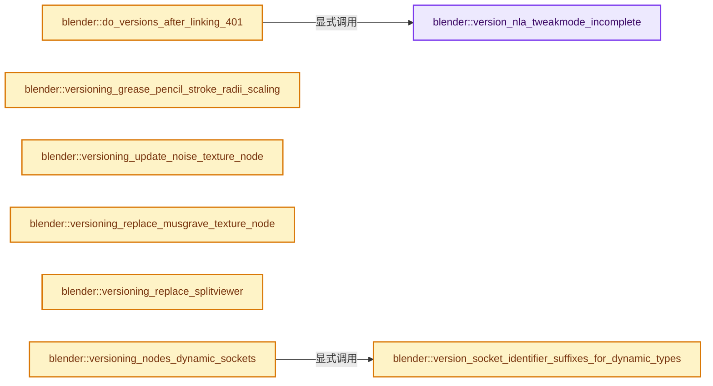

# 实现依赖专题：source/blender/blenloader/intern/versioning_401.cc

[方向导航](README.md) · [符号索引](../%E7%AC%A6%E5%8F%B7%E4%BE%9D%E8%B5%96%E4%B8%8E%E5%AE%9E%E7%8E%B0%E7%B4%A2%E5%BC%95.md)

本专题从正文实际调用进入，集中保存共享实现。函数有稳定锚点，可从调用处直接跳到对应完整函数；递归与互相调用通过回链组织。

## 本文件的实现关系




## 完整成员与函数实现

<a id="f-88fab68d4c4cdc87"></a>

### `blender::version_nla_tweakmode_incomplete`

实现位置：[source/blender/blenloader/intern/versioning_401.cc](../../../../../source/blender/blenloader/intern/versioning_401.cc) · L65—L97。

接口参数：

- `Main *bmain`

**教学注释版**

<!-- annotated:4a4d29d72c3da3 -->

```cpp
static void version_nla_tweakmode_incomplete(Main *bmain)
{
  bool any_valid_tweakmode_left = false;

  ID *id;
  FOREACH_MAIN_ID_BEGIN (bmain, id) {
    AnimData *adt = BKE_animdata_from_id(id);
    if (!adt || !(adt->flag & ADT_NLA_EDIT_ON)) {
      continue;
    }

    if (adt->act_track && adt->actstrip) {
      /* Expected case. */
      any_valid_tweakmode_left = true;
      continue;
    }

    /* Not enough info in the blend file to reliably stay in tweak mode. This is the most important
     * part of this versioning code, as it prevents future nullptr access. */
    BKE_nla_tweakmode_exit({*id, *adt});
  }
  FOREACH_MAIN_ID_END;

  if (any_valid_tweakmode_left) {
    /* There are still NLA strips correctly in tweak mode. */
    return;
  }

  /* Nothing is in a valid tweakmode, so just disable the corresponding flags on all scenes. */
  for (Scene &scene : bmain->scenes) {
    scene.flag &= ~SCE_NLA_EDIT_ON;
  }
}
```

<details>
<summary>核对原始源码：source/blender/blenloader/intern/versioning_401.cc · L65—L97</summary>

<!-- original:4a4d29d72c3da3:source/blender/blenloader/intern/versioning_401.cc:65:97 -->

```cpp
static void version_nla_tweakmode_incomplete(Main *bmain)
{
  bool any_valid_tweakmode_left = false;

  ID *id;
  FOREACH_MAIN_ID_BEGIN (bmain, id) {
    AnimData *adt = BKE_animdata_from_id(id);
    if (!adt || !(adt->flag & ADT_NLA_EDIT_ON)) {
      continue;
    }

    if (adt->act_track && adt->actstrip) {
      /* Expected case. */
      any_valid_tweakmode_left = true;
      continue;
    }

    /* Not enough info in the blend file to reliably stay in tweak mode. This is the most important
     * part of this versioning code, as it prevents future nullptr access. */
    BKE_nla_tweakmode_exit({*id, *adt});
  }
  FOREACH_MAIN_ID_END;

  if (any_valid_tweakmode_left) {
    /* There are still NLA strips correctly in tweak mode. */
    return;
  }

  /* Nothing is in a valid tweakmode, so just disable the corresponding flags on all scenes. */
  for (Scene &scene : bmain->scenes) {
    scene.flag &= ~SCE_NLA_EDIT_ON;
  }
}
```

</details>

**沿实际写入检查状态**

- `any_valid_tweakmode_left = true;`
- `scene.flag &= ~SCE_NLA_EDIT_ON;`

**继续追踪实现**

- `BKE_animdata_from_id` → [blender::BKE_animdata_from_id · L93](%E4%BE%9D%E8%B5%96-anim_data-56c81c.md#f-354e5421ff0a6c96)。
- `BKE_nla_tweakmode_exit` → [blender::BKE_nla_tweakmode_exit · L2510](%E4%BE%9D%E8%B5%96-nla-763f5d.md#f-ac7712242983a12d)。

<a id="f-8160bff1debeef53"></a>

### `blender::do_versions_after_linking_401`

实现位置：[source/blender/blenloader/intern/versioning_401.cc](../../../../../source/blender/blenloader/intern/versioning_401.cc) · L99—L104。

接口参数：

- `FileData *`
- `Main *bmain`

**教学注释版**

<!-- annotated:7e923fa3051e36 -->

```cpp
void do_versions_after_linking_401(FileData * /*fd*/, Main *bmain)
{
  if (!MAIN_VERSION_FILE_ATLEAST(bmain, 401, 23)) {
    version_nla_tweakmode_incomplete(bmain);
  }
}
```

<details>
<summary>核对原始源码：source/blender/blenloader/intern/versioning_401.cc · L99—L104</summary>

<!-- original:7e923fa3051e36:source/blender/blenloader/intern/versioning_401.cc:99:104 -->

```cpp
void do_versions_after_linking_401(FileData * /*fd*/, Main *bmain)
{
  if (!MAIN_VERSION_FILE_ATLEAST(bmain, 401, 23)) {
    version_nla_tweakmode_incomplete(bmain);
  }
}
```

</details>

**继续追踪实现**

- `MAIN_VERSION_FILE_ATLEAST` → [MAIN_VERSION_FILE_ATLEAST · L946](%E4%BE%9D%E8%B5%96-BKE_main-626d8f.md#m-f0c0a8da9411)。宏定义由构建条件选择。
- `version_nla_tweakmode_incomplete` → [blender::version_nla_tweakmode_incomplete · L65](%E4%BE%9D%E8%B5%96-versioning_401-c439dd.md#f-88fab68d4c4cdc87)。

<a id="f-df470190b16df5b6"></a>

### `blender::versioning_grease_pencil_stroke_radii_scaling`

实现位置：[source/blender/blenloader/intern/versioning_401.cc](../../../../../source/blender/blenloader/intern/versioning_401.cc) · L106—L120。

接口参数：

- `GreasePencil *grease_pencil`

**教学注释版**

<!-- annotated:640fd6ecf163cf -->

```cpp
static void versioning_grease_pencil_stroke_radii_scaling(GreasePencil *grease_pencil)
{
  for (GreasePencilDrawingBase *base : grease_pencil->drawings()) {
    if (base->type != GP_DRAWING) {
      continue;
    }
    bke::greasepencil::Drawing &drawing = reinterpret_cast<GreasePencilDrawing *>(base)->wrap();
    MutableSpan<float> radii = drawing.radii_for_write();
    // [讲解] radii.index_range：查询视图长度或生成对应有效索引区间。
    threading::parallel_for(radii.index_range(), 8192, [&](const IndexRange range) {
      for (const int i : range) {
        radii[i] *= bke::greasepencil::LEGACY_RADIUS_CONVERSION_FACTOR;
      }
    });
  }
}
```

<details>
<summary>核对原始源码：source/blender/blenloader/intern/versioning_401.cc · L106—L120</summary>

<!-- original:640fd6ecf163cf:source/blender/blenloader/intern/versioning_401.cc:106:120 -->

```cpp
static void versioning_grease_pencil_stroke_radii_scaling(GreasePencil *grease_pencil)
{
  for (GreasePencilDrawingBase *base : grease_pencil->drawings()) {
    if (base->type != GP_DRAWING) {
      continue;
    }
    bke::greasepencil::Drawing &drawing = reinterpret_cast<GreasePencilDrawing *>(base)->wrap();
    MutableSpan<float> radii = drawing.radii_for_write();
    threading::parallel_for(radii.index_range(), 8192, [&](const IndexRange range) {
      for (const int i : range) {
        radii[i] *= bke::greasepencil::LEGACY_RADIUS_CONVERSION_FACTOR;
      }
    });
  }
}
```

</details>

**沿实际写入检查状态**

- `radii[i] *= bke::greasepencil::LEGACY_RADIUS_CONVERSION_FACTOR;`

**继续追踪实现**

- `grease_pencil->drawings` → [blender::GreasePencil::drawings · L3338](%E4%BE%9D%E8%B5%96-grease_pencil-f750d6.md#f-4a9381efc430533a)；[blender::GreasePencil::drawings · L3343](%E4%BE%9D%E8%B5%96-grease_pencil-f750d6.md#f-75a528a69126428b)。同名重载需按实参类型选择。
- `reinterpret_cast<GreasePencilDrawing *>(base)->wrap` → [调用协议](../%E6%A8%A1%E6%9D%BF%E5%AE%8F%E4%B8%8E%E5%8A%A8%E6%80%81%E5%88%86%E6%B4%BE%E5%8D%8F%E8%AE%AE.md)：接收对象类型依赖auto、返回值或模板实例；不按同名猜测目标。调用位置L112。
- `drawing.radii_for_write` → [blender::bke::greasepencil::Drawing::radii_for_write · L1023](%E4%BE%9D%E8%B5%96-grease_pencil-f750d6.md#f-53b2a01d6a3079c0)。
- `threading::parallel_for` → [blender::threading::parallel_for · L68](../11-Depsgraph%E4%B8%8E%E5%B9%B6%E8%A1%8C%E4%BB%BB%E5%8A%A1%E7%B3%BB%E7%BB%9F/07-%E4%BB%BB%E5%8A%A1%E6%B1%A0%E4%B8%8ETBB%E6%8E%A5%E5%85%A5.md#f-838294754c24426c)。
- `radii.index_range` → [blender::MutableSpan::index_range · L676](../01-%E5%9F%BA%E7%A1%80%E5%AE%B9%E5%99%A8%E4%B8%8E%E7%8E%B0%E4%BB%A3CPP/06-MutableSpan%E5%8F%AF%E5%86%99%E8%A7%86%E5%9B%BE.md#f-f9a9d59a69ca64b5)。

<a id="f-b9c0cef5c9742a24"></a>

### `blender::versioning_update_noise_texture_node`

实现位置：[source/blender/blenloader/intern/versioning_401.cc](../../../../../source/blender/blenloader/intern/versioning_401.cc) · L122—L183。

接口参数：

- `bNodeTree *ntree`

**教学注释版**

<!-- annotated:d9821c9c726dfd -->

```cpp
static void versioning_update_noise_texture_node(bNodeTree *ntree)
{
  for (bNode &node : ntree->nodes) {
    if (node.type_legacy != SH_NODE_TEX_NOISE) {
      continue;
    }
    if (!version_node_ensure_storage_or_invalidate(node)) {
      continue;
    }

    (static_cast<NodeTexNoise *>(node.storage))->type = SHD_NOISE_FBM;

    bNodeSocket *roughness_socket = bke::node_find_socket(node, SOCK_IN, "Roughness"_ustr);
    if (roughness_socket == nullptr) {
      /* Noise Texture node was created before the Roughness input was added. */
      continue;
    }

    float *roughness = version_cycles_node_socket_float_value(roughness_socket);

    bNodeLink *roughness_link = nullptr;
    bNode *roughness_from_node = nullptr;
    bNodeSocket *roughness_from_socket = nullptr;

    for (bNodeLink &link : ntree->links) {
      /* Find links, nodes and sockets. */
      if (link.tosock == roughness_socket) {
        roughness_link = &link;
        roughness_from_node = link.fromnode;
        roughness_from_socket = link.fromsock;
      }
    }

    if (roughness_link != nullptr) {
      /* Add Clamp node before Roughness input. */

      bNode *clamp_node = bke::node_add_static_node(nullptr, *ntree, SH_NODE_CLAMP);
      clamp_node->parent = node.parent;
      clamp_node->custom1 = NODE_CLAMP_MINMAX;
      clamp_node->locx_legacy = node.locx_legacy;
      clamp_node->locy_legacy = node.locy_legacy - 300.0f;
      clamp_node->flag |= NODE_COLLAPSED;
      bNodeSocket *clamp_socket_value = bke::node_find_socket(*clamp_node, SOCK_IN, "Value"_ustr);
      bNodeSocket *clamp_socket_min = bke::node_find_socket(*clamp_node, SOCK_IN, "Min"_ustr);
      bNodeSocket *clamp_socket_max = bke::node_find_socket(*clamp_node, SOCK_IN, "Max"_ustr);
      bNodeSocket *clamp_socket_out = bke::node_find_socket(*clamp_node, SOCK_OUT, "Result"_ustr);

      *version_cycles_node_socket_float_value(clamp_socket_min) = 0.0f;
      *version_cycles_node_socket_float_value(clamp_socket_max) = 1.0f;

      bke::node_remove_link(ntree, *roughness_link);
      bke::node_add_link(
          *ntree, *roughness_from_node, *roughness_from_socket, *clamp_node, *clamp_socket_value);
      bke::node_add_link(*ntree, *clamp_node, *clamp_socket_out, node, *roughness_socket);
    }
    else {
      *roughness = std::clamp(*roughness, 0.0f, 1.0f);
    }
  }

  version_socket_update_is_used(ntree);
}
```

<details>
<summary>核对原始源码：source/blender/blenloader/intern/versioning_401.cc · L122—L183</summary>

<!-- original:d9821c9c726dfd:source/blender/blenloader/intern/versioning_401.cc:122:183 -->

```cpp
static void versioning_update_noise_texture_node(bNodeTree *ntree)
{
  for (bNode &node : ntree->nodes) {
    if (node.type_legacy != SH_NODE_TEX_NOISE) {
      continue;
    }
    if (!version_node_ensure_storage_or_invalidate(node)) {
      continue;
    }

    (static_cast<NodeTexNoise *>(node.storage))->type = SHD_NOISE_FBM;

    bNodeSocket *roughness_socket = bke::node_find_socket(node, SOCK_IN, "Roughness"_ustr);
    if (roughness_socket == nullptr) {
      /* Noise Texture node was created before the Roughness input was added. */
      continue;
    }

    float *roughness = version_cycles_node_socket_float_value(roughness_socket);

    bNodeLink *roughness_link = nullptr;
    bNode *roughness_from_node = nullptr;
    bNodeSocket *roughness_from_socket = nullptr;

    for (bNodeLink &link : ntree->links) {
      /* Find links, nodes and sockets. */
      if (link.tosock == roughness_socket) {
        roughness_link = &link;
        roughness_from_node = link.fromnode;
        roughness_from_socket = link.fromsock;
      }
    }

    if (roughness_link != nullptr) {
      /* Add Clamp node before Roughness input. */

      bNode *clamp_node = bke::node_add_static_node(nullptr, *ntree, SH_NODE_CLAMP);
      clamp_node->parent = node.parent;
      clamp_node->custom1 = NODE_CLAMP_MINMAX;
      clamp_node->locx_legacy = node.locx_legacy;
      clamp_node->locy_legacy = node.locy_legacy - 300.0f;
      clamp_node->flag |= NODE_COLLAPSED;
      bNodeSocket *clamp_socket_value = bke::node_find_socket(*clamp_node, SOCK_IN, "Value"_ustr);
      bNodeSocket *clamp_socket_min = bke::node_find_socket(*clamp_node, SOCK_IN, "Min"_ustr);
      bNodeSocket *clamp_socket_max = bke::node_find_socket(*clamp_node, SOCK_IN, "Max"_ustr);
      bNodeSocket *clamp_socket_out = bke::node_find_socket(*clamp_node, SOCK_OUT, "Result"_ustr);

      *version_cycles_node_socket_float_value(clamp_socket_min) = 0.0f;
      *version_cycles_node_socket_float_value(clamp_socket_max) = 1.0f;

      bke::node_remove_link(ntree, *roughness_link);
      bke::node_add_link(
          *ntree, *roughness_from_node, *roughness_from_socket, *clamp_node, *clamp_socket_value);
      bke::node_add_link(*ntree, *clamp_node, *clamp_socket_out, node, *roughness_socket);
    }
    else {
      *roughness = std::clamp(*roughness, 0.0f, 1.0f);
    }
  }

  version_socket_update_is_used(ntree);
}
```

</details>

**沿实际写入检查状态**

- `roughness_link = &link;`
- `roughness_from_node = link.fromnode;`
- `roughness_from_socket = link.fromsock;`
- `clamp_node->parent = node.parent;`
- `clamp_node->custom1 = NODE_CLAMP_MINMAX;`
- `clamp_node->locx_legacy = node.locx_legacy;`
- `clamp_node->locy_legacy = node.locy_legacy - 300.0f;`
- `clamp_node->flag |= NODE_COLLAPSED;`

**继续追踪实现**

- `version_node_ensure_storage_or_invalidate` → [blender::version_node_ensure_storage_or_invalidate · L389](%E4%BE%9D%E8%B5%96-versioning_common-5f7e5c.md#f-72131ae3b96134c2)。
- `bke::node_find_socket` → [blender::bke::node_find_socket · L3036](%E4%BE%9D%E8%B5%96-node-89d753.md#f-cbf9dec71aff5b59)；[blender::bke::node_find_socket · L3047](%E4%BE%9D%E8%B5%96-node-89d753.md#f-4a7a677634b7fbd1)。同名重载需按实参类型选择。
- `version_cycles_node_socket_float_value` → [blender::version_cycles_node_socket_float_value · L607](%E4%BE%9D%E8%B5%96-versioning_common-5f7e5c.md#f-3809c86da7c876d6)。
- `bke::node_add_static_node` → [blender::bke::node_add_static_node · L4283](%E4%BE%9D%E8%B5%96-node-89d753.md#f-aaa71011c0fa550b)。
- `bke::node_remove_link` → [blender::bke::node_remove_link · L4676](%E4%BE%9D%E8%B5%96-node-89d753.md#f-3cf1faf3e4cf3dd2)。
- `bke::node_add_link` → [blender::bke::node_add_link · L4638](%E4%BE%9D%E8%B5%96-node-89d753.md#f-e4b0f883348f0d24)。
- `std::clamp` → [外部契约](https://eel.is/c++draft/)：这个边界按实际表达式及所属类型核对参数、返回值、寿命与失败行为。这里提供接口入口，不声称已解释该第三方版本的内部实现。
- `version_socket_update_is_used` → [blender::version_socket_update_is_used · L517](%E4%BE%9D%E8%B5%96-versioning_common-5f7e5c.md#f-6809d6759769c2c4)。

<a id="f-034a4f1b58467f96"></a>

### `blender::versioning_replace_musgrave_texture_node`

实现位置：[source/blender/blenloader/intern/versioning_401.cc](../../../../../source/blender/blenloader/intern/versioning_401.cc) · L185—L576。

接口参数：

- `bNodeTree *ntree`

**教学注释版**

<!-- annotated:5dc5cd2fd2814d -->

```cpp
static void versioning_replace_musgrave_texture_node(bNodeTree *ntree)
{
  version_node_input_socket_name(ntree, SH_NODE_TEX_MUSGRAVE_DEPRECATED, "Dimension", "Roughness");
  for (bNode &node : ntree->nodes) {
    if (node.type_legacy != SH_NODE_TEX_MUSGRAVE_DEPRECATED) {
      continue;
    }
    if (!version_node_ensure_storage_or_invalidate(node)) {
      continue;
    }

    STRNCPY_UTF8(node.idname, "ShaderNodeTexNoise");
    node.type_legacy = SH_NODE_TEX_NOISE;
    NodeTexNoise *data = MEM_new<NodeTexNoise>(__func__);
    NodeTexMusgrave *musgrave_data = static_cast<NodeTexMusgrave *>(node.storage);
    data->base = musgrave_data->base;
    data->dimensions = musgrave_data->dimensions;
    data->normalize = false;
    data->type = musgrave_data->musgrave_type;
    MEM_delete(musgrave_data);
    node.storage = data;

    bNodeLink *detail_link = nullptr;
    bNode *detail_from_node = nullptr;
    bNodeSocket *detail_from_socket = nullptr;

    bNodeLink *roughness_link = nullptr;
    bNode *roughness_from_node = nullptr;
    bNodeSocket *roughness_from_socket = nullptr;

    bNodeLink *lacunarity_link = nullptr;
    bNode *lacunarity_from_node = nullptr;
    bNodeSocket *lacunarity_from_socket = nullptr;

    for (bNodeLink &link : ntree->links) {
      /* Find links, nodes and sockets. */
      if (link.tonode == &node) {
        if (STREQ(link.tosock->identifier, "Detail")) {
          detail_link = &link;
          detail_from_node = link.fromnode;
          detail_from_socket = link.fromsock;
        }
        if (STREQ(link.tosock->identifier, "Roughness")) {
          roughness_link = &link;
          roughness_from_node = link.fromnode;
          roughness_from_socket = link.fromsock;
        }
        if (STREQ(link.tosock->identifier, "Lacunarity")) {
          lacunarity_link = &link;
          lacunarity_from_node = link.fromnode;
          lacunarity_from_socket = link.fromsock;
        }
      }
    }

    uint8_t noise_type = (static_cast<NodeTexNoise *>(node.storage))->type;
    float locy_offset = 0.0f;

    bNodeSocket *fac_socket = bke::node_find_socket(node, SOCK_OUT, "Fac"_ustr);
    /* Clear label because Musgrave output socket label is set to "Height" instead of "Fac". */
    fac_socket->label[0] = '\0';

    bNodeSocket *detail_socket = bke::node_find_socket(node, SOCK_IN, "Detail"_ustr);
    float *detail = version_cycles_node_socket_float_value(detail_socket);

    if (detail_link != nullptr) {
      locy_offset -= 80.0f;

      /* Add Minimum Math node and Subtract Math node before Detail input. */

      bNode *min_node = bke::node_add_static_node(nullptr, *ntree, SH_NODE_MATH);
      min_node->parent = node.parent;
      min_node->custom1 = NODE_MATH_MINIMUM;
      min_node->locx_legacy = node.locx_legacy;
      min_node->locy_legacy = node.locy_legacy - 320.0f;
      min_node->flag |= NODE_COLLAPSED;
      bNodeSocket *min_socket_A = static_cast<bNodeSocket *>(BLI_findlink(&min_node->inputs, 0));
      bNodeSocket *min_socket_B = static_cast<bNodeSocket *>(BLI_findlink(&min_node->inputs, 1));
      bNodeSocket *min_socket_out = bke::node_find_socket(*min_node, SOCK_OUT, "Value"_ustr);

      bNode *sub1_node = bke::node_add_static_node(nullptr, *ntree, SH_NODE_MATH);
      sub1_node->parent = node.parent;
      sub1_node->custom1 = NODE_MATH_SUBTRACT;
      sub1_node->locx_legacy = node.locx_legacy;
      sub1_node->locy_legacy = node.locy_legacy - 360.0f;
      sub1_node->flag |= NODE_COLLAPSED;
      bNodeSocket *sub1_socket_A = static_cast<bNodeSocket *>(BLI_findlink(&sub1_node->inputs, 0));
      bNodeSocket *sub1_socket_B = static_cast<bNodeSocket *>(BLI_findlink(&sub1_node->inputs, 1));
      bNodeSocket *sub1_socket_out = bke::node_find_socket(*sub1_node, SOCK_OUT, "Value"_ustr);

      *version_cycles_node_socket_float_value(min_socket_B) = 14.0f;
      *version_cycles_node_socket_float_value(sub1_socket_B) = 1.0f;

      bke::node_remove_link(ntree, *detail_link);
      bke::node_add_link(
          *ntree, *detail_from_node, *detail_from_socket, *sub1_node, *sub1_socket_A);
      bke::node_add_link(*ntree, *sub1_node, *sub1_socket_out, *min_node, *min_socket_A);
      bke::node_add_link(*ntree, *min_node, *min_socket_out, node, *detail_socket);

      if (ELEM(noise_type, SHD_NOISE_RIDGED_MULTIFRACTAL, SHD_NOISE_HETERO_TERRAIN)) {
        locy_offset -= 40.0f;

        /* Add Greater Than Math node before Subtract Math node. */

        bNode *greater_node = bke::node_add_static_node(nullptr, *ntree, SH_NODE_MATH);
        greater_node->parent = node.parent;
        greater_node->custom1 = NODE_MATH_GREATER_THAN;
        greater_node->locx_legacy = node.locx_legacy;
        greater_node->locy_legacy = node.locy_legacy - 400.0f;
        greater_node->flag |= NODE_COLLAPSED;
        bNodeSocket *greater_socket_A = static_cast<bNodeSocket *>(
            BLI_findlink(&greater_node->inputs, 0));
        bNodeSocket *greater_socket_B = static_cast<bNodeSocket *>(
            BLI_findlink(&greater_node->inputs, 1));
        bNodeSocket *greater_socket_out = bke::node_find_socket(
            *greater_node, SOCK_OUT, "Value"_ustr);

        *version_cycles_node_socket_float_value(greater_socket_B) = 1.0f;

        bke::node_add_link(
            *ntree, *detail_from_node, *detail_from_socket, *greater_node, *greater_socket_A);
        bke::node_add_link(*ntree, *greater_node, *greater_socket_out, *sub1_node, *sub1_socket_B);
      }
      else {
        /* Add Clamp node and Multiply Math node behind Fac output. */

        bNode *clamp_node = bke::node_add_static_node(nullptr, *ntree, SH_NODE_CLAMP);
        clamp_node->parent = node.parent;
        clamp_node->custom1 = NODE_CLAMP_MINMAX;
        clamp_node->locx_legacy = node.locx_legacy;
        clamp_node->locy_legacy = node.locy_legacy + 40.0f;
        clamp_node->flag |= NODE_COLLAPSED;
        bNodeSocket *clamp_socket_value = bke::node_find_socket(
            *clamp_node, SOCK_IN, "Value"_ustr);
        bNodeSocket *clamp_socket_min = bke::node_find_socket(*clamp_node, SOCK_IN, "Min"_ustr);
        bNodeSocket *clamp_socket_max = bke::node_find_socket(*clamp_node, SOCK_IN, "Max"_ustr);
        bNodeSocket *clamp_socket_out = bke::node_find_socket(
            *clamp_node, SOCK_OUT, "Result"_ustr);

        bNode *mul_node = bke::node_add_static_node(nullptr, *ntree, SH_NODE_MATH);
        mul_node->parent = node.parent;
        mul_node->custom1 = NODE_MATH_MULTIPLY;
        mul_node->locx_legacy = node.locx_legacy;
        mul_node->locy_legacy = node.locy_legacy + 80.0f;
        mul_node->flag |= NODE_COLLAPSED;
        bNodeSocket *mul_socket_A = static_cast<bNodeSocket *>(BLI_findlink(&mul_node->inputs, 0));
        bNodeSocket *mul_socket_B = static_cast<bNodeSocket *>(BLI_findlink(&mul_node->inputs, 1));
        bNodeSocket *mul_socket_out = bke::node_find_socket(*mul_node, SOCK_OUT, "Value"_ustr);

        *version_cycles_node_socket_float_value(clamp_socket_min) = 0.0f;
        *version_cycles_node_socket_float_value(clamp_socket_max) = 1.0f;

        if (noise_type == SHD_NOISE_MULTIFRACTAL) {
          /* Add Subtract Math node and Add Math node after Multiply Math node. */

          bNode *sub2_node = bke::node_add_static_node(nullptr, *ntree, SH_NODE_MATH);
          sub2_node->parent = node.parent;
          sub2_node->custom1 = NODE_MATH_SUBTRACT;
          sub2_node->custom2 = SHD_MATH_CLAMP;
          sub2_node->locx_legacy = node.locx_legacy;
          sub2_node->locy_legacy = node.locy_legacy + 120.0f;
          sub2_node->flag |= NODE_COLLAPSED;
          bNodeSocket *sub2_socket_A = static_cast<bNodeSocket *>(
              BLI_findlink(&sub2_node->inputs, 0));
          bNodeSocket *sub2_socket_B = static_cast<bNodeSocket *>(
              BLI_findlink(&sub2_node->inputs, 1));
          bNodeSocket *sub2_socket_out = bke::node_find_socket(*sub2_node, SOCK_OUT, "Value"_ustr);

          bNode *add_node = bke::node_add_static_node(nullptr, *ntree, SH_NODE_MATH);
          add_node->parent = node.parent;
          add_node->custom1 = NODE_MATH_ADD;
          add_node->locx_legacy = node.locx_legacy;
          add_node->locy_legacy = node.locy_legacy + 160.0f;
          add_node->flag |= NODE_COLLAPSED;
          bNodeSocket *add_socket_A = static_cast<bNodeSocket *>(
              BLI_findlink(&add_node->inputs, 0));
          bNodeSocket *add_socket_B = static_cast<bNodeSocket *>(
              BLI_findlink(&add_node->inputs, 1));
          bNodeSocket *add_socket_out = bke::node_find_socket(*add_node, SOCK_OUT, "Value"_ustr);

          *version_cycles_node_socket_float_value(sub2_socket_A) = 1.0f;

          for (bNodeLink &link : ntree->links.items_reversed_mutable()) {
            if (link.fromsock == fac_socket) {
              bke::node_add_link(*ntree, *add_node, *add_socket_out, *link.tonode, *link.tosock);
              bke::node_remove_link(ntree, link);
            }
          }

          bke::node_add_link(*ntree, *mul_node, *mul_socket_out, *add_node, *add_socket_A);
          bke::node_add_link(
              *ntree, *detail_from_node, *detail_from_socket, *sub2_node, *sub2_socket_B);
          bke::node_add_link(*ntree, *sub2_node, *sub2_socket_out, *add_node, *add_socket_B);
        }
        else {
          for (bNodeLink &link : ntree->links.items_reversed_mutable()) {
            if (link.fromsock == fac_socket) {
              bke::node_add_link(*ntree, *mul_node, *mul_socket_out, *link.tonode, *link.tosock);
              bke::node_remove_link(ntree, link);
            }
          }
        }

        bke::node_add_link(*ntree, node, *fac_socket, *mul_node, *mul_socket_A);
        bke::node_add_link(
            *ntree, *detail_from_node, *detail_from_socket, *clamp_node, *clamp_socket_value);
        bke::node_add_link(*ntree, *clamp_node, *clamp_socket_out, *mul_node, *mul_socket_B);
      }
    }
    else {
      if (*detail < 1.0f) {
        if (!ELEM(noise_type, SHD_NOISE_RIDGED_MULTIFRACTAL, SHD_NOISE_HETERO_TERRAIN)) {
          /* Add Multiply Math node behind Fac output. */

          bNode *mul_node = bke::node_add_static_node(nullptr, *ntree, SH_NODE_MATH);
          mul_node->parent = node.parent;
          mul_node->custom1 = NODE_MATH_MULTIPLY;
          mul_node->locx_legacy = node.locx_legacy;
          mul_node->locy_legacy = node.locy_legacy + 40.0f;
          mul_node->flag |= NODE_COLLAPSED;
          bNodeSocket *mul_socket_A = static_cast<bNodeSocket *>(
              BLI_findlink(&mul_node->inputs, 0));
          bNodeSocket *mul_socket_B = static_cast<bNodeSocket *>(
              BLI_findlink(&mul_node->inputs, 1));
          bNodeSocket *mul_socket_out = bke::node_find_socket(*mul_node, SOCK_OUT, "Value"_ustr);

          *version_cycles_node_socket_float_value(mul_socket_B) = *detail;

          if (noise_type == SHD_NOISE_MULTIFRACTAL) {
            /* Add an Add Math node after Multiply Math node. */

            bNode *add_node = bke::node_add_static_node(nullptr, *ntree, SH_NODE_MATH);
            add_node->parent = node.parent;
            add_node->custom1 = NODE_MATH_ADD;
            add_node->locx_legacy = node.locx_legacy;
            add_node->locy_legacy = node.locy_legacy + 80.0f;
            add_node->flag |= NODE_COLLAPSED;
            bNodeSocket *add_socket_A = static_cast<bNodeSocket *>(
                BLI_findlink(&add_node->inputs, 0));
            bNodeSocket *add_socket_B = static_cast<bNodeSocket *>(
                BLI_findlink(&add_node->inputs, 1));
            bNodeSocket *add_socket_out = bke::node_find_socket(*add_node, SOCK_OUT, "Value"_ustr);

            *version_cycles_node_socket_float_value(add_socket_B) = 1.0f - *detail;

            for (bNodeLink &link : ntree->links.items_reversed_mutable()) {
              if (link.fromsock == fac_socket) {
                bke::node_add_link(*ntree, *add_node, *add_socket_out, *link.tonode, *link.tosock);
                bke::node_remove_link(ntree, link);
              }
            }

            bke::node_add_link(*ntree, *mul_node, *mul_socket_out, *add_node, *add_socket_A);
          }
          else {
            for (bNodeLink &link : ntree->links.items_reversed_mutable()) {
              if (link.fromsock == fac_socket) {
                bke::node_add_link(*ntree, *mul_node, *mul_socket_out, *link.tonode, *link.tosock);
                bke::node_remove_link(ntree, link);
              }
            }
          }

          bke::node_add_link(*ntree, node, *fac_socket, *mul_node, *mul_socket_A);

          *detail = 0.0f;
        }
      }
      else {
        *detail = std::fminf(*detail - 1.0f, 14.0f);
      }
    }

    bNodeSocket *roughness_socket = bke::node_find_socket(node, SOCK_IN, "Roughness"_ustr);
    float *roughness = version_cycles_node_socket_float_value(roughness_socket);
    bNodeSocket *lacunarity_socket = bke::node_find_socket(node, SOCK_IN, "Lacunarity"_ustr);
    float *lacunarity = version_cycles_node_socket_float_value(lacunarity_socket);

    *roughness = std::fmaxf(*roughness, 1e-5f);
    *lacunarity = std::fmaxf(*lacunarity, 1e-5f);

    if (roughness_link != nullptr) {
      /* Add Maximum Math node after output of roughness_from_node. Add Multiply Math node and
       * Power Math node before Roughness input. */

      bNode *max1_node = bke::node_add_static_node(nullptr, *ntree, SH_NODE_MATH);
      max1_node->parent = node.parent;
      max1_node->custom1 = NODE_MATH_MAXIMUM;
      max1_node->locx_legacy = node.locx_legacy;
      max1_node->locy_legacy = node.locy_legacy - 400.0f + locy_offset;
      max1_node->flag |= NODE_COLLAPSED;
      bNodeSocket *max1_socket_A = static_cast<bNodeSocket *>(BLI_findlink(&max1_node->inputs, 0));
      bNodeSocket *max1_socket_B = static_cast<bNodeSocket *>(BLI_findlink(&max1_node->inputs, 1));
      bNodeSocket *max1_socket_out = bke::node_find_socket(*max1_node, SOCK_OUT, "Value"_ustr);

      bNode *mul_node = bke::node_add_static_node(nullptr, *ntree, SH_NODE_MATH);
      mul_node->parent = node.parent;
      mul_node->custom1 = NODE_MATH_MULTIPLY;
      mul_node->locx_legacy = node.locx_legacy;
      mul_node->locy_legacy = node.locy_legacy - 360.0f + locy_offset;
      mul_node->flag |= NODE_COLLAPSED;
      bNodeSocket *mul_socket_A = static_cast<bNodeSocket *>(BLI_findlink(&mul_node->inputs, 0));
      bNodeSocket *mul_socket_B = static_cast<bNodeSocket *>(BLI_findlink(&mul_node->inputs, 1));
      bNodeSocket *mul_socket_out = bke::node_find_socket(*mul_node, SOCK_OUT, "Value"_ustr);

      bNode *pow_node = bke::node_add_static_node(nullptr, *ntree, SH_NODE_MATH);
      pow_node->parent = node.parent;
      pow_node->custom1 = NODE_MATH_POWER;
      pow_node->locx_legacy = node.locx_legacy;
      pow_node->locy_legacy = node.locy_legacy - 320.0f + locy_offset;
      pow_node->flag |= NODE_COLLAPSED;
      bNodeSocket *pow_socket_A = static_cast<bNodeSocket *>(BLI_findlink(&pow_node->inputs, 0));
      bNodeSocket *pow_socket_B = static_cast<bNodeSocket *>(BLI_findlink(&pow_node->inputs, 1));
      bNodeSocket *pow_socket_out = bke::node_find_socket(*pow_node, SOCK_OUT, "Value"_ustr);

      *version_cycles_node_socket_float_value(max1_socket_B) = -1e-5f;
      *version_cycles_node_socket_float_value(mul_socket_B) = -1.0f;
      *version_cycles_node_socket_float_value(pow_socket_A) = *lacunarity;

      bke::node_remove_link(ntree, *roughness_link);
      bke::node_add_link(
          *ntree, *roughness_from_node, *roughness_from_socket, *max1_node, *max1_socket_A);
      bke::node_add_link(*ntree, *max1_node, *max1_socket_out, *mul_node, *mul_socket_A);
      bke::node_add_link(*ntree, *mul_node, *mul_socket_out, *pow_node, *pow_socket_B);
      bke::node_add_link(*ntree, *pow_node, *pow_socket_out, node, *roughness_socket);

      if (lacunarity_link != nullptr) {
        /* Add Maximum Math node after output of lacunarity_from_node. */

        bNode *max2_node = bke::node_add_static_node(nullptr, *ntree, SH_NODE_MATH);
        max2_node->parent = node.parent;
        max2_node->custom1 = NODE_MATH_MAXIMUM;
        max2_node->locx_legacy = node.locx_legacy;
        max2_node->locy_legacy = node.locy_legacy - 440.0f + locy_offset;
        max2_node->flag |= NODE_COLLAPSED;
        bNodeSocket *max2_socket_A = static_cast<bNodeSocket *>(
            BLI_findlink(&max2_node->inputs, 0));
        bNodeSocket *max2_socket_B = static_cast<bNodeSocket *>(
            BLI_findlink(&max2_node->inputs, 1));
        bNodeSocket *max2_socket_out = bke::node_find_socket(*max2_node, SOCK_OUT, "Value"_ustr);

        *version_cycles_node_socket_float_value(max2_socket_B) = -1e-5f;

        bke::node_remove_link(ntree, *lacunarity_link);
        bke::node_add_link(
            *ntree, *lacunarity_from_node, *lacunarity_from_socket, *max2_node, *max2_socket_A);
        bke::node_add_link(*ntree, *max2_node, *max2_socket_out, *pow_node, *pow_socket_A);
        bke::node_add_link(*ntree, *max2_node, *max2_socket_out, node, *lacunarity_socket);
      }
    }
    else if ((lacunarity_link != nullptr) && (roughness_link == nullptr)) {
      /* Add Maximum Math node after output of lacunarity_from_node. Add Power Math node before
       * Roughness input. */

      bNode *max2_node = bke::node_add_static_node(nullptr, *ntree, SH_NODE_MATH);
      max2_node->parent = node.parent;
      max2_node->custom1 = NODE_MATH_MAXIMUM;
      max2_node->locx_legacy = node.locx_legacy;
      max2_node->locy_legacy = node.locy_legacy - 360.0f + locy_offset;
      max2_node->flag |= NODE_COLLAPSED;
      bNodeSocket *max2_socket_A = static_cast<bNodeSocket *>(BLI_findlink(&max2_node->inputs, 0));
      bNodeSocket *max2_socket_B = static_cast<bNodeSocket *>(BLI_findlink(&max2_node->inputs, 1));
      bNodeSocket *max2_socket_out = bke::node_find_socket(*max2_node, SOCK_OUT, "Value"_ustr);

      bNode *pow_node = bke::node_add_static_node(nullptr, *ntree, SH_NODE_MATH);
      pow_node->parent = node.parent;
      pow_node->custom1 = NODE_MATH_POWER;
      pow_node->locx_legacy = node.locx_legacy;
      pow_node->locy_legacy = node.locy_legacy - 320.0f + locy_offset;
      pow_node->flag |= NODE_COLLAPSED;
      bNodeSocket *pow_socket_A = static_cast<bNodeSocket *>(BLI_findlink(&pow_node->inputs, 0));
      bNodeSocket *pow_socket_B = static_cast<bNodeSocket *>(BLI_findlink(&pow_node->inputs, 1));
      bNodeSocket *pow_socket_out = bke::node_find_socket(*pow_node, SOCK_OUT, "Value"_ustr);

      *version_cycles_node_socket_float_value(max2_socket_B) = -1e-5f;
      *version_cycles_node_socket_float_value(pow_socket_A) = *lacunarity;
      *version_cycles_node_socket_float_value(pow_socket_B) = -(*roughness);

      bke::node_remove_link(ntree, *lacunarity_link);
      bke::node_add_link(
          *ntree, *lacunarity_from_node, *lacunarity_from_socket, *max2_node, *max2_socket_A);
      bke::node_add_link(*ntree, *max2_node, *max2_socket_out, *pow_node, *pow_socket_A);
      bke::node_add_link(*ntree, *max2_node, *max2_socket_out, node, *lacunarity_socket);
      bke::node_add_link(*ntree, *pow_node, *pow_socket_out, node, *roughness_socket);
    }
    else {
      *roughness = std::pow(*lacunarity, -(*roughness));
    }
  }

  version_socket_update_is_used(ntree);
}
```

<details>
<summary>核对原始源码：source/blender/blenloader/intern/versioning_401.cc · L185—L576</summary>

<!-- original:5dc5cd2fd2814d:source/blender/blenloader/intern/versioning_401.cc:185:576 -->

```cpp
static void versioning_replace_musgrave_texture_node(bNodeTree *ntree)
{
  version_node_input_socket_name(ntree, SH_NODE_TEX_MUSGRAVE_DEPRECATED, "Dimension", "Roughness");
  for (bNode &node : ntree->nodes) {
    if (node.type_legacy != SH_NODE_TEX_MUSGRAVE_DEPRECATED) {
      continue;
    }
    if (!version_node_ensure_storage_or_invalidate(node)) {
      continue;
    }

    STRNCPY_UTF8(node.idname, "ShaderNodeTexNoise");
    node.type_legacy = SH_NODE_TEX_NOISE;
    NodeTexNoise *data = MEM_new<NodeTexNoise>(__func__);
    NodeTexMusgrave *musgrave_data = static_cast<NodeTexMusgrave *>(node.storage);
    data->base = musgrave_data->base;
    data->dimensions = musgrave_data->dimensions;
    data->normalize = false;
    data->type = musgrave_data->musgrave_type;
    MEM_delete(musgrave_data);
    node.storage = data;

    bNodeLink *detail_link = nullptr;
    bNode *detail_from_node = nullptr;
    bNodeSocket *detail_from_socket = nullptr;

    bNodeLink *roughness_link = nullptr;
    bNode *roughness_from_node = nullptr;
    bNodeSocket *roughness_from_socket = nullptr;

    bNodeLink *lacunarity_link = nullptr;
    bNode *lacunarity_from_node = nullptr;
    bNodeSocket *lacunarity_from_socket = nullptr;

    for (bNodeLink &link : ntree->links) {
      /* Find links, nodes and sockets. */
      if (link.tonode == &node) {
        if (STREQ(link.tosock->identifier, "Detail")) {
          detail_link = &link;
          detail_from_node = link.fromnode;
          detail_from_socket = link.fromsock;
        }
        if (STREQ(link.tosock->identifier, "Roughness")) {
          roughness_link = &link;
          roughness_from_node = link.fromnode;
          roughness_from_socket = link.fromsock;
        }
        if (STREQ(link.tosock->identifier, "Lacunarity")) {
          lacunarity_link = &link;
          lacunarity_from_node = link.fromnode;
          lacunarity_from_socket = link.fromsock;
        }
      }
    }

    uint8_t noise_type = (static_cast<NodeTexNoise *>(node.storage))->type;
    float locy_offset = 0.0f;

    bNodeSocket *fac_socket = bke::node_find_socket(node, SOCK_OUT, "Fac"_ustr);
    /* Clear label because Musgrave output socket label is set to "Height" instead of "Fac". */
    fac_socket->label[0] = '\0';

    bNodeSocket *detail_socket = bke::node_find_socket(node, SOCK_IN, "Detail"_ustr);
    float *detail = version_cycles_node_socket_float_value(detail_socket);

    if (detail_link != nullptr) {
      locy_offset -= 80.0f;

      /* Add Minimum Math node and Subtract Math node before Detail input. */

      bNode *min_node = bke::node_add_static_node(nullptr, *ntree, SH_NODE_MATH);
      min_node->parent = node.parent;
      min_node->custom1 = NODE_MATH_MINIMUM;
      min_node->locx_legacy = node.locx_legacy;
      min_node->locy_legacy = node.locy_legacy - 320.0f;
      min_node->flag |= NODE_COLLAPSED;
      bNodeSocket *min_socket_A = static_cast<bNodeSocket *>(BLI_findlink(&min_node->inputs, 0));
      bNodeSocket *min_socket_B = static_cast<bNodeSocket *>(BLI_findlink(&min_node->inputs, 1));
      bNodeSocket *min_socket_out = bke::node_find_socket(*min_node, SOCK_OUT, "Value"_ustr);

      bNode *sub1_node = bke::node_add_static_node(nullptr, *ntree, SH_NODE_MATH);
      sub1_node->parent = node.parent;
      sub1_node->custom1 = NODE_MATH_SUBTRACT;
      sub1_node->locx_legacy = node.locx_legacy;
      sub1_node->locy_legacy = node.locy_legacy - 360.0f;
      sub1_node->flag |= NODE_COLLAPSED;
      bNodeSocket *sub1_socket_A = static_cast<bNodeSocket *>(BLI_findlink(&sub1_node->inputs, 0));
      bNodeSocket *sub1_socket_B = static_cast<bNodeSocket *>(BLI_findlink(&sub1_node->inputs, 1));
      bNodeSocket *sub1_socket_out = bke::node_find_socket(*sub1_node, SOCK_OUT, "Value"_ustr);

      *version_cycles_node_socket_float_value(min_socket_B) = 14.0f;
      *version_cycles_node_socket_float_value(sub1_socket_B) = 1.0f;

      bke::node_remove_link(ntree, *detail_link);
      bke::node_add_link(
          *ntree, *detail_from_node, *detail_from_socket, *sub1_node, *sub1_socket_A);
      bke::node_add_link(*ntree, *sub1_node, *sub1_socket_out, *min_node, *min_socket_A);
      bke::node_add_link(*ntree, *min_node, *min_socket_out, node, *detail_socket);

      if (ELEM(noise_type, SHD_NOISE_RIDGED_MULTIFRACTAL, SHD_NOISE_HETERO_TERRAIN)) {
        locy_offset -= 40.0f;

        /* Add Greater Than Math node before Subtract Math node. */

        bNode *greater_node = bke::node_add_static_node(nullptr, *ntree, SH_NODE_MATH);
        greater_node->parent = node.parent;
        greater_node->custom1 = NODE_MATH_GREATER_THAN;
        greater_node->locx_legacy = node.locx_legacy;
        greater_node->locy_legacy = node.locy_legacy - 400.0f;
        greater_node->flag |= NODE_COLLAPSED;
        bNodeSocket *greater_socket_A = static_cast<bNodeSocket *>(
            BLI_findlink(&greater_node->inputs, 0));
        bNodeSocket *greater_socket_B = static_cast<bNodeSocket *>(
            BLI_findlink(&greater_node->inputs, 1));
        bNodeSocket *greater_socket_out = bke::node_find_socket(
            *greater_node, SOCK_OUT, "Value"_ustr);

        *version_cycles_node_socket_float_value(greater_socket_B) = 1.0f;

        bke::node_add_link(
            *ntree, *detail_from_node, *detail_from_socket, *greater_node, *greater_socket_A);
        bke::node_add_link(*ntree, *greater_node, *greater_socket_out, *sub1_node, *sub1_socket_B);
      }
      else {
        /* Add Clamp node and Multiply Math node behind Fac output. */

        bNode *clamp_node = bke::node_add_static_node(nullptr, *ntree, SH_NODE_CLAMP);
        clamp_node->parent = node.parent;
        clamp_node->custom1 = NODE_CLAMP_MINMAX;
        clamp_node->locx_legacy = node.locx_legacy;
        clamp_node->locy_legacy = node.locy_legacy + 40.0f;
        clamp_node->flag |= NODE_COLLAPSED;
        bNodeSocket *clamp_socket_value = bke::node_find_socket(
            *clamp_node, SOCK_IN, "Value"_ustr);
        bNodeSocket *clamp_socket_min = bke::node_find_socket(*clamp_node, SOCK_IN, "Min"_ustr);
        bNodeSocket *clamp_socket_max = bke::node_find_socket(*clamp_node, SOCK_IN, "Max"_ustr);
        bNodeSocket *clamp_socket_out = bke::node_find_socket(
            *clamp_node, SOCK_OUT, "Result"_ustr);

        bNode *mul_node = bke::node_add_static_node(nullptr, *ntree, SH_NODE_MATH);
        mul_node->parent = node.parent;
        mul_node->custom1 = NODE_MATH_MULTIPLY;
        mul_node->locx_legacy = node.locx_legacy;
        mul_node->locy_legacy = node.locy_legacy + 80.0f;
        mul_node->flag |= NODE_COLLAPSED;
        bNodeSocket *mul_socket_A = static_cast<bNodeSocket *>(BLI_findlink(&mul_node->inputs, 0));
        bNodeSocket *mul_socket_B = static_cast<bNodeSocket *>(BLI_findlink(&mul_node->inputs, 1));
        bNodeSocket *mul_socket_out = bke::node_find_socket(*mul_node, SOCK_OUT, "Value"_ustr);

        *version_cycles_node_socket_float_value(clamp_socket_min) = 0.0f;
        *version_cycles_node_socket_float_value(clamp_socket_max) = 1.0f;

        if (noise_type == SHD_NOISE_MULTIFRACTAL) {
          /* Add Subtract Math node and Add Math node after Multiply Math node. */

          bNode *sub2_node = bke::node_add_static_node(nullptr, *ntree, SH_NODE_MATH);
          sub2_node->parent = node.parent;
          sub2_node->custom1 = NODE_MATH_SUBTRACT;
          sub2_node->custom2 = SHD_MATH_CLAMP;
          sub2_node->locx_legacy = node.locx_legacy;
          sub2_node->locy_legacy = node.locy_legacy + 120.0f;
          sub2_node->flag |= NODE_COLLAPSED;
          bNodeSocket *sub2_socket_A = static_cast<bNodeSocket *>(
              BLI_findlink(&sub2_node->inputs, 0));
          bNodeSocket *sub2_socket_B = static_cast<bNodeSocket *>(
              BLI_findlink(&sub2_node->inputs, 1));
          bNodeSocket *sub2_socket_out = bke::node_find_socket(*sub2_node, SOCK_OUT, "Value"_ustr);

          bNode *add_node = bke::node_add_static_node(nullptr, *ntree, SH_NODE_MATH);
          add_node->parent = node.parent;
          add_node->custom1 = NODE_MATH_ADD;
          add_node->locx_legacy = node.locx_legacy;
          add_node->locy_legacy = node.locy_legacy + 160.0f;
          add_node->flag |= NODE_COLLAPSED;
          bNodeSocket *add_socket_A = static_cast<bNodeSocket *>(
              BLI_findlink(&add_node->inputs, 0));
          bNodeSocket *add_socket_B = static_cast<bNodeSocket *>(
              BLI_findlink(&add_node->inputs, 1));
          bNodeSocket *add_socket_out = bke::node_find_socket(*add_node, SOCK_OUT, "Value"_ustr);

          *version_cycles_node_socket_float_value(sub2_socket_A) = 1.0f;

          for (bNodeLink &link : ntree->links.items_reversed_mutable()) {
            if (link.fromsock == fac_socket) {
              bke::node_add_link(*ntree, *add_node, *add_socket_out, *link.tonode, *link.tosock);
              bke::node_remove_link(ntree, link);
            }
          }

          bke::node_add_link(*ntree, *mul_node, *mul_socket_out, *add_node, *add_socket_A);
          bke::node_add_link(
              *ntree, *detail_from_node, *detail_from_socket, *sub2_node, *sub2_socket_B);
          bke::node_add_link(*ntree, *sub2_node, *sub2_socket_out, *add_node, *add_socket_B);
        }
        else {
          for (bNodeLink &link : ntree->links.items_reversed_mutable()) {
            if (link.fromsock == fac_socket) {
              bke::node_add_link(*ntree, *mul_node, *mul_socket_out, *link.tonode, *link.tosock);
              bke::node_remove_link(ntree, link);
            }
          }
        }

        bke::node_add_link(*ntree, node, *fac_socket, *mul_node, *mul_socket_A);
        bke::node_add_link(
            *ntree, *detail_from_node, *detail_from_socket, *clamp_node, *clamp_socket_value);
        bke::node_add_link(*ntree, *clamp_node, *clamp_socket_out, *mul_node, *mul_socket_B);
      }
    }
    else {
      if (*detail < 1.0f) {
        if (!ELEM(noise_type, SHD_NOISE_RIDGED_MULTIFRACTAL, SHD_NOISE_HETERO_TERRAIN)) {
          /* Add Multiply Math node behind Fac output. */

          bNode *mul_node = bke::node_add_static_node(nullptr, *ntree, SH_NODE_MATH);
          mul_node->parent = node.parent;
          mul_node->custom1 = NODE_MATH_MULTIPLY;
          mul_node->locx_legacy = node.locx_legacy;
          mul_node->locy_legacy = node.locy_legacy + 40.0f;
          mul_node->flag |= NODE_COLLAPSED;
          bNodeSocket *mul_socket_A = static_cast<bNodeSocket *>(
              BLI_findlink(&mul_node->inputs, 0));
          bNodeSocket *mul_socket_B = static_cast<bNodeSocket *>(
              BLI_findlink(&mul_node->inputs, 1));
          bNodeSocket *mul_socket_out = bke::node_find_socket(*mul_node, SOCK_OUT, "Value"_ustr);

          *version_cycles_node_socket_float_value(mul_socket_B) = *detail;

          if (noise_type == SHD_NOISE_MULTIFRACTAL) {
            /* Add an Add Math node after Multiply Math node. */

            bNode *add_node = bke::node_add_static_node(nullptr, *ntree, SH_NODE_MATH);
            add_node->parent = node.parent;
            add_node->custom1 = NODE_MATH_ADD;
            add_node->locx_legacy = node.locx_legacy;
            add_node->locy_legacy = node.locy_legacy + 80.0f;
            add_node->flag |= NODE_COLLAPSED;
            bNodeSocket *add_socket_A = static_cast<bNodeSocket *>(
                BLI_findlink(&add_node->inputs, 0));
            bNodeSocket *add_socket_B = static_cast<bNodeSocket *>(
                BLI_findlink(&add_node->inputs, 1));
            bNodeSocket *add_socket_out = bke::node_find_socket(*add_node, SOCK_OUT, "Value"_ustr);

            *version_cycles_node_socket_float_value(add_socket_B) = 1.0f - *detail;

            for (bNodeLink &link : ntree->links.items_reversed_mutable()) {
              if (link.fromsock == fac_socket) {
                bke::node_add_link(*ntree, *add_node, *add_socket_out, *link.tonode, *link.tosock);
                bke::node_remove_link(ntree, link);
              }
            }

            bke::node_add_link(*ntree, *mul_node, *mul_socket_out, *add_node, *add_socket_A);
          }
          else {
            for (bNodeLink &link : ntree->links.items_reversed_mutable()) {
              if (link.fromsock == fac_socket) {
                bke::node_add_link(*ntree, *mul_node, *mul_socket_out, *link.tonode, *link.tosock);
                bke::node_remove_link(ntree, link);
              }
            }
          }

          bke::node_add_link(*ntree, node, *fac_socket, *mul_node, *mul_socket_A);

          *detail = 0.0f;
        }
      }
      else {
        *detail = std::fminf(*detail - 1.0f, 14.0f);
      }
    }

    bNodeSocket *roughness_socket = bke::node_find_socket(node, SOCK_IN, "Roughness"_ustr);
    float *roughness = version_cycles_node_socket_float_value(roughness_socket);
    bNodeSocket *lacunarity_socket = bke::node_find_socket(node, SOCK_IN, "Lacunarity"_ustr);
    float *lacunarity = version_cycles_node_socket_float_value(lacunarity_socket);

    *roughness = std::fmaxf(*roughness, 1e-5f);
    *lacunarity = std::fmaxf(*lacunarity, 1e-5f);

    if (roughness_link != nullptr) {
      /* Add Maximum Math node after output of roughness_from_node. Add Multiply Math node and
       * Power Math node before Roughness input. */

      bNode *max1_node = bke::node_add_static_node(nullptr, *ntree, SH_NODE_MATH);
      max1_node->parent = node.parent;
      max1_node->custom1 = NODE_MATH_MAXIMUM;
      max1_node->locx_legacy = node.locx_legacy;
      max1_node->locy_legacy = node.locy_legacy - 400.0f + locy_offset;
      max1_node->flag |= NODE_COLLAPSED;
      bNodeSocket *max1_socket_A = static_cast<bNodeSocket *>(BLI_findlink(&max1_node->inputs, 0));
      bNodeSocket *max1_socket_B = static_cast<bNodeSocket *>(BLI_findlink(&max1_node->inputs, 1));
      bNodeSocket *max1_socket_out = bke::node_find_socket(*max1_node, SOCK_OUT, "Value"_ustr);

      bNode *mul_node = bke::node_add_static_node(nullptr, *ntree, SH_NODE_MATH);
      mul_node->parent = node.parent;
      mul_node->custom1 = NODE_MATH_MULTIPLY;
      mul_node->locx_legacy = node.locx_legacy;
      mul_node->locy_legacy = node.locy_legacy - 360.0f + locy_offset;
      mul_node->flag |= NODE_COLLAPSED;
      bNodeSocket *mul_socket_A = static_cast<bNodeSocket *>(BLI_findlink(&mul_node->inputs, 0));
      bNodeSocket *mul_socket_B = static_cast<bNodeSocket *>(BLI_findlink(&mul_node->inputs, 1));
      bNodeSocket *mul_socket_out = bke::node_find_socket(*mul_node, SOCK_OUT, "Value"_ustr);

      bNode *pow_node = bke::node_add_static_node(nullptr, *ntree, SH_NODE_MATH);
      pow_node->parent = node.parent;
      pow_node->custom1 = NODE_MATH_POWER;
      pow_node->locx_legacy = node.locx_legacy;
      pow_node->locy_legacy = node.locy_legacy - 320.0f + locy_offset;
      pow_node->flag |= NODE_COLLAPSED;
      bNodeSocket *pow_socket_A = static_cast<bNodeSocket *>(BLI_findlink(&pow_node->inputs, 0));
      bNodeSocket *pow_socket_B = static_cast<bNodeSocket *>(BLI_findlink(&pow_node->inputs, 1));
      bNodeSocket *pow_socket_out = bke::node_find_socket(*pow_node, SOCK_OUT, "Value"_ustr);

      *version_cycles_node_socket_float_value(max1_socket_B) = -1e-5f;
      *version_cycles_node_socket_float_value(mul_socket_B) = -1.0f;
      *version_cycles_node_socket_float_value(pow_socket_A) = *lacunarity;

      bke::node_remove_link(ntree, *roughness_link);
      bke::node_add_link(
          *ntree, *roughness_from_node, *roughness_from_socket, *max1_node, *max1_socket_A);
      bke::node_add_link(*ntree, *max1_node, *max1_socket_out, *mul_node, *mul_socket_A);
      bke::node_add_link(*ntree, *mul_node, *mul_socket_out, *pow_node, *pow_socket_B);
      bke::node_add_link(*ntree, *pow_node, *pow_socket_out, node, *roughness_socket);

      if (lacunarity_link != nullptr) {
        /* Add Maximum Math node after output of lacunarity_from_node. */

        bNode *max2_node = bke::node_add_static_node(nullptr, *ntree, SH_NODE_MATH);
        max2_node->parent = node.parent;
        max2_node->custom1 = NODE_MATH_MAXIMUM;
        max2_node->locx_legacy = node.locx_legacy;
        max2_node->locy_legacy = node.locy_legacy - 440.0f + locy_offset;
        max2_node->flag |= NODE_COLLAPSED;
        bNodeSocket *max2_socket_A = static_cast<bNodeSocket *>(
            BLI_findlink(&max2_node->inputs, 0));
        bNodeSocket *max2_socket_B = static_cast<bNodeSocket *>(
            BLI_findlink(&max2_node->inputs, 1));
        bNodeSocket *max2_socket_out = bke::node_find_socket(*max2_node, SOCK_OUT, "Value"_ustr);

        *version_cycles_node_socket_float_value(max2_socket_B) = -1e-5f;

        bke::node_remove_link(ntree, *lacunarity_link);
        bke::node_add_link(
            *ntree, *lacunarity_from_node, *lacunarity_from_socket, *max2_node, *max2_socket_A);
        bke::node_add_link(*ntree, *max2_node, *max2_socket_out, *pow_node, *pow_socket_A);
        bke::node_add_link(*ntree, *max2_node, *max2_socket_out, node, *lacunarity_socket);
      }
    }
    else if ((lacunarity_link != nullptr) && (roughness_link == nullptr)) {
      /* Add Maximum Math node after output of lacunarity_from_node. Add Power Math node before
       * Roughness input. */

      bNode *max2_node = bke::node_add_static_node(nullptr, *ntree, SH_NODE_MATH);
      max2_node->parent = node.parent;
      max2_node->custom1 = NODE_MATH_MAXIMUM;
      max2_node->locx_legacy = node.locx_legacy;
      max2_node->locy_legacy = node.locy_legacy - 360.0f + locy_offset;
      max2_node->flag |= NODE_COLLAPSED;
      bNodeSocket *max2_socket_A = static_cast<bNodeSocket *>(BLI_findlink(&max2_node->inputs, 0));
      bNodeSocket *max2_socket_B = static_cast<bNodeSocket *>(BLI_findlink(&max2_node->inputs, 1));
      bNodeSocket *max2_socket_out = bke::node_find_socket(*max2_node, SOCK_OUT, "Value"_ustr);

      bNode *pow_node = bke::node_add_static_node(nullptr, *ntree, SH_NODE_MATH);
      pow_node->parent = node.parent;
      pow_node->custom1 = NODE_MATH_POWER;
      pow_node->locx_legacy = node.locx_legacy;
      pow_node->locy_legacy = node.locy_legacy - 320.0f + locy_offset;
      pow_node->flag |= NODE_COLLAPSED;
      bNodeSocket *pow_socket_A = static_cast<bNodeSocket *>(BLI_findlink(&pow_node->inputs, 0));
      bNodeSocket *pow_socket_B = static_cast<bNodeSocket *>(BLI_findlink(&pow_node->inputs, 1));
      bNodeSocket *pow_socket_out = bke::node_find_socket(*pow_node, SOCK_OUT, "Value"_ustr);

      *version_cycles_node_socket_float_value(max2_socket_B) = -1e-5f;
      *version_cycles_node_socket_float_value(pow_socket_A) = *lacunarity;
      *version_cycles_node_socket_float_value(pow_socket_B) = -(*roughness);

      bke::node_remove_link(ntree, *lacunarity_link);
      bke::node_add_link(
          *ntree, *lacunarity_from_node, *lacunarity_from_socket, *max2_node, *max2_socket_A);
      bke::node_add_link(*ntree, *max2_node, *max2_socket_out, *pow_node, *pow_socket_A);
      bke::node_add_link(*ntree, *max2_node, *max2_socket_out, node, *lacunarity_socket);
      bke::node_add_link(*ntree, *pow_node, *pow_socket_out, node, *roughness_socket);
    }
    else {
      *roughness = std::pow(*lacunarity, -(*roughness));
    }
  }

  version_socket_update_is_used(ntree);
}
```

</details>

**沿实际写入检查状态**

- `node.type_legacy = SH_NODE_TEX_NOISE;`
- `data->base = musgrave_data->base;`
- `data->dimensions = musgrave_data->dimensions;`
- `data->normalize = false;`
- `data->type = musgrave_data->musgrave_type;`
- `node.storage = data;`
- `detail_link = &link;`
- `detail_from_node = link.fromnode;`
- `detail_from_socket = link.fromsock;`
- `roughness_link = &link;`
- `roughness_from_node = link.fromnode;`
- `roughness_from_socket = link.fromsock;`
- `lacunarity_link = &link;`
- `lacunarity_from_node = link.fromnode;`
- `lacunarity_from_socket = link.fromsock;`
- `fac_socket->label[0] = '\0';`
- `locy_offset -= 80.0f;`
- `min_node->parent = node.parent;`
- `min_node->custom1 = NODE_MATH_MINIMUM;`
- `min_node->locx_legacy = node.locx_legacy;`
- `min_node->locy_legacy = node.locy_legacy - 320.0f;`
- `min_node->flag |= NODE_COLLAPSED;`
- `sub1_node->parent = node.parent;`
- `sub1_node->custom1 = NODE_MATH_SUBTRACT;`
- `sub1_node->locx_legacy = node.locx_legacy;`
- `sub1_node->locy_legacy = node.locy_legacy - 360.0f;`
- `sub1_node->flag |= NODE_COLLAPSED;`
- `locy_offset -= 40.0f;`
- `greater_node->parent = node.parent;`
- `greater_node->custom1 = NODE_MATH_GREATER_THAN;`
- `greater_node->locx_legacy = node.locx_legacy;`
- `greater_node->locy_legacy = node.locy_legacy - 400.0f;`
- `greater_node->flag |= NODE_COLLAPSED;`
- `clamp_node->parent = node.parent;`
- `clamp_node->custom1 = NODE_CLAMP_MINMAX;`
- `clamp_node->locx_legacy = node.locx_legacy;`
- `clamp_node->locy_legacy = node.locy_legacy + 40.0f;`
- `clamp_node->flag |= NODE_COLLAPSED;`
- `mul_node->parent = node.parent;`
- `mul_node->custom1 = NODE_MATH_MULTIPLY;`
- `mul_node->locx_legacy = node.locx_legacy;`
- `mul_node->locy_legacy = node.locy_legacy + 80.0f;`
- `mul_node->flag |= NODE_COLLAPSED;`
- `sub2_node->parent = node.parent;`
- `sub2_node->custom1 = NODE_MATH_SUBTRACT;`
- `sub2_node->custom2 = SHD_MATH_CLAMP;`
- `sub2_node->locx_legacy = node.locx_legacy;`
- `sub2_node->locy_legacy = node.locy_legacy + 120.0f;`
- `sub2_node->flag |= NODE_COLLAPSED;`
- `add_node->parent = node.parent;`
- `add_node->custom1 = NODE_MATH_ADD;`
- `add_node->locx_legacy = node.locx_legacy;`
- `add_node->locy_legacy = node.locy_legacy + 160.0f;`
- `add_node->flag |= NODE_COLLAPSED;`
- `mul_node->locy_legacy = node.locy_legacy + 40.0f;`
- `add_node->locy_legacy = node.locy_legacy + 80.0f;`
- `max1_node->parent = node.parent;`
- `max1_node->custom1 = NODE_MATH_MAXIMUM;`
- `max1_node->locx_legacy = node.locx_legacy;`
- `max1_node->locy_legacy = node.locy_legacy - 400.0f + locy_offset;`
- `max1_node->flag |= NODE_COLLAPSED;`
- `mul_node->locy_legacy = node.locy_legacy - 360.0f + locy_offset;`
- `pow_node->parent = node.parent;`
- `pow_node->custom1 = NODE_MATH_POWER;`
- `pow_node->locx_legacy = node.locx_legacy;`
- `pow_node->locy_legacy = node.locy_legacy - 320.0f + locy_offset;`
- `pow_node->flag |= NODE_COLLAPSED;`
- `max2_node->parent = node.parent;`
- `max2_node->custom1 = NODE_MATH_MAXIMUM;`
- `max2_node->locx_legacy = node.locx_legacy;`
- `max2_node->locy_legacy = node.locy_legacy - 440.0f + locy_offset;`
- `max2_node->flag |= NODE_COLLAPSED;`
- `max2_node->locy_legacy = node.locy_legacy - 360.0f + locy_offset;`

**继续追踪实现**

- `version_node_input_socket_name` → [blender::version_node_input_socket_name · L198](%E4%BE%9D%E8%B5%96-versioning_common-5f7e5c.md#f-7bc10a617bce857b)。
- `version_node_ensure_storage_or_invalidate` → [blender::version_node_ensure_storage_or_invalidate · L389](%E4%BE%9D%E8%B5%96-versioning_common-5f7e5c.md#f-72131ae3b96134c2)。
- `STRNCPY_UTF8` → [STRNCPY_UTF8 · L335](../01-%E5%9F%BA%E7%A1%80%E5%AE%B9%E5%99%A8%E4%B8%8E%E7%8E%B0%E4%BB%A3CPP/%E4%BE%9D%E8%B5%96-BLI_string_utf8-bcc961.md#m-222967f0ab6a)。宏定义由构建条件选择。
- `MEM_new<NodeTexNoise>` → [MEM_new · L351](../03-%E5%86%85%E5%AD%98%E5%88%86%E9%85%8D%E4%B8%8E%E8%BF%90%E8%A1%8C%E6%97%B6%E7%B1%BB%E5%9E%8B/%E4%BE%9D%E8%B5%96-MEM_guardedalloc-b54eca.md#f-115f9b6784f89912)。
- `MEM_delete` → [MEM_delete · L400](../03-%E5%86%85%E5%AD%98%E5%88%86%E9%85%8D%E4%B8%8E%E8%BF%90%E8%A1%8C%E6%97%B6%E7%B1%BB%E5%9E%8B/%E4%BE%9D%E8%B5%96-MEM_guardedalloc-b54eca.md#f-9049ffdd1682887c)。
- `STREQ` → [STREQ · L112](%E4%BE%9D%E8%B5%96-GHOST_utildefines-34b996.md#m-9549fb6aafd2)；[STREQ · L451](../01-%E5%9F%BA%E7%A1%80%E5%AE%B9%E5%99%A8%E4%B8%8E%E7%8E%B0%E4%BB%A3CPP/%E4%BE%9D%E8%B5%96-BLI_utildefines-293a0a.md#m-c7b745bcfad2)；[STREQ · L55](%E4%BE%9D%E8%B5%96-clog-a0bec8.md#m-96e78f386894)。宏定义由构建条件选择。
- `bke::node_find_socket` → [blender::bke::node_find_socket · L3036](%E4%BE%9D%E8%B5%96-node-89d753.md#f-cbf9dec71aff5b59)；[blender::bke::node_find_socket · L3047](%E4%BE%9D%E8%B5%96-node-89d753.md#f-4a7a677634b7fbd1)。同名重载需按实参类型选择。
- `version_cycles_node_socket_float_value` → [blender::version_cycles_node_socket_float_value · L607](%E4%BE%9D%E8%B5%96-versioning_common-5f7e5c.md#f-3809c86da7c876d6)。
- `bke::node_add_static_node` → [blender::bke::node_add_static_node · L4283](%E4%BE%9D%E8%B5%96-node-89d753.md#f-aaa71011c0fa550b)。
- `BLI_findlink` → [blender::BLI_findlink · L541](../01-%E5%9F%BA%E7%A1%80%E5%AE%B9%E5%99%A8%E4%B8%8E%E7%8E%B0%E4%BB%A3CPP/%E4%BE%9D%E8%B5%96-listbase-2816d9.md#f-6d3fd65974b4e808)。
- `bke::node_remove_link` → [blender::bke::node_remove_link · L4676](%E4%BE%9D%E8%B5%96-node-89d753.md#f-3cf1faf3e4cf3dd2)。
- `bke::node_add_link` → [blender::bke::node_add_link · L4638](%E4%BE%9D%E8%B5%96-node-89d753.md#f-e4b0f883348f0d24)。
- `ELEM` → [ELEM · L88](%E4%BE%9D%E8%B5%96-GHOST_utildefines-34b996.md#m-d28724a15928)；[ELEM · L135](../01-%E5%9F%BA%E7%A1%80%E5%AE%B9%E5%99%A8%E4%B8%8E%E7%8E%B0%E4%BB%A3CPP/%E4%BE%9D%E8%B5%96-BLI_utildefines-293a0a.md#m-d6572de7cae0)。宏定义由构建条件选择。
- `ntree->links.items_reversed_mutable` → [调用协议](../%E6%A8%A1%E6%9D%BF%E5%AE%8F%E4%B8%8E%E5%8A%A8%E6%80%81%E5%88%86%E6%B4%BE%E5%8D%8F%E8%AE%AE.md)：接收对象类型依赖auto、返回值或模板实例；不按同名猜测目标。调用位置L367。
- `std::fminf` → [外部契约](https://eel.is/c++draft/)：这个边界按实际表达式及所属类型核对参数、返回值、寿命与失败行为。这里提供接口入口，不声称已解释该第三方版本的内部实现。
- `std::fmaxf` → [外部契约](https://eel.is/c++draft/)：这个边界按实际表达式及所属类型核对参数、返回值、寿命与失败行为。这里提供接口入口，不声称已解释该第三方版本的内部实现。
- `std::pow` → [外部契约](https://eel.is/c++draft/)：这个边界按实际表达式及所属类型核对参数、返回值、寿命与失败行为。这里提供接口入口，不声称已解释该第三方版本的内部实现。
- `version_socket_update_is_used` → [blender::version_socket_update_is_used · L517](%E4%BE%9D%E8%B5%96-versioning_common-5f7e5c.md#f-6809d6759769c2c4)。

<a id="f-f96837f381331907"></a>

### `blender::versioning_replace_splitviewer`

实现位置：[source/blender/blenloader/intern/versioning_401.cc](../../../../../source/blender/blenloader/intern/versioning_401.cc) · L578—L605。

接口参数：

- `bNodeTree *ntree`

**教学注释版**

<!-- annotated:ac48cbdb18c6f7 -->

```cpp
static void versioning_replace_splitviewer(bNodeTree *ntree)
{
  /* Split viewer was replaced with a regular split node, so add a viewer node,
   * and link it to the new split node to achieve the same behavior of the split viewer node. */

  for (bNode &node : ntree->nodes.items_mutable()) {
    if (node.type_legacy != CMP_NODE_SPLITVIEWER__DEPRECATED) {
      continue;
    }

    STRNCPY_UTF8(node.idname, "CompositorNodeSplit");
    node.type_legacy = CMP_NODE_SPLIT;
    // [讲解] MEM_delete_void：以原始存储释放约定调用当前后端。
    MEM_delete_void(node.storage);
    node.storage = nullptr;

    bNode *viewer_node = bke::node_add_static_node(nullptr, *ntree, CMP_NODE_VIEWER);
    /* Nodes are created stacked on top of each other, so separate them a bit. */
    viewer_node->locx_legacy = node.locx_legacy + node.width + viewer_node->width / 4.0f;
    viewer_node->locy_legacy = node.locy_legacy;
    viewer_node->flag &= ~NODE_PREVIEW;

    bNodeSocket *split_out_socket = bke::node_add_static_socket(
        *ntree, node, SOCK_OUT, SOCK_IMAGE, PROP_NONE, "Image", "Image");
    bNodeSocket *viewer_in_socket = bke::node_find_socket(*viewer_node, SOCK_IN, "Image"_ustr);

    bke::node_add_link(*ntree, node, *split_out_socket, *viewer_node, *viewer_in_socket);
  }
}
```

<details>
<summary>核对原始源码：source/blender/blenloader/intern/versioning_401.cc · L578—L605</summary>

<!-- original:ac48cbdb18c6f7:source/blender/blenloader/intern/versioning_401.cc:578:605 -->

```cpp
static void versioning_replace_splitviewer(bNodeTree *ntree)
{
  /* Split viewer was replaced with a regular split node, so add a viewer node,
   * and link it to the new split node to achieve the same behavior of the split viewer node. */

  for (bNode &node : ntree->nodes.items_mutable()) {
    if (node.type_legacy != CMP_NODE_SPLITVIEWER__DEPRECATED) {
      continue;
    }

    STRNCPY_UTF8(node.idname, "CompositorNodeSplit");
    node.type_legacy = CMP_NODE_SPLIT;
    MEM_delete_void(node.storage);
    node.storage = nullptr;

    bNode *viewer_node = bke::node_add_static_node(nullptr, *ntree, CMP_NODE_VIEWER);
    /* Nodes are created stacked on top of each other, so separate them a bit. */
    viewer_node->locx_legacy = node.locx_legacy + node.width + viewer_node->width / 4.0f;
    viewer_node->locy_legacy = node.locy_legacy;
    viewer_node->flag &= ~NODE_PREVIEW;

    bNodeSocket *split_out_socket = bke::node_add_static_socket(
        *ntree, node, SOCK_OUT, SOCK_IMAGE, PROP_NONE, "Image", "Image");
    bNodeSocket *viewer_in_socket = bke::node_find_socket(*viewer_node, SOCK_IN, "Image"_ustr);

    bke::node_add_link(*ntree, node, *split_out_socket, *viewer_node, *viewer_in_socket);
  }
}
```

</details>

**沿实际写入检查状态**

- `node.type_legacy = CMP_NODE_SPLIT;`
- `node.storage = nullptr;`
- `viewer_node->locx_legacy = node.locx_legacy + node.width + viewer_node->width / 4.0f;`
- `viewer_node->locy_legacy = node.locy_legacy;`
- `viewer_node->flag &= ~NODE_PREVIEW;`

**继续追踪实现**

- `ntree->nodes.items_mutable` → [调用协议](../%E6%A8%A1%E6%9D%BF%E5%AE%8F%E4%B8%8E%E5%8A%A8%E6%80%81%E5%88%86%E6%B4%BE%E5%8D%8F%E8%AE%AE.md)：接收对象类型依赖auto、返回值或模板实例；不按同名猜测目标。调用位置L583。
- `STRNCPY_UTF8` → [STRNCPY_UTF8 · L335](../01-%E5%9F%BA%E7%A1%80%E5%AE%B9%E5%99%A8%E4%B8%8E%E7%8E%B0%E4%BB%A3CPP/%E4%BE%9D%E8%B5%96-BLI_string_utf8-bcc961.md#m-222967f0ab6a)。宏定义由构建条件选择。
- `MEM_delete_void` → [MEM_delete_void · L647](../03-%E5%86%85%E5%AD%98%E5%88%86%E9%85%8D%E4%B8%8E%E8%BF%90%E8%A1%8C%E6%97%B6%E7%B1%BB%E5%9E%8B/%E4%BE%9D%E8%B5%96-MEM_guardedalloc-b54eca.md#f-642896c7c62ff8b9)；[MEM_delete_void · L109](../03-%E5%86%85%E5%AD%98%E5%88%86%E9%85%8D%E4%B8%8E%E8%BF%90%E8%A1%8C%E6%97%B6%E7%B1%BB%E5%9E%8B/%E4%BE%9D%E8%B5%96-mallocn-afdcd4.md#f-9a07b26421f2bee6)。同名重载需按实参类型选择。
- `bke::node_add_static_node` → [blender::bke::node_add_static_node · L4283](%E4%BE%9D%E8%B5%96-node-89d753.md#f-aaa71011c0fa550b)。
- `bke::node_add_static_socket` → [blender::bke::node_add_static_socket · L3980](%E4%BE%9D%E8%B5%96-node-89d753.md#f-d6d2fde9e1919837)。
- `bke::node_find_socket` → [blender::bke::node_find_socket · L3036](%E4%BE%9D%E8%B5%96-node-89d753.md#f-cbf9dec71aff5b59)；[blender::bke::node_find_socket · L3047](%E4%BE%9D%E8%B5%96-node-89d753.md#f-4a7a677634b7fbd1)。同名重载需按实参类型选择。
- `bke::node_add_link` → [blender::bke::node_add_link · L4638](%E4%BE%9D%E8%B5%96-node-89d753.md#f-e4b0f883348f0d24)。

<a id="f-b2b1728ca9cd4005"></a>

### `blender::version_socket_identifier_suffixes_for_dynamic_types`

实现位置：[source/blender/blenloader/intern/versioning_401.cc](../../../../../source/blender/blenloader/intern/versioning_401.cc) · L607—L634。

接口参数：

- `const ListBaseT<bNodeSocket> &sockets`
- `const char *separator`
- `const std::optional<int> total`

**教学注释版**

<!-- annotated:e369280d58c080 -->

```cpp
void version_socket_identifier_suffixes_for_dynamic_types(const ListBaseT<bNodeSocket> &sockets,
                                                          const char *separator,
                                                          const std::optional<int> total)
{
  int index = 0;
  for (bNodeSocket &socket : sockets) {
    if (socket.is_available()) {
      if (char *pos = strstr(socket.identifier, separator)) {
        /* End the identifier at the separator so that the old suffix is ignored. */
        *pos = '\0';
        socket.runtime->identifier_ustr = UString(socket.identifier);

        if (total.has_value()) {
          index++;
          if (index == *total) {
            return;
          }
        }
      }
    }
    else {
      /* Rename existing identifiers so that they don't conflict with the renamed one. Those will
       * be removed after versioning code. */
      BLI_strncat(socket.identifier, "_deprecated", sizeof(socket.identifier));
      socket.runtime->identifier_ustr = UString(socket.identifier);
    }
  }
}
```

<details>
<summary>核对原始源码：source/blender/blenloader/intern/versioning_401.cc · L607—L634</summary>

<!-- original:e369280d58c080:source/blender/blenloader/intern/versioning_401.cc:607:634 -->

```cpp
void version_socket_identifier_suffixes_for_dynamic_types(const ListBaseT<bNodeSocket> &sockets,
                                                          const char *separator,
                                                          const std::optional<int> total)
{
  int index = 0;
  for (bNodeSocket &socket : sockets) {
    if (socket.is_available()) {
      if (char *pos = strstr(socket.identifier, separator)) {
        /* End the identifier at the separator so that the old suffix is ignored. */
        *pos = '\0';
        socket.runtime->identifier_ustr = UString(socket.identifier);

        if (total.has_value()) {
          index++;
          if (index == *total) {
            return;
          }
        }
      }
    }
    else {
      /* Rename existing identifiers so that they don't conflict with the renamed one. Those will
       * be removed after versioning code. */
      BLI_strncat(socket.identifier, "_deprecated", sizeof(socket.identifier));
      socket.runtime->identifier_ustr = UString(socket.identifier);
    }
  }
}
```

</details>

**沿实际写入检查状态**

- `socket.runtime->identifier_ustr = UString(socket.identifier);`

**继续追踪实现**

- `socket.is_available` → [调用协议](../%E6%A8%A1%E6%9D%BF%E5%AE%8F%E4%B8%8E%E5%8A%A8%E6%80%81%E5%88%86%E6%B4%BE%E5%8D%8F%E8%AE%AE.md)：接收对象类型依赖auto、返回值或模板实例；不按同名猜测目标。调用位置L613。
- `strstr` → [调用协议](../%E6%A8%A1%E6%9D%BF%E5%AE%8F%E4%B8%8E%E5%8A%A8%E6%80%81%E5%88%86%E6%B4%BE%E5%8D%8F%E8%AE%AE.md)：函数指针、局部可调用对象或未展开的宏；必须结合调用者环境。调用位置L614。
- `UString` → [blender::UString::UString · L65](../01-%E5%9F%BA%E7%A1%80%E5%AE%B9%E5%99%A8%E4%B8%8E%E7%8E%B0%E4%BB%A3CPP/%E4%BE%9D%E8%B5%96-BLI_ustring-e50d0d.md#f-af044c001f6ab696)；[blender::UString::UString · L68](../01-%E5%9F%BA%E7%A1%80%E5%AE%B9%E5%99%A8%E4%B8%8E%E7%8E%B0%E4%BB%A3CPP/%E4%BE%9D%E8%B5%96-BLI_ustring-e50d0d.md#f-acdd59bd65bf3333)；[blender::UString::UString · L69](../01-%E5%9F%BA%E7%A1%80%E5%AE%B9%E5%99%A8%E4%B8%8E%E7%8E%B0%E4%BB%A3CPP/%E4%BE%9D%E8%B5%96-BLI_ustring-e50d0d.md#f-bc4cac73ffd771a5)。同名重载需按实参类型选择。
- `total.has_value` → [外部契约](https://eel.is/c++draft/)：这个边界按实际表达式及所属类型核对参数、返回值、寿命与失败行为。这里提供接口入口，不声称已解释该第三方版本的内部实现。
- `BLI_strncat` → [blender::BLI_strncat · L139](../01-%E5%9F%BA%E7%A1%80%E5%AE%B9%E5%99%A8%E4%B8%8E%E7%8E%B0%E4%BB%A3CPP/%E4%BE%9D%E8%B5%96-string-1d986f.md#f-8f546ae4d50426b0)。

<a id="f-1eac11e7b7ea2ba1"></a>

### `blender::versioning_nodes_dynamic_sockets`

实现位置：[source/blender/blenloader/intern/versioning_401.cc](../../../../../source/blender/blenloader/intern/versioning_401.cc) · L636—L663。

接口参数：

- `bNodeTree &ntree`

**教学注释版**

<!-- annotated:32b261d2cd138d -->

```cpp
static void versioning_nodes_dynamic_sockets(bNodeTree &ntree)
{
  for (bNode &node : ntree.nodes) {
    switch (node.type_legacy) {
      case GEO_NODE_ACCUMULATE_FIELD:
        /* This node requires the extra `total` parameter, because the `Group Index` identifier
         * also has a space in the name, that should not be treated as separator. */
        version_socket_identifier_suffixes_for_dynamic_types(node.inputs, " ", 1);
        version_socket_identifier_suffixes_for_dynamic_types(node.outputs, " ", 3);
        break;
      case GEO_NODE_CAPTURE_ATTRIBUTE:
      case GEO_NODE_ATTRIBUTE_STATISTIC:
      case GEO_NODE_BLUR_ATTRIBUTE:
      case GEO_NODE_EVALUATE_AT_INDEX:
      case GEO_NODE_EVALUATE_ON_DOMAIN:
      case GEO_NODE_INPUT_NAMED_ATTRIBUTE:
      case GEO_NODE_RAYCAST:
      case GEO_NODE_SAMPLE_INDEX:
      case GEO_NODE_SAMPLE_NEAREST_SURFACE:
      case GEO_NODE_SAMPLE_UV_SURFACE:
      case GEO_NODE_STORE_NAMED_ATTRIBUTE:
      case GEO_NODE_VIEWER:
        version_socket_identifier_suffixes_for_dynamic_types(node.inputs, "_");
        version_socket_identifier_suffixes_for_dynamic_types(node.outputs, "_");
        break;
    }
  }
}
```

<details>
<summary>核对原始源码：source/blender/blenloader/intern/versioning_401.cc · L636—L663</summary>

<!-- original:32b261d2cd138d:source/blender/blenloader/intern/versioning_401.cc:636:663 -->

```cpp
static void versioning_nodes_dynamic_sockets(bNodeTree &ntree)
{
  for (bNode &node : ntree.nodes) {
    switch (node.type_legacy) {
      case GEO_NODE_ACCUMULATE_FIELD:
        /* This node requires the extra `total` parameter, because the `Group Index` identifier
         * also has a space in the name, that should not be treated as separator. */
        version_socket_identifier_suffixes_for_dynamic_types(node.inputs, " ", 1);
        version_socket_identifier_suffixes_for_dynamic_types(node.outputs, " ", 3);
        break;
      case GEO_NODE_CAPTURE_ATTRIBUTE:
      case GEO_NODE_ATTRIBUTE_STATISTIC:
      case GEO_NODE_BLUR_ATTRIBUTE:
      case GEO_NODE_EVALUATE_AT_INDEX:
      case GEO_NODE_EVALUATE_ON_DOMAIN:
      case GEO_NODE_INPUT_NAMED_ATTRIBUTE:
      case GEO_NODE_RAYCAST:
      case GEO_NODE_SAMPLE_INDEX:
      case GEO_NODE_SAMPLE_NEAREST_SURFACE:
      case GEO_NODE_SAMPLE_UV_SURFACE:
      case GEO_NODE_STORE_NAMED_ATTRIBUTE:
      case GEO_NODE_VIEWER:
        version_socket_identifier_suffixes_for_dynamic_types(node.inputs, "_");
        version_socket_identifier_suffixes_for_dynamic_types(node.outputs, "_");
        break;
    }
  }
}
```

</details>

**继续追踪实现**

- `version_socket_identifier_suffixes_for_dynamic_types` → [blender::version_socket_identifier_suffixes_for_dynamic_types · L607](%E4%BE%9D%E8%B5%96-versioning_401-c439dd.md#f-b2b1728ca9cd4005)。

<a id="f-4247cabba3c34b08"></a>

### `blender::versioning_nodes_dynamic_sockets_2`

实现位置：[source/blender/blenloader/intern/versioning_401.cc](../../../../../source/blender/blenloader/intern/versioning_401.cc) · L665—L674。

接口参数：

- `bNodeTree &ntree`

**教学注释版**

<!-- annotated:7b22d7c7d7f74f -->

```cpp
static void versioning_nodes_dynamic_sockets_2(bNodeTree &ntree)
{
  for (bNode &node : ntree.nodes) {
    if (!ELEM(node.type_legacy, GEO_NODE_SWITCH, GEO_NODE_SAMPLE_CURVE)) {
      continue;
    }
    version_socket_identifier_suffixes_for_dynamic_types(node.inputs, "_");
    version_socket_identifier_suffixes_for_dynamic_types(node.outputs, "_");
  }
}
```

<details>
<summary>核对原始源码：source/blender/blenloader/intern/versioning_401.cc · L665—L674</summary>

<!-- original:7b22d7c7d7f74f:source/blender/blenloader/intern/versioning_401.cc:665:674 -->

```cpp
static void versioning_nodes_dynamic_sockets_2(bNodeTree &ntree)
{
  for (bNode &node : ntree.nodes) {
    if (!ELEM(node.type_legacy, GEO_NODE_SWITCH, GEO_NODE_SAMPLE_CURVE)) {
      continue;
    }
    version_socket_identifier_suffixes_for_dynamic_types(node.inputs, "_");
    version_socket_identifier_suffixes_for_dynamic_types(node.outputs, "_");
  }
}
```

</details>

**继续追踪实现**

- `ELEM` → [ELEM · L88](%E4%BE%9D%E8%B5%96-GHOST_utildefines-34b996.md#m-d28724a15928)；[ELEM · L135](../01-%E5%9F%BA%E7%A1%80%E5%AE%B9%E5%99%A8%E4%B8%8E%E7%8E%B0%E4%BB%A3CPP/%E4%BE%9D%E8%B5%96-BLI_utildefines-293a0a.md#m-d6572de7cae0)。宏定义由构建条件选择。
- `version_socket_identifier_suffixes_for_dynamic_types` → [blender::version_socket_identifier_suffixes_for_dynamic_types · L607](%E4%BE%9D%E8%B5%96-versioning_401-c439dd.md#f-b2b1728ca9cd4005)。

<a id="f-fcaf16c6f690e631"></a>

### `blender::change_input_socket_to_rotation_type`

实现位置：[source/blender/blenloader/intern/versioning_401.cc](../../../../../source/blender/blenloader/intern/versioning_401.cc) · L676—L717。

接口参数：

- `bNodeTree &ntree`
- `bNode &node`
- `bNodeSocket &socket`

**教学注释版**

<!-- annotated:c2382114d06b2d -->

```cpp
static void change_input_socket_to_rotation_type(bNodeTree &ntree,
                                                 bNode &node,
                                                 bNodeSocket &socket)
{
  if (socket.type == SOCK_ROTATION) {
    return;
  }
  socket.type = SOCK_ROTATION;
  STRNCPY_UTF8(socket.idname, "NodeSocketRotation");
  auto *old_value = static_cast<bNodeSocketValueVector *>(socket.default_value);
  auto *new_value = MEM_new<bNodeSocketValueRotation>(__func__);
  copy_v3_v3(new_value->value_euler, old_value->value);
  socket.default_value = new_value;
  MEM_delete(old_value);
  for (bNodeLink &link : ntree.links.items_mutable()) {
    if (link.tosock != &socket) {
      continue;
    }
    if (ELEM(link.fromsock->type, SOCK_ROTATION, SOCK_VECTOR, SOCK_FLOAT) &&
        !link.fromnode->is_reroute())
    {
      /* No need to add the conversion node when implicit conversions will work. */
      continue;
    }
    if (STREQ(link.fromnode->idname, "FunctionNodeEulerToRotation")) {
      /* Make versioning idempotent. */
      continue;
    }
    bNode *convert = bke::node_add_node(nullptr, ntree, "FunctionNodeEulerToRotation"_ustr);
    convert->parent = node.parent;
    convert->locx_legacy = node.locx_legacy - 40;
    convert->locy_legacy = node.locy_legacy;
    link.tonode = convert;
    link.tosock = bke::node_find_socket(*convert, SOCK_IN, "Euler"_ustr);

    bke::node_add_link(ntree,
                       *convert,
                       *bke::node_find_socket(*convert, SOCK_OUT, "Rotation"_ustr),
                       node,
                       socket);
  }
}
```

<details>
<summary>核对原始源码：source/blender/blenloader/intern/versioning_401.cc · L676—L717</summary>

<!-- original:c2382114d06b2d:source/blender/blenloader/intern/versioning_401.cc:676:717 -->

```cpp
static void change_input_socket_to_rotation_type(bNodeTree &ntree,
                                                 bNode &node,
                                                 bNodeSocket &socket)
{
  if (socket.type == SOCK_ROTATION) {
    return;
  }
  socket.type = SOCK_ROTATION;
  STRNCPY_UTF8(socket.idname, "NodeSocketRotation");
  auto *old_value = static_cast<bNodeSocketValueVector *>(socket.default_value);
  auto *new_value = MEM_new<bNodeSocketValueRotation>(__func__);
  copy_v3_v3(new_value->value_euler, old_value->value);
  socket.default_value = new_value;
  MEM_delete(old_value);
  for (bNodeLink &link : ntree.links.items_mutable()) {
    if (link.tosock != &socket) {
      continue;
    }
    if (ELEM(link.fromsock->type, SOCK_ROTATION, SOCK_VECTOR, SOCK_FLOAT) &&
        !link.fromnode->is_reroute())
    {
      /* No need to add the conversion node when implicit conversions will work. */
      continue;
    }
    if (STREQ(link.fromnode->idname, "FunctionNodeEulerToRotation")) {
      /* Make versioning idempotent. */
      continue;
    }
    bNode *convert = bke::node_add_node(nullptr, ntree, "FunctionNodeEulerToRotation"_ustr);
    convert->parent = node.parent;
    convert->locx_legacy = node.locx_legacy - 40;
    convert->locy_legacy = node.locy_legacy;
    link.tonode = convert;
    link.tosock = bke::node_find_socket(*convert, SOCK_IN, "Euler"_ustr);

    bke::node_add_link(ntree,
                       *convert,
                       *bke::node_find_socket(*convert, SOCK_OUT, "Rotation"_ustr),
                       node,
                       socket);
  }
}
```

</details>

**沿实际写入检查状态**

- `socket.type = SOCK_ROTATION;`
- `socket.default_value = new_value;`
- `convert->parent = node.parent;`
- `convert->locx_legacy = node.locx_legacy - 40;`
- `convert->locy_legacy = node.locy_legacy;`
- `link.tonode = convert;`
- `link.tosock = bke::node_find_socket(*convert, SOCK_IN, "Euler"_ustr);`

**继续追踪实现**

- `STRNCPY_UTF8` → [STRNCPY_UTF8 · L335](../01-%E5%9F%BA%E7%A1%80%E5%AE%B9%E5%99%A8%E4%B8%8E%E7%8E%B0%E4%BB%A3CPP/%E4%BE%9D%E8%B5%96-BLI_string_utf8-bcc961.md#m-222967f0ab6a)。宏定义由构建条件选择。
- `MEM_new<bNodeSocketValueRotation>` → [MEM_new · L351](../03-%E5%86%85%E5%AD%98%E5%88%86%E9%85%8D%E4%B8%8E%E8%BF%90%E8%A1%8C%E6%97%B6%E7%B1%BB%E5%9E%8B/%E4%BE%9D%E8%B5%96-MEM_guardedalloc-b54eca.md#f-115f9b6784f89912)。
- `copy_v3_v3` → [blender::copy_v3_v3 · L47](../12-%E7%A9%BA%E9%97%B4%E6%95%B0%E6%8D%AE%E7%BB%93%E6%9E%84%E4%B8%8E%E5%87%A0%E4%BD%95%E7%AE%97%E6%B3%95/%E4%BE%9D%E8%B5%96-math_vector_inline-0c8541.md#f-037a0d5fa5060bd6)。
- `MEM_delete` → [MEM_delete · L400](../03-%E5%86%85%E5%AD%98%E5%88%86%E9%85%8D%E4%B8%8E%E8%BF%90%E8%A1%8C%E6%97%B6%E7%B1%BB%E5%9E%8B/%E4%BE%9D%E8%B5%96-MEM_guardedalloc-b54eca.md#f-9049ffdd1682887c)。
- `ntree.links.items_mutable` → [调用协议](../%E6%A8%A1%E6%9D%BF%E5%AE%8F%E4%B8%8E%E5%8A%A8%E6%80%81%E5%88%86%E6%B4%BE%E5%8D%8F%E8%AE%AE.md)：接收对象类型依赖auto、返回值或模板实例；不按同名猜测目标。调用位置L690。
- `ELEM` → [ELEM · L88](%E4%BE%9D%E8%B5%96-GHOST_utildefines-34b996.md#m-d28724a15928)；[ELEM · L135](../01-%E5%9F%BA%E7%A1%80%E5%AE%B9%E5%99%A8%E4%B8%8E%E7%8E%B0%E4%BB%A3CPP/%E4%BE%9D%E8%B5%96-BLI_utildefines-293a0a.md#m-d6572de7cae0)。宏定义由构建条件选择。
- `link.fromnode->is_reroute` → [调用协议](../%E6%A8%A1%E6%9D%BF%E5%AE%8F%E4%B8%8E%E5%8A%A8%E6%80%81%E5%88%86%E6%B4%BE%E5%8D%8F%E8%AE%AE.md)：接收对象类型依赖auto、返回值或模板实例；不按同名猜测目标。调用位置L695。
- `STREQ` → [STREQ · L112](%E4%BE%9D%E8%B5%96-GHOST_utildefines-34b996.md#m-9549fb6aafd2)；[STREQ · L451](../01-%E5%9F%BA%E7%A1%80%E5%AE%B9%E5%99%A8%E4%B8%8E%E7%8E%B0%E4%BB%A3CPP/%E4%BE%9D%E8%B5%96-BLI_utildefines-293a0a.md#m-c7b745bcfad2)；[STREQ · L55](%E4%BE%9D%E8%B5%96-clog-a0bec8.md#m-96e78f386894)。宏定义由构建条件选择。
- `bke::node_add_node` → [blender::bke::node_add_node · L4260](%E4%BE%9D%E8%B5%96-node-89d753.md#f-3ffbb7b6b6d5b74c)。
- `bke::node_find_socket` → [blender::bke::node_find_socket · L3036](%E4%BE%9D%E8%B5%96-node-89d753.md#f-cbf9dec71aff5b59)；[blender::bke::node_find_socket · L3047](%E4%BE%9D%E8%B5%96-node-89d753.md#f-4a7a677634b7fbd1)。同名重载需按实参类型选择。
- `bke::node_add_link` → [blender::bke::node_add_link · L4638](%E4%BE%9D%E8%B5%96-node-89d753.md#f-e4b0f883348f0d24)。

<a id="f-092a86e61b7a19a3"></a>

### `blender::change_output_socket_to_rotation_type`

实现位置：[source/blender/blenloader/intern/versioning_401.cc](../../../../../source/blender/blenloader/intern/versioning_401.cc) · L719—L746。

接口参数：

- `bNodeTree &ntree`
- `bNode &node`
- `bNodeSocket &socket`

**教学注释版**

<!-- annotated:6a81c8f285f23b -->

```cpp
static void change_output_socket_to_rotation_type(bNodeTree &ntree,
                                                  bNode &node,
                                                  bNodeSocket &socket)
{
  /* Rely on generic node declaration update to change the socket type. */
  for (bNodeLink &link : ntree.links.items_mutable()) {
    if (link.fromsock != &socket) {
      continue;
    }
    if (ELEM(link.tosock->type, SOCK_ROTATION, SOCK_VECTOR) && !link.tonode->is_reroute()) {
      /* No need to add the conversion node when implicit conversions will work. */
      continue;
    }
    if (STREQ(link.tonode->idname,
              "FunctionNodeRotationToEuler")) { /* Make versioning idempotent. */
      continue;
    }
    bNode *convert = bke::node_add_node(nullptr, ntree, "FunctionNodeRotationToEuler"_ustr);
    convert->parent = node.parent;
    convert->locx_legacy = node.locx_legacy + 40;
    convert->locy_legacy = node.locy_legacy;
    link.fromnode = convert;
    link.fromsock = bke::node_find_socket(*convert, SOCK_OUT, "Euler"_ustr);

    bke::node_add_link(
        ntree, node, socket, *convert, *bke::node_find_socket(*convert, SOCK_IN, "Rotation"_ustr));
  }
}
```

<details>
<summary>核对原始源码：source/blender/blenloader/intern/versioning_401.cc · L719—L746</summary>

<!-- original:6a81c8f285f23b:source/blender/blenloader/intern/versioning_401.cc:719:746 -->

```cpp
static void change_output_socket_to_rotation_type(bNodeTree &ntree,
                                                  bNode &node,
                                                  bNodeSocket &socket)
{
  /* Rely on generic node declaration update to change the socket type. */
  for (bNodeLink &link : ntree.links.items_mutable()) {
    if (link.fromsock != &socket) {
      continue;
    }
    if (ELEM(link.tosock->type, SOCK_ROTATION, SOCK_VECTOR) && !link.tonode->is_reroute()) {
      /* No need to add the conversion node when implicit conversions will work. */
      continue;
    }
    if (STREQ(link.tonode->idname,
              "FunctionNodeRotationToEuler")) { /* Make versioning idempotent. */
      continue;
    }
    bNode *convert = bke::node_add_node(nullptr, ntree, "FunctionNodeRotationToEuler"_ustr);
    convert->parent = node.parent;
    convert->locx_legacy = node.locx_legacy + 40;
    convert->locy_legacy = node.locy_legacy;
    link.fromnode = convert;
    link.fromsock = bke::node_find_socket(*convert, SOCK_OUT, "Euler"_ustr);

    bke::node_add_link(
        ntree, node, socket, *convert, *bke::node_find_socket(*convert, SOCK_IN, "Rotation"_ustr));
  }
}
```

</details>

**沿实际写入检查状态**

- `convert->parent = node.parent;`
- `convert->locx_legacy = node.locx_legacy + 40;`
- `convert->locy_legacy = node.locy_legacy;`
- `link.fromnode = convert;`
- `link.fromsock = bke::node_find_socket(*convert, SOCK_OUT, "Euler"_ustr);`

**继续追踪实现**

- `ntree.links.items_mutable` → [调用协议](../%E6%A8%A1%E6%9D%BF%E5%AE%8F%E4%B8%8E%E5%8A%A8%E6%80%81%E5%88%86%E6%B4%BE%E5%8D%8F%E8%AE%AE.md)：接收对象类型依赖auto、返回值或模板实例；不按同名猜测目标。调用位置L724。
- `ELEM` → [ELEM · L88](%E4%BE%9D%E8%B5%96-GHOST_utildefines-34b996.md#m-d28724a15928)；[ELEM · L135](../01-%E5%9F%BA%E7%A1%80%E5%AE%B9%E5%99%A8%E4%B8%8E%E7%8E%B0%E4%BB%A3CPP/%E4%BE%9D%E8%B5%96-BLI_utildefines-293a0a.md#m-d6572de7cae0)。宏定义由构建条件选择。
- `link.tonode->is_reroute` → [调用协议](../%E6%A8%A1%E6%9D%BF%E5%AE%8F%E4%B8%8E%E5%8A%A8%E6%80%81%E5%88%86%E6%B4%BE%E5%8D%8F%E8%AE%AE.md)：接收对象类型依赖auto、返回值或模板实例；不按同名猜测目标。调用位置L728。
- `STREQ` → [STREQ · L112](%E4%BE%9D%E8%B5%96-GHOST_utildefines-34b996.md#m-9549fb6aafd2)；[STREQ · L451](../01-%E5%9F%BA%E7%A1%80%E5%AE%B9%E5%99%A8%E4%B8%8E%E7%8E%B0%E4%BB%A3CPP/%E4%BE%9D%E8%B5%96-BLI_utildefines-293a0a.md#m-c7b745bcfad2)；[STREQ · L55](%E4%BE%9D%E8%B5%96-clog-a0bec8.md#m-96e78f386894)。宏定义由构建条件选择。
- `bke::node_add_node` → [blender::bke::node_add_node · L4260](%E4%BE%9D%E8%B5%96-node-89d753.md#f-3ffbb7b6b6d5b74c)。
- `bke::node_find_socket` → [blender::bke::node_find_socket · L3036](%E4%BE%9D%E8%B5%96-node-89d753.md#f-cbf9dec71aff5b59)；[blender::bke::node_find_socket · L3047](%E4%BE%9D%E8%B5%96-node-89d753.md#f-4a7a677634b7fbd1)。同名重载需按实参类型选择。
- `bke::node_add_link` → [blender::bke::node_add_link · L4638](%E4%BE%9D%E8%B5%96-node-89d753.md#f-e4b0f883348f0d24)。

<a id="f-8b8e98ce63a850b5"></a>

### `blender::version_geometry_nodes_use_rotation_socket`

实现位置：[source/blender/blenloader/intern/versioning_401.cc](../../../../../source/blender/blenloader/intern/versioning_401.cc) · L748—L768。

接口参数：

- `bNodeTree &ntree`

**教学注释版**

<!-- annotated:764500ed67bd57 -->

```cpp
static void version_geometry_nodes_use_rotation_socket(bNodeTree &ntree)
{
  for (bNode &node : ntree.nodes.items_mutable()) {
    if (STR_ELEM(node.idname,
                 "GeometryNodeInstanceOnPoints",
                 "GeometryNodeRotateInstances",
                 "GeometryNodeTransform"))
    {
      bNodeSocket *socket = bke::node_find_socket(node, SOCK_IN, "Rotation"_ustr);
      change_input_socket_to_rotation_type(ntree, node, *socket);
    }
    if (STR_ELEM(node.idname,
                 "GeometryNodeDistributePointsOnFaces",
                 "GeometryNodeObjectInfo",
                 "GeometryNodeInputInstanceRotation"))
    {
      bNodeSocket *socket = bke::node_find_socket(node, SOCK_OUT, "Rotation"_ustr);
      change_output_socket_to_rotation_type(ntree, node, *socket);
    }
  }
}
```

<details>
<summary>核对原始源码：source/blender/blenloader/intern/versioning_401.cc · L748—L768</summary>

<!-- original:764500ed67bd57:source/blender/blenloader/intern/versioning_401.cc:748:768 -->

```cpp
static void version_geometry_nodes_use_rotation_socket(bNodeTree &ntree)
{
  for (bNode &node : ntree.nodes.items_mutable()) {
    if (STR_ELEM(node.idname,
                 "GeometryNodeInstanceOnPoints",
                 "GeometryNodeRotateInstances",
                 "GeometryNodeTransform"))
    {
      bNodeSocket *socket = bke::node_find_socket(node, SOCK_IN, "Rotation"_ustr);
      change_input_socket_to_rotation_type(ntree, node, *socket);
    }
    if (STR_ELEM(node.idname,
                 "GeometryNodeDistributePointsOnFaces",
                 "GeometryNodeObjectInfo",
                 "GeometryNodeInputInstanceRotation"))
    {
      bNodeSocket *socket = bke::node_find_socket(node, SOCK_OUT, "Rotation"_ustr);
      change_output_socket_to_rotation_type(ntree, node, *socket);
    }
  }
}
```

</details>

**继续追踪实现**

- `ntree.nodes.items_mutable` → [调用协议](../%E6%A8%A1%E6%9D%BF%E5%AE%8F%E4%B8%8E%E5%8A%A8%E6%80%81%E5%88%86%E6%B4%BE%E5%8D%8F%E8%AE%AE.md)：接收对象类型依赖auto、返回值或模板实例；不按同名猜测目标。调用位置L750。
- `STR_ELEM` → [STR_ELEM · L658](../01-%E5%9F%BA%E7%A1%80%E5%AE%B9%E5%99%A8%E4%B8%8E%E7%8E%B0%E4%BB%A3CPP/%E4%BE%9D%E8%B5%96-BLI_string-b43058.md#m-101109e97582)。宏定义由构建条件选择。
- `bke::node_find_socket` → [blender::bke::node_find_socket · L3036](%E4%BE%9D%E8%B5%96-node-89d753.md#f-cbf9dec71aff5b59)；[blender::bke::node_find_socket · L3047](%E4%BE%9D%E8%B5%96-node-89d753.md#f-4a7a677634b7fbd1)。同名重载需按实参类型选择。
- `change_input_socket_to_rotation_type` → [blender::change_input_socket_to_rotation_type · L676](%E4%BE%9D%E8%B5%96-versioning_401-c439dd.md#f-fcaf16c6f690e631)。
- `change_output_socket_to_rotation_type` → [blender::change_output_socket_to_rotation_type · L719](%E4%BE%9D%E8%B5%96-versioning_401-c439dd.md#f-092a86e61b7a19a3)。

<a id="f-ac4ee45f56b90974"></a>

### `blender::fix_geometry_nodes_object_info_scale`

实现位置：[source/blender/blenloader/intern/versioning_401.cc](../../../../../source/blender/blenloader/intern/versioning_401.cc) · L770—L799。

接口参数：

- `bNodeTree &ntree`

**教学注释版**

<!-- annotated:0e902fd1e624dd -->

```cpp
static void fix_geometry_nodes_object_info_scale(bNodeTree &ntree)
{
  MultiValueMap<bNodeSocket *, bNodeLink *> out_links_per_socket;
  for (bNodeLink &link : ntree.links) {
    if (link.fromnode->type_legacy == GEO_NODE_OBJECT_INFO) {
      out_links_per_socket.add(link.fromsock, &link);
    }
  }

  for (bNode &node : ntree.nodes.items_mutable()) {
    if (node.type_legacy != GEO_NODE_OBJECT_INFO) {
      continue;
    }
    bNodeSocket *scale = bke::node_find_socket(node, SOCK_OUT, "Scale"_ustr);
    const Span<bNodeLink *> links = out_links_per_socket.lookup(scale);
    // [讲解] links.is_empty：查询视图长度或生成对应有效索引区间。
    if (links.is_empty()) {
      continue;
    }
    bNode *absolute_value = bke::node_add_node(nullptr, ntree, "ShaderNodeVectorMath"_ustr);
    absolute_value->custom1 = NODE_VECTOR_MATH_ABSOLUTE;
    absolute_value->parent = node.parent;
    absolute_value->locx_legacy = node.locx_legacy + 100;
    absolute_value->locy_legacy = node.locy_legacy - 50;
    bke::node_add_link(*&ntree, node, *scale, *absolute_value, *absolute_value->inputs.first());
    for (bNodeLink *link : links) {
      link->fromnode = absolute_value;
      link->fromsock = absolute_value->outputs.first();
    }
  }
}
```

<details>
<summary>核对原始源码：source/blender/blenloader/intern/versioning_401.cc · L770—L799</summary>

<!-- original:0e902fd1e624dd:source/blender/blenloader/intern/versioning_401.cc:770:799 -->

```cpp
static void fix_geometry_nodes_object_info_scale(bNodeTree &ntree)
{
  MultiValueMap<bNodeSocket *, bNodeLink *> out_links_per_socket;
  for (bNodeLink &link : ntree.links) {
    if (link.fromnode->type_legacy == GEO_NODE_OBJECT_INFO) {
      out_links_per_socket.add(link.fromsock, &link);
    }
  }

  for (bNode &node : ntree.nodes.items_mutable()) {
    if (node.type_legacy != GEO_NODE_OBJECT_INFO) {
      continue;
    }
    bNodeSocket *scale = bke::node_find_socket(node, SOCK_OUT, "Scale"_ustr);
    const Span<bNodeLink *> links = out_links_per_socket.lookup(scale);
    if (links.is_empty()) {
      continue;
    }
    bNode *absolute_value = bke::node_add_node(nullptr, ntree, "ShaderNodeVectorMath"_ustr);
    absolute_value->custom1 = NODE_VECTOR_MATH_ABSOLUTE;
    absolute_value->parent = node.parent;
    absolute_value->locx_legacy = node.locx_legacy + 100;
    absolute_value->locy_legacy = node.locy_legacy - 50;
    bke::node_add_link(*&ntree, node, *scale, *absolute_value, *absolute_value->inputs.first());
    for (bNodeLink *link : links) {
      link->fromnode = absolute_value;
      link->fromsock = absolute_value->outputs.first();
    }
  }
}
```

</details>

**沿实际写入检查状态**

- `absolute_value->custom1 = NODE_VECTOR_MATH_ABSOLUTE;`
- `absolute_value->parent = node.parent;`
- `absolute_value->locx_legacy = node.locx_legacy + 100;`
- `absolute_value->locy_legacy = node.locy_legacy - 50;`
- `link->fromnode = absolute_value;`
- `link->fromsock = absolute_value->outputs.first();`

**继续追踪实现**

- `out_links_per_socket.add` → [blender::MultiValueMap::add · L41](../02-%E5%93%88%E5%B8%8C%E8%A1%A8%E4%B8%8E%E5%85%B3%E8%81%94%E6%95%B0%E6%8D%AE%E7%BB%93%E6%9E%84/09-MultiValueMap%E4%B8%80%E9%94%AE%E5%A4%9A%E5%80%BC.md#f-63372b49311db5a5)；[blender::MultiValueMap::add · L45](../02-%E5%93%88%E5%B8%8C%E8%A1%A8%E4%B8%8E%E5%85%B3%E8%81%94%E6%95%B0%E6%8D%AE%E7%BB%93%E6%9E%84/09-MultiValueMap%E4%B8%80%E9%94%AE%E5%A4%9A%E5%80%BC.md#f-05dd4addb1fcb0b0)；[blender::MultiValueMap::add · L49](../02-%E5%93%88%E5%B8%8C%E8%A1%A8%E4%B8%8E%E5%85%B3%E8%81%94%E6%95%B0%E6%8D%AE%E7%BB%93%E6%9E%84/09-MultiValueMap%E4%B8%80%E9%94%AE%E5%A4%9A%E5%80%BC.md#f-c897543def377b93)；[blender::MultiValueMap::add · L53](../02-%E5%93%88%E5%B8%8C%E8%A1%A8%E4%B8%8E%E5%85%B3%E8%81%94%E6%95%B0%E6%8D%AE%E7%BB%93%E6%9E%84/09-MultiValueMap%E4%B8%80%E9%94%AE%E5%A4%9A%E5%80%BC.md#f-3cf2c275172b7900)。同名重载需按实参类型选择。
- `ntree.nodes.items_mutable` → [调用协议](../%E6%A8%A1%E6%9D%BF%E5%AE%8F%E4%B8%8E%E5%8A%A8%E6%80%81%E5%88%86%E6%B4%BE%E5%8D%8F%E8%AE%AE.md)：接收对象类型依赖auto、返回值或模板实例；不按同名猜测目标。调用位置L779。
- `bke::node_find_socket` → [blender::bke::node_find_socket · L3036](%E4%BE%9D%E8%B5%96-node-89d753.md#f-cbf9dec71aff5b59)；[blender::bke::node_find_socket · L3047](%E4%BE%9D%E8%B5%96-node-89d753.md#f-4a7a677634b7fbd1)。同名重载需按实参类型选择。
- `out_links_per_socket.lookup` → [blender::MultiValueMap::lookup · L90](../02-%E5%93%88%E5%B8%8C%E8%A1%A8%E4%B8%8E%E5%85%B3%E8%81%94%E6%95%B0%E6%8D%AE%E7%BB%93%E6%9E%84/09-MultiValueMap%E4%B8%80%E9%94%AE%E5%A4%9A%E5%80%BC.md#f-f383a2c94301a8b5)；[blender::MultiValueMap::lookup · L106](../02-%E5%93%88%E5%B8%8C%E8%A1%A8%E4%B8%8E%E5%85%B3%E8%81%94%E6%95%B0%E6%8D%AE%E7%BB%93%E6%9E%84/09-MultiValueMap%E4%B8%80%E9%94%AE%E5%A4%9A%E5%80%BC.md#f-d41a0c2c200fd60f)。同名重载需按实参类型选择。
- `links.is_empty` → [blender::Span::is_empty · L264](../01-%E5%9F%BA%E7%A1%80%E5%AE%B9%E5%99%A8%E4%B8%8E%E7%8E%B0%E4%BB%A3CPP/05-Span%E5%8F%AA%E8%AF%BB%E8%BF%9E%E7%BB%AD%E8%A7%86%E5%9B%BE.md#f-8cc1d7ba8feb50e6)。
- `bke::node_add_node` → [blender::bke::node_add_node · L4260](%E4%BE%9D%E8%B5%96-node-89d753.md#f-3ffbb7b6b6d5b74c)。
- `bke::node_add_link` → [blender::bke::node_add_link · L4638](%E4%BE%9D%E8%B5%96-node-89d753.md#f-e4b0f883348f0d24)。
- `absolute_value->inputs.first` → [调用协议](../%E6%A8%A1%E6%9D%BF%E5%AE%8F%E4%B8%8E%E5%8A%A8%E6%80%81%E5%88%86%E6%B4%BE%E5%8D%8F%E8%AE%AE.md)：接收对象类型依赖auto、返回值或模板实例；不按同名猜测目标。调用位置L793。
- `absolute_value->outputs.first` → [调用协议](../%E6%A8%A1%E6%9D%BF%E5%AE%8F%E4%B8%8E%E5%8A%A8%E6%80%81%E5%88%86%E6%B4%BE%E5%8D%8F%E8%AE%AE.md)：接收对象类型依赖auto、返回值或模板实例；不按同名猜测目标。调用位置L796。

<a id="f-46b2b344d935e634"></a>

### `blender::versioning_fix_socket_subtype_idnames`

实现位置：[source/blender/blenloader/intern/versioning_401.cc](../../../../../source/blender/blenloader/intern/versioning_401.cc) · L805—L820。

接口参数：

- `bNodeTree *ntree`

**教学注释版**

<!-- annotated:4c818c0bd60a6a -->

```cpp
static void versioning_fix_socket_subtype_idnames(bNodeTree *ntree)
{
  bNodeTreeInterface &tree_interface = ntree->tree_interface;

  tree_interface.foreach_item([](bNodeTreeInterfaceItem &item) -> bool {
    if (item.item_type == NodeTreeInterfaceItemType::Socket) {
      bNodeTreeInterfaceSocket &socket = reinterpret_cast<bNodeTreeInterfaceSocket &>(item);
      StringRef corrected_socket_type = legacy_socket_idname_to_socket_type(socket.socket_type);
      if (socket.socket_type != corrected_socket_type) {
        MEM_delete(socket.socket_type);
        socket.socket_type = BLI_strdup(corrected_socket_type.data());
      }
    }
    return true;
  });
}
```

<details>
<summary>核对原始源码：source/blender/blenloader/intern/versioning_401.cc · L805—L820</summary>

<!-- original:4c818c0bd60a6a:source/blender/blenloader/intern/versioning_401.cc:805:820 -->

```cpp
static void versioning_fix_socket_subtype_idnames(bNodeTree *ntree)
{
  bNodeTreeInterface &tree_interface = ntree->tree_interface;

  tree_interface.foreach_item([](bNodeTreeInterfaceItem &item) -> bool {
    if (item.item_type == NodeTreeInterfaceItemType::Socket) {
      bNodeTreeInterfaceSocket &socket = reinterpret_cast<bNodeTreeInterfaceSocket &>(item);
      StringRef corrected_socket_type = legacy_socket_idname_to_socket_type(socket.socket_type);
      if (socket.socket_type != corrected_socket_type) {
        MEM_delete(socket.socket_type);
        socket.socket_type = BLI_strdup(corrected_socket_type.data());
      }
    }
    return true;
  });
}
```

</details>

**沿实际写入检查状态**

- `socket.socket_type = BLI_strdup(corrected_socket_type.data());`

**结果出口**

- `return true;`

**继续追踪实现**

- `tree_interface.foreach_item` → [blender::bNodeTreeInterface::foreach_item · L465](%E4%BE%9D%E8%B5%96-DNA_node_tree_interface_types-ffa165.md#f-034ee6007da1a7de)；[blender::bNodeTreeInterface::foreach_item · L476](%E4%BE%9D%E8%B5%96-DNA_node_tree_interface_types-ffa165.md#f-a5a684b14af4f96e)。同名重载需按实参类型选择。
- `legacy_socket_idname_to_socket_type` → [blender::legacy_socket_idname_to_socket_type · L222](%E4%BE%9D%E8%B5%96-versioning_common-5f7e5c.md#f-40493a67fa50dc56)。
- `MEM_delete` → [MEM_delete · L400](../03-%E5%86%85%E5%AD%98%E5%88%86%E9%85%8D%E4%B8%8E%E8%BF%90%E8%A1%8C%E6%97%B6%E7%B1%BB%E5%9E%8B/%E4%BE%9D%E8%B5%96-MEM_guardedalloc-b54eca.md#f-9049ffdd1682887c)。
- `BLI_strdup` → [blender::BLI_strdup · L43](../01-%E5%9F%BA%E7%A1%80%E5%AE%B9%E5%99%A8%E4%B8%8E%E7%8E%B0%E4%BB%A3CPP/%E4%BE%9D%E8%B5%96-string-1d986f.md#f-7e6d5c696c20c0e1)。
- `corrected_socket_type.data` → [blender::StringRefBase::data · L209](../01-%E5%9F%BA%E7%A1%80%E5%AE%B9%E5%99%A8%E4%B8%8E%E7%8E%B0%E4%BB%A3CPP/15-StringRef%E5%AD%97%E7%AC%A6%E4%B8%B2%E8%A7%86%E5%9B%BE.md#f-cced1a1ccd124155)。

<a id="f-dc329090be0521f8"></a>

### `blender::blo_do_versions_401`

实现位置：[source/blender/blenloader/intern/versioning_401.cc](../../../../../source/blender/blenloader/intern/versioning_401.cc) · L831—L1177。

接口参数：

- `FileData *fd`
- `Library *`
- `Main *bmain`

**教学注释版**

<!-- annotated:3b7c0b6816b540 -->

```cpp
void blo_do_versions_401(FileData *fd, Library * /*lib*/, Main *bmain)
{
  if (!MAIN_VERSION_FILE_ATLEAST(bmain, 401, 1)) {
    for (GreasePencil &grease_pencil : bmain->grease_pencils) {
      versioning_grease_pencil_stroke_radii_scaling(&grease_pencil);
    }
  }

  if (!MAIN_VERSION_FILE_ATLEAST(bmain, 401, 4)) {
    FOREACH_NODETREE_BEGIN (bmain, ntree, id) {
      if (ntree->type != NTREE_CUSTOM) {
        /* versioning_update_noise_texture_node must be done before
         * versioning_replace_musgrave_texture_node. */
        versioning_update_noise_texture_node(ntree);

        /* Convert Musgrave Texture nodes to Noise Texture nodes. */
        versioning_replace_musgrave_texture_node(ntree);
      }
    }
    FOREACH_NODETREE_END;
  }

  if (!MAIN_VERSION_FILE_ATLEAST(bmain, 401, 5)) {
    /* Unify Material::blend_shadow and Cycles.use_transparent_shadows into the
     * Material::blend_flag. */
    bool is_eevee = all_scenes_use(bmain,
                                   {RE_engine_id_BLENDER_EEVEE, RE_engine_id_BLENDER_EEVEE_NEXT});
    for (Material &material : bmain->materials) {
      bool transparent_shadows = true;
      if (is_eevee) {
        transparent_shadows = material.blend_shadow != MA_BS_SOLID;
      }
      else if (IDProperty *cmat = version_cycles_properties_from_ID(&material.id)) {
        transparent_shadows = version_cycles_property_boolean(
            cmat, "use_transparent_shadow", true);
      }
      SET_FLAG_FROM_TEST(material.blend_flag, transparent_shadows, MA_BL_TRANSPARENT_SHADOW);
    }
  }

  if (!MAIN_VERSION_FILE_ATLEAST(bmain, 401, 5)) {
    /** NOTE: This versioning code didn't update the subversion number. */
    FOREACH_NODETREE_BEGIN (bmain, ntree, id) {
      if (ntree->type == NTREE_COMPOSIT) {
        versioning_replace_splitviewer(ntree);
      }
    }
    FOREACH_NODETREE_END;
  }

  /* 401 6 did not require any do_version here. */

  if (!MAIN_VERSION_FILE_ATLEAST(bmain, 401, 7)) {
    if (!DNA_struct_member_exists(fd->filesdna, "SceneEEVEE", "int", "volumetric_ray_depth")) {
      SceneEEVEE default_eevee;
      for (Scene &scene : bmain->scenes) {
        scene.eevee.volumetric_ray_depth = default_eevee.volumetric_ray_depth;
      }
    }

    if (!DNA_struct_member_exists(fd->filesdna, "Material", "char", "surface_render_method")) {
      for (Material &mat : bmain->materials) {
        mat.surface_render_method = (mat.blend_method == MA_BM_BLEND) ? MA_SURFACE_METHOD_FORWARD :
                                                                        MA_SURFACE_METHOD_DEFERRED;
      }
    }

    for (bScreen &screen : bmain->screens) {
      for (ScrArea &area : screen.areabase) {
        for (SpaceLink &sl : area.spacedata) {
          const ListBaseT<ARegion> *regionbase = (&sl == area.spacedata.first_) ?
                                                     &area.regionbase :
                                                     &sl.regionbase;
          for (ARegion &region : *regionbase) {
            if (region.regiontype != RGN_TYPE_ASSET_SHELF_HEADER) {
              continue;
            }
            region.alignment &= ~RGN_SPLIT_PREV;
            region.alignment |= RGN_ALIGN_HIDE_WITH_PREV;
          }
        }
      }
    }

    if (!DNA_struct_member_exists(fd->filesdna, "SceneEEVEE", "float", "gtao_thickness")) {
      SceneEEVEE default_eevee;
      for (Scene &scene : bmain->scenes) {
        scene.eevee.gtao_thickness = default_eevee.gtao_thickness;
        scene.eevee.fast_gi_bias = default_eevee.fast_gi_bias;
      }
    }

    if (!DNA_struct_member_exists(fd->filesdna, "LightProbe", "float", "data_display_size")) {
      LightProbe default_probe;
      for (LightProbe &probe : bmain->lightprobes) {
        probe.data_display_size = default_probe.data_display_size;
      }
    }

    for (Mesh &mesh : bmain->meshes) {
      mesh.flag &= ~ME_NO_OVERLAPPING_TOPOLOGY;
    }
  }

  if (!MAIN_VERSION_FILE_ATLEAST(bmain, 401, 8)) {
    for (bNodeTree &ntree : bmain->nodetrees) {
      if (ntree.type != NTREE_GEOMETRY) {
        continue;
      }
      versioning_nodes_dynamic_sockets(ntree);
    }
  }

  if (!MAIN_VERSION_FILE_ATLEAST(bmain, 401, 9)) {
    if (!DNA_struct_member_exists(fd->filesdna, "Material", "char", "displacement_method")) {
      /* Replace Cycles.displacement_method by Material::displacement_method. */
      for (Material &material : bmain->materials) {
        eMaterial_DisplacementMethod displacement_method = MA_DISPLACEMENT_BUMP;
        if (IDProperty *cmat = version_cycles_properties_from_ID(&material.id)) {
          displacement_method = eMaterial_DisplacementMethod(
              version_cycles_property_int(cmat, "displacement_method", MA_DISPLACEMENT_BUMP));
        }
        material.displacement_method = displacement_method;
      }
    }

    /* Prevent custom bone colors from having alpha zero.
     * Part of the fix for issue #115434. */
    for (bArmature &arm : bmain->armatures) {
      animrig::ANIM_armature_foreach_bone(&arm.bonebase, [](Bone *bone) {
        bone->color.custom.solid[3] = 255;
        bone->color.custom.select[3] = 255;
        bone->color.custom.active[3] = 255;
      });
      if (arm.edbo) {
        for (EditBone &ebone : *arm.edbo) {
          ebone.color.custom.solid[3] = 255;
          ebone.color.custom.select[3] = 255;
          ebone.color.custom.active[3] = 255;
        }
      }
    }
    for (Object &obj : bmain->objects) {
      if (obj.pose == nullptr) {
        continue;
      }
      for (bPoseChannel &pchan : obj.pose->chanbase) {
        pchan.color.custom.solid[3] = 255;
        pchan.color.custom.select[3] = 255;
        pchan.color.custom.active[3] = 255;
      }
    }
  }

  if (!MAIN_VERSION_FILE_ATLEAST(bmain, 401, 10)) {
    if (!DNA_struct_member_exists(
            fd->filesdna, "SceneEEVEE", "RaytraceEEVEE", "ray_tracing_options"))
    {
      for (Scene &scene : bmain->scenes) {
        scene.eevee.ray_tracing_options.flag = RAYTRACE_EEVEE_USE_DENOISE;
        scene.eevee.ray_tracing_options.denoise_stages = RAYTRACE_EEVEE_DENOISE_SPATIAL |
                                                         RAYTRACE_EEVEE_DENOISE_TEMPORAL |
                                                         RAYTRACE_EEVEE_DENOISE_BILATERAL;
        scene.eevee.ray_tracing_options.screen_trace_quality = 0.25f;
        scene.eevee.ray_tracing_options.screen_trace_thickness = 0.2f;
        scene.eevee.ray_tracing_options.trace_max_roughness = 0.5f;
        scene.eevee.ray_tracing_options.resolution_scale = 2;
      }
    }

    for (bNodeTree &ntree : bmain->nodetrees) {
      if (ntree.type == NTREE_GEOMETRY) {
        version_geometry_nodes_use_rotation_socket(ntree);
        versioning_nodes_dynamic_sockets_2(ntree);
        fix_geometry_nodes_object_info_scale(ntree);
      }
    }
  }

  if (MAIN_VERSION_FILE_ATLEAST(bmain, 400, 20) && !MAIN_VERSION_FILE_ATLEAST(bmain, 401, 11)) {
    /* Convert old socket lists into new interface items. */
    FOREACH_NODETREE_BEGIN (bmain, ntree, id) {
      versioning_fix_socket_subtype_idnames(ntree);
    }
    FOREACH_NODETREE_END;
  }

  if (!MAIN_VERSION_FILE_ATLEAST(bmain, 401, 12)) {
    FOREACH_NODETREE_BEGIN (bmain, ntree, id) {
      if (ntree->type == NTREE_COMPOSIT) {
        for (bNode &node : ntree->nodes) {
          if (node.type_legacy == CMP_NODE_PIXELATE) {
            node.custom1 = 1;
          }
        }
      }
    }
    FOREACH_NODETREE_END;
  }

  if (!MAIN_VERSION_FILE_ATLEAST(bmain, 401, 13)) {
    FOREACH_NODETREE_BEGIN (bmain, ntree, id) {
      if (ntree->type == NTREE_COMPOSIT) {
        for (bNode &node : ntree->nodes) {
          if (node.type_legacy == CMP_NODE_MAP_UV) {
            node.custom2 = CMP_NODE_INTERPOLATION_ANISOTROPIC;
          }
        }
      }
    }
    FOREACH_NODETREE_END;
  }

  if (!MAIN_VERSION_FILE_ATLEAST(bmain, 401, 14)) {
    const Brush default_brush;
    for (Brush &brush : bmain->brushes) {
      brush.automasking_start_normal_limit = default_brush.automasking_start_normal_limit;
      brush.automasking_start_normal_falloff = default_brush.automasking_start_normal_falloff;

      brush.automasking_view_normal_limit = default_brush.automasking_view_normal_limit;
      brush.automasking_view_normal_falloff = default_brush.automasking_view_normal_falloff;
    }
  }

  if (!MAIN_VERSION_FILE_ATLEAST(bmain, 401, 15)) {
    FOREACH_NODETREE_BEGIN (bmain, ntree, id) {
      if (ntree->type == NTREE_COMPOSIT) {
        for (bNode &node : ntree->nodes) {
          if (node.type_legacy == CMP_NODE_KEYING) {
            if (version_node_ensure_storage_or_invalidate(node)) {
              NodeKeyingData &keying_data = *static_cast<NodeKeyingData *>(node.storage);
              keying_data.edge_kernel_radius = max_ii(keying_data.edge_kernel_radius - 1, 0);
            }
          }
        }
      }
    }
    FOREACH_NODETREE_END;
  }

  if (!MAIN_VERSION_FILE_ATLEAST(bmain, 401, 16)) {
    for (Scene &scene : bmain->scenes) {
      Sculpt *sculpt = scene.toolsettings->sculpt;
      if (sculpt != nullptr) {
        Sculpt default_sculpt = {};
        sculpt->automasking_boundary_edges_propagation_steps =
            default_sculpt.automasking_boundary_edges_propagation_steps;
      }
    }
  }

  if (!MAIN_VERSION_FILE_ATLEAST(bmain, 401, 17)) {
    for (Scene &scene : bmain->scenes) {
      ToolSettings *ts = scene.toolsettings;
      int input_sample_values[9];

      input_sample_values[0] = ts->imapaint.paint.num_input_samples_deprecated;
      input_sample_values[1] = ts->sculpt != nullptr ?
                                   ts->sculpt->paint.num_input_samples_deprecated :
                                   1;
      input_sample_values[2] = ts->curves_sculpt != nullptr ?
                                   ts->curves_sculpt->paint.num_input_samples_deprecated :
                                   1;

      input_sample_values[3] = ts->gp_paint != nullptr ?
                                   ts->gp_paint->paint.num_input_samples_deprecated :
                                   1;
      input_sample_values[4] = ts->gp_vertexpaint != nullptr ?
                                   ts->gp_vertexpaint->paint.num_input_samples_deprecated :
                                   1;
      input_sample_values[5] = ts->gp_sculptpaint != nullptr ?
                                   ts->gp_sculptpaint->paint.num_input_samples_deprecated :
                                   1;
      input_sample_values[6] = ts->gp_weightpaint != nullptr ?
                                   ts->gp_weightpaint->paint.num_input_samples_deprecated :
                                   1;

      input_sample_values[7] = ts->vpaint != nullptr ?
                                   ts->vpaint->paint.num_input_samples_deprecated :
                                   1;
      input_sample_values[8] = ts->wpaint != nullptr ?
                                   ts->wpaint->paint.num_input_samples_deprecated :
                                   1;

      int unified_value = 1;
      for (int i = 0; i < 9; i++) {
        if (input_sample_values[i] != 1) {
          if (unified_value == 1) {
            unified_value = input_sample_values[i];
          }
          else {
            /* In the case of a user having multiple tools with different num_input_value values
             * set we cannot support this in the single UnifiedPaintSettings value, so fallback
             * to 1 instead of deciding that one value is more canonical than the other.
             */
            break;
          }
        }
      }

      ts->unified_paint_settings.input_samples = unified_value;
    }
    for (Brush &brush : bmain->brushes) {
      brush.input_samples = 1;
    }
  }

  if (!MAIN_VERSION_FILE_ATLEAST(bmain, 401, 18)) {
    for (Scene &scene : bmain->scenes) {
      if (scene.ed != nullptr) {
        seq::foreach_strip(&scene.ed->seqbase, strip_filter_bilinear_to_auto, nullptr);
      }
    }
  }

  if (!MAIN_VERSION_FILE_ATLEAST(bmain, 401, 19)) {
    for (bNodeTree &ntree : bmain->nodetrees) {
      if (ntree.type == NTREE_GEOMETRY) {
        version_node_socket_name(&ntree, FN_NODE_ROTATE_ROTATION, "Rotation 1", "Rotation");
        version_node_socket_name(&ntree, FN_NODE_ROTATE_ROTATION, "Rotation 2", "Rotate By");
      }
    }
  }

  if (!MAIN_VERSION_FILE_ATLEAST(bmain, 401, 20)) {
    for (Object &ob : bmain->objects) {
      int uid = 1;
      for (ModifierData &md : ob.modifiers) {
        /* These identifiers are not necessarily stable for linked data. If the linked data has a
         * new modifier inserted, the identifiers of other modifiers can change. */
        md.persistent_uid = uid++;
      }
    }
  }

  if (!MAIN_VERSION_FILE_ATLEAST(bmain, 401, 21)) {
    for (Brush &brush : bmain->brushes) {
      /* The `sculpt_flag` was used to store the `BRUSH_DIR_IN`
       * With the fix for #115313 this is now just using the `brush->flag`. */
      if (brush.gpencil_settings &&
          (brush.gpencil_settings->sculpt_flag & eGP_Sculpt_Flag(BRUSH_DIR_IN)) != 0)
      {
        brush.flag |= BRUSH_DIR_IN;
      }
    }
  }
}
```

<details>
<summary>核对原始源码：source/blender/blenloader/intern/versioning_401.cc · L831—L1177</summary>

<!-- original:3b7c0b6816b540:source/blender/blenloader/intern/versioning_401.cc:831:1177 -->

```cpp
void blo_do_versions_401(FileData *fd, Library * /*lib*/, Main *bmain)
{
  if (!MAIN_VERSION_FILE_ATLEAST(bmain, 401, 1)) {
    for (GreasePencil &grease_pencil : bmain->grease_pencils) {
      versioning_grease_pencil_stroke_radii_scaling(&grease_pencil);
    }
  }

  if (!MAIN_VERSION_FILE_ATLEAST(bmain, 401, 4)) {
    FOREACH_NODETREE_BEGIN (bmain, ntree, id) {
      if (ntree->type != NTREE_CUSTOM) {
        /* versioning_update_noise_texture_node must be done before
         * versioning_replace_musgrave_texture_node. */
        versioning_update_noise_texture_node(ntree);

        /* Convert Musgrave Texture nodes to Noise Texture nodes. */
        versioning_replace_musgrave_texture_node(ntree);
      }
    }
    FOREACH_NODETREE_END;
  }

  if (!MAIN_VERSION_FILE_ATLEAST(bmain, 401, 5)) {
    /* Unify Material::blend_shadow and Cycles.use_transparent_shadows into the
     * Material::blend_flag. */
    bool is_eevee = all_scenes_use(bmain,
                                   {RE_engine_id_BLENDER_EEVEE, RE_engine_id_BLENDER_EEVEE_NEXT});
    for (Material &material : bmain->materials) {
      bool transparent_shadows = true;
      if (is_eevee) {
        transparent_shadows = material.blend_shadow != MA_BS_SOLID;
      }
      else if (IDProperty *cmat = version_cycles_properties_from_ID(&material.id)) {
        transparent_shadows = version_cycles_property_boolean(
            cmat, "use_transparent_shadow", true);
      }
      SET_FLAG_FROM_TEST(material.blend_flag, transparent_shadows, MA_BL_TRANSPARENT_SHADOW);
    }
  }

  if (!MAIN_VERSION_FILE_ATLEAST(bmain, 401, 5)) {
    /** NOTE: This versioning code didn't update the subversion number. */
    FOREACH_NODETREE_BEGIN (bmain, ntree, id) {
      if (ntree->type == NTREE_COMPOSIT) {
        versioning_replace_splitviewer(ntree);
      }
    }
    FOREACH_NODETREE_END;
  }

  /* 401 6 did not require any do_version here. */

  if (!MAIN_VERSION_FILE_ATLEAST(bmain, 401, 7)) {
    if (!DNA_struct_member_exists(fd->filesdna, "SceneEEVEE", "int", "volumetric_ray_depth")) {
      SceneEEVEE default_eevee;
      for (Scene &scene : bmain->scenes) {
        scene.eevee.volumetric_ray_depth = default_eevee.volumetric_ray_depth;
      }
    }

    if (!DNA_struct_member_exists(fd->filesdna, "Material", "char", "surface_render_method")) {
      for (Material &mat : bmain->materials) {
        mat.surface_render_method = (mat.blend_method == MA_BM_BLEND) ? MA_SURFACE_METHOD_FORWARD :
                                                                        MA_SURFACE_METHOD_DEFERRED;
      }
    }

    for (bScreen &screen : bmain->screens) {
      for (ScrArea &area : screen.areabase) {
        for (SpaceLink &sl : area.spacedata) {
          const ListBaseT<ARegion> *regionbase = (&sl == area.spacedata.first_) ?
                                                     &area.regionbase :
                                                     &sl.regionbase;
          for (ARegion &region : *regionbase) {
            if (region.regiontype != RGN_TYPE_ASSET_SHELF_HEADER) {
              continue;
            }
            region.alignment &= ~RGN_SPLIT_PREV;
            region.alignment |= RGN_ALIGN_HIDE_WITH_PREV;
          }
        }
      }
    }

    if (!DNA_struct_member_exists(fd->filesdna, "SceneEEVEE", "float", "gtao_thickness")) {
      SceneEEVEE default_eevee;
      for (Scene &scene : bmain->scenes) {
        scene.eevee.gtao_thickness = default_eevee.gtao_thickness;
        scene.eevee.fast_gi_bias = default_eevee.fast_gi_bias;
      }
    }

    if (!DNA_struct_member_exists(fd->filesdna, "LightProbe", "float", "data_display_size")) {
      LightProbe default_probe;
      for (LightProbe &probe : bmain->lightprobes) {
        probe.data_display_size = default_probe.data_display_size;
      }
    }

    for (Mesh &mesh : bmain->meshes) {
      mesh.flag &= ~ME_NO_OVERLAPPING_TOPOLOGY;
    }
  }

  if (!MAIN_VERSION_FILE_ATLEAST(bmain, 401, 8)) {
    for (bNodeTree &ntree : bmain->nodetrees) {
      if (ntree.type != NTREE_GEOMETRY) {
        continue;
      }
      versioning_nodes_dynamic_sockets(ntree);
    }
  }

  if (!MAIN_VERSION_FILE_ATLEAST(bmain, 401, 9)) {
    if (!DNA_struct_member_exists(fd->filesdna, "Material", "char", "displacement_method")) {
      /* Replace Cycles.displacement_method by Material::displacement_method. */
      for (Material &material : bmain->materials) {
        eMaterial_DisplacementMethod displacement_method = MA_DISPLACEMENT_BUMP;
        if (IDProperty *cmat = version_cycles_properties_from_ID(&material.id)) {
          displacement_method = eMaterial_DisplacementMethod(
              version_cycles_property_int(cmat, "displacement_method", MA_DISPLACEMENT_BUMP));
        }
        material.displacement_method = displacement_method;
      }
    }

    /* Prevent custom bone colors from having alpha zero.
     * Part of the fix for issue #115434. */
    for (bArmature &arm : bmain->armatures) {
      animrig::ANIM_armature_foreach_bone(&arm.bonebase, [](Bone *bone) {
        bone->color.custom.solid[3] = 255;
        bone->color.custom.select[3] = 255;
        bone->color.custom.active[3] = 255;
      });
      if (arm.edbo) {
        for (EditBone &ebone : *arm.edbo) {
          ebone.color.custom.solid[3] = 255;
          ebone.color.custom.select[3] = 255;
          ebone.color.custom.active[3] = 255;
        }
      }
    }
    for (Object &obj : bmain->objects) {
      if (obj.pose == nullptr) {
        continue;
      }
      for (bPoseChannel &pchan : obj.pose->chanbase) {
        pchan.color.custom.solid[3] = 255;
        pchan.color.custom.select[3] = 255;
        pchan.color.custom.active[3] = 255;
      }
    }
  }

  if (!MAIN_VERSION_FILE_ATLEAST(bmain, 401, 10)) {
    if (!DNA_struct_member_exists(
            fd->filesdna, "SceneEEVEE", "RaytraceEEVEE", "ray_tracing_options"))
    {
      for (Scene &scene : bmain->scenes) {
        scene.eevee.ray_tracing_options.flag = RAYTRACE_EEVEE_USE_DENOISE;
        scene.eevee.ray_tracing_options.denoise_stages = RAYTRACE_EEVEE_DENOISE_SPATIAL |
                                                         RAYTRACE_EEVEE_DENOISE_TEMPORAL |
                                                         RAYTRACE_EEVEE_DENOISE_BILATERAL;
        scene.eevee.ray_tracing_options.screen_trace_quality = 0.25f;
        scene.eevee.ray_tracing_options.screen_trace_thickness = 0.2f;
        scene.eevee.ray_tracing_options.trace_max_roughness = 0.5f;
        scene.eevee.ray_tracing_options.resolution_scale = 2;
      }
    }

    for (bNodeTree &ntree : bmain->nodetrees) {
      if (ntree.type == NTREE_GEOMETRY) {
        version_geometry_nodes_use_rotation_socket(ntree);
        versioning_nodes_dynamic_sockets_2(ntree);
        fix_geometry_nodes_object_info_scale(ntree);
      }
    }
  }

  if (MAIN_VERSION_FILE_ATLEAST(bmain, 400, 20) && !MAIN_VERSION_FILE_ATLEAST(bmain, 401, 11)) {
    /* Convert old socket lists into new interface items. */
    FOREACH_NODETREE_BEGIN (bmain, ntree, id) {
      versioning_fix_socket_subtype_idnames(ntree);
    }
    FOREACH_NODETREE_END;
  }

  if (!MAIN_VERSION_FILE_ATLEAST(bmain, 401, 12)) {
    FOREACH_NODETREE_BEGIN (bmain, ntree, id) {
      if (ntree->type == NTREE_COMPOSIT) {
        for (bNode &node : ntree->nodes) {
          if (node.type_legacy == CMP_NODE_PIXELATE) {
            node.custom1 = 1;
          }
        }
      }
    }
    FOREACH_NODETREE_END;
  }

  if (!MAIN_VERSION_FILE_ATLEAST(bmain, 401, 13)) {
    FOREACH_NODETREE_BEGIN (bmain, ntree, id) {
      if (ntree->type == NTREE_COMPOSIT) {
        for (bNode &node : ntree->nodes) {
          if (node.type_legacy == CMP_NODE_MAP_UV) {
            node.custom2 = CMP_NODE_INTERPOLATION_ANISOTROPIC;
          }
        }
      }
    }
    FOREACH_NODETREE_END;
  }

  if (!MAIN_VERSION_FILE_ATLEAST(bmain, 401, 14)) {
    const Brush default_brush;
    for (Brush &brush : bmain->brushes) {
      brush.automasking_start_normal_limit = default_brush.automasking_start_normal_limit;
      brush.automasking_start_normal_falloff = default_brush.automasking_start_normal_falloff;

      brush.automasking_view_normal_limit = default_brush.automasking_view_normal_limit;
      brush.automasking_view_normal_falloff = default_brush.automasking_view_normal_falloff;
    }
  }

  if (!MAIN_VERSION_FILE_ATLEAST(bmain, 401, 15)) {
    FOREACH_NODETREE_BEGIN (bmain, ntree, id) {
      if (ntree->type == NTREE_COMPOSIT) {
        for (bNode &node : ntree->nodes) {
          if (node.type_legacy == CMP_NODE_KEYING) {
            if (version_node_ensure_storage_or_invalidate(node)) {
              NodeKeyingData &keying_data = *static_cast<NodeKeyingData *>(node.storage);
              keying_data.edge_kernel_radius = max_ii(keying_data.edge_kernel_radius - 1, 0);
            }
          }
        }
      }
    }
    FOREACH_NODETREE_END;
  }

  if (!MAIN_VERSION_FILE_ATLEAST(bmain, 401, 16)) {
    for (Scene &scene : bmain->scenes) {
      Sculpt *sculpt = scene.toolsettings->sculpt;
      if (sculpt != nullptr) {
        Sculpt default_sculpt = {};
        sculpt->automasking_boundary_edges_propagation_steps =
            default_sculpt.automasking_boundary_edges_propagation_steps;
      }
    }
  }

  if (!MAIN_VERSION_FILE_ATLEAST(bmain, 401, 17)) {
    for (Scene &scene : bmain->scenes) {
      ToolSettings *ts = scene.toolsettings;
      int input_sample_values[9];

      input_sample_values[0] = ts->imapaint.paint.num_input_samples_deprecated;
      input_sample_values[1] = ts->sculpt != nullptr ?
                                   ts->sculpt->paint.num_input_samples_deprecated :
                                   1;
      input_sample_values[2] = ts->curves_sculpt != nullptr ?
                                   ts->curves_sculpt->paint.num_input_samples_deprecated :
                                   1;

      input_sample_values[3] = ts->gp_paint != nullptr ?
                                   ts->gp_paint->paint.num_input_samples_deprecated :
                                   1;
      input_sample_values[4] = ts->gp_vertexpaint != nullptr ?
                                   ts->gp_vertexpaint->paint.num_input_samples_deprecated :
                                   1;
      input_sample_values[5] = ts->gp_sculptpaint != nullptr ?
                                   ts->gp_sculptpaint->paint.num_input_samples_deprecated :
                                   1;
      input_sample_values[6] = ts->gp_weightpaint != nullptr ?
                                   ts->gp_weightpaint->paint.num_input_samples_deprecated :
                                   1;

      input_sample_values[7] = ts->vpaint != nullptr ?
                                   ts->vpaint->paint.num_input_samples_deprecated :
                                   1;
      input_sample_values[8] = ts->wpaint != nullptr ?
                                   ts->wpaint->paint.num_input_samples_deprecated :
                                   1;

      int unified_value = 1;
      for (int i = 0; i < 9; i++) {
        if (input_sample_values[i] != 1) {
          if (unified_value == 1) {
            unified_value = input_sample_values[i];
          }
          else {
            /* In the case of a user having multiple tools with different num_input_value values
             * set we cannot support this in the single UnifiedPaintSettings value, so fallback
             * to 1 instead of deciding that one value is more canonical than the other.
             */
            break;
          }
        }
      }

      ts->unified_paint_settings.input_samples = unified_value;
    }
    for (Brush &brush : bmain->brushes) {
      brush.input_samples = 1;
    }
  }

  if (!MAIN_VERSION_FILE_ATLEAST(bmain, 401, 18)) {
    for (Scene &scene : bmain->scenes) {
      if (scene.ed != nullptr) {
        seq::foreach_strip(&scene.ed->seqbase, strip_filter_bilinear_to_auto, nullptr);
      }
    }
  }

  if (!MAIN_VERSION_FILE_ATLEAST(bmain, 401, 19)) {
    for (bNodeTree &ntree : bmain->nodetrees) {
      if (ntree.type == NTREE_GEOMETRY) {
        version_node_socket_name(&ntree, FN_NODE_ROTATE_ROTATION, "Rotation 1", "Rotation");
        version_node_socket_name(&ntree, FN_NODE_ROTATE_ROTATION, "Rotation 2", "Rotate By");
      }
    }
  }

  if (!MAIN_VERSION_FILE_ATLEAST(bmain, 401, 20)) {
    for (Object &ob : bmain->objects) {
      int uid = 1;
      for (ModifierData &md : ob.modifiers) {
        /* These identifiers are not necessarily stable for linked data. If the linked data has a
         * new modifier inserted, the identifiers of other modifiers can change. */
        md.persistent_uid = uid++;
      }
    }
  }

  if (!MAIN_VERSION_FILE_ATLEAST(bmain, 401, 21)) {
    for (Brush &brush : bmain->brushes) {
      /* The `sculpt_flag` was used to store the `BRUSH_DIR_IN`
       * With the fix for #115313 this is now just using the `brush->flag`. */
      if (brush.gpencil_settings &&
          (brush.gpencil_settings->sculpt_flag & eGP_Sculpt_Flag(BRUSH_DIR_IN)) != 0)
      {
        brush.flag |= BRUSH_DIR_IN;
      }
    }
  }
}
```

</details>

**沿实际写入检查状态**

- `transparent_shadows = material.blend_shadow != MA_BS_SOLID;`
- `transparent_shadows = version_cycles_property_boolean(`
- `scene.eevee.volumetric_ray_depth = default_eevee.volumetric_ray_depth;`
- `mat.surface_render_method = (mat.blend_method == MA_BM_BLEND) ? MA_SURFACE_METHOD_FORWARD :`
- `region.alignment &= ~RGN_SPLIT_PREV;`
- `region.alignment |= RGN_ALIGN_HIDE_WITH_PREV;`
- `scene.eevee.gtao_thickness = default_eevee.gtao_thickness;`
- `scene.eevee.fast_gi_bias = default_eevee.fast_gi_bias;`
- `probe.data_display_size = default_probe.data_display_size;`
- `mesh.flag &= ~ME_NO_OVERLAPPING_TOPOLOGY;`
- `displacement_method = eMaterial_DisplacementMethod(`
- `material.displacement_method = displacement_method;`
- `bone->color.custom.solid[3] = 255;`
- `bone->color.custom.select[3] = 255;`
- `bone->color.custom.active[3] = 255;`
- `ebone.color.custom.solid[3] = 255;`
- `ebone.color.custom.select[3] = 255;`
- `ebone.color.custom.active[3] = 255;`
- `pchan.color.custom.solid[3] = 255;`
- `pchan.color.custom.select[3] = 255;`
- `pchan.color.custom.active[3] = 255;`
- `scene.eevee.ray_tracing_options.flag = RAYTRACE_EEVEE_USE_DENOISE;`
- `scene.eevee.ray_tracing_options.denoise_stages = RAYTRACE_EEVEE_DENOISE_SPATIAL |`
- `scene.eevee.ray_tracing_options.screen_trace_quality = 0.25f;`
- `scene.eevee.ray_tracing_options.screen_trace_thickness = 0.2f;`
- `scene.eevee.ray_tracing_options.trace_max_roughness = 0.5f;`
- `scene.eevee.ray_tracing_options.resolution_scale = 2;`
- `node.custom1 = 1;`
- `node.custom2 = CMP_NODE_INTERPOLATION_ANISOTROPIC;`
- `brush.automasking_start_normal_limit = default_brush.automasking_start_normal_limit;`
- `brush.automasking_start_normal_falloff = default_brush.automasking_start_normal_falloff;`
- `brush.automasking_view_normal_limit = default_brush.automasking_view_normal_limit;`
- `brush.automasking_view_normal_falloff = default_brush.automasking_view_normal_falloff;`
- `keying_data.edge_kernel_radius = max_ii(keying_data.edge_kernel_radius - 1, 0);`
- `sculpt->automasking_boundary_edges_propagation_steps =`
- `input_sample_values[0] = ts->imapaint.paint.num_input_samples_deprecated;`
- `input_sample_values[1] = ts->sculpt != nullptr ?`
- `input_sample_values[2] = ts->curves_sculpt != nullptr ?`
- `input_sample_values[3] = ts->gp_paint != nullptr ?`
- `input_sample_values[4] = ts->gp_vertexpaint != nullptr ?`
- `input_sample_values[5] = ts->gp_sculptpaint != nullptr ?`
- `input_sample_values[6] = ts->gp_weightpaint != nullptr ?`
- `input_sample_values[7] = ts->vpaint != nullptr ?`
- `input_sample_values[8] = ts->wpaint != nullptr ?`
- `unified_value = input_sample_values[i];`
- `ts->unified_paint_settings.input_samples = unified_value;`
- `brush.input_samples = 1;`
- `md.persistent_uid = uid++;`
- `brush.flag |= BRUSH_DIR_IN;`

**继续追踪实现**

- `MAIN_VERSION_FILE_ATLEAST` → [MAIN_VERSION_FILE_ATLEAST · L946](%E4%BE%9D%E8%B5%96-BKE_main-626d8f.md#m-f0c0a8da9411)。宏定义由构建条件选择。
- `versioning_grease_pencil_stroke_radii_scaling` → [blender::versioning_grease_pencil_stroke_radii_scaling · L106](%E4%BE%9D%E8%B5%96-versioning_401-c439dd.md#f-df470190b16df5b6)。
- `versioning_update_noise_texture_node` → [blender::versioning_update_noise_texture_node · L122](%E4%BE%9D%E8%B5%96-versioning_401-c439dd.md#f-b9c0cef5c9742a24)。
- `versioning_replace_musgrave_texture_node` → [blender::versioning_replace_musgrave_texture_node · L185](%E4%BE%9D%E8%B5%96-versioning_401-c439dd.md#f-034a4f1b58467f96)。
- `all_scenes_use` → [blender::all_scenes_use · L759](%E4%BE%9D%E8%B5%96-versioning_common-5f7e5c.md#f-c1a76d8ca5c25279)。
- `version_cycles_properties_from_ID` → [blender::version_cycles_properties_from_ID · L626](%E4%BE%9D%E8%B5%96-versioning_common-5f7e5c.md#f-000ad58fb3c87ef2)。
- `version_cycles_property_boolean` → [blender::version_cycles_property_boolean · L666](%E4%BE%9D%E8%B5%96-versioning_common-5f7e5c.md#f-c0d65d30569da9e3)。
- `SET_FLAG_FROM_TEST` → [SET_FLAG_FROM_TEST · L557](../01-%E5%9F%BA%E7%A1%80%E5%AE%B9%E5%99%A8%E4%B8%8E%E7%8E%B0%E4%BB%A3CPP/%E4%BE%9D%E8%B5%96-BLI_utildefines-293a0a.md#m-8e0dc83e01a8)。宏定义由构建条件选择。
- `versioning_replace_splitviewer` → [blender::versioning_replace_splitviewer · L578](%E4%BE%9D%E8%B5%96-versioning_401-c439dd.md#f-f96837f381331907)。
- `DNA_struct_member_exists` → [DNA_struct_member_exists · L236](%E4%BE%9D%E8%B5%96-DNA_genfile-794e21.md#m-b937e198178a)。宏定义由构建条件选择。
- `versioning_nodes_dynamic_sockets` → [blender::versioning_nodes_dynamic_sockets · L636](%E4%BE%9D%E8%B5%96-versioning_401-c439dd.md#f-1eac11e7b7ea2ba1)。
- `eMaterial_DisplacementMethod` → [blender::eMaterial_DisplacementMethod](%E4%BE%9D%E8%B5%96-DNA_material_types-c79e8f.md#t-4c47b6d7f7a2)。
- `version_cycles_property_int` → [blender::version_cycles_property_int · L650](%E4%BE%9D%E8%B5%96-versioning_common-5f7e5c.md#f-c64b6c87ad9a7d3e)。
- `animrig::ANIM_armature_foreach_bone` → [blender::animrig::ANIM_armature_foreach_bone · L26](%E4%BE%9D%E8%B5%96-ANIM_armature_iter-ef2cb2.md#f-b270fb54491eb0dc)；[blender::animrig::ANIM_armature_foreach_bone · L42](%E4%BE%9D%E8%B5%96-ANIM_armature_iter-ef2cb2.md#f-3e30d073899df5cc)。同名重载需按实参类型选择。
- `version_geometry_nodes_use_rotation_socket` → [blender::version_geometry_nodes_use_rotation_socket · L748](%E4%BE%9D%E8%B5%96-versioning_401-c439dd.md#f-8b8e98ce63a850b5)。
- `versioning_nodes_dynamic_sockets_2` → [blender::versioning_nodes_dynamic_sockets_2 · L665](%E4%BE%9D%E8%B5%96-versioning_401-c439dd.md#f-4247cabba3c34b08)。
- `fix_geometry_nodes_object_info_scale` → [blender::fix_geometry_nodes_object_info_scale · L770](%E4%BE%9D%E8%B5%96-versioning_401-c439dd.md#f-ac4ee45f56b90974)。
- `versioning_fix_socket_subtype_idnames` → [blender::versioning_fix_socket_subtype_idnames · L805](%E4%BE%9D%E8%B5%96-versioning_401-c439dd.md#f-46b2b344d935e634)。
- `version_node_ensure_storage_or_invalidate` → [blender::version_node_ensure_storage_or_invalidate · L389](%E4%BE%9D%E8%B5%96-versioning_common-5f7e5c.md#f-72131ae3b96134c2)。
- `max_ii` → [blender::max_ii · L368](../12-%E7%A9%BA%E9%97%B4%E6%95%B0%E6%8D%AE%E7%BB%93%E6%9E%84%E4%B8%8E%E5%87%A0%E4%BD%95%E7%AE%97%E6%B3%95/%E4%BE%9D%E8%B5%96-math_base_inline-546b00.md#f-c45aa7b373adb94c)。
- `seq::foreach_strip` → [blender::seq::foreach_strip · L60](%E4%BE%9D%E8%B5%96-iterator-5c8b05.md#f-86cee6cf86eb707c)；[blender::seq::foreach_strip · L65](%E4%BE%9D%E8%B5%96-iterator-5c8b05.md#f-f628b6218602a592)。同名重载需按实参类型选择。
- `version_node_socket_name` → [blender::version_node_socket_name · L185](%E4%BE%9D%E8%B5%96-versioning_common-5f7e5c.md#f-f6103c52dc09628f)。
- `eGP_Sculpt_Flag` → [blender::eGP_Sculpt_Flag](%E4%BE%9D%E8%B5%96-DNA_brush_enums-228235.md#t-02cefe434ba3)。
