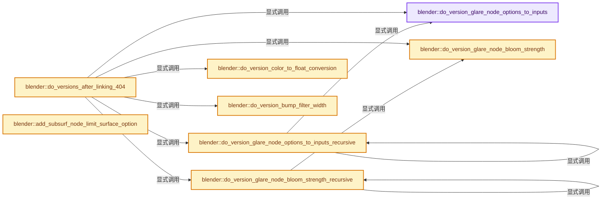

# 实现依赖专题：source/blender/blenloader/intern/versioning_404.cc

[方向导航](README.md) · [符号索引](../%E7%AC%A6%E5%8F%B7%E4%BE%9D%E8%B5%96%E4%B8%8E%E5%AE%9E%E7%8E%B0%E7%B4%A2%E5%BC%95.md)

本专题从正文实际调用进入，集中保存共享实现。函数有稳定锚点，可从调用处直接跳到对应完整函数；递归与互相调用通过回链组织。

## 本文件的实现关系




## 完整成员与函数实现

<a id="f-7b56410208594121"></a>

### `blender::do_version_glare_node_options_to_inputs`

实现位置：[source/blender/blenloader/intern/versioning_404.cc](../../../../../source/blender/blenloader/intern/versioning_404.cc) · L89—L219。

接口参数：

- `const Scene *scene`
- `bNodeTree *node_tree`
- `bNode *node`

**教学注释版**

<!-- annotated:8d98968665a5b8 -->

```cpp
static void do_version_glare_node_options_to_inputs(const Scene *scene,
                                                    bNodeTree *node_tree,
                                                    bNode *node)
{
  NodeGlare *storage = static_cast<NodeGlare *>(node->storage);
  if (!storage) {
    return;
  }

  /* Get the newly added inputs. */
  bNodeSocket *threshold = version_node_add_socket_if_not_exist(
      node_tree, node, SOCK_IN, SOCK_FLOAT, PROP_NONE, "Highlights Threshold", "Threshold");
  bNodeSocket *strength = version_node_add_socket_if_not_exist(
      node_tree, node, SOCK_IN, SOCK_FLOAT, PROP_FACTOR, "Strength", "Strength");
  bNodeSocket *size = version_node_add_socket_if_not_exist(
      node_tree, node, SOCK_IN, SOCK_FLOAT, PROP_FACTOR, "Size", "Size");
  bNodeSocket *streaks = version_node_add_socket_if_not_exist(
      node_tree, node, SOCK_IN, SOCK_INT, PROP_NONE, "Streaks", "Streaks");
  bNodeSocket *streaks_angle = version_node_add_socket_if_not_exist(
      node_tree, node, SOCK_IN, SOCK_FLOAT, PROP_ANGLE, "Streaks Angle", "Streaks Angle");
  bNodeSocket *iterations = version_node_add_socket_if_not_exist(
      node_tree, node, SOCK_IN, SOCK_INT, PROP_NONE, "Iterations", "Iterations");
  bNodeSocket *fade = version_node_add_socket_if_not_exist(
      node_tree, node, SOCK_IN, SOCK_FLOAT, PROP_FACTOR, "Fade", "Fade");
  bNodeSocket *color_modulation = version_node_add_socket_if_not_exist(
      node_tree, node, SOCK_IN, SOCK_FLOAT, PROP_FACTOR, "Color Modulation", "Color Modulation");

  /* Function to remap the Mix property to the range of the new Strength input. See function
   * description. */
  auto mix_to_strength = [](const float mix) { return 1.0f - math::clamp(-mix, 0.0f, 1.0f); };

  /* Find the render size to guess the Size value. The node tree might not belong to a scene, so we
   * just assume an arbitrary HDTV 1080p render size. */
  int2 render_size;
  if (scene) {
    BKE_render_resolution(&scene->r, true, &render_size.x, &render_size.y);
  }
  else {
    render_size = int2(1920, 1080);
  }

  /* Function to remap the Size property to its new range. See function description. */
  const int max_render_size = math::reduce_max(render_size);
  auto size_to_linear = [&](const int size) {
    if (storage->type == CMP_NODE_GLARE_BLOOM) {
      return math::pow(2.0f, float(size - 9));
    }
    return math::min(1.0f, float((1 << size) + 1) / float(max_render_size));
  };

  /* Assign the inputs the values from the old deprecated properties. */
  threshold->default_value_typed<bNodeSocketValueFloat>()->value = storage->threshold;
  strength->default_value_typed<bNodeSocketValueFloat>()->value = mix_to_strength(storage->mix);
  size->default_value_typed<bNodeSocketValueFloat>()->value = size_to_linear(storage->size);
  streaks->default_value_typed<bNodeSocketValueInt>()->value = storage->streaks;
  streaks_angle->default_value_typed<bNodeSocketValueFloat>()->value = storage->angle_ofs;
  iterations->default_value_typed<bNodeSocketValueInt>()->value = storage->iter;
  fade->default_value_typed<bNodeSocketValueFloat>()->value = storage->fade;
  color_modulation->default_value_typed<bNodeSocketValueFloat>()->value = storage->colmod;

  /* Compute the RNA path of the node. */
  char escaped_node_name[sizeof(node->name) * 2 + 1];
  BLI_str_escape(escaped_node_name, node->name, sizeof(escaped_node_name));
  const std::string node_rna_path = fmt::format("nodes[\"{}\"]", escaped_node_name);

  BKE_fcurves_id_cb(&node_tree->id, [&](ID * /*id*/, FCurve *fcurve) {
    /* The FCurve does not belong to the node since its RNA path doesn't start with the node's RNA
     * path. */
    if (!fcurve->rna_path().startswith(node_rna_path)) {
      return;
    }

    /* Change the RNA path of the FCurve from the old properties to the new inputs, adjusting the
     * values of the FCurves frames when needed. */
    if (BLI_str_endswith(fcurve->rna_path().c_str(), "threshold")) {
      fcurve->rna_path_set_move(
          BLI_sprintfN("%s.%s", node_rna_path.c_str(), "inputs[1].default_value"));
    }
    else if (BLI_str_endswith(fcurve->rna_path().c_str(), "mix")) {
      fcurve->rna_path_set_move(
          BLI_sprintfN("%s.%s", node_rna_path.c_str(), "inputs[2].default_value"));
      adjust_fcurve_key_frame_values(
          fcurve, PROP_FLOAT, [&](const float value) { return mix_to_strength(value); });
    }
    else if (BLI_str_endswith(fcurve->rna_path().c_str(), "size")) {
      fcurve->rna_path_set_move(
          BLI_sprintfN("%s.%s", node_rna_path.c_str(), "inputs[3].default_value"));
      adjust_fcurve_key_frame_values(
          fcurve, PROP_FLOAT, [&](const float value) { return size_to_linear(value); });
    }
    else if (BLI_str_endswith(fcurve->rna_path().c_str(), "streaks")) {
      fcurve->rna_path_set_move(
          BLI_sprintfN("%s.%s", node_rna_path.c_str(), "inputs[4].default_value"));
    }
    else if (BLI_str_endswith(fcurve->rna_path().c_str(), "angle_offset")) {
      fcurve->rna_path_set_move(
          BLI_sprintfN("%s.%s", node_rna_path.c_str(), "inputs[5].default_value"));
    }
    else if (BLI_str_endswith(fcurve->rna_path().c_str(), "iterations")) {
      fcurve->rna_path_set_move(
          BLI_sprintfN("%s.%s", node_rna_path.c_str(), "inputs[6].default_value"));
    }
    else if (BLI_str_endswith(fcurve->rna_path().c_str(), "fade")) {
      fcurve->rna_path_set_move(
          BLI_sprintfN("%s.%s", node_rna_path.c_str(), "inputs[7].default_value"));
    }
    else if (BLI_str_endswith(fcurve->rna_path().c_str(), "color_modulation")) {
      fcurve->rna_path_set_move(
          BLI_sprintfN("%s.%s", node_rna_path.c_str(), "inputs[8].default_value"));
    }
  });

  /* If the Mix factor is between [0.5, 1], then the user actually wants the Glare output, so
   * reconnect the output to the newly created Glare output. */
  if (storage->mix > 0.5f) {
    bNodeSocket *image_output = version_node_add_socket_if_not_exist(
        node_tree, node, SOCK_OUT, SOCK_RGBA, PROP_NONE, "Image", "Image");
    bNodeSocket *glare_output = version_node_add_socket_if_not_exist(
        node_tree, node, SOCK_OUT, SOCK_RGBA, PROP_NONE, "Glare", "Glare");

    for (bNodeLink &link : node_tree->links.items_reversed_mutable()) {
      if (link.fromsock != image_output) {
        continue;
      }

      /* Relink from the Image output to the Glare output. */
      bke::node_add_link(*node_tree, *node, *glare_output, *link.tonode, *link.tosock);
      bke::node_remove_link(node_tree, link);
    }
  }
}
```

<details>
<summary>核对原始源码：source/blender/blenloader/intern/versioning_404.cc · L89—L219</summary>

<!-- original:8d98968665a5b8:source/blender/blenloader/intern/versioning_404.cc:89:219 -->

```cpp
static void do_version_glare_node_options_to_inputs(const Scene *scene,
                                                    bNodeTree *node_tree,
                                                    bNode *node)
{
  NodeGlare *storage = static_cast<NodeGlare *>(node->storage);
  if (!storage) {
    return;
  }

  /* Get the newly added inputs. */
  bNodeSocket *threshold = version_node_add_socket_if_not_exist(
      node_tree, node, SOCK_IN, SOCK_FLOAT, PROP_NONE, "Highlights Threshold", "Threshold");
  bNodeSocket *strength = version_node_add_socket_if_not_exist(
      node_tree, node, SOCK_IN, SOCK_FLOAT, PROP_FACTOR, "Strength", "Strength");
  bNodeSocket *size = version_node_add_socket_if_not_exist(
      node_tree, node, SOCK_IN, SOCK_FLOAT, PROP_FACTOR, "Size", "Size");
  bNodeSocket *streaks = version_node_add_socket_if_not_exist(
      node_tree, node, SOCK_IN, SOCK_INT, PROP_NONE, "Streaks", "Streaks");
  bNodeSocket *streaks_angle = version_node_add_socket_if_not_exist(
      node_tree, node, SOCK_IN, SOCK_FLOAT, PROP_ANGLE, "Streaks Angle", "Streaks Angle");
  bNodeSocket *iterations = version_node_add_socket_if_not_exist(
      node_tree, node, SOCK_IN, SOCK_INT, PROP_NONE, "Iterations", "Iterations");
  bNodeSocket *fade = version_node_add_socket_if_not_exist(
      node_tree, node, SOCK_IN, SOCK_FLOAT, PROP_FACTOR, "Fade", "Fade");
  bNodeSocket *color_modulation = version_node_add_socket_if_not_exist(
      node_tree, node, SOCK_IN, SOCK_FLOAT, PROP_FACTOR, "Color Modulation", "Color Modulation");

  /* Function to remap the Mix property to the range of the new Strength input. See function
   * description. */
  auto mix_to_strength = [](const float mix) { return 1.0f - math::clamp(-mix, 0.0f, 1.0f); };

  /* Find the render size to guess the Size value. The node tree might not belong to a scene, so we
   * just assume an arbitrary HDTV 1080p render size. */
  int2 render_size;
  if (scene) {
    BKE_render_resolution(&scene->r, true, &render_size.x, &render_size.y);
  }
  else {
    render_size = int2(1920, 1080);
  }

  /* Function to remap the Size property to its new range. See function description. */
  const int max_render_size = math::reduce_max(render_size);
  auto size_to_linear = [&](const int size) {
    if (storage->type == CMP_NODE_GLARE_BLOOM) {
      return math::pow(2.0f, float(size - 9));
    }
    return math::min(1.0f, float((1 << size) + 1) / float(max_render_size));
  };

  /* Assign the inputs the values from the old deprecated properties. */
  threshold->default_value_typed<bNodeSocketValueFloat>()->value = storage->threshold;
  strength->default_value_typed<bNodeSocketValueFloat>()->value = mix_to_strength(storage->mix);
  size->default_value_typed<bNodeSocketValueFloat>()->value = size_to_linear(storage->size);
  streaks->default_value_typed<bNodeSocketValueInt>()->value = storage->streaks;
  streaks_angle->default_value_typed<bNodeSocketValueFloat>()->value = storage->angle_ofs;
  iterations->default_value_typed<bNodeSocketValueInt>()->value = storage->iter;
  fade->default_value_typed<bNodeSocketValueFloat>()->value = storage->fade;
  color_modulation->default_value_typed<bNodeSocketValueFloat>()->value = storage->colmod;

  /* Compute the RNA path of the node. */
  char escaped_node_name[sizeof(node->name) * 2 + 1];
  BLI_str_escape(escaped_node_name, node->name, sizeof(escaped_node_name));
  const std::string node_rna_path = fmt::format("nodes[\"{}\"]", escaped_node_name);

  BKE_fcurves_id_cb(&node_tree->id, [&](ID * /*id*/, FCurve *fcurve) {
    /* The FCurve does not belong to the node since its RNA path doesn't start with the node's RNA
     * path. */
    if (!fcurve->rna_path().startswith(node_rna_path)) {
      return;
    }

    /* Change the RNA path of the FCurve from the old properties to the new inputs, adjusting the
     * values of the FCurves frames when needed. */
    if (BLI_str_endswith(fcurve->rna_path().c_str(), "threshold")) {
      fcurve->rna_path_set_move(
          BLI_sprintfN("%s.%s", node_rna_path.c_str(), "inputs[1].default_value"));
    }
    else if (BLI_str_endswith(fcurve->rna_path().c_str(), "mix")) {
      fcurve->rna_path_set_move(
          BLI_sprintfN("%s.%s", node_rna_path.c_str(), "inputs[2].default_value"));
      adjust_fcurve_key_frame_values(
          fcurve, PROP_FLOAT, [&](const float value) { return mix_to_strength(value); });
    }
    else if (BLI_str_endswith(fcurve->rna_path().c_str(), "size")) {
      fcurve->rna_path_set_move(
          BLI_sprintfN("%s.%s", node_rna_path.c_str(), "inputs[3].default_value"));
      adjust_fcurve_key_frame_values(
          fcurve, PROP_FLOAT, [&](const float value) { return size_to_linear(value); });
    }
    else if (BLI_str_endswith(fcurve->rna_path().c_str(), "streaks")) {
      fcurve->rna_path_set_move(
          BLI_sprintfN("%s.%s", node_rna_path.c_str(), "inputs[4].default_value"));
    }
    else if (BLI_str_endswith(fcurve->rna_path().c_str(), "angle_offset")) {
      fcurve->rna_path_set_move(
          BLI_sprintfN("%s.%s", node_rna_path.c_str(), "inputs[5].default_value"));
    }
    else if (BLI_str_endswith(fcurve->rna_path().c_str(), "iterations")) {
      fcurve->rna_path_set_move(
          BLI_sprintfN("%s.%s", node_rna_path.c_str(), "inputs[6].default_value"));
    }
    else if (BLI_str_endswith(fcurve->rna_path().c_str(), "fade")) {
      fcurve->rna_path_set_move(
          BLI_sprintfN("%s.%s", node_rna_path.c_str(), "inputs[7].default_value"));
    }
    else if (BLI_str_endswith(fcurve->rna_path().c_str(), "color_modulation")) {
      fcurve->rna_path_set_move(
          BLI_sprintfN("%s.%s", node_rna_path.c_str(), "inputs[8].default_value"));
    }
  });

  /* If the Mix factor is between [0.5, 1], then the user actually wants the Glare output, so
   * reconnect the output to the newly created Glare output. */
  if (storage->mix > 0.5f) {
    bNodeSocket *image_output = version_node_add_socket_if_not_exist(
        node_tree, node, SOCK_OUT, SOCK_RGBA, PROP_NONE, "Image", "Image");
    bNodeSocket *glare_output = version_node_add_socket_if_not_exist(
        node_tree, node, SOCK_OUT, SOCK_RGBA, PROP_NONE, "Glare", "Glare");

    for (bNodeLink &link : node_tree->links.items_reversed_mutable()) {
      if (link.fromsock != image_output) {
        continue;
      }

      /* Relink from the Image output to the Glare output. */
      bke::node_add_link(*node_tree, *node, *glare_output, *link.tonode, *link.tosock);
      bke::node_remove_link(node_tree, link);
    }
  }
}
```

</details>

**沿实际写入检查状态**

- `render_size = int2(1920, 1080);`

**结果出口**

- `return math::pow(2.0f, float(size - 9));`
- `return math::min(1.0f, float((1 << size) + 1) / float(max_render_size));`

**继续追踪实现**

- `version_node_add_socket_if_not_exist` → [blender::version_node_add_socket_if_not_exist · L402](%E4%BE%9D%E8%B5%96-versioning_common-5f7e5c.md#f-8937a61934845ed4)。
- `math::clamp` → [blender::math::clamp · L118](../12-%E7%A9%BA%E9%97%B4%E6%95%B0%E6%8D%AE%E7%BB%93%E6%9E%84%E4%B8%8E%E5%87%A0%E4%BD%95%E7%AE%97%E6%B3%95/%E4%BE%9D%E8%B5%96-BLI_math_vector-906a87.md#f-65702e97e59fc41e)；[blender::math::clamp · L130](../12-%E7%A9%BA%E9%97%B4%E6%95%B0%E6%8D%AE%E7%BB%93%E6%9E%84%E4%B8%8E%E5%87%A0%E4%BD%95%E7%AE%97%E6%B3%95/%E4%BE%9D%E8%B5%96-BLI_math_vector-906a87.md#f-0365873940e23a11)；[blender::math::clamp · L69](../12-%E7%A9%BA%E9%97%B4%E6%95%B0%E6%8D%AE%E7%BB%93%E6%9E%84%E4%B8%8E%E5%87%A0%E4%BD%95%E7%AE%97%E6%B3%95/%E4%BE%9D%E8%B5%96-BLI_math_base-0728eb.md#f-9282cf5d06fa3723)。同名重载需按实参类型选择。
- `BKE_render_resolution` → [blender::BKE_render_resolution · L3178](%E4%BE%9D%E8%B5%96-scene-94f43c.md#f-ecc3710832a4e09f)。
- `int2` → [int2 · L643](%E4%BE%9D%E8%B5%96-smaa-b67bc2.md#m-8960c8e6139d)。宏定义由构建条件选择。
- `math::reduce_max` → [blender::math::reduce_max · L677](../12-%E7%A9%BA%E9%97%B4%E6%95%B0%E6%8D%AE%E7%BB%93%E6%9E%84%E4%B8%8E%E5%87%A0%E4%BD%95%E7%AE%97%E6%B3%95/%E4%BE%9D%E8%B5%96-BLI_math_vector-906a87.md#f-17b781b79639d9eb)。
- `math::pow` → [外部契约](https://eel.is/c++draft/)：这个边界按实际表达式及所属类型核对参数、返回值、寿命与失败行为。这里提供接口入口，不声称已解释该第三方版本的内部实现。
- `math::min` → [blender::math::min · L56](../12-%E7%A9%BA%E9%97%B4%E6%95%B0%E6%8D%AE%E7%BB%93%E6%9E%84%E4%B8%8E%E5%87%A0%E4%BD%95%E7%AE%97%E6%B3%95/%E4%BE%9D%E8%B5%96-BLI_math_vector-906a87.md#f-ee6ead51e4bb3364)；[blender::math::min · L65](../12-%E7%A9%BA%E9%97%B4%E6%95%B0%E6%8D%AE%E7%BB%93%E6%9E%84%E4%B8%8E%E5%87%A0%E4%BD%95%E7%AE%97%E6%B3%95/%E4%BE%9D%E8%B5%96-BLI_math_vector-906a87.md#f-f65ce48b3051cce3)；[blender::math::min · L81](../12-%E7%A9%BA%E9%97%B4%E6%95%B0%E6%8D%AE%E7%BB%93%E6%9E%84%E4%B8%8E%E5%87%A0%E4%BD%95%E7%AE%97%E6%B3%95/%E4%BE%9D%E8%B5%96-BLI_math_vector-906a87.md#f-9c602d29fab41795)；[blender::math::min · L43](../12-%E7%A9%BA%E9%97%B4%E6%95%B0%E6%8D%AE%E7%BB%93%E6%9E%84%E4%B8%8E%E5%87%A0%E4%BD%95%E7%AE%97%E6%B3%95/%E4%BE%9D%E8%B5%96-BLI_math_base-0728eb.md#f-72ff0c229e6c09b0)。同名重载需按实参类型选择。
- `threshold->default_value_typed<bNodeSocketValueFloat>` → [blender::bNodeSocket::default_value_typed · L1134](%E4%BE%9D%E8%B5%96-BKE_node_runtime-ee561b.md#f-ce490d0e5a28d98d)；[blender::bNodeSocket::default_value_typed · L1139](%E4%BE%9D%E8%B5%96-BKE_node_runtime-ee561b.md#f-392726ff93a0389d)。同名重载需按实参类型选择。
- `strength->default_value_typed<bNodeSocketValueFloat>` → [blender::bNodeSocket::default_value_typed · L1134](%E4%BE%9D%E8%B5%96-BKE_node_runtime-ee561b.md#f-ce490d0e5a28d98d)；[blender::bNodeSocket::default_value_typed · L1139](%E4%BE%9D%E8%B5%96-BKE_node_runtime-ee561b.md#f-392726ff93a0389d)。同名重载需按实参类型选择。
- `mix_to_strength` → [调用协议](../%E6%A8%A1%E6%9D%BF%E5%AE%8F%E4%B8%8E%E5%8A%A8%E6%80%81%E5%88%86%E6%B4%BE%E5%8D%8F%E8%AE%AE.md)：局部可调用对象，须结合其初始化与捕获环境。调用位置L141。
- `size->default_value_typed<bNodeSocketValueFloat>` → [blender::bNodeSocket::default_value_typed · L1134](%E4%BE%9D%E8%B5%96-BKE_node_runtime-ee561b.md#f-ce490d0e5a28d98d)；[blender::bNodeSocket::default_value_typed · L1139](%E4%BE%9D%E8%B5%96-BKE_node_runtime-ee561b.md#f-392726ff93a0389d)。同名重载需按实参类型选择。
- `size_to_linear` → [调用协议](../%E6%A8%A1%E6%9D%BF%E5%AE%8F%E4%B8%8E%E5%8A%A8%E6%80%81%E5%88%86%E6%B4%BE%E5%8D%8F%E8%AE%AE.md)：局部可调用对象，须结合其初始化与捕获环境。调用位置L142。
- `streaks->default_value_typed<bNodeSocketValueInt>` → [blender::bNodeSocket::default_value_typed · L1134](%E4%BE%9D%E8%B5%96-BKE_node_runtime-ee561b.md#f-ce490d0e5a28d98d)；[blender::bNodeSocket::default_value_typed · L1139](%E4%BE%9D%E8%B5%96-BKE_node_runtime-ee561b.md#f-392726ff93a0389d)。同名重载需按实参类型选择。
- `streaks_angle->default_value_typed<bNodeSocketValueFloat>` → [blender::bNodeSocket::default_value_typed · L1134](%E4%BE%9D%E8%B5%96-BKE_node_runtime-ee561b.md#f-ce490d0e5a28d98d)；[blender::bNodeSocket::default_value_typed · L1139](%E4%BE%9D%E8%B5%96-BKE_node_runtime-ee561b.md#f-392726ff93a0389d)。同名重载需按实参类型选择。
- `iterations->default_value_typed<bNodeSocketValueInt>` → [blender::bNodeSocket::default_value_typed · L1134](%E4%BE%9D%E8%B5%96-BKE_node_runtime-ee561b.md#f-ce490d0e5a28d98d)；[blender::bNodeSocket::default_value_typed · L1139](%E4%BE%9D%E8%B5%96-BKE_node_runtime-ee561b.md#f-392726ff93a0389d)。同名重载需按实参类型选择。
- `fade->default_value_typed<bNodeSocketValueFloat>` → [blender::bNodeSocket::default_value_typed · L1134](%E4%BE%9D%E8%B5%96-BKE_node_runtime-ee561b.md#f-ce490d0e5a28d98d)；[blender::bNodeSocket::default_value_typed · L1139](%E4%BE%9D%E8%B5%96-BKE_node_runtime-ee561b.md#f-392726ff93a0389d)。同名重载需按实参类型选择。
- `color_modulation->default_value_typed<bNodeSocketValueFloat>` → [blender::bNodeSocket::default_value_typed · L1134](%E4%BE%9D%E8%B5%96-BKE_node_runtime-ee561b.md#f-ce490d0e5a28d98d)；[blender::bNodeSocket::default_value_typed · L1139](%E4%BE%9D%E8%B5%96-BKE_node_runtime-ee561b.md#f-392726ff93a0389d)。同名重载需按实参类型选择。
- `BLI_str_escape` → [blender::BLI_str_escape · L335](../01-%E5%9F%BA%E7%A1%80%E5%AE%B9%E5%99%A8%E4%B8%8E%E7%8E%B0%E4%BB%A3CPP/%E4%BE%9D%E8%B5%96-string-1d986f.md#f-ade392f6fb397ef6)；[blender::BLI_str_escape · L366](../01-%E5%9F%BA%E7%A1%80%E5%AE%B9%E5%99%A8%E4%B8%8E%E7%8E%B0%E4%BB%A3CPP/%E4%BE%9D%E8%B5%96-string-1d986f.md#f-56725a2c129075c6)。同名重载需按实参类型选择。
- `fmt::format` → [外部契约](https://fmt.dev/latest/api/)：按fmt接口的格式字符串与参数类型契约使用，格式化不改变被格式化对象的拥有关系。
- `BKE_fcurves_id_cb` → [blender::BKE_fcurves_id_cb · L1249](%E4%BE%9D%E8%B5%96-anim_data-56c81c.md#f-fd9dec54d9a0bd30)。
- `fcurve->rna_path().startswith` → [调用协议](../%E6%A8%A1%E6%9D%BF%E5%AE%8F%E4%B8%8E%E5%8A%A8%E6%80%81%E5%88%86%E6%B4%BE%E5%8D%8F%E8%AE%AE.md)：接收对象类型依赖auto、返回值或模板实例；不按同名猜测目标。调用位置L157。
- `fcurve->rna_path` → [blender::FCurve::rna_path · L189](%E4%BE%9D%E8%B5%96-fcurve-593e2e.md#f-b3be61588d36ab9c)。
- `BLI_str_endswith` → [blender::BLI_str_endswith · L907](../01-%E5%9F%BA%E7%A1%80%E5%AE%B9%E5%99%A8%E4%B8%8E%E7%8E%B0%E4%BB%A3CPP/%E4%BE%9D%E8%B5%96-string-1d986f.md#f-2bf007208258ff88)。
- `fcurve->rna_path().c_str` → [调用协议](../%E6%A8%A1%E6%9D%BF%E5%AE%8F%E4%B8%8E%E5%8A%A8%E6%80%81%E5%88%86%E6%B4%BE%E5%8D%8F%E8%AE%AE.md)：接收对象类型依赖auto、返回值或模板实例；不按同名猜测目标。调用位置L163。
- `fcurve->rna_path_set_move` → [blender::FCurve::rna_path_set_move · L182](%E4%BE%9D%E8%B5%96-fcurve-593e2e.md#f-feffe802a84cd660)。
- `BLI_sprintfN` → [blender::BLI_sprintfN · L296](../01-%E5%9F%BA%E7%A1%80%E5%AE%B9%E5%99%A8%E4%B8%8E%E7%8E%B0%E4%BB%A3CPP/%E4%BE%9D%E8%B5%96-string-1d986f.md#f-bfbc2f7076298fc0)。
- `node_rna_path.c_str` → [外部契约](https://eel.is/c++draft/)：这个边界按实际表达式及所属类型核对参数、返回值、寿命与失败行为。这里提供接口入口，不声称已解释该第三方版本的内部实现。
- `adjust_fcurve_key_frame_values` → [blender::adjust_fcurve_key_frame_values · L283](%E4%BE%9D%E8%B5%96-versioning_common-2d70cb.md#f-534a6e48783f59f7)。
- `node_tree->links.items_reversed_mutable` → [调用协议](../%E6%A8%A1%E6%9D%BF%E5%AE%8F%E4%B8%8E%E5%8A%A8%E6%80%81%E5%88%86%E6%B4%BE%E5%8D%8F%E8%AE%AE.md)：接收对象类型依赖auto、返回值或模板实例；不按同名猜测目标。调用位置L209。
- `bke::node_add_link` → [blender::bke::node_add_link · L4638](%E4%BE%9D%E8%B5%96-node-89d753.md#f-e4b0f883348f0d24)。
- `bke::node_remove_link` → [blender::bke::node_remove_link · L4676](%E4%BE%9D%E8%B5%96-node-89d753.md#f-3cf1faf3e4cf3dd2)。

<a id="f-111afde6212687c6"></a>

### `blender::do_version_glare_node_options_to_inputs_recursive`

实现位置：[source/blender/blenloader/intern/versioning_404.cc](../../../../../source/blender/blenloader/intern/versioning_404.cc) · L221—L242。

接口参数：

- `const Scene *scene`
- `bNodeTree *node_tree`
- `Set<bNodeTree *> &node_trees_already_versioned`

**教学注释版**

<!-- annotated:ce9f85c36e311a -->

```cpp
static void do_version_glare_node_options_to_inputs_recursive(
    const Scene *scene, bNodeTree *node_tree, Set<bNodeTree *> &node_trees_already_versioned)
{
  // [讲解] node_trees_already_versioned.contains：查询活项数量或键是否存在。
  if (node_trees_already_versioned.contains(node_tree)) {
    return;
  }

  for (bNode &node : node_tree->nodes) {
    if (node.type_legacy == CMP_NODE_GLARE) {
      do_version_glare_node_options_to_inputs(scene, node_tree, &node);
    }
    else if (node.is_group()) {
      bNodeTree *child_tree = reinterpret_cast<bNodeTree *>(node.id);
      if (child_tree) {
        do_version_glare_node_options_to_inputs_recursive(
            scene, child_tree, node_trees_already_versioned);
      }
    }
  }

  // [讲解] node_trees_already_versioned.add_new：按哈希与相等关系加入键或键值。
  node_trees_already_versioned.add_new(node_tree);
}
```

<details>
<summary>核对原始源码：source/blender/blenloader/intern/versioning_404.cc · L221—L242</summary>

<!-- original:ce9f85c36e311a:source/blender/blenloader/intern/versioning_404.cc:221:242 -->

```cpp
static void do_version_glare_node_options_to_inputs_recursive(
    const Scene *scene, bNodeTree *node_tree, Set<bNodeTree *> &node_trees_already_versioned)
{
  if (node_trees_already_versioned.contains(node_tree)) {
    return;
  }

  for (bNode &node : node_tree->nodes) {
    if (node.type_legacy == CMP_NODE_GLARE) {
      do_version_glare_node_options_to_inputs(scene, node_tree, &node);
    }
    else if (node.is_group()) {
      bNodeTree *child_tree = reinterpret_cast<bNodeTree *>(node.id);
      if (child_tree) {
        do_version_glare_node_options_to_inputs_recursive(
            scene, child_tree, node_trees_already_versioned);
      }
    }
  }

  node_trees_already_versioned.add_new(node_tree);
}
```

</details>

**继续追踪实现**

- `node_trees_already_versioned.contains` → [blender::Set::contains · L310](../02-%E5%93%88%E5%B8%8C%E8%A1%A8%E4%B8%8E%E5%85%B3%E8%81%94%E6%95%B0%E6%8D%AE%E7%BB%93%E6%9E%84/08-Set%E4%B8%8E%E9%9B%86%E5%90%88%E8%AF%AD%E4%B9%89.md#f-af7099799494350e)。
- `do_version_glare_node_options_to_inputs` → [blender::do_version_glare_node_options_to_inputs · L89](%E4%BE%9D%E8%B5%96-versioning_404-e80e83.md#f-7b56410208594121)。
- `node.is_group` → [调用协议](../%E6%A8%A1%E6%9D%BF%E5%AE%8F%E4%B8%8E%E5%8A%A8%E6%80%81%E5%88%86%E6%B4%BE%E5%8D%8F%E8%AE%AE.md)：接收对象类型依赖auto、返回值或模板实例；不按同名猜测目标。调用位置L232。
- `do_version_glare_node_options_to_inputs_recursive` → [blender::do_version_glare_node_options_to_inputs_recursive · L221](%E4%BE%9D%E8%B5%96-versioning_404-e80e83.md#f-111afde6212687c6)。
- `node_trees_already_versioned.add_new` → [blender::Set::add_new · L233](../02-%E5%93%88%E5%B8%8C%E8%A1%A8%E4%B8%8E%E5%85%B3%E8%81%94%E6%95%B0%E6%8D%AE%E7%BB%93%E6%9E%84/08-Set%E4%B8%8E%E9%9B%86%E5%90%88%E8%AF%AD%E4%B9%89.md#f-12f4dd65a3abaaac)；[blender::Set::add_new · L237](../02-%E5%93%88%E5%B8%8C%E8%A1%A8%E4%B8%8E%E5%85%B3%E8%81%94%E6%95%B0%E6%8D%AE%E7%BB%93%E6%9E%84/08-Set%E4%B8%8E%E9%9B%86%E5%90%88%E8%AF%AD%E4%B9%89.md#f-9c46c167cdd9bb73)。同名重载需按实参类型选择。

<a id="f-f3f38de606ffe3a6"></a>

### `blender::do_version_glare_node_bloom_strength`

实现位置：[source/blender/blenloader/intern/versioning_404.cc](../../../../../source/blender/blenloader/intern/versioning_404.cc) · L248—L305。

接口参数：

- `const Scene *scene`
- `bNodeTree *node_tree`
- `bNode *node`

**教学注释版**

<!-- annotated:5968adb9413992 -->

```cpp
static void do_version_glare_node_bloom_strength(const Scene *scene,
                                                 bNodeTree *node_tree,
                                                 bNode *node)
{
  NodeGlare *storage = static_cast<NodeGlare *>(node->storage);
  if (!storage) {
    return;
  }

  if (storage->type != CMP_NODE_GLARE_BLOOM) {
    return;
  }

  /* See the get_quality_factor method in the glare code. */
  const int quality_factor = 1 << storage->quality;

  /* Find the render size to guess the Strength value. The node tree might not belong to a scene,
   * so we just assume an arbitrary HDTV 1080p render size. */
  int2 render_size;
  if (scene) {
    BKE_render_resolution(&scene->r, true, &render_size.x, &render_size.y);
  }
  else {
    render_size = int2(1920, 1080);
  }

  const int2 highlights_size = render_size / quality_factor;

  bNodeSocket *size = version_node_add_socket_if_not_exist(
      node_tree, node, SOCK_IN, SOCK_FLOAT, PROP_FACTOR, "Size", "Size");
  const float size_value = size->default_value_typed<bNodeSocketValueFloat>()->value;

  /* See the compute_bloom_chain_length method in the glare code. */
  const int smaller_dimension = math::reduce_min(highlights_size);
  const float scaled_dimension = smaller_dimension * size_value;
  const int chain_length = int(std::log2(math::max(1.0f, scaled_dimension)));

  auto scale_strength = [chain_length](const float strength) { return strength * chain_length; };

  bNodeSocket *strength_input = version_node_add_socket_if_not_exist(
      node_tree, node, SOCK_IN, SOCK_FLOAT, PROP_FACTOR, "Strength", "Strength");
  strength_input->default_value_typed<bNodeSocketValueFloat>()->value = scale_strength(
      strength_input->default_value_typed<bNodeSocketValueFloat>()->value);

  /* Compute the RNA path of the strength input. */
  char escaped_node_name[sizeof(node->name) * 2 + 1];
  BLI_str_escape(escaped_node_name, node->name, sizeof(escaped_node_name));
  const std::string strength_rna_path = fmt::format("nodes[\"{}\"].inputs[4].default_value",
                                                    escaped_node_name);

  /* Scale F-Curve. */
  BKE_fcurves_id_cb(&node_tree->id, [&](ID * /*id*/, FCurve *fcurve) {
    if (strength_rna_path == fcurve->rna_path()) {
      adjust_fcurve_key_frame_values(
          fcurve, PROP_FLOAT, [&](const float value) { return scale_strength(value); });
    }
  });
}
```

<details>
<summary>核对原始源码：source/blender/blenloader/intern/versioning_404.cc · L248—L305</summary>

<!-- original:5968adb9413992:source/blender/blenloader/intern/versioning_404.cc:248:305 -->

```cpp
static void do_version_glare_node_bloom_strength(const Scene *scene,
                                                 bNodeTree *node_tree,
                                                 bNode *node)
{
  NodeGlare *storage = static_cast<NodeGlare *>(node->storage);
  if (!storage) {
    return;
  }

  if (storage->type != CMP_NODE_GLARE_BLOOM) {
    return;
  }

  /* See the get_quality_factor method in the glare code. */
  const int quality_factor = 1 << storage->quality;

  /* Find the render size to guess the Strength value. The node tree might not belong to a scene,
   * so we just assume an arbitrary HDTV 1080p render size. */
  int2 render_size;
  if (scene) {
    BKE_render_resolution(&scene->r, true, &render_size.x, &render_size.y);
  }
  else {
    render_size = int2(1920, 1080);
  }

  const int2 highlights_size = render_size / quality_factor;

  bNodeSocket *size = version_node_add_socket_if_not_exist(
      node_tree, node, SOCK_IN, SOCK_FLOAT, PROP_FACTOR, "Size", "Size");
  const float size_value = size->default_value_typed<bNodeSocketValueFloat>()->value;

  /* See the compute_bloom_chain_length method in the glare code. */
  const int smaller_dimension = math::reduce_min(highlights_size);
  const float scaled_dimension = smaller_dimension * size_value;
  const int chain_length = int(std::log2(math::max(1.0f, scaled_dimension)));

  auto scale_strength = [chain_length](const float strength) { return strength * chain_length; };

  bNodeSocket *strength_input = version_node_add_socket_if_not_exist(
      node_tree, node, SOCK_IN, SOCK_FLOAT, PROP_FACTOR, "Strength", "Strength");
  strength_input->default_value_typed<bNodeSocketValueFloat>()->value = scale_strength(
      strength_input->default_value_typed<bNodeSocketValueFloat>()->value);

  /* Compute the RNA path of the strength input. */
  char escaped_node_name[sizeof(node->name) * 2 + 1];
  BLI_str_escape(escaped_node_name, node->name, sizeof(escaped_node_name));
  const std::string strength_rna_path = fmt::format("nodes[\"{}\"].inputs[4].default_value",
                                                    escaped_node_name);

  /* Scale F-Curve. */
  BKE_fcurves_id_cb(&node_tree->id, [&](ID * /*id*/, FCurve *fcurve) {
    if (strength_rna_path == fcurve->rna_path()) {
      adjust_fcurve_key_frame_values(
          fcurve, PROP_FLOAT, [&](const float value) { return scale_strength(value); });
    }
  });
}
```

</details>

**沿实际写入检查状态**

- `render_size = int2(1920, 1080);`

**继续追踪实现**

- `BKE_render_resolution` → [blender::BKE_render_resolution · L3178](%E4%BE%9D%E8%B5%96-scene-94f43c.md#f-ecc3710832a4e09f)。
- `int2` → [int2 · L643](%E4%BE%9D%E8%B5%96-smaa-b67bc2.md#m-8960c8e6139d)。宏定义由构建条件选择。
- `version_node_add_socket_if_not_exist` → [blender::version_node_add_socket_if_not_exist · L402](%E4%BE%9D%E8%B5%96-versioning_common-5f7e5c.md#f-8937a61934845ed4)。
- `size->default_value_typed<bNodeSocketValueFloat>` → [blender::bNodeSocket::default_value_typed · L1134](%E4%BE%9D%E8%B5%96-BKE_node_runtime-ee561b.md#f-ce490d0e5a28d98d)；[blender::bNodeSocket::default_value_typed · L1139](%E4%BE%9D%E8%B5%96-BKE_node_runtime-ee561b.md#f-392726ff93a0389d)。同名重载需按实参类型选择。
- `math::reduce_min` → [blender::math::reduce_min · L691](../12-%E7%A9%BA%E9%97%B4%E6%95%B0%E6%8D%AE%E7%BB%93%E6%9E%84%E4%B8%8E%E5%87%A0%E4%BD%95%E7%AE%97%E6%B3%95/%E4%BE%9D%E8%B5%96-BLI_math_vector-906a87.md#f-8d5f73d1881e019b)。
- `std::log2` → [外部契约](https://eel.is/c++draft/)：这个边界按实际表达式及所属类型核对参数、返回值、寿命与失败行为。这里提供接口入口，不声称已解释该第三方版本的内部实现。
- `math::max` → [blender::math::max · L87](../12-%E7%A9%BA%E9%97%B4%E6%95%B0%E6%8D%AE%E7%BB%93%E6%9E%84%E4%B8%8E%E5%87%A0%E4%BD%95%E7%AE%97%E6%B3%95/%E4%BE%9D%E8%B5%96-BLI_math_vector-906a87.md#f-9be564a293777d6b)；[blender::math::max · L96](../12-%E7%A9%BA%E9%97%B4%E6%95%B0%E6%8D%AE%E7%BB%93%E6%9E%84%E4%B8%8E%E5%87%A0%E4%BD%95%E7%AE%97%E6%B3%95/%E4%BE%9D%E8%B5%96-BLI_math_vector-906a87.md#f-ce32dff37d0af3bc)；[blender::math::max · L112](../12-%E7%A9%BA%E9%97%B4%E6%95%B0%E6%8D%AE%E7%BB%93%E6%9E%84%E4%B8%8E%E5%87%A0%E4%BD%95%E7%AE%97%E6%B3%95/%E4%BE%9D%E8%B5%96-BLI_math_vector-906a87.md#f-668eb1fcf1fa8292)；[blender::math::max · L49](../12-%E7%A9%BA%E9%97%B4%E6%95%B0%E6%8D%AE%E7%BB%93%E6%9E%84%E4%B8%8E%E5%87%A0%E4%BD%95%E7%AE%97%E6%B3%95/%E4%BE%9D%E8%B5%96-BLI_math_base-0728eb.md#f-a6991ca3d12937e1)。同名重载需按实参类型选择。
- `strength_input->default_value_typed<bNodeSocketValueFloat>` → [blender::bNodeSocket::default_value_typed · L1134](%E4%BE%9D%E8%B5%96-BKE_node_runtime-ee561b.md#f-ce490d0e5a28d98d)；[blender::bNodeSocket::default_value_typed · L1139](%E4%BE%9D%E8%B5%96-BKE_node_runtime-ee561b.md#f-392726ff93a0389d)。同名重载需按实参类型选择。
- `scale_strength` → [调用协议](../%E6%A8%A1%E6%9D%BF%E5%AE%8F%E4%B8%8E%E5%8A%A8%E6%80%81%E5%88%86%E6%B4%BE%E5%8D%8F%E8%AE%AE.md)：局部可调用对象，须结合其初始化与捕获环境。调用位置L289。
- `BLI_str_escape` → [blender::BLI_str_escape · L335](../01-%E5%9F%BA%E7%A1%80%E5%AE%B9%E5%99%A8%E4%B8%8E%E7%8E%B0%E4%BB%A3CPP/%E4%BE%9D%E8%B5%96-string-1d986f.md#f-ade392f6fb397ef6)；[blender::BLI_str_escape · L366](../01-%E5%9F%BA%E7%A1%80%E5%AE%B9%E5%99%A8%E4%B8%8E%E7%8E%B0%E4%BB%A3CPP/%E4%BE%9D%E8%B5%96-string-1d986f.md#f-56725a2c129075c6)。同名重载需按实参类型选择。
- `fmt::format` → [外部契约](https://fmt.dev/latest/api/)：按fmt接口的格式字符串与参数类型契约使用，格式化不改变被格式化对象的拥有关系。
- `BKE_fcurves_id_cb` → [blender::BKE_fcurves_id_cb · L1249](%E4%BE%9D%E8%B5%96-anim_data-56c81c.md#f-fd9dec54d9a0bd30)。
- `fcurve->rna_path` → [blender::FCurve::rna_path · L189](%E4%BE%9D%E8%B5%96-fcurve-593e2e.md#f-b3be61588d36ab9c)。
- `adjust_fcurve_key_frame_values` → [blender::adjust_fcurve_key_frame_values · L283](%E4%BE%9D%E8%B5%96-versioning_common-2d70cb.md#f-534a6e48783f59f7)。

<a id="f-8bb8d7757f2bb472"></a>

### `blender::do_version_glare_node_bloom_strength_recursive`

实现位置：[source/blender/blenloader/intern/versioning_404.cc](../../../../../source/blender/blenloader/intern/versioning_404.cc) · L307—L328。

接口参数：

- `const Scene *scene`
- `bNodeTree *node_tree`
- `Set<bNodeTree *> &node_trees_already_versioned`

**教学注释版**

<!-- annotated:ec9f7b9b9098ba -->

```cpp
static void do_version_glare_node_bloom_strength_recursive(
    const Scene *scene, bNodeTree *node_tree, Set<bNodeTree *> &node_trees_already_versioned)
{
  // [讲解] node_trees_already_versioned.contains：查询活项数量或键是否存在。
  if (node_trees_already_versioned.contains(node_tree)) {
    return;
  }

  for (bNode &node : node_tree->nodes) {
    if (node.type_legacy == CMP_NODE_GLARE) {
      do_version_glare_node_bloom_strength(scene, node_tree, &node);
    }
    else if (node.is_group()) {
      bNodeTree *child_tree = reinterpret_cast<bNodeTree *>(node.id);
      if (child_tree) {
        do_version_glare_node_bloom_strength_recursive(
            scene, child_tree, node_trees_already_versioned);
      }
    }
  }

  // [讲解] node_trees_already_versioned.add_new：按哈希与相等关系加入键或键值。
  node_trees_already_versioned.add_new(node_tree);
}
```

<details>
<summary>核对原始源码：source/blender/blenloader/intern/versioning_404.cc · L307—L328</summary>

<!-- original:ec9f7b9b9098ba:source/blender/blenloader/intern/versioning_404.cc:307:328 -->

```cpp
static void do_version_glare_node_bloom_strength_recursive(
    const Scene *scene, bNodeTree *node_tree, Set<bNodeTree *> &node_trees_already_versioned)
{
  if (node_trees_already_versioned.contains(node_tree)) {
    return;
  }

  for (bNode &node : node_tree->nodes) {
    if (node.type_legacy == CMP_NODE_GLARE) {
      do_version_glare_node_bloom_strength(scene, node_tree, &node);
    }
    else if (node.is_group()) {
      bNodeTree *child_tree = reinterpret_cast<bNodeTree *>(node.id);
      if (child_tree) {
        do_version_glare_node_bloom_strength_recursive(
            scene, child_tree, node_trees_already_versioned);
      }
    }
  }

  node_trees_already_versioned.add_new(node_tree);
}
```

</details>

**继续追踪实现**

- `node_trees_already_versioned.contains` → [blender::Set::contains · L310](../02-%E5%93%88%E5%B8%8C%E8%A1%A8%E4%B8%8E%E5%85%B3%E8%81%94%E6%95%B0%E6%8D%AE%E7%BB%93%E6%9E%84/08-Set%E4%B8%8E%E9%9B%86%E5%90%88%E8%AF%AD%E4%B9%89.md#f-af7099799494350e)。
- `do_version_glare_node_bloom_strength` → [blender::do_version_glare_node_bloom_strength · L248](%E4%BE%9D%E8%B5%96-versioning_404-e80e83.md#f-f3f38de606ffe3a6)。
- `node.is_group` → [调用协议](../%E6%A8%A1%E6%9D%BF%E5%AE%8F%E4%B8%8E%E5%8A%A8%E6%80%81%E5%88%86%E6%B4%BE%E5%8D%8F%E8%AE%AE.md)：接收对象类型依赖auto、返回值或模板实例；不按同名猜测目标。调用位置L318。
- `do_version_glare_node_bloom_strength_recursive` → [blender::do_version_glare_node_bloom_strength_recursive · L307](%E4%BE%9D%E8%B5%96-versioning_404-e80e83.md#f-8bb8d7757f2bb472)。
- `node_trees_already_versioned.add_new` → [blender::Set::add_new · L233](../02-%E5%93%88%E5%B8%8C%E8%A1%A8%E4%B8%8E%E5%85%B3%E8%81%94%E6%95%B0%E6%8D%AE%E7%BB%93%E6%9E%84/08-Set%E4%B8%8E%E9%9B%86%E5%90%88%E8%AF%AD%E4%B9%89.md#f-12f4dd65a3abaaac)；[blender::Set::add_new · L237](../02-%E5%93%88%E5%B8%8C%E8%A1%A8%E4%B8%8E%E5%85%B3%E8%81%94%E6%95%B0%E6%8D%AE%E7%BB%93%E6%9E%84/08-Set%E4%B8%8E%E9%9B%86%E5%90%88%E8%AF%AD%E4%B9%89.md#f-9c46c167cdd9bb73)。同名重载需按实参类型选择。

<a id="f-04ed56ba27acad5e"></a>

### `blender::do_version_color_to_float_conversion`

实现位置：[source/blender/blenloader/intern/versioning_404.cc](../../../../../source/blender/blenloader/intern/versioning_404.cc) · L333—L387。

接口参数：

- `bNodeTree *node_tree`

**教学注释版**

<!-- annotated:5395e45a3e8a36 -->

```cpp
static void do_version_color_to_float_conversion(bNodeTree *node_tree)
{
  /* Stores a mapping between an output and the final link of the versioning node tree that was
   * added for it, in order to share the same versioning node tree with potentially multiple
   * outgoing links from that same output. */
  Map<bNodeSocket *, bNodeLink *> color_to_float_links;
  for (bNodeLink &link : node_tree->links.items_reversed_mutable()) {
    if (!(link.fromsock->type == SOCK_RGBA && link.tosock->type == SOCK_FLOAT)) {
      continue;
    }

    /* If that output was versioned before, just connect the existing link. */
    // [讲解] color_to_float_links.lookup_default：按键查找对应项。
    bNodeLink *existing_link = color_to_float_links.lookup_default(link.fromsock, nullptr);
    if (existing_link) {
      version_node_add_link(*node_tree,
                            *existing_link->fromnode,
                            *existing_link->fromsock,
                            *link.tonode,
                            *link.tosock);
      bke::node_remove_link(node_tree, link);
      continue;
    }

    /* Add a hidden dot product node. */
    bNode *dot_product_node = bke::node_add_static_node(nullptr, *node_tree, SH_NODE_VECTOR_MATH);
    dot_product_node->custom1 = NODE_VECTOR_MATH_DOT_PRODUCT;
    dot_product_node->flag |= NODE_COLLAPSED;
    dot_product_node->location[0] = link.fromnode->location[0] + link.fromnode->width + 10.0f;
    dot_product_node->location[1] = link.fromnode->location[1];

    /* Link the source socket to the dot product input. */
    bNodeSocket *dot_product_a_input = bke::node_find_socket(
        *dot_product_node, SOCK_IN, "Vector"_ustr);
    version_node_add_link(
        *node_tree, *link.fromnode, *link.fromsock, *dot_product_node, *dot_product_a_input);

    /* Set the dot product vector to 1 / 3 to compute the average. */
    bNodeSocket *dot_product_b_input = bke::node_find_socket(
        *dot_product_node, SOCK_IN, "Vector_001"_ustr);
    copy_v3_fl(dot_product_b_input->default_value_typed<bNodeSocketValueVector>()->value,
               1.0f / 3.0f);

    /* Link the dot product node output to the link target. */
    bNodeSocket *dot_product_output = bke::node_find_socket(
        *dot_product_node, SOCK_OUT, "Value"_ustr);
    bNodeLink *output_link = &version_node_add_link(
        *node_tree, *dot_product_node, *dot_product_output, *link.tonode, *link.tosock);

    /* Add the new link to the cache. */
    // [讲解] color_to_float_links.add_new：按哈希与相等关系加入键或键值。
    color_to_float_links.add_new(link.fromsock, output_link);

    /* Remove the old link. */
    bke::node_remove_link(node_tree, link);
  }
}
```

<details>
<summary>核对原始源码：source/blender/blenloader/intern/versioning_404.cc · L333—L387</summary>

<!-- original:5395e45a3e8a36:source/blender/blenloader/intern/versioning_404.cc:333:387 -->

```cpp
static void do_version_color_to_float_conversion(bNodeTree *node_tree)
{
  /* Stores a mapping between an output and the final link of the versioning node tree that was
   * added for it, in order to share the same versioning node tree with potentially multiple
   * outgoing links from that same output. */
  Map<bNodeSocket *, bNodeLink *> color_to_float_links;
  for (bNodeLink &link : node_tree->links.items_reversed_mutable()) {
    if (!(link.fromsock->type == SOCK_RGBA && link.tosock->type == SOCK_FLOAT)) {
      continue;
    }

    /* If that output was versioned before, just connect the existing link. */
    bNodeLink *existing_link = color_to_float_links.lookup_default(link.fromsock, nullptr);
    if (existing_link) {
      version_node_add_link(*node_tree,
                            *existing_link->fromnode,
                            *existing_link->fromsock,
                            *link.tonode,
                            *link.tosock);
      bke::node_remove_link(node_tree, link);
      continue;
    }

    /* Add a hidden dot product node. */
    bNode *dot_product_node = bke::node_add_static_node(nullptr, *node_tree, SH_NODE_VECTOR_MATH);
    dot_product_node->custom1 = NODE_VECTOR_MATH_DOT_PRODUCT;
    dot_product_node->flag |= NODE_COLLAPSED;
    dot_product_node->location[0] = link.fromnode->location[0] + link.fromnode->width + 10.0f;
    dot_product_node->location[1] = link.fromnode->location[1];

    /* Link the source socket to the dot product input. */
    bNodeSocket *dot_product_a_input = bke::node_find_socket(
        *dot_product_node, SOCK_IN, "Vector"_ustr);
    version_node_add_link(
        *node_tree, *link.fromnode, *link.fromsock, *dot_product_node, *dot_product_a_input);

    /* Set the dot product vector to 1 / 3 to compute the average. */
    bNodeSocket *dot_product_b_input = bke::node_find_socket(
        *dot_product_node, SOCK_IN, "Vector_001"_ustr);
    copy_v3_fl(dot_product_b_input->default_value_typed<bNodeSocketValueVector>()->value,
               1.0f / 3.0f);

    /* Link the dot product node output to the link target. */
    bNodeSocket *dot_product_output = bke::node_find_socket(
        *dot_product_node, SOCK_OUT, "Value"_ustr);
    bNodeLink *output_link = &version_node_add_link(
        *node_tree, *dot_product_node, *dot_product_output, *link.tonode, *link.tosock);

    /* Add the new link to the cache. */
    color_to_float_links.add_new(link.fromsock, output_link);

    /* Remove the old link. */
    bke::node_remove_link(node_tree, link);
  }
}
```

</details>

**沿实际写入检查状态**

- `dot_product_node->custom1 = NODE_VECTOR_MATH_DOT_PRODUCT;`
- `dot_product_node->flag |= NODE_COLLAPSED;`
- `dot_product_node->location[0] = link.fromnode->location[0] + link.fromnode->width + 10.0f;`
- `dot_product_node->location[1] = link.fromnode->location[1];`

**继续追踪实现**

- `node_tree->links.items_reversed_mutable` → [调用协议](../%E6%A8%A1%E6%9D%BF%E5%AE%8F%E4%B8%8E%E5%8A%A8%E6%80%81%E5%88%86%E6%B4%BE%E5%8D%8F%E8%AE%AE.md)：接收对象类型依赖auto、返回值或模板实例；不按同名猜测目标。调用位置L339。
- `color_to_float_links.lookup_default` → [blender::Map::lookup_default · L570](../02-%E5%93%88%E5%B8%8C%E8%A1%A8%E4%B8%8E%E5%85%B3%E8%81%94%E6%95%B0%E6%8D%AE%E7%BB%93%E6%9E%84/05-Map%E6%8F%92%E5%85%A5%E4%B8%8E%E5%9B%9E%E8%B0%83.md#f-40294aaf345f6a8b)。
- `version_node_add_link` → [blender::version_node_add_link · L365](%E4%BE%9D%E8%B5%96-versioning_common-5f7e5c.md#f-93b7d089bdf6807c)。
- `bke::node_remove_link` → [blender::bke::node_remove_link · L4676](%E4%BE%9D%E8%B5%96-node-89d753.md#f-3cf1faf3e4cf3dd2)。
- `bke::node_add_static_node` → [blender::bke::node_add_static_node · L4283](%E4%BE%9D%E8%B5%96-node-89d753.md#f-aaa71011c0fa550b)。
- `bke::node_find_socket` → [blender::bke::node_find_socket · L3036](%E4%BE%9D%E8%B5%96-node-89d753.md#f-cbf9dec71aff5b59)；[blender::bke::node_find_socket · L3047](%E4%BE%9D%E8%B5%96-node-89d753.md#f-4a7a677634b7fbd1)。同名重载需按实参类型选择。
- `copy_v3_fl` → [blender::copy_v3_fl · L68](../12-%E7%A9%BA%E9%97%B4%E6%95%B0%E6%8D%AE%E7%BB%93%E6%9E%84%E4%B8%8E%E5%87%A0%E4%BD%95%E7%AE%97%E6%B3%95/%E4%BE%9D%E8%B5%96-math_vector_inline-0c8541.md#f-18676f3d43803485)。
- `dot_product_b_input->default_value_typed<bNodeSocketValueVector>` → [blender::bNodeSocket::default_value_typed · L1134](%E4%BE%9D%E8%B5%96-BKE_node_runtime-ee561b.md#f-ce490d0e5a28d98d)；[blender::bNodeSocket::default_value_typed · L1139](%E4%BE%9D%E8%B5%96-BKE_node_runtime-ee561b.md#f-392726ff93a0389d)。同名重载需按实参类型选择。
- `color_to_float_links.add_new` → [blender::Map::add_new · L265](../02-%E5%93%88%E5%B8%8C%E8%A1%A8%E4%B8%8E%E5%85%B3%E8%81%94%E6%95%B0%E6%8D%AE%E7%BB%93%E6%9E%84/02-Map%E6%80%BB%E4%BD%93%E5%B8%83%E5%B1%80.md#f-521ff0865e8229d0)；[blender::Map::add_new · L269](../02-%E5%93%88%E5%B8%8C%E8%A1%A8%E4%B8%8E%E5%85%B3%E8%81%94%E6%95%B0%E6%8D%AE%E7%BB%93%E6%9E%84/02-Map%E6%80%BB%E4%BD%93%E5%B8%83%E5%B1%80.md#f-d89cee0e3d2848a0)；[blender::Map::add_new · L273](../02-%E5%93%88%E5%B8%8C%E8%A1%A8%E4%B8%8E%E5%85%B3%E8%81%94%E6%95%B0%E6%8D%AE%E7%BB%93%E6%9E%84/02-Map%E6%80%BB%E4%BD%93%E5%B8%83%E5%B1%80.md#f-c13142c32e703ebd)；[blender::Map::add_new · L277](../02-%E5%93%88%E5%B8%8C%E8%A1%A8%E4%B8%8E%E5%85%B3%E8%81%94%E6%95%B0%E6%8D%AE%E7%BB%93%E6%9E%84/04-Map%E6%9F%A5%E6%89%BE%E4%B8%8E%E9%94%AE%E8%AE%BF%E9%97%AE.md#f-da1e537f229db040)。同名重载需按实参类型选择。

<a id="f-d022dc7fe4fd77aa"></a>

### `blender::do_version_bump_filter_width`

实现位置：[source/blender/blenloader/intern/versioning_404.cc](../../../../../source/blender/blenloader/intern/versioning_404.cc) · L389—L401。

接口参数：

- `bNodeTree *node_tree`

**教学注释版**

<!-- annotated:188b328467c7fa -->

```cpp
static void do_version_bump_filter_width(bNodeTree *node_tree)
{
  for (bNode &node : node_tree->nodes.items_mutable()) {
    if (node.type_legacy != SH_NODE_BUMP) {
      continue;
    }

    bNodeSocket *filter_width_input = bke::node_find_socket(node, SOCK_IN, "Filter Width"_ustr);
    if (filter_width_input) {
      *version_cycles_node_socket_float_value(filter_width_input) = 1.0f;
    }
  }
}
```

<details>
<summary>核对原始源码：source/blender/blenloader/intern/versioning_404.cc · L389—L401</summary>

<!-- original:188b328467c7fa:source/blender/blenloader/intern/versioning_404.cc:389:401 -->

```cpp
static void do_version_bump_filter_width(bNodeTree *node_tree)
{
  for (bNode &node : node_tree->nodes.items_mutable()) {
    if (node.type_legacy != SH_NODE_BUMP) {
      continue;
    }

    bNodeSocket *filter_width_input = bke::node_find_socket(node, SOCK_IN, "Filter Width"_ustr);
    if (filter_width_input) {
      *version_cycles_node_socket_float_value(filter_width_input) = 1.0f;
    }
  }
}
```

</details>

**继续追踪实现**

- `node_tree->nodes.items_mutable` → [调用协议](../%E6%A8%A1%E6%9D%BF%E5%AE%8F%E4%B8%8E%E5%8A%A8%E6%80%81%E5%88%86%E6%B4%BE%E5%8D%8F%E8%AE%AE.md)：接收对象类型依赖auto、返回值或模板实例；不按同名猜测目标。调用位置L391。
- `bke::node_find_socket` → [blender::bke::node_find_socket · L3036](%E4%BE%9D%E8%B5%96-node-89d753.md#f-cbf9dec71aff5b59)；[blender::bke::node_find_socket · L3047](%E4%BE%9D%E8%B5%96-node-89d753.md#f-4a7a677634b7fbd1)。同名重载需按实参类型选择。
- `version_cycles_node_socket_float_value` → [blender::version_cycles_node_socket_float_value · L607](%E4%BE%9D%E8%B5%96-versioning_common-5f7e5c.md#f-3809c86da7c876d6)。

<a id="f-a369683ae6133891"></a>

### `blender::do_versions_after_linking_404`

实现位置：[source/blender/blenloader/intern/versioning_404.cc](../../../../../source/blender/blenloader/intern/versioning_404.cc) · L403—L528。

接口参数：

- `FileData *fd`
- `Main *bmain`

**教学注释版**

<!-- annotated:7176e2cc3a12d6 -->

```cpp
void do_versions_after_linking_404(FileData *fd, Main *bmain)
{
  if (!MAIN_VERSION_FILE_ATLEAST(bmain, 404, 2)) {
    animrig::versioning::convert_legacy_animato_actions(*bmain);
    animrig::versioning::tag_action_users_for_slotted_actions_conversion(*bmain);
    animrig::versioning::convert_legacy_action_assignments(*bmain, fd->reports->reports);
  }

  if (!MAIN_VERSION_FILE_ATLEAST(bmain, 404, 7)) {
    constexpr char SCE_SNAP_TO_NODE_X = (1 << 0);
    constexpr char SCE_SNAP_TO_NODE_Y = (1 << 1);
    for (Scene &scene : bmain->scenes) {
      if (scene.toolsettings->snap_node_mode & SCE_SNAP_TO_NODE_X ||
          scene.toolsettings->snap_node_mode & SCE_SNAP_TO_NODE_Y)
      {
        scene.toolsettings->snap_node_mode = SCE_SNAP_TO_GRID;
      }
    }
  }

  if (!MAIN_VERSION_FILE_ATLEAST(bmain, 404, 18)) {
    Set<bNodeTree *> node_trees_already_versioned;
    for (Scene &scene : bmain->scenes) {
      bNodeTree *node_tree = scene.nodetree;
      if (!node_tree) {
        continue;
      }
      do_version_glare_node_options_to_inputs_recursive(
          &scene, node_tree, node_trees_already_versioned);
    }

    /* The above loop versioned all node trees used in a scene, but other node trees might exist
     * that are not used in a scene. For those, assume the first scene in the file, as this is
     * better than not doing versioning at all. */
    Scene *scene = bmain->scenes.first();
    for (bNodeTree &node_tree : bmain->nodetrees) {
      // [讲解] node_trees_already_versioned.contains：查询活项数量或键是否存在。
      if (node_trees_already_versioned.contains(&node_tree)) {
        continue;
      }

      for (bNode &node : node_tree.nodes) {
        if (node.type_legacy == CMP_NODE_GLARE) {
          do_version_glare_node_options_to_inputs(scene, &node_tree, &node);
        }
      }
      // [讲解] node_trees_already_versioned.add_new：按哈希与相等关系加入键或键值。
      node_trees_already_versioned.add_new(&node_tree);
    }
  }

  if (!MAIN_VERSION_FILE_ATLEAST(bmain, 404, 19)) {
    /* Two new inputs were added, Saturation and Tint. */
    version_node_socket_index_animdata(bmain, NTREE_COMPOSIT, CMP_NODE_GLARE, 3, 2, 11);
  }

  if (!MAIN_VERSION_FILE_ATLEAST(bmain, 404, 20)) {
    /* Two new inputs were added, Highlights Smoothness and Highlights suppression. */
    version_node_socket_index_animdata(bmain, NTREE_COMPOSIT, CMP_NODE_GLARE, 2, 2, 13);
  }

  if (!MAIN_VERSION_FILE_ATLEAST(bmain, 404, 21)) {
    Set<bNodeTree *> node_trees_already_versioned;
    for (Scene &scene : bmain->scenes) {
      bNodeTree *node_tree = scene.nodetree;
      if (!node_tree) {
        continue;
      }
      do_version_glare_node_bloom_strength_recursive(
          &scene, node_tree, node_trees_already_versioned);
    }

    /* The above loop versioned all node trees used in a scene, but other node trees might exist
     * that are not used in a scene. For those, assume the first scene in the file, as this is
     * better than not doing versioning at all. */
    Scene *scene = bmain->scenes.first();
    for (bNodeTree &node_tree : bmain->nodetrees) {
      if (node_trees_already_versioned.contains(&node_tree)) {
        continue;
      }

      for (bNode &node : node_tree.nodes) {
        if (node.type_legacy == CMP_NODE_GLARE) {
          do_version_glare_node_bloom_strength(scene, &node_tree, &node);
        }
      }
      node_trees_already_versioned.add_new(&node_tree);
    }
  }

  if (!MAIN_VERSION_FILE_ATLEAST(bmain, 404, 25)) {
    for (Scene &scene : bmain->scenes) {
      if (!scene.adt) {
        continue;
      }
      auto replace_rna_path_prefix =
          [](FCurve &fcurve, const StringRef old_prefix, const StringRef new_prefix) {
            const StringRef rna_path = fcurve.rna_path();
            if (!rna_path.startswith(old_prefix)) {
              return;
            }
            const StringRef tail = rna_path.drop_prefix(old_prefix.size());
            char *new_rna_path = BLI_strdupcat(new_prefix.data(), tail.data());
            fcurve.rna_path_set_move(new_rna_path);
          };
      if (scene.adt->action) {
        animrig::foreach_fcurve_in_action(scene.adt->action->wrap(), [&](FCurve &fcurve) {
          replace_rna_path_prefix(fcurve, "sequence_editor.sequences", "sequence_editor.strips");
        });
      }
      for (FCurve &driver : scene.adt->drivers) {
        replace_rna_path_prefix(driver, "sequence_editor.sequences", "sequence_editor.strips");
      }
    }
  }

  if (!MAIN_VERSION_FILE_ATLEAST(bmain, 404, 27)) {
    FOREACH_NODETREE_BEGIN (bmain, ntree, id) {
      if (ntree->type == NTREE_COMPOSIT) {
        do_version_color_to_float_conversion(ntree);
      }
      else if (ntree->type == NTREE_SHADER) {
        do_version_bump_filter_width(ntree);
      }
    }
    FOREACH_NODETREE_END;
  }
}
```

<details>
<summary>核对原始源码：source/blender/blenloader/intern/versioning_404.cc · L403—L528</summary>

<!-- original:7176e2cc3a12d6:source/blender/blenloader/intern/versioning_404.cc:403:528 -->

```cpp
void do_versions_after_linking_404(FileData *fd, Main *bmain)
{
  if (!MAIN_VERSION_FILE_ATLEAST(bmain, 404, 2)) {
    animrig::versioning::convert_legacy_animato_actions(*bmain);
    animrig::versioning::tag_action_users_for_slotted_actions_conversion(*bmain);
    animrig::versioning::convert_legacy_action_assignments(*bmain, fd->reports->reports);
  }

  if (!MAIN_VERSION_FILE_ATLEAST(bmain, 404, 7)) {
    constexpr char SCE_SNAP_TO_NODE_X = (1 << 0);
    constexpr char SCE_SNAP_TO_NODE_Y = (1 << 1);
    for (Scene &scene : bmain->scenes) {
      if (scene.toolsettings->snap_node_mode & SCE_SNAP_TO_NODE_X ||
          scene.toolsettings->snap_node_mode & SCE_SNAP_TO_NODE_Y)
      {
        scene.toolsettings->snap_node_mode = SCE_SNAP_TO_GRID;
      }
    }
  }

  if (!MAIN_VERSION_FILE_ATLEAST(bmain, 404, 18)) {
    Set<bNodeTree *> node_trees_already_versioned;
    for (Scene &scene : bmain->scenes) {
      bNodeTree *node_tree = scene.nodetree;
      if (!node_tree) {
        continue;
      }
      do_version_glare_node_options_to_inputs_recursive(
          &scene, node_tree, node_trees_already_versioned);
    }

    /* The above loop versioned all node trees used in a scene, but other node trees might exist
     * that are not used in a scene. For those, assume the first scene in the file, as this is
     * better than not doing versioning at all. */
    Scene *scene = bmain->scenes.first();
    for (bNodeTree &node_tree : bmain->nodetrees) {
      if (node_trees_already_versioned.contains(&node_tree)) {
        continue;
      }

      for (bNode &node : node_tree.nodes) {
        if (node.type_legacy == CMP_NODE_GLARE) {
          do_version_glare_node_options_to_inputs(scene, &node_tree, &node);
        }
      }
      node_trees_already_versioned.add_new(&node_tree);
    }
  }

  if (!MAIN_VERSION_FILE_ATLEAST(bmain, 404, 19)) {
    /* Two new inputs were added, Saturation and Tint. */
    version_node_socket_index_animdata(bmain, NTREE_COMPOSIT, CMP_NODE_GLARE, 3, 2, 11);
  }

  if (!MAIN_VERSION_FILE_ATLEAST(bmain, 404, 20)) {
    /* Two new inputs were added, Highlights Smoothness and Highlights suppression. */
    version_node_socket_index_animdata(bmain, NTREE_COMPOSIT, CMP_NODE_GLARE, 2, 2, 13);
  }

  if (!MAIN_VERSION_FILE_ATLEAST(bmain, 404, 21)) {
    Set<bNodeTree *> node_trees_already_versioned;
    for (Scene &scene : bmain->scenes) {
      bNodeTree *node_tree = scene.nodetree;
      if (!node_tree) {
        continue;
      }
      do_version_glare_node_bloom_strength_recursive(
          &scene, node_tree, node_trees_already_versioned);
    }

    /* The above loop versioned all node trees used in a scene, but other node trees might exist
     * that are not used in a scene. For those, assume the first scene in the file, as this is
     * better than not doing versioning at all. */
    Scene *scene = bmain->scenes.first();
    for (bNodeTree &node_tree : bmain->nodetrees) {
      if (node_trees_already_versioned.contains(&node_tree)) {
        continue;
      }

      for (bNode &node : node_tree.nodes) {
        if (node.type_legacy == CMP_NODE_GLARE) {
          do_version_glare_node_bloom_strength(scene, &node_tree, &node);
        }
      }
      node_trees_already_versioned.add_new(&node_tree);
    }
  }

  if (!MAIN_VERSION_FILE_ATLEAST(bmain, 404, 25)) {
    for (Scene &scene : bmain->scenes) {
      if (!scene.adt) {
        continue;
      }
      auto replace_rna_path_prefix =
          [](FCurve &fcurve, const StringRef old_prefix, const StringRef new_prefix) {
            const StringRef rna_path = fcurve.rna_path();
            if (!rna_path.startswith(old_prefix)) {
              return;
            }
            const StringRef tail = rna_path.drop_prefix(old_prefix.size());
            char *new_rna_path = BLI_strdupcat(new_prefix.data(), tail.data());
            fcurve.rna_path_set_move(new_rna_path);
          };
      if (scene.adt->action) {
        animrig::foreach_fcurve_in_action(scene.adt->action->wrap(), [&](FCurve &fcurve) {
          replace_rna_path_prefix(fcurve, "sequence_editor.sequences", "sequence_editor.strips");
        });
      }
      for (FCurve &driver : scene.adt->drivers) {
        replace_rna_path_prefix(driver, "sequence_editor.sequences", "sequence_editor.strips");
      }
    }
  }

  if (!MAIN_VERSION_FILE_ATLEAST(bmain, 404, 27)) {
    FOREACH_NODETREE_BEGIN (bmain, ntree, id) {
      if (ntree->type == NTREE_COMPOSIT) {
        do_version_color_to_float_conversion(ntree);
      }
      else if (ntree->type == NTREE_SHADER) {
        do_version_bump_filter_width(ntree);
      }
    }
    FOREACH_NODETREE_END;
  }
}
```

</details>

**沿实际写入检查状态**

- `scene.toolsettings->snap_node_mode = SCE_SNAP_TO_GRID;`

**继续追踪实现**

- `MAIN_VERSION_FILE_ATLEAST` → [MAIN_VERSION_FILE_ATLEAST · L946](%E4%BE%9D%E8%B5%96-BKE_main-626d8f.md#m-f0c0a8da9411)。宏定义由构建条件选择。
- `animrig::versioning::convert_legacy_animato_actions` → [blender::animrig::versioning::convert_legacy_animato_actions · L56](%E4%BE%9D%E8%B5%96-versioning-fb0df5.md#f-6b4307bdcb70f669)。
- `animrig::versioning::tag_action_users_for_slotted_actions_conversion` → [blender::animrig::versioning::tag_action_users_for_slotted_actions_conversion · L145](%E4%BE%9D%E8%B5%96-versioning-fb0df5.md#f-5554a8fa76071ed0)。
- `animrig::versioning::convert_legacy_action_assignments` → [blender::animrig::versioning::convert_legacy_action_assignments · L177](%E4%BE%9D%E8%B5%96-versioning-fb0df5.md#f-17e6682c82478f1b)。
- `do_version_glare_node_options_to_inputs_recursive` → [blender::do_version_glare_node_options_to_inputs_recursive · L221](%E4%BE%9D%E8%B5%96-versioning_404-e80e83.md#f-111afde6212687c6)。
- `bmain->scenes.first` → [调用协议](../%E6%A8%A1%E6%9D%BF%E5%AE%8F%E4%B8%8E%E5%8A%A8%E6%80%81%E5%88%86%E6%B4%BE%E5%8D%8F%E8%AE%AE.md)：接收对象类型依赖auto、返回值或模板实例；不按同名猜测目标。调用位置L437。
- `node_trees_already_versioned.contains` → [blender::Set::contains · L310](../02-%E5%93%88%E5%B8%8C%E8%A1%A8%E4%B8%8E%E5%85%B3%E8%81%94%E6%95%B0%E6%8D%AE%E7%BB%93%E6%9E%84/08-Set%E4%B8%8E%E9%9B%86%E5%90%88%E8%AF%AD%E4%B9%89.md#f-af7099799494350e)。
- `do_version_glare_node_options_to_inputs` → [blender::do_version_glare_node_options_to_inputs · L89](%E4%BE%9D%E8%B5%96-versioning_404-e80e83.md#f-7b56410208594121)。
- `node_trees_already_versioned.add_new` → [blender::Set::add_new · L233](../02-%E5%93%88%E5%B8%8C%E8%A1%A8%E4%B8%8E%E5%85%B3%E8%81%94%E6%95%B0%E6%8D%AE%E7%BB%93%E6%9E%84/08-Set%E4%B8%8E%E9%9B%86%E5%90%88%E8%AF%AD%E4%B9%89.md#f-12f4dd65a3abaaac)；[blender::Set::add_new · L237](../02-%E5%93%88%E5%B8%8C%E8%A1%A8%E4%B8%8E%E5%85%B3%E8%81%94%E6%95%B0%E6%8D%AE%E7%BB%93%E6%9E%84/08-Set%E4%B8%8E%E9%9B%86%E5%90%88%E8%AF%AD%E4%B9%89.md#f-9c46c167cdd9bb73)。同名重载需按实参类型选择。
- `version_node_socket_index_animdata` → [blender::version_node_socket_index_animdata · L484](%E4%BE%9D%E8%B5%96-versioning_common-5f7e5c.md#f-27c2e2a91a515631)；[blender::version_node_socket_index_animdata · L500](%E4%BE%9D%E8%B5%96-versioning_common-5f7e5c.md#f-522ccbf91978b798)。同名重载需按实参类型选择。
- `do_version_glare_node_bloom_strength_recursive` → [blender::do_version_glare_node_bloom_strength_recursive · L307](%E4%BE%9D%E8%B5%96-versioning_404-e80e83.md#f-8bb8d7757f2bb472)。
- `do_version_glare_node_bloom_strength` → [blender::do_version_glare_node_bloom_strength · L248](%E4%BE%9D%E8%B5%96-versioning_404-e80e83.md#f-f3f38de606ffe3a6)。
- `fcurve.rna_path` → [blender::FCurve::rna_path · L189](%E4%BE%9D%E8%B5%96-fcurve-593e2e.md#f-b3be61588d36ab9c)。
- `rna_path.startswith` → [blender::StringRefBase::startswith · L269](../01-%E5%9F%BA%E7%A1%80%E5%AE%B9%E5%99%A8%E4%B8%8E%E7%8E%B0%E4%BB%A3CPP/15-StringRef%E5%AD%97%E7%AC%A6%E4%B8%B2%E8%A7%86%E5%9B%BE.md#f-78237ccfe249bfa5)。
- `rna_path.drop_prefix` → [blender::StringRef::drop_prefix · L578](../01-%E5%9F%BA%E7%A1%80%E5%AE%B9%E5%99%A8%E4%B8%8E%E7%8E%B0%E4%BB%A3CPP/15-StringRef%E5%AD%97%E7%AC%A6%E4%B8%B2%E8%A7%86%E5%9B%BE.md#f-d6d7a931996e7e19)。
- `old_prefix.size` → [blender::Bounds<T>::size · L543](../12-%E7%A9%BA%E9%97%B4%E6%95%B0%E6%8D%AE%E7%BB%93%E6%9E%84%E4%B8%8E%E5%87%A0%E4%BD%95%E7%AE%97%E6%B3%95/07-Bounds%E4%B8%8EBVH%E5%AF%B9%E6%AF%94.md#f-fcce88c0824fcd97)；[blender::GVArrayImpl::size · L651](../04-%E8%99%9A%E6%8B%9F%E6%95%B0%E7%BB%84%E4%B8%8E%E7%B4%A2%E5%BC%95%E9%80%89%E6%8B%A9/05-GVArray%E8%BF%90%E8%A1%8C%E6%97%B6%E7%B1%BB%E5%9E%8B.md#f-f23d3d1f3b110f1e)；[blender::GVArrayCommon::size · L759](../04-%E8%99%9A%E6%8B%9F%E6%95%B0%E7%BB%84%E4%B8%8E%E7%B4%A2%E5%BC%95%E9%80%89%E6%8B%A9/05-GVArray%E8%BF%90%E8%A1%8C%E6%97%B6%E7%B1%BB%E5%9E%8B.md#f-0856784f4e4fd3c9)；[blender::StringRefBase::size · L196](../01-%E5%9F%BA%E7%A1%80%E5%AE%B9%E5%99%A8%E4%B8%8E%E7%8E%B0%E4%BB%A3CPP/15-StringRef%E5%AD%97%E7%AC%A6%E4%B8%B2%E8%A7%86%E5%9B%BE.md#f-60d4631c74931d2e)；[blender::KDTreeNew<T>::size · L493](../12-%E7%A9%BA%E9%97%B4%E6%95%B0%E6%8D%AE%E7%BB%93%E6%9E%84%E4%B8%8E%E5%87%A0%E4%BD%95%E7%AE%97%E6%B3%95/05-K%E8%BF%91%E9%82%BB%E4%B8%8E%E8%8C%83%E5%9B%B4%E6%9F%A5%E8%AF%A2.md#f-233c05ce6d5c8d39)；[blender::MainAllIDsIterator::size · L1291](%E4%BE%9D%E8%B5%96-main-ffa8b3.md#f-520d1311c646452f)；[blender::GLSourcesBaked::size · L1541](%E4%BE%9D%E8%B5%96-gl_shader-766737.md#f-5b5b539d533c6792)。同名重载需按实参类型选择。
- `BLI_strdupcat` → [blender::BLI_strdupcat · L53](../01-%E5%9F%BA%E7%A1%80%E5%AE%B9%E5%99%A8%E4%B8%8E%E7%8E%B0%E4%BB%A3CPP/%E4%BE%9D%E8%B5%96-string-1d986f.md#f-900012b477ce45da)。
- `new_prefix.data` → [blender::StringRefBase::data · L209](../01-%E5%9F%BA%E7%A1%80%E5%AE%B9%E5%99%A8%E4%B8%8E%E7%8E%B0%E4%BB%A3CPP/15-StringRef%E5%AD%97%E7%AC%A6%E4%B8%B2%E8%A7%86%E5%9B%BE.md#f-cced1a1ccd124155)。
- `tail.data` → [blender::StringRefBase::data · L209](../01-%E5%9F%BA%E7%A1%80%E5%AE%B9%E5%99%A8%E4%B8%8E%E7%8E%B0%E4%BB%A3CPP/15-StringRef%E5%AD%97%E7%AC%A6%E4%B8%B2%E8%A7%86%E5%9B%BE.md#f-cced1a1ccd124155)。
- `fcurve.rna_path_set_move` → [blender::FCurve::rna_path_set_move · L182](%E4%BE%9D%E8%B5%96-fcurve-593e2e.md#f-feffe802a84cd660)。
- `animrig::foreach_fcurve_in_action` → [blender::animrig::foreach_fcurve_in_action · L29](%E4%BE%9D%E8%B5%96-action_iterators-f53e91.md#f-c8bc900e55b3d458)。
- `scene.adt->action->wrap` → [调用协议](../%E6%A8%A1%E6%9D%BF%E5%AE%8F%E4%B8%8E%E5%8A%A8%E6%80%81%E5%88%86%E6%B4%BE%E5%8D%8F%E8%AE%AE.md)：接收对象类型依赖auto、返回值或模板实例；不按同名猜测目标。调用位置L507。
- `replace_rna_path_prefix` → [调用协议](../%E6%A8%A1%E6%9D%BF%E5%AE%8F%E4%B8%8E%E5%8A%A8%E6%80%81%E5%88%86%E6%B4%BE%E5%8D%8F%E8%AE%AE.md)：局部可调用对象，须结合其初始化与捕获环境。调用位置L508。
- `do_version_color_to_float_conversion` → [blender::do_version_color_to_float_conversion · L333](%E4%BE%9D%E8%B5%96-versioning_404-e80e83.md#f-04ed56ba27acad5e)。
- `do_version_bump_filter_width` → [blender::do_version_bump_filter_width · L389](%E4%BE%9D%E8%B5%96-versioning_404-e80e83.md#f-d022dc7fe4fd77aa)。

<a id="f-3abbeedee6a68c7d"></a>

### `blender::add_subsurf_node_limit_surface_option`

实现位置：[source/blender/blenloader/intern/versioning_404.cc](../../../../../source/blender/blenloader/intern/versioning_404.cc) · L544—L557。

接口参数：

- `Main &bmain`

**教学注释版**

<!-- annotated:0fbfd990f9f8ee -->

```cpp
static void add_subsurf_node_limit_surface_option(Main &bmain)
{
  for (bNodeTree &ntree : bmain.nodetrees) {
    if (ntree.type == NTREE_GEOMETRY) {
      for (bNode &node : ntree.nodes) {
        if (node.type_legacy == GEO_NODE_SUBDIVISION_SURFACE) {
          bNodeSocket *socket = version_node_add_socket_if_not_exist(
              &ntree, &node, SOCK_IN, SOCK_BOOLEAN, PROP_NONE, "Limit Surface", "Limit Surface");
          static_cast<bNodeSocketValueBoolean *>(socket->default_value)->value = false;
        }
      }
    }
  }
}
```

<details>
<summary>核对原始源码：source/blender/blenloader/intern/versioning_404.cc · L544—L557</summary>

<!-- original:0fbfd990f9f8ee:source/blender/blenloader/intern/versioning_404.cc:544:557 -->

```cpp
static void add_subsurf_node_limit_surface_option(Main &bmain)
{
  for (bNodeTree &ntree : bmain.nodetrees) {
    if (ntree.type == NTREE_GEOMETRY) {
      for (bNode &node : ntree.nodes) {
        if (node.type_legacy == GEO_NODE_SUBDIVISION_SURFACE) {
          bNodeSocket *socket = version_node_add_socket_if_not_exist(
              &ntree, &node, SOCK_IN, SOCK_BOOLEAN, PROP_NONE, "Limit Surface", "Limit Surface");
          static_cast<bNodeSocketValueBoolean *>(socket->default_value)->value = false;
        }
      }
    }
  }
}
```

</details>

**继续追踪实现**

- `version_node_add_socket_if_not_exist` → [blender::version_node_add_socket_if_not_exist · L402](%E4%BE%9D%E8%B5%96-versioning_common-5f7e5c.md#f-8937a61934845ed4)。

<a id="f-2809833b169b9d4d"></a>

### `blender::remove_triangulate_node_min_size_input`

实现位置：[source/blender/blenloader/intern/versioning_404.cc](../../../../../source/blender/blenloader/intern/versioning_404.cc) · L559—L678。

接口参数：

- `bNodeTree *tree`

**教学注释版**

<!-- annotated:79500ae0bd73fe -->

```cpp
static void remove_triangulate_node_min_size_input(bNodeTree *tree)
{
  Set<bNode *> triangulate_nodes;
  for (bNode &node : tree->nodes) {
    if (node.type_legacy == GEO_NODE_TRIANGULATE) {
      // [讲解] triangulate_nodes.add：按哈希与相等关系加入键或键值。
      triangulate_nodes.add(&node);
    }
  }

  Map<bNodeSocket *, bNodeLink *> input_links;
  for (bNodeLink &link : tree->links) {
    // [讲解] triangulate_nodes.contains：查询活项数量或键是否存在。
    if (triangulate_nodes.contains(link.tonode)) {
      // [讲解] input_links.add_new：按哈希与相等关系加入键或键值。
      input_links.add_new(link.tosock, &link);
    }
  }

  for (bNode *triangulate : triangulate_nodes) {
    bNodeSocket *selection = bke::node_find_socket(*triangulate, SOCK_IN, "Selection"_ustr);
    bNodeSocket *min_verts = bke::node_find_socket(*triangulate, SOCK_IN, "Minimum Vertices"_ustr);
    if (!min_verts) {
      /* Make versioning idempotent. */
      continue;
    }
    const int old_min_verts = static_cast<bNodeSocketValueInt *>(min_verts->default_value)->value;
    if (!input_links.contains(min_verts) && old_min_verts <= 4) {
      continue;
    }
    bNode &corners_of_face = version_node_add_empty(*tree, "GeometryNodeCornersOfFace");
    version_node_add_socket_if_not_exist(
        tree, &corners_of_face, SOCK_IN, SOCK_INT, PROP_NONE, "Face Index", "Face Index");
    version_node_add_socket_if_not_exist(
        tree, &corners_of_face, SOCK_IN, SOCK_FLOAT, PROP_NONE, "Weights", "Weights");
    version_node_add_socket_if_not_exist(
        tree, &corners_of_face, SOCK_IN, SOCK_INT, PROP_NONE, "Sort Index", "Sort Index");
    version_node_add_socket_if_not_exist(
        tree, &corners_of_face, SOCK_OUT, SOCK_INT, PROP_NONE, "Corner Index", "Corner Index");
    version_node_add_socket_if_not_exist(
        tree, &corners_of_face, SOCK_OUT, SOCK_INT, PROP_NONE, "Total", "Total");
    corners_of_face.locx_legacy = triangulate->locx_legacy - 200;
    corners_of_face.locy_legacy = triangulate->locy_legacy - 50;
    corners_of_face.parent = triangulate->parent;
    for (bNodeSocket &socket : corners_of_face.inputs) {
      socket.flag |= SOCK_HIDDEN;
    }
    for (bNodeSocket &socket : corners_of_face.outputs) {
      if (!STREQ(socket.identifier, "Total")) {
        socket.flag |= SOCK_HIDDEN;
      }
    }

    bNode &greater_or_equal = version_node_add_empty(*tree, "FunctionNodeCompare");
    auto *compare_storage = MEM_new<NodeFunctionCompare>(__func__);
    compare_storage->operation = NODE_COMPARE_GREATER_EQUAL;
    compare_storage->data_type = SOCK_INT;
    greater_or_equal.storage = compare_storage;
    version_node_add_socket_if_not_exist(
        tree, &greater_or_equal, SOCK_IN, SOCK_INT, PROP_NONE, "A_INT", "A");
    version_node_add_socket_if_not_exist(
        tree, &greater_or_equal, SOCK_IN, SOCK_INT, PROP_NONE, "B_INT", "B");
    version_node_add_socket_if_not_exist(
        tree, &greater_or_equal, SOCK_OUT, SOCK_BOOLEAN, PROP_NONE, "Result", "Result");
    greater_or_equal.locx_legacy = triangulate->locx_legacy - 100;
    greater_or_equal.locy_legacy = triangulate->locy_legacy - 50;
    greater_or_equal.parent = triangulate->parent;
    greater_or_equal.flag &= ~NODE_OPTIONS;
    version_node_add_link(*tree,
                          corners_of_face,
                          *bke::node_find_socket(*&corners_of_face, SOCK_OUT, "Total"_ustr),
                          greater_or_equal,
                          *bke::node_find_socket(*&greater_or_equal, SOCK_IN, "A_INT"_ustr));
    // [讲解] input_links.lookup_ptr：按键查找对应项。
    if (bNodeLink **min_verts_link = input_links.lookup_ptr(min_verts)) {
      (*min_verts_link)->tonode = &greater_or_equal;
      (*min_verts_link)->tosock = bke::node_find_socket(*&greater_or_equal, SOCK_IN, "B_INT"_ustr);
    }
    else {
      bNodeSocket *new_min_verts = bke::node_find_socket(
          *&greater_or_equal, SOCK_IN, "B_INT"_ustr);
      static_cast<bNodeSocketValueInt *>(new_min_verts->default_value)->value = old_min_verts;
    }

    if (bNodeLink **selection_link = input_links.lookup_ptr(selection)) {
      bNode &boolean_and = version_node_add_empty(*tree, "FunctionNodeBooleanMath");
      version_node_add_socket_if_not_exist(
          tree, &boolean_and, SOCK_IN, SOCK_BOOLEAN, PROP_NONE, "Boolean", "Boolean");
      version_node_add_socket_if_not_exist(
          tree, &boolean_and, SOCK_IN, SOCK_BOOLEAN, PROP_NONE, "Boolean_001", "Boolean");
      version_node_add_socket_if_not_exist(
          tree, &boolean_and, SOCK_OUT, SOCK_BOOLEAN, PROP_NONE, "Boolean", "Boolean");
      boolean_and.locx_legacy = triangulate->locx_legacy - 75;
      boolean_and.locy_legacy = triangulate->locy_legacy - 50;
      boolean_and.parent = triangulate->parent;
      boolean_and.flag &= ~NODE_OPTIONS;
      boolean_and.custom1 = NODE_BOOLEAN_MATH_AND;

      (*selection_link)->tonode = &boolean_and;
      (*selection_link)->tosock = bke::node_find_socket(*&boolean_and, SOCK_IN, "Boolean"_ustr);
      version_node_add_link(*tree,
                            greater_or_equal,
                            *bke::node_find_socket(*&greater_or_equal, SOCK_OUT, "Result"_ustr),
                            boolean_and,
                            *bke::node_find_socket(*&boolean_and, SOCK_IN, "Boolean_001"_ustr));

      version_node_add_link(*tree,
                            boolean_and,
                            *bke::node_find_socket(*&boolean_and, SOCK_OUT, "Boolean"_ustr),
                            *triangulate,
                            *selection);
    }
    else {
      version_node_add_link(*tree,
                            greater_or_equal,
                            *bke::node_find_socket(*&greater_or_equal, SOCK_OUT, "Result"_ustr),
                            *triangulate,
                            *selection);
    }

    /* Make versioning idempotent. */
    bke::node_remove_socket(*tree, *triangulate, *min_verts);
  }
}
```

<details>
<summary>核对原始源码：source/blender/blenloader/intern/versioning_404.cc · L559—L678</summary>

<!-- original:79500ae0bd73fe:source/blender/blenloader/intern/versioning_404.cc:559:678 -->

```cpp
static void remove_triangulate_node_min_size_input(bNodeTree *tree)
{
  Set<bNode *> triangulate_nodes;
  for (bNode &node : tree->nodes) {
    if (node.type_legacy == GEO_NODE_TRIANGULATE) {
      triangulate_nodes.add(&node);
    }
  }

  Map<bNodeSocket *, bNodeLink *> input_links;
  for (bNodeLink &link : tree->links) {
    if (triangulate_nodes.contains(link.tonode)) {
      input_links.add_new(link.tosock, &link);
    }
  }

  for (bNode *triangulate : triangulate_nodes) {
    bNodeSocket *selection = bke::node_find_socket(*triangulate, SOCK_IN, "Selection"_ustr);
    bNodeSocket *min_verts = bke::node_find_socket(*triangulate, SOCK_IN, "Minimum Vertices"_ustr);
    if (!min_verts) {
      /* Make versioning idempotent. */
      continue;
    }
    const int old_min_verts = static_cast<bNodeSocketValueInt *>(min_verts->default_value)->value;
    if (!input_links.contains(min_verts) && old_min_verts <= 4) {
      continue;
    }
    bNode &corners_of_face = version_node_add_empty(*tree, "GeometryNodeCornersOfFace");
    version_node_add_socket_if_not_exist(
        tree, &corners_of_face, SOCK_IN, SOCK_INT, PROP_NONE, "Face Index", "Face Index");
    version_node_add_socket_if_not_exist(
        tree, &corners_of_face, SOCK_IN, SOCK_FLOAT, PROP_NONE, "Weights", "Weights");
    version_node_add_socket_if_not_exist(
        tree, &corners_of_face, SOCK_IN, SOCK_INT, PROP_NONE, "Sort Index", "Sort Index");
    version_node_add_socket_if_not_exist(
        tree, &corners_of_face, SOCK_OUT, SOCK_INT, PROP_NONE, "Corner Index", "Corner Index");
    version_node_add_socket_if_not_exist(
        tree, &corners_of_face, SOCK_OUT, SOCK_INT, PROP_NONE, "Total", "Total");
    corners_of_face.locx_legacy = triangulate->locx_legacy - 200;
    corners_of_face.locy_legacy = triangulate->locy_legacy - 50;
    corners_of_face.parent = triangulate->parent;
    for (bNodeSocket &socket : corners_of_face.inputs) {
      socket.flag |= SOCK_HIDDEN;
    }
    for (bNodeSocket &socket : corners_of_face.outputs) {
      if (!STREQ(socket.identifier, "Total")) {
        socket.flag |= SOCK_HIDDEN;
      }
    }

    bNode &greater_or_equal = version_node_add_empty(*tree, "FunctionNodeCompare");
    auto *compare_storage = MEM_new<NodeFunctionCompare>(__func__);
    compare_storage->operation = NODE_COMPARE_GREATER_EQUAL;
    compare_storage->data_type = SOCK_INT;
    greater_or_equal.storage = compare_storage;
    version_node_add_socket_if_not_exist(
        tree, &greater_or_equal, SOCK_IN, SOCK_INT, PROP_NONE, "A_INT", "A");
    version_node_add_socket_if_not_exist(
        tree, &greater_or_equal, SOCK_IN, SOCK_INT, PROP_NONE, "B_INT", "B");
    version_node_add_socket_if_not_exist(
        tree, &greater_or_equal, SOCK_OUT, SOCK_BOOLEAN, PROP_NONE, "Result", "Result");
    greater_or_equal.locx_legacy = triangulate->locx_legacy - 100;
    greater_or_equal.locy_legacy = triangulate->locy_legacy - 50;
    greater_or_equal.parent = triangulate->parent;
    greater_or_equal.flag &= ~NODE_OPTIONS;
    version_node_add_link(*tree,
                          corners_of_face,
                          *bke::node_find_socket(*&corners_of_face, SOCK_OUT, "Total"_ustr),
                          greater_or_equal,
                          *bke::node_find_socket(*&greater_or_equal, SOCK_IN, "A_INT"_ustr));
    if (bNodeLink **min_verts_link = input_links.lookup_ptr(min_verts)) {
      (*min_verts_link)->tonode = &greater_or_equal;
      (*min_verts_link)->tosock = bke::node_find_socket(*&greater_or_equal, SOCK_IN, "B_INT"_ustr);
    }
    else {
      bNodeSocket *new_min_verts = bke::node_find_socket(
          *&greater_or_equal, SOCK_IN, "B_INT"_ustr);
      static_cast<bNodeSocketValueInt *>(new_min_verts->default_value)->value = old_min_verts;
    }

    if (bNodeLink **selection_link = input_links.lookup_ptr(selection)) {
      bNode &boolean_and = version_node_add_empty(*tree, "FunctionNodeBooleanMath");
      version_node_add_socket_if_not_exist(
          tree, &boolean_and, SOCK_IN, SOCK_BOOLEAN, PROP_NONE, "Boolean", "Boolean");
      version_node_add_socket_if_not_exist(
          tree, &boolean_and, SOCK_IN, SOCK_BOOLEAN, PROP_NONE, "Boolean_001", "Boolean");
      version_node_add_socket_if_not_exist(
          tree, &boolean_and, SOCK_OUT, SOCK_BOOLEAN, PROP_NONE, "Boolean", "Boolean");
      boolean_and.locx_legacy = triangulate->locx_legacy - 75;
      boolean_and.locy_legacy = triangulate->locy_legacy - 50;
      boolean_and.parent = triangulate->parent;
      boolean_and.flag &= ~NODE_OPTIONS;
      boolean_and.custom1 = NODE_BOOLEAN_MATH_AND;

      (*selection_link)->tonode = &boolean_and;
      (*selection_link)->tosock = bke::node_find_socket(*&boolean_and, SOCK_IN, "Boolean"_ustr);
      version_node_add_link(*tree,
                            greater_or_equal,
                            *bke::node_find_socket(*&greater_or_equal, SOCK_OUT, "Result"_ustr),
                            boolean_and,
                            *bke::node_find_socket(*&boolean_and, SOCK_IN, "Boolean_001"_ustr));

      version_node_add_link(*tree,
                            boolean_and,
                            *bke::node_find_socket(*&boolean_and, SOCK_OUT, "Boolean"_ustr),
                            *triangulate,
                            *selection);
    }
    else {
      version_node_add_link(*tree,
                            greater_or_equal,
                            *bke::node_find_socket(*&greater_or_equal, SOCK_OUT, "Result"_ustr),
                            *triangulate,
                            *selection);
    }

    /* Make versioning idempotent. */
    bke::node_remove_socket(*tree, *triangulate, *min_verts);
  }
}
```

</details>

**沿实际写入检查状态**

- `corners_of_face.locx_legacy = triangulate->locx_legacy - 200;`
- `corners_of_face.locy_legacy = triangulate->locy_legacy - 50;`
- `corners_of_face.parent = triangulate->parent;`
- `socket.flag |= SOCK_HIDDEN;`
- `compare_storage->operation = NODE_COMPARE_GREATER_EQUAL;`
- `compare_storage->data_type = SOCK_INT;`
- `greater_or_equal.storage = compare_storage;`
- `greater_or_equal.locx_legacy = triangulate->locx_legacy - 100;`
- `greater_or_equal.locy_legacy = triangulate->locy_legacy - 50;`
- `greater_or_equal.parent = triangulate->parent;`
- `greater_or_equal.flag &= ~NODE_OPTIONS;`
- `boolean_and.locx_legacy = triangulate->locx_legacy - 75;`
- `boolean_and.locy_legacy = triangulate->locy_legacy - 50;`
- `boolean_and.parent = triangulate->parent;`
- `boolean_and.flag &= ~NODE_OPTIONS;`
- `boolean_and.custom1 = NODE_BOOLEAN_MATH_AND;`

**继续追踪实现**

- `triangulate_nodes.add` → [blender::Set::add · L248](../02-%E5%93%88%E5%B8%8C%E8%A1%A8%E4%B8%8E%E5%85%B3%E8%81%94%E6%95%B0%E6%8D%AE%E7%BB%93%E6%9E%84/08-Set%E4%B8%8E%E9%9B%86%E5%90%88%E8%AF%AD%E4%B9%89.md#f-c7498809c2327fba)；[blender::Set::add · L252](../02-%E5%93%88%E5%B8%8C%E8%A1%A8%E4%B8%8E%E5%85%B3%E8%81%94%E6%95%B0%E6%8D%AE%E7%BB%93%E6%9E%84/08-Set%E4%B8%8E%E9%9B%86%E5%90%88%E8%AF%AD%E4%B9%89.md#f-e3ac8d1c52c03c2b)。同名重载需按实参类型选择。
- `triangulate_nodes.contains` → [blender::Set::contains · L310](../02-%E5%93%88%E5%B8%8C%E8%A1%A8%E4%B8%8E%E5%85%B3%E8%81%94%E6%95%B0%E6%8D%AE%E7%BB%93%E6%9E%84/08-Set%E4%B8%8E%E9%9B%86%E5%90%88%E8%AF%AD%E4%B9%89.md#f-af7099799494350e)。
- `input_links.add_new` → [blender::Map::add_new · L265](../02-%E5%93%88%E5%B8%8C%E8%A1%A8%E4%B8%8E%E5%85%B3%E8%81%94%E6%95%B0%E6%8D%AE%E7%BB%93%E6%9E%84/02-Map%E6%80%BB%E4%BD%93%E5%B8%83%E5%B1%80.md#f-521ff0865e8229d0)；[blender::Map::add_new · L269](../02-%E5%93%88%E5%B8%8C%E8%A1%A8%E4%B8%8E%E5%85%B3%E8%81%94%E6%95%B0%E6%8D%AE%E7%BB%93%E6%9E%84/02-Map%E6%80%BB%E4%BD%93%E5%B8%83%E5%B1%80.md#f-d89cee0e3d2848a0)；[blender::Map::add_new · L273](../02-%E5%93%88%E5%B8%8C%E8%A1%A8%E4%B8%8E%E5%85%B3%E8%81%94%E6%95%B0%E6%8D%AE%E7%BB%93%E6%9E%84/02-Map%E6%80%BB%E4%BD%93%E5%B8%83%E5%B1%80.md#f-c13142c32e703ebd)；[blender::Map::add_new · L277](../02-%E5%93%88%E5%B8%8C%E8%A1%A8%E4%B8%8E%E5%85%B3%E8%81%94%E6%95%B0%E6%8D%AE%E7%BB%93%E6%9E%84/04-Map%E6%9F%A5%E6%89%BE%E4%B8%8E%E9%94%AE%E8%AE%BF%E9%97%AE.md#f-da1e537f229db040)。同名重载需按实参类型选择。
- `bke::node_find_socket` → [blender::bke::node_find_socket · L3036](%E4%BE%9D%E8%B5%96-node-89d753.md#f-cbf9dec71aff5b59)；[blender::bke::node_find_socket · L3047](%E4%BE%9D%E8%B5%96-node-89d753.md#f-4a7a677634b7fbd1)。同名重载需按实参类型选择。
- `input_links.contains` → [blender::Map::contains · L353](../02-%E5%93%88%E5%B8%8C%E8%A1%A8%E4%B8%8E%E5%85%B3%E8%81%94%E6%95%B0%E6%8D%AE%E7%BB%93%E6%9E%84/04-Map%E6%9F%A5%E6%89%BE%E4%B8%8E%E9%94%AE%E8%AE%BF%E9%97%AE.md#f-70237c86261ee04d)。
- `version_node_add_empty` → [blender::version_node_add_empty · L250](%E4%BE%9D%E8%B5%96-versioning_common-5f7e5c.md#f-5f6c9b1704901087)。
- `version_node_add_socket_if_not_exist` → [blender::version_node_add_socket_if_not_exist · L402](%E4%BE%9D%E8%B5%96-versioning_common-5f7e5c.md#f-8937a61934845ed4)。
- `STREQ` → [STREQ · L112](%E4%BE%9D%E8%B5%96-GHOST_utildefines-34b996.md#m-9549fb6aafd2)；[STREQ · L451](../01-%E5%9F%BA%E7%A1%80%E5%AE%B9%E5%99%A8%E4%B8%8E%E7%8E%B0%E4%BB%A3CPP/%E4%BE%9D%E8%B5%96-BLI_utildefines-293a0a.md#m-c7b745bcfad2)；[STREQ · L55](%E4%BE%9D%E8%B5%96-clog-a0bec8.md#m-96e78f386894)。宏定义由构建条件选择。
- `MEM_new<NodeFunctionCompare>` → [MEM_new · L351](../03-%E5%86%85%E5%AD%98%E5%88%86%E9%85%8D%E4%B8%8E%E8%BF%90%E8%A1%8C%E6%97%B6%E7%B1%BB%E5%9E%8B/%E4%BE%9D%E8%B5%96-MEM_guardedalloc-b54eca.md#f-115f9b6784f89912)。
- `version_node_add_link` → [blender::version_node_add_link · L365](%E4%BE%9D%E8%B5%96-versioning_common-5f7e5c.md#f-93b7d089bdf6807c)。
- `input_links.lookup_ptr` → [blender::Map::lookup_ptr · L508](../02-%E5%93%88%E5%B8%8C%E8%A1%A8%E4%B8%8E%E5%85%B3%E8%81%94%E6%95%B0%E6%8D%AE%E7%BB%93%E6%9E%84/04-Map%E6%9F%A5%E6%89%BE%E4%B8%8E%E9%94%AE%E8%AE%BF%E9%97%AE.md#f-90844510a761dcb2)；[blender::Map::lookup_ptr · L512](../02-%E5%93%88%E5%B8%8C%E8%A1%A8%E4%B8%8E%E5%85%B3%E8%81%94%E6%95%B0%E6%8D%AE%E7%BB%93%E6%9E%84/04-Map%E6%9F%A5%E6%89%BE%E4%B8%8E%E9%94%AE%E8%AE%BF%E9%97%AE.md#f-ce017485b88f4b2c)。同名重载需按实参类型选择。
- `bke::node_remove_socket` → [blender::bke::node_remove_socket · L4015](%E4%BE%9D%E8%B5%96-node-89d753.md#f-20598036ce8bb344)。

<a id="f-0c4c246d2db4db8d"></a>

### `blender::version_fcurve_noise_modifier`

实现位置：[source/blender/blenloader/intern/versioning_404.cc](../../../../../source/blender/blenloader/intern/versioning_404.cc) · L680—L691。

接口参数：

- `FCurve &fcurve`

**教学注释版**

<!-- annotated:a5f0d7bd746982 -->

```cpp
static void version_fcurve_noise_modifier(FCurve &fcurve)
{
  for (FModifier &fcurve_modifier : fcurve.modifiers) {
    if (fcurve_modifier.type != FMODIFIER_TYPE_NOISE) {
      continue;
    }
    FMod_Noise *data = static_cast<FMod_Noise *>(fcurve_modifier.data);
    data->lacunarity = 2.0f;
    data->roughness = 0.5f;
    data->legacy_noise = true;
  }
}
```

<details>
<summary>核对原始源码：source/blender/blenloader/intern/versioning_404.cc · L680—L691</summary>

<!-- original:a5f0d7bd746982:source/blender/blenloader/intern/versioning_404.cc:680:691 -->

```cpp
static void version_fcurve_noise_modifier(FCurve &fcurve)
{
  for (FModifier &fcurve_modifier : fcurve.modifiers) {
    if (fcurve_modifier.type != FMODIFIER_TYPE_NOISE) {
      continue;
    }
    FMod_Noise *data = static_cast<FMod_Noise *>(fcurve_modifier.data);
    data->lacunarity = 2.0f;
    data->roughness = 0.5f;
    data->legacy_noise = true;
  }
}
```

</details>

**沿实际写入检查状态**

- `data->lacunarity = 2.0f;`
- `data->roughness = 0.5f;`
- `data->legacy_noise = true;`

**继续追踪实现**

本实现没有需要继续展开的显式调用；检查返回表达式、对象转换和调用者前置条件。

<a id="f-cb62d9e996744faa"></a>

### `blender::version_node_locations_to_global`

实现位置：[source/blender/blenloader/intern/versioning_404.cc](../../../../../source/blender/blenloader/intern/versioning_404.cc) · L693—L708。

接口参数：

- `bNodeTree &ntree`

**教学注释版**

<!-- annotated:a505e82c9a936c -->

```cpp
static void version_node_locations_to_global(bNodeTree &ntree)
{
  for (bNode &node : ntree.nodes) {
    node.location[0] = node.locx_legacy;
    node.location[1] = node.locy_legacy;
    for (const bNode *parent = node.parent; parent; parent = parent->parent) {
      node.location[0] += parent->locx_legacy;
      node.location[1] += parent->locy_legacy;
    }

    node.location[0] += node.offsetx_legacy;
    node.location[1] += node.offsety_legacy;
    node.offsetx_legacy = 0.0f;
    node.offsety_legacy = 0.0f;
  }
}
```

<details>
<summary>核对原始源码：source/blender/blenloader/intern/versioning_404.cc · L693—L708</summary>

<!-- original:a505e82c9a936c:source/blender/blenloader/intern/versioning_404.cc:693:708 -->

```cpp
static void version_node_locations_to_global(bNodeTree &ntree)
{
  for (bNode &node : ntree.nodes) {
    node.location[0] = node.locx_legacy;
    node.location[1] = node.locy_legacy;
    for (const bNode *parent = node.parent; parent; parent = parent->parent) {
      node.location[0] += parent->locx_legacy;
      node.location[1] += parent->locy_legacy;
    }

    node.location[0] += node.offsetx_legacy;
    node.location[1] += node.offsety_legacy;
    node.offsetx_legacy = 0.0f;
    node.offsety_legacy = 0.0f;
  }
}
```

</details>

**沿实际写入检查状态**

- `node.location[0] = node.locx_legacy;`
- `node.location[1] = node.locy_legacy;`
- `node.location[0] += parent->locx_legacy;`
- `node.location[1] += parent->locy_legacy;`
- `node.location[0] += node.offsetx_legacy;`
- `node.location[1] += node.offsety_legacy;`
- `node.offsetx_legacy = 0.0f;`
- `node.offsety_legacy = 0.0f;`

**继续追踪实现**

本实现没有需要继续展开的显式调用；检查返回表达式、对象转换和调用者前置条件。

<a id="f-251599ac2301ae55"></a>

### `blender::version_group_input_socket_data_block_reference`

实现位置：[source/blender/blenloader/intern/versioning_404.cc](../../../../../source/blender/blenloader/intern/versioning_404.cc) · L715—L743。

接口参数：

- `bNodeTree &ntree`

**教学注释版**

<!-- annotated:b3569fcc0cb00b -->

```cpp
static void version_group_input_socket_data_block_reference(bNodeTree &ntree)
{
  for (bNode &node : ntree.nodes) {
    if (!node.is_group_input()) {
      continue;
    }
    for (bNodeSocket &socket : node.outputs) {
      switch (socket.type) {
        case SOCK_OBJECT:
          socket.default_value_typed<bNodeSocketValueObject>()->value = nullptr;
          break;
        case SOCK_IMAGE:
          socket.default_value_typed<bNodeSocketValueImage>()->value = nullptr;
          break;
        case SOCK_COLLECTION:
          socket.default_value_typed<bNodeSocketValueCollection>()->value = nullptr;
          break;
        case SOCK_TEXTURE:
          socket.default_value_typed<bNodeSocketValueTexture>()->value = nullptr;
          break;
        case SOCK_MATERIAL:
          socket.default_value_typed<bNodeSocketValueMaterial>()->value = nullptr;
          break;
        default:
          break;
      }
    }
  }
}
```

<details>
<summary>核对原始源码：source/blender/blenloader/intern/versioning_404.cc · L715—L743</summary>

<!-- original:b3569fcc0cb00b:source/blender/blenloader/intern/versioning_404.cc:715:743 -->

```cpp
static void version_group_input_socket_data_block_reference(bNodeTree &ntree)
{
  for (bNode &node : ntree.nodes) {
    if (!node.is_group_input()) {
      continue;
    }
    for (bNodeSocket &socket : node.outputs) {
      switch (socket.type) {
        case SOCK_OBJECT:
          socket.default_value_typed<bNodeSocketValueObject>()->value = nullptr;
          break;
        case SOCK_IMAGE:
          socket.default_value_typed<bNodeSocketValueImage>()->value = nullptr;
          break;
        case SOCK_COLLECTION:
          socket.default_value_typed<bNodeSocketValueCollection>()->value = nullptr;
          break;
        case SOCK_TEXTURE:
          socket.default_value_typed<bNodeSocketValueTexture>()->value = nullptr;
          break;
        case SOCK_MATERIAL:
          socket.default_value_typed<bNodeSocketValueMaterial>()->value = nullptr;
          break;
        default:
          break;
      }
    }
  }
}
```

</details>

**继续追踪实现**

- `node.is_group_input` → [调用协议](../%E6%A8%A1%E6%9D%BF%E5%AE%8F%E4%B8%8E%E5%8A%A8%E6%80%81%E5%88%86%E6%B4%BE%E5%8D%8F%E8%AE%AE.md)：接收对象类型依赖auto、返回值或模板实例；不按同名猜测目标。调用位置L718。
- `socket.default_value_typed<bNodeSocketValueObject>` → [调用协议](../%E6%A8%A1%E6%9D%BF%E5%AE%8F%E4%B8%8E%E5%8A%A8%E6%80%81%E5%88%86%E6%B4%BE%E5%8D%8F%E8%AE%AE.md)：接收对象类型依赖auto、返回值或模板实例；不按同名猜测目标。调用位置L724。
- `socket.default_value_typed<bNodeSocketValueImage>` → [调用协议](../%E6%A8%A1%E6%9D%BF%E5%AE%8F%E4%B8%8E%E5%8A%A8%E6%80%81%E5%88%86%E6%B4%BE%E5%8D%8F%E8%AE%AE.md)：接收对象类型依赖auto、返回值或模板实例；不按同名猜测目标。调用位置L727。
- `socket.default_value_typed<bNodeSocketValueCollection>` → [调用协议](../%E6%A8%A1%E6%9D%BF%E5%AE%8F%E4%B8%8E%E5%8A%A8%E6%80%81%E5%88%86%E6%B4%BE%E5%8D%8F%E8%AE%AE.md)：接收对象类型依赖auto、返回值或模板实例；不按同名猜测目标。调用位置L730。
- `socket.default_value_typed<bNodeSocketValueTexture>` → [调用协议](../%E6%A8%A1%E6%9D%BF%E5%AE%8F%E4%B8%8E%E5%8A%A8%E6%80%81%E5%88%86%E6%B4%BE%E5%8D%8F%E8%AE%AE.md)：接收对象类型依赖auto、返回值或模板实例；不按同名猜测目标。调用位置L733。
- `socket.default_value_typed<bNodeSocketValueMaterial>` → [调用协议](../%E6%A8%A1%E6%9D%BF%E5%AE%8F%E4%B8%8E%E5%8A%A8%E6%80%81%E5%88%86%E6%B4%BE%E5%8D%8F%E8%AE%AE.md)：接收对象类型依赖auto、返回值或模板实例；不按同名猜测目标。调用位置L736。

<a id="f-6a71a667be4f8a32"></a>

### `blender::version_geometry_normal_input_node`

实现位置：[source/blender/blenloader/intern/versioning_404.cc](../../../../../source/blender/blenloader/intern/versioning_404.cc) · L751—L760。

接口参数：

- `bNodeTree &ntree`

**教学注释版**

<!-- annotated:3e53f1b3da8a26 -->

```cpp
static void version_geometry_normal_input_node(bNodeTree &ntree)
{
  if (ntree.type == NTREE_GEOMETRY) {
    for (bNode &node : ntree.nodes) {
      if (STREQ(node.idname, "GeometryNodeInputNormal")) {
        node.custom1 = 1;
      }
    }
  }
}
```

<details>
<summary>核对原始源码：source/blender/blenloader/intern/versioning_404.cc · L751—L760</summary>

<!-- original:3e53f1b3da8a26:source/blender/blenloader/intern/versioning_404.cc:751:760 -->

```cpp
static void version_geometry_normal_input_node(bNodeTree &ntree)
{
  if (ntree.type == NTREE_GEOMETRY) {
    for (bNode &node : ntree.nodes) {
      if (STREQ(node.idname, "GeometryNodeInputNormal")) {
        node.custom1 = 1;
      }
    }
  }
}
```

</details>

**沿实际写入检查状态**

- `node.custom1 = 1;`

**继续追踪实现**

- `STREQ` → [STREQ · L112](%E4%BE%9D%E8%B5%96-GHOST_utildefines-34b996.md#m-9549fb6aafd2)；[STREQ · L451](../01-%E5%9F%BA%E7%A1%80%E5%AE%B9%E5%99%A8%E4%B8%8E%E7%8E%B0%E4%BB%A3CPP/%E4%BE%9D%E8%B5%96-BLI_utildefines-293a0a.md#m-c7b745bcfad2)；[STREQ · L55](%E4%BE%9D%E8%B5%96-clog-a0bec8.md#m-96e78f386894)。宏定义由构建条件选择。

<a id="f-be0a0cdc05ab15f3"></a>

### `blender::do_version_viewer_shortcut`

实现位置：[source/blender/blenloader/intern/versioning_404.cc](../../../../../source/blender/blenloader/intern/versioning_404.cc) · L762—L771。

接口参数：

- `bNodeTree *node_tree`

**教学注释版**

<!-- annotated:5ac845d343e8fd -->

```cpp
static void do_version_viewer_shortcut(bNodeTree *node_tree)
{
  for (bNode &node : node_tree->nodes.items_mutable()) {
    if (node.type_legacy != CMP_NODE_VIEWER) {
      continue;
    }
    /* custom1 was previously used for Tile Order for the Tiled Compositor. */
    node.custom1 = NODE_VIEWER_SHORTCUT_NONE;
  }
}
```

<details>
<summary>核对原始源码：source/blender/blenloader/intern/versioning_404.cc · L762—L771</summary>

<!-- original:5ac845d343e8fd:source/blender/blenloader/intern/versioning_404.cc:762:771 -->

```cpp
static void do_version_viewer_shortcut(bNodeTree *node_tree)
{
  for (bNode &node : node_tree->nodes.items_mutable()) {
    if (node.type_legacy != CMP_NODE_VIEWER) {
      continue;
    }
    /* custom1 was previously used for Tile Order for the Tiled Compositor. */
    node.custom1 = NODE_VIEWER_SHORTCUT_NONE;
  }
}
```

</details>

**沿实际写入检查状态**

- `node.custom1 = NODE_VIEWER_SHORTCUT_NONE;`

**继续追踪实现**

- `node_tree->nodes.items_mutable` → [调用协议](../%E6%A8%A1%E6%9D%BF%E5%AE%8F%E4%B8%8E%E5%8A%A8%E6%80%81%E5%88%86%E6%B4%BE%E5%8D%8F%E8%AE%AE.md)：接收对象类型依赖auto、返回值或模板实例；不按同名猜测目标。调用位置L764。

<a id="f-e6d609f0d469a2d0"></a>

### `blender::blo_do_versions_404`

实现位置：[source/blender/blenloader/intern/versioning_404.cc](../../../../../source/blender/blenloader/intern/versioning_404.cc) · L773—L1005。

接口参数：

- `FileData *fd`
- `Library *`
- `Main *bmain`

**教学注释版**

<!-- annotated:fc71ac0bba2c57 -->

```cpp
void blo_do_versions_404(FileData *fd, Library * /*lib*/, Main *bmain)
{
  if (!MAIN_VERSION_FILE_ATLEAST(bmain, 404, 1)) {
    for (Scene &scene : bmain->scenes) {
      Editing *ed = seq::editing_get(&scene);
      if (ed != nullptr) {
        seq::foreach_strip(&ed->seqbase, versioning_convert_seq_text_anchor, nullptr);
      }
    }
  }

  if (!MAIN_VERSION_FILE_ATLEAST(bmain, 404, 4)) {
    for (bScreen &screen : bmain->screens) {
      for (ScrArea &area : screen.areabase) {
        for (SpaceLink &sl : area.spacedata) {
          if (sl.spacetype != SPACE_FILE) {
            continue;
          }
          SpaceFile *sfile = reinterpret_cast<SpaceFile *>(&sl);
          if (sfile->asset_params) {
            sfile->asset_params->base_params.sort = FILE_SORT_ASSET_CATALOG;
          }
        }
      }
    }
  }

  if (!MAIN_VERSION_FILE_ATLEAST(bmain, 404, 6)) {
    add_subsurf_node_limit_surface_option(*bmain);
  }

  if (!MAIN_VERSION_FILE_ATLEAST(bmain, 404, 8)) {
    for (bNodeTree &ntree : bmain->nodetrees) {
      if (ntree.type == NTREE_GEOMETRY) {
        remove_triangulate_node_min_size_input(&ntree);
      }
    }
  }

  if (!MAIN_VERSION_FILE_ATLEAST(bmain, 404, 10)) {
    for (bAction &dna_action : bmain->actions) {
      animrig::Action &action = dna_action.wrap();
      animrig::foreach_fcurve_in_action(
          action, [&](FCurve &fcurve) { version_fcurve_noise_modifier(fcurve); });
    }

    ID *id;
    FOREACH_MAIN_ID_BEGIN (bmain, id) {
      AnimData *adt = BKE_animdata_from_id(id);
      if (!adt) {
        continue;
      }

      for (FCurve &fcu : adt->drivers) {
        version_fcurve_noise_modifier(fcu);
      }
    }
    FOREACH_MAIN_ID_END;
  }

  if (!MAIN_VERSION_FILE_ATLEAST(bmain, 404, 11)) {
    /* #update_paint_modes_for_brush_assets() didn't handle image editor tools for some time. 4.3
     * files saved during that period could have invalid tool references stored. */
    for (WorkSpace &workspace : bmain->workspaces) {
      for (bToolRef &tref : workspace.tools) {
        if (tref.space_type == SPACE_IMAGE && tref.mode == SI_MODE_PAINT) {
          STRNCPY_UTF8(tref.idname, "builtin.brush");
        }
      }
    }
  }

  if (!MAIN_VERSION_FILE_ATLEAST(bmain, 404, 12)) {
    FOREACH_NODETREE_BEGIN (bmain, ntree, id) {
      version_node_locations_to_global(*ntree);
    }
    FOREACH_NODETREE_END;
  }

  if (!MAIN_VERSION_FILE_ATLEAST(bmain, 404, 13)) {
    for (Object &object : bmain->objects) {
      for (ModifierData &modifier : object.modifiers) {
        if (modifier.type != eModifierType_Nodes) {
          continue;
        }
        NodesModifierData *nmd = reinterpret_cast<NodesModifierData *>(&modifier);
        if (!nmd->settings_legacy.properties) {
          continue;
        }
        for (IDProperty &idprop : nmd->settings_legacy.properties->data.group) {
          if (idprop.type != IDP_STRING) {
            continue;
          }
          StringRef prop_name(idprop.name);
          if (prop_name.endswith("_attribute_name") || prop_name.endswith("_use_attribute")) {
            idprop.flag |= IDP_FLAG_OVERRIDABLE_LIBRARY | IDP_FLAG_STATIC_TYPE;
          }
        }
      }
    }
  }

  if (!MAIN_VERSION_FILE_ATLEAST(bmain, 404, 14)) {
    for (bNodeTree &ntree : bmain->nodetrees) {
      version_group_input_socket_data_block_reference(ntree);
    }
  }

  if (!MAIN_VERSION_FILE_ATLEAST(bmain, 404, 15)) {
    for (Scene &scene : bmain->scenes) {
      Editing *ed = seq::editing_get(&scene);
      if (ed != nullptr) {
        seq::foreach_strip(&ed->seqbase, versioning_clear_strip_unused_flag, &scene);
      }
    }
  }

  /* Fix incorrect identifier in the shader mix node. */
  if (!MAIN_VERSION_FILE_ATLEAST(bmain, 404, 16)) {
    FOREACH_NODETREE_BEGIN (bmain, ntree, id) {
      if (ntree->type == NTREE_SHADER) {
        for (bNode &node : ntree->nodes) {
          if (node.type_legacy == SH_NODE_MIX_SHADER) {
            for (bNodeSocket &socket : node.inputs) {
              if (STREQ(socket.identifier, "Shader.001")) {
                version_node_socket_identifier_set(socket, "Shader_001");
              }
            }
          }
        }
      }
    }
    FOREACH_NODETREE_END;
  }

  if (!MAIN_VERSION_FILE_ATLEAST(bmain, 404, 17)) {
    if (!DNA_struct_member_exists(
            fd->filesdna, "RenderData", "RenderSettings", "compositor_denoise_preview_quality"))
    {
      for (Scene &scene : bmain->scenes) {
        scene.r.compositor_denoise_preview_quality = SCE_COMPOSITOR_DENOISE_BALANCED;
      }
    }
    if (!DNA_struct_member_exists(
            fd->filesdna, "RenderData", "RenderSettings", "compositor_denoise_final_quality"))
    {
      for (Scene &scene : bmain->scenes) {
        scene.r.compositor_denoise_final_quality = SCE_COMPOSITOR_DENOISE_HIGH;
      }
    }
  }

  if (!MAIN_VERSION_FILE_ATLEAST(bmain, 404, 22)) {
    for (Scene &scene : bmain->scenes) {
      IDProperty *cscene = version_cycles_properties_from_ID(&scene.id);
      if (cscene) {
        if (version_cycles_property_int(cscene, "sample_offset", 0) > 0) {
          version_cycles_property_boolean_set(cscene, "use_sample_subset", true);
          version_cycles_property_int_set(cscene, "sample_subset_length", (1 << 24));
        }
      }
    }
  }

  if (!MAIN_VERSION_FILE_ATLEAST(bmain, 404, 23)) {
    if (!DNA_struct_member_exists(fd->filesdna, "Curves", "float", "surface_collision_distance")) {
      for (Curves &curves : bmain->hair_curves) {
        curves.surface_collision_distance = 0.005f;
      }
    }
  }

  if (!MAIN_VERSION_FILE_ATLEAST(bmain, 404, 24)) {
    for (bNodeTree &ntree : bmain->nodetrees) {
      version_geometry_normal_input_node(ntree);
    }
  }

  if (!MAIN_VERSION_FILE_ATLEAST(bmain, 404, 26)) {
    const Brush default_brush;
    for (Brush &brush : bmain->brushes) {
      if ((brush.mask_stencil_dimension[0] == 0) && (brush.mask_stencil_dimension[1] == 0)) {
        brush.mask_stencil_dimension[0] = default_brush.mask_stencil_dimension[0];
        brush.mask_stencil_dimension[1] = default_brush.mask_stencil_dimension[1];
      }
      if ((brush.mask_stencil_pos[0] == 0) && (brush.mask_stencil_pos[1] == 0)) {
        brush.mask_stencil_pos[0] = default_brush.mask_stencil_pos[0];
        brush.mask_stencil_pos[1] = default_brush.mask_stencil_pos[1];
      }
    }
  }

  if (!MAIN_VERSION_FILE_ATLEAST(bmain, 404, 27)) {
    FOREACH_NODETREE_BEGIN (bmain, ntree, id) {
      if (ntree->type == NTREE_COMPOSIT) {
        do_version_viewer_shortcut(ntree);
      }
    }
    FOREACH_NODETREE_END;
  }

  if (!MAIN_VERSION_FILE_ATLEAST(bmain, 404, 28)) {
    for (Scene &scene : bmain->scenes) {
      SequencerToolSettings *sequencer_tool_settings = seq::tool_settings_ensure(&scene);
      sequencer_tool_settings->snap_mode |= SEQ_SNAP_TO_RETIMING;
    }
  }

  if (!MAIN_VERSION_FILE_ATLEAST(bmain, 404, 29)) {
    for (Scene &scene : bmain->scenes) {
      ToolSettings *ts = scene.toolsettings;
      ts->imapaint.clone_alpha = 0.5f;
    }
  }

  if (!MAIN_VERSION_FILE_ATLEAST(bmain, 404, 30)) {
    for (bScreen &screen : bmain->screens) {
      for (ScrArea &area : screen.areabase) {
        for (SpaceLink &sl : area.spacedata) {
          if (ELEM(sl.spacetype, SPACE_ACTION, SPACE_INFO, SPACE_CONSOLE)) {
            ListBaseT<ARegion> *regionbase = (&sl == area.spacedata.first_) ? &area.regionbase :
                                                                              &sl.regionbase;
            for (ARegion &region : *regionbase) {
              if (region.regiontype == RGN_TYPE_WINDOW) {
                region.v2d.scroll |= V2D_SCROLL_RIGHT | V2D_SCROLL_VERTICAL_HIDE;
              }
            }
          }
        }
      }
    }
  }
}
```

<details>
<summary>核对原始源码：source/blender/blenloader/intern/versioning_404.cc · L773—L1005</summary>

<!-- original:fc71ac0bba2c57:source/blender/blenloader/intern/versioning_404.cc:773:1005 -->

```cpp
void blo_do_versions_404(FileData *fd, Library * /*lib*/, Main *bmain)
{
  if (!MAIN_VERSION_FILE_ATLEAST(bmain, 404, 1)) {
    for (Scene &scene : bmain->scenes) {
      Editing *ed = seq::editing_get(&scene);
      if (ed != nullptr) {
        seq::foreach_strip(&ed->seqbase, versioning_convert_seq_text_anchor, nullptr);
      }
    }
  }

  if (!MAIN_VERSION_FILE_ATLEAST(bmain, 404, 4)) {
    for (bScreen &screen : bmain->screens) {
      for (ScrArea &area : screen.areabase) {
        for (SpaceLink &sl : area.spacedata) {
          if (sl.spacetype != SPACE_FILE) {
            continue;
          }
          SpaceFile *sfile = reinterpret_cast<SpaceFile *>(&sl);
          if (sfile->asset_params) {
            sfile->asset_params->base_params.sort = FILE_SORT_ASSET_CATALOG;
          }
        }
      }
    }
  }

  if (!MAIN_VERSION_FILE_ATLEAST(bmain, 404, 6)) {
    add_subsurf_node_limit_surface_option(*bmain);
  }

  if (!MAIN_VERSION_FILE_ATLEAST(bmain, 404, 8)) {
    for (bNodeTree &ntree : bmain->nodetrees) {
      if (ntree.type == NTREE_GEOMETRY) {
        remove_triangulate_node_min_size_input(&ntree);
      }
    }
  }

  if (!MAIN_VERSION_FILE_ATLEAST(bmain, 404, 10)) {
    for (bAction &dna_action : bmain->actions) {
      animrig::Action &action = dna_action.wrap();
      animrig::foreach_fcurve_in_action(
          action, [&](FCurve &fcurve) { version_fcurve_noise_modifier(fcurve); });
    }

    ID *id;
    FOREACH_MAIN_ID_BEGIN (bmain, id) {
      AnimData *adt = BKE_animdata_from_id(id);
      if (!adt) {
        continue;
      }

      for (FCurve &fcu : adt->drivers) {
        version_fcurve_noise_modifier(fcu);
      }
    }
    FOREACH_MAIN_ID_END;
  }

  if (!MAIN_VERSION_FILE_ATLEAST(bmain, 404, 11)) {
    /* #update_paint_modes_for_brush_assets() didn't handle image editor tools for some time. 4.3
     * files saved during that period could have invalid tool references stored. */
    for (WorkSpace &workspace : bmain->workspaces) {
      for (bToolRef &tref : workspace.tools) {
        if (tref.space_type == SPACE_IMAGE && tref.mode == SI_MODE_PAINT) {
          STRNCPY_UTF8(tref.idname, "builtin.brush");
        }
      }
    }
  }

  if (!MAIN_VERSION_FILE_ATLEAST(bmain, 404, 12)) {
    FOREACH_NODETREE_BEGIN (bmain, ntree, id) {
      version_node_locations_to_global(*ntree);
    }
    FOREACH_NODETREE_END;
  }

  if (!MAIN_VERSION_FILE_ATLEAST(bmain, 404, 13)) {
    for (Object &object : bmain->objects) {
      for (ModifierData &modifier : object.modifiers) {
        if (modifier.type != eModifierType_Nodes) {
          continue;
        }
        NodesModifierData *nmd = reinterpret_cast<NodesModifierData *>(&modifier);
        if (!nmd->settings_legacy.properties) {
          continue;
        }
        for (IDProperty &idprop : nmd->settings_legacy.properties->data.group) {
          if (idprop.type != IDP_STRING) {
            continue;
          }
          StringRef prop_name(idprop.name);
          if (prop_name.endswith("_attribute_name") || prop_name.endswith("_use_attribute")) {
            idprop.flag |= IDP_FLAG_OVERRIDABLE_LIBRARY | IDP_FLAG_STATIC_TYPE;
          }
        }
      }
    }
  }

  if (!MAIN_VERSION_FILE_ATLEAST(bmain, 404, 14)) {
    for (bNodeTree &ntree : bmain->nodetrees) {
      version_group_input_socket_data_block_reference(ntree);
    }
  }

  if (!MAIN_VERSION_FILE_ATLEAST(bmain, 404, 15)) {
    for (Scene &scene : bmain->scenes) {
      Editing *ed = seq::editing_get(&scene);
      if (ed != nullptr) {
        seq::foreach_strip(&ed->seqbase, versioning_clear_strip_unused_flag, &scene);
      }
    }
  }

  /* Fix incorrect identifier in the shader mix node. */
  if (!MAIN_VERSION_FILE_ATLEAST(bmain, 404, 16)) {
    FOREACH_NODETREE_BEGIN (bmain, ntree, id) {
      if (ntree->type == NTREE_SHADER) {
        for (bNode &node : ntree->nodes) {
          if (node.type_legacy == SH_NODE_MIX_SHADER) {
            for (bNodeSocket &socket : node.inputs) {
              if (STREQ(socket.identifier, "Shader.001")) {
                version_node_socket_identifier_set(socket, "Shader_001");
              }
            }
          }
        }
      }
    }
    FOREACH_NODETREE_END;
  }

  if (!MAIN_VERSION_FILE_ATLEAST(bmain, 404, 17)) {
    if (!DNA_struct_member_exists(
            fd->filesdna, "RenderData", "RenderSettings", "compositor_denoise_preview_quality"))
    {
      for (Scene &scene : bmain->scenes) {
        scene.r.compositor_denoise_preview_quality = SCE_COMPOSITOR_DENOISE_BALANCED;
      }
    }
    if (!DNA_struct_member_exists(
            fd->filesdna, "RenderData", "RenderSettings", "compositor_denoise_final_quality"))
    {
      for (Scene &scene : bmain->scenes) {
        scene.r.compositor_denoise_final_quality = SCE_COMPOSITOR_DENOISE_HIGH;
      }
    }
  }

  if (!MAIN_VERSION_FILE_ATLEAST(bmain, 404, 22)) {
    for (Scene &scene : bmain->scenes) {
      IDProperty *cscene = version_cycles_properties_from_ID(&scene.id);
      if (cscene) {
        if (version_cycles_property_int(cscene, "sample_offset", 0) > 0) {
          version_cycles_property_boolean_set(cscene, "use_sample_subset", true);
          version_cycles_property_int_set(cscene, "sample_subset_length", (1 << 24));
        }
      }
    }
  }

  if (!MAIN_VERSION_FILE_ATLEAST(bmain, 404, 23)) {
    if (!DNA_struct_member_exists(fd->filesdna, "Curves", "float", "surface_collision_distance")) {
      for (Curves &curves : bmain->hair_curves) {
        curves.surface_collision_distance = 0.005f;
      }
    }
  }

  if (!MAIN_VERSION_FILE_ATLEAST(bmain, 404, 24)) {
    for (bNodeTree &ntree : bmain->nodetrees) {
      version_geometry_normal_input_node(ntree);
    }
  }

  if (!MAIN_VERSION_FILE_ATLEAST(bmain, 404, 26)) {
    const Brush default_brush;
    for (Brush &brush : bmain->brushes) {
      if ((brush.mask_stencil_dimension[0] == 0) && (brush.mask_stencil_dimension[1] == 0)) {
        brush.mask_stencil_dimension[0] = default_brush.mask_stencil_dimension[0];
        brush.mask_stencil_dimension[1] = default_brush.mask_stencil_dimension[1];
      }
      if ((brush.mask_stencil_pos[0] == 0) && (brush.mask_stencil_pos[1] == 0)) {
        brush.mask_stencil_pos[0] = default_brush.mask_stencil_pos[0];
        brush.mask_stencil_pos[1] = default_brush.mask_stencil_pos[1];
      }
    }
  }

  if (!MAIN_VERSION_FILE_ATLEAST(bmain, 404, 27)) {
    FOREACH_NODETREE_BEGIN (bmain, ntree, id) {
      if (ntree->type == NTREE_COMPOSIT) {
        do_version_viewer_shortcut(ntree);
      }
    }
    FOREACH_NODETREE_END;
  }

  if (!MAIN_VERSION_FILE_ATLEAST(bmain, 404, 28)) {
    for (Scene &scene : bmain->scenes) {
      SequencerToolSettings *sequencer_tool_settings = seq::tool_settings_ensure(&scene);
      sequencer_tool_settings->snap_mode |= SEQ_SNAP_TO_RETIMING;
    }
  }

  if (!MAIN_VERSION_FILE_ATLEAST(bmain, 404, 29)) {
    for (Scene &scene : bmain->scenes) {
      ToolSettings *ts = scene.toolsettings;
      ts->imapaint.clone_alpha = 0.5f;
    }
  }

  if (!MAIN_VERSION_FILE_ATLEAST(bmain, 404, 30)) {
    for (bScreen &screen : bmain->screens) {
      for (ScrArea &area : screen.areabase) {
        for (SpaceLink &sl : area.spacedata) {
          if (ELEM(sl.spacetype, SPACE_ACTION, SPACE_INFO, SPACE_CONSOLE)) {
            ListBaseT<ARegion> *regionbase = (&sl == area.spacedata.first_) ? &area.regionbase :
                                                                              &sl.regionbase;
            for (ARegion &region : *regionbase) {
              if (region.regiontype == RGN_TYPE_WINDOW) {
                region.v2d.scroll |= V2D_SCROLL_RIGHT | V2D_SCROLL_VERTICAL_HIDE;
              }
            }
          }
        }
      }
    }
  }
}
```

</details>

**沿实际写入检查状态**

- `sfile->asset_params->base_params.sort = FILE_SORT_ASSET_CATALOG;`
- `idprop.flag |= IDP_FLAG_OVERRIDABLE_LIBRARY | IDP_FLAG_STATIC_TYPE;`
- `scene.r.compositor_denoise_preview_quality = SCE_COMPOSITOR_DENOISE_BALANCED;`
- `scene.r.compositor_denoise_final_quality = SCE_COMPOSITOR_DENOISE_HIGH;`
- `curves.surface_collision_distance = 0.005f;`
- `brush.mask_stencil_dimension[0] = default_brush.mask_stencil_dimension[0];`
- `brush.mask_stencil_dimension[1] = default_brush.mask_stencil_dimension[1];`
- `brush.mask_stencil_pos[0] = default_brush.mask_stencil_pos[0];`
- `brush.mask_stencil_pos[1] = default_brush.mask_stencil_pos[1];`
- `sequencer_tool_settings->snap_mode |= SEQ_SNAP_TO_RETIMING;`
- `ts->imapaint.clone_alpha = 0.5f;`
- `region.v2d.scroll |= V2D_SCROLL_RIGHT | V2D_SCROLL_VERTICAL_HIDE;`

**继续追踪实现**

- `MAIN_VERSION_FILE_ATLEAST` → [MAIN_VERSION_FILE_ATLEAST · L946](%E4%BE%9D%E8%B5%96-BKE_main-626d8f.md#m-f0c0a8da9411)。宏定义由构建条件选择。
- `seq::editing_get` → [blender::seq::editing_get · L304](%E4%BE%9D%E8%B5%96-sequencer-837668.md#f-6332e57a33c5dd16)。
- `seq::foreach_strip` → [blender::seq::foreach_strip · L60](%E4%BE%9D%E8%B5%96-iterator-5c8b05.md#f-86cee6cf86eb707c)；[blender::seq::foreach_strip · L65](%E4%BE%9D%E8%B5%96-iterator-5c8b05.md#f-f628b6218602a592)。同名重载需按实参类型选择。
- `add_subsurf_node_limit_surface_option` → [blender::add_subsurf_node_limit_surface_option · L544](%E4%BE%9D%E8%B5%96-versioning_404-e80e83.md#f-3abbeedee6a68c7d)。
- `remove_triangulate_node_min_size_input` → [blender::remove_triangulate_node_min_size_input · L559](%E4%BE%9D%E8%B5%96-versioning_404-e80e83.md#f-2809833b169b9d4d)。
- `dna_action.wrap` → [调用协议](../%E6%A8%A1%E6%9D%BF%E5%AE%8F%E4%B8%8E%E5%8A%A8%E6%80%81%E5%88%86%E6%B4%BE%E5%8D%8F%E8%AE%AE.md)：接收对象类型依赖auto、返回值或模板实例；不按同名猜测目标。调用位置L814。
- `animrig::foreach_fcurve_in_action` → [blender::animrig::foreach_fcurve_in_action · L29](%E4%BE%9D%E8%B5%96-action_iterators-f53e91.md#f-c8bc900e55b3d458)。
- `version_fcurve_noise_modifier` → [blender::version_fcurve_noise_modifier · L680](%E4%BE%9D%E8%B5%96-versioning_404-e80e83.md#f-0c4c246d2db4db8d)。
- `BKE_animdata_from_id` → [blender::BKE_animdata_from_id · L93](%E4%BE%9D%E8%B5%96-anim_data-56c81c.md#f-354e5421ff0a6c96)。
- `STRNCPY_UTF8` → [STRNCPY_UTF8 · L335](../01-%E5%9F%BA%E7%A1%80%E5%AE%B9%E5%99%A8%E4%B8%8E%E7%8E%B0%E4%BB%A3CPP/%E4%BE%9D%E8%B5%96-BLI_string_utf8-bcc961.md#m-222967f0ab6a)。宏定义由构建条件选择。
- `version_node_locations_to_global` → [blender::version_node_locations_to_global · L693](%E4%BE%9D%E8%B5%96-versioning_404-e80e83.md#f-cb62d9e996744faa)。
- `prop_name.endswith` → [blender::StringRefBase::endswith · L285](../01-%E5%9F%BA%E7%A1%80%E5%AE%B9%E5%99%A8%E4%B8%8E%E7%8E%B0%E4%BB%A3CPP/15-StringRef%E5%AD%97%E7%AC%A6%E4%B8%B2%E8%A7%86%E5%9B%BE.md#f-9b23dbdd3afc9dbb)。
- `version_group_input_socket_data_block_reference` → [blender::version_group_input_socket_data_block_reference · L715](%E4%BE%9D%E8%B5%96-versioning_404-e80e83.md#f-251599ac2301ae55)。
- `STREQ` → [STREQ · L112](%E4%BE%9D%E8%B5%96-GHOST_utildefines-34b996.md#m-9549fb6aafd2)；[STREQ · L451](../01-%E5%9F%BA%E7%A1%80%E5%AE%B9%E5%99%A8%E4%B8%8E%E7%8E%B0%E4%BB%A3CPP/%E4%BE%9D%E8%B5%96-BLI_utildefines-293a0a.md#m-c7b745bcfad2)；[STREQ · L55](%E4%BE%9D%E8%B5%96-clog-a0bec8.md#m-96e78f386894)。宏定义由构建条件选择。
- `version_node_socket_identifier_set` → [blender::version_node_socket_identifier_set · L179](%E4%BE%9D%E8%B5%96-versioning_common-5f7e5c.md#f-15a2cb7eae2868c2)。
- `DNA_struct_member_exists` → [DNA_struct_member_exists · L236](%E4%BE%9D%E8%B5%96-DNA_genfile-794e21.md#m-b937e198178a)。宏定义由构建条件选择。
- `version_cycles_properties_from_ID` → [blender::version_cycles_properties_from_ID · L626](%E4%BE%9D%E8%B5%96-versioning_common-5f7e5c.md#f-000ad58fb3c87ef2)。
- `version_cycles_property_int` → [blender::version_cycles_property_int · L650](%E4%BE%9D%E8%B5%96-versioning_common-5f7e5c.md#f-c64b6c87ad9a7d3e)。
- `version_cycles_property_boolean_set` → [blender::version_cycles_property_boolean_set · L671](%E4%BE%9D%E8%B5%96-versioning_common-5f7e5c.md#f-37f92ec9e1b577a7)。
- `version_cycles_property_int_set` → [blender::version_cycles_property_int_set · L656](%E4%BE%9D%E8%B5%96-versioning_common-5f7e5c.md#f-d9c6f9749ed26ccf)。
- `version_geometry_normal_input_node` → [blender::version_geometry_normal_input_node · L751](%E4%BE%9D%E8%B5%96-versioning_404-e80e83.md#f-6a71a667be4f8a32)。
- `do_version_viewer_shortcut` → [blender::do_version_viewer_shortcut · L762](%E4%BE%9D%E8%B5%96-versioning_404-e80e83.md#f-be0a0cdc05ab15f3)。
- `seq::tool_settings_ensure` → [blender::seq::tool_settings_ensure · L393](%E4%BE%9D%E8%B5%96-sequencer-837668.md#f-af1a4d92b8dd56b2)。
- `ELEM` → [ELEM · L88](%E4%BE%9D%E8%B5%96-GHOST_utildefines-34b996.md#m-d28724a15928)；[ELEM · L135](../01-%E5%9F%BA%E7%A1%80%E5%AE%B9%E5%99%A8%E4%B8%8E%E7%8E%B0%E4%BB%A3CPP/%E4%BE%9D%E8%B5%96-BLI_utildefines-293a0a.md#m-d6572de7cae0)。宏定义由构建条件选择。
