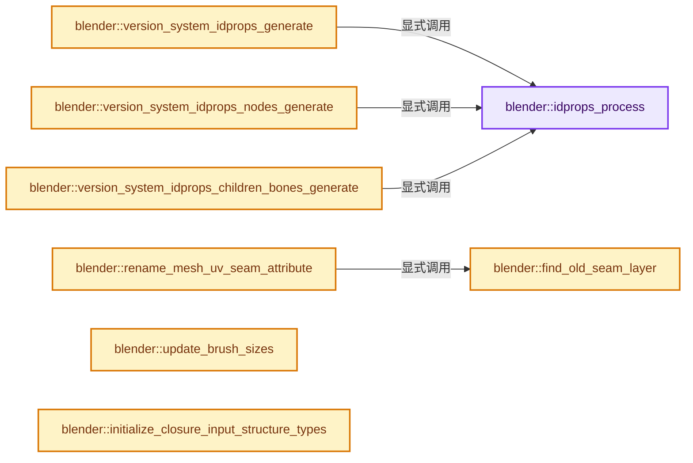
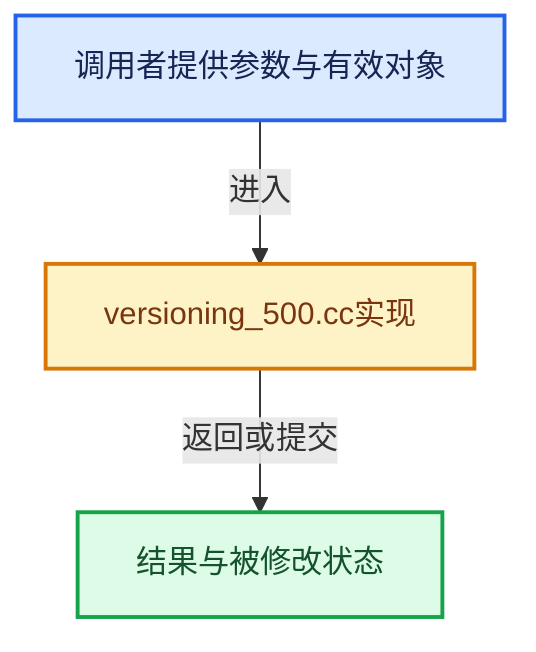

# 实现依赖专题：source/blender/blenloader/intern/versioning_500.cc

[方向导航](README.md) · [符号索引](../%E7%AC%A6%E5%8F%B7%E4%BE%9D%E8%B5%96%E4%B8%8E%E5%AE%9E%E7%8E%B0%E7%B4%A2%E5%BC%95.md)

本专题从正文实际调用进入，集中保存共享实现。函数有稳定锚点，可从调用处直接跳到对应完整函数；递归与互相调用通过回链组织。

## 本文件的实现关系






## 完整成员与函数实现

<a id="f-d3b7a78236b263c3"></a>

### `blender::idprops_process`

实现位置：[source/blender/blenloader/intern/versioning_500.cc](../../../../../source/blender/blenloader/intern/versioning_500.cc) · L96—L103。

接口参数：

- `IDProperty *idprops`
- `IDProperty **system_idprops`

**教学注释版**

<!-- annotated:82c4c7132e032a -->

```cpp
static void idprops_process(IDProperty *idprops, IDProperty **system_idprops)
{
  BLI_assert(*system_idprops == nullptr);
  if (idprops) {
    /* Other ID pointers have not yet been relinked, do not try to access them for refcounting. */
    *system_idprops = IDP_CopyProperty_ex(idprops, LIB_ID_CREATE_NO_USER_REFCOUNT);
  }
}
```

<details>
<summary>核对原始源码：source/blender/blenloader/intern/versioning_500.cc · L96—L103</summary>

<!-- original:82c4c7132e032a:source/blender/blenloader/intern/versioning_500.cc:96:103 -->

```cpp
static void idprops_process(IDProperty *idprops, IDProperty **system_idprops)
{
  BLI_assert(*system_idprops == nullptr);
  if (idprops) {
    /* Other ID pointers have not yet been relinked, do not try to access them for refcounting. */
    *system_idprops = IDP_CopyProperty_ex(idprops, LIB_ID_CREATE_NO_USER_REFCOUNT);
  }
}
```

</details>

**继续追踪实现**

- `BLI_assert` → [BLI_assert · L48](../01-%E5%9F%BA%E7%A1%80%E5%AE%B9%E5%99%A8%E4%B8%8E%E7%8E%B0%E4%BB%A3CPP/%E4%BE%9D%E8%B5%96-BLI_assert-cc98e8.md#m-57a88495704d)；[BLI_assert · L63](../01-%E5%9F%BA%E7%A1%80%E5%AE%B9%E5%99%A8%E4%B8%8E%E7%8E%B0%E4%BB%A3CPP/%E4%BE%9D%E8%B5%96-BLI_assert-cc98e8.md#m-d07050020cb5)。宏定义由构建条件选择。
- `IDP_CopyProperty_ex` → [blender::IDP_CopyProperty_ex · L968](%E4%BE%9D%E8%B5%96-idprop-006c65.md#f-df4a72661231af0c)。

<a id="f-50a82a2141a30e9b"></a>

### `blender::version_system_idprops_generate`

实现位置：[source/blender/blenloader/intern/versioning_500.cc](../../../../../source/blender/blenloader/intern/versioning_500.cc) · L105—L151。

接口参数：

- `Main *bmain`

**教学注释版**

<!-- annotated:55f1b018296ee0 -->

```cpp
void version_system_idprops_generate(Main *bmain)
{
  ID *id_iter;
  FOREACH_MAIN_ID_BEGIN (bmain, id_iter) {
    idprops_process(id_iter->properties, &id_iter->system_properties);
  }
  FOREACH_MAIN_ID_END;

  for (Scene &scene : bmain->scenes) {
    for (ViewLayer &view_layer : scene.view_layers) {
      idprops_process(view_layer.id_properties, &view_layer.system_properties);
    }

    if (scene.ed != nullptr) {
      seq::foreach_strip(&scene.ed->seqbase, [](Strip *strip) -> bool {
        idprops_process(strip->prop, &strip->system_properties);
        return true;
      });
    }
  }

  for (Object &object : bmain->objects) {
    if (!object.pose) {
      continue;
    }
    for (bPoseChannel &pchan : object.pose->chanbase) {
      idprops_process(pchan.prop, &pchan.system_properties);
    }
  }

  for (bArmature &armature : bmain->armatures) {
    for (BoneCollection *bcoll : armature.collections_span()) {
      idprops_process(bcoll->prop, &bcoll->system_properties);
    }
    /* There is no way to iterate directly over all bones of an armature currently, use a recursive
     * approach instead. */
    auto process_bone_recursive = [](const auto &process_bone_recursive, Bone *bone) -> void {
      idprops_process(bone->prop, &bone->system_properties);
      for (Bone &bone_it : bone->childbase) {
        process_bone_recursive(process_bone_recursive, &bone_it);
      }
    };
    for (Bone &bone_it : armature.bonebase) {
      process_bone_recursive(process_bone_recursive, &bone_it);
    }
  }
}
```

<details>
<summary>核对原始源码：source/blender/blenloader/intern/versioning_500.cc · L105—L151</summary>

<!-- original:55f1b018296ee0:source/blender/blenloader/intern/versioning_500.cc:105:151 -->

```cpp
void version_system_idprops_generate(Main *bmain)
{
  ID *id_iter;
  FOREACH_MAIN_ID_BEGIN (bmain, id_iter) {
    idprops_process(id_iter->properties, &id_iter->system_properties);
  }
  FOREACH_MAIN_ID_END;

  for (Scene &scene : bmain->scenes) {
    for (ViewLayer &view_layer : scene.view_layers) {
      idprops_process(view_layer.id_properties, &view_layer.system_properties);
    }

    if (scene.ed != nullptr) {
      seq::foreach_strip(&scene.ed->seqbase, [](Strip *strip) -> bool {
        idprops_process(strip->prop, &strip->system_properties);
        return true;
      });
    }
  }

  for (Object &object : bmain->objects) {
    if (!object.pose) {
      continue;
    }
    for (bPoseChannel &pchan : object.pose->chanbase) {
      idprops_process(pchan.prop, &pchan.system_properties);
    }
  }

  for (bArmature &armature : bmain->armatures) {
    for (BoneCollection *bcoll : armature.collections_span()) {
      idprops_process(bcoll->prop, &bcoll->system_properties);
    }
    /* There is no way to iterate directly over all bones of an armature currently, use a recursive
     * approach instead. */
    auto process_bone_recursive = [](const auto &process_bone_recursive, Bone *bone) -> void {
      idprops_process(bone->prop, &bone->system_properties);
      for (Bone &bone_it : bone->childbase) {
        process_bone_recursive(process_bone_recursive, &bone_it);
      }
    };
    for (Bone &bone_it : armature.bonebase) {
      process_bone_recursive(process_bone_recursive, &bone_it);
    }
  }
}
```

</details>

**结果出口**

- `return true;`

**继续追踪实现**

- `idprops_process` → [blender::idprops_process · L96](%E4%BE%9D%E8%B5%96-versioning_500-2c7b39.md#f-d3b7a78236b263c3)。
- `seq::foreach_strip` → [blender::seq::foreach_strip · L60](%E4%BE%9D%E8%B5%96-iterator-5c8b05.md#f-86cee6cf86eb707c)；[blender::seq::foreach_strip · L65](%E4%BE%9D%E8%B5%96-iterator-5c8b05.md#f-f628b6218602a592)。同名重载需按实参类型选择。
- `armature.collections_span` → [调用协议](../%E6%A8%A1%E6%9D%BF%E5%AE%8F%E4%B8%8E%E5%8A%A8%E6%80%81%E5%88%86%E6%B4%BE%E5%8D%8F%E8%AE%AE.md)：接收对象类型依赖auto、返回值或模板实例；不按同名猜测目标。调用位置L136。
- `process_bone_recursive` → [调用协议](../%E6%A8%A1%E6%9D%BF%E5%AE%8F%E4%B8%8E%E5%8A%A8%E6%80%81%E5%88%86%E6%B4%BE%E5%8D%8F%E8%AE%AE.md)：局部可调用对象，须结合其初始化与捕获环境。调用位置L144。

<a id="f-cc4c9365140ff42f"></a>

### `blender::version_system_idprops_nodes_generate`

实现位置：[source/blender/blenloader/intern/versioning_500.cc](../../../../../source/blender/blenloader/intern/versioning_500.cc) · L152—L163。

接口参数：

- `Main *bmain`

**教学注释版**

<!-- annotated:2bc9adedbda5c8 -->

```cpp
void version_system_idprops_nodes_generate(Main *bmain)
{
  /* Separate callback for nodes,
   * because they had the split implemented later. */

  FOREACH_NODETREE_BEGIN (bmain, node_tree, id_owner) {
    for (bNode &node : node_tree->nodes) {
      idprops_process(node.prop, &node.system_properties);
    }
  }
  FOREACH_NODETREE_END;
}
```

<details>
<summary>核对原始源码：source/blender/blenloader/intern/versioning_500.cc · L152—L163</summary>

<!-- original:2bc9adedbda5c8:source/blender/blenloader/intern/versioning_500.cc:152:163 -->

```cpp
void version_system_idprops_nodes_generate(Main *bmain)
{
  /* Separate callback for nodes,
   * because they had the split implemented later. */

  FOREACH_NODETREE_BEGIN (bmain, node_tree, id_owner) {
    for (bNode &node : node_tree->nodes) {
      idprops_process(node.prop, &node.system_properties);
    }
  }
  FOREACH_NODETREE_END;
}
```

</details>

**继续追踪实现**

- `idprops_process` → [blender::idprops_process · L96](%E4%BE%9D%E8%B5%96-versioning_500-2c7b39.md#f-d3b7a78236b263c3)。

<a id="f-dea33075b7976a38"></a>

### `blender::version_system_idprops_children_bones_generate`

实现位置：[source/blender/blenloader/intern/versioning_500.cc](../../../../../source/blender/blenloader/intern/versioning_500.cc) · L164—L188。

接口参数：

- `Main *bmain`

**教学注释版**

<!-- annotated:95da90df9d9e0d -->

```cpp
void version_system_idprops_children_bones_generate(Main *bmain)
{
  /* Separate callback for non-root bones,
   * because they were missed in the initial implementation. */

  for (bArmature &armature : bmain->armatures) {
    /* There is no way to iterate directly over all bones of an armature currently, use a recursive
     * approach instead. */
    auto process_bone_recursive = [](const auto &process_bone_recursive, Bone *bone) -> void {
      /* Do not overwrite children bones' system properties if they were already defined by some
       * scripts or add-on e.g. */
      if (bone->system_properties == nullptr) {
        idprops_process(bone->prop, &bone->system_properties);
      }
      for (Bone &bone_it : bone->childbase) {
        process_bone_recursive(process_bone_recursive, &bone_it);
      }
    };
    for (Bone &bone_it : armature.bonebase) {
      for (Bone &bone_child_it : bone_it.childbase) {
        process_bone_recursive(process_bone_recursive, &bone_child_it);
      }
    }
  }
}
```

<details>
<summary>核对原始源码：source/blender/blenloader/intern/versioning_500.cc · L164—L188</summary>

<!-- original:95da90df9d9e0d:source/blender/blenloader/intern/versioning_500.cc:164:188 -->

```cpp
void version_system_idprops_children_bones_generate(Main *bmain)
{
  /* Separate callback for non-root bones,
   * because they were missed in the initial implementation. */

  for (bArmature &armature : bmain->armatures) {
    /* There is no way to iterate directly over all bones of an armature currently, use a recursive
     * approach instead. */
    auto process_bone_recursive = [](const auto &process_bone_recursive, Bone *bone) -> void {
      /* Do not overwrite children bones' system properties if they were already defined by some
       * scripts or add-on e.g. */
      if (bone->system_properties == nullptr) {
        idprops_process(bone->prop, &bone->system_properties);
      }
      for (Bone &bone_it : bone->childbase) {
        process_bone_recursive(process_bone_recursive, &bone_it);
      }
    };
    for (Bone &bone_it : armature.bonebase) {
      for (Bone &bone_child_it : bone_it.childbase) {
        process_bone_recursive(process_bone_recursive, &bone_child_it);
      }
    }
  }
}
```

</details>

**继续追踪实现**

- `idprops_process` → [blender::idprops_process · L96](%E4%BE%9D%E8%B5%96-versioning_500-2c7b39.md#f-d3b7a78236b263c3)。
- `process_bone_recursive` → [调用协议](../%E6%A8%A1%E6%9D%BF%E5%AE%8F%E4%B8%8E%E5%8A%A8%E6%80%81%E5%88%86%E6%B4%BE%E5%8D%8F%E8%AE%AE.md)：局部可调用对象，须结合其初始化与捕获环境。调用位置L179。

<a id="f-4ed68ddfdecb9ced"></a>

### `blender::find_old_seam_layer`

实现位置：[source/blender/blenloader/intern/versioning_500.cc](../../../../../source/blender/blenloader/intern/versioning_500.cc) · L190—L198。

接口参数：

- `CustomData &custom_data`
- `const StringRef name`

**教学注释版**

<!-- annotated:ba1aa7777003e9 -->

```cpp
static CustomDataLayer *find_old_seam_layer(CustomData &custom_data, const StringRef name)
{
  for (CustomDataLayer &layer : MutableSpan(custom_data.layers, custom_data.totlayer)) {
    if (layer.name == name) {
      return &layer;
    }
  }
  return nullptr;
}
```

<details>
<summary>核对原始源码：source/blender/blenloader/intern/versioning_500.cc · L190—L198</summary>

<!-- original:ba1aa7777003e9:source/blender/blenloader/intern/versioning_500.cc:190:198 -->

```cpp
static CustomDataLayer *find_old_seam_layer(CustomData &custom_data, const StringRef name)
{
  for (CustomDataLayer &layer : MutableSpan(custom_data.layers, custom_data.totlayer)) {
    if (layer.name == name) {
      return &layer;
    }
  }
  return nullptr;
}
```

</details>

**结果出口**

- `return &layer;`
- `return nullptr;`

**继续追踪实现**

- `MutableSpan` → [blender::MutableSpan::MutableSpan · L462](../01-%E5%9F%BA%E7%A1%80%E5%AE%B9%E5%99%A8%E4%B8%8E%E7%8E%B0%E4%BB%A3CPP/06-MutableSpan%E5%8F%AF%E5%86%99%E8%A7%86%E5%9B%BE.md#f-0f07034aaffc3384)；[blender::MutableSpan::MutableSpan · L464](../01-%E5%9F%BA%E7%A1%80%E5%AE%B9%E5%99%A8%E4%B8%8E%E7%8E%B0%E4%BB%A3CPP/06-MutableSpan%E5%8F%AF%E5%86%99%E8%A7%86%E5%9B%BE.md#f-39977234ad0ce192)；[blender::MutableSpan::MutableSpan · L466](../01-%E5%9F%BA%E7%A1%80%E5%AE%B9%E5%99%A8%E4%B8%8E%E7%8E%B0%E4%BB%A3CPP/06-MutableSpan%E5%8F%AF%E5%86%99%E8%A7%86%E5%9B%BE.md#f-ee249b5042dd38aa)；[blender::MutableSpan::MutableSpan · L468](../01-%E5%9F%BA%E7%A1%80%E5%AE%B9%E5%99%A8%E4%B8%8E%E7%8E%B0%E4%BB%A3CPP/06-MutableSpan%E5%8F%AF%E5%86%99%E8%A7%86%E5%9B%BE.md#f-479c5f85921e531f)；[blender::MutableSpan::MutableSpan · L477](../01-%E5%9F%BA%E7%A1%80%E5%AE%B9%E5%99%A8%E4%B8%8E%E7%8E%B0%E4%BB%A3CPP/06-MutableSpan%E5%8F%AF%E5%86%99%E8%A7%86%E5%9B%BE.md#f-afcce5325e6f19e0)。同名重载需按实参类型选择。

<a id="f-d187cbc240e87fb8"></a>

### `blender::rename_mesh_uv_seam_attribute`

实现位置：[source/blender/blenloader/intern/versioning_500.cc](../../../../../source/blender/blenloader/intern/versioning_500.cc) · L200—L236。

接口参数：

- `Mesh &mesh`

**教学注释版**

<!-- annotated:e2552ce2e8bc3f -->

```cpp
static void rename_mesh_uv_seam_attribute(Mesh &mesh)
{
  CustomDataLayer *old_seam_layer = find_old_seam_layer(mesh.edge_data, ".uv_seam");
  if (!old_seam_layer) {
    return;
  }
  Set<StringRef> names;
  for (const CustomDataLayer &layer : Span(mesh.vert_data.layers, mesh.vert_data.totlayer)) {
    if (layer.type & CD_MASK_PROP_ALL) {
      // [讲解] names.add：按哈希与相等关系加入键或键值。
      names.add(layer.name);
    }
  }
  for (const CustomDataLayer &layer : Span(mesh.edge_data.layers, mesh.edge_data.totlayer)) {
    if (layer.type & CD_MASK_PROP_ALL) {
      names.add(layer.name);
    }
  }
  for (const CustomDataLayer &layer : Span(mesh.face_data.layers, mesh.face_data.totlayer)) {
    if (layer.type & CD_MASK_PROP_ALL) {
      names.add(layer.name);
    }
  }
  for (const CustomDataLayer &layer : Span(mesh.corner_data.layers, mesh.corner_data.totlayer)) {
    if (layer.type & CD_MASK_PROP_ALL) {
      names.add(layer.name);
    }
  }
  for (const bDeformGroup &vertex_group : mesh.vertex_group_names) {
    names.add(vertex_group.name);
  }

  /* If the new UV name is already taken, still rename the attribute so it becomes visible in the
   * list. Then the user can deal with the name conflict themselves. */
  const std::string new_name = BLI_uniquename_cb(
      // [讲解] names.contains：查询活项数量或键是否存在。
      [&](const StringRef name) { return names.contains(name); }, '.', "uv_seam");
  STRNCPY_UTF8(old_seam_layer->name, new_name.c_str());
}
```

<details>
<summary>核对原始源码：source/blender/blenloader/intern/versioning_500.cc · L200—L236</summary>

<!-- original:e2552ce2e8bc3f:source/blender/blenloader/intern/versioning_500.cc:200:236 -->

```cpp
static void rename_mesh_uv_seam_attribute(Mesh &mesh)
{
  CustomDataLayer *old_seam_layer = find_old_seam_layer(mesh.edge_data, ".uv_seam");
  if (!old_seam_layer) {
    return;
  }
  Set<StringRef> names;
  for (const CustomDataLayer &layer : Span(mesh.vert_data.layers, mesh.vert_data.totlayer)) {
    if (layer.type & CD_MASK_PROP_ALL) {
      names.add(layer.name);
    }
  }
  for (const CustomDataLayer &layer : Span(mesh.edge_data.layers, mesh.edge_data.totlayer)) {
    if (layer.type & CD_MASK_PROP_ALL) {
      names.add(layer.name);
    }
  }
  for (const CustomDataLayer &layer : Span(mesh.face_data.layers, mesh.face_data.totlayer)) {
    if (layer.type & CD_MASK_PROP_ALL) {
      names.add(layer.name);
    }
  }
  for (const CustomDataLayer &layer : Span(mesh.corner_data.layers, mesh.corner_data.totlayer)) {
    if (layer.type & CD_MASK_PROP_ALL) {
      names.add(layer.name);
    }
  }
  for (const bDeformGroup &vertex_group : mesh.vertex_group_names) {
    names.add(vertex_group.name);
  }

  /* If the new UV name is already taken, still rename the attribute so it becomes visible in the
   * list. Then the user can deal with the name conflict themselves. */
  const std::string new_name = BLI_uniquename_cb(
      [&](const StringRef name) { return names.contains(name); }, '.', "uv_seam");
  STRNCPY_UTF8(old_seam_layer->name, new_name.c_str());
}
```

</details>

**继续追踪实现**

- `find_old_seam_layer` → [blender::find_old_seam_layer · L190](%E4%BE%9D%E8%B5%96-versioning_500-2c7b39.md#f-4ed68ddfdecb9ced)。
- `Span` → [blender::Span · L214](../01-%E5%9F%BA%E7%A1%80%E5%AE%B9%E5%99%A8%E4%B8%8E%E7%8E%B0%E4%BB%A3CPP/15-StringRef%E5%AD%97%E7%AC%A6%E4%B8%B2%E8%A7%86%E5%9B%BE.md#f-eea723436ab634ed)。
- `names.add` → [blender::Set::add · L248](../02-%E5%93%88%E5%B8%8C%E8%A1%A8%E4%B8%8E%E5%85%B3%E8%81%94%E6%95%B0%E6%8D%AE%E7%BB%93%E6%9E%84/08-Set%E4%B8%8E%E9%9B%86%E5%90%88%E8%AF%AD%E4%B9%89.md#f-c7498809c2327fba)；[blender::Set::add · L252](../02-%E5%93%88%E5%B8%8C%E8%A1%A8%E4%B8%8E%E5%85%B3%E8%81%94%E6%95%B0%E6%8D%AE%E7%BB%93%E6%9E%84/08-Set%E4%B8%8E%E9%9B%86%E5%90%88%E8%AF%AD%E4%B9%89.md#f-e3ac8d1c52c03c2b)。同名重载需按实参类型选择。
- `BLI_uniquename_cb` → [blender::BLI_uniquename_cb · L421](../01-%E5%9F%BA%E7%A1%80%E5%AE%B9%E5%99%A8%E4%B8%8E%E7%8E%B0%E4%BB%A3CPP/%E4%BE%9D%E8%B5%96-string_utils-bbfe0c.md#f-651b82b9010ddef4)；[blender::BLI_uniquename_cb · L459](../01-%E5%9F%BA%E7%A1%80%E5%AE%B9%E5%99%A8%E4%B8%8E%E7%8E%B0%E4%BB%A3CPP/%E4%BE%9D%E8%B5%96-string_utils-bbfe0c.md#f-0e0b6725b5b90a92)。同名重载需按实参类型选择。
- `names.contains` → [blender::Set::contains · L310](../02-%E5%93%88%E5%B8%8C%E8%A1%A8%E4%B8%8E%E5%85%B3%E8%81%94%E6%95%B0%E6%8D%AE%E7%BB%93%E6%9E%84/08-Set%E4%B8%8E%E9%9B%86%E5%90%88%E8%AF%AD%E4%B9%89.md#f-af7099799494350e)。
- `STRNCPY_UTF8` → [STRNCPY_UTF8 · L335](../01-%E5%9F%BA%E7%A1%80%E5%AE%B9%E5%99%A8%E4%B8%8E%E7%8E%B0%E4%BB%A3CPP/%E4%BE%9D%E8%B5%96-BLI_string_utf8-bcc961.md#m-222967f0ab6a)。宏定义由构建条件选择。
- `new_name.c_str` → [外部契约](https://eel.is/c++draft/)：这个边界按实际表达式及所属类型核对参数、返回值、寿命与失败行为。这里提供接口入口，不声称已解释该第三方版本的内部实现。

<a id="f-794e964da8125237"></a>

### `blender::update_brush_sizes`

实现位置：[source/blender/blenloader/intern/versioning_500.cc](../../../../../source/blender/blenloader/intern/versioning_500.cc) · L238—L273。

接口参数：

- `Main &bmain`

**教学注释版**

<!-- annotated:63d72781bc2467 -->

```cpp
static void update_brush_sizes(Main &bmain)
{
  /* This conversion was originally done in 582c7d94b8, between subversion 1 (84bee96757) and
   * subversion 2 (fa03c53d4a). The original change should have come with a subversion bump to be
   * filled in later, but since it didn't, the best we can do is use subversion 1 for this check.
   * Thankfully, this only results in a single day window in which a user would have had to
   * download the build where this versioning was not correctly applied. */
  for (Brush &brush : bmain.brushes) {
    brush.size *= 2;
    brush.unprojected_size *= 2.0f;
  }

  auto apply_to_paint = [&](Paint *paint) {
    if (paint == nullptr) {
      return;
    }
    UnifiedPaintSettings &ups = paint->unified_paint_settings;

    ups.size *= 2;
    ups.unprojected_size *= 2.0f;
  };

  for (Scene &scene : bmain.scenes) {
    scene.toolsettings->unified_paint_settings.size *= 2;
    scene.toolsettings->unified_paint_settings.unprojected_size *= 2.0f;
    apply_to_paint(reinterpret_cast<Paint *>(scene.toolsettings->vpaint));
    apply_to_paint(reinterpret_cast<Paint *>(scene.toolsettings->wpaint));
    apply_to_paint(reinterpret_cast<Paint *>(scene.toolsettings->sculpt));
    apply_to_paint(reinterpret_cast<Paint *>(scene.toolsettings->gp_paint));
    apply_to_paint(reinterpret_cast<Paint *>(scene.toolsettings->gp_vertexpaint));
    apply_to_paint(reinterpret_cast<Paint *>(scene.toolsettings->gp_sculptpaint));
    apply_to_paint(reinterpret_cast<Paint *>(scene.toolsettings->gp_weightpaint));
    apply_to_paint(reinterpret_cast<Paint *>(scene.toolsettings->curves_sculpt));
    apply_to_paint(reinterpret_cast<Paint *>(&scene.toolsettings->imapaint));
  }
}
```

<details>
<summary>核对原始源码：source/blender/blenloader/intern/versioning_500.cc · L238—L273</summary>

<!-- original:63d72781bc2467:source/blender/blenloader/intern/versioning_500.cc:238:273 -->

```cpp
static void update_brush_sizes(Main &bmain)
{
  /* This conversion was originally done in 582c7d94b8, between subversion 1 (84bee96757) and
   * subversion 2 (fa03c53d4a). The original change should have come with a subversion bump to be
   * filled in later, but since it didn't, the best we can do is use subversion 1 for this check.
   * Thankfully, this only results in a single day window in which a user would have had to
   * download the build where this versioning was not correctly applied. */
  for (Brush &brush : bmain.brushes) {
    brush.size *= 2;
    brush.unprojected_size *= 2.0f;
  }

  auto apply_to_paint = [&](Paint *paint) {
    if (paint == nullptr) {
      return;
    }
    UnifiedPaintSettings &ups = paint->unified_paint_settings;

    ups.size *= 2;
    ups.unprojected_size *= 2.0f;
  };

  for (Scene &scene : bmain.scenes) {
    scene.toolsettings->unified_paint_settings.size *= 2;
    scene.toolsettings->unified_paint_settings.unprojected_size *= 2.0f;
    apply_to_paint(reinterpret_cast<Paint *>(scene.toolsettings->vpaint));
    apply_to_paint(reinterpret_cast<Paint *>(scene.toolsettings->wpaint));
    apply_to_paint(reinterpret_cast<Paint *>(scene.toolsettings->sculpt));
    apply_to_paint(reinterpret_cast<Paint *>(scene.toolsettings->gp_paint));
    apply_to_paint(reinterpret_cast<Paint *>(scene.toolsettings->gp_vertexpaint));
    apply_to_paint(reinterpret_cast<Paint *>(scene.toolsettings->gp_sculptpaint));
    apply_to_paint(reinterpret_cast<Paint *>(scene.toolsettings->gp_weightpaint));
    apply_to_paint(reinterpret_cast<Paint *>(scene.toolsettings->curves_sculpt));
    apply_to_paint(reinterpret_cast<Paint *>(&scene.toolsettings->imapaint));
  }
}
```

</details>

**沿实际写入检查状态**

- `brush.size *= 2;`
- `brush.unprojected_size *= 2.0f;`
- `ups.size *= 2;`
- `ups.unprojected_size *= 2.0f;`
- `scene.toolsettings->unified_paint_settings.size *= 2;`
- `scene.toolsettings->unified_paint_settings.unprojected_size *= 2.0f;`

**继续追踪实现**

- `apply_to_paint` → [调用协议](../%E6%A8%A1%E6%9D%BF%E5%AE%8F%E4%B8%8E%E5%8A%A8%E6%80%81%E5%88%86%E6%B4%BE%E5%8D%8F%E8%AE%AE.md)：局部可调用对象，须结合其初始化与捕获环境。调用位置L263。

<a id="f-10ce69de9e14aec6"></a>

### `blender::initialize_closure_input_structure_types`

实现位置：[source/blender/blenloader/intern/versioning_500.cc](../../../../../source/blender/blenloader/intern/versioning_500.cc) · L275—L299。

接口参数：

- `bNodeTree &ntree`

**教学注释版**

<!-- annotated:a8e3741d988ab9 -->

```cpp
static void initialize_closure_input_structure_types(bNodeTree &ntree)
{
  for (bNode &node : ntree.nodes) {
    if (node.type_legacy == NODE_EVALUATE_CLOSURE) {
      auto *storage = static_cast<NodeEvaluateClosure *>(node.storage);
      if (!storage) {
        /* Can happen with certain files saved in 4.5 which did not officially support closures
         * yet. */
        continue;
      }
      for (const int i : IndexRange(storage->input_items.items_num)) {
        NodeEvaluateClosureInputItem &item = storage->input_items.items[i];
        if (item.structure_type == NodeSocketInterfaceStructureType::Auto) {
          item.structure_type = NodeSocketInterfaceStructureType::Dynamic;
        }
      }
      for (const int i : IndexRange(storage->output_items.items_num)) {
        NodeEvaluateClosureOutputItem &item = storage->output_items.items[i];
        if (item.structure_type == NodeSocketInterfaceStructureType::Auto) {
          item.structure_type = NodeSocketInterfaceStructureType::Dynamic;
        }
      }
    }
  }
}
```

<details>
<summary>核对原始源码：source/blender/blenloader/intern/versioning_500.cc · L275—L299</summary>

<!-- original:a8e3741d988ab9:source/blender/blenloader/intern/versioning_500.cc:275:299 -->

```cpp
static void initialize_closure_input_structure_types(bNodeTree &ntree)
{
  for (bNode &node : ntree.nodes) {
    if (node.type_legacy == NODE_EVALUATE_CLOSURE) {
      auto *storage = static_cast<NodeEvaluateClosure *>(node.storage);
      if (!storage) {
        /* Can happen with certain files saved in 4.5 which did not officially support closures
         * yet. */
        continue;
      }
      for (const int i : IndexRange(storage->input_items.items_num)) {
        NodeEvaluateClosureInputItem &item = storage->input_items.items[i];
        if (item.structure_type == NodeSocketInterfaceStructureType::Auto) {
          item.structure_type = NodeSocketInterfaceStructureType::Dynamic;
        }
      }
      for (const int i : IndexRange(storage->output_items.items_num)) {
        NodeEvaluateClosureOutputItem &item = storage->output_items.items[i];
        if (item.structure_type == NodeSocketInterfaceStructureType::Auto) {
          item.structure_type = NodeSocketInterfaceStructureType::Dynamic;
        }
      }
    }
  }
}
```

</details>

**沿实际写入检查状态**

- `item.structure_type = NodeSocketInterfaceStructureType::Dynamic;`

**继续追踪实现**

- `IndexRange` → [blender::IndexRange](../01-%E5%9F%BA%E7%A1%80%E5%AE%B9%E5%99%A8%E4%B8%8E%E7%8E%B0%E4%BB%A3CPP/%E4%BE%9D%E8%B5%96-BLI_index_range-7d7cc5.md#t-caa3466d6776)；[blender::gpu::shader::parser::IndexRange](%E4%BE%9D%E8%B5%96-utils-06433d.md#t-82d2bd4ea71c)；[blender::IndexRange](%E4%BE%9D%E8%B5%96-DNA_node_types-6708b9.md#t-0448cc889d39)。

<a id="f-4481675be34a5c94"></a>

### `blender::versioning_replace_legacy_combined_and_separate_color_nodes`

实现位置：[source/blender/blenloader/intern/versioning_500.cc](../../../../../source/blender/blenloader/intern/versioning_500.cc) · L301—L530。

接口参数：

- `bNodeTree *ntree`

**教学注释版**

<!-- annotated:23a9abb92ca29c -->

```cpp
static void versioning_replace_legacy_combined_and_separate_color_nodes(bNodeTree *ntree)
{
  /* In geometry nodes, replace shader combine/separate color nodes with function nodes */
  if (ntree->type == NTREE_GEOMETRY) {
    version_node_input_socket_name(ntree, SH_NODE_COMBRGB_LEGACY, "R", "Red");
    version_node_input_socket_name(ntree, SH_NODE_COMBRGB_LEGACY, "G", "Green");
    version_node_input_socket_name(ntree, SH_NODE_COMBRGB_LEGACY, "B", "Blue");
    version_node_output_socket_name(ntree, SH_NODE_COMBRGB_LEGACY, "Image", "Color");

    version_node_output_socket_name(ntree, SH_NODE_SEPRGB_LEGACY, "R", "Red");
    version_node_output_socket_name(ntree, SH_NODE_SEPRGB_LEGACY, "G", "Green");
    version_node_output_socket_name(ntree, SH_NODE_SEPRGB_LEGACY, "B", "Blue");
    version_node_input_socket_name(ntree, SH_NODE_SEPRGB_LEGACY, "Image", "Color");

    for (bNode &node : ntree->nodes) {
      switch (node.type_legacy) {
        case SH_NODE_COMBRGB_LEGACY: {
          node.type_legacy = FN_NODE_COMBINE_COLOR;
          NodeCombSepColor *storage = MEM_new<NodeCombSepColor>(__func__);
          storage->mode = NODE_COMBSEP_COLOR_RGB;
          STRNCPY_UTF8(node.idname, "FunctionNodeCombineColor");
          node.storage = storage;
          break;
        }
        case SH_NODE_SEPRGB_LEGACY: {
          node.type_legacy = FN_NODE_SEPARATE_COLOR;
          NodeCombSepColor *storage = MEM_new<NodeCombSepColor>(__func__);
          storage->mode = NODE_COMBSEP_COLOR_RGB;
          STRNCPY_UTF8(node.idname, "FunctionNodeSeparateColor");

          node.storage = storage;
          break;
        }
      }
    }
  }

  /* In compositing nodes, replace combine/separate RGBA/HSVA/YCbCrA/YCCA nodes with
   * combine/separate color */
  if (ntree->type == NTREE_COMPOSIT) {
    version_node_input_socket_name(ntree, CMP_NODE_COMBRGBA_LEGACY, "R", "Red");
    version_node_input_socket_name(ntree, CMP_NODE_COMBRGBA_LEGACY, "G", "Green");
    version_node_input_socket_name(ntree, CMP_NODE_COMBRGBA_LEGACY, "B", "Blue");
    version_node_input_socket_name(ntree, CMP_NODE_COMBRGBA_LEGACY, "A", "Alpha");

    version_node_input_socket_name(ntree, CMP_NODE_COMBHSVA_LEGACY, "H", "Red");
    version_node_input_socket_name(ntree, CMP_NODE_COMBHSVA_LEGACY, "S", "Green");
    version_node_input_socket_name(ntree, CMP_NODE_COMBHSVA_LEGACY, "V", "Blue");
    version_node_input_socket_name(ntree, CMP_NODE_COMBHSVA_LEGACY, "A", "Alpha");

    version_node_input_socket_name(ntree, CMP_NODE_COMBYCCA_LEGACY, "Y", "Red");
    version_node_input_socket_name(ntree, CMP_NODE_COMBYCCA_LEGACY, "Cb", "Green");
    version_node_input_socket_name(ntree, CMP_NODE_COMBYCCA_LEGACY, "Cr", "Blue");
    version_node_input_socket_name(ntree, CMP_NODE_COMBYCCA_LEGACY, "A", "Alpha");

    version_node_input_socket_name(ntree, CMP_NODE_COMBYUVA_LEGACY, "Y", "Red");
    version_node_input_socket_name(ntree, CMP_NODE_COMBYUVA_LEGACY, "U", "Green");
    version_node_input_socket_name(ntree, CMP_NODE_COMBYUVA_LEGACY, "V", "Blue");
    version_node_input_socket_name(ntree, CMP_NODE_COMBYUVA_LEGACY, "A", "Alpha");

    version_node_output_socket_name(ntree, CMP_NODE_SEPRGBA_LEGACY, "R", "Red");
    version_node_output_socket_name(ntree, CMP_NODE_SEPRGBA_LEGACY, "G", "Green");
    version_node_output_socket_name(ntree, CMP_NODE_SEPRGBA_LEGACY, "B", "Blue");
    version_node_output_socket_name(ntree, CMP_NODE_SEPRGBA_LEGACY, "A", "Alpha");

    version_node_output_socket_name(ntree, CMP_NODE_SEPHSVA_LEGACY, "H", "Red");
    version_node_output_socket_name(ntree, CMP_NODE_SEPHSVA_LEGACY, "S", "Green");
    version_node_output_socket_name(ntree, CMP_NODE_SEPHSVA_LEGACY, "V", "Blue");
    version_node_output_socket_name(ntree, CMP_NODE_SEPHSVA_LEGACY, "A", "Alpha");

    version_node_output_socket_name(ntree, CMP_NODE_SEPYCCA_LEGACY, "Y", "Red");
    version_node_output_socket_name(ntree, CMP_NODE_SEPYCCA_LEGACY, "Cb", "Green");
    version_node_output_socket_name(ntree, CMP_NODE_SEPYCCA_LEGACY, "Cr", "Blue");
    version_node_output_socket_name(ntree, CMP_NODE_SEPYCCA_LEGACY, "A", "Alpha");

    version_node_output_socket_name(ntree, CMP_NODE_SEPYUVA_LEGACY, "Y", "Red");
    version_node_output_socket_name(ntree, CMP_NODE_SEPYUVA_LEGACY, "U", "Green");
    version_node_output_socket_name(ntree, CMP_NODE_SEPYUVA_LEGACY, "V", "Blue");
    version_node_output_socket_name(ntree, CMP_NODE_SEPYUVA_LEGACY, "A", "Alpha");

    for (bNode &node : ntree->nodes) {
      switch (node.type_legacy) {
        case CMP_NODE_COMBRGBA_LEGACY: {
          node.type_legacy = CMP_NODE_COMBINE_COLOR;
          NodeCMPCombSepColor *storage = MEM_new<NodeCMPCombSepColor>(__func__);
          storage->mode = CMP_NODE_COMBSEP_COLOR_RGB;
          STRNCPY_UTF8(node.idname, "CompositorNodeCombineColor");
          node.storage = storage;
          break;
        }
        case CMP_NODE_COMBHSVA_LEGACY: {
          node.type_legacy = CMP_NODE_COMBINE_COLOR;
          NodeCMPCombSepColor *storage = MEM_new<NodeCMPCombSepColor>(__func__);
          storage->mode = CMP_NODE_COMBSEP_COLOR_HSV;
          STRNCPY_UTF8(node.idname, "CompositorNodeCombineColor");
          node.storage = storage;
          break;
        }
        case CMP_NODE_COMBYCCA_LEGACY: {
          node.type_legacy = CMP_NODE_COMBINE_COLOR;
          NodeCMPCombSepColor *storage = MEM_new<NodeCMPCombSepColor>(__func__);
          storage->mode = CMP_NODE_COMBSEP_COLOR_YCC;
          storage->ycc_mode = node.custom1;
          STRNCPY_UTF8(node.idname, "CompositorNodeCombineColor");
          node.storage = storage;
          break;
        }
        case CMP_NODE_COMBYUVA_LEGACY: {
          node.type_legacy = CMP_NODE_COMBINE_COLOR;
          NodeCMPCombSepColor *storage = MEM_new<NodeCMPCombSepColor>(__func__);
          storage->mode = CMP_NODE_COMBSEP_COLOR_YUV;
          STRNCPY_UTF8(node.idname, "CompositorNodeCombineColor");
          node.storage = storage;
          break;
        }
        case CMP_NODE_SEPRGBA_LEGACY: {
          node.type_legacy = CMP_NODE_SEPARATE_COLOR;
          NodeCMPCombSepColor *storage = MEM_new<NodeCMPCombSepColor>(__func__);
          storage->mode = CMP_NODE_COMBSEP_COLOR_RGB;
          STRNCPY_UTF8(node.idname, "CompositorNodeSeparateColor");
          node.storage = storage;
          break;
        }
        case CMP_NODE_SEPHSVA_LEGACY: {
          node.type_legacy = CMP_NODE_SEPARATE_COLOR;
          NodeCMPCombSepColor *storage = MEM_new<NodeCMPCombSepColor>(__func__);
          storage->mode = CMP_NODE_COMBSEP_COLOR_HSV;
          STRNCPY_UTF8(node.idname, "CompositorNodeSeparateColor");
          node.storage = storage;
          break;
        }
        case CMP_NODE_SEPYCCA_LEGACY: {
          node.type_legacy = CMP_NODE_SEPARATE_COLOR;
          NodeCMPCombSepColor *storage = MEM_new<NodeCMPCombSepColor>(__func__);
          storage->mode = CMP_NODE_COMBSEP_COLOR_YCC;
          storage->ycc_mode = node.custom1;
          STRNCPY_UTF8(node.idname, "CompositorNodeSeparateColor");
          node.storage = storage;
          break;
        }
        case CMP_NODE_SEPYUVA_LEGACY: {
          node.type_legacy = CMP_NODE_SEPARATE_COLOR;
          NodeCMPCombSepColor *storage = MEM_new<NodeCMPCombSepColor>(__func__);
          storage->mode = CMP_NODE_COMBSEP_COLOR_YUV;
          STRNCPY_UTF8(node.idname, "CompositorNodeSeparateColor");
          node.storage = storage;
          break;
        }
      }
    }
  }

  /* In texture nodes, replace combine/separate RGBA with combine/separate color */
  if (ntree->type == NTREE_TEXTURE) {
    for (bNode &node : ntree->nodes) {
      switch (node.type_legacy) {
        case TEX_NODE_COMPOSE_LEGACY: {
          node.type_legacy = TEX_NODE_COMBINE_COLOR;
          node.custom1 = NODE_COMBSEP_COLOR_RGB;
          STRNCPY_UTF8(node.idname, "TextureNodeCombineColor");
          break;
        }
        case TEX_NODE_DECOMPOSE_LEGACY: {
          node.type_legacy = TEX_NODE_SEPARATE_COLOR;
          node.custom1 = NODE_COMBSEP_COLOR_RGB;
          STRNCPY_UTF8(node.idname, "TextureNodeSeparateColor");
          break;
        }
      }
    }
  }

  /* In shader nodes, replace combine/separate RGB/HSV with combine/separate color */
  if (ntree->type == NTREE_SHADER) {
    version_node_input_socket_name(ntree, SH_NODE_COMBRGB_LEGACY, "R", "Red");
    version_node_input_socket_name(ntree, SH_NODE_COMBRGB_LEGACY, "G", "Green");
    version_node_input_socket_name(ntree, SH_NODE_COMBRGB_LEGACY, "B", "Blue");
    version_node_output_socket_name(ntree, SH_NODE_COMBRGB_LEGACY, "Image", "Color");

    version_node_input_socket_name(ntree, SH_NODE_COMBHSV_LEGACY, "H", "Red");
    version_node_input_socket_name(ntree, SH_NODE_COMBHSV_LEGACY, "S", "Green");
    version_node_input_socket_name(ntree, SH_NODE_COMBHSV_LEGACY, "V", "Blue");

    version_node_output_socket_name(ntree, SH_NODE_SEPRGB_LEGACY, "R", "Red");
    version_node_output_socket_name(ntree, SH_NODE_SEPRGB_LEGACY, "G", "Green");
    version_node_output_socket_name(ntree, SH_NODE_SEPRGB_LEGACY, "B", "Blue");
    version_node_input_socket_name(ntree, SH_NODE_SEPRGB_LEGACY, "Image", "Color");

    version_node_output_socket_name(ntree, SH_NODE_SEPHSV_LEGACY, "H", "Red");
    version_node_output_socket_name(ntree, SH_NODE_SEPHSV_LEGACY, "S", "Green");
    version_node_output_socket_name(ntree, SH_NODE_SEPHSV_LEGACY, "V", "Blue");

    for (bNode &node : ntree->nodes) {
      switch (node.type_legacy) {
        case SH_NODE_COMBRGB_LEGACY: {
          node.type_legacy = SH_NODE_COMBINE_COLOR;
          NodeCombSepColor *storage = MEM_new<NodeCombSepColor>(__func__);
          storage->mode = NODE_COMBSEP_COLOR_RGB;
          STRNCPY_UTF8(node.idname, "ShaderNodeCombineColor");
          node.storage = storage;
          break;
        }
        case SH_NODE_COMBHSV_LEGACY: {
          node.type_legacy = SH_NODE_COMBINE_COLOR;
          NodeCombSepColor *storage = MEM_new<NodeCombSepColor>(__func__);
          storage->mode = NODE_COMBSEP_COLOR_HSV;
          STRNCPY_UTF8(node.idname, "ShaderNodeCombineColor");
          node.storage = storage;
          break;
        }
        case SH_NODE_SEPRGB_LEGACY: {
          node.type_legacy = SH_NODE_SEPARATE_COLOR;
          NodeCombSepColor *storage = MEM_new<NodeCombSepColor>(__func__);
          storage->mode = NODE_COMBSEP_COLOR_RGB;
          STRNCPY_UTF8(node.idname, "ShaderNodeSeparateColor");
          node.storage = storage;
          break;
        }
        case SH_NODE_SEPHSV_LEGACY: {
          node.type_legacy = SH_NODE_SEPARATE_COLOR;
          NodeCombSepColor *storage = MEM_new<NodeCombSepColor>(__func__);
          storage->mode = NODE_COMBSEP_COLOR_HSV;
          STRNCPY_UTF8(node.idname, "ShaderNodeSeparateColor");
          node.storage = storage;
          break;
        }
      }
    }
  }
}
```

<details>
<summary>核对原始源码：source/blender/blenloader/intern/versioning_500.cc · L301—L530</summary>

<!-- original:23a9abb92ca29c:source/blender/blenloader/intern/versioning_500.cc:301:530 -->

```cpp
static void versioning_replace_legacy_combined_and_separate_color_nodes(bNodeTree *ntree)
{
  /* In geometry nodes, replace shader combine/separate color nodes with function nodes */
  if (ntree->type == NTREE_GEOMETRY) {
    version_node_input_socket_name(ntree, SH_NODE_COMBRGB_LEGACY, "R", "Red");
    version_node_input_socket_name(ntree, SH_NODE_COMBRGB_LEGACY, "G", "Green");
    version_node_input_socket_name(ntree, SH_NODE_COMBRGB_LEGACY, "B", "Blue");
    version_node_output_socket_name(ntree, SH_NODE_COMBRGB_LEGACY, "Image", "Color");

    version_node_output_socket_name(ntree, SH_NODE_SEPRGB_LEGACY, "R", "Red");
    version_node_output_socket_name(ntree, SH_NODE_SEPRGB_LEGACY, "G", "Green");
    version_node_output_socket_name(ntree, SH_NODE_SEPRGB_LEGACY, "B", "Blue");
    version_node_input_socket_name(ntree, SH_NODE_SEPRGB_LEGACY, "Image", "Color");

    for (bNode &node : ntree->nodes) {
      switch (node.type_legacy) {
        case SH_NODE_COMBRGB_LEGACY: {
          node.type_legacy = FN_NODE_COMBINE_COLOR;
          NodeCombSepColor *storage = MEM_new<NodeCombSepColor>(__func__);
          storage->mode = NODE_COMBSEP_COLOR_RGB;
          STRNCPY_UTF8(node.idname, "FunctionNodeCombineColor");
          node.storage = storage;
          break;
        }
        case SH_NODE_SEPRGB_LEGACY: {
          node.type_legacy = FN_NODE_SEPARATE_COLOR;
          NodeCombSepColor *storage = MEM_new<NodeCombSepColor>(__func__);
          storage->mode = NODE_COMBSEP_COLOR_RGB;
          STRNCPY_UTF8(node.idname, "FunctionNodeSeparateColor");

          node.storage = storage;
          break;
        }
      }
    }
  }

  /* In compositing nodes, replace combine/separate RGBA/HSVA/YCbCrA/YCCA nodes with
   * combine/separate color */
  if (ntree->type == NTREE_COMPOSIT) {
    version_node_input_socket_name(ntree, CMP_NODE_COMBRGBA_LEGACY, "R", "Red");
    version_node_input_socket_name(ntree, CMP_NODE_COMBRGBA_LEGACY, "G", "Green");
    version_node_input_socket_name(ntree, CMP_NODE_COMBRGBA_LEGACY, "B", "Blue");
    version_node_input_socket_name(ntree, CMP_NODE_COMBRGBA_LEGACY, "A", "Alpha");

    version_node_input_socket_name(ntree, CMP_NODE_COMBHSVA_LEGACY, "H", "Red");
    version_node_input_socket_name(ntree, CMP_NODE_COMBHSVA_LEGACY, "S", "Green");
    version_node_input_socket_name(ntree, CMP_NODE_COMBHSVA_LEGACY, "V", "Blue");
    version_node_input_socket_name(ntree, CMP_NODE_COMBHSVA_LEGACY, "A", "Alpha");

    version_node_input_socket_name(ntree, CMP_NODE_COMBYCCA_LEGACY, "Y", "Red");
    version_node_input_socket_name(ntree, CMP_NODE_COMBYCCA_LEGACY, "Cb", "Green");
    version_node_input_socket_name(ntree, CMP_NODE_COMBYCCA_LEGACY, "Cr", "Blue");
    version_node_input_socket_name(ntree, CMP_NODE_COMBYCCA_LEGACY, "A", "Alpha");

    version_node_input_socket_name(ntree, CMP_NODE_COMBYUVA_LEGACY, "Y", "Red");
    version_node_input_socket_name(ntree, CMP_NODE_COMBYUVA_LEGACY, "U", "Green");
    version_node_input_socket_name(ntree, CMP_NODE_COMBYUVA_LEGACY, "V", "Blue");
    version_node_input_socket_name(ntree, CMP_NODE_COMBYUVA_LEGACY, "A", "Alpha");

    version_node_output_socket_name(ntree, CMP_NODE_SEPRGBA_LEGACY, "R", "Red");
    version_node_output_socket_name(ntree, CMP_NODE_SEPRGBA_LEGACY, "G", "Green");
    version_node_output_socket_name(ntree, CMP_NODE_SEPRGBA_LEGACY, "B", "Blue");
    version_node_output_socket_name(ntree, CMP_NODE_SEPRGBA_LEGACY, "A", "Alpha");

    version_node_output_socket_name(ntree, CMP_NODE_SEPHSVA_LEGACY, "H", "Red");
    version_node_output_socket_name(ntree, CMP_NODE_SEPHSVA_LEGACY, "S", "Green");
    version_node_output_socket_name(ntree, CMP_NODE_SEPHSVA_LEGACY, "V", "Blue");
    version_node_output_socket_name(ntree, CMP_NODE_SEPHSVA_LEGACY, "A", "Alpha");

    version_node_output_socket_name(ntree, CMP_NODE_SEPYCCA_LEGACY, "Y", "Red");
    version_node_output_socket_name(ntree, CMP_NODE_SEPYCCA_LEGACY, "Cb", "Green");
    version_node_output_socket_name(ntree, CMP_NODE_SEPYCCA_LEGACY, "Cr", "Blue");
    version_node_output_socket_name(ntree, CMP_NODE_SEPYCCA_LEGACY, "A", "Alpha");

    version_node_output_socket_name(ntree, CMP_NODE_SEPYUVA_LEGACY, "Y", "Red");
    version_node_output_socket_name(ntree, CMP_NODE_SEPYUVA_LEGACY, "U", "Green");
    version_node_output_socket_name(ntree, CMP_NODE_SEPYUVA_LEGACY, "V", "Blue");
    version_node_output_socket_name(ntree, CMP_NODE_SEPYUVA_LEGACY, "A", "Alpha");

    for (bNode &node : ntree->nodes) {
      switch (node.type_legacy) {
        case CMP_NODE_COMBRGBA_LEGACY: {
          node.type_legacy = CMP_NODE_COMBINE_COLOR;
          NodeCMPCombSepColor *storage = MEM_new<NodeCMPCombSepColor>(__func__);
          storage->mode = CMP_NODE_COMBSEP_COLOR_RGB;
          STRNCPY_UTF8(node.idname, "CompositorNodeCombineColor");
          node.storage = storage;
          break;
        }
        case CMP_NODE_COMBHSVA_LEGACY: {
          node.type_legacy = CMP_NODE_COMBINE_COLOR;
          NodeCMPCombSepColor *storage = MEM_new<NodeCMPCombSepColor>(__func__);
          storage->mode = CMP_NODE_COMBSEP_COLOR_HSV;
          STRNCPY_UTF8(node.idname, "CompositorNodeCombineColor");
          node.storage = storage;
          break;
        }
        case CMP_NODE_COMBYCCA_LEGACY: {
          node.type_legacy = CMP_NODE_COMBINE_COLOR;
          NodeCMPCombSepColor *storage = MEM_new<NodeCMPCombSepColor>(__func__);
          storage->mode = CMP_NODE_COMBSEP_COLOR_YCC;
          storage->ycc_mode = node.custom1;
          STRNCPY_UTF8(node.idname, "CompositorNodeCombineColor");
          node.storage = storage;
          break;
        }
        case CMP_NODE_COMBYUVA_LEGACY: {
          node.type_legacy = CMP_NODE_COMBINE_COLOR;
          NodeCMPCombSepColor *storage = MEM_new<NodeCMPCombSepColor>(__func__);
          storage->mode = CMP_NODE_COMBSEP_COLOR_YUV;
          STRNCPY_UTF8(node.idname, "CompositorNodeCombineColor");
          node.storage = storage;
          break;
        }
        case CMP_NODE_SEPRGBA_LEGACY: {
          node.type_legacy = CMP_NODE_SEPARATE_COLOR;
          NodeCMPCombSepColor *storage = MEM_new<NodeCMPCombSepColor>(__func__);
          storage->mode = CMP_NODE_COMBSEP_COLOR_RGB;
          STRNCPY_UTF8(node.idname, "CompositorNodeSeparateColor");
          node.storage = storage;
          break;
        }
        case CMP_NODE_SEPHSVA_LEGACY: {
          node.type_legacy = CMP_NODE_SEPARATE_COLOR;
          NodeCMPCombSepColor *storage = MEM_new<NodeCMPCombSepColor>(__func__);
          storage->mode = CMP_NODE_COMBSEP_COLOR_HSV;
          STRNCPY_UTF8(node.idname, "CompositorNodeSeparateColor");
          node.storage = storage;
          break;
        }
        case CMP_NODE_SEPYCCA_LEGACY: {
          node.type_legacy = CMP_NODE_SEPARATE_COLOR;
          NodeCMPCombSepColor *storage = MEM_new<NodeCMPCombSepColor>(__func__);
          storage->mode = CMP_NODE_COMBSEP_COLOR_YCC;
          storage->ycc_mode = node.custom1;
          STRNCPY_UTF8(node.idname, "CompositorNodeSeparateColor");
          node.storage = storage;
          break;
        }
        case CMP_NODE_SEPYUVA_LEGACY: {
          node.type_legacy = CMP_NODE_SEPARATE_COLOR;
          NodeCMPCombSepColor *storage = MEM_new<NodeCMPCombSepColor>(__func__);
          storage->mode = CMP_NODE_COMBSEP_COLOR_YUV;
          STRNCPY_UTF8(node.idname, "CompositorNodeSeparateColor");
          node.storage = storage;
          break;
        }
      }
    }
  }

  /* In texture nodes, replace combine/separate RGBA with combine/separate color */
  if (ntree->type == NTREE_TEXTURE) {
    for (bNode &node : ntree->nodes) {
      switch (node.type_legacy) {
        case TEX_NODE_COMPOSE_LEGACY: {
          node.type_legacy = TEX_NODE_COMBINE_COLOR;
          node.custom1 = NODE_COMBSEP_COLOR_RGB;
          STRNCPY_UTF8(node.idname, "TextureNodeCombineColor");
          break;
        }
        case TEX_NODE_DECOMPOSE_LEGACY: {
          node.type_legacy = TEX_NODE_SEPARATE_COLOR;
          node.custom1 = NODE_COMBSEP_COLOR_RGB;
          STRNCPY_UTF8(node.idname, "TextureNodeSeparateColor");
          break;
        }
      }
    }
  }

  /* In shader nodes, replace combine/separate RGB/HSV with combine/separate color */
  if (ntree->type == NTREE_SHADER) {
    version_node_input_socket_name(ntree, SH_NODE_COMBRGB_LEGACY, "R", "Red");
    version_node_input_socket_name(ntree, SH_NODE_COMBRGB_LEGACY, "G", "Green");
    version_node_input_socket_name(ntree, SH_NODE_COMBRGB_LEGACY, "B", "Blue");
    version_node_output_socket_name(ntree, SH_NODE_COMBRGB_LEGACY, "Image", "Color");

    version_node_input_socket_name(ntree, SH_NODE_COMBHSV_LEGACY, "H", "Red");
    version_node_input_socket_name(ntree, SH_NODE_COMBHSV_LEGACY, "S", "Green");
    version_node_input_socket_name(ntree, SH_NODE_COMBHSV_LEGACY, "V", "Blue");

    version_node_output_socket_name(ntree, SH_NODE_SEPRGB_LEGACY, "R", "Red");
    version_node_output_socket_name(ntree, SH_NODE_SEPRGB_LEGACY, "G", "Green");
    version_node_output_socket_name(ntree, SH_NODE_SEPRGB_LEGACY, "B", "Blue");
    version_node_input_socket_name(ntree, SH_NODE_SEPRGB_LEGACY, "Image", "Color");

    version_node_output_socket_name(ntree, SH_NODE_SEPHSV_LEGACY, "H", "Red");
    version_node_output_socket_name(ntree, SH_NODE_SEPHSV_LEGACY, "S", "Green");
    version_node_output_socket_name(ntree, SH_NODE_SEPHSV_LEGACY, "V", "Blue");

    for (bNode &node : ntree->nodes) {
      switch (node.type_legacy) {
        case SH_NODE_COMBRGB_LEGACY: {
          node.type_legacy = SH_NODE_COMBINE_COLOR;
          NodeCombSepColor *storage = MEM_new<NodeCombSepColor>(__func__);
          storage->mode = NODE_COMBSEP_COLOR_RGB;
          STRNCPY_UTF8(node.idname, "ShaderNodeCombineColor");
          node.storage = storage;
          break;
        }
        case SH_NODE_COMBHSV_LEGACY: {
          node.type_legacy = SH_NODE_COMBINE_COLOR;
          NodeCombSepColor *storage = MEM_new<NodeCombSepColor>(__func__);
          storage->mode = NODE_COMBSEP_COLOR_HSV;
          STRNCPY_UTF8(node.idname, "ShaderNodeCombineColor");
          node.storage = storage;
          break;
        }
        case SH_NODE_SEPRGB_LEGACY: {
          node.type_legacy = SH_NODE_SEPARATE_COLOR;
          NodeCombSepColor *storage = MEM_new<NodeCombSepColor>(__func__);
          storage->mode = NODE_COMBSEP_COLOR_RGB;
          STRNCPY_UTF8(node.idname, "ShaderNodeSeparateColor");
          node.storage = storage;
          break;
        }
        case SH_NODE_SEPHSV_LEGACY: {
          node.type_legacy = SH_NODE_SEPARATE_COLOR;
          NodeCombSepColor *storage = MEM_new<NodeCombSepColor>(__func__);
          storage->mode = NODE_COMBSEP_COLOR_HSV;
          STRNCPY_UTF8(node.idname, "ShaderNodeSeparateColor");
          node.storage = storage;
          break;
        }
      }
    }
  }
}
```

</details>

**沿实际写入检查状态**

- `node.type_legacy = FN_NODE_COMBINE_COLOR;`
- `storage->mode = NODE_COMBSEP_COLOR_RGB;`
- `node.storage = storage;`
- `node.type_legacy = FN_NODE_SEPARATE_COLOR;`
- `node.type_legacy = CMP_NODE_COMBINE_COLOR;`
- `storage->mode = CMP_NODE_COMBSEP_COLOR_RGB;`
- `storage->mode = CMP_NODE_COMBSEP_COLOR_HSV;`
- `storage->mode = CMP_NODE_COMBSEP_COLOR_YCC;`
- `storage->ycc_mode = node.custom1;`
- `storage->mode = CMP_NODE_COMBSEP_COLOR_YUV;`
- `node.type_legacy = CMP_NODE_SEPARATE_COLOR;`
- `node.type_legacy = TEX_NODE_COMBINE_COLOR;`
- `node.custom1 = NODE_COMBSEP_COLOR_RGB;`
- `node.type_legacy = TEX_NODE_SEPARATE_COLOR;`
- `node.type_legacy = SH_NODE_COMBINE_COLOR;`
- `storage->mode = NODE_COMBSEP_COLOR_HSV;`
- `node.type_legacy = SH_NODE_SEPARATE_COLOR;`

**继续追踪实现**

- `version_node_input_socket_name` → [blender::version_node_input_socket_name · L198](%E4%BE%9D%E8%B5%96-versioning_common-5f7e5c.md#f-7bc10a617bce857b)。
- `version_node_output_socket_name` → [blender::version_node_output_socket_name · L210](%E4%BE%9D%E8%B5%96-versioning_common-5f7e5c.md#f-e7964084381ccf06)。
- `MEM_new<NodeCombSepColor>` → [MEM_new · L351](../03-%E5%86%85%E5%AD%98%E5%88%86%E9%85%8D%E4%B8%8E%E8%BF%90%E8%A1%8C%E6%97%B6%E7%B1%BB%E5%9E%8B/%E4%BE%9D%E8%B5%96-MEM_guardedalloc-b54eca.md#f-115f9b6784f89912)。
- `STRNCPY_UTF8` → [STRNCPY_UTF8 · L335](../01-%E5%9F%BA%E7%A1%80%E5%AE%B9%E5%99%A8%E4%B8%8E%E7%8E%B0%E4%BB%A3CPP/%E4%BE%9D%E8%B5%96-BLI_string_utf8-bcc961.md#m-222967f0ab6a)。宏定义由构建条件选择。
- `MEM_new<NodeCMPCombSepColor>` → [MEM_new · L351](../03-%E5%86%85%E5%AD%98%E5%88%86%E9%85%8D%E4%B8%8E%E8%BF%90%E8%A1%8C%E6%97%B6%E7%B1%BB%E5%9E%8B/%E4%BE%9D%E8%B5%96-MEM_guardedalloc-b54eca.md#f-115f9b6784f89912)。

<a id="f-0e945b293dc8f8db"></a>

### `blender::do_version_scene_remove_use_nodes`

实现位置：[source/blender/blenloader/intern/versioning_500.cc](../../../../../source/blender/blenloader/intern/versioning_500.cc) · L533—L545。

接口参数：

- `Scene *scene`

**教学注释版**

<!-- annotated:40d34ebf62d486 -->

```cpp
static void do_version_scene_remove_use_nodes(Scene *scene)
{
  if (scene->nodetree == nullptr && scene->compositing_node_group == nullptr) {
    /* scene->use_nodes is set to false by default. Files saved without compositing node trees
     * should not disable compositing. */
    return;
  }
  if (scene->use_nodes == false && scene->r.scemode & R_DOCOMP) {
    /* A compositing node tree exists but users explicitly disabled compositing. */
    scene->r.scemode &= ~R_DOCOMP;
  }
  /* Ignore use_nodes otherwise. */
}
```

<details>
<summary>核对原始源码：source/blender/blenloader/intern/versioning_500.cc · L533—L545</summary>

<!-- original:40d34ebf62d486:source/blender/blenloader/intern/versioning_500.cc:533:545 -->

```cpp
static void do_version_scene_remove_use_nodes(Scene *scene)
{
  if (scene->nodetree == nullptr && scene->compositing_node_group == nullptr) {
    /* scene->use_nodes is set to false by default. Files saved without compositing node trees
     * should not disable compositing. */
    return;
  }
  if (scene->use_nodes == false && scene->r.scemode & R_DOCOMP) {
    /* A compositing node tree exists but users explicitly disabled compositing. */
    scene->r.scemode &= ~R_DOCOMP;
  }
  /* Ignore use_nodes otherwise. */
}
```

</details>

**沿实际写入检查状态**

- `scene->r.scemode &= ~R_DOCOMP;`

**继续追踪实现**

本实现没有需要继续展开的显式调用；检查返回表达式、对象转换和调用者前置条件。

<a id="f-f47ebef76a8b3c11"></a>

### `blender::do_version_normal_node_dot_product`

实现位置：[source/blender/blenloader/intern/versioning_500.cc](../../../../../source/blender/blenloader/intern/versioning_500.cc) · L550—L629。

接口参数：

- `bNodeTree *node_tree`
- `bNode *node`

**教学注释版**

<!-- annotated:061aed6fd0674a -->

```cpp
static void do_version_normal_node_dot_product(bNodeTree *node_tree, bNode *node)
{
  bNodeSocket *normal_input = bke::node_find_socket(*node, SOCK_IN, "Normal"_ustr);
  bNodeSocket *normal_output = bke::node_find_socket(*node, SOCK_OUT, "Normal"_ustr);
  bNodeSocket *dot_output = bke::node_find_socket(*node, SOCK_OUT, "Dot"_ustr);

  /* Find the links going into and out from the node. */
  bNodeLink *normal_input_link = nullptr;
  bool is_normal_ontput_needed = false;
  bool is_dot_output_used = false;
  for (bNodeLink &link : node_tree->links) {
    if (link.tosock == normal_input) {
      normal_input_link = &link;
    }

    if (link.fromsock == normal_output) {
      is_normal_ontput_needed = true;
    }

    if (link.fromsock == dot_output) {
      is_dot_output_used = true;
    }
  }

  /* The dot output is unused, nothing to do. */
  if (!is_dot_output_used) {
    return;
  }

  /* Take the dot product with negative the node normal. */
  bNode *dot_product_node = bke::node_add_node(nullptr, *node_tree, "ShaderNodeVectorMath"_ustr);
  dot_product_node->custom1 = NODE_VECTOR_MATH_DOT_PRODUCT;
  dot_product_node->flag |= NODE_COLLAPSED;
  dot_product_node->parent = node->parent;
  dot_product_node->location[0] = node->location[0];
  dot_product_node->location[1] = node->location[1];

  bNodeSocket *dot_product_a_input = bke::node_find_socket(
      *dot_product_node, SOCK_IN, "Vector"_ustr);
  bNodeSocket *dot_product_b_input = bke::node_find_socket(
      *dot_product_node, SOCK_IN, "Vector_001"_ustr);
  bNodeSocket *dot_product_output = bke::node_find_socket(
      *dot_product_node, SOCK_OUT, "Value"_ustr);

  copy_v3_v3(static_cast<bNodeSocketValueVector *>(dot_product_a_input->default_value)->value,
             static_cast<bNodeSocketValueVector *>(normal_input->default_value)->value);

  if (normal_input_link) {
    version_node_add_link(*node_tree,
                          *normal_input_link->fromnode,
                          *normal_input_link->fromsock,
                          *dot_product_node,
                          *dot_product_a_input);
    bke::node_remove_link(node_tree, *normal_input_link);
  }

  /* Notice that we normalize and take the negative to reproduce the same behavior as the old
   * Normal node. */
  const float3 node_normal = normal_output->default_value_typed<bNodeSocketValueVector>()->value;
  const float3 normalized_node_normal = -math::normalize(node_normal);
  copy_v3_v3(static_cast<bNodeSocketValueVector *>(dot_product_b_input->default_value)->value,
             normalized_node_normal);

  for (bNodeLink &link : node_tree->links.items_mutable()) {
    if (link.fromsock != dot_output) {
      continue;
    }

    version_node_add_link(
        *node_tree, *dot_product_node, *dot_product_output, *link.tonode, *link.tosock);
    bke::node_remove_link(node_tree, link);
  }

  /* If only the Dot output was used, remove the node, making sure to initialize the node types to
   * allow removal. */
  if (!is_normal_ontput_needed) {
    bke::node_tree_set_type(*node_tree);
    version_node_remove(*node_tree, *node);
  }
}
```

<details>
<summary>核对原始源码：source/blender/blenloader/intern/versioning_500.cc · L550—L629</summary>

<!-- original:061aed6fd0674a:source/blender/blenloader/intern/versioning_500.cc:550:629 -->

```cpp
static void do_version_normal_node_dot_product(bNodeTree *node_tree, bNode *node)
{
  bNodeSocket *normal_input = bke::node_find_socket(*node, SOCK_IN, "Normal"_ustr);
  bNodeSocket *normal_output = bke::node_find_socket(*node, SOCK_OUT, "Normal"_ustr);
  bNodeSocket *dot_output = bke::node_find_socket(*node, SOCK_OUT, "Dot"_ustr);

  /* Find the links going into and out from the node. */
  bNodeLink *normal_input_link = nullptr;
  bool is_normal_ontput_needed = false;
  bool is_dot_output_used = false;
  for (bNodeLink &link : node_tree->links) {
    if (link.tosock == normal_input) {
      normal_input_link = &link;
    }

    if (link.fromsock == normal_output) {
      is_normal_ontput_needed = true;
    }

    if (link.fromsock == dot_output) {
      is_dot_output_used = true;
    }
  }

  /* The dot output is unused, nothing to do. */
  if (!is_dot_output_used) {
    return;
  }

  /* Take the dot product with negative the node normal. */
  bNode *dot_product_node = bke::node_add_node(nullptr, *node_tree, "ShaderNodeVectorMath"_ustr);
  dot_product_node->custom1 = NODE_VECTOR_MATH_DOT_PRODUCT;
  dot_product_node->flag |= NODE_COLLAPSED;
  dot_product_node->parent = node->parent;
  dot_product_node->location[0] = node->location[0];
  dot_product_node->location[1] = node->location[1];

  bNodeSocket *dot_product_a_input = bke::node_find_socket(
      *dot_product_node, SOCK_IN, "Vector"_ustr);
  bNodeSocket *dot_product_b_input = bke::node_find_socket(
      *dot_product_node, SOCK_IN, "Vector_001"_ustr);
  bNodeSocket *dot_product_output = bke::node_find_socket(
      *dot_product_node, SOCK_OUT, "Value"_ustr);

  copy_v3_v3(static_cast<bNodeSocketValueVector *>(dot_product_a_input->default_value)->value,
             static_cast<bNodeSocketValueVector *>(normal_input->default_value)->value);

  if (normal_input_link) {
    version_node_add_link(*node_tree,
                          *normal_input_link->fromnode,
                          *normal_input_link->fromsock,
                          *dot_product_node,
                          *dot_product_a_input);
    bke::node_remove_link(node_tree, *normal_input_link);
  }

  /* Notice that we normalize and take the negative to reproduce the same behavior as the old
   * Normal node. */
  const float3 node_normal = normal_output->default_value_typed<bNodeSocketValueVector>()->value;
  const float3 normalized_node_normal = -math::normalize(node_normal);
  copy_v3_v3(static_cast<bNodeSocketValueVector *>(dot_product_b_input->default_value)->value,
             normalized_node_normal);

  for (bNodeLink &link : node_tree->links.items_mutable()) {
    if (link.fromsock != dot_output) {
      continue;
    }

    version_node_add_link(
        *node_tree, *dot_product_node, *dot_product_output, *link.tonode, *link.tosock);
    bke::node_remove_link(node_tree, link);
  }

  /* If only the Dot output was used, remove the node, making sure to initialize the node types to
   * allow removal. */
  if (!is_normal_ontput_needed) {
    bke::node_tree_set_type(*node_tree);
    version_node_remove(*node_tree, *node);
  }
}
```

</details>

**沿实际写入检查状态**

- `normal_input_link = &link;`
- `is_normal_ontput_needed = true;`
- `is_dot_output_used = true;`
- `dot_product_node->custom1 = NODE_VECTOR_MATH_DOT_PRODUCT;`
- `dot_product_node->flag |= NODE_COLLAPSED;`
- `dot_product_node->parent = node->parent;`
- `dot_product_node->location[0] = node->location[0];`
- `dot_product_node->location[1] = node->location[1];`

**继续追踪实现**

- `bke::node_find_socket` → [blender::bke::node_find_socket · L3036](%E4%BE%9D%E8%B5%96-node-89d753.md#f-cbf9dec71aff5b59)；[blender::bke::node_find_socket · L3047](%E4%BE%9D%E8%B5%96-node-89d753.md#f-4a7a677634b7fbd1)。同名重载需按实参类型选择。
- `bke::node_add_node` → [blender::bke::node_add_node · L4260](%E4%BE%9D%E8%B5%96-node-89d753.md#f-3ffbb7b6b6d5b74c)。
- `copy_v3_v3` → [blender::copy_v3_v3 · L47](../12-%E7%A9%BA%E9%97%B4%E6%95%B0%E6%8D%AE%E7%BB%93%E6%9E%84%E4%B8%8E%E5%87%A0%E4%BD%95%E7%AE%97%E6%B3%95/%E4%BE%9D%E8%B5%96-math_vector_inline-0c8541.md#f-037a0d5fa5060bd6)。
- `version_node_add_link` → [blender::version_node_add_link · L365](%E4%BE%9D%E8%B5%96-versioning_common-5f7e5c.md#f-93b7d089bdf6807c)。
- `bke::node_remove_link` → [blender::bke::node_remove_link · L4676](%E4%BE%9D%E8%B5%96-node-89d753.md#f-3cf1faf3e4cf3dd2)。
- `normal_output->default_value_typed<bNodeSocketValueVector>` → [blender::bNodeSocket::default_value_typed · L1134](%E4%BE%9D%E8%B5%96-BKE_node_runtime-ee561b.md#f-ce490d0e5a28d98d)；[blender::bNodeSocket::default_value_typed · L1139](%E4%BE%9D%E8%B5%96-BKE_node_runtime-ee561b.md#f-392726ff93a0389d)。同名重载需按实参类型选择。
- `math::normalize` → [blender::math::normalize · L542](../12-%E7%A9%BA%E9%97%B4%E6%95%B0%E6%8D%AE%E7%BB%93%E6%9E%84%E4%B8%8E%E5%87%A0%E4%BD%95%E7%AE%97%E6%B3%95/%E4%BE%9D%E8%B5%96-BLI_math_vector-906a87.md#f-5bea914457e11f7f)；[blender::math::normalize · L258](../12-%E7%A9%BA%E9%97%B4%E6%95%B0%E6%8D%AE%E7%BB%93%E6%9E%84%E4%B8%8E%E5%87%A0%E4%BD%95%E7%AE%97%E6%B3%95/%E4%BE%9D%E8%B5%96-BLI_math_quaternion-cf105d.md#f-5bf6b351333e4054)；[blender::math::normalize · L450](../12-%E7%A9%BA%E9%97%B4%E6%95%B0%E6%8D%AE%E7%BB%93%E6%9E%84%E4%B8%8E%E5%87%A0%E4%BD%95%E7%AE%97%E6%B3%95/%E4%BE%9D%E8%B5%96-BLI_math_quaternion-cf105d.md#f-b852cee8f0cc9b6a)；[blender::math::normalize · L745](../12-%E7%A9%BA%E9%97%B4%E6%95%B0%E6%8D%AE%E7%BB%93%E6%9E%84%E4%B8%8E%E5%87%A0%E4%BD%95%E7%AE%97%E6%B3%95/%E4%BE%9D%E8%B5%96-BLI_math_matrix-b7b2b4.md#f-2235cb6f5ec7ff18)；[blender::math::normalize · L783](../12-%E7%A9%BA%E9%97%B4%E6%95%B0%E6%8D%AE%E7%BB%93%E6%9E%84%E4%B8%8E%E5%87%A0%E4%BD%95%E7%AE%97%E6%B3%95/%E4%BE%9D%E8%B5%96-BLI_math_matrix-b7b2b4.md#f-0386bc4ee9ac7425)。同名重载需按实参类型选择。
- `node_tree->links.items_mutable` → [调用协议](../%E6%A8%A1%E6%9D%BF%E5%AE%8F%E4%B8%8E%E5%8A%A8%E6%80%81%E5%88%86%E6%B4%BE%E5%8D%8F%E8%AE%AE.md)：接收对象类型依赖auto、返回值或模板实例；不按同名猜测目标。调用位置L613。
- `bke::node_tree_set_type` → [blender::bke::node_tree_set_type · L2748](%E4%BE%9D%E8%B5%96-node-89d753.md#f-fc30a35ccbffc505)。
- `version_node_remove` → [blender::version_node_remove · L323](%E4%BE%9D%E8%B5%96-versioning_common-5f7e5c.md#f-07d72836f4d06ee6)。

<a id="f-e9a86d92de5a22c1"></a>

### `blender::do_version_transform_geometry_options_to_inputs`

实现位置：[source/blender/blenloader/intern/versioning_500.cc](../../../../../source/blender/blenloader/intern/versioning_500.cc) · L631—L638。

接口参数：

- `bNodeTree &ntree`
- `bNode &node`

**教学注释版**

<!-- annotated:d0fc3f278fb925 -->

```cpp
static void do_version_transform_geometry_options_to_inputs(bNodeTree &ntree, bNode &node)
{
  if (bke::node_find_socket(node, SOCK_IN, "Mode"_ustr)) {
    return;
  }
  bNodeSocket &socket = version_node_add_socket(ntree, node, SOCK_IN, "NodeSocketMenu", "Mode");
  socket.default_value_typed<bNodeSocketValueMenu>()->value = node.custom1;
}
```

<details>
<summary>核对原始源码：source/blender/blenloader/intern/versioning_500.cc · L631—L638</summary>

<!-- original:d0fc3f278fb925:source/blender/blenloader/intern/versioning_500.cc:631:638 -->

```cpp
static void do_version_transform_geometry_options_to_inputs(bNodeTree &ntree, bNode &node)
{
  if (bke::node_find_socket(node, SOCK_IN, "Mode"_ustr)) {
    return;
  }
  bNodeSocket &socket = version_node_add_socket(ntree, node, SOCK_IN, "NodeSocketMenu", "Mode");
  socket.default_value_typed<bNodeSocketValueMenu>()->value = node.custom1;
}
```

</details>

**继续追踪实现**

- `bke::node_find_socket` → [blender::bke::node_find_socket · L3036](%E4%BE%9D%E8%B5%96-node-89d753.md#f-cbf9dec71aff5b59)；[blender::bke::node_find_socket · L3047](%E4%BE%9D%E8%B5%96-node-89d753.md#f-4a7a677634b7fbd1)。同名重载需按实参类型选择。
- `version_node_add_socket` → [blender::version_node_add_socket · L332](%E4%BE%9D%E8%B5%96-versioning_common-5f7e5c.md#f-846a4268eff6ea5d)。
- `socket.default_value_typed<bNodeSocketValueMenu>` → [blender::bNodeSocket::default_value_typed · L1134](%E4%BE%9D%E8%B5%96-BKE_node_runtime-ee561b.md#f-ce490d0e5a28d98d)；[blender::bNodeSocket::default_value_typed · L1139](%E4%BE%9D%E8%B5%96-BKE_node_runtime-ee561b.md#f-392726ff93a0389d)。同名重载需按实参类型选择。

<a id="f-e17a739ad5780abd"></a>

### `blender::do_version_points_to_volume_options_to_inputs`

实现位置：[source/blender/blenloader/intern/versioning_500.cc](../../../../../source/blender/blenloader/intern/versioning_500.cc) · L640—L653。

接口参数：

- `bNodeTree &ntree`
- `bNode &node`

**教学注释版**

<!-- annotated:f5f652f9ac17b7 -->

```cpp
static void do_version_points_to_volume_options_to_inputs(bNodeTree &ntree, bNode &node)
{
  if (bke::node_find_socket(node, SOCK_IN, "Resolution Mode"_ustr)) {
    return;
  }
  if (!version_node_ensure_storage_or_invalidate(node)) {
    return;
  }
  const NodeGeometryPointsToVolume &storage = *static_cast<NodeGeometryPointsToVolume *>(
      node.storage);
  bNodeSocket &socket = version_node_add_socket(
      ntree, node, SOCK_IN, "NodeSocketMenu", "Resolution Mode");
  socket.default_value_typed<bNodeSocketValueMenu>()->value = storage.resolution_mode;
}
```

<details>
<summary>核对原始源码：source/blender/blenloader/intern/versioning_500.cc · L640—L653</summary>

<!-- original:f5f652f9ac17b7:source/blender/blenloader/intern/versioning_500.cc:640:653 -->

```cpp
static void do_version_points_to_volume_options_to_inputs(bNodeTree &ntree, bNode &node)
{
  if (bke::node_find_socket(node, SOCK_IN, "Resolution Mode"_ustr)) {
    return;
  }
  if (!version_node_ensure_storage_or_invalidate(node)) {
    return;
  }
  const NodeGeometryPointsToVolume &storage = *static_cast<NodeGeometryPointsToVolume *>(
      node.storage);
  bNodeSocket &socket = version_node_add_socket(
      ntree, node, SOCK_IN, "NodeSocketMenu", "Resolution Mode");
  socket.default_value_typed<bNodeSocketValueMenu>()->value = storage.resolution_mode;
}
```

</details>

**继续追踪实现**

- `bke::node_find_socket` → [blender::bke::node_find_socket · L3036](%E4%BE%9D%E8%B5%96-node-89d753.md#f-cbf9dec71aff5b59)；[blender::bke::node_find_socket · L3047](%E4%BE%9D%E8%B5%96-node-89d753.md#f-4a7a677634b7fbd1)。同名重载需按实参类型选择。
- `version_node_ensure_storage_or_invalidate` → [blender::version_node_ensure_storage_or_invalidate · L389](%E4%BE%9D%E8%B5%96-versioning_common-5f7e5c.md#f-72131ae3b96134c2)。
- `version_node_add_socket` → [blender::version_node_add_socket · L332](%E4%BE%9D%E8%B5%96-versioning_common-5f7e5c.md#f-846a4268eff6ea5d)。
- `socket.default_value_typed<bNodeSocketValueMenu>` → [blender::bNodeSocket::default_value_typed · L1134](%E4%BE%9D%E8%B5%96-BKE_node_runtime-ee561b.md#f-ce490d0e5a28d98d)；[blender::bNodeSocket::default_value_typed · L1139](%E4%BE%9D%E8%B5%96-BKE_node_runtime-ee561b.md#f-392726ff93a0389d)。同名重载需按实参类型选择。

<a id="f-dd88c313f0d1a8a7"></a>

### `blender::do_version_triangulate_options_to_inputs`

实现位置：[source/blender/blenloader/intern/versioning_500.cc](../../../../../source/blender/blenloader/intern/versioning_500.cc) · L655—L667。

接口参数：

- `bNodeTree &ntree`
- `bNode &node`

**教学注释版**

<!-- annotated:c39fb5d3eb3682 -->

```cpp
static void do_version_triangulate_options_to_inputs(bNodeTree &ntree, bNode &node)
{
  if (!bke::node_find_socket(node, SOCK_IN, "Quad Method"_ustr)) {
    bNodeSocket &socket = version_node_add_socket(
        ntree, node, SOCK_IN, "NodeSocketMenu", "Quad Method");
    socket.default_value_typed<bNodeSocketValueMenu>()->value = node.custom1;
  }
  if (!bke::node_find_socket(node, SOCK_IN, "N-gon Method"_ustr)) {
    bNodeSocket &socket = version_node_add_socket(
        ntree, node, SOCK_IN, "NodeSocketMenu", "N-gon Method");
    socket.default_value_typed<bNodeSocketValueMenu>()->value = node.custom2;
  }
}
```

<details>
<summary>核对原始源码：source/blender/blenloader/intern/versioning_500.cc · L655—L667</summary>

<!-- original:c39fb5d3eb3682:source/blender/blenloader/intern/versioning_500.cc:655:667 -->

```cpp
static void do_version_triangulate_options_to_inputs(bNodeTree &ntree, bNode &node)
{
  if (!bke::node_find_socket(node, SOCK_IN, "Quad Method"_ustr)) {
    bNodeSocket &socket = version_node_add_socket(
        ntree, node, SOCK_IN, "NodeSocketMenu", "Quad Method");
    socket.default_value_typed<bNodeSocketValueMenu>()->value = node.custom1;
  }
  if (!bke::node_find_socket(node, SOCK_IN, "N-gon Method"_ustr)) {
    bNodeSocket &socket = version_node_add_socket(
        ntree, node, SOCK_IN, "NodeSocketMenu", "N-gon Method");
    socket.default_value_typed<bNodeSocketValueMenu>()->value = node.custom2;
  }
}
```

</details>

**继续追踪实现**

- `bke::node_find_socket` → [blender::bke::node_find_socket · L3036](%E4%BE%9D%E8%B5%96-node-89d753.md#f-cbf9dec71aff5b59)；[blender::bke::node_find_socket · L3047](%E4%BE%9D%E8%B5%96-node-89d753.md#f-4a7a677634b7fbd1)。同名重载需按实参类型选择。
- `version_node_add_socket` → [blender::version_node_add_socket · L332](%E4%BE%9D%E8%B5%96-versioning_common-5f7e5c.md#f-846a4268eff6ea5d)。
- `socket.default_value_typed<bNodeSocketValueMenu>` → [blender::bNodeSocket::default_value_typed · L1134](%E4%BE%9D%E8%B5%96-BKE_node_runtime-ee561b.md#f-ce490d0e5a28d98d)；[blender::bNodeSocket::default_value_typed · L1139](%E4%BE%9D%E8%B5%96-BKE_node_runtime-ee561b.md#f-392726ff93a0389d)。同名重载需按实参类型选择。

<a id="f-d439bf47b82d4abb"></a>

### `blender::do_version_volume_to_mesh_options_to_inputs`

实现位置：[source/blender/blenloader/intern/versioning_500.cc](../../../../../source/blender/blenloader/intern/versioning_500.cc) · L669—L681。

接口参数：

- `bNodeTree &ntree`
- `bNode &node`

**教学注释版**

<!-- annotated:4ac58d9e7e037d -->

```cpp
static void do_version_volume_to_mesh_options_to_inputs(bNodeTree &ntree, bNode &node)
{
  if (bke::node_find_socket(node, SOCK_IN, "Resolution Mode"_ustr)) {
    return;
  }
  if (!version_node_ensure_storage_or_invalidate(node)) {
    return;
  }
  const NodeGeometryVolumeToMesh &storage = *static_cast<NodeGeometryVolumeToMesh *>(node.storage);
  bNodeSocket &socket = version_node_add_socket(
      ntree, node, SOCK_IN, "NodeSocketMenu", "Resolution Mode");
  socket.default_value_typed<bNodeSocketValueMenu>()->value = storage.resolution_mode;
}
```

<details>
<summary>核对原始源码：source/blender/blenloader/intern/versioning_500.cc · L669—L681</summary>

<!-- original:4ac58d9e7e037d:source/blender/blenloader/intern/versioning_500.cc:669:681 -->

```cpp
static void do_version_volume_to_mesh_options_to_inputs(bNodeTree &ntree, bNode &node)
{
  if (bke::node_find_socket(node, SOCK_IN, "Resolution Mode"_ustr)) {
    return;
  }
  if (!version_node_ensure_storage_or_invalidate(node)) {
    return;
  }
  const NodeGeometryVolumeToMesh &storage = *static_cast<NodeGeometryVolumeToMesh *>(node.storage);
  bNodeSocket &socket = version_node_add_socket(
      ntree, node, SOCK_IN, "NodeSocketMenu", "Resolution Mode");
  socket.default_value_typed<bNodeSocketValueMenu>()->value = storage.resolution_mode;
}
```

</details>

**继续追踪实现**

- `bke::node_find_socket` → [blender::bke::node_find_socket · L3036](%E4%BE%9D%E8%B5%96-node-89d753.md#f-cbf9dec71aff5b59)；[blender::bke::node_find_socket · L3047](%E4%BE%9D%E8%B5%96-node-89d753.md#f-4a7a677634b7fbd1)。同名重载需按实参类型选择。
- `version_node_ensure_storage_or_invalidate` → [blender::version_node_ensure_storage_or_invalidate · L389](%E4%BE%9D%E8%B5%96-versioning_common-5f7e5c.md#f-72131ae3b96134c2)。
- `version_node_add_socket` → [blender::version_node_add_socket · L332](%E4%BE%9D%E8%B5%96-versioning_common-5f7e5c.md#f-846a4268eff6ea5d)。
- `socket.default_value_typed<bNodeSocketValueMenu>` → [blender::bNodeSocket::default_value_typed · L1134](%E4%BE%9D%E8%B5%96-BKE_node_runtime-ee561b.md#f-ce490d0e5a28d98d)；[blender::bNodeSocket::default_value_typed · L1139](%E4%BE%9D%E8%B5%96-BKE_node_runtime-ee561b.md#f-392726ff93a0389d)。同名重载需按实参类型选择。

<a id="f-19d86f3f9bb9dbb4"></a>

### `blender::do_version_match_string_options_to_inputs`

实现位置：[source/blender/blenloader/intern/versioning_500.cc](../../../../../source/blender/blenloader/intern/versioning_500.cc) · L683—L691。

接口参数：

- `bNodeTree &ntree`
- `bNode &node`

**教学注释版**

<!-- annotated:0d095438358568 -->

```cpp
static void do_version_match_string_options_to_inputs(bNodeTree &ntree, bNode &node)
{
  if (bke::node_find_socket(node, SOCK_IN, "Operation"_ustr)) {
    return;
  }
  bNodeSocket &socket = version_node_add_socket(
      ntree, node, SOCK_IN, "NodeSocketMenu", "Operation");
  socket.default_value_typed<bNodeSocketValueMenu>()->value = node.custom1;
}
```

<details>
<summary>核对原始源码：source/blender/blenloader/intern/versioning_500.cc · L683—L691</summary>

<!-- original:0d095438358568:source/blender/blenloader/intern/versioning_500.cc:683:691 -->

```cpp
static void do_version_match_string_options_to_inputs(bNodeTree &ntree, bNode &node)
{
  if (bke::node_find_socket(node, SOCK_IN, "Operation"_ustr)) {
    return;
  }
  bNodeSocket &socket = version_node_add_socket(
      ntree, node, SOCK_IN, "NodeSocketMenu", "Operation");
  socket.default_value_typed<bNodeSocketValueMenu>()->value = node.custom1;
}
```

</details>

**继续追踪实现**

- `bke::node_find_socket` → [blender::bke::node_find_socket · L3036](%E4%BE%9D%E8%B5%96-node-89d753.md#f-cbf9dec71aff5b59)；[blender::bke::node_find_socket · L3047](%E4%BE%9D%E8%B5%96-node-89d753.md#f-4a7a677634b7fbd1)。同名重载需按实参类型选择。
- `version_node_add_socket` → [blender::version_node_add_socket · L332](%E4%BE%9D%E8%B5%96-versioning_common-5f7e5c.md#f-846a4268eff6ea5d)。
- `socket.default_value_typed<bNodeSocketValueMenu>` → [blender::bNodeSocket::default_value_typed · L1134](%E4%BE%9D%E8%B5%96-BKE_node_runtime-ee561b.md#f-ce490d0e5a28d98d)；[blender::bNodeSocket::default_value_typed · L1139](%E4%BE%9D%E8%B5%96-BKE_node_runtime-ee561b.md#f-392726ff93a0389d)。同名重载需按实参类型选择。

<a id="f-e245b2b8d2ff187c"></a>

### `blender::do_version_fill_curve_options_to_inputs`

实现位置：[source/blender/blenloader/intern/versioning_500.cc](../../../../../source/blender/blenloader/intern/versioning_500.cc) · L693—L704。

接口参数：

- `bNodeTree &ntree`
- `bNode &node`

**教学注释版**

<!-- annotated:75777522647691 -->

```cpp
static void do_version_fill_curve_options_to_inputs(bNodeTree &ntree, bNode &node)
{
  if (bke::node_find_socket(node, SOCK_IN, "Mode"_ustr)) {
    return;
  }
  if (!version_node_ensure_storage_or_invalidate(node)) {
    return;
  }
  const auto &storage = *static_cast<NodeGeometryCurveFill *>(node.storage);
  bNodeSocket &socket = version_node_add_socket(ntree, node, SOCK_IN, "NodeSocketMenu", "Mode");
  socket.default_value_typed<bNodeSocketValueMenu>()->value = storage.mode;
}
```

<details>
<summary>核对原始源码：source/blender/blenloader/intern/versioning_500.cc · L693—L704</summary>

<!-- original:75777522647691:source/blender/blenloader/intern/versioning_500.cc:693:704 -->

```cpp
static void do_version_fill_curve_options_to_inputs(bNodeTree &ntree, bNode &node)
{
  if (bke::node_find_socket(node, SOCK_IN, "Mode"_ustr)) {
    return;
  }
  if (!version_node_ensure_storage_or_invalidate(node)) {
    return;
  }
  const auto &storage = *static_cast<NodeGeometryCurveFill *>(node.storage);
  bNodeSocket &socket = version_node_add_socket(ntree, node, SOCK_IN, "NodeSocketMenu", "Mode");
  socket.default_value_typed<bNodeSocketValueMenu>()->value = storage.mode;
}
```

</details>

**继续追踪实现**

- `bke::node_find_socket` → [blender::bke::node_find_socket · L3036](%E4%BE%9D%E8%B5%96-node-89d753.md#f-cbf9dec71aff5b59)；[blender::bke::node_find_socket · L3047](%E4%BE%9D%E8%B5%96-node-89d753.md#f-4a7a677634b7fbd1)。同名重载需按实参类型选择。
- `version_node_ensure_storage_or_invalidate` → [blender::version_node_ensure_storage_or_invalidate · L389](%E4%BE%9D%E8%B5%96-versioning_common-5f7e5c.md#f-72131ae3b96134c2)。
- `version_node_add_socket` → [blender::version_node_add_socket · L332](%E4%BE%9D%E8%B5%96-versioning_common-5f7e5c.md#f-846a4268eff6ea5d)。
- `socket.default_value_typed<bNodeSocketValueMenu>` → [blender::bNodeSocket::default_value_typed · L1134](%E4%BE%9D%E8%B5%96-BKE_node_runtime-ee561b.md#f-ce490d0e5a28d98d)；[blender::bNodeSocket::default_value_typed · L1139](%E4%BE%9D%E8%B5%96-BKE_node_runtime-ee561b.md#f-392726ff93a0389d)。同名重载需按实参类型选择。

<a id="f-64673c8c3df80825"></a>

### `blender::do_version_fillet_curve_options_to_inputs`

实现位置：[source/blender/blenloader/intern/versioning_500.cc](../../../../../source/blender/blenloader/intern/versioning_500.cc) · L706—L717。

接口参数：

- `bNodeTree &ntree`
- `bNode &node`

**教学注释版**

<!-- annotated:2a842e66b7c4fc -->

```cpp
static void do_version_fillet_curve_options_to_inputs(bNodeTree &ntree, bNode &node)
{
  if (bke::node_find_socket(node, SOCK_IN, "Mode"_ustr)) {
    return;
  }
  if (!version_node_ensure_storage_or_invalidate(node)) {
    return;
  }
  const auto &storage = *static_cast<NodeGeometryCurveFillet *>(node.storage);
  bNodeSocket &socket = version_node_add_socket(ntree, node, SOCK_IN, "NodeSocketMenu", "Mode");
  socket.default_value_typed<bNodeSocketValueMenu>()->value = storage.mode;
}
```

<details>
<summary>核对原始源码：source/blender/blenloader/intern/versioning_500.cc · L706—L717</summary>

<!-- original:2a842e66b7c4fc:source/blender/blenloader/intern/versioning_500.cc:706:717 -->

```cpp
static void do_version_fillet_curve_options_to_inputs(bNodeTree &ntree, bNode &node)
{
  if (bke::node_find_socket(node, SOCK_IN, "Mode"_ustr)) {
    return;
  }
  if (!version_node_ensure_storage_or_invalidate(node)) {
    return;
  }
  const auto &storage = *static_cast<NodeGeometryCurveFillet *>(node.storage);
  bNodeSocket &socket = version_node_add_socket(ntree, node, SOCK_IN, "NodeSocketMenu", "Mode");
  socket.default_value_typed<bNodeSocketValueMenu>()->value = storage.mode;
}
```

</details>

**继续追踪实现**

- `bke::node_find_socket` → [blender::bke::node_find_socket · L3036](%E4%BE%9D%E8%B5%96-node-89d753.md#f-cbf9dec71aff5b59)；[blender::bke::node_find_socket · L3047](%E4%BE%9D%E8%B5%96-node-89d753.md#f-4a7a677634b7fbd1)。同名重载需按实参类型选择。
- `version_node_ensure_storage_or_invalidate` → [blender::version_node_ensure_storage_or_invalidate · L389](%E4%BE%9D%E8%B5%96-versioning_common-5f7e5c.md#f-72131ae3b96134c2)。
- `version_node_add_socket` → [blender::version_node_add_socket · L332](%E4%BE%9D%E8%B5%96-versioning_common-5f7e5c.md#f-846a4268eff6ea5d)。
- `socket.default_value_typed<bNodeSocketValueMenu>` → [blender::bNodeSocket::default_value_typed · L1134](%E4%BE%9D%E8%B5%96-BKE_node_runtime-ee561b.md#f-ce490d0e5a28d98d)；[blender::bNodeSocket::default_value_typed · L1139](%E4%BE%9D%E8%B5%96-BKE_node_runtime-ee561b.md#f-392726ff93a0389d)。同名重载需按实参类型选择。

<a id="f-78d3f9bdb321947e"></a>

### `blender::do_version_resample_curve_options_to_inputs`

实现位置：[source/blender/blenloader/intern/versioning_500.cc](../../../../../source/blender/blenloader/intern/versioning_500.cc) · L719—L730。

接口参数：

- `bNodeTree &ntree`
- `bNode &node`

**教学注释版**

<!-- annotated:3d675ff2c69159 -->

```cpp
static void do_version_resample_curve_options_to_inputs(bNodeTree &ntree, bNode &node)
{
  if (bke::node_find_socket(node, SOCK_IN, "Mode"_ustr)) {
    return;
  }
  if (!version_node_ensure_storage_or_invalidate(node)) {
    return;
  }
  const auto &storage = *static_cast<NodeGeometryCurveResample *>(node.storage);
  bNodeSocket &socket = version_node_add_socket(ntree, node, SOCK_IN, "NodeSocketMenu", "Mode");
  socket.default_value_typed<bNodeSocketValueMenu>()->value = storage.mode;
}
```

<details>
<summary>核对原始源码：source/blender/blenloader/intern/versioning_500.cc · L719—L730</summary>

<!-- original:3d675ff2c69159:source/blender/blenloader/intern/versioning_500.cc:719:730 -->

```cpp
static void do_version_resample_curve_options_to_inputs(bNodeTree &ntree, bNode &node)
{
  if (bke::node_find_socket(node, SOCK_IN, "Mode"_ustr)) {
    return;
  }
  if (!version_node_ensure_storage_or_invalidate(node)) {
    return;
  }
  const auto &storage = *static_cast<NodeGeometryCurveResample *>(node.storage);
  bNodeSocket &socket = version_node_add_socket(ntree, node, SOCK_IN, "NodeSocketMenu", "Mode");
  socket.default_value_typed<bNodeSocketValueMenu>()->value = storage.mode;
}
```

</details>

**继续追踪实现**

- `bke::node_find_socket` → [blender::bke::node_find_socket · L3036](%E4%BE%9D%E8%B5%96-node-89d753.md#f-cbf9dec71aff5b59)；[blender::bke::node_find_socket · L3047](%E4%BE%9D%E8%B5%96-node-89d753.md#f-4a7a677634b7fbd1)。同名重载需按实参类型选择。
- `version_node_ensure_storage_or_invalidate` → [blender::version_node_ensure_storage_or_invalidate · L389](%E4%BE%9D%E8%B5%96-versioning_common-5f7e5c.md#f-72131ae3b96134c2)。
- `version_node_add_socket` → [blender::version_node_add_socket · L332](%E4%BE%9D%E8%B5%96-versioning_common-5f7e5c.md#f-846a4268eff6ea5d)。
- `socket.default_value_typed<bNodeSocketValueMenu>` → [blender::bNodeSocket::default_value_typed · L1134](%E4%BE%9D%E8%B5%96-BKE_node_runtime-ee561b.md#f-ce490d0e5a28d98d)；[blender::bNodeSocket::default_value_typed · L1139](%E4%BE%9D%E8%B5%96-BKE_node_runtime-ee561b.md#f-392726ff93a0389d)。同名重载需按实参类型选择。

<a id="f-183f105eb80e114f"></a>

### `blender::do_version_distribute_points_in_volume_options_to_inputs`

实现位置：[source/blender/blenloader/intern/versioning_500.cc](../../../../../source/blender/blenloader/intern/versioning_500.cc) · L732—L743。

接口参数：

- `bNodeTree &ntree`
- `bNode &node`

**教学注释版**

<!-- annotated:a840fd4c9f35f5 -->

```cpp
static void do_version_distribute_points_in_volume_options_to_inputs(bNodeTree &ntree, bNode &node)
{
  if (bke::node_find_socket(node, SOCK_IN, "Mode"_ustr)) {
    return;
  }
  if (!version_node_ensure_storage_or_invalidate(node)) {
    return;
  }
  const auto &storage = *static_cast<NodeGeometryDistributePointsInVolume *>(node.storage);
  bNodeSocket &socket = version_node_add_socket(ntree, node, SOCK_IN, "NodeSocketMenu", "Mode");
  socket.default_value_typed<bNodeSocketValueMenu>()->value = storage.mode;
}
```

<details>
<summary>核对原始源码：source/blender/blenloader/intern/versioning_500.cc · L732—L743</summary>

<!-- original:a840fd4c9f35f5:source/blender/blenloader/intern/versioning_500.cc:732:743 -->

```cpp
static void do_version_distribute_points_in_volume_options_to_inputs(bNodeTree &ntree, bNode &node)
{
  if (bke::node_find_socket(node, SOCK_IN, "Mode"_ustr)) {
    return;
  }
  if (!version_node_ensure_storage_or_invalidate(node)) {
    return;
  }
  const auto &storage = *static_cast<NodeGeometryDistributePointsInVolume *>(node.storage);
  bNodeSocket &socket = version_node_add_socket(ntree, node, SOCK_IN, "NodeSocketMenu", "Mode");
  socket.default_value_typed<bNodeSocketValueMenu>()->value = storage.mode;
}
```

</details>

**继续追踪实现**

- `bke::node_find_socket` → [blender::bke::node_find_socket · L3036](%E4%BE%9D%E8%B5%96-node-89d753.md#f-cbf9dec71aff5b59)；[blender::bke::node_find_socket · L3047](%E4%BE%9D%E8%B5%96-node-89d753.md#f-4a7a677634b7fbd1)。同名重载需按实参类型选择。
- `version_node_ensure_storage_or_invalidate` → [blender::version_node_ensure_storage_or_invalidate · L389](%E4%BE%9D%E8%B5%96-versioning_common-5f7e5c.md#f-72131ae3b96134c2)。
- `version_node_add_socket` → [blender::version_node_add_socket · L332](%E4%BE%9D%E8%B5%96-versioning_common-5f7e5c.md#f-846a4268eff6ea5d)。
- `socket.default_value_typed<bNodeSocketValueMenu>` → [blender::bNodeSocket::default_value_typed · L1134](%E4%BE%9D%E8%B5%96-BKE_node_runtime-ee561b.md#f-ce490d0e5a28d98d)；[blender::bNodeSocket::default_value_typed · L1139](%E4%BE%9D%E8%B5%96-BKE_node_runtime-ee561b.md#f-392726ff93a0389d)。同名重载需按实参类型选择。

<a id="f-23a22065ad175772"></a>

### `blender::do_version_merge_by_distance_options_to_inputs`

实现位置：[source/blender/blenloader/intern/versioning_500.cc](../../../../../source/blender/blenloader/intern/versioning_500.cc) · L745—L756。

接口参数：

- `bNodeTree &ntree`
- `bNode &node`

**教学注释版**

<!-- annotated:0902e36596ade0 -->

```cpp
static void do_version_merge_by_distance_options_to_inputs(bNodeTree &ntree, bNode &node)
{
  if (bke::node_find_socket(node, SOCK_IN, "Mode"_ustr)) {
    return;
  }
  if (!version_node_ensure_storage_or_invalidate(node)) {
    return;
  }
  const auto &storage = *static_cast<NodeGeometryMergeByDistance *>(node.storage);
  bNodeSocket &socket = version_node_add_socket(ntree, node, SOCK_IN, "NodeSocketMenu", "Mode");
  socket.default_value_typed<bNodeSocketValueMenu>()->value = storage.mode;
}
```

<details>
<summary>核对原始源码：source/blender/blenloader/intern/versioning_500.cc · L745—L756</summary>

<!-- original:0902e36596ade0:source/blender/blenloader/intern/versioning_500.cc:745:756 -->

```cpp
static void do_version_merge_by_distance_options_to_inputs(bNodeTree &ntree, bNode &node)
{
  if (bke::node_find_socket(node, SOCK_IN, "Mode"_ustr)) {
    return;
  }
  if (!version_node_ensure_storage_or_invalidate(node)) {
    return;
  }
  const auto &storage = *static_cast<NodeGeometryMergeByDistance *>(node.storage);
  bNodeSocket &socket = version_node_add_socket(ntree, node, SOCK_IN, "NodeSocketMenu", "Mode");
  socket.default_value_typed<bNodeSocketValueMenu>()->value = storage.mode;
}
```

</details>

**继续追踪实现**

- `bke::node_find_socket` → [blender::bke::node_find_socket · L3036](%E4%BE%9D%E8%B5%96-node-89d753.md#f-cbf9dec71aff5b59)；[blender::bke::node_find_socket · L3047](%E4%BE%9D%E8%B5%96-node-89d753.md#f-4a7a677634b7fbd1)。同名重载需按实参类型选择。
- `version_node_ensure_storage_or_invalidate` → [blender::version_node_ensure_storage_or_invalidate · L389](%E4%BE%9D%E8%B5%96-versioning_common-5f7e5c.md#f-72131ae3b96134c2)。
- `version_node_add_socket` → [blender::version_node_add_socket · L332](%E4%BE%9D%E8%B5%96-versioning_common-5f7e5c.md#f-846a4268eff6ea5d)。
- `socket.default_value_typed<bNodeSocketValueMenu>` → [blender::bNodeSocket::default_value_typed · L1134](%E4%BE%9D%E8%B5%96-BKE_node_runtime-ee561b.md#f-ce490d0e5a28d98d)；[blender::bNodeSocket::default_value_typed · L1139](%E4%BE%9D%E8%B5%96-BKE_node_runtime-ee561b.md#f-392726ff93a0389d)。同名重载需按实参类型选择。

<a id="f-199e79bd161db530"></a>

### `blender::do_version_mesh_to_volume_options_to_inputs`

实现位置：[source/blender/blenloader/intern/versioning_500.cc](../../../../../source/blender/blenloader/intern/versioning_500.cc) · L758—L770。

接口参数：

- `bNodeTree &ntree`
- `bNode &node`

**教学注释版**

<!-- annotated:8396aae8f46281 -->

```cpp
static void do_version_mesh_to_volume_options_to_inputs(bNodeTree &ntree, bNode &node)
{
  if (bke::node_find_socket(node, SOCK_IN, "Resolution Mode"_ustr)) {
    return;
  }
  if (!version_node_ensure_storage_or_invalidate(node)) {
    return;
  }
  const auto &storage = *static_cast<NodeGeometryMeshToVolume *>(node.storage);
  bNodeSocket &socket = version_node_add_socket(
      ntree, node, SOCK_IN, "NodeSocketMenu", "Resolution Mode");
  socket.default_value_typed<bNodeSocketValueMenu>()->value = storage.resolution_mode;
}
```

<details>
<summary>核对原始源码：source/blender/blenloader/intern/versioning_500.cc · L758—L770</summary>

<!-- original:8396aae8f46281:source/blender/blenloader/intern/versioning_500.cc:758:770 -->

```cpp
static void do_version_mesh_to_volume_options_to_inputs(bNodeTree &ntree, bNode &node)
{
  if (bke::node_find_socket(node, SOCK_IN, "Resolution Mode"_ustr)) {
    return;
  }
  if (!version_node_ensure_storage_or_invalidate(node)) {
    return;
  }
  const auto &storage = *static_cast<NodeGeometryMeshToVolume *>(node.storage);
  bNodeSocket &socket = version_node_add_socket(
      ntree, node, SOCK_IN, "NodeSocketMenu", "Resolution Mode");
  socket.default_value_typed<bNodeSocketValueMenu>()->value = storage.resolution_mode;
}
```

</details>

**继续追踪实现**

- `bke::node_find_socket` → [blender::bke::node_find_socket · L3036](%E4%BE%9D%E8%B5%96-node-89d753.md#f-cbf9dec71aff5b59)；[blender::bke::node_find_socket · L3047](%E4%BE%9D%E8%B5%96-node-89d753.md#f-4a7a677634b7fbd1)。同名重载需按实参类型选择。
- `version_node_ensure_storage_or_invalidate` → [blender::version_node_ensure_storage_or_invalidate · L389](%E4%BE%9D%E8%B5%96-versioning_common-5f7e5c.md#f-72131ae3b96134c2)。
- `version_node_add_socket` → [blender::version_node_add_socket · L332](%E4%BE%9D%E8%B5%96-versioning_common-5f7e5c.md#f-846a4268eff6ea5d)。
- `socket.default_value_typed<bNodeSocketValueMenu>` → [blender::bNodeSocket::default_value_typed · L1134](%E4%BE%9D%E8%B5%96-BKE_node_runtime-ee561b.md#f-ce490d0e5a28d98d)；[blender::bNodeSocket::default_value_typed · L1139](%E4%BE%9D%E8%B5%96-BKE_node_runtime-ee561b.md#f-392726ff93a0389d)。同名重载需按实参类型选择。

<a id="f-cb669eeb81a8027d"></a>

### `blender::do_version_raycast_options_to_inputs`

实现位置：[source/blender/blenloader/intern/versioning_500.cc](../../../../../source/blender/blenloader/intern/versioning_500.cc) · L772—L784。

接口参数：

- `bNodeTree &ntree`
- `bNode &node`

**教学注释版**

<!-- annotated:6ab21954d041f8 -->

```cpp
static void do_version_raycast_options_to_inputs(bNodeTree &ntree, bNode &node)
{
  if (bke::node_find_socket(node, SOCK_IN, "Interpolation"_ustr)) {
    return;
  }
  if (!version_node_ensure_storage_or_invalidate(node)) {
    return;
  }
  const auto &storage = *static_cast<NodeGeometryRaycast *>(node.storage);
  bNodeSocket &socket = version_node_add_socket(
      ntree, node, SOCK_IN, "NodeSocketMenu", "Interpolation");
  socket.default_value_typed<bNodeSocketValueMenu>()->value = storage.mapping;
}
```

<details>
<summary>核对原始源码：source/blender/blenloader/intern/versioning_500.cc · L772—L784</summary>

<!-- original:6ab21954d041f8:source/blender/blenloader/intern/versioning_500.cc:772:784 -->

```cpp
static void do_version_raycast_options_to_inputs(bNodeTree &ntree, bNode &node)
{
  if (bke::node_find_socket(node, SOCK_IN, "Interpolation"_ustr)) {
    return;
  }
  if (!version_node_ensure_storage_or_invalidate(node)) {
    return;
  }
  const auto &storage = *static_cast<NodeGeometryRaycast *>(node.storage);
  bNodeSocket &socket = version_node_add_socket(
      ntree, node, SOCK_IN, "NodeSocketMenu", "Interpolation");
  socket.default_value_typed<bNodeSocketValueMenu>()->value = storage.mapping;
}
```

</details>

**继续追踪实现**

- `bke::node_find_socket` → [blender::bke::node_find_socket · L3036](%E4%BE%9D%E8%B5%96-node-89d753.md#f-cbf9dec71aff5b59)；[blender::bke::node_find_socket · L3047](%E4%BE%9D%E8%B5%96-node-89d753.md#f-4a7a677634b7fbd1)。同名重载需按实参类型选择。
- `version_node_ensure_storage_or_invalidate` → [blender::version_node_ensure_storage_or_invalidate · L389](%E4%BE%9D%E8%B5%96-versioning_common-5f7e5c.md#f-72131ae3b96134c2)。
- `version_node_add_socket` → [blender::version_node_add_socket · L332](%E4%BE%9D%E8%B5%96-versioning_common-5f7e5c.md#f-846a4268eff6ea5d)。
- `socket.default_value_typed<bNodeSocketValueMenu>` → [blender::bNodeSocket::default_value_typed · L1134](%E4%BE%9D%E8%B5%96-BKE_node_runtime-ee561b.md#f-ce490d0e5a28d98d)；[blender::bNodeSocket::default_value_typed · L1139](%E4%BE%9D%E8%B5%96-BKE_node_runtime-ee561b.md#f-392726ff93a0389d)。同名重载需按实参类型选择。

<a id="f-3716759eecfcc27f"></a>

### `blender::do_version_remove_attribute_options_to_inputs`

实现位置：[source/blender/blenloader/intern/versioning_500.cc](../../../../../source/blender/blenloader/intern/versioning_500.cc) · L786—L794。

接口参数：

- `bNodeTree &ntree`
- `bNode &node`

**教学注释版**

<!-- annotated:77795f11cab4b8 -->

```cpp
static void do_version_remove_attribute_options_to_inputs(bNodeTree &ntree, bNode &node)
{
  if (bke::node_find_socket(node, SOCK_IN, "Pattern Mode"_ustr)) {
    return;
  }
  bNodeSocket &socket = version_node_add_socket(
      ntree, node, SOCK_IN, "NodeSocketMenu", "Pattern Mode");
  socket.default_value_typed<bNodeSocketValueMenu>()->value = node.custom1;
}
```

<details>
<summary>核对原始源码：source/blender/blenloader/intern/versioning_500.cc · L786—L794</summary>

<!-- original:77795f11cab4b8:source/blender/blenloader/intern/versioning_500.cc:786:794 -->

```cpp
static void do_version_remove_attribute_options_to_inputs(bNodeTree &ntree, bNode &node)
{
  if (bke::node_find_socket(node, SOCK_IN, "Pattern Mode"_ustr)) {
    return;
  }
  bNodeSocket &socket = version_node_add_socket(
      ntree, node, SOCK_IN, "NodeSocketMenu", "Pattern Mode");
  socket.default_value_typed<bNodeSocketValueMenu>()->value = node.custom1;
}
```

</details>

**继续追踪实现**

- `bke::node_find_socket` → [blender::bke::node_find_socket · L3036](%E4%BE%9D%E8%B5%96-node-89d753.md#f-cbf9dec71aff5b59)；[blender::bke::node_find_socket · L3047](%E4%BE%9D%E8%B5%96-node-89d753.md#f-4a7a677634b7fbd1)。同名重载需按实参类型选择。
- `version_node_add_socket` → [blender::version_node_add_socket · L332](%E4%BE%9D%E8%B5%96-versioning_common-5f7e5c.md#f-846a4268eff6ea5d)。
- `socket.default_value_typed<bNodeSocketValueMenu>` → [blender::bNodeSocket::default_value_typed · L1134](%E4%BE%9D%E8%B5%96-BKE_node_runtime-ee561b.md#f-ce490d0e5a28d98d)；[blender::bNodeSocket::default_value_typed · L1139](%E4%BE%9D%E8%B5%96-BKE_node_runtime-ee561b.md#f-392726ff93a0389d)。同名重载需按实参类型选择。

<a id="f-2b6385a9ac28d478"></a>

### `blender::do_version_sample_grid_options_to_inputs`

实现位置：[source/blender/blenloader/intern/versioning_500.cc](../../../../../source/blender/blenloader/intern/versioning_500.cc) · L796—L804。

接口参数：

- `bNodeTree &ntree`
- `bNode &node`

**教学注释版**

<!-- annotated:95fc9db892401f -->

```cpp
static void do_version_sample_grid_options_to_inputs(bNodeTree &ntree, bNode &node)
{
  if (bke::node_find_socket(node, SOCK_IN, "Interpolation"_ustr)) {
    return;
  }
  bNodeSocket &socket = version_node_add_socket(
      ntree, node, SOCK_IN, "NodeSocketMenu", "Interpolation");
  socket.default_value_typed<bNodeSocketValueMenu>()->value = node.custom2;
}
```

<details>
<summary>核对原始源码：source/blender/blenloader/intern/versioning_500.cc · L796—L804</summary>

<!-- original:95fc9db892401f:source/blender/blenloader/intern/versioning_500.cc:796:804 -->

```cpp
static void do_version_sample_grid_options_to_inputs(bNodeTree &ntree, bNode &node)
{
  if (bke::node_find_socket(node, SOCK_IN, "Interpolation"_ustr)) {
    return;
  }
  bNodeSocket &socket = version_node_add_socket(
      ntree, node, SOCK_IN, "NodeSocketMenu", "Interpolation");
  socket.default_value_typed<bNodeSocketValueMenu>()->value = node.custom2;
}
```

</details>

**继续追踪实现**

- `bke::node_find_socket` → [blender::bke::node_find_socket · L3036](%E4%BE%9D%E8%B5%96-node-89d753.md#f-cbf9dec71aff5b59)；[blender::bke::node_find_socket · L3047](%E4%BE%9D%E8%B5%96-node-89d753.md#f-4a7a677634b7fbd1)。同名重载需按实参类型选择。
- `version_node_add_socket` → [blender::version_node_add_socket · L332](%E4%BE%9D%E8%B5%96-versioning_common-5f7e5c.md#f-846a4268eff6ea5d)。
- `socket.default_value_typed<bNodeSocketValueMenu>` → [blender::bNodeSocket::default_value_typed · L1134](%E4%BE%9D%E8%B5%96-BKE_node_runtime-ee561b.md#f-ce490d0e5a28d98d)；[blender::bNodeSocket::default_value_typed · L1139](%E4%BE%9D%E8%B5%96-BKE_node_runtime-ee561b.md#f-392726ff93a0389d)。同名重载需按实参类型选择。

<a id="f-879d4a1ad36488a8"></a>

### `blender::do_version_scale_elements_options_to_inputs`

实现位置：[source/blender/blenloader/intern/versioning_500.cc](../../../../../source/blender/blenloader/intern/versioning_500.cc) · L806—L814。

接口参数：

- `bNodeTree &ntree`
- `bNode &node`

**教学注释版**

<!-- annotated:60479a34ca581c -->

```cpp
static void do_version_scale_elements_options_to_inputs(bNodeTree &ntree, bNode &node)
{
  if (bke::node_find_socket(node, SOCK_IN, "Scale Mode"_ustr)) {
    return;
  }
  bNodeSocket &socket = version_node_add_socket(
      ntree, node, SOCK_IN, "NodeSocketMenu", "Scale Mode");
  socket.default_value_typed<bNodeSocketValueMenu>()->value = node.custom2;
}
```

<details>
<summary>核对原始源码：source/blender/blenloader/intern/versioning_500.cc · L806—L814</summary>

<!-- original:60479a34ca581c:source/blender/blenloader/intern/versioning_500.cc:806:814 -->

```cpp
static void do_version_scale_elements_options_to_inputs(bNodeTree &ntree, bNode &node)
{
  if (bke::node_find_socket(node, SOCK_IN, "Scale Mode"_ustr)) {
    return;
  }
  bNodeSocket &socket = version_node_add_socket(
      ntree, node, SOCK_IN, "NodeSocketMenu", "Scale Mode");
  socket.default_value_typed<bNodeSocketValueMenu>()->value = node.custom2;
}
```

</details>

**继续追踪实现**

- `bke::node_find_socket` → [blender::bke::node_find_socket · L3036](%E4%BE%9D%E8%B5%96-node-89d753.md#f-cbf9dec71aff5b59)；[blender::bke::node_find_socket · L3047](%E4%BE%9D%E8%B5%96-node-89d753.md#f-4a7a677634b7fbd1)。同名重载需按实参类型选择。
- `version_node_add_socket` → [blender::version_node_add_socket · L332](%E4%BE%9D%E8%B5%96-versioning_common-5f7e5c.md#f-846a4268eff6ea5d)。
- `socket.default_value_typed<bNodeSocketValueMenu>` → [blender::bNodeSocket::default_value_typed · L1134](%E4%BE%9D%E8%B5%96-BKE_node_runtime-ee561b.md#f-ce490d0e5a28d98d)；[blender::bNodeSocket::default_value_typed · L1139](%E4%BE%9D%E8%B5%96-BKE_node_runtime-ee561b.md#f-392726ff93a0389d)。同名重载需按实参类型选择。

<a id="f-e319f936b8990106"></a>

### `blender::do_version_set_curve_normal_options_to_inputs`

实现位置：[source/blender/blenloader/intern/versioning_500.cc](../../../../../source/blender/blenloader/intern/versioning_500.cc) · L816—L823。

接口参数：

- `bNodeTree &ntree`
- `bNode &node`

**教学注释版**

<!-- annotated:fe517dfab21d85 -->

```cpp
static void do_version_set_curve_normal_options_to_inputs(bNodeTree &ntree, bNode &node)
{
  if (bke::node_find_socket(node, SOCK_IN, "Mode"_ustr)) {
    return;
  }
  bNodeSocket &socket = version_node_add_socket(ntree, node, SOCK_IN, "NodeSocketMenu", "Mode");
  socket.default_value_typed<bNodeSocketValueMenu>()->value = node.custom1;
}
```

<details>
<summary>核对原始源码：source/blender/blenloader/intern/versioning_500.cc · L816—L823</summary>

<!-- original:fe517dfab21d85:source/blender/blenloader/intern/versioning_500.cc:816:823 -->

```cpp
static void do_version_set_curve_normal_options_to_inputs(bNodeTree &ntree, bNode &node)
{
  if (bke::node_find_socket(node, SOCK_IN, "Mode"_ustr)) {
    return;
  }
  bNodeSocket &socket = version_node_add_socket(ntree, node, SOCK_IN, "NodeSocketMenu", "Mode");
  socket.default_value_typed<bNodeSocketValueMenu>()->value = node.custom1;
}
```

</details>

**继续追踪实现**

- `bke::node_find_socket` → [blender::bke::node_find_socket · L3036](%E4%BE%9D%E8%B5%96-node-89d753.md#f-cbf9dec71aff5b59)；[blender::bke::node_find_socket · L3047](%E4%BE%9D%E8%B5%96-node-89d753.md#f-4a7a677634b7fbd1)。同名重载需按实参类型选择。
- `version_node_add_socket` → [blender::version_node_add_socket · L332](%E4%BE%9D%E8%B5%96-versioning_common-5f7e5c.md#f-846a4268eff6ea5d)。
- `socket.default_value_typed<bNodeSocketValueMenu>` → [blender::bNodeSocket::default_value_typed · L1134](%E4%BE%9D%E8%B5%96-BKE_node_runtime-ee561b.md#f-ce490d0e5a28d98d)；[blender::bNodeSocket::default_value_typed · L1139](%E4%BE%9D%E8%B5%96-BKE_node_runtime-ee561b.md#f-392726ff93a0389d)。同名重载需按实参类型选择。

<a id="f-645f093e2cb6c25a"></a>

### `blender::do_version_subdivision_surface_options_to_inputs`

实现位置：[source/blender/blenloader/intern/versioning_500.cc](../../../../../source/blender/blenloader/intern/versioning_500.cc) · L825—L841。

接口参数：

- `bNodeTree &ntree`
- `bNode &node`

**教学注释版**

<!-- annotated:f87824abe020d8 -->

```cpp
static void do_version_subdivision_surface_options_to_inputs(bNodeTree &ntree, bNode &node)
{
  if (!version_node_ensure_storage_or_invalidate(node)) {
    return;
  }
  auto &storage = *static_cast<NodeGeometrySubdivisionSurface *>(node.storage);
  if (!bke::node_find_socket(node, SOCK_IN, "UV Smooth"_ustr)) {
    bNodeSocket &socket = version_node_add_socket(
        ntree, node, SOCK_IN, "NodeSocketMenu", "UV Smooth");
    socket.default_value_typed<bNodeSocketValueMenu>()->value = storage.uv_smooth;
  }
  if (!bke::node_find_socket(node, SOCK_IN, "Boundary Smooth"_ustr)) {
    bNodeSocket &socket = version_node_add_socket(
        ntree, node, SOCK_IN, "NodeSocketMenu", "Boundary Smooth");
    socket.default_value_typed<bNodeSocketValueMenu>()->value = storage.boundary_smooth;
  }
}
```

<details>
<summary>核对原始源码：source/blender/blenloader/intern/versioning_500.cc · L825—L841</summary>

<!-- original:f87824abe020d8:source/blender/blenloader/intern/versioning_500.cc:825:841 -->

```cpp
static void do_version_subdivision_surface_options_to_inputs(bNodeTree &ntree, bNode &node)
{
  if (!version_node_ensure_storage_or_invalidate(node)) {
    return;
  }
  auto &storage = *static_cast<NodeGeometrySubdivisionSurface *>(node.storage);
  if (!bke::node_find_socket(node, SOCK_IN, "UV Smooth"_ustr)) {
    bNodeSocket &socket = version_node_add_socket(
        ntree, node, SOCK_IN, "NodeSocketMenu", "UV Smooth");
    socket.default_value_typed<bNodeSocketValueMenu>()->value = storage.uv_smooth;
  }
  if (!bke::node_find_socket(node, SOCK_IN, "Boundary Smooth"_ustr)) {
    bNodeSocket &socket = version_node_add_socket(
        ntree, node, SOCK_IN, "NodeSocketMenu", "Boundary Smooth");
    socket.default_value_typed<bNodeSocketValueMenu>()->value = storage.boundary_smooth;
  }
}
```

</details>

**继续追踪实现**

- `version_node_ensure_storage_or_invalidate` → [blender::version_node_ensure_storage_or_invalidate · L389](%E4%BE%9D%E8%B5%96-versioning_common-5f7e5c.md#f-72131ae3b96134c2)。
- `bke::node_find_socket` → [blender::bke::node_find_socket · L3036](%E4%BE%9D%E8%B5%96-node-89d753.md#f-cbf9dec71aff5b59)；[blender::bke::node_find_socket · L3047](%E4%BE%9D%E8%B5%96-node-89d753.md#f-4a7a677634b7fbd1)。同名重载需按实参类型选择。
- `version_node_add_socket` → [blender::version_node_add_socket · L332](%E4%BE%9D%E8%B5%96-versioning_common-5f7e5c.md#f-846a4268eff6ea5d)。
- `socket.default_value_typed<bNodeSocketValueMenu>` → [blender::bNodeSocket::default_value_typed · L1134](%E4%BE%9D%E8%B5%96-BKE_node_runtime-ee561b.md#f-ce490d0e5a28d98d)；[blender::bNodeSocket::default_value_typed · L1139](%E4%BE%9D%E8%B5%96-BKE_node_runtime-ee561b.md#f-392726ff93a0389d)。同名重载需按实参类型选择。

<a id="f-e42bba6852a45c7f"></a>

### `blender::do_version_uv_pack_islands_options_to_inputs`

实现位置：[source/blender/blenloader/intern/versioning_500.cc](../../../../../source/blender/blenloader/intern/versioning_500.cc) · L843—L850。

接口参数：

- `bNodeTree &ntree`
- `bNode &node`

**教学注释版**

<!-- annotated:15227b38077a6e -->

```cpp
static void do_version_uv_pack_islands_options_to_inputs(bNodeTree &ntree, bNode &node)
{
  if (bke::node_find_socket(node, SOCK_IN, "Method"_ustr)) {
    return;
  }
  bNodeSocket &socket = version_node_add_socket(ntree, node, SOCK_IN, "NodeSocketMenu", "Method");
  socket.default_value_typed<bNodeSocketValueMenu>()->value = node.custom1;
}
```

<details>
<summary>核对原始源码：source/blender/blenloader/intern/versioning_500.cc · L843—L850</summary>

<!-- original:15227b38077a6e:source/blender/blenloader/intern/versioning_500.cc:843:850 -->

```cpp
static void do_version_uv_pack_islands_options_to_inputs(bNodeTree &ntree, bNode &node)
{
  if (bke::node_find_socket(node, SOCK_IN, "Method"_ustr)) {
    return;
  }
  bNodeSocket &socket = version_node_add_socket(ntree, node, SOCK_IN, "NodeSocketMenu", "Method");
  socket.default_value_typed<bNodeSocketValueMenu>()->value = node.custom1;
}
```

</details>

**继续追踪实现**

- `bke::node_find_socket` → [blender::bke::node_find_socket · L3036](%E4%BE%9D%E8%B5%96-node-89d753.md#f-cbf9dec71aff5b59)；[blender::bke::node_find_socket · L3047](%E4%BE%9D%E8%B5%96-node-89d753.md#f-4a7a677634b7fbd1)。同名重载需按实参类型选择。
- `version_node_add_socket` → [blender::version_node_add_socket · L332](%E4%BE%9D%E8%B5%96-versioning_common-5f7e5c.md#f-846a4268eff6ea5d)。
- `socket.default_value_typed<bNodeSocketValueMenu>` → [blender::bNodeSocket::default_value_typed · L1134](%E4%BE%9D%E8%B5%96-BKE_node_runtime-ee561b.md#f-ce490d0e5a28d98d)；[blender::bNodeSocket::default_value_typed · L1139](%E4%BE%9D%E8%B5%96-BKE_node_runtime-ee561b.md#f-392726ff93a0389d)。同名重载需按实参类型选择。

<a id="f-48f74afd10b5de09"></a>

### `blender::do_version_uv_unwrap_options_to_inputs`

实现位置：[source/blender/blenloader/intern/versioning_500.cc](../../../../../source/blender/blenloader/intern/versioning_500.cc) · L852—L863。

接口参数：

- `bNodeTree &ntree`
- `bNode &node`

**教学注释版**

<!-- annotated:bc476a52c4fe4e -->

```cpp
static void do_version_uv_unwrap_options_to_inputs(bNodeTree &ntree, bNode &node)
{
  if (bke::node_find_socket(node, SOCK_IN, "Method"_ustr)) {
    return;
  }
  if (!version_node_ensure_storage_or_invalidate(node)) {
    return;
  }
  const auto &storage = *static_cast<NodeGeometryUVUnwrap *>(node.storage);
  bNodeSocket &socket = version_node_add_socket(ntree, node, SOCK_IN, "NodeSocketMenu", "Method");
  socket.default_value_typed<bNodeSocketValueMenu>()->value = storage.method;
}
```

<details>
<summary>核对原始源码：source/blender/blenloader/intern/versioning_500.cc · L852—L863</summary>

<!-- original:bc476a52c4fe4e:source/blender/blenloader/intern/versioning_500.cc:852:863 -->

```cpp
static void do_version_uv_unwrap_options_to_inputs(bNodeTree &ntree, bNode &node)
{
  if (bke::node_find_socket(node, SOCK_IN, "Method"_ustr)) {
    return;
  }
  if (!version_node_ensure_storage_or_invalidate(node)) {
    return;
  }
  const auto &storage = *static_cast<NodeGeometryUVUnwrap *>(node.storage);
  bNodeSocket &socket = version_node_add_socket(ntree, node, SOCK_IN, "NodeSocketMenu", "Method");
  socket.default_value_typed<bNodeSocketValueMenu>()->value = storage.method;
}
```

</details>

**继续追踪实现**

- `bke::node_find_socket` → [blender::bke::node_find_socket · L3036](%E4%BE%9D%E8%B5%96-node-89d753.md#f-cbf9dec71aff5b59)；[blender::bke::node_find_socket · L3047](%E4%BE%9D%E8%B5%96-node-89d753.md#f-4a7a677634b7fbd1)。同名重载需按实参类型选择。
- `version_node_ensure_storage_or_invalidate` → [blender::version_node_ensure_storage_or_invalidate · L389](%E4%BE%9D%E8%B5%96-versioning_common-5f7e5c.md#f-72131ae3b96134c2)。
- `version_node_add_socket` → [blender::version_node_add_socket · L332](%E4%BE%9D%E8%B5%96-versioning_common-5f7e5c.md#f-846a4268eff6ea5d)。
- `socket.default_value_typed<bNodeSocketValueMenu>` → [blender::bNodeSocket::default_value_typed · L1134](%E4%BE%9D%E8%B5%96-BKE_node_runtime-ee561b.md#f-ce490d0e5a28d98d)；[blender::bNodeSocket::default_value_typed · L1139](%E4%BE%9D%E8%B5%96-BKE_node_runtime-ee561b.md#f-392726ff93a0389d)。同名重载需按实参类型选择。

<a id="f-0fa81e8023246e75"></a>

### `blender::version_seq_text_from_legacy`

实现位置：[source/blender/blenloader/intern/versioning_500.cc](../../../../../source/blender/blenloader/intern/versioning_500.cc) · L865—L881。

接口参数：

- `Main *bmain`

**教学注释版**

<!-- annotated:042b16b05f8202 -->

```cpp
static void version_seq_text_from_legacy(Main *bmain)
{
  for (Scene &scene : bmain->scenes) {
    if (scene.ed != nullptr) {
      seq::foreach_strip(&scene.ed->seqbase, [&](Strip *strip) -> bool {
        if (strip->type == STRIP_TYPE_TEXT && strip->effectdata != nullptr) {
          TextVars *data = static_cast<TextVars *>(strip->effectdata);
          if (data->text_ptr == nullptr) {
            data->text_ptr = BLI_strdup(data->text_legacy);
            data->text_len_bytes = strlen(data->text_ptr);
          }
        }
        return true;
      });
    }
  }
}
```

<details>
<summary>核对原始源码：source/blender/blenloader/intern/versioning_500.cc · L865—L881</summary>

<!-- original:042b16b05f8202:source/blender/blenloader/intern/versioning_500.cc:865:881 -->

```cpp
static void version_seq_text_from_legacy(Main *bmain)
{
  for (Scene &scene : bmain->scenes) {
    if (scene.ed != nullptr) {
      seq::foreach_strip(&scene.ed->seqbase, [&](Strip *strip) -> bool {
        if (strip->type == STRIP_TYPE_TEXT && strip->effectdata != nullptr) {
          TextVars *data = static_cast<TextVars *>(strip->effectdata);
          if (data->text_ptr == nullptr) {
            data->text_ptr = BLI_strdup(data->text_legacy);
            data->text_len_bytes = strlen(data->text_ptr);
          }
        }
        return true;
      });
    }
  }
}
```

</details>

**沿实际写入检查状态**

- `data->text_ptr = BLI_strdup(data->text_legacy);`
- `data->text_len_bytes = strlen(data->text_ptr);`

**结果出口**

- `return true;`

**继续追踪实现**

- `seq::foreach_strip` → [blender::seq::foreach_strip · L60](%E4%BE%9D%E8%B5%96-iterator-5c8b05.md#f-86cee6cf86eb707c)；[blender::seq::foreach_strip · L65](%E4%BE%9D%E8%B5%96-iterator-5c8b05.md#f-f628b6218602a592)。同名重载需按实参类型选择。
- `BLI_strdup` → [blender::BLI_strdup · L43](../01-%E5%9F%BA%E7%A1%80%E5%AE%B9%E5%99%A8%E4%B8%8E%E7%8E%B0%E4%BB%A3CPP/%E4%BE%9D%E8%B5%96-string-1d986f.md#f-7e6d5c696c20c0e1)。
- `strlen` → [外部契约](https://eel.is/c++draft/)：这个边界按实际表达式及所属类型核对参数、返回值、寿命与失败行为。这里提供接口入口，不声称已解释该第三方版本的内部实现。

<a id="f-72b5b3657ff56f21"></a>

### `blender::for_each_mode_paint_settings`

实现位置：[source/blender/blenloader/intern/versioning_500.cc](../../../../../source/blender/blenloader/intern/versioning_500.cc) · L883—L895。

接口参数：

- `Scene &scene`
- `FunctionRef<void(Scene &scene, Paint *paint)> func`
- `Scene &scene`
- `Paint *paint`

**教学注释版**

<!-- annotated:3ca715e738efb0 -->

```cpp
static void for_each_mode_paint_settings(Scene &scene,
                                         FunctionRef<void(Scene &scene, Paint *paint)> func)
{
  func(scene, reinterpret_cast<Paint *>(scene.toolsettings->vpaint));
  func(scene, reinterpret_cast<Paint *>(scene.toolsettings->wpaint));
  func(scene, reinterpret_cast<Paint *>(scene.toolsettings->sculpt));
  func(scene, reinterpret_cast<Paint *>(scene.toolsettings->gp_paint));
  func(scene, reinterpret_cast<Paint *>(scene.toolsettings->gp_vertexpaint));
  func(scene, reinterpret_cast<Paint *>(scene.toolsettings->gp_sculptpaint));
  func(scene, reinterpret_cast<Paint *>(scene.toolsettings->gp_weightpaint));
  func(scene, reinterpret_cast<Paint *>(scene.toolsettings->curves_sculpt));
  func(scene, reinterpret_cast<Paint *>(&scene.toolsettings->imapaint));
}
```

<details>
<summary>核对原始源码：source/blender/blenloader/intern/versioning_500.cc · L883—L895</summary>

<!-- original:3ca715e738efb0:source/blender/blenloader/intern/versioning_500.cc:883:895 -->

```cpp
static void for_each_mode_paint_settings(Scene &scene,
                                         FunctionRef<void(Scene &scene, Paint *paint)> func)
{
  func(scene, reinterpret_cast<Paint *>(scene.toolsettings->vpaint));
  func(scene, reinterpret_cast<Paint *>(scene.toolsettings->wpaint));
  func(scene, reinterpret_cast<Paint *>(scene.toolsettings->sculpt));
  func(scene, reinterpret_cast<Paint *>(scene.toolsettings->gp_paint));
  func(scene, reinterpret_cast<Paint *>(scene.toolsettings->gp_vertexpaint));
  func(scene, reinterpret_cast<Paint *>(scene.toolsettings->gp_sculptpaint));
  func(scene, reinterpret_cast<Paint *>(scene.toolsettings->gp_weightpaint));
  func(scene, reinterpret_cast<Paint *>(scene.toolsettings->curves_sculpt));
  func(scene, reinterpret_cast<Paint *>(&scene.toolsettings->imapaint));
}
```

</details>

**继续追踪实现**

- `func` → [调用协议](../%E6%A8%A1%E6%9D%BF%E5%AE%8F%E4%B8%8E%E5%8A%A8%E6%80%81%E5%88%86%E6%B4%BE%E5%8D%8F%E8%AE%AE.md)：局部可调用对象，须结合其初始化与捕获环境。调用位置L886。

<a id="f-cb48b3274d34fc28"></a>

### `blender::do_version_mix_color_use_alpha`

实现位置：[source/blender/blenloader/intern/versioning_500.cc](../../../../../source/blender/blenloader/intern/versioning_500.cc) · L928—L1019。

接口参数：

- `bNodeTree *node_tree`
- `bNode *node`

**教学注释版**

<!-- annotated:490e5eb9fc108c -->

```cpp
static void do_version_mix_color_use_alpha(bNodeTree *node_tree, bNode *node)
{
  if (!(node->custom2 & SHD_MIXRGB_USE_ALPHA)) {
    return;
  }

  bke::node_tree_set_type(*node_tree);

  bNodeSocket *factor_input = bke::node_find_socket(*node, SOCK_IN, "Factor_Float"_ustr);
  bNodeSocket *b_input = bke::node_find_socket(*node, SOCK_IN, "B_Color"_ustr);

  /* Find the links going into the factor and B input of the Mix node. */
  bNodeLink *factor_link = nullptr;
  bNodeLink *b_link = nullptr;
  for (bNodeLink &link : node_tree->links) {
    if (link.tosock == factor_input) {
      factor_link = &link;
    }
    else if (link.tosock == b_input) {
      b_link = &link;
    }
  }

  /* If neither sockets are connected, just multiply the factor by the alpha of the B input. */
  if (!factor_link && !b_link) {
    static_cast<bNodeSocketValueFloat *>(factor_input->default_value)->value *=
        static_cast<bNodeSocketValueRGBA *>(b_input->default_value)->value[3];
    return;
  }

  /* Otherwise, add a multiply node to do the multiplication. */
  bNode *multiply_node = bke::node_add_static_node(nullptr, *node_tree, SH_NODE_MATH);
  multiply_node->parent = node->parent;
  multiply_node->custom1 = NODE_MATH_MULTIPLY;
  multiply_node->location[0] = node->location[0] - node->width - 20.0f;
  multiply_node->location[1] = node->location[1];
  multiply_node->flag |= NODE_COLLAPSED;

  bNodeSocket *multiply_input_a = static_cast<bNodeSocket *>(
      BLI_findlink(&multiply_node->inputs, 0));
  bNodeSocket *multiply_input_b = static_cast<bNodeSocket *>(
      BLI_findlink(&multiply_node->inputs, 1));
  bNodeSocket *multiply_output = bke::node_find_socket(*multiply_node, SOCK_OUT, "Value"_ustr);

  /* Connect the output of the multiply node to the math node. */
  version_node_add_link(*node_tree, *multiply_node, *multiply_output, *node, *factor_input);

  if (factor_link) {
    /* The factor input is linked, so connect its origin to the first input of the multiply and
     * remove the original link. */
    version_node_add_link(*node_tree,
                          *factor_link->fromnode,
                          *factor_link->fromsock,
                          *multiply_node,
                          *multiply_input_a);
    bke::node_remove_link(node_tree, *factor_link);
  }
  else {
    /* Otherwise, the factor is unlinked and we just copy the factor value to the first input in
     * the multiply. */
    static_cast<bNodeSocketValueFloat *>(multiply_input_a->default_value)->value =
        static_cast<bNodeSocketValueFloat *>(factor_input->default_value)->value;
  }

  if (b_link) {
    /* The B input is linked, so extract the alpha of its origin and connect it to the second input
     * of the multiply and remove the original link. */
    bNode *separate_color_node = bke::node_add_static_node(
        nullptr, *node_tree, CMP_NODE_SEPARATE_COLOR);
    separate_color_node->parent = node->parent;
    separate_color_node->location[0] = multiply_node->location[0] - multiply_node->width - 20.0f;
    separate_color_node->location[1] = multiply_node->location[1];
    separate_color_node->flag |= NODE_COLLAPSED;

    bNodeSocket *image_input = bke::node_find_socket(*separate_color_node, SOCK_IN, "Image"_ustr);
    bNodeSocket *alpha_output = bke::node_find_socket(
        *separate_color_node, SOCK_OUT, "Alpha"_ustr);

    version_node_add_link(
        *node_tree, *b_link->fromnode, *b_link->fromsock, *separate_color_node, *image_input);
    version_node_add_link(
        *node_tree, *separate_color_node, *alpha_output, *multiply_node, *multiply_input_b);
  }
  else {
    /* Otherwise, the B input is unlinked and we just copy the alpha value to the second input in
     * the multiply. */
    static_cast<bNodeSocketValueFloat *>(multiply_input_b->default_value)->value =
        static_cast<bNodeSocketValueRGBA *>(b_input->default_value)->value[3];
  }

  version_socket_update_is_used(node_tree);
}
```

<details>
<summary>核对原始源码：source/blender/blenloader/intern/versioning_500.cc · L928—L1019</summary>

<!-- original:490e5eb9fc108c:source/blender/blenloader/intern/versioning_500.cc:928:1019 -->

```cpp
static void do_version_mix_color_use_alpha(bNodeTree *node_tree, bNode *node)
{
  if (!(node->custom2 & SHD_MIXRGB_USE_ALPHA)) {
    return;
  }

  bke::node_tree_set_type(*node_tree);

  bNodeSocket *factor_input = bke::node_find_socket(*node, SOCK_IN, "Factor_Float"_ustr);
  bNodeSocket *b_input = bke::node_find_socket(*node, SOCK_IN, "B_Color"_ustr);

  /* Find the links going into the factor and B input of the Mix node. */
  bNodeLink *factor_link = nullptr;
  bNodeLink *b_link = nullptr;
  for (bNodeLink &link : node_tree->links) {
    if (link.tosock == factor_input) {
      factor_link = &link;
    }
    else if (link.tosock == b_input) {
      b_link = &link;
    }
  }

  /* If neither sockets are connected, just multiply the factor by the alpha of the B input. */
  if (!factor_link && !b_link) {
    static_cast<bNodeSocketValueFloat *>(factor_input->default_value)->value *=
        static_cast<bNodeSocketValueRGBA *>(b_input->default_value)->value[3];
    return;
  }

  /* Otherwise, add a multiply node to do the multiplication. */
  bNode *multiply_node = bke::node_add_static_node(nullptr, *node_tree, SH_NODE_MATH);
  multiply_node->parent = node->parent;
  multiply_node->custom1 = NODE_MATH_MULTIPLY;
  multiply_node->location[0] = node->location[0] - node->width - 20.0f;
  multiply_node->location[1] = node->location[1];
  multiply_node->flag |= NODE_COLLAPSED;

  bNodeSocket *multiply_input_a = static_cast<bNodeSocket *>(
      BLI_findlink(&multiply_node->inputs, 0));
  bNodeSocket *multiply_input_b = static_cast<bNodeSocket *>(
      BLI_findlink(&multiply_node->inputs, 1));
  bNodeSocket *multiply_output = bke::node_find_socket(*multiply_node, SOCK_OUT, "Value"_ustr);

  /* Connect the output of the multiply node to the math node. */
  version_node_add_link(*node_tree, *multiply_node, *multiply_output, *node, *factor_input);

  if (factor_link) {
    /* The factor input is linked, so connect its origin to the first input of the multiply and
     * remove the original link. */
    version_node_add_link(*node_tree,
                          *factor_link->fromnode,
                          *factor_link->fromsock,
                          *multiply_node,
                          *multiply_input_a);
    bke::node_remove_link(node_tree, *factor_link);
  }
  else {
    /* Otherwise, the factor is unlinked and we just copy the factor value to the first input in
     * the multiply. */
    static_cast<bNodeSocketValueFloat *>(multiply_input_a->default_value)->value =
        static_cast<bNodeSocketValueFloat *>(factor_input->default_value)->value;
  }

  if (b_link) {
    /* The B input is linked, so extract the alpha of its origin and connect it to the second input
     * of the multiply and remove the original link. */
    bNode *separate_color_node = bke::node_add_static_node(
        nullptr, *node_tree, CMP_NODE_SEPARATE_COLOR);
    separate_color_node->parent = node->parent;
    separate_color_node->location[0] = multiply_node->location[0] - multiply_node->width - 20.0f;
    separate_color_node->location[1] = multiply_node->location[1];
    separate_color_node->flag |= NODE_COLLAPSED;

    bNodeSocket *image_input = bke::node_find_socket(*separate_color_node, SOCK_IN, "Image"_ustr);
    bNodeSocket *alpha_output = bke::node_find_socket(
        *separate_color_node, SOCK_OUT, "Alpha"_ustr);

    version_node_add_link(
        *node_tree, *b_link->fromnode, *b_link->fromsock, *separate_color_node, *image_input);
    version_node_add_link(
        *node_tree, *separate_color_node, *alpha_output, *multiply_node, *multiply_input_b);
  }
  else {
    /* Otherwise, the B input is unlinked and we just copy the alpha value to the second input in
     * the multiply. */
    static_cast<bNodeSocketValueFloat *>(multiply_input_b->default_value)->value =
        static_cast<bNodeSocketValueRGBA *>(b_input->default_value)->value[3];
  }

  version_socket_update_is_used(node_tree);
}
```

</details>

**沿实际写入检查状态**

- `factor_link = &link;`
- `b_link = &link;`
- `multiply_node->parent = node->parent;`
- `multiply_node->custom1 = NODE_MATH_MULTIPLY;`
- `multiply_node->location[0] = node->location[0] - node->width - 20.0f;`
- `multiply_node->location[1] = node->location[1];`
- `multiply_node->flag |= NODE_COLLAPSED;`
- `separate_color_node->parent = node->parent;`
- `separate_color_node->location[0] = multiply_node->location[0] - multiply_node->width - 20.0f;`
- `separate_color_node->location[1] = multiply_node->location[1];`
- `separate_color_node->flag |= NODE_COLLAPSED;`

**继续追踪实现**

- `bke::node_tree_set_type` → [blender::bke::node_tree_set_type · L2748](%E4%BE%9D%E8%B5%96-node-89d753.md#f-fc30a35ccbffc505)。
- `bke::node_find_socket` → [blender::bke::node_find_socket · L3036](%E4%BE%9D%E8%B5%96-node-89d753.md#f-cbf9dec71aff5b59)；[blender::bke::node_find_socket · L3047](%E4%BE%9D%E8%B5%96-node-89d753.md#f-4a7a677634b7fbd1)。同名重载需按实参类型选择。
- `bke::node_add_static_node` → [blender::bke::node_add_static_node · L4283](%E4%BE%9D%E8%B5%96-node-89d753.md#f-aaa71011c0fa550b)。
- `BLI_findlink` → [blender::BLI_findlink · L541](../01-%E5%9F%BA%E7%A1%80%E5%AE%B9%E5%99%A8%E4%B8%8E%E7%8E%B0%E4%BB%A3CPP/%E4%BE%9D%E8%B5%96-listbase-2816d9.md#f-6d3fd65974b4e808)。
- `version_node_add_link` → [blender::version_node_add_link · L365](%E4%BE%9D%E8%B5%96-versioning_common-5f7e5c.md#f-93b7d089bdf6807c)。
- `bke::node_remove_link` → [blender::bke::node_remove_link · L4676](%E4%BE%9D%E8%B5%96-node-89d753.md#f-3cf1faf3e4cf3dd2)。
- `version_socket_update_is_used` → [blender::version_socket_update_is_used · L517](%E4%BE%9D%E8%B5%96-versioning_common-5f7e5c.md#f-6809d6759769c2c4)。

<a id="f-cfe2d9424c9e5801"></a>

### `blender::do_version_map_value_node`

实现位置：[source/blender/blenloader/intern/versioning_500.cc](../../../../../source/blender/blenloader/intern/versioning_500.cc) · L1023—L1212。

接口参数：

- `bNodeTree *node_tree`
- `bNode *node`

**教学注释版**

<!-- annotated:2bc34737b9b80c -->

```cpp
static void do_version_map_value_node(bNodeTree *node_tree, bNode *node)
{
  bke::node_tree_set_type(*node_tree);

  if (!version_node_ensure_storage_or_invalidate(*node)) {
    return;
  }
  const TexMapping &texture_mapping = *static_cast<TexMapping *>(node->storage);
  const bool use_min = texture_mapping.flag & TEXMAP_CLIP_MIN;
  const bool use_max = texture_mapping.flag & TEXMAP_CLIP_MAX;
  const float offset = texture_mapping.loc[0];
  const float size = texture_mapping.size[0];
  const float min = texture_mapping.min[0];
  const float max = texture_mapping.max[0];

  bNodeSocket *value_input = bke::node_find_socket(*node, SOCK_IN, "Value"_ustr);

  /* Find the link going into the value input Map Value node. */
  bNodeLink *value_link = nullptr;
  for (bNodeLink &link : node_tree->links) {
    if (link.tosock == value_input) {
      value_link = &link;
    }
  }

  bNode *frame = bke::node_add_static_node(nullptr, *node_tree, NODE_FRAME);
  frame->parent = node->parent;
  STRNCPY(frame->label, RPT_("Versioning: Map Value node was removed"));
  NodeFrame *frame_data = static_cast<NodeFrame *>(frame->storage);
  frame_data->label_size = 10;

  /* If the value input is not connected, add a value node with the computed value. */
  if (!value_link) {
    const float value = static_cast<bNodeSocketValueFloat *>(value_input->default_value)->value;
    const float mapped_value = (value + offset) * size;
    const float min_clamped_value = use_min ? math::max(mapped_value, min) : mapped_value;
    const float clamped_value = use_max ? math::min(min_clamped_value, max) : min_clamped_value;

    bNode &value_node = version_node_add_empty(*node_tree, "ShaderNodeValue");
    bNodeSocket &value_output = version_node_add_socket(
        *node_tree, value_node, SOCK_OUT, "NodeSocketFloat", "Value");

    value_node.parent = frame;
    value_node.location[0] = node->location[0];
    value_node.location[1] = node->location[1];

    static_cast<bNodeSocketValueFloat *>(value_output.default_value)->value = clamped_value;

    /* Relink from the Map Value node to the value node. */
    for (bNodeLink &link : node_tree->links.items_reversed_mutable()) {
      if (link.fromnode != node) {
        continue;
      }

      version_node_add_link(*node_tree, value_node, value_output, *link.tonode, *link.tosock);
      bke::node_remove_link(node_tree, link);
    }

    MEM_delete(&texture_mapping);
    node->storage = nullptr;
    version_node_remove(*node_tree, *node);

    version_socket_update_is_used(node_tree);
    return;
  }

  /* Otherwise, add math nodes to do the computation, starting with an add node to add the offset
   * of the range. */
  bNode &add_node = version_node_add_empty(*node_tree, "ShaderNodeMath");
  bNodeSocket &add_input_a = version_node_add_socket(
      *node_tree, add_node, SOCK_IN, "NodeSocketFloat", "Value");
  bNodeSocket &add_input_b = version_node_add_socket(
      *node_tree, add_node, SOCK_IN, "NodeSocketFloat", "Value_001");
  version_node_add_socket(*node_tree, add_node, SOCK_IN, "NodeSocketFloat", "Value_002");

  bNodeSocket &add_output = version_node_add_socket(
      *node_tree, add_node, SOCK_OUT, "NodeSocketFloat", "Value");

  add_node.parent = frame;
  add_node.custom1 = NODE_MATH_ADD;
  add_node.location[0] = node->location[0];
  add_node.location[1] = node->location[1];
  add_node.flag |= NODE_COLLAPSED;

  /* Connect the origin of the node to the first input of the add node and remove the original
   * link. */
  version_node_add_link(
      *node_tree, *value_link->fromnode, *value_link->fromsock, add_node, add_input_a);
  bke::node_remove_link(node_tree, *value_link);

  /* Set the offset to the second input of the add node. */
  static_cast<bNodeSocketValueFloat *>(add_input_b.default_value)->value = offset;

  /* Add a multiply node to multiply by the size. */
  bNode &multiply_node = version_node_add_empty(*node_tree, "ShaderNodeMath");
  multiply_node.parent = frame;
  multiply_node.custom1 = NODE_MATH_MULTIPLY;
  multiply_node.location[0] = add_node.location[0];
  multiply_node.location[1] = add_node.location[1] - 40.0f;
  multiply_node.flag |= NODE_COLLAPSED;

  bNodeSocket &multiply_input_a = version_node_add_socket(
      *node_tree, multiply_node, SOCK_IN, "NodeSocketFloat", "Value");
  bNodeSocket &multiply_input_b = version_node_add_socket(
      *node_tree, multiply_node, SOCK_IN, "NodeSocketFloat", "Value_001");
  version_node_add_socket(*node_tree, multiply_node, SOCK_IN, "NodeSocketFloat", "Value_002");

  bNodeSocket &multiply_output = version_node_add_socket(
      *node_tree, multiply_node, SOCK_OUT, "NodeSocketFloat", "Value");

  /* Connect the output of the add node to the first input of the multiply node. */
  version_node_add_link(*node_tree, add_node, add_output, multiply_node, multiply_input_a);

  /* Set the size to the second input of the multiply node. */
  static_cast<bNodeSocketValueFloat *>(multiply_input_b.default_value)->value = size;

  bNode *final_node = &multiply_node;
  bNodeSocket *final_output = &multiply_output;

  if (use_min) {
    /* Add a maximum node to clamp by the minimum. */
    bNode &max_node = version_node_add_empty(*node_tree, "ShaderNodeMath");
    max_node.parent = frame;
    max_node.custom1 = NODE_MATH_MAXIMUM;
    max_node.location[0] = final_node->location[0];
    max_node.location[1] = final_node->location[1] - 40.0f;
    max_node.flag |= NODE_COLLAPSED;

    bNodeSocket &max_input_a = version_node_add_socket(
        *node_tree, max_node, SOCK_IN, "NodeSocketFloat", "Value");
    bNodeSocket &max_input_b = version_node_add_socket(
        *node_tree, max_node, SOCK_IN, "NodeSocketFloat", "Value_001");
    version_node_add_socket(*node_tree, max_node, SOCK_IN, "NodeSocketFloat", "Value_002");
    bNodeSocket &max_output = version_node_add_socket(
        *node_tree, max_node, SOCK_OUT, "NodeSocketFloat", "Value");

    /* Connect the output of the final node to the first input of the maximum node. */
    version_node_add_link(*node_tree, *final_node, *final_output, max_node, max_input_a);

    /* Set the minimum to the second input of the maximum node. */
    static_cast<bNodeSocketValueFloat *>(max_input_b.default_value)->value = min;

    final_node = &max_node;
    final_output = &max_output;
  }

  if (use_max) {
    /* Add a minimum node to clamp by the maximum. */
    bNode &min_node = version_node_add_empty(*node_tree, "ShaderNodeMath");
    min_node.parent = frame;
    min_node.custom1 = NODE_MATH_MINIMUM;
    min_node.location[0] = final_node->location[0];
    min_node.location[1] = final_node->location[1] - 40.0f;
    min_node.flag |= NODE_COLLAPSED;

    bNodeSocket &min_input_a = version_node_add_socket(
        *node_tree, min_node, SOCK_IN, "NodeSocketFloat", "Value");
    bNodeSocket &min_input_b = version_node_add_socket(
        *node_tree, min_node, SOCK_IN, "NodeSocketFloat", "Value_001");
    version_node_add_socket(*node_tree, min_node, SOCK_IN, "NodeSocketFloat", "Value_002");
    bNodeSocket &min_output = version_node_add_socket(
        *node_tree, min_node, SOCK_OUT, "NodeSocketFloat", "Value");

    /* Connect the output of the final node to the first input of the minimum node. */
    version_node_add_link(*node_tree, *final_node, *final_output, min_node, min_input_a);

    /* Set the maximum to the second input of the minimum node. */
    static_cast<bNodeSocketValueFloat *>(min_input_b.default_value)->value = max;

    final_node = &min_node;
    final_output = &min_output;
  }

  /* Relink from the Map Value node to the final node. */
  for (bNodeLink &link : node_tree->links.items_reversed_mutable()) {
    if (link.fromnode != node) {
      continue;
    }

    version_node_add_link(*node_tree, *final_node, *final_output, *link.tonode, *link.tosock);
    bke::node_remove_link(node_tree, link);
  }

  MEM_delete(&texture_mapping);
  node->storage = nullptr;

  version_node_remove(*node_tree, *node);

  version_socket_update_is_used(node_tree);
}
```

<details>
<summary>核对原始源码：source/blender/blenloader/intern/versioning_500.cc · L1023—L1212</summary>

<!-- original:2bc34737b9b80c:source/blender/blenloader/intern/versioning_500.cc:1023:1212 -->

```cpp
static void do_version_map_value_node(bNodeTree *node_tree, bNode *node)
{
  bke::node_tree_set_type(*node_tree);

  if (!version_node_ensure_storage_or_invalidate(*node)) {
    return;
  }
  const TexMapping &texture_mapping = *static_cast<TexMapping *>(node->storage);
  const bool use_min = texture_mapping.flag & TEXMAP_CLIP_MIN;
  const bool use_max = texture_mapping.flag & TEXMAP_CLIP_MAX;
  const float offset = texture_mapping.loc[0];
  const float size = texture_mapping.size[0];
  const float min = texture_mapping.min[0];
  const float max = texture_mapping.max[0];

  bNodeSocket *value_input = bke::node_find_socket(*node, SOCK_IN, "Value"_ustr);

  /* Find the link going into the value input Map Value node. */
  bNodeLink *value_link = nullptr;
  for (bNodeLink &link : node_tree->links) {
    if (link.tosock == value_input) {
      value_link = &link;
    }
  }

  bNode *frame = bke::node_add_static_node(nullptr, *node_tree, NODE_FRAME);
  frame->parent = node->parent;
  STRNCPY(frame->label, RPT_("Versioning: Map Value node was removed"));
  NodeFrame *frame_data = static_cast<NodeFrame *>(frame->storage);
  frame_data->label_size = 10;

  /* If the value input is not connected, add a value node with the computed value. */
  if (!value_link) {
    const float value = static_cast<bNodeSocketValueFloat *>(value_input->default_value)->value;
    const float mapped_value = (value + offset) * size;
    const float min_clamped_value = use_min ? math::max(mapped_value, min) : mapped_value;
    const float clamped_value = use_max ? math::min(min_clamped_value, max) : min_clamped_value;

    bNode &value_node = version_node_add_empty(*node_tree, "ShaderNodeValue");
    bNodeSocket &value_output = version_node_add_socket(
        *node_tree, value_node, SOCK_OUT, "NodeSocketFloat", "Value");

    value_node.parent = frame;
    value_node.location[0] = node->location[0];
    value_node.location[1] = node->location[1];

    static_cast<bNodeSocketValueFloat *>(value_output.default_value)->value = clamped_value;

    /* Relink from the Map Value node to the value node. */
    for (bNodeLink &link : node_tree->links.items_reversed_mutable()) {
      if (link.fromnode != node) {
        continue;
      }

      version_node_add_link(*node_tree, value_node, value_output, *link.tonode, *link.tosock);
      bke::node_remove_link(node_tree, link);
    }

    MEM_delete(&texture_mapping);
    node->storage = nullptr;
    version_node_remove(*node_tree, *node);

    version_socket_update_is_used(node_tree);
    return;
  }

  /* Otherwise, add math nodes to do the computation, starting with an add node to add the offset
   * of the range. */
  bNode &add_node = version_node_add_empty(*node_tree, "ShaderNodeMath");
  bNodeSocket &add_input_a = version_node_add_socket(
      *node_tree, add_node, SOCK_IN, "NodeSocketFloat", "Value");
  bNodeSocket &add_input_b = version_node_add_socket(
      *node_tree, add_node, SOCK_IN, "NodeSocketFloat", "Value_001");
  version_node_add_socket(*node_tree, add_node, SOCK_IN, "NodeSocketFloat", "Value_002");

  bNodeSocket &add_output = version_node_add_socket(
      *node_tree, add_node, SOCK_OUT, "NodeSocketFloat", "Value");

  add_node.parent = frame;
  add_node.custom1 = NODE_MATH_ADD;
  add_node.location[0] = node->location[0];
  add_node.location[1] = node->location[1];
  add_node.flag |= NODE_COLLAPSED;

  /* Connect the origin of the node to the first input of the add node and remove the original
   * link. */
  version_node_add_link(
      *node_tree, *value_link->fromnode, *value_link->fromsock, add_node, add_input_a);
  bke::node_remove_link(node_tree, *value_link);

  /* Set the offset to the second input of the add node. */
  static_cast<bNodeSocketValueFloat *>(add_input_b.default_value)->value = offset;

  /* Add a multiply node to multiply by the size. */
  bNode &multiply_node = version_node_add_empty(*node_tree, "ShaderNodeMath");
  multiply_node.parent = frame;
  multiply_node.custom1 = NODE_MATH_MULTIPLY;
  multiply_node.location[0] = add_node.location[0];
  multiply_node.location[1] = add_node.location[1] - 40.0f;
  multiply_node.flag |= NODE_COLLAPSED;

  bNodeSocket &multiply_input_a = version_node_add_socket(
      *node_tree, multiply_node, SOCK_IN, "NodeSocketFloat", "Value");
  bNodeSocket &multiply_input_b = version_node_add_socket(
      *node_tree, multiply_node, SOCK_IN, "NodeSocketFloat", "Value_001");
  version_node_add_socket(*node_tree, multiply_node, SOCK_IN, "NodeSocketFloat", "Value_002");

  bNodeSocket &multiply_output = version_node_add_socket(
      *node_tree, multiply_node, SOCK_OUT, "NodeSocketFloat", "Value");

  /* Connect the output of the add node to the first input of the multiply node. */
  version_node_add_link(*node_tree, add_node, add_output, multiply_node, multiply_input_a);

  /* Set the size to the second input of the multiply node. */
  static_cast<bNodeSocketValueFloat *>(multiply_input_b.default_value)->value = size;

  bNode *final_node = &multiply_node;
  bNodeSocket *final_output = &multiply_output;

  if (use_min) {
    /* Add a maximum node to clamp by the minimum. */
    bNode &max_node = version_node_add_empty(*node_tree, "ShaderNodeMath");
    max_node.parent = frame;
    max_node.custom1 = NODE_MATH_MAXIMUM;
    max_node.location[0] = final_node->location[0];
    max_node.location[1] = final_node->location[1] - 40.0f;
    max_node.flag |= NODE_COLLAPSED;

    bNodeSocket &max_input_a = version_node_add_socket(
        *node_tree, max_node, SOCK_IN, "NodeSocketFloat", "Value");
    bNodeSocket &max_input_b = version_node_add_socket(
        *node_tree, max_node, SOCK_IN, "NodeSocketFloat", "Value_001");
    version_node_add_socket(*node_tree, max_node, SOCK_IN, "NodeSocketFloat", "Value_002");
    bNodeSocket &max_output = version_node_add_socket(
        *node_tree, max_node, SOCK_OUT, "NodeSocketFloat", "Value");

    /* Connect the output of the final node to the first input of the maximum node. */
    version_node_add_link(*node_tree, *final_node, *final_output, max_node, max_input_a);

    /* Set the minimum to the second input of the maximum node. */
    static_cast<bNodeSocketValueFloat *>(max_input_b.default_value)->value = min;

    final_node = &max_node;
    final_output = &max_output;
  }

  if (use_max) {
    /* Add a minimum node to clamp by the maximum. */
    bNode &min_node = version_node_add_empty(*node_tree, "ShaderNodeMath");
    min_node.parent = frame;
    min_node.custom1 = NODE_MATH_MINIMUM;
    min_node.location[0] = final_node->location[0];
    min_node.location[1] = final_node->location[1] - 40.0f;
    min_node.flag |= NODE_COLLAPSED;

    bNodeSocket &min_input_a = version_node_add_socket(
        *node_tree, min_node, SOCK_IN, "NodeSocketFloat", "Value");
    bNodeSocket &min_input_b = version_node_add_socket(
        *node_tree, min_node, SOCK_IN, "NodeSocketFloat", "Value_001");
    version_node_add_socket(*node_tree, min_node, SOCK_IN, "NodeSocketFloat", "Value_002");
    bNodeSocket &min_output = version_node_add_socket(
        *node_tree, min_node, SOCK_OUT, "NodeSocketFloat", "Value");

    /* Connect the output of the final node to the first input of the minimum node. */
    version_node_add_link(*node_tree, *final_node, *final_output, min_node, min_input_a);

    /* Set the maximum to the second input of the minimum node. */
    static_cast<bNodeSocketValueFloat *>(min_input_b.default_value)->value = max;

    final_node = &min_node;
    final_output = &min_output;
  }

  /* Relink from the Map Value node to the final node. */
  for (bNodeLink &link : node_tree->links.items_reversed_mutable()) {
    if (link.fromnode != node) {
      continue;
    }

    version_node_add_link(*node_tree, *final_node, *final_output, *link.tonode, *link.tosock);
    bke::node_remove_link(node_tree, link);
  }

  MEM_delete(&texture_mapping);
  node->storage = nullptr;

  version_node_remove(*node_tree, *node);

  version_socket_update_is_used(node_tree);
}
```

</details>

**沿实际写入检查状态**

- `value_link = &link;`
- `frame->parent = node->parent;`
- `frame_data->label_size = 10;`
- `value_node.parent = frame;`
- `value_node.location[0] = node->location[0];`
- `value_node.location[1] = node->location[1];`
- `node->storage = nullptr;`
- `add_node.parent = frame;`
- `add_node.custom1 = NODE_MATH_ADD;`
- `add_node.location[0] = node->location[0];`
- `add_node.location[1] = node->location[1];`
- `add_node.flag |= NODE_COLLAPSED;`
- `multiply_node.parent = frame;`
- `multiply_node.custom1 = NODE_MATH_MULTIPLY;`
- `multiply_node.location[0] = add_node.location[0];`
- `multiply_node.location[1] = add_node.location[1] - 40.0f;`
- `multiply_node.flag |= NODE_COLLAPSED;`
- `max_node.parent = frame;`
- `max_node.custom1 = NODE_MATH_MAXIMUM;`
- `max_node.location[0] = final_node->location[0];`
- `max_node.location[1] = final_node->location[1] - 40.0f;`
- `max_node.flag |= NODE_COLLAPSED;`
- `final_node = &max_node;`
- `final_output = &max_output;`
- `min_node.parent = frame;`
- `min_node.custom1 = NODE_MATH_MINIMUM;`
- `min_node.location[0] = final_node->location[0];`
- `min_node.location[1] = final_node->location[1] - 40.0f;`
- `min_node.flag |= NODE_COLLAPSED;`
- `final_node = &min_node;`
- `final_output = &min_output;`

**继续追踪实现**

- `bke::node_tree_set_type` → [blender::bke::node_tree_set_type · L2748](%E4%BE%9D%E8%B5%96-node-89d753.md#f-fc30a35ccbffc505)。
- `version_node_ensure_storage_or_invalidate` → [blender::version_node_ensure_storage_or_invalidate · L389](%E4%BE%9D%E8%B5%96-versioning_common-5f7e5c.md#f-72131ae3b96134c2)。
- `bke::node_find_socket` → [blender::bke::node_find_socket · L3036](%E4%BE%9D%E8%B5%96-node-89d753.md#f-cbf9dec71aff5b59)；[blender::bke::node_find_socket · L3047](%E4%BE%9D%E8%B5%96-node-89d753.md#f-4a7a677634b7fbd1)。同名重载需按实参类型选择。
- `bke::node_add_static_node` → [blender::bke::node_add_static_node · L4283](%E4%BE%9D%E8%B5%96-node-89d753.md#f-aaa71011c0fa550b)。
- `STRNCPY` → [blender::STRNCPY · L690](../01-%E5%9F%BA%E7%A1%80%E5%AE%B9%E5%99%A8%E4%B8%8E%E7%8E%B0%E4%BB%A3CPP/%E4%BE%9D%E8%B5%96-BLI_string-b43058.md#f-6b2d861724026be6)。
- `RPT_` → [RPT_ · L51](%E4%BE%9D%E8%B5%96-BLT_translation-c89e58.md#m-c13f94a1a934)。宏定义由构建条件选择。
- `math::max` → [调用协议](../%E6%A8%A1%E6%9D%BF%E5%AE%8F%E4%B8%8E%E5%8A%A8%E6%80%81%E5%88%86%E6%B4%BE%E5%8D%8F%E8%AE%AE.md)：局部可调用对象，须结合其初始化与捕获环境。调用位置L1058。
- `math::min` → [调用协议](../%E6%A8%A1%E6%9D%BF%E5%AE%8F%E4%B8%8E%E5%8A%A8%E6%80%81%E5%88%86%E6%B4%BE%E5%8D%8F%E8%AE%AE.md)：局部可调用对象，须结合其初始化与捕获环境。调用位置L1059。
- `version_node_add_empty` → [blender::version_node_add_empty · L250](%E4%BE%9D%E8%B5%96-versioning_common-5f7e5c.md#f-5f6c9b1704901087)。
- `version_node_add_socket` → [blender::version_node_add_socket · L332](%E4%BE%9D%E8%B5%96-versioning_common-5f7e5c.md#f-846a4268eff6ea5d)。
- `node_tree->links.items_reversed_mutable` → [调用协议](../%E6%A8%A1%E6%9D%BF%E5%AE%8F%E4%B8%8E%E5%8A%A8%E6%80%81%E5%88%86%E6%B4%BE%E5%8D%8F%E8%AE%AE.md)：接收对象类型依赖auto、返回值或模板实例；不按同名猜测目标。调用位置L1072。
- `version_node_add_link` → [blender::version_node_add_link · L365](%E4%BE%9D%E8%B5%96-versioning_common-5f7e5c.md#f-93b7d089bdf6807c)。
- `bke::node_remove_link` → [blender::bke::node_remove_link · L4676](%E4%BE%9D%E8%B5%96-node-89d753.md#f-3cf1faf3e4cf3dd2)。
- `MEM_delete` → [MEM_delete · L400](../03-%E5%86%85%E5%AD%98%E5%88%86%E9%85%8D%E4%B8%8E%E8%BF%90%E8%A1%8C%E6%97%B6%E7%B1%BB%E5%9E%8B/%E4%BE%9D%E8%B5%96-MEM_guardedalloc-b54eca.md#f-9049ffdd1682887c)。
- `version_node_remove` → [blender::version_node_remove · L323](%E4%BE%9D%E8%B5%96-versioning_common-5f7e5c.md#f-07d72836f4d06ee6)。
- `version_socket_update_is_used` → [blender::version_socket_update_is_used · L517](%E4%BE%9D%E8%B5%96-versioning_common-5f7e5c.md#f-6809d6759769c2c4)。

<a id="f-602ddd0396c8d055"></a>

### `blender::do_version_convert_to_generic_nodes`

实现位置：[source/blender/blenloader/intern/versioning_500.cc](../../../../../source/blender/blenloader/intern/versioning_500.cc) · L1217—L1313。

接口参数：

- `bNodeTree *node_tree`

**教学注释版**

<!-- annotated:a4934d890765ab -->

```cpp
static void do_version_convert_to_generic_nodes(bNodeTree *node_tree)
{
  for (bNode &node : node_tree->nodes.items_mutable()) {
    switch (node.type_legacy) {
      case CMP_NODE_VALUE_DEPRECATED:
        node.type_legacy = SH_NODE_VALUE;
        STRNCPY_UTF8(node.idname, "ShaderNodeValue");
        break;
      case CMP_NODE_MATH_DEPRECATED:
        node.type_legacy = SH_NODE_MATH;
        STRNCPY_UTF8(node.idname, "ShaderNodeMath");
        break;
      case CMP_NODE_COMBINE_XYZ_DEPRECATED:
        node.type_legacy = SH_NODE_COMBXYZ;
        STRNCPY_UTF8(node.idname, "ShaderNodeCombineXYZ");
        break;
      case CMP_NODE_SEPARATE_XYZ_DEPRECATED:
        node.type_legacy = SH_NODE_SEPXYZ;
        STRNCPY_UTF8(node.idname, "ShaderNodeSeparateXYZ");
        break;
      case CMP_NODE_CURVE_VEC_DEPRECATED:
        node.type_legacy = SH_NODE_CURVE_VEC;
        STRNCPY_UTF8(node.idname, "ShaderNodeVectorCurve");
        break;
      case CMP_NODE_VALTORGB_DEPRECATED: {
        node.type_legacy = SH_NODE_VALTORGB;
        STRNCPY_UTF8(node.idname, "ShaderNodeValToRGB");

        /* Compositor node uses "Image" as the output name while the shader node uses "Color" as
         * the output name. */
        bNodeSocket *image_output = bke::node_find_socket(node, SOCK_OUT, "Image"_ustr);
        version_node_socket_identifier_set(*image_output, "Color");
        STRNCPY_UTF8(image_output->name, "Color");

        break;
      }
      case CMP_NODE_MAP_RANGE_DEPRECATED: {
        node.type_legacy = SH_NODE_MAP_RANGE;
        STRNCPY_UTF8(node.idname, "ShaderNodeMapRange");

        /* Transfer options from node to NodeMapRange storage. */
        NodeMapRange *data = MEM_new<NodeMapRange>(__func__);
        data->clamp = node.custom1;
        data->data_type = CD_PROP_FLOAT;
        data->interpolation_type = NODE_MAP_RANGE_LINEAR;
        node.storage = data;

        /* Compositor node uses "Value" as the output name while the shader node uses "Result" as
         * the output name. */
        bNodeSocket *value_output = bke::node_find_socket(node, SOCK_OUT, "Value"_ustr);
        version_node_socket_identifier_set(*value_output, "Result");
        STRNCPY_UTF8(value_output->name, "Result");

        break;
      }
      case CMP_NODE_MIX_RGB_DEPRECATED: {
        node.type_legacy = SH_NODE_MIX;
        STRNCPY_UTF8(node.idname, "ShaderNodeMix");

        /* Transfer options from node to NodeShaderMix storage. */
        NodeShaderMix *data = MEM_new<NodeShaderMix>(__func__);
        data->data_type = SOCK_RGBA;
        data->factor_mode = NODE_MIX_MODE_UNIFORM;
        data->clamp_factor = 0;
        data->clamp_result = node.custom2 & SHD_MIXRGB_CLAMP ? 1 : 0;
        data->blend_type = node.custom1;
        node.storage = data;

        /* Compositor node uses "Fac", "Image", and ("Image" "Image_001") as socket names and
         * identifiers while the shader node uses ("Factor", "Factor_Float"), ("A", "A_Color"),
         * ("B", "B_Color"), and ("Result", "Result_Color") as socket names and identifiers. */
        bNodeSocket *factor_input = bke::node_find_socket(node, SOCK_IN, "Fac"_ustr);
        version_node_socket_identifier_set(*factor_input, "Factor_Float");
        STRNCPY_UTF8(factor_input->name, "Factor");
        bNodeSocket *first_input = bke::node_find_socket(node, SOCK_IN, "Image"_ustr);
        version_node_socket_identifier_set(*first_input, "A_Color");
        STRNCPY_UTF8(first_input->name, "A");
        bNodeSocket *second_input = bke::node_find_socket(node, SOCK_IN, "Image_001"_ustr);
        version_node_socket_identifier_set(*second_input, "B_Color");
        STRNCPY_UTF8(second_input->name, "B");
        bNodeSocket *image_output = bke::node_find_socket(node, SOCK_OUT, "Image"_ustr);
        version_node_socket_identifier_set(*image_output, "Result_Color");
        STRNCPY_UTF8(image_output->name, "Result");

        do_version_mix_color_use_alpha(node_tree, &node);

        break;
      }
      case CMP_NODE_MAP_VALUE_DEPRECATED: {
        do_version_map_value_node(node_tree, &node);
        break;
      }
      default:
        break;
    }
  }
}
```

<details>
<summary>核对原始源码：source/blender/blenloader/intern/versioning_500.cc · L1217—L1313</summary>

<!-- original:a4934d890765ab:source/blender/blenloader/intern/versioning_500.cc:1217:1313 -->

```cpp
static void do_version_convert_to_generic_nodes(bNodeTree *node_tree)
{
  for (bNode &node : node_tree->nodes.items_mutable()) {
    switch (node.type_legacy) {
      case CMP_NODE_VALUE_DEPRECATED:
        node.type_legacy = SH_NODE_VALUE;
        STRNCPY_UTF8(node.idname, "ShaderNodeValue");
        break;
      case CMP_NODE_MATH_DEPRECATED:
        node.type_legacy = SH_NODE_MATH;
        STRNCPY_UTF8(node.idname, "ShaderNodeMath");
        break;
      case CMP_NODE_COMBINE_XYZ_DEPRECATED:
        node.type_legacy = SH_NODE_COMBXYZ;
        STRNCPY_UTF8(node.idname, "ShaderNodeCombineXYZ");
        break;
      case CMP_NODE_SEPARATE_XYZ_DEPRECATED:
        node.type_legacy = SH_NODE_SEPXYZ;
        STRNCPY_UTF8(node.idname, "ShaderNodeSeparateXYZ");
        break;
      case CMP_NODE_CURVE_VEC_DEPRECATED:
        node.type_legacy = SH_NODE_CURVE_VEC;
        STRNCPY_UTF8(node.idname, "ShaderNodeVectorCurve");
        break;
      case CMP_NODE_VALTORGB_DEPRECATED: {
        node.type_legacy = SH_NODE_VALTORGB;
        STRNCPY_UTF8(node.idname, "ShaderNodeValToRGB");

        /* Compositor node uses "Image" as the output name while the shader node uses "Color" as
         * the output name. */
        bNodeSocket *image_output = bke::node_find_socket(node, SOCK_OUT, "Image"_ustr);
        version_node_socket_identifier_set(*image_output, "Color");
        STRNCPY_UTF8(image_output->name, "Color");

        break;
      }
      case CMP_NODE_MAP_RANGE_DEPRECATED: {
        node.type_legacy = SH_NODE_MAP_RANGE;
        STRNCPY_UTF8(node.idname, "ShaderNodeMapRange");

        /* Transfer options from node to NodeMapRange storage. */
        NodeMapRange *data = MEM_new<NodeMapRange>(__func__);
        data->clamp = node.custom1;
        data->data_type = CD_PROP_FLOAT;
        data->interpolation_type = NODE_MAP_RANGE_LINEAR;
        node.storage = data;

        /* Compositor node uses "Value" as the output name while the shader node uses "Result" as
         * the output name. */
        bNodeSocket *value_output = bke::node_find_socket(node, SOCK_OUT, "Value"_ustr);
        version_node_socket_identifier_set(*value_output, "Result");
        STRNCPY_UTF8(value_output->name, "Result");

        break;
      }
      case CMP_NODE_MIX_RGB_DEPRECATED: {
        node.type_legacy = SH_NODE_MIX;
        STRNCPY_UTF8(node.idname, "ShaderNodeMix");

        /* Transfer options from node to NodeShaderMix storage. */
        NodeShaderMix *data = MEM_new<NodeShaderMix>(__func__);
        data->data_type = SOCK_RGBA;
        data->factor_mode = NODE_MIX_MODE_UNIFORM;
        data->clamp_factor = 0;
        data->clamp_result = node.custom2 & SHD_MIXRGB_CLAMP ? 1 : 0;
        data->blend_type = node.custom1;
        node.storage = data;

        /* Compositor node uses "Fac", "Image", and ("Image" "Image_001") as socket names and
         * identifiers while the shader node uses ("Factor", "Factor_Float"), ("A", "A_Color"),
         * ("B", "B_Color"), and ("Result", "Result_Color") as socket names and identifiers. */
        bNodeSocket *factor_input = bke::node_find_socket(node, SOCK_IN, "Fac"_ustr);
        version_node_socket_identifier_set(*factor_input, "Factor_Float");
        STRNCPY_UTF8(factor_input->name, "Factor");
        bNodeSocket *first_input = bke::node_find_socket(node, SOCK_IN, "Image"_ustr);
        version_node_socket_identifier_set(*first_input, "A_Color");
        STRNCPY_UTF8(first_input->name, "A");
        bNodeSocket *second_input = bke::node_find_socket(node, SOCK_IN, "Image_001"_ustr);
        version_node_socket_identifier_set(*second_input, "B_Color");
        STRNCPY_UTF8(second_input->name, "B");
        bNodeSocket *image_output = bke::node_find_socket(node, SOCK_OUT, "Image"_ustr);
        version_node_socket_identifier_set(*image_output, "Result_Color");
        STRNCPY_UTF8(image_output->name, "Result");

        do_version_mix_color_use_alpha(node_tree, &node);

        break;
      }
      case CMP_NODE_MAP_VALUE_DEPRECATED: {
        do_version_map_value_node(node_tree, &node);
        break;
      }
      default:
        break;
    }
  }
}
```

</details>

**沿实际写入检查状态**

- `node.type_legacy = SH_NODE_VALUE;`
- `node.type_legacy = SH_NODE_MATH;`
- `node.type_legacy = SH_NODE_COMBXYZ;`
- `node.type_legacy = SH_NODE_SEPXYZ;`
- `node.type_legacy = SH_NODE_CURVE_VEC;`
- `node.type_legacy = SH_NODE_VALTORGB;`
- `node.type_legacy = SH_NODE_MAP_RANGE;`
- `data->clamp = node.custom1;`
- `data->data_type = CD_PROP_FLOAT;`
- `data->interpolation_type = NODE_MAP_RANGE_LINEAR;`
- `node.storage = data;`
- `node.type_legacy = SH_NODE_MIX;`
- `data->data_type = SOCK_RGBA;`
- `data->factor_mode = NODE_MIX_MODE_UNIFORM;`
- `data->clamp_factor = 0;`
- `data->clamp_result = node.custom2 & SHD_MIXRGB_CLAMP ? 1 : 0;`
- `data->blend_type = node.custom1;`

**继续追踪实现**

- `node_tree->nodes.items_mutable` → [调用协议](../%E6%A8%A1%E6%9D%BF%E5%AE%8F%E4%B8%8E%E5%8A%A8%E6%80%81%E5%88%86%E6%B4%BE%E5%8D%8F%E8%AE%AE.md)：接收对象类型依赖auto、返回值或模板实例；不按同名猜测目标。调用位置L1219。
- `STRNCPY_UTF8` → [STRNCPY_UTF8 · L335](../01-%E5%9F%BA%E7%A1%80%E5%AE%B9%E5%99%A8%E4%B8%8E%E7%8E%B0%E4%BB%A3CPP/%E4%BE%9D%E8%B5%96-BLI_string_utf8-bcc961.md#m-222967f0ab6a)。宏定义由构建条件选择。
- `bke::node_find_socket` → [blender::bke::node_find_socket · L3036](%E4%BE%9D%E8%B5%96-node-89d753.md#f-cbf9dec71aff5b59)；[blender::bke::node_find_socket · L3047](%E4%BE%9D%E8%B5%96-node-89d753.md#f-4a7a677634b7fbd1)。同名重载需按实参类型选择。
- `version_node_socket_identifier_set` → [blender::version_node_socket_identifier_set · L179](%E4%BE%9D%E8%B5%96-versioning_common-5f7e5c.md#f-15a2cb7eae2868c2)。
- `MEM_new<NodeMapRange>` → [MEM_new · L351](../03-%E5%86%85%E5%AD%98%E5%88%86%E9%85%8D%E4%B8%8E%E8%BF%90%E8%A1%8C%E6%97%B6%E7%B1%BB%E5%9E%8B/%E4%BE%9D%E8%B5%96-MEM_guardedalloc-b54eca.md#f-115f9b6784f89912)。
- `MEM_new<NodeShaderMix>` → [MEM_new · L351](../03-%E5%86%85%E5%AD%98%E5%88%86%E9%85%8D%E4%B8%8E%E8%BF%90%E8%A1%8C%E6%97%B6%E7%B1%BB%E5%9E%8B/%E4%BE%9D%E8%B5%96-MEM_guardedalloc-b54eca.md#f-115f9b6784f89912)。
- `do_version_mix_color_use_alpha` → [blender::do_version_mix_color_use_alpha · L928](%E4%BE%9D%E8%B5%96-versioning_500-2c7b39.md#f-cb48b3274d34fc28)。
- `do_version_map_value_node` → [blender::do_version_map_value_node · L1023](%E4%BE%9D%E8%B5%96-versioning_500-2c7b39.md#f-cfe2d9424c9e5801)。

<a id="f-9fc397c435d84d66"></a>

### `blender::do_version_convert_to_generic_nodes_after_linking`

实现位置：[source/blender/blenloader/intern/versioning_500.cc](../../../../../source/blender/blenloader/intern/versioning_500.cc) · L1317—L1362。

接口参数：

- `Main *bmain`
- `bNodeTree *node_tree`

**教学注释版**

<!-- annotated:50f64bdc91c967 -->

```cpp
static void do_version_convert_to_generic_nodes_after_linking(Main *bmain, bNodeTree *node_tree)
{
  const DriverMap driver_map = BKE_animdata_build_driver_target_map(*bmain);
  for (bNode &node : node_tree->nodes.items_mutable()) {
    char escaped_node_name[sizeof(node.name) * 2 + 1];
    BLI_str_escape(escaped_node_name, node.name, sizeof(escaped_node_name));
    const std::string rna_path_prefix = fmt::format("nodes[\"{}\"].inputs", escaped_node_name);

    switch (node.type_legacy) {
      /* Notice that we use the shader type because the node is already converted in versioning
       * before linking. */
      case SH_NODE_CURVE_VEC: {
        /* The node gained a new Factor input as a first socket, so the vector socket moved to be
         * the second socket and we need to transfer its animation as well. */
        BKE_animdata_fix_paths(node_tree->id,
                               rna_path_prefix,
                               RNA_path_number_to_infix(0),
                               RNA_path_number_to_infix(1),
                               /*verify_paths=*/false,
                               driver_map);
        break;
      }
      /* Notice that we use the shader type because the node is already converted in versioning
       * before linking. */
      case SH_NODE_MIX: {
        /* The node gained multiple new sockets after the factor socket, so the second and third
         * sockets moved to be the 7th and 8th sockets. */
        BKE_animdata_fix_paths(node_tree->id,
                               rna_path_prefix,
                               RNA_path_number_to_infix(1),
                               RNA_path_number_to_infix(6),
                               /*verify_paths=*/false,
                               driver_map);
        BKE_animdata_fix_paths(node_tree->id,
                               rna_path_prefix,
                               RNA_path_number_to_infix(2),
                               RNA_path_number_to_infix(7),
                               /*verify_paths=*/false,
                               driver_map);
        break;
      }
      default:
        break;
    }
  }
}
```

<details>
<summary>核对原始源码：source/blender/blenloader/intern/versioning_500.cc · L1317—L1362</summary>

<!-- original:50f64bdc91c967:source/blender/blenloader/intern/versioning_500.cc:1317:1362 -->

```cpp
static void do_version_convert_to_generic_nodes_after_linking(Main *bmain, bNodeTree *node_tree)
{
  const DriverMap driver_map = BKE_animdata_build_driver_target_map(*bmain);
  for (bNode &node : node_tree->nodes.items_mutable()) {
    char escaped_node_name[sizeof(node.name) * 2 + 1];
    BLI_str_escape(escaped_node_name, node.name, sizeof(escaped_node_name));
    const std::string rna_path_prefix = fmt::format("nodes[\"{}\"].inputs", escaped_node_name);

    switch (node.type_legacy) {
      /* Notice that we use the shader type because the node is already converted in versioning
       * before linking. */
      case SH_NODE_CURVE_VEC: {
        /* The node gained a new Factor input as a first socket, so the vector socket moved to be
         * the second socket and we need to transfer its animation as well. */
        BKE_animdata_fix_paths(node_tree->id,
                               rna_path_prefix,
                               RNA_path_number_to_infix(0),
                               RNA_path_number_to_infix(1),
                               /*verify_paths=*/false,
                               driver_map);
        break;
      }
      /* Notice that we use the shader type because the node is already converted in versioning
       * before linking. */
      case SH_NODE_MIX: {
        /* The node gained multiple new sockets after the factor socket, so the second and third
         * sockets moved to be the 7th and 8th sockets. */
        BKE_animdata_fix_paths(node_tree->id,
                               rna_path_prefix,
                               RNA_path_number_to_infix(1),
                               RNA_path_number_to_infix(6),
                               /*verify_paths=*/false,
                               driver_map);
        BKE_animdata_fix_paths(node_tree->id,
                               rna_path_prefix,
                               RNA_path_number_to_infix(2),
                               RNA_path_number_to_infix(7),
                               /*verify_paths=*/false,
                               driver_map);
        break;
      }
      default:
        break;
    }
  }
}
```

</details>

**继续追踪实现**

- `BKE_animdata_build_driver_target_map` → [blender::BKE_animdata_build_driver_target_map · L980](%E4%BE%9D%E8%B5%96-anim_data-56c81c.md#f-756c69b4ccf4bd7c)。
- `node_tree->nodes.items_mutable` → [调用协议](../%E6%A8%A1%E6%9D%BF%E5%AE%8F%E4%B8%8E%E5%8A%A8%E6%80%81%E5%88%86%E6%B4%BE%E5%8D%8F%E8%AE%AE.md)：接收对象类型依赖auto、返回值或模板实例；不按同名猜测目标。调用位置L1320。
- `BLI_str_escape` → [blender::BLI_str_escape · L335](../01-%E5%9F%BA%E7%A1%80%E5%AE%B9%E5%99%A8%E4%B8%8E%E7%8E%B0%E4%BB%A3CPP/%E4%BE%9D%E8%B5%96-string-1d986f.md#f-ade392f6fb397ef6)；[blender::BLI_str_escape · L366](../01-%E5%9F%BA%E7%A1%80%E5%AE%B9%E5%99%A8%E4%B8%8E%E7%8E%B0%E4%BB%A3CPP/%E4%BE%9D%E8%B5%96-string-1d986f.md#f-56725a2c129075c6)。同名重载需按实参类型选择。
- `fmt::format` → [外部契约](https://fmt.dev/latest/api/)：按fmt接口的格式字符串与参数类型契约使用，格式化不改变被格式化对象的拥有关系。
- `BKE_animdata_fix_paths` → [blender::BKE_animdata_fix_paths · L1001](%E4%BE%9D%E8%B5%96-anim_data-56c81c.md#f-ba061b4dce9eccbc)；[blender::BKE_animdata_fix_paths · L1044](%E4%BE%9D%E8%B5%96-anim_data-56c81c.md#f-d7648451f6591b0b)。同名重载需按实参类型选择。
- `RNA_path_number_to_infix` → [blender::RNA_path_number_to_infix · L1422](%E4%BE%9D%E8%B5%96-rna_path-495878.md#f-903f4c4efe958947)。

<a id="f-2cee45054c7ad610"></a>

### `blender::do_version_split_node_rotation`

实现位置：[source/blender/blenloader/intern/versioning_500.cc](../../../../../source/blender/blenloader/intern/versioning_500.cc) · L1364—L1401。

接口参数：

- `bNodeTree *node_tree`
- `bNode *node`

**教学注释版**

<!-- annotated:fc84484ff5aa04 -->

```cpp
static void do_version_split_node_rotation(bNodeTree *node_tree, bNode *node)
{
  bNodeSocket *factor_input = bke::node_find_socket(*node, SOCK_IN, "Factor"_ustr);
  float factor = factor_input->default_value_typed<bNodeSocketValueFloat>()->value;

  bNodeSocket *rotation_input = bke::node_find_socket(*node, SOCK_IN, "Rotation"_ustr);
  if (!rotation_input) {
    rotation_input = bke::node_add_static_socket(
        *node_tree, *node, SOCK_IN, SOCK_FLOAT, PROP_ANGLE, "Rotation", "Rotation");
  }

  bNodeSocket *position_input = bke::node_find_socket(*node, SOCK_IN, "Position"_ustr);
  if (!position_input) {
    position_input = bke::node_add_static_socket(
        *node_tree, *node, SOCK_IN, SOCK_VECTOR, PROP_FACTOR, "Position", "Position");
  }

  constexpr int CMP_NODE_SPLIT_HORIZONTAL = 0;
  constexpr int CMP_NODE_SPLIT_VERTICAL = 1;

  switch (node->custom2) {
    case CMP_NODE_SPLIT_HORIZONTAL: {
      rotation_input->default_value_typed<bNodeSocketValueFloat>()->value =
          -std::numbers::pi_v<float> / 2.0f;
      position_input->default_value_typed<bNodeSocketValueVector>()->value[0] = factor;
      /* The y-coordinate doesn't matter in this case, so set the value to 0.5 so that the gizmo
       * appears nicely at the center. */
      position_input->default_value_typed<bNodeSocketValueVector>()->value[1] = 0.5f;
      break;
    }
    case CMP_NODE_SPLIT_VERTICAL: {
      rotation_input->default_value_typed<bNodeSocketValueFloat>()->value = 0.0f;
      position_input->default_value_typed<bNodeSocketValueVector>()->value[0] = 0.5f;
      position_input->default_value_typed<bNodeSocketValueVector>()->value[1] = factor;
      break;
    }
  }
}
```

<details>
<summary>核对原始源码：source/blender/blenloader/intern/versioning_500.cc · L1364—L1401</summary>

<!-- original:fc84484ff5aa04:source/blender/blenloader/intern/versioning_500.cc:1364:1401 -->

```cpp
static void do_version_split_node_rotation(bNodeTree *node_tree, bNode *node)
{
  bNodeSocket *factor_input = bke::node_find_socket(*node, SOCK_IN, "Factor"_ustr);
  float factor = factor_input->default_value_typed<bNodeSocketValueFloat>()->value;

  bNodeSocket *rotation_input = bke::node_find_socket(*node, SOCK_IN, "Rotation"_ustr);
  if (!rotation_input) {
    rotation_input = bke::node_add_static_socket(
        *node_tree, *node, SOCK_IN, SOCK_FLOAT, PROP_ANGLE, "Rotation", "Rotation");
  }

  bNodeSocket *position_input = bke::node_find_socket(*node, SOCK_IN, "Position"_ustr);
  if (!position_input) {
    position_input = bke::node_add_static_socket(
        *node_tree, *node, SOCK_IN, SOCK_VECTOR, PROP_FACTOR, "Position", "Position");
  }

  constexpr int CMP_NODE_SPLIT_HORIZONTAL = 0;
  constexpr int CMP_NODE_SPLIT_VERTICAL = 1;

  switch (node->custom2) {
    case CMP_NODE_SPLIT_HORIZONTAL: {
      rotation_input->default_value_typed<bNodeSocketValueFloat>()->value =
          -std::numbers::pi_v<float> / 2.0f;
      position_input->default_value_typed<bNodeSocketValueVector>()->value[0] = factor;
      /* The y-coordinate doesn't matter in this case, so set the value to 0.5 so that the gizmo
       * appears nicely at the center. */
      position_input->default_value_typed<bNodeSocketValueVector>()->value[1] = 0.5f;
      break;
    }
    case CMP_NODE_SPLIT_VERTICAL: {
      rotation_input->default_value_typed<bNodeSocketValueFloat>()->value = 0.0f;
      position_input->default_value_typed<bNodeSocketValueVector>()->value[0] = 0.5f;
      position_input->default_value_typed<bNodeSocketValueVector>()->value[1] = factor;
      break;
    }
  }
}
```

</details>

**沿实际写入检查状态**

- `rotation_input = bke::node_add_static_socket(`
- `position_input = bke::node_add_static_socket(`

**继续追踪实现**

- `bke::node_find_socket` → [blender::bke::node_find_socket · L3036](%E4%BE%9D%E8%B5%96-node-89d753.md#f-cbf9dec71aff5b59)；[blender::bke::node_find_socket · L3047](%E4%BE%9D%E8%B5%96-node-89d753.md#f-4a7a677634b7fbd1)。同名重载需按实参类型选择。
- `factor_input->default_value_typed<bNodeSocketValueFloat>` → [blender::bNodeSocket::default_value_typed · L1134](%E4%BE%9D%E8%B5%96-BKE_node_runtime-ee561b.md#f-ce490d0e5a28d98d)；[blender::bNodeSocket::default_value_typed · L1139](%E4%BE%9D%E8%B5%96-BKE_node_runtime-ee561b.md#f-392726ff93a0389d)。同名重载需按实参类型选择。
- `bke::node_add_static_socket` → [blender::bke::node_add_static_socket · L3980](%E4%BE%9D%E8%B5%96-node-89d753.md#f-d6d2fde9e1919837)。
- `rotation_input->default_value_typed<bNodeSocketValueFloat>` → [blender::bNodeSocket::default_value_typed · L1134](%E4%BE%9D%E8%B5%96-BKE_node_runtime-ee561b.md#f-ce490d0e5a28d98d)；[blender::bNodeSocket::default_value_typed · L1139](%E4%BE%9D%E8%B5%96-BKE_node_runtime-ee561b.md#f-392726ff93a0389d)。同名重载需按实参类型选择。
- `position_input->default_value_typed<bNodeSocketValueVector>` → [blender::bNodeSocket::default_value_typed · L1134](%E4%BE%9D%E8%B5%96-BKE_node_runtime-ee561b.md#f-ce490d0e5a28d98d)；[blender::bNodeSocket::default_value_typed · L1139](%E4%BE%9D%E8%B5%96-BKE_node_runtime-ee561b.md#f-392726ff93a0389d)。同名重载需按实参类型选择。

<a id="f-c74f59ddca5e2bdb"></a>

### `blender::do_version_remove_lzo_and_lzma_compression`

实现位置：[source/blender/blenloader/intern/versioning_500.cc](../../../../../source/blender/blenloader/intern/versioning_500.cc) · L1403—L1462。

接口参数：

- `FileData *fd`
- `Object *object`

**教学注释版**

<!-- annotated:9df1c206188693 -->

```cpp
static void do_version_remove_lzo_and_lzma_compression(FileData *fd, Object *object)
{
  ListBaseT<PTCacheID> pidlist;

  BKE_ptcache_ids_from_object(&pidlist, object, nullptr, 0);

  for (PTCacheID &pid : pidlist) {
    bool found_incompatible_cache = false;
    if (ELEM(pid.cache->compression,
             PTCACHE_COMPRESS_LZO_DEPRECATED,
             PTCACHE_COMPRESS_LZMA_DEPRECATED))
    {
      pid.cache->compression = PTCACHE_COMPRESS_ZSTD_FILTERED;
      found_incompatible_cache = true;
    }
    if (pid.type == PTCACHE_TYPE_DYNAMICPAINT) {
      /* Dynamicpaint was hardcoded to use LZO. */
      found_incompatible_cache = true;
    }

    if (!found_incompatible_cache) {
      continue;
    }

    std::string cache_type;
    switch (pid.type) {
      case PTCACHE_TYPE_SOFTBODY:
        cache_type = RPT_("Softbody");
        break;
      case PTCACHE_TYPE_PARTICLES:
        cache_type = RPT_("Particle");
        break;
      case PTCACHE_TYPE_CLOTH:
        cache_type = RPT_("Cloth");
        break;
      case PTCACHE_TYPE_SMOKE_DOMAIN:
        cache_type = RPT_("Smoke Domain");
        break;
      case PTCACHE_TYPE_SMOKE_HIGHRES:
        cache_type = RPT_("Smoke");
        break;
      case PTCACHE_TYPE_DYNAMICPAINT:
        cache_type = RPT_("Dynamic Paint");
        break;
      case PTCACHE_TYPE_RIGIDBODY:
        /* Rigidbody caches shouldn't have any disk caches, but keep it here just in case. */
        cache_type = RPT_("Rigidbody");
        break;
    }
    BLO_reportf_wrap(
        fd->reports,
        RPT_WARNING,
        RPT_("%s Cache in object %s can not be read because it uses an "
             "outdated compression method. You need to delete the caches and re-bake."),
        cache_type.c_str(),
        pid.owner_id->name + 2);
  }

  pidlist.free_no_destruct();
}
```

<details>
<summary>核对原始源码：source/blender/blenloader/intern/versioning_500.cc · L1403—L1462</summary>

<!-- original:9df1c206188693:source/blender/blenloader/intern/versioning_500.cc:1403:1462 -->

```cpp
static void do_version_remove_lzo_and_lzma_compression(FileData *fd, Object *object)
{
  ListBaseT<PTCacheID> pidlist;

  BKE_ptcache_ids_from_object(&pidlist, object, nullptr, 0);

  for (PTCacheID &pid : pidlist) {
    bool found_incompatible_cache = false;
    if (ELEM(pid.cache->compression,
             PTCACHE_COMPRESS_LZO_DEPRECATED,
             PTCACHE_COMPRESS_LZMA_DEPRECATED))
    {
      pid.cache->compression = PTCACHE_COMPRESS_ZSTD_FILTERED;
      found_incompatible_cache = true;
    }
    if (pid.type == PTCACHE_TYPE_DYNAMICPAINT) {
      /* Dynamicpaint was hardcoded to use LZO. */
      found_incompatible_cache = true;
    }

    if (!found_incompatible_cache) {
      continue;
    }

    std::string cache_type;
    switch (pid.type) {
      case PTCACHE_TYPE_SOFTBODY:
        cache_type = RPT_("Softbody");
        break;
      case PTCACHE_TYPE_PARTICLES:
        cache_type = RPT_("Particle");
        break;
      case PTCACHE_TYPE_CLOTH:
        cache_type = RPT_("Cloth");
        break;
      case PTCACHE_TYPE_SMOKE_DOMAIN:
        cache_type = RPT_("Smoke Domain");
        break;
      case PTCACHE_TYPE_SMOKE_HIGHRES:
        cache_type = RPT_("Smoke");
        break;
      case PTCACHE_TYPE_DYNAMICPAINT:
        cache_type = RPT_("Dynamic Paint");
        break;
      case PTCACHE_TYPE_RIGIDBODY:
        /* Rigidbody caches shouldn't have any disk caches, but keep it here just in case. */
        cache_type = RPT_("Rigidbody");
        break;
    }
    BLO_reportf_wrap(
        fd->reports,
        RPT_WARNING,
        RPT_("%s Cache in object %s can not be read because it uses an "
             "outdated compression method. You need to delete the caches and re-bake."),
        cache_type.c_str(),
        pid.owner_id->name + 2);
  }

  pidlist.free_no_destruct();
}
```

</details>

**沿实际写入检查状态**

- `pid.cache->compression = PTCACHE_COMPRESS_ZSTD_FILTERED;`
- `found_incompatible_cache = true;`
- `cache_type = RPT_("Softbody");`
- `cache_type = RPT_("Particle");`
- `cache_type = RPT_("Cloth");`
- `cache_type = RPT_("Smoke Domain");`
- `cache_type = RPT_("Smoke");`
- `cache_type = RPT_("Dynamic Paint");`
- `cache_type = RPT_("Rigidbody");`

**继续追踪实现**

- `BKE_ptcache_ids_from_object` → [blender::BKE_ptcache_ids_from_object · L1244](%E4%BE%9D%E8%B5%96-pointcache-0bc3be.md#f-21449d6667ebe269)。
- `ELEM` → [ELEM · L88](%E4%BE%9D%E8%B5%96-GHOST_utildefines-34b996.md#m-d28724a15928)；[ELEM · L135](../01-%E5%9F%BA%E7%A1%80%E5%AE%B9%E5%99%A8%E4%B8%8E%E7%8E%B0%E4%BB%A3CPP/%E4%BE%9D%E8%B5%96-BLI_utildefines-293a0a.md#m-d6572de7cae0)。宏定义由构建条件选择。
- `RPT_` → [RPT_ · L51](%E4%BE%9D%E8%B5%96-BLT_translation-c89e58.md#m-c13f94a1a934)。宏定义由构建条件选择。
- `BLO_reportf_wrap` → [blender::BLO_reportf_wrap · L228](%E4%BE%9D%E8%B5%96-readfile-05cc37.md#f-404ef4f090c5be59)。
- `cache_type.c_str` → [外部契约](https://eel.is/c++draft/)：这个边界按实际表达式及所属类型核对参数、返回值、寿命与失败行为。这里提供接口入口，不声称已解释该第三方版本的内部实现。
- `pidlist.free_no_destruct` → [blender::ListBaseT::free_no_destruct · L78](%E4%BE%9D%E8%B5%96-DNA_listBase-48dbc9.md#f-8656670edd0f6b7e)。

<a id="f-40f386e503a03667"></a>

### `blender::do_version_convert_gp_jitter_values`

实现位置：[source/blender/blenloader/intern/versioning_500.cc](../../../../../source/blender/blenloader/intern/versioning_500.cc) · L1464—L1504。

接口参数：

- `Brush *brush`

**教学注释版**

<!-- annotated:80d0c46fef550b -->

```cpp
static void do_version_convert_gp_jitter_values(Brush *brush)
{
  /* Because this change is backported into the 4.5 branch, we need to avoid performing versioning
   * in case the user updated their custom brush assets between using 4.5 and 5.0 to avoid
   * overwriting their changes.
   *
   * See #142104
   */
  if ((brush->flag2 & BRUSH_JITTER_COLOR) != 0 || !is_zero_v3(brush->hsv_jitter)) {
    return;
  }

  BrushGpencilSettings *settings = brush->gpencil_settings;
  float old_hsv_jitter[3] = {
      settings->random_hue, settings->random_saturation, settings->random_value};
  if (!is_zero_v3(old_hsv_jitter)) {
    brush->flag2 |= BRUSH_JITTER_COLOR;
  }
  copy_v3_v3(brush->hsv_jitter, old_hsv_jitter);
  if (brush->curve_rand_hue) {
    BKE_curvemapping_free_data(brush->curve_rand_hue);
    BKE_curvemapping_copy_data(brush->curve_rand_hue, settings->curve_rand_hue);
  }
  else {
    brush->curve_rand_hue = BKE_curvemapping_copy(settings->curve_rand_hue);
  }
  if (brush->curve_rand_saturation) {
    BKE_curvemapping_free_data(brush->curve_rand_saturation);
    BKE_curvemapping_copy_data(brush->curve_rand_saturation, settings->curve_rand_saturation);
  }
  else {
    brush->curve_rand_saturation = BKE_curvemapping_copy(settings->curve_rand_saturation);
  }
  if (brush->curve_rand_value) {
    BKE_curvemapping_free_data(brush->curve_rand_value);
    BKE_curvemapping_copy_data(brush->curve_rand_value, settings->curve_rand_value);
  }
  else {
    brush->curve_rand_value = BKE_curvemapping_copy(settings->curve_rand_value);
  }
}
```

<details>
<summary>核对原始源码：source/blender/blenloader/intern/versioning_500.cc · L1464—L1504</summary>

<!-- original:80d0c46fef550b:source/blender/blenloader/intern/versioning_500.cc:1464:1504 -->

```cpp
static void do_version_convert_gp_jitter_values(Brush *brush)
{
  /* Because this change is backported into the 4.5 branch, we need to avoid performing versioning
   * in case the user updated their custom brush assets between using 4.5 and 5.0 to avoid
   * overwriting their changes.
   *
   * See #142104
   */
  if ((brush->flag2 & BRUSH_JITTER_COLOR) != 0 || !is_zero_v3(brush->hsv_jitter)) {
    return;
  }

  BrushGpencilSettings *settings = brush->gpencil_settings;
  float old_hsv_jitter[3] = {
      settings->random_hue, settings->random_saturation, settings->random_value};
  if (!is_zero_v3(old_hsv_jitter)) {
    brush->flag2 |= BRUSH_JITTER_COLOR;
  }
  copy_v3_v3(brush->hsv_jitter, old_hsv_jitter);
  if (brush->curve_rand_hue) {
    BKE_curvemapping_free_data(brush->curve_rand_hue);
    BKE_curvemapping_copy_data(brush->curve_rand_hue, settings->curve_rand_hue);
  }
  else {
    brush->curve_rand_hue = BKE_curvemapping_copy(settings->curve_rand_hue);
  }
  if (brush->curve_rand_saturation) {
    BKE_curvemapping_free_data(brush->curve_rand_saturation);
    BKE_curvemapping_copy_data(brush->curve_rand_saturation, settings->curve_rand_saturation);
  }
  else {
    brush->curve_rand_saturation = BKE_curvemapping_copy(settings->curve_rand_saturation);
  }
  if (brush->curve_rand_value) {
    BKE_curvemapping_free_data(brush->curve_rand_value);
    BKE_curvemapping_copy_data(brush->curve_rand_value, settings->curve_rand_value);
  }
  else {
    brush->curve_rand_value = BKE_curvemapping_copy(settings->curve_rand_value);
  }
}
```

</details>

**沿实际写入检查状态**

- `brush->flag2 |= BRUSH_JITTER_COLOR;`
- `brush->curve_rand_hue = BKE_curvemapping_copy(settings->curve_rand_hue);`
- `brush->curve_rand_saturation = BKE_curvemapping_copy(settings->curve_rand_saturation);`
- `brush->curve_rand_value = BKE_curvemapping_copy(settings->curve_rand_value);`

**继续追踪实现**

- `is_zero_v3` → [blender::is_zero_v3 · L963](../12-%E7%A9%BA%E9%97%B4%E6%95%B0%E6%8D%AE%E7%BB%93%E6%9E%84%E4%B8%8E%E5%87%A0%E4%BD%95%E7%AE%97%E6%B3%95/%E4%BE%9D%E8%B5%96-math_vector_inline-0c8541.md#f-80d0c8ecffdfad5b)。
- `copy_v3_v3` → [blender::copy_v3_v3 · L47](../12-%E7%A9%BA%E9%97%B4%E6%95%B0%E6%8D%AE%E7%BB%93%E6%9E%84%E4%B8%8E%E5%87%A0%E4%BD%95%E7%AE%97%E6%B3%95/%E4%BE%9D%E8%B5%96-math_vector_inline-0c8541.md#f-037a0d5fa5060bd6)。
- `BKE_curvemapping_free_data` → [blender::BKE_curvemapping_free_data · L126](%E4%BE%9D%E8%B5%96-colortools-8bc37a.md#f-01d23d2310845327)。
- `BKE_curvemapping_copy_data` → [blender::BKE_curvemapping_copy_data · L164](%E4%BE%9D%E8%B5%96-colortools-8bc37a.md#f-75ef85bc493a6195)。
- `BKE_curvemapping_copy` → [blender::BKE_curvemapping_copy · L175](%E4%BE%9D%E8%B5%96-colortools-8bc37a.md#f-06fdd8ce5d9a5b10)。

<a id="f-256e3541e233eec9"></a>

### `blender::do_version_sun_beams`

实现位置：[source/blender/blenloader/intern/versioning_500.cc](../../../../../source/blender/blenloader/intern/versioning_500.cc) · L1508—L1567。

接口参数：

- `bNodeTree &node_tree`
- `bNode &node`

**教学注释版**

<!-- annotated:60885f83834ea2 -->

```cpp
static void do_version_sun_beams(bNodeTree &node_tree, bNode &node)
{
  bke::node_tree_set_type(node_tree);

  bNodeSocket *old_image_input = bke::node_find_socket(node, SOCK_IN, "Image"_ustr);
  bNodeSocket *old_source_input = bke::node_find_socket(node, SOCK_IN, "Source"_ustr);
  bNodeSocket *old_length_input = bke::node_find_socket(node, SOCK_IN, "Length"_ustr);
  bNodeSocket *old_image_output = bke::node_find_socket(node, SOCK_OUT, "Image"_ustr);

  bNode *glare_node = bke::node_add_node(nullptr, node_tree, "CompositorNodeGlare"_ustr);
  glare_node->parent = node.parent;
  glare_node->location[0] = node.location[0];
  glare_node->location[1] = node.location[1];

  bNodeSocket *image_input = bke::node_find_socket(*glare_node, SOCK_IN, "Image"_ustr);
  bNodeSocket *type_input = bke::node_find_socket(*glare_node, SOCK_IN, "Type"_ustr);
  bNodeSocket *quality_input = bke::node_find_socket(*glare_node, SOCK_IN, "Quality"_ustr);
  bNodeSocket *threshold_input = bke::node_find_socket(
      *glare_node, SOCK_IN, "Highlights Threshold"_ustr);
  bNodeSocket *size_input = bke::node_find_socket(*glare_node, SOCK_IN, "Size"_ustr);
  bNodeSocket *source_input = bke::node_find_socket(*glare_node, SOCK_IN, "Sun Position"_ustr);
  bNodeSocket *glare_output = bke::node_find_socket(*glare_node, SOCK_OUT, "Glare"_ustr);

  type_input->default_value_typed<bNodeSocketValueMenu>()->value = CMP_NODE_GLARE_SUN_BEAMS;
  quality_input->default_value_typed<bNodeSocketValueMenu>()->value = CMP_NODE_GLARE_QUALITY_HIGH;
  copy_v4_v4(image_input->default_value_typed<bNodeSocketValueRGBA>()->value,
             old_image_input->default_value_typed<bNodeSocketValueRGBA>()->value);
  threshold_input->default_value_typed<bNodeSocketValueFloat>()->value = 0.0f;
  size_input->default_value_typed<bNodeSocketValueFloat>()->value =
      old_length_input->default_value_typed<bNodeSocketValueFloat>()->value;
  copy_v2_v2(source_input->default_value_typed<bNodeSocketValueVector>()->value,
             old_source_input->default_value_typed<bNodeSocketValueVector>()->value);

  for (bNodeLink &link : node_tree.links.items_reversed_mutable()) {
    if (link.tosock == old_image_input) {
      version_node_add_link(node_tree, *link.fromnode, *link.fromsock, *glare_node, *image_input);
      bke::node_remove_link(&node_tree, link);
      continue;
    }

    if (link.tosock == old_source_input) {
      version_node_add_link(node_tree, *link.fromnode, *link.fromsock, *glare_node, *source_input);
      bke::node_remove_link(&node_tree, link);
      continue;
    }

    if (link.tosock == old_length_input) {
      version_node_add_link(node_tree, *link.fromnode, *link.fromsock, *glare_node, *size_input);
      bke::node_remove_link(&node_tree, link);
      continue;
    }

    if (link.fromsock == old_image_output) {
      version_node_add_link(node_tree, *link.tonode, *link.tosock, *glare_node, *glare_output);
      bke::node_remove_link(&node_tree, link);
    }
  }

  version_node_remove(node_tree, node);
}
```

<details>
<summary>核对原始源码：source/blender/blenloader/intern/versioning_500.cc · L1508—L1567</summary>

<!-- original:60885f83834ea2:source/blender/blenloader/intern/versioning_500.cc:1508:1567 -->

```cpp
static void do_version_sun_beams(bNodeTree &node_tree, bNode &node)
{
  bke::node_tree_set_type(node_tree);

  bNodeSocket *old_image_input = bke::node_find_socket(node, SOCK_IN, "Image"_ustr);
  bNodeSocket *old_source_input = bke::node_find_socket(node, SOCK_IN, "Source"_ustr);
  bNodeSocket *old_length_input = bke::node_find_socket(node, SOCK_IN, "Length"_ustr);
  bNodeSocket *old_image_output = bke::node_find_socket(node, SOCK_OUT, "Image"_ustr);

  bNode *glare_node = bke::node_add_node(nullptr, node_tree, "CompositorNodeGlare"_ustr);
  glare_node->parent = node.parent;
  glare_node->location[0] = node.location[0];
  glare_node->location[1] = node.location[1];

  bNodeSocket *image_input = bke::node_find_socket(*glare_node, SOCK_IN, "Image"_ustr);
  bNodeSocket *type_input = bke::node_find_socket(*glare_node, SOCK_IN, "Type"_ustr);
  bNodeSocket *quality_input = bke::node_find_socket(*glare_node, SOCK_IN, "Quality"_ustr);
  bNodeSocket *threshold_input = bke::node_find_socket(
      *glare_node, SOCK_IN, "Highlights Threshold"_ustr);
  bNodeSocket *size_input = bke::node_find_socket(*glare_node, SOCK_IN, "Size"_ustr);
  bNodeSocket *source_input = bke::node_find_socket(*glare_node, SOCK_IN, "Sun Position"_ustr);
  bNodeSocket *glare_output = bke::node_find_socket(*glare_node, SOCK_OUT, "Glare"_ustr);

  type_input->default_value_typed<bNodeSocketValueMenu>()->value = CMP_NODE_GLARE_SUN_BEAMS;
  quality_input->default_value_typed<bNodeSocketValueMenu>()->value = CMP_NODE_GLARE_QUALITY_HIGH;
  copy_v4_v4(image_input->default_value_typed<bNodeSocketValueRGBA>()->value,
             old_image_input->default_value_typed<bNodeSocketValueRGBA>()->value);
  threshold_input->default_value_typed<bNodeSocketValueFloat>()->value = 0.0f;
  size_input->default_value_typed<bNodeSocketValueFloat>()->value =
      old_length_input->default_value_typed<bNodeSocketValueFloat>()->value;
  copy_v2_v2(source_input->default_value_typed<bNodeSocketValueVector>()->value,
             old_source_input->default_value_typed<bNodeSocketValueVector>()->value);

  for (bNodeLink &link : node_tree.links.items_reversed_mutable()) {
    if (link.tosock == old_image_input) {
      version_node_add_link(node_tree, *link.fromnode, *link.fromsock, *glare_node, *image_input);
      bke::node_remove_link(&node_tree, link);
      continue;
    }

    if (link.tosock == old_source_input) {
      version_node_add_link(node_tree, *link.fromnode, *link.fromsock, *glare_node, *source_input);
      bke::node_remove_link(&node_tree, link);
      continue;
    }

    if (link.tosock == old_length_input) {
      version_node_add_link(node_tree, *link.fromnode, *link.fromsock, *glare_node, *size_input);
      bke::node_remove_link(&node_tree, link);
      continue;
    }

    if (link.fromsock == old_image_output) {
      version_node_add_link(node_tree, *link.tonode, *link.tosock, *glare_node, *glare_output);
      bke::node_remove_link(&node_tree, link);
    }
  }

  version_node_remove(node_tree, node);
}
```

</details>

**沿实际写入检查状态**

- `glare_node->parent = node.parent;`
- `glare_node->location[0] = node.location[0];`
- `glare_node->location[1] = node.location[1];`

**继续追踪实现**

- `bke::node_tree_set_type` → [blender::bke::node_tree_set_type · L2748](%E4%BE%9D%E8%B5%96-node-89d753.md#f-fc30a35ccbffc505)。
- `bke::node_find_socket` → [blender::bke::node_find_socket · L3036](%E4%BE%9D%E8%B5%96-node-89d753.md#f-cbf9dec71aff5b59)；[blender::bke::node_find_socket · L3047](%E4%BE%9D%E8%B5%96-node-89d753.md#f-4a7a677634b7fbd1)。同名重载需按实参类型选择。
- `bke::node_add_node` → [blender::bke::node_add_node · L4260](%E4%BE%9D%E8%B5%96-node-89d753.md#f-3ffbb7b6b6d5b74c)。
- `type_input->default_value_typed<bNodeSocketValueMenu>` → [blender::bNodeSocket::default_value_typed · L1134](%E4%BE%9D%E8%B5%96-BKE_node_runtime-ee561b.md#f-ce490d0e5a28d98d)；[blender::bNodeSocket::default_value_typed · L1139](%E4%BE%9D%E8%B5%96-BKE_node_runtime-ee561b.md#f-392726ff93a0389d)。同名重载需按实参类型选择。
- `quality_input->default_value_typed<bNodeSocketValueMenu>` → [blender::bNodeSocket::default_value_typed · L1134](%E4%BE%9D%E8%B5%96-BKE_node_runtime-ee561b.md#f-ce490d0e5a28d98d)；[blender::bNodeSocket::default_value_typed · L1139](%E4%BE%9D%E8%B5%96-BKE_node_runtime-ee561b.md#f-392726ff93a0389d)。同名重载需按实参类型选择。
- `copy_v4_v4` → [blender::copy_v4_v4 · L54](../12-%E7%A9%BA%E9%97%B4%E6%95%B0%E6%8D%AE%E7%BB%93%E6%9E%84%E4%B8%8E%E5%87%A0%E4%BD%95%E7%AE%97%E6%B3%95/%E4%BE%9D%E8%B5%96-math_vector_inline-0c8541.md#f-0cf225fc326edf4a)。
- `image_input->default_value_typed<bNodeSocketValueRGBA>` → [blender::bNodeSocket::default_value_typed · L1134](%E4%BE%9D%E8%B5%96-BKE_node_runtime-ee561b.md#f-ce490d0e5a28d98d)；[blender::bNodeSocket::default_value_typed · L1139](%E4%BE%9D%E8%B5%96-BKE_node_runtime-ee561b.md#f-392726ff93a0389d)。同名重载需按实参类型选择。
- `old_image_input->default_value_typed<bNodeSocketValueRGBA>` → [blender::bNodeSocket::default_value_typed · L1134](%E4%BE%9D%E8%B5%96-BKE_node_runtime-ee561b.md#f-ce490d0e5a28d98d)；[blender::bNodeSocket::default_value_typed · L1139](%E4%BE%9D%E8%B5%96-BKE_node_runtime-ee561b.md#f-392726ff93a0389d)。同名重载需按实参类型选择。
- `threshold_input->default_value_typed<bNodeSocketValueFloat>` → [blender::bNodeSocket::default_value_typed · L1134](%E4%BE%9D%E8%B5%96-BKE_node_runtime-ee561b.md#f-ce490d0e5a28d98d)；[blender::bNodeSocket::default_value_typed · L1139](%E4%BE%9D%E8%B5%96-BKE_node_runtime-ee561b.md#f-392726ff93a0389d)。同名重载需按实参类型选择。
- `size_input->default_value_typed<bNodeSocketValueFloat>` → [blender::bNodeSocket::default_value_typed · L1134](%E4%BE%9D%E8%B5%96-BKE_node_runtime-ee561b.md#f-ce490d0e5a28d98d)；[blender::bNodeSocket::default_value_typed · L1139](%E4%BE%9D%E8%B5%96-BKE_node_runtime-ee561b.md#f-392726ff93a0389d)。同名重载需按实参类型选择。
- `old_length_input->default_value_typed<bNodeSocketValueFloat>` → [blender::bNodeSocket::default_value_typed · L1134](%E4%BE%9D%E8%B5%96-BKE_node_runtime-ee561b.md#f-ce490d0e5a28d98d)；[blender::bNodeSocket::default_value_typed · L1139](%E4%BE%9D%E8%B5%96-BKE_node_runtime-ee561b.md#f-392726ff93a0389d)。同名重载需按实参类型选择。
- `copy_v2_v2` → [blender::copy_v2_v2 · L41](../12-%E7%A9%BA%E9%97%B4%E6%95%B0%E6%8D%AE%E7%BB%93%E6%9E%84%E4%B8%8E%E5%87%A0%E4%BD%95%E7%AE%97%E6%B3%95/%E4%BE%9D%E8%B5%96-math_vector_inline-0c8541.md#f-e736ee2dd71cd821)。
- `source_input->default_value_typed<bNodeSocketValueVector>` → [blender::bNodeSocket::default_value_typed · L1134](%E4%BE%9D%E8%B5%96-BKE_node_runtime-ee561b.md#f-ce490d0e5a28d98d)；[blender::bNodeSocket::default_value_typed · L1139](%E4%BE%9D%E8%B5%96-BKE_node_runtime-ee561b.md#f-392726ff93a0389d)。同名重载需按实参类型选择。
- `old_source_input->default_value_typed<bNodeSocketValueVector>` → [blender::bNodeSocket::default_value_typed · L1134](%E4%BE%9D%E8%B5%96-BKE_node_runtime-ee561b.md#f-ce490d0e5a28d98d)；[blender::bNodeSocket::default_value_typed · L1139](%E4%BE%9D%E8%B5%96-BKE_node_runtime-ee561b.md#f-392726ff93a0389d)。同名重载需按实参类型选择。
- `node_tree.links.items_reversed_mutable` → [调用协议](../%E6%A8%A1%E6%9D%BF%E5%AE%8F%E4%B8%8E%E5%8A%A8%E6%80%81%E5%88%86%E6%B4%BE%E5%8D%8F%E8%AE%AE.md)：接收对象类型依赖auto、返回值或模板实例；不按同名猜测目标。调用位置L1541。
- `version_node_add_link` → [blender::version_node_add_link · L365](%E4%BE%9D%E8%B5%96-versioning_common-5f7e5c.md#f-93b7d089bdf6807c)。
- `bke::node_remove_link` → [blender::bke::node_remove_link · L4676](%E4%BE%9D%E8%B5%96-node-89d753.md#f-3cf1faf3e4cf3dd2)。
- `version_node_remove` → [blender::version_node_remove · L323](%E4%BE%9D%E8%B5%96-versioning_common-5f7e5c.md#f-07d72836f4d06ee6)。

<a id="f-930c61d9b0f06e67"></a>

### `blender::do_version_composite_node_in_scene_tree`

实现位置：[source/blender/blenloader/intern/versioning_500.cc](../../../../../source/blender/blenloader/intern/versioning_500.cc) · L1574—L1613。

接口参数：

- `bNodeTree &node_tree`
- `bNode &node`

**教学注释版**

<!-- annotated:1b0222df9017ba -->

```cpp
static bNode *do_version_composite_node_in_scene_tree(bNodeTree &node_tree, bNode &node)
{
  bke::node_tree_set_type(node_tree);

  /* Remove inactive nodes. */
  if (!(node.flag & NODE_DO_OUTPUT)) {
    version_node_remove(node_tree, node);
    return nullptr;
  }

  bNodeSocket *old_image_input = bke::node_find_socket(node, SOCK_IN, "Image"_ustr);

  /* Find the link going into the Image input of the Composite node. */
  bNodeLink *image_link = nullptr;
  for (bNodeLink &link : node_tree.links) {
    if (link.tosock == old_image_input) {
      image_link = &link;
    }
  }

  bNode *group_output_node = bke::node_add_node(nullptr, node_tree, "NodeGroupOutput"_ustr);
  group_output_node->parent = node.parent;
  group_output_node->location[0] = node.location[0];
  group_output_node->location[1] = node.location[1];

  bNodeSocket *image_input = group_output_node->inputs.first();
  BLI_assert(StringRef(image_input->name) == "Image");
  copy_v4_v4(image_input->default_value_typed<bNodeSocketValueRGBA>()->value,
             old_image_input->default_value_typed<bNodeSocketValueRGBA>()->value);

  if (image_link) {
    version_node_add_link(
        node_tree, *image_link->fromnode, *image_link->fromsock, *group_output_node, *image_input);
    bke::node_remove_link(&node_tree, *image_link);
  }

  version_node_remove(node_tree, node);

  return group_output_node;
}
```

<details>
<summary>核对原始源码：source/blender/blenloader/intern/versioning_500.cc · L1574—L1613</summary>

<!-- original:1b0222df9017ba:source/blender/blenloader/intern/versioning_500.cc:1574:1613 -->

```cpp
static bNode *do_version_composite_node_in_scene_tree(bNodeTree &node_tree, bNode &node)
{
  bke::node_tree_set_type(node_tree);

  /* Remove inactive nodes. */
  if (!(node.flag & NODE_DO_OUTPUT)) {
    version_node_remove(node_tree, node);
    return nullptr;
  }

  bNodeSocket *old_image_input = bke::node_find_socket(node, SOCK_IN, "Image"_ustr);

  /* Find the link going into the Image input of the Composite node. */
  bNodeLink *image_link = nullptr;
  for (bNodeLink &link : node_tree.links) {
    if (link.tosock == old_image_input) {
      image_link = &link;
    }
  }

  bNode *group_output_node = bke::node_add_node(nullptr, node_tree, "NodeGroupOutput"_ustr);
  group_output_node->parent = node.parent;
  group_output_node->location[0] = node.location[0];
  group_output_node->location[1] = node.location[1];

  bNodeSocket *image_input = group_output_node->inputs.first();
  BLI_assert(StringRef(image_input->name) == "Image");
  copy_v4_v4(image_input->default_value_typed<bNodeSocketValueRGBA>()->value,
             old_image_input->default_value_typed<bNodeSocketValueRGBA>()->value);

  if (image_link) {
    version_node_add_link(
        node_tree, *image_link->fromnode, *image_link->fromsock, *group_output_node, *image_input);
    bke::node_remove_link(&node_tree, *image_link);
  }

  version_node_remove(node_tree, node);

  return group_output_node;
}
```

</details>

**沿实际写入检查状态**

- `image_link = &link;`
- `group_output_node->parent = node.parent;`
- `group_output_node->location[0] = node.location[0];`
- `group_output_node->location[1] = node.location[1];`

**结果出口**

- `return nullptr;`
- `return group_output_node;`

**继续追踪实现**

- `bke::node_tree_set_type` → [blender::bke::node_tree_set_type · L2748](%E4%BE%9D%E8%B5%96-node-89d753.md#f-fc30a35ccbffc505)。
- `version_node_remove` → [blender::version_node_remove · L323](%E4%BE%9D%E8%B5%96-versioning_common-5f7e5c.md#f-07d72836f4d06ee6)。
- `bke::node_find_socket` → [blender::bke::node_find_socket · L3036](%E4%BE%9D%E8%B5%96-node-89d753.md#f-cbf9dec71aff5b59)；[blender::bke::node_find_socket · L3047](%E4%BE%9D%E8%B5%96-node-89d753.md#f-4a7a677634b7fbd1)。同名重载需按实参类型选择。
- `bke::node_add_node` → [blender::bke::node_add_node · L4260](%E4%BE%9D%E8%B5%96-node-89d753.md#f-3ffbb7b6b6d5b74c)。
- `group_output_node->inputs.first` → [调用协议](../%E6%A8%A1%E6%9D%BF%E5%AE%8F%E4%B8%8E%E5%8A%A8%E6%80%81%E5%88%86%E6%B4%BE%E5%8D%8F%E8%AE%AE.md)：接收对象类型依赖auto、返回值或模板实例；不按同名猜测目标。调用位置L1599。
- `BLI_assert` → [BLI_assert · L48](../01-%E5%9F%BA%E7%A1%80%E5%AE%B9%E5%99%A8%E4%B8%8E%E7%8E%B0%E4%BB%A3CPP/%E4%BE%9D%E8%B5%96-BLI_assert-cc98e8.md#m-57a88495704d)；[BLI_assert · L63](../01-%E5%9F%BA%E7%A1%80%E5%AE%B9%E5%99%A8%E4%B8%8E%E7%8E%B0%E4%BB%A3CPP/%E4%BE%9D%E8%B5%96-BLI_assert-cc98e8.md#m-d07050020cb5)。宏定义由构建条件选择。
- `StringRef` → [blender::StringRef::StringRef · L555](../01-%E5%9F%BA%E7%A1%80%E5%AE%B9%E5%99%A8%E4%B8%8E%E7%8E%B0%E4%BB%A3CPP/15-StringRef%E5%AD%97%E7%AC%A6%E4%B8%B2%E8%A7%86%E5%9B%BE.md#f-f6aca324a36faa7e)；[blender::StringRef::StringRef · L560](../01-%E5%9F%BA%E7%A1%80%E5%AE%B9%E5%99%A8%E4%B8%8E%E7%8E%B0%E4%BB%A3CPP/15-StringRef%E5%AD%97%E7%AC%A6%E4%B8%B2%E8%A7%86%E5%9B%BE.md#f-ab9714781ca51bac)；[blender::StringRef::StringRef · L565](../01-%E5%9F%BA%E7%A1%80%E5%AE%B9%E5%99%A8%E4%B8%8E%E7%8E%B0%E4%BB%A3CPP/15-StringRef%E5%AD%97%E7%AC%A6%E4%B8%B2%E8%A7%86%E5%9B%BE.md#f-95f0b483bbdd7739)；[blender::StringRef::StringRef · L570](../01-%E5%9F%BA%E7%A1%80%E5%AE%B9%E5%99%A8%E4%B8%8E%E7%8E%B0%E4%BB%A3CPP/15-StringRef%E5%AD%97%E7%AC%A6%E4%B8%B2%E8%A7%86%E5%9B%BE.md#f-808d05699cb33334)；[blender::StringRef::StringRef · L631](../01-%E5%9F%BA%E7%A1%80%E5%AE%B9%E5%99%A8%E4%B8%8E%E7%8E%B0%E4%BB%A3CPP/15-StringRef%E5%AD%97%E7%AC%A6%E4%B8%B2%E8%A7%86%E5%9B%BE.md#f-37788e5f3fa3b736)；[blender::StringRef::StringRef · L641](../01-%E5%9F%BA%E7%A1%80%E5%AE%B9%E5%99%A8%E4%B8%8E%E7%8E%B0%E4%BB%A3CPP/15-StringRef%E5%AD%97%E7%AC%A6%E4%B8%B2%E8%A7%86%E5%9B%BE.md#f-11abd0510fb6b926)；[blender::StringRef::StringRef · L646](../01-%E5%9F%BA%E7%A1%80%E5%AE%B9%E5%99%A8%E4%B8%8E%E7%8E%B0%E4%BB%A3CPP/15-StringRef%E5%AD%97%E7%AC%A6%E4%B8%B2%E8%A7%86%E5%9B%BE.md#f-8437dbd8a582eefd)；[blender::StringRef::StringRef · L651](../01-%E5%9F%BA%E7%A1%80%E5%AE%B9%E5%99%A8%E4%B8%8E%E7%8E%B0%E4%BB%A3CPP/15-StringRef%E5%AD%97%E7%AC%A6%E4%B8%B2%E8%A7%86%E5%9B%BE.md#f-70bcb338de0db978)。同名重载需按实参类型选择。
- `copy_v4_v4` → [blender::copy_v4_v4 · L54](../12-%E7%A9%BA%E9%97%B4%E6%95%B0%E6%8D%AE%E7%BB%93%E6%9E%84%E4%B8%8E%E5%87%A0%E4%BD%95%E7%AE%97%E6%B3%95/%E4%BE%9D%E8%B5%96-math_vector_inline-0c8541.md#f-0cf225fc326edf4a)。
- `image_input->default_value_typed<bNodeSocketValueRGBA>` → [blender::bNodeSocket::default_value_typed · L1134](%E4%BE%9D%E8%B5%96-BKE_node_runtime-ee561b.md#f-ce490d0e5a28d98d)；[blender::bNodeSocket::default_value_typed · L1139](%E4%BE%9D%E8%B5%96-BKE_node_runtime-ee561b.md#f-392726ff93a0389d)。同名重载需按实参类型选择。
- `old_image_input->default_value_typed<bNodeSocketValueRGBA>` → [blender::bNodeSocket::default_value_typed · L1134](%E4%BE%9D%E8%B5%96-BKE_node_runtime-ee561b.md#f-ce490d0e5a28d98d)；[blender::bNodeSocket::default_value_typed · L1139](%E4%BE%9D%E8%B5%96-BKE_node_runtime-ee561b.md#f-392726ff93a0389d)。同名重载需按实参类型选择。
- `version_node_add_link` → [blender::version_node_add_link · L365](%E4%BE%9D%E8%B5%96-versioning_common-5f7e5c.md#f-93b7d089bdf6807c)。
- `bke::node_remove_link` → [blender::bke::node_remove_link · L4676](%E4%BE%9D%E8%B5%96-node-89d753.md#f-3cf1faf3e4cf3dd2)。

<a id="f-381e27a2332c50b7"></a>

### `blender::do_version_file_output_node`

实现位置：[source/blender/blenloader/intern/versioning_500.cc](../../../../../source/blender/blenloader/intern/versioning_500.cc) · L1618—L1666。

接口参数：

- `bNode &node`

**教学注释版**

<!-- annotated:4630a0ff2674e2 -->

```cpp
static void do_version_file_output_node(bNode &node)
{
  if (node.storage == nullptr) {
    return;
  }

  NodeCompositorFileOutput *data = static_cast<NodeCompositorFileOutput *>(node.storage);

  /* The directory previously stored both the directory and the file name. */
  char directory[FILE_MAX] = "";
  char file_name[FILE_MAX] = "";
  BLI_path_split_dir_file(data->directory, directory, FILE_MAX, file_name, FILE_MAX);
  STRNCPY(data->directory, directory);
  data->file_name = BLI_strdup_null(file_name);

  data->items_count = node.inputs.count();
  data->items = MEM_new_array<NodeCompositorFileOutputItem>(data->items_count, __func__);

  for (const auto [i, input] : node.inputs.enumerate()) {
    NodeImageMultiFileSocket *old_item_data = static_cast<NodeImageMultiFileSocket *>(
        input.storage);
    NodeCompositorFileOutputItem *item_data = &data->items[i];

    item_data->identifier = i;
    BKE_image_format_copy(&item_data->format, &old_item_data->format);
    item_data->save_as_render = old_item_data->save_as_render;
    item_data->override_node_format = !bool(old_item_data->use_node_format);

    item_data->socket_type = input.type;
    if (item_data->socket_type == SOCK_VECTOR) {
      item_data->vector_socket_dimensions =
          input.default_value_typed<bNodeSocketValueVector>()->dimensions;
    }

    if (data->format.imtype == R_IMF_IMTYPE_MULTILAYER) {
      item_data->name = BLI_strdup(old_item_data->layer);
    }
    else {
      item_data->name = BLI_strdup(old_item_data->path);
    }

    const std::string identifier = "Item_" + std::to_string(item_data->identifier);
    version_node_socket_identifier_set(input, identifier);

    BKE_image_format_free(&old_item_data->format);
    MEM_delete(old_item_data);
    input.storage = nullptr;
  }
}
```

<details>
<summary>核对原始源码：source/blender/blenloader/intern/versioning_500.cc · L1618—L1666</summary>

<!-- original:4630a0ff2674e2:source/blender/blenloader/intern/versioning_500.cc:1618:1666 -->

```cpp
static void do_version_file_output_node(bNode &node)
{
  if (node.storage == nullptr) {
    return;
  }

  NodeCompositorFileOutput *data = static_cast<NodeCompositorFileOutput *>(node.storage);

  /* The directory previously stored both the directory and the file name. */
  char directory[FILE_MAX] = "";
  char file_name[FILE_MAX] = "";
  BLI_path_split_dir_file(data->directory, directory, FILE_MAX, file_name, FILE_MAX);
  STRNCPY(data->directory, directory);
  data->file_name = BLI_strdup_null(file_name);

  data->items_count = node.inputs.count();
  data->items = MEM_new_array<NodeCompositorFileOutputItem>(data->items_count, __func__);

  for (const auto [i, input] : node.inputs.enumerate()) {
    NodeImageMultiFileSocket *old_item_data = static_cast<NodeImageMultiFileSocket *>(
        input.storage);
    NodeCompositorFileOutputItem *item_data = &data->items[i];

    item_data->identifier = i;
    BKE_image_format_copy(&item_data->format, &old_item_data->format);
    item_data->save_as_render = old_item_data->save_as_render;
    item_data->override_node_format = !bool(old_item_data->use_node_format);

    item_data->socket_type = input.type;
    if (item_data->socket_type == SOCK_VECTOR) {
      item_data->vector_socket_dimensions =
          input.default_value_typed<bNodeSocketValueVector>()->dimensions;
    }

    if (data->format.imtype == R_IMF_IMTYPE_MULTILAYER) {
      item_data->name = BLI_strdup(old_item_data->layer);
    }
    else {
      item_data->name = BLI_strdup(old_item_data->path);
    }

    const std::string identifier = "Item_" + std::to_string(item_data->identifier);
    version_node_socket_identifier_set(input, identifier);

    BKE_image_format_free(&old_item_data->format);
    MEM_delete(old_item_data);
    input.storage = nullptr;
  }
}
```

</details>

**沿实际写入检查状态**

- `data->file_name = BLI_strdup_null(file_name);`
- `data->items_count = node.inputs.count();`
- `data->items = MEM_new_array<NodeCompositorFileOutputItem>(data->items_count, __func__);`
- `item_data->identifier = i;`
- `item_data->save_as_render = old_item_data->save_as_render;`
- `item_data->override_node_format = !bool(old_item_data->use_node_format);`
- `item_data->socket_type = input.type;`
- `item_data->vector_socket_dimensions =`
- `item_data->name = BLI_strdup(old_item_data->layer);`
- `item_data->name = BLI_strdup(old_item_data->path);`
- `input.storage = nullptr;`

**继续追踪实现**

- `BLI_path_split_dir_file` → [BLI_path_split_dir_file · L1641](../01-%E5%9F%BA%E7%A1%80%E5%AE%B9%E5%99%A8%E4%B8%8E%E7%8E%B0%E4%BB%A3CPP/%E4%BE%9D%E8%B5%96-path_utils-b4d26a.md#f-c894bd448541aaa1)。
- `STRNCPY` → [blender::STRNCPY · L690](../01-%E5%9F%BA%E7%A1%80%E5%AE%B9%E5%99%A8%E4%B8%8E%E7%8E%B0%E4%BB%A3CPP/%E4%BE%9D%E8%B5%96-BLI_string-b43058.md#f-6b2d861724026be6)。
- `BLI_strdup_null` → [blender::BLI_strdup_null · L48](../01-%E5%9F%BA%E7%A1%80%E5%AE%B9%E5%99%A8%E4%B8%8E%E7%8E%B0%E4%BB%A3CPP/%E4%BE%9D%E8%B5%96-string-1d986f.md#f-c1cd7c6336fe3fe0)。
- `node.inputs.count` → [调用协议](../%E6%A8%A1%E6%9D%BF%E5%AE%8F%E4%B8%8E%E5%8A%A8%E6%80%81%E5%88%86%E6%B4%BE%E5%8D%8F%E8%AE%AE.md)：接收对象类型依赖auto、返回值或模板实例；不按同名猜测目标。调用位置L1633。
- `MEM_new_array<NodeCompositorFileOutputItem>` → [MEM_new_array · L372](../03-%E5%86%85%E5%AD%98%E5%88%86%E9%85%8D%E4%B8%8E%E8%BF%90%E8%A1%8C%E6%97%B6%E7%B1%BB%E5%9E%8B/%E4%BE%9D%E8%B5%96-MEM_guardedalloc-b54eca.md#f-56b8fe3d391af460)。
- `node.inputs.enumerate` → [调用协议](../%E6%A8%A1%E6%9D%BF%E5%AE%8F%E4%B8%8E%E5%8A%A8%E6%80%81%E5%88%86%E6%B4%BE%E5%8D%8F%E8%AE%AE.md)：接收对象类型依赖auto、返回值或模板实例；不按同名猜测目标。调用位置L1636。
- `BKE_image_format_copy` → [blender::BKE_image_format_copy · L45](%E4%BE%9D%E8%B5%96-image_format-a25a14.md#f-7f1a6e5f86fd6c3d)。
- `input.default_value_typed<bNodeSocketValueVector>` → [调用协议](../%E6%A8%A1%E6%9D%BF%E5%AE%8F%E4%B8%8E%E5%8A%A8%E6%80%81%E5%88%86%E6%B4%BE%E5%8D%8F%E8%AE%AE.md)：接收对象类型依赖auto、返回值或模板实例；不按同名猜测目标。调用位置L1649。
- `BLI_strdup` → [blender::BLI_strdup · L43](../01-%E5%9F%BA%E7%A1%80%E5%AE%B9%E5%99%A8%E4%B8%8E%E7%8E%B0%E4%BB%A3CPP/%E4%BE%9D%E8%B5%96-string-1d986f.md#f-7e6d5c696c20c0e1)。
- `std::to_string` → [外部契约](https://eel.is/c++draft/)：这个边界按实际表达式及所属类型核对参数、返回值、寿命与失败行为。这里提供接口入口，不声称已解释该第三方版本的内部实现。
- `version_node_socket_identifier_set` → [blender::version_node_socket_identifier_set · L179](%E4%BE%9D%E8%B5%96-versioning_common-5f7e5c.md#f-15a2cb7eae2868c2)。
- `BKE_image_format_free` → [blender::BKE_image_format_free · L54](%E4%BE%9D%E8%B5%96-image_format-a25a14.md#f-b70df4629a7d6282)。
- `MEM_delete` → [MEM_delete · L400](../03-%E5%86%85%E5%AD%98%E5%88%86%E9%85%8D%E4%B8%8E%E8%BF%90%E8%A1%8C%E6%97%B6%E7%B1%BB%E5%9E%8B/%E4%BE%9D%E8%B5%96-MEM_guardedalloc-b54eca.md#f-9049ffdd1682887c)。

<a id="f-c7d5f9336075a6f5"></a>

### `blender::update_format_media_type`

实现位置：[source/blender/blenloader/intern/versioning_500.cc](../../../../../source/blender/blenloader/intern/versioning_500.cc) · L1669—L1683。

接口参数：

- `ImageFormatData *format`

**教学注释版**

<!-- annotated:979fc55754c17f -->

```cpp
static void update_format_media_type(ImageFormatData *format)
{
  if (BKE_imtype_is_image(format->imtype)) {
    format->media_type = MEDIA_TYPE_IMAGE;
  }
  else if (BKE_imtype_is_multi_layer_image(format->imtype)) {
    format->media_type = MEDIA_TYPE_MULTI_LAYER_IMAGE;
  }
  else if (BKE_imtype_is_movie(format->imtype)) {
    format->media_type = MEDIA_TYPE_VIDEO;
  }
  else {
    BLI_assert_unreachable();
  }
}
```

<details>
<summary>核对原始源码：source/blender/blenloader/intern/versioning_500.cc · L1669—L1683</summary>

<!-- original:979fc55754c17f:source/blender/blenloader/intern/versioning_500.cc:1669:1683 -->

```cpp
static void update_format_media_type(ImageFormatData *format)
{
  if (BKE_imtype_is_image(format->imtype)) {
    format->media_type = MEDIA_TYPE_IMAGE;
  }
  else if (BKE_imtype_is_multi_layer_image(format->imtype)) {
    format->media_type = MEDIA_TYPE_MULTI_LAYER_IMAGE;
  }
  else if (BKE_imtype_is_movie(format->imtype)) {
    format->media_type = MEDIA_TYPE_VIDEO;
  }
  else {
    BLI_assert_unreachable();
  }
}
```

</details>

**沿实际写入检查状态**

- `format->media_type = MEDIA_TYPE_IMAGE;`
- `format->media_type = MEDIA_TYPE_MULTI_LAYER_IMAGE;`
- `format->media_type = MEDIA_TYPE_VIDEO;`

**继续追踪实现**

- `BKE_imtype_is_image` → [blender::BKE_imtype_is_image · L300](%E4%BE%9D%E8%B5%96-image_format-a25a14.md#f-b0fe71720b572455)。
- `BKE_imtype_is_multi_layer_image` → [blender::BKE_imtype_is_multi_layer_image · L305](%E4%BE%9D%E8%B5%96-image_format-a25a14.md#f-87574b4e2b4e26e7)。
- `BKE_imtype_is_movie` → [blender::BKE_imtype_is_movie · L310](%E4%BE%9D%E8%B5%96-image_format-a25a14.md#f-ca6733d2a96cafbd)。
- `BLI_assert_unreachable` → [BLI_assert_unreachable · L77](../01-%E5%9F%BA%E7%A1%80%E5%AE%B9%E5%99%A8%E4%B8%8E%E7%8E%B0%E4%BB%A3CPP/%E4%BE%9D%E8%B5%96-BLI_assert-cc98e8.md#m-7a2d91a67d8e)。宏定义由构建条件选择。

<a id="f-15944aa9e331dbde"></a>

### `blender::do_version_world_remove_use_nodes`

实现位置：[source/blender/blenloader/intern/versioning_500.cc](../../../../../source/blender/blenloader/intern/versioning_500.cc) · L1685—L1749。

接口参数：

- `Main *bmain`
- `World *world`

**教学注释版**

<!-- annotated:20180ae28f639a -->

```cpp
static void do_version_world_remove_use_nodes(Main *bmain, World *world)
{
  if (world->use_nodes) {
    return;
  }

  /* Users defined a world node tree, but deactivated it by disabling "Use Nodes". So we
   * simulate the same effect by creating a new World Output node and setting it to active. */
  bNodeTree *ntree = world->nodetree;
  if (ntree == nullptr) {
    /* In case the world was defined through Python API it might have been missing a node tree. */
    ntree = bke::node_tree_add_tree_embedded(
        bmain, &world->id, "World Node Tree Versioning", "ShaderNodeTree");
  }

  bNode *old_output = nullptr;
  for (bNode &node : ntree->nodes) {
    if (STREQ(node.idname, "ShaderNodeOutputWorld") && (node.flag & NODE_DO_OUTPUT)) {
      old_output = &node;
      old_output->flag &= ~NODE_DO_OUTPUT;
    }
  }

  bNode &new_output = version_node_add_empty(*ntree, "ShaderNodeOutputWorld");
  bNodeSocket &output_surface_input = version_node_add_socket(
      *ntree, new_output, SOCK_IN, "NodeSocketShader", "Surface");
  version_node_add_socket(*ntree, new_output, SOCK_IN, "NodeSocketShader", "Volume");
  new_output.flag |= NODE_DO_OUTPUT;

  bNode &background = version_node_add_empty(*ntree, "ShaderNodeBackground");
  bNodeSocket &background_color_output = version_node_add_socket(
      *ntree, background, SOCK_OUT, "NodeSocketShader", "Background");
  bNodeSocket &background_color_input = version_node_add_socket(
      *ntree, background, SOCK_IN, "NodeSocketColor", "Color");
  bNodeSocket &background_strength_input = version_node_add_socket(
      *ntree, background, SOCK_IN, "NodeSocketFloat", "Strength");
  bNodeSocket &background_weight_input = version_node_add_socket(
      *ntree, background, SOCK_IN, "NodeSocketFloat", "Weight");
  background_weight_input.flag |= SOCK_UNAVAIL;

  version_node_add_link(
      *ntree, background, background_color_output, new_output, output_surface_input);

  bNodeSocketValueRGBA *rgba = background_color_input.default_value_typed<bNodeSocketValueRGBA>();
  rgba->value[0] = world->horr;
  rgba->value[1] = world->horg;
  rgba->value[2] = world->horb;
  rgba->value[3] = 1.0f;
  background_strength_input.default_value_typed<bNodeSocketValueFloat>()->value = 1.0f;

  if (old_output != nullptr) {
    /* Position the newly created node after the old output. Assume the old output node is at
     * the far right of the node tree. */
    background.location[0] = old_output->location[0] + 1.5f * old_output->width;
    background.location[1] = old_output->location[1];
  }

  new_output.location[0] = background.location[0] + 2.0f * background.width;
  new_output.location[1] = background.location[1];

  bNode *frame = bke::node_add_static_node(nullptr, *ntree, NODE_FRAME);
  STRNCPY(frame->label, RPT_("Versioning: Use Nodes was removed"));
  background.parent = frame;
  new_output.parent = frame;
}
```

<details>
<summary>核对原始源码：source/blender/blenloader/intern/versioning_500.cc · L1685—L1749</summary>

<!-- original:20180ae28f639a:source/blender/blenloader/intern/versioning_500.cc:1685:1749 -->

```cpp
static void do_version_world_remove_use_nodes(Main *bmain, World *world)
{
  if (world->use_nodes) {
    return;
  }

  /* Users defined a world node tree, but deactivated it by disabling "Use Nodes". So we
   * simulate the same effect by creating a new World Output node and setting it to active. */
  bNodeTree *ntree = world->nodetree;
  if (ntree == nullptr) {
    /* In case the world was defined through Python API it might have been missing a node tree. */
    ntree = bke::node_tree_add_tree_embedded(
        bmain, &world->id, "World Node Tree Versioning", "ShaderNodeTree");
  }

  bNode *old_output = nullptr;
  for (bNode &node : ntree->nodes) {
    if (STREQ(node.idname, "ShaderNodeOutputWorld") && (node.flag & NODE_DO_OUTPUT)) {
      old_output = &node;
      old_output->flag &= ~NODE_DO_OUTPUT;
    }
  }

  bNode &new_output = version_node_add_empty(*ntree, "ShaderNodeOutputWorld");
  bNodeSocket &output_surface_input = version_node_add_socket(
      *ntree, new_output, SOCK_IN, "NodeSocketShader", "Surface");
  version_node_add_socket(*ntree, new_output, SOCK_IN, "NodeSocketShader", "Volume");
  new_output.flag |= NODE_DO_OUTPUT;

  bNode &background = version_node_add_empty(*ntree, "ShaderNodeBackground");
  bNodeSocket &background_color_output = version_node_add_socket(
      *ntree, background, SOCK_OUT, "NodeSocketShader", "Background");
  bNodeSocket &background_color_input = version_node_add_socket(
      *ntree, background, SOCK_IN, "NodeSocketColor", "Color");
  bNodeSocket &background_strength_input = version_node_add_socket(
      *ntree, background, SOCK_IN, "NodeSocketFloat", "Strength");
  bNodeSocket &background_weight_input = version_node_add_socket(
      *ntree, background, SOCK_IN, "NodeSocketFloat", "Weight");
  background_weight_input.flag |= SOCK_UNAVAIL;

  version_node_add_link(
      *ntree, background, background_color_output, new_output, output_surface_input);

  bNodeSocketValueRGBA *rgba = background_color_input.default_value_typed<bNodeSocketValueRGBA>();
  rgba->value[0] = world->horr;
  rgba->value[1] = world->horg;
  rgba->value[2] = world->horb;
  rgba->value[3] = 1.0f;
  background_strength_input.default_value_typed<bNodeSocketValueFloat>()->value = 1.0f;

  if (old_output != nullptr) {
    /* Position the newly created node after the old output. Assume the old output node is at
     * the far right of the node tree. */
    background.location[0] = old_output->location[0] + 1.5f * old_output->width;
    background.location[1] = old_output->location[1];
  }

  new_output.location[0] = background.location[0] + 2.0f * background.width;
  new_output.location[1] = background.location[1];

  bNode *frame = bke::node_add_static_node(nullptr, *ntree, NODE_FRAME);
  STRNCPY(frame->label, RPT_("Versioning: Use Nodes was removed"));
  background.parent = frame;
  new_output.parent = frame;
}
```

</details>

**沿实际写入检查状态**

- `ntree = bke::node_tree_add_tree_embedded(`
- `old_output = &node;`
- `old_output->flag &= ~NODE_DO_OUTPUT;`
- `new_output.flag |= NODE_DO_OUTPUT;`
- `background_weight_input.flag |= SOCK_UNAVAIL;`
- `rgba->value[0] = world->horr;`
- `rgba->value[1] = world->horg;`
- `rgba->value[2] = world->horb;`
- `rgba->value[3] = 1.0f;`
- `background.location[0] = old_output->location[0] + 1.5f * old_output->width;`
- `background.location[1] = old_output->location[1];`
- `new_output.location[0] = background.location[0] + 2.0f * background.width;`
- `new_output.location[1] = background.location[1];`
- `background.parent = frame;`
- `new_output.parent = frame;`

**继续追踪实现**

- `bke::node_tree_add_tree_embedded` → [blender::bke::node_tree_add_tree_embedded · L5005](%E4%BE%9D%E8%B5%96-node-89d753.md#f-8357c25dd4ab30ef)。
- `STREQ` → [STREQ · L112](%E4%BE%9D%E8%B5%96-GHOST_utildefines-34b996.md#m-9549fb6aafd2)；[STREQ · L451](../01-%E5%9F%BA%E7%A1%80%E5%AE%B9%E5%99%A8%E4%B8%8E%E7%8E%B0%E4%BB%A3CPP/%E4%BE%9D%E8%B5%96-BLI_utildefines-293a0a.md#m-c7b745bcfad2)；[STREQ · L55](%E4%BE%9D%E8%B5%96-clog-a0bec8.md#m-96e78f386894)。宏定义由构建条件选择。
- `version_node_add_empty` → [blender::version_node_add_empty · L250](%E4%BE%9D%E8%B5%96-versioning_common-5f7e5c.md#f-5f6c9b1704901087)。
- `version_node_add_socket` → [blender::version_node_add_socket · L332](%E4%BE%9D%E8%B5%96-versioning_common-5f7e5c.md#f-846a4268eff6ea5d)。
- `version_node_add_link` → [blender::version_node_add_link · L365](%E4%BE%9D%E8%B5%96-versioning_common-5f7e5c.md#f-93b7d089bdf6807c)。
- `background_color_input.default_value_typed<bNodeSocketValueRGBA>` → [blender::bNodeSocket::default_value_typed · L1134](%E4%BE%9D%E8%B5%96-BKE_node_runtime-ee561b.md#f-ce490d0e5a28d98d)；[blender::bNodeSocket::default_value_typed · L1139](%E4%BE%9D%E8%B5%96-BKE_node_runtime-ee561b.md#f-392726ff93a0389d)。同名重载需按实参类型选择。
- `background_strength_input.default_value_typed<bNodeSocketValueFloat>` → [blender::bNodeSocket::default_value_typed · L1134](%E4%BE%9D%E8%B5%96-BKE_node_runtime-ee561b.md#f-ce490d0e5a28d98d)；[blender::bNodeSocket::default_value_typed · L1139](%E4%BE%9D%E8%B5%96-BKE_node_runtime-ee561b.md#f-392726ff93a0389d)。同名重载需按实参类型选择。
- `bke::node_add_static_node` → [blender::bke::node_add_static_node · L4283](%E4%BE%9D%E8%B5%96-node-89d753.md#f-aaa71011c0fa550b)。
- `STRNCPY` → [blender::STRNCPY · L690](../01-%E5%9F%BA%E7%A1%80%E5%AE%B9%E5%99%A8%E4%B8%8E%E7%8E%B0%E4%BB%A3CPP/%E4%BE%9D%E8%B5%96-BLI_string-b43058.md#f-6b2d861724026be6)。
- `RPT_` → [RPT_ · L51](%E4%BE%9D%E8%B5%96-BLT_translation-c89e58.md#m-c13f94a1a934)。宏定义由构建条件选择。

<a id="f-71e5c0f6fc570075"></a>

### `blender::do_version_blur_menus_to_inputs`

实现位置：[source/blender/blenloader/intern/versioning_500.cc](../../../../../source/blender/blenloader/intern/versioning_500.cc) · L1751—L1762。

接口参数：

- `bNodeTree &ntree`
- `bNode &node`

**教学注释版**

<!-- annotated:f84c45182857c0 -->

```cpp
static void do_version_blur_menus_to_inputs(bNodeTree &ntree, bNode &node)
{
  if (bke::node_find_socket(node, SOCK_IN, "Type"_ustr)) {
    return;
  }
  if (!version_node_ensure_storage_or_invalidate(node)) {
    return;
  }
  const auto &storage = *static_cast<NodeBlurData *>(node.storage);
  bNodeSocket &socket = version_node_add_socket(ntree, node, SOCK_IN, "NodeSocketMenu", "Type");
  socket.default_value_typed<bNodeSocketValueMenu>()->value = storage.filtertype;
}
```

<details>
<summary>核对原始源码：source/blender/blenloader/intern/versioning_500.cc · L1751—L1762</summary>

<!-- original:f84c45182857c0:source/blender/blenloader/intern/versioning_500.cc:1751:1762 -->

```cpp
static void do_version_blur_menus_to_inputs(bNodeTree &ntree, bNode &node)
{
  if (bke::node_find_socket(node, SOCK_IN, "Type"_ustr)) {
    return;
  }
  if (!version_node_ensure_storage_or_invalidate(node)) {
    return;
  }
  const auto &storage = *static_cast<NodeBlurData *>(node.storage);
  bNodeSocket &socket = version_node_add_socket(ntree, node, SOCK_IN, "NodeSocketMenu", "Type");
  socket.default_value_typed<bNodeSocketValueMenu>()->value = storage.filtertype;
}
```

</details>

**继续追踪实现**

- `bke::node_find_socket` → [blender::bke::node_find_socket · L3036](%E4%BE%9D%E8%B5%96-node-89d753.md#f-cbf9dec71aff5b59)；[blender::bke::node_find_socket · L3047](%E4%BE%9D%E8%B5%96-node-89d753.md#f-4a7a677634b7fbd1)。同名重载需按实参类型选择。
- `version_node_ensure_storage_or_invalidate` → [blender::version_node_ensure_storage_or_invalidate · L389](%E4%BE%9D%E8%B5%96-versioning_common-5f7e5c.md#f-72131ae3b96134c2)。
- `version_node_add_socket` → [blender::version_node_add_socket · L332](%E4%BE%9D%E8%B5%96-versioning_common-5f7e5c.md#f-846a4268eff6ea5d)。
- `socket.default_value_typed<bNodeSocketValueMenu>` → [blender::bNodeSocket::default_value_typed · L1134](%E4%BE%9D%E8%B5%96-BKE_node_runtime-ee561b.md#f-ce490d0e5a28d98d)；[blender::bNodeSocket::default_value_typed · L1139](%E4%BE%9D%E8%B5%96-BKE_node_runtime-ee561b.md#f-392726ff93a0389d)。同名重载需按实参类型选择。

<a id="f-bb58965bbca337c3"></a>

### `blender::do_version_filter_menus_to_inputs`

实现位置：[source/blender/blenloader/intern/versioning_500.cc](../../../../../source/blender/blenloader/intern/versioning_500.cc) · L1764—L1771。

接口参数：

- `bNodeTree &ntree`
- `bNode &node`

**教学注释版**

<!-- annotated:a13da37a645aba -->

```cpp
static void do_version_filter_menus_to_inputs(bNodeTree &ntree, bNode &node)
{
  if (bke::node_find_socket(node, SOCK_IN, "Type"_ustr)) {
    return;
  }
  bNodeSocket &socket = version_node_add_socket(ntree, node, SOCK_IN, "NodeSocketMenu", "Type");
  socket.default_value_typed<bNodeSocketValueMenu>()->value = node.custom1;
}
```

<details>
<summary>核对原始源码：source/blender/blenloader/intern/versioning_500.cc · L1764—L1771</summary>

<!-- original:a13da37a645aba:source/blender/blenloader/intern/versioning_500.cc:1764:1771 -->

```cpp
static void do_version_filter_menus_to_inputs(bNodeTree &ntree, bNode &node)
{
  if (bke::node_find_socket(node, SOCK_IN, "Type"_ustr)) {
    return;
  }
  bNodeSocket &socket = version_node_add_socket(ntree, node, SOCK_IN, "NodeSocketMenu", "Type");
  socket.default_value_typed<bNodeSocketValueMenu>()->value = node.custom1;
}
```

</details>

**继续追踪实现**

- `bke::node_find_socket` → [blender::bke::node_find_socket · L3036](%E4%BE%9D%E8%B5%96-node-89d753.md#f-cbf9dec71aff5b59)；[blender::bke::node_find_socket · L3047](%E4%BE%9D%E8%B5%96-node-89d753.md#f-4a7a677634b7fbd1)。同名重载需按实参类型选择。
- `version_node_add_socket` → [blender::version_node_add_socket · L332](%E4%BE%9D%E8%B5%96-versioning_common-5f7e5c.md#f-846a4268eff6ea5d)。
- `socket.default_value_typed<bNodeSocketValueMenu>` → [blender::bNodeSocket::default_value_typed · L1134](%E4%BE%9D%E8%B5%96-BKE_node_runtime-ee561b.md#f-ce490d0e5a28d98d)；[blender::bNodeSocket::default_value_typed · L1139](%E4%BE%9D%E8%B5%96-BKE_node_runtime-ee561b.md#f-392726ff93a0389d)。同名重载需按实参类型选择。

<a id="f-514700de075611b0"></a>

### `blender::do_version_levels_menus_to_inputs`

实现位置：[source/blender/blenloader/intern/versioning_500.cc](../../../../../source/blender/blenloader/intern/versioning_500.cc) · L1773—L1780。

接口参数：

- `bNodeTree &ntree`
- `bNode &node`

**教学注释版**

<!-- annotated:979155361a2d39 -->

```cpp
static void do_version_levels_menus_to_inputs(bNodeTree &ntree, bNode &node)
{
  if (bke::node_find_socket(node, SOCK_IN, "Channel"_ustr)) {
    return;
  }
  bNodeSocket &socket = version_node_add_socket(ntree, node, SOCK_IN, "NodeSocketMenu", "Channel");
  socket.default_value_typed<bNodeSocketValueMenu>()->value = node.custom1;
}
```

<details>
<summary>核对原始源码：source/blender/blenloader/intern/versioning_500.cc · L1773—L1780</summary>

<!-- original:979155361a2d39:source/blender/blenloader/intern/versioning_500.cc:1773:1780 -->

```cpp
static void do_version_levels_menus_to_inputs(bNodeTree &ntree, bNode &node)
{
  if (bke::node_find_socket(node, SOCK_IN, "Channel"_ustr)) {
    return;
  }
  bNodeSocket &socket = version_node_add_socket(ntree, node, SOCK_IN, "NodeSocketMenu", "Channel");
  socket.default_value_typed<bNodeSocketValueMenu>()->value = node.custom1;
}
```

</details>

**继续追踪实现**

- `bke::node_find_socket` → [blender::bke::node_find_socket · L3036](%E4%BE%9D%E8%B5%96-node-89d753.md#f-cbf9dec71aff5b59)；[blender::bke::node_find_socket · L3047](%E4%BE%9D%E8%B5%96-node-89d753.md#f-4a7a677634b7fbd1)。同名重载需按实参类型选择。
- `version_node_add_socket` → [blender::version_node_add_socket · L332](%E4%BE%9D%E8%B5%96-versioning_common-5f7e5c.md#f-846a4268eff6ea5d)。
- `socket.default_value_typed<bNodeSocketValueMenu>` → [blender::bNodeSocket::default_value_typed · L1134](%E4%BE%9D%E8%B5%96-BKE_node_runtime-ee561b.md#f-ce490d0e5a28d98d)；[blender::bNodeSocket::default_value_typed · L1139](%E4%BE%9D%E8%B5%96-BKE_node_runtime-ee561b.md#f-392726ff93a0389d)。同名重载需按实参类型选择。

<a id="f-564b2c7b2975fb1d"></a>

### `blender::do_version_dilate_menus_to_inputs`

实现位置：[source/blender/blenloader/intern/versioning_500.cc](../../../../../source/blender/blenloader/intern/versioning_500.cc) · L1782—L1798。

接口参数：

- `bNodeTree &ntree`
- `bNode &node`

**教学注释版**

<!-- annotated:df639b2b48ae9a -->

```cpp
static void do_version_dilate_menus_to_inputs(bNodeTree &ntree, bNode &node)
{
  if (bke::node_find_socket(node, SOCK_IN, "Type"_ustr)) {
    return;
  }
  if (!version_node_ensure_storage_or_invalidate(node)) {
    return;
  }
  bNodeSocket &type_socket = version_node_add_socket(
      ntree, node, SOCK_IN, "NodeSocketMenu", "Type");
  type_socket.default_value_typed<bNodeSocketValueMenu>()->value = node.custom1;

  const auto &storage = *static_cast<NodeDilateErode *>(node.storage);
  bNodeSocket &falloff_socket = version_node_add_socket(
      ntree, node, SOCK_IN, "NodeSocketMenu", "Falloff");
  falloff_socket.default_value_typed<bNodeSocketValueMenu>()->value = storage.falloff;
}
```

<details>
<summary>核对原始源码：source/blender/blenloader/intern/versioning_500.cc · L1782—L1798</summary>

<!-- original:df639b2b48ae9a:source/blender/blenloader/intern/versioning_500.cc:1782:1798 -->

```cpp
static void do_version_dilate_menus_to_inputs(bNodeTree &ntree, bNode &node)
{
  if (bke::node_find_socket(node, SOCK_IN, "Type"_ustr)) {
    return;
  }
  if (!version_node_ensure_storage_or_invalidate(node)) {
    return;
  }
  bNodeSocket &type_socket = version_node_add_socket(
      ntree, node, SOCK_IN, "NodeSocketMenu", "Type");
  type_socket.default_value_typed<bNodeSocketValueMenu>()->value = node.custom1;

  const auto &storage = *static_cast<NodeDilateErode *>(node.storage);
  bNodeSocket &falloff_socket = version_node_add_socket(
      ntree, node, SOCK_IN, "NodeSocketMenu", "Falloff");
  falloff_socket.default_value_typed<bNodeSocketValueMenu>()->value = storage.falloff;
}
```

</details>

**继续追踪实现**

- `bke::node_find_socket` → [blender::bke::node_find_socket · L3036](%E4%BE%9D%E8%B5%96-node-89d753.md#f-cbf9dec71aff5b59)；[blender::bke::node_find_socket · L3047](%E4%BE%9D%E8%B5%96-node-89d753.md#f-4a7a677634b7fbd1)。同名重载需按实参类型选择。
- `version_node_ensure_storage_or_invalidate` → [blender::version_node_ensure_storage_or_invalidate · L389](%E4%BE%9D%E8%B5%96-versioning_common-5f7e5c.md#f-72131ae3b96134c2)。
- `version_node_add_socket` → [blender::version_node_add_socket · L332](%E4%BE%9D%E8%B5%96-versioning_common-5f7e5c.md#f-846a4268eff6ea5d)。
- `type_socket.default_value_typed<bNodeSocketValueMenu>` → [blender::bNodeSocket::default_value_typed · L1134](%E4%BE%9D%E8%B5%96-BKE_node_runtime-ee561b.md#f-ce490d0e5a28d98d)；[blender::bNodeSocket::default_value_typed · L1139](%E4%BE%9D%E8%B5%96-BKE_node_runtime-ee561b.md#f-392726ff93a0389d)。同名重载需按实参类型选择。
- `falloff_socket.default_value_typed<bNodeSocketValueMenu>` → [blender::bNodeSocket::default_value_typed · L1134](%E4%BE%9D%E8%B5%96-BKE_node_runtime-ee561b.md#f-ce490d0e5a28d98d)；[blender::bNodeSocket::default_value_typed · L1139](%E4%BE%9D%E8%B5%96-BKE_node_runtime-ee561b.md#f-392726ff93a0389d)。同名重载需按实参类型选择。

<a id="f-b238e1c85ea09c4a"></a>

### `blender::do_version_tone_map_menus_to_inputs`

实现位置：[source/blender/blenloader/intern/versioning_500.cc](../../../../../source/blender/blenloader/intern/versioning_500.cc) · L1800—L1812。

接口参数：

- `bNodeTree &ntree`
- `bNode &node`

**教学注释版**

<!-- annotated:25e6d6f798a6bb -->

```cpp
static void do_version_tone_map_menus_to_inputs(bNodeTree &ntree, bNode &node)
{
  if (bke::node_find_socket(node, SOCK_IN, "Type"_ustr)) {
    return;
  }
  if (!version_node_ensure_storage_or_invalidate(node)) {
    return;
  }

  const auto &storage = *static_cast<NodeTonemap *>(node.storage);
  bNodeSocket &socket = version_node_add_socket(ntree, node, SOCK_IN, "NodeSocketMenu", "Type");
  socket.default_value_typed<bNodeSocketValueMenu>()->value = storage.type;
}
```

<details>
<summary>核对原始源码：source/blender/blenloader/intern/versioning_500.cc · L1800—L1812</summary>

<!-- original:25e6d6f798a6bb:source/blender/blenloader/intern/versioning_500.cc:1800:1812 -->

```cpp
static void do_version_tone_map_menus_to_inputs(bNodeTree &ntree, bNode &node)
{
  if (bke::node_find_socket(node, SOCK_IN, "Type"_ustr)) {
    return;
  }
  if (!version_node_ensure_storage_or_invalidate(node)) {
    return;
  }

  const auto &storage = *static_cast<NodeTonemap *>(node.storage);
  bNodeSocket &socket = version_node_add_socket(ntree, node, SOCK_IN, "NodeSocketMenu", "Type");
  socket.default_value_typed<bNodeSocketValueMenu>()->value = storage.type;
}
```

</details>

**继续追踪实现**

- `bke::node_find_socket` → [blender::bke::node_find_socket · L3036](%E4%BE%9D%E8%B5%96-node-89d753.md#f-cbf9dec71aff5b59)；[blender::bke::node_find_socket · L3047](%E4%BE%9D%E8%B5%96-node-89d753.md#f-4a7a677634b7fbd1)。同名重载需按实参类型选择。
- `version_node_ensure_storage_or_invalidate` → [blender::version_node_ensure_storage_or_invalidate · L389](%E4%BE%9D%E8%B5%96-versioning_common-5f7e5c.md#f-72131ae3b96134c2)。
- `version_node_add_socket` → [blender::version_node_add_socket · L332](%E4%BE%9D%E8%B5%96-versioning_common-5f7e5c.md#f-846a4268eff6ea5d)。
- `socket.default_value_typed<bNodeSocketValueMenu>` → [blender::bNodeSocket::default_value_typed · L1134](%E4%BE%9D%E8%B5%96-BKE_node_runtime-ee561b.md#f-ce490d0e5a28d98d)；[blender::bNodeSocket::default_value_typed · L1139](%E4%BE%9D%E8%B5%96-BKE_node_runtime-ee561b.md#f-392726ff93a0389d)。同名重载需按实参类型选择。

<a id="f-5bfa0b5e612cb997"></a>

### `blender::do_version_lens_distortion_menus_to_inputs`

实现位置：[source/blender/blenloader/intern/versioning_500.cc](../../../../../source/blender/blenloader/intern/versioning_500.cc) · L1814—L1826。

接口参数：

- `bNodeTree &ntree`
- `bNode &node`

**教学注释版**

<!-- annotated:a80aea8c47332d -->

```cpp
static void do_version_lens_distortion_menus_to_inputs(bNodeTree &ntree, bNode &node)
{
  if (bke::node_find_socket(node, SOCK_IN, "Type"_ustr)) {
    return;
  }
  if (!version_node_ensure_storage_or_invalidate(node)) {
    return;
  }

  const auto &storage = *static_cast<NodeLensDist *>(node.storage);
  bNodeSocket &socket = version_node_add_socket(ntree, node, SOCK_IN, "NodeSocketMenu", "Type");
  socket.default_value_typed<bNodeSocketValueMenu>()->value = storage.distortion_type;
}
```

<details>
<summary>核对原始源码：source/blender/blenloader/intern/versioning_500.cc · L1814—L1826</summary>

<!-- original:a80aea8c47332d:source/blender/blenloader/intern/versioning_500.cc:1814:1826 -->

```cpp
static void do_version_lens_distortion_menus_to_inputs(bNodeTree &ntree, bNode &node)
{
  if (bke::node_find_socket(node, SOCK_IN, "Type"_ustr)) {
    return;
  }
  if (!version_node_ensure_storage_or_invalidate(node)) {
    return;
  }

  const auto &storage = *static_cast<NodeLensDist *>(node.storage);
  bNodeSocket &socket = version_node_add_socket(ntree, node, SOCK_IN, "NodeSocketMenu", "Type");
  socket.default_value_typed<bNodeSocketValueMenu>()->value = storage.distortion_type;
}
```

</details>

**继续追踪实现**

- `bke::node_find_socket` → [blender::bke::node_find_socket · L3036](%E4%BE%9D%E8%B5%96-node-89d753.md#f-cbf9dec71aff5b59)；[blender::bke::node_find_socket · L3047](%E4%BE%9D%E8%B5%96-node-89d753.md#f-4a7a677634b7fbd1)。同名重载需按实参类型选择。
- `version_node_ensure_storage_or_invalidate` → [blender::version_node_ensure_storage_or_invalidate · L389](%E4%BE%9D%E8%B5%96-versioning_common-5f7e5c.md#f-72131ae3b96134c2)。
- `version_node_add_socket` → [blender::version_node_add_socket · L332](%E4%BE%9D%E8%B5%96-versioning_common-5f7e5c.md#f-846a4268eff6ea5d)。
- `socket.default_value_typed<bNodeSocketValueMenu>` → [blender::bNodeSocket::default_value_typed · L1134](%E4%BE%9D%E8%B5%96-BKE_node_runtime-ee561b.md#f-ce490d0e5a28d98d)；[blender::bNodeSocket::default_value_typed · L1139](%E4%BE%9D%E8%B5%96-BKE_node_runtime-ee561b.md#f-392726ff93a0389d)。同名重载需按实参类型选择。

<a id="f-c2914094544c2457"></a>

### `blender::do_version_kuwahara_menus_to_inputs`

实现位置：[source/blender/blenloader/intern/versioning_500.cc](../../../../../source/blender/blenloader/intern/versioning_500.cc) · L1828—L1840。

接口参数：

- `bNodeTree &ntree`
- `bNode &node`

**教学注释版**

<!-- annotated:ac5bd9868f1c6c -->

```cpp
static void do_version_kuwahara_menus_to_inputs(bNodeTree &ntree, bNode &node)
{
  if (bke::node_find_socket(node, SOCK_IN, "Type"_ustr)) {
    return;
  }
  if (!version_node_ensure_storage_or_invalidate(node)) {
    return;
  }

  const auto &storage = *static_cast<NodeKuwaharaData *>(node.storage);
  bNodeSocket &socket = version_node_add_socket(ntree, node, SOCK_IN, "NodeSocketMenu", "Type");
  socket.default_value_typed<bNodeSocketValueMenu>()->value = storage.variation;
}
```

<details>
<summary>核对原始源码：source/blender/blenloader/intern/versioning_500.cc · L1828—L1840</summary>

<!-- original:ac5bd9868f1c6c:source/blender/blenloader/intern/versioning_500.cc:1828:1840 -->

```cpp
static void do_version_kuwahara_menus_to_inputs(bNodeTree &ntree, bNode &node)
{
  if (bke::node_find_socket(node, SOCK_IN, "Type"_ustr)) {
    return;
  }
  if (!version_node_ensure_storage_or_invalidate(node)) {
    return;
  }

  const auto &storage = *static_cast<NodeKuwaharaData *>(node.storage);
  bNodeSocket &socket = version_node_add_socket(ntree, node, SOCK_IN, "NodeSocketMenu", "Type");
  socket.default_value_typed<bNodeSocketValueMenu>()->value = storage.variation;
}
```

</details>

**继续追踪实现**

- `bke::node_find_socket` → [blender::bke::node_find_socket · L3036](%E4%BE%9D%E8%B5%96-node-89d753.md#f-cbf9dec71aff5b59)；[blender::bke::node_find_socket · L3047](%E4%BE%9D%E8%B5%96-node-89d753.md#f-4a7a677634b7fbd1)。同名重载需按实参类型选择。
- `version_node_ensure_storage_or_invalidate` → [blender::version_node_ensure_storage_or_invalidate · L389](%E4%BE%9D%E8%B5%96-versioning_common-5f7e5c.md#f-72131ae3b96134c2)。
- `version_node_add_socket` → [blender::version_node_add_socket · L332](%E4%BE%9D%E8%B5%96-versioning_common-5f7e5c.md#f-846a4268eff6ea5d)。
- `socket.default_value_typed<bNodeSocketValueMenu>` → [blender::bNodeSocket::default_value_typed · L1134](%E4%BE%9D%E8%B5%96-BKE_node_runtime-ee561b.md#f-ce490d0e5a28d98d)；[blender::bNodeSocket::default_value_typed · L1139](%E4%BE%9D%E8%B5%96-BKE_node_runtime-ee561b.md#f-392726ff93a0389d)。同名重载需按实参类型选择。

<a id="f-2e5186fe02b068c4"></a>

### `blender::do_version_denoise_menus_to_inputs`

实现位置：[source/blender/blenloader/intern/versioning_500.cc](../../../../../source/blender/blenloader/intern/versioning_500.cc) · L1842—L1858。

接口参数：

- `bNodeTree &ntree`
- `bNode &node`

**教学注释版**

<!-- annotated:68ca852156a988 -->

```cpp
static void do_version_denoise_menus_to_inputs(bNodeTree &ntree, bNode &node)
{
  if (bke::node_find_socket(node, SOCK_IN, "Prefilter"_ustr)) {
    return;
  }
  if (!version_node_ensure_storage_or_invalidate(node)) {
    return;
  }

  const auto &storage = *static_cast<NodeDenoise *>(node.storage);
  bNodeSocket &prefilter_socket = version_node_add_socket(
      ntree, node, SOCK_IN, "NodeSocketMenu", "Prefilter");
  prefilter_socket.default_value_typed<bNodeSocketValueMenu>()->value = storage.prefilter;
  bNodeSocket &quality_socket = version_node_add_socket(
      ntree, node, SOCK_IN, "NodeSocketMenu", "Quality");
  quality_socket.default_value_typed<bNodeSocketValueMenu>()->value = storage.quality;
}
```

<details>
<summary>核对原始源码：source/blender/blenloader/intern/versioning_500.cc · L1842—L1858</summary>

<!-- original:68ca852156a988:source/blender/blenloader/intern/versioning_500.cc:1842:1858 -->

```cpp
static void do_version_denoise_menus_to_inputs(bNodeTree &ntree, bNode &node)
{
  if (bke::node_find_socket(node, SOCK_IN, "Prefilter"_ustr)) {
    return;
  }
  if (!version_node_ensure_storage_or_invalidate(node)) {
    return;
  }

  const auto &storage = *static_cast<NodeDenoise *>(node.storage);
  bNodeSocket &prefilter_socket = version_node_add_socket(
      ntree, node, SOCK_IN, "NodeSocketMenu", "Prefilter");
  prefilter_socket.default_value_typed<bNodeSocketValueMenu>()->value = storage.prefilter;
  bNodeSocket &quality_socket = version_node_add_socket(
      ntree, node, SOCK_IN, "NodeSocketMenu", "Quality");
  quality_socket.default_value_typed<bNodeSocketValueMenu>()->value = storage.quality;
}
```

</details>

**继续追踪实现**

- `bke::node_find_socket` → [blender::bke::node_find_socket · L3036](%E4%BE%9D%E8%B5%96-node-89d753.md#f-cbf9dec71aff5b59)；[blender::bke::node_find_socket · L3047](%E4%BE%9D%E8%B5%96-node-89d753.md#f-4a7a677634b7fbd1)。同名重载需按实参类型选择。
- `version_node_ensure_storage_or_invalidate` → [blender::version_node_ensure_storage_or_invalidate · L389](%E4%BE%9D%E8%B5%96-versioning_common-5f7e5c.md#f-72131ae3b96134c2)。
- `version_node_add_socket` → [blender::version_node_add_socket · L332](%E4%BE%9D%E8%B5%96-versioning_common-5f7e5c.md#f-846a4268eff6ea5d)。
- `prefilter_socket.default_value_typed<bNodeSocketValueMenu>` → [blender::bNodeSocket::default_value_typed · L1134](%E4%BE%9D%E8%B5%96-BKE_node_runtime-ee561b.md#f-ce490d0e5a28d98d)；[blender::bNodeSocket::default_value_typed · L1139](%E4%BE%9D%E8%B5%96-BKE_node_runtime-ee561b.md#f-392726ff93a0389d)。同名重载需按实参类型选择。
- `quality_socket.default_value_typed<bNodeSocketValueMenu>` → [blender::bNodeSocket::default_value_typed · L1134](%E4%BE%9D%E8%B5%96-BKE_node_runtime-ee561b.md#f-ce490d0e5a28d98d)；[blender::bNodeSocket::default_value_typed · L1139](%E4%BE%9D%E8%B5%96-BKE_node_runtime-ee561b.md#f-392726ff93a0389d)。同名重载需按实参类型选择。

<a id="f-4f8fe4201f08f41d"></a>

### `blender::do_version_translate_menus_to_inputs`

实现位置：[source/blender/blenloader/intern/versioning_500.cc](../../../../../source/blender/blenloader/intern/versioning_500.cc) · L1860—L1879。

接口参数：

- `bNodeTree &ntree`
- `bNode &node`

**教学注释版**

<!-- annotated:a75c26fbc41b65 -->

```cpp
static void do_version_translate_menus_to_inputs(bNodeTree &ntree, bNode &node)
{
  if (bke::node_find_socket(node, SOCK_IN, "Interpolation"_ustr)) {
    return;
  }
  if (!version_node_ensure_storage_or_invalidate(node)) {
    return;
  }

  const auto &storage = *static_cast<NodeTranslateData *>(node.storage);
  bNodeSocket &interpolation_socket = version_node_add_socket(
      ntree, node, SOCK_IN, "NodeSocketMenu", "Interpolation");
  interpolation_socket.default_value_typed<bNodeSocketValueMenu>()->value = storage.interpolation;
  bNodeSocket &extension_x_socket = version_node_add_socket(
      ntree, node, SOCK_IN, "NodeSocketMenu", "Extension X");
  extension_x_socket.default_value_typed<bNodeSocketValueMenu>()->value = storage.extension_x;
  bNodeSocket &extension_y_socket = version_node_add_socket(
      ntree, node, SOCK_IN, "NodeSocketMenu", "Extension Y");
  extension_y_socket.default_value_typed<bNodeSocketValueMenu>()->value = storage.extension_y;
}
```

<details>
<summary>核对原始源码：source/blender/blenloader/intern/versioning_500.cc · L1860—L1879</summary>

<!-- original:a75c26fbc41b65:source/blender/blenloader/intern/versioning_500.cc:1860:1879 -->

```cpp
static void do_version_translate_menus_to_inputs(bNodeTree &ntree, bNode &node)
{
  if (bke::node_find_socket(node, SOCK_IN, "Interpolation"_ustr)) {
    return;
  }
  if (!version_node_ensure_storage_or_invalidate(node)) {
    return;
  }

  const auto &storage = *static_cast<NodeTranslateData *>(node.storage);
  bNodeSocket &interpolation_socket = version_node_add_socket(
      ntree, node, SOCK_IN, "NodeSocketMenu", "Interpolation");
  interpolation_socket.default_value_typed<bNodeSocketValueMenu>()->value = storage.interpolation;
  bNodeSocket &extension_x_socket = version_node_add_socket(
      ntree, node, SOCK_IN, "NodeSocketMenu", "Extension X");
  extension_x_socket.default_value_typed<bNodeSocketValueMenu>()->value = storage.extension_x;
  bNodeSocket &extension_y_socket = version_node_add_socket(
      ntree, node, SOCK_IN, "NodeSocketMenu", "Extension Y");
  extension_y_socket.default_value_typed<bNodeSocketValueMenu>()->value = storage.extension_y;
}
```

</details>

**继续追踪实现**

- `bke::node_find_socket` → [blender::bke::node_find_socket · L3036](%E4%BE%9D%E8%B5%96-node-89d753.md#f-cbf9dec71aff5b59)；[blender::bke::node_find_socket · L3047](%E4%BE%9D%E8%B5%96-node-89d753.md#f-4a7a677634b7fbd1)。同名重载需按实参类型选择。
- `version_node_ensure_storage_or_invalidate` → [blender::version_node_ensure_storage_or_invalidate · L389](%E4%BE%9D%E8%B5%96-versioning_common-5f7e5c.md#f-72131ae3b96134c2)。
- `version_node_add_socket` → [blender::version_node_add_socket · L332](%E4%BE%9D%E8%B5%96-versioning_common-5f7e5c.md#f-846a4268eff6ea5d)。
- `interpolation_socket.default_value_typed<bNodeSocketValueMenu>` → [blender::bNodeSocket::default_value_typed · L1134](%E4%BE%9D%E8%B5%96-BKE_node_runtime-ee561b.md#f-ce490d0e5a28d98d)；[blender::bNodeSocket::default_value_typed · L1139](%E4%BE%9D%E8%B5%96-BKE_node_runtime-ee561b.md#f-392726ff93a0389d)。同名重载需按实参类型选择。
- `extension_x_socket.default_value_typed<bNodeSocketValueMenu>` → [blender::bNodeSocket::default_value_typed · L1134](%E4%BE%9D%E8%B5%96-BKE_node_runtime-ee561b.md#f-ce490d0e5a28d98d)；[blender::bNodeSocket::default_value_typed · L1139](%E4%BE%9D%E8%B5%96-BKE_node_runtime-ee561b.md#f-392726ff93a0389d)。同名重载需按实参类型选择。
- `extension_y_socket.default_value_typed<bNodeSocketValueMenu>` → [blender::bNodeSocket::default_value_typed · L1134](%E4%BE%9D%E8%B5%96-BKE_node_runtime-ee561b.md#f-ce490d0e5a28d98d)；[blender::bNodeSocket::default_value_typed · L1139](%E4%BE%9D%E8%B5%96-BKE_node_runtime-ee561b.md#f-392726ff93a0389d)。同名重载需按实参类型选择。

<a id="f-34dfcf2fe3126db4"></a>

### `blender::do_version_transform_menus_to_inputs`

实现位置：[source/blender/blenloader/intern/versioning_500.cc](../../../../../source/blender/blenloader/intern/versioning_500.cc) · L1881—L1900。

接口参数：

- `bNodeTree &ntree`
- `bNode &node`

**教学注释版**

<!-- annotated:1f4c091aba9ecd -->

```cpp
static void do_version_transform_menus_to_inputs(bNodeTree &ntree, bNode &node)
{
  if (bke::node_find_socket(node, SOCK_IN, "Interpolation"_ustr)) {
    return;
  }
  if (!version_node_ensure_storage_or_invalidate(node)) {
    return;
  }

  const auto &storage = *static_cast<NodeTransformData *>(node.storage);
  bNodeSocket &interpolation_socket = version_node_add_socket(
      ntree, node, SOCK_IN, "NodeSocketMenu", "Interpolation");
  interpolation_socket.default_value_typed<bNodeSocketValueMenu>()->value = storage.interpolation;
  bNodeSocket &extension_x_socket = version_node_add_socket(
      ntree, node, SOCK_IN, "NodeSocketMenu", "Extension X");
  extension_x_socket.default_value_typed<bNodeSocketValueMenu>()->value = storage.extension_x;
  bNodeSocket &extension_y_socket = version_node_add_socket(
      ntree, node, SOCK_IN, "NodeSocketMenu", "Extension Y");
  extension_y_socket.default_value_typed<bNodeSocketValueMenu>()->value = storage.extension_y;
}
```

<details>
<summary>核对原始源码：source/blender/blenloader/intern/versioning_500.cc · L1881—L1900</summary>

<!-- original:1f4c091aba9ecd:source/blender/blenloader/intern/versioning_500.cc:1881:1900 -->

```cpp
static void do_version_transform_menus_to_inputs(bNodeTree &ntree, bNode &node)
{
  if (bke::node_find_socket(node, SOCK_IN, "Interpolation"_ustr)) {
    return;
  }
  if (!version_node_ensure_storage_or_invalidate(node)) {
    return;
  }

  const auto &storage = *static_cast<NodeTransformData *>(node.storage);
  bNodeSocket &interpolation_socket = version_node_add_socket(
      ntree, node, SOCK_IN, "NodeSocketMenu", "Interpolation");
  interpolation_socket.default_value_typed<bNodeSocketValueMenu>()->value = storage.interpolation;
  bNodeSocket &extension_x_socket = version_node_add_socket(
      ntree, node, SOCK_IN, "NodeSocketMenu", "Extension X");
  extension_x_socket.default_value_typed<bNodeSocketValueMenu>()->value = storage.extension_x;
  bNodeSocket &extension_y_socket = version_node_add_socket(
      ntree, node, SOCK_IN, "NodeSocketMenu", "Extension Y");
  extension_y_socket.default_value_typed<bNodeSocketValueMenu>()->value = storage.extension_y;
}
```

</details>

**继续追踪实现**

- `bke::node_find_socket` → [blender::bke::node_find_socket · L3036](%E4%BE%9D%E8%B5%96-node-89d753.md#f-cbf9dec71aff5b59)；[blender::bke::node_find_socket · L3047](%E4%BE%9D%E8%B5%96-node-89d753.md#f-4a7a677634b7fbd1)。同名重载需按实参类型选择。
- `version_node_ensure_storage_or_invalidate` → [blender::version_node_ensure_storage_or_invalidate · L389](%E4%BE%9D%E8%B5%96-versioning_common-5f7e5c.md#f-72131ae3b96134c2)。
- `version_node_add_socket` → [blender::version_node_add_socket · L332](%E4%BE%9D%E8%B5%96-versioning_common-5f7e5c.md#f-846a4268eff6ea5d)。
- `interpolation_socket.default_value_typed<bNodeSocketValueMenu>` → [blender::bNodeSocket::default_value_typed · L1134](%E4%BE%9D%E8%B5%96-BKE_node_runtime-ee561b.md#f-ce490d0e5a28d98d)；[blender::bNodeSocket::default_value_typed · L1139](%E4%BE%9D%E8%B5%96-BKE_node_runtime-ee561b.md#f-392726ff93a0389d)。同名重载需按实参类型选择。
- `extension_x_socket.default_value_typed<bNodeSocketValueMenu>` → [blender::bNodeSocket::default_value_typed · L1134](%E4%BE%9D%E8%B5%96-BKE_node_runtime-ee561b.md#f-ce490d0e5a28d98d)；[blender::bNodeSocket::default_value_typed · L1139](%E4%BE%9D%E8%B5%96-BKE_node_runtime-ee561b.md#f-392726ff93a0389d)。同名重载需按实参类型选择。
- `extension_y_socket.default_value_typed<bNodeSocketValueMenu>` → [blender::bNodeSocket::default_value_typed · L1134](%E4%BE%9D%E8%B5%96-BKE_node_runtime-ee561b.md#f-ce490d0e5a28d98d)；[blender::bNodeSocket::default_value_typed · L1139](%E4%BE%9D%E8%B5%96-BKE_node_runtime-ee561b.md#f-392726ff93a0389d)。同名重载需按实参类型选择。

<a id="f-3a8c1ee85569e617"></a>

### `blender::do_version_corner_pin_menus_to_inputs`

实现位置：[source/blender/blenloader/intern/versioning_500.cc](../../../../../source/blender/blenloader/intern/versioning_500.cc) · L1902—L1921。

接口参数：

- `bNodeTree &ntree`
- `bNode &node`

**教学注释版**

<!-- annotated:49c4bdb507b09d -->

```cpp
static void do_version_corner_pin_menus_to_inputs(bNodeTree &ntree, bNode &node)
{
  if (bke::node_find_socket(node, SOCK_IN, "Interpolation"_ustr)) {
    return;
  }
  if (!version_node_ensure_storage_or_invalidate(node)) {
    return;
  }

  const auto &storage = *static_cast<NodeCornerPinData *>(node.storage);
  bNodeSocket &interpolation_socket = version_node_add_socket(
      ntree, node, SOCK_IN, "NodeSocketMenu", "Interpolation");
  interpolation_socket.default_value_typed<bNodeSocketValueMenu>()->value = storage.interpolation;
  bNodeSocket &extension_x_socket = version_node_add_socket(
      ntree, node, SOCK_IN, "NodeSocketMenu", "Extension X");
  extension_x_socket.default_value_typed<bNodeSocketValueMenu>()->value = storage.extension_x;
  bNodeSocket &extension_y_socket = version_node_add_socket(
      ntree, node, SOCK_IN, "NodeSocketMenu", "Extension Y");
  extension_y_socket.default_value_typed<bNodeSocketValueMenu>()->value = storage.extension_y;
}
```

<details>
<summary>核对原始源码：source/blender/blenloader/intern/versioning_500.cc · L1902—L1921</summary>

<!-- original:49c4bdb507b09d:source/blender/blenloader/intern/versioning_500.cc:1902:1921 -->

```cpp
static void do_version_corner_pin_menus_to_inputs(bNodeTree &ntree, bNode &node)
{
  if (bke::node_find_socket(node, SOCK_IN, "Interpolation"_ustr)) {
    return;
  }
  if (!version_node_ensure_storage_or_invalidate(node)) {
    return;
  }

  const auto &storage = *static_cast<NodeCornerPinData *>(node.storage);
  bNodeSocket &interpolation_socket = version_node_add_socket(
      ntree, node, SOCK_IN, "NodeSocketMenu", "Interpolation");
  interpolation_socket.default_value_typed<bNodeSocketValueMenu>()->value = storage.interpolation;
  bNodeSocket &extension_x_socket = version_node_add_socket(
      ntree, node, SOCK_IN, "NodeSocketMenu", "Extension X");
  extension_x_socket.default_value_typed<bNodeSocketValueMenu>()->value = storage.extension_x;
  bNodeSocket &extension_y_socket = version_node_add_socket(
      ntree, node, SOCK_IN, "NodeSocketMenu", "Extension Y");
  extension_y_socket.default_value_typed<bNodeSocketValueMenu>()->value = storage.extension_y;
}
```

</details>

**继续追踪实现**

- `bke::node_find_socket` → [blender::bke::node_find_socket · L3036](%E4%BE%9D%E8%B5%96-node-89d753.md#f-cbf9dec71aff5b59)；[blender::bke::node_find_socket · L3047](%E4%BE%9D%E8%B5%96-node-89d753.md#f-4a7a677634b7fbd1)。同名重载需按实参类型选择。
- `version_node_ensure_storage_or_invalidate` → [blender::version_node_ensure_storage_or_invalidate · L389](%E4%BE%9D%E8%B5%96-versioning_common-5f7e5c.md#f-72131ae3b96134c2)。
- `version_node_add_socket` → [blender::version_node_add_socket · L332](%E4%BE%9D%E8%B5%96-versioning_common-5f7e5c.md#f-846a4268eff6ea5d)。
- `interpolation_socket.default_value_typed<bNodeSocketValueMenu>` → [blender::bNodeSocket::default_value_typed · L1134](%E4%BE%9D%E8%B5%96-BKE_node_runtime-ee561b.md#f-ce490d0e5a28d98d)；[blender::bNodeSocket::default_value_typed · L1139](%E4%BE%9D%E8%B5%96-BKE_node_runtime-ee561b.md#f-392726ff93a0389d)。同名重载需按实参类型选择。
- `extension_x_socket.default_value_typed<bNodeSocketValueMenu>` → [blender::bNodeSocket::default_value_typed · L1134](%E4%BE%9D%E8%B5%96-BKE_node_runtime-ee561b.md#f-ce490d0e5a28d98d)；[blender::bNodeSocket::default_value_typed · L1139](%E4%BE%9D%E8%B5%96-BKE_node_runtime-ee561b.md#f-392726ff93a0389d)。同名重载需按实参类型选择。
- `extension_y_socket.default_value_typed<bNodeSocketValueMenu>` → [blender::bNodeSocket::default_value_typed · L1134](%E4%BE%9D%E8%B5%96-BKE_node_runtime-ee561b.md#f-ce490d0e5a28d98d)；[blender::bNodeSocket::default_value_typed · L1139](%E4%BE%9D%E8%B5%96-BKE_node_runtime-ee561b.md#f-392726ff93a0389d)。同名重载需按实参类型选择。

<a id="f-0e9e205ef608297e"></a>

### `blender::do_version_map_uv_menus_to_inputs`

实现位置：[source/blender/blenloader/intern/versioning_500.cc](../../../../../source/blender/blenloader/intern/versioning_500.cc) · L1923—L1942。

接口参数：

- `bNodeTree &ntree`
- `bNode &node`

**教学注释版**

<!-- annotated:feede066e18069 -->

```cpp
static void do_version_map_uv_menus_to_inputs(bNodeTree &ntree, bNode &node)
{
  if (bke::node_find_socket(node, SOCK_IN, "Interpolation"_ustr)) {
    return;
  }
  if (!version_node_ensure_storage_or_invalidate(node)) {
    return;
  }

  const auto &storage = *static_cast<NodeMapUVData *>(node.storage);
  bNodeSocket &interpolation_socket = version_node_add_socket(
      ntree, node, SOCK_IN, "NodeSocketMenu", "Interpolation");
  interpolation_socket.default_value_typed<bNodeSocketValueMenu>()->value = storage.interpolation;
  bNodeSocket &extension_x_socket = version_node_add_socket(
      ntree, node, SOCK_IN, "NodeSocketMenu", "Extension X");
  extension_x_socket.default_value_typed<bNodeSocketValueMenu>()->value = storage.extension_x;
  bNodeSocket &extension_y_socket = version_node_add_socket(
      ntree, node, SOCK_IN, "NodeSocketMenu", "Extension Y");
  extension_y_socket.default_value_typed<bNodeSocketValueMenu>()->value = storage.extension_y;
}
```

<details>
<summary>核对原始源码：source/blender/blenloader/intern/versioning_500.cc · L1923—L1942</summary>

<!-- original:feede066e18069:source/blender/blenloader/intern/versioning_500.cc:1923:1942 -->

```cpp
static void do_version_map_uv_menus_to_inputs(bNodeTree &ntree, bNode &node)
{
  if (bke::node_find_socket(node, SOCK_IN, "Interpolation"_ustr)) {
    return;
  }
  if (!version_node_ensure_storage_or_invalidate(node)) {
    return;
  }

  const auto &storage = *static_cast<NodeMapUVData *>(node.storage);
  bNodeSocket &interpolation_socket = version_node_add_socket(
      ntree, node, SOCK_IN, "NodeSocketMenu", "Interpolation");
  interpolation_socket.default_value_typed<bNodeSocketValueMenu>()->value = storage.interpolation;
  bNodeSocket &extension_x_socket = version_node_add_socket(
      ntree, node, SOCK_IN, "NodeSocketMenu", "Extension X");
  extension_x_socket.default_value_typed<bNodeSocketValueMenu>()->value = storage.extension_x;
  bNodeSocket &extension_y_socket = version_node_add_socket(
      ntree, node, SOCK_IN, "NodeSocketMenu", "Extension Y");
  extension_y_socket.default_value_typed<bNodeSocketValueMenu>()->value = storage.extension_y;
}
```

</details>

**继续追踪实现**

- `bke::node_find_socket` → [blender::bke::node_find_socket · L3036](%E4%BE%9D%E8%B5%96-node-89d753.md#f-cbf9dec71aff5b59)；[blender::bke::node_find_socket · L3047](%E4%BE%9D%E8%B5%96-node-89d753.md#f-4a7a677634b7fbd1)。同名重载需按实参类型选择。
- `version_node_ensure_storage_or_invalidate` → [blender::version_node_ensure_storage_or_invalidate · L389](%E4%BE%9D%E8%B5%96-versioning_common-5f7e5c.md#f-72131ae3b96134c2)。
- `version_node_add_socket` → [blender::version_node_add_socket · L332](%E4%BE%9D%E8%B5%96-versioning_common-5f7e5c.md#f-846a4268eff6ea5d)。
- `interpolation_socket.default_value_typed<bNodeSocketValueMenu>` → [blender::bNodeSocket::default_value_typed · L1134](%E4%BE%9D%E8%B5%96-BKE_node_runtime-ee561b.md#f-ce490d0e5a28d98d)；[blender::bNodeSocket::default_value_typed · L1139](%E4%BE%9D%E8%B5%96-BKE_node_runtime-ee561b.md#f-392726ff93a0389d)。同名重载需按实参类型选择。
- `extension_x_socket.default_value_typed<bNodeSocketValueMenu>` → [blender::bNodeSocket::default_value_typed · L1134](%E4%BE%9D%E8%B5%96-BKE_node_runtime-ee561b.md#f-ce490d0e5a28d98d)；[blender::bNodeSocket::default_value_typed · L1139](%E4%BE%9D%E8%B5%96-BKE_node_runtime-ee561b.md#f-392726ff93a0389d)。同名重载需按实参类型选择。
- `extension_y_socket.default_value_typed<bNodeSocketValueMenu>` → [blender::bNodeSocket::default_value_typed · L1134](%E4%BE%9D%E8%B5%96-BKE_node_runtime-ee561b.md#f-ce490d0e5a28d98d)；[blender::bNodeSocket::default_value_typed · L1139](%E4%BE%9D%E8%B5%96-BKE_node_runtime-ee561b.md#f-392726ff93a0389d)。同名重载需按实参类型选择。

<a id="f-dfe77eb67f58401a"></a>

### `blender::do_version_scale_menus_to_inputs`

实现位置：[source/blender/blenloader/intern/versioning_500.cc](../../../../../source/blender/blenloader/intern/versioning_500.cc) · L1944—L1970。

接口参数：

- `bNodeTree &ntree`
- `bNode &node`

**教学注释版**

<!-- annotated:18e1e4f68371cc -->

```cpp
static void do_version_scale_menus_to_inputs(bNodeTree &ntree, bNode &node)
{
  if (bke::node_find_socket(node, SOCK_IN, "Interpolation"_ustr)) {
    return;
  }
  if (!version_node_ensure_storage_or_invalidate(node)) {
    return;
  }

  bNodeSocket &type_socket = version_node_add_socket(
      ntree, node, SOCK_IN, "NodeSocketMenu", "Type");
  type_socket.default_value_typed<bNodeSocketValueMenu>()->value = node.custom1;
  bNodeSocket &frame_type_socket = version_node_add_socket(
      ntree, node, SOCK_IN, "NodeSocketMenu", "Frame Type");
  frame_type_socket.default_value_typed<bNodeSocketValueMenu>()->value = node.custom2;

  const auto &storage = *static_cast<NodeScaleData *>(node.storage);
  bNodeSocket &interpolation_socket = version_node_add_socket(
      ntree, node, SOCK_IN, "NodeSocketMenu", "Interpolation");
  interpolation_socket.default_value_typed<bNodeSocketValueMenu>()->value = storage.interpolation;
  bNodeSocket &extension_x_socket = version_node_add_socket(
      ntree, node, SOCK_IN, "NodeSocketMenu", "Extension X");
  extension_x_socket.default_value_typed<bNodeSocketValueMenu>()->value = storage.extension_x;
  bNodeSocket &extension_y_socket = version_node_add_socket(
      ntree, node, SOCK_IN, "NodeSocketMenu", "Extension Y");
  extension_y_socket.default_value_typed<bNodeSocketValueMenu>()->value = storage.extension_y;
}
```

<details>
<summary>核对原始源码：source/blender/blenloader/intern/versioning_500.cc · L1944—L1970</summary>

<!-- original:18e1e4f68371cc:source/blender/blenloader/intern/versioning_500.cc:1944:1970 -->

```cpp
static void do_version_scale_menus_to_inputs(bNodeTree &ntree, bNode &node)
{
  if (bke::node_find_socket(node, SOCK_IN, "Interpolation"_ustr)) {
    return;
  }
  if (!version_node_ensure_storage_or_invalidate(node)) {
    return;
  }

  bNodeSocket &type_socket = version_node_add_socket(
      ntree, node, SOCK_IN, "NodeSocketMenu", "Type");
  type_socket.default_value_typed<bNodeSocketValueMenu>()->value = node.custom1;
  bNodeSocket &frame_type_socket = version_node_add_socket(
      ntree, node, SOCK_IN, "NodeSocketMenu", "Frame Type");
  frame_type_socket.default_value_typed<bNodeSocketValueMenu>()->value = node.custom2;

  const auto &storage = *static_cast<NodeScaleData *>(node.storage);
  bNodeSocket &interpolation_socket = version_node_add_socket(
      ntree, node, SOCK_IN, "NodeSocketMenu", "Interpolation");
  interpolation_socket.default_value_typed<bNodeSocketValueMenu>()->value = storage.interpolation;
  bNodeSocket &extension_x_socket = version_node_add_socket(
      ntree, node, SOCK_IN, "NodeSocketMenu", "Extension X");
  extension_x_socket.default_value_typed<bNodeSocketValueMenu>()->value = storage.extension_x;
  bNodeSocket &extension_y_socket = version_node_add_socket(
      ntree, node, SOCK_IN, "NodeSocketMenu", "Extension Y");
  extension_y_socket.default_value_typed<bNodeSocketValueMenu>()->value = storage.extension_y;
}
```

</details>

**继续追踪实现**

- `bke::node_find_socket` → [blender::bke::node_find_socket · L3036](%E4%BE%9D%E8%B5%96-node-89d753.md#f-cbf9dec71aff5b59)；[blender::bke::node_find_socket · L3047](%E4%BE%9D%E8%B5%96-node-89d753.md#f-4a7a677634b7fbd1)。同名重载需按实参类型选择。
- `version_node_ensure_storage_or_invalidate` → [blender::version_node_ensure_storage_or_invalidate · L389](%E4%BE%9D%E8%B5%96-versioning_common-5f7e5c.md#f-72131ae3b96134c2)。
- `version_node_add_socket` → [blender::version_node_add_socket · L332](%E4%BE%9D%E8%B5%96-versioning_common-5f7e5c.md#f-846a4268eff6ea5d)。
- `type_socket.default_value_typed<bNodeSocketValueMenu>` → [blender::bNodeSocket::default_value_typed · L1134](%E4%BE%9D%E8%B5%96-BKE_node_runtime-ee561b.md#f-ce490d0e5a28d98d)；[blender::bNodeSocket::default_value_typed · L1139](%E4%BE%9D%E8%B5%96-BKE_node_runtime-ee561b.md#f-392726ff93a0389d)。同名重载需按实参类型选择。
- `frame_type_socket.default_value_typed<bNodeSocketValueMenu>` → [blender::bNodeSocket::default_value_typed · L1134](%E4%BE%9D%E8%B5%96-BKE_node_runtime-ee561b.md#f-ce490d0e5a28d98d)；[blender::bNodeSocket::default_value_typed · L1139](%E4%BE%9D%E8%B5%96-BKE_node_runtime-ee561b.md#f-392726ff93a0389d)。同名重载需按实参类型选择。
- `interpolation_socket.default_value_typed<bNodeSocketValueMenu>` → [blender::bNodeSocket::default_value_typed · L1134](%E4%BE%9D%E8%B5%96-BKE_node_runtime-ee561b.md#f-ce490d0e5a28d98d)；[blender::bNodeSocket::default_value_typed · L1139](%E4%BE%9D%E8%B5%96-BKE_node_runtime-ee561b.md#f-392726ff93a0389d)。同名重载需按实参类型选择。
- `extension_x_socket.default_value_typed<bNodeSocketValueMenu>` → [blender::bNodeSocket::default_value_typed · L1134](%E4%BE%9D%E8%B5%96-BKE_node_runtime-ee561b.md#f-ce490d0e5a28d98d)；[blender::bNodeSocket::default_value_typed · L1139](%E4%BE%9D%E8%B5%96-BKE_node_runtime-ee561b.md#f-392726ff93a0389d)。同名重载需按实参类型选择。
- `extension_y_socket.default_value_typed<bNodeSocketValueMenu>` → [blender::bNodeSocket::default_value_typed · L1134](%E4%BE%9D%E8%B5%96-BKE_node_runtime-ee561b.md#f-ce490d0e5a28d98d)；[blender::bNodeSocket::default_value_typed · L1139](%E4%BE%9D%E8%B5%96-BKE_node_runtime-ee561b.md#f-392726ff93a0389d)。同名重载需按实参类型选择。

<a id="f-1e8a8c72b2cb507e"></a>

### `blender::do_version_rotate_menus_to_inputs`

实现位置：[source/blender/blenloader/intern/versioning_500.cc](../../../../../source/blender/blenloader/intern/versioning_500.cc) · L1972—L1991。

接口参数：

- `bNodeTree &ntree`
- `bNode &node`

**教学注释版**

<!-- annotated:4095c6852849e4 -->

```cpp
static void do_version_rotate_menus_to_inputs(bNodeTree &ntree, bNode &node)
{
  if (bke::node_find_socket(node, SOCK_IN, "Interpolation"_ustr)) {
    return;
  }
  if (!version_node_ensure_storage_or_invalidate(node)) {
    return;
  }

  const auto &storage = *static_cast<NodeRotateData *>(node.storage);
  bNodeSocket &interpolation_socket = version_node_add_socket(
      ntree, node, SOCK_IN, "NodeSocketMenu", "Interpolation");
  interpolation_socket.default_value_typed<bNodeSocketValueMenu>()->value = storage.interpolation;
  bNodeSocket &extension_x_socket = version_node_add_socket(
      ntree, node, SOCK_IN, "NodeSocketMenu", "Extension X");
  extension_x_socket.default_value_typed<bNodeSocketValueMenu>()->value = storage.extension_x;
  bNodeSocket &extension_y_socket = version_node_add_socket(
      ntree, node, SOCK_IN, "NodeSocketMenu", "Extension Y");
  extension_y_socket.default_value_typed<bNodeSocketValueMenu>()->value = storage.extension_y;
}
```

<details>
<summary>核对原始源码：source/blender/blenloader/intern/versioning_500.cc · L1972—L1991</summary>

<!-- original:4095c6852849e4:source/blender/blenloader/intern/versioning_500.cc:1972:1991 -->

```cpp
static void do_version_rotate_menus_to_inputs(bNodeTree &ntree, bNode &node)
{
  if (bke::node_find_socket(node, SOCK_IN, "Interpolation"_ustr)) {
    return;
  }
  if (!version_node_ensure_storage_or_invalidate(node)) {
    return;
  }

  const auto &storage = *static_cast<NodeRotateData *>(node.storage);
  bNodeSocket &interpolation_socket = version_node_add_socket(
      ntree, node, SOCK_IN, "NodeSocketMenu", "Interpolation");
  interpolation_socket.default_value_typed<bNodeSocketValueMenu>()->value = storage.interpolation;
  bNodeSocket &extension_x_socket = version_node_add_socket(
      ntree, node, SOCK_IN, "NodeSocketMenu", "Extension X");
  extension_x_socket.default_value_typed<bNodeSocketValueMenu>()->value = storage.extension_x;
  bNodeSocket &extension_y_socket = version_node_add_socket(
      ntree, node, SOCK_IN, "NodeSocketMenu", "Extension Y");
  extension_y_socket.default_value_typed<bNodeSocketValueMenu>()->value = storage.extension_y;
}
```

</details>

**继续追踪实现**

- `bke::node_find_socket` → [blender::bke::node_find_socket · L3036](%E4%BE%9D%E8%B5%96-node-89d753.md#f-cbf9dec71aff5b59)；[blender::bke::node_find_socket · L3047](%E4%BE%9D%E8%B5%96-node-89d753.md#f-4a7a677634b7fbd1)。同名重载需按实参类型选择。
- `version_node_ensure_storage_or_invalidate` → [blender::version_node_ensure_storage_or_invalidate · L389](%E4%BE%9D%E8%B5%96-versioning_common-5f7e5c.md#f-72131ae3b96134c2)。
- `version_node_add_socket` → [blender::version_node_add_socket · L332](%E4%BE%9D%E8%B5%96-versioning_common-5f7e5c.md#f-846a4268eff6ea5d)。
- `interpolation_socket.default_value_typed<bNodeSocketValueMenu>` → [blender::bNodeSocket::default_value_typed · L1134](%E4%BE%9D%E8%B5%96-BKE_node_runtime-ee561b.md#f-ce490d0e5a28d98d)；[blender::bNodeSocket::default_value_typed · L1139](%E4%BE%9D%E8%B5%96-BKE_node_runtime-ee561b.md#f-392726ff93a0389d)。同名重载需按实参类型选择。
- `extension_x_socket.default_value_typed<bNodeSocketValueMenu>` → [blender::bNodeSocket::default_value_typed · L1134](%E4%BE%9D%E8%B5%96-BKE_node_runtime-ee561b.md#f-ce490d0e5a28d98d)；[blender::bNodeSocket::default_value_typed · L1139](%E4%BE%9D%E8%B5%96-BKE_node_runtime-ee561b.md#f-392726ff93a0389d)。同名重载需按实参类型选择。
- `extension_y_socket.default_value_typed<bNodeSocketValueMenu>` → [blender::bNodeSocket::default_value_typed · L1134](%E4%BE%9D%E8%B5%96-BKE_node_runtime-ee561b.md#f-ce490d0e5a28d98d)；[blender::bNodeSocket::default_value_typed · L1139](%E4%BE%9D%E8%B5%96-BKE_node_runtime-ee561b.md#f-392726ff93a0389d)。同名重载需按实参类型选择。

<a id="f-b943202a39c2973c"></a>

### `blender::do_version_displace_menus_to_inputs`

实现位置：[source/blender/blenloader/intern/versioning_500.cc](../../../../../source/blender/blenloader/intern/versioning_500.cc) · L1993—L2012。

接口参数：

- `bNodeTree &ntree`
- `bNode &node`

**教学注释版**

<!-- annotated:90e70926b2bb85 -->

```cpp
static void do_version_displace_menus_to_inputs(bNodeTree &ntree, bNode &node)
{
  if (bke::node_find_socket(node, SOCK_IN, "Interpolation"_ustr)) {
    return;
  }
  if (!version_node_ensure_storage_or_invalidate(node)) {
    return;
  }

  const auto &storage = *static_cast<NodeDisplaceData *>(node.storage);
  bNodeSocket &interpolation_socket = version_node_add_socket(
      ntree, node, SOCK_IN, "NodeSocketMenu", "Interpolation");
  interpolation_socket.default_value_typed<bNodeSocketValueMenu>()->value = storage.interpolation;
  bNodeSocket &extension_x_socket = version_node_add_socket(
      ntree, node, SOCK_IN, "NodeSocketMenu", "Extension X");
  extension_x_socket.default_value_typed<bNodeSocketValueMenu>()->value = storage.extension_x;
  bNodeSocket &extension_y_socket = version_node_add_socket(
      ntree, node, SOCK_IN, "NodeSocketMenu", "Extension Y");
  extension_y_socket.default_value_typed<bNodeSocketValueMenu>()->value = storage.extension_y;
}
```

<details>
<summary>核对原始源码：source/blender/blenloader/intern/versioning_500.cc · L1993—L2012</summary>

<!-- original:90e70926b2bb85:source/blender/blenloader/intern/versioning_500.cc:1993:2012 -->

```cpp
static void do_version_displace_menus_to_inputs(bNodeTree &ntree, bNode &node)
{
  if (bke::node_find_socket(node, SOCK_IN, "Interpolation"_ustr)) {
    return;
  }
  if (!version_node_ensure_storage_or_invalidate(node)) {
    return;
  }

  const auto &storage = *static_cast<NodeDisplaceData *>(node.storage);
  bNodeSocket &interpolation_socket = version_node_add_socket(
      ntree, node, SOCK_IN, "NodeSocketMenu", "Interpolation");
  interpolation_socket.default_value_typed<bNodeSocketValueMenu>()->value = storage.interpolation;
  bNodeSocket &extension_x_socket = version_node_add_socket(
      ntree, node, SOCK_IN, "NodeSocketMenu", "Extension X");
  extension_x_socket.default_value_typed<bNodeSocketValueMenu>()->value = storage.extension_x;
  bNodeSocket &extension_y_socket = version_node_add_socket(
      ntree, node, SOCK_IN, "NodeSocketMenu", "Extension Y");
  extension_y_socket.default_value_typed<bNodeSocketValueMenu>()->value = storage.extension_y;
}
```

</details>

**继续追踪实现**

- `bke::node_find_socket` → [blender::bke::node_find_socket · L3036](%E4%BE%9D%E8%B5%96-node-89d753.md#f-cbf9dec71aff5b59)；[blender::bke::node_find_socket · L3047](%E4%BE%9D%E8%B5%96-node-89d753.md#f-4a7a677634b7fbd1)。同名重载需按实参类型选择。
- `version_node_ensure_storage_or_invalidate` → [blender::version_node_ensure_storage_or_invalidate · L389](%E4%BE%9D%E8%B5%96-versioning_common-5f7e5c.md#f-72131ae3b96134c2)。
- `version_node_add_socket` → [blender::version_node_add_socket · L332](%E4%BE%9D%E8%B5%96-versioning_common-5f7e5c.md#f-846a4268eff6ea5d)。
- `interpolation_socket.default_value_typed<bNodeSocketValueMenu>` → [blender::bNodeSocket::default_value_typed · L1134](%E4%BE%9D%E8%B5%96-BKE_node_runtime-ee561b.md#f-ce490d0e5a28d98d)；[blender::bNodeSocket::default_value_typed · L1139](%E4%BE%9D%E8%B5%96-BKE_node_runtime-ee561b.md#f-392726ff93a0389d)。同名重载需按实参类型选择。
- `extension_x_socket.default_value_typed<bNodeSocketValueMenu>` → [blender::bNodeSocket::default_value_typed · L1134](%E4%BE%9D%E8%B5%96-BKE_node_runtime-ee561b.md#f-ce490d0e5a28d98d)；[blender::bNodeSocket::default_value_typed · L1139](%E4%BE%9D%E8%B5%96-BKE_node_runtime-ee561b.md#f-392726ff93a0389d)。同名重载需按实参类型选择。
- `extension_y_socket.default_value_typed<bNodeSocketValueMenu>` → [blender::bNodeSocket::default_value_typed · L1134](%E4%BE%9D%E8%B5%96-BKE_node_runtime-ee561b.md#f-ce490d0e5a28d98d)；[blender::bNodeSocket::default_value_typed · L1139](%E4%BE%9D%E8%B5%96-BKE_node_runtime-ee561b.md#f-392726ff93a0389d)。同名重载需按实参类型选择。

<a id="f-ff82453e613d0356"></a>

### `blender::do_version_stabilize_2d_menus_to_inputs`

实现位置：[source/blender/blenloader/intern/versioning_500.cc](../../../../../source/blender/blenloader/intern/versioning_500.cc) · L2014—L2023。

接口参数：

- `bNodeTree &ntree`
- `bNode &node`

**教学注释版**

<!-- annotated:4d385c9030efe8 -->

```cpp
static void do_version_stabilize_2d_menus_to_inputs(bNodeTree &ntree, bNode &node)
{
  if (bke::node_find_socket(node, SOCK_IN, "Interpolation"_ustr)) {
    return;
  }

  bNodeSocket &interpolation_socket = version_node_add_socket(
      ntree, node, SOCK_IN, "NodeSocketMenu", "Interpolation");
  interpolation_socket.default_value_typed<bNodeSocketValueMenu>()->value = node.custom1;
}
```

<details>
<summary>核对原始源码：source/blender/blenloader/intern/versioning_500.cc · L2014—L2023</summary>

<!-- original:4d385c9030efe8:source/blender/blenloader/intern/versioning_500.cc:2014:2023 -->

```cpp
static void do_version_stabilize_2d_menus_to_inputs(bNodeTree &ntree, bNode &node)
{
  if (bke::node_find_socket(node, SOCK_IN, "Interpolation"_ustr)) {
    return;
  }

  bNodeSocket &interpolation_socket = version_node_add_socket(
      ntree, node, SOCK_IN, "NodeSocketMenu", "Interpolation");
  interpolation_socket.default_value_typed<bNodeSocketValueMenu>()->value = node.custom1;
}
```

</details>

**继续追踪实现**

- `bke::node_find_socket` → [blender::bke::node_find_socket · L3036](%E4%BE%9D%E8%B5%96-node-89d753.md#f-cbf9dec71aff5b59)；[blender::bke::node_find_socket · L3047](%E4%BE%9D%E8%B5%96-node-89d753.md#f-4a7a677634b7fbd1)。同名重载需按实参类型选择。
- `version_node_add_socket` → [blender::version_node_add_socket · L332](%E4%BE%9D%E8%B5%96-versioning_common-5f7e5c.md#f-846a4268eff6ea5d)。
- `interpolation_socket.default_value_typed<bNodeSocketValueMenu>` → [blender::bNodeSocket::default_value_typed · L1134](%E4%BE%9D%E8%B5%96-BKE_node_runtime-ee561b.md#f-ce490d0e5a28d98d)；[blender::bNodeSocket::default_value_typed · L1139](%E4%BE%9D%E8%B5%96-BKE_node_runtime-ee561b.md#f-392726ff93a0389d)。同名重载需按实参类型选择。

<a id="f-ccd94ce5849087eb"></a>

### `blender::do_version_box_mask_menus_to_inputs`

实现位置：[source/blender/blenloader/intern/versioning_500.cc](../../../../../source/blender/blenloader/intern/versioning_500.cc) · L2025—L2034。

接口参数：

- `bNodeTree &ntree`
- `bNode &node`

**教学注释版**

<!-- annotated:157ed81ae2389b -->

```cpp
static void do_version_box_mask_menus_to_inputs(bNodeTree &ntree, bNode &node)
{
  if (bke::node_find_socket(node, SOCK_IN, "Operation"_ustr)) {
    return;
  }

  bNodeSocket &operation_socket = version_node_add_socket(
      ntree, node, SOCK_IN, "NodeSocketMenu", "Operation");
  operation_socket.default_value_typed<bNodeSocketValueMenu>()->value = node.custom1;
}
```

<details>
<summary>核对原始源码：source/blender/blenloader/intern/versioning_500.cc · L2025—L2034</summary>

<!-- original:157ed81ae2389b:source/blender/blenloader/intern/versioning_500.cc:2025:2034 -->

```cpp
static void do_version_box_mask_menus_to_inputs(bNodeTree &ntree, bNode &node)
{
  if (bke::node_find_socket(node, SOCK_IN, "Operation"_ustr)) {
    return;
  }

  bNodeSocket &operation_socket = version_node_add_socket(
      ntree, node, SOCK_IN, "NodeSocketMenu", "Operation");
  operation_socket.default_value_typed<bNodeSocketValueMenu>()->value = node.custom1;
}
```

</details>

**继续追踪实现**

- `bke::node_find_socket` → [blender::bke::node_find_socket · L3036](%E4%BE%9D%E8%B5%96-node-89d753.md#f-cbf9dec71aff5b59)；[blender::bke::node_find_socket · L3047](%E4%BE%9D%E8%B5%96-node-89d753.md#f-4a7a677634b7fbd1)。同名重载需按实参类型选择。
- `version_node_add_socket` → [blender::version_node_add_socket · L332](%E4%BE%9D%E8%B5%96-versioning_common-5f7e5c.md#f-846a4268eff6ea5d)。
- `operation_socket.default_value_typed<bNodeSocketValueMenu>` → [blender::bNodeSocket::default_value_typed · L1134](%E4%BE%9D%E8%B5%96-BKE_node_runtime-ee561b.md#f-ce490d0e5a28d98d)；[blender::bNodeSocket::default_value_typed · L1139](%E4%BE%9D%E8%B5%96-BKE_node_runtime-ee561b.md#f-392726ff93a0389d)。同名重载需按实参类型选择。

<a id="f-e21a16b156ff1dd9"></a>

### `blender::do_version_ellipse_mask_menus_to_inputs`

实现位置：[source/blender/blenloader/intern/versioning_500.cc](../../../../../source/blender/blenloader/intern/versioning_500.cc) · L2036—L2045。

接口参数：

- `bNodeTree &ntree`
- `bNode &node`

**教学注释版**

<!-- annotated:7ac870e25168e7 -->

```cpp
static void do_version_ellipse_mask_menus_to_inputs(bNodeTree &ntree, bNode &node)
{
  if (bke::node_find_socket(node, SOCK_IN, "Operation"_ustr)) {
    return;
  }

  bNodeSocket &operation_socket = version_node_add_socket(
      ntree, node, SOCK_IN, "NodeSocketMenu", "Operation");
  operation_socket.default_value_typed<bNodeSocketValueMenu>()->value = node.custom1;
}
```

<details>
<summary>核对原始源码：source/blender/blenloader/intern/versioning_500.cc · L2036—L2045</summary>

<!-- original:7ac870e25168e7:source/blender/blenloader/intern/versioning_500.cc:2036:2045 -->

```cpp
static void do_version_ellipse_mask_menus_to_inputs(bNodeTree &ntree, bNode &node)
{
  if (bke::node_find_socket(node, SOCK_IN, "Operation"_ustr)) {
    return;
  }

  bNodeSocket &operation_socket = version_node_add_socket(
      ntree, node, SOCK_IN, "NodeSocketMenu", "Operation");
  operation_socket.default_value_typed<bNodeSocketValueMenu>()->value = node.custom1;
}
```

</details>

**继续追踪实现**

- `bke::node_find_socket` → [blender::bke::node_find_socket · L3036](%E4%BE%9D%E8%B5%96-node-89d753.md#f-cbf9dec71aff5b59)；[blender::bke::node_find_socket · L3047](%E4%BE%9D%E8%B5%96-node-89d753.md#f-4a7a677634b7fbd1)。同名重载需按实参类型选择。
- `version_node_add_socket` → [blender::version_node_add_socket · L332](%E4%BE%9D%E8%B5%96-versioning_common-5f7e5c.md#f-846a4268eff6ea5d)。
- `operation_socket.default_value_typed<bNodeSocketValueMenu>` → [blender::bNodeSocket::default_value_typed · L1134](%E4%BE%9D%E8%B5%96-BKE_node_runtime-ee561b.md#f-ce490d0e5a28d98d)；[blender::bNodeSocket::default_value_typed · L1139](%E4%BE%9D%E8%B5%96-BKE_node_runtime-ee561b.md#f-392726ff93a0389d)。同名重载需按实参类型选择。

<a id="f-d28884734932e268"></a>

### `blender::do_version_track_position_menus_to_inputs`

实现位置：[source/blender/blenloader/intern/versioning_500.cc](../../../../../source/blender/blenloader/intern/versioning_500.cc) · L2047—L2059。

接口参数：

- `bNodeTree &ntree`
- `bNode &node`

**教学注释版**

<!-- annotated:2a460cf3983d67 -->

```cpp
static void do_version_track_position_menus_to_inputs(bNodeTree &ntree, bNode &node)
{
  if (bke::node_find_socket(node, SOCK_IN, "Mode"_ustr)) {
    return;
  }

  bNodeSocket &mode_socket = version_node_add_socket(
      ntree, node, SOCK_IN, "NodeSocketMenu", "Mode");
  mode_socket.default_value_typed<bNodeSocketValueMenu>()->value = node.custom1;
  bNodeSocket &frame_socket = version_node_add_socket(
      ntree, node, SOCK_IN, "NodeSocketInt", "Frame");
  frame_socket.default_value_typed<bNodeSocketValueInt>()->value = node.custom2;
}
```

<details>
<summary>核对原始源码：source/blender/blenloader/intern/versioning_500.cc · L2047—L2059</summary>

<!-- original:2a460cf3983d67:source/blender/blenloader/intern/versioning_500.cc:2047:2059 -->

```cpp
static void do_version_track_position_menus_to_inputs(bNodeTree &ntree, bNode &node)
{
  if (bke::node_find_socket(node, SOCK_IN, "Mode"_ustr)) {
    return;
  }

  bNodeSocket &mode_socket = version_node_add_socket(
      ntree, node, SOCK_IN, "NodeSocketMenu", "Mode");
  mode_socket.default_value_typed<bNodeSocketValueMenu>()->value = node.custom1;
  bNodeSocket &frame_socket = version_node_add_socket(
      ntree, node, SOCK_IN, "NodeSocketInt", "Frame");
  frame_socket.default_value_typed<bNodeSocketValueInt>()->value = node.custom2;
}
```

</details>

**继续追踪实现**

- `bke::node_find_socket` → [blender::bke::node_find_socket · L3036](%E4%BE%9D%E8%B5%96-node-89d753.md#f-cbf9dec71aff5b59)；[blender::bke::node_find_socket · L3047](%E4%BE%9D%E8%B5%96-node-89d753.md#f-4a7a677634b7fbd1)。同名重载需按实参类型选择。
- `version_node_add_socket` → [blender::version_node_add_socket · L332](%E4%BE%9D%E8%B5%96-versioning_common-5f7e5c.md#f-846a4268eff6ea5d)。
- `mode_socket.default_value_typed<bNodeSocketValueMenu>` → [blender::bNodeSocket::default_value_typed · L1134](%E4%BE%9D%E8%B5%96-BKE_node_runtime-ee561b.md#f-ce490d0e5a28d98d)；[blender::bNodeSocket::default_value_typed · L1139](%E4%BE%9D%E8%B5%96-BKE_node_runtime-ee561b.md#f-392726ff93a0389d)。同名重载需按实参类型选择。
- `frame_socket.default_value_typed<bNodeSocketValueInt>` → [blender::bNodeSocket::default_value_typed · L1134](%E4%BE%9D%E8%B5%96-BKE_node_runtime-ee561b.md#f-ce490d0e5a28d98d)；[blender::bNodeSocket::default_value_typed · L1139](%E4%BE%9D%E8%B5%96-BKE_node_runtime-ee561b.md#f-392726ff93a0389d)。同名重载需按实参类型选择。

<a id="f-b8011ed62745e51c"></a>

### `blender::do_version_keying_menus_to_inputs`

实现位置：[source/blender/blenloader/intern/versioning_500.cc](../../../../../source/blender/blenloader/intern/versioning_500.cc) · L2061—L2075。

接口参数：

- `bNodeTree &ntree`
- `bNode &node`

**教学注释版**

<!-- annotated:9e3fc89613a6f3 -->

```cpp
static void do_version_keying_menus_to_inputs(bNodeTree &ntree, bNode &node)
{
  if (bke::node_find_socket(node, SOCK_IN, "Feather Falloff"_ustr)) {
    return;
  }
  if (!version_node_ensure_storage_or_invalidate(node)) {
    return;
  }

  const auto &storage = *static_cast<NodeKeyingData *>(node.storage);
  bNodeSocket &feather_falloff_socket = version_node_add_socket(
      ntree, node, SOCK_IN, "NodeSocketMenu", "Feather Falloff");
  feather_falloff_socket.default_value_typed<bNodeSocketValueMenu>()->value =
      storage.feather_falloff;
}
```

<details>
<summary>核对原始源码：source/blender/blenloader/intern/versioning_500.cc · L2061—L2075</summary>

<!-- original:9e3fc89613a6f3:source/blender/blenloader/intern/versioning_500.cc:2061:2075 -->

```cpp
static void do_version_keying_menus_to_inputs(bNodeTree &ntree, bNode &node)
{
  if (bke::node_find_socket(node, SOCK_IN, "Feather Falloff"_ustr)) {
    return;
  }
  if (!version_node_ensure_storage_or_invalidate(node)) {
    return;
  }

  const auto &storage = *static_cast<NodeKeyingData *>(node.storage);
  bNodeSocket &feather_falloff_socket = version_node_add_socket(
      ntree, node, SOCK_IN, "NodeSocketMenu", "Feather Falloff");
  feather_falloff_socket.default_value_typed<bNodeSocketValueMenu>()->value =
      storage.feather_falloff;
}
```

</details>

**继续追踪实现**

- `bke::node_find_socket` → [blender::bke::node_find_socket · L3036](%E4%BE%9D%E8%B5%96-node-89d753.md#f-cbf9dec71aff5b59)；[blender::bke::node_find_socket · L3047](%E4%BE%9D%E8%B5%96-node-89d753.md#f-4a7a677634b7fbd1)。同名重载需按实参类型选择。
- `version_node_ensure_storage_or_invalidate` → [blender::version_node_ensure_storage_or_invalidate · L389](%E4%BE%9D%E8%B5%96-versioning_common-5f7e5c.md#f-72131ae3b96134c2)。
- `version_node_add_socket` → [blender::version_node_add_socket · L332](%E4%BE%9D%E8%B5%96-versioning_common-5f7e5c.md#f-846a4268eff6ea5d)。
- `feather_falloff_socket.default_value_typed<bNodeSocketValueMenu>` → [blender::bNodeSocket::default_value_typed · L1134](%E4%BE%9D%E8%B5%96-BKE_node_runtime-ee561b.md#f-ce490d0e5a28d98d)；[blender::bNodeSocket::default_value_typed · L1139](%E4%BE%9D%E8%B5%96-BKE_node_runtime-ee561b.md#f-392726ff93a0389d)。同名重载需按实参类型选择。

<a id="f-708a8d9e9fbc7047"></a>

### `blender::do_version_mask_menus_to_inputs`

实现位置：[source/blender/blenloader/intern/versioning_500.cc](../../../../../source/blender/blenloader/intern/versioning_500.cc) · L2077—L2086。

接口参数：

- `bNodeTree &ntree`
- `bNode &node`

**教学注释版**

<!-- annotated:09d21b547d2cc7 -->

```cpp
static void do_version_mask_menus_to_inputs(bNodeTree &ntree, bNode &node)
{
  if (bke::node_find_socket(node, SOCK_IN, "Size Source"_ustr)) {
    return;
  }

  bNodeSocket &size_source_socket = version_node_add_socket(
      ntree, node, SOCK_IN, "NodeSocketMenu", "Size Source");
  size_source_socket.default_value_typed<bNodeSocketValueMenu>()->value = node.custom1;
}
```

<details>
<summary>核对原始源码：source/blender/blenloader/intern/versioning_500.cc · L2077—L2086</summary>

<!-- original:09d21b547d2cc7:source/blender/blenloader/intern/versioning_500.cc:2077:2086 -->

```cpp
static void do_version_mask_menus_to_inputs(bNodeTree &ntree, bNode &node)
{
  if (bke::node_find_socket(node, SOCK_IN, "Size Source"_ustr)) {
    return;
  }

  bNodeSocket &size_source_socket = version_node_add_socket(
      ntree, node, SOCK_IN, "NodeSocketMenu", "Size Source");
  size_source_socket.default_value_typed<bNodeSocketValueMenu>()->value = node.custom1;
}
```

</details>

**继续追踪实现**

- `bke::node_find_socket` → [blender::bke::node_find_socket · L3036](%E4%BE%9D%E8%B5%96-node-89d753.md#f-cbf9dec71aff5b59)；[blender::bke::node_find_socket · L3047](%E4%BE%9D%E8%B5%96-node-89d753.md#f-4a7a677634b7fbd1)。同名重载需按实参类型选择。
- `version_node_add_socket` → [blender::version_node_add_socket · L332](%E4%BE%9D%E8%B5%96-versioning_common-5f7e5c.md#f-846a4268eff6ea5d)。
- `size_source_socket.default_value_typed<bNodeSocketValueMenu>` → [blender::bNodeSocket::default_value_typed · L1134](%E4%BE%9D%E8%B5%96-BKE_node_runtime-ee561b.md#f-ce490d0e5a28d98d)；[blender::bNodeSocket::default_value_typed · L1139](%E4%BE%9D%E8%B5%96-BKE_node_runtime-ee561b.md#f-392726ff93a0389d)。同名重载需按实参类型选择。

<a id="f-e7f56b19cde1f741"></a>

### `blender::do_version_movie_distortion_menus_to_inputs`

实现位置：[source/blender/blenloader/intern/versioning_500.cc](../../../../../source/blender/blenloader/intern/versioning_500.cc) · L2088—L2097。

接口参数：

- `bNodeTree &ntree`
- `bNode &node`

**教学注释版**

<!-- annotated:4374d63ad91db0 -->

```cpp
static void do_version_movie_distortion_menus_to_inputs(bNodeTree &ntree, bNode &node)
{
  if (bke::node_find_socket(node, SOCK_IN, "Type"_ustr)) {
    return;
  }

  bNodeSocket &type_socket = version_node_add_socket(
      ntree, node, SOCK_IN, "NodeSocketMenu", "Type");
  type_socket.default_value_typed<bNodeSocketValueMenu>()->value = node.custom1;
}
```

<details>
<summary>核对原始源码：source/blender/blenloader/intern/versioning_500.cc · L2088—L2097</summary>

<!-- original:4374d63ad91db0:source/blender/blenloader/intern/versioning_500.cc:2088:2097 -->

```cpp
static void do_version_movie_distortion_menus_to_inputs(bNodeTree &ntree, bNode &node)
{
  if (bke::node_find_socket(node, SOCK_IN, "Type"_ustr)) {
    return;
  }

  bNodeSocket &type_socket = version_node_add_socket(
      ntree, node, SOCK_IN, "NodeSocketMenu", "Type");
  type_socket.default_value_typed<bNodeSocketValueMenu>()->value = node.custom1;
}
```

</details>

**继续追踪实现**

- `bke::node_find_socket` → [blender::bke::node_find_socket · L3036](%E4%BE%9D%E8%B5%96-node-89d753.md#f-cbf9dec71aff5b59)；[blender::bke::node_find_socket · L3047](%E4%BE%9D%E8%B5%96-node-89d753.md#f-4a7a677634b7fbd1)。同名重载需按实参类型选择。
- `version_node_add_socket` → [blender::version_node_add_socket · L332](%E4%BE%9D%E8%B5%96-versioning_common-5f7e5c.md#f-846a4268eff6ea5d)。
- `type_socket.default_value_typed<bNodeSocketValueMenu>` → [blender::bNodeSocket::default_value_typed · L1134](%E4%BE%9D%E8%B5%96-BKE_node_runtime-ee561b.md#f-ce490d0e5a28d98d)；[blender::bNodeSocket::default_value_typed · L1139](%E4%BE%9D%E8%B5%96-BKE_node_runtime-ee561b.md#f-392726ff93a0389d)。同名重载需按实参类型选择。

<a id="f-b31f3274c581310c"></a>

### `blender::do_version_glare_menus_to_inputs`

实现位置：[source/blender/blenloader/intern/versioning_500.cc](../../../../../source/blender/blenloader/intern/versioning_500.cc) · L2099—L2115。

接口参数：

- `bNodeTree &ntree`
- `bNode &node`

**教学注释版**

<!-- annotated:6e498ed5e18188 -->

```cpp
static void do_version_glare_menus_to_inputs(bNodeTree &ntree, bNode &node)
{
  if (bke::node_find_socket(node, SOCK_IN, "Type"_ustr)) {
    return;
  }
  if (!version_node_ensure_storage_or_invalidate(node)) {
    return;
  }

  const auto &storage = *static_cast<NodeGlare *>(node.storage);
  bNodeSocket &type_socket = version_node_add_socket(
      ntree, node, SOCK_IN, "NodeSocketMenu", "Type");
  type_socket.default_value_typed<bNodeSocketValueMenu>()->value = storage.type;
  bNodeSocket &quality_socket = version_node_add_socket(
      ntree, node, SOCK_IN, "NodeSocketMenu", "Quality");
  quality_socket.default_value_typed<bNodeSocketValueMenu>()->value = storage.quality;
}
```

<details>
<summary>核对原始源码：source/blender/blenloader/intern/versioning_500.cc · L2099—L2115</summary>

<!-- original:6e498ed5e18188:source/blender/blenloader/intern/versioning_500.cc:2099:2115 -->

```cpp
static void do_version_glare_menus_to_inputs(bNodeTree &ntree, bNode &node)
{
  if (bke::node_find_socket(node, SOCK_IN, "Type"_ustr)) {
    return;
  }
  if (!version_node_ensure_storage_or_invalidate(node)) {
    return;
  }

  const auto &storage = *static_cast<NodeGlare *>(node.storage);
  bNodeSocket &type_socket = version_node_add_socket(
      ntree, node, SOCK_IN, "NodeSocketMenu", "Type");
  type_socket.default_value_typed<bNodeSocketValueMenu>()->value = storage.type;
  bNodeSocket &quality_socket = version_node_add_socket(
      ntree, node, SOCK_IN, "NodeSocketMenu", "Quality");
  quality_socket.default_value_typed<bNodeSocketValueMenu>()->value = storage.quality;
}
```

</details>

**继续追踪实现**

- `bke::node_find_socket` → [blender::bke::node_find_socket · L3036](%E4%BE%9D%E8%B5%96-node-89d753.md#f-cbf9dec71aff5b59)；[blender::bke::node_find_socket · L3047](%E4%BE%9D%E8%B5%96-node-89d753.md#f-4a7a677634b7fbd1)。同名重载需按实参类型选择。
- `version_node_ensure_storage_or_invalidate` → [blender::version_node_ensure_storage_or_invalidate · L389](%E4%BE%9D%E8%B5%96-versioning_common-5f7e5c.md#f-72131ae3b96134c2)。
- `version_node_add_socket` → [blender::version_node_add_socket · L332](%E4%BE%9D%E8%B5%96-versioning_common-5f7e5c.md#f-846a4268eff6ea5d)。
- `type_socket.default_value_typed<bNodeSocketValueMenu>` → [blender::bNodeSocket::default_value_typed · L1134](%E4%BE%9D%E8%B5%96-BKE_node_runtime-ee561b.md#f-ce490d0e5a28d98d)；[blender::bNodeSocket::default_value_typed · L1139](%E4%BE%9D%E8%B5%96-BKE_node_runtime-ee561b.md#f-392726ff93a0389d)。同名重载需按实参类型选择。
- `quality_socket.default_value_typed<bNodeSocketValueMenu>` → [blender::bNodeSocket::default_value_typed · L1134](%E4%BE%9D%E8%B5%96-BKE_node_runtime-ee561b.md#f-ce490d0e5a28d98d)；[blender::bNodeSocket::default_value_typed · L1139](%E4%BE%9D%E8%B5%96-BKE_node_runtime-ee561b.md#f-392726ff93a0389d)。同名重载需按实参类型选择。

<a id="f-6a516d8e3bfafe5d"></a>

### `blender::initialize_missing_closure_and_bundle_node_storage`

实现位置：[source/blender/blenloader/intern/versioning_500.cc](../../../../../source/blender/blenloader/intern/versioning_500.cc) · L2117—L2150。

接口参数：

- `bNodeTree &ntree`

**教学注释版**

<!-- annotated:fdedb12b042d73 -->

```cpp
static void initialize_missing_closure_and_bundle_node_storage(bNodeTree &ntree)
{
  /* When opening and saving 5.0 files with bundle/closure nodes in 4.5, the storage is lost, since
   * Blender 4.5 does not officially support these features yet (they were experimental features
   * though). This versioning code just adds back the storage so that it does not crash further
   * down the line. */
  for (bNode &node : ntree.nodes) {
    if (node.storage) {
      continue;
    }
    switch (node.type_legacy) {
      case NODE_CLOSURE_INPUT: {
        node.storage = MEM_new<NodeClosureInput>(__func__);
        break;
      }
      case NODE_CLOSURE_OUTPUT: {
        node.storage = MEM_new<NodeClosureOutput>(__func__);
        break;
      }
      case NODE_EVALUATE_CLOSURE: {
        node.storage = MEM_new<NodeEvaluateClosure>(__func__);
        break;
      }
      case NODE_COMBINE_BUNDLE: {
        node.storage = MEM_new<NodeCombineBundle>(__func__);
        break;
      }
      case NODE_SEPARATE_BUNDLE: {
        node.storage = MEM_new<NodeSeparateBundle>(__func__);
        break;
      }
    }
  }
}
```

<details>
<summary>核对原始源码：source/blender/blenloader/intern/versioning_500.cc · L2117—L2150</summary>

<!-- original:fdedb12b042d73:source/blender/blenloader/intern/versioning_500.cc:2117:2150 -->

```cpp
static void initialize_missing_closure_and_bundle_node_storage(bNodeTree &ntree)
{
  /* When opening and saving 5.0 files with bundle/closure nodes in 4.5, the storage is lost, since
   * Blender 4.5 does not officially support these features yet (they were experimental features
   * though). This versioning code just adds back the storage so that it does not crash further
   * down the line. */
  for (bNode &node : ntree.nodes) {
    if (node.storage) {
      continue;
    }
    switch (node.type_legacy) {
      case NODE_CLOSURE_INPUT: {
        node.storage = MEM_new<NodeClosureInput>(__func__);
        break;
      }
      case NODE_CLOSURE_OUTPUT: {
        node.storage = MEM_new<NodeClosureOutput>(__func__);
        break;
      }
      case NODE_EVALUATE_CLOSURE: {
        node.storage = MEM_new<NodeEvaluateClosure>(__func__);
        break;
      }
      case NODE_COMBINE_BUNDLE: {
        node.storage = MEM_new<NodeCombineBundle>(__func__);
        break;
      }
      case NODE_SEPARATE_BUNDLE: {
        node.storage = MEM_new<NodeSeparateBundle>(__func__);
        break;
      }
    }
  }
}
```

</details>

**沿实际写入检查状态**

- `node.storage = MEM_new<NodeClosureInput>(__func__);`
- `node.storage = MEM_new<NodeClosureOutput>(__func__);`
- `node.storage = MEM_new<NodeEvaluateClosure>(__func__);`
- `node.storage = MEM_new<NodeCombineBundle>(__func__);`
- `node.storage = MEM_new<NodeSeparateBundle>(__func__);`

**继续追踪实现**

- `MEM_new<NodeClosureInput>` → [MEM_new · L351](../03-%E5%86%85%E5%AD%98%E5%88%86%E9%85%8D%E4%B8%8E%E8%BF%90%E8%A1%8C%E6%97%B6%E7%B1%BB%E5%9E%8B/%E4%BE%9D%E8%B5%96-MEM_guardedalloc-b54eca.md#f-115f9b6784f89912)。
- `MEM_new<NodeClosureOutput>` → [MEM_new · L351](../03-%E5%86%85%E5%AD%98%E5%88%86%E9%85%8D%E4%B8%8E%E8%BF%90%E8%A1%8C%E6%97%B6%E7%B1%BB%E5%9E%8B/%E4%BE%9D%E8%B5%96-MEM_guardedalloc-b54eca.md#f-115f9b6784f89912)。
- `MEM_new<NodeEvaluateClosure>` → [MEM_new · L351](../03-%E5%86%85%E5%AD%98%E5%88%86%E9%85%8D%E4%B8%8E%E8%BF%90%E8%A1%8C%E6%97%B6%E7%B1%BB%E5%9E%8B/%E4%BE%9D%E8%B5%96-MEM_guardedalloc-b54eca.md#f-115f9b6784f89912)。
- `MEM_new<NodeCombineBundle>` → [MEM_new · L351](../03-%E5%86%85%E5%AD%98%E5%88%86%E9%85%8D%E4%B8%8E%E8%BF%90%E8%A1%8C%E6%97%B6%E7%B1%BB%E5%9E%8B/%E4%BE%9D%E8%B5%96-MEM_guardedalloc-b54eca.md#f-115f9b6784f89912)。
- `MEM_new<NodeSeparateBundle>` → [MEM_new · L351](../03-%E5%86%85%E5%AD%98%E5%88%86%E9%85%8D%E4%B8%8E%E8%BF%90%E8%A1%8C%E6%97%B6%E7%B1%BB%E5%9E%8B/%E4%BE%9D%E8%B5%96-MEM_guardedalloc-b54eca.md#f-115f9b6784f89912)。

<a id="f-f6b2a1e77045bb1d"></a>

### `blender::do_version_material_remove_use_nodes`

实现位置：[source/blender/blenloader/intern/versioning_500.cc](../../../../../source/blender/blenloader/intern/versioning_500.cc) · L2152—L2264。

接口参数：

- `Main *bmain`
- `Material *material`

**教学注释版**

<!-- annotated:254924ce8484d1 -->

```cpp
static void do_version_material_remove_use_nodes(Main *bmain, Material *material)
{
  if (material->use_nodes) {
    return;
  }

  /* Users defined a material node tree, but deactivated it by disabling "Use Nodes". So we
   * simulate the same effect by creating a new Material Output node and setting it to active. */
  bNodeTree *ntree = material->nodetree;
  if (ntree == nullptr) {
    /* In case the material was created in Python API it might have been missing a node tree. */
    ntree = bke::node_tree_add_tree_embedded(
        bmain, &material->id, "Material Node Tree Versioning", "ShaderNodeTree");
  }

  bNode *old_output = nullptr;
  for (bNode &node : ntree->nodes) {
    if (STREQ(node.idname, "ShaderNodeOutputMaterial") && (node.flag & NODE_DO_OUTPUT)) {
      old_output = &node;
      old_output->flag &= ~NODE_DO_OUTPUT;
    }
  }

  bNode *frame = bke::node_add_static_node(nullptr, *ntree, NODE_FRAME);
  STRNCPY(frame->label, RPT_("Versioning: Use Nodes was removed"));

  {
    /* For EEVEE, we use a principled BSDF shader because we need to recreate the metallic,
     * specular and roughness properties of the material for use_nodes = false.*/
    bNode &new_output_eevee = version_node_add_empty(*ntree, "ShaderNodeOutputMaterial");
    bNodeSocket &output_surface_input = version_node_add_socket(
        *ntree, new_output_eevee, SOCK_IN, "NodeSocketShader", "Surface");
    version_node_add_socket(*ntree, new_output_eevee, SOCK_IN, "NodeSocketShader", "Volume");
    version_node_add_socket(*ntree, new_output_eevee, SOCK_IN, "NodeSocketVector", "Displacement");
    version_node_add_socket(*ntree, new_output_eevee, SOCK_IN, "NodeSocketFloat", "Thickness");

    version_node_add_socket(*ntree, new_output_eevee, SOCK_IN, "NodeSocketShader", "Volume");
    new_output_eevee.flag |= NODE_DO_OUTPUT;
    new_output_eevee.custom1 = SHD_OUTPUT_EEVEE;

    bNode &shader_eevee = *bke::node_add_static_node(nullptr, *ntree, SH_NODE_BSDF_PRINCIPLED);
    bNodeSocket &shader_bsdf_output = *bke::node_find_socket(shader_eevee, SOCK_OUT, "BSDF"_ustr);
    bNodeSocket &shader_color_input = *bke::node_find_socket(
        shader_eevee, SOCK_IN, "Base Color"_ustr);
    bNodeSocket &specular_input = *bke::node_find_socket(
        shader_eevee, SOCK_IN, "Specular IOR Level"_ustr);
    bNodeSocket &metallic_input = *bke::node_find_socket(shader_eevee, SOCK_IN, "Metallic"_ustr);
    bNodeSocket &roughness_input = *bke::node_find_socket(shader_eevee, SOCK_IN, "Roughness"_ustr);

    version_node_add_link(
        *ntree, shader_eevee, shader_bsdf_output, new_output_eevee, output_surface_input);

    bNodeSocketValueRGBA *rgba = shader_color_input.default_value_typed<bNodeSocketValueRGBA>();
    rgba->value[0] = material->r;
    rgba->value[1] = material->g;
    rgba->value[2] = material->b;
    rgba->value[3] = material->a;
    roughness_input.default_value_typed<bNodeSocketValueFloat>()->value = material->roughness;
    metallic_input.default_value_typed<bNodeSocketValueFloat>()->value = material->metallic;
    specular_input.default_value_typed<bNodeSocketValueFloat>()->value = material->spec;

    if (old_output != nullptr) {
      /* Position the newly created node after the old output. Assume the old output node is at
       * the far right of the node tree. */
      shader_eevee.location[0] = old_output->location[0] + 1.5f * old_output->width;
      shader_eevee.location[1] = old_output->location[1];
    }

    new_output_eevee.location[0] = shader_eevee.location[0] + 2.0f * shader_eevee.width;
    new_output_eevee.location[1] = shader_eevee.location[1];

    shader_eevee.parent = frame;
    new_output_eevee.parent = frame;
  }

  {
    /* For Cycles, a simple diffuse BSDF is sufficient. */
    bNode &new_output_cycles = version_node_add_empty(*ntree, "ShaderNodeOutputMaterial");
    bNodeSocket &output_surface_input = version_node_add_socket(
        *ntree, new_output_cycles, SOCK_IN, "NodeSocketShader", "Surface");
    version_node_add_socket(*ntree, new_output_cycles, SOCK_IN, "NodeSocketShader", "Volume");
    version_node_add_socket(
        *ntree, new_output_cycles, SOCK_IN, "NodeSocketVector", "Displacement");
    version_node_add_socket(*ntree, new_output_cycles, SOCK_IN, "NodeSocketFloat", "Thickness");
    /* We don't activate the output explicitly to avoid having two active outputs. We assume
     * `node_tree.get_output_node('Cycles')` will return this node. */
    new_output_cycles.custom1 = SHD_OUTPUT_CYCLES;

    bNode &shader_cycles = *bke::node_add_static_node(nullptr, *ntree, SH_NODE_BSDF_DIFFUSE);
    bNodeSocket &shader_bsdf_output = *bke::node_find_socket(shader_cycles, SOCK_OUT, "BSDF"_ustr);
    bNodeSocket &shader_color_input = *bke::node_find_socket(shader_cycles, SOCK_IN, "Color"_ustr);

    version_node_add_link(
        *ntree, shader_cycles, shader_bsdf_output, new_output_cycles, output_surface_input);

    bNodeSocketValueRGBA *rgba = shader_color_input.default_value_typed<bNodeSocketValueRGBA>();
    rgba->value[0] = material->r;
    rgba->value[1] = material->g;
    rgba->value[2] = material->b;
    rgba->value[3] = material->a;

    if (old_output != nullptr) {
      shader_cycles.location[0] = old_output->location[0] + 1.5f * old_output->width;
      shader_cycles.location[1] = old_output->location[1] + 2.0f * old_output->height;
    }

    new_output_cycles.location[0] = shader_cycles.location[0] + 3.0f * shader_cycles.width;
    new_output_cycles.location[1] = shader_cycles.location[1];

    shader_cycles.parent = frame;
    new_output_cycles.parent = frame;
  }
}
```

<details>
<summary>核对原始源码：source/blender/blenloader/intern/versioning_500.cc · L2152—L2264</summary>

<!-- original:254924ce8484d1:source/blender/blenloader/intern/versioning_500.cc:2152:2264 -->

```cpp
static void do_version_material_remove_use_nodes(Main *bmain, Material *material)
{
  if (material->use_nodes) {
    return;
  }

  /* Users defined a material node tree, but deactivated it by disabling "Use Nodes". So we
   * simulate the same effect by creating a new Material Output node and setting it to active. */
  bNodeTree *ntree = material->nodetree;
  if (ntree == nullptr) {
    /* In case the material was created in Python API it might have been missing a node tree. */
    ntree = bke::node_tree_add_tree_embedded(
        bmain, &material->id, "Material Node Tree Versioning", "ShaderNodeTree");
  }

  bNode *old_output = nullptr;
  for (bNode &node : ntree->nodes) {
    if (STREQ(node.idname, "ShaderNodeOutputMaterial") && (node.flag & NODE_DO_OUTPUT)) {
      old_output = &node;
      old_output->flag &= ~NODE_DO_OUTPUT;
    }
  }

  bNode *frame = bke::node_add_static_node(nullptr, *ntree, NODE_FRAME);
  STRNCPY(frame->label, RPT_("Versioning: Use Nodes was removed"));

  {
    /* For EEVEE, we use a principled BSDF shader because we need to recreate the metallic,
     * specular and roughness properties of the material for use_nodes = false.*/
    bNode &new_output_eevee = version_node_add_empty(*ntree, "ShaderNodeOutputMaterial");
    bNodeSocket &output_surface_input = version_node_add_socket(
        *ntree, new_output_eevee, SOCK_IN, "NodeSocketShader", "Surface");
    version_node_add_socket(*ntree, new_output_eevee, SOCK_IN, "NodeSocketShader", "Volume");
    version_node_add_socket(*ntree, new_output_eevee, SOCK_IN, "NodeSocketVector", "Displacement");
    version_node_add_socket(*ntree, new_output_eevee, SOCK_IN, "NodeSocketFloat", "Thickness");

    version_node_add_socket(*ntree, new_output_eevee, SOCK_IN, "NodeSocketShader", "Volume");
    new_output_eevee.flag |= NODE_DO_OUTPUT;
    new_output_eevee.custom1 = SHD_OUTPUT_EEVEE;

    bNode &shader_eevee = *bke::node_add_static_node(nullptr, *ntree, SH_NODE_BSDF_PRINCIPLED);
    bNodeSocket &shader_bsdf_output = *bke::node_find_socket(shader_eevee, SOCK_OUT, "BSDF"_ustr);
    bNodeSocket &shader_color_input = *bke::node_find_socket(
        shader_eevee, SOCK_IN, "Base Color"_ustr);
    bNodeSocket &specular_input = *bke::node_find_socket(
        shader_eevee, SOCK_IN, "Specular IOR Level"_ustr);
    bNodeSocket &metallic_input = *bke::node_find_socket(shader_eevee, SOCK_IN, "Metallic"_ustr);
    bNodeSocket &roughness_input = *bke::node_find_socket(shader_eevee, SOCK_IN, "Roughness"_ustr);

    version_node_add_link(
        *ntree, shader_eevee, shader_bsdf_output, new_output_eevee, output_surface_input);

    bNodeSocketValueRGBA *rgba = shader_color_input.default_value_typed<bNodeSocketValueRGBA>();
    rgba->value[0] = material->r;
    rgba->value[1] = material->g;
    rgba->value[2] = material->b;
    rgba->value[3] = material->a;
    roughness_input.default_value_typed<bNodeSocketValueFloat>()->value = material->roughness;
    metallic_input.default_value_typed<bNodeSocketValueFloat>()->value = material->metallic;
    specular_input.default_value_typed<bNodeSocketValueFloat>()->value = material->spec;

    if (old_output != nullptr) {
      /* Position the newly created node after the old output. Assume the old output node is at
       * the far right of the node tree. */
      shader_eevee.location[0] = old_output->location[0] + 1.5f * old_output->width;
      shader_eevee.location[1] = old_output->location[1];
    }

    new_output_eevee.location[0] = shader_eevee.location[0] + 2.0f * shader_eevee.width;
    new_output_eevee.location[1] = shader_eevee.location[1];

    shader_eevee.parent = frame;
    new_output_eevee.parent = frame;
  }

  {
    /* For Cycles, a simple diffuse BSDF is sufficient. */
    bNode &new_output_cycles = version_node_add_empty(*ntree, "ShaderNodeOutputMaterial");
    bNodeSocket &output_surface_input = version_node_add_socket(
        *ntree, new_output_cycles, SOCK_IN, "NodeSocketShader", "Surface");
    version_node_add_socket(*ntree, new_output_cycles, SOCK_IN, "NodeSocketShader", "Volume");
    version_node_add_socket(
        *ntree, new_output_cycles, SOCK_IN, "NodeSocketVector", "Displacement");
    version_node_add_socket(*ntree, new_output_cycles, SOCK_IN, "NodeSocketFloat", "Thickness");
    /* We don't activate the output explicitly to avoid having two active outputs. We assume
     * `node_tree.get_output_node('Cycles')` will return this node. */
    new_output_cycles.custom1 = SHD_OUTPUT_CYCLES;

    bNode &shader_cycles = *bke::node_add_static_node(nullptr, *ntree, SH_NODE_BSDF_DIFFUSE);
    bNodeSocket &shader_bsdf_output = *bke::node_find_socket(shader_cycles, SOCK_OUT, "BSDF"_ustr);
    bNodeSocket &shader_color_input = *bke::node_find_socket(shader_cycles, SOCK_IN, "Color"_ustr);

    version_node_add_link(
        *ntree, shader_cycles, shader_bsdf_output, new_output_cycles, output_surface_input);

    bNodeSocketValueRGBA *rgba = shader_color_input.default_value_typed<bNodeSocketValueRGBA>();
    rgba->value[0] = material->r;
    rgba->value[1] = material->g;
    rgba->value[2] = material->b;
    rgba->value[3] = material->a;

    if (old_output != nullptr) {
      shader_cycles.location[0] = old_output->location[0] + 1.5f * old_output->width;
      shader_cycles.location[1] = old_output->location[1] + 2.0f * old_output->height;
    }

    new_output_cycles.location[0] = shader_cycles.location[0] + 3.0f * shader_cycles.width;
    new_output_cycles.location[1] = shader_cycles.location[1];

    shader_cycles.parent = frame;
    new_output_cycles.parent = frame;
  }
}
```

</details>

**沿实际写入检查状态**

- `ntree = bke::node_tree_add_tree_embedded(`
- `old_output = &node;`
- `old_output->flag &= ~NODE_DO_OUTPUT;`
- `new_output_eevee.flag |= NODE_DO_OUTPUT;`
- `new_output_eevee.custom1 = SHD_OUTPUT_EEVEE;`
- `rgba->value[0] = material->r;`
- `rgba->value[1] = material->g;`
- `rgba->value[2] = material->b;`
- `rgba->value[3] = material->a;`
- `shader_eevee.location[0] = old_output->location[0] + 1.5f * old_output->width;`
- `shader_eevee.location[1] = old_output->location[1];`
- `new_output_eevee.location[0] = shader_eevee.location[0] + 2.0f * shader_eevee.width;`
- `new_output_eevee.location[1] = shader_eevee.location[1];`
- `shader_eevee.parent = frame;`
- `new_output_eevee.parent = frame;`
- `new_output_cycles.custom1 = SHD_OUTPUT_CYCLES;`
- `shader_cycles.location[0] = old_output->location[0] + 1.5f * old_output->width;`
- `shader_cycles.location[1] = old_output->location[1] + 2.0f * old_output->height;`
- `new_output_cycles.location[0] = shader_cycles.location[0] + 3.0f * shader_cycles.width;`
- `new_output_cycles.location[1] = shader_cycles.location[1];`
- `shader_cycles.parent = frame;`
- `new_output_cycles.parent = frame;`

**继续追踪实现**

- `bke::node_tree_add_tree_embedded` → [blender::bke::node_tree_add_tree_embedded · L5005](%E4%BE%9D%E8%B5%96-node-89d753.md#f-8357c25dd4ab30ef)。
- `STREQ` → [STREQ · L112](%E4%BE%9D%E8%B5%96-GHOST_utildefines-34b996.md#m-9549fb6aafd2)；[STREQ · L451](../01-%E5%9F%BA%E7%A1%80%E5%AE%B9%E5%99%A8%E4%B8%8E%E7%8E%B0%E4%BB%A3CPP/%E4%BE%9D%E8%B5%96-BLI_utildefines-293a0a.md#m-c7b745bcfad2)；[STREQ · L55](%E4%BE%9D%E8%B5%96-clog-a0bec8.md#m-96e78f386894)。宏定义由构建条件选择。
- `bke::node_add_static_node` → [blender::bke::node_add_static_node · L4283](%E4%BE%9D%E8%B5%96-node-89d753.md#f-aaa71011c0fa550b)。
- `STRNCPY` → [blender::STRNCPY · L690](../01-%E5%9F%BA%E7%A1%80%E5%AE%B9%E5%99%A8%E4%B8%8E%E7%8E%B0%E4%BB%A3CPP/%E4%BE%9D%E8%B5%96-BLI_string-b43058.md#f-6b2d861724026be6)。
- `RPT_` → [RPT_ · L51](%E4%BE%9D%E8%B5%96-BLT_translation-c89e58.md#m-c13f94a1a934)。宏定义由构建条件选择。
- `version_node_add_empty` → [blender::version_node_add_empty · L250](%E4%BE%9D%E8%B5%96-versioning_common-5f7e5c.md#f-5f6c9b1704901087)。
- `version_node_add_socket` → [blender::version_node_add_socket · L332](%E4%BE%9D%E8%B5%96-versioning_common-5f7e5c.md#f-846a4268eff6ea5d)。
- `bke::node_find_socket` → [blender::bke::node_find_socket · L3036](%E4%BE%9D%E8%B5%96-node-89d753.md#f-cbf9dec71aff5b59)；[blender::bke::node_find_socket · L3047](%E4%BE%9D%E8%B5%96-node-89d753.md#f-4a7a677634b7fbd1)。同名重载需按实参类型选择。
- `version_node_add_link` → [blender::version_node_add_link · L365](%E4%BE%9D%E8%B5%96-versioning_common-5f7e5c.md#f-93b7d089bdf6807c)。
- `shader_color_input.default_value_typed<bNodeSocketValueRGBA>` → [blender::bNodeSocket::default_value_typed · L1134](%E4%BE%9D%E8%B5%96-BKE_node_runtime-ee561b.md#f-ce490d0e5a28d98d)；[blender::bNodeSocket::default_value_typed · L1139](%E4%BE%9D%E8%B5%96-BKE_node_runtime-ee561b.md#f-392726ff93a0389d)。同名重载需按实参类型选择。
- `roughness_input.default_value_typed<bNodeSocketValueFloat>` → [blender::bNodeSocket::default_value_typed · L1134](%E4%BE%9D%E8%B5%96-BKE_node_runtime-ee561b.md#f-ce490d0e5a28d98d)；[blender::bNodeSocket::default_value_typed · L1139](%E4%BE%9D%E8%B5%96-BKE_node_runtime-ee561b.md#f-392726ff93a0389d)。同名重载需按实参类型选择。
- `metallic_input.default_value_typed<bNodeSocketValueFloat>` → [blender::bNodeSocket::default_value_typed · L1134](%E4%BE%9D%E8%B5%96-BKE_node_runtime-ee561b.md#f-ce490d0e5a28d98d)；[blender::bNodeSocket::default_value_typed · L1139](%E4%BE%9D%E8%B5%96-BKE_node_runtime-ee561b.md#f-392726ff93a0389d)。同名重载需按实参类型选择。
- `specular_input.default_value_typed<bNodeSocketValueFloat>` → [blender::bNodeSocket::default_value_typed · L1134](%E4%BE%9D%E8%B5%96-BKE_node_runtime-ee561b.md#f-ce490d0e5a28d98d)；[blender::bNodeSocket::default_value_typed · L1139](%E4%BE%9D%E8%B5%96-BKE_node_runtime-ee561b.md#f-392726ff93a0389d)。同名重载需按实参类型选择。

<a id="f-9f3fbf80b6ba8f07"></a>

### `blender::do_version_set_alpha_menus_to_inputs`

实现位置：[source/blender/blenloader/intern/versioning_500.cc](../../../../../source/blender/blenloader/intern/versioning_500.cc) · L2266—L2278。

接口参数：

- `bNodeTree &ntree`
- `bNode &node`

**教学注释版**

<!-- annotated:e5e62806c191fd -->

```cpp
static void do_version_set_alpha_menus_to_inputs(bNodeTree &ntree, bNode &node)
{
  if (bke::node_find_socket(node, SOCK_IN, "Type"_ustr)) {
    return;
  }
  if (!version_node_ensure_storage_or_invalidate(node)) {
    return;
  }

  const auto &storage = *static_cast<NodeSetAlpha *>(node.storage);
  bNodeSocket &socket = version_node_add_socket(ntree, node, SOCK_IN, "NodeSocketMenu", "Type");
  socket.default_value_typed<bNodeSocketValueMenu>()->value = storage.mode;
}
```

<details>
<summary>核对原始源码：source/blender/blenloader/intern/versioning_500.cc · L2266—L2278</summary>

<!-- original:e5e62806c191fd:source/blender/blenloader/intern/versioning_500.cc:2266:2278 -->

```cpp
static void do_version_set_alpha_menus_to_inputs(bNodeTree &ntree, bNode &node)
{
  if (bke::node_find_socket(node, SOCK_IN, "Type"_ustr)) {
    return;
  }
  if (!version_node_ensure_storage_or_invalidate(node)) {
    return;
  }

  const auto &storage = *static_cast<NodeSetAlpha *>(node.storage);
  bNodeSocket &socket = version_node_add_socket(ntree, node, SOCK_IN, "NodeSocketMenu", "Type");
  socket.default_value_typed<bNodeSocketValueMenu>()->value = storage.mode;
}
```

</details>

**继续追踪实现**

- `bke::node_find_socket` → [blender::bke::node_find_socket · L3036](%E4%BE%9D%E8%B5%96-node-89d753.md#f-cbf9dec71aff5b59)；[blender::bke::node_find_socket · L3047](%E4%BE%9D%E8%B5%96-node-89d753.md#f-4a7a677634b7fbd1)。同名重载需按实参类型选择。
- `version_node_ensure_storage_or_invalidate` → [blender::version_node_ensure_storage_or_invalidate · L389](%E4%BE%9D%E8%B5%96-versioning_common-5f7e5c.md#f-72131ae3b96134c2)。
- `version_node_add_socket` → [blender::version_node_add_socket · L332](%E4%BE%9D%E8%B5%96-versioning_common-5f7e5c.md#f-846a4268eff6ea5d)。
- `socket.default_value_typed<bNodeSocketValueMenu>` → [blender::bNodeSocket::default_value_typed · L1134](%E4%BE%9D%E8%B5%96-BKE_node_runtime-ee561b.md#f-ce490d0e5a28d98d)；[blender::bNodeSocket::default_value_typed · L1139](%E4%BE%9D%E8%B5%96-BKE_node_runtime-ee561b.md#f-392726ff93a0389d)。同名重载需按实参类型选择。

<a id="f-a89bad980ce0af67"></a>

### `blender::do_version_channel_matte_menus_to_inputs`

实现位置：[source/blender/blenloader/intern/versioning_500.cc](../../../../../source/blender/blenloader/intern/versioning_500.cc) · L2280—L2325。

接口参数：

- `bNodeTree &ntree`
- `bNode &node`

**教学注释版**

<!-- annotated:78c3aa5b400c59 -->

```cpp
static void do_version_channel_matte_menus_to_inputs(bNodeTree &ntree, bNode &node)
{
  if (bke::node_find_socket(node, SOCK_IN, "Color Space"_ustr)) {
    return;
  }
  if (!version_node_ensure_storage_or_invalidate(node)) {
    return;
  }

  const auto &storage = *static_cast<NodeChroma *>(node.storage);
  bNodeSocket &color_space_socket = version_node_add_socket(
      ntree, node, SOCK_IN, "NodeSocketMenu", "Color Space");
  color_space_socket.default_value_typed<bNodeSocketValueMenu>()->value = node.custom1 - 1;
  bNodeSocket &rgb_key_channel_socket = version_node_add_socket(
      ntree, node, SOCK_IN, "NodeSocketMenu", "RGB Key Channel");
  rgb_key_channel_socket.default_value_typed<bNodeSocketValueMenu>()->value = node.custom2 - 1;
  bNodeSocket &hsv_key_channel_socket = version_node_add_socket(
      ntree, node, SOCK_IN, "NodeSocketMenu", "HSV Key Channel");
  hsv_key_channel_socket.default_value_typed<bNodeSocketValueMenu>()->value = node.custom2 - 1;
  bNodeSocket &yuv_key_channel_socket = version_node_add_socket(
      ntree, node, SOCK_IN, "NodeSocketMenu", "YUV Key Channel");
  yuv_key_channel_socket.default_value_typed<bNodeSocketValueMenu>()->value = node.custom2 - 1;
  bNodeSocket &ycc_key_channel_socket = version_node_add_socket(
      ntree, node, SOCK_IN, "NodeSocketMenu", "YCbCr Key Channel");
  ycc_key_channel_socket.default_value_typed<bNodeSocketValueMenu>()->value = node.custom2 - 1;

  bNodeSocket &limit_method_socket = version_node_add_socket(
      ntree, node, SOCK_IN, "NodeSocketMenu", "Limit Method");
  limit_method_socket.default_value_typed<bNodeSocketValueMenu>()->value = storage.algorithm;
  bNodeSocket &rgb_limit_channel_socket = version_node_add_socket(
      ntree, node, SOCK_IN, "NodeSocketMenu", "RGB Limit Channel");
  rgb_limit_channel_socket.default_value_typed<bNodeSocketValueMenu>()->value = storage.channel -
                                                                                1;
  bNodeSocket &hsv_limit_channel_socket = version_node_add_socket(
      ntree, node, SOCK_IN, "NodeSocketMenu", "HSV Limit Channel");
  hsv_limit_channel_socket.default_value_typed<bNodeSocketValueMenu>()->value = storage.channel -
                                                                                1;
  bNodeSocket &yuv_limit_channel_socket = version_node_add_socket(
      ntree, node, SOCK_IN, "NodeSocketMenu", "YUV Limit Channel");
  yuv_limit_channel_socket.default_value_typed<bNodeSocketValueMenu>()->value = storage.channel -
                                                                                1;
  bNodeSocket &ycc_limit_channel_socket = version_node_add_socket(
      ntree, node, SOCK_IN, "NodeSocketMenu", "YCbCr Limit Channel");
  ycc_limit_channel_socket.default_value_typed<bNodeSocketValueMenu>()->value = storage.channel -
                                                                                1;
}
```

<details>
<summary>核对原始源码：source/blender/blenloader/intern/versioning_500.cc · L2280—L2325</summary>

<!-- original:78c3aa5b400c59:source/blender/blenloader/intern/versioning_500.cc:2280:2325 -->

```cpp
static void do_version_channel_matte_menus_to_inputs(bNodeTree &ntree, bNode &node)
{
  if (bke::node_find_socket(node, SOCK_IN, "Color Space"_ustr)) {
    return;
  }
  if (!version_node_ensure_storage_or_invalidate(node)) {
    return;
  }

  const auto &storage = *static_cast<NodeChroma *>(node.storage);
  bNodeSocket &color_space_socket = version_node_add_socket(
      ntree, node, SOCK_IN, "NodeSocketMenu", "Color Space");
  color_space_socket.default_value_typed<bNodeSocketValueMenu>()->value = node.custom1 - 1;
  bNodeSocket &rgb_key_channel_socket = version_node_add_socket(
      ntree, node, SOCK_IN, "NodeSocketMenu", "RGB Key Channel");
  rgb_key_channel_socket.default_value_typed<bNodeSocketValueMenu>()->value = node.custom2 - 1;
  bNodeSocket &hsv_key_channel_socket = version_node_add_socket(
      ntree, node, SOCK_IN, "NodeSocketMenu", "HSV Key Channel");
  hsv_key_channel_socket.default_value_typed<bNodeSocketValueMenu>()->value = node.custom2 - 1;
  bNodeSocket &yuv_key_channel_socket = version_node_add_socket(
      ntree, node, SOCK_IN, "NodeSocketMenu", "YUV Key Channel");
  yuv_key_channel_socket.default_value_typed<bNodeSocketValueMenu>()->value = node.custom2 - 1;
  bNodeSocket &ycc_key_channel_socket = version_node_add_socket(
      ntree, node, SOCK_IN, "NodeSocketMenu", "YCbCr Key Channel");
  ycc_key_channel_socket.default_value_typed<bNodeSocketValueMenu>()->value = node.custom2 - 1;

  bNodeSocket &limit_method_socket = version_node_add_socket(
      ntree, node, SOCK_IN, "NodeSocketMenu", "Limit Method");
  limit_method_socket.default_value_typed<bNodeSocketValueMenu>()->value = storage.algorithm;
  bNodeSocket &rgb_limit_channel_socket = version_node_add_socket(
      ntree, node, SOCK_IN, "NodeSocketMenu", "RGB Limit Channel");
  rgb_limit_channel_socket.default_value_typed<bNodeSocketValueMenu>()->value = storage.channel -
                                                                                1;
  bNodeSocket &hsv_limit_channel_socket = version_node_add_socket(
      ntree, node, SOCK_IN, "NodeSocketMenu", "HSV Limit Channel");
  hsv_limit_channel_socket.default_value_typed<bNodeSocketValueMenu>()->value = storage.channel -
                                                                                1;
  bNodeSocket &yuv_limit_channel_socket = version_node_add_socket(
      ntree, node, SOCK_IN, "NodeSocketMenu", "YUV Limit Channel");
  yuv_limit_channel_socket.default_value_typed<bNodeSocketValueMenu>()->value = storage.channel -
                                                                                1;
  bNodeSocket &ycc_limit_channel_socket = version_node_add_socket(
      ntree, node, SOCK_IN, "NodeSocketMenu", "YCbCr Limit Channel");
  ycc_limit_channel_socket.default_value_typed<bNodeSocketValueMenu>()->value = storage.channel -
                                                                                1;
}
```

</details>

**继续追踪实现**

- `bke::node_find_socket` → [blender::bke::node_find_socket · L3036](%E4%BE%9D%E8%B5%96-node-89d753.md#f-cbf9dec71aff5b59)；[blender::bke::node_find_socket · L3047](%E4%BE%9D%E8%B5%96-node-89d753.md#f-4a7a677634b7fbd1)。同名重载需按实参类型选择。
- `version_node_ensure_storage_or_invalidate` → [blender::version_node_ensure_storage_or_invalidate · L389](%E4%BE%9D%E8%B5%96-versioning_common-5f7e5c.md#f-72131ae3b96134c2)。
- `version_node_add_socket` → [blender::version_node_add_socket · L332](%E4%BE%9D%E8%B5%96-versioning_common-5f7e5c.md#f-846a4268eff6ea5d)。
- `color_space_socket.default_value_typed<bNodeSocketValueMenu>` → [blender::bNodeSocket::default_value_typed · L1134](%E4%BE%9D%E8%B5%96-BKE_node_runtime-ee561b.md#f-ce490d0e5a28d98d)；[blender::bNodeSocket::default_value_typed · L1139](%E4%BE%9D%E8%B5%96-BKE_node_runtime-ee561b.md#f-392726ff93a0389d)。同名重载需按实参类型选择。
- `rgb_key_channel_socket.default_value_typed<bNodeSocketValueMenu>` → [blender::bNodeSocket::default_value_typed · L1134](%E4%BE%9D%E8%B5%96-BKE_node_runtime-ee561b.md#f-ce490d0e5a28d98d)；[blender::bNodeSocket::default_value_typed · L1139](%E4%BE%9D%E8%B5%96-BKE_node_runtime-ee561b.md#f-392726ff93a0389d)。同名重载需按实参类型选择。
- `hsv_key_channel_socket.default_value_typed<bNodeSocketValueMenu>` → [blender::bNodeSocket::default_value_typed · L1134](%E4%BE%9D%E8%B5%96-BKE_node_runtime-ee561b.md#f-ce490d0e5a28d98d)；[blender::bNodeSocket::default_value_typed · L1139](%E4%BE%9D%E8%B5%96-BKE_node_runtime-ee561b.md#f-392726ff93a0389d)。同名重载需按实参类型选择。
- `yuv_key_channel_socket.default_value_typed<bNodeSocketValueMenu>` → [blender::bNodeSocket::default_value_typed · L1134](%E4%BE%9D%E8%B5%96-BKE_node_runtime-ee561b.md#f-ce490d0e5a28d98d)；[blender::bNodeSocket::default_value_typed · L1139](%E4%BE%9D%E8%B5%96-BKE_node_runtime-ee561b.md#f-392726ff93a0389d)。同名重载需按实参类型选择。
- `ycc_key_channel_socket.default_value_typed<bNodeSocketValueMenu>` → [blender::bNodeSocket::default_value_typed · L1134](%E4%BE%9D%E8%B5%96-BKE_node_runtime-ee561b.md#f-ce490d0e5a28d98d)；[blender::bNodeSocket::default_value_typed · L1139](%E4%BE%9D%E8%B5%96-BKE_node_runtime-ee561b.md#f-392726ff93a0389d)。同名重载需按实参类型选择。
- `limit_method_socket.default_value_typed<bNodeSocketValueMenu>` → [blender::bNodeSocket::default_value_typed · L1134](%E4%BE%9D%E8%B5%96-BKE_node_runtime-ee561b.md#f-ce490d0e5a28d98d)；[blender::bNodeSocket::default_value_typed · L1139](%E4%BE%9D%E8%B5%96-BKE_node_runtime-ee561b.md#f-392726ff93a0389d)。同名重载需按实参类型选择。
- `rgb_limit_channel_socket.default_value_typed<bNodeSocketValueMenu>` → [blender::bNodeSocket::default_value_typed · L1134](%E4%BE%9D%E8%B5%96-BKE_node_runtime-ee561b.md#f-ce490d0e5a28d98d)；[blender::bNodeSocket::default_value_typed · L1139](%E4%BE%9D%E8%B5%96-BKE_node_runtime-ee561b.md#f-392726ff93a0389d)。同名重载需按实参类型选择。
- `hsv_limit_channel_socket.default_value_typed<bNodeSocketValueMenu>` → [blender::bNodeSocket::default_value_typed · L1134](%E4%BE%9D%E8%B5%96-BKE_node_runtime-ee561b.md#f-ce490d0e5a28d98d)；[blender::bNodeSocket::default_value_typed · L1139](%E4%BE%9D%E8%B5%96-BKE_node_runtime-ee561b.md#f-392726ff93a0389d)。同名重载需按实参类型选择。
- `yuv_limit_channel_socket.default_value_typed<bNodeSocketValueMenu>` → [blender::bNodeSocket::default_value_typed · L1134](%E4%BE%9D%E8%B5%96-BKE_node_runtime-ee561b.md#f-ce490d0e5a28d98d)；[blender::bNodeSocket::default_value_typed · L1139](%E4%BE%9D%E8%B5%96-BKE_node_runtime-ee561b.md#f-392726ff93a0389d)。同名重载需按实参类型选择。
- `ycc_limit_channel_socket.default_value_typed<bNodeSocketValueMenu>` → [blender::bNodeSocket::default_value_typed · L1134](%E4%BE%9D%E8%B5%96-BKE_node_runtime-ee561b.md#f-ce490d0e5a28d98d)；[blender::bNodeSocket::default_value_typed · L1139](%E4%BE%9D%E8%B5%96-BKE_node_runtime-ee561b.md#f-392726ff93a0389d)。同名重载需按实参类型选择。

<a id="f-483e5b1426b5e98e"></a>

### `blender::do_version_color_balance_menus_to_inputs`

实现位置：[source/blender/blenloader/intern/versioning_500.cc](../../../../../source/blender/blenloader/intern/versioning_500.cc) · L2327—L2335。

接口参数：

- `bNodeTree &ntree`
- `bNode &node`

**教学注释版**

<!-- annotated:00929e616b2e0c -->

```cpp
static void do_version_color_balance_menus_to_inputs(bNodeTree &ntree, bNode &node)
{
  if (bke::node_find_socket(node, SOCK_IN, "Type"_ustr)) {
    return;
  }

  bNodeSocket &socket = version_node_add_socket(ntree, node, SOCK_IN, "NodeSocketMenu", "Type");
  socket.default_value_typed<bNodeSocketValueMenu>()->value = node.custom1;
}
```

<details>
<summary>核对原始源码：source/blender/blenloader/intern/versioning_500.cc · L2327—L2335</summary>

<!-- original:00929e616b2e0c:source/blender/blenloader/intern/versioning_500.cc:2327:2335 -->

```cpp
static void do_version_color_balance_menus_to_inputs(bNodeTree &ntree, bNode &node)
{
  if (bke::node_find_socket(node, SOCK_IN, "Type"_ustr)) {
    return;
  }

  bNodeSocket &socket = version_node_add_socket(ntree, node, SOCK_IN, "NodeSocketMenu", "Type");
  socket.default_value_typed<bNodeSocketValueMenu>()->value = node.custom1;
}
```

</details>

**继续追踪实现**

- `bke::node_find_socket` → [blender::bke::node_find_socket · L3036](%E4%BE%9D%E8%B5%96-node-89d753.md#f-cbf9dec71aff5b59)；[blender::bke::node_find_socket · L3047](%E4%BE%9D%E8%B5%96-node-89d753.md#f-4a7a677634b7fbd1)。同名重载需按实参类型选择。
- `version_node_add_socket` → [blender::version_node_add_socket · L332](%E4%BE%9D%E8%B5%96-versioning_common-5f7e5c.md#f-846a4268eff6ea5d)。
- `socket.default_value_typed<bNodeSocketValueMenu>` → [blender::bNodeSocket::default_value_typed · L1134](%E4%BE%9D%E8%B5%96-BKE_node_runtime-ee561b.md#f-ce490d0e5a28d98d)；[blender::bNodeSocket::default_value_typed · L1139](%E4%BE%9D%E8%B5%96-BKE_node_runtime-ee561b.md#f-392726ff93a0389d)。同名重载需按实参类型选择。

<a id="f-1f57b93d7c404771"></a>

### `blender::do_version_convert_alpha_menus_to_inputs`

实现位置：[source/blender/blenloader/intern/versioning_500.cc](../../../../../source/blender/blenloader/intern/versioning_500.cc) · L2337—L2345。

接口参数：

- `bNodeTree &ntree`
- `bNode &node`

**教学注释版**

<!-- annotated:a95cfe705b8fcb -->

```cpp
static void do_version_convert_alpha_menus_to_inputs(bNodeTree &ntree, bNode &node)
{
  if (bke::node_find_socket(node, SOCK_IN, "Type"_ustr)) {
    return;
  }

  bNodeSocket &socket = version_node_add_socket(ntree, node, SOCK_IN, "NodeSocketMenu", "Type");
  socket.default_value_typed<bNodeSocketValueMenu>()->value = node.custom1;
}
```

<details>
<summary>核对原始源码：source/blender/blenloader/intern/versioning_500.cc · L2337—L2345</summary>

<!-- original:a95cfe705b8fcb:source/blender/blenloader/intern/versioning_500.cc:2337:2345 -->

```cpp
static void do_version_convert_alpha_menus_to_inputs(bNodeTree &ntree, bNode &node)
{
  if (bke::node_find_socket(node, SOCK_IN, "Type"_ustr)) {
    return;
  }

  bNodeSocket &socket = version_node_add_socket(ntree, node, SOCK_IN, "NodeSocketMenu", "Type");
  socket.default_value_typed<bNodeSocketValueMenu>()->value = node.custom1;
}
```

</details>

**继续追踪实现**

- `bke::node_find_socket` → [blender::bke::node_find_socket · L3036](%E4%BE%9D%E8%B5%96-node-89d753.md#f-cbf9dec71aff5b59)；[blender::bke::node_find_socket · L3047](%E4%BE%9D%E8%B5%96-node-89d753.md#f-4a7a677634b7fbd1)。同名重载需按实参类型选择。
- `version_node_add_socket` → [blender::version_node_add_socket · L332](%E4%BE%9D%E8%B5%96-versioning_common-5f7e5c.md#f-846a4268eff6ea5d)。
- `socket.default_value_typed<bNodeSocketValueMenu>` → [blender::bNodeSocket::default_value_typed · L1134](%E4%BE%9D%E8%B5%96-BKE_node_runtime-ee561b.md#f-ce490d0e5a28d98d)；[blender::bNodeSocket::default_value_typed · L1139](%E4%BE%9D%E8%B5%96-BKE_node_runtime-ee561b.md#f-392726ff93a0389d)。同名重载需按实参类型选择。

<a id="f-f1fdb3038a3919f9"></a>

### `blender::do_version_distance_matte_menus_to_inputs`

实现位置：[source/blender/blenloader/intern/versioning_500.cc](../../../../../source/blender/blenloader/intern/versioning_500.cc) · L2347—L2360。

接口参数：

- `bNodeTree &ntree`
- `bNode &node`

**教学注释版**

<!-- annotated:e92343da889f7e -->

```cpp
static void do_version_distance_matte_menus_to_inputs(bNodeTree &ntree, bNode &node)
{
  if (bke::node_find_socket(node, SOCK_IN, "Color Space"_ustr)) {
    return;
  }
  if (!version_node_ensure_storage_or_invalidate(node)) {
    return;
  }

  auto &storage = *static_cast<NodeChroma *>(node.storage);
  bNodeSocket &socket = version_node_add_socket(
      ntree, node, SOCK_IN, "NodeSocketMenu", "Color Space");
  socket.default_value_typed<bNodeSocketValueMenu>()->value = storage.channel - 1;
}
```

<details>
<summary>核对原始源码：source/blender/blenloader/intern/versioning_500.cc · L2347—L2360</summary>

<!-- original:e92343da889f7e:source/blender/blenloader/intern/versioning_500.cc:2347:2360 -->

```cpp
static void do_version_distance_matte_menus_to_inputs(bNodeTree &ntree, bNode &node)
{
  if (bke::node_find_socket(node, SOCK_IN, "Color Space"_ustr)) {
    return;
  }
  if (!version_node_ensure_storage_or_invalidate(node)) {
    return;
  }

  auto &storage = *static_cast<NodeChroma *>(node.storage);
  bNodeSocket &socket = version_node_add_socket(
      ntree, node, SOCK_IN, "NodeSocketMenu", "Color Space");
  socket.default_value_typed<bNodeSocketValueMenu>()->value = storage.channel - 1;
}
```

</details>

**继续追踪实现**

- `bke::node_find_socket` → [blender::bke::node_find_socket · L3036](%E4%BE%9D%E8%B5%96-node-89d753.md#f-cbf9dec71aff5b59)；[blender::bke::node_find_socket · L3047](%E4%BE%9D%E8%B5%96-node-89d753.md#f-4a7a677634b7fbd1)。同名重载需按实参类型选择。
- `version_node_ensure_storage_or_invalidate` → [blender::version_node_ensure_storage_or_invalidate · L389](%E4%BE%9D%E8%B5%96-versioning_common-5f7e5c.md#f-72131ae3b96134c2)。
- `version_node_add_socket` → [blender::version_node_add_socket · L332](%E4%BE%9D%E8%B5%96-versioning_common-5f7e5c.md#f-846a4268eff6ea5d)。
- `socket.default_value_typed<bNodeSocketValueMenu>` → [blender::bNodeSocket::default_value_typed · L1134](%E4%BE%9D%E8%B5%96-BKE_node_runtime-ee561b.md#f-ce490d0e5a28d98d)；[blender::bNodeSocket::default_value_typed · L1139](%E4%BE%9D%E8%B5%96-BKE_node_runtime-ee561b.md#f-392726ff93a0389d)。同名重载需按实参类型选择。

<a id="f-38ec0d9489cee539"></a>

### `blender::do_version_color_spill_menus_to_inputs`

实现位置：[source/blender/blenloader/intern/versioning_500.cc](../../../../../source/blender/blenloader/intern/versioning_500.cc) · L2362—L2382。

接口参数：

- `bNodeTree &ntree`
- `bNode &node`

**教学注释版**

<!-- annotated:93ef6b2ff80c00 -->

```cpp
static void do_version_color_spill_menus_to_inputs(bNodeTree &ntree, bNode &node)
{
  if (bke::node_find_socket(node, SOCK_IN, "Spill Channel"_ustr)) {
    return;
  }
  if (!version_node_ensure_storage_or_invalidate(node)) {
    return;
  }

  bNodeSocket &spill_channel_socket = version_node_add_socket(
      ntree, node, SOCK_IN, "NodeSocketMenu", "Spill Channel");
  spill_channel_socket.default_value_typed<bNodeSocketValueMenu>()->value = node.custom1 - 1;
  bNodeSocket &limit_method_socket = version_node_add_socket(
      ntree, node, SOCK_IN, "NodeSocketMenu", "Limit Method");
  limit_method_socket.default_value_typed<bNodeSocketValueMenu>()->value = node.custom2;

  auto &storage = *static_cast<NodeColorspill *>(node.storage);
  bNodeSocket &limit_channel_socket = version_node_add_socket(
      ntree, node, SOCK_IN, "NodeSocketMenu", "Limit Channel");
  limit_channel_socket.default_value_typed<bNodeSocketValueMenu>()->value = storage.limchan;
}
```

<details>
<summary>核对原始源码：source/blender/blenloader/intern/versioning_500.cc · L2362—L2382</summary>

<!-- original:93ef6b2ff80c00:source/blender/blenloader/intern/versioning_500.cc:2362:2382 -->

```cpp
static void do_version_color_spill_menus_to_inputs(bNodeTree &ntree, bNode &node)
{
  if (bke::node_find_socket(node, SOCK_IN, "Spill Channel"_ustr)) {
    return;
  }
  if (!version_node_ensure_storage_or_invalidate(node)) {
    return;
  }

  bNodeSocket &spill_channel_socket = version_node_add_socket(
      ntree, node, SOCK_IN, "NodeSocketMenu", "Spill Channel");
  spill_channel_socket.default_value_typed<bNodeSocketValueMenu>()->value = node.custom1 - 1;
  bNodeSocket &limit_method_socket = version_node_add_socket(
      ntree, node, SOCK_IN, "NodeSocketMenu", "Limit Method");
  limit_method_socket.default_value_typed<bNodeSocketValueMenu>()->value = node.custom2;

  auto &storage = *static_cast<NodeColorspill *>(node.storage);
  bNodeSocket &limit_channel_socket = version_node_add_socket(
      ntree, node, SOCK_IN, "NodeSocketMenu", "Limit Channel");
  limit_channel_socket.default_value_typed<bNodeSocketValueMenu>()->value = storage.limchan;
}
```

</details>

**继续追踪实现**

- `bke::node_find_socket` → [blender::bke::node_find_socket · L3036](%E4%BE%9D%E8%B5%96-node-89d753.md#f-cbf9dec71aff5b59)；[blender::bke::node_find_socket · L3047](%E4%BE%9D%E8%B5%96-node-89d753.md#f-4a7a677634b7fbd1)。同名重载需按实参类型选择。
- `version_node_ensure_storage_or_invalidate` → [blender::version_node_ensure_storage_or_invalidate · L389](%E4%BE%9D%E8%B5%96-versioning_common-5f7e5c.md#f-72131ae3b96134c2)。
- `version_node_add_socket` → [blender::version_node_add_socket · L332](%E4%BE%9D%E8%B5%96-versioning_common-5f7e5c.md#f-846a4268eff6ea5d)。
- `spill_channel_socket.default_value_typed<bNodeSocketValueMenu>` → [blender::bNodeSocket::default_value_typed · L1134](%E4%BE%9D%E8%B5%96-BKE_node_runtime-ee561b.md#f-ce490d0e5a28d98d)；[blender::bNodeSocket::default_value_typed · L1139](%E4%BE%9D%E8%B5%96-BKE_node_runtime-ee561b.md#f-392726ff93a0389d)。同名重载需按实参类型选择。
- `limit_method_socket.default_value_typed<bNodeSocketValueMenu>` → [blender::bNodeSocket::default_value_typed · L1134](%E4%BE%9D%E8%B5%96-BKE_node_runtime-ee561b.md#f-ce490d0e5a28d98d)；[blender::bNodeSocket::default_value_typed · L1139](%E4%BE%9D%E8%B5%96-BKE_node_runtime-ee561b.md#f-392726ff93a0389d)。同名重载需按实参类型选择。
- `limit_channel_socket.default_value_typed<bNodeSocketValueMenu>` → [blender::bNodeSocket::default_value_typed · L1134](%E4%BE%9D%E8%B5%96-BKE_node_runtime-ee561b.md#f-ce490d0e5a28d98d)；[blender::bNodeSocket::default_value_typed · L1139](%E4%BE%9D%E8%B5%96-BKE_node_runtime-ee561b.md#f-392726ff93a0389d)。同名重载需按实参类型选择。

<a id="f-f6fe2831c8052137"></a>

### `blender::do_version_double_edge_mask_options_to_inputs`

实现位置：[source/blender/blenloader/intern/versioning_500.cc](../../../../../source/blender/blenloader/intern/versioning_500.cc) · L2384—L2397。

接口参数：

- `bNodeTree &ntree`
- `bNode &node`

**教学注释版**

<!-- annotated:615bb92ea423ff -->

```cpp
static void do_version_double_edge_mask_options_to_inputs(bNodeTree &ntree, bNode &node)
{
  if (bke::node_find_socket(node, SOCK_IN, "Image Edges"_ustr)) {
    return;
  }

  bNodeSocket &image_edges_socket = version_node_add_socket(
      ntree, node, SOCK_IN, "NodeSocketBool", "Image Edges");
  image_edges_socket.default_value_typed<bNodeSocketValueBoolean>()->value = bool(node.custom2);
  bNodeSocket &only_inside_outer_socket = version_node_add_socket(
      ntree, node, SOCK_IN, "NodeSocketBool", "Only Inside Outer");
  only_inside_outer_socket.default_value_typed<bNodeSocketValueBoolean>()->value = bool(
      node.custom1);
}
```

<details>
<summary>核对原始源码：source/blender/blenloader/intern/versioning_500.cc · L2384—L2397</summary>

<!-- original:615bb92ea423ff:source/blender/blenloader/intern/versioning_500.cc:2384:2397 -->

```cpp
static void do_version_double_edge_mask_options_to_inputs(bNodeTree &ntree, bNode &node)
{
  if (bke::node_find_socket(node, SOCK_IN, "Image Edges"_ustr)) {
    return;
  }

  bNodeSocket &image_edges_socket = version_node_add_socket(
      ntree, node, SOCK_IN, "NodeSocketBool", "Image Edges");
  image_edges_socket.default_value_typed<bNodeSocketValueBoolean>()->value = bool(node.custom2);
  bNodeSocket &only_inside_outer_socket = version_node_add_socket(
      ntree, node, SOCK_IN, "NodeSocketBool", "Only Inside Outer");
  only_inside_outer_socket.default_value_typed<bNodeSocketValueBoolean>()->value = bool(
      node.custom1);
}
```

</details>

**继续追踪实现**

- `bke::node_find_socket` → [blender::bke::node_find_socket · L3036](%E4%BE%9D%E8%B5%96-node-89d753.md#f-cbf9dec71aff5b59)；[blender::bke::node_find_socket · L3047](%E4%BE%9D%E8%B5%96-node-89d753.md#f-4a7a677634b7fbd1)。同名重载需按实参类型选择。
- `version_node_add_socket` → [blender::version_node_add_socket · L332](%E4%BE%9D%E8%B5%96-versioning_common-5f7e5c.md#f-846a4268eff6ea5d)。
- `image_edges_socket.default_value_typed<bNodeSocketValueBoolean>` → [blender::bNodeSocket::default_value_typed · L1134](%E4%BE%9D%E8%B5%96-BKE_node_runtime-ee561b.md#f-ce490d0e5a28d98d)；[blender::bNodeSocket::default_value_typed · L1139](%E4%BE%9D%E8%B5%96-BKE_node_runtime-ee561b.md#f-392726ff93a0389d)。同名重载需按实参类型选择。
- `only_inside_outer_socket.default_value_typed<bNodeSocketValueBoolean>` → [blender::bNodeSocket::default_value_typed · L1134](%E4%BE%9D%E8%B5%96-BKE_node_runtime-ee561b.md#f-ce490d0e5a28d98d)；[blender::bNodeSocket::default_value_typed · L1139](%E4%BE%9D%E8%B5%96-BKE_node_runtime-ee561b.md#f-392726ff93a0389d)。同名重载需按实参类型选择。

<a id="f-9fb11fab2151a411"></a>

### `blender::version_dynamic_viewer_node_items`

实现位置：[source/blender/blenloader/intern/versioning_500.cc](../../../../../source/blender/blenloader/intern/versioning_500.cc) · L2399—L2428。

接口参数：

- `bNodeTree &ntree`

**教学注释版**

<!-- annotated:fcde4cd04be14d -->

```cpp
static void version_dynamic_viewer_node_items(bNodeTree &ntree)
{
  for (bNode &node : ntree.nodes) {
    if (node.type_legacy != GEO_NODE_VIEWER) {
      continue;
    }
    if (!version_node_ensure_storage_or_invalidate(node)) {
      return;
    }
    NodeGeometryViewer *storage = static_cast<NodeGeometryViewer *>(node.storage);
    const int input_sockets_num = node.inputs.count();
    if (input_sockets_num == storage->items_num + 1) {
      /* Make versioning idempotent. */
      continue;
    }
    storage->items_num = 2;
    storage->items = MEM_new_array<NodeGeometryViewerItem>(2, __func__);
    NodeGeometryViewerItem &geometry_item = storage->items[0];
    geometry_item.name = BLI_strdup("Geometry");
    geometry_item.socket_type = SOCK_GEOMETRY;
    geometry_item.identifier = 0;
    NodeGeometryViewerItem &value_item = storage->items[1];
    value_item.name = BLI_strdup("Value");
    value_item.socket_type = bke::custom_data_type_to_socket_type(
                                 eCustomDataType(storage->data_type_legacy))
                                 .value_or(SOCK_FLOAT);
    value_item.identifier = 1;
    storage->next_identifier = 2;
  }
}
```

<details>
<summary>核对原始源码：source/blender/blenloader/intern/versioning_500.cc · L2399—L2428</summary>

<!-- original:fcde4cd04be14d:source/blender/blenloader/intern/versioning_500.cc:2399:2428 -->

```cpp
static void version_dynamic_viewer_node_items(bNodeTree &ntree)
{
  for (bNode &node : ntree.nodes) {
    if (node.type_legacy != GEO_NODE_VIEWER) {
      continue;
    }
    if (!version_node_ensure_storage_or_invalidate(node)) {
      return;
    }
    NodeGeometryViewer *storage = static_cast<NodeGeometryViewer *>(node.storage);
    const int input_sockets_num = node.inputs.count();
    if (input_sockets_num == storage->items_num + 1) {
      /* Make versioning idempotent. */
      continue;
    }
    storage->items_num = 2;
    storage->items = MEM_new_array<NodeGeometryViewerItem>(2, __func__);
    NodeGeometryViewerItem &geometry_item = storage->items[0];
    geometry_item.name = BLI_strdup("Geometry");
    geometry_item.socket_type = SOCK_GEOMETRY;
    geometry_item.identifier = 0;
    NodeGeometryViewerItem &value_item = storage->items[1];
    value_item.name = BLI_strdup("Value");
    value_item.socket_type = bke::custom_data_type_to_socket_type(
                                 eCustomDataType(storage->data_type_legacy))
                                 .value_or(SOCK_FLOAT);
    value_item.identifier = 1;
    storage->next_identifier = 2;
  }
}
```

</details>

**沿实际写入检查状态**

- `storage->items_num = 2;`
- `storage->items = MEM_new_array<NodeGeometryViewerItem>(2, __func__);`
- `geometry_item.name = BLI_strdup("Geometry");`
- `geometry_item.socket_type = SOCK_GEOMETRY;`
- `geometry_item.identifier = 0;`
- `value_item.name = BLI_strdup("Value");`
- `value_item.socket_type = bke::custom_data_type_to_socket_type(`
- `value_item.identifier = 1;`
- `storage->next_identifier = 2;`

**继续追踪实现**

- `version_node_ensure_storage_or_invalidate` → [blender::version_node_ensure_storage_or_invalidate · L389](%E4%BE%9D%E8%B5%96-versioning_common-5f7e5c.md#f-72131ae3b96134c2)。
- `node.inputs.count` → [调用协议](../%E6%A8%A1%E6%9D%BF%E5%AE%8F%E4%B8%8E%E5%8A%A8%E6%80%81%E5%88%86%E6%B4%BE%E5%8D%8F%E8%AE%AE.md)：接收对象类型依赖auto、返回值或模板实例；不按同名猜测目标。调用位置L2409。
- `MEM_new_array<NodeGeometryViewerItem>` → [MEM_new_array · L372](../03-%E5%86%85%E5%AD%98%E5%88%86%E9%85%8D%E4%B8%8E%E8%BF%90%E8%A1%8C%E6%97%B6%E7%B1%BB%E5%9E%8B/%E4%BE%9D%E8%B5%96-MEM_guardedalloc-b54eca.md#f-56b8fe3d391af460)。
- `BLI_strdup` → [blender::BLI_strdup · L43](../01-%E5%9F%BA%E7%A1%80%E5%AE%B9%E5%99%A8%E4%B8%8E%E7%8E%B0%E4%BB%A3CPP/%E4%BE%9D%E8%B5%96-string-1d986f.md#f-7e6d5c696c20c0e1)。
- `bke::custom_data_type_to_socket_type( eCustomDataType(storage->data_type_legacy)) .value_or` → [调用协议](../%E6%A8%A1%E6%9D%BF%E5%AE%8F%E4%B8%8E%E5%8A%A8%E6%80%81%E5%88%86%E6%B4%BE%E5%8D%8F%E8%AE%AE.md)：接收对象类型依赖auto、返回值或模板实例；不按同名猜测目标。调用位置L2422。
- `bke::custom_data_type_to_socket_type` → [blender::bke::custom_data_type_to_socket_type · L5935](%E4%BE%9D%E8%B5%96-node-89d753.md#f-3ed3c094d6db6ba1)。
- `eCustomDataType` → [blender::eCustomDataType](%E4%BE%9D%E8%B5%96-DNA_customdata_types-f584e8.md#t-dfbf4a4ce0e1)。

<a id="f-86dfa39e9b5bad75"></a>

### `blender::do_version_displace_node_remove_xy_scale`

实现位置：[source/blender/blenloader/intern/versioning_500.cc](../../../../../source/blender/blenloader/intern/versioning_500.cc) · L2430—L2511。

接口参数：

- `bNodeTree &node_tree`
- `bNode &node`

**教学注释版**

<!-- annotated:226150f10d24bc -->

```cpp
static void do_version_displace_node_remove_xy_scale(bNodeTree &node_tree, bNode &node)
{
  bke::node_tree_set_type(node_tree);

  bNodeSocket *displacement_input = bke::node_find_socket(node, SOCK_IN, "Displacement"_ustr);
  bNodeSocket *x_scale_input = bke::node_find_socket(node, SOCK_IN, "X Scale"_ustr);
  bNodeSocket *y_scale_input = bke::node_find_socket(node, SOCK_IN, "Y Scale"_ustr);

  /* Find the link going into the inputs of the node. */
  bNodeLink *displacement_link = nullptr;
  bNodeLink *x_scale_link = nullptr;
  bNodeLink *y_scale_link = nullptr;
  for (bNodeLink &link : node_tree.links) {
    if (link.tosock == displacement_input) {
      displacement_link = &link;
    }
    if (link.tosock == x_scale_input) {
      x_scale_link = &link;
    }
    if (link.tosock == y_scale_input) {
      y_scale_link = &link;
    }
  }

  bNode *multiply_node = bke::node_add_node(nullptr, node_tree, "ShaderNodeVectorMath"_ustr);
  multiply_node->parent = node.parent;
  multiply_node->location[0] = node.location[0] - node.width - 20.0f;
  multiply_node->location[1] = node.location[1];
  multiply_node->custom1 = NODE_VECTOR_MATH_MULTIPLY;

  bNodeSocket *multiply_a_input = bke::node_find_socket(*multiply_node, SOCK_IN, "Vector"_ustr);
  bNodeSocket *multiply_b_input = bke::node_find_socket(
      *multiply_node, SOCK_IN, "Vector_001"_ustr);
  bNodeSocket *multiply_output = bke::node_find_socket(*multiply_node, SOCK_OUT, "Vector"_ustr);

  copy_v2_v2(multiply_a_input->default_value_typed<bNodeSocketValueVector>()->value,
             displacement_input->default_value_typed<bNodeSocketValueVector>()->value);
  if (displacement_link) {
    version_node_add_link(node_tree,
                          *displacement_link->fromnode,
                          *displacement_link->fromsock,
                          *multiply_node,
                          *multiply_a_input);
    bke::node_remove_link(&node_tree, *displacement_link);
  }

  version_node_add_link(node_tree, *multiply_node, *multiply_output, node, *displacement_input);

  bNode *combine_node = bke::node_add_node(nullptr, node_tree, "ShaderNodeCombineXYZ"_ustr);
  combine_node->parent = node.parent;
  combine_node->location[0] = multiply_node->location[0] - multiply_node->width - 20.0f;
  combine_node->location[1] = multiply_node->location[1];

  bNodeSocket *combine_x_input = bke::node_find_socket(*combine_node, SOCK_IN, "X"_ustr);
  bNodeSocket *combine_y_input = bke::node_find_socket(*combine_node, SOCK_IN, "Y"_ustr);
  bNodeSocket *combine_output = bke::node_find_socket(*combine_node, SOCK_OUT, "Vector"_ustr);

  version_node_add_link(
      node_tree, *combine_node, *combine_output, *multiply_node, *multiply_b_input);

  combine_x_input->default_value_typed<bNodeSocketValueFloat>()->value =
      x_scale_input->default_value_typed<bNodeSocketValueFloat>()->value;
  if (x_scale_link) {
    version_node_add_link(node_tree,
                          *x_scale_link->fromnode,
                          *x_scale_link->fromsock,
                          *combine_node,
                          *combine_x_input);
    bke::node_remove_link(&node_tree, *x_scale_link);
  }

  combine_y_input->default_value_typed<bNodeSocketValueFloat>()->value =
      y_scale_input->default_value_typed<bNodeSocketValueFloat>()->value;
  if (y_scale_link) {
    version_node_add_link(node_tree,
                          *y_scale_link->fromnode,
                          *y_scale_link->fromsock,
                          *combine_node,
                          *combine_y_input);
    bke::node_remove_link(&node_tree, *y_scale_link);
  }
}
```

<details>
<summary>核对原始源码：source/blender/blenloader/intern/versioning_500.cc · L2430—L2511</summary>

<!-- original:226150f10d24bc:source/blender/blenloader/intern/versioning_500.cc:2430:2511 -->

```cpp
static void do_version_displace_node_remove_xy_scale(bNodeTree &node_tree, bNode &node)
{
  bke::node_tree_set_type(node_tree);

  bNodeSocket *displacement_input = bke::node_find_socket(node, SOCK_IN, "Displacement"_ustr);
  bNodeSocket *x_scale_input = bke::node_find_socket(node, SOCK_IN, "X Scale"_ustr);
  bNodeSocket *y_scale_input = bke::node_find_socket(node, SOCK_IN, "Y Scale"_ustr);

  /* Find the link going into the inputs of the node. */
  bNodeLink *displacement_link = nullptr;
  bNodeLink *x_scale_link = nullptr;
  bNodeLink *y_scale_link = nullptr;
  for (bNodeLink &link : node_tree.links) {
    if (link.tosock == displacement_input) {
      displacement_link = &link;
    }
    if (link.tosock == x_scale_input) {
      x_scale_link = &link;
    }
    if (link.tosock == y_scale_input) {
      y_scale_link = &link;
    }
  }

  bNode *multiply_node = bke::node_add_node(nullptr, node_tree, "ShaderNodeVectorMath"_ustr);
  multiply_node->parent = node.parent;
  multiply_node->location[0] = node.location[0] - node.width - 20.0f;
  multiply_node->location[1] = node.location[1];
  multiply_node->custom1 = NODE_VECTOR_MATH_MULTIPLY;

  bNodeSocket *multiply_a_input = bke::node_find_socket(*multiply_node, SOCK_IN, "Vector"_ustr);
  bNodeSocket *multiply_b_input = bke::node_find_socket(
      *multiply_node, SOCK_IN, "Vector_001"_ustr);
  bNodeSocket *multiply_output = bke::node_find_socket(*multiply_node, SOCK_OUT, "Vector"_ustr);

  copy_v2_v2(multiply_a_input->default_value_typed<bNodeSocketValueVector>()->value,
             displacement_input->default_value_typed<bNodeSocketValueVector>()->value);
  if (displacement_link) {
    version_node_add_link(node_tree,
                          *displacement_link->fromnode,
                          *displacement_link->fromsock,
                          *multiply_node,
                          *multiply_a_input);
    bke::node_remove_link(&node_tree, *displacement_link);
  }

  version_node_add_link(node_tree, *multiply_node, *multiply_output, node, *displacement_input);

  bNode *combine_node = bke::node_add_node(nullptr, node_tree, "ShaderNodeCombineXYZ"_ustr);
  combine_node->parent = node.parent;
  combine_node->location[0] = multiply_node->location[0] - multiply_node->width - 20.0f;
  combine_node->location[1] = multiply_node->location[1];

  bNodeSocket *combine_x_input = bke::node_find_socket(*combine_node, SOCK_IN, "X"_ustr);
  bNodeSocket *combine_y_input = bke::node_find_socket(*combine_node, SOCK_IN, "Y"_ustr);
  bNodeSocket *combine_output = bke::node_find_socket(*combine_node, SOCK_OUT, "Vector"_ustr);

  version_node_add_link(
      node_tree, *combine_node, *combine_output, *multiply_node, *multiply_b_input);

  combine_x_input->default_value_typed<bNodeSocketValueFloat>()->value =
      x_scale_input->default_value_typed<bNodeSocketValueFloat>()->value;
  if (x_scale_link) {
    version_node_add_link(node_tree,
                          *x_scale_link->fromnode,
                          *x_scale_link->fromsock,
                          *combine_node,
                          *combine_x_input);
    bke::node_remove_link(&node_tree, *x_scale_link);
  }

  combine_y_input->default_value_typed<bNodeSocketValueFloat>()->value =
      y_scale_input->default_value_typed<bNodeSocketValueFloat>()->value;
  if (y_scale_link) {
    version_node_add_link(node_tree,
                          *y_scale_link->fromnode,
                          *y_scale_link->fromsock,
                          *combine_node,
                          *combine_y_input);
    bke::node_remove_link(&node_tree, *y_scale_link);
  }
}
```

</details>

**沿实际写入检查状态**

- `displacement_link = &link;`
- `x_scale_link = &link;`
- `y_scale_link = &link;`
- `multiply_node->parent = node.parent;`
- `multiply_node->location[0] = node.location[0] - node.width - 20.0f;`
- `multiply_node->location[1] = node.location[1];`
- `multiply_node->custom1 = NODE_VECTOR_MATH_MULTIPLY;`
- `combine_node->parent = node.parent;`
- `combine_node->location[0] = multiply_node->location[0] - multiply_node->width - 20.0f;`
- `combine_node->location[1] = multiply_node->location[1];`

**继续追踪实现**

- `bke::node_tree_set_type` → [blender::bke::node_tree_set_type · L2748](%E4%BE%9D%E8%B5%96-node-89d753.md#f-fc30a35ccbffc505)。
- `bke::node_find_socket` → [blender::bke::node_find_socket · L3036](%E4%BE%9D%E8%B5%96-node-89d753.md#f-cbf9dec71aff5b59)；[blender::bke::node_find_socket · L3047](%E4%BE%9D%E8%B5%96-node-89d753.md#f-4a7a677634b7fbd1)。同名重载需按实参类型选择。
- `bke::node_add_node` → [blender::bke::node_add_node · L4260](%E4%BE%9D%E8%B5%96-node-89d753.md#f-3ffbb7b6b6d5b74c)。
- `copy_v2_v2` → [blender::copy_v2_v2 · L41](../12-%E7%A9%BA%E9%97%B4%E6%95%B0%E6%8D%AE%E7%BB%93%E6%9E%84%E4%B8%8E%E5%87%A0%E4%BD%95%E7%AE%97%E6%B3%95/%E4%BE%9D%E8%B5%96-math_vector_inline-0c8541.md#f-e736ee2dd71cd821)。
- `multiply_a_input->default_value_typed<bNodeSocketValueVector>` → [blender::bNodeSocket::default_value_typed · L1134](%E4%BE%9D%E8%B5%96-BKE_node_runtime-ee561b.md#f-ce490d0e5a28d98d)；[blender::bNodeSocket::default_value_typed · L1139](%E4%BE%9D%E8%B5%96-BKE_node_runtime-ee561b.md#f-392726ff93a0389d)。同名重载需按实参类型选择。
- `displacement_input->default_value_typed<bNodeSocketValueVector>` → [blender::bNodeSocket::default_value_typed · L1134](%E4%BE%9D%E8%B5%96-BKE_node_runtime-ee561b.md#f-ce490d0e5a28d98d)；[blender::bNodeSocket::default_value_typed · L1139](%E4%BE%9D%E8%B5%96-BKE_node_runtime-ee561b.md#f-392726ff93a0389d)。同名重载需按实参类型选择。
- `version_node_add_link` → [blender::version_node_add_link · L365](%E4%BE%9D%E8%B5%96-versioning_common-5f7e5c.md#f-93b7d089bdf6807c)。
- `bke::node_remove_link` → [blender::bke::node_remove_link · L4676](%E4%BE%9D%E8%B5%96-node-89d753.md#f-3cf1faf3e4cf3dd2)。
- `combine_x_input->default_value_typed<bNodeSocketValueFloat>` → [blender::bNodeSocket::default_value_typed · L1134](%E4%BE%9D%E8%B5%96-BKE_node_runtime-ee561b.md#f-ce490d0e5a28d98d)；[blender::bNodeSocket::default_value_typed · L1139](%E4%BE%9D%E8%B5%96-BKE_node_runtime-ee561b.md#f-392726ff93a0389d)。同名重载需按实参类型选择。
- `x_scale_input->default_value_typed<bNodeSocketValueFloat>` → [blender::bNodeSocket::default_value_typed · L1134](%E4%BE%9D%E8%B5%96-BKE_node_runtime-ee561b.md#f-ce490d0e5a28d98d)；[blender::bNodeSocket::default_value_typed · L1139](%E4%BE%9D%E8%B5%96-BKE_node_runtime-ee561b.md#f-392726ff93a0389d)。同名重载需按实参类型选择。
- `combine_y_input->default_value_typed<bNodeSocketValueFloat>` → [blender::bNodeSocket::default_value_typed · L1134](%E4%BE%9D%E8%B5%96-BKE_node_runtime-ee561b.md#f-ce490d0e5a28d98d)；[blender::bNodeSocket::default_value_typed · L1139](%E4%BE%9D%E8%B5%96-BKE_node_runtime-ee561b.md#f-392726ff93a0389d)。同名重载需按实参类型选择。
- `y_scale_input->default_value_typed<bNodeSocketValueFloat>` → [blender::bNodeSocket::default_value_typed · L1134](%E4%BE%9D%E8%B5%96-BKE_node_runtime-ee561b.md#f-ce490d0e5a28d98d)；[blender::bNodeSocket::default_value_typed · L1139](%E4%BE%9D%E8%B5%96-BKE_node_runtime-ee561b.md#f-392726ff93a0389d)。同名重载需按实参类型选择。

<a id="f-3f56448dce57c959"></a>

### `blender::do_version_bokeh_blur_pixel_size`

实现位置：[source/blender/blenloader/intern/versioning_500.cc](../../../../../source/blender/blenloader/intern/versioning_500.cc) · L2515—L2586。

接口参数：

- `bNodeTree &node_tree`
- `bNode &node`

**教学注释版**

<!-- annotated:4ee87d57883edc -->

```cpp
static void do_version_bokeh_blur_pixel_size(bNodeTree &node_tree, bNode &node)
{
  bke::node_tree_set_type(node_tree);

  bNodeSocket *image_input = bke::node_find_socket(node, SOCK_IN, "Image"_ustr);
  bNodeSocket *size_input = bke::node_find_socket(node, SOCK_IN, "Size"_ustr);

  /* Find the link going into the inputs of the node. */
  bNodeLink *image_link = nullptr;
  bNodeLink *size_link = nullptr;
  for (bNodeLink &link : node_tree.links) {
    if (link.tosock == size_input) {
      size_link = &link;
    }
    if (link.tosock == image_input) {
      image_link = &link;
    }
  }

  bNode &multiply_node = version_node_add_empty(node_tree, "ShaderNodeMath");
  multiply_node.parent = node.parent;
  multiply_node.location[0] = node.location[0] - node.width - 20.0f;
  multiply_node.location[1] = node.location[1];
  multiply_node.custom1 = NODE_MATH_MULTIPLY;

  bNodeSocket &multiply_a_input = version_node_add_socket(
      node_tree, multiply_node, SOCK_IN, "NodeSocketFloat", "Value");
  bNodeSocket &multiply_b_input = version_node_add_socket(
      node_tree, multiply_node, SOCK_IN, "NodeSocketFloat", "Value_001");
  bNodeSocket &multiply_output = version_node_add_socket(
      node_tree, multiply_node, SOCK_OUT, "NodeSocketFloat", "Value");

  multiply_a_input.default_value_typed<bNodeSocketValueFloat>()->value =
      size_input->default_value_typed<bNodeSocketValueFloat>()->value;
  if (size_link) {
    version_node_add_link(
        node_tree, *size_link->fromnode, *size_link->fromsock, multiply_node, multiply_a_input);
    bke::node_remove_link(&node_tree, *size_link);
  }

  version_node_add_link(node_tree, multiply_node, multiply_output, node, *size_input);

  bNode *relative_to_pixel_node = bke::node_add_node(
      nullptr, node_tree, "CompositorNodeRelativeToPixel"_ustr);
  relative_to_pixel_node->parent = node.parent;
  relative_to_pixel_node->location[0] = multiply_node.location[0] - multiply_node.width - 20.0f;
  relative_to_pixel_node->location[1] = multiply_node.location[1];
  relative_to_pixel_node->custom1 = CMP_NODE_RELATIVE_TO_PIXEL_DATA_TYPE_FLOAT;
  relative_to_pixel_node->custom2 = CMP_NODE_RELATIVE_TO_PIXEL_REFERENCE_DIMENSION_GREATER;

  bNodeSocket *relative_to_pixel_image_input = bke::node_find_socket(
      *relative_to_pixel_node, SOCK_IN, "Image"_ustr);
  bNodeSocket *relative_to_pixel_value_input = bke::node_find_socket(
      *relative_to_pixel_node, SOCK_IN, "Float Value"_ustr);
  bNodeSocket *relative_to_pixel_value_output = bke::node_find_socket(
      *relative_to_pixel_node, SOCK_OUT, "Float Value"_ustr);

  version_node_add_link(node_tree,
                        *relative_to_pixel_node,
                        *relative_to_pixel_value_output,
                        multiply_node,
                        multiply_b_input);

  relative_to_pixel_value_input->default_value_typed<bNodeSocketValueFloat>()->value = 0.01f;
  if (image_link) {
    version_node_add_link(node_tree,
                          *image_link->fromnode,
                          *image_link->fromsock,
                          *relative_to_pixel_node,
                          *relative_to_pixel_image_input);
  }
}
```

<details>
<summary>核对原始源码：source/blender/blenloader/intern/versioning_500.cc · L2515—L2586</summary>

<!-- original:4ee87d57883edc:source/blender/blenloader/intern/versioning_500.cc:2515:2586 -->

```cpp
static void do_version_bokeh_blur_pixel_size(bNodeTree &node_tree, bNode &node)
{
  bke::node_tree_set_type(node_tree);

  bNodeSocket *image_input = bke::node_find_socket(node, SOCK_IN, "Image"_ustr);
  bNodeSocket *size_input = bke::node_find_socket(node, SOCK_IN, "Size"_ustr);

  /* Find the link going into the inputs of the node. */
  bNodeLink *image_link = nullptr;
  bNodeLink *size_link = nullptr;
  for (bNodeLink &link : node_tree.links) {
    if (link.tosock == size_input) {
      size_link = &link;
    }
    if (link.tosock == image_input) {
      image_link = &link;
    }
  }

  bNode &multiply_node = version_node_add_empty(node_tree, "ShaderNodeMath");
  multiply_node.parent = node.parent;
  multiply_node.location[0] = node.location[0] - node.width - 20.0f;
  multiply_node.location[1] = node.location[1];
  multiply_node.custom1 = NODE_MATH_MULTIPLY;

  bNodeSocket &multiply_a_input = version_node_add_socket(
      node_tree, multiply_node, SOCK_IN, "NodeSocketFloat", "Value");
  bNodeSocket &multiply_b_input = version_node_add_socket(
      node_tree, multiply_node, SOCK_IN, "NodeSocketFloat", "Value_001");
  bNodeSocket &multiply_output = version_node_add_socket(
      node_tree, multiply_node, SOCK_OUT, "NodeSocketFloat", "Value");

  multiply_a_input.default_value_typed<bNodeSocketValueFloat>()->value =
      size_input->default_value_typed<bNodeSocketValueFloat>()->value;
  if (size_link) {
    version_node_add_link(
        node_tree, *size_link->fromnode, *size_link->fromsock, multiply_node, multiply_a_input);
    bke::node_remove_link(&node_tree, *size_link);
  }

  version_node_add_link(node_tree, multiply_node, multiply_output, node, *size_input);

  bNode *relative_to_pixel_node = bke::node_add_node(
      nullptr, node_tree, "CompositorNodeRelativeToPixel"_ustr);
  relative_to_pixel_node->parent = node.parent;
  relative_to_pixel_node->location[0] = multiply_node.location[0] - multiply_node.width - 20.0f;
  relative_to_pixel_node->location[1] = multiply_node.location[1];
  relative_to_pixel_node->custom1 = CMP_NODE_RELATIVE_TO_PIXEL_DATA_TYPE_FLOAT;
  relative_to_pixel_node->custom2 = CMP_NODE_RELATIVE_TO_PIXEL_REFERENCE_DIMENSION_GREATER;

  bNodeSocket *relative_to_pixel_image_input = bke::node_find_socket(
      *relative_to_pixel_node, SOCK_IN, "Image"_ustr);
  bNodeSocket *relative_to_pixel_value_input = bke::node_find_socket(
      *relative_to_pixel_node, SOCK_IN, "Float Value"_ustr);
  bNodeSocket *relative_to_pixel_value_output = bke::node_find_socket(
      *relative_to_pixel_node, SOCK_OUT, "Float Value"_ustr);

  version_node_add_link(node_tree,
                        *relative_to_pixel_node,
                        *relative_to_pixel_value_output,
                        multiply_node,
                        multiply_b_input);

  relative_to_pixel_value_input->default_value_typed<bNodeSocketValueFloat>()->value = 0.01f;
  if (image_link) {
    version_node_add_link(node_tree,
                          *image_link->fromnode,
                          *image_link->fromsock,
                          *relative_to_pixel_node,
                          *relative_to_pixel_image_input);
  }
}
```

</details>

**沿实际写入检查状态**

- `size_link = &link;`
- `image_link = &link;`
- `multiply_node.parent = node.parent;`
- `multiply_node.location[0] = node.location[0] - node.width - 20.0f;`
- `multiply_node.location[1] = node.location[1];`
- `multiply_node.custom1 = NODE_MATH_MULTIPLY;`
- `relative_to_pixel_node->parent = node.parent;`
- `relative_to_pixel_node->location[0] = multiply_node.location[0] - multiply_node.width - 20.0f;`
- `relative_to_pixel_node->location[1] = multiply_node.location[1];`
- `relative_to_pixel_node->custom1 = CMP_NODE_RELATIVE_TO_PIXEL_DATA_TYPE_FLOAT;`
- `relative_to_pixel_node->custom2 = CMP_NODE_RELATIVE_TO_PIXEL_REFERENCE_DIMENSION_GREATER;`

**继续追踪实现**

- `bke::node_tree_set_type` → [blender::bke::node_tree_set_type · L2748](%E4%BE%9D%E8%B5%96-node-89d753.md#f-fc30a35ccbffc505)。
- `bke::node_find_socket` → [blender::bke::node_find_socket · L3036](%E4%BE%9D%E8%B5%96-node-89d753.md#f-cbf9dec71aff5b59)；[blender::bke::node_find_socket · L3047](%E4%BE%9D%E8%B5%96-node-89d753.md#f-4a7a677634b7fbd1)。同名重载需按实参类型选择。
- `version_node_add_empty` → [blender::version_node_add_empty · L250](%E4%BE%9D%E8%B5%96-versioning_common-5f7e5c.md#f-5f6c9b1704901087)。
- `version_node_add_socket` → [blender::version_node_add_socket · L332](%E4%BE%9D%E8%B5%96-versioning_common-5f7e5c.md#f-846a4268eff6ea5d)。
- `multiply_a_input.default_value_typed<bNodeSocketValueFloat>` → [blender::bNodeSocket::default_value_typed · L1134](%E4%BE%9D%E8%B5%96-BKE_node_runtime-ee561b.md#f-ce490d0e5a28d98d)；[blender::bNodeSocket::default_value_typed · L1139](%E4%BE%9D%E8%B5%96-BKE_node_runtime-ee561b.md#f-392726ff93a0389d)。同名重载需按实参类型选择。
- `size_input->default_value_typed<bNodeSocketValueFloat>` → [blender::bNodeSocket::default_value_typed · L1134](%E4%BE%9D%E8%B5%96-BKE_node_runtime-ee561b.md#f-ce490d0e5a28d98d)；[blender::bNodeSocket::default_value_typed · L1139](%E4%BE%9D%E8%B5%96-BKE_node_runtime-ee561b.md#f-392726ff93a0389d)。同名重载需按实参类型选择。
- `version_node_add_link` → [blender::version_node_add_link · L365](%E4%BE%9D%E8%B5%96-versioning_common-5f7e5c.md#f-93b7d089bdf6807c)。
- `bke::node_remove_link` → [blender::bke::node_remove_link · L4676](%E4%BE%9D%E8%B5%96-node-89d753.md#f-3cf1faf3e4cf3dd2)。
- `bke::node_add_node` → [blender::bke::node_add_node · L4260](%E4%BE%9D%E8%B5%96-node-89d753.md#f-3ffbb7b6b6d5b74c)。
- `relative_to_pixel_value_input->default_value_typed<bNodeSocketValueFloat>` → [blender::bNodeSocket::default_value_typed · L1134](%E4%BE%9D%E8%B5%96-BKE_node_runtime-ee561b.md#f-ce490d0e5a28d98d)；[blender::bNodeSocket::default_value_typed · L1139](%E4%BE%9D%E8%B5%96-BKE_node_runtime-ee561b.md#f-392726ff93a0389d)。同名重载需按实参类型选择。

<a id="f-c0d188ab4ad1ff71"></a>

### `blender::window_has_sequence_editor_open`

实现位置：[source/blender/blenloader/intern/versioning_500.cc](../../../../../source/blender/blenloader/intern/versioning_500.cc) · L2588—L2602。

接口参数：

- `const wmWindow *win`

**教学注释版**

<!-- annotated:a61a7ac7d21468 -->

```cpp
static bool window_has_sequence_editor_open(const wmWindow *win)
{
  bScreen *screen = WM_window_get_active_screen(win);
  if (!screen) {
    return false;
  }
  for (ScrArea &area : screen->areabase) {
    for (SpaceLink &sl : area.spacedata) {
      if (sl.spacetype == SPACE_SEQ) {
        return true;
      }
    }
  }
  return false;
}
```

<details>
<summary>核对原始源码：source/blender/blenloader/intern/versioning_500.cc · L2588—L2602</summary>

<!-- original:a61a7ac7d21468:source/blender/blenloader/intern/versioning_500.cc:2588:2602 -->

```cpp
static bool window_has_sequence_editor_open(const wmWindow *win)
{
  bScreen *screen = WM_window_get_active_screen(win);
  if (!screen) {
    return false;
  }
  for (ScrArea &area : screen->areabase) {
    for (SpaceLink &sl : area.spacedata) {
      if (sl.spacetype == SPACE_SEQ) {
        return true;
      }
    }
  }
  return false;
}
```

</details>

**结果出口**

- `return false;`
- `return true;`

**继续追踪实现**

- `WM_window_get_active_screen` → [blender::WM_window_get_active_screen · L3442](%E4%BE%9D%E8%B5%96-wm_window-b2a158.md#f-54952b6e38dc8344)。

<a id="f-53c3290feaffc9ca"></a>

### `blender::sequencer_substitute_transform_effects`

实现位置：[source/blender/blenloader/intern/versioning_500.cc](../../../../../source/blender/blenloader/intern/versioning_500.cc) · L2606—L2632。

接口参数：

- `Scene *scene`
- `const DriverMap &driver_map`

**教学注释版**

<!-- annotated:f9f75f80bb3e70 -->

```cpp
static void sequencer_substitute_transform_effects(Scene *scene, const DriverMap &driver_map)
{
  seq::foreach_strip(&scene->ed->seqbase, [&](Strip *strip) -> bool {
    if (strip->type == STRIP_TYPE_TRANSFORM_LEGACY && strip->effectdata != nullptr) {
      TransformVarsLegacy *tv = static_cast<TransformVarsLegacy *>(strip->effectdata);
      StripTransform *transform = strip->data->transform;
      float2 offset(tv->xIni, tv->yIni);
      if (tv->percent == 1) {
        float2 scene_resolution(scene->r.xsch, scene->r.ysch);
        offset *= scene_resolution / 100;
      }
      transform->xofs += offset.x;
      transform->yofs += offset.y;
      transform->scale_x *= tv->ScalexIni;
      transform->scale_y *= tv->ScaleyIni;
      transform->rotation += DEG2RADF(tv->rotIni);
      seq::effect_free(strip);
      strip->type = STRIP_TYPE_GAUSSIAN_BLUR;
      seq::effect_ensure_initialized(strip);
      GaussianBlurVars *gv = static_cast<GaussianBlurVars *>(strip->effectdata);
      gv->size_x = gv->size_y = 0.0f;
      seq::edit_strip_name_set(scene, strip, "Transform Placeholder (Migrated)");
      seq::ensure_unique_name(strip, scene, driver_map);
    }
    return true;
  });
}
```

<details>
<summary>核对原始源码：source/blender/blenloader/intern/versioning_500.cc · L2606—L2632</summary>

<!-- original:f9f75f80bb3e70:source/blender/blenloader/intern/versioning_500.cc:2606:2632 -->

```cpp
static void sequencer_substitute_transform_effects(Scene *scene, const DriverMap &driver_map)
{
  seq::foreach_strip(&scene->ed->seqbase, [&](Strip *strip) -> bool {
    if (strip->type == STRIP_TYPE_TRANSFORM_LEGACY && strip->effectdata != nullptr) {
      TransformVarsLegacy *tv = static_cast<TransformVarsLegacy *>(strip->effectdata);
      StripTransform *transform = strip->data->transform;
      float2 offset(tv->xIni, tv->yIni);
      if (tv->percent == 1) {
        float2 scene_resolution(scene->r.xsch, scene->r.ysch);
        offset *= scene_resolution / 100;
      }
      transform->xofs += offset.x;
      transform->yofs += offset.y;
      transform->scale_x *= tv->ScalexIni;
      transform->scale_y *= tv->ScaleyIni;
      transform->rotation += DEG2RADF(tv->rotIni);
      seq::effect_free(strip);
      strip->type = STRIP_TYPE_GAUSSIAN_BLUR;
      seq::effect_ensure_initialized(strip);
      GaussianBlurVars *gv = static_cast<GaussianBlurVars *>(strip->effectdata);
      gv->size_x = gv->size_y = 0.0f;
      seq::edit_strip_name_set(scene, strip, "Transform Placeholder (Migrated)");
      seq::ensure_unique_name(strip, scene, driver_map);
    }
    return true;
  });
}
```

</details>

**沿实际写入检查状态**

- `offset *= scene_resolution / 100;`
- `transform->xofs += offset.x;`
- `transform->yofs += offset.y;`
- `transform->scale_x *= tv->ScalexIni;`
- `transform->scale_y *= tv->ScaleyIni;`
- `transform->rotation += DEG2RADF(tv->rotIni);`
- `strip->type = STRIP_TYPE_GAUSSIAN_BLUR;`
- `gv->size_x = gv->size_y = 0.0f;`

**结果出口**

- `return true;`

**继续追踪实现**

- `seq::foreach_strip` → [blender::seq::foreach_strip · L60](%E4%BE%9D%E8%B5%96-iterator-5c8b05.md#f-86cee6cf86eb707c)；[blender::seq::foreach_strip · L65](%E4%BE%9D%E8%B5%96-iterator-5c8b05.md#f-f628b6218602a592)。同名重载需按实参类型选择。
- `DEG2RADF` → [DEG2RADF · L75](../12-%E7%A9%BA%E9%97%B4%E6%95%B0%E6%8D%AE%E7%BB%93%E6%9E%84%E4%B8%8E%E5%87%A0%E4%BD%95%E7%AE%97%E6%B3%95/%E4%BE%9D%E8%B5%96-BLI_math_constants-44e144.md#m-b7feaa4acbdb)；[DEG2RADF · L17](%E4%BE%9D%E8%B5%96-cycles_xml-1f0542.md#m-de839cbb85d5)。宏定义由构建条件选择。
- `seq::effect_free` → [blender::seq::effect_free · L147](%E4%BE%9D%E8%B5%96-effects-05081a.md#f-04d32610078ef2fa)。
- `seq::effect_ensure_initialized` → [blender::seq::effect_ensure_initialized · L137](%E4%BE%9D%E8%B5%96-effects-05081a.md#f-44e1cc3d445afe4d)。
- `seq::edit_strip_name_set` → [blender::seq::edit_strip_name_set · L537](%E4%BE%9D%E8%B5%96-strip_edit-be093a.md#f-88dfb3230bb6a917)。
- `seq::ensure_unique_name` → [blender::seq::ensure_unique_name · L412](%E4%BE%9D%E8%B5%96-utils-9efc85.md#f-813d77714c845c7d)。

<a id="f-d07b48abae869448"></a>

### `blender::do_version_lift_gamma_gain_srgb_to_linear`

实现位置：[source/blender/blenloader/intern/versioning_500.cc](../../../../../source/blender/blenloader/intern/versioning_500.cc) · L2637—L2709。

接口参数：

- `bNodeTree &node_tree`
- `bNode &node`

**教学注释版**

<!-- annotated:d33e6418e6d396 -->

```cpp
static void do_version_lift_gamma_gain_srgb_to_linear(bNodeTree &node_tree, bNode &node)
{
  bNodeSocket *image_input = bke::node_find_socket(node, SOCK_IN, "Image"_ustr);
  bNodeSocket *type_input = bke::node_find_socket(node, SOCK_IN, "Type"_ustr);
  bNodeSocket *image_output = bke::node_find_socket(node, SOCK_OUT, "Image"_ustr);

  /* Find the links going into and out of the node. */
  bNodeLink *image_input_link = nullptr;
  bNodeLink *type_input_link = nullptr;
  for (bNodeLink &link : node_tree.links) {
    if (link.tosock == image_input) {
      image_input_link = &link;
    }
    if (link.tosock == type_input) {
      type_input_link = &link;
    }
  }

  if (type_input_link || !type_input ||
      type_input->default_value_typed<bNodeSocketValueMenu>()->value != CMP_NODE_COLOR_BALANCE_LGG)
  {
    return;
  }

  bNode *inverse_gamma_node = bke::node_add_static_node(nullptr, node_tree, SH_NODE_GAMMA);
  inverse_gamma_node->parent = node.parent;
  inverse_gamma_node->location[0] = node.location[0];
  inverse_gamma_node->location[1] = node.location[1];

  bNodeSocket *inverse_gamma_color_input = bke::node_find_socket(
      *inverse_gamma_node, SOCK_IN, "Color"_ustr);
  copy_v4_v4(inverse_gamma_color_input->default_value_typed<bNodeSocketValueRGBA>()->value,
             image_input->default_value_typed<bNodeSocketValueRGBA>()->value);
  bNodeSocket *inverse_gamma_color_output = bke::node_find_socket(
      *inverse_gamma_node, SOCK_OUT, "Color"_ustr);

  bNodeSocket *inverse_gamma_input = bke::node_find_socket(
      *inverse_gamma_node, SOCK_IN, "Gamma"_ustr);
  inverse_gamma_input->default_value_typed<bNodeSocketValueFloat>()->value = 1.0f / 2.2f;

  version_node_add_link(
      node_tree, *inverse_gamma_node, *inverse_gamma_color_output, node, *image_input);
  if (image_input_link) {
    version_node_add_link(node_tree,
                          *image_input_link->fromnode,
                          *image_input_link->fromsock,
                          *inverse_gamma_node,
                          *inverse_gamma_color_input);
    bke::node_remove_link(&node_tree, *image_input_link);
  }

  bNode *gamma_node = bke::node_add_static_node(nullptr, node_tree, SH_NODE_GAMMA);
  gamma_node->parent = node.parent;
  gamma_node->location[0] = node.location[0];
  gamma_node->location[1] = node.location[1];

  bNodeSocket *gamma_color_input = bke::node_find_socket(*gamma_node, SOCK_IN, "Color"_ustr);
  bNodeSocket *gamma_color_output = bke::node_find_socket(*gamma_node, SOCK_OUT, "Color"_ustr);

  bNodeSocket *gamma_input = bke::node_find_socket(*gamma_node, SOCK_IN, "Gamma"_ustr);
  gamma_input->default_value_typed<bNodeSocketValueFloat>()->value = 2.2f;

  for (bNodeLink &link : node_tree.links.items_reversed_mutable()) {
    if (link.fromsock != image_output) {
      continue;
    }

    version_node_add_link(node_tree, *gamma_node, *gamma_color_output, *link.tonode, *link.tosock);
    bke::node_remove_link(&node_tree, link);
  }

  version_node_add_link(node_tree, node, *image_output, *gamma_node, *gamma_color_input);
}
```

<details>
<summary>核对原始源码：source/blender/blenloader/intern/versioning_500.cc · L2637—L2709</summary>

<!-- original:d33e6418e6d396:source/blender/blenloader/intern/versioning_500.cc:2637:2709 -->

```cpp
static void do_version_lift_gamma_gain_srgb_to_linear(bNodeTree &node_tree, bNode &node)
{
  bNodeSocket *image_input = bke::node_find_socket(node, SOCK_IN, "Image"_ustr);
  bNodeSocket *type_input = bke::node_find_socket(node, SOCK_IN, "Type"_ustr);
  bNodeSocket *image_output = bke::node_find_socket(node, SOCK_OUT, "Image"_ustr);

  /* Find the links going into and out of the node. */
  bNodeLink *image_input_link = nullptr;
  bNodeLink *type_input_link = nullptr;
  for (bNodeLink &link : node_tree.links) {
    if (link.tosock == image_input) {
      image_input_link = &link;
    }
    if (link.tosock == type_input) {
      type_input_link = &link;
    }
  }

  if (type_input_link || !type_input ||
      type_input->default_value_typed<bNodeSocketValueMenu>()->value != CMP_NODE_COLOR_BALANCE_LGG)
  {
    return;
  }

  bNode *inverse_gamma_node = bke::node_add_static_node(nullptr, node_tree, SH_NODE_GAMMA);
  inverse_gamma_node->parent = node.parent;
  inverse_gamma_node->location[0] = node.location[0];
  inverse_gamma_node->location[1] = node.location[1];

  bNodeSocket *inverse_gamma_color_input = bke::node_find_socket(
      *inverse_gamma_node, SOCK_IN, "Color"_ustr);
  copy_v4_v4(inverse_gamma_color_input->default_value_typed<bNodeSocketValueRGBA>()->value,
             image_input->default_value_typed<bNodeSocketValueRGBA>()->value);
  bNodeSocket *inverse_gamma_color_output = bke::node_find_socket(
      *inverse_gamma_node, SOCK_OUT, "Color"_ustr);

  bNodeSocket *inverse_gamma_input = bke::node_find_socket(
      *inverse_gamma_node, SOCK_IN, "Gamma"_ustr);
  inverse_gamma_input->default_value_typed<bNodeSocketValueFloat>()->value = 1.0f / 2.2f;

  version_node_add_link(
      node_tree, *inverse_gamma_node, *inverse_gamma_color_output, node, *image_input);
  if (image_input_link) {
    version_node_add_link(node_tree,
                          *image_input_link->fromnode,
                          *image_input_link->fromsock,
                          *inverse_gamma_node,
                          *inverse_gamma_color_input);
    bke::node_remove_link(&node_tree, *image_input_link);
  }

  bNode *gamma_node = bke::node_add_static_node(nullptr, node_tree, SH_NODE_GAMMA);
  gamma_node->parent = node.parent;
  gamma_node->location[0] = node.location[0];
  gamma_node->location[1] = node.location[1];

  bNodeSocket *gamma_color_input = bke::node_find_socket(*gamma_node, SOCK_IN, "Color"_ustr);
  bNodeSocket *gamma_color_output = bke::node_find_socket(*gamma_node, SOCK_OUT, "Color"_ustr);

  bNodeSocket *gamma_input = bke::node_find_socket(*gamma_node, SOCK_IN, "Gamma"_ustr);
  gamma_input->default_value_typed<bNodeSocketValueFloat>()->value = 2.2f;

  for (bNodeLink &link : node_tree.links.items_reversed_mutable()) {
    if (link.fromsock != image_output) {
      continue;
    }

    version_node_add_link(node_tree, *gamma_node, *gamma_color_output, *link.tonode, *link.tosock);
    bke::node_remove_link(&node_tree, link);
  }

  version_node_add_link(node_tree, node, *image_output, *gamma_node, *gamma_color_input);
}
```

</details>

**沿实际写入检查状态**

- `image_input_link = &link;`
- `type_input_link = &link;`
- `inverse_gamma_node->parent = node.parent;`
- `inverse_gamma_node->location[0] = node.location[0];`
- `inverse_gamma_node->location[1] = node.location[1];`
- `gamma_node->parent = node.parent;`
- `gamma_node->location[0] = node.location[0];`
- `gamma_node->location[1] = node.location[1];`

**继续追踪实现**

- `bke::node_find_socket` → [blender::bke::node_find_socket · L3036](%E4%BE%9D%E8%B5%96-node-89d753.md#f-cbf9dec71aff5b59)；[blender::bke::node_find_socket · L3047](%E4%BE%9D%E8%B5%96-node-89d753.md#f-4a7a677634b7fbd1)。同名重载需按实参类型选择。
- `type_input->default_value_typed<bNodeSocketValueMenu>` → [blender::bNodeSocket::default_value_typed · L1134](%E4%BE%9D%E8%B5%96-BKE_node_runtime-ee561b.md#f-ce490d0e5a28d98d)；[blender::bNodeSocket::default_value_typed · L1139](%E4%BE%9D%E8%B5%96-BKE_node_runtime-ee561b.md#f-392726ff93a0389d)。同名重载需按实参类型选择。
- `bke::node_add_static_node` → [blender::bke::node_add_static_node · L4283](%E4%BE%9D%E8%B5%96-node-89d753.md#f-aaa71011c0fa550b)。
- `copy_v4_v4` → [blender::copy_v4_v4 · L54](../12-%E7%A9%BA%E9%97%B4%E6%95%B0%E6%8D%AE%E7%BB%93%E6%9E%84%E4%B8%8E%E5%87%A0%E4%BD%95%E7%AE%97%E6%B3%95/%E4%BE%9D%E8%B5%96-math_vector_inline-0c8541.md#f-0cf225fc326edf4a)。
- `inverse_gamma_color_input->default_value_typed<bNodeSocketValueRGBA>` → [blender::bNodeSocket::default_value_typed · L1134](%E4%BE%9D%E8%B5%96-BKE_node_runtime-ee561b.md#f-ce490d0e5a28d98d)；[blender::bNodeSocket::default_value_typed · L1139](%E4%BE%9D%E8%B5%96-BKE_node_runtime-ee561b.md#f-392726ff93a0389d)。同名重载需按实参类型选择。
- `image_input->default_value_typed<bNodeSocketValueRGBA>` → [blender::bNodeSocket::default_value_typed · L1134](%E4%BE%9D%E8%B5%96-BKE_node_runtime-ee561b.md#f-ce490d0e5a28d98d)；[blender::bNodeSocket::default_value_typed · L1139](%E4%BE%9D%E8%B5%96-BKE_node_runtime-ee561b.md#f-392726ff93a0389d)。同名重载需按实参类型选择。
- `inverse_gamma_input->default_value_typed<bNodeSocketValueFloat>` → [blender::bNodeSocket::default_value_typed · L1134](%E4%BE%9D%E8%B5%96-BKE_node_runtime-ee561b.md#f-ce490d0e5a28d98d)；[blender::bNodeSocket::default_value_typed · L1139](%E4%BE%9D%E8%B5%96-BKE_node_runtime-ee561b.md#f-392726ff93a0389d)。同名重载需按实参类型选择。
- `version_node_add_link` → [blender::version_node_add_link · L365](%E4%BE%9D%E8%B5%96-versioning_common-5f7e5c.md#f-93b7d089bdf6807c)。
- `bke::node_remove_link` → [blender::bke::node_remove_link · L4676](%E4%BE%9D%E8%B5%96-node-89d753.md#f-3cf1faf3e4cf3dd2)。
- `gamma_input->default_value_typed<bNodeSocketValueFloat>` → [blender::bNodeSocket::default_value_typed · L1134](%E4%BE%9D%E8%B5%96-BKE_node_runtime-ee561b.md#f-ce490d0e5a28d98d)；[blender::bNodeSocket::default_value_typed · L1139](%E4%BE%9D%E8%B5%96-BKE_node_runtime-ee561b.md#f-392726ff93a0389d)。同名重载需按实参类型选择。
- `node_tree.links.items_reversed_mutable` → [调用协议](../%E6%A8%A1%E6%9D%BF%E5%AE%8F%E4%B8%8E%E5%8A%A8%E6%80%81%E5%88%86%E6%B4%BE%E5%8D%8F%E8%AE%AE.md)：接收对象类型依赖auto、返回值或模板实例；不按同名猜测目标。调用位置L2699。

<a id="f-eb04175004d96c3d"></a>

### `blender::version_bone_hide_property_driver`

实现位置：[source/blender/blenloader/intern/versioning_500.cc](../../../../../source/blender/blenloader/intern/versioning_500.cc) · L2711—L2748。

接口参数：

- `AnimData *arm_adt`
- `Vector<Object *> &users`

**教学注释版**

<!-- annotated:6ee1826742fb37 -->

```cpp
static void version_bone_hide_property_driver(AnimData *arm_adt, Vector<Object *> &users)
{
  using namespace blender::animrig;
  constexpr char const *hide_prop_prefix = "bones[";
  constexpr char const *hide_prop_suffix = "\"].hide";

  Vector<FCurve *> drivers_to_fix;
  for (FCurve &fcurve : arm_adt->drivers) {
    const StringRefNull rna_path = fcurve.rna_path();
    int quoted_bone_name_start = 0;
    int quoted_bone_name_end = 0;
    const bool is_prefix_found = BLI_str_quoted_substr_range(
        rna_path.c_str(), hide_prop_prefix, &quoted_bone_name_start, &quoted_bone_name_end);
    if (is_prefix_found && STREQ(rna_path.c_str() + quoted_bone_name_end, hide_prop_suffix)) {
      // [讲解] drivers_to_fix.append：在尾部建立新元素，必要时先扩大存储。
      drivers_to_fix.append(&fcurve);
    }
  }

  if (drivers_to_fix.is_empty()) {
    return;
  }

  for (Object *ob : users) {
    AnimData *ob_adt = BKE_animdata_ensure_id(&ob->id);
    for (FCurve *original : drivers_to_fix) {
      /* Has to be a copy in case there is more than 1 object using the armature. */
      FCurve *copy = BKE_fcurve_copy(original);
      char *fixed_path = BLI_string_joinN("pose.", copy->rna_path().c_str());
      copy->rna_path_set_move(fixed_path);
      BLI_addtail(&ob_adt->drivers, copy);
    }
  }

  for (FCurve *original : drivers_to_fix) {
    BLI_remlink(&arm_adt->drivers, original);
    BKE_fcurve_free(original);
  }
}
```

<details>
<summary>核对原始源码：source/blender/blenloader/intern/versioning_500.cc · L2711—L2748</summary>

<!-- original:6ee1826742fb37:source/blender/blenloader/intern/versioning_500.cc:2711:2748 -->

```cpp
static void version_bone_hide_property_driver(AnimData *arm_adt, Vector<Object *> &users)
{
  using namespace blender::animrig;
  constexpr char const *hide_prop_prefix = "bones[";
  constexpr char const *hide_prop_suffix = "\"].hide";

  Vector<FCurve *> drivers_to_fix;
  for (FCurve &fcurve : arm_adt->drivers) {
    const StringRefNull rna_path = fcurve.rna_path();
    int quoted_bone_name_start = 0;
    int quoted_bone_name_end = 0;
    const bool is_prefix_found = BLI_str_quoted_substr_range(
        rna_path.c_str(), hide_prop_prefix, &quoted_bone_name_start, &quoted_bone_name_end);
    if (is_prefix_found && STREQ(rna_path.c_str() + quoted_bone_name_end, hide_prop_suffix)) {
      drivers_to_fix.append(&fcurve);
    }
  }

  if (drivers_to_fix.is_empty()) {
    return;
  }

  for (Object *ob : users) {
    AnimData *ob_adt = BKE_animdata_ensure_id(&ob->id);
    for (FCurve *original : drivers_to_fix) {
      /* Has to be a copy in case there is more than 1 object using the armature. */
      FCurve *copy = BKE_fcurve_copy(original);
      char *fixed_path = BLI_string_joinN("pose.", copy->rna_path().c_str());
      copy->rna_path_set_move(fixed_path);
      BLI_addtail(&ob_adt->drivers, copy);
    }
  }

  for (FCurve *original : drivers_to_fix) {
    BLI_remlink(&arm_adt->drivers, original);
    BKE_fcurve_free(original);
  }
}
```

</details>

**继续追踪实现**

- `fcurve.rna_path` → [调用协议](../%E6%A8%A1%E6%9D%BF%E5%AE%8F%E4%B8%8E%E5%8A%A8%E6%80%81%E5%88%86%E6%B4%BE%E5%8D%8F%E8%AE%AE.md)：接收对象类型依赖auto、返回值或模板实例；不按同名猜测目标。调用位置L2719。
- `BLI_str_quoted_substr_range` → [blender::BLI_str_quoted_substr_range · L462](../01-%E5%9F%BA%E7%A1%80%E5%AE%B9%E5%99%A8%E4%B8%8E%E7%8E%B0%E4%BB%A3CPP/%E4%BE%9D%E8%B5%96-string-1d986f.md#f-d3ec2ba969e79095)。
- `rna_path.c_str` → [blender::StringRefNull::c_str · L544](../01-%E5%9F%BA%E7%A1%80%E5%AE%B9%E5%99%A8%E4%B8%8E%E7%8E%B0%E4%BB%A3CPP/15-StringRef%E5%AD%97%E7%AC%A6%E4%B8%B2%E8%A7%86%E5%9B%BE.md#f-4a8bbfe1e6d00757)。
- `STREQ` → [STREQ · L112](%E4%BE%9D%E8%B5%96-GHOST_utildefines-34b996.md#m-9549fb6aafd2)；[STREQ · L451](../01-%E5%9F%BA%E7%A1%80%E5%AE%B9%E5%99%A8%E4%B8%8E%E7%8E%B0%E4%BB%A3CPP/%E4%BE%9D%E8%B5%96-BLI_utildefines-293a0a.md#m-c7b745bcfad2)；[STREQ · L55](%E4%BE%9D%E8%B5%96-clog-a0bec8.md#m-96e78f386894)。宏定义由构建条件选择。
- `drivers_to_fix.append` → [blender::Vector::append · L498](../01-%E5%9F%BA%E7%A1%80%E5%AE%B9%E5%99%A8%E4%B8%8E%E7%8E%B0%E4%BB%A3CPP/11-Vector%E6%8F%92%E5%85%A5%E5%88%A0%E9%99%A4%E4%B8%8E%E9%87%8D%E6%8E%92.md#f-5bde268a69e443ec)；[blender::Vector::append · L502](../01-%E5%9F%BA%E7%A1%80%E5%AE%B9%E5%99%A8%E4%B8%8E%E7%8E%B0%E4%BB%A3CPP/11-Vector%E6%8F%92%E5%85%A5%E5%88%A0%E9%99%A4%E4%B8%8E%E9%87%8D%E6%8E%92.md#f-591e0b15e6308532)。同名重载需按实参类型选择。
- `drivers_to_fix.is_empty` → [blender::Vector::is_empty · L792](../01-%E5%9F%BA%E7%A1%80%E5%AE%B9%E5%99%A8%E4%B8%8E%E7%8E%B0%E4%BB%A3CPP/11-Vector%E6%8F%92%E5%85%A5%E5%88%A0%E9%99%A4%E4%B8%8E%E9%87%8D%E6%8E%92.md#f-937bbd9cb80bdcc8)。
- `BKE_animdata_ensure_id` → [blender::BKE_animdata_ensure_id · L107](%E4%BE%9D%E8%B5%96-anim_data-56c81c.md#f-03c23566cd3e0251)。
- `BKE_fcurve_copy` → [blender::BKE_fcurve_copy · L126](%E4%BE%9D%E8%B5%96-fcurve-593e2e.md#f-f9bf6ba1975f49bc)。
- `BLI_string_joinN` → [BLI_string_joinN · L317](../01-%E5%9F%BA%E7%A1%80%E5%AE%B9%E5%99%A8%E4%B8%8E%E7%8E%B0%E4%BB%A3CPP/%E4%BE%9D%E8%B5%96-BLI_string_utils-a32cc1.md#m-b49344536fd3)。宏定义由构建条件选择。
- `copy->rna_path().c_str` → [调用协议](../%E6%A8%A1%E6%9D%BF%E5%AE%8F%E4%B8%8E%E5%8A%A8%E6%80%81%E5%88%86%E6%B4%BE%E5%8D%8F%E8%AE%AE.md)：接收对象类型依赖auto、返回值或模板实例；不按同名猜测目标。调用位置L2738。
- `copy->rna_path` → [blender::FCurve::rna_path · L189](%E4%BE%9D%E8%B5%96-fcurve-593e2e.md#f-b3be61588d36ab9c)。
- `copy->rna_path_set_move` → [blender::FCurve::rna_path_set_move · L182](%E4%BE%9D%E8%B5%96-fcurve-593e2e.md#f-feffe802a84cd660)。
- `BLI_addtail` → [blender::BLI_addtail · L118](../01-%E5%9F%BA%E7%A1%80%E5%AE%B9%E5%99%A8%E4%B8%8E%E7%8E%B0%E4%BB%A3CPP/%E4%BE%9D%E8%B5%96-listbase-2816d9.md#f-4fb027713fa3115b)。
- `BLI_remlink` → [blender::BLI_remlink · L138](../01-%E5%9F%BA%E7%A1%80%E5%AE%B9%E5%99%A8%E4%B8%8E%E7%8E%B0%E4%BB%A3CPP/%E4%BE%9D%E8%B5%96-listbase-2816d9.md#f-120d80f281ca4cb7)。
- `BKE_fcurve_free` → [blender::BKE_fcurve_free · L79](%E4%BE%9D%E8%B5%96-fcurve-593e2e.md#f-1eca4335cbc9e0eb)。

<a id="f-d6783572e1ad684d"></a>

### `blender::do_versions_after_linking_500`

实现位置：[source/blender/blenloader/intern/versioning_500.cc](../../../../../source/blender/blenloader/intern/versioning_500.cc) · L2750—L2933。

接口参数：

- `FileData *fd`
- `Main *bmain`

**教学注释版**

<!-- annotated:3ccb17e304729f -->

```cpp
void do_versions_after_linking_500(FileData *fd, Main *bmain)
{
  if (!MAIN_VERSION_FILE_ATLEAST(bmain, 500, 9)) {
    for (Scene &scene : bmain->scenes) {
      if (STREQ(scene.r.engine, RE_engine_id_BLENDER_EEVEE_NEXT)) {
        STRNCPY_UTF8(scene.r.engine, RE_engine_id_BLENDER_EEVEE);
      }
    }
  }

  if (!MAIN_VERSION_FILE_ATLEAST(bmain, 500, 27)) {
    FOREACH_NODETREE_BEGIN (bmain, ntree, id) {
      if (ntree->type == NTREE_COMPOSIT) {
        do_version_convert_to_generic_nodes_after_linking(bmain, ntree);
      }
    }
    FOREACH_NODETREE_END;
  }

  if (!MAIN_VERSION_FILE_ATLEAST(bmain, 500, 37)) {
    for (Object &object : bmain->objects) {
      do_version_remove_lzo_and_lzma_compression(fd, &object);
    }
  }

  if (!MAIN_VERSION_FILE_ATLEAST(bmain, 500, 41)) {
    for (Scene &scene : bmain->scenes) {
      bNodeTree *node_tree = version_get_scene_compositor_node_tree(bmain, &scene);
      if (node_tree) {
        /* Add a default interface for the node tree. See the versioning function below for more
         * details. */
        node_tree->tree_interface.clear_items();
        node_tree->tree_interface.add_socket(
            DATA_("Image"), "", "NodeSocketColor", NODE_INTERFACE_SOCKET_INPUT, nullptr);
        node_tree->tree_interface.add_socket(
            DATA_("Image"), "", "NodeSocketColor", NODE_INTERFACE_SOCKET_OUTPUT, nullptr);

        bNode *active_group_output = nullptr;
        for (bNode &node : node_tree->nodes.items_reversed_mutable()) {
          if (node.type_legacy == CMP_NODE_COMPOSITE_DEPRECATED) {
            active_group_output = do_version_composite_node_in_scene_tree(*node_tree, node);
          }
        }
        if (active_group_output) {
          for (bNode &node : node_tree->nodes) {
            if (node.type_legacy == NODE_GROUP_OUTPUT) {
              node.flag &= ~NODE_DO_OUTPUT;
            }
          }

          active_group_output->flag |= NODE_DO_OUTPUT;
        }
      }
    }
    FOREACH_NODETREE_BEGIN (bmain, node_tree, id) {
      bke::node_tree_set_type(*node_tree);
      if (node_tree->type == NTREE_COMPOSIT) {
        for (bNode &node : node_tree->nodes.items_reversed_mutable()) {
          if (node.type_legacy == CMP_NODE_COMPOSITE_DEPRECATED) {
            /* See do_version_composite_node_in_scene_tree. */
            version_node_remove(*node_tree, node);
          }
        }
      }
    }
    FOREACH_NODETREE_END;
  }

  if (!MAIN_VERSION_FILE_ATLEAST(bmain, 500, 54)) {
    for (Object &object : bmain->objects) {
      if (object.type != OB_ARMATURE || !object.data) {
        continue;
      }
      BKE_pose_rebuild(nullptr, &object, id_cast<bArmature *>(object.data), false);
      for (bPoseChannel &pose_bone : object.pose->chanbase) {
        if (pose_bone.bone_get(object)->flag & BONE_HIDDEN_P) {
          pose_bone.drawflag |= PCHAN_DRAW_HIDDEN;
        }
        else {
          pose_bone.drawflag &= ~PCHAN_DRAW_HIDDEN;
        }
      }
    }
  }

  if (!MAIN_VERSION_FILE_ATLEAST(bmain, 500, 57)) {
    FOREACH_NODETREE_BEGIN (bmain, node_tree, id) {
      if (node_tree->type == NTREE_COMPOSIT) {
        for (bNode &node : node_tree->nodes.items_reversed_mutable()) {
          if (node.type_legacy == CMP_NODE_SUNBEAMS_DEPRECATED) {
            do_version_sun_beams(*node_tree, node);
          }
        }
      }
    }
    FOREACH_NODETREE_END;
  }

  if (!MAIN_VERSION_FILE_ATLEAST(bmain, 500, 63)) {
    for (wmWindowManager &wm : bmain->wm) {
      for (wmWindow &win : wm.windows) {
        if (window_has_sequence_editor_open(&win)) {
          Scene *scene = WM_window_get_active_scene(&win);
          if (scene->ed != nullptr) {
            WorkSpace *workspace = WM_window_get_active_workspace(&win);
            workspace->sequencer_scene = scene;
          }
        }
      }
    }
  }

  /* Menus were converted into inputs, so the input indices were changed, see the same subversion
   * in blo_do_versions_500. */
  if (!MAIN_VERSION_FILE_ATLEAST(bmain, 500, 66)) {
    version_node_socket_index_animdata(bmain, NTREE_COMPOSIT, CMP_NODE_GLARE, 1, 2, 22);
    version_node_socket_index_animdata(bmain, NTREE_COMPOSIT, CMP_NODE_MASK, 0, 1, 7);
    version_node_socket_index_animdata(bmain, NTREE_COMPOSIT, CMP_NODE_SCALE, 1, 1, 8);
    version_node_socket_index_animdata(bmain, NTREE_COMPOSIT, CMP_NODE_KEYING, 13, 1, 16);
    version_node_socket_index_animdata(bmain, NTREE_COMPOSIT, CMP_NODE_KUWAHARA, 2, 1, 7);
    version_node_socket_index_animdata(bmain, NTREE_COMPOSIT, CMP_NODE_LENSDIST, 1, 1, 6);
    version_node_socket_index_animdata(bmain, NTREE_COMPOSIT, CMP_NODE_BLUR, 2, 1, 5);
    version_node_socket_index_animdata(bmain, NTREE_COMPOSIT, CMP_NODE_TONEMAP, 1, 1, 9);
  }

  if (!MAIN_VERSION_FILE_ATLEAST(bmain, 500, 97)) {
    const DriverMap driver_map = BKE_animdata_build_driver_target_map(*bmain);
    for (Scene &scene : bmain->scenes) {
      if (scene.ed != nullptr) {
        sequencer_substitute_transform_effects(&scene, driver_map);
      }
    }
  }

  if (!MAIN_VERSION_FILE_ATLEAST(bmain, 500, 101)) {
    const uint8_t default_flags = ToolSettings().fix_to_cam_flag;
    for (Scene &scene : bmain->scenes) {
      if (!scene.toolsettings) {
        continue;
      }
      scene.toolsettings->fix_to_cam_flag = default_flags;
    }
  }

  if (!MAIN_VERSION_FILE_ATLEAST(bmain, 500, 110)) {
    /* Build map of armature->object to quickly find out afterwards which armature is used by which
     * objects. */
    Map<bArmature *, Vector<Object *>> armature_usage_map;
    for (Object &ob : bmain->objects) {
      if (ob.type != OB_ARMATURE || !ob.data) {
        continue;
      }
      bArmature *arm = reinterpret_cast<bArmature *>(ob.data);
      Vector<Object *> &users = armature_usage_map.lookup_or_add_default(arm);
      // [讲解] users.append：在尾部建立新元素，必要时先扩大存储。
      users.append(&ob);
    }

    for (bArmature &armature : bmain->armatures) {
      AnimData *arm_adt = BKE_animdata_from_id(&armature.id);

      if (!arm_adt || arm_adt->drivers.is_empty()) {
        continue;
      }

      // [讲解] armature_usage_map.lookup_ptr：按键查找对应项。
      Vector<Object *> *users = armature_usage_map.lookup_ptr(&armature);
      if (!users) {
        /* If `users` is a nullptr that means there is no user of that armature. That means the
         * property won't be fixed for armatures that are not used by an object during versioning.
         * However since the driver has to be moved to an object there is no way to fix it in this
         * case. */
        continue;
      }

      version_bone_hide_property_driver(arm_adt, *users);
    }
  }

  /**
   * Always bump subversion in BKE_blender_version.h when adding versioning
   * code here, and wrap it inside a MAIN_VERSION_FILE_ATLEAST check.
   *
   * \note Keep this message at the bottom of the function.
   */
}
```

<details>
<summary>核对原始源码：source/blender/blenloader/intern/versioning_500.cc · L2750—L2933</summary>

<!-- original:3ccb17e304729f:source/blender/blenloader/intern/versioning_500.cc:2750:2933 -->

```cpp
void do_versions_after_linking_500(FileData *fd, Main *bmain)
{
  if (!MAIN_VERSION_FILE_ATLEAST(bmain, 500, 9)) {
    for (Scene &scene : bmain->scenes) {
      if (STREQ(scene.r.engine, RE_engine_id_BLENDER_EEVEE_NEXT)) {
        STRNCPY_UTF8(scene.r.engine, RE_engine_id_BLENDER_EEVEE);
      }
    }
  }

  if (!MAIN_VERSION_FILE_ATLEAST(bmain, 500, 27)) {
    FOREACH_NODETREE_BEGIN (bmain, ntree, id) {
      if (ntree->type == NTREE_COMPOSIT) {
        do_version_convert_to_generic_nodes_after_linking(bmain, ntree);
      }
    }
    FOREACH_NODETREE_END;
  }

  if (!MAIN_VERSION_FILE_ATLEAST(bmain, 500, 37)) {
    for (Object &object : bmain->objects) {
      do_version_remove_lzo_and_lzma_compression(fd, &object);
    }
  }

  if (!MAIN_VERSION_FILE_ATLEAST(bmain, 500, 41)) {
    for (Scene &scene : bmain->scenes) {
      bNodeTree *node_tree = version_get_scene_compositor_node_tree(bmain, &scene);
      if (node_tree) {
        /* Add a default interface for the node tree. See the versioning function below for more
         * details. */
        node_tree->tree_interface.clear_items();
        node_tree->tree_interface.add_socket(
            DATA_("Image"), "", "NodeSocketColor", NODE_INTERFACE_SOCKET_INPUT, nullptr);
        node_tree->tree_interface.add_socket(
            DATA_("Image"), "", "NodeSocketColor", NODE_INTERFACE_SOCKET_OUTPUT, nullptr);

        bNode *active_group_output = nullptr;
        for (bNode &node : node_tree->nodes.items_reversed_mutable()) {
          if (node.type_legacy == CMP_NODE_COMPOSITE_DEPRECATED) {
            active_group_output = do_version_composite_node_in_scene_tree(*node_tree, node);
          }
        }
        if (active_group_output) {
          for (bNode &node : node_tree->nodes) {
            if (node.type_legacy == NODE_GROUP_OUTPUT) {
              node.flag &= ~NODE_DO_OUTPUT;
            }
          }

          active_group_output->flag |= NODE_DO_OUTPUT;
        }
      }
    }
    FOREACH_NODETREE_BEGIN (bmain, node_tree, id) {
      bke::node_tree_set_type(*node_tree);
      if (node_tree->type == NTREE_COMPOSIT) {
        for (bNode &node : node_tree->nodes.items_reversed_mutable()) {
          if (node.type_legacy == CMP_NODE_COMPOSITE_DEPRECATED) {
            /* See do_version_composite_node_in_scene_tree. */
            version_node_remove(*node_tree, node);
          }
        }
      }
    }
    FOREACH_NODETREE_END;
  }

  if (!MAIN_VERSION_FILE_ATLEAST(bmain, 500, 54)) {
    for (Object &object : bmain->objects) {
      if (object.type != OB_ARMATURE || !object.data) {
        continue;
      }
      BKE_pose_rebuild(nullptr, &object, id_cast<bArmature *>(object.data), false);
      for (bPoseChannel &pose_bone : object.pose->chanbase) {
        if (pose_bone.bone_get(object)->flag & BONE_HIDDEN_P) {
          pose_bone.drawflag |= PCHAN_DRAW_HIDDEN;
        }
        else {
          pose_bone.drawflag &= ~PCHAN_DRAW_HIDDEN;
        }
      }
    }
  }

  if (!MAIN_VERSION_FILE_ATLEAST(bmain, 500, 57)) {
    FOREACH_NODETREE_BEGIN (bmain, node_tree, id) {
      if (node_tree->type == NTREE_COMPOSIT) {
        for (bNode &node : node_tree->nodes.items_reversed_mutable()) {
          if (node.type_legacy == CMP_NODE_SUNBEAMS_DEPRECATED) {
            do_version_sun_beams(*node_tree, node);
          }
        }
      }
    }
    FOREACH_NODETREE_END;
  }

  if (!MAIN_VERSION_FILE_ATLEAST(bmain, 500, 63)) {
    for (wmWindowManager &wm : bmain->wm) {
      for (wmWindow &win : wm.windows) {
        if (window_has_sequence_editor_open(&win)) {
          Scene *scene = WM_window_get_active_scene(&win);
          if (scene->ed != nullptr) {
            WorkSpace *workspace = WM_window_get_active_workspace(&win);
            workspace->sequencer_scene = scene;
          }
        }
      }
    }
  }

  /* Menus were converted into inputs, so the input indices were changed, see the same subversion
   * in blo_do_versions_500. */
  if (!MAIN_VERSION_FILE_ATLEAST(bmain, 500, 66)) {
    version_node_socket_index_animdata(bmain, NTREE_COMPOSIT, CMP_NODE_GLARE, 1, 2, 22);
    version_node_socket_index_animdata(bmain, NTREE_COMPOSIT, CMP_NODE_MASK, 0, 1, 7);
    version_node_socket_index_animdata(bmain, NTREE_COMPOSIT, CMP_NODE_SCALE, 1, 1, 8);
    version_node_socket_index_animdata(bmain, NTREE_COMPOSIT, CMP_NODE_KEYING, 13, 1, 16);
    version_node_socket_index_animdata(bmain, NTREE_COMPOSIT, CMP_NODE_KUWAHARA, 2, 1, 7);
    version_node_socket_index_animdata(bmain, NTREE_COMPOSIT, CMP_NODE_LENSDIST, 1, 1, 6);
    version_node_socket_index_animdata(bmain, NTREE_COMPOSIT, CMP_NODE_BLUR, 2, 1, 5);
    version_node_socket_index_animdata(bmain, NTREE_COMPOSIT, CMP_NODE_TONEMAP, 1, 1, 9);
  }

  if (!MAIN_VERSION_FILE_ATLEAST(bmain, 500, 97)) {
    const DriverMap driver_map = BKE_animdata_build_driver_target_map(*bmain);
    for (Scene &scene : bmain->scenes) {
      if (scene.ed != nullptr) {
        sequencer_substitute_transform_effects(&scene, driver_map);
      }
    }
  }

  if (!MAIN_VERSION_FILE_ATLEAST(bmain, 500, 101)) {
    const uint8_t default_flags = ToolSettings().fix_to_cam_flag;
    for (Scene &scene : bmain->scenes) {
      if (!scene.toolsettings) {
        continue;
      }
      scene.toolsettings->fix_to_cam_flag = default_flags;
    }
  }

  if (!MAIN_VERSION_FILE_ATLEAST(bmain, 500, 110)) {
    /* Build map of armature->object to quickly find out afterwards which armature is used by which
     * objects. */
    Map<bArmature *, Vector<Object *>> armature_usage_map;
    for (Object &ob : bmain->objects) {
      if (ob.type != OB_ARMATURE || !ob.data) {
        continue;
      }
      bArmature *arm = reinterpret_cast<bArmature *>(ob.data);
      Vector<Object *> &users = armature_usage_map.lookup_or_add_default(arm);
      users.append(&ob);
    }

    for (bArmature &armature : bmain->armatures) {
      AnimData *arm_adt = BKE_animdata_from_id(&armature.id);

      if (!arm_adt || arm_adt->drivers.is_empty()) {
        continue;
      }

      Vector<Object *> *users = armature_usage_map.lookup_ptr(&armature);
      if (!users) {
        /* If `users` is a nullptr that means there is no user of that armature. That means the
         * property won't be fixed for armatures that are not used by an object during versioning.
         * However since the driver has to be moved to an object there is no way to fix it in this
         * case. */
        continue;
      }

      version_bone_hide_property_driver(arm_adt, *users);
    }
  }

  /**
   * Always bump subversion in BKE_blender_version.h when adding versioning
   * code here, and wrap it inside a MAIN_VERSION_FILE_ATLEAST check.
   *
   * \note Keep this message at the bottom of the function.
   */
}
```

</details>

**沿实际写入检查状态**

- `active_group_output = do_version_composite_node_in_scene_tree(*node_tree, node);`
- `node.flag &= ~NODE_DO_OUTPUT;`
- `active_group_output->flag |= NODE_DO_OUTPUT;`
- `pose_bone.drawflag |= PCHAN_DRAW_HIDDEN;`
- `pose_bone.drawflag &= ~PCHAN_DRAW_HIDDEN;`
- `workspace->sequencer_scene = scene;`
- `scene.toolsettings->fix_to_cam_flag = default_flags;`

**继续追踪实现**

- `MAIN_VERSION_FILE_ATLEAST` → [MAIN_VERSION_FILE_ATLEAST · L946](%E4%BE%9D%E8%B5%96-BKE_main-626d8f.md#m-f0c0a8da9411)。宏定义由构建条件选择。
- `STREQ` → [STREQ · L112](%E4%BE%9D%E8%B5%96-GHOST_utildefines-34b996.md#m-9549fb6aafd2)；[STREQ · L451](../01-%E5%9F%BA%E7%A1%80%E5%AE%B9%E5%99%A8%E4%B8%8E%E7%8E%B0%E4%BB%A3CPP/%E4%BE%9D%E8%B5%96-BLI_utildefines-293a0a.md#m-c7b745bcfad2)；[STREQ · L55](%E4%BE%9D%E8%B5%96-clog-a0bec8.md#m-96e78f386894)。宏定义由构建条件选择。
- `STRNCPY_UTF8` → [STRNCPY_UTF8 · L335](../01-%E5%9F%BA%E7%A1%80%E5%AE%B9%E5%99%A8%E4%B8%8E%E7%8E%B0%E4%BB%A3CPP/%E4%BE%9D%E8%B5%96-BLI_string_utf8-bcc961.md#m-222967f0ab6a)。宏定义由构建条件选择。
- `do_version_convert_to_generic_nodes_after_linking` → [blender::do_version_convert_to_generic_nodes_after_linking · L1317](%E4%BE%9D%E8%B5%96-versioning_500-2c7b39.md#f-9fc397c435d84d66)。
- `do_version_remove_lzo_and_lzma_compression` → [blender::do_version_remove_lzo_and_lzma_compression · L1403](%E4%BE%9D%E8%B5%96-versioning_500-2c7b39.md#f-c74f59ddca5e2bdb)。
- `version_get_scene_compositor_node_tree` → [blender::version_get_scene_compositor_node_tree · L780](%E4%BE%9D%E8%B5%96-versioning_common-5f7e5c.md#f-a119c99e7da5ebd7)。
- `node_tree->tree_interface.clear_items` → [调用协议](../%E6%A8%A1%E6%9D%BF%E5%AE%8F%E4%B8%8E%E5%8A%A8%E6%80%81%E5%88%86%E6%B4%BE%E5%8D%8F%E8%AE%AE.md)：接收对象类型依赖auto、返回值或模板实例；不按同名猜测目标。调用位置L2781。
- `node_tree->tree_interface.add_socket` → [调用协议](../%E6%A8%A1%E6%9D%BF%E5%AE%8F%E4%B8%8E%E5%8A%A8%E6%80%81%E5%88%86%E6%B4%BE%E5%8D%8F%E8%AE%AE.md)：接收对象类型依赖auto、返回值或模板实例；不按同名猜测目标。调用位置L2782。
- `DATA_` → [DATA_ · L52](%E4%BE%9D%E8%B5%96-BLT_translation-c89e58.md#m-178736083f83)。宏定义由构建条件选择。
- `node_tree->nodes.items_reversed_mutable` → [调用协议](../%E6%A8%A1%E6%9D%BF%E5%AE%8F%E4%B8%8E%E5%8A%A8%E6%80%81%E5%88%86%E6%B4%BE%E5%8D%8F%E8%AE%AE.md)：接收对象类型依赖auto、返回值或模板实例；不按同名猜测目标。调用位置L2788。
- `do_version_composite_node_in_scene_tree` → [blender::do_version_composite_node_in_scene_tree · L1574](%E4%BE%9D%E8%B5%96-versioning_500-2c7b39.md#f-930c61d9b0f06e67)。
- `bke::node_tree_set_type` → [blender::bke::node_tree_set_type · L2748](%E4%BE%9D%E8%B5%96-node-89d753.md#f-fc30a35ccbffc505)。
- `version_node_remove` → [blender::version_node_remove · L323](%E4%BE%9D%E8%B5%96-versioning_common-5f7e5c.md#f-07d72836f4d06ee6)。
- `BKE_pose_rebuild` → [blender::BKE_pose_rebuild · L3011](%E4%BE%9D%E8%B5%96-armature-cc8366.md#f-7ff4f18d4e1279e4)。
- `id_cast<bArmature *>` → [blender::id_cast · L1417](%E4%BE%9D%E8%B5%96-DNA_ID-3eb091.md#f-6c8ac6412850ac5a)。
- `pose_bone.bone_get` → [调用协议](../%E6%A8%A1%E6%9D%BF%E5%AE%8F%E4%B8%8E%E5%8A%A8%E6%80%81%E5%88%86%E6%B4%BE%E5%8D%8F%E8%AE%AE.md)：接收对象类型依赖auto、返回值或模板实例；不按同名猜测目标。调用位置L2825。
- `do_version_sun_beams` → [blender::do_version_sun_beams · L1508](%E4%BE%9D%E8%B5%96-versioning_500-2c7b39.md#f-256e3541e233eec9)。
- `window_has_sequence_editor_open` → [blender::window_has_sequence_editor_open · L2588](%E4%BE%9D%E8%B5%96-versioning_500-2c7b39.md#f-c0d188ab4ad1ff71)。
- `WM_window_get_active_scene` → [blender::WM_window_get_active_scene · L3324](%E4%BE%9D%E8%B5%96-wm_window-b2a158.md#f-b60c8943a5c782b7)。
- `WM_window_get_active_workspace` → [blender::WM_window_get_active_workspace · L3407](%E4%BE%9D%E8%B5%96-wm_window-b2a158.md#f-31f068348776fc20)。
- `version_node_socket_index_animdata` → [blender::version_node_socket_index_animdata · L484](%E4%BE%9D%E8%B5%96-versioning_common-5f7e5c.md#f-27c2e2a91a515631)；[blender::version_node_socket_index_animdata · L500](%E4%BE%9D%E8%B5%96-versioning_common-5f7e5c.md#f-522ccbf91978b798)。同名重载需按实参类型选择。
- `BKE_animdata_build_driver_target_map` → [blender::BKE_animdata_build_driver_target_map · L980](%E4%BE%9D%E8%B5%96-anim_data-56c81c.md#f-756c69b4ccf4bd7c)。
- `sequencer_substitute_transform_effects` → [blender::sequencer_substitute_transform_effects · L2606](%E4%BE%9D%E8%B5%96-versioning_500-2c7b39.md#f-53c3290feaffc9ca)。
- `ToolSettings` → [blender::ToolSettings](%E4%BE%9D%E8%B5%96-uvedit_intern-f8e5a5.md#t-b6b04d82f55e)；[blender::ToolSettings](%E4%BE%9D%E8%B5%96-BKE_annotations-5516fd.md#t-c1aca35b6ff7)；[blender::ToolSettings](%E4%BE%9D%E8%B5%96-BKE_scene-a9d9f6.md#t-be20c8fc488a)；[blender::ToolSettings](%E4%BE%9D%E8%B5%96-BKE_paint-5c7185.md#t-28b60c9317c9)；[blender::ToolSettings](%E4%BE%9D%E8%B5%96-BKE_context-fe0648.md#t-595985604687)；[blender::ToolSettings](%E4%BE%9D%E8%B5%96-ED_uvedit-08b4cc.md#t-350f7bc4ba9b)；[blender::ToolSettings](%E4%BE%9D%E8%B5%96-ED_grease_pencil-f07330.md#t-a3711878d94b)；[blender::ToolSettings](%E4%BE%9D%E8%B5%96-ED_gpencil_legacy-b19b7d.md#t-5fcc6991758c)；[blender::ToolSettings](%E4%BE%9D%E8%B5%96-draw_subdivision-515402.md#t-900e0da6e1a8)；[blender::ToolSettings](%E4%BE%9D%E8%B5%96-draw_cache_extract-2d4f40.md#t-351ea4e35cf6)；[blender::ToolSettings](%E4%BE%9D%E8%B5%96-DNA_scene_types-6355de.md#t-e48c8c6615f6)；[blender::Scene::ToolSettings](%E4%BE%9D%E8%B5%96-DNA_scene_types-6355de.md#t-87578038cf84)；[blender::ToolSettings](%E4%BE%9D%E8%B5%96-paint_intern-0eb4be.md#t-aa6df2762884)。
- `armature_usage_map.lookup_or_add_default` → [blender::Map::lookup_or_add_default · L639](../02-%E5%93%88%E5%B8%8C%E8%A1%A8%E4%B8%8E%E5%85%B3%E8%81%94%E6%95%B0%E6%8D%AE%E7%BB%93%E6%9E%84/05-Map%E6%8F%92%E5%85%A5%E4%B8%8E%E5%9B%9E%E8%B0%83.md#f-e8d33f0bfe1f3153)；[blender::Map::lookup_or_add_default · L643](../02-%E5%93%88%E5%B8%8C%E8%A1%A8%E4%B8%8E%E5%85%B3%E8%81%94%E6%95%B0%E6%8D%AE%E7%BB%93%E6%9E%84/05-Map%E6%8F%92%E5%85%A5%E4%B8%8E%E5%9B%9E%E8%B0%83.md#f-d67ab6e12fd0a267)。同名重载需按实参类型选择。
- `users.append` → [blender::Vector::append · L498](../01-%E5%9F%BA%E7%A1%80%E5%AE%B9%E5%99%A8%E4%B8%8E%E7%8E%B0%E4%BB%A3CPP/11-Vector%E6%8F%92%E5%85%A5%E5%88%A0%E9%99%A4%E4%B8%8E%E9%87%8D%E6%8E%92.md#f-5bde268a69e443ec)；[blender::Vector::append · L502](../01-%E5%9F%BA%E7%A1%80%E5%AE%B9%E5%99%A8%E4%B8%8E%E7%8E%B0%E4%BB%A3CPP/11-Vector%E6%8F%92%E5%85%A5%E5%88%A0%E9%99%A4%E4%B8%8E%E9%87%8D%E6%8E%92.md#f-591e0b15e6308532)。同名重载需按实参类型选择。
- `BKE_animdata_from_id` → [blender::BKE_animdata_from_id · L93](%E4%BE%9D%E8%B5%96-anim_data-56c81c.md#f-354e5421ff0a6c96)。
- `arm_adt->drivers.is_empty` → [调用协议](../%E6%A8%A1%E6%9D%BF%E5%AE%8F%E4%B8%8E%E5%8A%A8%E6%80%81%E5%88%86%E6%B4%BE%E5%8D%8F%E8%AE%AE.md)：接收对象类型依赖auto、返回值或模板实例；不按同名猜测目标。调用位置L2910。
- `armature_usage_map.lookup_ptr` → [blender::Map::lookup_ptr · L508](../02-%E5%93%88%E5%B8%8C%E8%A1%A8%E4%B8%8E%E5%85%B3%E8%81%94%E6%95%B0%E6%8D%AE%E7%BB%93%E6%9E%84/04-Map%E6%9F%A5%E6%89%BE%E4%B8%8E%E9%94%AE%E8%AE%BF%E9%97%AE.md#f-90844510a761dcb2)；[blender::Map::lookup_ptr · L512](../02-%E5%93%88%E5%B8%8C%E8%A1%A8%E4%B8%8E%E5%85%B3%E8%81%94%E6%95%B0%E6%8D%AE%E7%BB%93%E6%9E%84/04-Map%E6%9F%A5%E6%89%BE%E4%B8%8E%E9%94%AE%E8%AE%BF%E9%97%AE.md#f-ce017485b88f4b2c)。同名重载需按实参类型选择。
- `version_bone_hide_property_driver` → [blender::version_bone_hide_property_driver · L2711](%E4%BE%9D%E8%B5%96-versioning_500-2c7b39.md#f-eb04175004d96c3d)。

<a id="f-c23c2884b41592ff"></a>

### `blender::remove_in_and_out_node_panel_recursive`

实现位置：[source/blender/blenloader/intern/versioning_500.cc](../../../../../source/blender/blenloader/intern/versioning_500.cc) · L2935—L2980。

接口参数：

- `bNodeTreeInterfacePanel &panel`

**教学注释版**

<!-- annotated:c986f2c03dd355 -->

```cpp
static void remove_in_and_out_node_panel_recursive(bNodeTreeInterfacePanel &panel)
{
  const Span old_sockets(panel.items_array, panel.items_num);

  Vector<bNodeTreeInterfaceItem *> new_sockets;
  for (bNodeTreeInterfaceItem *item : old_sockets) {
    if (item->item_type == NodeTreeInterfaceItemType::Panel) {
      remove_in_and_out_node_panel_recursive(*reinterpret_cast<bNodeTreeInterfacePanel *>(item));
      continue;
    }
    bNodeTreeInterfaceSocket *socket = reinterpret_cast<bNodeTreeInterfaceSocket *>(item);
    constexpr int in_and_out = NODE_INTERFACE_SOCKET_INPUT | NODE_INTERFACE_SOCKET_OUTPUT;
    if ((socket->flag & in_and_out) != in_and_out) {
      continue;
    }

    bNodeTreeInterfaceSocket *new_output = MEM_new<bNodeTreeInterfaceSocket>(__func__);
    new_output->item.item_type = NodeTreeInterfaceItemType::Socket;
    new_output->name_ = BLI_strdup_null(socket->name_);
    new_output->description_ = BLI_strdup_null(socket->description_);
    new_output->socket_type = BLI_strdup_null(socket->socket_type);
    new_output->flag = socket->flag & ~NODE_INTERFACE_SOCKET_INPUT;
    new_output->attribute_domain = socket->attribute_domain;
    new_output->default_input = socket->default_input;
    new_output->default_attribute_name = BLI_strdup_null(socket->default_attribute_name);
    new_output->identifier = BLI_strdup(socket->identifier);
    if (socket->properties) {
      new_output->properties = IDP_CopyProperty_ex(socket->properties,
                                                   LIB_ID_CREATE_NO_USER_REFCOUNT);
    }
    new_output->structure_type = socket->structure_type;
    // [讲解] new_sockets.append：在尾部建立新元素，必要时先扩大存储。
    new_sockets.append(reinterpret_cast<bNodeTreeInterfaceItem *>(new_output));

    socket->flag &= ~NODE_INTERFACE_SOCKET_OUTPUT;
  }

  if (new_sockets.is_empty()) {
    return;
  }

  // [讲解] new_sockets.extend：将一段来源元素加入尾部。
  new_sockets.extend(old_sockets);
  // [讲解] new_sockets.release：把底层数据及管理信息交出给调用者。
  VectorData new_socket_data = new_sockets.release();
  MEM_delete(panel.items_array);
  panel.items_array = new_socket_data.data;
  panel.items_num = new_socket_data.size;
}
```

<details>
<summary>核对原始源码：source/blender/blenloader/intern/versioning_500.cc · L2935—L2980</summary>

<!-- original:c986f2c03dd355:source/blender/blenloader/intern/versioning_500.cc:2935:2980 -->

```cpp
static void remove_in_and_out_node_panel_recursive(bNodeTreeInterfacePanel &panel)
{
  const Span old_sockets(panel.items_array, panel.items_num);

  Vector<bNodeTreeInterfaceItem *> new_sockets;
  for (bNodeTreeInterfaceItem *item : old_sockets) {
    if (item->item_type == NodeTreeInterfaceItemType::Panel) {
      remove_in_and_out_node_panel_recursive(*reinterpret_cast<bNodeTreeInterfacePanel *>(item));
      continue;
    }
    bNodeTreeInterfaceSocket *socket = reinterpret_cast<bNodeTreeInterfaceSocket *>(item);
    constexpr int in_and_out = NODE_INTERFACE_SOCKET_INPUT | NODE_INTERFACE_SOCKET_OUTPUT;
    if ((socket->flag & in_and_out) != in_and_out) {
      continue;
    }

    bNodeTreeInterfaceSocket *new_output = MEM_new<bNodeTreeInterfaceSocket>(__func__);
    new_output->item.item_type = NodeTreeInterfaceItemType::Socket;
    new_output->name_ = BLI_strdup_null(socket->name_);
    new_output->description_ = BLI_strdup_null(socket->description_);
    new_output->socket_type = BLI_strdup_null(socket->socket_type);
    new_output->flag = socket->flag & ~NODE_INTERFACE_SOCKET_INPUT;
    new_output->attribute_domain = socket->attribute_domain;
    new_output->default_input = socket->default_input;
    new_output->default_attribute_name = BLI_strdup_null(socket->default_attribute_name);
    new_output->identifier = BLI_strdup(socket->identifier);
    if (socket->properties) {
      new_output->properties = IDP_CopyProperty_ex(socket->properties,
                                                   LIB_ID_CREATE_NO_USER_REFCOUNT);
    }
    new_output->structure_type = socket->structure_type;
    new_sockets.append(reinterpret_cast<bNodeTreeInterfaceItem *>(new_output));

    socket->flag &= ~NODE_INTERFACE_SOCKET_OUTPUT;
  }

  if (new_sockets.is_empty()) {
    return;
  }

  new_sockets.extend(old_sockets);
  VectorData new_socket_data = new_sockets.release();
  MEM_delete(panel.items_array);
  panel.items_array = new_socket_data.data;
  panel.items_num = new_socket_data.size;
}
```

</details>

**沿实际写入检查状态**

- `new_output->item.item_type = NodeTreeInterfaceItemType::Socket;`
- `new_output->name_ = BLI_strdup_null(socket->name_);`
- `new_output->description_ = BLI_strdup_null(socket->description_);`
- `new_output->socket_type = BLI_strdup_null(socket->socket_type);`
- `new_output->flag = socket->flag & ~NODE_INTERFACE_SOCKET_INPUT;`
- `new_output->attribute_domain = socket->attribute_domain;`
- `new_output->default_input = socket->default_input;`
- `new_output->default_attribute_name = BLI_strdup_null(socket->default_attribute_name);`
- `new_output->identifier = BLI_strdup(socket->identifier);`
- `new_output->properties = IDP_CopyProperty_ex(socket->properties,`
- `new_output->structure_type = socket->structure_type;`
- `socket->flag &= ~NODE_INTERFACE_SOCKET_OUTPUT;`
- `panel.items_array = new_socket_data.data;`
- `panel.items_num = new_socket_data.size;`

**继续追踪实现**

- `remove_in_and_out_node_panel_recursive` → [blender::remove_in_and_out_node_panel_recursive · L2935](%E4%BE%9D%E8%B5%96-versioning_500-2c7b39.md#f-c23c2884b41592ff)。
- `MEM_new<bNodeTreeInterfaceSocket>` → [MEM_new · L351](../03-%E5%86%85%E5%AD%98%E5%88%86%E9%85%8D%E4%B8%8E%E8%BF%90%E8%A1%8C%E6%97%B6%E7%B1%BB%E5%9E%8B/%E4%BE%9D%E8%B5%96-MEM_guardedalloc-b54eca.md#f-115f9b6784f89912)。
- `BLI_strdup_null` → [blender::BLI_strdup_null · L48](../01-%E5%9F%BA%E7%A1%80%E5%AE%B9%E5%99%A8%E4%B8%8E%E7%8E%B0%E4%BB%A3CPP/%E4%BE%9D%E8%B5%96-string-1d986f.md#f-c1cd7c6336fe3fe0)。
- `BLI_strdup` → [blender::BLI_strdup · L43](../01-%E5%9F%BA%E7%A1%80%E5%AE%B9%E5%99%A8%E4%B8%8E%E7%8E%B0%E4%BB%A3CPP/%E4%BE%9D%E8%B5%96-string-1d986f.md#f-7e6d5c696c20c0e1)。
- `IDP_CopyProperty_ex` → [blender::IDP_CopyProperty_ex · L968](%E4%BE%9D%E8%B5%96-idprop-006c65.md#f-df4a72661231af0c)。
- `new_sockets.append` → [blender::Vector::append · L498](../01-%E5%9F%BA%E7%A1%80%E5%AE%B9%E5%99%A8%E4%B8%8E%E7%8E%B0%E4%BB%A3CPP/11-Vector%E6%8F%92%E5%85%A5%E5%88%A0%E9%99%A4%E4%B8%8E%E9%87%8D%E6%8E%92.md#f-5bde268a69e443ec)；[blender::Vector::append · L502](../01-%E5%9F%BA%E7%A1%80%E5%AE%B9%E5%99%A8%E4%B8%8E%E7%8E%B0%E4%BB%A3CPP/11-Vector%E6%8F%92%E5%85%A5%E5%88%A0%E9%99%A4%E4%B8%8E%E9%87%8D%E6%8E%92.md#f-591e0b15e6308532)。同名重载需按实参类型选择。
- `new_sockets.is_empty` → [blender::Vector::is_empty · L792](../01-%E5%9F%BA%E7%A1%80%E5%AE%B9%E5%99%A8%E4%B8%8E%E7%8E%B0%E4%BB%A3CPP/11-Vector%E6%8F%92%E5%85%A5%E5%88%A0%E9%99%A4%E4%B8%8E%E9%87%8D%E6%8E%92.md#f-937bbd9cb80bdcc8)。
- `new_sockets.extend` → [blender::Vector::extend · L595](../01-%E5%9F%BA%E7%A1%80%E5%AE%B9%E5%99%A8%E4%B8%8E%E7%8E%B0%E4%BB%A3CPP/11-Vector%E6%8F%92%E5%85%A5%E5%88%A0%E9%99%A4%E4%B8%8E%E9%87%8D%E6%8E%92.md#f-fe6fcb7d09beded9)；[blender::Vector::extend · L599](../01-%E5%9F%BA%E7%A1%80%E5%AE%B9%E5%99%A8%E4%B8%8E%E7%8E%B0%E4%BB%A3CPP/11-Vector%E6%8F%92%E5%85%A5%E5%88%A0%E9%99%A4%E4%B8%8E%E9%87%8D%E6%8E%92.md#f-40095c219019e2f9)；[blender::Vector::extend · L613](../01-%E5%9F%BA%E7%A1%80%E5%AE%B9%E5%99%A8%E4%B8%8E%E7%8E%B0%E4%BB%A3CPP/11-Vector%E6%8F%92%E5%85%A5%E5%88%A0%E9%99%A4%E4%B8%8E%E9%87%8D%E6%8E%92.md#f-4d2e556cd7412fe4)；[blender::Vector::extend · L650](../01-%E5%9F%BA%E7%A1%80%E5%AE%B9%E5%99%A8%E4%B8%8E%E7%8E%B0%E4%BB%A3CPP/11-Vector%E6%8F%92%E5%85%A5%E5%88%A0%E9%99%A4%E4%B8%8E%E9%87%8D%E6%8E%92.md#f-ae44ad8b3f05b082)。同名重载需按实参类型选择。
- `new_sockets.release` → [blender::Vector::release · L1060](../01-%E5%9F%BA%E7%A1%80%E5%AE%B9%E5%99%A8%E4%B8%8E%E7%8E%B0%E4%BB%A3CPP/12-Vector%E5%BC%82%E5%B8%B8%E5%AE%89%E5%85%A8%E4%B8%8E%E8%BE%B9%E7%95%8C.md#f-beccf028a70f67dd)。
- `MEM_delete` → [MEM_delete · L400](../03-%E5%86%85%E5%AD%98%E5%88%86%E9%85%8D%E4%B8%8E%E8%BF%90%E8%A1%8C%E6%97%B6%E7%B1%BB%E5%9E%8B/%E4%BE%9D%E8%B5%96-MEM_guardedalloc-b54eca.md#f-9049ffdd1682887c)。

<a id="f-83c9802f803df1c4"></a>

### `blender::remove_in_and_out_node_interface`

实现位置：[source/blender/blenloader/intern/versioning_500.cc](../../../../../source/blender/blenloader/intern/versioning_500.cc) · L2986—L2989。

接口参数：

- `bNodeTree &node_tree`

**教学注释版**

<!-- annotated:db23e923742df6 -->

```cpp
static void remove_in_and_out_node_interface(bNodeTree &node_tree)
{
  remove_in_and_out_node_panel_recursive(node_tree.tree_interface.root_panel);
}
```

<details>
<summary>核对原始源码：source/blender/blenloader/intern/versioning_500.cc · L2986—L2989</summary>

<!-- original:db23e923742df6:source/blender/blenloader/intern/versioning_500.cc:2986:2989 -->

```cpp
static void remove_in_and_out_node_interface(bNodeTree &node_tree)
{
  remove_in_and_out_node_panel_recursive(node_tree.tree_interface.root_panel);
}
```

</details>

**继续追踪实现**

- `remove_in_and_out_node_panel_recursive` → [blender::remove_in_and_out_node_panel_recursive · L2935](%E4%BE%9D%E8%B5%96-versioning_500-2c7b39.md#f-c23c2884b41592ff)。

<a id="f-bc0e7e629589d5dd"></a>

### `blender::repair_node_link_node_pointers`

实现位置：[source/blender/blenloader/intern/versioning_500.cc](../../../../../source/blender/blenloader/intern/versioning_500.cc) · L2991—L3024。

接口参数：

- `FileData &fd`
- `bNodeTree &node_tree`

**教学注释版**

<!-- annotated:0cf902f3a5c8ae -->

```cpp
static void repair_node_link_node_pointers(FileData &fd, bNodeTree &node_tree)
{
  Map<bNodeSocket *, bNode *> socket_to_node;
  for (bNode &node : node_tree.nodes) {
    for (bNodeSocket &socket : node.inputs) {
      // [讲解] socket_to_node.add：按哈希与相等关系加入键或键值。
      socket_to_node.add(&socket, &node);
    }
    for (bNodeSocket &socket : node.outputs) {
      socket_to_node.add(&socket, &node);
    }
  }
  for (bNodeLink &link : node_tree.links) {
    bool fixed = false;
    // [讲解] socket_to_node.lookup：按键查找对应项。
    bNode *to_node = socket_to_node.lookup(link.tosock);
    if (to_node != link.tonode) {
      link.tonode = to_node;
      fixed = true;
    }
    bNode *from_node = socket_to_node.lookup(link.fromsock);
    if (from_node != link.fromnode) {
      link.fromnode = from_node;
      fixed = true;
    }
    if (fixed) {
      BLO_reportf_wrap(fd.reports,
                       RPT_WARNING,
                       "Repairing invalid state in node link from %s:%s to %s:%s",
                       link.fromnode->name,
                       link.fromsock->identifier,
                       link.tonode->name,
                       link.tosock->identifier);
    }
  }
}
```

<details>
<summary>核对原始源码：source/blender/blenloader/intern/versioning_500.cc · L2991—L3024</summary>

<!-- original:0cf902f3a5c8ae:source/blender/blenloader/intern/versioning_500.cc:2991:3024 -->

```cpp
static void repair_node_link_node_pointers(FileData &fd, bNodeTree &node_tree)
{
  Map<bNodeSocket *, bNode *> socket_to_node;
  for (bNode &node : node_tree.nodes) {
    for (bNodeSocket &socket : node.inputs) {
      socket_to_node.add(&socket, &node);
    }
    for (bNodeSocket &socket : node.outputs) {
      socket_to_node.add(&socket, &node);
    }
  }
  for (bNodeLink &link : node_tree.links) {
    bool fixed = false;
    bNode *to_node = socket_to_node.lookup(link.tosock);
    if (to_node != link.tonode) {
      link.tonode = to_node;
      fixed = true;
    }
    bNode *from_node = socket_to_node.lookup(link.fromsock);
    if (from_node != link.fromnode) {
      link.fromnode = from_node;
      fixed = true;
    }
    if (fixed) {
      BLO_reportf_wrap(fd.reports,
                       RPT_WARNING,
                       "Repairing invalid state in node link from %s:%s to %s:%s",
                       link.fromnode->name,
                       link.fromsock->identifier,
                       link.tonode->name,
                       link.tosock->identifier);
    }
  }
}
```

</details>

**沿实际写入检查状态**

- `link.tonode = to_node;`
- `fixed = true;`
- `link.fromnode = from_node;`

**继续追踪实现**

- `socket_to_node.add` → [blender::Map::add · L295](../02-%E5%93%88%E5%B8%8C%E8%A1%A8%E4%B8%8E%E5%85%B3%E8%81%94%E6%95%B0%E6%8D%AE%E7%BB%93%E6%9E%84/04-Map%E6%9F%A5%E6%89%BE%E4%B8%8E%E9%94%AE%E8%AE%BF%E9%97%AE.md#f-8d38101abf162f88)；[blender::Map::add · L299](../02-%E5%93%88%E5%B8%8C%E8%A1%A8%E4%B8%8E%E5%85%B3%E8%81%94%E6%95%B0%E6%8D%AE%E7%BB%93%E6%9E%84/04-Map%E6%9F%A5%E6%89%BE%E4%B8%8E%E9%94%AE%E8%AE%BF%E9%97%AE.md#f-1f59510cdfbd9f87)；[blender::Map::add · L303](../02-%E5%93%88%E5%B8%8C%E8%A1%A8%E4%B8%8E%E5%85%B3%E8%81%94%E6%95%B0%E6%8D%AE%E7%BB%93%E6%9E%84/04-Map%E6%9F%A5%E6%89%BE%E4%B8%8E%E9%94%AE%E8%AE%BF%E9%97%AE.md#f-645e0522347aa018)；[blender::Map::add · L307](../02-%E5%93%88%E5%B8%8C%E8%A1%A8%E4%B8%8E%E5%85%B3%E8%81%94%E6%95%B0%E6%8D%AE%E7%BB%93%E6%9E%84/04-Map%E6%9F%A5%E6%89%BE%E4%B8%8E%E9%94%AE%E8%AE%BF%E9%97%AE.md#f-03405db0730cedc0)。同名重载需按实参类型选择。
- `socket_to_node.lookup` → [blender::Map::lookup · L545](../02-%E5%93%88%E5%B8%8C%E8%A1%A8%E4%B8%8E%E5%85%B3%E8%81%94%E6%95%B0%E6%8D%AE%E7%BB%93%E6%9E%84/04-Map%E6%9F%A5%E6%89%BE%E4%B8%8E%E9%94%AE%E8%AE%BF%E9%97%AE.md#f-f25ef95f1454656d)；[blender::Map::lookup · L549](../02-%E5%93%88%E5%B8%8C%E8%A1%A8%E4%B8%8E%E5%85%B3%E8%81%94%E6%95%B0%E6%8D%AE%E7%BB%93%E6%9E%84/04-Map%E6%9F%A5%E6%89%BE%E4%B8%8E%E9%94%AE%E8%AE%BF%E9%97%AE.md#f-742f9454fa7ea4b9)。同名重载需按实参类型选择。
- `BLO_reportf_wrap` → [blender::BLO_reportf_wrap · L228](%E4%BE%9D%E8%B5%96-readfile-05cc37.md#f-404ef4f090c5be59)。

<a id="f-b2d66a2a6720b887"></a>

### `blender::sequencer_remove_listbase_pointers`

实现位置：[source/blender/blenloader/intern/versioning_500.cc](../../../../../source/blender/blenloader/intern/versioning_500.cc) · L3026—L3038。

接口参数：

- `Scene &scene`

**教学注释版**

<!-- annotated:0ce2edc0385151 -->

```cpp
static void sequencer_remove_listbase_pointers(Scene &scene)
{
  Editing *ed = scene.ed;
  if (!ed) {
    return;
  }
  const MetaStack *last_meta_stack = seq::meta_stack_active_get(ed);
  if (!last_meta_stack) {
    return;
  }
  ed->current_meta_strip = last_meta_stack->parent_strip;
  seq::meta_stack_set(&scene, last_meta_stack->parent_strip);
}
```

<details>
<summary>核对原始源码：source/blender/blenloader/intern/versioning_500.cc · L3026—L3038</summary>

<!-- original:0ce2edc0385151:source/blender/blenloader/intern/versioning_500.cc:3026:3038 -->

```cpp
static void sequencer_remove_listbase_pointers(Scene &scene)
{
  Editing *ed = scene.ed;
  if (!ed) {
    return;
  }
  const MetaStack *last_meta_stack = seq::meta_stack_active_get(ed);
  if (!last_meta_stack) {
    return;
  }
  ed->current_meta_strip = last_meta_stack->parent_strip;
  seq::meta_stack_set(&scene, last_meta_stack->parent_strip);
}
```

</details>

**沿实际写入检查状态**

- `ed->current_meta_strip = last_meta_stack->parent_strip;`

**继续追踪实现**

- `seq::meta_stack_active_get` → [blender::seq::meta_stack_active_get · L484](%E4%BE%9D%E8%B5%96-sequencer-837668.md#f-38c94c63236ad8aa)。
- `seq::meta_stack_set` → [blender::seq::meta_stack_set · L493](%E4%BE%9D%E8%B5%96-sequencer-837668.md#f-180230d10701f703)。

<a id="f-41865b835d976c1c"></a>

### `blender::do_version_adaptive_subdivision`

实现位置：[source/blender/blenloader/intern/versioning_500.cc](../../../../../source/blender/blenloader/intern/versioning_500.cc) · L3040—L3077。

接口参数：

- `Main *bmain`

**教学注释版**

<!-- annotated:fa4e3b12210719 -->

```cpp
static void do_version_adaptive_subdivision(Main *bmain)
{
  /* Move cycles properties natively into subdivision surface modifier. */
  bool experimental_features = false;
  for (Scene &scene : bmain->scenes) {
    IDProperty *idprop = version_cycles_properties_from_ID(&scene.id);
    if (idprop) {
      experimental_features |= version_cycles_property_boolean(idprop, "feature_set", false);
    }
  }

  for (Object &object : bmain->objects) {
    bool use_adaptive_subdivision = false;
    float dicing_rate = 1.0f;

    IDProperty *idprop = version_cycles_properties_from_ID(&object.id);
    if (idprop) {
      if (experimental_features) {
        use_adaptive_subdivision = version_cycles_property_boolean(
            idprop, "use_adaptive_subdivision", false);
      }
      dicing_rate = version_cycles_property_float(idprop, "dicing_rate", 1.0f);
    }

    for (ModifierData &md : object.modifiers) {
      if (md.type == eModifierType_Subsurf) {
        SubsurfModifierData *smd = reinterpret_cast<SubsurfModifierData *>(&md);
        smd->adaptive_space = SUBSURF_ADAPTIVE_SPACE_PIXEL;
        smd->adaptive_pixel_size = dicing_rate;
        smd->adaptive_object_edge_length = 0.01f;

        if (use_adaptive_subdivision) {
          smd->flags |= eSubsurfModifierFlag_UseAdaptiveSubdivision;
        }
      }
    }
  }
}
```

<details>
<summary>核对原始源码：source/blender/blenloader/intern/versioning_500.cc · L3040—L3077</summary>

<!-- original:fa4e3b12210719:source/blender/blenloader/intern/versioning_500.cc:3040:3077 -->

```cpp
static void do_version_adaptive_subdivision(Main *bmain)
{
  /* Move cycles properties natively into subdivision surface modifier. */
  bool experimental_features = false;
  for (Scene &scene : bmain->scenes) {
    IDProperty *idprop = version_cycles_properties_from_ID(&scene.id);
    if (idprop) {
      experimental_features |= version_cycles_property_boolean(idprop, "feature_set", false);
    }
  }

  for (Object &object : bmain->objects) {
    bool use_adaptive_subdivision = false;
    float dicing_rate = 1.0f;

    IDProperty *idprop = version_cycles_properties_from_ID(&object.id);
    if (idprop) {
      if (experimental_features) {
        use_adaptive_subdivision = version_cycles_property_boolean(
            idprop, "use_adaptive_subdivision", false);
      }
      dicing_rate = version_cycles_property_float(idprop, "dicing_rate", 1.0f);
    }

    for (ModifierData &md : object.modifiers) {
      if (md.type == eModifierType_Subsurf) {
        SubsurfModifierData *smd = reinterpret_cast<SubsurfModifierData *>(&md);
        smd->adaptive_space = SUBSURF_ADAPTIVE_SPACE_PIXEL;
        smd->adaptive_pixel_size = dicing_rate;
        smd->adaptive_object_edge_length = 0.01f;

        if (use_adaptive_subdivision) {
          smd->flags |= eSubsurfModifierFlag_UseAdaptiveSubdivision;
        }
      }
    }
  }
}
```

</details>

**沿实际写入检查状态**

- `experimental_features |= version_cycles_property_boolean(idprop, "feature_set", false);`
- `use_adaptive_subdivision = version_cycles_property_boolean(`
- `dicing_rate = version_cycles_property_float(idprop, "dicing_rate", 1.0f);`
- `smd->adaptive_space = SUBSURF_ADAPTIVE_SPACE_PIXEL;`
- `smd->adaptive_pixel_size = dicing_rate;`
- `smd->adaptive_object_edge_length = 0.01f;`
- `smd->flags |= eSubsurfModifierFlag_UseAdaptiveSubdivision;`

**继续追踪实现**

- `version_cycles_properties_from_ID` → [blender::version_cycles_properties_from_ID · L626](%E4%BE%9D%E8%B5%96-versioning_common-5f7e5c.md#f-000ad58fb3c87ef2)。
- `version_cycles_property_boolean` → [blender::version_cycles_property_boolean · L666](%E4%BE%9D%E8%B5%96-versioning_common-5f7e5c.md#f-c0d65d30569da9e3)。
- `version_cycles_property_float` → [blender::version_cycles_property_float · L644](%E4%BE%9D%E8%B5%96-versioning_common-5f7e5c.md#f-719ec55b70b583f4)。

<a id="f-10504eff4c52e02d"></a>

### `blender::do_version_texture_gradient_clamp`

实现位置：[source/blender/blenloader/intern/versioning_500.cc](../../../../../source/blender/blenloader/intern/versioning_500.cc) · L3079—L3301。

接口参数：

- `bNodeTree *node_tree`

**教学注释版**

<!-- annotated:cafcecba10087f -->

```cpp
static void do_version_texture_gradient_clamp(bNodeTree *node_tree)
{
  using namespace blender::bke;

  for (bNode &node : node_tree->nodes.items_reversed_mutable()) {
    if (node.type_legacy != SH_NODE_TEX_GRADIENT) {
      continue;
    }
    if (!version_node_ensure_storage_or_invalidate(node)) {
      return;
    }
    auto *data = static_cast<NodeTexGradient *>(node.storage);
    if (!ELEM(data->gradient_type, SHD_BLEND_LINEAR, SHD_BLEND_QUADRATIC, SHD_BLEND_DIAGONAL)) {
      /* Nothing to do. No changes for other gradient types. */
      continue;
    }

    bNodeSocket *factor_output = node_find_socket(node, SOCK_OUT, "Fac"_ustr);
    bNodeSocket *color_output = node_find_socket(node, SOCK_OUT, "Color"_ustr);
    bNodeSocket *vector_input = node_find_socket(node, SOCK_IN, "Vector"_ustr);

    bool is_factor_output_linked = false;
    bool is_color_output_linked = false;
    bNodeLink *vector_input_link = nullptr;

    for (bNodeLink &link : node_tree->links) {
      if (link.fromsock == factor_output) {
        is_factor_output_linked = true;
      }
      else if (link.fromsock == color_output) {
        is_color_output_linked = true;
      }
      else if (link.tosock == vector_input) {
        vector_input_link = &link;
      }
    }

    if (!is_factor_output_linked && !is_color_output_linked) {
      /* Node is not linked, nothing to do. */
      continue;
    }

    bNode *gradient_node = nullptr;
    bNodeSocket *gradient_socket = nullptr;

    bNode &separate = version_node_add_empty(*node_tree, "ShaderNodeSeparateXYZ");
    bNodeSocket &separate_input = version_node_add_socket(
        *node_tree, separate, SOCK_IN, "NodeSocketVector", "Vector");
    bNodeSocket &separate_x_output = version_node_add_socket(
        *node_tree, separate, SOCK_OUT, "NodeSocketFloat", "X");
    bNodeSocket &separate_y_output = version_node_add_socket(
        *node_tree, separate, SOCK_OUT, "NodeSocketFloat", "Y");
    version_node_add_socket(*node_tree, separate, SOCK_OUT, "NodeSocketFloat", "Z");

    copy_v2_v2(separate.location, node.location);

    switch (data->gradient_type) {
      case SHD_BLEND_LINEAR: {
        /* Gradient = X */
        gradient_node = &separate;
        gradient_socket = &separate_x_output;
        break;
      }
      case SHD_BLEND_QUADRATIC: {
        /* Gradient = (max(X, 0))^2 */
        bNode &max = version_node_add_empty(*node_tree, "ShaderNodeMath");
        bNodeSocket &max_input_a = version_node_add_socket(
            *node_tree, max, SOCK_IN, "NodeSocketFloat", "Value");
        bNodeSocket &max_input_b = version_node_add_socket(
            *node_tree, max, SOCK_IN, "NodeSocketFloat", "Value_001");
        version_node_add_socket(*node_tree, max, SOCK_IN, "NodeSocketFloat", "Value_002");

        bNodeSocket &max_output = version_node_add_socket(
            *node_tree, max, SOCK_OUT, "NodeSocketFloat", "Value");

        max.location[0] = separate.location[0] + 20.0f;
        max.location[1] = separate.location[1];

        max.custom1 = NODE_MATH_MAXIMUM;

        version_node_add_link(*node_tree, separate, separate_x_output, max, max_input_a);
        max_input_b.default_value_typed<bNodeSocketValueFloat>()->value = 0.0f;

        bNode &multiply = version_node_add_empty(*node_tree, "ShaderNodeMath");

        bNodeSocket &multiply_input_a = version_node_add_socket(
            *node_tree, multiply, SOCK_IN, "NodeSocketFloat", "Value");
        bNodeSocket &multiply_input_b = version_node_add_socket(
            *node_tree, multiply, SOCK_IN, "NodeSocketFloat", "Value_001");
        version_node_add_socket(*node_tree, multiply, SOCK_IN, "NodeSocketFloat", "Value_002");

        bNodeSocket &multiply_output = version_node_add_socket(
            *node_tree, multiply, SOCK_OUT, "NodeSocketFloat", "Value");

        multiply.location[0] = max.location[0] + 20.0f;
        multiply.location[1] = max.location[1];
        multiply.custom1 = NODE_MATH_MULTIPLY;

        version_node_add_link(*node_tree, max, max_output, multiply, multiply_input_a);
        version_node_add_link(*node_tree, max, max_output, multiply, multiply_input_b);

        gradient_node = &multiply;
        gradient_socket = &multiply_output;
        break;
      }
      case SHD_BLEND_DIAGONAL: {
        /* Gradient = (X + Y) * 0.5. */
        bNode &add = version_node_add_empty(*node_tree, "ShaderNodeMath");
        bNodeSocket &add_input_a = version_node_add_socket(
            *node_tree, add, SOCK_IN, "NodeSocketFloat", "Value");
        bNodeSocket &add_input_b = version_node_add_socket(
            *node_tree, add, SOCK_IN, "NodeSocketFloat", "Value_001");
        version_node_add_socket(*node_tree, add, SOCK_IN, "NodeSocketFloat", "Value_002");

        bNodeSocket &add_output = version_node_add_socket(
            *node_tree, add, SOCK_OUT, "NodeSocketFloat", "Value");

        add.location[0] = separate.location[0] + 20.0f;
        add.location[1] = separate.location[1];
        add.custom1 = NODE_MATH_ADD;

        version_node_add_link(*node_tree, separate, separate_x_output, add, add_input_a);
        version_node_add_link(*node_tree, separate, separate_y_output, add, add_input_b);

        bNode &multiply = version_node_add_empty(*node_tree, "ShaderNodeMath");
        bNodeSocket &multiply_input_a = version_node_add_socket(
            *node_tree, multiply, SOCK_IN, "NodeSocketFloat", "Value");
        bNodeSocket &multiply_input_b = version_node_add_socket(
            *node_tree, multiply, SOCK_IN, "NodeSocketFloat", "Value_001");
        version_node_add_socket(*node_tree, multiply, SOCK_IN, "NodeSocketFloat", "Value_002");

        bNodeSocket &multiply_output = version_node_add_socket(
            *node_tree, multiply, SOCK_OUT, "NodeSocketFloat", "Value");

        copy_v2_v2(multiply.location, node.location);
        multiply.location[0] = add.location[0] + 20.0f;
        multiply.location[1] = add.location[1];

        multiply.custom1 = NODE_MATH_MULTIPLY;

        version_node_add_link(*node_tree, add, add_output, multiply, multiply_input_a);

        static_cast<bNodeSocketValueFloat *>(multiply_input_b.default_value)->value = 0.5f;

        gradient_node = &multiply;
        gradient_socket = &multiply_output;
        break;
      }
    }

    if (is_factor_output_linked) {
      /* Output socket can be connected to multiple nodes, so consider all links. */
      for (bNodeLink &link : node_tree->links.items_reversed_mutable()) {
        if (link.fromsock == factor_output) {
          version_node_add_link(
              *node_tree, *gradient_node, *gradient_socket, *link.tonode, *link.tosock);
          node_remove_link(node_tree, link);
        }
      }
    }

    if (is_color_output_linked) {
      bNode &combine = version_node_add_empty(*node_tree, "FunctionNodeCombineColor");
      bNodeSocket &combine_red = version_node_add_socket(
          *node_tree, combine, SOCK_IN, "NodeSocketFloat", "Red");
      bNodeSocket &combine_green = version_node_add_socket(
          *node_tree, combine, SOCK_IN, "NodeSocketFloat", "Green");
      bNodeSocket &combine_blue = version_node_add_socket(
          *node_tree, combine, SOCK_IN, "NodeSocketFloat", "Blue");
      bNodeSocket &combine_alpha = version_node_add_socket(
          *node_tree, combine, SOCK_IN, "NodeSocketFloat", "Alpha");

      bNodeSocket &combine_output = version_node_add_socket(
          *node_tree, combine, SOCK_OUT, "NodeSocketColor", "Color");

      NodeCombSepColor *storage = MEM_new<NodeCombSepColor>(__func__);
      storage->mode = NODE_COMBSEP_COLOR_RGB;
      combine.storage = storage;

      combine.location[0] = gradient_node->location[0] + 20.0f;
      combine.location[1] = gradient_node->location[1];

      version_node_add_link(*node_tree, *gradient_node, *gradient_socket, combine, combine_red);
      version_node_add_link(*node_tree, *gradient_node, *gradient_socket, combine, combine_green);
      version_node_add_link(*node_tree, *gradient_node, *gradient_socket, combine, combine_blue);

      static_cast<bNodeSocketValueFloat *>(combine_alpha.default_value)->value = 1.0f;

      for (bNodeLink &link : node_tree->links.items_reversed_mutable()) {
        if (link.fromsock == color_output) {
          version_node_add_link(*node_tree, combine, combine_output, *link.tonode, *link.tosock);
          node_remove_link(node_tree, link);
        }
      }

      gradient_node = &combine;
      gradient_socket = &combine_output;
    }

    if (vector_input_link) {
      version_node_add_link(*node_tree,
                            *vector_input_link->fromnode,
                            *vector_input_link->fromsock,
                            separate,
                            separate_input);
      node_remove_link(node_tree, *vector_input_link);
    }
    else {
      /* Gradient texture's input in geometry nodes defaults to using Input Position if it's not
       * connected. */
      bNode &position = version_node_add_empty(*node_tree, "GeometryNodeInputPosition");
      bNodeSocket &position_output = version_node_add_socket(
          *node_tree, position, SOCK_OUT, "NodeSocketVector", "Position");
      position.location[0] = separate.location[0] - 20.0f;
      position.location[1] = separate.location[1] - 20.0f;

      version_node_add_link(*node_tree, position, position_output, separate, separate_input);
    }

    node_tree_set_type(*node_tree);
    version_node_remove(*node_tree, node);
  }
}
```

<details>
<summary>核对原始源码：source/blender/blenloader/intern/versioning_500.cc · L3079—L3301</summary>

<!-- original:cafcecba10087f:source/blender/blenloader/intern/versioning_500.cc:3079:3301 -->

```cpp
static void do_version_texture_gradient_clamp(bNodeTree *node_tree)
{
  using namespace blender::bke;

  for (bNode &node : node_tree->nodes.items_reversed_mutable()) {
    if (node.type_legacy != SH_NODE_TEX_GRADIENT) {
      continue;
    }
    if (!version_node_ensure_storage_or_invalidate(node)) {
      return;
    }
    auto *data = static_cast<NodeTexGradient *>(node.storage);
    if (!ELEM(data->gradient_type, SHD_BLEND_LINEAR, SHD_BLEND_QUADRATIC, SHD_BLEND_DIAGONAL)) {
      /* Nothing to do. No changes for other gradient types. */
      continue;
    }

    bNodeSocket *factor_output = node_find_socket(node, SOCK_OUT, "Fac"_ustr);
    bNodeSocket *color_output = node_find_socket(node, SOCK_OUT, "Color"_ustr);
    bNodeSocket *vector_input = node_find_socket(node, SOCK_IN, "Vector"_ustr);

    bool is_factor_output_linked = false;
    bool is_color_output_linked = false;
    bNodeLink *vector_input_link = nullptr;

    for (bNodeLink &link : node_tree->links) {
      if (link.fromsock == factor_output) {
        is_factor_output_linked = true;
      }
      else if (link.fromsock == color_output) {
        is_color_output_linked = true;
      }
      else if (link.tosock == vector_input) {
        vector_input_link = &link;
      }
    }

    if (!is_factor_output_linked && !is_color_output_linked) {
      /* Node is not linked, nothing to do. */
      continue;
    }

    bNode *gradient_node = nullptr;
    bNodeSocket *gradient_socket = nullptr;

    bNode &separate = version_node_add_empty(*node_tree, "ShaderNodeSeparateXYZ");
    bNodeSocket &separate_input = version_node_add_socket(
        *node_tree, separate, SOCK_IN, "NodeSocketVector", "Vector");
    bNodeSocket &separate_x_output = version_node_add_socket(
        *node_tree, separate, SOCK_OUT, "NodeSocketFloat", "X");
    bNodeSocket &separate_y_output = version_node_add_socket(
        *node_tree, separate, SOCK_OUT, "NodeSocketFloat", "Y");
    version_node_add_socket(*node_tree, separate, SOCK_OUT, "NodeSocketFloat", "Z");

    copy_v2_v2(separate.location, node.location);

    switch (data->gradient_type) {
      case SHD_BLEND_LINEAR: {
        /* Gradient = X */
        gradient_node = &separate;
        gradient_socket = &separate_x_output;
        break;
      }
      case SHD_BLEND_QUADRATIC: {
        /* Gradient = (max(X, 0))^2 */
        bNode &max = version_node_add_empty(*node_tree, "ShaderNodeMath");
        bNodeSocket &max_input_a = version_node_add_socket(
            *node_tree, max, SOCK_IN, "NodeSocketFloat", "Value");
        bNodeSocket &max_input_b = version_node_add_socket(
            *node_tree, max, SOCK_IN, "NodeSocketFloat", "Value_001");
        version_node_add_socket(*node_tree, max, SOCK_IN, "NodeSocketFloat", "Value_002");

        bNodeSocket &max_output = version_node_add_socket(
            *node_tree, max, SOCK_OUT, "NodeSocketFloat", "Value");

        max.location[0] = separate.location[0] + 20.0f;
        max.location[1] = separate.location[1];

        max.custom1 = NODE_MATH_MAXIMUM;

        version_node_add_link(*node_tree, separate, separate_x_output, max, max_input_a);
        max_input_b.default_value_typed<bNodeSocketValueFloat>()->value = 0.0f;

        bNode &multiply = version_node_add_empty(*node_tree, "ShaderNodeMath");

        bNodeSocket &multiply_input_a = version_node_add_socket(
            *node_tree, multiply, SOCK_IN, "NodeSocketFloat", "Value");
        bNodeSocket &multiply_input_b = version_node_add_socket(
            *node_tree, multiply, SOCK_IN, "NodeSocketFloat", "Value_001");
        version_node_add_socket(*node_tree, multiply, SOCK_IN, "NodeSocketFloat", "Value_002");

        bNodeSocket &multiply_output = version_node_add_socket(
            *node_tree, multiply, SOCK_OUT, "NodeSocketFloat", "Value");

        multiply.location[0] = max.location[0] + 20.0f;
        multiply.location[1] = max.location[1];
        multiply.custom1 = NODE_MATH_MULTIPLY;

        version_node_add_link(*node_tree, max, max_output, multiply, multiply_input_a);
        version_node_add_link(*node_tree, max, max_output, multiply, multiply_input_b);

        gradient_node = &multiply;
        gradient_socket = &multiply_output;
        break;
      }
      case SHD_BLEND_DIAGONAL: {
        /* Gradient = (X + Y) * 0.5. */
        bNode &add = version_node_add_empty(*node_tree, "ShaderNodeMath");
        bNodeSocket &add_input_a = version_node_add_socket(
            *node_tree, add, SOCK_IN, "NodeSocketFloat", "Value");
        bNodeSocket &add_input_b = version_node_add_socket(
            *node_tree, add, SOCK_IN, "NodeSocketFloat", "Value_001");
        version_node_add_socket(*node_tree, add, SOCK_IN, "NodeSocketFloat", "Value_002");

        bNodeSocket &add_output = version_node_add_socket(
            *node_tree, add, SOCK_OUT, "NodeSocketFloat", "Value");

        add.location[0] = separate.location[0] + 20.0f;
        add.location[1] = separate.location[1];
        add.custom1 = NODE_MATH_ADD;

        version_node_add_link(*node_tree, separate, separate_x_output, add, add_input_a);
        version_node_add_link(*node_tree, separate, separate_y_output, add, add_input_b);

        bNode &multiply = version_node_add_empty(*node_tree, "ShaderNodeMath");
        bNodeSocket &multiply_input_a = version_node_add_socket(
            *node_tree, multiply, SOCK_IN, "NodeSocketFloat", "Value");
        bNodeSocket &multiply_input_b = version_node_add_socket(
            *node_tree, multiply, SOCK_IN, "NodeSocketFloat", "Value_001");
        version_node_add_socket(*node_tree, multiply, SOCK_IN, "NodeSocketFloat", "Value_002");

        bNodeSocket &multiply_output = version_node_add_socket(
            *node_tree, multiply, SOCK_OUT, "NodeSocketFloat", "Value");

        copy_v2_v2(multiply.location, node.location);
        multiply.location[0] = add.location[0] + 20.0f;
        multiply.location[1] = add.location[1];

        multiply.custom1 = NODE_MATH_MULTIPLY;

        version_node_add_link(*node_tree, add, add_output, multiply, multiply_input_a);

        static_cast<bNodeSocketValueFloat *>(multiply_input_b.default_value)->value = 0.5f;

        gradient_node = &multiply;
        gradient_socket = &multiply_output;
        break;
      }
    }

    if (is_factor_output_linked) {
      /* Output socket can be connected to multiple nodes, so consider all links. */
      for (bNodeLink &link : node_tree->links.items_reversed_mutable()) {
        if (link.fromsock == factor_output) {
          version_node_add_link(
              *node_tree, *gradient_node, *gradient_socket, *link.tonode, *link.tosock);
          node_remove_link(node_tree, link);
        }
      }
    }

    if (is_color_output_linked) {
      bNode &combine = version_node_add_empty(*node_tree, "FunctionNodeCombineColor");
      bNodeSocket &combine_red = version_node_add_socket(
          *node_tree, combine, SOCK_IN, "NodeSocketFloat", "Red");
      bNodeSocket &combine_green = version_node_add_socket(
          *node_tree, combine, SOCK_IN, "NodeSocketFloat", "Green");
      bNodeSocket &combine_blue = version_node_add_socket(
          *node_tree, combine, SOCK_IN, "NodeSocketFloat", "Blue");
      bNodeSocket &combine_alpha = version_node_add_socket(
          *node_tree, combine, SOCK_IN, "NodeSocketFloat", "Alpha");

      bNodeSocket &combine_output = version_node_add_socket(
          *node_tree, combine, SOCK_OUT, "NodeSocketColor", "Color");

      NodeCombSepColor *storage = MEM_new<NodeCombSepColor>(__func__);
      storage->mode = NODE_COMBSEP_COLOR_RGB;
      combine.storage = storage;

      combine.location[0] = gradient_node->location[0] + 20.0f;
      combine.location[1] = gradient_node->location[1];

      version_node_add_link(*node_tree, *gradient_node, *gradient_socket, combine, combine_red);
      version_node_add_link(*node_tree, *gradient_node, *gradient_socket, combine, combine_green);
      version_node_add_link(*node_tree, *gradient_node, *gradient_socket, combine, combine_blue);

      static_cast<bNodeSocketValueFloat *>(combine_alpha.default_value)->value = 1.0f;

      for (bNodeLink &link : node_tree->links.items_reversed_mutable()) {
        if (link.fromsock == color_output) {
          version_node_add_link(*node_tree, combine, combine_output, *link.tonode, *link.tosock);
          node_remove_link(node_tree, link);
        }
      }

      gradient_node = &combine;
      gradient_socket = &combine_output;
    }

    if (vector_input_link) {
      version_node_add_link(*node_tree,
                            *vector_input_link->fromnode,
                            *vector_input_link->fromsock,
                            separate,
                            separate_input);
      node_remove_link(node_tree, *vector_input_link);
    }
    else {
      /* Gradient texture's input in geometry nodes defaults to using Input Position if it's not
       * connected. */
      bNode &position = version_node_add_empty(*node_tree, "GeometryNodeInputPosition");
      bNodeSocket &position_output = version_node_add_socket(
          *node_tree, position, SOCK_OUT, "NodeSocketVector", "Position");
      position.location[0] = separate.location[0] - 20.0f;
      position.location[1] = separate.location[1] - 20.0f;

      version_node_add_link(*node_tree, position, position_output, separate, separate_input);
    }

    node_tree_set_type(*node_tree);
    version_node_remove(*node_tree, node);
  }
}
```

</details>

**沿实际写入检查状态**

- `is_factor_output_linked = true;`
- `is_color_output_linked = true;`
- `vector_input_link = &link;`
- `gradient_node = &separate;`
- `gradient_socket = &separate_x_output;`
- `max.location[0] = separate.location[0] + 20.0f;`
- `max.location[1] = separate.location[1];`
- `max.custom1 = NODE_MATH_MAXIMUM;`
- `multiply.location[0] = max.location[0] + 20.0f;`
- `multiply.location[1] = max.location[1];`
- `multiply.custom1 = NODE_MATH_MULTIPLY;`
- `gradient_node = &multiply;`
- `gradient_socket = &multiply_output;`
- `add.location[0] = separate.location[0] + 20.0f;`
- `add.location[1] = separate.location[1];`
- `add.custom1 = NODE_MATH_ADD;`
- `multiply.location[0] = add.location[0] + 20.0f;`
- `multiply.location[1] = add.location[1];`
- `storage->mode = NODE_COMBSEP_COLOR_RGB;`
- `combine.storage = storage;`
- `combine.location[0] = gradient_node->location[0] + 20.0f;`
- `combine.location[1] = gradient_node->location[1];`
- `gradient_node = &combine;`
- `gradient_socket = &combine_output;`
- `position.location[0] = separate.location[0] - 20.0f;`
- `position.location[1] = separate.location[1] - 20.0f;`

**继续追踪实现**

- `node_tree->nodes.items_reversed_mutable` → [调用协议](../%E6%A8%A1%E6%9D%BF%E5%AE%8F%E4%B8%8E%E5%8A%A8%E6%80%81%E5%88%86%E6%B4%BE%E5%8D%8F%E8%AE%AE.md)：接收对象类型依赖auto、返回值或模板实例；不按同名猜测目标。调用位置L3083。
- `version_node_ensure_storage_or_invalidate` → [blender::version_node_ensure_storage_or_invalidate · L389](%E4%BE%9D%E8%B5%96-versioning_common-5f7e5c.md#f-72131ae3b96134c2)。
- `ELEM` → [ELEM · L88](%E4%BE%9D%E8%B5%96-GHOST_utildefines-34b996.md#m-d28724a15928)；[ELEM · L135](../01-%E5%9F%BA%E7%A1%80%E5%AE%B9%E5%99%A8%E4%B8%8E%E7%8E%B0%E4%BB%A3CPP/%E4%BE%9D%E8%B5%96-BLI_utildefines-293a0a.md#m-d6572de7cae0)。宏定义由构建条件选择。
- `node_find_socket` → [blender::bke::node_find_socket · L3036](%E4%BE%9D%E8%B5%96-node-89d753.md#f-cbf9dec71aff5b59)；[blender::bke::node_find_socket · L3047](%E4%BE%9D%E8%B5%96-node-89d753.md#f-4a7a677634b7fbd1)。同名重载需按实参类型选择。
- `version_node_add_empty` → [blender::version_node_add_empty · L250](%E4%BE%9D%E8%B5%96-versioning_common-5f7e5c.md#f-5f6c9b1704901087)。
- `version_node_add_socket` → [blender::version_node_add_socket · L332](%E4%BE%9D%E8%B5%96-versioning_common-5f7e5c.md#f-846a4268eff6ea5d)。
- `copy_v2_v2` → [blender::copy_v2_v2 · L41](../12-%E7%A9%BA%E9%97%B4%E6%95%B0%E6%8D%AE%E7%BB%93%E6%9E%84%E4%B8%8E%E5%87%A0%E4%BD%95%E7%AE%97%E6%B3%95/%E4%BE%9D%E8%B5%96-math_vector_inline-0c8541.md#f-e736ee2dd71cd821)。
- `version_node_add_link` → [blender::version_node_add_link · L365](%E4%BE%9D%E8%B5%96-versioning_common-5f7e5c.md#f-93b7d089bdf6807c)。
- `max_input_b.default_value_typed<bNodeSocketValueFloat>` → [blender::bNodeSocket::default_value_typed · L1134](%E4%BE%9D%E8%B5%96-BKE_node_runtime-ee561b.md#f-ce490d0e5a28d98d)；[blender::bNodeSocket::default_value_typed · L1139](%E4%BE%9D%E8%B5%96-BKE_node_runtime-ee561b.md#f-392726ff93a0389d)。同名重载需按实参类型选择。
- `node_tree->links.items_reversed_mutable` → [调用协议](../%E6%A8%A1%E6%9D%BF%E5%AE%8F%E4%B8%8E%E5%8A%A8%E6%80%81%E5%88%86%E6%B4%BE%E5%8D%8F%E8%AE%AE.md)：接收对象类型依赖auto、返回值或模板实例；不按同名猜测目标。调用位置L3231。
- `node_remove_link` → [blender::bke::node_remove_link · L4676](%E4%BE%9D%E8%B5%96-node-89d753.md#f-3cf1faf3e4cf3dd2)。
- `MEM_new<NodeCombSepColor>` → [MEM_new · L351](../03-%E5%86%85%E5%AD%98%E5%88%86%E9%85%8D%E4%B8%8E%E8%BF%90%E8%A1%8C%E6%97%B6%E7%B1%BB%E5%9E%8B/%E4%BE%9D%E8%B5%96-MEM_guardedalloc-b54eca.md#f-115f9b6784f89912)。
- `node_tree_set_type` → [blender::bke::node_tree_set_type · L2748](%E4%BE%9D%E8%B5%96-node-89d753.md#f-fc30a35ccbffc505)。
- `version_node_remove` → [blender::version_node_remove · L323](%E4%BE%9D%E8%B5%96-versioning_common-5f7e5c.md#f-07d72836f4d06ee6)。

<a id="f-fdb8a6ee2e85b96b"></a>

### `blender::blo_do_versions_500`

实现位置：[source/blender/blenloader/intern/versioning_500.cc](../../../../../source/blender/blenloader/intern/versioning_500.cc) · L3303—L4521。

接口参数：

- `FileData *fd`
- `Library *`
- `Main *bmain`

**教学注释版**

<!-- annotated:9edd16d9b58a2b -->

```cpp
void blo_do_versions_500(FileData *fd, Library * /*lib*/, Main *bmain)
{
  if (!MAIN_VERSION_FILE_ATLEAST(bmain, 500, 1)) {
    for (Mesh &mesh : bmain->meshes) {
      bke::mesh_sculpt_mask_to_generic(mesh);
      bke::mesh_custom_normals_to_generic(mesh);
      rename_mesh_uv_seam_attribute(mesh);
    }

    update_brush_sizes(*bmain);
  }

  if (!MAIN_VERSION_FILE_ATLEAST(bmain, 500, 2)) {
    for (PointCloud &pointcloud : bmain->pointclouds) {
      bke::pointcloud_convert_customdata_to_storage(pointcloud);
    }
  }

  if (!MAIN_VERSION_FILE_ATLEAST(bmain, 500, 3)) {
    FOREACH_NODETREE_BEGIN (bmain, ntree, id) {
      if (ntree->type == NTREE_GEOMETRY) {
        initialize_closure_input_structure_types(*ntree);
      }
    }
    FOREACH_NODETREE_END;
  }

  if (!MAIN_VERSION_FILE_ATLEAST(bmain, 500, 7)) {
    const int uv_select_island = 1 << 3;
    for (Scene &scene : bmain->scenes) {
      ToolSettings *ts = scene.toolsettings;
      if (ts->uv_selectmode & uv_select_island) {
        ts->uv_selectmode = UV_SELECT_VERT;
        ts->uv_flag |= UV_FLAG_SELECT_ISLAND;
      }
    }
  }

  if (!MAIN_VERSION_FILE_ATLEAST(bmain, 500, 8)) {
    FOREACH_NODETREE_BEGIN (bmain, ntree, id) {
      if (ntree->type != NTREE_COMPOSIT) {
        continue;
      }
      for (bNode &node : ntree->nodes) {
        if (node.type_legacy != CMP_NODE_DISPLACE) {
          continue;
        }
        if (node.storage != nullptr) {
          continue;
        }
        NodeDisplaceData *data = MEM_new<NodeDisplaceData>(__func__);
        data->interpolation = CMP_NODE_INTERPOLATION_ANISOTROPIC;
        node.storage = data;
      }
    }
    FOREACH_NODETREE_END;
  }

  if (!MAIN_VERSION_FILE_ATLEAST(bmain, 500, 10)) {
    for (Scene &scene : bmain->scenes) {
      for (ViewLayer &view_layer : scene.view_layers) {
        view_layer.eevee.ambient_occlusion_distance = scene.eevee.gtao_distance;
      }
    }
  }

  if (!MAIN_VERSION_FILE_ATLEAST(bmain, 500, 13)) {
    FOREACH_NODETREE_BEGIN (bmain, ntree, id) {
      if (ntree->type == NTREE_COMPOSIT) {
        version_node_socket_name(ntree, CMP_NODE_VIEW_LEVELS, "Std Dev", "Standard Deviation");
      }
    }
    FOREACH_NODETREE_END;
  }

  if (!MAIN_VERSION_FILE_ATLEAST(bmain, 500, 14)) {
    FOREACH_NODETREE_BEGIN (bmain, ntree, id) {
      versioning_replace_legacy_combined_and_separate_color_nodes(ntree);
    }
    FOREACH_NODETREE_END;
  }

  if (!MAIN_VERSION_FILE_ATLEAST(bmain, 500, 15)) {
    FOREACH_NODETREE_BEGIN (bmain, ntree, id) {
      if (ntree->type == NTREE_COMPOSIT) {
        version_node_socket_name(ntree, CMP_NODE_ROTATE, "Degr", "Angle");
      }
    }
    FOREACH_NODETREE_END;
  }

  if (!MAIN_VERSION_FILE_ATLEAST(bmain, 500, 17)) {
    for (Scene &scene : bmain->scenes) {
      do_version_scene_remove_use_nodes(&scene);
    }
  }

  if (!MAIN_VERSION_FILE_ATLEAST(bmain, 500, 20)) {
    for (bScreen &screen : bmain->screens) {
      for (ScrArea &area : screen.areabase) {
        for (SpaceLink &sl : area.spacedata) {
          if (!ELEM(sl.spacetype, SPACE_ACTION, SPACE_GRAPH, SPACE_NLA, SPACE_SEQ)) {
            continue;
          }
          ListBaseT<ARegion> *regionbase = (&sl == area.spacedata.first_) ? &area.regionbase :
                                                                            &sl.regionbase;
          ARegion *new_footer = do_versions_add_region_if_not_found(
              regionbase, RGN_TYPE_FOOTER, "footer for animation editors", RGN_TYPE_HEADER);
          if (new_footer == nullptr) {
            continue;
          }

          new_footer->alignment = (U.uiflag & USER_HEADER_BOTTOM) ? RGN_ALIGN_TOP :
                                                                    RGN_ALIGN_BOTTOM;
          if (ELEM(sl.spacetype, SPACE_GRAPH, SPACE_NLA)) {
            new_footer->flag |= RGN_FLAG_HIDDEN;
          }
        }
      }
    }
  }

  if (!MAIN_VERSION_FILE_ATLEAST(bmain, 500, 21)) {
    FOREACH_NODETREE_BEGIN (bmain, node_tree, id) {
      if (node_tree->type == NTREE_COMPOSIT) {
        for (bNode &node : node_tree->nodes.items_mutable()) {
          if (node.type_legacy == CMP_NODE_NORMAL) {
            do_version_normal_node_dot_product(node_tree, &node);
          }
        }
      }
    }
    FOREACH_NODETREE_END;
  }

  if (!MAIN_VERSION_FILE_ATLEAST(bmain, 500, 25)) {
    version_seq_text_from_legacy(bmain);
  }

  if (!MAIN_VERSION_FILE_ATLEAST(bmain, 500, 26)) {
    for (Scene &scene : bmain->scenes) {
      for_each_mode_paint_settings(scene, copy_unified_paint_settings);
    }
  }

  if (!MAIN_VERSION_FILE_ATLEAST(bmain, 500, 27)) {
    FOREACH_NODETREE_BEGIN (bmain, ntree, id) {
      if (ntree->type == NTREE_COMPOSIT) {
        do_version_convert_to_generic_nodes(ntree);
      }
    }
    FOREACH_NODETREE_END;
  }

  if (!MAIN_VERSION_FILE_ATLEAST(bmain, 500, 28)) {
    FOREACH_NODETREE_BEGIN (bmain, node_tree, id) {
      if (node_tree->type == NTREE_COMPOSIT) {
        for (bNode &node : node_tree->nodes) {
          if (node.type_legacy == CMP_NODE_SPLIT) {
            do_version_split_node_rotation(node_tree, &node);
          }
        }
      }
    }
    FOREACH_NODETREE_END;
  }

  if (!MAIN_VERSION_FILE_ATLEAST(bmain, 500, 30)) {
    for (bScreen &screen : bmain->screens) {
      for (ScrArea &area : screen.areabase) {
        for (SpaceLink &sl : area.spacedata) {
          if (sl.spacetype != SPACE_FILE) {
            continue;
          }
          SpaceFile *sfile = reinterpret_cast<SpaceFile *>(&sl);
          if (sfile->browse_mode != FILE_BROWSE_MODE_ASSETS) {
            continue;
          }
          sfile->asset_params->base_params.filter_id |= FILTER_ID_SCE;
        }
      }
    }
  }

  if (!MAIN_VERSION_FILE_ATLEAST(bmain, 500, 32)) {
    FOREACH_NODETREE_BEGIN (bmain, ntree, id) {
      if (ntree->type != NTREE_COMPOSIT) {
        continue;
      }
      for (bNode &node : ntree->nodes) {
        if (node.type_legacy != CMP_NODE_TRANSLATE) {
          continue;
        }
        if (node.storage == nullptr) {
          continue;
        }
        NodeTranslateData *data = static_cast<NodeTranslateData *>(node.storage);
        /* Map old wrap axis to new extension mode. */
        switch (data->wrap_axis) {
          case CMP_NODE_TRANSLATE_REPEAT_AXIS_NONE:
            data->extension_x = CMP_NODE_EXTENSION_MODE_CLIP;
            data->extension_y = CMP_NODE_EXTENSION_MODE_CLIP;
            break;
          case CMP_NODE_TRANSLATE_REPEAT_AXIS_X:
            data->extension_x = CMP_NODE_EXTENSION_MODE_REPEAT;
            data->extension_y = CMP_NODE_EXTENSION_MODE_CLIP;
            break;
          case CMP_NODE_TRANSLATE_REPEAT_AXIS_Y:
            data->extension_x = CMP_NODE_EXTENSION_MODE_CLIP;
            data->extension_y = CMP_NODE_EXTENSION_MODE_REPEAT;
            break;
          case CMP_NODE_TRANSLATE_REPEAT_AXIS_XY:
            data->extension_x = CMP_NODE_EXTENSION_MODE_REPEAT;
            data->extension_y = CMP_NODE_EXTENSION_MODE_REPEAT;
            break;
        }
      }
      FOREACH_NODETREE_END;
    }
  }

  if (!MAIN_VERSION_FILE_ATLEAST(bmain, 500, 32)) {
    for (Mesh &mesh : bmain->meshes) {
      mesh.radial_symmetry[0] = 1;
      mesh.radial_symmetry[1] = 1;
      mesh.radial_symmetry[2] = 1;
    }
  }

  if (!MAIN_VERSION_FILE_ATLEAST(bmain, 500, 33)) {
    for (Curves &curves : bmain->hair_curves) {
      bke::curves_convert_customdata_to_storage(curves.geometry.wrap());
    }
    for (GreasePencil &grease_pencil : bmain->grease_pencils) {
      bke::grease_pencil_convert_customdata_to_storage(grease_pencil);
      for (const int i : IndexRange(grease_pencil.drawing_array_num)) {
        GreasePencilDrawingBase *drawing_base = grease_pencil.drawing_array[i];
        if (drawing_base->type == GP_DRAWING) {
          GreasePencilDrawing *drawing = reinterpret_cast<GreasePencilDrawing *>(drawing_base);
          bke::curves_convert_customdata_to_storage(drawing->wrap().strokes_for_write());
        }
      }
    }
  }

  if (!MAIN_VERSION_FILE_ATLEAST(bmain, 500, 34)) {
    FOREACH_NODETREE_BEGIN (bmain, ntree, id) {
      if (ntree->type != NTREE_COMPOSIT) {
        continue;
      }
      for (bNode &node : ntree->nodes) {
        if (node.type_legacy != CMP_NODE_SCALE) {
          continue;
        }
        if (node.storage == nullptr) {
          continue;
        }
        NodeScaleData *data = static_cast<NodeScaleData *>(node.storage);
        data->extension_x = CMP_NODE_EXTENSION_MODE_CLIP;
        data->extension_y = CMP_NODE_EXTENSION_MODE_CLIP;
      }
      FOREACH_NODETREE_END;
    }
  }

  if (!MAIN_VERSION_FILE_ATLEAST(bmain, 500, 35)) {
    FOREACH_NODETREE_BEGIN (bmain, ntree, id) {
      if (ntree->type != NTREE_COMPOSIT) {
        continue;
      }
      for (bNode &node : ntree->nodes) {
        if (node.type_legacy != CMP_NODE_TRANSFORM) {
          continue;
        }
        if (node.storage != nullptr) {
          continue;
        }
        NodeTransformData *data = MEM_new<NodeTransformData>(__func__);
        data->interpolation = node.custom1;
        data->extension_x = CMP_NODE_EXTENSION_MODE_CLIP;
        data->extension_y = CMP_NODE_EXTENSION_MODE_CLIP;
        node.storage = data;
      }
      FOREACH_NODETREE_END;
    }
  }

  if (!MAIN_VERSION_FILE_ATLEAST(bmain, 500, 36)) {
    FOREACH_NODETREE_BEGIN (bmain, ntree, id) {
      if (ntree->type == NTREE_COMPOSIT) {
        version_node_input_socket_name(ntree, CMP_NODE_ZCOMBINE, "Image", "A");
        version_node_input_socket_name(ntree, CMP_NODE_ZCOMBINE, "Image_001", "B");

        version_node_input_socket_name(ntree, CMP_NODE_ZCOMBINE, "Z", "Depth A");
        version_node_input_socket_name(ntree, CMP_NODE_ZCOMBINE, "Z_001", "Depth B");

        version_node_output_socket_name(ntree, CMP_NODE_ZCOMBINE, "Image", "Result");
        version_node_output_socket_name(ntree, CMP_NODE_ZCOMBINE, "Z", "Depth");
      }
    }
    FOREACH_NODETREE_END;
  }

  if (!MAIN_VERSION_FILE_ATLEAST(bmain, 500, 38)) {
    FOREACH_NODETREE_BEGIN (bmain, node_tree, id) {
      if (node_tree->type == NTREE_GEOMETRY) {
        for (bNode &node : node_tree->nodes) {
          if (node.type_legacy == GEO_NODE_TRANSFORM_GEOMETRY) {
            do_version_transform_geometry_options_to_inputs(*node_tree, node);
          }
          else if (node.type_legacy == GEO_NODE_POINTS_TO_VOLUME) {
            do_version_points_to_volume_options_to_inputs(*node_tree, node);
          }
          else if (node.type_legacy == GEO_NODE_TRIANGULATE) {
            do_version_triangulate_options_to_inputs(*node_tree, node);
          }
          else if (node.type_legacy == GEO_NODE_VOLUME_TO_MESH) {
            do_version_volume_to_mesh_options_to_inputs(*node_tree, node);
          }
          else if (STREQ(node.idname, "FunctionNodeMatchString")) {
            do_version_match_string_options_to_inputs(*node_tree, node);
          }
        }
      }
    }
    FOREACH_NODETREE_END;
  }

  if (!MAIN_VERSION_FILE_ATLEAST(bmain, 500, 39)) {
    for (Scene &scene : bmain->scenes) {
      Editing *ed = seq::editing_get(&scene);

      if (ed != nullptr) {
        seq::foreach_strip(&ed->seqbase, [](Strip *strip) -> bool {
          for (StripModifierData &smd : strip->modifiers) {
            seq::modifier_persistent_uid_init(*strip, smd);
          }
          return true;
        });
      }
    }
  }

  if (!MAIN_VERSION_FILE_ATLEAST(bmain, 500, 40)) {
    for (Brush &brush : bmain->brushes) {
      if (brush.gpencil_settings) {
        do_version_convert_gp_jitter_values(&brush);
      }
    }
  }

  /* ImageFormatData gained a new media type which we need to be set according to the
   * existing imtype. */
  if (!MAIN_VERSION_FILE_ATLEAST(bmain, 500, 42)) {
    for (Scene &scene : bmain->scenes) {
      update_format_media_type(&scene.r.im_format);
    }

    FOREACH_NODETREE_BEGIN (bmain, node_tree, id) {
      if (node_tree->type != NTREE_COMPOSIT) {
        continue;
      }

      for (bNode &node : node_tree->nodes) {
        if (node.type_legacy != CMP_NODE_OUTPUT_FILE) {
          continue;
        }
        if (!version_node_ensure_storage_or_invalidate(node)) {
          return;
        }

        NodeCompositorFileOutput *storage = static_cast<NodeCompositorFileOutput *>(node.storage);
        update_format_media_type(&storage->format);

        for (bNodeSocket &input : node.inputs) {
          NodeImageMultiFileSocket *input_storage = static_cast<NodeImageMultiFileSocket *>(
              input.storage);
          update_format_media_type(&input_storage->format);
        }
      }
    }
    FOREACH_NODETREE_END;
  }

  if (!MAIN_VERSION_FILE_ATLEAST(bmain, 500, 43)) {
    for (World &world : bmain->worlds) {
      do_version_world_remove_use_nodes(bmain, &world);
    }
  }

  if (!MAIN_VERSION_FILE_ATLEAST(bmain, 500, 45)) {
    FOREACH_NODETREE_BEGIN (bmain, node_tree, id) {
      if (node_tree->type == NTREE_GEOMETRY) {
        for (bNode &node : node_tree->nodes) {
          if (node.type_legacy == GEO_NODE_FILL_CURVE) {
            do_version_fill_curve_options_to_inputs(*node_tree, node);
          }
          else if (node.type_legacy == GEO_NODE_FILLET_CURVE) {
            do_version_fillet_curve_options_to_inputs(*node_tree, node);
          }
          else if (node.type_legacy == GEO_NODE_RESAMPLE_CURVE) {
            do_version_resample_curve_options_to_inputs(*node_tree, node);
          }
          else if (node.type_legacy == GEO_NODE_DISTRIBUTE_POINTS_IN_VOLUME) {
            do_version_distribute_points_in_volume_options_to_inputs(*node_tree, node);
          }
          else if (node.type_legacy == GEO_NODE_MERGE_BY_DISTANCE) {
            do_version_merge_by_distance_options_to_inputs(*node_tree, node);
          }
          else if (node.type_legacy == GEO_NODE_MESH_TO_VOLUME) {
            do_version_mesh_to_volume_options_to_inputs(*node_tree, node);
          }
          else if (node.type_legacy == GEO_NODE_RAYCAST) {
            do_version_raycast_options_to_inputs(*node_tree, node);
          }
          else if (node.type_legacy == GEO_NODE_REMOVE_ATTRIBUTE) {
            do_version_remove_attribute_options_to_inputs(*node_tree, node);
          }
          else if (node.type_legacy == GEO_NODE_SAMPLE_GRID) {
            do_version_sample_grid_options_to_inputs(*node_tree, node);
          }
          else if (node.type_legacy == GEO_NODE_SCALE_ELEMENTS) {
            do_version_scale_elements_options_to_inputs(*node_tree, node);
          }
          else if (node.type_legacy == GEO_NODE_SET_CURVE_NORMAL) {
            do_version_set_curve_normal_options_to_inputs(*node_tree, node);
          }
          else if (node.type_legacy == GEO_NODE_SUBDIVISION_SURFACE) {
            do_version_subdivision_surface_options_to_inputs(*node_tree, node);
          }
          else if (node.type_legacy == GEO_NODE_UV_PACK_ISLANDS) {
            do_version_uv_pack_islands_options_to_inputs(*node_tree, node);
          }
          else if (node.type_legacy == GEO_NODE_UV_UNWRAP) {
            do_version_uv_unwrap_options_to_inputs(*node_tree, node);
          }
        }
      }
    }
    FOREACH_NODETREE_END;
  }

  if (!MAIN_VERSION_FILE_ATLEAST(bmain, 500, 46)) {
    /* Versioning from 0a0dd4ca37 was wrong, it only created asset shelf regions for Node Editors
     * that are Compositors. If you change a non-Node Editor (e.g. an Image Editor) to a Compositor
     * Editor, all is fine (SpaceLink *node_create gets called, the regions set up correctly), but
     * changing an existing Node Editor (e.g. Shader or Geometry Nodes) to a Compositor, no new
     * Space gets set up (rightfully so) and we are then missing the regions. Now corrected below
     * (version bump in 5.1 since that is also affected). */
  }

  if (!MAIN_VERSION_FILE_ATLEAST(bmain, 500, 48)) {
    FOREACH_NODETREE_BEGIN (bmain, ntree, id) {
      if (ntree->type != NTREE_COMPOSIT) {
        continue;
      }
      for (bNode &node : ntree->nodes) {
        if (node.type_legacy != CMP_NODE_ROTATE) {
          continue;
        }
        if (node.storage != nullptr) {
          continue;
        }
        NodeRotateData *data = MEM_new<NodeRotateData>(__func__);
        data->interpolation = node.custom1;
        data->extension_x = CMP_NODE_EXTENSION_MODE_CLIP;
        data->extension_y = CMP_NODE_EXTENSION_MODE_CLIP;
        node.storage = data;
      }
      FOREACH_NODETREE_END;
    }
  }

  if (!MAIN_VERSION_FILE_ATLEAST(bmain, 500, 49)) {
    FOREACH_NODETREE_BEGIN (bmain, ntree, id) {
      if (ntree->type != NTREE_COMPOSIT) {
        continue;
      }
      for (bNode &node : ntree->nodes) {
        if (node.type_legacy != CMP_NODE_DISPLACE) {
          continue;
        }
        if (node.storage == nullptr) {
          continue;
        }
        NodeDisplaceData *data = static_cast<NodeDisplaceData *>(node.storage);
        data->extension_x = CMP_NODE_EXTENSION_MODE_CLIP;
        data->extension_y = CMP_NODE_EXTENSION_MODE_CLIP;
      }
      FOREACH_NODETREE_END;
    }
  }

  if (!MAIN_VERSION_FILE_ATLEAST(bmain, 500, 50)) {
    FOREACH_NODETREE_BEGIN (bmain, ntree, id) {
      if (ntree->type != NTREE_COMPOSIT) {
        continue;
      }
      for (bNode &node : ntree->nodes) {
        if (node.type_legacy != CMP_NODE_MAP_UV) {
          continue;
        }
        if (node.storage != nullptr) {
          continue;
        }
        NodeMapUVData *data = MEM_new<NodeMapUVData>(__func__);
        data->interpolation = node.custom2;
        data->extension_x = CMP_NODE_EXTENSION_MODE_CLIP;
        data->extension_y = CMP_NODE_EXTENSION_MODE_CLIP;
        node.storage = data;
      }
      FOREACH_NODETREE_END;
    }
  }
  if (!MAIN_VERSION_FILE_ATLEAST(bmain, 500, 51)) {
    FOREACH_NODETREE_BEGIN (bmain, ntree, id) {
      if (ntree->type != NTREE_COMPOSIT) {
        continue;
      }
      for (bNode &node : ntree->nodes) {
        if (node.type_legacy != CMP_NODE_CORNERPIN) {
          continue;
        }
        if (node.storage != nullptr) {
          continue;
        }
        NodeCornerPinData *data = MEM_new<NodeCornerPinData>(__func__);
        data->interpolation = node.custom1;
        data->extension_x = CMP_NODE_EXTENSION_MODE_CLIP;
        data->extension_y = CMP_NODE_EXTENSION_MODE_CLIP;
        node.storage = data;
      }
      FOREACH_NODETREE_END;
    }
  }

  if (!MAIN_VERSION_FILE_ATLEAST(bmain, 500, 54)) {
    FOREACH_NODETREE_BEGIN (bmain, node_tree, id) {
      if (node_tree->type != NTREE_COMPOSIT) {
        continue;
      }
      for (bNode &node : node_tree->nodes) {
        if (node.type_legacy == CMP_NODE_OUTPUT_FILE) {
          do_version_file_output_node(node);
        }
      }
      FOREACH_NODETREE_END;
    }
  }

  if (!MAIN_VERSION_FILE_ATLEAST(bmain, 500, 56)) {
    FOREACH_NODETREE_BEGIN (bmain, node_tree, id) {
      if (node_tree->type != NTREE_SHADER) {
        continue;
      }

      for (bNode &node : node_tree->nodes) {
        if (node.type_legacy == SH_NODE_NORMAL_MAP) {
          NodeShaderNormalMap *normal_map = static_cast<NodeShaderNormalMap *>(node.storage);
          normal_map->base = SHD_NORMAL_MAP_BASE_DISPLACED;
        }
      }
    }
    FOREACH_NODETREE_END;
  }

  if (!MAIN_VERSION_FILE_ATLEAST(bmain, 500, 58)) {
    for (Object &object : bmain->objects) {
      for (ModifierData &modifier : object.modifiers) {
        if (modifier.type != eModifierType_GreasePencilLineart) {
          continue;
        }
        GreasePencilLineartModifierData *lmd = reinterpret_cast<GreasePencilLineartModifierData *>(
            &modifier);
        if (lmd->radius != 0.0f) {
          continue;
        }
        lmd->radius = float(lmd->thickness_legacy) *
                      bke::greasepencil::LEGACY_RADIUS_CONVERSION_FACTOR;
      }
    }
  }
  if (!MAIN_VERSION_FILE_ATLEAST(bmain, 500, 61)) {
    FOREACH_NODETREE_BEGIN (bmain, ntree, id) {
      if (ntree->type != NTREE_COMPOSIT) {
        continue;
      }
      version_node_input_socket_name(ntree, CMP_NODE_GAMMA_DEPRECATED, "Image", "Color");
      version_node_output_socket_name(ntree, CMP_NODE_GAMMA_DEPRECATED, "Image", "Color");

      for (bNode &node : ntree->nodes) {
        if (node.type_legacy == CMP_NODE_GAMMA_DEPRECATED) {
          node.type_legacy = SH_NODE_GAMMA;
          STRNCPY_UTF8(node.idname, "ShaderNodeGamma");
        }
      }
    }
    FOREACH_NODETREE_END;
  }

  if (!MAIN_VERSION_FILE_ATLEAST(bmain, 500, 63)) {
    for (Scene &scene : bmain->scenes) {
      if (scene.r.bake_flag & R_BAKE_MULTIRES) {
        scene.r.bake.type = eBakeType(scene.r.bake_mode);
        scene.r.bake.flag |= (scene.r.bake_flag & (R_BAKE_MULTIRES | R_BAKE_LORES_MESH));
        scene.r.bake.margin_type = eBakeMarginType(scene.r.bake_margin_type);
        scene.r.bake.margin = scene.r.bake_margin;
      }
      else {
        scene.r.bake.type = R_BAKE_NORMALS;
      }
    }
  }

  if (!MAIN_VERSION_FILE_ATLEAST(bmain, 500, 62)) {
    for (Scene &scene : bmain->scenes) {
      scene.r.bake.displacement_space = R_BAKE_SPACE_OBJECT;
    }
  }

  if (!MAIN_VERSION_FILE_ATLEAST(bmain, 500, 64)) {
    FOREACH_NODETREE_BEGIN (bmain, node_tree, id) {
      remove_in_and_out_node_interface(*node_tree);
    }
    FOREACH_NODETREE_END;
  }

  if (!MAIN_VERSION_FILE_ATLEAST(bmain, 500, 65)) {
    for (Brush &brush : bmain->brushes) {
      srgb_to_linearrgb_v3_v3(brush.color, brush.rgb);
      srgb_to_linearrgb_v3_v3(brush.secondary_color, brush.secondary_rgb);
    }
    for (Scene &scene : bmain->scenes) {
      UnifiedPaintSettings &ups = scene.toolsettings->unified_paint_settings;
      srgb_to_linearrgb_v3_v3(ups.color, ups.rgb);
      srgb_to_linearrgb_v3_v3(ups.secondary_color, ups.secondary_rgb);

      for_each_mode_paint_settings(scene, [](Scene & /*scene*/, Paint *paint) {
        if (paint != nullptr) {
          UnifiedPaintSettings &ups = paint->unified_paint_settings;
          srgb_to_linearrgb_v3_v3(ups.color, ups.rgb);
          srgb_to_linearrgb_v3_v3(ups.secondary_color, ups.secondary_rgb);
        }
      });
    }
    for (Palette &palette : bmain->palettes) {
      for (PaletteColor &color : palette.colors) {
        srgb_to_linearrgb_v3_v3(color.color, color.rgb);
      }
    }
  }

  if (!MAIN_VERSION_FILE_ATLEAST(bmain, 500, 66)) {
    FOREACH_NODETREE_BEGIN (bmain, node_tree, id) {
      if (node_tree->type != NTREE_COMPOSIT) {
        continue;
      }
      for (bNode &node : node_tree->nodes) {
        if (node.type_legacy == CMP_NODE_BLUR) {
          do_version_blur_menus_to_inputs(*node_tree, node);
        }
        else if (node.type_legacy == CMP_NODE_FILTER) {
          do_version_filter_menus_to_inputs(*node_tree, node);
        }
        else if (node.type_legacy == CMP_NODE_VIEW_LEVELS) {
          do_version_levels_menus_to_inputs(*node_tree, node);
        }
        else if (node.type_legacy == CMP_NODE_DILATEERODE) {
          do_version_dilate_menus_to_inputs(*node_tree, node);
        }
        else if (node.type_legacy == CMP_NODE_TONEMAP) {
          do_version_tone_map_menus_to_inputs(*node_tree, node);
        }
        else if (node.type_legacy == CMP_NODE_LENSDIST) {
          do_version_lens_distortion_menus_to_inputs(*node_tree, node);
        }
        else if (node.type_legacy == CMP_NODE_KUWAHARA) {
          do_version_kuwahara_menus_to_inputs(*node_tree, node);
        }
        else if (node.type_legacy == CMP_NODE_DENOISE) {
          do_version_denoise_menus_to_inputs(*node_tree, node);
        }
        else if (node.type_legacy == CMP_NODE_TRANSLATE) {
          do_version_translate_menus_to_inputs(*node_tree, node);
        }
        else if (node.type_legacy == CMP_NODE_TRANSFORM) {
          do_version_transform_menus_to_inputs(*node_tree, node);
        }
        else if (node.type_legacy == CMP_NODE_CORNERPIN) {
          do_version_corner_pin_menus_to_inputs(*node_tree, node);
        }
        else if (node.type_legacy == CMP_NODE_MAP_UV) {
          do_version_map_uv_menus_to_inputs(*node_tree, node);
        }
        else if (node.type_legacy == CMP_NODE_SCALE) {
          do_version_scale_menus_to_inputs(*node_tree, node);
        }
        else if (node.type_legacy == CMP_NODE_ROTATE) {
          do_version_rotate_menus_to_inputs(*node_tree, node);
        }
        else if (node.type_legacy == CMP_NODE_DISPLACE) {
          do_version_displace_menus_to_inputs(*node_tree, node);
        }
        else if (node.type_legacy == CMP_NODE_STABILIZE2D) {
          do_version_stabilize_2d_menus_to_inputs(*node_tree, node);
        }
        else if (node.type_legacy == CMP_NODE_MASK_BOX) {
          do_version_box_mask_menus_to_inputs(*node_tree, node);
        }
        else if (node.type_legacy == CMP_NODE_MASK_ELLIPSE) {
          do_version_ellipse_mask_menus_to_inputs(*node_tree, node);
        }
        else if (node.type_legacy == CMP_NODE_TRACKPOS) {
          do_version_track_position_menus_to_inputs(*node_tree, node);
        }
        else if (node.type_legacy == CMP_NODE_KEYING) {
          do_version_keying_menus_to_inputs(*node_tree, node);
        }
        else if (node.type_legacy == CMP_NODE_MASK) {
          do_version_mask_menus_to_inputs(*node_tree, node);
        }
        else if (node.type_legacy == CMP_NODE_MOVIEDISTORTION) {
          do_version_movie_distortion_menus_to_inputs(*node_tree, node);
        }
        else if (node.type_legacy == CMP_NODE_GLARE) {
          do_version_glare_menus_to_inputs(*node_tree, node);
        }
      }
    }
    FOREACH_NODETREE_END;
  }

  if (!MAIN_VERSION_FILE_ATLEAST(bmain, 500, 67)) {
    FOREACH_NODETREE_BEGIN (bmain, ntree, id) {
      initialize_missing_closure_and_bundle_node_storage(*ntree);
    }
    FOREACH_NODETREE_END;
  }

  if (!MAIN_VERSION_FILE_ATLEAST(bmain, 500, 68)) {
    for (Scene &scene : bmain->scenes) {
      sequencer_remove_listbase_pointers(scene);
    }
  }

  if (!MAIN_VERSION_FILE_ATLEAST(bmain, 500, 71)) {
    for (Scene &scene : bmain->scenes) {
      scene.toolsettings->uvsculpt.size *= 2;
    }
  }

  if (!MAIN_VERSION_FILE_ATLEAST(bmain, 500, 72)) {
    for (Brush &brush : bmain->brushes) {
      if (brush.curve_size == nullptr) {
        brush.curve_size = BKE_paint_default_curve();
      }
      if (brush.curve_strength == nullptr) {
        brush.curve_strength = BKE_paint_default_curve();
      }
      if (brush.curve_jitter == nullptr) {
        brush.curve_jitter = BKE_paint_default_curve();
      }
    }
  }

  if (!MAIN_VERSION_FILE_ATLEAST(bmain, 500, 73)) {
    /* Old files created on WIN32 use `\r`. */
    for (Curve &cu : bmain->curves) {
      if (cu.str) {
        BLI_string_replace_char(cu.str, '\r', '\n');
      }
    }
  }

  if (!MAIN_VERSION_FILE_ATLEAST(bmain, 500, 74)) {
    for (Scene &scene : bmain->scenes) {
      if (scene.ed != nullptr) {
        /* Set the first strip modifier as the active one and uncollapse the root panel. */
        seq::foreach_strip(&scene.ed->seqbase, [&](Strip *strip) -> bool {
          seq::modifier_set_active(strip, strip->modifiers.first());
          for (StripModifierData &smd : strip->modifiers) {
            smd.layout_panel_open_flag |= UI_PANEL_DATA_EXPAND_ROOT;
          }
          return true;
        });
      }
    }
  }

  if (!MAIN_VERSION_FILE_ATLEAST(bmain, 500, 75)) {
    FOREACH_NODETREE_BEGIN (bmain, ntree, id) {
      if (ntree->type == NTREE_COMPOSIT) {
        version_node_socket_name(ntree, CMP_NODE_RGB, "RGBA", "Color");
      }
    }
    FOREACH_NODETREE_END;
  }

  if (!MAIN_VERSION_FILE_ATLEAST(bmain, 500, 81)) {
    for (Material &material : bmain->materials) {
      do_version_material_remove_use_nodes(bmain, &material);
    }
  }

  if (!MAIN_VERSION_FILE_ATLEAST(bmain, 500, 82)) {
    FOREACH_NODETREE_BEGIN (bmain, node_tree, id) {
      if (node_tree->type != NTREE_COMPOSIT) {
        continue;
      }
      for (bNode &node : node_tree->nodes) {
        if (node.type_legacy == CMP_NODE_SETALPHA) {
          do_version_set_alpha_menus_to_inputs(*node_tree, node);
        }
        else if (node.type_legacy == CMP_NODE_CHANNEL_MATTE) {
          do_version_channel_matte_menus_to_inputs(*node_tree, node);
        }
        else if (node.type_legacy == CMP_NODE_COLORBALANCE) {
          do_version_color_balance_menus_to_inputs(*node_tree, node);
        }
        else if (node.type_legacy == CMP_NODE_PREMULKEY) {
          do_version_convert_alpha_menus_to_inputs(*node_tree, node);
        }
        else if (node.type_legacy == CMP_NODE_DIST_MATTE) {
          do_version_distance_matte_menus_to_inputs(*node_tree, node);
        }
        else if (node.type_legacy == CMP_NODE_COLOR_SPILL) {
          do_version_color_spill_menus_to_inputs(*node_tree, node);
        }
      }
    }
    FOREACH_NODETREE_END;
  }

  if (!MAIN_VERSION_FILE_ATLEAST(bmain, 500, 83)) {
    FOREACH_NODETREE_BEGIN (bmain, node_tree, id) {
      if (node_tree->type != NTREE_COMPOSIT) {
        continue;
      }
      for (bNode &node : node_tree->nodes) {
        if (node.type_legacy == CMP_NODE_DOUBLEEDGEMASK) {
          do_version_double_edge_mask_options_to_inputs(*node_tree, node);
        }
      }
    }
    FOREACH_NODETREE_END;
  }

  if (!MAIN_VERSION_FILE_ATLEAST(bmain, 500, 84)) {
    /* Add sidebar to the preferences editor. */
    for (bScreen &screen : bmain->screens) {
      for (ScrArea &area : screen.areabase) {
        for (SpaceLink &sl : area.spacedata) {
          if (sl.spacetype == SPACE_USERPREF) {
            ListBaseT<ARegion> *regionbase = (&sl == area.spacedata.first_) ? &area.regionbase :
                                                                              &sl.regionbase;
            ARegion *new_sidebar = do_versions_add_region_if_not_found(
                regionbase, RGN_TYPE_UI, "sidebar for preferences", RGN_TYPE_HEADER);
            if (new_sidebar != nullptr) {
              new_sidebar->alignment = RGN_ALIGN_LEFT;
              new_sidebar->flag &= ~RGN_FLAG_HIDDEN;
            }
          }
        }
      }
    }
  }

  if (MAIN_VERSION_FILE_ATLEAST(bmain, 500, 23) && !MAIN_VERSION_FILE_ATLEAST(bmain, 500, 85)) {
    /* Old sky textures were temporarily removed and restored. */
    /* Change default Sky Texture to Nishita (after removal of old sky models) */
    FOREACH_NODETREE_BEGIN (bmain, ntree, id) {
      if (ntree->type == NTREE_SHADER) {
        for (bNode &node : ntree->nodes) {
          if (node.type_legacy == SH_NODE_TEX_SKY && node.storage) {
            NodeTexSky *tex = static_cast<NodeTexSky *>(node.storage);
            if (tex->sky_model == 0) {
              tex->sky_model = SHD_SKY_SINGLE_SCATTERING;
            }
            if (tex->sky_model == 1) {
              tex->sky_model = SHD_SKY_MULTIPLE_SCATTERING;
            }
          }
        }
      }
    }
    FOREACH_NODETREE_END;
  }

  if (!MAIN_VERSION_FILE_ATLEAST(bmain, 500, 86)) {
    FOREACH_NODETREE_BEGIN (bmain, ntree, id) {
      if (ntree->type != NTREE_GEOMETRY) {
        continue;
      }
      version_dynamic_viewer_node_items(*ntree);
    }
    FOREACH_NODETREE_END;
  }

  if (!MAIN_VERSION_FILE_ATLEAST(bmain, 500, 87)) {
    FOREACH_NODETREE_BEGIN (bmain, node_tree, id) {
      if (node_tree->type != NTREE_COMPOSIT) {
        continue;
      }
      version_node_input_socket_name(node_tree, CMP_NODE_ALPHAOVER, "Image_001", "Foreground");
      version_node_input_socket_name(node_tree, CMP_NODE_ALPHAOVER, "Image", "Background");
    }
    FOREACH_NODETREE_END;
  }

  if (!MAIN_VERSION_FILE_ATLEAST(bmain, 500, 88)) {
    FOREACH_NODETREE_BEGIN (bmain, node_tree, id) {
      if (node_tree->type != NTREE_COMPOSIT) {
        continue;
      }
      version_node_input_socket_name(node_tree, CMP_NODE_DISPLACE, "Vector", "Displacement");
      for (bNode &node : node_tree->nodes) {
        if (node.type_legacy == CMP_NODE_DISPLACE) {
          do_version_displace_node_remove_xy_scale(*node_tree, node);
        }
      }
    }
    FOREACH_NODETREE_END;
  }

  if (!MAIN_VERSION_FILE_ATLEAST(bmain, 500, 89)) {
    FOREACH_NODETREE_BEGIN (bmain, node_tree, id) {
      if (node_tree->type != NTREE_COMPOSIT) {
        continue;
      }
      version_node_input_socket_name(node_tree, CMP_NODE_BOKEHBLUR, "Bounding box", "Mask");
      for (bNode &node : node_tree->nodes) {
        if (node.type_legacy == CMP_NODE_BOKEHBLUR) {
          do_version_bokeh_blur_pixel_size(*node_tree, node);
        }
      }
    }
    FOREACH_NODETREE_END;
  }

  if (!MAIN_VERSION_FILE_ATLEAST(bmain, 500, 89)) {
    /* Node Editor: toggle overlays on. */
    if (!DNA_struct_exists(fd->filesdna, "SpaceClipOverlay")) {
      for (bScreen &screen : bmain->screens) {
        for (ScrArea &area : screen.areabase) {
          for (SpaceLink &space : area.spacedata) {
            if (space.spacetype == SPACE_CLIP) {
              SpaceClip *sclip = reinterpret_cast<SpaceClip *>(&space);
              sclip->overlay.flag |= SC_SHOW_OVERLAYS;
              sclip->overlay.flag |= SC_SHOW_CURSOR;
            }
          }
        }
      }
    }
  }

  if (!MAIN_VERSION_FILE_ATLEAST(bmain, 500, 92)) {
    do_version_adaptive_subdivision(bmain);
  }

  if (!MAIN_VERSION_FILE_ATLEAST(bmain, 500, 95)) {
    for (Camera &camera : bmain->cameras) {
      float default_col[4] = {0.5f, 0.5f, 0.5f, 1.0f};
      copy_v4_v4(camera.composition_guide_color, default_col);
    }
  }

  if (!MAIN_VERSION_FILE_ATLEAST(bmain, 500, 97)) {
    /* Enable new "Optional Label" setting for all menu sockets. This was implicit before. */
    FOREACH_NODETREE_BEGIN (bmain, tree, id) {
      tree->tree_interface.foreach_item([&](bNodeTreeInterfaceItem &item) {
        if (item.item_type != NodeTreeInterfaceItemType::Socket) {
          return true;
        }
        auto &socket = reinterpret_cast<bNodeTreeInterfaceSocket &>(item);
        if (!STREQ(socket.socket_type, "NodeSocketMenu")) {
          return true;
        }
        socket.flag |= NODE_INTERFACE_SOCKET_OPTIONAL_LABEL;
        return true;
      });
    }
    FOREACH_NODETREE_END;
  }

  if (!MAIN_VERSION_FILE_ATLEAST(bmain, 500, 98)) {
    /* For a brief period of time, these values were not properly versioned, so it is possible for
     * files to be in an odd state. This versioning was formerly run in 4.2 subversion 23. */
    for (Scene &scene : bmain->scenes) {
      UvSculpt &uvsculpt = scene.toolsettings->uvsculpt;
      if (uvsculpt.size == 0 || uvsculpt.curve_distance_falloff == nullptr) {
        uvsculpt.size = 100;
        uvsculpt.strength = 1.0f;
        uvsculpt.curve_distance_falloff_preset = BRUSH_CURVE_SMOOTH;
        if (uvsculpt.curve_distance_falloff == nullptr) {
          uvsculpt.curve_distance_falloff = BKE_curvemapping_add(1, 0.0f, 0.0f, 1.0f, 1.0f);
        }
      }
    }
  }

  if (!MAIN_VERSION_FILE_ATLEAST(bmain, 500, 99)) {
    for (wmWindowManager &wm : bmain->wm) {
      wm.xr.session_settings.fly_speed = 3.0f;
    }
  }

  if (!MAIN_VERSION_FILE_ATLEAST(bmain, 500, 102)) {
    for (Scene &scene : bmain->scenes) {
      scene.r.time_jump_delta = 1.0f;
      scene.r.time_jump_unit = 1;
    }
  }

  if (!MAIN_VERSION_FILE_ATLEAST(bmain, 405, 103)) {
    FOREACH_NODETREE_BEGIN (bmain, node_tree, id) {
      if (node_tree->type == NTREE_COMPOSIT) {
        for (bNode &node : node_tree->nodes) {
          if (node.type_legacy == CMP_NODE_COLORBALANCE) {
            do_version_lift_gamma_gain_srgb_to_linear(*node_tree, node);
          }
        }
      }
    }
    FOREACH_NODETREE_END;
  }

  if (!MAIN_VERSION_FILE_ATLEAST(bmain, 500, 104)) {
    /* Dope Sheet Editor: toggle overlays on. */
    if (!DNA_struct_exists(fd->filesdna, "SpaceActionOverlays")) {
      for (bScreen &screen : bmain->screens) {
        for (ScrArea &area : screen.areabase) {
          for (SpaceLink &space : area.spacedata) {
            if (space.spacetype == SPACE_ACTION) {
              SpaceAction *space_action = reinterpret_cast<SpaceAction *>(&space);
              space_action->overlays.flag |= ADS_OVERLAY_SHOW_OVERLAYS;
              space_action->overlays.flag |= ADS_SHOW_SCENE_STRIP_FRAME_RANGE;
            }
          }
        }
      }
    }
  }

  if (!MAIN_VERSION_FILE_ATLEAST(bmain, 500, 105)) {
    for (Mesh &mesh : bmain->meshes) {
      bke::mesh_uv_select_to_single_attribute(mesh);
    }
  }

  if (!MAIN_VERSION_FILE_ATLEAST(bmain, 500, 106)) {
    FOREACH_NODETREE_BEGIN (bmain, node_tree, id) {
      if (node_tree->type != NTREE_COMPOSIT) {
        continue;
      }
      version_node_input_socket_name(
          node_tree, CMP_NODE_COLORCORRECTION, "Master Lift", "Master Offset");
      version_node_input_socket_name(
          node_tree, CMP_NODE_COLORCORRECTION, "Highlights Lift", "Highlights Offset");
      version_node_input_socket_name(
          node_tree, CMP_NODE_COLORCORRECTION, "Midtones Lift", "Midtones Offset");
      version_node_input_socket_name(
          node_tree, CMP_NODE_COLORCORRECTION, "Shadows Lift", "Shadows Offset");
    }
    FOREACH_NODETREE_END;
  }

  if (!MAIN_VERSION_FILE_ATLEAST(bmain, 500, 107)) {
    for (Material &material : bmain->materials) {
      /* The flag was actually interpreted as reversed. */
      material.blend_flag ^= MA_BL_LIGHTPROBE_VOLUME_DOUBLE_SIDED;
    }
  }

  if (!MAIN_VERSION_FILE_ATLEAST(bmain, 500, 108)) {
    for (bScreen &screen : bmain->screens) {
      for (ScrArea &area : screen.areabase) {
        for (SpaceLink &sl : area.spacedata) {
          if (sl.spacetype == SPACE_IMAGE) {
            SpaceImage *sima = reinterpret_cast<SpaceImage *>(&sl);
            sima->iuser.flag &= ~IMA_SHOW_SEQUENCER_SCENE;
          }
        }
      }
    }
  }

  if (!MAIN_VERSION_FILE_ATLEAST(bmain, 500, 109)) {
    for (bNodeTree &ntree : bmain->nodetrees) {
      repair_node_link_node_pointers(*fd, ntree);
    }
  }

  if (!MAIN_VERSION_FILE_ATLEAST(bmain, 500, 112)) {
    /* The ownership of these pointers was moved to #CustomData in #customdata_version_242 and they
     * became deprecated in 05952aa94d33ee when we started using implicit-sharing. However, they
     * were never cleared and became dangling pointers. */
    for (Mesh &mesh : bmain->meshes) {
      mesh.mpoly = nullptr;
      mesh.mloop = nullptr;
      mesh.mvert = nullptr;
      mesh.medge = nullptr;
      mesh.dvert = nullptr;
      mesh.mtface = nullptr;
      mesh.tface = nullptr;
      mesh.mcol = nullptr;
      mesh.mface = nullptr;
    }
  }

  if (!MAIN_VERSION_FILE_ATLEAST(bmain, 501, 2)) {
    for (bScreen &screen : bmain->screens) {
      for (ScrArea &area : screen.areabase) {
        for (SpaceLink &sl : area.spacedata) {
          if (sl.spacetype != SPACE_NODE) {
            continue;
          }

          ListBaseT<ARegion> *regionbase = (&sl == area.spacedata.first_) ? &area.regionbase :
                                                                            &sl.regionbase;

          if (ARegion *new_shelf_region = do_versions_add_region_if_not_found(
                  regionbase,
                  RGN_TYPE_ASSET_SHELF,
                  "Asset shelf for compositing (versioning)",
                  RGN_TYPE_HEADER))
          {
            new_shelf_region->alignment = RGN_ALIGN_BOTTOM;
          }
          if (ARegion *new_shelf_header = do_versions_add_region_if_not_found(
                  regionbase,
                  RGN_TYPE_ASSET_SHELF_HEADER,
                  "Asset shelf header for compositing (versioning)",
                  RGN_TYPE_ASSET_SHELF))
          {
            new_shelf_header->alignment = RGN_ALIGN_BOTTOM | RGN_ALIGN_HIDE_WITH_PREV;
          }
        }
      }
    }
  }

  if (!MAIN_VERSION_FILE_ATLEAST(bmain, 501, 4)) {
    /* Clear mute flag on node types that set ntype->no_muting = true. */
    static const Set<std::string> no_muting_nodes = {"CompositorNodeViewer",
                                                     "NodeClosureInput",
                                                     "NodeClosureOutput",
                                                     "GeometryNodeForeachGeometryElementInput",
                                                     "GeometryNodeForeachGeometryElementOutput",
                                                     "GeometryNodeRepeatInput",
                                                     "GeometryNodeRepeatOutput",
                                                     "GeometryNodeSimulationInput",
                                                     "GeometryNodeSimulationOutput",
                                                     "GeometryNodeViewer",
                                                     "NodeGroupInput",
                                                     "NodeGroupOutput",
                                                     "ShaderNodeOutputAOV",
                                                     "ShaderNodeOutputLight",
                                                     "ShaderNodeOutputLineStyle",
                                                     "ShaderNodeOutputMaterial",
                                                     "ShaderNodeOutputWorld",
                                                     "TextureNodeOutput",
                                                     "TextureNodeViewer"};
    for (bNodeTree &ntree : bmain->nodetrees) {
      for (bNode &node : ntree.nodes) {
        // [讲解] no_muting_nodes.contains：查询活项数量或键是否存在。
        if (no_muting_nodes.contains(node.idname)) {
          node.flag &= ~NODE_MUTED;
        }
      }
    }
  }

  if (!MAIN_VERSION_FILE_ATLEAST(bmain, 500, 114)) {
    for (Scene &scene : bmain->scenes) {
      if (!scene.ed) {
        continue;
      }
      seq::foreach_strip(&scene.ed->seqbase, [&](Strip *strip) {
        for (StripModifierData &md : strip->modifiers) {
          md.ui_expand_flag = md.layout_panel_open_flag & UI_PANEL_DATA_EXPAND_ROOT;
        }
        return true;
      });
    }
  }

  if (!MAIN_VERSION_FILE_ATLEAST(bmain, 500, 115)) {
    FOREACH_NODETREE_BEGIN (bmain, node_tree, id) {
      if (ELEM(GS(id->name), ID_MA, ID_LA, ID_WO, ID_TE, ID_SCE, ID_LS)) {
        /* These node trees should not have interface sockets. However, in some files they were
         * added through the Python API. Remove these interface sockets here before they cause
         * problems further down the line. */
        version_node_tree_clear_interface(*node_tree);
      }
    }
    FOREACH_NODETREE_END;
  }

  if (!MAIN_VERSION_FILE_ATLEAST(bmain, 500, 117)) {
    FOREACH_NODETREE_BEGIN (bmain, node_tree, id) {
      if (node_tree->type == NTREE_GEOMETRY) {
        /* Gradient Texture node did not clamp results for the Compositor CPU and geometry nodes.
         * The compositor is not versioned to unify it with GPU backend. */
        do_version_texture_gradient_clamp(node_tree);
      }
    }
    FOREACH_NODETREE_END;
  }

  /**
   * Always bump subversion in BKE_blender_version.h when adding versioning
   * code here, and wrap it inside a MAIN_VERSION_FILE_ATLEAST check.
   *
   * \note Keep this message at the bottom of the function.
   */

  /* TODO: Can be moved to subversion bump. */
  AS_asset_library_import_method_ensure_valid(*bmain);
}
```

<details>
<summary>核对原始源码：source/blender/blenloader/intern/versioning_500.cc · L3303—L4521</summary>

<!-- original:9edd16d9b58a2b:source/blender/blenloader/intern/versioning_500.cc:3303:4521 -->

```cpp
void blo_do_versions_500(FileData *fd, Library * /*lib*/, Main *bmain)
{
  if (!MAIN_VERSION_FILE_ATLEAST(bmain, 500, 1)) {
    for (Mesh &mesh : bmain->meshes) {
      bke::mesh_sculpt_mask_to_generic(mesh);
      bke::mesh_custom_normals_to_generic(mesh);
      rename_mesh_uv_seam_attribute(mesh);
    }

    update_brush_sizes(*bmain);
  }

  if (!MAIN_VERSION_FILE_ATLEAST(bmain, 500, 2)) {
    for (PointCloud &pointcloud : bmain->pointclouds) {
      bke::pointcloud_convert_customdata_to_storage(pointcloud);
    }
  }

  if (!MAIN_VERSION_FILE_ATLEAST(bmain, 500, 3)) {
    FOREACH_NODETREE_BEGIN (bmain, ntree, id) {
      if (ntree->type == NTREE_GEOMETRY) {
        initialize_closure_input_structure_types(*ntree);
      }
    }
    FOREACH_NODETREE_END;
  }

  if (!MAIN_VERSION_FILE_ATLEAST(bmain, 500, 7)) {
    const int uv_select_island = 1 << 3;
    for (Scene &scene : bmain->scenes) {
      ToolSettings *ts = scene.toolsettings;
      if (ts->uv_selectmode & uv_select_island) {
        ts->uv_selectmode = UV_SELECT_VERT;
        ts->uv_flag |= UV_FLAG_SELECT_ISLAND;
      }
    }
  }

  if (!MAIN_VERSION_FILE_ATLEAST(bmain, 500, 8)) {
    FOREACH_NODETREE_BEGIN (bmain, ntree, id) {
      if (ntree->type != NTREE_COMPOSIT) {
        continue;
      }
      for (bNode &node : ntree->nodes) {
        if (node.type_legacy != CMP_NODE_DISPLACE) {
          continue;
        }
        if (node.storage != nullptr) {
          continue;
        }
        NodeDisplaceData *data = MEM_new<NodeDisplaceData>(__func__);
        data->interpolation = CMP_NODE_INTERPOLATION_ANISOTROPIC;
        node.storage = data;
      }
    }
    FOREACH_NODETREE_END;
  }

  if (!MAIN_VERSION_FILE_ATLEAST(bmain, 500, 10)) {
    for (Scene &scene : bmain->scenes) {
      for (ViewLayer &view_layer : scene.view_layers) {
        view_layer.eevee.ambient_occlusion_distance = scene.eevee.gtao_distance;
      }
    }
  }

  if (!MAIN_VERSION_FILE_ATLEAST(bmain, 500, 13)) {
    FOREACH_NODETREE_BEGIN (bmain, ntree, id) {
      if (ntree->type == NTREE_COMPOSIT) {
        version_node_socket_name(ntree, CMP_NODE_VIEW_LEVELS, "Std Dev", "Standard Deviation");
      }
    }
    FOREACH_NODETREE_END;
  }

  if (!MAIN_VERSION_FILE_ATLEAST(bmain, 500, 14)) {
    FOREACH_NODETREE_BEGIN (bmain, ntree, id) {
      versioning_replace_legacy_combined_and_separate_color_nodes(ntree);
    }
    FOREACH_NODETREE_END;
  }

  if (!MAIN_VERSION_FILE_ATLEAST(bmain, 500, 15)) {
    FOREACH_NODETREE_BEGIN (bmain, ntree, id) {
      if (ntree->type == NTREE_COMPOSIT) {
        version_node_socket_name(ntree, CMP_NODE_ROTATE, "Degr", "Angle");
      }
    }
    FOREACH_NODETREE_END;
  }

  if (!MAIN_VERSION_FILE_ATLEAST(bmain, 500, 17)) {
    for (Scene &scene : bmain->scenes) {
      do_version_scene_remove_use_nodes(&scene);
    }
  }

  if (!MAIN_VERSION_FILE_ATLEAST(bmain, 500, 20)) {
    for (bScreen &screen : bmain->screens) {
      for (ScrArea &area : screen.areabase) {
        for (SpaceLink &sl : area.spacedata) {
          if (!ELEM(sl.spacetype, SPACE_ACTION, SPACE_GRAPH, SPACE_NLA, SPACE_SEQ)) {
            continue;
          }
          ListBaseT<ARegion> *regionbase = (&sl == area.spacedata.first_) ? &area.regionbase :
                                                                            &sl.regionbase;
          ARegion *new_footer = do_versions_add_region_if_not_found(
              regionbase, RGN_TYPE_FOOTER, "footer for animation editors", RGN_TYPE_HEADER);
          if (new_footer == nullptr) {
            continue;
          }

          new_footer->alignment = (U.uiflag & USER_HEADER_BOTTOM) ? RGN_ALIGN_TOP :
                                                                    RGN_ALIGN_BOTTOM;
          if (ELEM(sl.spacetype, SPACE_GRAPH, SPACE_NLA)) {
            new_footer->flag |= RGN_FLAG_HIDDEN;
          }
        }
      }
    }
  }

  if (!MAIN_VERSION_FILE_ATLEAST(bmain, 500, 21)) {
    FOREACH_NODETREE_BEGIN (bmain, node_tree, id) {
      if (node_tree->type == NTREE_COMPOSIT) {
        for (bNode &node : node_tree->nodes.items_mutable()) {
          if (node.type_legacy == CMP_NODE_NORMAL) {
            do_version_normal_node_dot_product(node_tree, &node);
          }
        }
      }
    }
    FOREACH_NODETREE_END;
  }

  if (!MAIN_VERSION_FILE_ATLEAST(bmain, 500, 25)) {
    version_seq_text_from_legacy(bmain);
  }

  if (!MAIN_VERSION_FILE_ATLEAST(bmain, 500, 26)) {
    for (Scene &scene : bmain->scenes) {
      for_each_mode_paint_settings(scene, copy_unified_paint_settings);
    }
  }

  if (!MAIN_VERSION_FILE_ATLEAST(bmain, 500, 27)) {
    FOREACH_NODETREE_BEGIN (bmain, ntree, id) {
      if (ntree->type == NTREE_COMPOSIT) {
        do_version_convert_to_generic_nodes(ntree);
      }
    }
    FOREACH_NODETREE_END;
  }

  if (!MAIN_VERSION_FILE_ATLEAST(bmain, 500, 28)) {
    FOREACH_NODETREE_BEGIN (bmain, node_tree, id) {
      if (node_tree->type == NTREE_COMPOSIT) {
        for (bNode &node : node_tree->nodes) {
          if (node.type_legacy == CMP_NODE_SPLIT) {
            do_version_split_node_rotation(node_tree, &node);
          }
        }
      }
    }
    FOREACH_NODETREE_END;
  }

  if (!MAIN_VERSION_FILE_ATLEAST(bmain, 500, 30)) {
    for (bScreen &screen : bmain->screens) {
      for (ScrArea &area : screen.areabase) {
        for (SpaceLink &sl : area.spacedata) {
          if (sl.spacetype != SPACE_FILE) {
            continue;
          }
          SpaceFile *sfile = reinterpret_cast<SpaceFile *>(&sl);
          if (sfile->browse_mode != FILE_BROWSE_MODE_ASSETS) {
            continue;
          }
          sfile->asset_params->base_params.filter_id |= FILTER_ID_SCE;
        }
      }
    }
  }

  if (!MAIN_VERSION_FILE_ATLEAST(bmain, 500, 32)) {
    FOREACH_NODETREE_BEGIN (bmain, ntree, id) {
      if (ntree->type != NTREE_COMPOSIT) {
        continue;
      }
      for (bNode &node : ntree->nodes) {
        if (node.type_legacy != CMP_NODE_TRANSLATE) {
          continue;
        }
        if (node.storage == nullptr) {
          continue;
        }
        NodeTranslateData *data = static_cast<NodeTranslateData *>(node.storage);
        /* Map old wrap axis to new extension mode. */
        switch (data->wrap_axis) {
          case CMP_NODE_TRANSLATE_REPEAT_AXIS_NONE:
            data->extension_x = CMP_NODE_EXTENSION_MODE_CLIP;
            data->extension_y = CMP_NODE_EXTENSION_MODE_CLIP;
            break;
          case CMP_NODE_TRANSLATE_REPEAT_AXIS_X:
            data->extension_x = CMP_NODE_EXTENSION_MODE_REPEAT;
            data->extension_y = CMP_NODE_EXTENSION_MODE_CLIP;
            break;
          case CMP_NODE_TRANSLATE_REPEAT_AXIS_Y:
            data->extension_x = CMP_NODE_EXTENSION_MODE_CLIP;
            data->extension_y = CMP_NODE_EXTENSION_MODE_REPEAT;
            break;
          case CMP_NODE_TRANSLATE_REPEAT_AXIS_XY:
            data->extension_x = CMP_NODE_EXTENSION_MODE_REPEAT;
            data->extension_y = CMP_NODE_EXTENSION_MODE_REPEAT;
            break;
        }
      }
      FOREACH_NODETREE_END;
    }
  }

  if (!MAIN_VERSION_FILE_ATLEAST(bmain, 500, 32)) {
    for (Mesh &mesh : bmain->meshes) {
      mesh.radial_symmetry[0] = 1;
      mesh.radial_symmetry[1] = 1;
      mesh.radial_symmetry[2] = 1;
    }
  }

  if (!MAIN_VERSION_FILE_ATLEAST(bmain, 500, 33)) {
    for (Curves &curves : bmain->hair_curves) {
      bke::curves_convert_customdata_to_storage(curves.geometry.wrap());
    }
    for (GreasePencil &grease_pencil : bmain->grease_pencils) {
      bke::grease_pencil_convert_customdata_to_storage(grease_pencil);
      for (const int i : IndexRange(grease_pencil.drawing_array_num)) {
        GreasePencilDrawingBase *drawing_base = grease_pencil.drawing_array[i];
        if (drawing_base->type == GP_DRAWING) {
          GreasePencilDrawing *drawing = reinterpret_cast<GreasePencilDrawing *>(drawing_base);
          bke::curves_convert_customdata_to_storage(drawing->wrap().strokes_for_write());
        }
      }
    }
  }

  if (!MAIN_VERSION_FILE_ATLEAST(bmain, 500, 34)) {
    FOREACH_NODETREE_BEGIN (bmain, ntree, id) {
      if (ntree->type != NTREE_COMPOSIT) {
        continue;
      }
      for (bNode &node : ntree->nodes) {
        if (node.type_legacy != CMP_NODE_SCALE) {
          continue;
        }
        if (node.storage == nullptr) {
          continue;
        }
        NodeScaleData *data = static_cast<NodeScaleData *>(node.storage);
        data->extension_x = CMP_NODE_EXTENSION_MODE_CLIP;
        data->extension_y = CMP_NODE_EXTENSION_MODE_CLIP;
      }
      FOREACH_NODETREE_END;
    }
  }

  if (!MAIN_VERSION_FILE_ATLEAST(bmain, 500, 35)) {
    FOREACH_NODETREE_BEGIN (bmain, ntree, id) {
      if (ntree->type != NTREE_COMPOSIT) {
        continue;
      }
      for (bNode &node : ntree->nodes) {
        if (node.type_legacy != CMP_NODE_TRANSFORM) {
          continue;
        }
        if (node.storage != nullptr) {
          continue;
        }
        NodeTransformData *data = MEM_new<NodeTransformData>(__func__);
        data->interpolation = node.custom1;
        data->extension_x = CMP_NODE_EXTENSION_MODE_CLIP;
        data->extension_y = CMP_NODE_EXTENSION_MODE_CLIP;
        node.storage = data;
      }
      FOREACH_NODETREE_END;
    }
  }

  if (!MAIN_VERSION_FILE_ATLEAST(bmain, 500, 36)) {
    FOREACH_NODETREE_BEGIN (bmain, ntree, id) {
      if (ntree->type == NTREE_COMPOSIT) {
        version_node_input_socket_name(ntree, CMP_NODE_ZCOMBINE, "Image", "A");
        version_node_input_socket_name(ntree, CMP_NODE_ZCOMBINE, "Image_001", "B");

        version_node_input_socket_name(ntree, CMP_NODE_ZCOMBINE, "Z", "Depth A");
        version_node_input_socket_name(ntree, CMP_NODE_ZCOMBINE, "Z_001", "Depth B");

        version_node_output_socket_name(ntree, CMP_NODE_ZCOMBINE, "Image", "Result");
        version_node_output_socket_name(ntree, CMP_NODE_ZCOMBINE, "Z", "Depth");
      }
    }
    FOREACH_NODETREE_END;
  }

  if (!MAIN_VERSION_FILE_ATLEAST(bmain, 500, 38)) {
    FOREACH_NODETREE_BEGIN (bmain, node_tree, id) {
      if (node_tree->type == NTREE_GEOMETRY) {
        for (bNode &node : node_tree->nodes) {
          if (node.type_legacy == GEO_NODE_TRANSFORM_GEOMETRY) {
            do_version_transform_geometry_options_to_inputs(*node_tree, node);
          }
          else if (node.type_legacy == GEO_NODE_POINTS_TO_VOLUME) {
            do_version_points_to_volume_options_to_inputs(*node_tree, node);
          }
          else if (node.type_legacy == GEO_NODE_TRIANGULATE) {
            do_version_triangulate_options_to_inputs(*node_tree, node);
          }
          else if (node.type_legacy == GEO_NODE_VOLUME_TO_MESH) {
            do_version_volume_to_mesh_options_to_inputs(*node_tree, node);
          }
          else if (STREQ(node.idname, "FunctionNodeMatchString")) {
            do_version_match_string_options_to_inputs(*node_tree, node);
          }
        }
      }
    }
    FOREACH_NODETREE_END;
  }

  if (!MAIN_VERSION_FILE_ATLEAST(bmain, 500, 39)) {
    for (Scene &scene : bmain->scenes) {
      Editing *ed = seq::editing_get(&scene);

      if (ed != nullptr) {
        seq::foreach_strip(&ed->seqbase, [](Strip *strip) -> bool {
          for (StripModifierData &smd : strip->modifiers) {
            seq::modifier_persistent_uid_init(*strip, smd);
          }
          return true;
        });
      }
    }
  }

  if (!MAIN_VERSION_FILE_ATLEAST(bmain, 500, 40)) {
    for (Brush &brush : bmain->brushes) {
      if (brush.gpencil_settings) {
        do_version_convert_gp_jitter_values(&brush);
      }
    }
  }

  /* ImageFormatData gained a new media type which we need to be set according to the
   * existing imtype. */
  if (!MAIN_VERSION_FILE_ATLEAST(bmain, 500, 42)) {
    for (Scene &scene : bmain->scenes) {
      update_format_media_type(&scene.r.im_format);
    }

    FOREACH_NODETREE_BEGIN (bmain, node_tree, id) {
      if (node_tree->type != NTREE_COMPOSIT) {
        continue;
      }

      for (bNode &node : node_tree->nodes) {
        if (node.type_legacy != CMP_NODE_OUTPUT_FILE) {
          continue;
        }
        if (!version_node_ensure_storage_or_invalidate(node)) {
          return;
        }

        NodeCompositorFileOutput *storage = static_cast<NodeCompositorFileOutput *>(node.storage);
        update_format_media_type(&storage->format);

        for (bNodeSocket &input : node.inputs) {
          NodeImageMultiFileSocket *input_storage = static_cast<NodeImageMultiFileSocket *>(
              input.storage);
          update_format_media_type(&input_storage->format);
        }
      }
    }
    FOREACH_NODETREE_END;
  }

  if (!MAIN_VERSION_FILE_ATLEAST(bmain, 500, 43)) {
    for (World &world : bmain->worlds) {
      do_version_world_remove_use_nodes(bmain, &world);
    }
  }

  if (!MAIN_VERSION_FILE_ATLEAST(bmain, 500, 45)) {
    FOREACH_NODETREE_BEGIN (bmain, node_tree, id) {
      if (node_tree->type == NTREE_GEOMETRY) {
        for (bNode &node : node_tree->nodes) {
          if (node.type_legacy == GEO_NODE_FILL_CURVE) {
            do_version_fill_curve_options_to_inputs(*node_tree, node);
          }
          else if (node.type_legacy == GEO_NODE_FILLET_CURVE) {
            do_version_fillet_curve_options_to_inputs(*node_tree, node);
          }
          else if (node.type_legacy == GEO_NODE_RESAMPLE_CURVE) {
            do_version_resample_curve_options_to_inputs(*node_tree, node);
          }
          else if (node.type_legacy == GEO_NODE_DISTRIBUTE_POINTS_IN_VOLUME) {
            do_version_distribute_points_in_volume_options_to_inputs(*node_tree, node);
          }
          else if (node.type_legacy == GEO_NODE_MERGE_BY_DISTANCE) {
            do_version_merge_by_distance_options_to_inputs(*node_tree, node);
          }
          else if (node.type_legacy == GEO_NODE_MESH_TO_VOLUME) {
            do_version_mesh_to_volume_options_to_inputs(*node_tree, node);
          }
          else if (node.type_legacy == GEO_NODE_RAYCAST) {
            do_version_raycast_options_to_inputs(*node_tree, node);
          }
          else if (node.type_legacy == GEO_NODE_REMOVE_ATTRIBUTE) {
            do_version_remove_attribute_options_to_inputs(*node_tree, node);
          }
          else if (node.type_legacy == GEO_NODE_SAMPLE_GRID) {
            do_version_sample_grid_options_to_inputs(*node_tree, node);
          }
          else if (node.type_legacy == GEO_NODE_SCALE_ELEMENTS) {
            do_version_scale_elements_options_to_inputs(*node_tree, node);
          }
          else if (node.type_legacy == GEO_NODE_SET_CURVE_NORMAL) {
            do_version_set_curve_normal_options_to_inputs(*node_tree, node);
          }
          else if (node.type_legacy == GEO_NODE_SUBDIVISION_SURFACE) {
            do_version_subdivision_surface_options_to_inputs(*node_tree, node);
          }
          else if (node.type_legacy == GEO_NODE_UV_PACK_ISLANDS) {
            do_version_uv_pack_islands_options_to_inputs(*node_tree, node);
          }
          else if (node.type_legacy == GEO_NODE_UV_UNWRAP) {
            do_version_uv_unwrap_options_to_inputs(*node_tree, node);
          }
        }
      }
    }
    FOREACH_NODETREE_END;
  }

  if (!MAIN_VERSION_FILE_ATLEAST(bmain, 500, 46)) {
    /* Versioning from 0a0dd4ca37 was wrong, it only created asset shelf regions for Node Editors
     * that are Compositors. If you change a non-Node Editor (e.g. an Image Editor) to a Compositor
     * Editor, all is fine (SpaceLink *node_create gets called, the regions set up correctly), but
     * changing an existing Node Editor (e.g. Shader or Geometry Nodes) to a Compositor, no new
     * Space gets set up (rightfully so) and we are then missing the regions. Now corrected below
     * (version bump in 5.1 since that is also affected). */
  }

  if (!MAIN_VERSION_FILE_ATLEAST(bmain, 500, 48)) {
    FOREACH_NODETREE_BEGIN (bmain, ntree, id) {
      if (ntree->type != NTREE_COMPOSIT) {
        continue;
      }
      for (bNode &node : ntree->nodes) {
        if (node.type_legacy != CMP_NODE_ROTATE) {
          continue;
        }
        if (node.storage != nullptr) {
          continue;
        }
        NodeRotateData *data = MEM_new<NodeRotateData>(__func__);
        data->interpolation = node.custom1;
        data->extension_x = CMP_NODE_EXTENSION_MODE_CLIP;
        data->extension_y = CMP_NODE_EXTENSION_MODE_CLIP;
        node.storage = data;
      }
      FOREACH_NODETREE_END;
    }
  }

  if (!MAIN_VERSION_FILE_ATLEAST(bmain, 500, 49)) {
    FOREACH_NODETREE_BEGIN (bmain, ntree, id) {
      if (ntree->type != NTREE_COMPOSIT) {
        continue;
      }
      for (bNode &node : ntree->nodes) {
        if (node.type_legacy != CMP_NODE_DISPLACE) {
          continue;
        }
        if (node.storage == nullptr) {
          continue;
        }
        NodeDisplaceData *data = static_cast<NodeDisplaceData *>(node.storage);
        data->extension_x = CMP_NODE_EXTENSION_MODE_CLIP;
        data->extension_y = CMP_NODE_EXTENSION_MODE_CLIP;
      }
      FOREACH_NODETREE_END;
    }
  }

  if (!MAIN_VERSION_FILE_ATLEAST(bmain, 500, 50)) {
    FOREACH_NODETREE_BEGIN (bmain, ntree, id) {
      if (ntree->type != NTREE_COMPOSIT) {
        continue;
      }
      for (bNode &node : ntree->nodes) {
        if (node.type_legacy != CMP_NODE_MAP_UV) {
          continue;
        }
        if (node.storage != nullptr) {
          continue;
        }
        NodeMapUVData *data = MEM_new<NodeMapUVData>(__func__);
        data->interpolation = node.custom2;
        data->extension_x = CMP_NODE_EXTENSION_MODE_CLIP;
        data->extension_y = CMP_NODE_EXTENSION_MODE_CLIP;
        node.storage = data;
      }
      FOREACH_NODETREE_END;
    }
  }
  if (!MAIN_VERSION_FILE_ATLEAST(bmain, 500, 51)) {
    FOREACH_NODETREE_BEGIN (bmain, ntree, id) {
      if (ntree->type != NTREE_COMPOSIT) {
        continue;
      }
      for (bNode &node : ntree->nodes) {
        if (node.type_legacy != CMP_NODE_CORNERPIN) {
          continue;
        }
        if (node.storage != nullptr) {
          continue;
        }
        NodeCornerPinData *data = MEM_new<NodeCornerPinData>(__func__);
        data->interpolation = node.custom1;
        data->extension_x = CMP_NODE_EXTENSION_MODE_CLIP;
        data->extension_y = CMP_NODE_EXTENSION_MODE_CLIP;
        node.storage = data;
      }
      FOREACH_NODETREE_END;
    }
  }

  if (!MAIN_VERSION_FILE_ATLEAST(bmain, 500, 54)) {
    FOREACH_NODETREE_BEGIN (bmain, node_tree, id) {
      if (node_tree->type != NTREE_COMPOSIT) {
        continue;
      }
      for (bNode &node : node_tree->nodes) {
        if (node.type_legacy == CMP_NODE_OUTPUT_FILE) {
          do_version_file_output_node(node);
        }
      }
      FOREACH_NODETREE_END;
    }
  }

  if (!MAIN_VERSION_FILE_ATLEAST(bmain, 500, 56)) {
    FOREACH_NODETREE_BEGIN (bmain, node_tree, id) {
      if (node_tree->type != NTREE_SHADER) {
        continue;
      }

      for (bNode &node : node_tree->nodes) {
        if (node.type_legacy == SH_NODE_NORMAL_MAP) {
          NodeShaderNormalMap *normal_map = static_cast<NodeShaderNormalMap *>(node.storage);
          normal_map->base = SHD_NORMAL_MAP_BASE_DISPLACED;
        }
      }
    }
    FOREACH_NODETREE_END;
  }

  if (!MAIN_VERSION_FILE_ATLEAST(bmain, 500, 58)) {
    for (Object &object : bmain->objects) {
      for (ModifierData &modifier : object.modifiers) {
        if (modifier.type != eModifierType_GreasePencilLineart) {
          continue;
        }
        GreasePencilLineartModifierData *lmd = reinterpret_cast<GreasePencilLineartModifierData *>(
            &modifier);
        if (lmd->radius != 0.0f) {
          continue;
        }
        lmd->radius = float(lmd->thickness_legacy) *
                      bke::greasepencil::LEGACY_RADIUS_CONVERSION_FACTOR;
      }
    }
  }
  if (!MAIN_VERSION_FILE_ATLEAST(bmain, 500, 61)) {
    FOREACH_NODETREE_BEGIN (bmain, ntree, id) {
      if (ntree->type != NTREE_COMPOSIT) {
        continue;
      }
      version_node_input_socket_name(ntree, CMP_NODE_GAMMA_DEPRECATED, "Image", "Color");
      version_node_output_socket_name(ntree, CMP_NODE_GAMMA_DEPRECATED, "Image", "Color");

      for (bNode &node : ntree->nodes) {
        if (node.type_legacy == CMP_NODE_GAMMA_DEPRECATED) {
          node.type_legacy = SH_NODE_GAMMA;
          STRNCPY_UTF8(node.idname, "ShaderNodeGamma");
        }
      }
    }
    FOREACH_NODETREE_END;
  }

  if (!MAIN_VERSION_FILE_ATLEAST(bmain, 500, 63)) {
    for (Scene &scene : bmain->scenes) {
      if (scene.r.bake_flag & R_BAKE_MULTIRES) {
        scene.r.bake.type = eBakeType(scene.r.bake_mode);
        scene.r.bake.flag |= (scene.r.bake_flag & (R_BAKE_MULTIRES | R_BAKE_LORES_MESH));
        scene.r.bake.margin_type = eBakeMarginType(scene.r.bake_margin_type);
        scene.r.bake.margin = scene.r.bake_margin;
      }
      else {
        scene.r.bake.type = R_BAKE_NORMALS;
      }
    }
  }

  if (!MAIN_VERSION_FILE_ATLEAST(bmain, 500, 62)) {
    for (Scene &scene : bmain->scenes) {
      scene.r.bake.displacement_space = R_BAKE_SPACE_OBJECT;
    }
  }

  if (!MAIN_VERSION_FILE_ATLEAST(bmain, 500, 64)) {
    FOREACH_NODETREE_BEGIN (bmain, node_tree, id) {
      remove_in_and_out_node_interface(*node_tree);
    }
    FOREACH_NODETREE_END;
  }

  if (!MAIN_VERSION_FILE_ATLEAST(bmain, 500, 65)) {
    for (Brush &brush : bmain->brushes) {
      srgb_to_linearrgb_v3_v3(brush.color, brush.rgb);
      srgb_to_linearrgb_v3_v3(brush.secondary_color, brush.secondary_rgb);
    }
    for (Scene &scene : bmain->scenes) {
      UnifiedPaintSettings &ups = scene.toolsettings->unified_paint_settings;
      srgb_to_linearrgb_v3_v3(ups.color, ups.rgb);
      srgb_to_linearrgb_v3_v3(ups.secondary_color, ups.secondary_rgb);

      for_each_mode_paint_settings(scene, [](Scene & /*scene*/, Paint *paint) {
        if (paint != nullptr) {
          UnifiedPaintSettings &ups = paint->unified_paint_settings;
          srgb_to_linearrgb_v3_v3(ups.color, ups.rgb);
          srgb_to_linearrgb_v3_v3(ups.secondary_color, ups.secondary_rgb);
        }
      });
    }
    for (Palette &palette : bmain->palettes) {
      for (PaletteColor &color : palette.colors) {
        srgb_to_linearrgb_v3_v3(color.color, color.rgb);
      }
    }
  }

  if (!MAIN_VERSION_FILE_ATLEAST(bmain, 500, 66)) {
    FOREACH_NODETREE_BEGIN (bmain, node_tree, id) {
      if (node_tree->type != NTREE_COMPOSIT) {
        continue;
      }
      for (bNode &node : node_tree->nodes) {
        if (node.type_legacy == CMP_NODE_BLUR) {
          do_version_blur_menus_to_inputs(*node_tree, node);
        }
        else if (node.type_legacy == CMP_NODE_FILTER) {
          do_version_filter_menus_to_inputs(*node_tree, node);
        }
        else if (node.type_legacy == CMP_NODE_VIEW_LEVELS) {
          do_version_levels_menus_to_inputs(*node_tree, node);
        }
        else if (node.type_legacy == CMP_NODE_DILATEERODE) {
          do_version_dilate_menus_to_inputs(*node_tree, node);
        }
        else if (node.type_legacy == CMP_NODE_TONEMAP) {
          do_version_tone_map_menus_to_inputs(*node_tree, node);
        }
        else if (node.type_legacy == CMP_NODE_LENSDIST) {
          do_version_lens_distortion_menus_to_inputs(*node_tree, node);
        }
        else if (node.type_legacy == CMP_NODE_KUWAHARA) {
          do_version_kuwahara_menus_to_inputs(*node_tree, node);
        }
        else if (node.type_legacy == CMP_NODE_DENOISE) {
          do_version_denoise_menus_to_inputs(*node_tree, node);
        }
        else if (node.type_legacy == CMP_NODE_TRANSLATE) {
          do_version_translate_menus_to_inputs(*node_tree, node);
        }
        else if (node.type_legacy == CMP_NODE_TRANSFORM) {
          do_version_transform_menus_to_inputs(*node_tree, node);
        }
        else if (node.type_legacy == CMP_NODE_CORNERPIN) {
          do_version_corner_pin_menus_to_inputs(*node_tree, node);
        }
        else if (node.type_legacy == CMP_NODE_MAP_UV) {
          do_version_map_uv_menus_to_inputs(*node_tree, node);
        }
        else if (node.type_legacy == CMP_NODE_SCALE) {
          do_version_scale_menus_to_inputs(*node_tree, node);
        }
        else if (node.type_legacy == CMP_NODE_ROTATE) {
          do_version_rotate_menus_to_inputs(*node_tree, node);
        }
        else if (node.type_legacy == CMP_NODE_DISPLACE) {
          do_version_displace_menus_to_inputs(*node_tree, node);
        }
        else if (node.type_legacy == CMP_NODE_STABILIZE2D) {
          do_version_stabilize_2d_menus_to_inputs(*node_tree, node);
        }
        else if (node.type_legacy == CMP_NODE_MASK_BOX) {
          do_version_box_mask_menus_to_inputs(*node_tree, node);
        }
        else if (node.type_legacy == CMP_NODE_MASK_ELLIPSE) {
          do_version_ellipse_mask_menus_to_inputs(*node_tree, node);
        }
        else if (node.type_legacy == CMP_NODE_TRACKPOS) {
          do_version_track_position_menus_to_inputs(*node_tree, node);
        }
        else if (node.type_legacy == CMP_NODE_KEYING) {
          do_version_keying_menus_to_inputs(*node_tree, node);
        }
        else if (node.type_legacy == CMP_NODE_MASK) {
          do_version_mask_menus_to_inputs(*node_tree, node);
        }
        else if (node.type_legacy == CMP_NODE_MOVIEDISTORTION) {
          do_version_movie_distortion_menus_to_inputs(*node_tree, node);
        }
        else if (node.type_legacy == CMP_NODE_GLARE) {
          do_version_glare_menus_to_inputs(*node_tree, node);
        }
      }
    }
    FOREACH_NODETREE_END;
  }

  if (!MAIN_VERSION_FILE_ATLEAST(bmain, 500, 67)) {
    FOREACH_NODETREE_BEGIN (bmain, ntree, id) {
      initialize_missing_closure_and_bundle_node_storage(*ntree);
    }
    FOREACH_NODETREE_END;
  }

  if (!MAIN_VERSION_FILE_ATLEAST(bmain, 500, 68)) {
    for (Scene &scene : bmain->scenes) {
      sequencer_remove_listbase_pointers(scene);
    }
  }

  if (!MAIN_VERSION_FILE_ATLEAST(bmain, 500, 71)) {
    for (Scene &scene : bmain->scenes) {
      scene.toolsettings->uvsculpt.size *= 2;
    }
  }

  if (!MAIN_VERSION_FILE_ATLEAST(bmain, 500, 72)) {
    for (Brush &brush : bmain->brushes) {
      if (brush.curve_size == nullptr) {
        brush.curve_size = BKE_paint_default_curve();
      }
      if (brush.curve_strength == nullptr) {
        brush.curve_strength = BKE_paint_default_curve();
      }
      if (brush.curve_jitter == nullptr) {
        brush.curve_jitter = BKE_paint_default_curve();
      }
    }
  }

  if (!MAIN_VERSION_FILE_ATLEAST(bmain, 500, 73)) {
    /* Old files created on WIN32 use `\r`. */
    for (Curve &cu : bmain->curves) {
      if (cu.str) {
        BLI_string_replace_char(cu.str, '\r', '\n');
      }
    }
  }

  if (!MAIN_VERSION_FILE_ATLEAST(bmain, 500, 74)) {
    for (Scene &scene : bmain->scenes) {
      if (scene.ed != nullptr) {
        /* Set the first strip modifier as the active one and uncollapse the root panel. */
        seq::foreach_strip(&scene.ed->seqbase, [&](Strip *strip) -> bool {
          seq::modifier_set_active(strip, strip->modifiers.first());
          for (StripModifierData &smd : strip->modifiers) {
            smd.layout_panel_open_flag |= UI_PANEL_DATA_EXPAND_ROOT;
          }
          return true;
        });
      }
    }
  }

  if (!MAIN_VERSION_FILE_ATLEAST(bmain, 500, 75)) {
    FOREACH_NODETREE_BEGIN (bmain, ntree, id) {
      if (ntree->type == NTREE_COMPOSIT) {
        version_node_socket_name(ntree, CMP_NODE_RGB, "RGBA", "Color");
      }
    }
    FOREACH_NODETREE_END;
  }

  if (!MAIN_VERSION_FILE_ATLEAST(bmain, 500, 81)) {
    for (Material &material : bmain->materials) {
      do_version_material_remove_use_nodes(bmain, &material);
    }
  }

  if (!MAIN_VERSION_FILE_ATLEAST(bmain, 500, 82)) {
    FOREACH_NODETREE_BEGIN (bmain, node_tree, id) {
      if (node_tree->type != NTREE_COMPOSIT) {
        continue;
      }
      for (bNode &node : node_tree->nodes) {
        if (node.type_legacy == CMP_NODE_SETALPHA) {
          do_version_set_alpha_menus_to_inputs(*node_tree, node);
        }
        else if (node.type_legacy == CMP_NODE_CHANNEL_MATTE) {
          do_version_channel_matte_menus_to_inputs(*node_tree, node);
        }
        else if (node.type_legacy == CMP_NODE_COLORBALANCE) {
          do_version_color_balance_menus_to_inputs(*node_tree, node);
        }
        else if (node.type_legacy == CMP_NODE_PREMULKEY) {
          do_version_convert_alpha_menus_to_inputs(*node_tree, node);
        }
        else if (node.type_legacy == CMP_NODE_DIST_MATTE) {
          do_version_distance_matte_menus_to_inputs(*node_tree, node);
        }
        else if (node.type_legacy == CMP_NODE_COLOR_SPILL) {
          do_version_color_spill_menus_to_inputs(*node_tree, node);
        }
      }
    }
    FOREACH_NODETREE_END;
  }

  if (!MAIN_VERSION_FILE_ATLEAST(bmain, 500, 83)) {
    FOREACH_NODETREE_BEGIN (bmain, node_tree, id) {
      if (node_tree->type != NTREE_COMPOSIT) {
        continue;
      }
      for (bNode &node : node_tree->nodes) {
        if (node.type_legacy == CMP_NODE_DOUBLEEDGEMASK) {
          do_version_double_edge_mask_options_to_inputs(*node_tree, node);
        }
      }
    }
    FOREACH_NODETREE_END;
  }

  if (!MAIN_VERSION_FILE_ATLEAST(bmain, 500, 84)) {
    /* Add sidebar to the preferences editor. */
    for (bScreen &screen : bmain->screens) {
      for (ScrArea &area : screen.areabase) {
        for (SpaceLink &sl : area.spacedata) {
          if (sl.spacetype == SPACE_USERPREF) {
            ListBaseT<ARegion> *regionbase = (&sl == area.spacedata.first_) ? &area.regionbase :
                                                                              &sl.regionbase;
            ARegion *new_sidebar = do_versions_add_region_if_not_found(
                regionbase, RGN_TYPE_UI, "sidebar for preferences", RGN_TYPE_HEADER);
            if (new_sidebar != nullptr) {
              new_sidebar->alignment = RGN_ALIGN_LEFT;
              new_sidebar->flag &= ~RGN_FLAG_HIDDEN;
            }
          }
        }
      }
    }
  }

  if (MAIN_VERSION_FILE_ATLEAST(bmain, 500, 23) && !MAIN_VERSION_FILE_ATLEAST(bmain, 500, 85)) {
    /* Old sky textures were temporarily removed and restored. */
    /* Change default Sky Texture to Nishita (after removal of old sky models) */
    FOREACH_NODETREE_BEGIN (bmain, ntree, id) {
      if (ntree->type == NTREE_SHADER) {
        for (bNode &node : ntree->nodes) {
          if (node.type_legacy == SH_NODE_TEX_SKY && node.storage) {
            NodeTexSky *tex = static_cast<NodeTexSky *>(node.storage);
            if (tex->sky_model == 0) {
              tex->sky_model = SHD_SKY_SINGLE_SCATTERING;
            }
            if (tex->sky_model == 1) {
              tex->sky_model = SHD_SKY_MULTIPLE_SCATTERING;
            }
          }
        }
      }
    }
    FOREACH_NODETREE_END;
  }

  if (!MAIN_VERSION_FILE_ATLEAST(bmain, 500, 86)) {
    FOREACH_NODETREE_BEGIN (bmain, ntree, id) {
      if (ntree->type != NTREE_GEOMETRY) {
        continue;
      }
      version_dynamic_viewer_node_items(*ntree);
    }
    FOREACH_NODETREE_END;
  }

  if (!MAIN_VERSION_FILE_ATLEAST(bmain, 500, 87)) {
    FOREACH_NODETREE_BEGIN (bmain, node_tree, id) {
      if (node_tree->type != NTREE_COMPOSIT) {
        continue;
      }
      version_node_input_socket_name(node_tree, CMP_NODE_ALPHAOVER, "Image_001", "Foreground");
      version_node_input_socket_name(node_tree, CMP_NODE_ALPHAOVER, "Image", "Background");
    }
    FOREACH_NODETREE_END;
  }

  if (!MAIN_VERSION_FILE_ATLEAST(bmain, 500, 88)) {
    FOREACH_NODETREE_BEGIN (bmain, node_tree, id) {
      if (node_tree->type != NTREE_COMPOSIT) {
        continue;
      }
      version_node_input_socket_name(node_tree, CMP_NODE_DISPLACE, "Vector", "Displacement");
      for (bNode &node : node_tree->nodes) {
        if (node.type_legacy == CMP_NODE_DISPLACE) {
          do_version_displace_node_remove_xy_scale(*node_tree, node);
        }
      }
    }
    FOREACH_NODETREE_END;
  }

  if (!MAIN_VERSION_FILE_ATLEAST(bmain, 500, 89)) {
    FOREACH_NODETREE_BEGIN (bmain, node_tree, id) {
      if (node_tree->type != NTREE_COMPOSIT) {
        continue;
      }
      version_node_input_socket_name(node_tree, CMP_NODE_BOKEHBLUR, "Bounding box", "Mask");
      for (bNode &node : node_tree->nodes) {
        if (node.type_legacy == CMP_NODE_BOKEHBLUR) {
          do_version_bokeh_blur_pixel_size(*node_tree, node);
        }
      }
    }
    FOREACH_NODETREE_END;
  }

  if (!MAIN_VERSION_FILE_ATLEAST(bmain, 500, 89)) {
    /* Node Editor: toggle overlays on. */
    if (!DNA_struct_exists(fd->filesdna, "SpaceClipOverlay")) {
      for (bScreen &screen : bmain->screens) {
        for (ScrArea &area : screen.areabase) {
          for (SpaceLink &space : area.spacedata) {
            if (space.spacetype == SPACE_CLIP) {
              SpaceClip *sclip = reinterpret_cast<SpaceClip *>(&space);
              sclip->overlay.flag |= SC_SHOW_OVERLAYS;
              sclip->overlay.flag |= SC_SHOW_CURSOR;
            }
          }
        }
      }
    }
  }

  if (!MAIN_VERSION_FILE_ATLEAST(bmain, 500, 92)) {
    do_version_adaptive_subdivision(bmain);
  }

  if (!MAIN_VERSION_FILE_ATLEAST(bmain, 500, 95)) {
    for (Camera &camera : bmain->cameras) {
      float default_col[4] = {0.5f, 0.5f, 0.5f, 1.0f};
      copy_v4_v4(camera.composition_guide_color, default_col);
    }
  }

  if (!MAIN_VERSION_FILE_ATLEAST(bmain, 500, 97)) {
    /* Enable new "Optional Label" setting for all menu sockets. This was implicit before. */
    FOREACH_NODETREE_BEGIN (bmain, tree, id) {
      tree->tree_interface.foreach_item([&](bNodeTreeInterfaceItem &item) {
        if (item.item_type != NodeTreeInterfaceItemType::Socket) {
          return true;
        }
        auto &socket = reinterpret_cast<bNodeTreeInterfaceSocket &>(item);
        if (!STREQ(socket.socket_type, "NodeSocketMenu")) {
          return true;
        }
        socket.flag |= NODE_INTERFACE_SOCKET_OPTIONAL_LABEL;
        return true;
      });
    }
    FOREACH_NODETREE_END;
  }

  if (!MAIN_VERSION_FILE_ATLEAST(bmain, 500, 98)) {
    /* For a brief period of time, these values were not properly versioned, so it is possible for
     * files to be in an odd state. This versioning was formerly run in 4.2 subversion 23. */
    for (Scene &scene : bmain->scenes) {
      UvSculpt &uvsculpt = scene.toolsettings->uvsculpt;
      if (uvsculpt.size == 0 || uvsculpt.curve_distance_falloff == nullptr) {
        uvsculpt.size = 100;
        uvsculpt.strength = 1.0f;
        uvsculpt.curve_distance_falloff_preset = BRUSH_CURVE_SMOOTH;
        if (uvsculpt.curve_distance_falloff == nullptr) {
          uvsculpt.curve_distance_falloff = BKE_curvemapping_add(1, 0.0f, 0.0f, 1.0f, 1.0f);
        }
      }
    }
  }

  if (!MAIN_VERSION_FILE_ATLEAST(bmain, 500, 99)) {
    for (wmWindowManager &wm : bmain->wm) {
      wm.xr.session_settings.fly_speed = 3.0f;
    }
  }

  if (!MAIN_VERSION_FILE_ATLEAST(bmain, 500, 102)) {
    for (Scene &scene : bmain->scenes) {
      scene.r.time_jump_delta = 1.0f;
      scene.r.time_jump_unit = 1;
    }
  }

  if (!MAIN_VERSION_FILE_ATLEAST(bmain, 405, 103)) {
    FOREACH_NODETREE_BEGIN (bmain, node_tree, id) {
      if (node_tree->type == NTREE_COMPOSIT) {
        for (bNode &node : node_tree->nodes) {
          if (node.type_legacy == CMP_NODE_COLORBALANCE) {
            do_version_lift_gamma_gain_srgb_to_linear(*node_tree, node);
          }
        }
      }
    }
    FOREACH_NODETREE_END;
  }

  if (!MAIN_VERSION_FILE_ATLEAST(bmain, 500, 104)) {
    /* Dope Sheet Editor: toggle overlays on. */
    if (!DNA_struct_exists(fd->filesdna, "SpaceActionOverlays")) {
      for (bScreen &screen : bmain->screens) {
        for (ScrArea &area : screen.areabase) {
          for (SpaceLink &space : area.spacedata) {
            if (space.spacetype == SPACE_ACTION) {
              SpaceAction *space_action = reinterpret_cast<SpaceAction *>(&space);
              space_action->overlays.flag |= ADS_OVERLAY_SHOW_OVERLAYS;
              space_action->overlays.flag |= ADS_SHOW_SCENE_STRIP_FRAME_RANGE;
            }
          }
        }
      }
    }
  }

  if (!MAIN_VERSION_FILE_ATLEAST(bmain, 500, 105)) {
    for (Mesh &mesh : bmain->meshes) {
      bke::mesh_uv_select_to_single_attribute(mesh);
    }
  }

  if (!MAIN_VERSION_FILE_ATLEAST(bmain, 500, 106)) {
    FOREACH_NODETREE_BEGIN (bmain, node_tree, id) {
      if (node_tree->type != NTREE_COMPOSIT) {
        continue;
      }
      version_node_input_socket_name(
          node_tree, CMP_NODE_COLORCORRECTION, "Master Lift", "Master Offset");
      version_node_input_socket_name(
          node_tree, CMP_NODE_COLORCORRECTION, "Highlights Lift", "Highlights Offset");
      version_node_input_socket_name(
          node_tree, CMP_NODE_COLORCORRECTION, "Midtones Lift", "Midtones Offset");
      version_node_input_socket_name(
          node_tree, CMP_NODE_COLORCORRECTION, "Shadows Lift", "Shadows Offset");
    }
    FOREACH_NODETREE_END;
  }

  if (!MAIN_VERSION_FILE_ATLEAST(bmain, 500, 107)) {
    for (Material &material : bmain->materials) {
      /* The flag was actually interpreted as reversed. */
      material.blend_flag ^= MA_BL_LIGHTPROBE_VOLUME_DOUBLE_SIDED;
    }
  }

  if (!MAIN_VERSION_FILE_ATLEAST(bmain, 500, 108)) {
    for (bScreen &screen : bmain->screens) {
      for (ScrArea &area : screen.areabase) {
        for (SpaceLink &sl : area.spacedata) {
          if (sl.spacetype == SPACE_IMAGE) {
            SpaceImage *sima = reinterpret_cast<SpaceImage *>(&sl);
            sima->iuser.flag &= ~IMA_SHOW_SEQUENCER_SCENE;
          }
        }
      }
    }
  }

  if (!MAIN_VERSION_FILE_ATLEAST(bmain, 500, 109)) {
    for (bNodeTree &ntree : bmain->nodetrees) {
      repair_node_link_node_pointers(*fd, ntree);
    }
  }

  if (!MAIN_VERSION_FILE_ATLEAST(bmain, 500, 112)) {
    /* The ownership of these pointers was moved to #CustomData in #customdata_version_242 and they
     * became deprecated in 05952aa94d33ee when we started using implicit-sharing. However, they
     * were never cleared and became dangling pointers. */
    for (Mesh &mesh : bmain->meshes) {
      mesh.mpoly = nullptr;
      mesh.mloop = nullptr;
      mesh.mvert = nullptr;
      mesh.medge = nullptr;
      mesh.dvert = nullptr;
      mesh.mtface = nullptr;
      mesh.tface = nullptr;
      mesh.mcol = nullptr;
      mesh.mface = nullptr;
    }
  }

  if (!MAIN_VERSION_FILE_ATLEAST(bmain, 501, 2)) {
    for (bScreen &screen : bmain->screens) {
      for (ScrArea &area : screen.areabase) {
        for (SpaceLink &sl : area.spacedata) {
          if (sl.spacetype != SPACE_NODE) {
            continue;
          }

          ListBaseT<ARegion> *regionbase = (&sl == area.spacedata.first_) ? &area.regionbase :
                                                                            &sl.regionbase;

          if (ARegion *new_shelf_region = do_versions_add_region_if_not_found(
                  regionbase,
                  RGN_TYPE_ASSET_SHELF,
                  "Asset shelf for compositing (versioning)",
                  RGN_TYPE_HEADER))
          {
            new_shelf_region->alignment = RGN_ALIGN_BOTTOM;
          }
          if (ARegion *new_shelf_header = do_versions_add_region_if_not_found(
                  regionbase,
                  RGN_TYPE_ASSET_SHELF_HEADER,
                  "Asset shelf header for compositing (versioning)",
                  RGN_TYPE_ASSET_SHELF))
          {
            new_shelf_header->alignment = RGN_ALIGN_BOTTOM | RGN_ALIGN_HIDE_WITH_PREV;
          }
        }
      }
    }
  }

  if (!MAIN_VERSION_FILE_ATLEAST(bmain, 501, 4)) {
    /* Clear mute flag on node types that set ntype->no_muting = true. */
    static const Set<std::string> no_muting_nodes = {"CompositorNodeViewer",
                                                     "NodeClosureInput",
                                                     "NodeClosureOutput",
                                                     "GeometryNodeForeachGeometryElementInput",
                                                     "GeometryNodeForeachGeometryElementOutput",
                                                     "GeometryNodeRepeatInput",
                                                     "GeometryNodeRepeatOutput",
                                                     "GeometryNodeSimulationInput",
                                                     "GeometryNodeSimulationOutput",
                                                     "GeometryNodeViewer",
                                                     "NodeGroupInput",
                                                     "NodeGroupOutput",
                                                     "ShaderNodeOutputAOV",
                                                     "ShaderNodeOutputLight",
                                                     "ShaderNodeOutputLineStyle",
                                                     "ShaderNodeOutputMaterial",
                                                     "ShaderNodeOutputWorld",
                                                     "TextureNodeOutput",
                                                     "TextureNodeViewer"};
    for (bNodeTree &ntree : bmain->nodetrees) {
      for (bNode &node : ntree.nodes) {
        if (no_muting_nodes.contains(node.idname)) {
          node.flag &= ~NODE_MUTED;
        }
      }
    }
  }

  if (!MAIN_VERSION_FILE_ATLEAST(bmain, 500, 114)) {
    for (Scene &scene : bmain->scenes) {
      if (!scene.ed) {
        continue;
      }
      seq::foreach_strip(&scene.ed->seqbase, [&](Strip *strip) {
        for (StripModifierData &md : strip->modifiers) {
          md.ui_expand_flag = md.layout_panel_open_flag & UI_PANEL_DATA_EXPAND_ROOT;
        }
        return true;
      });
    }
  }

  if (!MAIN_VERSION_FILE_ATLEAST(bmain, 500, 115)) {
    FOREACH_NODETREE_BEGIN (bmain, node_tree, id) {
      if (ELEM(GS(id->name), ID_MA, ID_LA, ID_WO, ID_TE, ID_SCE, ID_LS)) {
        /* These node trees should not have interface sockets. However, in some files they were
         * added through the Python API. Remove these interface sockets here before they cause
         * problems further down the line. */
        version_node_tree_clear_interface(*node_tree);
      }
    }
    FOREACH_NODETREE_END;
  }

  if (!MAIN_VERSION_FILE_ATLEAST(bmain, 500, 117)) {
    FOREACH_NODETREE_BEGIN (bmain, node_tree, id) {
      if (node_tree->type == NTREE_GEOMETRY) {
        /* Gradient Texture node did not clamp results for the Compositor CPU and geometry nodes.
         * The compositor is not versioned to unify it with GPU backend. */
        do_version_texture_gradient_clamp(node_tree);
      }
    }
    FOREACH_NODETREE_END;
  }

  /**
   * Always bump subversion in BKE_blender_version.h when adding versioning
   * code here, and wrap it inside a MAIN_VERSION_FILE_ATLEAST check.
   *
   * \note Keep this message at the bottom of the function.
   */

  /* TODO: Can be moved to subversion bump. */
  AS_asset_library_import_method_ensure_valid(*bmain);
}
```

</details>

**沿实际写入检查状态**

- `ts->uv_selectmode = UV_SELECT_VERT;`
- `ts->uv_flag |= UV_FLAG_SELECT_ISLAND;`
- `data->interpolation = CMP_NODE_INTERPOLATION_ANISOTROPIC;`
- `node.storage = data;`
- `view_layer.eevee.ambient_occlusion_distance = scene.eevee.gtao_distance;`
- `new_footer->alignment = (U.uiflag & USER_HEADER_BOTTOM) ? RGN_ALIGN_TOP :`
- `new_footer->flag |= RGN_FLAG_HIDDEN;`
- `sfile->asset_params->base_params.filter_id |= FILTER_ID_SCE;`
- `data->extension_x = CMP_NODE_EXTENSION_MODE_CLIP;`
- `data->extension_y = CMP_NODE_EXTENSION_MODE_CLIP;`
- `data->extension_x = CMP_NODE_EXTENSION_MODE_REPEAT;`
- `data->extension_y = CMP_NODE_EXTENSION_MODE_REPEAT;`
- `mesh.radial_symmetry[0] = 1;`
- `mesh.radial_symmetry[1] = 1;`
- `mesh.radial_symmetry[2] = 1;`
- `data->interpolation = node.custom1;`
- `data->interpolation = node.custom2;`
- `normal_map->base = SHD_NORMAL_MAP_BASE_DISPLACED;`
- `lmd->radius = float(lmd->thickness_legacy) *`
- `node.type_legacy = SH_NODE_GAMMA;`
- `scene.r.bake.type = eBakeType(scene.r.bake_mode);`
- `scene.r.bake.flag |= (scene.r.bake_flag & (R_BAKE_MULTIRES | R_BAKE_LORES_MESH));`
- `scene.r.bake.margin_type = eBakeMarginType(scene.r.bake_margin_type);`
- `scene.r.bake.margin = scene.r.bake_margin;`
- `scene.r.bake.type = R_BAKE_NORMALS;`
- `scene.r.bake.displacement_space = R_BAKE_SPACE_OBJECT;`
- `scene.toolsettings->uvsculpt.size *= 2;`
- `brush.curve_size = BKE_paint_default_curve();`
- `brush.curve_strength = BKE_paint_default_curve();`
- `brush.curve_jitter = BKE_paint_default_curve();`
- `smd.layout_panel_open_flag |= UI_PANEL_DATA_EXPAND_ROOT;`
- `new_sidebar->alignment = RGN_ALIGN_LEFT;`
- `new_sidebar->flag &= ~RGN_FLAG_HIDDEN;`
- `tex->sky_model = SHD_SKY_SINGLE_SCATTERING;`
- `tex->sky_model = SHD_SKY_MULTIPLE_SCATTERING;`
- `sclip->overlay.flag |= SC_SHOW_OVERLAYS;`
- `sclip->overlay.flag |= SC_SHOW_CURSOR;`
- `socket.flag |= NODE_INTERFACE_SOCKET_OPTIONAL_LABEL;`
- `uvsculpt.size = 100;`
- `uvsculpt.strength = 1.0f;`
- `uvsculpt.curve_distance_falloff_preset = BRUSH_CURVE_SMOOTH;`
- `uvsculpt.curve_distance_falloff = BKE_curvemapping_add(1, 0.0f, 0.0f, 1.0f, 1.0f);`
- `wm.xr.session_settings.fly_speed = 3.0f;`
- `scene.r.time_jump_delta = 1.0f;`
- `scene.r.time_jump_unit = 1;`
- `space_action->overlays.flag |= ADS_OVERLAY_SHOW_OVERLAYS;`
- `space_action->overlays.flag |= ADS_SHOW_SCENE_STRIP_FRAME_RANGE;`
- `sima->iuser.flag &= ~IMA_SHOW_SEQUENCER_SCENE;`
- `mesh.mpoly = nullptr;`
- `mesh.mloop = nullptr;`
- `mesh.mvert = nullptr;`
- `mesh.medge = nullptr;`
- `mesh.dvert = nullptr;`
- `mesh.mtface = nullptr;`
- `mesh.tface = nullptr;`
- `mesh.mcol = nullptr;`
- `mesh.mface = nullptr;`
- `new_shelf_region->alignment = RGN_ALIGN_BOTTOM;`
- `new_shelf_header->alignment = RGN_ALIGN_BOTTOM | RGN_ALIGN_HIDE_WITH_PREV;`
- `node.flag &= ~NODE_MUTED;`
- `md.ui_expand_flag = md.layout_panel_open_flag & UI_PANEL_DATA_EXPAND_ROOT;`

**结果出口**

- `return true;`

**继续追踪实现**

- `MAIN_VERSION_FILE_ATLEAST` → [MAIN_VERSION_FILE_ATLEAST · L946](%E4%BE%9D%E8%B5%96-BKE_main-626d8f.md#m-f0c0a8da9411)。宏定义由构建条件选择。
- `bke::mesh_sculpt_mask_to_generic` → [bke::mesh_sculpt_mask_to_generic · L2404](%E4%BE%9D%E8%B5%96-mesh_legacy_convert-87e0b4.md#f-4e6b21e44ae0a15a)。
- `bke::mesh_custom_normals_to_generic` → [bke::mesh_custom_normals_to_generic · L2656](%E4%BE%9D%E8%B5%96-mesh_legacy_convert-87e0b4.md#f-38768d38d8e037a8)。
- `rename_mesh_uv_seam_attribute` → [blender::rename_mesh_uv_seam_attribute · L200](%E4%BE%9D%E8%B5%96-versioning_500-2c7b39.md#f-d187cbc240e87fb8)。
- `update_brush_sizes` → [blender::update_brush_sizes · L238](%E4%BE%9D%E8%B5%96-versioning_500-2c7b39.md#f-794e964da8125237)。
- `bke::pointcloud_convert_customdata_to_storage` → [blender::bke::pointcloud_convert_customdata_to_storage · L250](%E4%BE%9D%E8%B5%96-attribute_legacy_convert-5c03a1.md#f-a28cbfd989769bab)。
- `initialize_closure_input_structure_types` → [blender::initialize_closure_input_structure_types · L275](%E4%BE%9D%E8%B5%96-versioning_500-2c7b39.md#f-10ce69de9e14aec6)。
- `MEM_new<NodeDisplaceData>` → [MEM_new · L351](../03-%E5%86%85%E5%AD%98%E5%88%86%E9%85%8D%E4%B8%8E%E8%BF%90%E8%A1%8C%E6%97%B6%E7%B1%BB%E5%9E%8B/%E4%BE%9D%E8%B5%96-MEM_guardedalloc-b54eca.md#f-115f9b6784f89912)。
- `version_node_socket_name` → [blender::version_node_socket_name · L185](%E4%BE%9D%E8%B5%96-versioning_common-5f7e5c.md#f-f6103c52dc09628f)。
- `versioning_replace_legacy_combined_and_separate_color_nodes` → [blender::versioning_replace_legacy_combined_and_separate_color_nodes · L301](%E4%BE%9D%E8%B5%96-versioning_500-2c7b39.md#f-4481675be34a5c94)。
- `do_version_scene_remove_use_nodes` → [blender::do_version_scene_remove_use_nodes · L533](%E4%BE%9D%E8%B5%96-versioning_500-2c7b39.md#f-0e945b293dc8f8db)。
- `ELEM` → [ELEM · L88](%E4%BE%9D%E8%B5%96-GHOST_utildefines-34b996.md#m-d28724a15928)；[ELEM · L135](../01-%E5%9F%BA%E7%A1%80%E5%AE%B9%E5%99%A8%E4%B8%8E%E7%8E%B0%E4%BB%A3CPP/%E4%BE%9D%E8%B5%96-BLI_utildefines-293a0a.md#m-d6572de7cae0)。宏定义由构建条件选择。
- `do_versions_add_region_if_not_found` → [blender::do_versions_add_region_if_not_found · L71](%E4%BE%9D%E8%B5%96-versioning_common-5f7e5c.md#f-c439e80c0eaf4554)。
- `node_tree->nodes.items_mutable` → [调用协议](../%E6%A8%A1%E6%9D%BF%E5%AE%8F%E4%B8%8E%E5%8A%A8%E6%80%81%E5%88%86%E6%B4%BE%E5%8D%8F%E8%AE%AE.md)：接收对象类型依赖auto、返回值或模板实例；不按同名猜测目标。调用位置L3428。
- `do_version_normal_node_dot_product` → [blender::do_version_normal_node_dot_product · L550](%E4%BE%9D%E8%B5%96-versioning_500-2c7b39.md#f-f47ebef76a8b3c11)。
- `version_seq_text_from_legacy` → [blender::version_seq_text_from_legacy · L865](%E4%BE%9D%E8%B5%96-versioning_500-2c7b39.md#f-0fa81e8023246e75)。
- `for_each_mode_paint_settings` → [blender::for_each_mode_paint_settings · L883](%E4%BE%9D%E8%B5%96-versioning_500-2c7b39.md#f-72b5b3657ff56f21)。
- `do_version_convert_to_generic_nodes` → [blender::do_version_convert_to_generic_nodes · L1217](%E4%BE%9D%E8%B5%96-versioning_500-2c7b39.md#f-602ddd0396c8d055)。
- `do_version_split_node_rotation` → [blender::do_version_split_node_rotation · L1364](%E4%BE%9D%E8%B5%96-versioning_500-2c7b39.md#f-2cee45054c7ad610)。
- `bke::curves_convert_customdata_to_storage` → [blender::bke::curves_convert_customdata_to_storage · L238](%E4%BE%9D%E8%B5%96-attribute_legacy_convert-5c03a1.md#f-bea626ee7a6fc925)。
- `curves.geometry.wrap` → [调用协议](../%E6%A8%A1%E6%9D%BF%E5%AE%8F%E4%B8%8E%E5%8A%A8%E6%80%81%E5%88%86%E6%B4%BE%E5%8D%8F%E8%AE%AE.md)：接收对象类型依赖auto、返回值或模板实例；不按同名猜测目标。调用位置L3534。
- `bke::grease_pencil_convert_customdata_to_storage` → [blender::bke::grease_pencil_convert_customdata_to_storage · L258](%E4%BE%9D%E8%B5%96-attribute_legacy_convert-5c03a1.md#f-1028189324e99672)。
- `IndexRange` → [blender::IndexRange](../01-%E5%9F%BA%E7%A1%80%E5%AE%B9%E5%99%A8%E4%B8%8E%E7%8E%B0%E4%BB%A3CPP/%E4%BE%9D%E8%B5%96-BLI_index_range-7d7cc5.md#t-caa3466d6776)；[blender::gpu::shader::parser::IndexRange](%E4%BE%9D%E8%B5%96-utils-06433d.md#t-82d2bd4ea71c)；[blender::IndexRange](%E4%BE%9D%E8%B5%96-DNA_node_types-6708b9.md#t-0448cc889d39)。
- `drawing->wrap().strokes_for_write` → [调用协议](../%E6%A8%A1%E6%9D%BF%E5%AE%8F%E4%B8%8E%E5%8A%A8%E6%80%81%E5%88%86%E6%B4%BE%E5%8D%8F%E8%AE%AE.md)：接收对象类型依赖auto、返回值或模板实例；不按同名猜测目标。调用位置L3542。
- `drawing->wrap` → [blender::GreasePencilDrawing::wrap · L1059](%E4%BE%9D%E8%B5%96-BKE_grease_pencil-42a7a1.md#f-566c8db236585685)；[blender::GreasePencilDrawing::wrap · L1063](%E4%BE%9D%E8%B5%96-BKE_grease_pencil-42a7a1.md#f-696df207288f4617)。同名重载需按实参类型选择。
- `MEM_new<NodeTransformData>` → [MEM_new · L351](../03-%E5%86%85%E5%AD%98%E5%88%86%E9%85%8D%E4%B8%8E%E8%BF%90%E8%A1%8C%E6%97%B6%E7%B1%BB%E5%9E%8B/%E4%BE%9D%E8%B5%96-MEM_guardedalloc-b54eca.md#f-115f9b6784f89912)。
- `version_node_input_socket_name` → [blender::version_node_input_socket_name · L198](%E4%BE%9D%E8%B5%96-versioning_common-5f7e5c.md#f-7bc10a617bce857b)。
- `version_node_output_socket_name` → [blender::version_node_output_socket_name · L210](%E4%BE%9D%E8%B5%96-versioning_common-5f7e5c.md#f-e7964084381ccf06)。
- `do_version_transform_geometry_options_to_inputs` → [blender::do_version_transform_geometry_options_to_inputs · L631](%E4%BE%9D%E8%B5%96-versioning_500-2c7b39.md#f-e9a86d92de5a22c1)。
- `do_version_points_to_volume_options_to_inputs` → [blender::do_version_points_to_volume_options_to_inputs · L640](%E4%BE%9D%E8%B5%96-versioning_500-2c7b39.md#f-e17a739ad5780abd)。
- `do_version_triangulate_options_to_inputs` → [blender::do_version_triangulate_options_to_inputs · L655](%E4%BE%9D%E8%B5%96-versioning_500-2c7b39.md#f-dd88c313f0d1a8a7)。
- `do_version_volume_to_mesh_options_to_inputs` → [blender::do_version_volume_to_mesh_options_to_inputs · L669](%E4%BE%9D%E8%B5%96-versioning_500-2c7b39.md#f-d439bf47b82d4abb)。
- `STREQ` → [STREQ · L112](%E4%BE%9D%E8%B5%96-GHOST_utildefines-34b996.md#m-9549fb6aafd2)；[STREQ · L451](../01-%E5%9F%BA%E7%A1%80%E5%AE%B9%E5%99%A8%E4%B8%8E%E7%8E%B0%E4%BB%A3CPP/%E4%BE%9D%E8%B5%96-BLI_utildefines-293a0a.md#m-c7b745bcfad2)；[STREQ · L55](%E4%BE%9D%E8%B5%96-clog-a0bec8.md#m-96e78f386894)。宏定义由构建条件选择。
- `do_version_match_string_options_to_inputs` → [blender::do_version_match_string_options_to_inputs · L683](%E4%BE%9D%E8%B5%96-versioning_500-2c7b39.md#f-19d86f3f9bb9dbb4)。
- `seq::editing_get` → [blender::seq::editing_get · L304](%E4%BE%9D%E8%B5%96-sequencer-837668.md#f-6332e57a33c5dd16)。
- `seq::foreach_strip` → [blender::seq::foreach_strip · L60](%E4%BE%9D%E8%B5%96-iterator-5c8b05.md#f-86cee6cf86eb707c)；[blender::seq::foreach_strip · L65](%E4%BE%9D%E8%B5%96-iterator-5c8b05.md#f-f628b6218602a592)。同名重载需按实参类型选择。
- `seq::modifier_persistent_uid_init` → [blender::seq::modifier_persistent_uid_init · L62](%E4%BE%9D%E8%B5%96-modifier-39433f.md#f-08629f38ab2827df)。
- `do_version_convert_gp_jitter_values` → [blender::do_version_convert_gp_jitter_values · L1464](%E4%BE%9D%E8%B5%96-versioning_500-2c7b39.md#f-40f386e503a03667)。
- `update_format_media_type` → [blender::update_format_media_type · L1669](%E4%BE%9D%E8%B5%96-versioning_500-2c7b39.md#f-c7d5f9336075a6f5)。
- `version_node_ensure_storage_or_invalidate` → [blender::version_node_ensure_storage_or_invalidate · L389](%E4%BE%9D%E8%B5%96-versioning_common-5f7e5c.md#f-72131ae3b96134c2)。
- `do_version_world_remove_use_nodes` → [blender::do_version_world_remove_use_nodes · L1685](%E4%BE%9D%E8%B5%96-versioning_500-2c7b39.md#f-15944aa9e331dbde)。
- `do_version_fill_curve_options_to_inputs` → [blender::do_version_fill_curve_options_to_inputs · L693](%E4%BE%9D%E8%B5%96-versioning_500-2c7b39.md#f-e245b2b8d2ff187c)。
- `do_version_fillet_curve_options_to_inputs` → [blender::do_version_fillet_curve_options_to_inputs · L706](%E4%BE%9D%E8%B5%96-versioning_500-2c7b39.md#f-64673c8c3df80825)。
- `do_version_resample_curve_options_to_inputs` → [blender::do_version_resample_curve_options_to_inputs · L719](%E4%BE%9D%E8%B5%96-versioning_500-2c7b39.md#f-78d3f9bdb321947e)。
- `do_version_distribute_points_in_volume_options_to_inputs` → [blender::do_version_distribute_points_in_volume_options_to_inputs · L732](%E4%BE%9D%E8%B5%96-versioning_500-2c7b39.md#f-183f105eb80e114f)。
- `do_version_merge_by_distance_options_to_inputs` → [blender::do_version_merge_by_distance_options_to_inputs · L745](%E4%BE%9D%E8%B5%96-versioning_500-2c7b39.md#f-23a22065ad175772)。
- `do_version_mesh_to_volume_options_to_inputs` → [blender::do_version_mesh_to_volume_options_to_inputs · L758](%E4%BE%9D%E8%B5%96-versioning_500-2c7b39.md#f-199e79bd161db530)。
- `do_version_raycast_options_to_inputs` → [blender::do_version_raycast_options_to_inputs · L772](%E4%BE%9D%E8%B5%96-versioning_500-2c7b39.md#f-cb669eeb81a8027d)。
- `do_version_remove_attribute_options_to_inputs` → [blender::do_version_remove_attribute_options_to_inputs · L786](%E4%BE%9D%E8%B5%96-versioning_500-2c7b39.md#f-3716759eecfcc27f)。
- `do_version_sample_grid_options_to_inputs` → [blender::do_version_sample_grid_options_to_inputs · L796](%E4%BE%9D%E8%B5%96-versioning_500-2c7b39.md#f-2b6385a9ac28d478)。
- `do_version_scale_elements_options_to_inputs` → [blender::do_version_scale_elements_options_to_inputs · L806](%E4%BE%9D%E8%B5%96-versioning_500-2c7b39.md#f-879d4a1ad36488a8)。
- `do_version_set_curve_normal_options_to_inputs` → [blender::do_version_set_curve_normal_options_to_inputs · L816](%E4%BE%9D%E8%B5%96-versioning_500-2c7b39.md#f-e319f936b8990106)。
- `do_version_subdivision_surface_options_to_inputs` → [blender::do_version_subdivision_surface_options_to_inputs · L825](%E4%BE%9D%E8%B5%96-versioning_500-2c7b39.md#f-645f093e2cb6c25a)。
- `do_version_uv_pack_islands_options_to_inputs` → [blender::do_version_uv_pack_islands_options_to_inputs · L843](%E4%BE%9D%E8%B5%96-versioning_500-2c7b39.md#f-e42bba6852a45c7f)。
- `do_version_uv_unwrap_options_to_inputs` → [blender::do_version_uv_unwrap_options_to_inputs · L852](%E4%BE%9D%E8%B5%96-versioning_500-2c7b39.md#f-48f74afd10b5de09)。
- `MEM_new<NodeRotateData>` → [MEM_new · L351](../03-%E5%86%85%E5%AD%98%E5%88%86%E9%85%8D%E4%B8%8E%E8%BF%90%E8%A1%8C%E6%97%B6%E7%B1%BB%E5%9E%8B/%E4%BE%9D%E8%B5%96-MEM_guardedalloc-b54eca.md#f-115f9b6784f89912)。
- `MEM_new<NodeMapUVData>` → [MEM_new · L351](../03-%E5%86%85%E5%AD%98%E5%88%86%E9%85%8D%E4%B8%8E%E8%BF%90%E8%A1%8C%E6%97%B6%E7%B1%BB%E5%9E%8B/%E4%BE%9D%E8%B5%96-MEM_guardedalloc-b54eca.md#f-115f9b6784f89912)。
- `MEM_new<NodeCornerPinData>` → [MEM_new · L351](../03-%E5%86%85%E5%AD%98%E5%88%86%E9%85%8D%E4%B8%8E%E8%BF%90%E8%A1%8C%E6%97%B6%E7%B1%BB%E5%9E%8B/%E4%BE%9D%E8%B5%96-MEM_guardedalloc-b54eca.md#f-115f9b6784f89912)。
- `do_version_file_output_node` → [blender::do_version_file_output_node · L1618](%E4%BE%9D%E8%B5%96-versioning_500-2c7b39.md#f-381e27a2332c50b7)。
- `STRNCPY_UTF8` → [STRNCPY_UTF8 · L335](../01-%E5%9F%BA%E7%A1%80%E5%AE%B9%E5%99%A8%E4%B8%8E%E7%8E%B0%E4%BB%A3CPP/%E4%BE%9D%E8%B5%96-BLI_string_utf8-bcc961.md#m-222967f0ab6a)。宏定义由构建条件选择。
- `eBakeType` → [blender::eBakeType](%E4%BE%9D%E8%B5%96-DNA_scene_types-6355de.md#t-c2932aaa617c)。
- `eBakeMarginType` → [blender::eBakeMarginType](%E4%BE%9D%E8%B5%96-DNA_scene_types-6355de.md#t-c85b3fe601af)。
- `remove_in_and_out_node_interface` → [blender::remove_in_and_out_node_interface · L2986](%E4%BE%9D%E8%B5%96-versioning_500-2c7b39.md#f-83c9802f803df1c4)。
- `srgb_to_linearrgb_v3_v3` → [blender::srgb_to_linearrgb_v3_v3 · L634](../12-%E7%A9%BA%E9%97%B4%E6%95%B0%E6%8D%AE%E7%BB%93%E6%9E%84%E4%B8%8E%E5%87%A0%E4%BD%95%E7%AE%97%E6%B3%95/%E4%BE%9D%E8%B5%96-math_color-98507f.md#f-726cc9f39ac13d69)；[blender::srgb_to_linearrgb_v3_v3 · L785](../12-%E7%A9%BA%E9%97%B4%E6%95%B0%E6%8D%AE%E7%BB%93%E6%9E%84%E4%B8%8E%E5%87%A0%E4%BD%95%E7%AE%97%E6%B3%95/%E4%BE%9D%E8%B5%96-math_color-98507f.md#f-6e6e32feab47a3b3)。同名重载需按实参类型选择。
- `do_version_blur_menus_to_inputs` → [blender::do_version_blur_menus_to_inputs · L1751](%E4%BE%9D%E8%B5%96-versioning_500-2c7b39.md#f-71e5c0f6fc570075)。
- `do_version_filter_menus_to_inputs` → [blender::do_version_filter_menus_to_inputs · L1764](%E4%BE%9D%E8%B5%96-versioning_500-2c7b39.md#f-bb58965bbca337c3)。
- `do_version_levels_menus_to_inputs` → [blender::do_version_levels_menus_to_inputs · L1773](%E4%BE%9D%E8%B5%96-versioning_500-2c7b39.md#f-514700de075611b0)。
- `do_version_dilate_menus_to_inputs` → [blender::do_version_dilate_menus_to_inputs · L1782](%E4%BE%9D%E8%B5%96-versioning_500-2c7b39.md#f-564b2c7b2975fb1d)。
- `do_version_tone_map_menus_to_inputs` → [blender::do_version_tone_map_menus_to_inputs · L1800](%E4%BE%9D%E8%B5%96-versioning_500-2c7b39.md#f-b238e1c85ea09c4a)。
- `do_version_lens_distortion_menus_to_inputs` → [blender::do_version_lens_distortion_menus_to_inputs · L1814](%E4%BE%9D%E8%B5%96-versioning_500-2c7b39.md#f-5bfa0b5e612cb997)。
- `do_version_kuwahara_menus_to_inputs` → [blender::do_version_kuwahara_menus_to_inputs · L1828](%E4%BE%9D%E8%B5%96-versioning_500-2c7b39.md#f-c2914094544c2457)。
- `do_version_denoise_menus_to_inputs` → [blender::do_version_denoise_menus_to_inputs · L1842](%E4%BE%9D%E8%B5%96-versioning_500-2c7b39.md#f-2e5186fe02b068c4)。
- `do_version_translate_menus_to_inputs` → [blender::do_version_translate_menus_to_inputs · L1860](%E4%BE%9D%E8%B5%96-versioning_500-2c7b39.md#f-4f8fe4201f08f41d)。
- `do_version_transform_menus_to_inputs` → [blender::do_version_transform_menus_to_inputs · L1881](%E4%BE%9D%E8%B5%96-versioning_500-2c7b39.md#f-34dfcf2fe3126db4)。
- `do_version_corner_pin_menus_to_inputs` → [blender::do_version_corner_pin_menus_to_inputs · L1902](%E4%BE%9D%E8%B5%96-versioning_500-2c7b39.md#f-3a8c1ee85569e617)。
- `do_version_map_uv_menus_to_inputs` → [blender::do_version_map_uv_menus_to_inputs · L1923](%E4%BE%9D%E8%B5%96-versioning_500-2c7b39.md#f-0e9e205ef608297e)。
- `do_version_scale_menus_to_inputs` → [blender::do_version_scale_menus_to_inputs · L1944](%E4%BE%9D%E8%B5%96-versioning_500-2c7b39.md#f-dfe77eb67f58401a)。
- `do_version_rotate_menus_to_inputs` → [blender::do_version_rotate_menus_to_inputs · L1972](%E4%BE%9D%E8%B5%96-versioning_500-2c7b39.md#f-1e8a8c72b2cb507e)。
- `do_version_displace_menus_to_inputs` → [blender::do_version_displace_menus_to_inputs · L1993](%E4%BE%9D%E8%B5%96-versioning_500-2c7b39.md#f-b943202a39c2973c)。
- `do_version_stabilize_2d_menus_to_inputs` → [blender::do_version_stabilize_2d_menus_to_inputs · L2014](%E4%BE%9D%E8%B5%96-versioning_500-2c7b39.md#f-ff82453e613d0356)。
- `do_version_box_mask_menus_to_inputs` → [blender::do_version_box_mask_menus_to_inputs · L2025](%E4%BE%9D%E8%B5%96-versioning_500-2c7b39.md#f-ccd94ce5849087eb)。
- `do_version_ellipse_mask_menus_to_inputs` → [blender::do_version_ellipse_mask_menus_to_inputs · L2036](%E4%BE%9D%E8%B5%96-versioning_500-2c7b39.md#f-e21a16b156ff1dd9)。
- `do_version_track_position_menus_to_inputs` → [blender::do_version_track_position_menus_to_inputs · L2047](%E4%BE%9D%E8%B5%96-versioning_500-2c7b39.md#f-d28884734932e268)。
- `do_version_keying_menus_to_inputs` → [blender::do_version_keying_menus_to_inputs · L2061](%E4%BE%9D%E8%B5%96-versioning_500-2c7b39.md#f-b8011ed62745e51c)。
- `do_version_mask_menus_to_inputs` → [blender::do_version_mask_menus_to_inputs · L2077](%E4%BE%9D%E8%B5%96-versioning_500-2c7b39.md#f-708a8d9e9fbc7047)。
- `do_version_movie_distortion_menus_to_inputs` → [blender::do_version_movie_distortion_menus_to_inputs · L2088](%E4%BE%9D%E8%B5%96-versioning_500-2c7b39.md#f-e7f56b19cde1f741)。
- `do_version_glare_menus_to_inputs` → [blender::do_version_glare_menus_to_inputs · L2099](%E4%BE%9D%E8%B5%96-versioning_500-2c7b39.md#f-b31f3274c581310c)。
- `initialize_missing_closure_and_bundle_node_storage` → [blender::initialize_missing_closure_and_bundle_node_storage · L2117](%E4%BE%9D%E8%B5%96-versioning_500-2c7b39.md#f-6a516d8e3bfafe5d)。
- `sequencer_remove_listbase_pointers` → [blender::sequencer_remove_listbase_pointers · L3026](%E4%BE%9D%E8%B5%96-versioning_500-2c7b39.md#f-b2d66a2a6720b887)。
- `BKE_paint_default_curve` → [blender::BKE_paint_default_curve · L157](%E4%BE%9D%E8%B5%96-scene-94f43c.md#f-90d6e20c471079f4)。
- `BLI_string_replace_char` → [blender::BLI_string_replace_char · L113](../01-%E5%9F%BA%E7%A1%80%E5%AE%B9%E5%99%A8%E4%B8%8E%E7%8E%B0%E4%BB%A3CPP/%E4%BE%9D%E8%B5%96-string_utils-bbfe0c.md#f-3e3aac364a1bfdfa)。
- `seq::modifier_set_active` → [blender::seq::modifier_set_active · L643](%E4%BE%9D%E8%B5%96-modifier-39433f.md#f-6f8607a742a8479a)。
- `strip->modifiers.first` → [调用协议](../%E6%A8%A1%E6%9D%BF%E5%AE%8F%E4%B8%8E%E5%8A%A8%E6%80%81%E5%88%86%E6%B4%BE%E5%8D%8F%E8%AE%AE.md)：接收对象类型依赖auto、返回值或模板实例；不按同名猜测目标。调用位置L4082。
- `do_version_material_remove_use_nodes` → [blender::do_version_material_remove_use_nodes · L2152](%E4%BE%9D%E8%B5%96-versioning_500-2c7b39.md#f-f6b2a1e77045bb1d)。
- `do_version_set_alpha_menus_to_inputs` → [blender::do_version_set_alpha_menus_to_inputs · L2266](%E4%BE%9D%E8%B5%96-versioning_500-2c7b39.md#f-9f3fbf80b6ba8f07)。
- `do_version_channel_matte_menus_to_inputs` → [blender::do_version_channel_matte_menus_to_inputs · L2280](%E4%BE%9D%E8%B5%96-versioning_500-2c7b39.md#f-a89bad980ce0af67)。
- `do_version_color_balance_menus_to_inputs` → [blender::do_version_color_balance_menus_to_inputs · L2327](%E4%BE%9D%E8%B5%96-versioning_500-2c7b39.md#f-483e5b1426b5e98e)。
- `do_version_convert_alpha_menus_to_inputs` → [blender::do_version_convert_alpha_menus_to_inputs · L2337](%E4%BE%9D%E8%B5%96-versioning_500-2c7b39.md#f-1f57b93d7c404771)。
- `do_version_distance_matte_menus_to_inputs` → [blender::do_version_distance_matte_menus_to_inputs · L2347](%E4%BE%9D%E8%B5%96-versioning_500-2c7b39.md#f-f1fdb3038a3919f9)。
- `do_version_color_spill_menus_to_inputs` → [blender::do_version_color_spill_menus_to_inputs · L2362](%E4%BE%9D%E8%B5%96-versioning_500-2c7b39.md#f-38ec0d9489cee539)。
- `do_version_double_edge_mask_options_to_inputs` → [blender::do_version_double_edge_mask_options_to_inputs · L2384](%E4%BE%9D%E8%B5%96-versioning_500-2c7b39.md#f-f6fe2831c8052137)。
- `version_dynamic_viewer_node_items` → [blender::version_dynamic_viewer_node_items · L2399](%E4%BE%9D%E8%B5%96-versioning_500-2c7b39.md#f-9fb11fab2151a411)。
- `do_version_displace_node_remove_xy_scale` → [blender::do_version_displace_node_remove_xy_scale · L2430](%E4%BE%9D%E8%B5%96-versioning_500-2c7b39.md#f-86dfa39e9b5bad75)。
- `do_version_bokeh_blur_pixel_size` → [blender::do_version_bokeh_blur_pixel_size · L2515](%E4%BE%9D%E8%B5%96-versioning_500-2c7b39.md#f-3f56448dce57c959)。
- `DNA_struct_exists` → [DNA_struct_exists · L235](%E4%BE%9D%E8%B5%96-DNA_genfile-794e21.md#m-e23df20d6cd4)。宏定义由构建条件选择。
- `do_version_adaptive_subdivision` → [blender::do_version_adaptive_subdivision · L3040](%E4%BE%9D%E8%B5%96-versioning_500-2c7b39.md#f-41865b835d976c1c)。
- `copy_v4_v4` → [blender::copy_v4_v4 · L54](../12-%E7%A9%BA%E9%97%B4%E6%95%B0%E6%8D%AE%E7%BB%93%E6%9E%84%E4%B8%8E%E5%87%A0%E4%BD%95%E7%AE%97%E6%B3%95/%E4%BE%9D%E8%B5%96-math_vector_inline-0c8541.md#f-0cf225fc326edf4a)。
- `tree->tree_interface.foreach_item` → [调用协议](../%E6%A8%A1%E6%9D%BF%E5%AE%8F%E4%B8%8E%E5%8A%A8%E6%80%81%E5%88%86%E6%B4%BE%E5%8D%8F%E8%AE%AE.md)：接收对象类型依赖auto、返回值或模板实例；不按同名猜测目标。调用位置L4273。
- `BKE_curvemapping_add` → [blender::BKE_curvemapping_add · L99](%E4%BE%9D%E8%B5%96-colortools-8bc37a.md#f-5eb2107731235af2)。
- `do_version_lift_gamma_gain_srgb_to_linear` → [blender::do_version_lift_gamma_gain_srgb_to_linear · L2637](%E4%BE%9D%E8%B5%96-versioning_500-2c7b39.md#f-d07b48abae869448)。
- `bke::mesh_uv_select_to_single_attribute` → [bke::mesh_uv_select_to_single_attribute · L2687](%E4%BE%9D%E8%B5%96-mesh_legacy_convert-87e0b4.md#f-0c3fc078ffd891f3)。
- `repair_node_link_node_pointers` → [blender::repair_node_link_node_pointers · L2991](%E4%BE%9D%E8%B5%96-versioning_500-2c7b39.md#f-bc0e7e629589d5dd)。
- `no_muting_nodes.contains` → [blender::Set::contains · L310](../02-%E5%93%88%E5%B8%8C%E8%A1%A8%E4%B8%8E%E5%85%B3%E8%81%94%E6%95%B0%E6%8D%AE%E7%BB%93%E6%9E%84/08-Set%E4%B8%8E%E9%9B%86%E5%90%88%E8%AF%AD%E4%B9%89.md#f-af7099799494350e)。
- `GS` → [blender::GS · L410](%E4%BE%9D%E8%B5%96-DNA_ID-3eb091.md#f-c3ff509f79f21b05)。
- `version_node_tree_clear_interface` → [blender::version_node_tree_clear_interface · L418](%E4%BE%9D%E8%B5%96-versioning_common-5f7e5c.md#f-e0ed4ba75759e332)。
- `do_version_texture_gradient_clamp` → [blender::do_version_texture_gradient_clamp · L3079](%E4%BE%9D%E8%B5%96-versioning_500-2c7b39.md#f-10504eff4c52e02d)。
- `AS_asset_library_import_method_ensure_valid` → [blender::AS_asset_library_import_method_ensure_valid · L215](%E4%BE%9D%E8%B5%96-asset_library-77812f.md#f-e7631fc784038cf3)。
