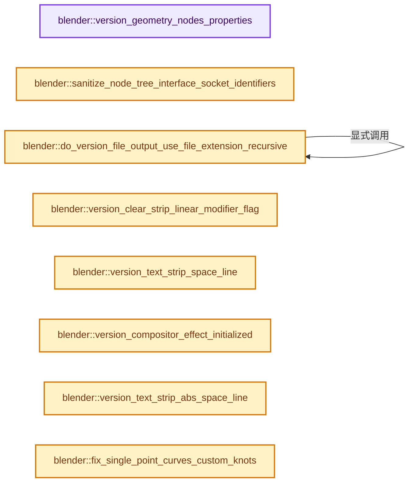
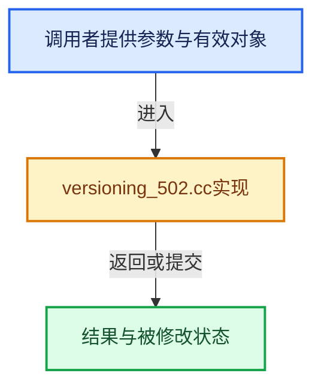

# 实现依赖专题：source/blender/blenloader/intern/versioning_502.cc

[方向导航](README.md) · [符号索引](../%E7%AC%A6%E5%8F%B7%E4%BE%9D%E8%B5%96%E4%B8%8E%E5%AE%9E%E7%8E%B0%E7%B4%A2%E5%BC%95.md)

本专题从正文实际调用进入，集中保存共享实现。函数有稳定锚点，可从调用处直接跳到对应完整函数；递归与互相调用通过回链组织。

## 本文件的实现关系






## 完整成员与函数实现

<a id="f-2a8f59ee3fe22ff2"></a>

### `blender::version_geometry_nodes_properties`

实现位置：[source/blender/blenloader/intern/versioning_502.cc](../../../../../source/blender/blenloader/intern/versioning_502.cc) · L65—L221。

接口参数：

- `FileData &fd`
- `Main &bmain`
- `Object &object`
- `NodesModifierData &nmd`

**教学注释版**

<!-- annotated:de153a0a813934 -->

```cpp
static void version_geometry_nodes_properties(FileData &fd,
                                              Main &bmain,
                                              Object &object,
                                              NodesModifierData &nmd)
{
  const IDProperty *old_props = nmd.settings_legacy.properties;
  if (!old_props) {
    /* Versioning has already been done, this check makes the function idempotent. */
    return;
  }
  if (!nmd.node_group) {
    IDP_FreeProperty(nmd.settings_legacy.properties);
    nmd.settings_legacy.properties = nullptr;
    BLO_reportf_wrap(fd.reports,
                     RPT_WARNING,
                     "Modifier '%s' from Object '%s' is missing its Geometry Node Group, its "
                     "settings will be lost (reset to default).",
                     nmd.modifier.name,
                     BKE_id_name(object.id));
    return;
  }
  if (ID_MISSING(&nmd.node_group->id)) {
    /* Keeping the old idproperties is not an option, and not really useful, since if the
     * blend-file is saved in this current state, it won't be re-versioned here later anyway.
     *
     * Furthermore, the whole remaining part of the code expects this to be nullptr, and keeping it
     * at runtime actually causes weird issues in depsgraph nodes building phase.
     *
     * So all in all, it's simpler and safer to also just lose these values here - if file is not
     * saved in this state, next loading will do the versioning if the node-group is available
     * again, otherwise that data is lost.
     */
    IDP_FreeProperty(nmd.settings_legacy.properties);
    nmd.settings_legacy.properties = nullptr;
    BLO_reportf_wrap(
        fd.reports,
        RPT_WARNING,
        "Modifier '%s' from Object '%s' is using a missing linked Geometry Node Group, its "
        "settings will be lost (reset to default) if the file is saved in this state.",
        nmd.modifier.name,
        BKE_id_name(object.id));
    return;
  }
  const bNodeTree &ntree = *nmd.node_group;
  ntree.ensure_interface_cache();

  IDProperty *system_props = bke::idprop::create_group("NodesModifierProperties").release();

  IDProperty *inputs = bke::idprop::create_group("inputs").release();
  IDP_AddToGroup(system_props, inputs);

  const std::string inputs_path_prefix = fmt::format("modifiers[\"{}\"]", nmd.modifier.name);
  const DriverMap driver_map = BKE_animdata_build_driver_target_map(bmain);
  for (const bNodeTreeInterfaceSocket *input : ntree.interface_inputs()) {
    const StringRefNull identifier = input->identifier;
    IDProperty *old_value_prop = IDP_GetPropertyFromGroup(old_props, identifier);
    if (!old_value_prop) {
      continue;
    }

    IDProperty *group = bke::idprop::create_group(identifier).release();
    IDP_AddToGroup(inputs, group);

    if (input->flag & NODE_INTERFACE_SOCKET_LAYER_SELECTION) {
      IDP_AddToGroup(
          group, bke::idprop::create("type", int(nodes::GeometryNodesInputType::Layer)).release());
      const StringRefNull layer_name = [&]() {
        const IDProperty *layer_name = IDP_GetPropertyTypeFromGroup(
            old_props, identifier, IDP_STRING);
        if (layer_name) {
          return StringRefNull(IDP_string_get(layer_name));
        }
        return StringRefNull();
      }();
      IDP_AddToGroup(group, bke::idprop::create("layer_name", layer_name).release());
      continue;
    }

    IDProperty *new_value_prop = IDP_CopyProperty(old_value_prop);
    STRNCPY(new_value_prop->name, "value");
    IDP_AddToGroup(group, new_value_prop);

    const std::string old_value_path = fmt::format("[\"{}\"]", identifier);
    const std::string new_value_path = fmt::format(".properties.inputs.{}.value", identifier);
    BKE_animdata_fix_paths(object.id,
                           inputs_path_prefix,
                           old_value_path,
                           new_value_path,
                           /*verify_paths=*/false,
                           driver_map);

    if (IDOverrideLibrary *override_library = object.id.override_library) {
      for (IDOverrideLibraryProperty &prop : override_library->properties) {
        const StringRef path = prop.rna_path;
        const int64_t i = path.find(inputs_path_prefix);
        if (i == StringRef::not_found) {
          continue;
        }
        if (path.drop_known_prefix(inputs_path_prefix) != old_value_path) {
          continue;
        }
        MEM_delete(prop.rna_path);
        prop.rna_path = BLI_sprintfN("%s%s", inputs_path_prefix.c_str(), new_value_path.c_str());
      }
    }

    bool use_attribute = false;
    if (const IDProperty *use_attribute_prop = IDP_GetPropertyFromGroup(
            old_props, identifier + "_use_attribute"))
    {
      /* This property changed to an enum property and animation is not versioned. */
      if (use_attribute_prop->type == IDP_INT) {
        use_attribute = bool(IDP_int_get(use_attribute_prop));
      }
      else if (use_attribute_prop->type == IDP_BOOLEAN) {
        use_attribute = bool(IDP_bool_get(use_attribute_prop));
      }
    }

    const auto input_type = use_attribute ? nodes::GeometryNodesInputType::Attribute :
                                            nodes::GeometryNodesInputType::Value;
    IDP_AddToGroup(group, bke::idprop::create("type", int(input_type)).release());
    const StringRefNull attribute_name = [&]() {
      const IDProperty *attribute_name = IDP_GetPropertyTypeFromGroup(
          old_props, identifier + "_attribute_name", IDP_STRING);
      if (attribute_name) {
        return StringRefNull(IDP_string_get(attribute_name));
      }
      return StringRefNull();
    }();
    IDP_AddToGroup(group, bke::idprop::create("attribute_name", attribute_name).release());
  }

  IDProperty *outputs = bke::idprop::create_group("outputs").release();
  IDP_AddToGroup(system_props, outputs);
  for (const bNodeTreeInterfaceSocket *output : ntree.interface_outputs()) {
    const StringRef identifier = output->identifier;
    IDProperty *old_name_prop = IDP_GetPropertyTypeFromGroup(
        old_props, identifier + "_attribute_name", IDP_STRING);
    if (!old_name_prop) {
      continue;
    }
    IDProperty *group = bke::idprop::create_group(identifier).release();
    IDP_AddToGroup(outputs, group);

    IDProperty *new_value_prop = IDP_CopyProperty(old_name_prop);
    STRNCPY(new_value_prop->name, "attribute_name");
    IDP_AddToGroup(group, new_value_prop);
  }

  if (nmd.modifier.system_properties) {
    IDP_FreeProperty(nmd.modifier.system_properties);
  }
  nmd.modifier.system_properties = system_props;
  IDP_FreeProperty(nmd.settings_legacy.properties);
  nmd.settings_legacy.properties = nullptr;
}
```

<details>
<summary>核对原始源码：source/blender/blenloader/intern/versioning_502.cc · L65—L221</summary>

<!-- original:de153a0a813934:source/blender/blenloader/intern/versioning_502.cc:65:221 -->

```cpp
static void version_geometry_nodes_properties(FileData &fd,
                                              Main &bmain,
                                              Object &object,
                                              NodesModifierData &nmd)
{
  const IDProperty *old_props = nmd.settings_legacy.properties;
  if (!old_props) {
    /* Versioning has already been done, this check makes the function idempotent. */
    return;
  }
  if (!nmd.node_group) {
    IDP_FreeProperty(nmd.settings_legacy.properties);
    nmd.settings_legacy.properties = nullptr;
    BLO_reportf_wrap(fd.reports,
                     RPT_WARNING,
                     "Modifier '%s' from Object '%s' is missing its Geometry Node Group, its "
                     "settings will be lost (reset to default).",
                     nmd.modifier.name,
                     BKE_id_name(object.id));
    return;
  }
  if (ID_MISSING(&nmd.node_group->id)) {
    /* Keeping the old idproperties is not an option, and not really useful, since if the
     * blend-file is saved in this current state, it won't be re-versioned here later anyway.
     *
     * Furthermore, the whole remaining part of the code expects this to be nullptr, and keeping it
     * at runtime actually causes weird issues in depsgraph nodes building phase.
     *
     * So all in all, it's simpler and safer to also just lose these values here - if file is not
     * saved in this state, next loading will do the versioning if the node-group is available
     * again, otherwise that data is lost.
     */
    IDP_FreeProperty(nmd.settings_legacy.properties);
    nmd.settings_legacy.properties = nullptr;
    BLO_reportf_wrap(
        fd.reports,
        RPT_WARNING,
        "Modifier '%s' from Object '%s' is using a missing linked Geometry Node Group, its "
        "settings will be lost (reset to default) if the file is saved in this state.",
        nmd.modifier.name,
        BKE_id_name(object.id));
    return;
  }
  const bNodeTree &ntree = *nmd.node_group;
  ntree.ensure_interface_cache();

  IDProperty *system_props = bke::idprop::create_group("NodesModifierProperties").release();

  IDProperty *inputs = bke::idprop::create_group("inputs").release();
  IDP_AddToGroup(system_props, inputs);

  const std::string inputs_path_prefix = fmt::format("modifiers[\"{}\"]", nmd.modifier.name);
  const DriverMap driver_map = BKE_animdata_build_driver_target_map(bmain);
  for (const bNodeTreeInterfaceSocket *input : ntree.interface_inputs()) {
    const StringRefNull identifier = input->identifier;
    IDProperty *old_value_prop = IDP_GetPropertyFromGroup(old_props, identifier);
    if (!old_value_prop) {
      continue;
    }

    IDProperty *group = bke::idprop::create_group(identifier).release();
    IDP_AddToGroup(inputs, group);

    if (input->flag & NODE_INTERFACE_SOCKET_LAYER_SELECTION) {
      IDP_AddToGroup(
          group, bke::idprop::create("type", int(nodes::GeometryNodesInputType::Layer)).release());
      const StringRefNull layer_name = [&]() {
        const IDProperty *layer_name = IDP_GetPropertyTypeFromGroup(
            old_props, identifier, IDP_STRING);
        if (layer_name) {
          return StringRefNull(IDP_string_get(layer_name));
        }
        return StringRefNull();
      }();
      IDP_AddToGroup(group, bke::idprop::create("layer_name", layer_name).release());
      continue;
    }

    IDProperty *new_value_prop = IDP_CopyProperty(old_value_prop);
    STRNCPY(new_value_prop->name, "value");
    IDP_AddToGroup(group, new_value_prop);

    const std::string old_value_path = fmt::format("[\"{}\"]", identifier);
    const std::string new_value_path = fmt::format(".properties.inputs.{}.value", identifier);
    BKE_animdata_fix_paths(object.id,
                           inputs_path_prefix,
                           old_value_path,
                           new_value_path,
                           /*verify_paths=*/false,
                           driver_map);

    if (IDOverrideLibrary *override_library = object.id.override_library) {
      for (IDOverrideLibraryProperty &prop : override_library->properties) {
        const StringRef path = prop.rna_path;
        const int64_t i = path.find(inputs_path_prefix);
        if (i == StringRef::not_found) {
          continue;
        }
        if (path.drop_known_prefix(inputs_path_prefix) != old_value_path) {
          continue;
        }
        MEM_delete(prop.rna_path);
        prop.rna_path = BLI_sprintfN("%s%s", inputs_path_prefix.c_str(), new_value_path.c_str());
      }
    }

    bool use_attribute = false;
    if (const IDProperty *use_attribute_prop = IDP_GetPropertyFromGroup(
            old_props, identifier + "_use_attribute"))
    {
      /* This property changed to an enum property and animation is not versioned. */
      if (use_attribute_prop->type == IDP_INT) {
        use_attribute = bool(IDP_int_get(use_attribute_prop));
      }
      else if (use_attribute_prop->type == IDP_BOOLEAN) {
        use_attribute = bool(IDP_bool_get(use_attribute_prop));
      }
    }

    const auto input_type = use_attribute ? nodes::GeometryNodesInputType::Attribute :
                                            nodes::GeometryNodesInputType::Value;
    IDP_AddToGroup(group, bke::idprop::create("type", int(input_type)).release());
    const StringRefNull attribute_name = [&]() {
      const IDProperty *attribute_name = IDP_GetPropertyTypeFromGroup(
          old_props, identifier + "_attribute_name", IDP_STRING);
      if (attribute_name) {
        return StringRefNull(IDP_string_get(attribute_name));
      }
      return StringRefNull();
    }();
    IDP_AddToGroup(group, bke::idprop::create("attribute_name", attribute_name).release());
  }

  IDProperty *outputs = bke::idprop::create_group("outputs").release();
  IDP_AddToGroup(system_props, outputs);
  for (const bNodeTreeInterfaceSocket *output : ntree.interface_outputs()) {
    const StringRef identifier = output->identifier;
    IDProperty *old_name_prop = IDP_GetPropertyTypeFromGroup(
        old_props, identifier + "_attribute_name", IDP_STRING);
    if (!old_name_prop) {
      continue;
    }
    IDProperty *group = bke::idprop::create_group(identifier).release();
    IDP_AddToGroup(outputs, group);

    IDProperty *new_value_prop = IDP_CopyProperty(old_name_prop);
    STRNCPY(new_value_prop->name, "attribute_name");
    IDP_AddToGroup(group, new_value_prop);
  }

  if (nmd.modifier.system_properties) {
    IDP_FreeProperty(nmd.modifier.system_properties);
  }
  nmd.modifier.system_properties = system_props;
  IDP_FreeProperty(nmd.settings_legacy.properties);
  nmd.settings_legacy.properties = nullptr;
}
```

</details>

**沿实际写入检查状态**

- `nmd.settings_legacy.properties = nullptr;`
- `prop.rna_path = BLI_sprintfN("%s%s", inputs_path_prefix.c_str(), new_value_path.c_str());`
- `use_attribute = bool(IDP_int_get(use_attribute_prop));`
- `use_attribute = bool(IDP_bool_get(use_attribute_prop));`
- `nmd.modifier.system_properties = system_props;`

**结果出口**

- `return StringRefNull(IDP_string_get(layer_name));`
- `return StringRefNull();`
- `return StringRefNull(IDP_string_get(attribute_name));`

**继续追踪实现**

- `IDP_FreeProperty` → [blender::IDP_FreeProperty · L1403](%E4%BE%9D%E8%B5%96-idprop-006c65.md#f-389134a630df1bed)。
- `BLO_reportf_wrap` → [blender::BLO_reportf_wrap · L228](%E4%BE%9D%E8%B5%96-readfile-05cc37.md#f-404ef4f090c5be59)。
- `BKE_id_name` → [blender::BKE_id_name · L1001](%E4%BE%9D%E8%B5%96-BKE_lib_id-3c6ccd.md#f-b9397f1fe1fcc017)；[blender::BKE_id_name · L1005](%E4%BE%9D%E8%B5%96-BKE_lib_id-3c6ccd.md#f-c026427d13979145)。同名重载需按实参类型选择。
- `ID_MISSING` → [ID_MISSING · L695](%E4%BE%9D%E8%B5%96-DNA_ID-3eb091.md#m-ab9a2a270fb3)。宏定义由构建条件选择。
- `ntree.ensure_interface_cache` → [blender::bNodeTree::ensure_interface_cache · L670](%E4%BE%9D%E8%B5%96-BKE_node_runtime-ee561b.md#f-73fea7b58035b1f9)。
- `bke::idprop::create_group("NodesModifierProperties").release` → [调用协议](../%E6%A8%A1%E6%9D%BF%E5%AE%8F%E4%B8%8E%E5%8A%A8%E6%80%81%E5%88%86%E6%B4%BE%E5%8D%8F%E8%AE%AE.md)：接收对象类型依赖auto、返回值或模板实例；不按同名猜测目标。调用位置L111。
- `bke::idprop::create_group` → [blender::bke::idprop::create_group · L155](%E4%BE%9D%E8%B5%96-idprop_create-f89f51.md#f-b1e2d8bfd5654bc2)。
- `bke::idprop::create_group("inputs").release` → [调用协议](../%E6%A8%A1%E6%9D%BF%E5%AE%8F%E4%B8%8E%E5%8A%A8%E6%80%81%E5%88%86%E6%B4%BE%E5%8D%8F%E8%AE%AE.md)：接收对象类型依赖auto、返回值或模板实例；不按同名猜测目标。调用位置L113。
- `IDP_AddToGroup` → [blender::IDP_AddToGroup · L788](%E4%BE%9D%E8%B5%96-idprop-006c65.md#f-35f2075430483def)。
- `fmt::format` → [外部契约](https://fmt.dev/latest/api/)：按fmt接口的格式字符串与参数类型契约使用，格式化不改变被格式化对象的拥有关系。
- `BKE_animdata_build_driver_target_map` → [blender::BKE_animdata_build_driver_target_map · L980](%E4%BE%9D%E8%B5%96-anim_data-56c81c.md#f-756c69b4ccf4bd7c)。
- `ntree.interface_inputs` → [blender::bNodeTree::interface_inputs · L675](%E4%BE%9D%E8%B5%96-BKE_node_runtime-ee561b.md#f-b5decde7a09fbf57)；[blender::bNodeTree::interface_inputs · L681](%E4%BE%9D%E8%B5%96-BKE_node_runtime-ee561b.md#f-f999995c05009884)。同名重载需按实参类型选择。
- `IDP_GetPropertyFromGroup` → [blender::IDP_GetPropertyFromGroup · L818](%E4%BE%9D%E8%B5%96-idprop-006c65.md#f-a8d678499d89359e)。
- `bke::idprop::create_group(identifier).release` → [调用协议](../%E6%A8%A1%E6%9D%BF%E5%AE%8F%E4%B8%8E%E5%8A%A8%E6%80%81%E5%88%86%E6%B4%BE%E5%8D%8F%E8%AE%AE.md)：接收对象类型依赖auto、返回值或模板实例；不按同名猜测目标。调用位置L125。
- `bke::idprop::create("type", int(nodes::GeometryNodesInputType::Layer)).release` → [调用协议](../%E6%A8%A1%E6%9D%BF%E5%AE%8F%E4%B8%8E%E5%8A%A8%E6%80%81%E5%88%86%E6%B4%BE%E5%8D%8F%E8%AE%AE.md)：接收对象类型依赖auto、返回值或模板实例；不按同名猜测目标。调用位置L130。
- `bke::idprop::create` → [blender::bke::idprop::create · L21](%E4%BE%9D%E8%B5%96-idprop_create-f89f51.md#f-9f46f3367aea5850)；[blender::bke::idprop::create · L41](%E4%BE%9D%E8%B5%96-idprop_create-f89f51.md#f-fb8f0fd79ae0a7b2)；[blender::bke::idprop::create · L51](%E4%BE%9D%E8%B5%96-idprop_create-f89f51.md#f-3c724b83c1b70000)；[blender::bke::idprop::create · L61](%E4%BE%9D%E8%B5%96-idprop_create-f89f51.md#f-3e8bfbe29fbc5b06)；[blender::bke::idprop::create · L69](%E4%BE%9D%E8%B5%96-idprop_create-f89f51.md#f-da73ef629d404b53)；[blender::bke::idprop::create · L134](%E4%BE%9D%E8%B5%96-idprop_create-f89f51.md#f-db9e605ad4939d5d)；[blender::bke::idprop::create · L141](%E4%BE%9D%E8%B5%96-idprop_create-f89f51.md#f-1198c99845e5eb1f)；[blender::bke::idprop::create · L148](%E4%BE%9D%E8%B5%96-idprop_create-f89f51.md#f-d9cb1affee65ed50)。同名重载需按实参类型选择。
- `[&]() { const IDProperty *layer_name = IDP_GetPropertyTypeFromGroup( old_props, identifier, IDP_STRING); if (layer_name) { return StringRefNull(IDP_string_get(layer_name)); } return StringRefNull(); }` → [blender::() · L390](../12-%E7%A9%BA%E9%97%B4%E6%95%B0%E6%8D%AE%E7%BB%93%E6%9E%84%E4%B8%8E%E5%87%A0%E4%BD%95%E7%AE%97%E6%B3%95/%E4%BE%9D%E8%B5%96-BLI_math_vector_types-5b9874.md#f-26f597afed18e002)。
- `IDP_GetPropertyTypeFromGroup` → [blender::IDP_GetPropertyTypeFromGroup · L839](%E4%BE%9D%E8%B5%96-idprop-006c65.md#f-816338f061202619)。
- `StringRefNull` → [blender::StringRefNull::StringRefNull · L496](../01-%E5%9F%BA%E7%A1%80%E5%AE%B9%E5%99%A8%E4%B8%8E%E7%8E%B0%E4%BB%A3CPP/15-StringRef%E5%AD%97%E7%AC%A6%E4%B8%B2%E8%A7%86%E5%9B%BE.md#f-936c98fc0d9ae39e)；[blender::StringRefNull::StringRefNull · L502](../01-%E5%9F%BA%E7%A1%80%E5%AE%B9%E5%99%A8%E4%B8%8E%E7%8E%B0%E4%BB%A3CPP/15-StringRef%E5%AD%97%E7%AC%A6%E4%B8%B2%E8%A7%86%E5%9B%BE.md#f-cf03ac0c28007ee0)；[blender::StringRefNull::StringRefNull · L512](../01-%E5%9F%BA%E7%A1%80%E5%AE%B9%E5%99%A8%E4%B8%8E%E7%8E%B0%E4%BB%A3CPP/15-StringRef%E5%AD%97%E7%AC%A6%E4%B8%B2%E8%A7%86%E5%9B%BE.md#f-8a14273318bc57e1)；[blender::StringRefNull::StringRefNull · L523](../01-%E5%9F%BA%E7%A1%80%E5%AE%B9%E5%99%A8%E4%B8%8E%E7%8E%B0%E4%BB%A3CPP/15-StringRef%E5%AD%97%E7%AC%A6%E4%B8%B2%E8%A7%86%E5%9B%BE.md#f-e1cc63a4ff92775b)。同名重载需按实参类型选择。
- `IDP_string_get` → [IDP_string_get · L375](%E4%BE%9D%E8%B5%96-BKE_idprop-fe422c.md#m-bedef49dcb76)。宏定义由构建条件选择。
- `bke::idprop::create("layer_name", layer_name).release` → [调用协议](../%E6%A8%A1%E6%9D%BF%E5%AE%8F%E4%B8%8E%E5%8A%A8%E6%80%81%E5%88%86%E6%B4%BE%E5%8D%8F%E8%AE%AE.md)：接收对象类型依赖auto、返回值或模板实例；不按同名猜测目标。调用位置L139。
- `IDP_CopyProperty` → [blender::IDP_CopyProperty · L986](%E4%BE%9D%E8%B5%96-idprop-006c65.md#f-e78bbf56cd2a07bd)。
- `STRNCPY` → [blender::STRNCPY · L690](../01-%E5%9F%BA%E7%A1%80%E5%AE%B9%E5%99%A8%E4%B8%8E%E7%8E%B0%E4%BB%A3CPP/%E4%BE%9D%E8%B5%96-BLI_string-b43058.md#f-6b2d861724026be6)。
- `BKE_animdata_fix_paths` → [blender::BKE_animdata_fix_paths · L1001](%E4%BE%9D%E8%B5%96-anim_data-56c81c.md#f-ba061b4dce9eccbc)；[blender::BKE_animdata_fix_paths · L1044](%E4%BE%9D%E8%B5%96-anim_data-56c81c.md#f-d7648451f6591b0b)。同名重载需按实参类型选择。
- `path.find` → [blender::StringRefBase::find · L339](../01-%E5%9F%BA%E7%A1%80%E5%AE%B9%E5%99%A8%E4%B8%8E%E7%8E%B0%E4%BB%A3CPP/15-StringRef%E5%AD%97%E7%AC%A6%E4%B8%B2%E8%A7%86%E5%9B%BE.md#f-00f0ca38486d01b5)；[blender::StringRefBase::find · L345](../01-%E5%9F%BA%E7%A1%80%E5%AE%B9%E5%99%A8%E4%B8%8E%E7%8E%B0%E4%BB%A3CPP/15-StringRef%E5%AD%97%E7%AC%A6%E4%B8%B2%E8%A7%86%E5%9B%BE.md#f-824b468ce4cb47b7)。同名重载需按实参类型选择。
- `path.drop_known_prefix` → [blender::StringRef::drop_known_prefix · L590](../01-%E5%9F%BA%E7%A1%80%E5%AE%B9%E5%99%A8%E4%B8%8E%E7%8E%B0%E4%BB%A3CPP/15-StringRef%E5%AD%97%E7%AC%A6%E4%B8%B2%E8%A7%86%E5%9B%BE.md#f-4800aaabdc73488d)。
- `MEM_delete` → [MEM_delete · L400](../03-%E5%86%85%E5%AD%98%E5%88%86%E9%85%8D%E4%B8%8E%E8%BF%90%E8%A1%8C%E6%97%B6%E7%B1%BB%E5%9E%8B/%E4%BE%9D%E8%B5%96-MEM_guardedalloc-b54eca.md#f-9049ffdd1682887c)。
- `BLI_sprintfN` → [blender::BLI_sprintfN · L296](../01-%E5%9F%BA%E7%A1%80%E5%AE%B9%E5%99%A8%E4%B8%8E%E7%8E%B0%E4%BB%A3CPP/%E4%BE%9D%E8%B5%96-string-1d986f.md#f-bfbc2f7076298fc0)。
- `inputs_path_prefix.c_str` → [外部契约](https://eel.is/c++draft/)：这个边界按实际表达式及所属类型核对参数、返回值、寿命与失败行为。这里提供接口入口，不声称已解释该第三方版本的内部实现。
- `new_value_path.c_str` → [外部契约](https://eel.is/c++draft/)：这个边界按实际表达式及所属类型核对参数、返回值、寿命与失败行为。这里提供接口入口，不声称已解释该第三方版本的内部实现。
- `IDP_int_get` → [IDP_int_get · L311](%E4%BE%9D%E8%B5%96-BKE_idprop-fe422c.md#m-921e5bc3f26e)。宏定义由构建条件选择。
- `IDP_bool_get` → [IDP_bool_get · L320](%E4%BE%9D%E8%B5%96-BKE_idprop-fe422c.md#m-27ca26d9570b)。宏定义由构建条件选择。
- `bke::idprop::create("type", int(input_type)).release` → [调用协议](../%E6%A8%A1%E6%9D%BF%E5%AE%8F%E4%B8%8E%E5%8A%A8%E6%80%81%E5%88%86%E6%B4%BE%E5%8D%8F%E8%AE%AE.md)：接收对象类型依赖auto、返回值或模板实例；不按同名猜测目标。调用位置L186。
- `[&]() { const IDProperty *attribute_name = IDP_GetPropertyTypeFromGroup( old_props, identifier + "_attribute_name", IDP_STRING); if (attribute_name) { return StringRefNull(IDP_string_get(attribute_name)); } return StringRefNull(); }` → [blender::() · L390](../12-%E7%A9%BA%E9%97%B4%E6%95%B0%E6%8D%AE%E7%BB%93%E6%9E%84%E4%B8%8E%E5%87%A0%E4%BD%95%E7%AE%97%E6%B3%95/%E4%BE%9D%E8%B5%96-BLI_math_vector_types-5b9874.md#f-26f597afed18e002)。
- `bke::idprop::create("attribute_name", attribute_name).release` → [调用协议](../%E6%A8%A1%E6%9D%BF%E5%AE%8F%E4%B8%8E%E5%8A%A8%E6%80%81%E5%88%86%E6%B4%BE%E5%8D%8F%E8%AE%AE.md)：接收对象类型依赖auto、返回值或模板实例；不按同名猜测目标。调用位置L195。
- `bke::idprop::create_group("outputs").release` → [调用协议](../%E6%A8%A1%E6%9D%BF%E5%AE%8F%E4%B8%8E%E5%8A%A8%E6%80%81%E5%88%86%E6%B4%BE%E5%8D%8F%E8%AE%AE.md)：接收对象类型依赖auto、返回值或模板实例；不按同名猜测目标。调用位置L198。
- `ntree.interface_outputs` → [blender::bNodeTree::interface_outputs · L687](%E4%BE%9D%E8%B5%96-BKE_node_runtime-ee561b.md#f-6ce8b655d24a2365)；[blender::bNodeTree::interface_outputs · L693](%E4%BE%9D%E8%B5%96-BKE_node_runtime-ee561b.md#f-64e16fb2a089e741)。同名重载需按实参类型选择。

<a id="f-aa1a6e0bcd8446ec"></a>

### `blender::sanitize_node_tree_interface_socket_identifiers`

实现位置：[source/blender/blenloader/intern/versioning_502.cc](../../../../../source/blender/blenloader/intern/versioning_502.cc) · L223—L264。

接口参数：

- `bNodeTree &node_tree`

**教学注释版**

<!-- annotated:05bb24e450ad51 -->

```cpp
static void sanitize_node_tree_interface_socket_identifiers(bNodeTree &node_tree)
{
  node_tree.ensure_interface_cache();
  Set<StringRef> all_identifiers;
  Map<std::string, StringRefNull> identifier_map;
  for (bNodeTreeInterfaceItem *item : node_tree.interface_items()) {
    if (item->item_type == NodeTreeInterfaceItemType::Panel) {
      continue;
    }
    auto &socket = *bke::node_interface::get_item_as<bNodeTreeInterfaceSocket>(item);
    /* Socket identifiers are required to be valid RNA identifiers and unique. */
    if (!RNA_validate_identifier(socket.identifier, true)) {
      std::string prev_identifier(socket.identifier);
      RNA_identifier_sanitize(socket.identifier, true);
      // [讲解] all_identifiers.contains：查询活项数量或键是否存在。
      if (all_identifiers.contains(socket.identifier)) {
        std::string new_identifier = BLI_uniquename_cb(
            [&](StringRef name) { return all_identifiers.contains(name); },
            '_',
            socket.identifier);
        MEM_SAFE_DELETE(socket.identifier);
        socket.identifier = BLI_strdup(new_identifier.c_str());
      }
      // [讲解] identifier_map.add：按哈希与相等关系加入键或键值。
      identifier_map.add(std::move(prev_identifier), socket.identifier);
    }
    all_identifiers.add(socket.identifier);
  }

  /* Rename all the node socket identifiers that got changed in the interface. */
  // [讲解] identifier_map.is_empty：查询活项数量或键是否存在。
  if (!identifier_map.is_empty()) {
    for (bNode &node : node_tree.nodes) {
      if (!(node.is_group_input() || node.is_group_output())) {
        continue;
      }
      ListBaseT<bNodeSocket> sockets = node.is_group_output() ? node.inputs : node.outputs;
      for (bNodeSocket &socket : sockets) {
        if (identifier_map.contains(socket.identifier)) {
          // [讲解] identifier_map.lookup：按键查找对应项。
          version_node_socket_identifier_set(socket, identifier_map.lookup(socket.identifier));
        }
      }
    }
  }
}
```

<details>
<summary>核对原始源码：source/blender/blenloader/intern/versioning_502.cc · L223—L264</summary>

<!-- original:05bb24e450ad51:source/blender/blenloader/intern/versioning_502.cc:223:264 -->

```cpp
static void sanitize_node_tree_interface_socket_identifiers(bNodeTree &node_tree)
{
  node_tree.ensure_interface_cache();
  Set<StringRef> all_identifiers;
  Map<std::string, StringRefNull> identifier_map;
  for (bNodeTreeInterfaceItem *item : node_tree.interface_items()) {
    if (item->item_type == NodeTreeInterfaceItemType::Panel) {
      continue;
    }
    auto &socket = *bke::node_interface::get_item_as<bNodeTreeInterfaceSocket>(item);
    /* Socket identifiers are required to be valid RNA identifiers and unique. */
    if (!RNA_validate_identifier(socket.identifier, true)) {
      std::string prev_identifier(socket.identifier);
      RNA_identifier_sanitize(socket.identifier, true);
      if (all_identifiers.contains(socket.identifier)) {
        std::string new_identifier = BLI_uniquename_cb(
            [&](StringRef name) { return all_identifiers.contains(name); },
            '_',
            socket.identifier);
        MEM_SAFE_DELETE(socket.identifier);
        socket.identifier = BLI_strdup(new_identifier.c_str());
      }
      identifier_map.add(std::move(prev_identifier), socket.identifier);
    }
    all_identifiers.add(socket.identifier);
  }

  /* Rename all the node socket identifiers that got changed in the interface. */
  if (!identifier_map.is_empty()) {
    for (bNode &node : node_tree.nodes) {
      if (!(node.is_group_input() || node.is_group_output())) {
        continue;
      }
      ListBaseT<bNodeSocket> sockets = node.is_group_output() ? node.inputs : node.outputs;
      for (bNodeSocket &socket : sockets) {
        if (identifier_map.contains(socket.identifier)) {
          version_node_socket_identifier_set(socket, identifier_map.lookup(socket.identifier));
        }
      }
    }
  }
}
```

</details>

**沿实际写入检查状态**

- `socket.identifier = BLI_strdup(new_identifier.c_str());`

**继续追踪实现**

- `node_tree.ensure_interface_cache` → [blender::bNodeTree::ensure_interface_cache · L670](%E4%BE%9D%E8%B5%96-BKE_node_runtime-ee561b.md#f-73fea7b58035b1f9)。
- `node_tree.interface_items` → [blender::bNodeTree::interface_items · L699](%E4%BE%9D%E8%B5%96-BKE_node_runtime-ee561b.md#f-a4378b71bb958204)；[blender::bNodeTree::interface_items · L705](%E4%BE%9D%E8%B5%96-BKE_node_runtime-ee561b.md#f-12f77272cc5b4792)。同名重载需按实参类型选择。
- `bke::node_interface::get_item_as<bNodeTreeInterfaceSocket>` → [blender::bke::node_interface::get_item_as · L78](%E4%BE%9D%E8%B5%96-BKE_node_tree_interface-a38e1b.md#f-76ced6fe7f66b781)；[blender::bke::node_interface::get_item_as · L84](%E4%BE%9D%E8%B5%96-BKE_node_tree_interface-a38e1b.md#f-e58dbdce088e2922)；[blender::bke::node_interface::get_item_as · L90](%E4%BE%9D%E8%B5%96-BKE_node_tree_interface-a38e1b.md#f-405151e1e9846ed0)；[blender::bke::node_interface::get_item_as · L98](%E4%BE%9D%E8%B5%96-BKE_node_tree_interface-a38e1b.md#f-acff7fe443ea201d)。同名重载需按实参类型选择。
- `RNA_validate_identifier` → [blender::RNA_validate_identifier · L426](%E4%BE%9D%E8%B5%96-rna_define-0e9991.md#f-f68839c7f0054762)。
- `RNA_identifier_sanitize` → [blender::RNA_identifier_sanitize · L517](%E4%BE%9D%E8%B5%96-rna_define-0e9991.md#f-3500847597fd8ac4)。
- `all_identifiers.contains` → [blender::Set::contains · L310](../02-%E5%93%88%E5%B8%8C%E8%A1%A8%E4%B8%8E%E5%85%B3%E8%81%94%E6%95%B0%E6%8D%AE%E7%BB%93%E6%9E%84/08-Set%E4%B8%8E%E9%9B%86%E5%90%88%E8%AF%AD%E4%B9%89.md#f-af7099799494350e)。
- `BLI_uniquename_cb` → [blender::BLI_uniquename_cb · L421](../01-%E5%9F%BA%E7%A1%80%E5%AE%B9%E5%99%A8%E4%B8%8E%E7%8E%B0%E4%BB%A3CPP/%E4%BE%9D%E8%B5%96-string_utils-bbfe0c.md#f-651b82b9010ddef4)；[blender::BLI_uniquename_cb · L459](../01-%E5%9F%BA%E7%A1%80%E5%AE%B9%E5%99%A8%E4%B8%8E%E7%8E%B0%E4%BB%A3CPP/%E4%BE%9D%E8%B5%96-string_utils-bbfe0c.md#f-0e0b6725b5b90a92)。同名重载需按实参类型选择。
- `MEM_SAFE_DELETE` → [MEM_SAFE_DELETE · L436](../03-%E5%86%85%E5%AD%98%E5%88%86%E9%85%8D%E4%B8%8E%E8%BF%90%E8%A1%8C%E6%97%B6%E7%B1%BB%E5%9E%8B/%E4%BE%9D%E8%B5%96-MEM_guardedalloc-b54eca.md#m-eadb3bc5b902)。宏定义由构建条件选择。
- `BLI_strdup` → [blender::BLI_strdup · L43](../01-%E5%9F%BA%E7%A1%80%E5%AE%B9%E5%99%A8%E4%B8%8E%E7%8E%B0%E4%BB%A3CPP/%E4%BE%9D%E8%B5%96-string-1d986f.md#f-7e6d5c696c20c0e1)。
- `new_identifier.c_str` → [外部契约](https://eel.is/c++draft/)：这个边界按实际表达式及所属类型核对参数、返回值、寿命与失败行为。这里提供接口入口，不声称已解释该第三方版本的内部实现。
- `identifier_map.add` → [blender::Map::add · L295](../02-%E5%93%88%E5%B8%8C%E8%A1%A8%E4%B8%8E%E5%85%B3%E8%81%94%E6%95%B0%E6%8D%AE%E7%BB%93%E6%9E%84/04-Map%E6%9F%A5%E6%89%BE%E4%B8%8E%E9%94%AE%E8%AE%BF%E9%97%AE.md#f-8d38101abf162f88)；[blender::Map::add · L299](../02-%E5%93%88%E5%B8%8C%E8%A1%A8%E4%B8%8E%E5%85%B3%E8%81%94%E6%95%B0%E6%8D%AE%E7%BB%93%E6%9E%84/04-Map%E6%9F%A5%E6%89%BE%E4%B8%8E%E9%94%AE%E8%AE%BF%E9%97%AE.md#f-1f59510cdfbd9f87)；[blender::Map::add · L303](../02-%E5%93%88%E5%B8%8C%E8%A1%A8%E4%B8%8E%E5%85%B3%E8%81%94%E6%95%B0%E6%8D%AE%E7%BB%93%E6%9E%84/04-Map%E6%9F%A5%E6%89%BE%E4%B8%8E%E9%94%AE%E8%AE%BF%E9%97%AE.md#f-645e0522347aa018)；[blender::Map::add · L307](../02-%E5%93%88%E5%B8%8C%E8%A1%A8%E4%B8%8E%E5%85%B3%E8%81%94%E6%95%B0%E6%8D%AE%E7%BB%93%E6%9E%84/04-Map%E6%9F%A5%E6%89%BE%E4%B8%8E%E9%94%AE%E8%AE%BF%E9%97%AE.md#f-03405db0730cedc0)。同名重载需按实参类型选择。
- `std::move` → [外部契约](https://eel.is/c++draft/utility.forward)：把表达式转换成可供移动重载选择的值类别；不保证真的移动，不结束源对象寿命，对const值可能选择复制。
- `all_identifiers.add` → [blender::Set::add · L248](../02-%E5%93%88%E5%B8%8C%E8%A1%A8%E4%B8%8E%E5%85%B3%E8%81%94%E6%95%B0%E6%8D%AE%E7%BB%93%E6%9E%84/08-Set%E4%B8%8E%E9%9B%86%E5%90%88%E8%AF%AD%E4%B9%89.md#f-c7498809c2327fba)；[blender::Set::add · L252](../02-%E5%93%88%E5%B8%8C%E8%A1%A8%E4%B8%8E%E5%85%B3%E8%81%94%E6%95%B0%E6%8D%AE%E7%BB%93%E6%9E%84/08-Set%E4%B8%8E%E9%9B%86%E5%90%88%E8%AF%AD%E4%B9%89.md#f-e3ac8d1c52c03c2b)。同名重载需按实参类型选择。
- `identifier_map.is_empty` → [blender::Map::is_empty · L986](../02-%E5%93%88%E5%B8%8C%E8%A1%A8%E4%B8%8E%E5%85%B3%E8%81%94%E6%95%B0%E6%8D%AE%E7%BB%93%E6%9E%84/06-%E5%88%A0%E9%99%A4%E5%A2%93%E7%A2%91%E4%B8%8E%E5%80%BC%E9%94%80%E6%AF%81.md#f-1f8d9e6725234656)。
- `node.is_group_input` → [调用协议](../%E6%A8%A1%E6%9D%BF%E5%AE%8F%E4%B8%8E%E5%8A%A8%E6%80%81%E5%88%86%E6%B4%BE%E5%8D%8F%E8%AE%AE.md)：接收对象类型依赖auto、返回值或模板实例；不按同名猜测目标。调用位置L253。
- `node.is_group_output` → [调用协议](../%E6%A8%A1%E6%9D%BF%E5%AE%8F%E4%B8%8E%E5%8A%A8%E6%80%81%E5%88%86%E6%B4%BE%E5%8D%8F%E8%AE%AE.md)：接收对象类型依赖auto、返回值或模板实例；不按同名猜测目标。调用位置L253。
- `identifier_map.contains` → [blender::Map::contains · L353](../02-%E5%93%88%E5%B8%8C%E8%A1%A8%E4%B8%8E%E5%85%B3%E8%81%94%E6%95%B0%E6%8D%AE%E7%BB%93%E6%9E%84/04-Map%E6%9F%A5%E6%89%BE%E4%B8%8E%E9%94%AE%E8%AE%BF%E9%97%AE.md#f-70237c86261ee04d)。
- `version_node_socket_identifier_set` → [blender::version_node_socket_identifier_set · L179](%E4%BE%9D%E8%B5%96-versioning_common-5f7e5c.md#f-15a2cb7eae2868c2)。
- `identifier_map.lookup` → [blender::Map::lookup · L545](../02-%E5%93%88%E5%B8%8C%E8%A1%A8%E4%B8%8E%E5%85%B3%E8%81%94%E6%95%B0%E6%8D%AE%E7%BB%93%E6%9E%84/04-Map%E6%9F%A5%E6%89%BE%E4%B8%8E%E9%94%AE%E8%AE%BF%E9%97%AE.md#f-f25ef95f1454656d)；[blender::Map::lookup · L549](../02-%E5%93%88%E5%B8%8C%E8%A1%A8%E4%B8%8E%E5%85%B3%E8%81%94%E6%95%B0%E6%8D%AE%E7%BB%93%E6%9E%84/04-Map%E6%9F%A5%E6%89%BE%E4%B8%8E%E9%94%AE%E8%AE%BF%E9%97%AE.md#f-742f9454fa7ea4b9)。同名重载需按实参类型选择。

<a id="f-3e20d7b40c37fcf9"></a>

### `blender::do_version_file_output_use_file_extension_recursive`

实现位置：[source/blender/blenloader/intern/versioning_502.cc](../../../../../source/blender/blenloader/intern/versioning_502.cc) · L270—L285。

接口参数：

- `bNodeTree &node_tree`
- `const Scene &scene`

**教学注释版**

<!-- annotated:9034670244a6d1 -->

```cpp
static void do_version_file_output_use_file_extension_recursive(bNodeTree &node_tree,
                                                                const Scene &scene)
{
  for (bNode &node : node_tree.nodes) {
    if (node.type_legacy == CMP_NODE_OUTPUT_FILE) {
      NodeCompositorFileOutput *data = static_cast<NodeCompositorFileOutput *>(node.storage);
      data->use_file_extension = (scene.r.scemode & R_EXTENSION) != 0;
    }
    else if (node.type_legacy == NODE_GROUP) {
      bNodeTree *ngroup = id_cast<bNodeTree *>(node.id);
      if (ngroup) {
        do_version_file_output_use_file_extension_recursive(*ngroup, scene);
      }
    }
  }
}
```

<details>
<summary>核对原始源码：source/blender/blenloader/intern/versioning_502.cc · L270—L285</summary>

<!-- original:9034670244a6d1:source/blender/blenloader/intern/versioning_502.cc:270:285 -->

```cpp
static void do_version_file_output_use_file_extension_recursive(bNodeTree &node_tree,
                                                                const Scene &scene)
{
  for (bNode &node : node_tree.nodes) {
    if (node.type_legacy == CMP_NODE_OUTPUT_FILE) {
      NodeCompositorFileOutput *data = static_cast<NodeCompositorFileOutput *>(node.storage);
      data->use_file_extension = (scene.r.scemode & R_EXTENSION) != 0;
    }
    else if (node.type_legacy == NODE_GROUP) {
      bNodeTree *ngroup = id_cast<bNodeTree *>(node.id);
      if (ngroup) {
        do_version_file_output_use_file_extension_recursive(*ngroup, scene);
      }
    }
  }
}
```

</details>

**沿实际写入检查状态**

- `data->use_file_extension = (scene.r.scemode & R_EXTENSION) != 0;`

**继续追踪实现**

- `id_cast<bNodeTree *>` → [blender::id_cast · L1417](%E4%BE%9D%E8%B5%96-DNA_ID-3eb091.md#f-6c8ac6412850ac5a)。
- `do_version_file_output_use_file_extension_recursive` → [blender::do_version_file_output_use_file_extension_recursive · L270](%E4%BE%9D%E8%B5%96-versioning_502-aa3b8a.md#f-3e20d7b40c37fcf9)。

<a id="f-b0fba5e909390a86"></a>

### `blender::version_clear_strip_linear_modifier_flag`

实现位置：[source/blender/blenloader/intern/versioning_502.cc](../../../../../source/blender/blenloader/intern/versioning_502.cc) · L287—L299。

接口参数：

- `Main &bmain`

**教学注释版**

<!-- annotated:b84487690ab7cf -->

```cpp
static void version_clear_strip_linear_modifier_flag(Main &bmain)
{
  for (Scene &scene : bmain.scenes) {
    Editing *ed = seq::editing_get(&scene);
    if (ed != nullptr) {
      seq::foreach_strip(&ed->seqbase, [&](Strip *strip) {
        constexpr eStripFlag flag_linear_modifiers = eStripFlag(1 << 23);
        strip->flag &= ~flag_linear_modifiers;
        return true;
      });
    }
  }
}
```

<details>
<summary>核对原始源码：source/blender/blenloader/intern/versioning_502.cc · L287—L299</summary>

<!-- original:b84487690ab7cf:source/blender/blenloader/intern/versioning_502.cc:287:299 -->

```cpp
static void version_clear_strip_linear_modifier_flag(Main &bmain)
{
  for (Scene &scene : bmain.scenes) {
    Editing *ed = seq::editing_get(&scene);
    if (ed != nullptr) {
      seq::foreach_strip(&ed->seqbase, [&](Strip *strip) {
        constexpr eStripFlag flag_linear_modifiers = eStripFlag(1 << 23);
        strip->flag &= ~flag_linear_modifiers;
        return true;
      });
    }
  }
}
```

</details>

**沿实际写入检查状态**

- `strip->flag &= ~flag_linear_modifiers;`

**结果出口**

- `return true;`

**继续追踪实现**

- `seq::editing_get` → [blender::seq::editing_get · L304](%E4%BE%9D%E8%B5%96-sequencer-837668.md#f-6332e57a33c5dd16)。
- `seq::foreach_strip` → [blender::seq::foreach_strip · L60](%E4%BE%9D%E8%B5%96-iterator-5c8b05.md#f-86cee6cf86eb707c)；[blender::seq::foreach_strip · L65](%E4%BE%9D%E8%B5%96-iterator-5c8b05.md#f-f628b6218602a592)。同名重载需按实参类型选择。
- `eStripFlag` → [blender::eStripFlag](%E4%BE%9D%E8%B5%96-DNA_sequence_types-23a7e4.md#t-63369f1fc0c7)。

<a id="f-01f15f9661e20064"></a>

### `blender::version_text_strip_space_line`

实现位置：[source/blender/blenloader/intern/versioning_502.cc](../../../../../source/blender/blenloader/intern/versioning_502.cc) · L301—L317。

接口参数：

- `Main &bmain`

**教学注释版**

<!-- annotated:92cc3ffa6b7938 -->

```cpp
static void version_text_strip_space_line(Main &bmain)
{
  for (Scene &scene : bmain.scenes) {
    Editing *ed = seq::editing_get(&scene);
    if (ed == nullptr) {
      continue;
    }

    seq::foreach_strip(&ed->seqbase, [&](Strip *strip) {
      if (strip->type == STRIP_TYPE_TEXT && strip->effectdata != nullptr) {
        TextVars *data = static_cast<TextVars *>(strip->effectdata);
        data->space_line = 1.0f;
      }
      return true;
    });
  }
}
```

<details>
<summary>核对原始源码：source/blender/blenloader/intern/versioning_502.cc · L301—L317</summary>

<!-- original:92cc3ffa6b7938:source/blender/blenloader/intern/versioning_502.cc:301:317 -->

```cpp
static void version_text_strip_space_line(Main &bmain)
{
  for (Scene &scene : bmain.scenes) {
    Editing *ed = seq::editing_get(&scene);
    if (ed == nullptr) {
      continue;
    }

    seq::foreach_strip(&ed->seqbase, [&](Strip *strip) {
      if (strip->type == STRIP_TYPE_TEXT && strip->effectdata != nullptr) {
        TextVars *data = static_cast<TextVars *>(strip->effectdata);
        data->space_line = 1.0f;
      }
      return true;
    });
  }
}
```

</details>

**沿实际写入检查状态**

- `data->space_line = 1.0f;`

**结果出口**

- `return true;`

**继续追踪实现**

- `seq::editing_get` → [blender::seq::editing_get · L304](%E4%BE%9D%E8%B5%96-sequencer-837668.md#f-6332e57a33c5dd16)。
- `seq::foreach_strip` → [blender::seq::foreach_strip · L60](%E4%BE%9D%E8%B5%96-iterator-5c8b05.md#f-86cee6cf86eb707c)；[blender::seq::foreach_strip · L65](%E4%BE%9D%E8%B5%96-iterator-5c8b05.md#f-f628b6218602a592)。同名重载需按实参类型选择。

<a id="f-8f300a5172a979c6"></a>

### `blender::version_compositor_effect_initialized`

实现位置：[source/blender/blenloader/intern/versioning_502.cc](../../../../../source/blender/blenloader/intern/versioning_502.cc) · L319—L335。

接口参数：

- `Main &bmain`

**教学注释版**

<!-- annotated:d12aa5725318b9 -->

```cpp
static void version_compositor_effect_initialized(Main &bmain)
{
  /* A file with compositor effects that was saved, opened in
   * previous version and saved there, would have lost the
   * compositor effect data since earlier versions would not
   * write it. Ensure the effect data is not null. */
  for (Scene &scene : bmain.scenes) {
    if (scene.ed) {
      seq::foreach_strip(&scene.ed->seqbase, [&](Strip *strip) {
        if (strip->type == STRIP_TYPE_COMPOSITOR) {
          seq::effect_ensure_initialized(strip);
        }
        return true;
      });
    }
  }
}
```

<details>
<summary>核对原始源码：source/blender/blenloader/intern/versioning_502.cc · L319—L335</summary>

<!-- original:d12aa5725318b9:source/blender/blenloader/intern/versioning_502.cc:319:335 -->

```cpp
static void version_compositor_effect_initialized(Main &bmain)
{
  /* A file with compositor effects that was saved, opened in
   * previous version and saved there, would have lost the
   * compositor effect data since earlier versions would not
   * write it. Ensure the effect data is not null. */
  for (Scene &scene : bmain.scenes) {
    if (scene.ed) {
      seq::foreach_strip(&scene.ed->seqbase, [&](Strip *strip) {
        if (strip->type == STRIP_TYPE_COMPOSITOR) {
          seq::effect_ensure_initialized(strip);
        }
        return true;
      });
    }
  }
}
```

</details>

**结果出口**

- `return true;`

**继续追踪实现**

- `seq::foreach_strip` → [blender::seq::foreach_strip · L60](%E4%BE%9D%E8%B5%96-iterator-5c8b05.md#f-86cee6cf86eb707c)；[blender::seq::foreach_strip · L65](%E4%BE%9D%E8%B5%96-iterator-5c8b05.md#f-f628b6218602a592)。同名重载需按实参类型选择。
- `seq::effect_ensure_initialized` → [blender::seq::effect_ensure_initialized · L137](%E4%BE%9D%E8%B5%96-effects-05081a.md#f-44e1cc3d445afe4d)。

<a id="f-b778ecb3f736a5e9"></a>

### `blender::version_text_strip_abs_space_line`

实现位置：[source/blender/blenloader/intern/versioning_502.cc](../../../../../source/blender/blenloader/intern/versioning_502.cc) · L337—L354。

接口参数：

- `Main &bmain`

**教学注释版**

<!-- annotated:52c13a38e002d7 -->

```cpp
static void version_text_strip_abs_space_line(Main &bmain)
{
  for (Scene &scene : bmain.scenes) {
    Editing *ed = seq::editing_get(&scene);
    if (ed == nullptr) {
      continue;
    }

    seq::foreach_strip(&ed->seqbase, [&](Strip *strip) {
      if (strip->type == STRIP_TYPE_TEXT && strip->effectdata != nullptr) {
        TextVars *data = static_cast<TextVars *>(strip->effectdata);
        data->abs_space_line = 60.0f;
        data->flag &= ~SEQ_TEXT_USE_ABSOLUTE_LINE_SPACING;
      }
      return true;
    });
  }
}
```

<details>
<summary>核对原始源码：source/blender/blenloader/intern/versioning_502.cc · L337—L354</summary>

<!-- original:52c13a38e002d7:source/blender/blenloader/intern/versioning_502.cc:337:354 -->

```cpp
static void version_text_strip_abs_space_line(Main &bmain)
{
  for (Scene &scene : bmain.scenes) {
    Editing *ed = seq::editing_get(&scene);
    if (ed == nullptr) {
      continue;
    }

    seq::foreach_strip(&ed->seqbase, [&](Strip *strip) {
      if (strip->type == STRIP_TYPE_TEXT && strip->effectdata != nullptr) {
        TextVars *data = static_cast<TextVars *>(strip->effectdata);
        data->abs_space_line = 60.0f;
        data->flag &= ~SEQ_TEXT_USE_ABSOLUTE_LINE_SPACING;
      }
      return true;
    });
  }
}
```

</details>

**沿实际写入检查状态**

- `data->abs_space_line = 60.0f;`
- `data->flag &= ~SEQ_TEXT_USE_ABSOLUTE_LINE_SPACING;`

**结果出口**

- `return true;`

**继续追踪实现**

- `seq::editing_get` → [blender::seq::editing_get · L304](%E4%BE%9D%E8%B5%96-sequencer-837668.md#f-6332e57a33c5dd16)。
- `seq::foreach_strip` → [blender::seq::foreach_strip · L60](%E4%BE%9D%E8%B5%96-iterator-5c8b05.md#f-86cee6cf86eb707c)；[blender::seq::foreach_strip · L65](%E4%BE%9D%E8%B5%96-iterator-5c8b05.md#f-f628b6218602a592)。同名重载需按实参类型选择。

<a id="f-30aa984bb1b33602"></a>

### `blender::fix_single_point_curves_custom_knots`

实现位置：[source/blender/blenloader/intern/versioning_502.cc](../../../../../source/blender/blenloader/intern/versioning_502.cc) · L356—L372。

接口参数：

- `Main *bmain`

**教学注释版**

<!-- annotated:71e0423e781130 -->

```cpp
static void fix_single_point_curves_custom_knots(Main *bmain)
{
  /* Fix corrupted flagu/flagv values created by older versions of the Curve Pen tool.
   * The tool could create loose vertices with invalid flag values (e.g. -2), where
   * CU_NURB_CUSTOM was set alongside other flags and knotsu/knotsv was left null,
   * causing a crash when opening these files in newer versions. */
  for (Curve &cu : bmain->curves) {
    for (Nurb *nu = cu.nurb.first(); nu != nullptr; nu = nu->next) {
      if (nu->knotsu == nullptr && (nu->flagu & CU_NURB_CUSTOM)) {
        nu->flagu &= (CU_NURB_CYCLIC | CU_NURB_BEZIER | CU_NURB_ENDPOINT);
      }
      if (nu->knotsv == nullptr && (nu->flagv & CU_NURB_CUSTOM)) {
        nu->flagv &= (CU_NURB_CYCLIC | CU_NURB_BEZIER | CU_NURB_ENDPOINT);
      }
    }
  }
}
```

<details>
<summary>核对原始源码：source/blender/blenloader/intern/versioning_502.cc · L356—L372</summary>

<!-- original:71e0423e781130:source/blender/blenloader/intern/versioning_502.cc:356:372 -->

```cpp
static void fix_single_point_curves_custom_knots(Main *bmain)
{
  /* Fix corrupted flagu/flagv values created by older versions of the Curve Pen tool.
   * The tool could create loose vertices with invalid flag values (e.g. -2), where
   * CU_NURB_CUSTOM was set alongside other flags and knotsu/knotsv was left null,
   * causing a crash when opening these files in newer versions. */
  for (Curve &cu : bmain->curves) {
    for (Nurb *nu = cu.nurb.first(); nu != nullptr; nu = nu->next) {
      if (nu->knotsu == nullptr && (nu->flagu & CU_NURB_CUSTOM)) {
        nu->flagu &= (CU_NURB_CYCLIC | CU_NURB_BEZIER | CU_NURB_ENDPOINT);
      }
      if (nu->knotsv == nullptr && (nu->flagv & CU_NURB_CUSTOM)) {
        nu->flagv &= (CU_NURB_CYCLIC | CU_NURB_BEZIER | CU_NURB_ENDPOINT);
      }
    }
  }
}
```

</details>

**沿实际写入检查状态**

- `nu->flagu &= (CU_NURB_CYCLIC | CU_NURB_BEZIER | CU_NURB_ENDPOINT);`
- `nu->flagv &= (CU_NURB_CYCLIC | CU_NURB_BEZIER | CU_NURB_ENDPOINT);`

**继续追踪实现**

- `cu.nurb.first` → [调用协议](../%E6%A8%A1%E6%9D%BF%E5%AE%8F%E4%B8%8E%E5%8A%A8%E6%80%81%E5%88%86%E6%B4%BE%E5%8D%8F%E8%AE%AE.md)：接收对象类型依赖auto、返回值或模板实例；不按同名猜测目标。调用位置L363。

<a id="f-d77d3ad0da84ad75"></a>

### `blender::version_strip_modifier_show_preview_flag`

实现位置：[source/blender/blenloader/intern/versioning_502.cc](../../../../../source/blender/blenloader/intern/versioning_502.cc) · L374—L390。

接口参数：

- `Main &bmain`

**教学注释版**

<!-- annotated:24d2df37b4cb7d -->

```cpp
static void version_strip_modifier_show_preview_flag(Main &bmain)
{
  for (Scene &scene : bmain.scenes) {
    Editing *ed = seq::editing_get(&scene);
    if (ed == nullptr) {
      continue;
    }
    seq::foreach_strip(&ed->seqbase, [&](Strip *strip) {
      for (StripModifierData &smd : strip->modifiers) {
        if ((smd.flag & STRIP_MODIFIER_FLAG_MUTE) == 0) {
          smd.flag |= STRIP_MODIFIER_FLAG_SHOW_PREVIEW;
        }
      }
      return true;
    });
  }
}
```

<details>
<summary>核对原始源码：source/blender/blenloader/intern/versioning_502.cc · L374—L390</summary>

<!-- original:24d2df37b4cb7d:source/blender/blenloader/intern/versioning_502.cc:374:390 -->

```cpp
static void version_strip_modifier_show_preview_flag(Main &bmain)
{
  for (Scene &scene : bmain.scenes) {
    Editing *ed = seq::editing_get(&scene);
    if (ed == nullptr) {
      continue;
    }
    seq::foreach_strip(&ed->seqbase, [&](Strip *strip) {
      for (StripModifierData &smd : strip->modifiers) {
        if ((smd.flag & STRIP_MODIFIER_FLAG_MUTE) == 0) {
          smd.flag |= STRIP_MODIFIER_FLAG_SHOW_PREVIEW;
        }
      }
      return true;
    });
  }
}
```

</details>

**沿实际写入检查状态**

- `smd.flag |= STRIP_MODIFIER_FLAG_SHOW_PREVIEW;`

**结果出口**

- `return true;`

**继续追踪实现**

- `seq::editing_get` → [blender::seq::editing_get · L304](%E4%BE%9D%E8%B5%96-sequencer-837668.md#f-6332e57a33c5dd16)。
- `seq::foreach_strip` → [blender::seq::foreach_strip · L60](%E4%BE%9D%E8%B5%96-iterator-5c8b05.md#f-86cee6cf86eb707c)；[blender::seq::foreach_strip · L65](%E4%BE%9D%E8%B5%96-iterator-5c8b05.md#f-f628b6218602a592)。同名重载需按实参类型选择。

<a id="f-6057a9008bd3254d"></a>

### `blender::version_scene_strip_view_layer_name`

实现位置：[source/blender/blenloader/intern/versioning_502.cc](../../../../../source/blender/blenloader/intern/versioning_502.cc) · L392—L408。

接口参数：

- `Main &bmain`

**教学注释版**

<!-- annotated:136c33a0bf4b41 -->

```cpp
static void version_scene_strip_view_layer_name(Main &bmain)
{
  for (const Scene &scene : bmain.scenes) {
    Editing *ed = seq::editing_get(&scene);
    if (ed == nullptr) {
      continue;
    }

    seq::foreach_strip(&ed->seqbase, [&](Strip *strip) {
      if (strip->type != STRIP_TYPE_SCENE || strip->scene == nullptr) {
        return true;
      }
      strip->scene_view_layer_name = BLI_strdup(BKE_view_layer_default_render(strip->scene)->name);
      return true;
    });
  }
}
```

<details>
<summary>核对原始源码：source/blender/blenloader/intern/versioning_502.cc · L392—L408</summary>

<!-- original:136c33a0bf4b41:source/blender/blenloader/intern/versioning_502.cc:392:408 -->

```cpp
static void version_scene_strip_view_layer_name(Main &bmain)
{
  for (const Scene &scene : bmain.scenes) {
    Editing *ed = seq::editing_get(&scene);
    if (ed == nullptr) {
      continue;
    }

    seq::foreach_strip(&ed->seqbase, [&](Strip *strip) {
      if (strip->type != STRIP_TYPE_SCENE || strip->scene == nullptr) {
        return true;
      }
      strip->scene_view_layer_name = BLI_strdup(BKE_view_layer_default_render(strip->scene)->name);
      return true;
    });
  }
}
```

</details>

**沿实际写入检查状态**

- `strip->scene_view_layer_name = BLI_strdup(BKE_view_layer_default_render(strip->scene)->name);`

**结果出口**

- `return true;`

**继续追踪实现**

- `seq::editing_get` → [blender::seq::editing_get · L304](%E4%BE%9D%E8%B5%96-sequencer-837668.md#f-6332e57a33c5dd16)。
- `seq::foreach_strip` → [blender::seq::foreach_strip · L60](%E4%BE%9D%E8%B5%96-iterator-5c8b05.md#f-86cee6cf86eb707c)；[blender::seq::foreach_strip · L65](%E4%BE%9D%E8%B5%96-iterator-5c8b05.md#f-f628b6218602a592)。同名重载需按实参类型选择。
- `BLI_strdup` → [blender::BLI_strdup · L43](../01-%E5%9F%BA%E7%A1%80%E5%AE%B9%E5%99%A8%E4%B8%8E%E7%8E%B0%E4%BB%A3CPP/%E4%BE%9D%E8%B5%96-string-1d986f.md#f-7e6d5c696c20c0e1)。
- `BKE_view_layer_default_render` → [blender::BKE_view_layer_default_render · L138](%E4%BE%9D%E8%B5%96-layer-0bc136.md#f-0b2725adbb12f328)。

<a id="f-e140ac98dcb9c52c"></a>

### `blender::enable_compositor_nodes_is_strip_modifier`

实现位置：[source/blender/blenloader/intern/versioning_502.cc](../../../../../source/blender/blenloader/intern/versioning_502.cc) · L412—L448。

接口参数：

- `Main &bmain`

**教学注释版**

<!-- annotated:6a29dd35e68d37 -->

```cpp
static void enable_compositor_nodes_is_strip_modifier(Main &bmain)
{
  for (bNodeTree &group : bmain.nodetrees) {
    if (group.type != NTREE_COMPOSIT) {
      continue;
    }
    bool has_image_input = false;
    bool has_image_output = false;
    group.tree_interface.foreach_item([&](const bNodeTreeInterfaceItem &item) {
      if (item.item_type != NodeTreeInterfaceItemType::Socket) {
        /* Continue. */
        return true;
      }
      const auto &socket = reinterpret_cast<const bNodeTreeInterfaceSocket &>(item);
      if (socket.flag & NODE_INTERFACE_SOCKET_INPUT) {
        has_image_input = has_image_input || STREQ(socket.socket_type, "NodeSocketColor");
        /* Continue. */
        return true;
      }
      if (socket.flag & NODE_INTERFACE_SOCKET_OUTPUT) {
        has_image_output = has_image_output || STREQ(socket.socket_type, "NodeSocketColor");
        /* Continue. */
        return true;
      }
      /* Break. */
      return false;
    });

    if (has_image_input && has_image_output) {
      if (!group.compositor_node_asset_traits) {
        group.compositor_node_asset_traits = MEM_new<CompositorNodeAssetTraits>(__func__);
      }
      group.compositor_node_asset_traits->flag |= COMPOSIT_NODE_ASSET_STRIP_MODIFIER;
      bke::node_update_asset_metadata(group);
    }
  }
}
```

<details>
<summary>核对原始源码：source/blender/blenloader/intern/versioning_502.cc · L412—L448</summary>

<!-- original:6a29dd35e68d37:source/blender/blenloader/intern/versioning_502.cc:412:448 -->

```cpp
static void enable_compositor_nodes_is_strip_modifier(Main &bmain)
{
  for (bNodeTree &group : bmain.nodetrees) {
    if (group.type != NTREE_COMPOSIT) {
      continue;
    }
    bool has_image_input = false;
    bool has_image_output = false;
    group.tree_interface.foreach_item([&](const bNodeTreeInterfaceItem &item) {
      if (item.item_type != NodeTreeInterfaceItemType::Socket) {
        /* Continue. */
        return true;
      }
      const auto &socket = reinterpret_cast<const bNodeTreeInterfaceSocket &>(item);
      if (socket.flag & NODE_INTERFACE_SOCKET_INPUT) {
        has_image_input = has_image_input || STREQ(socket.socket_type, "NodeSocketColor");
        /* Continue. */
        return true;
      }
      if (socket.flag & NODE_INTERFACE_SOCKET_OUTPUT) {
        has_image_output = has_image_output || STREQ(socket.socket_type, "NodeSocketColor");
        /* Continue. */
        return true;
      }
      /* Break. */
      return false;
    });

    if (has_image_input && has_image_output) {
      if (!group.compositor_node_asset_traits) {
        group.compositor_node_asset_traits = MEM_new<CompositorNodeAssetTraits>(__func__);
      }
      group.compositor_node_asset_traits->flag |= COMPOSIT_NODE_ASSET_STRIP_MODIFIER;
      bke::node_update_asset_metadata(group);
    }
  }
}
```

</details>

**沿实际写入检查状态**

- `has_image_input = has_image_input || STREQ(socket.socket_type, "NodeSocketColor");`
- `has_image_output = has_image_output || STREQ(socket.socket_type, "NodeSocketColor");`
- `group.compositor_node_asset_traits = MEM_new<CompositorNodeAssetTraits>(__func__);`
- `group.compositor_node_asset_traits->flag |= COMPOSIT_NODE_ASSET_STRIP_MODIFIER;`

**结果出口**

- `return true;`
- `return false;`

**继续追踪实现**

- `group.tree_interface.foreach_item` → [调用协议](../%E6%A8%A1%E6%9D%BF%E5%AE%8F%E4%B8%8E%E5%8A%A8%E6%80%81%E5%88%86%E6%B4%BE%E5%8D%8F%E8%AE%AE.md)：接收对象类型依赖auto、返回值或模板实例；不按同名猜测目标。调用位置L420。
- `STREQ` → [STREQ · L112](%E4%BE%9D%E8%B5%96-GHOST_utildefines-34b996.md#m-9549fb6aafd2)；[STREQ · L451](../01-%E5%9F%BA%E7%A1%80%E5%AE%B9%E5%99%A8%E4%B8%8E%E7%8E%B0%E4%BB%A3CPP/%E4%BE%9D%E8%B5%96-BLI_utildefines-293a0a.md#m-c7b745bcfad2)；[STREQ · L55](%E4%BE%9D%E8%B5%96-clog-a0bec8.md#m-96e78f386894)。宏定义由构建条件选择。
- `MEM_new<CompositorNodeAssetTraits>` → [MEM_new · L351](../03-%E5%86%85%E5%AD%98%E5%88%86%E9%85%8D%E4%B8%8E%E8%BF%90%E8%A1%8C%E6%97%B6%E7%B1%BB%E5%9E%8B/%E4%BE%9D%E8%B5%96-MEM_guardedalloc-b54eca.md#f-115f9b6784f89912)。
- `bke::node_update_asset_metadata` → [blender::bke::node_update_asset_metadata · L2462](%E4%BE%9D%E8%B5%96-node-89d753.md#f-35b83ee85c6f8c23)。

<a id="f-bca79823ef1f6163"></a>

### `blender::versioning_replace_legacy_compositor_switch_node`

实现位置：[source/blender/blenloader/intern/versioning_502.cc](../../../../../source/blender/blenloader/intern/versioning_502.cc) · L450—L465。

接口参数：

- `bNodeTree *node_tree`

**教学注释版**

<!-- annotated:fc52ba7f3a8e0b -->

```cpp
static void versioning_replace_legacy_compositor_switch_node(bNodeTree *node_tree)
{
  version_node_input_socket_name(node_tree, CMP_NODE_SWITCH, "On", "True");
  version_node_input_socket_name(node_tree, CMP_NODE_SWITCH, "Off", "False");
  version_node_output_socket_name(node_tree, CMP_NODE_SWITCH, "Image", "Output");

  for (bNode &node : node_tree->nodes) {
    if (node.type_legacy == CMP_NODE_SWITCH) {
      node.type_legacy = GEO_NODE_SWITCH;
      NodeSwitch *storage = MEM_new<NodeSwitch>(__func__);
      storage->input_type = SOCK_RGBA;
      STRNCPY_UTF8(node.idname, "GeometryNodeSwitch");
      node.storage = storage;
    }
  }
}
```

<details>
<summary>核对原始源码：source/blender/blenloader/intern/versioning_502.cc · L450—L465</summary>

<!-- original:fc52ba7f3a8e0b:source/blender/blenloader/intern/versioning_502.cc:450:465 -->

```cpp
static void versioning_replace_legacy_compositor_switch_node(bNodeTree *node_tree)
{
  version_node_input_socket_name(node_tree, CMP_NODE_SWITCH, "On", "True");
  version_node_input_socket_name(node_tree, CMP_NODE_SWITCH, "Off", "False");
  version_node_output_socket_name(node_tree, CMP_NODE_SWITCH, "Image", "Output");

  for (bNode &node : node_tree->nodes) {
    if (node.type_legacy == CMP_NODE_SWITCH) {
      node.type_legacy = GEO_NODE_SWITCH;
      NodeSwitch *storage = MEM_new<NodeSwitch>(__func__);
      storage->input_type = SOCK_RGBA;
      STRNCPY_UTF8(node.idname, "GeometryNodeSwitch");
      node.storage = storage;
    }
  }
}
```

</details>

**沿实际写入检查状态**

- `node.type_legacy = GEO_NODE_SWITCH;`
- `storage->input_type = SOCK_RGBA;`
- `node.storage = storage;`

**继续追踪实现**

- `version_node_input_socket_name` → [blender::version_node_input_socket_name · L198](%E4%BE%9D%E8%B5%96-versioning_common-5f7e5c.md#f-7bc10a617bce857b)。
- `version_node_output_socket_name` → [blender::version_node_output_socket_name · L210](%E4%BE%9D%E8%B5%96-versioning_common-5f7e5c.md#f-e7964084381ccf06)。
- `MEM_new<NodeSwitch>` → [MEM_new · L351](../03-%E5%86%85%E5%AD%98%E5%88%86%E9%85%8D%E4%B8%8E%E8%BF%90%E8%A1%8C%E6%97%B6%E7%B1%BB%E5%9E%8B/%E4%BE%9D%E8%B5%96-MEM_guardedalloc-b54eca.md#f-115f9b6784f89912)。
- `STRNCPY_UTF8` → [STRNCPY_UTF8 · L335](../01-%E5%9F%BA%E7%A1%80%E5%AE%B9%E5%99%A8%E4%B8%8E%E7%8E%B0%E4%BB%A3CPP/%E4%BE%9D%E8%B5%96-BLI_string_utf8-bcc961.md#m-222967f0ab6a)。宏定义由构建条件选择。

<a id="f-0624e8d6ba0aedc9"></a>

### `blender::do_versions_after_linking_502`

实现位置：[source/blender/blenloader/intern/versioning_502.cc](../../../../../source/blender/blenloader/intern/versioning_502.cc) · L467—L526。

接口参数：

- `FileData *fd`
- `Main *bmain`

**教学注释版**

<!-- annotated:945fa8d2cfd50d -->

```cpp
void do_versions_after_linking_502(FileData *fd, Main *bmain)
{
  if (!MAIN_VERSION_FILE_ATLEAST(bmain, 502, 2)) {
    for (Scene &scene : bmain->scenes) {
      bNodeTree *node_tree = version_get_scene_compositor_node_tree(bmain, &scene);
      if (node_tree == nullptr) {
        continue;
      }
      do_version_file_output_use_file_extension_recursive(*node_tree, scene);
    }
  }

  if (!MAIN_VERSION_FILE_ATLEAST(bmain, 502, 16)) {
    for (Object &object : bmain->objects) {
      for (ModifierData &md : object.modifiers) {
        if (md.type == eModifierType_Nodes) {
          version_geometry_nodes_properties(
              *fd, *bmain, object, reinterpret_cast<NodesModifierData &>(md));
        }
      }
    }
  }

  if (!MAIN_VERSION_FILE_ATLEAST(bmain, 502, 27)) {
    version_scene_strip_view_layer_name(*bmain);
  }

  if (!MAIN_VERSION_FILE_ATLEAST(bmain, 502, 36)) {
    /* Shift animation data to accommodate the new thin wall input. */
    version_node_socket_index_animdata(bmain, NTREE_SHADER, SH_NODE_BSDF_PRINCIPLED, 5, 1, 31);
  }

  if (!MAIN_VERSION_FILE_ATLEAST(bmain, 502, 44)) {
    /* We have to remove the invalid motion paths. Re-baking into clip space on file load would be
     * very expensive. */
    for (Object &object : bmain->objects) {
      if (object.mpath && (object.avs.path_bakeflag & MOTIONPATH_BAKE_CAMERA_SPACE)) {
        // [讲解] bke::motionpath::free：归还相匹配的C分配存储，不自动执行C++析构；不可用于Windows的_aligned_malloc结果。
        bke::motionpath::free(object.mpath);
        object.mpath = nullptr;
        object.avs.path_bakeflag &= ~MOTIONPATH_BAKE_HAS_PATHS;
      }
      if (object.pose && (object.pose->avs.path_bakeflag & MOTIONPATH_BAKE_CAMERA_SPACE)) {
        for (bPoseChannel &pose_bone : object.pose->chanbase) {
          if (pose_bone.mpath) {
            bke::motionpath::free(pose_bone.mpath);
            pose_bone.mpath = nullptr;
          }
        }
        object.pose->avs.path_bakeflag &= ~MOTIONPATH_BAKE_HAS_PATHS;
      }
    }
  }

  /**
   * Always bump subversion in BKE_blender_version.h when adding versioning
   * code here, and wrap it inside a MAIN_VERSION_FILE_ATLEAST check.
   *
   * \note Keep this message at the bottom of the function.
   */
}
```

<details>
<summary>核对原始源码：source/blender/blenloader/intern/versioning_502.cc · L467—L526</summary>

<!-- original:945fa8d2cfd50d:source/blender/blenloader/intern/versioning_502.cc:467:526 -->

```cpp
void do_versions_after_linking_502(FileData *fd, Main *bmain)
{
  if (!MAIN_VERSION_FILE_ATLEAST(bmain, 502, 2)) {
    for (Scene &scene : bmain->scenes) {
      bNodeTree *node_tree = version_get_scene_compositor_node_tree(bmain, &scene);
      if (node_tree == nullptr) {
        continue;
      }
      do_version_file_output_use_file_extension_recursive(*node_tree, scene);
    }
  }

  if (!MAIN_VERSION_FILE_ATLEAST(bmain, 502, 16)) {
    for (Object &object : bmain->objects) {
      for (ModifierData &md : object.modifiers) {
        if (md.type == eModifierType_Nodes) {
          version_geometry_nodes_properties(
              *fd, *bmain, object, reinterpret_cast<NodesModifierData &>(md));
        }
      }
    }
  }

  if (!MAIN_VERSION_FILE_ATLEAST(bmain, 502, 27)) {
    version_scene_strip_view_layer_name(*bmain);
  }

  if (!MAIN_VERSION_FILE_ATLEAST(bmain, 502, 36)) {
    /* Shift animation data to accommodate the new thin wall input. */
    version_node_socket_index_animdata(bmain, NTREE_SHADER, SH_NODE_BSDF_PRINCIPLED, 5, 1, 31);
  }

  if (!MAIN_VERSION_FILE_ATLEAST(bmain, 502, 44)) {
    /* We have to remove the invalid motion paths. Re-baking into clip space on file load would be
     * very expensive. */
    for (Object &object : bmain->objects) {
      if (object.mpath && (object.avs.path_bakeflag & MOTIONPATH_BAKE_CAMERA_SPACE)) {
        bke::motionpath::free(object.mpath);
        object.mpath = nullptr;
        object.avs.path_bakeflag &= ~MOTIONPATH_BAKE_HAS_PATHS;
      }
      if (object.pose && (object.pose->avs.path_bakeflag & MOTIONPATH_BAKE_CAMERA_SPACE)) {
        for (bPoseChannel &pose_bone : object.pose->chanbase) {
          if (pose_bone.mpath) {
            bke::motionpath::free(pose_bone.mpath);
            pose_bone.mpath = nullptr;
          }
        }
        object.pose->avs.path_bakeflag &= ~MOTIONPATH_BAKE_HAS_PATHS;
      }
    }
  }

  /**
   * Always bump subversion in BKE_blender_version.h when adding versioning
   * code here, and wrap it inside a MAIN_VERSION_FILE_ATLEAST check.
   *
   * \note Keep this message at the bottom of the function.
   */
}
```

</details>

**沿实际写入检查状态**

- `object.mpath = nullptr;`
- `object.avs.path_bakeflag &= ~MOTIONPATH_BAKE_HAS_PATHS;`
- `pose_bone.mpath = nullptr;`
- `object.pose->avs.path_bakeflag &= ~MOTIONPATH_BAKE_HAS_PATHS;`

**继续追踪实现**

- `MAIN_VERSION_FILE_ATLEAST` → [MAIN_VERSION_FILE_ATLEAST · L946](%E4%BE%9D%E8%B5%96-BKE_main-626d8f.md#m-f0c0a8da9411)。宏定义由构建条件选择。
- `version_get_scene_compositor_node_tree` → [blender::version_get_scene_compositor_node_tree · L780](%E4%BE%9D%E8%B5%96-versioning_common-5f7e5c.md#f-a119c99e7da5ebd7)。
- `do_version_file_output_use_file_extension_recursive` → [blender::do_version_file_output_use_file_extension_recursive · L270](%E4%BE%9D%E8%B5%96-versioning_502-aa3b8a.md#f-3e20d7b40c37fcf9)。
- `version_geometry_nodes_properties` → [blender::version_geometry_nodes_properties · L65](%E4%BE%9D%E8%B5%96-versioning_502-aa3b8a.md#f-2a8f59ee3fe22ff2)。
- `version_scene_strip_view_layer_name` → [blender::version_scene_strip_view_layer_name · L392](%E4%BE%9D%E8%B5%96-versioning_502-aa3b8a.md#f-6057a9008bd3254d)。
- `version_node_socket_index_animdata` → [blender::version_node_socket_index_animdata · L484](%E4%BE%9D%E8%B5%96-versioning_common-5f7e5c.md#f-27c2e2a91a515631)；[blender::version_node_socket_index_animdata · L500](%E4%BE%9D%E8%B5%96-versioning_common-5f7e5c.md#f-522ccbf91978b798)。同名重载需按实参类型选择。
- `bke::motionpath::free` → [外部契约](https://eel.is/c++draft/c.malloc)：归还相匹配的C分配存储，不自动执行C++析构；不可用于Windows的_aligned_malloc结果。

<a id="f-a9fa7655d4a91993"></a>

### `blender::version_solid_color_width_height_defaults`

实现位置：[source/blender/blenloader/intern/versioning_502.cc](../../../../../source/blender/blenloader/intern/versioning_502.cc) · L528—L544。

接口参数：

- `Main &bmain`

**教学注释版**

<!-- annotated:2eeeaa27ff9c9f -->

```cpp
static void version_solid_color_width_height_defaults(Main &bmain)
{
  for (Scene &scene : bmain.scenes) {
    Editing *ed = seq::editing_get(&scene);
    if (ed == nullptr) {
      continue;
    }
    seq::foreach_strip(&ed->seqbase, [&](Strip *strip) {
      if (strip->type == STRIP_TYPE_COLOR && strip->effectdata != nullptr) {
        SolidColorVars *data = static_cast<SolidColorVars *>(strip->effectdata);
        data->width = scene.r.xsch;
        data->height = scene.r.ysch;
      }
      return true;
    });
  }
}
```

<details>
<summary>核对原始源码：source/blender/blenloader/intern/versioning_502.cc · L528—L544</summary>

<!-- original:2eeeaa27ff9c9f:source/blender/blenloader/intern/versioning_502.cc:528:544 -->

```cpp
static void version_solid_color_width_height_defaults(Main &bmain)
{
  for (Scene &scene : bmain.scenes) {
    Editing *ed = seq::editing_get(&scene);
    if (ed == nullptr) {
      continue;
    }
    seq::foreach_strip(&ed->seqbase, [&](Strip *strip) {
      if (strip->type == STRIP_TYPE_COLOR && strip->effectdata != nullptr) {
        SolidColorVars *data = static_cast<SolidColorVars *>(strip->effectdata);
        data->width = scene.r.xsch;
        data->height = scene.r.ysch;
      }
      return true;
    });
  }
}
```

</details>

**沿实际写入检查状态**

- `data->width = scene.r.xsch;`
- `data->height = scene.r.ysch;`

**结果出口**

- `return true;`

**继续追踪实现**

- `seq::editing_get` → [blender::seq::editing_get · L304](%E4%BE%9D%E8%B5%96-sequencer-837668.md#f-6332e57a33c5dd16)。
- `seq::foreach_strip` → [blender::seq::foreach_strip · L60](%E4%BE%9D%E8%B5%96-iterator-5c8b05.md#f-86cee6cf86eb707c)；[blender::seq::foreach_strip · L65](%E4%BE%9D%E8%B5%96-iterator-5c8b05.md#f-f628b6218602a592)。同名重载需按实参类型选择。

<a id="f-11ce5f2b2a6a2536"></a>

### `blender::blo_do_versions_502`

实现位置：[source/blender/blenloader/intern/versioning_502.cc](../../../../../source/blender/blenloader/intern/versioning_502.cc) · L546—L904。

接口参数：

- `FileData *`
- `Library *`
- `Main *bmain`

**教学注释版**

<!-- annotated:cfbe02d6e5fe65 -->

```cpp
void blo_do_versions_502(FileData * /*fd*/, Library * /*lib*/, Main *bmain)
{
  if (!MAIN_VERSION_FILE_ATLEAST(bmain, 502, 1)) {
    for (Scene &scene : bmain->scenes) {
      scene.r.mode |= R_SAVE_OUTPUT;
    }
  }

  if (!MAIN_VERSION_FILE_ATLEAST(bmain, 502, 4)) {
    for (Brush &brush : bmain->brushes) {
      if (brush.gpencil_settings != nullptr) {
        brush.blend = 0;
      }
    }
  }
  if (!MAIN_VERSION_FILE_ATLEAST(bmain, 502, 5)) {
    FOREACH_NODETREE_BEGIN (bmain, node_tree, id_owner) {
      for (bNode &node : node_tree->nodes) {
        if (node.type_legacy == FN_NODE_INPUT_VECTOR) {
          auto &data = *static_cast<NodeInputVector *>(node.storage);
          data.vector[3] = 0.0f;
          data.dimensions = 3;
        }
      }
    }
    FOREACH_NODETREE_END;
  }

  if (!MAIN_VERSION_FILE_ATLEAST(bmain, 502, 6)) {
    for (Scene &scene : bmain->scenes) {
      SequencerToolSettings *sequencer_tool_settings = seq::tool_settings_ensure(&scene);
      sequencer_tool_settings->snap_flag |= SEQ_SNAP_TO_ALL_CHANNEL_STRIPS;
    }
  }

  if (!MAIN_VERSION_FILE_ATLEAST(bmain, 502, 7)) {
    for (Scene &scene : bmain->scenes) {
      scene.r.anisotropic_filter = 2;
    }
  }

  if (!MAIN_VERSION_FILE_ATLEAST(bmain, 502, 9)) {
    for (Mesh &mesh : bmain->meshes) {
      bke::mesh_freestyle_marks_to_generic(mesh);
    }
  }

  /* Convert H.264 codec value for older files (2.79), see #155775. */
  if (!MAIN_VERSION_FILE_ATLEAST(bmain, 502, 10)) {
    for (Scene &scene : bmain->scenes) {
      if (scene.r.ffcodecdata.codec == 28) {
        scene.r.ffcodecdata.codec = 27;
      }
    }
  }

  /* Disable "unified" flags for Grease Pencil Draw mode. */
  if (!MAIN_VERSION_FILE_ATLEAST(bmain, 502, 11)) {
    for (Scene &scene : bmain->scenes) {
      if (scene.toolsettings->gp_paint) {
        UnifiedPaintSettings &settings =
            scene.toolsettings->gp_paint->paint.unified_paint_settings;
        settings.flag &= ~(UNIFIED_PAINT_SIZE_DEPRECATED | UNIFIED_PAINT_ALPHA_DEPRECATED |
                           UNIFIED_PAINT_COLOR_DEPRECATED);
      }
    }
  }

  if (!MAIN_VERSION_FILE_ATLEAST(bmain, 502, 12)) {
    for (bScreen &screen : bmain->screens) {
      for (ScrArea &area : screen.areabase) {
        for (SpaceLink &space : area.spacedata) {
          if (space.spacetype == SPACE_NODE) {
            SpaceNode *space_node = reinterpret_cast<SpaceNode *>(&space);
            space_node->overlay.flag |= SN_OVERLAY_SHOW_RENDER_REGION;
            space_node->overlay.passepartout_alpha = 0.5f;
          }
        }
      }
    }
  }

  if (!MAIN_VERSION_FILE_ATLEAST(bmain, 502, 13)) {
    version_clear_strip_linear_modifier_flag(*bmain);
  }

  if (!MAIN_VERSION_FILE_ATLEAST(bmain, 502, 14)) {
    fix_single_point_curves_custom_knots(bmain);
  }

  if (!MAIN_VERSION_FILE_ATLEAST(bmain, 502, 15)) {
    for (Scene &scene : bmain->scenes) {
      scene.r.scemode |= R_USE_TEXTURE_CACHE;
    }
  }

  if (!MAIN_VERSION_FILE_ATLEAST(bmain, 502, 16)) {
    for (Brush &brush : bmain->brushes) {
      if (brush.gpencil_settings != nullptr) {
        brush.gpencil_settings->curve_type = CURVE_TYPE_POLY;
        brush.gpencil_settings->conversion_threshold = 0.001f;
      }
    }
  }

  if (!MAIN_VERSION_FILE_ATLEAST(bmain, 502, 17)) {
    for (Material &materials : bmain->materials) {
      if (materials.gp_style != nullptr) {
        materials.gp_style->placement_mode = GP_MATERIAL_PLACEMENT_COUNT;
        materials.gp_style->placement_count = 1;
        materials.gp_style->placement_density = 10.0f;
        materials.gp_style->placement_radius_spacing = 100.0f;
      }
    }
  }

  if (!MAIN_VERSION_FILE_ATLEAST(bmain, 502, 18)) {
    for (Scene &scene : bmain->scenes) {
      if (scene.toolsettings->sculpt) {
        Sculpt &sculpt = *scene.toolsettings->sculpt;
        MeshAutomaskingSettings *settings = MEM_new<MeshAutomaskingSettings>(__func__);
        settings->flags = eAutomasking_flag(sculpt.automasking_flags);
        settings->boundary_edges_propagation_steps =
            sculpt.automasking_boundary_edges_propagation_steps;
        settings->cavity_blur_steps = sculpt.automasking_cavity_blur_steps;
        settings->cavity_factor = sculpt.automasking_cavity_factor;
        settings->start_normal_limit = sculpt.automasking_start_normal_limit;
        settings->start_normal_falloff = sculpt.automasking_start_normal_falloff;
        settings->view_normal_limit = sculpt.automasking_view_normal_limit;
        settings->view_normal_falloff = sculpt.automasking_view_normal_falloff;
        settings->cavity_curve = BKE_curvemapping_copy(sculpt.automasking_cavity_curve);
        settings->cavity_curve_op = BKE_curvemapping_copy(sculpt.automasking_cavity_curve_op);

        scene.toolsettings->sculpt->paint.mesh_automasking_settings = settings;
      }
    }
  }

  if (!MAIN_VERSION_FILE_ATLEAST(bmain, 502, 19)) {
    for (bNodeTree &tree : bmain->nodetrees) {
      sanitize_node_tree_interface_socket_identifiers(tree);
    }
  }

  if (!MAIN_VERSION_FILE_ATLEAST(bmain, 502, 20)) {
    for (Brush &brush : bmain->brushes) {
      if (brush.ob_mode != OB_MODE_SCULPT) {
        continue;
      }

      brush.mesh_automasking_settings = MEM_new<MeshAutomaskingSettings>(__func__);
      brush.mesh_automasking_settings->flags = eAutomasking_flag(brush.automasking_flags);
      brush.mesh_automasking_settings->boundary_edges_propagation_steps =
          brush.automasking_boundary_edges_propagation_steps;
      brush.mesh_automasking_settings->cavity_blur_steps = brush.automasking_cavity_blur_steps;
      brush.mesh_automasking_settings->cavity_factor = brush.automasking_cavity_factor;
      brush.mesh_automasking_settings->start_normal_falloff =
          brush.automasking_start_normal_falloff;
      brush.mesh_automasking_settings->start_normal_limit = brush.automasking_start_normal_limit;
      brush.mesh_automasking_settings->view_normal_falloff = brush.automasking_view_normal_falloff;
      brush.mesh_automasking_settings->view_normal_limit = brush.automasking_view_normal_limit;
      brush.mesh_automasking_settings->cavity_curve = BKE_curvemapping_copy(
          brush.automasking_cavity_curve);
      brush.mesh_automasking_settings->cavity_curve_op = nullptr;
    }
  }

  if (!MAIN_VERSION_FILE_ATLEAST(bmain, 502, 21)) {
    for (Material &materials : bmain->materials) {
      if (materials.gp_style != nullptr) {
        materials.gp_style->random_size_factor = 0.0f;
        materials.gp_style->random_strength_factor = 0.0f;
        materials.gp_style->random_rotation_factor = 0.0f;
        materials.gp_style->random_hue_factor = 0.0f;
        materials.gp_style->random_saturation_factor = 0.0f;
        materials.gp_style->random_value_factor = 0.0f;
        materials.gp_style->random_noise_scale = 1.0f;
      }
    }
  }

  if (!MAIN_VERSION_FILE_ATLEAST(bmain, 502, 22)) {
    version_strip_modifier_show_preview_flag(*bmain);
  }

  /* The ID member of the Viewer node is no longer initialized to the Viewer Image, so clear that
   * member. */
  if (!MAIN_VERSION_FILE_ATLEAST(bmain, 502, 23)) {
    FOREACH_NODETREE_BEGIN (bmain, node_tree, id) {
      if (node_tree->type == NTREE_COMPOSIT) {
        for (bNode &node : node_tree->nodes) {
          if (node.type_legacy == CMP_NODE_VIEWER) {
            node.id = nullptr;
          }
        }
      }
    }
    FOREACH_NODETREE_END;
  }

  if (!MAIN_VERSION_FILE_ATLEAST(bmain, 502, 24)) {
    FOREACH_NODETREE_BEGIN (bmain, node_tree, id) {
      if (node_tree->type == NTREE_SHADER) {
        for (bNode &node : node_tree->nodes) {
          if (node.type_legacy == SH_NODE_RAYCAST && node.storage == nullptr) {
            node.storage = MEM_new<NodeShaderRaycast>(__func__);
          }
        }
      }
    }
    FOREACH_NODETREE_END;
  }

  if (!MAIN_VERSION_FILE_ATLEAST(bmain, 502, 25)) {
    for (bScreen &screen : bmain->screens) {
      for (ScrArea &area : screen.areabase) {
        for (SpaceLink &space : area.spacedata) {
          if (space.spacetype == SPACE_OUTLINER) {
            SpaceOutliner *space_outliner = reinterpret_cast<SpaceOutliner *>(&space);
            space_outliner->flag |= SO_SCROLL_TO_ACTIVE;
          }
        }
      }
    }
  }

  if (!MAIN_VERSION_FILE_ATLEAST(bmain, 502, 26)) {
    FOREACH_NODETREE_BEGIN (bmain, tree, id) {
      if (tree->type != NTREE_GEOMETRY) {
        continue;
      }
      for (bNode &node : tree->nodes) {
        switch (node.type_legacy) {
          case FN_NODE_COMPARE:
          case FN_NODE_RANDOM_VALUE: {
            version_socket_identifier_suffixes_for_dynamic_types(node.inputs, "_");
            version_socket_identifier_suffixes_for_dynamic_types(node.outputs, "_");
            break;
          }
        }
      }
    }
    FOREACH_NODETREE_END;
  }

  if (!MAIN_VERSION_FILE_ATLEAST(bmain, 502, 28)) {
    version_text_strip_space_line(*bmain);
    version_compositor_effect_initialized(*bmain);
  }

  if (!MAIN_VERSION_FILE_ATLEAST(bmain, 502, 29)) {
    for (bScreen &screen : bmain->screens) {
      for (ScrArea &area : screen.areabase) {
        for (SpaceLink &sl : area.spacedata) {
          if (sl.spacetype != SPACE_SEQ) {
            continue;
          }
          ListBaseT<ARegion> *regionbase = (&sl == area.spacedata.first_) ? &area.regionbase :
                                                                            &sl.regionbase;
          ARegion *scrubbing_region = do_versions_add_region_if_not_found(
              regionbase, RGN_TYPE_SCRUBBING, "Scrubbing Region", RGN_TYPE_FOOTER);
          if (scrubbing_region) {
            scrubbing_region->alignment = RGN_ALIGN_BOTTOM | RGN_STACK_ON_PREV |
                                          RGN_ALIGN_HIDE_WITH_PREV;
          }
        }
      }
    }
  }

  if (!MAIN_VERSION_FILE_ATLEAST(bmain, 502, 30)) {
    enable_compositor_nodes_is_strip_modifier(*bmain);
  }

  if (!MAIN_VERSION_FILE_ATLEAST(bmain, 502, 31)) {
    for (Mesh &mesh : bmain->meshes) {
      if (mesh.attributes().contains(".uv_seam")) {
        mesh.attributes_for_write().rename(".uv_seam", "uv_seam");
      }
    }
  }

  if (!MAIN_VERSION_FILE_ATLEAST(bmain, 502, 34)) {
    FOREACH_NODETREE_BEGIN (bmain, ntree, id) {
      if (ntree->type == NTREE_COMPOSIT) {
        versioning_replace_legacy_compositor_switch_node(ntree);
      }
    }
    FOREACH_NODETREE_END;
  }

  if (!MAIN_VERSION_FILE_ATLEAST(bmain, 502, 35)) {
    for (Object &object : bmain->objects) {
      object.parent_bone_head_tail_factor = 1.0;
    }
  }

  if (!MAIN_VERSION_FILE_ATLEAST(bmain, 502, 37)) {
    version_text_strip_abs_space_line(*bmain);
  }

  if (!MAIN_VERSION_FILE_ATLEAST(bmain, 502, 38)) {
    for (Brush &brush : bmain->brushes) {
      if (brush.gpencil_settings != nullptr) {
        brush.gpencil_settings->fill_gap_factor = 0.4f;
        brush.gpencil_settings->flag |= GP_BRUSH_FILL_INTERNAL_GAPS;
      }
    }
  }

  if (!MAIN_VERSION_FILE_ATLEAST(bmain, 502, 39)) {
    for (bScreen &screen : bmain->screens) {
      for (ScrArea &area : screen.areabase) {
        for (SpaceLink &sl : area.spacedata) {
          if (sl.spacetype == SPACE_SEQ) {
            SpaceSeq *sseq = reinterpret_cast<SpaceSeq *>(&sl);
            sseq->preview_overlay.flag |= SEQ_PREVIEW_SHOW_COMPOSITION_GUIDES;
            float default_col[4] = {0.5f, 0.5f, 0.5f, 1.0f};
            copy_v4_v4(sseq->preview_overlay.composition_guide_color, default_col);
          }
        }
      }
    }
  }

  if (!MAIN_VERSION_FILE_ATLEAST(bmain, 502, 40)) {
    for (wmWindowManager &wm : bmain->wm) {
      wm.xr.session_settings.viewfinder_enabled = false;
      wm.xr.session_settings.viewfinder_crosshair_enabled = true;

      wm.xr.session_settings.viewfinder_hand = XR_VIEWFINDER_HAND_RIGHT;
      wm.xr.session_settings.viewfinder_scale = 1.0f;

      wm.xr.session_settings.viewfinder_passepartout_overscan = 0.5f;
      wm.xr.session_settings.viewfinder_passepartout_opacity = 0.5f;
    }
  }

  if (!MAIN_VERSION_FILE_ATLEAST(bmain, 502, 41)) {
    version_solid_color_width_height_defaults(*bmain);
  }

  /* Fix the fact that previously, making a linked data local and/or clearing a liboverride would
   * not properly flag some sub-data like modifiers or constraints as local. */
  if (!MAIN_VERSION_FILE_ATLEAST(bmain, 502, 43)) {
    for (ID &id : MainAllIDsIterator{*bmain}) {
      if (!ID_IS_LINKED(&id) && !ID_IS_OVERRIDE_LIBRARY(&id)) {
        BKE_lib_override_flag_subdata_local(id);
      }
    }
  }

  /**
   * Always bump subversion in BKE_blender_version.h when adding versioning
   * code here, and wrap it inside a MAIN_VERSION_FILE_ATLEAST check.
   *
   * \note Keep this message at the bottom of the function.
   */
}
```

<details>
<summary>核对原始源码：source/blender/blenloader/intern/versioning_502.cc · L546—L904</summary>

<!-- original:cfbe02d6e5fe65:source/blender/blenloader/intern/versioning_502.cc:546:904 -->

```cpp
void blo_do_versions_502(FileData * /*fd*/, Library * /*lib*/, Main *bmain)
{
  if (!MAIN_VERSION_FILE_ATLEAST(bmain, 502, 1)) {
    for (Scene &scene : bmain->scenes) {
      scene.r.mode |= R_SAVE_OUTPUT;
    }
  }

  if (!MAIN_VERSION_FILE_ATLEAST(bmain, 502, 4)) {
    for (Brush &brush : bmain->brushes) {
      if (brush.gpencil_settings != nullptr) {
        brush.blend = 0;
      }
    }
  }
  if (!MAIN_VERSION_FILE_ATLEAST(bmain, 502, 5)) {
    FOREACH_NODETREE_BEGIN (bmain, node_tree, id_owner) {
      for (bNode &node : node_tree->nodes) {
        if (node.type_legacy == FN_NODE_INPUT_VECTOR) {
          auto &data = *static_cast<NodeInputVector *>(node.storage);
          data.vector[3] = 0.0f;
          data.dimensions = 3;
        }
      }
    }
    FOREACH_NODETREE_END;
  }

  if (!MAIN_VERSION_FILE_ATLEAST(bmain, 502, 6)) {
    for (Scene &scene : bmain->scenes) {
      SequencerToolSettings *sequencer_tool_settings = seq::tool_settings_ensure(&scene);
      sequencer_tool_settings->snap_flag |= SEQ_SNAP_TO_ALL_CHANNEL_STRIPS;
    }
  }

  if (!MAIN_VERSION_FILE_ATLEAST(bmain, 502, 7)) {
    for (Scene &scene : bmain->scenes) {
      scene.r.anisotropic_filter = 2;
    }
  }

  if (!MAIN_VERSION_FILE_ATLEAST(bmain, 502, 9)) {
    for (Mesh &mesh : bmain->meshes) {
      bke::mesh_freestyle_marks_to_generic(mesh);
    }
  }

  /* Convert H.264 codec value for older files (2.79), see #155775. */
  if (!MAIN_VERSION_FILE_ATLEAST(bmain, 502, 10)) {
    for (Scene &scene : bmain->scenes) {
      if (scene.r.ffcodecdata.codec == 28) {
        scene.r.ffcodecdata.codec = 27;
      }
    }
  }

  /* Disable "unified" flags for Grease Pencil Draw mode. */
  if (!MAIN_VERSION_FILE_ATLEAST(bmain, 502, 11)) {
    for (Scene &scene : bmain->scenes) {
      if (scene.toolsettings->gp_paint) {
        UnifiedPaintSettings &settings =
            scene.toolsettings->gp_paint->paint.unified_paint_settings;
        settings.flag &= ~(UNIFIED_PAINT_SIZE_DEPRECATED | UNIFIED_PAINT_ALPHA_DEPRECATED |
                           UNIFIED_PAINT_COLOR_DEPRECATED);
      }
    }
  }

  if (!MAIN_VERSION_FILE_ATLEAST(bmain, 502, 12)) {
    for (bScreen &screen : bmain->screens) {
      for (ScrArea &area : screen.areabase) {
        for (SpaceLink &space : area.spacedata) {
          if (space.spacetype == SPACE_NODE) {
            SpaceNode *space_node = reinterpret_cast<SpaceNode *>(&space);
            space_node->overlay.flag |= SN_OVERLAY_SHOW_RENDER_REGION;
            space_node->overlay.passepartout_alpha = 0.5f;
          }
        }
      }
    }
  }

  if (!MAIN_VERSION_FILE_ATLEAST(bmain, 502, 13)) {
    version_clear_strip_linear_modifier_flag(*bmain);
  }

  if (!MAIN_VERSION_FILE_ATLEAST(bmain, 502, 14)) {
    fix_single_point_curves_custom_knots(bmain);
  }

  if (!MAIN_VERSION_FILE_ATLEAST(bmain, 502, 15)) {
    for (Scene &scene : bmain->scenes) {
      scene.r.scemode |= R_USE_TEXTURE_CACHE;
    }
  }

  if (!MAIN_VERSION_FILE_ATLEAST(bmain, 502, 16)) {
    for (Brush &brush : bmain->brushes) {
      if (brush.gpencil_settings != nullptr) {
        brush.gpencil_settings->curve_type = CURVE_TYPE_POLY;
        brush.gpencil_settings->conversion_threshold = 0.001f;
      }
    }
  }

  if (!MAIN_VERSION_FILE_ATLEAST(bmain, 502, 17)) {
    for (Material &materials : bmain->materials) {
      if (materials.gp_style != nullptr) {
        materials.gp_style->placement_mode = GP_MATERIAL_PLACEMENT_COUNT;
        materials.gp_style->placement_count = 1;
        materials.gp_style->placement_density = 10.0f;
        materials.gp_style->placement_radius_spacing = 100.0f;
      }
    }
  }

  if (!MAIN_VERSION_FILE_ATLEAST(bmain, 502, 18)) {
    for (Scene &scene : bmain->scenes) {
      if (scene.toolsettings->sculpt) {
        Sculpt &sculpt = *scene.toolsettings->sculpt;
        MeshAutomaskingSettings *settings = MEM_new<MeshAutomaskingSettings>(__func__);
        settings->flags = eAutomasking_flag(sculpt.automasking_flags);
        settings->boundary_edges_propagation_steps =
            sculpt.automasking_boundary_edges_propagation_steps;
        settings->cavity_blur_steps = sculpt.automasking_cavity_blur_steps;
        settings->cavity_factor = sculpt.automasking_cavity_factor;
        settings->start_normal_limit = sculpt.automasking_start_normal_limit;
        settings->start_normal_falloff = sculpt.automasking_start_normal_falloff;
        settings->view_normal_limit = sculpt.automasking_view_normal_limit;
        settings->view_normal_falloff = sculpt.automasking_view_normal_falloff;
        settings->cavity_curve = BKE_curvemapping_copy(sculpt.automasking_cavity_curve);
        settings->cavity_curve_op = BKE_curvemapping_copy(sculpt.automasking_cavity_curve_op);

        scene.toolsettings->sculpt->paint.mesh_automasking_settings = settings;
      }
    }
  }

  if (!MAIN_VERSION_FILE_ATLEAST(bmain, 502, 19)) {
    for (bNodeTree &tree : bmain->nodetrees) {
      sanitize_node_tree_interface_socket_identifiers(tree);
    }
  }

  if (!MAIN_VERSION_FILE_ATLEAST(bmain, 502, 20)) {
    for (Brush &brush : bmain->brushes) {
      if (brush.ob_mode != OB_MODE_SCULPT) {
        continue;
      }

      brush.mesh_automasking_settings = MEM_new<MeshAutomaskingSettings>(__func__);
      brush.mesh_automasking_settings->flags = eAutomasking_flag(brush.automasking_flags);
      brush.mesh_automasking_settings->boundary_edges_propagation_steps =
          brush.automasking_boundary_edges_propagation_steps;
      brush.mesh_automasking_settings->cavity_blur_steps = brush.automasking_cavity_blur_steps;
      brush.mesh_automasking_settings->cavity_factor = brush.automasking_cavity_factor;
      brush.mesh_automasking_settings->start_normal_falloff =
          brush.automasking_start_normal_falloff;
      brush.mesh_automasking_settings->start_normal_limit = brush.automasking_start_normal_limit;
      brush.mesh_automasking_settings->view_normal_falloff = brush.automasking_view_normal_falloff;
      brush.mesh_automasking_settings->view_normal_limit = brush.automasking_view_normal_limit;
      brush.mesh_automasking_settings->cavity_curve = BKE_curvemapping_copy(
          brush.automasking_cavity_curve);
      brush.mesh_automasking_settings->cavity_curve_op = nullptr;
    }
  }

  if (!MAIN_VERSION_FILE_ATLEAST(bmain, 502, 21)) {
    for (Material &materials : bmain->materials) {
      if (materials.gp_style != nullptr) {
        materials.gp_style->random_size_factor = 0.0f;
        materials.gp_style->random_strength_factor = 0.0f;
        materials.gp_style->random_rotation_factor = 0.0f;
        materials.gp_style->random_hue_factor = 0.0f;
        materials.gp_style->random_saturation_factor = 0.0f;
        materials.gp_style->random_value_factor = 0.0f;
        materials.gp_style->random_noise_scale = 1.0f;
      }
    }
  }

  if (!MAIN_VERSION_FILE_ATLEAST(bmain, 502, 22)) {
    version_strip_modifier_show_preview_flag(*bmain);
  }

  /* The ID member of the Viewer node is no longer initialized to the Viewer Image, so clear that
   * member. */
  if (!MAIN_VERSION_FILE_ATLEAST(bmain, 502, 23)) {
    FOREACH_NODETREE_BEGIN (bmain, node_tree, id) {
      if (node_tree->type == NTREE_COMPOSIT) {
        for (bNode &node : node_tree->nodes) {
          if (node.type_legacy == CMP_NODE_VIEWER) {
            node.id = nullptr;
          }
        }
      }
    }
    FOREACH_NODETREE_END;
  }

  if (!MAIN_VERSION_FILE_ATLEAST(bmain, 502, 24)) {
    FOREACH_NODETREE_BEGIN (bmain, node_tree, id) {
      if (node_tree->type == NTREE_SHADER) {
        for (bNode &node : node_tree->nodes) {
          if (node.type_legacy == SH_NODE_RAYCAST && node.storage == nullptr) {
            node.storage = MEM_new<NodeShaderRaycast>(__func__);
          }
        }
      }
    }
    FOREACH_NODETREE_END;
  }

  if (!MAIN_VERSION_FILE_ATLEAST(bmain, 502, 25)) {
    for (bScreen &screen : bmain->screens) {
      for (ScrArea &area : screen.areabase) {
        for (SpaceLink &space : area.spacedata) {
          if (space.spacetype == SPACE_OUTLINER) {
            SpaceOutliner *space_outliner = reinterpret_cast<SpaceOutliner *>(&space);
            space_outliner->flag |= SO_SCROLL_TO_ACTIVE;
          }
        }
      }
    }
  }

  if (!MAIN_VERSION_FILE_ATLEAST(bmain, 502, 26)) {
    FOREACH_NODETREE_BEGIN (bmain, tree, id) {
      if (tree->type != NTREE_GEOMETRY) {
        continue;
      }
      for (bNode &node : tree->nodes) {
        switch (node.type_legacy) {
          case FN_NODE_COMPARE:
          case FN_NODE_RANDOM_VALUE: {
            version_socket_identifier_suffixes_for_dynamic_types(node.inputs, "_");
            version_socket_identifier_suffixes_for_dynamic_types(node.outputs, "_");
            break;
          }
        }
      }
    }
    FOREACH_NODETREE_END;
  }

  if (!MAIN_VERSION_FILE_ATLEAST(bmain, 502, 28)) {
    version_text_strip_space_line(*bmain);
    version_compositor_effect_initialized(*bmain);
  }

  if (!MAIN_VERSION_FILE_ATLEAST(bmain, 502, 29)) {
    for (bScreen &screen : bmain->screens) {
      for (ScrArea &area : screen.areabase) {
        for (SpaceLink &sl : area.spacedata) {
          if (sl.spacetype != SPACE_SEQ) {
            continue;
          }
          ListBaseT<ARegion> *regionbase = (&sl == area.spacedata.first_) ? &area.regionbase :
                                                                            &sl.regionbase;
          ARegion *scrubbing_region = do_versions_add_region_if_not_found(
              regionbase, RGN_TYPE_SCRUBBING, "Scrubbing Region", RGN_TYPE_FOOTER);
          if (scrubbing_region) {
            scrubbing_region->alignment = RGN_ALIGN_BOTTOM | RGN_STACK_ON_PREV |
                                          RGN_ALIGN_HIDE_WITH_PREV;
          }
        }
      }
    }
  }

  if (!MAIN_VERSION_FILE_ATLEAST(bmain, 502, 30)) {
    enable_compositor_nodes_is_strip_modifier(*bmain);
  }

  if (!MAIN_VERSION_FILE_ATLEAST(bmain, 502, 31)) {
    for (Mesh &mesh : bmain->meshes) {
      if (mesh.attributes().contains(".uv_seam")) {
        mesh.attributes_for_write().rename(".uv_seam", "uv_seam");
      }
    }
  }

  if (!MAIN_VERSION_FILE_ATLEAST(bmain, 502, 34)) {
    FOREACH_NODETREE_BEGIN (bmain, ntree, id) {
      if (ntree->type == NTREE_COMPOSIT) {
        versioning_replace_legacy_compositor_switch_node(ntree);
      }
    }
    FOREACH_NODETREE_END;
  }

  if (!MAIN_VERSION_FILE_ATLEAST(bmain, 502, 35)) {
    for (Object &object : bmain->objects) {
      object.parent_bone_head_tail_factor = 1.0;
    }
  }

  if (!MAIN_VERSION_FILE_ATLEAST(bmain, 502, 37)) {
    version_text_strip_abs_space_line(*bmain);
  }

  if (!MAIN_VERSION_FILE_ATLEAST(bmain, 502, 38)) {
    for (Brush &brush : bmain->brushes) {
      if (brush.gpencil_settings != nullptr) {
        brush.gpencil_settings->fill_gap_factor = 0.4f;
        brush.gpencil_settings->flag |= GP_BRUSH_FILL_INTERNAL_GAPS;
      }
    }
  }

  if (!MAIN_VERSION_FILE_ATLEAST(bmain, 502, 39)) {
    for (bScreen &screen : bmain->screens) {
      for (ScrArea &area : screen.areabase) {
        for (SpaceLink &sl : area.spacedata) {
          if (sl.spacetype == SPACE_SEQ) {
            SpaceSeq *sseq = reinterpret_cast<SpaceSeq *>(&sl);
            sseq->preview_overlay.flag |= SEQ_PREVIEW_SHOW_COMPOSITION_GUIDES;
            float default_col[4] = {0.5f, 0.5f, 0.5f, 1.0f};
            copy_v4_v4(sseq->preview_overlay.composition_guide_color, default_col);
          }
        }
      }
    }
  }

  if (!MAIN_VERSION_FILE_ATLEAST(bmain, 502, 40)) {
    for (wmWindowManager &wm : bmain->wm) {
      wm.xr.session_settings.viewfinder_enabled = false;
      wm.xr.session_settings.viewfinder_crosshair_enabled = true;

      wm.xr.session_settings.viewfinder_hand = XR_VIEWFINDER_HAND_RIGHT;
      wm.xr.session_settings.viewfinder_scale = 1.0f;

      wm.xr.session_settings.viewfinder_passepartout_overscan = 0.5f;
      wm.xr.session_settings.viewfinder_passepartout_opacity = 0.5f;
    }
  }

  if (!MAIN_VERSION_FILE_ATLEAST(bmain, 502, 41)) {
    version_solid_color_width_height_defaults(*bmain);
  }

  /* Fix the fact that previously, making a linked data local and/or clearing a liboverride would
   * not properly flag some sub-data like modifiers or constraints as local. */
  if (!MAIN_VERSION_FILE_ATLEAST(bmain, 502, 43)) {
    for (ID &id : MainAllIDsIterator{*bmain}) {
      if (!ID_IS_LINKED(&id) && !ID_IS_OVERRIDE_LIBRARY(&id)) {
        BKE_lib_override_flag_subdata_local(id);
      }
    }
  }

  /**
   * Always bump subversion in BKE_blender_version.h when adding versioning
   * code here, and wrap it inside a MAIN_VERSION_FILE_ATLEAST check.
   *
   * \note Keep this message at the bottom of the function.
   */
}
```

</details>

**沿实际写入检查状态**

- `scene.r.mode |= R_SAVE_OUTPUT;`
- `brush.blend = 0;`
- `data.vector[3] = 0.0f;`
- `data.dimensions = 3;`
- `sequencer_tool_settings->snap_flag |= SEQ_SNAP_TO_ALL_CHANNEL_STRIPS;`
- `scene.r.anisotropic_filter = 2;`
- `scene.r.ffcodecdata.codec = 27;`
- `settings.flag &= ~(UNIFIED_PAINT_SIZE_DEPRECATED | UNIFIED_PAINT_ALPHA_DEPRECATED |`
- `space_node->overlay.flag |= SN_OVERLAY_SHOW_RENDER_REGION;`
- `space_node->overlay.passepartout_alpha = 0.5f;`
- `scene.r.scemode |= R_USE_TEXTURE_CACHE;`
- `brush.gpencil_settings->curve_type = CURVE_TYPE_POLY;`
- `brush.gpencil_settings->conversion_threshold = 0.001f;`
- `materials.gp_style->placement_mode = GP_MATERIAL_PLACEMENT_COUNT;`
- `materials.gp_style->placement_count = 1;`
- `materials.gp_style->placement_density = 10.0f;`
- `materials.gp_style->placement_radius_spacing = 100.0f;`
- `settings->flags = eAutomasking_flag(sculpt.automasking_flags);`
- `settings->boundary_edges_propagation_steps =`
- `settings->cavity_blur_steps = sculpt.automasking_cavity_blur_steps;`
- `settings->cavity_factor = sculpt.automasking_cavity_factor;`
- `settings->start_normal_limit = sculpt.automasking_start_normal_limit;`
- `settings->start_normal_falloff = sculpt.automasking_start_normal_falloff;`
- `settings->view_normal_limit = sculpt.automasking_view_normal_limit;`
- `settings->view_normal_falloff = sculpt.automasking_view_normal_falloff;`
- `settings->cavity_curve = BKE_curvemapping_copy(sculpt.automasking_cavity_curve);`
- `settings->cavity_curve_op = BKE_curvemapping_copy(sculpt.automasking_cavity_curve_op);`
- `scene.toolsettings->sculpt->paint.mesh_automasking_settings = settings;`
- `brush.mesh_automasking_settings = MEM_new<MeshAutomaskingSettings>(__func__);`
- `brush.mesh_automasking_settings->flags = eAutomasking_flag(brush.automasking_flags);`
- `brush.mesh_automasking_settings->boundary_edges_propagation_steps =`
- `brush.mesh_automasking_settings->cavity_blur_steps = brush.automasking_cavity_blur_steps;`
- `brush.mesh_automasking_settings->cavity_factor = brush.automasking_cavity_factor;`
- `brush.mesh_automasking_settings->start_normal_falloff =`
- `brush.mesh_automasking_settings->start_normal_limit = brush.automasking_start_normal_limit;`
- `brush.mesh_automasking_settings->view_normal_falloff = brush.automasking_view_normal_falloff;`
- `brush.mesh_automasking_settings->view_normal_limit = brush.automasking_view_normal_limit;`
- `brush.mesh_automasking_settings->cavity_curve = BKE_curvemapping_copy(`
- `brush.mesh_automasking_settings->cavity_curve_op = nullptr;`
- `materials.gp_style->random_size_factor = 0.0f;`
- `materials.gp_style->random_strength_factor = 0.0f;`
- `materials.gp_style->random_rotation_factor = 0.0f;`
- `materials.gp_style->random_hue_factor = 0.0f;`
- `materials.gp_style->random_saturation_factor = 0.0f;`
- `materials.gp_style->random_value_factor = 0.0f;`
- `materials.gp_style->random_noise_scale = 1.0f;`
- `node.id = nullptr;`
- `node.storage = MEM_new<NodeShaderRaycast>(__func__);`
- `space_outliner->flag |= SO_SCROLL_TO_ACTIVE;`
- `scrubbing_region->alignment = RGN_ALIGN_BOTTOM | RGN_STACK_ON_PREV |`
- `object.parent_bone_head_tail_factor = 1.0;`
- `brush.gpencil_settings->fill_gap_factor = 0.4f;`
- `brush.gpencil_settings->flag |= GP_BRUSH_FILL_INTERNAL_GAPS;`
- `sseq->preview_overlay.flag |= SEQ_PREVIEW_SHOW_COMPOSITION_GUIDES;`
- `wm.xr.session_settings.viewfinder_enabled = false;`
- `wm.xr.session_settings.viewfinder_crosshair_enabled = true;`
- `wm.xr.session_settings.viewfinder_hand = XR_VIEWFINDER_HAND_RIGHT;`
- `wm.xr.session_settings.viewfinder_scale = 1.0f;`
- `wm.xr.session_settings.viewfinder_passepartout_overscan = 0.5f;`
- `wm.xr.session_settings.viewfinder_passepartout_opacity = 0.5f;`

**继续追踪实现**

- `MAIN_VERSION_FILE_ATLEAST` → [MAIN_VERSION_FILE_ATLEAST · L946](%E4%BE%9D%E8%B5%96-BKE_main-626d8f.md#m-f0c0a8da9411)。宏定义由构建条件选择。
- `seq::tool_settings_ensure` → [blender::seq::tool_settings_ensure · L393](%E4%BE%9D%E8%B5%96-sequencer-837668.md#f-af1a4d92b8dd56b2)。
- `bke::mesh_freestyle_marks_to_generic` → [bke::mesh_freestyle_marks_to_generic · L2431](%E4%BE%9D%E8%B5%96-mesh_legacy_convert-87e0b4.md#f-c80dce8f3c41e7ad)。
- `version_clear_strip_linear_modifier_flag` → [blender::version_clear_strip_linear_modifier_flag · L287](%E4%BE%9D%E8%B5%96-versioning_502-aa3b8a.md#f-b0fba5e909390a86)。
- `fix_single_point_curves_custom_knots` → [blender::fix_single_point_curves_custom_knots · L356](%E4%BE%9D%E8%B5%96-versioning_502-aa3b8a.md#f-30aa984bb1b33602)。
- `MEM_new<MeshAutomaskingSettings>` → [MEM_new · L351](../03-%E5%86%85%E5%AD%98%E5%88%86%E9%85%8D%E4%B8%8E%E8%BF%90%E8%A1%8C%E6%97%B6%E7%B1%BB%E5%9E%8B/%E4%BE%9D%E8%B5%96-MEM_guardedalloc-b54eca.md#f-115f9b6784f89912)。
- `eAutomasking_flag` → [blender::eAutomasking_flag](%E4%BE%9D%E8%B5%96-DNA_brush_enums-228235.md#t-86bfa367869c)。
- `BKE_curvemapping_copy` → [blender::BKE_curvemapping_copy · L175](%E4%BE%9D%E8%B5%96-colortools-8bc37a.md#f-06fdd8ce5d9a5b10)。
- `sanitize_node_tree_interface_socket_identifiers` → [blender::sanitize_node_tree_interface_socket_identifiers · L223](%E4%BE%9D%E8%B5%96-versioning_502-aa3b8a.md#f-aa1a6e0bcd8446ec)。
- `version_strip_modifier_show_preview_flag` → [blender::version_strip_modifier_show_preview_flag · L374](%E4%BE%9D%E8%B5%96-versioning_502-aa3b8a.md#f-d77d3ad0da84ad75)。
- `MEM_new<NodeShaderRaycast>` → [MEM_new · L351](../03-%E5%86%85%E5%AD%98%E5%88%86%E9%85%8D%E4%B8%8E%E8%BF%90%E8%A1%8C%E6%97%B6%E7%B1%BB%E5%9E%8B/%E4%BE%9D%E8%B5%96-MEM_guardedalloc-b54eca.md#f-115f9b6784f89912)。
- `version_socket_identifier_suffixes_for_dynamic_types` → [blender::version_socket_identifier_suffixes_for_dynamic_types · L607](%E4%BE%9D%E8%B5%96-versioning_401-c439dd.md#f-b2b1728ca9cd4005)。
- `version_text_strip_space_line` → [blender::version_text_strip_space_line · L301](%E4%BE%9D%E8%B5%96-versioning_502-aa3b8a.md#f-01f15f9661e20064)。
- `version_compositor_effect_initialized` → [blender::version_compositor_effect_initialized · L319](%E4%BE%9D%E8%B5%96-versioning_502-aa3b8a.md#f-8f300a5172a979c6)。
- `do_versions_add_region_if_not_found` → [blender::do_versions_add_region_if_not_found · L71](%E4%BE%9D%E8%B5%96-versioning_common-5f7e5c.md#f-c439e80c0eaf4554)。
- `enable_compositor_nodes_is_strip_modifier` → [blender::enable_compositor_nodes_is_strip_modifier · L412](%E4%BE%9D%E8%B5%96-versioning_502-aa3b8a.md#f-e140ac98dcb9c52c)。
- `mesh.attributes().contains` → [调用协议](../%E6%A8%A1%E6%9D%BF%E5%AE%8F%E4%B8%8E%E5%8A%A8%E6%80%81%E5%88%86%E6%B4%BE%E5%8D%8F%E8%AE%AE.md)：接收对象类型依赖auto、返回值或模板实例；不按同名猜测目标。调用位置L822。
- `mesh.attributes` → [调用协议](../%E6%A8%A1%E6%9D%BF%E5%AE%8F%E4%B8%8E%E5%8A%A8%E6%80%81%E5%88%86%E6%B4%BE%E5%8D%8F%E8%AE%AE.md)：接收对象类型依赖auto、返回值或模板实例；不按同名猜测目标。调用位置L822。
- `mesh.attributes_for_write().rename` → [调用协议](../%E6%A8%A1%E6%9D%BF%E5%AE%8F%E4%B8%8E%E5%8A%A8%E6%80%81%E5%88%86%E6%B4%BE%E5%8D%8F%E8%AE%AE.md)：接收对象类型依赖auto、返回值或模板实例；不按同名猜测目标。调用位置L823。
- `mesh.attributes_for_write` → [调用协议](../%E6%A8%A1%E6%9D%BF%E5%AE%8F%E4%B8%8E%E5%8A%A8%E6%80%81%E5%88%86%E6%B4%BE%E5%8D%8F%E8%AE%AE.md)：接收对象类型依赖auto、返回值或模板实例；不按同名猜测目标。调用位置L823。
- `versioning_replace_legacy_compositor_switch_node` → [blender::versioning_replace_legacy_compositor_switch_node · L450](%E4%BE%9D%E8%B5%96-versioning_502-aa3b8a.md#f-bca79823ef1f6163)。
- `version_text_strip_abs_space_line` → [blender::version_text_strip_abs_space_line · L337](%E4%BE%9D%E8%B5%96-versioning_502-aa3b8a.md#f-b778ecb3f736a5e9)。
- `copy_v4_v4` → [blender::copy_v4_v4 · L54](../12-%E7%A9%BA%E9%97%B4%E6%95%B0%E6%8D%AE%E7%BB%93%E6%9E%84%E4%B8%8E%E5%87%A0%E4%BD%95%E7%AE%97%E6%B3%95/%E4%BE%9D%E8%B5%96-math_vector_inline-0c8541.md#f-0cf225fc326edf4a)。
- `version_solid_color_width_height_defaults` → [blender::version_solid_color_width_height_defaults · L528](%E4%BE%9D%E8%B5%96-versioning_502-aa3b8a.md#f-a9fa7655d4a91993)。
- `ID_IS_LINKED` → [ID_IS_LINKED · L697](%E4%BE%9D%E8%B5%96-DNA_ID-3eb091.md#m-7e1e1e9b20e6)。宏定义由构建条件选择。
- `ID_IS_OVERRIDE_LIBRARY` → [ID_IS_OVERRIDE_LIBRARY · L736](%E4%BE%9D%E8%B5%96-DNA_ID-3eb091.md#m-c84b86cfb14f)。宏定义由构建条件选择。
- `BKE_lib_override_flag_subdata_local` → [blender::BKE_lib_override_flag_subdata_local · L4179](%E4%BE%9D%E8%B5%96-lib_override-90a5a9.md#f-ad0706c371759324)。
