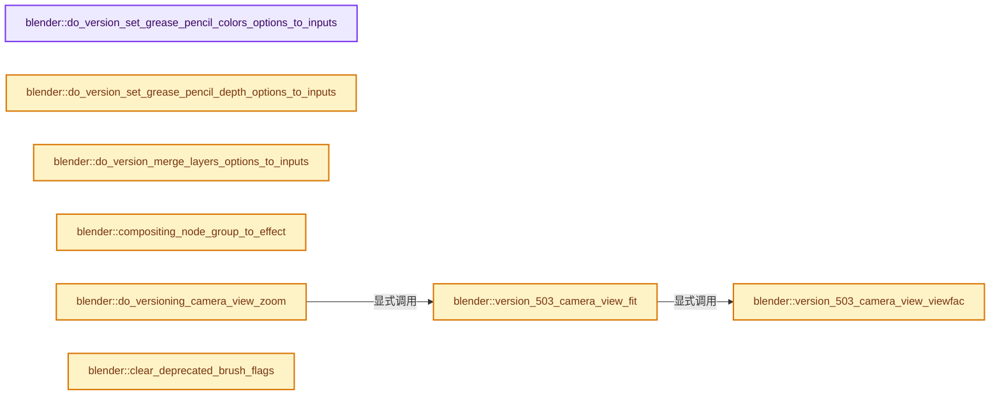
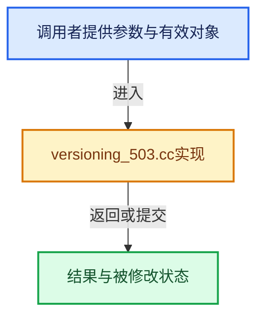

# 实现依赖专题：source/blender/blenloader/intern/versioning_503.cc

[方向导航](README.md) · [符号索引](../%E7%AC%A6%E5%8F%B7%E4%BE%9D%E8%B5%96%E4%B8%8E%E5%AE%9E%E7%8E%B0%E7%B4%A2%E5%BC%95.md)

本专题从正文实际调用进入，集中保存共享实现。函数有稳定锚点，可从调用处直接跳到对应完整函数；递归与互相调用通过回链组织。

## 本文件的实现关系






## 完整成员与函数实现

<a id="f-683491b502eb1de9"></a>

### `blender::do_version_set_grease_pencil_colors_options_to_inputs`

实现位置：[source/blender/blenloader/intern/versioning_503.cc](../../../../../source/blender/blenloader/intern/versioning_503.cc) · L57—L64。

接口参数：

- `bNodeTree &ntree`
- `bNode &node`

**教学注释版**

<!-- annotated:961aba9ce0c5bf -->

```cpp
static void do_version_set_grease_pencil_colors_options_to_inputs(bNodeTree &ntree, bNode &node)
{
  if (blender::bke::node_find_socket(node, SOCK_IN, "Mode"_ustr)) {
    return;
  }
  bNodeSocket &socket = version_node_add_socket(ntree, node, SOCK_IN, "NodeSocketMenu", "Mode");
  socket.default_value_typed<bNodeSocketValueMenu>()->value = node.custom1;
}
```

<details>
<summary>核对原始源码：source/blender/blenloader/intern/versioning_503.cc · L57—L64</summary>

<!-- original:961aba9ce0c5bf:source/blender/blenloader/intern/versioning_503.cc:57:64 -->

```cpp
static void do_version_set_grease_pencil_colors_options_to_inputs(bNodeTree &ntree, bNode &node)
{
  if (blender::bke::node_find_socket(node, SOCK_IN, "Mode"_ustr)) {
    return;
  }
  bNodeSocket &socket = version_node_add_socket(ntree, node, SOCK_IN, "NodeSocketMenu", "Mode");
  socket.default_value_typed<bNodeSocketValueMenu>()->value = node.custom1;
}
```

</details>

**继续追踪实现**

- `blender::bke::node_find_socket` → [blender::bke::node_find_socket · L3036](%E4%BE%9D%E8%B5%96-node-89d753.md#f-cbf9dec71aff5b59)；[blender::bke::node_find_socket · L3047](%E4%BE%9D%E8%B5%96-node-89d753.md#f-4a7a677634b7fbd1)。同名重载需按实参类型选择。
- `version_node_add_socket` → [blender::version_node_add_socket · L332](%E4%BE%9D%E8%B5%96-versioning_common-5f7e5c.md#f-846a4268eff6ea5d)。
- `socket.default_value_typed<bNodeSocketValueMenu>` → [blender::bNodeSocket::default_value_typed · L1134](%E4%BE%9D%E8%B5%96-BKE_node_runtime-ee561b.md#f-ce490d0e5a28d98d)；[blender::bNodeSocket::default_value_typed · L1139](%E4%BE%9D%E8%B5%96-BKE_node_runtime-ee561b.md#f-392726ff93a0389d)。同名重载需按实参类型选择。

<a id="f-31f085f02275fa3e"></a>

### `blender::do_version_set_grease_pencil_depth_options_to_inputs`

实现位置：[source/blender/blenloader/intern/versioning_503.cc](../../../../../source/blender/blenloader/intern/versioning_503.cc) · L66—L74。

接口参数：

- `bNodeTree &ntree`
- `bNode &node`

**教学注释版**

<!-- annotated:c3c1529e54ac8c -->

```cpp
static void do_version_set_grease_pencil_depth_options_to_inputs(bNodeTree &ntree, bNode &node)
{
  if (blender::bke::node_find_socket(node, SOCK_IN, "Depth Order"_ustr)) {
    return;
  }
  bNodeSocket &socket = version_node_add_socket(
      ntree, node, SOCK_IN, "NodeSocketMenu", "Depth Order");
  socket.default_value_typed<bNodeSocketValueMenu>()->value = node.custom1;
}
```

<details>
<summary>核对原始源码：source/blender/blenloader/intern/versioning_503.cc · L66—L74</summary>

<!-- original:c3c1529e54ac8c:source/blender/blenloader/intern/versioning_503.cc:66:74 -->

```cpp
static void do_version_set_grease_pencil_depth_options_to_inputs(bNodeTree &ntree, bNode &node)
{
  if (blender::bke::node_find_socket(node, SOCK_IN, "Depth Order"_ustr)) {
    return;
  }
  bNodeSocket &socket = version_node_add_socket(
      ntree, node, SOCK_IN, "NodeSocketMenu", "Depth Order");
  socket.default_value_typed<bNodeSocketValueMenu>()->value = node.custom1;
}
```

</details>

**继续追踪实现**

- `blender::bke::node_find_socket` → [blender::bke::node_find_socket · L3036](%E4%BE%9D%E8%B5%96-node-89d753.md#f-cbf9dec71aff5b59)；[blender::bke::node_find_socket · L3047](%E4%BE%9D%E8%B5%96-node-89d753.md#f-4a7a677634b7fbd1)。同名重载需按实参类型选择。
- `version_node_add_socket` → [blender::version_node_add_socket · L332](%E4%BE%9D%E8%B5%96-versioning_common-5f7e5c.md#f-846a4268eff6ea5d)。
- `socket.default_value_typed<bNodeSocketValueMenu>` → [blender::bNodeSocket::default_value_typed · L1134](%E4%BE%9D%E8%B5%96-BKE_node_runtime-ee561b.md#f-ce490d0e5a28d98d)；[blender::bNodeSocket::default_value_typed · L1139](%E4%BE%9D%E8%B5%96-BKE_node_runtime-ee561b.md#f-392726ff93a0389d)。同名重载需按实参类型选择。

<a id="f-24d83c06a169108f"></a>

### `blender::do_version_merge_layers_options_to_inputs`

实现位置：[source/blender/blenloader/intern/versioning_503.cc](../../../../../source/blender/blenloader/intern/versioning_503.cc) · L76—L89。

接口参数：

- `bNodeTree &ntree`
- `bNode &node`

**教学注释版**

<!-- annotated:368cff34f93654 -->

```cpp
static void do_version_merge_layers_options_to_inputs(bNodeTree &ntree, bNode &node)
{
  if (!version_node_ensure_storage_or_invalidate(node)) {
    return;
  }

  auto &storage = *reinterpret_cast<NodeGeometryMergeLayers *>(node.storage);

  if (blender::bke::node_find_socket(node, SOCK_IN, "Mode"_ustr)) {
    return;
  }
  bNodeSocket &socket = version_node_add_socket(ntree, node, SOCK_IN, "NodeSocketMenu", "Mode");
  socket.default_value_typed<bNodeSocketValueMenu>()->value = storage.mode;
}
```

<details>
<summary>核对原始源码：source/blender/blenloader/intern/versioning_503.cc · L76—L89</summary>

<!-- original:368cff34f93654:source/blender/blenloader/intern/versioning_503.cc:76:89 -->

```cpp
static void do_version_merge_layers_options_to_inputs(bNodeTree &ntree, bNode &node)
{
  if (!version_node_ensure_storage_or_invalidate(node)) {
    return;
  }

  auto &storage = *reinterpret_cast<NodeGeometryMergeLayers *>(node.storage);

  if (blender::bke::node_find_socket(node, SOCK_IN, "Mode"_ustr)) {
    return;
  }
  bNodeSocket &socket = version_node_add_socket(ntree, node, SOCK_IN, "NodeSocketMenu", "Mode");
  socket.default_value_typed<bNodeSocketValueMenu>()->value = storage.mode;
}
```

</details>

**继续追踪实现**

- `version_node_ensure_storage_or_invalidate` → [blender::version_node_ensure_storage_or_invalidate · L389](%E4%BE%9D%E8%B5%96-versioning_common-5f7e5c.md#f-72131ae3b96134c2)。
- `blender::bke::node_find_socket` → [blender::bke::node_find_socket · L3036](%E4%BE%9D%E8%B5%96-node-89d753.md#f-cbf9dec71aff5b59)；[blender::bke::node_find_socket · L3047](%E4%BE%9D%E8%B5%96-node-89d753.md#f-4a7a677634b7fbd1)。同名重载需按实参类型选择。
- `version_node_add_socket` → [blender::version_node_add_socket · L332](%E4%BE%9D%E8%B5%96-versioning_common-5f7e5c.md#f-846a4268eff6ea5d)。
- `socket.default_value_typed<bNodeSocketValueMenu>` → [blender::bNodeSocket::default_value_typed · L1134](%E4%BE%9D%E8%B5%96-BKE_node_runtime-ee561b.md#f-ce490d0e5a28d98d)；[blender::bNodeSocket::default_value_typed · L1139](%E4%BE%9D%E8%B5%96-BKE_node_runtime-ee561b.md#f-392726ff93a0389d)。同名重载需按实参类型选择。

<a id="f-36f4d13eb47c6da5"></a>

### `blender::compositing_node_group_to_effect`

实现位置：[source/blender/blenloader/intern/versioning_503.cc](../../../../../source/blender/blenloader/intern/versioning_503.cc) · L91—L106。

接口参数：

- `Main &main`
- `Scene &scene`

**教学注释版**

<!-- annotated:69d14916fa07ab -->

```cpp
static void compositing_node_group_to_effect(Main &main, Scene &scene)
{
  bNodeTree *node_group = version_get_scene_compositor_node_tree(&main, &scene);
  if (!node_group) {
    return;
  }

  SceneCompositorEffect &effect = bke::compositor::new_effect(scene, "Scene Effect");
  effect.node_group = node_group;
  if (!node_group->compositor_node_asset_traits) {
    node_group->compositor_node_asset_traits = MEM_new<CompositorNodeAssetTraits>(__func__);
  }
  node_group->compositor_node_asset_traits->flag |= COMPOSIT_NODE_ASSET_SCENE_EFFECT;
  bke::node_update_asset_metadata(*node_group);
  scene.compositing_node_group = nullptr;
}
```

<details>
<summary>核对原始源码：source/blender/blenloader/intern/versioning_503.cc · L91—L106</summary>

<!-- original:69d14916fa07ab:source/blender/blenloader/intern/versioning_503.cc:91:106 -->

```cpp
static void compositing_node_group_to_effect(Main &main, Scene &scene)
{
  bNodeTree *node_group = version_get_scene_compositor_node_tree(&main, &scene);
  if (!node_group) {
    return;
  }

  SceneCompositorEffect &effect = bke::compositor::new_effect(scene, "Scene Effect");
  effect.node_group = node_group;
  if (!node_group->compositor_node_asset_traits) {
    node_group->compositor_node_asset_traits = MEM_new<CompositorNodeAssetTraits>(__func__);
  }
  node_group->compositor_node_asset_traits->flag |= COMPOSIT_NODE_ASSET_SCENE_EFFECT;
  bke::node_update_asset_metadata(*node_group);
  scene.compositing_node_group = nullptr;
}
```

</details>

**沿实际写入检查状态**

- `effect.node_group = node_group;`
- `node_group->compositor_node_asset_traits = MEM_new<CompositorNodeAssetTraits>(__func__);`
- `node_group->compositor_node_asset_traits->flag |= COMPOSIT_NODE_ASSET_SCENE_EFFECT;`
- `scene.compositing_node_group = nullptr;`

**继续追踪实现**

- `version_get_scene_compositor_node_tree` → [blender::version_get_scene_compositor_node_tree · L780](%E4%BE%9D%E8%B5%96-versioning_common-5f7e5c.md#f-a119c99e7da5ebd7)。
- `bke::compositor::new_effect` → [blender::bke::compositor::new_effect · L272](%E4%BE%9D%E8%B5%96-compositor-ce5aa3.md#f-63817a11bd208600)。
- `MEM_new<CompositorNodeAssetTraits>` → [MEM_new · L351](../03-%E5%86%85%E5%AD%98%E5%88%86%E9%85%8D%E4%B8%8E%E8%BF%90%E8%A1%8C%E6%97%B6%E7%B1%BB%E5%9E%8B/%E4%BE%9D%E8%B5%96-MEM_guardedalloc-b54eca.md#f-115f9b6784f89912)。
- `bke::node_update_asset_metadata` → [blender::bke::node_update_asset_metadata · L2462](%E4%BE%9D%E8%B5%96-node-89d753.md#f-35b83ee85c6f8c23)。

<a id="f-89b89c23475914e6"></a>

### `blender::version_503_camera_view_viewfac`

实现位置：[source/blender/blenloader/intern/versioning_503.cc](../../../../../source/blender/blenloader/intern/versioning_503.cc) · L108—L118。

接口参数：

- `const int sensor_fit`
- `const int winx`
- `const int winy`
- `const float frame_aspect`

**教学注释版**

<!-- annotated:ef73bc9433751a -->

```cpp
static float version_503_camera_view_viewfac(const int sensor_fit,
                                             const int winx,
                                             const int winy,
                                             const float frame_aspect)
{
  const float2 frame_size = BKE_camera_frame_size(winx, winy, frame_aspect);

  return (BKE_camera_sensor_fit(sensor_fit, 1.0f, frame_aspect) == CAMERA_SENSOR_FIT_HOR) ?
             frame_size.x :
             frame_size.y;
}
```

<details>
<summary>核对原始源码：source/blender/blenloader/intern/versioning_503.cc · L108—L118</summary>

<!-- original:ef73bc9433751a:source/blender/blenloader/intern/versioning_503.cc:108:118 -->

```cpp
static float version_503_camera_view_viewfac(const int sensor_fit,
                                             const int winx,
                                             const int winy,
                                             const float frame_aspect)
{
  const float2 frame_size = BKE_camera_frame_size(winx, winy, frame_aspect);

  return (BKE_camera_sensor_fit(sensor_fit, 1.0f, frame_aspect) == CAMERA_SENSOR_FIT_HOR) ?
             frame_size.x :
             frame_size.y;
}
```

</details>

**结果出口**

- `return (BKE_camera_sensor_fit(sensor_fit, 1.0f, frame_aspect) == CAMERA_SENSOR_FIT_HOR) ?`

**继续追踪实现**

- `BKE_camera_frame_size` → [blender::BKE_camera_frame_size · L352](%E4%BE%9D%E8%B5%96-camera-dbe667.md#f-718d469495ae46b2)。
- `BKE_camera_sensor_fit` → [blender::BKE_camera_sensor_fit · L339](%E4%BE%9D%E8%B5%96-camera-dbe667.md#f-a3bfa9ad26d0b8ba)。

<a id="f-6aa8f62d0638f0a3"></a>

### `blender::version_503_camera_view_fit`

实现位置：[source/blender/blenloader/intern/versioning_503.cc](../../../../../source/blender/blenloader/intern/versioning_503.cc) · L120—L149。

接口参数：

- `RegionView3D *rv3d`
- `const int sensor_fit`
- `const int winx`
- `const int winy`
- `const float render_aspect`

**教学注释版**

<!-- annotated:e076f2cbc42288 -->

```cpp
static void version_503_camera_view_fit(RegionView3D *rv3d,
                                        const int sensor_fit,
                                        const int winx,
                                        const int winy,
                                        const float render_aspect)
{
  /* The camera frame is now automatically fitted to the viewport, taking into count
   * the render aspect ratio. Here we version existing camera views to match. */
  if ((rv3d->persp != RV3D_CAMOB) && (rv3d->camzoom == 0.0f) && (rv3d->camdx == 0.0f) &&
      (rv3d->camdy == 0.0f))
  {
    return;
  }

  const float viewfac_old = version_503_camera_view_viewfac(
      sensor_fit, winx, winy, float(winy) / float(winx));
  const float viewfac_new = version_503_camera_view_viewfac(sensor_fit, winx, winy, render_aspect);

  /* Adjust zoom factor. */
  const float zoomfac_old = BKE_screen_view3d_zoom_to_fac(rv3d->camzoom);
  rv3d->camzoom = math::clamp(
      BKE_screen_view3d_zoom_from_fac(zoomfac_old * viewfac_old / viewfac_new),
      float(RV3D_CAMZOOM_MIN),
      float(RV3D_CAMZOOM_MAX));

  /* Adjust panning. */
  const float zoomfac_new = BKE_screen_view3d_zoom_to_fac(rv3d->camzoom);
  rv3d->camdx = math::clamp(rv3d->camdx * zoomfac_old / zoomfac_new, -1.0f, 1.0f);
  rv3d->camdy = math::clamp(rv3d->camdy * zoomfac_old / zoomfac_new, -1.0f, 1.0f);
}
```

<details>
<summary>核对原始源码：source/blender/blenloader/intern/versioning_503.cc · L120—L149</summary>

<!-- original:e076f2cbc42288:source/blender/blenloader/intern/versioning_503.cc:120:149 -->

```cpp
static void version_503_camera_view_fit(RegionView3D *rv3d,
                                        const int sensor_fit,
                                        const int winx,
                                        const int winy,
                                        const float render_aspect)
{
  /* The camera frame is now automatically fitted to the viewport, taking into count
   * the render aspect ratio. Here we version existing camera views to match. */
  if ((rv3d->persp != RV3D_CAMOB) && (rv3d->camzoom == 0.0f) && (rv3d->camdx == 0.0f) &&
      (rv3d->camdy == 0.0f))
  {
    return;
  }

  const float viewfac_old = version_503_camera_view_viewfac(
      sensor_fit, winx, winy, float(winy) / float(winx));
  const float viewfac_new = version_503_camera_view_viewfac(sensor_fit, winx, winy, render_aspect);

  /* Adjust zoom factor. */
  const float zoomfac_old = BKE_screen_view3d_zoom_to_fac(rv3d->camzoom);
  rv3d->camzoom = math::clamp(
      BKE_screen_view3d_zoom_from_fac(zoomfac_old * viewfac_old / viewfac_new),
      float(RV3D_CAMZOOM_MIN),
      float(RV3D_CAMZOOM_MAX));

  /* Adjust panning. */
  const float zoomfac_new = BKE_screen_view3d_zoom_to_fac(rv3d->camzoom);
  rv3d->camdx = math::clamp(rv3d->camdx * zoomfac_old / zoomfac_new, -1.0f, 1.0f);
  rv3d->camdy = math::clamp(rv3d->camdy * zoomfac_old / zoomfac_new, -1.0f, 1.0f);
}
```

</details>

**沿实际写入检查状态**

- `rv3d->camzoom = math::clamp(`
- `rv3d->camdx = math::clamp(rv3d->camdx * zoomfac_old / zoomfac_new, -1.0f, 1.0f);`
- `rv3d->camdy = math::clamp(rv3d->camdy * zoomfac_old / zoomfac_new, -1.0f, 1.0f);`

**继续追踪实现**

- `version_503_camera_view_viewfac` → [blender::version_503_camera_view_viewfac · L108](%E4%BE%9D%E8%B5%96-versioning_503-33f61c.md#f-89b89c23475914e6)。
- `BKE_screen_view3d_zoom_to_fac` → [blender::BKE_screen_view3d_zoom_to_fac · L1281](%E4%BE%9D%E8%B5%96-screen-f062a7.md#f-607d94e31dd1fbb7)。
- `math::clamp` → [blender::math::clamp · L118](../12-%E7%A9%BA%E9%97%B4%E6%95%B0%E6%8D%AE%E7%BB%93%E6%9E%84%E4%B8%8E%E5%87%A0%E4%BD%95%E7%AE%97%E6%B3%95/%E4%BE%9D%E8%B5%96-BLI_math_vector-906a87.md#f-65702e97e59fc41e)；[blender::math::clamp · L130](../12-%E7%A9%BA%E9%97%B4%E6%95%B0%E6%8D%AE%E7%BB%93%E6%9E%84%E4%B8%8E%E5%87%A0%E4%BD%95%E7%AE%97%E6%B3%95/%E4%BE%9D%E8%B5%96-BLI_math_vector-906a87.md#f-0365873940e23a11)；[blender::math::clamp · L69](../12-%E7%A9%BA%E9%97%B4%E6%95%B0%E6%8D%AE%E7%BB%93%E6%9E%84%E4%B8%8E%E5%87%A0%E4%BD%95%E7%AE%97%E6%B3%95/%E4%BE%9D%E8%B5%96-BLI_math_base-0728eb.md#f-9282cf5d06fa3723)。同名重载需按实参类型选择。
- `BKE_screen_view3d_zoom_from_fac` → [blender::BKE_screen_view3d_zoom_from_fac · L1286](%E4%BE%9D%E8%B5%96-screen-f062a7.md#f-7e9126cbc3bf72dd)。

<a id="f-365ad063b9fdbda0"></a>

### `blender::do_versioning_camera_view_zoom`

实现位置：[source/blender/blenloader/intern/versioning_503.cc](../../../../../source/blender/blenloader/intern/versioning_503.cc) · L151—L204。

接口参数：

- `Main *bmain`

**教学注释版**

<!-- annotated:1c0e96eba9870d -->

```cpp
static void do_versioning_camera_view_zoom(Main *bmain)
{
  for (bScreen &screen : bmain->screens) {
    Scene *scene = bmain->scenes.first_as<Scene>();
    for (wmWindowManager &wm : bmain->wm) {
      for (wmWindow &win : wm.windows) {
        if (win.winid == screen.winid) {
          scene = win.scene;
        }
      }
    }
    if (scene == nullptr) {
      continue;
    }
    const float render_aspect = (float(scene->r.ysch) * scene->r.yasp) /
                                (float(scene->r.xsch) * scene->r.xasp);

    for (ScrArea &area : screen.areabase) {
      for (SpaceLink &space : area.spacedata) {
        if (space.spacetype != SPACE_VIEW3D) {
          continue;
        }
        View3D *v3d = reinterpret_cast<View3D *>(&space);

        const Object *camera = (v3d->camera != nullptr) ? v3d->camera : scene->camera;
        const int sensor_fit = (camera != nullptr && camera->type == OB_CAMERA &&
                                camera->data != nullptr) ?
                                   id_cast<const Camera *>(camera->data)->sensor_fit :
                                   CAMERA_SENSOR_FIT_AUTO;

        ListBaseT<ARegion> *regions = (area.spacedata.first() == &space) ? &area.regionbase :
                                                                           &space.regionbase;
        for (ARegion &region : *regions) {
          if (region.regiontype != RGN_TYPE_WINDOW) {
            continue;
          }
          RegionView3D *rv3d = static_cast<RegionView3D *>(region.regiondata);
          if (rv3d == nullptr) {
            continue;
          }
          if ((region.winx <= 1) || (region.winy <= 1)) {
            continue;
          }

          version_503_camera_view_fit(rv3d, sensor_fit, region.winx, region.winy, render_aspect);
          if (rv3d->localvd != nullptr) {
            version_503_camera_view_fit(
                rv3d->localvd, sensor_fit, region.winx, region.winy, render_aspect);
          }
        }
      }
    }
  }
}
```

<details>
<summary>核对原始源码：source/blender/blenloader/intern/versioning_503.cc · L151—L204</summary>

<!-- original:1c0e96eba9870d:source/blender/blenloader/intern/versioning_503.cc:151:204 -->

```cpp
static void do_versioning_camera_view_zoom(Main *bmain)
{
  for (bScreen &screen : bmain->screens) {
    Scene *scene = bmain->scenes.first_as<Scene>();
    for (wmWindowManager &wm : bmain->wm) {
      for (wmWindow &win : wm.windows) {
        if (win.winid == screen.winid) {
          scene = win.scene;
        }
      }
    }
    if (scene == nullptr) {
      continue;
    }
    const float render_aspect = (float(scene->r.ysch) * scene->r.yasp) /
                                (float(scene->r.xsch) * scene->r.xasp);

    for (ScrArea &area : screen.areabase) {
      for (SpaceLink &space : area.spacedata) {
        if (space.spacetype != SPACE_VIEW3D) {
          continue;
        }
        View3D *v3d = reinterpret_cast<View3D *>(&space);

        const Object *camera = (v3d->camera != nullptr) ? v3d->camera : scene->camera;
        const int sensor_fit = (camera != nullptr && camera->type == OB_CAMERA &&
                                camera->data != nullptr) ?
                                   id_cast<const Camera *>(camera->data)->sensor_fit :
                                   CAMERA_SENSOR_FIT_AUTO;

        ListBaseT<ARegion> *regions = (area.spacedata.first() == &space) ? &area.regionbase :
                                                                           &space.regionbase;
        for (ARegion &region : *regions) {
          if (region.regiontype != RGN_TYPE_WINDOW) {
            continue;
          }
          RegionView3D *rv3d = static_cast<RegionView3D *>(region.regiondata);
          if (rv3d == nullptr) {
            continue;
          }
          if ((region.winx <= 1) || (region.winy <= 1)) {
            continue;
          }

          version_503_camera_view_fit(rv3d, sensor_fit, region.winx, region.winy, render_aspect);
          if (rv3d->localvd != nullptr) {
            version_503_camera_view_fit(
                rv3d->localvd, sensor_fit, region.winx, region.winy, render_aspect);
          }
        }
      }
    }
  }
}
```

</details>

**沿实际写入检查状态**

- `scene = win.scene;`

**继续追踪实现**

- `bmain->scenes.first_as<Scene>` → [调用协议](../%E6%A8%A1%E6%9D%BF%E5%AE%8F%E4%B8%8E%E5%8A%A8%E6%80%81%E5%88%86%E6%B4%BE%E5%8D%8F%E8%AE%AE.md)：接收对象类型依赖auto、返回值或模板实例；不按同名猜测目标。调用位置L154。
- `id_cast<const Camera *>` → [blender::id_cast · L1417](%E4%BE%9D%E8%B5%96-DNA_ID-3eb091.md#f-6c8ac6412850ac5a)。
- `area.spacedata.first` → [调用协议](../%E6%A8%A1%E6%9D%BF%E5%AE%8F%E4%B8%8E%E5%8A%A8%E6%80%81%E5%88%86%E6%B4%BE%E5%8D%8F%E8%AE%AE.md)：接收对象类型依赖auto、返回值或模板实例；不按同名猜测目标。调用位置L181。
- `version_503_camera_view_fit` → [blender::version_503_camera_view_fit · L120](%E4%BE%9D%E8%B5%96-versioning_503-33f61c.md#f-6aa8f62d0638f0a3)。

<a id="f-411956d2611835bf"></a>

### `blender::clear_deprecated_brush_flags`

实现位置：[source/blender/blenloader/intern/versioning_503.cc](../../../../../source/blender/blenloader/intern/versioning_503.cc) · L206—L215。

接口参数：

- `Brush &brush`

**教学注释版**

<!-- annotated:a291ed54d9240f -->

```cpp
static void clear_deprecated_brush_flags(Brush &brush)
{
  if (brush.gpencil_settings) {
    brush.gpencil_settings->flag &= ~GP_BRUSH_UNUSED_1;
    brush.gpencil_settings->flag2 &= ~(GP_BRUSH_UNUSED_2 | GP_BRUSH_UNUSED_3 | GP_BRUSH_UNUSED_4 |
                                       GP_BRUSH_UNUSED_5 | GP_BRUSH_UNUSED_6 | GP_BRUSH_UNUSED_7);
  }
  brush.paint_flags &= ~BRUSH_PAINT_UNUSED_2;
  brush.flag &= ~(BRUSH_UNUSED_7 | BRUSH_UNUSED_8);
}
```

<details>
<summary>核对原始源码：source/blender/blenloader/intern/versioning_503.cc · L206—L215</summary>

<!-- original:a291ed54d9240f:source/blender/blenloader/intern/versioning_503.cc:206:215 -->

```cpp
static void clear_deprecated_brush_flags(Brush &brush)
{
  if (brush.gpencil_settings) {
    brush.gpencil_settings->flag &= ~GP_BRUSH_UNUSED_1;
    brush.gpencil_settings->flag2 &= ~(GP_BRUSH_UNUSED_2 | GP_BRUSH_UNUSED_3 | GP_BRUSH_UNUSED_4 |
                                       GP_BRUSH_UNUSED_5 | GP_BRUSH_UNUSED_6 | GP_BRUSH_UNUSED_7);
  }
  brush.paint_flags &= ~BRUSH_PAINT_UNUSED_2;
  brush.flag &= ~(BRUSH_UNUSED_7 | BRUSH_UNUSED_8);
}
```

</details>

**沿实际写入检查状态**

- `brush.gpencil_settings->flag &= ~GP_BRUSH_UNUSED_1;`
- `brush.gpencil_settings->flag2 &= ~(GP_BRUSH_UNUSED_2 | GP_BRUSH_UNUSED_3 | GP_BRUSH_UNUSED_4 |`
- `brush.paint_flags &= ~BRUSH_PAINT_UNUSED_2;`
- `brush.flag &= ~(BRUSH_UNUSED_7 | BRUSH_UNUSED_8);`

**继续追踪实现**

本实现没有需要继续展开的显式调用；检查返回表达式、对象转换和调用者前置条件。

<a id="f-06df018efca81a20"></a>

### `blender::do_versions_after_linking_503`

实现位置：[source/blender/blenloader/intern/versioning_503.cc](../../../../../source/blender/blenloader/intern/versioning_503.cc) · L217—L320。

接口参数：

- `FileData *`
- `Main *bmain`

**教学注释版**

<!-- annotated:656b6d1decb42e -->

```cpp
void do_versions_after_linking_503(FileData * /*fd*/, Main *bmain)
{
  if (!MAIN_VERSION_FILE_ATLEAST(bmain, 503, 8)) {
    version_node_socket_index_animdata(
        bmain, NTREE_GEOMETRY, "GeometryNodeSetGreasePencilColor", 5, 1, 6);
  }

  if (!MAIN_VERSION_FILE_ATLEAST(bmain, 503, 15)) {
    for (Scene &scene : bmain->scenes) {
      compositing_node_group_to_effect(*bmain, scene);
    }
  }
  else {
    /* The now deprecated compositing_node_group is always written on file writes for forward
     * compatibility, so it has to be reset to nullptr if no versioning was needed.
     *
     * Todo(#140111): Forward compatibility support will be removed in 6.0, and this loop can then
     * be placed behind a `MAIN_VERSION_FILE_OLDER(bmain, 600, xxx)` check . */
    for (Scene &scene : bmain->scenes) {
      scene.compositing_node_group = nullptr;
    }
  }

  if (!MAIN_VERSION_FILE_ATLEAST(bmain, 503, 16)) {
    /* Shift animation data to accommodate the new dispersion inputs. */
    version_node_socket_index_animdata(bmain, NTREE_SHADER, "ShaderNodeBsdfPrincipled", 20, 2, 33);
  }

  if (!MAIN_VERSION_FILE_ATLEAST(bmain, 503, 19)) {
    /* Runs here instead of `blo_do_versions_503`, since screen datablocks are not fully linked
     * (e.g. `#View3D.camera`) until after linking. */
    do_versioning_camera_view_zoom(bmain);
  }

  if (!MAIN_VERSION_FILE_ATLEAST(bmain, 503, 20)) {
    /* Shift animation data to accommodate the new anisotropic inputs. */
    version_node_socket_index_animdata(bmain, NTREE_SHADER, "ShaderNodeBsdfGlass", 5, 3, 7);
    version_node_socket_index_animdata(bmain, NTREE_SHADER, "ShaderNodeBsdfGlass", 2, 2, 4);
  }

  if (!MAIN_VERSION_FILE_ATLEAST(bmain, 503, 23)) {
    bool has_skip_alphabet_sort_method = false;
    for (bScreen &screen : bmain->screens) {
      for (ScrArea &area : screen.areabase) {
        for (SpaceLink &space : area.spacedata) {
          if (space.spacetype == SPACE_OUTLINER) {
            SpaceOutliner *space_outliner = reinterpret_cast<SpaceOutliner *>(&space);
            if (space_outliner->flag & SO_FLAG_UNUSED_4) {
              has_skip_alphabet_sort_method = true;
            }
          }
        }
      }
    }
    auto version_collection_fn = [&](Collection &collection) {
      Map<Object *, int> parent_child_indices;
      int index = 0;
      for (CollectionChild &child : collection.children) {
        child.sort_index = index++;
      }
      for (CollectionObject &cob : collection.gobject) {
        cob.sort_index = (has_skip_alphabet_sort_method) ? index++ : -1;
        if (has_skip_alphabet_sort_method && cob.ob != nullptr && cob.ob->parent != nullptr) {
          // [讲解] parent_child_indices.lookup_or_add：把查找与缺失时创建合成一次操作。
          int &child_index = parent_child_indices.lookup_or_add(cob.ob->parent, 0);
          cob.parented_sort_index = child_index++;
        }
        else {
          cob.parented_sort_index = -1;
        }
      }
    };
    for (Collection &collection : bmain->collections) {
      version_collection_fn(collection);
    }
    for (Scene &scene : bmain->scenes) {
      if (scene.master_collection != nullptr) {
        version_collection_fn(*scene.master_collection);
      }
    }
    for (bScreen &screen : bmain->screens) {
      for (ScrArea &area : screen.areabase) {
        for (SpaceLink &space : area.spacedata) {
          if (space.spacetype == SPACE_OUTLINER) {
            SpaceOutliner *space_outliner = reinterpret_cast<SpaceOutliner *>(&space);
            if (has_skip_alphabet_sort_method && !(space_outliner->flag & SO_FLAG_UNUSED_4)) {
              space_outliner->sort_method = SO_SORT_ALPHA;
            }
            else {
              space_outliner->sort_method = SO_SORT_CUSTOM;
            }
            space_outliner->flag &= ~SO_FLAG_UNUSED_4;
          }
        }
      }
    }
  }

  /**
   * Always bump subversion in BKE_blender_version.h when adding versioning
   * code here, and wrap it inside a MAIN_VERSION_FILE_ATLEAST check.
   *
   * \note Keep this message at the bottom of the function.
   */
}
```

<details>
<summary>核对原始源码：source/blender/blenloader/intern/versioning_503.cc · L217—L320</summary>

<!-- original:656b6d1decb42e:source/blender/blenloader/intern/versioning_503.cc:217:320 -->

```cpp
void do_versions_after_linking_503(FileData * /*fd*/, Main *bmain)
{
  if (!MAIN_VERSION_FILE_ATLEAST(bmain, 503, 8)) {
    version_node_socket_index_animdata(
        bmain, NTREE_GEOMETRY, "GeometryNodeSetGreasePencilColor", 5, 1, 6);
  }

  if (!MAIN_VERSION_FILE_ATLEAST(bmain, 503, 15)) {
    for (Scene &scene : bmain->scenes) {
      compositing_node_group_to_effect(*bmain, scene);
    }
  }
  else {
    /* The now deprecated compositing_node_group is always written on file writes for forward
     * compatibility, so it has to be reset to nullptr if no versioning was needed.
     *
     * Todo(#140111): Forward compatibility support will be removed in 6.0, and this loop can then
     * be placed behind a `MAIN_VERSION_FILE_OLDER(bmain, 600, xxx)` check . */
    for (Scene &scene : bmain->scenes) {
      scene.compositing_node_group = nullptr;
    }
  }

  if (!MAIN_VERSION_FILE_ATLEAST(bmain, 503, 16)) {
    /* Shift animation data to accommodate the new dispersion inputs. */
    version_node_socket_index_animdata(bmain, NTREE_SHADER, "ShaderNodeBsdfPrincipled", 20, 2, 33);
  }

  if (!MAIN_VERSION_FILE_ATLEAST(bmain, 503, 19)) {
    /* Runs here instead of `blo_do_versions_503`, since screen datablocks are not fully linked
     * (e.g. `#View3D.camera`) until after linking. */
    do_versioning_camera_view_zoom(bmain);
  }

  if (!MAIN_VERSION_FILE_ATLEAST(bmain, 503, 20)) {
    /* Shift animation data to accommodate the new anisotropic inputs. */
    version_node_socket_index_animdata(bmain, NTREE_SHADER, "ShaderNodeBsdfGlass", 5, 3, 7);
    version_node_socket_index_animdata(bmain, NTREE_SHADER, "ShaderNodeBsdfGlass", 2, 2, 4);
  }

  if (!MAIN_VERSION_FILE_ATLEAST(bmain, 503, 23)) {
    bool has_skip_alphabet_sort_method = false;
    for (bScreen &screen : bmain->screens) {
      for (ScrArea &area : screen.areabase) {
        for (SpaceLink &space : area.spacedata) {
          if (space.spacetype == SPACE_OUTLINER) {
            SpaceOutliner *space_outliner = reinterpret_cast<SpaceOutliner *>(&space);
            if (space_outliner->flag & SO_FLAG_UNUSED_4) {
              has_skip_alphabet_sort_method = true;
            }
          }
        }
      }
    }
    auto version_collection_fn = [&](Collection &collection) {
      Map<Object *, int> parent_child_indices;
      int index = 0;
      for (CollectionChild &child : collection.children) {
        child.sort_index = index++;
      }
      for (CollectionObject &cob : collection.gobject) {
        cob.sort_index = (has_skip_alphabet_sort_method) ? index++ : -1;
        if (has_skip_alphabet_sort_method && cob.ob != nullptr && cob.ob->parent != nullptr) {
          int &child_index = parent_child_indices.lookup_or_add(cob.ob->parent, 0);
          cob.parented_sort_index = child_index++;
        }
        else {
          cob.parented_sort_index = -1;
        }
      }
    };
    for (Collection &collection : bmain->collections) {
      version_collection_fn(collection);
    }
    for (Scene &scene : bmain->scenes) {
      if (scene.master_collection != nullptr) {
        version_collection_fn(*scene.master_collection);
      }
    }
    for (bScreen &screen : bmain->screens) {
      for (ScrArea &area : screen.areabase) {
        for (SpaceLink &space : area.spacedata) {
          if (space.spacetype == SPACE_OUTLINER) {
            SpaceOutliner *space_outliner = reinterpret_cast<SpaceOutliner *>(&space);
            if (has_skip_alphabet_sort_method && !(space_outliner->flag & SO_FLAG_UNUSED_4)) {
              space_outliner->sort_method = SO_SORT_ALPHA;
            }
            else {
              space_outliner->sort_method = SO_SORT_CUSTOM;
            }
            space_outliner->flag &= ~SO_FLAG_UNUSED_4;
          }
        }
      }
    }
  }

  /**
   * Always bump subversion in BKE_blender_version.h when adding versioning
   * code here, and wrap it inside a MAIN_VERSION_FILE_ATLEAST check.
   *
   * \note Keep this message at the bottom of the function.
   */
}
```

</details>

**沿实际写入检查状态**

- `scene.compositing_node_group = nullptr;`
- `has_skip_alphabet_sort_method = true;`
- `child.sort_index = index++;`
- `cob.sort_index = (has_skip_alphabet_sort_method) ? index++ : -1;`
- `cob.parented_sort_index = child_index++;`
- `cob.parented_sort_index = -1;`
- `space_outliner->sort_method = SO_SORT_ALPHA;`
- `space_outliner->sort_method = SO_SORT_CUSTOM;`
- `space_outliner->flag &= ~SO_FLAG_UNUSED_4;`

**继续追踪实现**

- `MAIN_VERSION_FILE_ATLEAST` → [MAIN_VERSION_FILE_ATLEAST · L946](%E4%BE%9D%E8%B5%96-BKE_main-626d8f.md#m-f0c0a8da9411)。宏定义由构建条件选择。
- `version_node_socket_index_animdata` → [blender::version_node_socket_index_animdata · L484](%E4%BE%9D%E8%B5%96-versioning_common-5f7e5c.md#f-27c2e2a91a515631)；[blender::version_node_socket_index_animdata · L500](%E4%BE%9D%E8%B5%96-versioning_common-5f7e5c.md#f-522ccbf91978b798)。同名重载需按实参类型选择。
- `compositing_node_group_to_effect` → [blender::compositing_node_group_to_effect · L91](%E4%BE%9D%E8%B5%96-versioning_503-33f61c.md#f-36f4d13eb47c6da5)。
- `do_versioning_camera_view_zoom` → [blender::do_versioning_camera_view_zoom · L151](%E4%BE%9D%E8%B5%96-versioning_503-33f61c.md#f-365ad063b9fdbda0)。
- `parent_child_indices.lookup_or_add` → [blender::Map::lookup_or_add · L588](../02-%E5%93%88%E5%B8%8C%E8%A1%A8%E4%B8%8E%E5%85%B3%E8%81%94%E6%95%B0%E6%8D%AE%E7%BB%93%E6%9E%84/05-Map%E6%8F%92%E5%85%A5%E4%B8%8E%E5%9B%9E%E8%B0%83.md#f-c419897675e1c232)；[blender::Map::lookup_or_add · L592](../02-%E5%93%88%E5%B8%8C%E8%A1%A8%E4%B8%8E%E5%85%B3%E8%81%94%E6%95%B0%E6%8D%AE%E7%BB%93%E6%9E%84/05-Map%E6%8F%92%E5%85%A5%E4%B8%8E%E5%9B%9E%E8%B0%83.md#f-85b5fa3f7399794c)；[blender::Map::lookup_or_add · L596](../02-%E5%93%88%E5%B8%8C%E8%A1%A8%E4%B8%8E%E5%85%B3%E8%81%94%E6%95%B0%E6%8D%AE%E7%BB%93%E6%9E%84/05-Map%E6%8F%92%E5%85%A5%E4%B8%8E%E5%9B%9E%E8%B0%83.md#f-45a386e54e052059)；[blender::Map::lookup_or_add · L600](../02-%E5%93%88%E5%B8%8C%E8%A1%A8%E4%B8%8E%E5%85%B3%E8%81%94%E6%95%B0%E6%8D%AE%E7%BB%93%E6%9E%84/05-Map%E6%8F%92%E5%85%A5%E4%B8%8E%E5%9B%9E%E8%B0%83.md#f-fee760b21dfabceb)。同名重载需按实参类型选择。
- `version_collection_fn` → [调用协议](../%E6%A8%A1%E6%9D%BF%E5%AE%8F%E4%B8%8E%E5%8A%A8%E6%80%81%E5%88%86%E6%B4%BE%E5%8D%8F%E8%AE%AE.md)：局部可调用对象，须结合其初始化与捕获环境。调用位置L289。

<a id="f-723af534e788e724"></a>

### `blender::blo_do_versions_503`

实现位置：[source/blender/blenloader/intern/versioning_503.cc](../../../../../source/blender/blenloader/intern/versioning_503.cc) · L322—L715。

接口参数：

- `FileData *`
- `Library *`
- `Main *bmain`

**教学注释版**

<!-- annotated:f86cbab7b39500 -->

```cpp
void blo_do_versions_503(FileData * /*fd*/, Library * /*lib*/, Main *bmain)
{
  if (!MAIN_VERSION_FILE_ATLEAST(bmain, 503, 1)) {
    for (Scene &scene : bmain->scenes) {
      VPaint *wpaint = scene.toolsettings->wpaint;
      if (wpaint && wpaint->paint.brush_asset_reference) {
        const StringRefNull old_asset_id =
            wpaint->paint.brush_asset_reference->relative_asset_identifier;
        if (wpaint->paint.brush == nullptr && old_asset_id.endswith("Paint")) {
          /* The "Paint" brush asset was renamed to "Add Weight", find it via the default instead
           * of hard-coding the new name. */
          if (std::optional<AssetWeakReference> paint_brush_asset_reference =
                  BKE_paint_brush_type_default_reference(bke::paint::AssetCategory::MeshWeight,
                                                         WPAINT_BRUSH_TYPE_DRAW))
          {
            BKE_paint_brush_set(bmain, &wpaint->paint, *paint_brush_asset_reference);
          }
        }
      }
    }
  }

  /* The compositor previously did not support default inputs for group nodes, but some built-in
   * nodes had the position field default type for some inputs, so node groups would gain it as a
   * default type through some operators. Later, the default inputs were supported for group nodes,
   * though position field were not supported in the compositor, so it would assert. To fix this,
   * we reset any position field default input to the default value. */
  if (!MAIN_VERSION_FILE_ATLEAST(bmain, 503, 3)) {
    FOREACH_NODETREE_BEGIN (bmain, node_tree, id) {
      if (node_tree->type == NTREE_COMPOSIT) {
        node_tree->ensure_interface_cache();
        for (bNodeTreeInterfaceSocket *input : node_tree->interface_inputs()) {
          if (input->default_input == NODE_DEFAULT_INPUT_POSITION_FIELD) {
            input->default_input = NODE_DEFAULT_INPUT_VALUE;
          }
        }
      }
    }
    FOREACH_NODETREE_END;
  }

  if (!MAIN_VERSION_FILE_ATLEAST(bmain, 503, 4)) {
    for (bScreen &screen : bmain->screens) {
      for (ScrArea &area : screen.areabase) {
        for (SpaceLink &sl : area.spacedata) {
          if (sl.spacetype == SPACE_ACTION) {
            SpaceAction *saction = reinterpret_cast<SpaceAction *>(&sl);
            saction->cache_display |= TIME_CACHE_COMPOSITOR;
          }
        }
      }
    }
  }

  if (!MAIN_VERSION_FILE_ATLEAST(bmain, 503, 6)) {
    for (Brush &brush : bmain->brushes) {
      if (ELEM(brush.ob_mode, OB_MODE_WEIGHT_PAINT, OB_MODE_VERTEX_PAINT)) {
        if (brush.mesh_automasking_settings == nullptr) {
          brush.mesh_automasking_settings = MEM_new<MeshAutomaskingSettings>(__func__);
          brush.mesh_automasking_settings->cavity_curve = BKE_sculpt_default_cavity_curve();
        }
      }
    }

    auto apply_to_paint = [&](Paint *paint) {
      if (paint == nullptr) {
        return;
      }

      if (paint->mesh_automasking_settings == nullptr) {
        paint->mesh_automasking_settings = MEM_new<MeshAutomaskingSettings>("blo_do_versions_520");
        paint->mesh_automasking_settings->cavity_curve = BKE_sculpt_default_cavity_curve();
        paint->mesh_automasking_settings->cavity_curve_op = BKE_sculpt_default_cavity_curve();
      }
    };

    for (Scene &scene : bmain->scenes) {
      apply_to_paint(reinterpret_cast<Paint *>(scene.toolsettings->vpaint));
      apply_to_paint(reinterpret_cast<Paint *>(scene.toolsettings->wpaint));
    }
  }

  if (!MAIN_VERSION_FILE_ATLEAST(bmain, 503, 7)) {
    for (Scene &scene : bmain->scenes) {
      for (ViewLayer &view_layer : scene.view_layers) {
        view_layer.eevee.denoising_pass_flags =
            EEVEE_DENOISING_PASS_USE_ALBEDO_ROUGHNESS_WEIGHTING;
      }
    }
  }

  if (!MAIN_VERSION_FILE_ATLEAST(bmain, 503, 8)) {
    FOREACH_NODETREE_BEGIN (bmain, node_tree, id_owner) {
      for (bNode &node : node_tree->nodes) {
        if (STREQ(node.idname, "GeometryNodeSetGreasePencilColor")) {
          do_version_set_grease_pencil_colors_options_to_inputs(*node_tree, node);
        }
        if (STREQ(node.idname, "GeometryNodeSetGreasePencilDepth")) {
          do_version_set_grease_pencil_depth_options_to_inputs(*node_tree, node);
        }
        if (STREQ(node.idname, "GeometryNodeMergeLayers")) {
          do_version_merge_layers_options_to_inputs(*node_tree, node);
        }
      }
    }
    FOREACH_NODETREE_END;
  }

  if (!MAIN_VERSION_FILE_ATLEAST(bmain, 503, 9)) {
    for (Brush &brush : bmain->brushes) {
      if (brush.curve_hardness == nullptr) {
        brush.curve_hardness = brush.paint_flags & BRUSH_PAINT_UNUSED_2 ?
                                   BKE_paint_default_curve_inverted() :
                                   BKE_paint_default_curve();
      }
      if (brush.curve_auto_smooth == nullptr) {
        brush.curve_auto_smooth = BKE_paint_default_curve_inverted();
      }
      if (brush.curve_spacing == nullptr) {
        brush.curve_spacing = BKE_paint_default_curve();
      }
    }
  }

  if (!MAIN_VERSION_FILE_ATLEAST(bmain, 503, 11)) {
    /* This code formerly ran whenever entering Sculpt Mode, it is unlikely that there are any
     * files that have these settings with invalid values, but since these values have never been
     * set in versioning, perform this
     */
    for (Scene &scene : bmain->scenes) {
      Sculpt *sd = scene.toolsettings->sculpt;
      if (sd == nullptr) {
        continue;
      }

      const Sculpt defaults = {};
      if (sd->detail_percent == 0.0f) {
        sd->detail_percent = defaults.detail_percent;
      }
      if (sd->constant_detail == 0.0f) {
        sd->constant_detail = defaults.constant_detail;
      }
      if (sd->detail_size == 0.0f) {
        sd->detail_size = defaults.detail_size;
      }

      if (!sd->paint.tile_offset[0]) {
        sd->paint.tile_offset[0] = 1.0f;
      }
      if (!sd->paint.tile_offset[1]) {
        sd->paint.tile_offset[1] = 1.0f;
      }
      if (!sd->paint.tile_offset[2]) {
        sd->paint.tile_offset[2] = 1.0f;
      }
    }
  }

  if (!MAIN_VERSION_FILE_ATLEAST(bmain, 503, 12)) {
    for (Brush &brush : bmain->brushes) {
      if (brush.ob_mode & OB_MODE_WEIGHT_PAINT || brush.ob_mode & OB_MODE_VERTEX_PAINT) {
        if (brush.flag & BRUSH_UNUSED_7 && brush.falloff_angle_legacy != 0.0f) {
          switch (brush.falloff_shape) {
            case PAINT_FALLOFF_SHAPE_SPHERE:
              brush.mesh_automasking_settings->flags |= BRUSH_AUTOMASKING_BRUSH_NORMAL;
              brush.mesh_automasking_settings->start_normal_falloff = 0.5f;
              brush.mesh_automasking_settings->start_normal_limit = brush.falloff_angle_legacy;
              break;
            case PAINT_FALLOFF_SHAPE_TUBE:
              brush.mesh_automasking_settings->flags |= BRUSH_AUTOMASKING_VIEW_NORMAL;
              brush.mesh_automasking_settings->view_normal_falloff = 0.5f;
              brush.mesh_automasking_settings->view_normal_limit = brush.falloff_angle_legacy;
              break;
          }
        }
      }
    }
  }

  if (!MAIN_VERSION_FILE_ATLEAST(bmain, 503, 13)) {
    auto validate_active_index_fn = [](const AttributeOwner &owner, int &active_index) -> void {
      const bke::AttributeStorage *storage = owner.get_storage();
      if ((active_index < 0) || (active_index >= storage->count()) ||
          !bke::allow_procedural_attribute_access(storage->at_index(active_index).name()))
      {
        active_index = -1;
      }
    };

    for (Mesh &mesh : bmain->meshes) {
      validate_active_index_fn(AttributeOwner::from_id(&mesh.id), mesh.attributes_active_index);
    }
    for (Curves &curves : bmain->hair_curves) {
      validate_active_index_fn(AttributeOwner::from_id(&curves.id),
                               curves.geometry.attributes_active_index);
    }
    for (GreasePencil &grease_pencil : bmain->grease_pencils) {
      validate_active_index_fn(AttributeOwner::from_id(&grease_pencil.id),
                               grease_pencil.attributes_active_index);
      /* Also check the attributes_active_index in the individual drawings */
      for (GreasePencilDrawingBase *drawing_base : grease_pencil.drawings()) {
        if (drawing_base->type == GP_DRAWING) {
          GreasePencilDrawing *drawing = reinterpret_cast<GreasePencilDrawing *>(drawing_base);
          validate_active_index_fn(
              AttributeOwner(AttributeOwnerType::GreasePencilDrawing, drawing),
              drawing->geometry.attributes_active_index);
        }
      }
    }
    for (PointCloud &pointcloud : bmain->pointclouds) {
      validate_active_index_fn(AttributeOwner::from_id(&pointcloud.id),
                               pointcloud.attributes_active_index);
    }
  }

  if (!MAIN_VERSION_FILE_ATLEAST(bmain, 503, 14)) {
    for (bScreen &screen : bmain->screens) {
      for (ScrArea &area : screen.areabase) {
        for (SpaceLink &space : area.spacedata) {
          if (space.spacetype == SPACE_OUTLINER) {
            SpaceOutliner *space_outliner = reinterpret_cast<SpaceOutliner *>(&space);
            space_outliner->flag |= SO_EXPAND_ON_FOCUS;
          }
        }
      }
    }
  }

  if (!MAIN_VERSION_FILE_ATLEAST(bmain, 503, 16)) {
    for (Brush &brush : bmain->brushes) {
      if (ELEM(brush.ob_mode,
               OB_MODE_SCULPT,
               OB_MODE_VERTEX_PAINT,
               OB_MODE_TEXTURE_PAINT,
               OB_MODE_SCULPT_GREASE_PENCIL,
               OB_MODE_VERTEX_GREASE_PENCIL))
      {
        brush.unified_paint_flags |= BRUSH_USE_UNIFIED_PAINT_SIZE | BRUSH_USE_UNIFIED_PAINT_COLOR;
      }
      if (ELEM(brush.ob_mode,
               OB_MODE_SCULPT_CURVES,
               OB_MODE_WEIGHT_PAINT,
               OB_MODE_WEIGHT_GREASE_PENCIL))
      {
        brush.unified_paint_flags |= BRUSH_USE_UNIFIED_PAINT_SIZE;
      }
    }
  }

  if (!MAIN_VERSION_FILE_ATLEAST(bmain, 503, 17)) {
    for (Scene &scene : bmain->scenes) {
      if (Editing *ed = seq::editing_get(&scene)) {
        seq::foreach_strip(&ed->seqbase, [&](Strip *strip) {
          switch (strip->type) {
            case STRIP_TYPE_IMAGE:
              /* Every image in the sequence has its own #StripElem. Content trimming
               * (#anim_startofs, #anim_endofs) hides elements at both ends without shrinking the
               * array, so the full array is always this many elements long. */
              strip->data->stripdata_num = strip->anim_startofs + strip->len + strip->anim_endofs;
              break;
            case STRIP_TYPE_MOVIE:
            case STRIP_TYPE_SOUND:
              /* Single #StripElem storing the file path. */
              strip->data->stripdata_num = strip->data->stripdata ? 1 : 0;
              break;
            default:
              strip->data->stripdata_num = 0;
              break;
          }
          return true;
        });
      }
    }
  }

  if (!MAIN_VERSION_FILE_ATLEAST(bmain, 503, 19)) {
    for (bScreen &screen : bmain->screens) {
      for (ScrArea &area : screen.areabase) {
        for (SpaceLink &space : area.spacedata) {
          if (space.spacetype == SPACE_SEQ) {
            SpaceSeq *space_sequencer = reinterpret_cast<SpaceSeq *>(&space);
            SequencerTimelineOverlay &timeline_overlay = space_sequencer->timeline_overlay;
            const bool show_thumbnails =
                (timeline_overlay.flag & SEQ_TIMELINE_MIDDLE_THUMBNAILS) ||
                (timeline_overlay.flag & SEQ_TIMELINE_STRIP_END_THUMBNAILS) ||
                (timeline_overlay.flag & SEQ_TIMELINE_CONTINUOUS_THUMBNAILS);
            SET_FLAG_FROM_TEST(
                timeline_overlay.flag, show_thumbnails, SEQ_TIMELINE_SHOW_THUMBNAILS);
          }
        }
      }
    }
  }

  if (!MAIN_VERSION_FILE_ATLEAST(bmain, 503, 22)) {
    for (Brush &brush : bmain->brushes) {
      if (brush.paint_flags & BRUSH_PAINT_UNUSED_1) {
        brush.paint_flags &= ~BRUSH_PAINT_UNUSED_1;
        brush.flag |= BRUSH_HARDNESS_PRESSURE;
      }
    }
  }

  if (!MAIN_VERSION_FILE_ATLEAST(bmain, 503, 23)) {
    for (Brush &brush : bmain->brushes) {
      clear_deprecated_brush_flags(brush);
    }
  }

  if (!MAIN_VERSION_FILE_ATLEAST(bmain, 503, 24)) {
    for (bScreen &screen : bmain->screens) {
      for (ScrArea &area : screen.areabase) {
        for (SpaceLink &space : area.spacedata) {
          if (space.spacetype == SPACE_OUTLINER) {
            SpaceOutliner *space_outliner = reinterpret_cast<SpaceOutliner *>(&space);
            space_outliner->flag &= ~SO_EXPAND_ON_FOCUS;
          }
        }
      }
    }
  }

  if (!MAIN_VERSION_FILE_ATLEAST(bmain, 503, 25)) {
    for (Material &materials : bmain->materials) {
      if (materials.gp_style == nullptr) {
        continue;
      }

      if (materials.gp_style->fill_style != GP_MATERIAL_FILL_STYLE_GRADIENT) {
        continue;
      }

      materials.gp_style->gradient = BKE_colorband_add(true);

      if (materials.gp_style->flag & GP_MATERIAL_FLIP_FILL) {
        copy_v4_v4(&materials.gp_style->gradient->data[0].r, materials.gp_style->mix_rgba);
        copy_v4_v4(&materials.gp_style->gradient->data[1].r, materials.gp_style->fill_rgba);
      }
      else {
        copy_v4_v4(&materials.gp_style->gradient->data[0].r, materials.gp_style->fill_rgba);
        copy_v4_v4(&materials.gp_style->gradient->data[1].r, materials.gp_style->mix_rgba);
      }

      /* This flag is now deprecated. */
      materials.gp_style->flag &= ~GP_MATERIAL_FLIP_FILL;
    }
  }

  if (!MAIN_VERSION_FILE_ATLEAST(bmain, 503, 26)) {
    for (Scene &scene : bmain->scenes) {
      SequencerToolSettings *sequencer_tool_settings = seq::tool_settings_ensure(&scene);
      sequencer_tool_settings->ripple_flag = SEQ_RIPPLE_ALL_CHANNELS | SEQ_RIPPLE_MARKERS |
                                             SEQ_RIPPLE_CLEAR_RANGES;
    }
  }

  if (!MAIN_VERSION_FILE_ATLEAST(bmain, 503, 28)) {
    /* Some old files have node editors without a sidebar region. */
    for (bScreen &screen : bmain->screens) {
      for (ScrArea &area : screen.areabase) {
        for (SpaceLink &space : area.spacedata) {
          if (space.spacetype != SPACE_NODE) {
            continue;
          }
          ListBaseT<ARegion> *regionbase = (&space == area.spacedata.first_) ? &area.regionbase :
                                                                               &space.regionbase;
          if (ARegion *new_sidebar = do_versions_add_region_if_not_found(
                  regionbase, RGN_TYPE_UI, "node editor sidebar", RGN_TYPE_HEADER))
          {
            new_sidebar->alignment = RGN_ALIGN_RIGHT;
            new_sidebar->flag |= RGN_FLAG_HIDDEN;
          }
        }
      }
    }
  }

  /**
   * Always bump subversion in BKE_blender_version.h when adding versioning
   * code here, and wrap it inside a MAIN_VERSION_FILE_ATLEAST check.
   *
   * \note Keep this message at the bottom of the function.
   */

  /* Keep this versioning always enabled at the bottom of the function; it can only be moved
   * behind a subversion bump when the file format is changed (#mesh_skin_to_legacy is removed from
   * #mesh_blend_write). Since that function keeps writing the old-format #CD_MVERT_SKIN layer for
   * forward compatibility, files saved by *this* version also need
   * this conversion to run unconditionally on read, not just for files older than this subversion.
   */
  for (Mesh &mesh : bmain->meshes) {
    bke::mesh_skin_to_generic(mesh);
  }
}
```

<details>
<summary>核对原始源码：source/blender/blenloader/intern/versioning_503.cc · L322—L715</summary>

<!-- original:f86cbab7b39500:source/blender/blenloader/intern/versioning_503.cc:322:715 -->

```cpp
void blo_do_versions_503(FileData * /*fd*/, Library * /*lib*/, Main *bmain)
{
  if (!MAIN_VERSION_FILE_ATLEAST(bmain, 503, 1)) {
    for (Scene &scene : bmain->scenes) {
      VPaint *wpaint = scene.toolsettings->wpaint;
      if (wpaint && wpaint->paint.brush_asset_reference) {
        const StringRefNull old_asset_id =
            wpaint->paint.brush_asset_reference->relative_asset_identifier;
        if (wpaint->paint.brush == nullptr && old_asset_id.endswith("Paint")) {
          /* The "Paint" brush asset was renamed to "Add Weight", find it via the default instead
           * of hard-coding the new name. */
          if (std::optional<AssetWeakReference> paint_brush_asset_reference =
                  BKE_paint_brush_type_default_reference(bke::paint::AssetCategory::MeshWeight,
                                                         WPAINT_BRUSH_TYPE_DRAW))
          {
            BKE_paint_brush_set(bmain, &wpaint->paint, *paint_brush_asset_reference);
          }
        }
      }
    }
  }

  /* The compositor previously did not support default inputs for group nodes, but some built-in
   * nodes had the position field default type for some inputs, so node groups would gain it as a
   * default type through some operators. Later, the default inputs were supported for group nodes,
   * though position field were not supported in the compositor, so it would assert. To fix this,
   * we reset any position field default input to the default value. */
  if (!MAIN_VERSION_FILE_ATLEAST(bmain, 503, 3)) {
    FOREACH_NODETREE_BEGIN (bmain, node_tree, id) {
      if (node_tree->type == NTREE_COMPOSIT) {
        node_tree->ensure_interface_cache();
        for (bNodeTreeInterfaceSocket *input : node_tree->interface_inputs()) {
          if (input->default_input == NODE_DEFAULT_INPUT_POSITION_FIELD) {
            input->default_input = NODE_DEFAULT_INPUT_VALUE;
          }
        }
      }
    }
    FOREACH_NODETREE_END;
  }

  if (!MAIN_VERSION_FILE_ATLEAST(bmain, 503, 4)) {
    for (bScreen &screen : bmain->screens) {
      for (ScrArea &area : screen.areabase) {
        for (SpaceLink &sl : area.spacedata) {
          if (sl.spacetype == SPACE_ACTION) {
            SpaceAction *saction = reinterpret_cast<SpaceAction *>(&sl);
            saction->cache_display |= TIME_CACHE_COMPOSITOR;
          }
        }
      }
    }
  }

  if (!MAIN_VERSION_FILE_ATLEAST(bmain, 503, 6)) {
    for (Brush &brush : bmain->brushes) {
      if (ELEM(brush.ob_mode, OB_MODE_WEIGHT_PAINT, OB_MODE_VERTEX_PAINT)) {
        if (brush.mesh_automasking_settings == nullptr) {
          brush.mesh_automasking_settings = MEM_new<MeshAutomaskingSettings>(__func__);
          brush.mesh_automasking_settings->cavity_curve = BKE_sculpt_default_cavity_curve();
        }
      }
    }

    auto apply_to_paint = [&](Paint *paint) {
      if (paint == nullptr) {
        return;
      }

      if (paint->mesh_automasking_settings == nullptr) {
        paint->mesh_automasking_settings = MEM_new<MeshAutomaskingSettings>("blo_do_versions_520");
        paint->mesh_automasking_settings->cavity_curve = BKE_sculpt_default_cavity_curve();
        paint->mesh_automasking_settings->cavity_curve_op = BKE_sculpt_default_cavity_curve();
      }
    };

    for (Scene &scene : bmain->scenes) {
      apply_to_paint(reinterpret_cast<Paint *>(scene.toolsettings->vpaint));
      apply_to_paint(reinterpret_cast<Paint *>(scene.toolsettings->wpaint));
    }
  }

  if (!MAIN_VERSION_FILE_ATLEAST(bmain, 503, 7)) {
    for (Scene &scene : bmain->scenes) {
      for (ViewLayer &view_layer : scene.view_layers) {
        view_layer.eevee.denoising_pass_flags =
            EEVEE_DENOISING_PASS_USE_ALBEDO_ROUGHNESS_WEIGHTING;
      }
    }
  }

  if (!MAIN_VERSION_FILE_ATLEAST(bmain, 503, 8)) {
    FOREACH_NODETREE_BEGIN (bmain, node_tree, id_owner) {
      for (bNode &node : node_tree->nodes) {
        if (STREQ(node.idname, "GeometryNodeSetGreasePencilColor")) {
          do_version_set_grease_pencil_colors_options_to_inputs(*node_tree, node);
        }
        if (STREQ(node.idname, "GeometryNodeSetGreasePencilDepth")) {
          do_version_set_grease_pencil_depth_options_to_inputs(*node_tree, node);
        }
        if (STREQ(node.idname, "GeometryNodeMergeLayers")) {
          do_version_merge_layers_options_to_inputs(*node_tree, node);
        }
      }
    }
    FOREACH_NODETREE_END;
  }

  if (!MAIN_VERSION_FILE_ATLEAST(bmain, 503, 9)) {
    for (Brush &brush : bmain->brushes) {
      if (brush.curve_hardness == nullptr) {
        brush.curve_hardness = brush.paint_flags & BRUSH_PAINT_UNUSED_2 ?
                                   BKE_paint_default_curve_inverted() :
                                   BKE_paint_default_curve();
      }
      if (brush.curve_auto_smooth == nullptr) {
        brush.curve_auto_smooth = BKE_paint_default_curve_inverted();
      }
      if (brush.curve_spacing == nullptr) {
        brush.curve_spacing = BKE_paint_default_curve();
      }
    }
  }

  if (!MAIN_VERSION_FILE_ATLEAST(bmain, 503, 11)) {
    /* This code formerly ran whenever entering Sculpt Mode, it is unlikely that there are any
     * files that have these settings with invalid values, but since these values have never been
     * set in versioning, perform this
     */
    for (Scene &scene : bmain->scenes) {
      Sculpt *sd = scene.toolsettings->sculpt;
      if (sd == nullptr) {
        continue;
      }

      const Sculpt defaults = {};
      if (sd->detail_percent == 0.0f) {
        sd->detail_percent = defaults.detail_percent;
      }
      if (sd->constant_detail == 0.0f) {
        sd->constant_detail = defaults.constant_detail;
      }
      if (sd->detail_size == 0.0f) {
        sd->detail_size = defaults.detail_size;
      }

      if (!sd->paint.tile_offset[0]) {
        sd->paint.tile_offset[0] = 1.0f;
      }
      if (!sd->paint.tile_offset[1]) {
        sd->paint.tile_offset[1] = 1.0f;
      }
      if (!sd->paint.tile_offset[2]) {
        sd->paint.tile_offset[2] = 1.0f;
      }
    }
  }

  if (!MAIN_VERSION_FILE_ATLEAST(bmain, 503, 12)) {
    for (Brush &brush : bmain->brushes) {
      if (brush.ob_mode & OB_MODE_WEIGHT_PAINT || brush.ob_mode & OB_MODE_VERTEX_PAINT) {
        if (brush.flag & BRUSH_UNUSED_7 && brush.falloff_angle_legacy != 0.0f) {
          switch (brush.falloff_shape) {
            case PAINT_FALLOFF_SHAPE_SPHERE:
              brush.mesh_automasking_settings->flags |= BRUSH_AUTOMASKING_BRUSH_NORMAL;
              brush.mesh_automasking_settings->start_normal_falloff = 0.5f;
              brush.mesh_automasking_settings->start_normal_limit = brush.falloff_angle_legacy;
              break;
            case PAINT_FALLOFF_SHAPE_TUBE:
              brush.mesh_automasking_settings->flags |= BRUSH_AUTOMASKING_VIEW_NORMAL;
              brush.mesh_automasking_settings->view_normal_falloff = 0.5f;
              brush.mesh_automasking_settings->view_normal_limit = brush.falloff_angle_legacy;
              break;
          }
        }
      }
    }
  }

  if (!MAIN_VERSION_FILE_ATLEAST(bmain, 503, 13)) {
    auto validate_active_index_fn = [](const AttributeOwner &owner, int &active_index) -> void {
      const bke::AttributeStorage *storage = owner.get_storage();
      if ((active_index < 0) || (active_index >= storage->count()) ||
          !bke::allow_procedural_attribute_access(storage->at_index(active_index).name()))
      {
        active_index = -1;
      }
    };

    for (Mesh &mesh : bmain->meshes) {
      validate_active_index_fn(AttributeOwner::from_id(&mesh.id), mesh.attributes_active_index);
    }
    for (Curves &curves : bmain->hair_curves) {
      validate_active_index_fn(AttributeOwner::from_id(&curves.id),
                               curves.geometry.attributes_active_index);
    }
    for (GreasePencil &grease_pencil : bmain->grease_pencils) {
      validate_active_index_fn(AttributeOwner::from_id(&grease_pencil.id),
                               grease_pencil.attributes_active_index);
      /* Also check the attributes_active_index in the individual drawings */
      for (GreasePencilDrawingBase *drawing_base : grease_pencil.drawings()) {
        if (drawing_base->type == GP_DRAWING) {
          GreasePencilDrawing *drawing = reinterpret_cast<GreasePencilDrawing *>(drawing_base);
          validate_active_index_fn(
              AttributeOwner(AttributeOwnerType::GreasePencilDrawing, drawing),
              drawing->geometry.attributes_active_index);
        }
      }
    }
    for (PointCloud &pointcloud : bmain->pointclouds) {
      validate_active_index_fn(AttributeOwner::from_id(&pointcloud.id),
                               pointcloud.attributes_active_index);
    }
  }

  if (!MAIN_VERSION_FILE_ATLEAST(bmain, 503, 14)) {
    for (bScreen &screen : bmain->screens) {
      for (ScrArea &area : screen.areabase) {
        for (SpaceLink &space : area.spacedata) {
          if (space.spacetype == SPACE_OUTLINER) {
            SpaceOutliner *space_outliner = reinterpret_cast<SpaceOutliner *>(&space);
            space_outliner->flag |= SO_EXPAND_ON_FOCUS;
          }
        }
      }
    }
  }

  if (!MAIN_VERSION_FILE_ATLEAST(bmain, 503, 16)) {
    for (Brush &brush : bmain->brushes) {
      if (ELEM(brush.ob_mode,
               OB_MODE_SCULPT,
               OB_MODE_VERTEX_PAINT,
               OB_MODE_TEXTURE_PAINT,
               OB_MODE_SCULPT_GREASE_PENCIL,
               OB_MODE_VERTEX_GREASE_PENCIL))
      {
        brush.unified_paint_flags |= BRUSH_USE_UNIFIED_PAINT_SIZE | BRUSH_USE_UNIFIED_PAINT_COLOR;
      }
      if (ELEM(brush.ob_mode,
               OB_MODE_SCULPT_CURVES,
               OB_MODE_WEIGHT_PAINT,
               OB_MODE_WEIGHT_GREASE_PENCIL))
      {
        brush.unified_paint_flags |= BRUSH_USE_UNIFIED_PAINT_SIZE;
      }
    }
  }

  if (!MAIN_VERSION_FILE_ATLEAST(bmain, 503, 17)) {
    for (Scene &scene : bmain->scenes) {
      if (Editing *ed = seq::editing_get(&scene)) {
        seq::foreach_strip(&ed->seqbase, [&](Strip *strip) {
          switch (strip->type) {
            case STRIP_TYPE_IMAGE:
              /* Every image in the sequence has its own #StripElem. Content trimming
               * (#anim_startofs, #anim_endofs) hides elements at both ends without shrinking the
               * array, so the full array is always this many elements long. */
              strip->data->stripdata_num = strip->anim_startofs + strip->len + strip->anim_endofs;
              break;
            case STRIP_TYPE_MOVIE:
            case STRIP_TYPE_SOUND:
              /* Single #StripElem storing the file path. */
              strip->data->stripdata_num = strip->data->stripdata ? 1 : 0;
              break;
            default:
              strip->data->stripdata_num = 0;
              break;
          }
          return true;
        });
      }
    }
  }

  if (!MAIN_VERSION_FILE_ATLEAST(bmain, 503, 19)) {
    for (bScreen &screen : bmain->screens) {
      for (ScrArea &area : screen.areabase) {
        for (SpaceLink &space : area.spacedata) {
          if (space.spacetype == SPACE_SEQ) {
            SpaceSeq *space_sequencer = reinterpret_cast<SpaceSeq *>(&space);
            SequencerTimelineOverlay &timeline_overlay = space_sequencer->timeline_overlay;
            const bool show_thumbnails =
                (timeline_overlay.flag & SEQ_TIMELINE_MIDDLE_THUMBNAILS) ||
                (timeline_overlay.flag & SEQ_TIMELINE_STRIP_END_THUMBNAILS) ||
                (timeline_overlay.flag & SEQ_TIMELINE_CONTINUOUS_THUMBNAILS);
            SET_FLAG_FROM_TEST(
                timeline_overlay.flag, show_thumbnails, SEQ_TIMELINE_SHOW_THUMBNAILS);
          }
        }
      }
    }
  }

  if (!MAIN_VERSION_FILE_ATLEAST(bmain, 503, 22)) {
    for (Brush &brush : bmain->brushes) {
      if (brush.paint_flags & BRUSH_PAINT_UNUSED_1) {
        brush.paint_flags &= ~BRUSH_PAINT_UNUSED_1;
        brush.flag |= BRUSH_HARDNESS_PRESSURE;
      }
    }
  }

  if (!MAIN_VERSION_FILE_ATLEAST(bmain, 503, 23)) {
    for (Brush &brush : bmain->brushes) {
      clear_deprecated_brush_flags(brush);
    }
  }

  if (!MAIN_VERSION_FILE_ATLEAST(bmain, 503, 24)) {
    for (bScreen &screen : bmain->screens) {
      for (ScrArea &area : screen.areabase) {
        for (SpaceLink &space : area.spacedata) {
          if (space.spacetype == SPACE_OUTLINER) {
            SpaceOutliner *space_outliner = reinterpret_cast<SpaceOutliner *>(&space);
            space_outliner->flag &= ~SO_EXPAND_ON_FOCUS;
          }
        }
      }
    }
  }

  if (!MAIN_VERSION_FILE_ATLEAST(bmain, 503, 25)) {
    for (Material &materials : bmain->materials) {
      if (materials.gp_style == nullptr) {
        continue;
      }

      if (materials.gp_style->fill_style != GP_MATERIAL_FILL_STYLE_GRADIENT) {
        continue;
      }

      materials.gp_style->gradient = BKE_colorband_add(true);

      if (materials.gp_style->flag & GP_MATERIAL_FLIP_FILL) {
        copy_v4_v4(&materials.gp_style->gradient->data[0].r, materials.gp_style->mix_rgba);
        copy_v4_v4(&materials.gp_style->gradient->data[1].r, materials.gp_style->fill_rgba);
      }
      else {
        copy_v4_v4(&materials.gp_style->gradient->data[0].r, materials.gp_style->fill_rgba);
        copy_v4_v4(&materials.gp_style->gradient->data[1].r, materials.gp_style->mix_rgba);
      }

      /* This flag is now deprecated. */
      materials.gp_style->flag &= ~GP_MATERIAL_FLIP_FILL;
    }
  }

  if (!MAIN_VERSION_FILE_ATLEAST(bmain, 503, 26)) {
    for (Scene &scene : bmain->scenes) {
      SequencerToolSettings *sequencer_tool_settings = seq::tool_settings_ensure(&scene);
      sequencer_tool_settings->ripple_flag = SEQ_RIPPLE_ALL_CHANNELS | SEQ_RIPPLE_MARKERS |
                                             SEQ_RIPPLE_CLEAR_RANGES;
    }
  }

  if (!MAIN_VERSION_FILE_ATLEAST(bmain, 503, 28)) {
    /* Some old files have node editors without a sidebar region. */
    for (bScreen &screen : bmain->screens) {
      for (ScrArea &area : screen.areabase) {
        for (SpaceLink &space : area.spacedata) {
          if (space.spacetype != SPACE_NODE) {
            continue;
          }
          ListBaseT<ARegion> *regionbase = (&space == area.spacedata.first_) ? &area.regionbase :
                                                                               &space.regionbase;
          if (ARegion *new_sidebar = do_versions_add_region_if_not_found(
                  regionbase, RGN_TYPE_UI, "node editor sidebar", RGN_TYPE_HEADER))
          {
            new_sidebar->alignment = RGN_ALIGN_RIGHT;
            new_sidebar->flag |= RGN_FLAG_HIDDEN;
          }
        }
      }
    }
  }

  /**
   * Always bump subversion in BKE_blender_version.h when adding versioning
   * code here, and wrap it inside a MAIN_VERSION_FILE_ATLEAST check.
   *
   * \note Keep this message at the bottom of the function.
   */

  /* Keep this versioning always enabled at the bottom of the function; it can only be moved
   * behind a subversion bump when the file format is changed (#mesh_skin_to_legacy is removed from
   * #mesh_blend_write). Since that function keeps writing the old-format #CD_MVERT_SKIN layer for
   * forward compatibility, files saved by *this* version also need
   * this conversion to run unconditionally on read, not just for files older than this subversion.
   */
  for (Mesh &mesh : bmain->meshes) {
    bke::mesh_skin_to_generic(mesh);
  }
}
```

</details>

**沿实际写入检查状态**

- `input->default_input = NODE_DEFAULT_INPUT_VALUE;`
- `saction->cache_display |= TIME_CACHE_COMPOSITOR;`
- `brush.mesh_automasking_settings = MEM_new<MeshAutomaskingSettings>(__func__);`
- `brush.mesh_automasking_settings->cavity_curve = BKE_sculpt_default_cavity_curve();`
- `paint->mesh_automasking_settings = MEM_new<MeshAutomaskingSettings>("blo_do_versions_520");`
- `paint->mesh_automasking_settings->cavity_curve = BKE_sculpt_default_cavity_curve();`
- `paint->mesh_automasking_settings->cavity_curve_op = BKE_sculpt_default_cavity_curve();`
- `view_layer.eevee.denoising_pass_flags =`
- `brush.curve_hardness = brush.paint_flags & BRUSH_PAINT_UNUSED_2 ?`
- `brush.curve_auto_smooth = BKE_paint_default_curve_inverted();`
- `brush.curve_spacing = BKE_paint_default_curve();`
- `sd->detail_percent = defaults.detail_percent;`
- `sd->constant_detail = defaults.constant_detail;`
- `sd->detail_size = defaults.detail_size;`
- `sd->paint.tile_offset[0] = 1.0f;`
- `sd->paint.tile_offset[1] = 1.0f;`
- `sd->paint.tile_offset[2] = 1.0f;`
- `brush.mesh_automasking_settings->flags |= BRUSH_AUTOMASKING_BRUSH_NORMAL;`
- `brush.mesh_automasking_settings->start_normal_falloff = 0.5f;`
- `brush.mesh_automasking_settings->start_normal_limit = brush.falloff_angle_legacy;`
- `brush.mesh_automasking_settings->flags |= BRUSH_AUTOMASKING_VIEW_NORMAL;`
- `brush.mesh_automasking_settings->view_normal_falloff = 0.5f;`
- `brush.mesh_automasking_settings->view_normal_limit = brush.falloff_angle_legacy;`
- `active_index = -1;`
- `space_outliner->flag |= SO_EXPAND_ON_FOCUS;`
- `brush.unified_paint_flags |= BRUSH_USE_UNIFIED_PAINT_SIZE | BRUSH_USE_UNIFIED_PAINT_COLOR;`
- `brush.unified_paint_flags |= BRUSH_USE_UNIFIED_PAINT_SIZE;`
- `strip->data->stripdata_num = strip->anim_startofs + strip->len + strip->anim_endofs;`
- `strip->data->stripdata_num = strip->data->stripdata ? 1 : 0;`
- `strip->data->stripdata_num = 0;`
- `brush.paint_flags &= ~BRUSH_PAINT_UNUSED_1;`
- `brush.flag |= BRUSH_HARDNESS_PRESSURE;`
- `space_outliner->flag &= ~SO_EXPAND_ON_FOCUS;`
- `materials.gp_style->gradient = BKE_colorband_add(true);`
- `materials.gp_style->flag &= ~GP_MATERIAL_FLIP_FILL;`
- `sequencer_tool_settings->ripple_flag = SEQ_RIPPLE_ALL_CHANNELS | SEQ_RIPPLE_MARKERS |`
- `new_sidebar->alignment = RGN_ALIGN_RIGHT;`
- `new_sidebar->flag |= RGN_FLAG_HIDDEN;`

**结果出口**

- `return true;`

**继续追踪实现**

- `MAIN_VERSION_FILE_ATLEAST` → [MAIN_VERSION_FILE_ATLEAST · L946](%E4%BE%9D%E8%B5%96-BKE_main-626d8f.md#m-f0c0a8da9411)。宏定义由构建条件选择。
- `old_asset_id.endswith` → [blender::StringRefBase::endswith · L285](../01-%E5%9F%BA%E7%A1%80%E5%AE%B9%E5%99%A8%E4%B8%8E%E7%8E%B0%E4%BB%A3CPP/15-StringRef%E5%AD%97%E7%AC%A6%E4%B8%B2%E8%A7%86%E5%9B%BE.md#f-9b23dbdd3afc9dbb)。
- `BKE_paint_brush_type_default_reference` → [blender::BKE_paint_brush_type_default_reference · L1039](%E4%BE%9D%E8%B5%96-paint-dbafe0.md#f-5d53ee992f449c92)。
- `BKE_paint_brush_set` → [blender::BKE_paint_brush_set · L699](%E4%BE%9D%E8%B5%96-paint-dbafe0.md#f-8354d15882d47a62)；[blender::BKE_paint_brush_set · L734](%E4%BE%9D%E8%B5%96-paint-dbafe0.md#f-f181244e90ff4d30)。同名重载需按实参类型选择。
- `node_tree->ensure_interface_cache` → [调用协议](../%E6%A8%A1%E6%9D%BF%E5%AE%8F%E4%B8%8E%E5%8A%A8%E6%80%81%E5%88%86%E6%B4%BE%E5%8D%8F%E8%AE%AE.md)：接收对象类型依赖auto、返回值或模板实例；不按同名猜测目标。调用位置L352。
- `node_tree->interface_inputs` → [调用协议](../%E6%A8%A1%E6%9D%BF%E5%AE%8F%E4%B8%8E%E5%8A%A8%E6%80%81%E5%88%86%E6%B4%BE%E5%8D%8F%E8%AE%AE.md)：接收对象类型依赖auto、返回值或模板实例；不按同名猜测目标。调用位置L353。
- `ELEM` → [ELEM · L88](%E4%BE%9D%E8%B5%96-GHOST_utildefines-34b996.md#m-d28724a15928)；[ELEM · L135](../01-%E5%9F%BA%E7%A1%80%E5%AE%B9%E5%99%A8%E4%B8%8E%E7%8E%B0%E4%BB%A3CPP/%E4%BE%9D%E8%B5%96-BLI_utildefines-293a0a.md#m-d6572de7cae0)。宏定义由构建条件选择。
- `MEM_new<MeshAutomaskingSettings>` → [MEM_new · L351](../03-%E5%86%85%E5%AD%98%E5%88%86%E9%85%8D%E4%B8%8E%E8%BF%90%E8%A1%8C%E6%97%B6%E7%B1%BB%E5%9E%8B/%E4%BE%9D%E8%B5%96-MEM_guardedalloc-b54eca.md#f-115f9b6784f89912)。
- `BKE_sculpt_default_cavity_curve` → [blender::BKE_sculpt_default_cavity_curve · L142](%E4%BE%9D%E8%B5%96-scene-94f43c.md#f-40f769dceab05d08)。
- `apply_to_paint` → [调用协议](../%E6%A8%A1%E6%9D%BF%E5%AE%8F%E4%B8%8E%E5%8A%A8%E6%80%81%E5%88%86%E6%B4%BE%E5%8D%8F%E8%AE%AE.md)：局部可调用对象，须结合其初始化与捕获环境。调用位置L399。
- `STREQ` → [STREQ · L112](%E4%BE%9D%E8%B5%96-GHOST_utildefines-34b996.md#m-9549fb6aafd2)；[STREQ · L451](../01-%E5%9F%BA%E7%A1%80%E5%AE%B9%E5%99%A8%E4%B8%8E%E7%8E%B0%E4%BB%A3CPP/%E4%BE%9D%E8%B5%96-BLI_utildefines-293a0a.md#m-c7b745bcfad2)；[STREQ · L55](%E4%BE%9D%E8%B5%96-clog-a0bec8.md#m-96e78f386894)。宏定义由构建条件选择。
- `do_version_set_grease_pencil_colors_options_to_inputs` → [blender::do_version_set_grease_pencil_colors_options_to_inputs · L57](%E4%BE%9D%E8%B5%96-versioning_503-33f61c.md#f-683491b502eb1de9)。
- `do_version_set_grease_pencil_depth_options_to_inputs` → [blender::do_version_set_grease_pencil_depth_options_to_inputs · L66](%E4%BE%9D%E8%B5%96-versioning_503-33f61c.md#f-31f085f02275fa3e)。
- `do_version_merge_layers_options_to_inputs` → [blender::do_version_merge_layers_options_to_inputs · L76](%E4%BE%9D%E8%B5%96-versioning_503-33f61c.md#f-24d83c06a169108f)。
- `BKE_paint_default_curve_inverted` → [blender::BKE_paint_default_curve_inverted · L166](%E4%BE%9D%E8%B5%96-scene-94f43c.md#f-bc3696ee2b18a3e9)。
- `BKE_paint_default_curve` → [blender::BKE_paint_default_curve · L157](%E4%BE%9D%E8%B5%96-scene-94f43c.md#f-90d6e20c471079f4)。
- `owner.get_storage` → [blender::AttributeOwner::get_storage · L110](%E4%BE%9D%E8%B5%96-attribute-2d9c29.md#f-d1d60d364a548a27)。
- `storage->count` → [blender::bke::AttributeStorage::count · L199](%E4%BE%9D%E8%B5%96-attribute_storage-1cb73b.md#f-8dbc7ddfc61d3be8)。
- `bke::allow_procedural_attribute_access` → [blender::bke::allow_procedural_attribute_access · L214](%E4%BE%9D%E8%B5%96-attribute_access-bceef3.md#f-ad250cc5467d3ea3)。
- `storage->at_index(active_index).name` → [调用协议](../%E6%A8%A1%E6%9D%BF%E5%AE%8F%E4%B8%8E%E5%8A%A8%E6%80%81%E5%88%86%E6%B4%BE%E5%8D%8F%E8%AE%AE.md)：接收对象类型依赖auto、返回值或模板实例；不按同名猜测目标。调用位置L505。
- `storage->at_index` → [blender::bke::AttributeStorage::at_index · L204](%E4%BE%9D%E8%B5%96-attribute_storage-1cb73b.md#f-0f9935746248e24f)；[blender::bke::AttributeStorage::at_index · L208](%E4%BE%9D%E8%B5%96-attribute_storage-1cb73b.md#f-e93bf2ca146aec6b)。同名重载需按实参类型选择。
- `validate_active_index_fn` → [调用协议](../%E6%A8%A1%E6%9D%BF%E5%AE%8F%E4%B8%8E%E5%8A%A8%E6%80%81%E5%88%86%E6%B4%BE%E5%8D%8F%E8%AE%AE.md)：局部可调用对象，须结合其初始化与捕获环境。调用位置L512。
- `AttributeOwner::from_id` → [blender::AttributeOwner::from_id · L46](%E4%BE%9D%E8%B5%96-attribute-2d9c29.md#f-866554bb7829a861)。
- `grease_pencil.drawings` → [调用协议](../%E6%A8%A1%E6%9D%BF%E5%AE%8F%E4%B8%8E%E5%8A%A8%E6%80%81%E5%88%86%E6%B4%BE%E5%8D%8F%E8%AE%AE.md)：接收对象类型依赖auto、返回值或模板实例；不按同名猜测目标。调用位置L522。
- `AttributeOwner` → [blender::AttributeOwner::AttributeOwner · L64](%E4%BE%9D%E8%B5%96-BKE_attribute-613f58.md#f-1612ba938072c7f3)；[blender::AttributeOwner::AttributeOwner · L65](%E4%BE%9D%E8%B5%96-BKE_attribute-613f58.md#f-7bb9bf91d83175cf)。同名重载需按实参类型选择。
- `seq::editing_get` → [blender::seq::editing_get · L304](%E4%BE%9D%E8%B5%96-sequencer-837668.md#f-6332e57a33c5dd16)。
- `seq::foreach_strip` → [blender::seq::foreach_strip · L60](%E4%BE%9D%E8%B5%96-iterator-5c8b05.md#f-86cee6cf86eb707c)；[blender::seq::foreach_strip · L65](%E4%BE%9D%E8%B5%96-iterator-5c8b05.md#f-f628b6218602a592)。同名重载需按实参类型选择。
- `SET_FLAG_FROM_TEST` → [SET_FLAG_FROM_TEST · L557](../01-%E5%9F%BA%E7%A1%80%E5%AE%B9%E5%99%A8%E4%B8%8E%E7%8E%B0%E4%BB%A3CPP/%E4%BE%9D%E8%B5%96-BLI_utildefines-293a0a.md#m-8e0dc83e01a8)。宏定义由构建条件选择。
- `clear_deprecated_brush_flags` → [blender::clear_deprecated_brush_flags · L206](%E4%BE%9D%E8%B5%96-versioning_503-33f61c.md#f-411956d2611835bf)。
- `BKE_colorband_add` → [blender::BKE_colorband_add · L301](%E4%BE%9D%E8%B5%96-colorband-8196f8.md#f-2b3cb7b1d3e8cc22)。
- `copy_v4_v4` → [blender::copy_v4_v4 · L54](../12-%E7%A9%BA%E9%97%B4%E6%95%B0%E6%8D%AE%E7%BB%93%E6%9E%84%E4%B8%8E%E5%87%A0%E4%BD%95%E7%AE%97%E6%B3%95/%E4%BE%9D%E8%B5%96-math_vector_inline-0c8541.md#f-0cf225fc326edf4a)。
- `seq::tool_settings_ensure` → [blender::seq::tool_settings_ensure · L393](%E4%BE%9D%E8%B5%96-sequencer-837668.md#f-af1a4d92b8dd56b2)。
- `do_versions_add_region_if_not_found` → [blender::do_versions_add_region_if_not_found · L71](%E4%BE%9D%E8%B5%96-versioning_common-5f7e5c.md#f-c439e80c0eaf4554)。
- `bke::mesh_skin_to_generic` → [bke::mesh_skin_to_generic · L2493](%E4%BE%9D%E8%B5%96-mesh_legacy_convert-87e0b4.md#f-947ae5189e543eef)。
