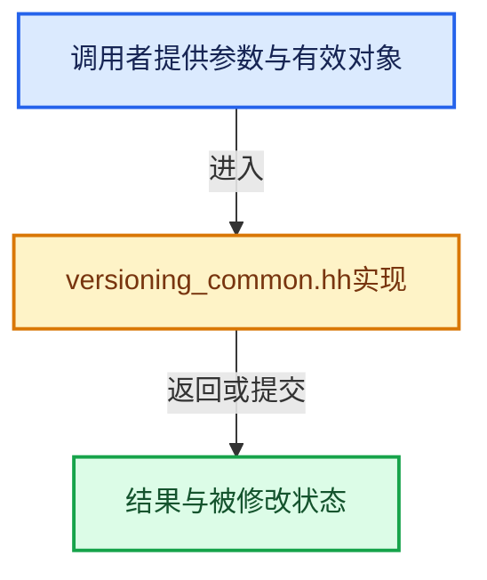

# 实现依赖专题：source/blender/blenloader/versioning_common.hh

[方向导航](README.md) · [符号索引](../%E7%AC%A6%E5%8F%B7%E4%BE%9D%E8%B5%96%E4%B8%8E%E5%AE%9E%E7%8E%B0%E7%B4%A2%E5%BC%95.md)

本专题从正文实际调用进入，集中保存共享实现。函数有稳定锚点，可从调用处直接跳到对应完整函数；递归与互相调用通过回链组织。

## 本文件的实现关系





## 完整成员与函数实现

<a id="f-534a6e48783f59f7"></a>

### `blender::adjust_fcurve_key_frame_values`

实现位置：[source/blender/blenloader/versioning_common.hh](../../../../../source/blender/blenloader/versioning_common.hh) · L283—L319。

接口参数：

- `FCurve *fcurve`
- `const PropertyType property_type`
- `const Function &function`

**教学注释版**

<!-- annotated:e606af4ccdc2e4 -->

```cpp
template<typename Function>
static void adjust_fcurve_key_frame_values(FCurve *fcurve,
                                           const PropertyType property_type,
                                           const Function &function)
{
  /* Adjust key frames. */
  if (fcurve->bezt) {
    for (int i = 0; i < fcurve->totvert; i++) {
      fcurve->bezt[i].vec[0][1] = function(fcurve->bezt[i].vec[0][1]);
      fcurve->bezt[i].vec[1][1] = function(fcurve->bezt[i].vec[1][1]);
      fcurve->bezt[i].vec[2][1] = function(fcurve->bezt[i].vec[2][1]);
    }
  }

  /* Adjust baked key frames. */
  if (fcurve->fpt) {
    for (int i = 0; i < fcurve->totvert; i++) {
      fcurve->fpt[i].vec[1] = function(fcurve->fpt[i].vec[1]);
    }
  }

  /* Setup the flags based on the property type. */
  fcurve->flag &= ~(FCURVE_INT_VALUES | FCURVE_DISCRETE_VALUES);
  switch (property_type) {
    case PROP_FLOAT:
      break;
    case PROP_INT:
      fcurve->flag |= FCURVE_INT_VALUES;
      break;
    default:
      fcurve->flag |= (FCURVE_DISCRETE_VALUES | FCURVE_INT_VALUES);
      break;
  }

  /* Recalculate the automatic handles of the FCurve after adjustments. */
  BKE_fcurve_handles_recalc(*fcurve);
}
```

<details>
<summary>核对原始源码：source/blender/blenloader/versioning_common.hh · L283—L319</summary>

<!-- original:e606af4ccdc2e4:source/blender/blenloader/versioning_common.hh:283:319 -->

```cpp
template<typename Function>
static void adjust_fcurve_key_frame_values(FCurve *fcurve,
                                           const PropertyType property_type,
                                           const Function &function)
{
  /* Adjust key frames. */
  if (fcurve->bezt) {
    for (int i = 0; i < fcurve->totvert; i++) {
      fcurve->bezt[i].vec[0][1] = function(fcurve->bezt[i].vec[0][1]);
      fcurve->bezt[i].vec[1][1] = function(fcurve->bezt[i].vec[1][1]);
      fcurve->bezt[i].vec[2][1] = function(fcurve->bezt[i].vec[2][1]);
    }
  }

  /* Adjust baked key frames. */
  if (fcurve->fpt) {
    for (int i = 0; i < fcurve->totvert; i++) {
      fcurve->fpt[i].vec[1] = function(fcurve->fpt[i].vec[1]);
    }
  }

  /* Setup the flags based on the property type. */
  fcurve->flag &= ~(FCURVE_INT_VALUES | FCURVE_DISCRETE_VALUES);
  switch (property_type) {
    case PROP_FLOAT:
      break;
    case PROP_INT:
      fcurve->flag |= FCURVE_INT_VALUES;
      break;
    default:
      fcurve->flag |= (FCURVE_DISCRETE_VALUES | FCURVE_INT_VALUES);
      break;
  }

  /* Recalculate the automatic handles of the FCurve after adjustments. */
  BKE_fcurve_handles_recalc(*fcurve);
}
```

</details>

**沿实际写入检查状态**

- `fcurve->bezt[i].vec[0][1] = function(fcurve->bezt[i].vec[0][1]);`
- `fcurve->bezt[i].vec[1][1] = function(fcurve->bezt[i].vec[1][1]);`
- `fcurve->bezt[i].vec[2][1] = function(fcurve->bezt[i].vec[2][1]);`
- `fcurve->fpt[i].vec[1] = function(fcurve->fpt[i].vec[1]);`
- `fcurve->flag &= ~(FCURVE_INT_VALUES | FCURVE_DISCRETE_VALUES);`
- `fcurve->flag |= FCURVE_INT_VALUES;`
- `fcurve->flag |= (FCURVE_DISCRETE_VALUES | FCURVE_INT_VALUES);`

**继续追踪实现**

- `function` → [调用协议](../%E6%A8%A1%E6%9D%BF%E5%AE%8F%E4%B8%8E%E5%8A%A8%E6%80%81%E5%88%86%E6%B4%BE%E5%8D%8F%E8%AE%AE.md)：局部可调用对象，须结合其初始化与捕获环境。调用位置L291。
- `BKE_fcurve_handles_recalc` → [blender::BKE_fcurve_handles_recalc · L1298](%E4%BE%9D%E8%B5%96-fcurve-593e2e.md#f-0673929c9eae7450)。
