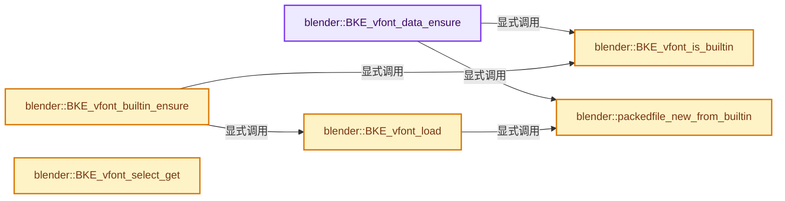

# 实现依赖专题：source/blender/blenkernel/intern/vfont.cc

[方向导航](README.md) · [符号索引](../%E7%AC%A6%E5%8F%B7%E4%BE%9D%E8%B5%96%E4%B8%8E%E5%AE%9E%E7%8E%B0%E7%B4%A2%E5%BC%95.md)

本专题从正文实际调用进入，集中保存共享实现。函数有稳定锚点，可从调用处直接跳到对应完整函数；递归与互相调用通过回链组织。

## 本文件的实现关系




## 完整成员与函数实现

<a id="f-d72d711f26ab1bba"></a>

### `blender::BKE_vfont_data_ensure`

实现位置：[source/blender/blenkernel/intern/vfont.cc](../../../../../source/blender/blenkernel/intern/vfont.cc) · L205—L243。

接口参数：

- `VFont *vfont`

**教学注释版**

<!-- annotated:fc17d6887546c1 -->

```cpp
void BKE_vfont_data_ensure(VFont *vfont)
{
  PackedFile *pf;
  if (BKE_vfont_is_builtin(vfont)) {
    pf = packedfile_new_from_builtin();
  }
  else {
    if (vfont->packedfile) {
      pf = vfont->packedfile;

      /* We need to copy a temporary font to memory unless it is already there. */
      if (vfont->temp_pf == nullptr) {
        vfont->temp_pf = BKE_packedfile_duplicate(pf);
      }
    }
    else {
      pf = BKE_packedfile_new(nullptr, vfont->filepath, ID_BLEND_PATH_FROM_GLOBAL(&vfont->id));

      if (vfont->temp_pf == nullptr) {
        vfont->temp_pf = BKE_packedfile_new(
            nullptr, vfont->filepath, ID_BLEND_PATH_FROM_GLOBAL(&vfont->id));
      }
    }
    if (!pf) {
      CLOG_WARN(&LOG, "Font file doesn't exist: %s", vfont->filepath);

      /* NOTE(@ideasman42): Don't attempt to find a fallback.
       * If the font requested by the user doesn't load, font rendering will display
       * placeholder characters instead. */
    }
  }

  if (pf) {
    vfont->data = BKE_vfontdata_from_freetypefont(pf);
    if (pf != vfont->packedfile) {
      BKE_packedfile_free(pf);
    }
  }
}
```

<details>
<summary>核对原始源码：source/blender/blenkernel/intern/vfont.cc · L205—L243</summary>

<!-- original:fc17d6887546c1:source/blender/blenkernel/intern/vfont.cc:205:243 -->

```cpp
void BKE_vfont_data_ensure(VFont *vfont)
{
  PackedFile *pf;
  if (BKE_vfont_is_builtin(vfont)) {
    pf = packedfile_new_from_builtin();
  }
  else {
    if (vfont->packedfile) {
      pf = vfont->packedfile;

      /* We need to copy a temporary font to memory unless it is already there. */
      if (vfont->temp_pf == nullptr) {
        vfont->temp_pf = BKE_packedfile_duplicate(pf);
      }
    }
    else {
      pf = BKE_packedfile_new(nullptr, vfont->filepath, ID_BLEND_PATH_FROM_GLOBAL(&vfont->id));

      if (vfont->temp_pf == nullptr) {
        vfont->temp_pf = BKE_packedfile_new(
            nullptr, vfont->filepath, ID_BLEND_PATH_FROM_GLOBAL(&vfont->id));
      }
    }
    if (!pf) {
      CLOG_WARN(&LOG, "Font file doesn't exist: %s", vfont->filepath);

      /* NOTE(@ideasman42): Don't attempt to find a fallback.
       * If the font requested by the user doesn't load, font rendering will display
       * placeholder characters instead. */
    }
  }

  if (pf) {
    vfont->data = BKE_vfontdata_from_freetypefont(pf);
    if (pf != vfont->packedfile) {
      BKE_packedfile_free(pf);
    }
  }
}
```

</details>

**沿实际写入检查状态**

- `pf = packedfile_new_from_builtin();`
- `pf = vfont->packedfile;`
- `vfont->temp_pf = BKE_packedfile_duplicate(pf);`
- `pf = BKE_packedfile_new(nullptr, vfont->filepath, ID_BLEND_PATH_FROM_GLOBAL(&vfont->id));`
- `vfont->temp_pf = BKE_packedfile_new(`
- `vfont->data = BKE_vfontdata_from_freetypefont(pf);`

**继续追踪实现**

- `BKE_vfont_is_builtin` → [blender::BKE_vfont_is_builtin · L278](%E4%BE%9D%E8%B5%96-vfont-38c130.md#f-2744c34cdb5064f3)。
- `packedfile_new_from_builtin` → [blender::packedfile_new_from_builtin · L289](%E4%BE%9D%E8%B5%96-vfont-38c130.md#f-607e49033c47e4e4)。
- `BKE_packedfile_duplicate` → [blender::BKE_packedfile_duplicate · L189](%E4%BE%9D%E8%B5%96-packedFile-564564.md#f-eeb1e82915e6353c)。
- `BKE_packedfile_new` → [blender::BKE_packedfile_new · L220](%E4%BE%9D%E8%B5%96-packedFile-564564.md#f-85730863086cfecd)。
- `ID_BLEND_PATH_FROM_GLOBAL` → [ID_BLEND_PATH_FROM_GLOBAL · L691](%E4%BE%9D%E8%B5%96-DNA_ID-3eb091.md#m-2b76f08bf41b)。宏定义由构建条件选择。
- `CLOG_WARN` → [CLOG_WARN · L189](%E4%BE%9D%E8%B5%96-CLG_log-e9051b.md#m-9da21a06cdbe)。宏定义由构建条件选择。
- `BKE_vfontdata_from_freetypefont` → [blender::BKE_vfontdata_from_freetypefont · L42](%E4%BE%9D%E8%B5%96-vfontdata_freetype-56c918.md#f-40dc0b46bf75c3be)。
- `BKE_packedfile_free` → [blender::BKE_packedfile_free · L175](%E4%BE%9D%E8%B5%96-packedFile-564564.md#f-5228521c2c274fd1)。

<a id="f-2744c34cdb5064f3"></a>

### `blender::BKE_vfont_is_builtin`

实现位置：[source/blender/blenkernel/intern/vfont.cc](../../../../../source/blender/blenkernel/intern/vfont.cc) · L278—L281。

接口参数：

- `const VFont *vfont`

**教学注释版**

<!-- annotated:c55e13c6f29b2a -->

```cpp
bool BKE_vfont_is_builtin(const VFont *vfont)
{
  return STREQ(vfont->filepath, FO_BUILTIN_NAME);
}
```

<details>
<summary>核对原始源码：source/blender/blenkernel/intern/vfont.cc · L278—L281</summary>

<!-- original:c55e13c6f29b2a:source/blender/blenkernel/intern/vfont.cc:278:281 -->

```cpp
bool BKE_vfont_is_builtin(const VFont *vfont)
{
  return STREQ(vfont->filepath, FO_BUILTIN_NAME);
}
```

</details>

**结果出口**

- `return STREQ(vfont->filepath, FO_BUILTIN_NAME);`

**继续追踪实现**

- `STREQ` → [STREQ · L112](%E4%BE%9D%E8%B5%96-GHOST_utildefines-34b996.md#m-9549fb6aafd2)；[STREQ · L451](../01-%E5%9F%BA%E7%A1%80%E5%AE%B9%E5%99%A8%E4%B8%8E%E7%8E%B0%E4%BB%A3CPP/%E4%BE%9D%E8%B5%96-BLI_utildefines-293a0a.md#m-c7b745bcfad2)；[STREQ · L55](%E4%BE%9D%E8%B5%96-clog-a0bec8.md#m-96e78f386894)。宏定义由构建条件选择。

<a id="f-607e49033c47e4e4"></a>

### `blender::packedfile_new_from_builtin`

实现位置：[source/blender/blenkernel/intern/vfont.cc](../../../../../source/blender/blenkernel/intern/vfont.cc) · L289—L302。

**教学注释版**

<!-- annotated:14cdac8c3d9186 -->

```cpp
static PackedFile *packedfile_new_from_builtin()
{
  if (!builtin_font_data) {
    CLOG_ERROR(&LOG, "Internal error, builtin font not loaded");

    return nullptr;
  }

  void *mem = MEM_new_uninitialized(builtin_font_size, "vfd_builtin");

  // [讲解] memcpy：复制字节，源与目标不应重叠。类型生命周期、对齐和可复制表示须由调用者证明，不是任意对象的复制构造。
  memcpy(mem, builtin_font_data, builtin_font_size);

  return BKE_packedfile_new_from_memory(mem, builtin_font_size);
}
```

<details>
<summary>核对原始源码：source/blender/blenkernel/intern/vfont.cc · L289—L302</summary>

<!-- original:14cdac8c3d9186:source/blender/blenkernel/intern/vfont.cc:289:302 -->

```cpp
static PackedFile *packedfile_new_from_builtin()
{
  if (!builtin_font_data) {
    CLOG_ERROR(&LOG, "Internal error, builtin font not loaded");

    return nullptr;
  }

  void *mem = MEM_new_uninitialized(builtin_font_size, "vfd_builtin");

  memcpy(mem, builtin_font_data, builtin_font_size);

  return BKE_packedfile_new_from_memory(mem, builtin_font_size);
}
```

</details>

**结果出口**

- `return nullptr;`
- `return BKE_packedfile_new_from_memory(mem, builtin_font_size);`

**继续追踪实现**

- `CLOG_ERROR` → [CLOG_ERROR · L188](%E4%BE%9D%E8%B5%96-CLG_log-e9051b.md#m-081575cdc8d0)。宏定义由构建条件选择。
- `MEM_new_uninitialized` → [MEM_new_uninitialized · L590](../03-%E5%86%85%E5%AD%98%E5%88%86%E9%85%8D%E4%B8%8E%E8%BF%90%E8%A1%8C%E6%97%B6%E7%B1%BB%E5%9E%8B/%E4%BE%9D%E8%B5%96-MEM_guardedalloc-b54eca.md#f-c773b2e5b8fe70e4)；[MEM_new_uninitialized · L124](../03-%E5%86%85%E5%AD%98%E5%88%86%E9%85%8D%E4%B8%8E%E8%BF%90%E8%A1%8C%E6%97%B6%E7%B1%BB%E5%9E%8B/%E4%BE%9D%E8%B5%96-mallocn-afdcd4.md#f-28a7e00a1e67f699)。同名重载需按实参类型选择。
- `memcpy` → [外部契约](https://eel.is/c++draft/cstring.syn)：复制字节，源与目标不应重叠。类型生命周期、对齐和可复制表示须由调用者证明，不是任意对象的复制构造。
- `BKE_packedfile_new_from_memory` → [blender::BKE_packedfile_new_from_memory · L202](%E4%BE%9D%E8%B5%96-packedFile-564564.md#f-e94512fa9ca6a2bf)。

<a id="f-0383a34ab565de7d"></a>

### `blender::BKE_vfont_load`

实现位置：[source/blender/blenkernel/intern/vfont.cc](../../../../../source/blender/blenkernel/intern/vfont.cc) · L304—L353。

接口参数：

- `Main *bmain`
- `const char *filepath`

**教学注释版**

<!-- annotated:fce458c529f4e5 -->

```cpp
VFont *BKE_vfont_load(Main *bmain, const char *filepath)
{
  char filename[FILE_MAXFILE];
  VFont *vfont = nullptr;
  PackedFile *pf;
  bool is_builtin;

  if (STREQ(filepath, FO_BUILTIN_NAME)) {
    STRNCPY(filename, filepath);

    pf = packedfile_new_from_builtin();
    is_builtin = true;
  }
  else {
    BLI_path_split_file_part(filepath, filename, sizeof(filename));
    pf = BKE_packedfile_new(nullptr, filepath, BKE_main_blendfile_path(bmain));

    is_builtin = false;
  }

  if (pf) {
    VFontData *vfd;

    vfd = BKE_vfontdata_from_freetypefont(pf);
    if (vfd) {
      /* If there's a font name, use it for the ID name. */
      vfont = static_cast<VFont *>(
          BKE_libblock_alloc(bmain, ID_VF, vfd->name[0] ? vfd->name : filename, 0));
      vfont->data = vfd;
      STRNCPY(vfont->filepath, filepath);

      /* if auto-pack is on store the packed-file in de font structure */
      if (!is_builtin && (G.fileflags & G_FILE_AUTOPACK)) {
        vfont->packedfile = pf;
      }

      /* Do not add #FO_BUILTIN_NAME to temporary list-base. */
      if (!STREQ(filename, FO_BUILTIN_NAME)) {
        vfont->temp_pf = BKE_packedfile_new(nullptr, filepath, BKE_main_blendfile_path(bmain));
      }
    }

    /* Free the packed file */
    if (!vfont || vfont->packedfile != pf) {
      BKE_packedfile_free(pf);
    }
  }

  return vfont;
}
```

<details>
<summary>核对原始源码：source/blender/blenkernel/intern/vfont.cc · L304—L353</summary>

<!-- original:fce458c529f4e5:source/blender/blenkernel/intern/vfont.cc:304:353 -->

```cpp
VFont *BKE_vfont_load(Main *bmain, const char *filepath)
{
  char filename[FILE_MAXFILE];
  VFont *vfont = nullptr;
  PackedFile *pf;
  bool is_builtin;

  if (STREQ(filepath, FO_BUILTIN_NAME)) {
    STRNCPY(filename, filepath);

    pf = packedfile_new_from_builtin();
    is_builtin = true;
  }
  else {
    BLI_path_split_file_part(filepath, filename, sizeof(filename));
    pf = BKE_packedfile_new(nullptr, filepath, BKE_main_blendfile_path(bmain));

    is_builtin = false;
  }

  if (pf) {
    VFontData *vfd;

    vfd = BKE_vfontdata_from_freetypefont(pf);
    if (vfd) {
      /* If there's a font name, use it for the ID name. */
      vfont = static_cast<VFont *>(
          BKE_libblock_alloc(bmain, ID_VF, vfd->name[0] ? vfd->name : filename, 0));
      vfont->data = vfd;
      STRNCPY(vfont->filepath, filepath);

      /* if auto-pack is on store the packed-file in de font structure */
      if (!is_builtin && (G.fileflags & G_FILE_AUTOPACK)) {
        vfont->packedfile = pf;
      }

      /* Do not add #FO_BUILTIN_NAME to temporary list-base. */
      if (!STREQ(filename, FO_BUILTIN_NAME)) {
        vfont->temp_pf = BKE_packedfile_new(nullptr, filepath, BKE_main_blendfile_path(bmain));
      }
    }

    /* Free the packed file */
    if (!vfont || vfont->packedfile != pf) {
      BKE_packedfile_free(pf);
    }
  }

  return vfont;
}
```

</details>

**沿实际写入检查状态**

- `pf = packedfile_new_from_builtin();`
- `is_builtin = true;`
- `pf = BKE_packedfile_new(nullptr, filepath, BKE_main_blendfile_path(bmain));`
- `is_builtin = false;`
- `vfd = BKE_vfontdata_from_freetypefont(pf);`
- `vfont = static_cast<VFont *>(`
- `vfont->data = vfd;`
- `vfont->packedfile = pf;`
- `vfont->temp_pf = BKE_packedfile_new(nullptr, filepath, BKE_main_blendfile_path(bmain));`

**结果出口**

- `return vfont;`

**继续追踪实现**

- `STREQ` → [STREQ · L112](%E4%BE%9D%E8%B5%96-GHOST_utildefines-34b996.md#m-9549fb6aafd2)；[STREQ · L451](../01-%E5%9F%BA%E7%A1%80%E5%AE%B9%E5%99%A8%E4%B8%8E%E7%8E%B0%E4%BB%A3CPP/%E4%BE%9D%E8%B5%96-BLI_utildefines-293a0a.md#m-c7b745bcfad2)；[STREQ · L55](%E4%BE%9D%E8%B5%96-clog-a0bec8.md#m-96e78f386894)。宏定义由构建条件选择。
- `STRNCPY` → [blender::STRNCPY · L690](../01-%E5%9F%BA%E7%A1%80%E5%AE%B9%E5%99%A8%E4%B8%8E%E7%8E%B0%E4%BB%A3CPP/%E4%BE%9D%E8%B5%96-BLI_string-b43058.md#f-6b2d861724026be6)。
- `packedfile_new_from_builtin` → [blender::packedfile_new_from_builtin · L289](%E4%BE%9D%E8%B5%96-vfont-38c130.md#f-607e49033c47e4e4)。
- `BLI_path_split_file_part` → [BLI_path_split_file_part · L1674](../01-%E5%9F%BA%E7%A1%80%E5%AE%B9%E5%99%A8%E4%B8%8E%E7%8E%B0%E4%BB%A3CPP/%E4%BE%9D%E8%B5%96-path_utils-b4d26a.md#f-fac783d5356a4c48)。
- `BKE_packedfile_new` → [blender::BKE_packedfile_new · L220](%E4%BE%9D%E8%B5%96-packedFile-564564.md#f-85730863086cfecd)。
- `BKE_main_blendfile_path` → [blender::BKE_main_blendfile_path · L1058](%E4%BE%9D%E8%B5%96-main-ffa8b3.md#f-5ff28b998fa003d7)。
- `BKE_vfontdata_from_freetypefont` → [blender::BKE_vfontdata_from_freetypefont · L42](%E4%BE%9D%E8%B5%96-vfontdata_freetype-56c918.md#f-40dc0b46bf75c3be)。
- `BKE_libblock_alloc` → [blender::BKE_libblock_alloc · L1545](%E4%BE%9D%E8%B5%96-lib_id-d4e6bd.md#f-135c8eaf9ed20667)。
- `BKE_packedfile_free` → [blender::BKE_packedfile_free · L175](%E4%BE%9D%E8%B5%96-packedFile-564564.md#f-5228521c2c274fd1)。

<a id="f-06e6570a0a42188d"></a>

### `blender::BKE_vfont_builtin_ensure`

实现位置：[source/blender/blenkernel/intern/vfont.cc](../../../../../source/blender/blenkernel/intern/vfont.cc) · L387—L401。

**教学注释版**

<!-- annotated:be737e61f998a0 -->

```cpp
VFont *BKE_vfont_builtin_ensure()
{
  for (VFont &vfont : G_MAIN->fonts) {
    if (BKE_vfont_is_builtin(&vfont)) {
      return &vfont;
    }
  }

  /* Newly loaded ID's have a user by default, in this case the caller is responsible
   * for assigning a user, otherwise an additional user would be added, see: #100819. */
  VFont *vfont = BKE_vfont_load(G_MAIN, FO_BUILTIN_NAME);
  id_us_min(&vfont->id);
  BLI_assert(vfont->id.us == 0);
  return vfont;
}
```

<details>
<summary>核对原始源码：source/blender/blenkernel/intern/vfont.cc · L387—L401</summary>

<!-- original:be737e61f998a0:source/blender/blenkernel/intern/vfont.cc:387:401 -->

```cpp
VFont *BKE_vfont_builtin_ensure()
{
  for (VFont &vfont : G_MAIN->fonts) {
    if (BKE_vfont_is_builtin(&vfont)) {
      return &vfont;
    }
  }

  /* Newly loaded ID's have a user by default, in this case the caller is responsible
   * for assigning a user, otherwise an additional user would be added, see: #100819. */
  VFont *vfont = BKE_vfont_load(G_MAIN, FO_BUILTIN_NAME);
  id_us_min(&vfont->id);
  BLI_assert(vfont->id.us == 0);
  return vfont;
}
```

</details>

**结果出口**

- `return &vfont;`
- `return vfont;`

**继续追踪实现**

- `BKE_vfont_is_builtin` → [blender::BKE_vfont_is_builtin · L278](%E4%BE%9D%E8%B5%96-vfont-38c130.md#f-2744c34cdb5064f3)。
- `BKE_vfont_load` → [blender::BKE_vfont_load · L304](%E4%BE%9D%E8%B5%96-vfont-38c130.md#f-0383a34ab565de7d)。
- `id_us_min` → [blender::id_us_min · L441](%E4%BE%9D%E8%B5%96-lib_id-d4e6bd.md#f-c5e5246a79962257)。
- `BLI_assert` → [BLI_assert · L48](../01-%E5%9F%BA%E7%A1%80%E5%AE%B9%E5%99%A8%E4%B8%8E%E7%8E%B0%E4%BB%A3CPP/%E4%BE%9D%E8%B5%96-BLI_assert-cc98e8.md#m-57a88495704d)；[BLI_assert · L63](../01-%E5%9F%BA%E7%A1%80%E5%AE%B9%E5%99%A8%E4%B8%8E%E7%8E%B0%E4%BB%A3CPP/%E4%BE%9D%E8%B5%96-BLI_assert-cc98e8.md#m-d07050020cb5)。宏定义由构建条件选择。

<a id="f-ac33f5b7d21ef27a"></a>

### `blender::BKE_vfont_select_get`

实现位置：[source/blender/blenkernel/intern/vfont.cc](../../../../../source/blender/blenkernel/intern/vfont.cc) · L424—L461。

接口参数：

- `const Curve *cu`
- `int *r_start`
- `int *r_end`

**教学注释版**

<!-- annotated:7fcd8d067738ce -->

```cpp
int BKE_vfont_select_get(const Curve *cu, int *r_start, int *r_end)
{
  EditFont *ef = cu->editfont;
  int start, end, direction;

  if (ef == nullptr || (cu->ob_type != OB_FONT)) {
    return 0;
  }

  BLI_assert(ef->len >= 0);
  BLI_assert(ef->selstart >= 0 && ef->selstart <= ef->len + 1);
  BLI_assert(ef->selend >= 0 && ef->selend <= ef->len + 1);
  BLI_assert(ef->pos >= 0 && ef->pos <= ef->len);

  if (ef->selstart == 0) {
    return 0;
  }

  if (ef->selstart <= ef->selend) {
    start = ef->selstart - 1;
    end = ef->selend - 1;
    direction = 1;
  }
  else {
    start = ef->selend;
    end = ef->selstart - 2;
    direction = -1;
  }

  if (start == end + 1) {
    return 0;
  }

  BLI_assert(start < end + 1);
  *r_start = start;
  *r_end = end;
  return direction;
}
```

<details>
<summary>核对原始源码：source/blender/blenkernel/intern/vfont.cc · L424—L461</summary>

<!-- original:7fcd8d067738ce:source/blender/blenkernel/intern/vfont.cc:424:461 -->

```cpp
int BKE_vfont_select_get(const Curve *cu, int *r_start, int *r_end)
{
  EditFont *ef = cu->editfont;
  int start, end, direction;

  if (ef == nullptr || (cu->ob_type != OB_FONT)) {
    return 0;
  }

  BLI_assert(ef->len >= 0);
  BLI_assert(ef->selstart >= 0 && ef->selstart <= ef->len + 1);
  BLI_assert(ef->selend >= 0 && ef->selend <= ef->len + 1);
  BLI_assert(ef->pos >= 0 && ef->pos <= ef->len);

  if (ef->selstart == 0) {
    return 0;
  }

  if (ef->selstart <= ef->selend) {
    start = ef->selstart - 1;
    end = ef->selend - 1;
    direction = 1;
  }
  else {
    start = ef->selend;
    end = ef->selstart - 2;
    direction = -1;
  }

  if (start == end + 1) {
    return 0;
  }

  BLI_assert(start < end + 1);
  *r_start = start;
  *r_end = end;
  return direction;
}
```

</details>

**沿实际写入检查状态**

- `start = ef->selstart - 1;`
- `end = ef->selend - 1;`
- `direction = 1;`
- `start = ef->selend;`
- `end = ef->selstart - 2;`
- `direction = -1;`

**结果出口**

- `return 0;`
- `return direction;`

**继续追踪实现**

- `BLI_assert` → [BLI_assert · L48](../01-%E5%9F%BA%E7%A1%80%E5%AE%B9%E5%99%A8%E4%B8%8E%E7%8E%B0%E4%BB%A3CPP/%E4%BE%9D%E8%B5%96-BLI_assert-cc98e8.md#m-57a88495704d)；[BLI_assert · L63](../01-%E5%9F%BA%E7%A1%80%E5%AE%B9%E5%99%A8%E4%B8%8E%E7%8E%B0%E4%BB%A3CPP/%E4%BE%9D%E8%B5%96-BLI_assert-cc98e8.md#m-d07050020cb5)。宏定义由构建条件选择。
