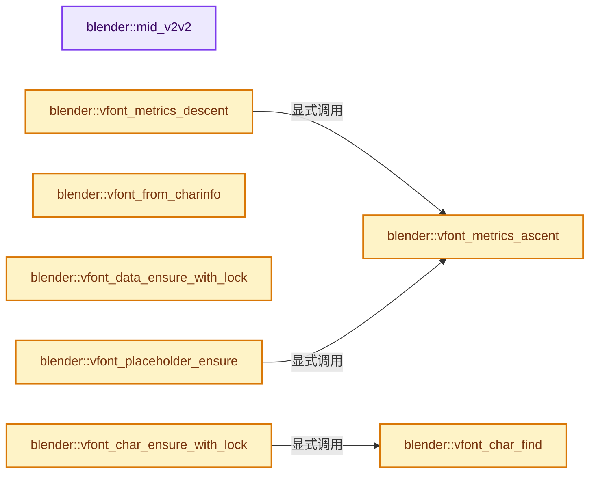
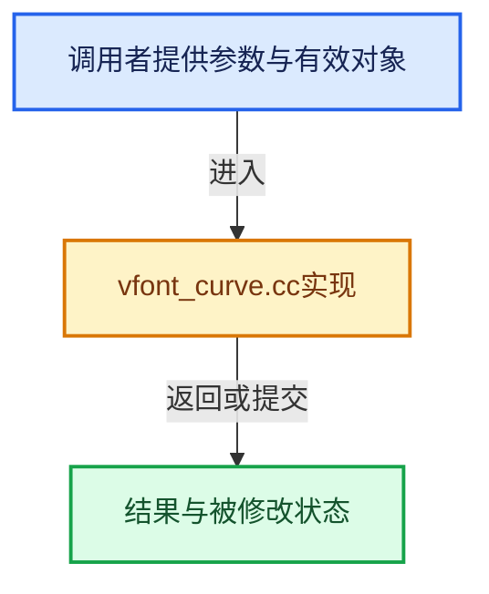

# 实现依赖专题：source/blender/blenkernel/intern/vfont_curve.cc

[方向导航](README.md) · [符号索引](../%E7%AC%A6%E5%8F%B7%E4%BE%9D%E8%B5%96%E4%B8%8E%E5%AE%9E%E7%8E%B0%E7%B4%A2%E5%BC%95.md)

本专题从正文实际调用进入，集中保存共享实现。函数有稳定锚点，可从调用处直接跳到对应完整函数；递归与互相调用通过回链组织。

## 本文件的实现关系






## 完整成员与函数实现

<a id="f-218dac60ad3a08a2"></a>

### `blender::mid_v2v2`

实现位置：[source/blender/blenkernel/intern/vfont_curve.cc](../../../../../source/blender/blenkernel/intern/vfont_curve.cc) · L56—L60。

接口参数：

- `float a[2]`
- `float b[2]`

**教学注释版**

<!-- annotated:b21104d0cbb3fd -->

```cpp
static void mid_v2v2(float a[2], float b[2])
{
  a[0] = b[0] = (a[0] * 0.5) + (b[0] * 0.5f);
  a[1] = b[1] = (a[1] * 0.5) + (b[1] * 0.5f);
}
```

<details>
<summary>核对原始源码：source/blender/blenkernel/intern/vfont_curve.cc · L56—L60</summary>

<!-- original:b21104d0cbb3fd:source/blender/blenkernel/intern/vfont_curve.cc:56:60 -->

```cpp
static void mid_v2v2(float a[2], float b[2])
{
  a[0] = b[0] = (a[0] * 0.5) + (b[0] * 0.5f);
  a[1] = b[1] = (a[1] * 0.5) + (b[1] * 0.5f);
}
```

</details>

**沿实际写入检查状态**

- `a[0] = b[0] = (a[0] * 0.5) + (b[0] * 0.5f);`
- `a[1] = b[1] = (a[1] * 0.5) + (b[1] * 0.5f);`

**继续追踪实现**

本实现没有需要继续展开的显式调用；检查返回表达式、对象转换和调用者前置条件。

<a id="f-a855f739315cdd83"></a>

### `blender::vfont_metrics_ascent`

实现位置：[source/blender/blenkernel/intern/vfont_curve.cc](../../../../../source/blender/blenkernel/intern/vfont_curve.cc) · L62—L65。

接口参数：

- `const VFontData_Metrics *metrics`

**教学注释版**

<!-- annotated:cbdeda7115a658 -->

```cpp
static float vfont_metrics_ascent(const VFontData_Metrics *metrics)
{
  return metrics->ascend_ratio * metrics->em_ratio;
}
```

<details>
<summary>核对原始源码：source/blender/blenkernel/intern/vfont_curve.cc · L62—L65</summary>

<!-- original:cbdeda7115a658:source/blender/blenkernel/intern/vfont_curve.cc:62:65 -->

```cpp
static float vfont_metrics_ascent(const VFontData_Metrics *metrics)
{
  return metrics->ascend_ratio * metrics->em_ratio;
}
```

</details>

**结果出口**

- `return metrics->ascend_ratio * metrics->em_ratio;`

**继续追踪实现**

本实现没有需要继续展开的显式调用；检查返回表达式、对象转换和调用者前置条件。

<a id="f-9afbf4eec3ed0222"></a>

### `blender::vfont_metrics_descent`

实现位置：[source/blender/blenkernel/intern/vfont_curve.cc](../../../../../source/blender/blenkernel/intern/vfont_curve.cc) · L66—L69。

接口参数：

- `const VFontData_Metrics *metrics`

**教学注释版**

<!-- annotated:175c17985f70c4 -->

```cpp
static float vfont_metrics_descent(const VFontData_Metrics *metrics)
{
  return metrics->em_ratio - vfont_metrics_ascent(metrics);
}
```

<details>
<summary>核对原始源码：source/blender/blenkernel/intern/vfont_curve.cc · L66—L69</summary>

<!-- original:175c17985f70c4:source/blender/blenkernel/intern/vfont_curve.cc:66:69 -->

```cpp
static float vfont_metrics_descent(const VFontData_Metrics *metrics)
{
  return metrics->em_ratio - vfont_metrics_ascent(metrics);
}
```

</details>

**结果出口**

- `return metrics->em_ratio - vfont_metrics_ascent(metrics);`

**继续追踪实现**

- `vfont_metrics_ascent` → [blender::vfont_metrics_ascent · L62](%E4%BE%9D%E8%B5%96-vfont_curve-7ff4cd.md#f-a855f739315cdd83)。

<a id="f-8d1dfc26b8ab59e5"></a>

### `blender::vfont_from_charinfo`

实现位置：[source/blender/blenkernel/intern/vfont_curve.cc](../../../../../source/blender/blenkernel/intern/vfont_curve.cc) · L71—L83。

接口参数：

- `const Curve &cu`
- `const CharInfo *info`

**教学注释版**

<!-- annotated:71fda7ee908a2d -->

```cpp
static VFont *vfont_from_charinfo(const Curve &cu, const CharInfo *info)
{
  switch (int(info->flag & (CU_CHINFO_BOLD | CU_CHINFO_ITALIC))) {
    case CU_CHINFO_BOLD:
      return cu.vfontb ? cu.vfontb : cu.vfont;
    case CU_CHINFO_ITALIC:
      return cu.vfonti ? cu.vfonti : cu.vfont;
    case (CU_CHINFO_BOLD | CU_CHINFO_ITALIC):
      return cu.vfontbi ? cu.vfontbi : cu.vfont;
    default:
      return cu.vfont;
  }
}
```

<details>
<summary>核对原始源码：source/blender/blenkernel/intern/vfont_curve.cc · L71—L83</summary>

<!-- original:71fda7ee908a2d:source/blender/blenkernel/intern/vfont_curve.cc:71:83 -->

```cpp
static VFont *vfont_from_charinfo(const Curve &cu, const CharInfo *info)
{
  switch (int(info->flag & (CU_CHINFO_BOLD | CU_CHINFO_ITALIC))) {
    case CU_CHINFO_BOLD:
      return cu.vfontb ? cu.vfontb : cu.vfont;
    case CU_CHINFO_ITALIC:
      return cu.vfonti ? cu.vfonti : cu.vfont;
    case (CU_CHINFO_BOLD | CU_CHINFO_ITALIC):
      return cu.vfontbi ? cu.vfontbi : cu.vfont;
    default:
      return cu.vfont;
  }
}
```

</details>

**结果出口**

- `return cu.vfontb ? cu.vfontb : cu.vfont;`
- `return cu.vfonti ? cu.vfonti : cu.vfont;`
- `return cu.vfontbi ? cu.vfontbi : cu.vfont;`
- `return cu.vfont;`

**继续追踪实现**

本实现没有需要继续展开的显式调用；检查返回表达式、对象转换和调用者前置条件。

<a id="f-cfc01f8da5b7e431"></a>

### `blender::vfont_data_ensure_with_lock`

实现位置：[source/blender/blenkernel/intern/vfont_curve.cc](../../../../../source/blender/blenkernel/intern/vfont_curve.cc) · L85—L110。

接口参数：

- `VFont *vfont`

**教学注释版**

<!-- annotated:05c29b3fe823d9 -->

```cpp
static VFontData *vfont_data_ensure_with_lock(VFont *vfont)
{
  if (vfont == nullptr) {
    return nullptr;
  }

  /* Lazily initialize the data. */
  if (!vfont->data) {

    BLI_rw_mutex_lock(&vfont_rwlock, THREAD_LOCK_WRITE);

    if (vfont->data) {
      /* Check data again, since it might have been already initialized from other thread
       * (previous check is not accurate or threading,
       * just prevents unneeded lock if all the data is here for sure). */
      BLI_rw_mutex_unlock(&vfont_rwlock);
      return vfont->data;
    }

    BKE_vfont_data_ensure(vfont);

    BLI_rw_mutex_unlock(&vfont_rwlock);
  }

  return vfont->data;
}
```

<details>
<summary>核对原始源码：source/blender/blenkernel/intern/vfont_curve.cc · L85—L110</summary>

<!-- original:05c29b3fe823d9:source/blender/blenkernel/intern/vfont_curve.cc:85:110 -->

```cpp
static VFontData *vfont_data_ensure_with_lock(VFont *vfont)
{
  if (vfont == nullptr) {
    return nullptr;
  }

  /* Lazily initialize the data. */
  if (!vfont->data) {

    BLI_rw_mutex_lock(&vfont_rwlock, THREAD_LOCK_WRITE);

    if (vfont->data) {
      /* Check data again, since it might have been already initialized from other thread
       * (previous check is not accurate or threading,
       * just prevents unneeded lock if all the data is here for sure). */
      BLI_rw_mutex_unlock(&vfont_rwlock);
      return vfont->data;
    }

    BKE_vfont_data_ensure(vfont);

    BLI_rw_mutex_unlock(&vfont_rwlock);
  }

  return vfont->data;
}
```

</details>

**结果出口**

- `return nullptr;`
- `return vfont->data;`

**继续追踪实现**

- `BLI_rw_mutex_lock` → [BLI_rw_mutex_lock · L470](../01-%E5%9F%BA%E7%A1%80%E5%AE%B9%E5%99%A8%E4%B8%8E%E7%8E%B0%E4%BB%A3CPP/%E4%BE%9D%E8%B5%96-threads-a036bf.md#f-567e78db2b1a0d53)。
- `BLI_rw_mutex_unlock` → [BLI_rw_mutex_unlock · L480](../01-%E5%9F%BA%E7%A1%80%E5%AE%B9%E5%99%A8%E4%B8%8E%E7%8E%B0%E4%BB%A3CPP/%E4%BE%9D%E8%B5%96-threads-a036bf.md#f-2b8f406eaca6d7b7)。
- `BKE_vfont_data_ensure` → [blender::BKE_vfont_data_ensure · L205](%E4%BE%9D%E8%B5%96-vfont-38c130.md#f-d72d711f26ab1bba)。

<a id="f-a63342251c77513f"></a>

### `blender::vfont_char_find`

实现位置：[source/blender/blenkernel/intern/vfont_curve.cc](../../../../../source/blender/blenkernel/intern/vfont_curve.cc) · L112—L120。

接口参数：

- `const VFontData *vfd`
- `char32_t charcode`
- `VChar **r_che`

**教学注释版**

<!-- annotated:41b8832a09a5a5 -->

```cpp
static bool vfont_char_find(const VFontData *vfd, char32_t charcode, VChar **r_che)
{
  if (VChar **che_p = vfd->characters->lookup_ptr(charcode)) {
    *r_che = *che_p;
    return true;
  }
  *r_che = nullptr;
  return false;
}
```

<details>
<summary>核对原始源码：source/blender/blenkernel/intern/vfont_curve.cc · L112—L120</summary>

<!-- original:41b8832a09a5a5:source/blender/blenkernel/intern/vfont_curve.cc:112:120 -->

```cpp
static bool vfont_char_find(const VFontData *vfd, char32_t charcode, VChar **r_che)
{
  if (VChar **che_p = vfd->characters->lookup_ptr(charcode)) {
    *r_che = *che_p;
    return true;
  }
  *r_che = nullptr;
  return false;
}
```

</details>

**结果出口**

- `return true;`
- `return false;`

**继续追踪实现**

- `vfd->characters->lookup_ptr` → [调用协议](../%E6%A8%A1%E6%9D%BF%E5%AE%8F%E4%B8%8E%E5%8A%A8%E6%80%81%E5%88%86%E6%B4%BE%E5%8D%8F%E8%AE%AE.md)：接收对象类型依赖auto、返回值或模板实例；不按同名猜测目标。调用位置L114。

<a id="f-c9aa2b26320213c8"></a>

### `blender::vfont_char_ensure_with_lock`

实现位置：[source/blender/blenkernel/intern/vfont_curve.cc](../../../../../source/blender/blenkernel/intern/vfont_curve.cc) · L128—L156。

接口参数：

- `VFont *vfont`
- `char32_t charcode`

**教学注释版**

<!-- annotated:5173c22b1193f0 -->

```cpp
static VChar *vfont_char_ensure_with_lock(VFont *vfont, char32_t charcode)
{
  VChar *che;
  if (vfont && vfont->data) {
    VFontData *vfd = vfont->data;
    BLI_rw_mutex_lock(&vfont_rwlock, THREAD_LOCK_READ);
    bool che_found = vfont_char_find(vfd, charcode, &che);
    BLI_rw_mutex_unlock(&vfont_rwlock);

    /* The character wasn't in the current curve base so load it. */
    if (che_found == false) {
      BLI_rw_mutex_lock(&vfont_rwlock, THREAD_LOCK_WRITE);
      /* Check it once again, char might have been already load
       * between previous #BLI_rw_mutex_unlock() and this #BLI_rw_mutex_lock().
       *
       * Such a check should not be a bottleneck since it wouldn't
       * happen often once all the chars are load. */
      che_found = vfont_char_find(vfd, charcode, &che);
      if (che_found == false) {
        che = BKE_vfontdata_char_from_freetypefont(vfont, charcode);
      }
      BLI_rw_mutex_unlock(&vfont_rwlock);
    }
  }
  else {
    che = nullptr;
  }
  return che;
}
```

<details>
<summary>核对原始源码：source/blender/blenkernel/intern/vfont_curve.cc · L128—L156</summary>

<!-- original:5173c22b1193f0:source/blender/blenkernel/intern/vfont_curve.cc:128:156 -->

```cpp
static VChar *vfont_char_ensure_with_lock(VFont *vfont, char32_t charcode)
{
  VChar *che;
  if (vfont && vfont->data) {
    VFontData *vfd = vfont->data;
    BLI_rw_mutex_lock(&vfont_rwlock, THREAD_LOCK_READ);
    bool che_found = vfont_char_find(vfd, charcode, &che);
    BLI_rw_mutex_unlock(&vfont_rwlock);

    /* The character wasn't in the current curve base so load it. */
    if (che_found == false) {
      BLI_rw_mutex_lock(&vfont_rwlock, THREAD_LOCK_WRITE);
      /* Check it once again, char might have been already load
       * between previous #BLI_rw_mutex_unlock() and this #BLI_rw_mutex_lock().
       *
       * Such a check should not be a bottleneck since it wouldn't
       * happen often once all the chars are load. */
      che_found = vfont_char_find(vfd, charcode, &che);
      if (che_found == false) {
        che = BKE_vfontdata_char_from_freetypefont(vfont, charcode);
      }
      BLI_rw_mutex_unlock(&vfont_rwlock);
    }
  }
  else {
    che = nullptr;
  }
  return che;
}
```

</details>

**沿实际写入检查状态**

- `che_found = vfont_char_find(vfd, charcode, &che);`
- `che = BKE_vfontdata_char_from_freetypefont(vfont, charcode);`
- `che = nullptr;`

**结果出口**

- `return che;`

**继续追踪实现**

- `BLI_rw_mutex_lock` → [BLI_rw_mutex_lock · L470](../01-%E5%9F%BA%E7%A1%80%E5%AE%B9%E5%99%A8%E4%B8%8E%E7%8E%B0%E4%BB%A3CPP/%E4%BE%9D%E8%B5%96-threads-a036bf.md#f-567e78db2b1a0d53)。
- `vfont_char_find` → [blender::vfont_char_find · L112](%E4%BE%9D%E8%B5%96-vfont_curve-7ff4cd.md#f-a63342251c77513f)。
- `BLI_rw_mutex_unlock` → [BLI_rw_mutex_unlock · L480](../01-%E5%9F%BA%E7%A1%80%E5%AE%B9%E5%99%A8%E4%B8%8E%E7%8E%B0%E4%BB%A3CPP/%E4%BE%9D%E8%B5%96-threads-a036bf.md#f-2b8f406eaca6d7b7)。
- `BKE_vfontdata_char_from_freetypefont` → [blender::BKE_vfontdata_char_from_freetypefont · L91](%E4%BE%9D%E8%B5%96-vfontdata_freetype-56c918.md#f-c9a4ab56e53afb14)。

<a id="f-1f3712b23b92de85"></a>

### `blender::vfont_placeholder_ensure`

实现位置：[source/blender/blenkernel/intern/vfont_curve.cc](../../../../../source/blender/blenkernel/intern/vfont_curve.cc) · L189—L269。

接口参数：

- `VCharPlaceHolder &che_placeholder`
- `char32_t charcode`

**教学注释版**

<!-- annotated:e8f31bc4962edc -->

```cpp
static VChar *vfont_placeholder_ensure(VCharPlaceHolder &che_placeholder, char32_t charcode)
{
  const int che_index = (charcode == ' ') ? 0 : 1;

  if (!che_placeholder.initialized) {
    const VFontData_Metrics *metrics = che_placeholder.metrics;

    const float ascent = vfont_metrics_ascent(metrics);

    const float line_width = 0.05 * metrics->em_ratio;

    /* The rectangle size within the available bounds. */
    const float2 size_factor = {
        0.9f,
        0.9f - (line_width * 2),
    };
    const float size_factor_margin_y = ((1.0 - size_factor.x) / 2.0f);

    /* Always initialize all placeholders, only if one is used. */
    VChar *che;

    /* Space - approximately en width. */
    che = &che_placeholder.data.che[0];
    che->width = 0.5f * metrics->em_ratio;

    /* Hollow rectangle - approximately en width. */
    che = &che_placeholder.data.che[1];
    che->width = 0.5f * metrics->em_ratio;

    for (int nu_index = 0; nu_index < ARRAY_SIZE(che_placeholder.data.nu); nu_index++) {
      Nurb *nu = &che_placeholder.data.nu[nu_index];
      BLI_addtail(&che->nurbsbase, nu);

      /* In this case poly makes more sense, follow the convention for others. */
      nu->type = CU_BEZIER;
      nu->resolu = 8;

      nu->bezt = &che_placeholder.data.bezt[nu_index][0];
      nu->pntsu = 4;
      nu->pntsv = 1;
      nu->flagu |= CU_NURB_CYCLIC;

      rctf bounds;
      bounds.xmin = (che->width * size_factor_margin_y);
      bounds.xmax = (che->width * 1.0 - size_factor_margin_y);
      bounds.ymin = 0.0f;
      bounds.ymax = ascent * size_factor.y;

      if (nu_index == 1) {
        bounds.xmin += line_width;
        bounds.xmax -= line_width;
        bounds.ymin += line_width;
        bounds.ymax -= line_width;
      }

      if (nu_index == 0) {
        ARRAY_SET_ITEMS(nu->bezt[0].vec[1], bounds.xmin, bounds.ymin);
        ARRAY_SET_ITEMS(nu->bezt[1].vec[1], bounds.xmin, bounds.ymax);
        ARRAY_SET_ITEMS(nu->bezt[2].vec[1], bounds.xmax, bounds.ymax);
        ARRAY_SET_ITEMS(nu->bezt[3].vec[1], bounds.xmax, bounds.ymin);
      }
      else {
        /* Holes are meant to use reverse winding, while not essential for Blender.
         * Do this for the sake of correctness. */
        ARRAY_SET_ITEMS(nu->bezt[3].vec[1], bounds.xmin, bounds.ymin);
        ARRAY_SET_ITEMS(nu->bezt[2].vec[1], bounds.xmin, bounds.ymax);
        ARRAY_SET_ITEMS(nu->bezt[1].vec[1], bounds.xmax, bounds.ymax);
        ARRAY_SET_ITEMS(nu->bezt[0].vec[1], bounds.xmax, bounds.ymin);
      }

      for (int bezt_index = 0; bezt_index < 4; bezt_index++) {
        BezTriple *bezt = &nu->bezt[bezt_index];
        bezt->radius = 1.0;
        bezt->h1 = HD_VECT;
        bezt->h2 = HD_VECT;
      }
    }
    che_placeholder.initialized = true;
  }
  return &che_placeholder.data.che[che_index];
}
```

<details>
<summary>核对原始源码：source/blender/blenkernel/intern/vfont_curve.cc · L189—L269</summary>

<!-- original:e8f31bc4962edc:source/blender/blenkernel/intern/vfont_curve.cc:189:269 -->

```cpp
static VChar *vfont_placeholder_ensure(VCharPlaceHolder &che_placeholder, char32_t charcode)
{
  const int che_index = (charcode == ' ') ? 0 : 1;

  if (!che_placeholder.initialized) {
    const VFontData_Metrics *metrics = che_placeholder.metrics;

    const float ascent = vfont_metrics_ascent(metrics);

    const float line_width = 0.05 * metrics->em_ratio;

    /* The rectangle size within the available bounds. */
    const float2 size_factor = {
        0.9f,
        0.9f - (line_width * 2),
    };
    const float size_factor_margin_y = ((1.0 - size_factor.x) / 2.0f);

    /* Always initialize all placeholders, only if one is used. */
    VChar *che;

    /* Space - approximately en width. */
    che = &che_placeholder.data.che[0];
    che->width = 0.5f * metrics->em_ratio;

    /* Hollow rectangle - approximately en width. */
    che = &che_placeholder.data.che[1];
    che->width = 0.5f * metrics->em_ratio;

    for (int nu_index = 0; nu_index < ARRAY_SIZE(che_placeholder.data.nu); nu_index++) {
      Nurb *nu = &che_placeholder.data.nu[nu_index];
      BLI_addtail(&che->nurbsbase, nu);

      /* In this case poly makes more sense, follow the convention for others. */
      nu->type = CU_BEZIER;
      nu->resolu = 8;

      nu->bezt = &che_placeholder.data.bezt[nu_index][0];
      nu->pntsu = 4;
      nu->pntsv = 1;
      nu->flagu |= CU_NURB_CYCLIC;

      rctf bounds;
      bounds.xmin = (che->width * size_factor_margin_y);
      bounds.xmax = (che->width * 1.0 - size_factor_margin_y);
      bounds.ymin = 0.0f;
      bounds.ymax = ascent * size_factor.y;

      if (nu_index == 1) {
        bounds.xmin += line_width;
        bounds.xmax -= line_width;
        bounds.ymin += line_width;
        bounds.ymax -= line_width;
      }

      if (nu_index == 0) {
        ARRAY_SET_ITEMS(nu->bezt[0].vec[1], bounds.xmin, bounds.ymin);
        ARRAY_SET_ITEMS(nu->bezt[1].vec[1], bounds.xmin, bounds.ymax);
        ARRAY_SET_ITEMS(nu->bezt[2].vec[1], bounds.xmax, bounds.ymax);
        ARRAY_SET_ITEMS(nu->bezt[3].vec[1], bounds.xmax, bounds.ymin);
      }
      else {
        /* Holes are meant to use reverse winding, while not essential for Blender.
         * Do this for the sake of correctness. */
        ARRAY_SET_ITEMS(nu->bezt[3].vec[1], bounds.xmin, bounds.ymin);
        ARRAY_SET_ITEMS(nu->bezt[2].vec[1], bounds.xmin, bounds.ymax);
        ARRAY_SET_ITEMS(nu->bezt[1].vec[1], bounds.xmax, bounds.ymax);
        ARRAY_SET_ITEMS(nu->bezt[0].vec[1], bounds.xmax, bounds.ymin);
      }

      for (int bezt_index = 0; bezt_index < 4; bezt_index++) {
        BezTriple *bezt = &nu->bezt[bezt_index];
        bezt->radius = 1.0;
        bezt->h1 = HD_VECT;
        bezt->h2 = HD_VECT;
      }
    }
    che_placeholder.initialized = true;
  }
  return &che_placeholder.data.che[che_index];
}
```

</details>

**沿实际写入检查状态**

- `che = &che_placeholder.data.che[0];`
- `che->width = 0.5f * metrics->em_ratio;`
- `che = &che_placeholder.data.che[1];`
- `nu->type = CU_BEZIER;`
- `nu->resolu = 8;`
- `nu->bezt = &che_placeholder.data.bezt[nu_index][0];`
- `nu->pntsu = 4;`
- `nu->pntsv = 1;`
- `nu->flagu |= CU_NURB_CYCLIC;`
- `bounds.xmin = (che->width * size_factor_margin_y);`
- `bounds.xmax = (che->width * 1.0 - size_factor_margin_y);`
- `bounds.ymin = 0.0f;`
- `bounds.ymax = ascent * size_factor.y;`
- `bounds.xmin += line_width;`
- `bounds.xmax -= line_width;`
- `bounds.ymin += line_width;`
- `bounds.ymax -= line_width;`
- `bezt->radius = 1.0;`
- `bezt->h1 = HD_VECT;`
- `bezt->h2 = HD_VECT;`
- `che_placeholder.initialized = true;`

**结果出口**

- `return &che_placeholder.data.che[che_index];`

**继续追踪实现**

- `vfont_metrics_ascent` → [blender::vfont_metrics_ascent · L62](%E4%BE%9D%E8%B5%96-vfont_curve-7ff4cd.md#f-a855f739315cdd83)。
- `ARRAY_SIZE` → [blender::ARRAY_SIZE · L608](../01-%E5%9F%BA%E7%A1%80%E5%AE%B9%E5%99%A8%E4%B8%8E%E7%8E%B0%E4%BB%A3CPP/%E4%BE%9D%E8%B5%96-BLI_utildefines-293a0a.md#f-eaec3a7e47b85c7c)。
- `BLI_addtail` → [blender::BLI_addtail · L118](../01-%E5%9F%BA%E7%A1%80%E5%AE%B9%E5%99%A8%E4%B8%8E%E7%8E%B0%E4%BB%A3CPP/%E4%BE%9D%E8%B5%96-listbase-2816d9.md#f-4fb027713fa3115b)。
- `ARRAY_SET_ITEMS` → [ARRAY_SET_ITEMS · L304](../01-%E5%9F%BA%E7%A1%80%E5%AE%B9%E5%99%A8%E4%B8%8E%E7%8E%B0%E4%BB%A3CPP/%E4%BE%9D%E8%B5%96-BLI_utildefines-293a0a.md#m-80336b50a95e)。宏定义由构建条件选择。

<a id="f-34ac5a0f3da3402b"></a>

### `blender::vfont_char_find_or_placeholder`

实现位置：[source/blender/blenkernel/intern/vfont_curve.cc](../../../../../source/blender/blenkernel/intern/vfont_curve.cc) · L274—L286。

接口参数：

- `const VFontData *vfd`
- `char32_t charcode`
- `VCharPlaceHolder &che_placeholder`

**教学注释版**

<!-- annotated:82b270c2a1c050 -->

```cpp
static VChar *vfont_char_find_or_placeholder(const VFontData *vfd,
                                             char32_t charcode,
                                             VCharPlaceHolder &che_placeholder)
{
  VChar *che = nullptr;
  if (vfd) {
    vfont_char_find(vfd, charcode, &che);
  }
  if (che == nullptr) [[unlikely]] {
    che = vfont_placeholder_ensure(che_placeholder, charcode);
  }
  return che;
}
```

<details>
<summary>核对原始源码：source/blender/blenkernel/intern/vfont_curve.cc · L274—L286</summary>

<!-- original:82b270c2a1c050:source/blender/blenkernel/intern/vfont_curve.cc:274:286 -->

```cpp
static VChar *vfont_char_find_or_placeholder(const VFontData *vfd,
                                             char32_t charcode,
                                             VCharPlaceHolder &che_placeholder)
{
  VChar *che = nullptr;
  if (vfd) {
    vfont_char_find(vfd, charcode, &che);
  }
  if (che == nullptr) [[unlikely]] {
    che = vfont_placeholder_ensure(che_placeholder, charcode);
  }
  return che;
}
```

</details>

**沿实际写入检查状态**

- `che = vfont_placeholder_ensure(che_placeholder, charcode);`

**结果出口**

- `return che;`

**继续追踪实现**

- `vfont_char_find` → [blender::vfont_char_find · L112](%E4%BE%9D%E8%B5%96-vfont_curve-7ff4cd.md#f-a63342251c77513f)。
- `vfont_placeholder_ensure` → [blender::vfont_placeholder_ensure · L189](%E4%BE%9D%E8%B5%96-vfont_curve-7ff4cd.md#f-1f3712b23b92de85)。

<a id="f-07f934f0d3cd0e13"></a>

### `blender::build_underline`

实现位置：[source/blender/blenkernel/intern/vfont_curve.cc](../../../../../source/blender/blenkernel/intern/vfont_curve.cc) · L302—L374。

接口参数：

- `const Curve &cu`
- `ListBaseT<Nurb> *nubase`
- `const rctf *rect`
- `const float yofs`
- `const float rotate`
- `const int charidx`
- `const short mat_nr`
- `const float font_size`
- `Nurb *ul_prev_nu`

**教学注释版**

<!-- annotated:324e3c22687d85 -->

```cpp
static Nurb *build_underline(const Curve &cu,
                             ListBaseT<Nurb> *nubase,
                             const rctf *rect,
                             const float yofs,
                             const float rotate,
                             const int charidx,
                             const short mat_nr,
                             const float font_size,
                             Nurb *ul_prev_nu)
{
  Nurb *nu;
  BPoint *bp;

  nu = MEM_new<Nurb>("underline_nurb");
  nu->resolu = cu.resolu;
  nu->bezt = nullptr;
  nu->knotsu = nu->knotsv = nullptr;
  nu->charidx = charidx + 1000;
  if (mat_nr >= 0) {
    nu->mat_nr = mat_nr;
  }
  nu->pntsu = 4;
  nu->pntsv = 1;
  nu->orderu = 4;
  nu->orderv = 1;
  nu->flagu = CU_NURB_CYCLIC;

  bp = MEM_new_array_zeroed<BPoint>(4, "underline_bp");

  copy_v4_fl4(bp[0].vec, rect->xmin, (rect->ymax + yofs), 0.0f, 1.0f);
  copy_v4_fl4(bp[1].vec, rect->xmax, (rect->ymax + yofs), 0.0f, 1.0f);
  copy_v4_fl4(bp[2].vec, rect->xmax, (rect->ymin + yofs), 0.0f, 1.0f);
  copy_v4_fl4(bp[3].vec, rect->xmin, (rect->ymin + yofs), 0.0f, 1.0f);

  /* Used by curve extrusion. */
  bp[0].radius = bp[1].radius = bp[2].radius = bp[3].radius = 1.0f;

  nu->bp = bp;
  BLI_addtail(nubase, nu);

  if (rotate != 0.0f) {
    float si = sinf(rotate);
    float co = cosf(rotate);

    for (int i = nu->pntsu; i > 0; i--) {
      float *fp = bp->vec;

      float x = fp[0] - rect->xmin;
      float y = fp[1] - rect->ymin;

      fp[0] = (+co * x + si * y) + rect->xmin;
      fp[1] = (-si * x + co * y) + rect->ymin;

      bp++;
    }

    bp = nu->bp;
  }

  mul_v2_fl(bp[0].vec, font_size);
  mul_v2_fl(bp[1].vec, font_size);
  mul_v2_fl(bp[2].vec, font_size);
  mul_v2_fl(bp[3].vec, font_size);

  if (ul_prev_nu) {
    /* Weld locations with the previous, adjacent underline. */
    BPoint *bp_prev = ul_prev_nu->bp;
    mid_v2v2(bp_prev[1].vec, bp[0].vec); /* Lower line. */
    mid_v2v2(bp_prev[2].vec, bp[3].vec); /* Upper line. */
  }

  return nu;
}
```

<details>
<summary>核对原始源码：source/blender/blenkernel/intern/vfont_curve.cc · L302—L374</summary>

<!-- original:324e3c22687d85:source/blender/blenkernel/intern/vfont_curve.cc:302:374 -->

```cpp
static Nurb *build_underline(const Curve &cu,
                             ListBaseT<Nurb> *nubase,
                             const rctf *rect,
                             const float yofs,
                             const float rotate,
                             const int charidx,
                             const short mat_nr,
                             const float font_size,
                             Nurb *ul_prev_nu)
{
  Nurb *nu;
  BPoint *bp;

  nu = MEM_new<Nurb>("underline_nurb");
  nu->resolu = cu.resolu;
  nu->bezt = nullptr;
  nu->knotsu = nu->knotsv = nullptr;
  nu->charidx = charidx + 1000;
  if (mat_nr >= 0) {
    nu->mat_nr = mat_nr;
  }
  nu->pntsu = 4;
  nu->pntsv = 1;
  nu->orderu = 4;
  nu->orderv = 1;
  nu->flagu = CU_NURB_CYCLIC;

  bp = MEM_new_array_zeroed<BPoint>(4, "underline_bp");

  copy_v4_fl4(bp[0].vec, rect->xmin, (rect->ymax + yofs), 0.0f, 1.0f);
  copy_v4_fl4(bp[1].vec, rect->xmax, (rect->ymax + yofs), 0.0f, 1.0f);
  copy_v4_fl4(bp[2].vec, rect->xmax, (rect->ymin + yofs), 0.0f, 1.0f);
  copy_v4_fl4(bp[3].vec, rect->xmin, (rect->ymin + yofs), 0.0f, 1.0f);

  /* Used by curve extrusion. */
  bp[0].radius = bp[1].radius = bp[2].radius = bp[3].radius = 1.0f;

  nu->bp = bp;
  BLI_addtail(nubase, nu);

  if (rotate != 0.0f) {
    float si = sinf(rotate);
    float co = cosf(rotate);

    for (int i = nu->pntsu; i > 0; i--) {
      float *fp = bp->vec;

      float x = fp[0] - rect->xmin;
      float y = fp[1] - rect->ymin;

      fp[0] = (+co * x + si * y) + rect->xmin;
      fp[1] = (-si * x + co * y) + rect->ymin;

      bp++;
    }

    bp = nu->bp;
  }

  mul_v2_fl(bp[0].vec, font_size);
  mul_v2_fl(bp[1].vec, font_size);
  mul_v2_fl(bp[2].vec, font_size);
  mul_v2_fl(bp[3].vec, font_size);

  if (ul_prev_nu) {
    /* Weld locations with the previous, adjacent underline. */
    BPoint *bp_prev = ul_prev_nu->bp;
    mid_v2v2(bp_prev[1].vec, bp[0].vec); /* Lower line. */
    mid_v2v2(bp_prev[2].vec, bp[3].vec); /* Upper line. */
  }

  return nu;
}
```

</details>

**沿实际写入检查状态**

- `nu = MEM_new<Nurb>("underline_nurb");`
- `nu->resolu = cu.resolu;`
- `nu->bezt = nullptr;`
- `nu->knotsu = nu->knotsv = nullptr;`
- `nu->charidx = charidx + 1000;`
- `nu->mat_nr = mat_nr;`
- `nu->pntsu = 4;`
- `nu->pntsv = 1;`
- `nu->orderu = 4;`
- `nu->orderv = 1;`
- `nu->flagu = CU_NURB_CYCLIC;`
- `bp = MEM_new_array_zeroed<BPoint>(4, "underline_bp");`
- `bp[0].radius = bp[1].radius = bp[2].radius = bp[3].radius = 1.0f;`
- `nu->bp = bp;`
- `fp[0] = (+co * x + si * y) + rect->xmin;`
- `fp[1] = (-si * x + co * y) + rect->ymin;`
- `bp = nu->bp;`

**结果出口**

- `return nu;`

**继续追踪实现**

- `MEM_new<Nurb>` → [MEM_new · L351](../03-%E5%86%85%E5%AD%98%E5%88%86%E9%85%8D%E4%B8%8E%E8%BF%90%E8%A1%8C%E6%97%B6%E7%B1%BB%E5%9E%8B/%E4%BE%9D%E8%B5%96-MEM_guardedalloc-b54eca.md#f-115f9b6784f89912)。
- `MEM_new_array_zeroed<BPoint>` → [MEM_new_array_zeroed · L566](../03-%E5%86%85%E5%AD%98%E5%88%86%E9%85%8D%E4%B8%8E%E8%BF%90%E8%A1%8C%E6%97%B6%E7%B1%BB%E5%9E%8B/%E4%BE%9D%E8%B5%96-MEM_guardedalloc-b54eca.md#f-3a0cf63fb5216500)；[MEM_new_array_zeroed · L119](../03-%E5%86%85%E5%AD%98%E5%88%86%E9%85%8D%E4%B8%8E%E8%BF%90%E8%A1%8C%E6%97%B6%E7%B1%BB%E5%9E%8B/%E4%BE%9D%E8%B5%96-mallocn-afdcd4.md#f-6825557da566fdbe)。同名重载需按实参类型选择。
- `copy_v4_fl4` → [blender::copy_v4_fl4 · L247](../12-%E7%A9%BA%E9%97%B4%E6%95%B0%E6%8D%AE%E7%BB%93%E6%9E%84%E4%B8%8E%E5%87%A0%E4%BD%95%E7%AE%97%E6%B3%95/%E4%BE%9D%E8%B5%96-math_vector_inline-0c8541.md#f-40cbb36dfd57de9b)。
- `BLI_addtail` → [blender::BLI_addtail · L118](../01-%E5%9F%BA%E7%A1%80%E5%AE%B9%E5%99%A8%E4%B8%8E%E7%8E%B0%E4%BB%A3CPP/%E4%BE%9D%E8%B5%96-listbase-2816d9.md#f-4fb027713fa3115b)。
- `sinf` → [sinf · L27](%E4%BE%9D%E8%B5%96-radial_tiling_shared-98abf9.md#m-40547e913688)；[sinf · L49](%E4%BE%9D%E8%B5%96-radial_tiling_shared-98abf9.md#m-8908e5f49833)；[sinf · L80](%E4%BE%9D%E8%B5%96-radial_tiling_shared-98abf9.md#m-71130f6adcc4)；[sinf · L31](../01-%E5%9F%BA%E7%A1%80%E5%AE%B9%E5%99%A8%E4%B8%8E%E7%8E%B0%E4%BB%A3CPP/%E4%BE%9D%E8%B5%96-radial_tiling_shared-7989a4.md#m-a51a6c88deca)；[sinf · L53](../01-%E5%9F%BA%E7%A1%80%E5%AE%B9%E5%99%A8%E4%B8%8E%E7%8E%B0%E4%BB%A3CPP/%E4%BE%9D%E8%B5%96-radial_tiling_shared-7989a4.md#m-9a4db95358ff)；[sinf · L84](../01-%E5%9F%BA%E7%A1%80%E5%AE%B9%E5%99%A8%E4%B8%8E%E7%8E%B0%E4%BB%A3CPP/%E4%BE%9D%E8%B5%96-radial_tiling_shared-7989a4.md#m-d26cdafe5b93)；[sinf · L27](%E4%BE%9D%E8%B5%96-node_radial_tiling_shared-b14bc2.md#m-9f80b4d363af)；[sinf · L49](%E4%BE%9D%E8%B5%96-node_radial_tiling_shared-b14bc2.md#m-f52c29b37ed1)；[sinf · L80](%E4%BE%9D%E8%B5%96-node_radial_tiling_shared-b14bc2.md#m-7f1f234ef9ec)；[sinf · L187](%E4%BE%9D%E8%B5%96-compat-56205c.md#m-aab07e522dda)；[sinf · L287](%E4%BE%9D%E8%B5%96-compat-efe0e9.md#m-7009b99c07ca)；[sinf · L94](%E4%BE%9D%E8%B5%96-compat-9e0a25.md#m-4a1f5d760325)；[sinf · L92](%E4%BE%9D%E8%B5%96-compat-e9eab7.md#m-e63872738f13)；[sinf · L44](%E4%BE%9D%E8%B5%96-GPU_shader_shared_utils-0adda3.md#m-a916f31e38c4)；[sinf · L65](%E4%BE%9D%E8%B5%96-GPU_shader_shared_utils-0adda3.md#m-268edbf6d41e)。宏定义由构建条件选择。
- `cosf` → [cosf · L20](%E4%BE%9D%E8%B5%96-radial_tiling_shared-98abf9.md#m-cee9ebf67d86)；[cosf · L42](%E4%BE%9D%E8%B5%96-radial_tiling_shared-98abf9.md#m-346533627567)；[cosf · L73](%E4%BE%9D%E8%B5%96-radial_tiling_shared-98abf9.md#m-e01b94a43b72)；[cosf · L24](../01-%E5%9F%BA%E7%A1%80%E5%AE%B9%E5%99%A8%E4%B8%8E%E7%8E%B0%E4%BB%A3CPP/%E4%BE%9D%E8%B5%96-radial_tiling_shared-7989a4.md#m-c317cb08dec6)；[cosf · L46](../01-%E5%9F%BA%E7%A1%80%E5%AE%B9%E5%99%A8%E4%B8%8E%E7%8E%B0%E4%BB%A3CPP/%E4%BE%9D%E8%B5%96-radial_tiling_shared-7989a4.md#m-93325b515297)；[cosf · L77](../01-%E5%9F%BA%E7%A1%80%E5%AE%B9%E5%99%A8%E4%B8%8E%E7%8E%B0%E4%BB%A3CPP/%E4%BE%9D%E8%B5%96-radial_tiling_shared-7989a4.md#m-d3058af0b490)；[cosf · L20](%E4%BE%9D%E8%B5%96-node_radial_tiling_shared-b14bc2.md#m-4c6aea22a560)；[cosf · L42](%E4%BE%9D%E8%B5%96-node_radial_tiling_shared-b14bc2.md#m-1fd6a5414477)；[cosf · L73](%E4%BE%9D%E8%B5%96-node_radial_tiling_shared-b14bc2.md#m-de2402f85270)；[cosf · L186](%E4%BE%9D%E8%B5%96-compat-56205c.md#m-7fdbd99009e0)；[cosf · L288](%E4%BE%9D%E8%B5%96-compat-efe0e9.md#m-68fe984e8b68)；[cosf · L93](%E4%BE%9D%E8%B5%96-compat-9e0a25.md#m-21bb557a23f1)；[cosf · L91](%E4%BE%9D%E8%B5%96-compat-e9eab7.md#m-7721be419a49)；[cosf · L43](%E4%BE%9D%E8%B5%96-GPU_shader_shared_utils-0adda3.md#m-25d02fd11b3b)；[cosf · L64](%E4%BE%9D%E8%B5%96-GPU_shader_shared_utils-0adda3.md#m-698fc51ccda3)。宏定义由构建条件选择。
- `mul_v2_fl` → [blender::mul_v2_fl · L402](../12-%E7%A9%BA%E9%97%B4%E6%95%B0%E6%8D%AE%E7%BB%93%E6%9E%84%E4%B8%8E%E5%87%A0%E4%BD%95%E7%AE%97%E6%B3%95/%E4%BE%9D%E8%B5%96-math_vector_inline-0c8541.md#f-01449ccd8e2e1640)。
- `mid_v2v2` → [blender::mid_v2v2 · L56](%E4%BE%9D%E8%B5%96-vfont_curve-7ff4cd.md#f-218dac60ad3a08a2)。

<a id="f-16311171af32bb71"></a>

### `blender::vfont_char_build_impl`

实现位置：[source/blender/blenkernel/intern/vfont_curve.cc](../../../../../source/blender/blenkernel/intern/vfont_curve.cc) · L376—L488。

接口参数：

- `const Curve &cu`
- `ListBaseT<Nurb> *nubase`
- `const VChar *che`
- `const CharInfo *info`
- `const bool is_smallcaps`
- `const float2 &offset`
- `const float rotate`
- `const int charidx`
- `const float fsize`

**教学注释版**

<!-- annotated:8ab8d0b2bd82f4 -->

```cpp
static void vfont_char_build_impl(const Curve &cu,
                                  ListBaseT<Nurb> *nubase,
                                  const VChar *che,
                                  const CharInfo *info,
                                  const bool is_smallcaps,
                                  const float2 &offset,
                                  const float rotate,
                                  const int charidx,
                                  const float fsize)
{
  /* Make a copy at distance `offset` with shear. */
  float shear = cu.shear;
  float si = sinf(rotate);
  float co = cosf(rotate);

  /* Select the glyph data */
  const Nurb *nu_from_vchar = nullptr;
  if (che) {
    nu_from_vchar = che->nurbsbase.first();
  }

  /* Create the character. */
  while (nu_from_vchar) {
    const BezTriple *bezt_from_vchar = nu_from_vchar->bezt;
    if (bezt_from_vchar) {
      Nurb *nu = MEM_new<Nurb>("duplichar_nurb");
      if (nu == nullptr) {
        break;
      }
      *nu = dna::shallow_copy(*nu_from_vchar);
      nu->resolu = cu.resolu;
      nu->bp = nullptr;
      nu->knotsu = nu->knotsv = nullptr;
      nu->flag = CU_SMOOTH;
      nu->charidx = charidx;
      if (info->mat_nr > 0) {
        nu->mat_nr = info->mat_nr;
      }
      else {
        nu->mat_nr = 0;
      }
      int u = nu->pntsu;

      BezTriple *bezt = MEM_new_array_uninitialized<BezTriple>(size_t(u), "duplichar_bezt2");
      if (bezt == nullptr) {
        MEM_delete(nu);
        break;
      }
      // [讲解] memcpy：复制字节，源与目标不应重叠。类型生命周期、对齐和可复制表示须由调用者证明，不是任意对象的复制构造。
      memcpy(bezt, bezt_from_vchar, u * sizeof(BezTriple));
      nu->bezt = bezt;

      if (shear != 0.0f) {
        bezt = nu->bezt;

        for (int i = nu->pntsu; i > 0; i--) {
          bezt->vec[0][0] += shear * bezt->vec[0][1];
          bezt->vec[1][0] += shear * bezt->vec[1][1];
          bezt->vec[2][0] += shear * bezt->vec[2][1];
          bezt++;
        }
      }
      if (rotate != 0.0f) {
        bezt = nu->bezt;
        for (int i = nu->pntsu; i > 0; i--) {
          float *fp = bezt->vec[0];

          float x = fp[0];
          fp[0] = co * x + si * fp[1];
          fp[1] = -si * x + co * fp[1];
          x = fp[3];
          fp[3] = co * x + si * fp[4];
          fp[4] = -si * x + co * fp[4];
          x = fp[6];
          fp[6] = co * x + si * fp[7];
          fp[7] = -si * x + co * fp[7];

          bezt++;
        }
      }
      bezt = nu->bezt;

      if (is_smallcaps) {
        const float sca = cu.smallcaps_scale;
        for (int i = nu->pntsu; i > 0; i--) {
          float *fp = bezt->vec[0];
          fp[0] *= sca;
          fp[1] *= sca;
          fp[3] *= sca;
          fp[4] *= sca;
          fp[6] *= sca;
          fp[7] *= sca;
          bezt++;
        }
      }
      bezt = nu->bezt;

      for (int i = nu->pntsu; i > 0; i--) {
        float *fp = bezt->vec[0];
        fp[0] = (fp[0] + offset.x) * fsize;
        fp[1] = (fp[1] + offset.y) * fsize;
        fp[3] = (fp[3] + offset.x) * fsize;
        fp[4] = (fp[4] + offset.y) * fsize;
        fp[6] = (fp[6] + offset.x) * fsize;
        fp[7] = (fp[7] + offset.y) * fsize;
        bezt++;
      }

      BLI_addtail(nubase, nu);
    }

    nu_from_vchar = nu_from_vchar->next;
  }
}
```

<details>
<summary>核对原始源码：source/blender/blenkernel/intern/vfont_curve.cc · L376—L488</summary>

<!-- original:8ab8d0b2bd82f4:source/blender/blenkernel/intern/vfont_curve.cc:376:488 -->

```cpp
static void vfont_char_build_impl(const Curve &cu,
                                  ListBaseT<Nurb> *nubase,
                                  const VChar *che,
                                  const CharInfo *info,
                                  const bool is_smallcaps,
                                  const float2 &offset,
                                  const float rotate,
                                  const int charidx,
                                  const float fsize)
{
  /* Make a copy at distance `offset` with shear. */
  float shear = cu.shear;
  float si = sinf(rotate);
  float co = cosf(rotate);

  /* Select the glyph data */
  const Nurb *nu_from_vchar = nullptr;
  if (che) {
    nu_from_vchar = che->nurbsbase.first();
  }

  /* Create the character. */
  while (nu_from_vchar) {
    const BezTriple *bezt_from_vchar = nu_from_vchar->bezt;
    if (bezt_from_vchar) {
      Nurb *nu = MEM_new<Nurb>("duplichar_nurb");
      if (nu == nullptr) {
        break;
      }
      *nu = dna::shallow_copy(*nu_from_vchar);
      nu->resolu = cu.resolu;
      nu->bp = nullptr;
      nu->knotsu = nu->knotsv = nullptr;
      nu->flag = CU_SMOOTH;
      nu->charidx = charidx;
      if (info->mat_nr > 0) {
        nu->mat_nr = info->mat_nr;
      }
      else {
        nu->mat_nr = 0;
      }
      int u = nu->pntsu;

      BezTriple *bezt = MEM_new_array_uninitialized<BezTriple>(size_t(u), "duplichar_bezt2");
      if (bezt == nullptr) {
        MEM_delete(nu);
        break;
      }
      memcpy(bezt, bezt_from_vchar, u * sizeof(BezTriple));
      nu->bezt = bezt;

      if (shear != 0.0f) {
        bezt = nu->bezt;

        for (int i = nu->pntsu; i > 0; i--) {
          bezt->vec[0][0] += shear * bezt->vec[0][1];
          bezt->vec[1][0] += shear * bezt->vec[1][1];
          bezt->vec[2][0] += shear * bezt->vec[2][1];
          bezt++;
        }
      }
      if (rotate != 0.0f) {
        bezt = nu->bezt;
        for (int i = nu->pntsu; i > 0; i--) {
          float *fp = bezt->vec[0];

          float x = fp[0];
          fp[0] = co * x + si * fp[1];
          fp[1] = -si * x + co * fp[1];
          x = fp[3];
          fp[3] = co * x + si * fp[4];
          fp[4] = -si * x + co * fp[4];
          x = fp[6];
          fp[6] = co * x + si * fp[7];
          fp[7] = -si * x + co * fp[7];

          bezt++;
        }
      }
      bezt = nu->bezt;

      if (is_smallcaps) {
        const float sca = cu.smallcaps_scale;
        for (int i = nu->pntsu; i > 0; i--) {
          float *fp = bezt->vec[0];
          fp[0] *= sca;
          fp[1] *= sca;
          fp[3] *= sca;
          fp[4] *= sca;
          fp[6] *= sca;
          fp[7] *= sca;
          bezt++;
        }
      }
      bezt = nu->bezt;

      for (int i = nu->pntsu; i > 0; i--) {
        float *fp = bezt->vec[0];
        fp[0] = (fp[0] + offset.x) * fsize;
        fp[1] = (fp[1] + offset.y) * fsize;
        fp[3] = (fp[3] + offset.x) * fsize;
        fp[4] = (fp[4] + offset.y) * fsize;
        fp[6] = (fp[6] + offset.x) * fsize;
        fp[7] = (fp[7] + offset.y) * fsize;
        bezt++;
      }

      BLI_addtail(nubase, nu);
    }

    nu_from_vchar = nu_from_vchar->next;
  }
}
```

</details>

**沿实际写入检查状态**

- `nu_from_vchar = che->nurbsbase.first();`
- `nu->resolu = cu.resolu;`
- `nu->bp = nullptr;`
- `nu->knotsu = nu->knotsv = nullptr;`
- `nu->flag = CU_SMOOTH;`
- `nu->charidx = charidx;`
- `nu->mat_nr = info->mat_nr;`
- `nu->mat_nr = 0;`
- `nu->bezt = bezt;`
- `bezt = nu->bezt;`
- `bezt->vec[0][0] += shear * bezt->vec[0][1];`
- `bezt->vec[1][0] += shear * bezt->vec[1][1];`
- `bezt->vec[2][0] += shear * bezt->vec[2][1];`
- `fp[0] = co * x + si * fp[1];`
- `fp[1] = -si * x + co * fp[1];`
- `x = fp[3];`
- `fp[3] = co * x + si * fp[4];`
- `fp[4] = -si * x + co * fp[4];`
- `x = fp[6];`
- `fp[6] = co * x + si * fp[7];`
- `fp[7] = -si * x + co * fp[7];`
- `fp[0] *= sca;`
- `fp[1] *= sca;`
- `fp[3] *= sca;`
- `fp[4] *= sca;`
- `fp[6] *= sca;`
- `fp[7] *= sca;`
- `fp[0] = (fp[0] + offset.x) * fsize;`
- `fp[1] = (fp[1] + offset.y) * fsize;`
- `fp[3] = (fp[3] + offset.x) * fsize;`
- `fp[4] = (fp[4] + offset.y) * fsize;`
- `fp[6] = (fp[6] + offset.x) * fsize;`
- `fp[7] = (fp[7] + offset.y) * fsize;`
- `nu_from_vchar = nu_from_vchar->next;`

**继续追踪实现**

- `sinf` → [sinf · L27](%E4%BE%9D%E8%B5%96-radial_tiling_shared-98abf9.md#m-40547e913688)；[sinf · L49](%E4%BE%9D%E8%B5%96-radial_tiling_shared-98abf9.md#m-8908e5f49833)；[sinf · L80](%E4%BE%9D%E8%B5%96-radial_tiling_shared-98abf9.md#m-71130f6adcc4)；[sinf · L31](../01-%E5%9F%BA%E7%A1%80%E5%AE%B9%E5%99%A8%E4%B8%8E%E7%8E%B0%E4%BB%A3CPP/%E4%BE%9D%E8%B5%96-radial_tiling_shared-7989a4.md#m-a51a6c88deca)；[sinf · L53](../01-%E5%9F%BA%E7%A1%80%E5%AE%B9%E5%99%A8%E4%B8%8E%E7%8E%B0%E4%BB%A3CPP/%E4%BE%9D%E8%B5%96-radial_tiling_shared-7989a4.md#m-9a4db95358ff)；[sinf · L84](../01-%E5%9F%BA%E7%A1%80%E5%AE%B9%E5%99%A8%E4%B8%8E%E7%8E%B0%E4%BB%A3CPP/%E4%BE%9D%E8%B5%96-radial_tiling_shared-7989a4.md#m-d26cdafe5b93)；[sinf · L27](%E4%BE%9D%E8%B5%96-node_radial_tiling_shared-b14bc2.md#m-9f80b4d363af)；[sinf · L49](%E4%BE%9D%E8%B5%96-node_radial_tiling_shared-b14bc2.md#m-f52c29b37ed1)；[sinf · L80](%E4%BE%9D%E8%B5%96-node_radial_tiling_shared-b14bc2.md#m-7f1f234ef9ec)；[sinf · L187](%E4%BE%9D%E8%B5%96-compat-56205c.md#m-aab07e522dda)；[sinf · L287](%E4%BE%9D%E8%B5%96-compat-efe0e9.md#m-7009b99c07ca)；[sinf · L94](%E4%BE%9D%E8%B5%96-compat-9e0a25.md#m-4a1f5d760325)；[sinf · L92](%E4%BE%9D%E8%B5%96-compat-e9eab7.md#m-e63872738f13)；[sinf · L44](%E4%BE%9D%E8%B5%96-GPU_shader_shared_utils-0adda3.md#m-a916f31e38c4)；[sinf · L65](%E4%BE%9D%E8%B5%96-GPU_shader_shared_utils-0adda3.md#m-268edbf6d41e)。宏定义由构建条件选择。
- `cosf` → [cosf · L20](%E4%BE%9D%E8%B5%96-radial_tiling_shared-98abf9.md#m-cee9ebf67d86)；[cosf · L42](%E4%BE%9D%E8%B5%96-radial_tiling_shared-98abf9.md#m-346533627567)；[cosf · L73](%E4%BE%9D%E8%B5%96-radial_tiling_shared-98abf9.md#m-e01b94a43b72)；[cosf · L24](../01-%E5%9F%BA%E7%A1%80%E5%AE%B9%E5%99%A8%E4%B8%8E%E7%8E%B0%E4%BB%A3CPP/%E4%BE%9D%E8%B5%96-radial_tiling_shared-7989a4.md#m-c317cb08dec6)；[cosf · L46](../01-%E5%9F%BA%E7%A1%80%E5%AE%B9%E5%99%A8%E4%B8%8E%E7%8E%B0%E4%BB%A3CPP/%E4%BE%9D%E8%B5%96-radial_tiling_shared-7989a4.md#m-93325b515297)；[cosf · L77](../01-%E5%9F%BA%E7%A1%80%E5%AE%B9%E5%99%A8%E4%B8%8E%E7%8E%B0%E4%BB%A3CPP/%E4%BE%9D%E8%B5%96-radial_tiling_shared-7989a4.md#m-d3058af0b490)；[cosf · L20](%E4%BE%9D%E8%B5%96-node_radial_tiling_shared-b14bc2.md#m-4c6aea22a560)；[cosf · L42](%E4%BE%9D%E8%B5%96-node_radial_tiling_shared-b14bc2.md#m-1fd6a5414477)；[cosf · L73](%E4%BE%9D%E8%B5%96-node_radial_tiling_shared-b14bc2.md#m-de2402f85270)；[cosf · L186](%E4%BE%9D%E8%B5%96-compat-56205c.md#m-7fdbd99009e0)；[cosf · L288](%E4%BE%9D%E8%B5%96-compat-efe0e9.md#m-68fe984e8b68)；[cosf · L93](%E4%BE%9D%E8%B5%96-compat-9e0a25.md#m-21bb557a23f1)；[cosf · L91](%E4%BE%9D%E8%B5%96-compat-e9eab7.md#m-7721be419a49)；[cosf · L43](%E4%BE%9D%E8%B5%96-GPU_shader_shared_utils-0adda3.md#m-25d02fd11b3b)；[cosf · L64](%E4%BE%9D%E8%B5%96-GPU_shader_shared_utils-0adda3.md#m-698fc51ccda3)。宏定义由构建条件选择。
- `che->nurbsbase.first` → [调用协议](../%E6%A8%A1%E6%9D%BF%E5%AE%8F%E4%B8%8E%E5%8A%A8%E6%80%81%E5%88%86%E6%B4%BE%E5%8D%8F%E8%AE%AE.md)：接收对象类型依赖auto、返回值或模板实例；不按同名猜测目标。调用位置L394。
- `MEM_new<Nurb>` → [MEM_new · L351](../03-%E5%86%85%E5%AD%98%E5%88%86%E9%85%8D%E4%B8%8E%E8%BF%90%E8%A1%8C%E6%97%B6%E7%B1%BB%E5%9E%8B/%E4%BE%9D%E8%B5%96-MEM_guardedalloc-b54eca.md#f-115f9b6784f89912)。
- `dna::shallow_copy` → [blender::dna::shallow_copy · L146](%E4%BE%9D%E8%B5%96-DNA_defs-ed47fd.md#f-84b6eda95a1c994c)。
- `MEM_new_array_uninitialized<BezTriple>` → [MEM_new_array_uninitialized · L608](../03-%E5%86%85%E5%AD%98%E5%88%86%E9%85%8D%E4%B8%8E%E8%BF%90%E8%A1%8C%E6%97%B6%E7%B1%BB%E5%9E%8B/%E4%BE%9D%E8%B5%96-MEM_guardedalloc-b54eca.md#f-b7103eae8eb57b05)；[MEM_new_array_uninitialized · L129](../03-%E5%86%85%E5%AD%98%E5%88%86%E9%85%8D%E4%B8%8E%E8%BF%90%E8%A1%8C%E6%97%B6%E7%B1%BB%E5%9E%8B/%E4%BE%9D%E8%B5%96-mallocn-afdcd4.md#f-bf6ef4ddcfb6e5df)。同名重载需按实参类型选择。
- `MEM_delete` → [MEM_delete · L400](../03-%E5%86%85%E5%AD%98%E5%88%86%E9%85%8D%E4%B8%8E%E8%BF%90%E8%A1%8C%E6%97%B6%E7%B1%BB%E5%9E%8B/%E4%BE%9D%E8%B5%96-MEM_guardedalloc-b54eca.md#f-9049ffdd1682887c)。
- `memcpy` → [外部契约](https://eel.is/c++draft/cstring.syn)：复制字节，源与目标不应重叠。类型生命周期、对齐和可复制表示须由调用者证明，不是任意对象的复制构造。
- `BLI_addtail` → [blender::BLI_addtail · L118](../01-%E5%9F%BA%E7%A1%80%E5%AE%B9%E5%99%A8%E4%B8%8E%E7%8E%B0%E4%BB%A3CPP/%E4%BE%9D%E8%B5%96-listbase-2816d9.md#f-4fb027713fa3115b)。

<a id="f-f6b6e63da9192b3b"></a>

### `blender::vfont_char_width`

实现位置：[source/blender/blenkernel/intern/vfont_curve.cc](../../../../../source/blender/blenkernel/intern/vfont_curve.cc) · L515—L526。

接口参数：

- `const Curve &cu`
- `VChar *che`
- `const bool is_smallcaps`

**教学注释版**

<!-- annotated:c142b2f5aed96e -->

```cpp
static float vfont_char_width(const Curve &cu, VChar *che, const bool is_smallcaps)
{
  /* The character wasn't found, probably `charcode = 0`, then the width shall be 0 as well. */
  if (che == nullptr) {
    return 0.0f;
  }
  if (is_smallcaps) {
    return che->width * cu.smallcaps_scale;
  }

  return che->width;
}
```

<details>
<summary>核对原始源码：source/blender/blenkernel/intern/vfont_curve.cc · L515—L526</summary>

<!-- original:c142b2f5aed96e:source/blender/blenkernel/intern/vfont_curve.cc:515:526 -->

```cpp
static float vfont_char_width(const Curve &cu, VChar *che, const bool is_smallcaps)
{
  /* The character wasn't found, probably `charcode = 0`, then the width shall be 0 as well. */
  if (che == nullptr) {
    return 0.0f;
  }
  if (is_smallcaps) {
    return che->width * cu.smallcaps_scale;
  }

  return che->width;
}
```

</details>

**结果出口**

- `return 0.0f;`
- `return che->width * cu.smallcaps_scale;`
- `return che->width;`

**继续追踪实现**

本实现没有需要继续展开的显式调用；检查返回表达式、对象转换和调用者前置条件。

<a id="f-51b408690198b4ce"></a>

### `blender::vfont_char_is_combining`

实现位置：[source/blender/blenkernel/intern/vfont_curve.cc](../../../../../source/blender/blenkernel/intern/vfont_curve.cc) · L536—L539。

接口参数：

- `const char32_t charcode`
- `const float char_width`

**教学注释版**

<!-- annotated:946bde1d3ea9e6 -->

```cpp
static bool vfont_char_is_combining(const char32_t charcode, const float char_width)
{
  return (char_width == 0.0f) && (BLI_wcwidth_or_error(charcode) == 0);
}
```

<details>
<summary>核对原始源码：source/blender/blenkernel/intern/vfont_curve.cc · L536—L539</summary>

<!-- original:946bde1d3ea9e6:source/blender/blenkernel/intern/vfont_curve.cc:536:539 -->

```cpp
static bool vfont_char_is_combining(const char32_t charcode, const float char_width)
{
  return (char_width == 0.0f) && (BLI_wcwidth_or_error(charcode) == 0);
}
```

</details>

**结果出口**

- `return (char_width == 0.0f) && (BLI_wcwidth_or_error(charcode) == 0);`

**继续追踪实现**

- `BLI_wcwidth_or_error` → [blender::BLI_wcwidth_or_error · L627](../01-%E5%9F%BA%E7%A1%80%E5%AE%B9%E5%99%A8%E4%B8%8E%E7%8E%B0%E4%BB%A3CPP/%E4%BE%9D%E8%B5%96-string_utf8-3c62ca.md#f-cbf3fdea0d578194)。

<a id="f-38c918d36b1d7612"></a>

### `blender::vfont_char_apply_smallcaps`

实现位置：[source/blender/blenkernel/intern/vfont_curve.cc](../../../../../source/blender/blenkernel/intern/vfont_curve.cc) · L541—L547。

接口参数：

- `char32_t charcode`
- `const bool is_smallcaps`

**教学注释版**

<!-- annotated:22c52a9fe673f5 -->

```cpp
static char32_t vfont_char_apply_smallcaps(char32_t charcode, const bool is_smallcaps)
{
  if (is_smallcaps) [[unlikely]] {
    return toupper(charcode);
  }
  return charcode;
}
```

<details>
<summary>核对原始源码：source/blender/blenkernel/intern/vfont_curve.cc · L541—L547</summary>

<!-- original:22c52a9fe673f5:source/blender/blenkernel/intern/vfont_curve.cc:541:547 -->

```cpp
static char32_t vfont_char_apply_smallcaps(char32_t charcode, const bool is_smallcaps)
{
  if (is_smallcaps) [[unlikely]] {
    return toupper(charcode);
  }
  return charcode;
}
```

</details>

**结果出口**

- `return toupper(charcode);`
- `return charcode;`

**继续追踪实现**

- `toupper` → [调用协议](../%E6%A8%A1%E6%9D%BF%E5%AE%8F%E4%B8%8E%E5%8A%A8%E6%80%81%E5%88%86%E6%B4%BE%E5%8D%8F%E8%AE%AE.md)：函数指针、局部可调用对象或未展开的宏；必须结合调用者环境。调用位置L544。

<a id="f-c31544d512532a16"></a>

### `blender::textbox_scale`

实现位置：[source/blender/blenkernel/intern/vfont_curve.cc](../../../../../source/blender/blenkernel/intern/vfont_curve.cc) · L549—L555。

接口参数：

- `TextBox *tb_dst`
- `const TextBox *tb_src`
- `float scale`

**教学注释版**

<!-- annotated:5f67d67a62fe26 -->

```cpp
static void textbox_scale(TextBox *tb_dst, const TextBox *tb_src, float scale)
{
  tb_dst->x = tb_src->x * scale;
  tb_dst->y = tb_src->y * scale;
  tb_dst->w = tb_src->w * scale;
  tb_dst->h = tb_src->h * scale;
}
```

<details>
<summary>核对原始源码：source/blender/blenkernel/intern/vfont_curve.cc · L549—L555</summary>

<!-- original:5f67d67a62fe26:source/blender/blenkernel/intern/vfont_curve.cc:549:555 -->

```cpp
static void textbox_scale(TextBox *tb_dst, const TextBox *tb_src, float scale)
{
  tb_dst->x = tb_src->x * scale;
  tb_dst->y = tb_src->y * scale;
  tb_dst->w = tb_src->w * scale;
  tb_dst->h = tb_src->h * scale;
}
```

</details>

**沿实际写入检查状态**

- `tb_dst->x = tb_src->x * scale;`
- `tb_dst->y = tb_src->y * scale;`
- `tb_dst->w = tb_src->w * scale;`
- `tb_dst->h = tb_src->h * scale;`

**继续追踪实现**

本实现没有需要继续展开的显式调用；检查返回表达式、对象转换和调用者前置条件。

<a id="f-e0f02a2777164a0f"></a>

### `blender::vfont_info_context_init`

实现位置：[source/blender/blenkernel/intern/vfont_curve.cc](../../../../../source/blender/blenkernel/intern/vfont_curve.cc) · L629—L636。

接口参数：

- `VFontInfoContext *vfinfo_ctx`
- `const Curve &cu`

**教学注释版**

<!-- annotated:366402c26d5ac4 -->

```cpp
static void vfont_info_context_init(VFontInfoContext *vfinfo_ctx, const Curve &cu)
{
  BLI_assert(!vfinfo_ctx->vfont);
  BLI_assert(!vfinfo_ctx->vfd);

  vfinfo_ctx->vfont = cu.vfont;
  vfinfo_ctx->vfd = vfont_data_ensure_with_lock(vfinfo_ctx->vfont);
}
```

<details>
<summary>核对原始源码：source/blender/blenkernel/intern/vfont_curve.cc · L629—L636</summary>

<!-- original:366402c26d5ac4:source/blender/blenkernel/intern/vfont_curve.cc:629:636 -->

```cpp
static void vfont_info_context_init(VFontInfoContext *vfinfo_ctx, const Curve &cu)
{
  BLI_assert(!vfinfo_ctx->vfont);
  BLI_assert(!vfinfo_ctx->vfd);

  vfinfo_ctx->vfont = cu.vfont;
  vfinfo_ctx->vfd = vfont_data_ensure_with_lock(vfinfo_ctx->vfont);
}
```

</details>

**沿实际写入检查状态**

- `vfinfo_ctx->vfont = cu.vfont;`
- `vfinfo_ctx->vfd = vfont_data_ensure_with_lock(vfinfo_ctx->vfont);`

**继续追踪实现**

- `BLI_assert` → [BLI_assert · L48](../01-%E5%9F%BA%E7%A1%80%E5%AE%B9%E5%99%A8%E4%B8%8E%E7%8E%B0%E4%BB%A3CPP/%E4%BE%9D%E8%B5%96-BLI_assert-cc98e8.md#m-57a88495704d)；[BLI_assert · L63](../01-%E5%9F%BA%E7%A1%80%E5%AE%B9%E5%99%A8%E4%B8%8E%E7%8E%B0%E4%BB%A3CPP/%E4%BE%9D%E8%B5%96-BLI_assert-cc98e8.md#m-d07050020cb5)。宏定义由构建条件选择。
- `vfont_data_ensure_with_lock` → [blender::vfont_data_ensure_with_lock · L85](%E4%BE%9D%E8%B5%96-vfont_curve-7ff4cd.md#f-cfc01f8da5b7e431)。

<a id="f-c79e6b2f5cd48ce1"></a>

### `blender::vfont_info_context_update`

实现位置：[source/blender/blenkernel/intern/vfont_curve.cc](../../../../../source/blender/blenkernel/intern/vfont_curve.cc) · L638—L647。

接口参数：

- `VFontInfoContext *vfinfo_ctx`
- `const Curve &cu`
- `const CharInfo *info`

**教学注释版**

<!-- annotated:ad66490124d7d5 -->

```cpp
static void vfont_info_context_update(VFontInfoContext *vfinfo_ctx,
                                      const Curve &cu,
                                      const CharInfo *info)
{
  VFont *vfont = vfont_from_charinfo(cu, info);
  if (vfinfo_ctx->vfont != vfont) {
    vfinfo_ctx->vfont = vfont;
    vfinfo_ctx->vfd = vfont_data_ensure_with_lock(vfont);
  }
}
```

<details>
<summary>核对原始源码：source/blender/blenkernel/intern/vfont_curve.cc · L638—L647</summary>

<!-- original:ad66490124d7d5:source/blender/blenkernel/intern/vfont_curve.cc:638:647 -->

```cpp
static void vfont_info_context_update(VFontInfoContext *vfinfo_ctx,
                                      const Curve &cu,
                                      const CharInfo *info)
{
  VFont *vfont = vfont_from_charinfo(cu, info);
  if (vfinfo_ctx->vfont != vfont) {
    vfinfo_ctx->vfont = vfont;
    vfinfo_ctx->vfd = vfont_data_ensure_with_lock(vfont);
  }
}
```

</details>

**沿实际写入检查状态**

- `vfinfo_ctx->vfont = vfont;`
- `vfinfo_ctx->vfd = vfont_data_ensure_with_lock(vfont);`

**继续追踪实现**

- `vfont_from_charinfo` → [blender::vfont_from_charinfo · L71](%E4%BE%9D%E8%B5%96-vfont_curve-7ff4cd.md#f-8d1dfc26b8ab59e5)。
- `vfont_data_ensure_with_lock` → [blender::vfont_data_ensure_with_lock · L85](%E4%BE%9D%E8%B5%96-vfont_curve-7ff4cd.md#f-cfc01f8da5b7e431)。

<a id="f-6c314638016014a2"></a>

### `blender::vfont_to_curve`

实现位置：[source/blender/blenkernel/intern/vfont_curve.cc](../../../../../source/blender/blenkernel/intern/vfont_curve.cc) · L689—L1969。

接口参数：

- `Object *ob`
- `const Curve &cu`
- `const eEditFontMode mode`
- `VFontToCurveIter &iter_data`
- `VFontCursor_Params *cursor_params`
- `ListBaseT<Nurb> *r_nubase`
- `const char32_t **r_text`
- `int *r_text_len`
- `bool *r_text_free`
- `CharTrans **r_chartransdata`
- `float *r_font_size_eval`

**教学注释版**

<!-- annotated:f17a728c6619c1 -->

```cpp
static bool vfont_to_curve(Object *ob,
                           const Curve &cu,
                           const eEditFontMode mode,
                           VFontToCurveIter &iter_data,
                           VFontCursor_Params *cursor_params,
                           ListBaseT<Nurb> *r_nubase,
                           const char32_t **r_text,
                           int *r_text_len,
                           bool *r_text_free,
                           CharTrans **r_chartransdata,
                           float *r_font_size_eval)
{
  EditFont *ef = cu.editfont;
  EditFontSelBox *selboxes = nullptr;
  const CharInfo *info = nullptr, *custrinfo;
  TextBox tb_scale;
  VChar *che;
  CharTrans *chartransdata = nullptr, *ct;
  TempLineInfo *lineinfo;
  float linedist;
  float twidth = 0;
  int i, slen, j;
  int curbox;
  /* These values are only set to the selection range when `selboxes` is non-null. */
  int selstart = 0, selend = 0;
  int cnr = 0, lnr = 0, wsnr = 0, wnr = 0;
  const char32_t *mem = nullptr;
  bool mem_alloc = false;
  const float font_size = cu.fsize * iter_data.scale_to_fit;
  /* Shift down vertically to be 25% below & 75% above baseline (before font scale is applied). */
  const float font_select_y_offset = 0.25;
  const bool word_wrap = iter_data.word_wrap;
  const float2 cu_offset_scale = {
      safe_divide(cu.xof, font_size),
      safe_divide(cu.yof, font_size),
  };
  int last_line = -1;
  /* Length of the text disregarding \n breaks. */
  float current_line_length = 0.0f;
  float longest_line_length = 0.0f;

  /* Text at the beginning of the last used text-box (use for y-axis alignment).
   * We over-allocate by one to simplify logic of getting last char. */
  Array<int> i_textbox_array(cu.totbox + 1, 0);

#define MARGIN_X_MIN (cu_offset_scale.x + tb_scale.x)
#define MARGIN_Y_MIN (cu_offset_scale.y + tb_scale.y)

  /* NOTE: do calculations including the trailing `\0` of a string
   * because the cursor can be at that location. */

  BLI_assert(ob == nullptr || ob->type == OB_FONT);

  /* Read-file ensures non-null, must have become null at run-time, this is a bug! */
  if (!(cu.str && cu.tb && (ef ? ef->textbufinfo : cu.strinfo))) [[unlikely]] {
    BLI_assert(0);
    return false;
  }

  /* Set font data */
  VFontInfoContext vfinfo_ctx = {nullptr};
  vfont_info_context_init(&vfinfo_ctx, cu);

  /* This must only be used for calculations which apply to all text,
   * for character level queries, values from `vfinfo_ctx` must be updated & used.
   * Note that this can be null. */
  VFontData_Metrics _vfont_metrics_default_buf;
  const VFontData_Metrics *metrics;
  if (vfinfo_ctx.vfd) {
    metrics = &vfinfo_ctx.vfd->metrics;
  }
  else {
    BKE_vfontdata_metrics_get_defaults(&_vfont_metrics_default_buf);
    metrics = &_vfont_metrics_default_buf;
  }

  VCharPlaceHolder che_placeholder = {
      /*metrics*/ metrics,
  };

  if (ef) {
    slen = ef->len;
    mem = ef->textbuf;
    custrinfo = ef->textbufinfo;
  }
  else {
    char32_t *mem_tmp;
    slen = cu.len_char32;

    /* Create unicode string. */
    mem_tmp = MEM_new_array_uninitialized<char32_t>(size_t(slen) + 1, "convertedmem");
    if (!mem_tmp) {
      return false;
    }

    BLI_str_utf8_as_utf32(mem_tmp, cu.str, slen + 1);

    mem = mem_tmp;
    mem_alloc = true;
    custrinfo = cu.strinfo;
  }

  /* Only manipulate the edit-font if this object is in edit-mode, otherwise it's unnecessary
   * as well as crashing since manipulating the #EditFont here isn't thread-safe, see: #144970.
   *
   * NOTE(@ideasman42): Relying on the objects mode here isn't as fool-proof as I'd like,
   * however, even in cases where object data is shared between two different objects,
   * both active in different windows - it's not possible to enter edit on both at the same time.
   * If problems are found with this method, other checks could be investigated. */
  if (ef) {
    if (ob && (ob->mode & OB_MODE_EDIT)) {
      /* Pass. */
    }
    else {
      /* Other modes manipulate `ef->pos` which must only be done when this object is in edit-mode.
       * Not when a curve that happens to have edit-mode data is evaluated
       * (typically a linked duplicate). */
      BLI_assert(!FO_CURS_IS_MOTION(mode));

      /* Since all data has been accessed that's needed, set as null since it's
       * important never to manipulate this data from multiple threads at once. */
      ef = nullptr;
    }
  }

  if (ef != nullptr) {
    if (ef->selboxes) {
      MEM_delete(ef->selboxes);
    }

    if (BKE_vfont_select_get(&cu, &selstart, &selend)) {
      ef->selboxes_len = (selend - selstart) + 1;
      ef->selboxes = MEM_new_array_zeroed<EditFontSelBox>(ef->selboxes_len, "font selboxes");
    }
    else {
      ef->selboxes_len = 0;
      ef->selboxes = nullptr;
    }

    selboxes = ef->selboxes;
  }

  /* Calculate the offset and rotation of each char. */
  ct = chartransdata = MEM_new_array_zeroed<CharTrans>(size_t(slen) + 1, "buildtext");

  /* We assume the worst case: 1 character per line (is freed at end anyway). */
  lineinfo = MEM_new_array_uninitialized<TempLineInfo>(size_t(slen) * 2 + 1, "lineinfo");

  linedist = cu.linedist;

  curbox = 0;
  textbox_scale(&tb_scale, &cu.tb[curbox], safe_divide(1.0f, font_size));
  const bool use_textbox = (tb_scale.w != 0.0f);

  float2 offset{
      MARGIN_X_MIN,
      MARGIN_Y_MIN,
  };
  /* X position of the last base (non-combining) character, for centering combining marks. */
  float offset_x_base = MARGIN_X_MIN;
  /* Base character bounds & accumulators for combining mark vertical positioning.
   * Mirrors the fallback algorithm in BLF (see #blf_glyph_step) and HarfBuzz. */
  const VChar *che_base = nullptr;
  float base_ymax_accum = 0.0f;
  float base_ymin_accum = 0.0f;

  /* `xtrax` is used to implement character "spacing".
   * Note that this is added (when adding space), and multiplied when subtracting space.
   *
   * This may seem strange but is in fact quite logical for variable width fonts:
   *
   * - When increasing the space use **addition**:
   *   It makes sense to add the value to keep the "gaps" between the characters even,
   *   otherwise the space between a `W` and an `i` will have a lot of space around the
   *   `W` and very little around the `i`.
   *
   *   The values are easy to reason about (1em is the font's full height):
   *   - 1.0 is normal (no extra space).
   *   - 2.0 adds 0.5em between each character.
   *   - 3.0 adds 1.0em between each character.
   * - When decreasing the space use **multiply**:
   *   It makes sense because subtracting space may have little impact on a wide character,
   *   where as for narrow characters, they may overlap completely, or - even move to a
   *   point before the previous character.
   *
   *   The values are also easy to reason about.
   *   - 0.0 all characters overlap exactly (no advance).
   *   - 0.75 all characters use 75% their usual spacing.
   *   - 1.0 is normal (no change).
   *
   * Use the #XTRAX_WITH_CHAR_WIDTH macro to enforce this logic. */
  const bool xtrax_contract = cu.spacing < 1.0f;
  const float xtrax = xtrax_contract ? (cu.spacing - 1.0f) : (0.5f * cu.spacing - 0.5f);
#define XTRAX_WITH_CHAR_WIDTH(twidth) (xtrax_contract ? (xtrax * (twidth)) : xtrax)

  TextBoxBounds_ForCursor *tb_bounds_for_cursor = nullptr;
  if (cursor_params != nullptr) {
    if (cu.textoncurve == nullptr && (cu.totbox > 1) && (slen > 0)) {
      tb_bounds_for_cursor = MEM_new_array<TextBoxBounds_ForCursor>(size_t(cu.totbox),
                                                                    "TextboxBounds_Cursor");
      for (curbox = 0; curbox < cu.totbox; curbox++) {
        TextBoxBounds_ForCursor *tb_bounds = &tb_bounds_for_cursor[curbox];
        tb_bounds->char_index_last = -1;
        tb_bounds->bounds.xmin = FLT_MAX;
        tb_bounds->bounds.xmax = -FLT_MAX;
        tb_bounds->bounds.ymin = FLT_MAX;
        tb_bounds->bounds.ymax = -FLT_MAX;
      }
    }
    curbox = 0;
  }

  /* Start assuming the current index is in a space so that initial spaces are ignored. */
  bool in_space = true;

  i = 0;
  while (i <= slen) {
    /* Characters in the list. */
    info = &custrinfo[i];
    char32_t charcode = mem[i];
    if (info->flag & CU_CHINFO_SMALLCAPS) {
      charcode = towupper(charcode);
      if (mem[i] != charcode) {
        BLI_assert(ct == &chartransdata[i]);
        ct->is_smallcaps = true;
      }
    }
    /* The #vfont_char_apply_smallcaps function can be used from now on. */

    vfont_info_context_update(&vfinfo_ctx, cu, info);

    if (!ELEM(charcode, '\n', '\0')) {
      che = vfont_char_ensure_with_lock(vfinfo_ctx.vfont, charcode);
      if (che == nullptr) {
        che = vfont_placeholder_ensure(che_placeholder, charcode);
      }
    }
    else {
      che = nullptr;
    }

    const bool is_space = ELEM(charcode, ' ', '\n', '\r', '\t');
    if (is_space && !in_space) {
      wnr++;
    }
    in_space = is_space;
    ct->wordnr = wnr;

    twidth = vfont_char_width(cu, che, ct->is_smallcaps);

    /* Calculate positions. */

    if ((tb_scale.w != 0.0f) && (ct->do_break == 0)) { /* May need wrapping. */
      const float x_available = cu_offset_scale.x + tb_scale.w;
      const float x_used = (offset.x - tb_scale.x) + twidth;

      if (word_wrap == false) {
        /* When scale to fit is used, don't do any wrapping.
         *
         * Floating precision error can cause the text to be slightly larger.
         * Assert this is a small value as large values indicate incorrect
         * calculations with scale-to-fit which shouldn't be ignored. See #89241. */
        if (x_used > x_available) {
          BLI_assert_msg(compare_ff_relative(x_used, x_available, FLT_EPSILON, 64),
                         "VFontToCurveIter.scale_to_fit not set correctly!");
        }
      }
      else if (x_used > x_available) {
        // CLOG_WARN(&LOG, "linewidth exceeded: %c%c%c...", mem[i], mem[i+1], mem[i+2]);
        bool do_break = false;
        for (j = i; (mem[j] != '\n') && (chartransdata[j].do_break == 0); j--) {

          /* Special case when there are no breaks possible. */
          if (j == 0) [[unlikely]] {
            if (i == slen) {
              /* Use the behavior of zero a height text-box when a break cannot be inserted.
               *
               * Typically when a text-box has any height and overflow is set to scale
               * the text will wrap to fit the width as necessary. When wrapping isn't
               * possible it's important to use the same code-path as zero-height lines.
               * Without this exception a single word will not scale-to-fit (see: #95116). */
              tb_scale.h = 0.0f;
            }
            break;
          }

          if (ELEM(mem[j], ' ', '-')) {
            ct -= (i - (j - 1));
            cnr -= (i - (j - 1));
            if (mem[j] == ' ') {
              wsnr--;
            }
            if (mem[j] == '-') {
              wsnr++;
            }
            i = j - 1;
            offset.x = ct->offset.x;
            wnr = ct->wordnr;
            BLI_assert(&ct[1] == &chartransdata[i + 1]);
            ct[1].do_break = 1;
            ct[1].is_wrap = 1;
            do_break = true;
            break;
          }
          BLI_assert(chartransdata[j].do_break == 0);
        }

        if (do_break) {
          if (tb_scale.h == 0.0f) {
            /* NOTE: If underlined text is truncated away, the extra space is also truncated. */
            BLI_assert(&chartransdata[i + 1] == &ct[1]);
            ct[1].is_overflow = 1;
          }
          /* Since a break was added, re-run this loop with `i` at it's new value. */
          continue;
        }
      }
    }

    if (charcode == '\n' || charcode == 0 || ct->do_break) {
      ct->offset = offset;
      ct->linenr = lnr;
      ct->charnr = cnr;

      offset.y -= linedist;

      lineinfo[lnr].x_min = (offset.x - XTRAX_WITH_CHAR_WIDTH(twidth)) - tb_scale.x;
      lineinfo[lnr].x_max = tb_scale.w;
      lineinfo[lnr].char_nr = cnr;
      lineinfo[lnr].wspace_nr = wsnr;

      if (tb_bounds_for_cursor != nullptr) {
        tb_bounds_for_cursor[curbox].char_index_last = i;
      }

      if ((tb_scale.h != 0.0f) &&
          (-(offset.y - tb_scale.y) > (tb_scale.h - linedist) - cu_offset_scale.y))
      {
        if (cu.totbox > (curbox + 1)) {
          curbox++;
          i_textbox_array[curbox] = i + 1;

          textbox_scale(&tb_scale, &cu.tb[curbox], 1.0f / font_size);

          offset.y = MARGIN_Y_MIN;
        }
        else if (last_line == -1) {
          last_line = lnr + 1;
          ct->is_overflow = 1;
        }
      }

      current_line_length += offset.x - MARGIN_X_MIN;
      if (ct->do_break) {
        current_line_length += twidth;
      }
      else {
        // [讲解] std::max：按比较关系选取较大值。本讲解中的增长公式同时满足最低请求和几何增长；若保存返回引用，还需注意实参寿命。
        longest_line_length = std::max(current_line_length, longest_line_length);
        current_line_length = 0.0f;
      }

      offset.x = MARGIN_X_MIN;
      offset_x_base = MARGIN_X_MIN;
      che_base = nullptr;
      base_ymax_accum = 0.0f;
      base_ymin_accum = 0.0f;
      lnr++;
      cnr = 0;
      wsnr = 0;
    }
    else if (charcode == '\t') { /* Tab character. */
      float tabfac;

      ct->offset = offset;
      ct->linenr = lnr;
      ct->charnr = cnr++;

      tabfac = (offset.x - MARGIN_X_MIN + 0.01f);
      tabfac = 2.0f * ceilf(tabfac / 2.0f);
      offset.x = MARGIN_X_MIN + tabfac;
      offset_x_base = offset.x;
      che_base = nullptr;
      base_ymax_accum = 0.0f;
      base_ymin_accum = 0.0f;
    }
    else {
      /* Won't have been changed since last assignment, ensure this remains the case. */
      BLI_assert(twidth == vfont_char_width(cu, che, ct->is_smallcaps));

      if ((che != nullptr) && vfont_char_is_combining(charcode, twidth)) [[unlikely]] {
        /* Combining character: center the mark over the previous base character.
         * This mirrors the fallback algorithm used by BLF (see #blf_glyph_step)
         * and HarfBuzz when GPOS tables are absent. */
        const float base_center = (offset_x_base + offset.x) * 0.5f;
        ct->offset.x = base_center - BLI_rctf_cent_x(&che->bounds);
        ct->offset.y = offset.y;

        /* Vertical: reposition above/below marks (follows HarfBuzz `position_mark`). */
        if (che_base) {
          const float mark_ymin = che->bounds.ymin;
          const float mark_ymax = che->bounds.ymax;
          const float mark_height = mark_ymax - mark_ymin;
          const float base_mid = BLI_rctf_cent_y(&che_base->bounds);
          const float mark_mid = (mark_ymin + mark_ymax) * 0.5f;
          /* Gap matches HarfBuzz `y_gap = font->y_scale / 16`. */
          const float y_gap = metrics->em_ratio / 16.0f;

          if (mark_mid > base_mid) {
            /* Above mark. */
            base_ymax_accum += y_gap;
            float offset_y = base_ymax_accum - mark_ymin;
            /* Don't shift down "above" marks too much (HarfBuzz dampening). */
            if ((y_gap > 0.0f) != (offset_y > 0.0f)) {
              const float correction = -offset_y * 0.5f;
              base_ymax_accum += correction;
              offset_y += correction;
            }
            base_ymax_accum += mark_height;
            ct->offset.y += offset_y;
          }
          else {
            /* Below mark. */
            base_ymin_accum -= y_gap;
            float offset_y = base_ymin_accum - mark_ymax;
            /* Never shift up "below" marks (HarfBuzz dampening). */
            if ((y_gap > 0.0f) == (offset_y > 0.0f)) {
              base_ymin_accum -= offset_y;
              offset_y = 0.0f;
            }
            base_ymin_accum -= mark_height;
            ct->offset.y += offset_y;
          }
        }

        ct->linenr = lnr;
        ct->charnr = cnr++;
      }
      else {
        ct->offset = offset;
        ct->linenr = lnr;
        ct->charnr = cnr++;

        EditFontSelBox *sb = nullptr;
        if (selboxes && (i >= selstart) && (i <= selend)) {
          sb = &selboxes[i - selstart];
          sb->y = (offset.y - font_select_y_offset) * font_size - linedist * font_size * 0.1f;
          sb->h = linedist * font_size;
          sb->w = offset.x * font_size;
        }

        float wsfac;
        if (charcode == ' ') { /* Space character. */
          wsfac = cu.wordspace;
          wsnr++;
        }
        else {
          wsfac = 1.0f;
        }

        offset_x_base = offset.x;
        che_base = che;
        base_ymax_accum = che ? che->bounds.ymax : 0.0f;
        base_ymin_accum = che ? che->bounds.ymin : 0.0f;
        offset.x += (twidth * wsfac * (1.0f + (info->kern / 40.0f))) +
                    XTRAX_WITH_CHAR_WIDTH(twidth);

        if (sb) {
          sb->w = (offset.x * font_size) - sb->w;
        }
      }
    }
    ct++;
    i++;
  }

  current_line_length += offset.x + twidth - MARGIN_X_MIN;
  longest_line_length = std::max(current_line_length, longest_line_length);

  if (ef && selboxes) {
    /* Set combined style flags for the selected string. Start with all styles then
     * remove one if ANY characters do not have it. Break out if we've removed them all. */
    ef->select_char_info_flag = CU_CHINFO_STYLE_ALL;
    for (int k = selstart; k <= selend && ef->select_char_info_flag; k++) {
      info = &custrinfo[k];
      ef->select_char_info_flag &= info->flag;
    }
  }

  if (cu.spacemode != CU_ALIGN_X_LEFT) {
    ct = chartransdata;

    if (cu.spacemode == CU_ALIGN_X_RIGHT) {
      TempLineInfo *li;

      for (i = 0, li = lineinfo; i < lnr; i++, li++) {
        li->x_min = (li->x_max - li->x_min) + cu_offset_scale.x;
      }

      for (i = 0; i <= slen; i++) {
        ct->offset.x += lineinfo[ct->linenr].x_min;
        ct++;
      }
    }
    else if (cu.spacemode == CU_ALIGN_X_MIDDLE) {
      TempLineInfo *li;

      for (i = 0, li = lineinfo; i < lnr; i++, li++) {
        li->x_min = ((li->x_max - li->x_min) + cu_offset_scale.x) / 2.0f;
      }

      for (i = 0; i <= slen; i++) {
        ct->offset.x += lineinfo[ct->linenr].x_min;
        ct++;
      }
    }
    else if ((cu.spacemode == CU_ALIGN_X_FLUSH) && use_textbox) {
      TempLineInfo *li;

      for (i = 0, li = lineinfo; i < lnr; i++, li++) {
        li->x_min = ((li->x_max - li->x_min) + cu_offset_scale.x);

        if (li->char_nr > 1) {
          li->x_min /= float(li->char_nr - 1);
        }
      }
      for (i = 0; i <= slen; i++) {
        for (j = i; !ELEM(mem[j], '\0', '\n') && (chartransdata[j].do_break == 0) && (j < slen);
             j++)
        {
          /* Pass. */
        }

        // if ((mem[j] != '\n') && (mem[j])) {
        ct->offset.x += ct->charnr * lineinfo[ct->linenr].x_min;
        // }
        ct++;
      }
    }
    else if ((cu.spacemode == CU_ALIGN_X_JUSTIFY) && use_textbox) {
      float curofs = 0.0f;
      for (i = 0; i <= slen; i++) {
        for (j = i; (mem[j]) && (mem[j] != '\n') && (chartransdata[j].do_break == 0) && (j < slen);
             j++)
        {
          /* Pass. */
        }

        if ((mem[j] != '\n') && (chartransdata[j].do_break != 0)) {
          /* Skip terminator spaces (those that became the wrap break point):
           * they were removed from `wspace_nr` so they don't receive slack
           * and dividing by `wspace_nr` here would be a divide-by-zero on
           * lines whose only space was consumed by the wrap. */
          if (mem[i] == ' ' && chartransdata[i].do_break == 0) {
            TempLineInfo *li;

            li = &lineinfo[ct->linenr];
            curofs += ((li->x_max - li->x_min) + cu_offset_scale.x) / float(li->wspace_nr);
          }
          ct->offset.x += curofs;
        }
        if (mem[i] == '\n' || chartransdata[i].do_break) {
          curofs = 0;
        }
        ct++;
      }
    }
  }

  /* Top-baseline is default, in this case, do nothing. */
  if (cu.align_y != CU_ALIGN_Y_TOP_BASELINE) {
    if (tb_scale.h != 0.0f) {
      /* We need to loop all the text-boxes even the "full" ones.
       * This way they all get the same vertical padding. */
      for (int tb_index = 0; tb_index < cu.totbox; tb_index++) {
        CharTrans *ct_first, *ct_last;
        const int i_textbox = i_textbox_array[tb_index];
        const int i_textbox_next = i_textbox_array[tb_index + 1];
        const bool is_last_filled_textbox = ELEM(i_textbox_next, 0, slen + 1);
        int lines;

        ct_first = chartransdata + i_textbox;
        ct_last = chartransdata + (is_last_filled_textbox ? slen : i_textbox_next - 1);
        lines = ct_last->linenr - ct_first->linenr + 1;

        if (cu.overflow == CU_OVERFLOW_TRUNCATE) {
          /* Ensure overflow doesn't truncate text, before centering vertically
           * giving odd/buggy results, see: #66614. */
          if ((tb_index == cu.totbox - 1) && (last_line != -1)) {
            lines = last_line - ct_first->linenr;
          }
        }

        textbox_scale(&tb_scale, &cu.tb[tb_index], 1.0f / font_size);
        /* The initial Y origin of the text-box is hard-coded to 1.0f * text scale. */
        const float textbox_y_origin = 1.0f;
        float yoff = 0.0f;

        switch (cu.align_y) {
          case CU_ALIGN_Y_TOP_BASELINE:
            break;
          case CU_ALIGN_Y_TOP:
            yoff = textbox_y_origin - vfont_metrics_ascent(metrics);
            break;
          case CU_ALIGN_Y_CENTER:
            yoff = ((((metrics->em_ratio + (lines - 1) * linedist) * 0.5f) -
                     vfont_metrics_ascent(metrics)) -
                    (tb_scale.h * 0.5f) + textbox_y_origin);
            break;
          case CU_ALIGN_Y_BOTTOM_BASELINE:
            yoff = textbox_y_origin + ((lines - 1) * linedist) - tb_scale.h;
            break;
          case CU_ALIGN_Y_BOTTOM:
            yoff = textbox_y_origin + ((lines - 1) * linedist) - tb_scale.h +
                   vfont_metrics_descent(metrics);
            break;
        }

        for (ct = ct_first; ct <= ct_last; ct++) {
          ct->offset.y += yoff;
        }

        if (is_last_filled_textbox) {
          break;
        }
      }
    }
    else {
      /* Non text-box case handled separately. */
      float yoff = 0.0f;

      switch (cu.align_y) {
        case CU_ALIGN_Y_TOP_BASELINE:
          break;
        case CU_ALIGN_Y_TOP:
          yoff = -vfont_metrics_ascent(metrics);
          break;
        case CU_ALIGN_Y_CENTER:
          yoff = ((metrics->em_ratio + (lnr - 1) * linedist) * 0.5f) -
                 vfont_metrics_ascent(metrics);
          break;
        case CU_ALIGN_Y_BOTTOM_BASELINE:
          yoff = (lnr - 1) * linedist;
          break;
        case CU_ALIGN_Y_BOTTOM:
          yoff = (lnr - 1) * linedist + vfont_metrics_descent(metrics);
          break;
      }

      ct = chartransdata;
      for (i = 0; i <= slen; i++) {
        ct->offset.y += yoff;
        ct++;
      }
    }
  }
  if (tb_bounds_for_cursor != nullptr) {
    int char_beg_next = 0;
    for (curbox = 0; curbox < cu.totbox; curbox++) {
      TextBoxBounds_ForCursor *tb_bounds = &tb_bounds_for_cursor[curbox];
      if (tb_bounds->char_index_last == -1) {
        continue;
      }
      const int char_beg = char_beg_next;
      const int char_end = tb_bounds->char_index_last;

      TempLineInfo *line_beg = &lineinfo[chartransdata[char_beg].linenr];
      TempLineInfo *line_end = &lineinfo[chartransdata[char_end].linenr];

      int char_idx_offset = char_beg;

      rctf *bounds = &tb_bounds->bounds;
      /* In a text-box with no curves, `offset.y` only decrements over lines, `ymax` and `ymin`
       * can be obtained from any character in the first and last line of the text-box. */
      bounds->ymax = chartransdata[char_beg].offset.y;
      bounds->ymin = chartransdata[char_end].offset.y;

      for (TempLineInfo *line = line_beg; line <= line_end; line++) {
        const CharTrans *first_char_line = &chartransdata[char_idx_offset];
        const CharTrans *last_char_line = &chartransdata[char_idx_offset + line->char_nr];

        bounds->xmin = min_ff(bounds->xmin, first_char_line->offset.x);
        bounds->xmax = max_ff(bounds->xmax, last_char_line->offset.x);
        char_idx_offset += line->char_nr + 1;
      }
      /* Move the bounds into a space compatible with `cursor_location`. */
      BLI_rctf_mul(bounds, font_size);

      char_beg_next = tb_bounds->char_index_last + 1;
    }
  }

  MEM_delete(lineinfo);

  /* TEXT ON CURVE */
  /* NOTE: Only #OB_CURVES_LEGACY objects could have a path. */
  if (cu.textoncurve && cu.textoncurve->type == OB_CURVES_LEGACY) {
    BLI_assert(cu.textoncurve->runtime->curve_cache != nullptr);
    if (cu.textoncurve->runtime->curve_cache != nullptr &&
        cu.textoncurve->runtime->curve_cache->anim_path_accum_length != nullptr)
    {
      float distfac, imat[4][4], imat3[3][3], cmat[3][3];
      float minx, maxx;
      float timeofs, sizefac;

      if (ob != nullptr) {
        invert_m4_m4(imat, ob->object_to_world().ptr());
      }
      else {
        unit_m4(imat);
      }
      copy_m3_m4(imat3, imat);

      copy_m3_m4(cmat, cu.textoncurve->object_to_world().ptr());
      mul_m3_m3m3(cmat, cmat, imat3);
      sizefac = normalize_v3(cmat[0]) / font_size;

      ct = chartransdata;
      minx = maxx = ct->offset.x;
      ct++;
      for (i = 1; i <= slen; i++, ct++) {
        // [讲解] std::min：按比较关系选取较小值；截断范围时还需先满足非负和可表示范围，min本身不会证明边界安全。
        minx = std::min(minx, ct->offset.x);
        maxx = std::max(maxx, ct->offset.x);
      }

      /* We put the x-coordinate exact at the curve, the y is rotated. */

      /* Length correction. */
      const float chartrans_size_x = maxx - minx;
      if (chartrans_size_x != 0.0f) {
        const CurveCache *cc = cu.textoncurve->runtime->curve_cache;
        const float totdist = BKE_anim_path_get_length(cc);
        distfac = (sizefac * totdist) / chartrans_size_x;
        distfac = (distfac > 1.0f) ? (1.0f / distfac) : 1.0f;
      }
      else {
        /* Happens when there are no characters, set this value to place the text cursor. */
        distfac = 0.0f;
      }

      timeofs = 0.0f;

      if (distfac < 1.0f) {
        /* Path longer than text: space-mode is involved. */

        if (cu.spacemode == CU_ALIGN_X_RIGHT) {
          timeofs = 1.0f - distfac;
        }
        else if (cu.spacemode == CU_ALIGN_X_MIDDLE) {
          timeofs = (1.0f - distfac) / 2.0f;
        }
        else if (cu.spacemode == CU_ALIGN_X_FLUSH) {
          distfac = 1.0f;
        }
      }

      if (chartrans_size_x != 0.0f) {
        distfac /= chartrans_size_x;
      }

      timeofs += distfac * cu.xof; /* Not cyclic. */

      ct = chartransdata;
      for (i = 0; i <= slen; i++, ct++) {
        float ctime, dtime, vec[4], rotvec[3];
        float si, co;

        /* Rotate around center character. */
        info = &custrinfo[i];
        BLI_assert(ct == &chartransdata[i]);
        const char32_t charcode = vfont_char_apply_smallcaps(mem[i], ct->is_smallcaps);

        vfont_info_context_update(&vfinfo_ctx, cu, info);
        che = vfont_char_find_or_placeholder(vfinfo_ctx.vfd, charcode, che_placeholder);

        twidth = vfont_char_width(cu, che, ct->is_smallcaps);

        dtime = distfac * 0.5f * twidth;

        ctime = timeofs + distfac * (ct->offset.x - minx);
        CLAMP(ctime, 0.0f, 1.0f);

        /* Calculate the right loc AND the right rot separately. */
        BKE_where_on_path(cu.textoncurve, ctime, vec, nullptr, nullptr, nullptr, nullptr);
        BKE_where_on_path(
            cu.textoncurve, ctime + dtime, nullptr, rotvec, nullptr, nullptr, nullptr);

        mul_v3_fl(vec, sizefac);

        ct->rotate = float(M_PI) - atan2f(rotvec[1], rotvec[0]);

        si = sinf(ct->rotate);
        co = cosf(ct->rotate);

        offset.y = ct->offset.y;

        ct->offset = {
            vec[0] + si * offset.y,
            vec[1] + co * offset.y,
        };

        if (selboxes && (i >= selstart) && (i <= selend)) {
          EditFontSelBox *sb;
          sb = &selboxes[i - selstart];
          sb->rotate = -ct->rotate;
        }
      }
    }
  }

  if (selboxes) {
    ct = chartransdata;
    for (i = 0; i <= selend; i++, ct++) {
      if (i >= selstart) {
        EditFontSelBox *sb = &selboxes[i - selstart];
        sb->x = ct->offset.x;
        sb->y = ct->offset.y;
        if (ct->rotate != 0.0f) {
          sb->x -= sinf(ct->rotate) * font_select_y_offset;
          sb->y -= cosf(ct->rotate) * font_select_y_offset;
        }
        else {
          /* Simple downward shift below baseline when not rotated. */
          sb->y -= font_select_y_offset;
        }
        sb->x *= font_size;
        sb->y *= font_size;
        selboxes[i - selstart].h = font_size;
      }
    }
  }

  if (ELEM(mode, FO_CURSUP, FO_CURSDOWN, FO_PAGEUP, FO_PAGEDOWN, FO_LINE_BEGIN, FO_LINE_END) &&
      iter_data.status == VFONT_TO_CURVE_INIT)
  {
    ct = &chartransdata[ef->pos];

    if (ELEM(mode, FO_CURSUP, FO_PAGEUP) && ct->linenr == 0) {
      /* Pass. */
    }
    else if (ELEM(mode, FO_CURSDOWN, FO_PAGEDOWN) && ct->linenr == lnr) {
      /* Pass. */
    }
    else if (mode == FO_LINE_BEGIN) {
      /* Line wrap aware line beginning. */
      while ((ef->pos > 0) && (chartransdata[ef->pos - 1].linenr == ct->linenr)) {
        ef->pos -= 1;
      }
    }
    else if (mode == FO_LINE_END) {
      /* Line wrap aware line end. */
      while ((ef->pos < slen) && (chartransdata[ef->pos + 1].linenr == ct->linenr)) {
        ef->pos += 1;
      }
    }
    else {
      switch (mode) {
        case FO_CURSUP:
          lnr = ct->linenr - 1;
          break;
        case FO_CURSDOWN:
          lnr = ct->linenr + 1;
          break;
        case FO_PAGEUP:
          lnr = ct->linenr - 10;
          break;
        case FO_PAGEDOWN:
          lnr = ct->linenr + 10;
          break;
          /* Ignored. */
        case FO_EDIT:
        case FO_CURS:
        case FO_DUPLI:
        case FO_SELCHANGE:
        case FO_LINE_BEGIN:
        case FO_LINE_END:
          break;
      }
      cnr = ct->charnr;
      /* Seek for char with `lnr` & `cnr`. */
      ef->pos = 0;
      ct = chartransdata;
      for (i = 0; i < slen; i++) {
        if (ct->linenr == lnr) {
          if ((ct->charnr == cnr) || ((ct + 1)->charnr == 0)) {
            break;
          }
        }
        else if (ct->linenr > lnr) {
          break;
        }
        ef->pos++;
        ct++;
      }
    }
  }

  /* Cursor first. */
  if (ef) {
    ct = &chartransdata[ef->pos];
    const float cursor_width = 0.04f;
    const float cursor_half = 0.02f;

    /* By default the cursor is exactly between the characters
     * and matches the rotation of the character to the right. */
    float cursor_left = 0.0f - cursor_half;
    float cursor_rotate = ct->rotate;

    if (ef->selboxes) {
      if (ef->selend >= ef->selstart) {
        /* Cursor at right edge of a text selection. Match rotation to the character at the
         * end of selection. Cursor is further right to show the selected characters better. */
        cursor_rotate = chartransdata[max_ii(0, ef->selend - 1)].rotate;
        cursor_left = 0.0f;
      }
      else {
        /* Cursor at the left edge of a text selection. Cursor
         * is further left to show the selected characters better. */
        cursor_left = 0.0f - cursor_width;
      }
    }
    else if ((ef->pos == ef->len) && (ef->len > 0)) {
      /* Nothing selected, but at the end of the string. Match rotation to previous character. */
      cursor_rotate = chartransdata[ef->len - 1].rotate;
    }

    /* We need the rotation to be around the bottom-left corner. So we make
     * that the zero point before rotation, rotate, then apply offsets afterward. */

    /* Bottom left. */
    ef->textcurs[0] = float2(cursor_left, 0.0f - font_select_y_offset);
    /* Bottom right. */
    ef->textcurs[1] = float2(cursor_left + cursor_width, 0.0f - font_select_y_offset);
    /* Top left. */
    ef->textcurs[3] = float2(cursor_left, 1.0f - font_select_y_offset);
    /* Top right. */
    ef->textcurs[2] = float2(cursor_left + cursor_width, 1.0f - font_select_y_offset);

    for (int vert = 0; vert < 4; vert++) {
      float2 temp_fl;
      /* Rotate around the cursor's bottom-left corner. */
      rotate_v2_v2fl(temp_fl, &ef->textcurs[vert][0], -cursor_rotate);
      ef->textcurs[vert] = font_size * (ct->offset + temp_fl);
    }
  }

  if (mode == FO_SELCHANGE) {
    MEM_delete(chartransdata);
    chartransdata = nullptr;
  }
  else if (mode == FO_EDIT) {
    /* Make NURBS-data. */
    BKE_nurbList_free(r_nubase);

    /* Track the previous underline so contiguous underlines can be welded together.
     * This is done to prevent overlapping geometry, see: #122540. */
    int ul_prev_i = -1;
    Nurb *ul_prev_nu = nullptr;

    ct = chartransdata;
    for (i = 0; i < slen; i++) {

      if ((cu.overflow == CU_OVERFLOW_TRUNCATE) && (ob && ob->mode != OB_MODE_EDIT) &&
          ct->is_overflow)
      {
        break;
      }

      info = &(custrinfo[i]);
      const char32_t charcode = vfont_char_apply_smallcaps(mem[i], ct->is_smallcaps);
      /* We don't want to see any character for `\n`. */
      if (charcode != '\n') {

        vfont_info_context_update(&vfinfo_ctx, cu, info);
        /* Find the character, the characters has to be in the memory already
         * since character checking has been done earlier already. */
        che = vfont_char_find_or_placeholder(vfinfo_ctx.vfd, charcode, che_placeholder);
        vfont_char_build_impl(
            cu, r_nubase, che, info, ct->is_smallcaps, ct->offset, ct->rotate, i, font_size);

        if (info->flag & CU_CHINFO_UNDERLINE) {
          float ulwidth, uloverlap = 0.0f;
          rctf rect;

          twidth = vfont_char_width(cu, che, ct->is_smallcaps);

          BLI_assert(&ct[1] == &chartransdata[i + 1]);
          if ((i < (slen - 1)) && (mem[i + 1] != '\n') &&
              ((mem[i + 1] != ' ') || (custrinfo[i + 1].flag & CU_CHINFO_UNDERLINE)) &&
              ((ct[1].is_wrap) == 0))
          {
            uloverlap = XTRAX_WITH_CHAR_WIDTH(twidth);
          }
          ulwidth = (twidth * (1.0f + (info->kern / 40.0f))) + uloverlap;

          rect.xmin = ct->offset.x;
          rect.xmax = rect.xmin + ulwidth;

          rect.ymin = ct->offset.y;
          rect.ymax = rect.ymin - cu.ulheight;

          if ((ul_prev_i != -1) &&
              /* Skip welding underlines when there are gaps. */
              ((ul_prev_i + 1 != i) ||
               /* Skip welding on new lines. */
               (chartransdata[ul_prev_i].linenr != ct->linenr)))
          {
            ul_prev_nu = nullptr;
          }

          ul_prev_nu = build_underline(cu,
                                       r_nubase,
                                       &rect,
                                       cu.ulpos - 0.05f,
                                       ct->rotate,
                                       i,
                                       info->mat_nr,
                                       font_size,
                                       ul_prev_nu);
          ul_prev_i = ul_prev_nu ? i : -1;
        }
      }
      ct++;
    }
  }

  if (iter_data.status == VFONT_TO_CURVE_SCALE_ONCE) {
    /* That means we were in a final run, just exit. */
    BLI_assert(cu.overflow == CU_OVERFLOW_SCALE);
    iter_data.status = VFONT_TO_CURVE_DONE;
  }
  else if (cu.overflow == CU_OVERFLOW_NONE) {
    /* Pass. */
  }
  else if ((tb_scale.h == 0.0f) && (tb_scale.w == 0.0f)) {
    /* Pass. */
  }
  else if (cu.overflow == CU_OVERFLOW_SCALE) {
    if ((cu.totbox == 1) && ((tb_scale.w == 0.0f) || (tb_scale.h == 0.0f))) {
      /* These are special cases, simpler to deal with. */
      if (tb_scale.w == 0.0f) {
        /* This is a potential vertical overflow.
         * Since there is no width limit, all the new lines are from line breaks. */
        if ((last_line != -1) && (lnr > last_line)) {
          const float total_text_height = lnr * linedist;
          iter_data.scale_to_fit = tb_scale.h / total_text_height;
          iter_data.status = VFONT_TO_CURVE_SCALE_ONCE;
          iter_data.word_wrap = false;
        }
      }
      else if (tb_scale.h == 0.0f) {
        /* This is a horizontal overflow. */
        if (longest_line_length > tb_scale.w) {
          /* We make sure longest line before it broke can fit here. */
          float scale_to_fit = tb_scale.w / longest_line_length;

          iter_data.scale_to_fit = scale_to_fit;
          iter_data.status = VFONT_TO_CURVE_SCALE_ONCE;
          iter_data.word_wrap = false;
        }
      }
    }
    else {
      /* This is the really complicated case, the best we can do is to iterate over
       * this function a few times until we get an acceptable result.
       *
       * Keep in mind that there is no single number that will make all fit to the end.
       * In a way, our ultimate goal is to get the highest scale that still leads to the
       * number of extra lines to zero. */
      if (iter_data.status == VFONT_TO_CURVE_INIT) {
        bool valid = true;

        for (int tb_index = 0; tb_index <= curbox; tb_index++) {
          TextBox *tb = &cu.tb[tb_index];
          if ((tb->w == 0.0f) || (tb->h == 0.0f)) {
            valid = false;
            break;
          }
        }

        if (valid && (last_line != -1) && (lnr > last_line)) {
          const float total_text_height = lnr * linedist;
          float scale_to_fit = tb_scale.h / total_text_height;

          iter_data.bisect.max = 1.0f;
          iter_data.bisect.min = scale_to_fit;

          iter_data.status = VFONT_TO_CURVE_BISECT;
        }
      }
      else {
        BLI_assert(iter_data.status == VFONT_TO_CURVE_BISECT);
        /* Try to get the highest scale that gives us the exactly
         * number of lines we need. */
        bool valid = false;

        if ((last_line != -1) && (lnr > last_line)) {
          /* It is overflowing, scale it down. */
          iter_data.bisect.max = iter_data.scale_to_fit;
        }
        else {
          /* It fits inside the text-box, scale it up. */
          iter_data.bisect.min = iter_data.scale_to_fit;
          valid = true;
        }

        /* Bisecting to try to find the best fit. */
        iter_data.scale_to_fit = (iter_data.bisect.max + iter_data.bisect.min) * 0.5f;

        /* We iterated enough or got a good enough result. */
        if ((!iter_data.iteration--) || ((iter_data.bisect.max - iter_data.bisect.min) <
                                         (cu.fsize * FONT_TO_CURVE_SCALE_THRESHOLD)))
        {
          if (valid) {
            iter_data.status = VFONT_TO_CURVE_DONE;
          }
          else {
            iter_data.scale_to_fit = iter_data.bisect.min;
            iter_data.status = VFONT_TO_CURVE_SCALE_ONCE;
          }
        }
      }
    }
  }

  if (cursor_params) {
    const float2 &cursor_location = cursor_params->cursor_location;
    /* Erasing all text could give `slen = 0`. */
    if (slen == 0) {
      cursor_params->r_string_offset = -1;
    }
    else if (cu.textoncurve != nullptr) {

      int closest_char = -1;
      float closest_dist_sq = FLT_MAX;

      for (i = 0; i <= slen; i++) {
        const float2 char_location = chartransdata[i].offset * font_size;
        const float test_dist_sq = math::distance_squared(cursor_location, char_location);
        if (closest_dist_sq > test_dist_sq) {
          closest_char = i;
          closest_dist_sq = test_dist_sq;
        }
      }

      cursor_params->r_string_offset = closest_char;
    }
    else {
      /* Find the first box closest to `cursor_location`. */
      int char_beg = 0;
      int char_end = slen;

      if (tb_bounds_for_cursor != nullptr) {
        /* Search for the closest box. */
        int closest_box = -1;
        float closest_dist_sq = FLT_MAX;
        for (curbox = 0; curbox < cu.totbox; curbox++) {
          const TextBoxBounds_ForCursor *tb_bounds = &tb_bounds_for_cursor[curbox];
          if (tb_bounds->char_index_last == -1) {
            continue;
          }
          /* The closest point in the box to the `cursor_location`
           * by clamping it to the bounding box. */
          const float2 cursor_location_clamped = {
              clamp_f(cursor_location.x, tb_bounds->bounds.xmin, tb_bounds->bounds.xmax),
              clamp_f(cursor_location.y, tb_bounds->bounds.ymin, tb_bounds->bounds.ymax),
          };

          const float test_dist_sq = math::distance_squared(cursor_location,
                                                            cursor_location_clamped);
          if (test_dist_sq < closest_dist_sq) {
            closest_dist_sq = test_dist_sq;
            closest_box = curbox;
          }
        }
        if (closest_box != -1) {
          if (closest_box != 0) {
            char_beg = tb_bounds_for_cursor[closest_box - 1].char_index_last + 1;
          }
          char_end = tb_bounds_for_cursor[closest_box].char_index_last;
        }
        MEM_delete(tb_bounds_for_cursor);
        tb_bounds_for_cursor = nullptr; /* Safety only. */
      }
      const float interline_offset = ((linedist - 0.5f) / 2.0f) * font_size;
      /* Loop until find the line where `cursor_location` is over. */
      for (i = char_beg; i <= char_end; i++) {
        if (cursor_location.y >= ((chartransdata[i].offset.y * font_size) - interline_offset)) {
          break;
        }
      }

      i = min_ii(i, char_end);
      const short char_line = chartransdata[i].linenr;

      /* Loop back until find the first character of the line, this because `cursor_location` can
       * be positioned further below the text, so #i can be the last character of the last line. */
      for (; i >= char_beg + 1 && chartransdata[i - 1].linenr == char_line; i--) {
        /* Pass. */
      }
      /* Loop until find the first character to the right of `cursor_location`
       * (using the character midpoint on the x-axis as a reference). */
      for (; i <= char_end && chartransdata[i].linenr == char_line; i++) {
        info = &custrinfo[i];
        const char32_t charcode = vfont_char_apply_smallcaps(mem[i], info);

        vfont_info_context_update(&vfinfo_ctx, cu, info);
        che = vfont_char_find_or_placeholder(vfinfo_ctx.vfd, charcode, che_placeholder);

        const float charwidth = vfont_char_width(cu, che, info);
        if (vfont_char_is_combining(charcode, charwidth)) [[unlikely]] {
          /* Combining character, skip so the cursor won't be between combining characters. */
          continue;
        }
        const float charhalf = (charwidth / 2.0f);
        if (cursor_location.x <= ((chartransdata[i].offset.x + charhalf) * font_size)) {
          break;
        }
      }
      i = min_ii(i, char_end);

      /* If there is no character to the right of the cursor we are on the next line, go back to
       * the last character of the previous line. */
      if (i > char_beg && chartransdata[i].linenr != char_line) {
        i -= 1;
      }
      cursor_params->r_string_offset = i;
    }
    /* Must be cleared & freed. */
    BLI_assert(tb_bounds_for_cursor == nullptr);
  }

  /* Scale to fit only works for single text box layouts. */
  if (ELEM(iter_data.status, VFONT_TO_CURVE_SCALE_ONCE, VFONT_TO_CURVE_BISECT)) {
    /* Always cleanup before going to the scale-to-fit repetition. */
    if (r_nubase != nullptr) {
      BKE_nurbList_free(r_nubase);
    }

    if (chartransdata != nullptr) {
      MEM_delete(chartransdata);
    }

    if (mem_alloc) {
      MEM_delete(mem);
    }
    return true;
  }

  if (r_text) {
    *r_text = mem;
    *r_text_len = slen;
    *r_text_free = mem_alloc;
  }
  else {
    if (mem_alloc) {
      MEM_delete(mem);
    }
  }

  if (chartransdata) {
    if (r_chartransdata) {
      *r_chartransdata = chartransdata;
    }
    else {
      MEM_delete(chartransdata);
    }
  }

  /* Store the effective scale, to use for the text-box lines. */
  if (ef != nullptr) {
    ef->font_size_eval = font_size;
  }
  if (r_font_size_eval) {
    *r_font_size_eval = font_size;
  }
  return true;

#undef MARGIN_X_MIN
#undef MARGIN_Y_MIN
#undef XTRAX_WITH_CHAR_WIDTH
}
```

<details>
<summary>核对原始源码：source/blender/blenkernel/intern/vfont_curve.cc · L689—L1969</summary>

<!-- original:f17a728c6619c1:source/blender/blenkernel/intern/vfont_curve.cc:689:1969 -->

```cpp
static bool vfont_to_curve(Object *ob,
                           const Curve &cu,
                           const eEditFontMode mode,
                           VFontToCurveIter &iter_data,
                           VFontCursor_Params *cursor_params,
                           ListBaseT<Nurb> *r_nubase,
                           const char32_t **r_text,
                           int *r_text_len,
                           bool *r_text_free,
                           CharTrans **r_chartransdata,
                           float *r_font_size_eval)
{
  EditFont *ef = cu.editfont;
  EditFontSelBox *selboxes = nullptr;
  const CharInfo *info = nullptr, *custrinfo;
  TextBox tb_scale;
  VChar *che;
  CharTrans *chartransdata = nullptr, *ct;
  TempLineInfo *lineinfo;
  float linedist;
  float twidth = 0;
  int i, slen, j;
  int curbox;
  /* These values are only set to the selection range when `selboxes` is non-null. */
  int selstart = 0, selend = 0;
  int cnr = 0, lnr = 0, wsnr = 0, wnr = 0;
  const char32_t *mem = nullptr;
  bool mem_alloc = false;
  const float font_size = cu.fsize * iter_data.scale_to_fit;
  /* Shift down vertically to be 25% below & 75% above baseline (before font scale is applied). */
  const float font_select_y_offset = 0.25;
  const bool word_wrap = iter_data.word_wrap;
  const float2 cu_offset_scale = {
      safe_divide(cu.xof, font_size),
      safe_divide(cu.yof, font_size),
  };
  int last_line = -1;
  /* Length of the text disregarding \n breaks. */
  float current_line_length = 0.0f;
  float longest_line_length = 0.0f;

  /* Text at the beginning of the last used text-box (use for y-axis alignment).
   * We over-allocate by one to simplify logic of getting last char. */
  Array<int> i_textbox_array(cu.totbox + 1, 0);

#define MARGIN_X_MIN (cu_offset_scale.x + tb_scale.x)
#define MARGIN_Y_MIN (cu_offset_scale.y + tb_scale.y)

  /* NOTE: do calculations including the trailing `\0` of a string
   * because the cursor can be at that location. */

  BLI_assert(ob == nullptr || ob->type == OB_FONT);

  /* Read-file ensures non-null, must have become null at run-time, this is a bug! */
  if (!(cu.str && cu.tb && (ef ? ef->textbufinfo : cu.strinfo))) [[unlikely]] {
    BLI_assert(0);
    return false;
  }

  /* Set font data */
  VFontInfoContext vfinfo_ctx = {nullptr};
  vfont_info_context_init(&vfinfo_ctx, cu);

  /* This must only be used for calculations which apply to all text,
   * for character level queries, values from `vfinfo_ctx` must be updated & used.
   * Note that this can be null. */
  VFontData_Metrics _vfont_metrics_default_buf;
  const VFontData_Metrics *metrics;
  if (vfinfo_ctx.vfd) {
    metrics = &vfinfo_ctx.vfd->metrics;
  }
  else {
    BKE_vfontdata_metrics_get_defaults(&_vfont_metrics_default_buf);
    metrics = &_vfont_metrics_default_buf;
  }

  VCharPlaceHolder che_placeholder = {
      /*metrics*/ metrics,
  };

  if (ef) {
    slen = ef->len;
    mem = ef->textbuf;
    custrinfo = ef->textbufinfo;
  }
  else {
    char32_t *mem_tmp;
    slen = cu.len_char32;

    /* Create unicode string. */
    mem_tmp = MEM_new_array_uninitialized<char32_t>(size_t(slen) + 1, "convertedmem");
    if (!mem_tmp) {
      return false;
    }

    BLI_str_utf8_as_utf32(mem_tmp, cu.str, slen + 1);

    mem = mem_tmp;
    mem_alloc = true;
    custrinfo = cu.strinfo;
  }

  /* Only manipulate the edit-font if this object is in edit-mode, otherwise it's unnecessary
   * as well as crashing since manipulating the #EditFont here isn't thread-safe, see: #144970.
   *
   * NOTE(@ideasman42): Relying on the objects mode here isn't as fool-proof as I'd like,
   * however, even in cases where object data is shared between two different objects,
   * both active in different windows - it's not possible to enter edit on both at the same time.
   * If problems are found with this method, other checks could be investigated. */
  if (ef) {
    if (ob && (ob->mode & OB_MODE_EDIT)) {
      /* Pass. */
    }
    else {
      /* Other modes manipulate `ef->pos` which must only be done when this object is in edit-mode.
       * Not when a curve that happens to have edit-mode data is evaluated
       * (typically a linked duplicate). */
      BLI_assert(!FO_CURS_IS_MOTION(mode));

      /* Since all data has been accessed that's needed, set as null since it's
       * important never to manipulate this data from multiple threads at once. */
      ef = nullptr;
    }
  }

  if (ef != nullptr) {
    if (ef->selboxes) {
      MEM_delete(ef->selboxes);
    }

    if (BKE_vfont_select_get(&cu, &selstart, &selend)) {
      ef->selboxes_len = (selend - selstart) + 1;
      ef->selboxes = MEM_new_array_zeroed<EditFontSelBox>(ef->selboxes_len, "font selboxes");
    }
    else {
      ef->selboxes_len = 0;
      ef->selboxes = nullptr;
    }

    selboxes = ef->selboxes;
  }

  /* Calculate the offset and rotation of each char. */
  ct = chartransdata = MEM_new_array_zeroed<CharTrans>(size_t(slen) + 1, "buildtext");

  /* We assume the worst case: 1 character per line (is freed at end anyway). */
  lineinfo = MEM_new_array_uninitialized<TempLineInfo>(size_t(slen) * 2 + 1, "lineinfo");

  linedist = cu.linedist;

  curbox = 0;
  textbox_scale(&tb_scale, &cu.tb[curbox], safe_divide(1.0f, font_size));
  const bool use_textbox = (tb_scale.w != 0.0f);

  float2 offset{
      MARGIN_X_MIN,
      MARGIN_Y_MIN,
  };
  /* X position of the last base (non-combining) character, for centering combining marks. */
  float offset_x_base = MARGIN_X_MIN;
  /* Base character bounds & accumulators for combining mark vertical positioning.
   * Mirrors the fallback algorithm in BLF (see #blf_glyph_step) and HarfBuzz. */
  const VChar *che_base = nullptr;
  float base_ymax_accum = 0.0f;
  float base_ymin_accum = 0.0f;

  /* `xtrax` is used to implement character "spacing".
   * Note that this is added (when adding space), and multiplied when subtracting space.
   *
   * This may seem strange but is in fact quite logical for variable width fonts:
   *
   * - When increasing the space use **addition**:
   *   It makes sense to add the value to keep the "gaps" between the characters even,
   *   otherwise the space between a `W` and an `i` will have a lot of space around the
   *   `W` and very little around the `i`.
   *
   *   The values are easy to reason about (1em is the font's full height):
   *   - 1.0 is normal (no extra space).
   *   - 2.0 adds 0.5em between each character.
   *   - 3.0 adds 1.0em between each character.
   * - When decreasing the space use **multiply**:
   *   It makes sense because subtracting space may have little impact on a wide character,
   *   where as for narrow characters, they may overlap completely, or - even move to a
   *   point before the previous character.
   *
   *   The values are also easy to reason about.
   *   - 0.0 all characters overlap exactly (no advance).
   *   - 0.75 all characters use 75% their usual spacing.
   *   - 1.0 is normal (no change).
   *
   * Use the #XTRAX_WITH_CHAR_WIDTH macro to enforce this logic. */
  const bool xtrax_contract = cu.spacing < 1.0f;
  const float xtrax = xtrax_contract ? (cu.spacing - 1.0f) : (0.5f * cu.spacing - 0.5f);
#define XTRAX_WITH_CHAR_WIDTH(twidth) (xtrax_contract ? (xtrax * (twidth)) : xtrax)

  TextBoxBounds_ForCursor *tb_bounds_for_cursor = nullptr;
  if (cursor_params != nullptr) {
    if (cu.textoncurve == nullptr && (cu.totbox > 1) && (slen > 0)) {
      tb_bounds_for_cursor = MEM_new_array<TextBoxBounds_ForCursor>(size_t(cu.totbox),
                                                                    "TextboxBounds_Cursor");
      for (curbox = 0; curbox < cu.totbox; curbox++) {
        TextBoxBounds_ForCursor *tb_bounds = &tb_bounds_for_cursor[curbox];
        tb_bounds->char_index_last = -1;
        tb_bounds->bounds.xmin = FLT_MAX;
        tb_bounds->bounds.xmax = -FLT_MAX;
        tb_bounds->bounds.ymin = FLT_MAX;
        tb_bounds->bounds.ymax = -FLT_MAX;
      }
    }
    curbox = 0;
  }

  /* Start assuming the current index is in a space so that initial spaces are ignored. */
  bool in_space = true;

  i = 0;
  while (i <= slen) {
    /* Characters in the list. */
    info = &custrinfo[i];
    char32_t charcode = mem[i];
    if (info->flag & CU_CHINFO_SMALLCAPS) {
      charcode = towupper(charcode);
      if (mem[i] != charcode) {
        BLI_assert(ct == &chartransdata[i]);
        ct->is_smallcaps = true;
      }
    }
    /* The #vfont_char_apply_smallcaps function can be used from now on. */

    vfont_info_context_update(&vfinfo_ctx, cu, info);

    if (!ELEM(charcode, '\n', '\0')) {
      che = vfont_char_ensure_with_lock(vfinfo_ctx.vfont, charcode);
      if (che == nullptr) {
        che = vfont_placeholder_ensure(che_placeholder, charcode);
      }
    }
    else {
      che = nullptr;
    }

    const bool is_space = ELEM(charcode, ' ', '\n', '\r', '\t');
    if (is_space && !in_space) {
      wnr++;
    }
    in_space = is_space;
    ct->wordnr = wnr;

    twidth = vfont_char_width(cu, che, ct->is_smallcaps);

    /* Calculate positions. */

    if ((tb_scale.w != 0.0f) && (ct->do_break == 0)) { /* May need wrapping. */
      const float x_available = cu_offset_scale.x + tb_scale.w;
      const float x_used = (offset.x - tb_scale.x) + twidth;

      if (word_wrap == false) {
        /* When scale to fit is used, don't do any wrapping.
         *
         * Floating precision error can cause the text to be slightly larger.
         * Assert this is a small value as large values indicate incorrect
         * calculations with scale-to-fit which shouldn't be ignored. See #89241. */
        if (x_used > x_available) {
          BLI_assert_msg(compare_ff_relative(x_used, x_available, FLT_EPSILON, 64),
                         "VFontToCurveIter.scale_to_fit not set correctly!");
        }
      }
      else if (x_used > x_available) {
        // CLOG_WARN(&LOG, "linewidth exceeded: %c%c%c...", mem[i], mem[i+1], mem[i+2]);
        bool do_break = false;
        for (j = i; (mem[j] != '\n') && (chartransdata[j].do_break == 0); j--) {

          /* Special case when there are no breaks possible. */
          if (j == 0) [[unlikely]] {
            if (i == slen) {
              /* Use the behavior of zero a height text-box when a break cannot be inserted.
               *
               * Typically when a text-box has any height and overflow is set to scale
               * the text will wrap to fit the width as necessary. When wrapping isn't
               * possible it's important to use the same code-path as zero-height lines.
               * Without this exception a single word will not scale-to-fit (see: #95116). */
              tb_scale.h = 0.0f;
            }
            break;
          }

          if (ELEM(mem[j], ' ', '-')) {
            ct -= (i - (j - 1));
            cnr -= (i - (j - 1));
            if (mem[j] == ' ') {
              wsnr--;
            }
            if (mem[j] == '-') {
              wsnr++;
            }
            i = j - 1;
            offset.x = ct->offset.x;
            wnr = ct->wordnr;
            BLI_assert(&ct[1] == &chartransdata[i + 1]);
            ct[1].do_break = 1;
            ct[1].is_wrap = 1;
            do_break = true;
            break;
          }
          BLI_assert(chartransdata[j].do_break == 0);
        }

        if (do_break) {
          if (tb_scale.h == 0.0f) {
            /* NOTE: If underlined text is truncated away, the extra space is also truncated. */
            BLI_assert(&chartransdata[i + 1] == &ct[1]);
            ct[1].is_overflow = 1;
          }
          /* Since a break was added, re-run this loop with `i` at it's new value. */
          continue;
        }
      }
    }

    if (charcode == '\n' || charcode == 0 || ct->do_break) {
      ct->offset = offset;
      ct->linenr = lnr;
      ct->charnr = cnr;

      offset.y -= linedist;

      lineinfo[lnr].x_min = (offset.x - XTRAX_WITH_CHAR_WIDTH(twidth)) - tb_scale.x;
      lineinfo[lnr].x_max = tb_scale.w;
      lineinfo[lnr].char_nr = cnr;
      lineinfo[lnr].wspace_nr = wsnr;

      if (tb_bounds_for_cursor != nullptr) {
        tb_bounds_for_cursor[curbox].char_index_last = i;
      }

      if ((tb_scale.h != 0.0f) &&
          (-(offset.y - tb_scale.y) > (tb_scale.h - linedist) - cu_offset_scale.y))
      {
        if (cu.totbox > (curbox + 1)) {
          curbox++;
          i_textbox_array[curbox] = i + 1;

          textbox_scale(&tb_scale, &cu.tb[curbox], 1.0f / font_size);

          offset.y = MARGIN_Y_MIN;
        }
        else if (last_line == -1) {
          last_line = lnr + 1;
          ct->is_overflow = 1;
        }
      }

      current_line_length += offset.x - MARGIN_X_MIN;
      if (ct->do_break) {
        current_line_length += twidth;
      }
      else {
        longest_line_length = std::max(current_line_length, longest_line_length);
        current_line_length = 0.0f;
      }

      offset.x = MARGIN_X_MIN;
      offset_x_base = MARGIN_X_MIN;
      che_base = nullptr;
      base_ymax_accum = 0.0f;
      base_ymin_accum = 0.0f;
      lnr++;
      cnr = 0;
      wsnr = 0;
    }
    else if (charcode == '\t') { /* Tab character. */
      float tabfac;

      ct->offset = offset;
      ct->linenr = lnr;
      ct->charnr = cnr++;

      tabfac = (offset.x - MARGIN_X_MIN + 0.01f);
      tabfac = 2.0f * ceilf(tabfac / 2.0f);
      offset.x = MARGIN_X_MIN + tabfac;
      offset_x_base = offset.x;
      che_base = nullptr;
      base_ymax_accum = 0.0f;
      base_ymin_accum = 0.0f;
    }
    else {
      /* Won't have been changed since last assignment, ensure this remains the case. */
      BLI_assert(twidth == vfont_char_width(cu, che, ct->is_smallcaps));

      if ((che != nullptr) && vfont_char_is_combining(charcode, twidth)) [[unlikely]] {
        /* Combining character: center the mark over the previous base character.
         * This mirrors the fallback algorithm used by BLF (see #blf_glyph_step)
         * and HarfBuzz when GPOS tables are absent. */
        const float base_center = (offset_x_base + offset.x) * 0.5f;
        ct->offset.x = base_center - BLI_rctf_cent_x(&che->bounds);
        ct->offset.y = offset.y;

        /* Vertical: reposition above/below marks (follows HarfBuzz `position_mark`). */
        if (che_base) {
          const float mark_ymin = che->bounds.ymin;
          const float mark_ymax = che->bounds.ymax;
          const float mark_height = mark_ymax - mark_ymin;
          const float base_mid = BLI_rctf_cent_y(&che_base->bounds);
          const float mark_mid = (mark_ymin + mark_ymax) * 0.5f;
          /* Gap matches HarfBuzz `y_gap = font->y_scale / 16`. */
          const float y_gap = metrics->em_ratio / 16.0f;

          if (mark_mid > base_mid) {
            /* Above mark. */
            base_ymax_accum += y_gap;
            float offset_y = base_ymax_accum - mark_ymin;
            /* Don't shift down "above" marks too much (HarfBuzz dampening). */
            if ((y_gap > 0.0f) != (offset_y > 0.0f)) {
              const float correction = -offset_y * 0.5f;
              base_ymax_accum += correction;
              offset_y += correction;
            }
            base_ymax_accum += mark_height;
            ct->offset.y += offset_y;
          }
          else {
            /* Below mark. */
            base_ymin_accum -= y_gap;
            float offset_y = base_ymin_accum - mark_ymax;
            /* Never shift up "below" marks (HarfBuzz dampening). */
            if ((y_gap > 0.0f) == (offset_y > 0.0f)) {
              base_ymin_accum -= offset_y;
              offset_y = 0.0f;
            }
            base_ymin_accum -= mark_height;
            ct->offset.y += offset_y;
          }
        }

        ct->linenr = lnr;
        ct->charnr = cnr++;
      }
      else {
        ct->offset = offset;
        ct->linenr = lnr;
        ct->charnr = cnr++;

        EditFontSelBox *sb = nullptr;
        if (selboxes && (i >= selstart) && (i <= selend)) {
          sb = &selboxes[i - selstart];
          sb->y = (offset.y - font_select_y_offset) * font_size - linedist * font_size * 0.1f;
          sb->h = linedist * font_size;
          sb->w = offset.x * font_size;
        }

        float wsfac;
        if (charcode == ' ') { /* Space character. */
          wsfac = cu.wordspace;
          wsnr++;
        }
        else {
          wsfac = 1.0f;
        }

        offset_x_base = offset.x;
        che_base = che;
        base_ymax_accum = che ? che->bounds.ymax : 0.0f;
        base_ymin_accum = che ? che->bounds.ymin : 0.0f;
        offset.x += (twidth * wsfac * (1.0f + (info->kern / 40.0f))) +
                    XTRAX_WITH_CHAR_WIDTH(twidth);

        if (sb) {
          sb->w = (offset.x * font_size) - sb->w;
        }
      }
    }
    ct++;
    i++;
  }

  current_line_length += offset.x + twidth - MARGIN_X_MIN;
  longest_line_length = std::max(current_line_length, longest_line_length);

  if (ef && selboxes) {
    /* Set combined style flags for the selected string. Start with all styles then
     * remove one if ANY characters do not have it. Break out if we've removed them all. */
    ef->select_char_info_flag = CU_CHINFO_STYLE_ALL;
    for (int k = selstart; k <= selend && ef->select_char_info_flag; k++) {
      info = &custrinfo[k];
      ef->select_char_info_flag &= info->flag;
    }
  }

  if (cu.spacemode != CU_ALIGN_X_LEFT) {
    ct = chartransdata;

    if (cu.spacemode == CU_ALIGN_X_RIGHT) {
      TempLineInfo *li;

      for (i = 0, li = lineinfo; i < lnr; i++, li++) {
        li->x_min = (li->x_max - li->x_min) + cu_offset_scale.x;
      }

      for (i = 0; i <= slen; i++) {
        ct->offset.x += lineinfo[ct->linenr].x_min;
        ct++;
      }
    }
    else if (cu.spacemode == CU_ALIGN_X_MIDDLE) {
      TempLineInfo *li;

      for (i = 0, li = lineinfo; i < lnr; i++, li++) {
        li->x_min = ((li->x_max - li->x_min) + cu_offset_scale.x) / 2.0f;
      }

      for (i = 0; i <= slen; i++) {
        ct->offset.x += lineinfo[ct->linenr].x_min;
        ct++;
      }
    }
    else if ((cu.spacemode == CU_ALIGN_X_FLUSH) && use_textbox) {
      TempLineInfo *li;

      for (i = 0, li = lineinfo; i < lnr; i++, li++) {
        li->x_min = ((li->x_max - li->x_min) + cu_offset_scale.x);

        if (li->char_nr > 1) {
          li->x_min /= float(li->char_nr - 1);
        }
      }
      for (i = 0; i <= slen; i++) {
        for (j = i; !ELEM(mem[j], '\0', '\n') && (chartransdata[j].do_break == 0) && (j < slen);
             j++)
        {
          /* Pass. */
        }

        // if ((mem[j] != '\n') && (mem[j])) {
        ct->offset.x += ct->charnr * lineinfo[ct->linenr].x_min;
        // }
        ct++;
      }
    }
    else if ((cu.spacemode == CU_ALIGN_X_JUSTIFY) && use_textbox) {
      float curofs = 0.0f;
      for (i = 0; i <= slen; i++) {
        for (j = i; (mem[j]) && (mem[j] != '\n') && (chartransdata[j].do_break == 0) && (j < slen);
             j++)
        {
          /* Pass. */
        }

        if ((mem[j] != '\n') && (chartransdata[j].do_break != 0)) {
          /* Skip terminator spaces (those that became the wrap break point):
           * they were removed from `wspace_nr` so they don't receive slack
           * and dividing by `wspace_nr` here would be a divide-by-zero on
           * lines whose only space was consumed by the wrap. */
          if (mem[i] == ' ' && chartransdata[i].do_break == 0) {
            TempLineInfo *li;

            li = &lineinfo[ct->linenr];
            curofs += ((li->x_max - li->x_min) + cu_offset_scale.x) / float(li->wspace_nr);
          }
          ct->offset.x += curofs;
        }
        if (mem[i] == '\n' || chartransdata[i].do_break) {
          curofs = 0;
        }
        ct++;
      }
    }
  }

  /* Top-baseline is default, in this case, do nothing. */
  if (cu.align_y != CU_ALIGN_Y_TOP_BASELINE) {
    if (tb_scale.h != 0.0f) {
      /* We need to loop all the text-boxes even the "full" ones.
       * This way they all get the same vertical padding. */
      for (int tb_index = 0; tb_index < cu.totbox; tb_index++) {
        CharTrans *ct_first, *ct_last;
        const int i_textbox = i_textbox_array[tb_index];
        const int i_textbox_next = i_textbox_array[tb_index + 1];
        const bool is_last_filled_textbox = ELEM(i_textbox_next, 0, slen + 1);
        int lines;

        ct_first = chartransdata + i_textbox;
        ct_last = chartransdata + (is_last_filled_textbox ? slen : i_textbox_next - 1);
        lines = ct_last->linenr - ct_first->linenr + 1;

        if (cu.overflow == CU_OVERFLOW_TRUNCATE) {
          /* Ensure overflow doesn't truncate text, before centering vertically
           * giving odd/buggy results, see: #66614. */
          if ((tb_index == cu.totbox - 1) && (last_line != -1)) {
            lines = last_line - ct_first->linenr;
          }
        }

        textbox_scale(&tb_scale, &cu.tb[tb_index], 1.0f / font_size);
        /* The initial Y origin of the text-box is hard-coded to 1.0f * text scale. */
        const float textbox_y_origin = 1.0f;
        float yoff = 0.0f;

        switch (cu.align_y) {
          case CU_ALIGN_Y_TOP_BASELINE:
            break;
          case CU_ALIGN_Y_TOP:
            yoff = textbox_y_origin - vfont_metrics_ascent(metrics);
            break;
          case CU_ALIGN_Y_CENTER:
            yoff = ((((metrics->em_ratio + (lines - 1) * linedist) * 0.5f) -
                     vfont_metrics_ascent(metrics)) -
                    (tb_scale.h * 0.5f) + textbox_y_origin);
            break;
          case CU_ALIGN_Y_BOTTOM_BASELINE:
            yoff = textbox_y_origin + ((lines - 1) * linedist) - tb_scale.h;
            break;
          case CU_ALIGN_Y_BOTTOM:
            yoff = textbox_y_origin + ((lines - 1) * linedist) - tb_scale.h +
                   vfont_metrics_descent(metrics);
            break;
        }

        for (ct = ct_first; ct <= ct_last; ct++) {
          ct->offset.y += yoff;
        }

        if (is_last_filled_textbox) {
          break;
        }
      }
    }
    else {
      /* Non text-box case handled separately. */
      float yoff = 0.0f;

      switch (cu.align_y) {
        case CU_ALIGN_Y_TOP_BASELINE:
          break;
        case CU_ALIGN_Y_TOP:
          yoff = -vfont_metrics_ascent(metrics);
          break;
        case CU_ALIGN_Y_CENTER:
          yoff = ((metrics->em_ratio + (lnr - 1) * linedist) * 0.5f) -
                 vfont_metrics_ascent(metrics);
          break;
        case CU_ALIGN_Y_BOTTOM_BASELINE:
          yoff = (lnr - 1) * linedist;
          break;
        case CU_ALIGN_Y_BOTTOM:
          yoff = (lnr - 1) * linedist + vfont_metrics_descent(metrics);
          break;
      }

      ct = chartransdata;
      for (i = 0; i <= slen; i++) {
        ct->offset.y += yoff;
        ct++;
      }
    }
  }
  if (tb_bounds_for_cursor != nullptr) {
    int char_beg_next = 0;
    for (curbox = 0; curbox < cu.totbox; curbox++) {
      TextBoxBounds_ForCursor *tb_bounds = &tb_bounds_for_cursor[curbox];
      if (tb_bounds->char_index_last == -1) {
        continue;
      }
      const int char_beg = char_beg_next;
      const int char_end = tb_bounds->char_index_last;

      TempLineInfo *line_beg = &lineinfo[chartransdata[char_beg].linenr];
      TempLineInfo *line_end = &lineinfo[chartransdata[char_end].linenr];

      int char_idx_offset = char_beg;

      rctf *bounds = &tb_bounds->bounds;
      /* In a text-box with no curves, `offset.y` only decrements over lines, `ymax` and `ymin`
       * can be obtained from any character in the first and last line of the text-box. */
      bounds->ymax = chartransdata[char_beg].offset.y;
      bounds->ymin = chartransdata[char_end].offset.y;

      for (TempLineInfo *line = line_beg; line <= line_end; line++) {
        const CharTrans *first_char_line = &chartransdata[char_idx_offset];
        const CharTrans *last_char_line = &chartransdata[char_idx_offset + line->char_nr];

        bounds->xmin = min_ff(bounds->xmin, first_char_line->offset.x);
        bounds->xmax = max_ff(bounds->xmax, last_char_line->offset.x);
        char_idx_offset += line->char_nr + 1;
      }
      /* Move the bounds into a space compatible with `cursor_location`. */
      BLI_rctf_mul(bounds, font_size);

      char_beg_next = tb_bounds->char_index_last + 1;
    }
  }

  MEM_delete(lineinfo);

  /* TEXT ON CURVE */
  /* NOTE: Only #OB_CURVES_LEGACY objects could have a path. */
  if (cu.textoncurve && cu.textoncurve->type == OB_CURVES_LEGACY) {
    BLI_assert(cu.textoncurve->runtime->curve_cache != nullptr);
    if (cu.textoncurve->runtime->curve_cache != nullptr &&
        cu.textoncurve->runtime->curve_cache->anim_path_accum_length != nullptr)
    {
      float distfac, imat[4][4], imat3[3][3], cmat[3][3];
      float minx, maxx;
      float timeofs, sizefac;

      if (ob != nullptr) {
        invert_m4_m4(imat, ob->object_to_world().ptr());
      }
      else {
        unit_m4(imat);
      }
      copy_m3_m4(imat3, imat);

      copy_m3_m4(cmat, cu.textoncurve->object_to_world().ptr());
      mul_m3_m3m3(cmat, cmat, imat3);
      sizefac = normalize_v3(cmat[0]) / font_size;

      ct = chartransdata;
      minx = maxx = ct->offset.x;
      ct++;
      for (i = 1; i <= slen; i++, ct++) {
        minx = std::min(minx, ct->offset.x);
        maxx = std::max(maxx, ct->offset.x);
      }

      /* We put the x-coordinate exact at the curve, the y is rotated. */

      /* Length correction. */
      const float chartrans_size_x = maxx - minx;
      if (chartrans_size_x != 0.0f) {
        const CurveCache *cc = cu.textoncurve->runtime->curve_cache;
        const float totdist = BKE_anim_path_get_length(cc);
        distfac = (sizefac * totdist) / chartrans_size_x;
        distfac = (distfac > 1.0f) ? (1.0f / distfac) : 1.0f;
      }
      else {
        /* Happens when there are no characters, set this value to place the text cursor. */
        distfac = 0.0f;
      }

      timeofs = 0.0f;

      if (distfac < 1.0f) {
        /* Path longer than text: space-mode is involved. */

        if (cu.spacemode == CU_ALIGN_X_RIGHT) {
          timeofs = 1.0f - distfac;
        }
        else if (cu.spacemode == CU_ALIGN_X_MIDDLE) {
          timeofs = (1.0f - distfac) / 2.0f;
        }
        else if (cu.spacemode == CU_ALIGN_X_FLUSH) {
          distfac = 1.0f;
        }
      }

      if (chartrans_size_x != 0.0f) {
        distfac /= chartrans_size_x;
      }

      timeofs += distfac * cu.xof; /* Not cyclic. */

      ct = chartransdata;
      for (i = 0; i <= slen; i++, ct++) {
        float ctime, dtime, vec[4], rotvec[3];
        float si, co;

        /* Rotate around center character. */
        info = &custrinfo[i];
        BLI_assert(ct == &chartransdata[i]);
        const char32_t charcode = vfont_char_apply_smallcaps(mem[i], ct->is_smallcaps);

        vfont_info_context_update(&vfinfo_ctx, cu, info);
        che = vfont_char_find_or_placeholder(vfinfo_ctx.vfd, charcode, che_placeholder);

        twidth = vfont_char_width(cu, che, ct->is_smallcaps);

        dtime = distfac * 0.5f * twidth;

        ctime = timeofs + distfac * (ct->offset.x - minx);
        CLAMP(ctime, 0.0f, 1.0f);

        /* Calculate the right loc AND the right rot separately. */
        BKE_where_on_path(cu.textoncurve, ctime, vec, nullptr, nullptr, nullptr, nullptr);
        BKE_where_on_path(
            cu.textoncurve, ctime + dtime, nullptr, rotvec, nullptr, nullptr, nullptr);

        mul_v3_fl(vec, sizefac);

        ct->rotate = float(M_PI) - atan2f(rotvec[1], rotvec[0]);

        si = sinf(ct->rotate);
        co = cosf(ct->rotate);

        offset.y = ct->offset.y;

        ct->offset = {
            vec[0] + si * offset.y,
            vec[1] + co * offset.y,
        };

        if (selboxes && (i >= selstart) && (i <= selend)) {
          EditFontSelBox *sb;
          sb = &selboxes[i - selstart];
          sb->rotate = -ct->rotate;
        }
      }
    }
  }

  if (selboxes) {
    ct = chartransdata;
    for (i = 0; i <= selend; i++, ct++) {
      if (i >= selstart) {
        EditFontSelBox *sb = &selboxes[i - selstart];
        sb->x = ct->offset.x;
        sb->y = ct->offset.y;
        if (ct->rotate != 0.0f) {
          sb->x -= sinf(ct->rotate) * font_select_y_offset;
          sb->y -= cosf(ct->rotate) * font_select_y_offset;
        }
        else {
          /* Simple downward shift below baseline when not rotated. */
          sb->y -= font_select_y_offset;
        }
        sb->x *= font_size;
        sb->y *= font_size;
        selboxes[i - selstart].h = font_size;
      }
    }
  }

  if (ELEM(mode, FO_CURSUP, FO_CURSDOWN, FO_PAGEUP, FO_PAGEDOWN, FO_LINE_BEGIN, FO_LINE_END) &&
      iter_data.status == VFONT_TO_CURVE_INIT)
  {
    ct = &chartransdata[ef->pos];

    if (ELEM(mode, FO_CURSUP, FO_PAGEUP) && ct->linenr == 0) {
      /* Pass. */
    }
    else if (ELEM(mode, FO_CURSDOWN, FO_PAGEDOWN) && ct->linenr == lnr) {
      /* Pass. */
    }
    else if (mode == FO_LINE_BEGIN) {
      /* Line wrap aware line beginning. */
      while ((ef->pos > 0) && (chartransdata[ef->pos - 1].linenr == ct->linenr)) {
        ef->pos -= 1;
      }
    }
    else if (mode == FO_LINE_END) {
      /* Line wrap aware line end. */
      while ((ef->pos < slen) && (chartransdata[ef->pos + 1].linenr == ct->linenr)) {
        ef->pos += 1;
      }
    }
    else {
      switch (mode) {
        case FO_CURSUP:
          lnr = ct->linenr - 1;
          break;
        case FO_CURSDOWN:
          lnr = ct->linenr + 1;
          break;
        case FO_PAGEUP:
          lnr = ct->linenr - 10;
          break;
        case FO_PAGEDOWN:
          lnr = ct->linenr + 10;
          break;
          /* Ignored. */
        case FO_EDIT:
        case FO_CURS:
        case FO_DUPLI:
        case FO_SELCHANGE:
        case FO_LINE_BEGIN:
        case FO_LINE_END:
          break;
      }
      cnr = ct->charnr;
      /* Seek for char with `lnr` & `cnr`. */
      ef->pos = 0;
      ct = chartransdata;
      for (i = 0; i < slen; i++) {
        if (ct->linenr == lnr) {
          if ((ct->charnr == cnr) || ((ct + 1)->charnr == 0)) {
            break;
          }
        }
        else if (ct->linenr > lnr) {
          break;
        }
        ef->pos++;
        ct++;
      }
    }
  }

  /* Cursor first. */
  if (ef) {
    ct = &chartransdata[ef->pos];
    const float cursor_width = 0.04f;
    const float cursor_half = 0.02f;

    /* By default the cursor is exactly between the characters
     * and matches the rotation of the character to the right. */
    float cursor_left = 0.0f - cursor_half;
    float cursor_rotate = ct->rotate;

    if (ef->selboxes) {
      if (ef->selend >= ef->selstart) {
        /* Cursor at right edge of a text selection. Match rotation to the character at the
         * end of selection. Cursor is further right to show the selected characters better. */
        cursor_rotate = chartransdata[max_ii(0, ef->selend - 1)].rotate;
        cursor_left = 0.0f;
      }
      else {
        /* Cursor at the left edge of a text selection. Cursor
         * is further left to show the selected characters better. */
        cursor_left = 0.0f - cursor_width;
      }
    }
    else if ((ef->pos == ef->len) && (ef->len > 0)) {
      /* Nothing selected, but at the end of the string. Match rotation to previous character. */
      cursor_rotate = chartransdata[ef->len - 1].rotate;
    }

    /* We need the rotation to be around the bottom-left corner. So we make
     * that the zero point before rotation, rotate, then apply offsets afterward. */

    /* Bottom left. */
    ef->textcurs[0] = float2(cursor_left, 0.0f - font_select_y_offset);
    /* Bottom right. */
    ef->textcurs[1] = float2(cursor_left + cursor_width, 0.0f - font_select_y_offset);
    /* Top left. */
    ef->textcurs[3] = float2(cursor_left, 1.0f - font_select_y_offset);
    /* Top right. */
    ef->textcurs[2] = float2(cursor_left + cursor_width, 1.0f - font_select_y_offset);

    for (int vert = 0; vert < 4; vert++) {
      float2 temp_fl;
      /* Rotate around the cursor's bottom-left corner. */
      rotate_v2_v2fl(temp_fl, &ef->textcurs[vert][0], -cursor_rotate);
      ef->textcurs[vert] = font_size * (ct->offset + temp_fl);
    }
  }

  if (mode == FO_SELCHANGE) {
    MEM_delete(chartransdata);
    chartransdata = nullptr;
  }
  else if (mode == FO_EDIT) {
    /* Make NURBS-data. */
    BKE_nurbList_free(r_nubase);

    /* Track the previous underline so contiguous underlines can be welded together.
     * This is done to prevent overlapping geometry, see: #122540. */
    int ul_prev_i = -1;
    Nurb *ul_prev_nu = nullptr;

    ct = chartransdata;
    for (i = 0; i < slen; i++) {

      if ((cu.overflow == CU_OVERFLOW_TRUNCATE) && (ob && ob->mode != OB_MODE_EDIT) &&
          ct->is_overflow)
      {
        break;
      }

      info = &(custrinfo[i]);
      const char32_t charcode = vfont_char_apply_smallcaps(mem[i], ct->is_smallcaps);
      /* We don't want to see any character for `\n`. */
      if (charcode != '\n') {

        vfont_info_context_update(&vfinfo_ctx, cu, info);
        /* Find the character, the characters has to be in the memory already
         * since character checking has been done earlier already. */
        che = vfont_char_find_or_placeholder(vfinfo_ctx.vfd, charcode, che_placeholder);
        vfont_char_build_impl(
            cu, r_nubase, che, info, ct->is_smallcaps, ct->offset, ct->rotate, i, font_size);

        if (info->flag & CU_CHINFO_UNDERLINE) {
          float ulwidth, uloverlap = 0.0f;
          rctf rect;

          twidth = vfont_char_width(cu, che, ct->is_smallcaps);

          BLI_assert(&ct[1] == &chartransdata[i + 1]);
          if ((i < (slen - 1)) && (mem[i + 1] != '\n') &&
              ((mem[i + 1] != ' ') || (custrinfo[i + 1].flag & CU_CHINFO_UNDERLINE)) &&
              ((ct[1].is_wrap) == 0))
          {
            uloverlap = XTRAX_WITH_CHAR_WIDTH(twidth);
          }
          ulwidth = (twidth * (1.0f + (info->kern / 40.0f))) + uloverlap;

          rect.xmin = ct->offset.x;
          rect.xmax = rect.xmin + ulwidth;

          rect.ymin = ct->offset.y;
          rect.ymax = rect.ymin - cu.ulheight;

          if ((ul_prev_i != -1) &&
              /* Skip welding underlines when there are gaps. */
              ((ul_prev_i + 1 != i) ||
               /* Skip welding on new lines. */
               (chartransdata[ul_prev_i].linenr != ct->linenr)))
          {
            ul_prev_nu = nullptr;
          }

          ul_prev_nu = build_underline(cu,
                                       r_nubase,
                                       &rect,
                                       cu.ulpos - 0.05f,
                                       ct->rotate,
                                       i,
                                       info->mat_nr,
                                       font_size,
                                       ul_prev_nu);
          ul_prev_i = ul_prev_nu ? i : -1;
        }
      }
      ct++;
    }
  }

  if (iter_data.status == VFONT_TO_CURVE_SCALE_ONCE) {
    /* That means we were in a final run, just exit. */
    BLI_assert(cu.overflow == CU_OVERFLOW_SCALE);
    iter_data.status = VFONT_TO_CURVE_DONE;
  }
  else if (cu.overflow == CU_OVERFLOW_NONE) {
    /* Pass. */
  }
  else if ((tb_scale.h == 0.0f) && (tb_scale.w == 0.0f)) {
    /* Pass. */
  }
  else if (cu.overflow == CU_OVERFLOW_SCALE) {
    if ((cu.totbox == 1) && ((tb_scale.w == 0.0f) || (tb_scale.h == 0.0f))) {
      /* These are special cases, simpler to deal with. */
      if (tb_scale.w == 0.0f) {
        /* This is a potential vertical overflow.
         * Since there is no width limit, all the new lines are from line breaks. */
        if ((last_line != -1) && (lnr > last_line)) {
          const float total_text_height = lnr * linedist;
          iter_data.scale_to_fit = tb_scale.h / total_text_height;
          iter_data.status = VFONT_TO_CURVE_SCALE_ONCE;
          iter_data.word_wrap = false;
        }
      }
      else if (tb_scale.h == 0.0f) {
        /* This is a horizontal overflow. */
        if (longest_line_length > tb_scale.w) {
          /* We make sure longest line before it broke can fit here. */
          float scale_to_fit = tb_scale.w / longest_line_length;

          iter_data.scale_to_fit = scale_to_fit;
          iter_data.status = VFONT_TO_CURVE_SCALE_ONCE;
          iter_data.word_wrap = false;
        }
      }
    }
    else {
      /* This is the really complicated case, the best we can do is to iterate over
       * this function a few times until we get an acceptable result.
       *
       * Keep in mind that there is no single number that will make all fit to the end.
       * In a way, our ultimate goal is to get the highest scale that still leads to the
       * number of extra lines to zero. */
      if (iter_data.status == VFONT_TO_CURVE_INIT) {
        bool valid = true;

        for (int tb_index = 0; tb_index <= curbox; tb_index++) {
          TextBox *tb = &cu.tb[tb_index];
          if ((tb->w == 0.0f) || (tb->h == 0.0f)) {
            valid = false;
            break;
          }
        }

        if (valid && (last_line != -1) && (lnr > last_line)) {
          const float total_text_height = lnr * linedist;
          float scale_to_fit = tb_scale.h / total_text_height;

          iter_data.bisect.max = 1.0f;
          iter_data.bisect.min = scale_to_fit;

          iter_data.status = VFONT_TO_CURVE_BISECT;
        }
      }
      else {
        BLI_assert(iter_data.status == VFONT_TO_CURVE_BISECT);
        /* Try to get the highest scale that gives us the exactly
         * number of lines we need. */
        bool valid = false;

        if ((last_line != -1) && (lnr > last_line)) {
          /* It is overflowing, scale it down. */
          iter_data.bisect.max = iter_data.scale_to_fit;
        }
        else {
          /* It fits inside the text-box, scale it up. */
          iter_data.bisect.min = iter_data.scale_to_fit;
          valid = true;
        }

        /* Bisecting to try to find the best fit. */
        iter_data.scale_to_fit = (iter_data.bisect.max + iter_data.bisect.min) * 0.5f;

        /* We iterated enough or got a good enough result. */
        if ((!iter_data.iteration--) || ((iter_data.bisect.max - iter_data.bisect.min) <
                                         (cu.fsize * FONT_TO_CURVE_SCALE_THRESHOLD)))
        {
          if (valid) {
            iter_data.status = VFONT_TO_CURVE_DONE;
          }
          else {
            iter_data.scale_to_fit = iter_data.bisect.min;
            iter_data.status = VFONT_TO_CURVE_SCALE_ONCE;
          }
        }
      }
    }
  }

  if (cursor_params) {
    const float2 &cursor_location = cursor_params->cursor_location;
    /* Erasing all text could give `slen = 0`. */
    if (slen == 0) {
      cursor_params->r_string_offset = -1;
    }
    else if (cu.textoncurve != nullptr) {

      int closest_char = -1;
      float closest_dist_sq = FLT_MAX;

      for (i = 0; i <= slen; i++) {
        const float2 char_location = chartransdata[i].offset * font_size;
        const float test_dist_sq = math::distance_squared(cursor_location, char_location);
        if (closest_dist_sq > test_dist_sq) {
          closest_char = i;
          closest_dist_sq = test_dist_sq;
        }
      }

      cursor_params->r_string_offset = closest_char;
    }
    else {
      /* Find the first box closest to `cursor_location`. */
      int char_beg = 0;
      int char_end = slen;

      if (tb_bounds_for_cursor != nullptr) {
        /* Search for the closest box. */
        int closest_box = -1;
        float closest_dist_sq = FLT_MAX;
        for (curbox = 0; curbox < cu.totbox; curbox++) {
          const TextBoxBounds_ForCursor *tb_bounds = &tb_bounds_for_cursor[curbox];
          if (tb_bounds->char_index_last == -1) {
            continue;
          }
          /* The closest point in the box to the `cursor_location`
           * by clamping it to the bounding box. */
          const float2 cursor_location_clamped = {
              clamp_f(cursor_location.x, tb_bounds->bounds.xmin, tb_bounds->bounds.xmax),
              clamp_f(cursor_location.y, tb_bounds->bounds.ymin, tb_bounds->bounds.ymax),
          };

          const float test_dist_sq = math::distance_squared(cursor_location,
                                                            cursor_location_clamped);
          if (test_dist_sq < closest_dist_sq) {
            closest_dist_sq = test_dist_sq;
            closest_box = curbox;
          }
        }
        if (closest_box != -1) {
          if (closest_box != 0) {
            char_beg = tb_bounds_for_cursor[closest_box - 1].char_index_last + 1;
          }
          char_end = tb_bounds_for_cursor[closest_box].char_index_last;
        }
        MEM_delete(tb_bounds_for_cursor);
        tb_bounds_for_cursor = nullptr; /* Safety only. */
      }
      const float interline_offset = ((linedist - 0.5f) / 2.0f) * font_size;
      /* Loop until find the line where `cursor_location` is over. */
      for (i = char_beg; i <= char_end; i++) {
        if (cursor_location.y >= ((chartransdata[i].offset.y * font_size) - interline_offset)) {
          break;
        }
      }

      i = min_ii(i, char_end);
      const short char_line = chartransdata[i].linenr;

      /* Loop back until find the first character of the line, this because `cursor_location` can
       * be positioned further below the text, so #i can be the last character of the last line. */
      for (; i >= char_beg + 1 && chartransdata[i - 1].linenr == char_line; i--) {
        /* Pass. */
      }
      /* Loop until find the first character to the right of `cursor_location`
       * (using the character midpoint on the x-axis as a reference). */
      for (; i <= char_end && chartransdata[i].linenr == char_line; i++) {
        info = &custrinfo[i];
        const char32_t charcode = vfont_char_apply_smallcaps(mem[i], info);

        vfont_info_context_update(&vfinfo_ctx, cu, info);
        che = vfont_char_find_or_placeholder(vfinfo_ctx.vfd, charcode, che_placeholder);

        const float charwidth = vfont_char_width(cu, che, info);
        if (vfont_char_is_combining(charcode, charwidth)) [[unlikely]] {
          /* Combining character, skip so the cursor won't be between combining characters. */
          continue;
        }
        const float charhalf = (charwidth / 2.0f);
        if (cursor_location.x <= ((chartransdata[i].offset.x + charhalf) * font_size)) {
          break;
        }
      }
      i = min_ii(i, char_end);

      /* If there is no character to the right of the cursor we are on the next line, go back to
       * the last character of the previous line. */
      if (i > char_beg && chartransdata[i].linenr != char_line) {
        i -= 1;
      }
      cursor_params->r_string_offset = i;
    }
    /* Must be cleared & freed. */
    BLI_assert(tb_bounds_for_cursor == nullptr);
  }

  /* Scale to fit only works for single text box layouts. */
  if (ELEM(iter_data.status, VFONT_TO_CURVE_SCALE_ONCE, VFONT_TO_CURVE_BISECT)) {
    /* Always cleanup before going to the scale-to-fit repetition. */
    if (r_nubase != nullptr) {
      BKE_nurbList_free(r_nubase);
    }

    if (chartransdata != nullptr) {
      MEM_delete(chartransdata);
    }

    if (mem_alloc) {
      MEM_delete(mem);
    }
    return true;
  }

  if (r_text) {
    *r_text = mem;
    *r_text_len = slen;
    *r_text_free = mem_alloc;
  }
  else {
    if (mem_alloc) {
      MEM_delete(mem);
    }
  }

  if (chartransdata) {
    if (r_chartransdata) {
      *r_chartransdata = chartransdata;
    }
    else {
      MEM_delete(chartransdata);
    }
  }

  /* Store the effective scale, to use for the text-box lines. */
  if (ef != nullptr) {
    ef->font_size_eval = font_size;
  }
  if (r_font_size_eval) {
    *r_font_size_eval = font_size;
  }
  return true;

#undef MARGIN_X_MIN
#undef MARGIN_Y_MIN
#undef XTRAX_WITH_CHAR_WIDTH
}
```

</details>

**沿实际写入检查状态**

- `metrics = &vfinfo_ctx.vfd->metrics;`
- `metrics = &_vfont_metrics_default_buf;`
- `slen = ef->len;`
- `mem = ef->textbuf;`
- `custrinfo = ef->textbufinfo;`
- `slen = cu.len_char32;`
- `mem_tmp = MEM_new_array_uninitialized<char32_t>(size_t(slen) + 1, "convertedmem");`
- `mem = mem_tmp;`
- `mem_alloc = true;`
- `custrinfo = cu.strinfo;`
- `ef = nullptr;`
- `ef->selboxes_len = (selend - selstart) + 1;`
- `ef->selboxes = MEM_new_array_zeroed<EditFontSelBox>(ef->selboxes_len, "font selboxes");`
- `ef->selboxes_len = 0;`
- `ef->selboxes = nullptr;`
- `selboxes = ef->selboxes;`
- `ct = chartransdata = MEM_new_array_zeroed<CharTrans>(size_t(slen) + 1, "buildtext");`
- `lineinfo = MEM_new_array_uninitialized<TempLineInfo>(size_t(slen) * 2 + 1, "lineinfo");`
- `linedist = cu.linedist;`
- `curbox = 0;`
- `tb_bounds_for_cursor = MEM_new_array<TextBoxBounds_ForCursor>(size_t(cu.totbox),`
- `tb_bounds->char_index_last = -1;`
- `tb_bounds->bounds.xmin = FLT_MAX;`
- `tb_bounds->bounds.xmax = -FLT_MAX;`
- `tb_bounds->bounds.ymin = FLT_MAX;`
- `tb_bounds->bounds.ymax = -FLT_MAX;`
- `i = 0;`
- `info = &custrinfo[i];`
- `charcode = towupper(charcode);`
- `ct->is_smallcaps = true;`
- `che = vfont_char_ensure_with_lock(vfinfo_ctx.vfont, charcode);`
- `che = vfont_placeholder_ensure(che_placeholder, charcode);`
- `che = nullptr;`
- `in_space = is_space;`
- `ct->wordnr = wnr;`
- `twidth = vfont_char_width(cu, che, ct->is_smallcaps);`
- `tb_scale.h = 0.0f;`
- `ct -= (i - (j - 1));`
- `cnr -= (i - (j - 1));`
- `i = j - 1;`
- `offset.x = ct->offset.x;`
- `wnr = ct->wordnr;`
- `ct[1].do_break = 1;`
- `ct[1].is_wrap = 1;`
- `do_break = true;`
- `ct[1].is_overflow = 1;`
- `ct->offset = offset;`
- `ct->linenr = lnr;`
- `ct->charnr = cnr;`
- `offset.y -= linedist;`
- `lineinfo[lnr].x_min = (offset.x - XTRAX_WITH_CHAR_WIDTH(twidth)) - tb_scale.x;`
- `lineinfo[lnr].x_max = tb_scale.w;`
- `lineinfo[lnr].char_nr = cnr;`
- `lineinfo[lnr].wspace_nr = wsnr;`
- `tb_bounds_for_cursor[curbox].char_index_last = i;`
- `i_textbox_array[curbox] = i + 1;`
- `offset.y = MARGIN_Y_MIN;`
- `last_line = lnr + 1;`
- `ct->is_overflow = 1;`
- `current_line_length += offset.x - MARGIN_X_MIN;`
- `current_line_length += twidth;`
- `longest_line_length = std::max(current_line_length, longest_line_length);`
- `current_line_length = 0.0f;`
- `offset.x = MARGIN_X_MIN;`
- `offset_x_base = MARGIN_X_MIN;`
- `che_base = nullptr;`
- `base_ymax_accum = 0.0f;`
- `base_ymin_accum = 0.0f;`
- `cnr = 0;`
- `wsnr = 0;`
- `ct->charnr = cnr++;`
- `tabfac = (offset.x - MARGIN_X_MIN + 0.01f);`
- `tabfac = 2.0f * ceilf(tabfac / 2.0f);`
- `offset.x = MARGIN_X_MIN + tabfac;`
- `offset_x_base = offset.x;`
- `ct->offset.x = base_center - BLI_rctf_cent_x(&che->bounds);`
- `ct->offset.y = offset.y;`
- `base_ymax_accum += y_gap;`
- `base_ymax_accum += correction;`
- `offset_y += correction;`
- `base_ymax_accum += mark_height;`
- `ct->offset.y += offset_y;`
- `base_ymin_accum -= y_gap;`
- `base_ymin_accum -= offset_y;`
- `offset_y = 0.0f;`
- `base_ymin_accum -= mark_height;`
- `sb = &selboxes[i - selstart];`
- `sb->y = (offset.y - font_select_y_offset) * font_size - linedist * font_size * 0.1f;`
- `sb->h = linedist * font_size;`
- `sb->w = offset.x * font_size;`
- `wsfac = cu.wordspace;`
- `wsfac = 1.0f;`
- `che_base = che;`
- `base_ymax_accum = che ? che->bounds.ymax : 0.0f;`
- `base_ymin_accum = che ? che->bounds.ymin : 0.0f;`
- `offset.x += (twidth * wsfac * (1.0f + (info->kern / 40.0f))) +`
- `sb->w = (offset.x * font_size) - sb->w;`
- `current_line_length += offset.x + twidth - MARGIN_X_MIN;`
- `ef->select_char_info_flag = CU_CHINFO_STYLE_ALL;`
- `info = &custrinfo[k];`
- `ef->select_char_info_flag &= info->flag;`
- `ct = chartransdata;`
- `li->x_min = (li->x_max - li->x_min) + cu_offset_scale.x;`
- `ct->offset.x += lineinfo[ct->linenr].x_min;`
- `li->x_min = ((li->x_max - li->x_min) + cu_offset_scale.x) / 2.0f;`
- `li->x_min = ((li->x_max - li->x_min) + cu_offset_scale.x);`
- `ct->offset.x += ct->charnr * lineinfo[ct->linenr].x_min;`
- `li = &lineinfo[ct->linenr];`
- `curofs += ((li->x_max - li->x_min) + cu_offset_scale.x) / float(li->wspace_nr);`
- `ct->offset.x += curofs;`
- `curofs = 0;`
- `ct_first = chartransdata + i_textbox;`
- `ct_last = chartransdata + (is_last_filled_textbox ? slen : i_textbox_next - 1);`
- `lines = ct_last->linenr - ct_first->linenr + 1;`
- `lines = last_line - ct_first->linenr;`
- `yoff = textbox_y_origin - vfont_metrics_ascent(metrics);`
- `yoff = ((((metrics->em_ratio + (lines - 1) * linedist) * 0.5f) -`
- `yoff = textbox_y_origin + ((lines - 1) * linedist) - tb_scale.h;`
- `yoff = textbox_y_origin + ((lines - 1) * linedist) - tb_scale.h +`
- `ct->offset.y += yoff;`
- `yoff = -vfont_metrics_ascent(metrics);`
- `yoff = ((metrics->em_ratio + (lnr - 1) * linedist) * 0.5f) -`
- `yoff = (lnr - 1) * linedist;`
- `yoff = (lnr - 1) * linedist + vfont_metrics_descent(metrics);`
- `bounds->ymax = chartransdata[char_beg].offset.y;`
- `bounds->ymin = chartransdata[char_end].offset.y;`
- `bounds->xmin = min_ff(bounds->xmin, first_char_line->offset.x);`
- `bounds->xmax = max_ff(bounds->xmax, last_char_line->offset.x);`
- `char_idx_offset += line->char_nr + 1;`
- `char_beg_next = tb_bounds->char_index_last + 1;`
- `sizefac = normalize_v3(cmat[0]) / font_size;`
- `minx = maxx = ct->offset.x;`
- `minx = std::min(minx, ct->offset.x);`
- `maxx = std::max(maxx, ct->offset.x);`
- `distfac = (sizefac * totdist) / chartrans_size_x;`
- `distfac = (distfac > 1.0f) ? (1.0f / distfac) : 1.0f;`
- `distfac = 0.0f;`
- `timeofs = 0.0f;`
- `timeofs = 1.0f - distfac;`
- `timeofs = (1.0f - distfac) / 2.0f;`
- `distfac = 1.0f;`
- `timeofs += distfac * cu.xof; /* Not cyclic. */`
- `che = vfont_char_find_or_placeholder(vfinfo_ctx.vfd, charcode, che_placeholder);`
- `dtime = distfac * 0.5f * twidth;`
- `ctime = timeofs + distfac * (ct->offset.x - minx);`
- `ct->rotate = float(M_PI) - atan2f(rotvec[1], rotvec[0]);`
- `si = sinf(ct->rotate);`
- `co = cosf(ct->rotate);`
- `offset.y = ct->offset.y;`
- `ct->offset = {`
- `sb->rotate = -ct->rotate;`
- `sb->x = ct->offset.x;`
- `sb->y = ct->offset.y;`
- `sb->x -= sinf(ct->rotate) * font_select_y_offset;`
- `sb->y -= cosf(ct->rotate) * font_select_y_offset;`
- `sb->y -= font_select_y_offset;`
- `sb->x *= font_size;`
- `sb->y *= font_size;`
- `ct = &chartransdata[ef->pos];`
- `ef->pos -= 1;`
- `ef->pos += 1;`
- `lnr = ct->linenr - 1;`
- `lnr = ct->linenr + 1;`
- `lnr = ct->linenr - 10;`
- `lnr = ct->linenr + 10;`
- `cnr = ct->charnr;`
- `ef->pos = 0;`
- `cursor_rotate = chartransdata[max_ii(0, ef->selend - 1)].rotate;`
- `cursor_left = 0.0f;`
- `cursor_left = 0.0f - cursor_width;`
- `cursor_rotate = chartransdata[ef->len - 1].rotate;`
- `ef->textcurs[0] = float2(cursor_left, 0.0f - font_select_y_offset);`
- `ef->textcurs[1] = float2(cursor_left + cursor_width, 0.0f - font_select_y_offset);`
- `ef->textcurs[3] = float2(cursor_left, 1.0f - font_select_y_offset);`
- `ef->textcurs[2] = float2(cursor_left + cursor_width, 1.0f - font_select_y_offset);`
- `ef->textcurs[vert] = font_size * (ct->offset + temp_fl);`
- `chartransdata = nullptr;`
- `info = &(custrinfo[i]);`
- `uloverlap = XTRAX_WITH_CHAR_WIDTH(twidth);`
- `ulwidth = (twidth * (1.0f + (info->kern / 40.0f))) + uloverlap;`
- `rect.xmin = ct->offset.x;`
- `rect.xmax = rect.xmin + ulwidth;`
- `rect.ymin = ct->offset.y;`
- `rect.ymax = rect.ymin - cu.ulheight;`
- `ul_prev_nu = nullptr;`
- `ul_prev_nu = build_underline(cu,`
- `ul_prev_i = ul_prev_nu ? i : -1;`
- `iter_data.status = VFONT_TO_CURVE_DONE;`
- `iter_data.scale_to_fit = tb_scale.h / total_text_height;`
- `iter_data.status = VFONT_TO_CURVE_SCALE_ONCE;`
- `iter_data.word_wrap = false;`
- `iter_data.scale_to_fit = scale_to_fit;`
- `valid = false;`
- `iter_data.bisect.max = 1.0f;`
- `iter_data.bisect.min = scale_to_fit;`
- `iter_data.status = VFONT_TO_CURVE_BISECT;`
- `iter_data.bisect.max = iter_data.scale_to_fit;`
- `iter_data.bisect.min = iter_data.scale_to_fit;`
- `valid = true;`
- `iter_data.scale_to_fit = (iter_data.bisect.max + iter_data.bisect.min) * 0.5f;`
- `iter_data.scale_to_fit = iter_data.bisect.min;`
- `cursor_params->r_string_offset = -1;`
- `closest_char = i;`
- `closest_dist_sq = test_dist_sq;`
- `cursor_params->r_string_offset = closest_char;`
- `closest_box = curbox;`
- `char_beg = tb_bounds_for_cursor[closest_box - 1].char_index_last + 1;`
- `char_end = tb_bounds_for_cursor[closest_box].char_index_last;`
- `tb_bounds_for_cursor = nullptr; /* Safety only. */`
- `i = min_ii(i, char_end);`
- `i -= 1;`
- `cursor_params->r_string_offset = i;`
- `ef->font_size_eval = font_size;`

**结果出口**

- `return false;`
- `return true;`

**继续追踪实现**

- `safe_divide` → [blender::safe_divide · L16](../12-%E7%A9%BA%E9%97%B4%E6%95%B0%E6%8D%AE%E7%BB%93%E6%9E%84%E4%B8%8E%E5%87%A0%E4%BD%95%E7%AE%97%E6%B3%95/%E4%BE%9D%E8%B5%96-math_base_safe_inline-c0d62b.md#f-fdb080cebee3c5e5)。
- `BLI_assert` → [BLI_assert · L48](../01-%E5%9F%BA%E7%A1%80%E5%AE%B9%E5%99%A8%E4%B8%8E%E7%8E%B0%E4%BB%A3CPP/%E4%BE%9D%E8%B5%96-BLI_assert-cc98e8.md#m-57a88495704d)；[BLI_assert · L63](../01-%E5%9F%BA%E7%A1%80%E5%AE%B9%E5%99%A8%E4%B8%8E%E7%8E%B0%E4%BB%A3CPP/%E4%BE%9D%E8%B5%96-BLI_assert-cc98e8.md#m-d07050020cb5)。宏定义由构建条件选择。
- `vfont_info_context_init` → [blender::vfont_info_context_init · L629](%E4%BE%9D%E8%B5%96-vfont_curve-7ff4cd.md#f-e0f02a2777164a0f)。
- `BKE_vfontdata_metrics_get_defaults` → [blender::BKE_vfontdata_metrics_get_defaults · L35](%E4%BE%9D%E8%B5%96-vfontdata_freetype-56c918.md#f-0401c4ef978bc7eb)。
- `MEM_new_array_uninitialized<char32_t>` → [MEM_new_array_uninitialized · L608](../03-%E5%86%85%E5%AD%98%E5%88%86%E9%85%8D%E4%B8%8E%E8%BF%90%E8%A1%8C%E6%97%B6%E7%B1%BB%E5%9E%8B/%E4%BE%9D%E8%B5%96-MEM_guardedalloc-b54eca.md#f-b7103eae8eb57b05)；[MEM_new_array_uninitialized · L129](../03-%E5%86%85%E5%AD%98%E5%88%86%E9%85%8D%E4%B8%8E%E8%BF%90%E8%A1%8C%E6%97%B6%E7%B1%BB%E5%9E%8B/%E4%BE%9D%E8%B5%96-mallocn-afdcd4.md#f-bf6ef4ddcfb6e5df)。同名重载需按实参类型选择。
- `BLI_str_utf8_as_utf32` → [blender::BLI_str_utf8_as_utf32 · L1218](../01-%E5%9F%BA%E7%A1%80%E5%AE%B9%E5%99%A8%E4%B8%8E%E7%8E%B0%E4%BB%A3CPP/%E4%BE%9D%E8%B5%96-string_utf8-3c62ca.md#f-554db35784e2b8f6)。
- `FO_CURS_IS_MOTION` → [FO_CURS_IS_MOTION · L96](%E4%BE%9D%E8%B5%96-BKE_vfont-93f9f8.md#m-4667ed3fd8d5)。宏定义由构建条件选择。
- `MEM_delete` → [MEM_delete · L400](../03-%E5%86%85%E5%AD%98%E5%88%86%E9%85%8D%E4%B8%8E%E8%BF%90%E8%A1%8C%E6%97%B6%E7%B1%BB%E5%9E%8B/%E4%BE%9D%E8%B5%96-MEM_guardedalloc-b54eca.md#f-9049ffdd1682887c)。
- `BKE_vfont_select_get` → [blender::BKE_vfont_select_get · L424](%E4%BE%9D%E8%B5%96-vfont-38c130.md#f-ac33f5b7d21ef27a)。
- `MEM_new_array_zeroed<EditFontSelBox>` → [MEM_new_array_zeroed · L566](../03-%E5%86%85%E5%AD%98%E5%88%86%E9%85%8D%E4%B8%8E%E8%BF%90%E8%A1%8C%E6%97%B6%E7%B1%BB%E5%9E%8B/%E4%BE%9D%E8%B5%96-MEM_guardedalloc-b54eca.md#f-3a0cf63fb5216500)；[MEM_new_array_zeroed · L119](../03-%E5%86%85%E5%AD%98%E5%88%86%E9%85%8D%E4%B8%8E%E8%BF%90%E8%A1%8C%E6%97%B6%E7%B1%BB%E5%9E%8B/%E4%BE%9D%E8%B5%96-mallocn-afdcd4.md#f-6825557da566fdbe)。同名重载需按实参类型选择。
- `MEM_new_array_zeroed<CharTrans>` → [MEM_new_array_zeroed · L566](../03-%E5%86%85%E5%AD%98%E5%88%86%E9%85%8D%E4%B8%8E%E8%BF%90%E8%A1%8C%E6%97%B6%E7%B1%BB%E5%9E%8B/%E4%BE%9D%E8%B5%96-MEM_guardedalloc-b54eca.md#f-3a0cf63fb5216500)；[MEM_new_array_zeroed · L119](../03-%E5%86%85%E5%AD%98%E5%88%86%E9%85%8D%E4%B8%8E%E8%BF%90%E8%A1%8C%E6%97%B6%E7%B1%BB%E5%9E%8B/%E4%BE%9D%E8%B5%96-mallocn-afdcd4.md#f-6825557da566fdbe)。同名重载需按实参类型选择。
- `MEM_new_array_uninitialized<TempLineInfo>` → [MEM_new_array_uninitialized · L608](../03-%E5%86%85%E5%AD%98%E5%88%86%E9%85%8D%E4%B8%8E%E8%BF%90%E8%A1%8C%E6%97%B6%E7%B1%BB%E5%9E%8B/%E4%BE%9D%E8%B5%96-MEM_guardedalloc-b54eca.md#f-b7103eae8eb57b05)；[MEM_new_array_uninitialized · L129](../03-%E5%86%85%E5%AD%98%E5%88%86%E9%85%8D%E4%B8%8E%E8%BF%90%E8%A1%8C%E6%97%B6%E7%B1%BB%E5%9E%8B/%E4%BE%9D%E8%B5%96-mallocn-afdcd4.md#f-bf6ef4ddcfb6e5df)。同名重载需按实参类型选择。
- `textbox_scale` → [blender::textbox_scale · L549](%E4%BE%9D%E8%B5%96-vfont_curve-7ff4cd.md#f-c31544d512532a16)。
- `MEM_new_array<TextBoxBounds_ForCursor>` → [MEM_new_array · L372](../03-%E5%86%85%E5%AD%98%E5%88%86%E9%85%8D%E4%B8%8E%E8%BF%90%E8%A1%8C%E6%97%B6%E7%B1%BB%E5%9E%8B/%E4%BE%9D%E8%B5%96-MEM_guardedalloc-b54eca.md#f-56b8fe3d391af460)。
- `towupper` → [调用协议](../%E6%A8%A1%E6%9D%BF%E5%AE%8F%E4%B8%8E%E5%8A%A8%E6%80%81%E5%88%86%E6%B4%BE%E5%8D%8F%E8%AE%AE.md)：函数指针、局部可调用对象或未展开的宏；必须结合调用者环境。调用位置L910。
- `vfont_info_context_update` → [blender::vfont_info_context_update · L638](%E4%BE%9D%E8%B5%96-vfont_curve-7ff4cd.md#f-c79e6b2f5cd48ce1)。
- `ELEM` → [ELEM · L88](%E4%BE%9D%E8%B5%96-GHOST_utildefines-34b996.md#m-d28724a15928)；[ELEM · L135](../01-%E5%9F%BA%E7%A1%80%E5%AE%B9%E5%99%A8%E4%B8%8E%E7%8E%B0%E4%BB%A3CPP/%E4%BE%9D%E8%B5%96-BLI_utildefines-293a0a.md#m-d6572de7cae0)。宏定义由构建条件选择。
- `vfont_char_ensure_with_lock` → [blender::vfont_char_ensure_with_lock · L128](%E4%BE%9D%E8%B5%96-vfont_curve-7ff4cd.md#f-c9aa2b26320213c8)。
- `vfont_placeholder_ensure` → [blender::vfont_placeholder_ensure · L189](%E4%BE%9D%E8%B5%96-vfont_curve-7ff4cd.md#f-1f3712b23b92de85)。
- `vfont_char_width` → [blender::vfont_char_width · L515](%E4%BE%9D%E8%B5%96-vfont_curve-7ff4cd.md#f-f6b6e63da9192b3b)。
- `BLI_assert_msg` → [BLI_assert_msg · L55](../01-%E5%9F%BA%E7%A1%80%E5%AE%B9%E5%99%A8%E4%B8%8E%E7%8E%B0%E4%BB%A3CPP/%E4%BE%9D%E8%B5%96-BLI_assert-cc98e8.md#m-695eed20dceb)；[BLI_assert_msg · L64](../01-%E5%9F%BA%E7%A1%80%E5%AE%B9%E5%99%A8%E4%B8%8E%E7%8E%B0%E4%BB%A3CPP/%E4%BE%9D%E8%B5%96-BLI_assert-cc98e8.md#m-7de5563de4db)。宏定义由构建条件选择。
- `compare_ff_relative` → [blender::compare_ff_relative · L452](../12-%E7%A9%BA%E9%97%B4%E6%95%B0%E6%8D%AE%E7%BB%93%E6%9E%84%E4%B8%8E%E5%87%A0%E4%BD%95%E7%AE%97%E6%B3%95/%E4%BE%9D%E8%B5%96-math_base_inline-546b00.md#f-5b29e5b24e8dd45d)。
- `XTRAX_WITH_CHAR_WIDTH` → [调用协议](../%E6%A8%A1%E6%9D%BF%E5%AE%8F%E4%B8%8E%E5%8A%A8%E6%80%81%E5%88%86%E6%B4%BE%E5%8D%8F%E8%AE%AE.md)：函数指针、局部可调用对象或未展开的宏；必须结合调用者环境。调用位置L1015。
- `std::max` → [外部契约](https://eel.is/c++draft/alg.min.max)：按比较关系选取较大值。本讲解中的增长公式同时满足最低请求和几何增长；若保存返回引用，还需注意实参寿命。
- `ceilf` → [ceilf · L19](%E4%BE%9D%E8%B5%96-radial_tiling_shared-98abf9.md#m-30f54371dd32)；[ceilf · L41](%E4%BE%9D%E8%B5%96-radial_tiling_shared-98abf9.md#m-227f233ea8b8)；[ceilf · L72](%E4%BE%9D%E8%B5%96-radial_tiling_shared-98abf9.md#m-093dc1c96d76)；[ceilf · L23](../01-%E5%9F%BA%E7%A1%80%E5%AE%B9%E5%99%A8%E4%B8%8E%E7%8E%B0%E4%BB%A3CPP/%E4%BE%9D%E8%B5%96-radial_tiling_shared-7989a4.md#m-d2cb70ab3380)；[ceilf · L45](../01-%E5%9F%BA%E7%A1%80%E5%AE%B9%E5%99%A8%E4%B8%8E%E7%8E%B0%E4%BB%A3CPP/%E4%BE%9D%E8%B5%96-radial_tiling_shared-7989a4.md#m-e7bc3f4e92a8)；[ceilf · L76](../01-%E5%9F%BA%E7%A1%80%E5%AE%B9%E5%99%A8%E4%B8%8E%E7%8E%B0%E4%BB%A3CPP/%E4%BE%9D%E8%B5%96-radial_tiling_shared-7989a4.md#m-3815d2ca4ed1)；[ceilf · L19](%E4%BE%9D%E8%B5%96-node_radial_tiling_shared-b14bc2.md#m-392d4a61825d)；[ceilf · L41](%E4%BE%9D%E8%B5%96-node_radial_tiling_shared-b14bc2.md#m-6bc83db21146)；[ceilf · L72](%E4%BE%9D%E8%B5%96-node_radial_tiling_shared-b14bc2.md#m-3cb77b1f59b4)；[ceilf · L173](%E4%BE%9D%E8%B5%96-compat-56205c.md#m-8b19a4af8ed1)；[ceilf · L271](%E4%BE%9D%E8%B5%96-compat-efe0e9.md#m-95cb074a923c)；[ceilf · L50](%E4%BE%9D%E8%B5%96-GPU_shader_shared_utils-0adda3.md#m-9a3148f04496)；[ceilf · L71](%E4%BE%9D%E8%B5%96-GPU_shader_shared_utils-0adda3.md#m-a5269177f54f)。宏定义由构建条件选择。
- `vfont_char_is_combining` → [blender::vfont_char_is_combining · L536](%E4%BE%9D%E8%B5%96-vfont_curve-7ff4cd.md#f-51b408690198b4ce)。
- `BLI_rctf_cent_x` → [blender::BLI_rctf_cent_x · L194](../01-%E5%9F%BA%E7%A1%80%E5%AE%B9%E5%99%A8%E4%B8%8E%E7%8E%B0%E4%BB%A3CPP/%E4%BE%9D%E8%B5%96-BLI_rect-2996c6.md#f-521da0a7a262e5c8)。
- `BLI_rctf_cent_y` → [blender::BLI_rctf_cent_y · L198](../01-%E5%9F%BA%E7%A1%80%E5%AE%B9%E5%99%A8%E4%B8%8E%E7%8E%B0%E4%BB%A3CPP/%E4%BE%9D%E8%B5%96-BLI_rect-2996c6.md#f-5881beee11bc3403)。
- `vfont_metrics_ascent` → [blender::vfont_metrics_ascent · L62](%E4%BE%9D%E8%B5%96-vfont_curve-7ff4cd.md#f-a855f739315cdd83)。
- `vfont_metrics_descent` → [blender::vfont_metrics_descent · L66](%E4%BE%9D%E8%B5%96-vfont_curve-7ff4cd.md#f-9afbf4eec3ed0222)。
- `min_ff` → [blender::min_ff · L321](../12-%E7%A9%BA%E9%97%B4%E6%95%B0%E6%8D%AE%E7%BB%93%E6%9E%84%E4%B8%8E%E5%87%A0%E4%BD%95%E7%AE%97%E6%B3%95/%E4%BE%9D%E8%B5%96-math_base_inline-546b00.md#f-5b8d83d6f191be1a)。
- `max_ff` → [blender::max_ff · L325](../12-%E7%A9%BA%E9%97%B4%E6%95%B0%E6%8D%AE%E7%BB%93%E6%9E%84%E4%B8%8E%E5%87%A0%E4%BD%95%E7%AE%97%E6%B3%95/%E4%BE%9D%E8%B5%96-math_base_inline-546b00.md#f-05a351a3afd7dc2a)。
- `BLI_rctf_mul` → [blender::BLI_rctf_mul · L602](../01-%E5%9F%BA%E7%A1%80%E5%AE%B9%E5%99%A8%E4%B8%8E%E7%8E%B0%E4%BB%A3CPP/%E4%BE%9D%E8%B5%96-rct-6e7349.md#f-999a441fd59980bf)。
- `invert_m4_m4` → [blender::invert_m4_m4 · L1150](../12-%E7%A9%BA%E9%97%B4%E6%95%B0%E6%8D%AE%E7%BB%93%E6%9E%84%E4%B8%8E%E5%87%A0%E4%BD%95%E7%AE%97%E6%B3%95/%E4%BE%9D%E8%B5%96-math_matrix_c-004123.md#f-c75789f10cdd5b92)。
- `ob->object_to_world().ptr` → [调用协议](../%E6%A8%A1%E6%9D%BF%E5%AE%8F%E4%B8%8E%E5%8A%A8%E6%80%81%E5%88%86%E6%B4%BE%E5%8D%8F%E8%AE%AE.md)：接收对象类型依赖auto、返回值或模板实例；不按同名猜测目标。调用位置L1394。
- `ob->object_to_world` → [blender::Object::object_to_world · L5761](%E4%BE%9D%E8%B5%96-object-843689.md#f-12fc20026327d50c)。
- `unit_m4` → [blender::unit_m4 · L55](../12-%E7%A9%BA%E9%97%B4%E6%95%B0%E6%8D%AE%E7%BB%93%E6%9E%84%E4%B8%8E%E5%87%A0%E4%BD%95%E7%AE%97%E6%B3%95/%E4%BE%9D%E8%B5%96-math_matrix_c-004123.md#f-e6cd812aae119176)。
- `copy_m3_m4` → [blender::copy_m3_m4 · L94](../12-%E7%A9%BA%E9%97%B4%E6%95%B0%E6%8D%AE%E7%BB%93%E6%9E%84%E4%B8%8E%E5%87%A0%E4%BD%95%E7%AE%97%E6%B3%95/%E4%BE%9D%E8%B5%96-math_matrix_c-004123.md#f-1141cb3624c754b0)。
- `cu.textoncurve->object_to_world().ptr` → [调用协议](../%E6%A8%A1%E6%9D%BF%E5%AE%8F%E4%B8%8E%E5%8A%A8%E6%80%81%E5%88%86%E6%B4%BE%E5%8D%8F%E8%AE%AE.md)：接收对象类型依赖auto、返回值或模板实例；不按同名猜测目标。调用位置L1401。
- `cu.textoncurve->object_to_world` → [调用协议](../%E6%A8%A1%E6%9D%BF%E5%AE%8F%E4%B8%8E%E5%8A%A8%E6%80%81%E5%88%86%E6%B4%BE%E5%8D%8F%E8%AE%AE.md)：接收对象类型依赖auto、返回值或模板实例；不按同名猜测目标。调用位置L1401。
- `mul_m3_m3m3` → [blender::mul_m3_m3m3 · L319](../12-%E7%A9%BA%E9%97%B4%E6%95%B0%E6%8D%AE%E7%BB%93%E6%9E%84%E4%B8%8E%E5%87%A0%E4%BD%95%E7%AE%97%E6%B3%95/%E4%BE%9D%E8%B5%96-math_matrix_c-004123.md#f-a94832ebc0ebc84d)。
- `normalize_v3` → [blender::normalize_v3 · L933](../12-%E7%A9%BA%E9%97%B4%E6%95%B0%E6%8D%AE%E7%BB%93%E6%9E%84%E4%B8%8E%E5%87%A0%E4%BD%95%E7%AE%97%E6%B3%95/%E4%BE%9D%E8%B5%96-math_vector_inline-0c8541.md#f-5f3257e657ef732c)。
- `std::min` → [外部契约](https://eel.is/c++draft/alg.min.max)：按比较关系选取较小值；截断范围时还需先满足非负和可表示范围，min本身不会证明边界安全。
- `BKE_anim_path_get_length` → [blender::BKE_anim_path_get_length · L55](%E4%BE%9D%E8%B5%96-anim_path-3d7dfa.md#f-123116e571c61db7)。
- `vfont_char_apply_smallcaps` → [blender::vfont_char_apply_smallcaps · L541](%E4%BE%9D%E8%B5%96-vfont_curve-7ff4cd.md#f-38c918d36b1d7612)。
- `vfont_char_find_or_placeholder` → [blender::vfont_char_find_or_placeholder · L274](%E4%BE%9D%E8%B5%96-vfont_curve-7ff4cd.md#f-34ac5a0f3da3402b)。
- `CLAMP` → [CLAMP · L200](../01-%E5%9F%BA%E7%A1%80%E5%AE%B9%E5%99%A8%E4%B8%8E%E7%8E%B0%E4%BB%A3CPP/%E4%BE%9D%E8%B5%96-BLI_utildefines-293a0a.md#m-69703e497120)。宏定义由构建条件选择。
- `BKE_where_on_path` → [blender::BKE_where_on_path · L232](%E4%BE%9D%E8%B5%96-anim_path-3d7dfa.md#f-d78027205b64c9ed)。
- `mul_v3_fl` → [blender::mul_v3_fl · L414](../12-%E7%A9%BA%E9%97%B4%E6%95%B0%E6%8D%AE%E7%BB%93%E6%9E%84%E4%B8%8E%E5%87%A0%E4%BD%95%E7%AE%97%E6%B3%95/%E4%BE%9D%E8%B5%96-math_vector_inline-0c8541.md#f-00165156a06d1224)。
- `atan2f` → [atan2f · L18](%E4%BE%9D%E8%B5%96-radial_tiling_shared-98abf9.md#m-a77af3382db2)；[atan2f · L40](%E4%BE%9D%E8%B5%96-radial_tiling_shared-98abf9.md#m-cec47b2ce998)；[atan2f · L71](%E4%BE%9D%E8%B5%96-radial_tiling_shared-98abf9.md#m-bd31b1779092)；[atan2f · L22](../01-%E5%9F%BA%E7%A1%80%E5%AE%B9%E5%99%A8%E4%B8%8E%E7%8E%B0%E4%BB%A3CPP/%E4%BE%9D%E8%B5%96-radial_tiling_shared-7989a4.md#m-9b9c2a707484)；[atan2f · L44](../01-%E5%9F%BA%E7%A1%80%E5%AE%B9%E5%99%A8%E4%B8%8E%E7%8E%B0%E4%BB%A3CPP/%E4%BE%9D%E8%B5%96-radial_tiling_shared-7989a4.md#m-63f49b7d81dc)；[atan2f · L75](../01-%E5%9F%BA%E7%A1%80%E5%AE%B9%E5%99%A8%E4%B8%8E%E7%8E%B0%E4%BB%A3CPP/%E4%BE%9D%E8%B5%96-radial_tiling_shared-7989a4.md#m-4201e8b4c423)；[atan2f · L18](%E4%BE%9D%E8%B5%96-node_radial_tiling_shared-b14bc2.md#m-ec4f8238af32)；[atan2f · L40](%E4%BE%9D%E8%B5%96-node_radial_tiling_shared-b14bc2.md#m-980162d675e3)；[atan2f · L71](%E4%BE%9D%E8%B5%96-node_radial_tiling_shared-b14bc2.md#m-bcd4c102a83d)；[atan2f · L179](%E4%BE%9D%E8%B5%96-compat-56205c.md#m-5be26d38bfa7)；[atan2f · L274](%E4%BE%9D%E8%B5%96-compat-efe0e9.md#m-1b9636d3b02f)。宏定义由构建条件选择。
- `sinf` → [sinf · L27](%E4%BE%9D%E8%B5%96-radial_tiling_shared-98abf9.md#m-40547e913688)；[sinf · L49](%E4%BE%9D%E8%B5%96-radial_tiling_shared-98abf9.md#m-8908e5f49833)；[sinf · L80](%E4%BE%9D%E8%B5%96-radial_tiling_shared-98abf9.md#m-71130f6adcc4)；[sinf · L31](../01-%E5%9F%BA%E7%A1%80%E5%AE%B9%E5%99%A8%E4%B8%8E%E7%8E%B0%E4%BB%A3CPP/%E4%BE%9D%E8%B5%96-radial_tiling_shared-7989a4.md#m-a51a6c88deca)；[sinf · L53](../01-%E5%9F%BA%E7%A1%80%E5%AE%B9%E5%99%A8%E4%B8%8E%E7%8E%B0%E4%BB%A3CPP/%E4%BE%9D%E8%B5%96-radial_tiling_shared-7989a4.md#m-9a4db95358ff)；[sinf · L84](../01-%E5%9F%BA%E7%A1%80%E5%AE%B9%E5%99%A8%E4%B8%8E%E7%8E%B0%E4%BB%A3CPP/%E4%BE%9D%E8%B5%96-radial_tiling_shared-7989a4.md#m-d26cdafe5b93)；[sinf · L27](%E4%BE%9D%E8%B5%96-node_radial_tiling_shared-b14bc2.md#m-9f80b4d363af)；[sinf · L49](%E4%BE%9D%E8%B5%96-node_radial_tiling_shared-b14bc2.md#m-f52c29b37ed1)；[sinf · L80](%E4%BE%9D%E8%B5%96-node_radial_tiling_shared-b14bc2.md#m-7f1f234ef9ec)；[sinf · L187](%E4%BE%9D%E8%B5%96-compat-56205c.md#m-aab07e522dda)；[sinf · L287](%E4%BE%9D%E8%B5%96-compat-efe0e9.md#m-7009b99c07ca)；[sinf · L94](%E4%BE%9D%E8%B5%96-compat-9e0a25.md#m-4a1f5d760325)；[sinf · L92](%E4%BE%9D%E8%B5%96-compat-e9eab7.md#m-e63872738f13)；[sinf · L44](%E4%BE%9D%E8%B5%96-GPU_shader_shared_utils-0adda3.md#m-a916f31e38c4)；[sinf · L65](%E4%BE%9D%E8%B5%96-GPU_shader_shared_utils-0adda3.md#m-268edbf6d41e)。宏定义由构建条件选择。
- `cosf` → [cosf · L20](%E4%BE%9D%E8%B5%96-radial_tiling_shared-98abf9.md#m-cee9ebf67d86)；[cosf · L42](%E4%BE%9D%E8%B5%96-radial_tiling_shared-98abf9.md#m-346533627567)；[cosf · L73](%E4%BE%9D%E8%B5%96-radial_tiling_shared-98abf9.md#m-e01b94a43b72)；[cosf · L24](../01-%E5%9F%BA%E7%A1%80%E5%AE%B9%E5%99%A8%E4%B8%8E%E7%8E%B0%E4%BB%A3CPP/%E4%BE%9D%E8%B5%96-radial_tiling_shared-7989a4.md#m-c317cb08dec6)；[cosf · L46](../01-%E5%9F%BA%E7%A1%80%E5%AE%B9%E5%99%A8%E4%B8%8E%E7%8E%B0%E4%BB%A3CPP/%E4%BE%9D%E8%B5%96-radial_tiling_shared-7989a4.md#m-93325b515297)；[cosf · L77](../01-%E5%9F%BA%E7%A1%80%E5%AE%B9%E5%99%A8%E4%B8%8E%E7%8E%B0%E4%BB%A3CPP/%E4%BE%9D%E8%B5%96-radial_tiling_shared-7989a4.md#m-d3058af0b490)；[cosf · L20](%E4%BE%9D%E8%B5%96-node_radial_tiling_shared-b14bc2.md#m-4c6aea22a560)；[cosf · L42](%E4%BE%9D%E8%B5%96-node_radial_tiling_shared-b14bc2.md#m-1fd6a5414477)；[cosf · L73](%E4%BE%9D%E8%B5%96-node_radial_tiling_shared-b14bc2.md#m-de2402f85270)；[cosf · L186](%E4%BE%9D%E8%B5%96-compat-56205c.md#m-7fdbd99009e0)；[cosf · L288](%E4%BE%9D%E8%B5%96-compat-efe0e9.md#m-68fe984e8b68)；[cosf · L93](%E4%BE%9D%E8%B5%96-compat-9e0a25.md#m-21bb557a23f1)；[cosf · L91](%E4%BE%9D%E8%B5%96-compat-e9eab7.md#m-7721be419a49)；[cosf · L43](%E4%BE%9D%E8%B5%96-GPU_shader_shared_utils-0adda3.md#m-25d02fd11b3b)；[cosf · L64](%E4%BE%9D%E8%B5%96-GPU_shader_shared_utils-0adda3.md#m-698fc51ccda3)。宏定义由构建条件选择。
- `max_ii` → [blender::max_ii · L368](../12-%E7%A9%BA%E9%97%B4%E6%95%B0%E6%8D%AE%E7%BB%93%E6%9E%84%E4%B8%8E%E5%87%A0%E4%BD%95%E7%AE%97%E6%B3%95/%E4%BE%9D%E8%B5%96-math_base_inline-546b00.md#f-c45aa7b373adb94c)。
- `float2` → [float2::float2 · L45](%E4%BE%9D%E8%B5%96-sky_math-8091a6.md#f-04c2783f21f996aa)；[float2::float2 · L47](%E4%BE%9D%E8%B5%96-sky_math-8091a6.md#f-dba79c4c10e5ea46)；[float2::float2 · L49](%E4%BE%9D%E8%B5%96-sky_math-8091a6.md#f-920ca90efa37bf0b)；[float2::float2 · L51](%E4%BE%9D%E8%B5%96-sky_math-8091a6.md#f-4b3fbf848d719a63)；[float2::float2 · L53](%E4%BE%9D%E8%B5%96-sky_math-8091a6.md#f-9b2acd8475cc2843)；[float2::float2 · L55](%E4%BE%9D%E8%B5%96-sky_math-8091a6.md#f-1e9233a9a231be51)。同名重载需按实参类型选择。
- `rotate_v2_v2fl` → [blender::rotate_v2_v2fl · L626](../12-%E7%A9%BA%E9%97%B4%E6%95%B0%E6%8D%AE%E7%BB%93%E6%9E%84%E4%B8%8E%E5%87%A0%E4%BD%95%E7%AE%97%E6%B3%95/%E4%BE%9D%E8%B5%96-math_vector-5f35fa.md#f-bd8a2ec4854d5f40)。
- `BKE_nurbList_free` → [blender::BKE_nurbList_free · L619](%E4%BE%9D%E8%B5%96-curve-ae13d5.md#f-f7a01a9be3ec4137)。
- `vfont_char_build_impl` → [blender::vfont_char_build_impl · L376](%E4%BE%9D%E8%B5%96-vfont_curve-7ff4cd.md#f-16311171af32bb71)。
- `build_underline` → [blender::build_underline · L302](%E4%BE%9D%E8%B5%96-vfont_curve-7ff4cd.md#f-07f934f0d3cd0e13)。
- `math::distance_squared` → [blender::math::distance_squared · L479](../12-%E7%A9%BA%E9%97%B4%E6%95%B0%E6%8D%AE%E7%BB%93%E6%9E%84%E4%B8%8E%E5%87%A0%E4%BD%95%E7%AE%97%E6%B3%95/%E4%BE%9D%E8%B5%96-BLI_math_vector-906a87.md#f-b39a28ba63f85e71)。
- `clamp_f` → [blender::clamp_f · L405](../12-%E7%A9%BA%E9%97%B4%E6%95%B0%E6%8D%AE%E7%BB%93%E6%9E%84%E4%B8%8E%E5%87%A0%E4%BD%95%E7%AE%97%E6%B3%95/%E4%BE%9D%E8%B5%96-math_base_inline-546b00.md#f-abaf19ee32d97de2)。
- `min_ii` → [blender::min_ii · L364](../12-%E7%A9%BA%E9%97%B4%E6%95%B0%E6%8D%AE%E7%BB%93%E6%9E%84%E4%B8%8E%E5%87%A0%E4%BD%95%E7%AE%97%E6%B3%95/%E4%BE%9D%E8%B5%96-math_base_inline-546b00.md#f-30336db35b2810b8)。

<a id="f-7a7a70608f9c1e4e"></a>

### `blender::BKE_vfont_to_curve_ex`

实现位置：[source/blender/blenkernel/intern/vfont_curve.cc](../../../../../source/blender/blenkernel/intern/vfont_curve.cc) · L1979—L2011。

接口参数：

- `Object *ob`
- `const Curve &cu`
- `const eEditFontMode mode`
- `ListBaseT<Nurb> *r_nubase`
- `const char32_t **r_text`
- `int *r_text_len`
- `bool *r_text_free`
- `CharTrans **r_chartransdata`
- `float *r_font_size_eval`

**教学注释版**

<!-- annotated:a97ba6a19488d9 -->

```cpp
bool BKE_vfont_to_curve_ex(Object *ob,
                           const Curve &cu,
                           const eEditFontMode mode,
                           ListBaseT<Nurb> *r_nubase,
                           const char32_t **r_text,
                           int *r_text_len,
                           bool *r_text_free,
                           CharTrans **r_chartransdata,
                           float *r_font_size_eval)
{
  VFontToCurveIter data = {};
  data.iteration = cu.totbox * FONT_TO_CURVE_SCALE_ITERATIONS;
  data.scale_to_fit = 1.0f;
  data.word_wrap = true;
  data.ok = true;
  data.status = VFONT_TO_CURVE_INIT;

  do {
    data.ok &= vfont_to_curve(ob,
                              cu,
                              mode,
                              data,
                              nullptr,
                              r_nubase,
                              r_text,
                              r_text_len,
                              r_text_free,
                              r_chartransdata,
                              r_font_size_eval);
  } while (data.ok && ELEM(data.status, VFONT_TO_CURVE_SCALE_ONCE, VFONT_TO_CURVE_BISECT));

  return data.ok;
}
```

<details>
<summary>核对原始源码：source/blender/blenkernel/intern/vfont_curve.cc · L1979—L2011</summary>

<!-- original:a97ba6a19488d9:source/blender/blenkernel/intern/vfont_curve.cc:1979:2011 -->

```cpp
bool BKE_vfont_to_curve_ex(Object *ob,
                           const Curve &cu,
                           const eEditFontMode mode,
                           ListBaseT<Nurb> *r_nubase,
                           const char32_t **r_text,
                           int *r_text_len,
                           bool *r_text_free,
                           CharTrans **r_chartransdata,
                           float *r_font_size_eval)
{
  VFontToCurveIter data = {};
  data.iteration = cu.totbox * FONT_TO_CURVE_SCALE_ITERATIONS;
  data.scale_to_fit = 1.0f;
  data.word_wrap = true;
  data.ok = true;
  data.status = VFONT_TO_CURVE_INIT;

  do {
    data.ok &= vfont_to_curve(ob,
                              cu,
                              mode,
                              data,
                              nullptr,
                              r_nubase,
                              r_text,
                              r_text_len,
                              r_text_free,
                              r_chartransdata,
                              r_font_size_eval);
  } while (data.ok && ELEM(data.status, VFONT_TO_CURVE_SCALE_ONCE, VFONT_TO_CURVE_BISECT));

  return data.ok;
}
```

</details>

**沿实际写入检查状态**

- `data.iteration = cu.totbox * FONT_TO_CURVE_SCALE_ITERATIONS;`
- `data.scale_to_fit = 1.0f;`
- `data.word_wrap = true;`
- `data.ok = true;`
- `data.status = VFONT_TO_CURVE_INIT;`
- `data.ok &= vfont_to_curve(ob,`

**结果出口**

- `return data.ok;`

**继续追踪实现**

- `vfont_to_curve` → [blender::vfont_to_curve · L689](%E4%BE%9D%E8%B5%96-vfont_curve-7ff4cd.md#f-6c314638016014a2)。
- `ELEM` → [ELEM · L88](%E4%BE%9D%E8%B5%96-GHOST_utildefines-34b996.md#m-d28724a15928)；[ELEM · L135](../01-%E5%9F%BA%E7%A1%80%E5%AE%B9%E5%99%A8%E4%B8%8E%E7%8E%B0%E4%BB%A3CPP/%E4%BE%9D%E8%B5%96-BLI_utildefines-293a0a.md#m-d6572de7cae0)。宏定义由构建条件选择。

<a id="f-9238ee3532e18529"></a>

### `blender::BKE_vfont_to_curve_nubase`

实现位置：[source/blender/blenkernel/intern/vfont_curve.cc](../../../../../source/blender/blenkernel/intern/vfont_curve.cc) · L2050—L2056。

接口参数：

- `Object *ob`
- `const eEditFontMode mode`
- `ListBaseT<Nurb> *r_nubase`

**教学注释版**

<!-- annotated:4072bc04dc945f -->

```cpp
bool BKE_vfont_to_curve_nubase(Object *ob, const eEditFontMode mode, ListBaseT<Nurb> *r_nubase)
{
  BLI_assert(ob->type == OB_FONT);
  const Curve &cu = *id_cast<const Curve *>(ob->data);
  return BKE_vfont_to_curve_ex(
      ob, cu, mode, r_nubase, nullptr, nullptr, nullptr, nullptr, nullptr);
}
```

<details>
<summary>核对原始源码：source/blender/blenkernel/intern/vfont_curve.cc · L2050—L2056</summary>

<!-- original:4072bc04dc945f:source/blender/blenkernel/intern/vfont_curve.cc:2050:2056 -->

```cpp
bool BKE_vfont_to_curve_nubase(Object *ob, const eEditFontMode mode, ListBaseT<Nurb> *r_nubase)
{
  BLI_assert(ob->type == OB_FONT);
  const Curve &cu = *id_cast<const Curve *>(ob->data);
  return BKE_vfont_to_curve_ex(
      ob, cu, mode, r_nubase, nullptr, nullptr, nullptr, nullptr, nullptr);
}
```

</details>

**结果出口**

- `return BKE_vfont_to_curve_ex(`

**继续追踪实现**

- `BLI_assert` → [BLI_assert · L48](../01-%E5%9F%BA%E7%A1%80%E5%AE%B9%E5%99%A8%E4%B8%8E%E7%8E%B0%E4%BB%A3CPP/%E4%BE%9D%E8%B5%96-BLI_assert-cc98e8.md#m-57a88495704d)；[BLI_assert · L63](../01-%E5%9F%BA%E7%A1%80%E5%AE%B9%E5%99%A8%E4%B8%8E%E7%8E%B0%E4%BB%A3CPP/%E4%BE%9D%E8%B5%96-BLI_assert-cc98e8.md#m-d07050020cb5)。宏定义由构建条件选择。
- `id_cast<const Curve *>` → [blender::id_cast · L1417](%E4%BE%9D%E8%B5%96-DNA_ID-3eb091.md#f-6c8ac6412850ac5a)。
- `BKE_vfont_to_curve_ex` → [blender::BKE_vfont_to_curve_ex · L1979](%E4%BE%9D%E8%B5%96-vfont_curve-7ff4cd.md#f-7a7a70608f9c1e4e)。
