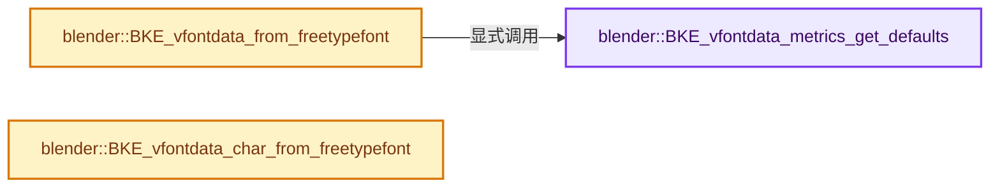

# 实现依赖专题：source/blender/blenkernel/intern/vfontdata_freetype.cc

[方向导航](README.md) · [符号索引](../%E7%AC%A6%E5%8F%B7%E4%BE%9D%E8%B5%96%E4%B8%8E%E5%AE%9E%E7%8E%B0%E7%B4%A2%E5%BC%95.md)

本专题从正文实际调用进入，集中保存共享实现。函数有稳定锚点，可从调用处直接跳到对应完整函数；递归与互相调用通过回链组织。

## 本文件的实现关系




## 完整成员与函数实现

<a id="f-0401c4ef978bc7eb"></a>

### `blender::BKE_vfontdata_metrics_get_defaults`

实现位置：[source/blender/blenkernel/intern/vfontdata_freetype.cc](../../../../../source/blender/blenkernel/intern/vfontdata_freetype.cc) · L35—L40。

接口参数：

- `VFontData_Metrics *metrics`

**教学注释版**

<!-- annotated:b5471ffdf7eb61 -->

```cpp
void BKE_vfontdata_metrics_get_defaults(VFontData_Metrics *metrics)
{
  metrics->scale = BLF_VFONT_METRICS_SCALE_DEFAULT;
  metrics->em_ratio = BLF_VFONT_METRICS_EM_RATIO_DEFAULT;
  metrics->ascend_ratio = BLF_VFONT_METRICS_ASCEND_RATIO_DEFAULT;
}
```

<details>
<summary>核对原始源码：source/blender/blenkernel/intern/vfontdata_freetype.cc · L35—L40</summary>

<!-- original:b5471ffdf7eb61:source/blender/blenkernel/intern/vfontdata_freetype.cc:35:40 -->

```cpp
void BKE_vfontdata_metrics_get_defaults(VFontData_Metrics *metrics)
{
  metrics->scale = BLF_VFONT_METRICS_SCALE_DEFAULT;
  metrics->em_ratio = BLF_VFONT_METRICS_EM_RATIO_DEFAULT;
  metrics->ascend_ratio = BLF_VFONT_METRICS_ASCEND_RATIO_DEFAULT;
}
```

</details>

**沿实际写入检查状态**

- `metrics->scale = BLF_VFONT_METRICS_SCALE_DEFAULT;`
- `metrics->em_ratio = BLF_VFONT_METRICS_EM_RATIO_DEFAULT;`
- `metrics->ascend_ratio = BLF_VFONT_METRICS_ASCEND_RATIO_DEFAULT;`

**继续追踪实现**

本实现没有需要继续展开的显式调用；检查返回表达式、对象转换和调用者前置条件。

<a id="f-40dc0b46bf75c3be"></a>

### `blender::BKE_vfontdata_from_freetypefont`

实现位置：[source/blender/blenkernel/intern/vfontdata_freetype.cc](../../../../../source/blender/blenkernel/intern/vfontdata_freetype.cc) · L42—L72。

接口参数：

- `PackedFile *pf`

**教学注释版**

<!-- annotated:e4d81129908e5b -->

```cpp
VFontData *BKE_vfontdata_from_freetypefont(PackedFile *pf)
{
  int fontid = BLF_load_mem("FTVFont", static_cast<const uchar *>(pf->data), pf->size);
  if (fontid == -1) {
    return nullptr;
  }

  /* allocate blender font */
  VFontData *vfd = MEM_new_zeroed<VFontData>("FTVFontData");

  /* Get the font name. */
  char *name = BLF_display_name_from_id(fontid);
  const size_t name_len = STRNCPY_RLEN(vfd->name, name);
  /* BLF_display_name result must be freed. */
  MEM_delete(name);

  BLI_str_utf8_invalid_strip(vfd->name, name_len);

  if (!BLF_get_vfont_metrics(
          fontid, &vfd->metrics.ascend_ratio, &vfd->metrics.em_ratio, &vfd->metrics.scale))
  {
    BKE_vfontdata_metrics_get_defaults(&vfd->metrics);
  }

  vfd->characters = MEM_new<Map<uint, VChar *>>(__func__);
  vfd->characters->reserve(255);

  BLF_unload_id(fontid);

  return vfd;
}
```

<details>
<summary>核对原始源码：source/blender/blenkernel/intern/vfontdata_freetype.cc · L42—L72</summary>

<!-- original:e4d81129908e5b:source/blender/blenkernel/intern/vfontdata_freetype.cc:42:72 -->

```cpp
VFontData *BKE_vfontdata_from_freetypefont(PackedFile *pf)
{
  int fontid = BLF_load_mem("FTVFont", static_cast<const uchar *>(pf->data), pf->size);
  if (fontid == -1) {
    return nullptr;
  }

  /* allocate blender font */
  VFontData *vfd = MEM_new_zeroed<VFontData>("FTVFontData");

  /* Get the font name. */
  char *name = BLF_display_name_from_id(fontid);
  const size_t name_len = STRNCPY_RLEN(vfd->name, name);
  /* BLF_display_name result must be freed. */
  MEM_delete(name);

  BLI_str_utf8_invalid_strip(vfd->name, name_len);

  if (!BLF_get_vfont_metrics(
          fontid, &vfd->metrics.ascend_ratio, &vfd->metrics.em_ratio, &vfd->metrics.scale))
  {
    BKE_vfontdata_metrics_get_defaults(&vfd->metrics);
  }

  vfd->characters = MEM_new<Map<uint, VChar *>>(__func__);
  vfd->characters->reserve(255);

  BLF_unload_id(fontid);

  return vfd;
}
```

</details>

**沿实际写入检查状态**

- `vfd->characters = MEM_new<Map<uint, VChar *>>(__func__);`

**结果出口**

- `return nullptr;`
- `return vfd;`

**继续追踪实现**

- `BLF_load_mem` → [blender::BLF_load_mem · L227](%E4%BE%9D%E8%B5%96-blf-1ee3d6.md#f-18ea699241fbf7e5)。
- `MEM_new_zeroed<VFontData>` → [MEM_new_zeroed · L550](../03-%E5%86%85%E5%AD%98%E5%88%86%E9%85%8D%E4%B8%8E%E8%BF%90%E8%A1%8C%E6%97%B6%E7%B1%BB%E5%9E%8B/%E4%BE%9D%E8%B5%96-MEM_guardedalloc-b54eca.md#f-eeb1e2a7f57dd231)；[MEM_new_zeroed · L114](../03-%E5%86%85%E5%AD%98%E5%88%86%E9%85%8D%E4%B8%8E%E8%BF%90%E8%A1%8C%E6%97%B6%E7%B1%BB%E5%9E%8B/%E4%BE%9D%E8%B5%96-mallocn-afdcd4.md#f-e04cf01c64c8b180)。同名重载需按实参类型选择。
- `BLF_display_name_from_id` → [blender::BLF_display_name_from_id · L1135](%E4%BE%9D%E8%B5%96-blf-1ee3d6.md#f-2499c0e8d490137f)。
- `STRNCPY_RLEN` → [STRNCPY_RLEN · L600](../01-%E5%9F%BA%E7%A1%80%E5%AE%B9%E5%99%A8%E4%B8%8E%E7%8E%B0%E4%BB%A3CPP/%E4%BE%9D%E8%B5%96-BLI_string-b43058.md#m-81329fe9f9ee)。宏定义由构建条件选择。
- `MEM_delete` → [MEM_delete · L400](../03-%E5%86%85%E5%AD%98%E5%88%86%E9%85%8D%E4%B8%8E%E8%BF%90%E8%A1%8C%E6%97%B6%E7%B1%BB%E5%9E%8B/%E4%BE%9D%E8%B5%96-MEM_guardedalloc-b54eca.md#f-9049ffdd1682887c)。
- `BLI_str_utf8_invalid_strip` → [blender::BLI_str_utf8_invalid_strip · L289](../01-%E5%9F%BA%E7%A1%80%E5%AE%B9%E5%99%A8%E4%B8%8E%E7%8E%B0%E4%BB%A3CPP/%E4%BE%9D%E8%B5%96-string_utf8-3c62ca.md#f-1870ea2045c820fa)。
- `BLF_get_vfont_metrics` → [blender::BLF_get_vfont_metrics · L1145](%E4%BE%9D%E8%B5%96-blf-1ee3d6.md#f-d08f84aa51c2f8b0)。
- `BKE_vfontdata_metrics_get_defaults` → [blender::BKE_vfontdata_metrics_get_defaults · L35](%E4%BE%9D%E8%B5%96-vfontdata_freetype-56c918.md#f-0401c4ef978bc7eb)。
- `MEM_new<Map<uint, VChar *>>` → [MEM_new · L351](../03-%E5%86%85%E5%AD%98%E5%88%86%E9%85%8D%E4%B8%8E%E8%BF%90%E8%A1%8C%E6%97%B6%E7%B1%BB%E5%9E%8B/%E4%BE%9D%E8%B5%96-MEM_guardedalloc-b54eca.md#f-115f9b6784f89912)。
- `vfd->characters->reserve` → [调用协议](../%E6%A8%A1%E6%9D%BF%E5%AE%8F%E4%B8%8E%E5%8A%A8%E6%80%81%E5%88%86%E6%B4%BE%E5%8D%8F%E8%AE%AE.md)：接收对象类型依赖auto、返回值或模板实例；不按同名猜测目标。调用位置L67。
- `BLF_unload_id` → [blender::BLF_unload_id · L282](%E4%BE%9D%E8%B5%96-blf-1ee3d6.md#f-df017f0eba27fc8e)。

<a id="f-c9a4ab56e53afb14"></a>

### `blender::BKE_vfontdata_char_from_freetypefont`

实现位置：[source/blender/blenkernel/intern/vfontdata_freetype.cc](../../../../../source/blender/blenkernel/intern/vfontdata_freetype.cc) · L91—L144。

接口参数：

- `VFont *vfont`
- `uint character`

**教学注释版**

<!-- annotated:806abbbae4a1ea -->

```cpp
VChar *BKE_vfontdata_char_from_freetypefont(VFont *vfont, uint character)
{
  if (!vfont) {
    return nullptr;
  }

  int font_id = -1;
  const bool is_builtin = BKE_vfont_is_builtin(vfont);

  /* If the default font is selected (usually because nothing has been selected)
   * then allow use of the fallback font stack when characters are not found in it.
   * This allows a nice first experience, for testing, and allows the translation of the initial
   * "Text" string. However, when a different specific font then do not use fallback,
   * only allow characters that are included in that font.
   * Do this for predictable control of what is shown when selecting specific fonts,
   * also for consistent output when the UI fonts are changed or updated. */
  const bool use_fallback = is_builtin;

  if (is_builtin) {
    font_id = BLF_load_mem(
        vfont->data->name, static_cast<const uchar *>(builtin_font_data), builtin_font_size);
  }
  else if (vfont->temp_pf) {
    font_id = BLF_load_mem(
        vfont->data->name, static_cast<const uchar *>(vfont->temp_pf->data), vfont->temp_pf->size);
  }

  if (font_id == -1) {
    return nullptr;
  }

  VChar *che = MEM_new_zeroed<VChar>("objfnt_char");

  /* need to set a size for embolden, etc. */
  BLF_size(font_id, 16);

  if (!BLF_character_to_curves(font_id,
                               character,
                               &che->nurbsbase,
                               vfont->data->metrics.scale,
                               use_fallback,
                               &che->width,
                               &che->bounds))
  {
    /* Free but add to the character cache to prevent future lookups
     * from attempting to load the font again. */
    MEM_delete(che);
    che = nullptr;
  }

  vfont->data->characters->add(character, che);
  BLF_unload_id(font_id);
  return che;
}
```

<details>
<summary>核对原始源码：source/blender/blenkernel/intern/vfontdata_freetype.cc · L91—L144</summary>

<!-- original:806abbbae4a1ea:source/blender/blenkernel/intern/vfontdata_freetype.cc:91:144 -->

```cpp
VChar *BKE_vfontdata_char_from_freetypefont(VFont *vfont, uint character)
{
  if (!vfont) {
    return nullptr;
  }

  int font_id = -1;
  const bool is_builtin = BKE_vfont_is_builtin(vfont);

  /* If the default font is selected (usually because nothing has been selected)
   * then allow use of the fallback font stack when characters are not found in it.
   * This allows a nice first experience, for testing, and allows the translation of the initial
   * "Text" string. However, when a different specific font then do not use fallback,
   * only allow characters that are included in that font.
   * Do this for predictable control of what is shown when selecting specific fonts,
   * also for consistent output when the UI fonts are changed or updated. */
  const bool use_fallback = is_builtin;

  if (is_builtin) {
    font_id = BLF_load_mem(
        vfont->data->name, static_cast<const uchar *>(builtin_font_data), builtin_font_size);
  }
  else if (vfont->temp_pf) {
    font_id = BLF_load_mem(
        vfont->data->name, static_cast<const uchar *>(vfont->temp_pf->data), vfont->temp_pf->size);
  }

  if (font_id == -1) {
    return nullptr;
  }

  VChar *che = MEM_new_zeroed<VChar>("objfnt_char");

  /* need to set a size for embolden, etc. */
  BLF_size(font_id, 16);

  if (!BLF_character_to_curves(font_id,
                               character,
                               &che->nurbsbase,
                               vfont->data->metrics.scale,
                               use_fallback,
                               &che->width,
                               &che->bounds))
  {
    /* Free but add to the character cache to prevent future lookups
     * from attempting to load the font again. */
    MEM_delete(che);
    che = nullptr;
  }

  vfont->data->characters->add(character, che);
  BLF_unload_id(font_id);
  return che;
}
```

</details>

**沿实际写入检查状态**

- `font_id = BLF_load_mem(`
- `che = nullptr;`

**结果出口**

- `return nullptr;`
- `return che;`

**继续追踪实现**

- `BKE_vfont_is_builtin` → [blender::BKE_vfont_is_builtin · L278](%E4%BE%9D%E8%B5%96-vfont-38c130.md#f-2744c34cdb5064f3)。
- `BLF_load_mem` → [blender::BLF_load_mem · L227](%E4%BE%9D%E8%B5%96-blf-1ee3d6.md#f-18ea699241fbf7e5)。
- `MEM_new_zeroed<VChar>` → [MEM_new_zeroed · L550](../03-%E5%86%85%E5%AD%98%E5%88%86%E9%85%8D%E4%B8%8E%E8%BF%90%E8%A1%8C%E6%97%B6%E7%B1%BB%E5%9E%8B/%E4%BE%9D%E8%B5%96-MEM_guardedalloc-b54eca.md#f-eeb1e2a7f57dd231)；[MEM_new_zeroed · L114](../03-%E5%86%85%E5%AD%98%E5%88%86%E9%85%8D%E4%B8%8E%E8%BF%90%E8%A1%8C%E6%97%B6%E7%B1%BB%E5%9E%8B/%E4%BE%9D%E8%B5%96-mallocn-afdcd4.md#f-e04cf01c64c8b180)。同名重载需按实参类型选择。
- `BLF_size` → [blender::BLF_size · L445](%E4%BE%9D%E8%B5%96-blf-1ee3d6.md#f-055ce2de2d1684fd)。
- `BLF_character_to_curves` → [blender::BLF_character_to_curves · L1188](%E4%BE%9D%E8%B5%96-blf-1ee3d6.md#f-3df691c5f7b79581)。
- `MEM_delete` → [MEM_delete · L400](../03-%E5%86%85%E5%AD%98%E5%88%86%E9%85%8D%E4%B8%8E%E8%BF%90%E8%A1%8C%E6%97%B6%E7%B1%BB%E5%9E%8B/%E4%BE%9D%E8%B5%96-MEM_guardedalloc-b54eca.md#f-9049ffdd1682887c)。
- `vfont->data->characters->add` → [调用协议](../%E6%A8%A1%E6%9D%BF%E5%AE%8F%E4%B8%8E%E5%8A%A8%E6%80%81%E5%88%86%E6%B4%BE%E5%8D%8F%E8%AE%AE.md)：接收对象类型依赖auto、返回值或模板实例；不按同名猜测目标。调用位置L141。
- `BLF_unload_id` → [blender::BLF_unload_id · L282](%E4%BE%9D%E8%B5%96-blf-1ee3d6.md#f-df017f0eba27fc8e)。
