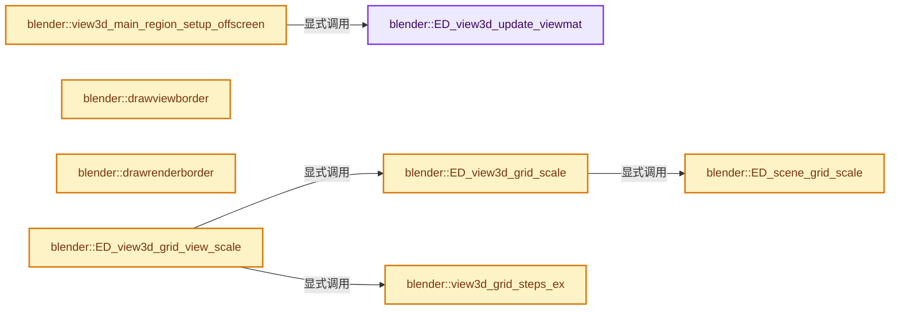
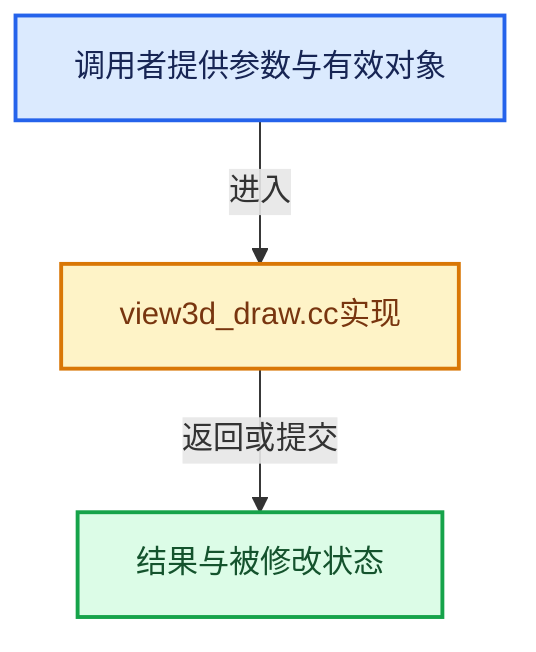

# 实现依赖专题：source/blender/editors/space_view3d/view3d_draw.cc

[方向导航](README.md) · [符号索引](../%E7%AC%A6%E5%8F%B7%E4%BE%9D%E8%B5%96%E4%B8%8E%E5%AE%9E%E7%8E%B0%E7%B4%A2%E5%BC%95.md)

本专题从正文实际调用进入，集中保存共享实现。函数有稳定锚点，可从调用处直接跳到对应完整函数；递归与互相调用通过回链组织。

## 本文件的实现关系






## 完整成员与函数实现

<a id="f-9f695708724f6b6b"></a>

### `blender::ED_view3d_update_viewmat`

实现位置：[source/blender/editors/space_view3d/view3d_draw.cc](../../../../../source/blender/editors/space_view3d/view3d_draw.cc) · L102—L183。

接口参数：

- `const Depsgraph *depsgraph`
- `const Scene *scene`
- `View3D *v3d`
- `ARegion *region`
- `const float viewmat[4][4]`
- `const float winmat[4][4]`
- `const rcti *rect`
- `bool offscreen`

**教学注释版**

<!-- annotated:b139bc208340f0 -->

```cpp
void ED_view3d_update_viewmat(const Depsgraph *depsgraph,
                              const Scene *scene,
                              View3D *v3d,
                              ARegion *region,
                              const float viewmat[4][4],
                              const float winmat[4][4],
                              const rcti *rect,
                              bool offscreen)
{
  RegionView3D *rv3d = static_cast<RegionView3D *>(region->regiondata);

  /* setup window matrices */
  if (winmat) {
    copy_m4_m4(rv3d->winmat, winmat);
  }
  else {
    view3d_winmatrix_set(depsgraph, region, v3d, rect);
  }

  /* setup view matrix */
  if (viewmat) {
    copy_m4_m4(rv3d->viewmat, viewmat);
  }
  else {
    float rect_scale[2];
    if (rect) {
      rect_scale[0] = float(BLI_rcti_size_x(rect)) / float(region->winx);
      rect_scale[1] = float(BLI_rcti_size_y(rect)) / float(region->winy);
    }
    /* NOTE: calls BKE_object_where_is_calc for camera... */
    view3d_viewmatrix_set(depsgraph, scene, v3d, rv3d, rect ? rect_scale : nullptr);
  }
  /* update utility matrices */
  mul_m4_m4m4(rv3d->persmat, rv3d->winmat, rv3d->viewmat);
  invert_m4_m4(rv3d->persinv, rv3d->persmat);
  invert_m4_m4(rv3d->viewinv, rv3d->viewmat);

  /* calculate GLSL view dependent values */

  /* store window coordinates scaling/offset */
  if (!offscreen && rv3d->persp == RV3D_CAMOB && v3d->camera) {
    rctf cameraborder;
    cameraborder = BKE_camera_view_border(
        scene, depsgraph, v3d, rv3d, region->winx, region->winy, false, false, false);
    rv3d->viewcamtexcofac[0] = float(region->winx) / BLI_rctf_size_x(&cameraborder);
    rv3d->viewcamtexcofac[1] = float(region->winy) / BLI_rctf_size_y(&cameraborder);

    rv3d->viewcamtexcofac[2] = -rv3d->viewcamtexcofac[0] * cameraborder.xmin / float(region->winx);
    rv3d->viewcamtexcofac[3] = -rv3d->viewcamtexcofac[1] * cameraborder.ymin / float(region->winy);
  }
  else {
    rv3d->viewcamtexcofac[0] = rv3d->viewcamtexcofac[1] = 1.0f;
    rv3d->viewcamtexcofac[2] = rv3d->viewcamtexcofac[3] = 0.0f;
  }

  /* Calculate pixel-size factor once, this is used for lights and object-centers. */
  {
    /* NOTE:  '1.0f / len_v3(v1)'  replaced  'len_v3(rv3d->viewmat[0])'
     * because of float point precision problems at large values #23908. */
    float v1[3], v2[3];
    float len_px, len_sc;

    v1[0] = rv3d->persmat[0][0];
    v1[1] = rv3d->persmat[1][0];
    v1[2] = rv3d->persmat[2][0];

    v2[0] = rv3d->persmat[0][1];
    v2[1] = rv3d->persmat[1][1];
    v2[2] = rv3d->persmat[2][1];

    len_px = 2.0f / sqrtf(min_ff(len_squared_v3(v1), len_squared_v3(v2)));

    if (rect) {
      len_sc = float(max_ii(BLI_rcti_size_x(rect), BLI_rcti_size_y(rect)));
    }
    else {
      // [讲解] std::max：按比较关系选取较大值。本讲解中的增长公式同时满足最低请求和几何增长；若保存返回引用，还需注意实参寿命。
      len_sc = float(std::max(region->winx, region->winy));
    }

    rv3d->pixsize = len_px / len_sc;
  }
}
```

<details>
<summary>核对原始源码：source/blender/editors/space_view3d/view3d_draw.cc · L102—L183</summary>

<!-- original:b139bc208340f0:source/blender/editors/space_view3d/view3d_draw.cc:102:183 -->

```cpp
void ED_view3d_update_viewmat(const Depsgraph *depsgraph,
                              const Scene *scene,
                              View3D *v3d,
                              ARegion *region,
                              const float viewmat[4][4],
                              const float winmat[4][4],
                              const rcti *rect,
                              bool offscreen)
{
  RegionView3D *rv3d = static_cast<RegionView3D *>(region->regiondata);

  /* setup window matrices */
  if (winmat) {
    copy_m4_m4(rv3d->winmat, winmat);
  }
  else {
    view3d_winmatrix_set(depsgraph, region, v3d, rect);
  }

  /* setup view matrix */
  if (viewmat) {
    copy_m4_m4(rv3d->viewmat, viewmat);
  }
  else {
    float rect_scale[2];
    if (rect) {
      rect_scale[0] = float(BLI_rcti_size_x(rect)) / float(region->winx);
      rect_scale[1] = float(BLI_rcti_size_y(rect)) / float(region->winy);
    }
    /* NOTE: calls BKE_object_where_is_calc for camera... */
    view3d_viewmatrix_set(depsgraph, scene, v3d, rv3d, rect ? rect_scale : nullptr);
  }
  /* update utility matrices */
  mul_m4_m4m4(rv3d->persmat, rv3d->winmat, rv3d->viewmat);
  invert_m4_m4(rv3d->persinv, rv3d->persmat);
  invert_m4_m4(rv3d->viewinv, rv3d->viewmat);

  /* calculate GLSL view dependent values */

  /* store window coordinates scaling/offset */
  if (!offscreen && rv3d->persp == RV3D_CAMOB && v3d->camera) {
    rctf cameraborder;
    cameraborder = BKE_camera_view_border(
        scene, depsgraph, v3d, rv3d, region->winx, region->winy, false, false, false);
    rv3d->viewcamtexcofac[0] = float(region->winx) / BLI_rctf_size_x(&cameraborder);
    rv3d->viewcamtexcofac[1] = float(region->winy) / BLI_rctf_size_y(&cameraborder);

    rv3d->viewcamtexcofac[2] = -rv3d->viewcamtexcofac[0] * cameraborder.xmin / float(region->winx);
    rv3d->viewcamtexcofac[3] = -rv3d->viewcamtexcofac[1] * cameraborder.ymin / float(region->winy);
  }
  else {
    rv3d->viewcamtexcofac[0] = rv3d->viewcamtexcofac[1] = 1.0f;
    rv3d->viewcamtexcofac[2] = rv3d->viewcamtexcofac[3] = 0.0f;
  }

  /* Calculate pixel-size factor once, this is used for lights and object-centers. */
  {
    /* NOTE:  '1.0f / len_v3(v1)'  replaced  'len_v3(rv3d->viewmat[0])'
     * because of float point precision problems at large values #23908. */
    float v1[3], v2[3];
    float len_px, len_sc;

    v1[0] = rv3d->persmat[0][0];
    v1[1] = rv3d->persmat[1][0];
    v1[2] = rv3d->persmat[2][0];

    v2[0] = rv3d->persmat[0][1];
    v2[1] = rv3d->persmat[1][1];
    v2[2] = rv3d->persmat[2][1];

    len_px = 2.0f / sqrtf(min_ff(len_squared_v3(v1), len_squared_v3(v2)));

    if (rect) {
      len_sc = float(max_ii(BLI_rcti_size_x(rect), BLI_rcti_size_y(rect)));
    }
    else {
      len_sc = float(std::max(region->winx, region->winy));
    }

    rv3d->pixsize = len_px / len_sc;
  }
}
```

</details>

**沿实际写入检查状态**

- `rect_scale[0] = float(BLI_rcti_size_x(rect)) / float(region->winx);`
- `rect_scale[1] = float(BLI_rcti_size_y(rect)) / float(region->winy);`
- `cameraborder = BKE_camera_view_border(`
- `rv3d->viewcamtexcofac[0] = float(region->winx) / BLI_rctf_size_x(&cameraborder);`
- `rv3d->viewcamtexcofac[1] = float(region->winy) / BLI_rctf_size_y(&cameraborder);`
- `rv3d->viewcamtexcofac[2] = -rv3d->viewcamtexcofac[0] * cameraborder.xmin / float(region->winx);`
- `rv3d->viewcamtexcofac[3] = -rv3d->viewcamtexcofac[1] * cameraborder.ymin / float(region->winy);`
- `rv3d->viewcamtexcofac[0] = rv3d->viewcamtexcofac[1] = 1.0f;`
- `rv3d->viewcamtexcofac[2] = rv3d->viewcamtexcofac[3] = 0.0f;`
- `v1[0] = rv3d->persmat[0][0];`
- `v1[1] = rv3d->persmat[1][0];`
- `v1[2] = rv3d->persmat[2][0];`
- `v2[0] = rv3d->persmat[0][1];`
- `v2[1] = rv3d->persmat[1][1];`
- `v2[2] = rv3d->persmat[2][1];`
- `len_px = 2.0f / sqrtf(min_ff(len_squared_v3(v1), len_squared_v3(v2)));`
- `len_sc = float(max_ii(BLI_rcti_size_x(rect), BLI_rcti_size_y(rect)));`
- `len_sc = float(std::max(region->winx, region->winy));`
- `rv3d->pixsize = len_px / len_sc;`

**继续追踪实现**

- `copy_m4_m4` → [blender::copy_m4_m4 · L84](../12-%E7%A9%BA%E9%97%B4%E6%95%B0%E6%8D%AE%E7%BB%93%E6%9E%84%E4%B8%8E%E5%87%A0%E4%BD%95%E7%AE%97%E6%B3%95/%E4%BE%9D%E8%B5%96-math_matrix_c-004123.md#f-b4390cf8c94710f5)。
- `view3d_winmatrix_set` → [blender::view3d_winmatrix_set · L318](%E4%BE%9D%E8%B5%96-view3d_view-4a686c.md#f-ffd9eb47dc8954a6)。
- `BLI_rcti_size_x` → [blender::BLI_rcti_size_x · L203](../01-%E5%9F%BA%E7%A1%80%E5%AE%B9%E5%99%A8%E4%B8%8E%E7%8E%B0%E4%BB%A3CPP/%E4%BE%9D%E8%B5%96-BLI_rect-2996c6.md#f-7a8fb2c54a829be6)。
- `BLI_rcti_size_y` → [blender::BLI_rcti_size_y · L207](../01-%E5%9F%BA%E7%A1%80%E5%AE%B9%E5%99%A8%E4%B8%8E%E7%8E%B0%E4%BB%A3CPP/%E4%BE%9D%E8%B5%96-BLI_rect-2996c6.md#f-ac87d6c708d502ad)。
- `view3d_viewmatrix_set` → [blender::view3d_viewmatrix_set · L405](%E4%BE%9D%E8%B5%96-view3d_view-4a686c.md#f-76a23480c02e01ab)。
- `mul_m4_m4m4` → [blender::mul_m4_m4m4 · L217](../12-%E7%A9%BA%E9%97%B4%E6%95%B0%E6%8D%AE%E7%BB%93%E6%9E%84%E4%B8%8E%E5%87%A0%E4%BD%95%E7%AE%97%E6%B3%95/%E4%BE%9D%E8%B5%96-math_matrix_c-004123.md#f-b5272136b543b73b)。
- `invert_m4_m4` → [blender::invert_m4_m4 · L1150](../12-%E7%A9%BA%E9%97%B4%E6%95%B0%E6%8D%AE%E7%BB%93%E6%9E%84%E4%B8%8E%E5%87%A0%E4%BD%95%E7%AE%97%E6%B3%95/%E4%BE%9D%E8%B5%96-math_matrix_c-004123.md#f-c75789f10cdd5b92)。
- `BKE_camera_view_border` → [blender::BKE_camera_view_border · L598](%E4%BE%9D%E8%B5%96-camera-dbe667.md#f-69b39f6e817ab77e)。
- `BLI_rctf_size_x` → [blender::BLI_rctf_size_x · L211](../01-%E5%9F%BA%E7%A1%80%E5%AE%B9%E5%99%A8%E4%B8%8E%E7%8E%B0%E4%BB%A3CPP/%E4%BE%9D%E8%B5%96-BLI_rect-2996c6.md#f-017b86a9d189e3ba)。
- `BLI_rctf_size_y` → [blender::BLI_rctf_size_y · L215](../01-%E5%9F%BA%E7%A1%80%E5%AE%B9%E5%99%A8%E4%B8%8E%E7%8E%B0%E4%BB%A3CPP/%E4%BE%9D%E8%B5%96-BLI_rect-2996c6.md#f-6d179bc3c1b71b0e)。
- `sqrtf` → [外部契约](https://eel.is/c++draft/)：这个边界按实际表达式及所属类型核对参数、返回值、寿命与失败行为。这里提供接口入口，不声称已解释该第三方版本的内部实现。
- `min_ff` → [blender::min_ff · L321](../12-%E7%A9%BA%E9%97%B4%E6%95%B0%E6%8D%AE%E7%BB%93%E6%9E%84%E4%B8%8E%E5%87%A0%E4%BD%95%E7%AE%97%E6%B3%95/%E4%BE%9D%E8%B5%96-math_base_inline-546b00.md#f-5b8d83d6f191be1a)。
- `len_squared_v3` → [blender::len_squared_v3 · L724](../12-%E7%A9%BA%E9%97%B4%E6%95%B0%E6%8D%AE%E7%BB%93%E6%9E%84%E4%B8%8E%E5%87%A0%E4%BD%95%E7%AE%97%E6%B3%95/%E4%BE%9D%E8%B5%96-math_vector_inline-0c8541.md#f-089409f6f09f82ef)。
- `max_ii` → [blender::max_ii · L368](../12-%E7%A9%BA%E9%97%B4%E6%95%B0%E6%8D%AE%E7%BB%93%E6%9E%84%E4%B8%8E%E5%87%A0%E4%BD%95%E7%AE%97%E6%B3%95/%E4%BE%9D%E8%B5%96-math_base_inline-546b00.md#f-c45aa7b373adb94c)。
- `std::max` → [外部契约](https://eel.is/c++draft/alg.min.max)：按比较关系选取较大值。本讲解中的增长公式同时满足最低请求和几何增长；若保存返回引用，还需注意实参寿命。

<a id="f-2e20368af4b29cb0"></a>

### `blender::view3d_main_region_setup_offscreen`

实现位置：[source/blender/editors/space_view3d/view3d_draw.cc](../../../../../source/blender/editors/space_view3d/view3d_draw.cc) · L202—L215。

接口参数：

- `Depsgraph *depsgraph`
- `const Scene *scene`
- `View3D *v3d`
- `ARegion *region`
- `const float viewmat[4][4]`
- `const float winmat[4][4]`

**教学注释版**

<!-- annotated:118a5e6bf852bc -->

```cpp
static void view3d_main_region_setup_offscreen(Depsgraph *depsgraph,
                                               const Scene *scene,
                                               View3D *v3d,
                                               ARegion *region,
                                               const float viewmat[4][4],
                                               const float winmat[4][4])
{
  RegionView3D *rv3d = static_cast<RegionView3D *>(region->regiondata);
  ED_view3d_update_viewmat(depsgraph, scene, v3d, region, viewmat, winmat, nullptr, true);

  /* Set for GPU drawing. */
  GPU_matrix_projection_set(rv3d->winmat);
  GPU_matrix_set(rv3d->viewmat);
}
```

<details>
<summary>核对原始源码：source/blender/editors/space_view3d/view3d_draw.cc · L202—L215</summary>

<!-- original:118a5e6bf852bc:source/blender/editors/space_view3d/view3d_draw.cc:202:215 -->

```cpp
static void view3d_main_region_setup_offscreen(Depsgraph *depsgraph,
                                               const Scene *scene,
                                               View3D *v3d,
                                               ARegion *region,
                                               const float viewmat[4][4],
                                               const float winmat[4][4])
{
  RegionView3D *rv3d = static_cast<RegionView3D *>(region->regiondata);
  ED_view3d_update_viewmat(depsgraph, scene, v3d, region, viewmat, winmat, nullptr, true);

  /* Set for GPU drawing. */
  GPU_matrix_projection_set(rv3d->winmat);
  GPU_matrix_set(rv3d->viewmat);
}
```

</details>

**继续追踪实现**

- `ED_view3d_update_viewmat` → [blender::ED_view3d_update_viewmat · L102](%E4%BE%9D%E8%B5%96-view3d_draw-3c4e25.md#f-9f695708724f6b6b)。
- `GPU_matrix_projection_set` → [blender::GPU_matrix_projection_set · L162](%E4%BE%9D%E8%B5%96-gpu_matrix-f7dc40.md#f-2d7b9ce6e92ca6ad)。
- `GPU_matrix_set` → [blender::GPU_matrix_set · L148](%E4%BE%9D%E8%B5%96-gpu_matrix-f7dc40.md#f-9a0e204d1b913771)。

<a id="f-faf2f02c2f8dedf4"></a>

### `blender::drawviewborder`

实现位置：[source/blender/editors/space_view3d/view3d_draw.cc](../../../../../source/blender/editors/space_view3d/view3d_draw.cc) · L388—L640。

接口参数：

- `Scene *scene`
- `Depsgraph *depsgraph`
- `ARegion *region`
- `View3D *v3d`

**教学注释版**

<!-- annotated:52a5e7302e8ad2 -->

```cpp
static void drawviewborder(Scene *scene, Depsgraph *depsgraph, ARegion *region, View3D *v3d)
{
  float x1, x2, y1, y2;
  float x1i, x2i, y1i, y2i;

  Camera *ca = nullptr;
  RegionView3D *rv3d = static_cast<RegionView3D *>(region->regiondata);

  if (v3d->camera == nullptr) {
    return;
  }
  if (v3d->camera->type == OB_CAMERA) {
    ca = id_cast<Camera *>(v3d->camera->data);
  }

  const rctf viewborder = BKE_camera_view_border(
      scene, depsgraph, v3d, rv3d, region->winx, region->winy, false, false, true);
  /* the offsets */
  x1 = viewborder.xmin;
  y1 = viewborder.ymin;
  x2 = viewborder.xmax;
  y2 = viewborder.ymax;

  const float roll = rv3d->camroll;
  const bool is_flipped_x = (rv3d->rflag & RV3D_FLIP_X) != 0;
  GPU_line_width(1.0f);

  /* apply offsets so the real 3D camera shows through */

  /* NOTE: quite un-scientific but without this bit extra
   * 0.0001 on the lower left the 2D border sometimes
   * obscures the 3D camera border */
  /* NOTE: with VIEW3D_CAMERA_BORDER_HACK defined this error isn't noticeable
   * but keep it here in case we need to remove the workaround */
  x1i = int(x1 - 1.0001f);
  y1i = int(y1 - 1.0001f);
  x2i = int(x2 + (1.0f - 0.0001f));
  y2i = int(y2 + (1.0f - 0.0001f));

  uint shdr_pos = GPU_vertformat_attr_add(
      immVertexFormat(), "pos", gpu::VertAttrType::SFLOAT_32_32);

  /* First, solid lines. */
  {
    immBindBuiltinProgram(GPU_SHADER_3D_UNIFORM_COLOR);

    /* Apply roll. */
    if (roll != 0.0f || is_flipped_x) {
      GPU_matrix_push();
      const int center_x = region->winx / 2;
      const int center_y = region->winy / 2;
      GPU_matrix_translate_2f(center_x, center_y);
      if (is_flipped_x) {
        GPU_matrix_scale_2f(-1.0f, 1.0f);
      }
      if (roll != 0.0f) {
        GPU_matrix_rotate_2d(RAD2DEG(roll));
      }
      GPU_matrix_translate_2f(-center_x, -center_y);
    }

    /* passepartout, specified in camera edit buttons */
    if (ca && (ca->flag & CAM_SHOWPASSEPARTOUT) && ca->passepartalpha > 0.000001f &&
        v3d->flag2 & V3D_SHOW_CAMERA_PASSEPARTOUT)
    {
      const float winx = (region->winx + 1);
      const float winy = (region->winy + 1);

      float alpha = 1.0f;

      if (ca->passepartalpha != 1.0f) {
        GPU_blend(GPU_BLEND_ALPHA);
        alpha = ca->passepartalpha;
      }

      immUniformThemeColorAlpha(TH_CAMERA_PASSEPARTOUT, alpha);

      if (roll == 0.0f) {
        if (x1i > 0.0f) {
          immRectf(shdr_pos, 0.0f, winy, x1i, 0.0f);
        }
        if (x2i < winx) {
          immRectf(shdr_pos, x2i, winy, winx, 0.0f);
        }
        if (y2i < winy) {
          immRectf(shdr_pos, x1i, winy, x2i, y2i);
        }
        if (y2i > 0.0f) {
          immRectf(shdr_pos, x1i, y1i, x2i, 0.0f);
        }
      }
      else {
        const float padding = math::max(winx, winy);

        immRectf(shdr_pos, -padding, winy + padding, x1i, -padding);
        immRectf(shdr_pos, x2i, winy + padding, winx + padding, -padding);
        immRectf(shdr_pos, x1i, winy + padding, x2i, y2i);
        immRectf(shdr_pos, x1i, y1i, x2i, -padding);
      }

      GPU_blend(GPU_BLEND_NONE);
      immUniformThemeColor3(TH_BACK);
      imm_draw_box_wire_2d(shdr_pos, x1i, y1i, x2i, y2i);
    }

#ifdef VIEW3D_CAMERA_BORDER_HACK
    if (view3d_camera_border_hack_test == true) {
      immUniformColor3ubv(view3d_camera_border_hack_col);
      imm_draw_box_wire_2d(shdr_pos, x1i + 1, y1i + 1, x2i - 1, y2i - 1);
      view3d_camera_border_hack_test = false;
    }
#endif

    immUnbindProgram();
  }

  /* When overlays are disabled, only show camera outline & passepartout. */
  if (v3d->flag2 & V3D_HIDE_OVERLAYS || !(v3d->flag2 & V3D_SHOW_CAMERA_GUIDES)) {
    if (roll != 0.0f || is_flipped_x) {
      GPU_matrix_pop();
    }
    return;
  }

  /* And now, the dashed lines! */
  immBindBuiltinProgram(GPU_SHADER_3D_LINE_DASHED_UNIFORM_COLOR);

  {
    float viewport_size[4];
    GPU_viewport_size_get_f(viewport_size);
    immUniform2f("viewport_size", viewport_size[2], viewport_size[3]);

    immUniform1i("colors_len", 0); /* "simple" mode */
    immUniform1f("dash_width", 6.0f);
    immUniform1f("udash_factor", 0.5f);

    /* outer line not to confuse with object selection */
    if (v3d->flag2 & V3D_LOCK_CAMERA) {
      immUniformThemeColor(TH_REDALERT);
      imm_draw_box_wire_2d(shdr_pos, x1i - 1, y1i - 1, x2i + 1, y2i + 1);
    }

    immUniformThemeColor3(TH_VIEW_OVERLAY);
    imm_draw_box_wire_2d(shdr_pos, x1i, y1i, x2i, y2i);
  }

  /* Render Border. */
  if (scene->r.mode & R_BORDER) {
    float x3, y3, x4, y4;

    x3 = floorf(x1 + (scene->r.border.xmin * (x2 - x1))) - 1;
    y3 = floorf(y1 + (scene->r.border.ymin * (y2 - y1))) - 1;
    x4 = floorf(x1 + (scene->r.border.xmax * (x2 - x1))) + (U.pixelsize - 1);
    y4 = floorf(y1 + (scene->r.border.ymax * (y2 - y1))) + (U.pixelsize - 1);

    immUniformColor3f(1.0f, 0.25f, 0.25f);
    imm_draw_box_wire_2d(shdr_pos, x3, y3, x4, y4);
  }

  /* safety border */
  if (ca && (v3d->flag2 & V3D_SHOW_CAMERA_GUIDES)) {
    GPU_blend(GPU_BLEND_ALPHA);

    ED_draw_composition_guides(
        shdr_pos, ca->composition_guide_flags, &viewborder, ca->composition_guide_color);

    if (ca->flag & CAM_SHOW_SAFE_MARGINS) {
      rctf margins_rect{};
      margins_rect.xmin = x1;
      margins_rect.xmax = x2;
      margins_rect.ymin = y1;
      margins_rect.ymax = y2;

      /* draw */
      immUniformThemeColorAlpha(TH_VIEW_OVERLAY, 0.75f);

      ui::draw_safe_areas(
          shdr_pos, &margins_rect, scene->safe_areas.title, scene->safe_areas.action);

      if (ca->flag & CAM_SHOW_SAFE_CENTER) {
        rctf center_rect{};
        center_rect.xmin = x1;
        center_rect.xmax = x2;
        center_rect.ymin = y1;
        center_rect.ymax = y2;
        ui::draw_safe_areas(shdr_pos,
                            &center_rect,
                            scene->safe_areas.title_center,
                            scene->safe_areas.action_center);
      }
    }

    if (ca->flag & CAM_SHOWSENSOR) {
      /* determine sensor fit, and get sensor x/y, for auto fit we
       * assume and square sensor and only use sensor_x */
      float sizex = scene->r.xsch * scene->r.xasp;
      float sizey = scene->r.ysch * scene->r.yasp;
      int sensor_fit = BKE_camera_sensor_fit(ca->sensor_fit, sizex, sizey);
      float sensor_x = ca->sensor_x;
      float sensor_y = (ca->sensor_fit == CAMERA_SENSOR_FIT_AUTO) ? ca->sensor_x : ca->sensor_y;

      /* determine sensor plane */
      rctf rect;

      if (sensor_fit == CAMERA_SENSOR_FIT_HOR) {
        float sensor_scale = (x2i - x1i) / sensor_x;
        float sensor_height = sensor_scale * sensor_y;

        rect.xmin = x1i;
        rect.xmax = x2i;
        rect.ymin = (y1i + y2i) * 0.5f - sensor_height * 0.5f;
        rect.ymax = rect.ymin + sensor_height;
      }
      else {
        float sensor_scale = (y2i - y1i) / sensor_y;
        float sensor_width = sensor_scale * sensor_x;

        rect.xmin = (x1i + x2i) * 0.5f - sensor_width * 0.5f;
        rect.xmax = rect.xmin + sensor_width;
        rect.ymin = y1i;
        rect.ymax = y2i;
      }

      /* draw */
      immUniformThemeColorShadeAlpha(TH_VIEW_OVERLAY, 100, 255);

      /* TODO: Was using:
       * `draw_roundbox_4fv(false, rect.xmin, rect.ymin, rect.xmax, rect.ymax, 2.0f, color);`
       * We'll probably need a new imm_draw_line_roundbox_dashed or that - though in practice the
       * 2.0f round corner effect was nearly not visible anyway. */
      imm_draw_box_wire_2d(shdr_pos, rect.xmin, rect.ymin, rect.xmax, rect.ymax);
    }

    GPU_blend(GPU_BLEND_NONE);
  }

  immUnbindProgram();
  /* end dashed lines */

  /* camera name - draw in highlighted text color */
  if (ca && ((v3d->overlay.flag & V3D_OVERLAY_HIDE_TEXT) == 0) && (ca->flag & CAM_SHOWNAME)) {
    ui::theme::font_theme_color_set(BLF_default(), TH_TEXT_HI);
    BLF_draw_default(x1i,
                     y1i - (0.7f * U.widget_unit),
                     0.0f,
                     v3d->camera->id.name + 2,
                     sizeof(v3d->camera->id.name) - 2);
  }

  if (roll != 0.0f || is_flipped_x) {
    GPU_matrix_pop();
  }
}
```

<details>
<summary>核对原始源码：source/blender/editors/space_view3d/view3d_draw.cc · L388—L640</summary>

<!-- original:52a5e7302e8ad2:source/blender/editors/space_view3d/view3d_draw.cc:388:640 -->

```cpp
static void drawviewborder(Scene *scene, Depsgraph *depsgraph, ARegion *region, View3D *v3d)
{
  float x1, x2, y1, y2;
  float x1i, x2i, y1i, y2i;

  Camera *ca = nullptr;
  RegionView3D *rv3d = static_cast<RegionView3D *>(region->regiondata);

  if (v3d->camera == nullptr) {
    return;
  }
  if (v3d->camera->type == OB_CAMERA) {
    ca = id_cast<Camera *>(v3d->camera->data);
  }

  const rctf viewborder = BKE_camera_view_border(
      scene, depsgraph, v3d, rv3d, region->winx, region->winy, false, false, true);
  /* the offsets */
  x1 = viewborder.xmin;
  y1 = viewborder.ymin;
  x2 = viewborder.xmax;
  y2 = viewborder.ymax;

  const float roll = rv3d->camroll;
  const bool is_flipped_x = (rv3d->rflag & RV3D_FLIP_X) != 0;
  GPU_line_width(1.0f);

  /* apply offsets so the real 3D camera shows through */

  /* NOTE: quite un-scientific but without this bit extra
   * 0.0001 on the lower left the 2D border sometimes
   * obscures the 3D camera border */
  /* NOTE: with VIEW3D_CAMERA_BORDER_HACK defined this error isn't noticeable
   * but keep it here in case we need to remove the workaround */
  x1i = int(x1 - 1.0001f);
  y1i = int(y1 - 1.0001f);
  x2i = int(x2 + (1.0f - 0.0001f));
  y2i = int(y2 + (1.0f - 0.0001f));

  uint shdr_pos = GPU_vertformat_attr_add(
      immVertexFormat(), "pos", gpu::VertAttrType::SFLOAT_32_32);

  /* First, solid lines. */
  {
    immBindBuiltinProgram(GPU_SHADER_3D_UNIFORM_COLOR);

    /* Apply roll. */
    if (roll != 0.0f || is_flipped_x) {
      GPU_matrix_push();
      const int center_x = region->winx / 2;
      const int center_y = region->winy / 2;
      GPU_matrix_translate_2f(center_x, center_y);
      if (is_flipped_x) {
        GPU_matrix_scale_2f(-1.0f, 1.0f);
      }
      if (roll != 0.0f) {
        GPU_matrix_rotate_2d(RAD2DEG(roll));
      }
      GPU_matrix_translate_2f(-center_x, -center_y);
    }

    /* passepartout, specified in camera edit buttons */
    if (ca && (ca->flag & CAM_SHOWPASSEPARTOUT) && ca->passepartalpha > 0.000001f &&
        v3d->flag2 & V3D_SHOW_CAMERA_PASSEPARTOUT)
    {
      const float winx = (region->winx + 1);
      const float winy = (region->winy + 1);

      float alpha = 1.0f;

      if (ca->passepartalpha != 1.0f) {
        GPU_blend(GPU_BLEND_ALPHA);
        alpha = ca->passepartalpha;
      }

      immUniformThemeColorAlpha(TH_CAMERA_PASSEPARTOUT, alpha);

      if (roll == 0.0f) {
        if (x1i > 0.0f) {
          immRectf(shdr_pos, 0.0f, winy, x1i, 0.0f);
        }
        if (x2i < winx) {
          immRectf(shdr_pos, x2i, winy, winx, 0.0f);
        }
        if (y2i < winy) {
          immRectf(shdr_pos, x1i, winy, x2i, y2i);
        }
        if (y2i > 0.0f) {
          immRectf(shdr_pos, x1i, y1i, x2i, 0.0f);
        }
      }
      else {
        const float padding = math::max(winx, winy);

        immRectf(shdr_pos, -padding, winy + padding, x1i, -padding);
        immRectf(shdr_pos, x2i, winy + padding, winx + padding, -padding);
        immRectf(shdr_pos, x1i, winy + padding, x2i, y2i);
        immRectf(shdr_pos, x1i, y1i, x2i, -padding);
      }

      GPU_blend(GPU_BLEND_NONE);
      immUniformThemeColor3(TH_BACK);
      imm_draw_box_wire_2d(shdr_pos, x1i, y1i, x2i, y2i);
    }

#ifdef VIEW3D_CAMERA_BORDER_HACK
    if (view3d_camera_border_hack_test == true) {
      immUniformColor3ubv(view3d_camera_border_hack_col);
      imm_draw_box_wire_2d(shdr_pos, x1i + 1, y1i + 1, x2i - 1, y2i - 1);
      view3d_camera_border_hack_test = false;
    }
#endif

    immUnbindProgram();
  }

  /* When overlays are disabled, only show camera outline & passepartout. */
  if (v3d->flag2 & V3D_HIDE_OVERLAYS || !(v3d->flag2 & V3D_SHOW_CAMERA_GUIDES)) {
    if (roll != 0.0f || is_flipped_x) {
      GPU_matrix_pop();
    }
    return;
  }

  /* And now, the dashed lines! */
  immBindBuiltinProgram(GPU_SHADER_3D_LINE_DASHED_UNIFORM_COLOR);

  {
    float viewport_size[4];
    GPU_viewport_size_get_f(viewport_size);
    immUniform2f("viewport_size", viewport_size[2], viewport_size[3]);

    immUniform1i("colors_len", 0); /* "simple" mode */
    immUniform1f("dash_width", 6.0f);
    immUniform1f("udash_factor", 0.5f);

    /* outer line not to confuse with object selection */
    if (v3d->flag2 & V3D_LOCK_CAMERA) {
      immUniformThemeColor(TH_REDALERT);
      imm_draw_box_wire_2d(shdr_pos, x1i - 1, y1i - 1, x2i + 1, y2i + 1);
    }

    immUniformThemeColor3(TH_VIEW_OVERLAY);
    imm_draw_box_wire_2d(shdr_pos, x1i, y1i, x2i, y2i);
  }

  /* Render Border. */
  if (scene->r.mode & R_BORDER) {
    float x3, y3, x4, y4;

    x3 = floorf(x1 + (scene->r.border.xmin * (x2 - x1))) - 1;
    y3 = floorf(y1 + (scene->r.border.ymin * (y2 - y1))) - 1;
    x4 = floorf(x1 + (scene->r.border.xmax * (x2 - x1))) + (U.pixelsize - 1);
    y4 = floorf(y1 + (scene->r.border.ymax * (y2 - y1))) + (U.pixelsize - 1);

    immUniformColor3f(1.0f, 0.25f, 0.25f);
    imm_draw_box_wire_2d(shdr_pos, x3, y3, x4, y4);
  }

  /* safety border */
  if (ca && (v3d->flag2 & V3D_SHOW_CAMERA_GUIDES)) {
    GPU_blend(GPU_BLEND_ALPHA);

    ED_draw_composition_guides(
        shdr_pos, ca->composition_guide_flags, &viewborder, ca->composition_guide_color);

    if (ca->flag & CAM_SHOW_SAFE_MARGINS) {
      rctf margins_rect{};
      margins_rect.xmin = x1;
      margins_rect.xmax = x2;
      margins_rect.ymin = y1;
      margins_rect.ymax = y2;

      /* draw */
      immUniformThemeColorAlpha(TH_VIEW_OVERLAY, 0.75f);

      ui::draw_safe_areas(
          shdr_pos, &margins_rect, scene->safe_areas.title, scene->safe_areas.action);

      if (ca->flag & CAM_SHOW_SAFE_CENTER) {
        rctf center_rect{};
        center_rect.xmin = x1;
        center_rect.xmax = x2;
        center_rect.ymin = y1;
        center_rect.ymax = y2;
        ui::draw_safe_areas(shdr_pos,
                            &center_rect,
                            scene->safe_areas.title_center,
                            scene->safe_areas.action_center);
      }
    }

    if (ca->flag & CAM_SHOWSENSOR) {
      /* determine sensor fit, and get sensor x/y, for auto fit we
       * assume and square sensor and only use sensor_x */
      float sizex = scene->r.xsch * scene->r.xasp;
      float sizey = scene->r.ysch * scene->r.yasp;
      int sensor_fit = BKE_camera_sensor_fit(ca->sensor_fit, sizex, sizey);
      float sensor_x = ca->sensor_x;
      float sensor_y = (ca->sensor_fit == CAMERA_SENSOR_FIT_AUTO) ? ca->sensor_x : ca->sensor_y;

      /* determine sensor plane */
      rctf rect;

      if (sensor_fit == CAMERA_SENSOR_FIT_HOR) {
        float sensor_scale = (x2i - x1i) / sensor_x;
        float sensor_height = sensor_scale * sensor_y;

        rect.xmin = x1i;
        rect.xmax = x2i;
        rect.ymin = (y1i + y2i) * 0.5f - sensor_height * 0.5f;
        rect.ymax = rect.ymin + sensor_height;
      }
      else {
        float sensor_scale = (y2i - y1i) / sensor_y;
        float sensor_width = sensor_scale * sensor_x;

        rect.xmin = (x1i + x2i) * 0.5f - sensor_width * 0.5f;
        rect.xmax = rect.xmin + sensor_width;
        rect.ymin = y1i;
        rect.ymax = y2i;
      }

      /* draw */
      immUniformThemeColorShadeAlpha(TH_VIEW_OVERLAY, 100, 255);

      /* TODO: Was using:
       * `draw_roundbox_4fv(false, rect.xmin, rect.ymin, rect.xmax, rect.ymax, 2.0f, color);`
       * We'll probably need a new imm_draw_line_roundbox_dashed or that - though in practice the
       * 2.0f round corner effect was nearly not visible anyway. */
      imm_draw_box_wire_2d(shdr_pos, rect.xmin, rect.ymin, rect.xmax, rect.ymax);
    }

    GPU_blend(GPU_BLEND_NONE);
  }

  immUnbindProgram();
  /* end dashed lines */

  /* camera name - draw in highlighted text color */
  if (ca && ((v3d->overlay.flag & V3D_OVERLAY_HIDE_TEXT) == 0) && (ca->flag & CAM_SHOWNAME)) {
    ui::theme::font_theme_color_set(BLF_default(), TH_TEXT_HI);
    BLF_draw_default(x1i,
                     y1i - (0.7f * U.widget_unit),
                     0.0f,
                     v3d->camera->id.name + 2,
                     sizeof(v3d->camera->id.name) - 2);
  }

  if (roll != 0.0f || is_flipped_x) {
    GPU_matrix_pop();
  }
}
```

</details>

**沿实际写入检查状态**

- `ca = id_cast<Camera *>(v3d->camera->data);`
- `x1 = viewborder.xmin;`
- `y1 = viewborder.ymin;`
- `x2 = viewborder.xmax;`
- `y2 = viewborder.ymax;`
- `x1i = int(x1 - 1.0001f);`
- `y1i = int(y1 - 1.0001f);`
- `x2i = int(x2 + (1.0f - 0.0001f));`
- `y2i = int(y2 + (1.0f - 0.0001f));`
- `alpha = ca->passepartalpha;`
- `view3d_camera_border_hack_test = false;`
- `x3 = floorf(x1 + (scene->r.border.xmin * (x2 - x1))) - 1;`
- `y3 = floorf(y1 + (scene->r.border.ymin * (y2 - y1))) - 1;`
- `x4 = floorf(x1 + (scene->r.border.xmax * (x2 - x1))) + (U.pixelsize - 1);`
- `y4 = floorf(y1 + (scene->r.border.ymax * (y2 - y1))) + (U.pixelsize - 1);`
- `margins_rect.xmin = x1;`
- `margins_rect.xmax = x2;`
- `margins_rect.ymin = y1;`
- `margins_rect.ymax = y2;`
- `center_rect.xmin = x1;`
- `center_rect.xmax = x2;`
- `center_rect.ymin = y1;`
- `center_rect.ymax = y2;`
- `rect.xmin = x1i;`
- `rect.xmax = x2i;`
- `rect.ymin = (y1i + y2i) * 0.5f - sensor_height * 0.5f;`
- `rect.ymax = rect.ymin + sensor_height;`
- `rect.xmin = (x1i + x2i) * 0.5f - sensor_width * 0.5f;`
- `rect.xmax = rect.xmin + sensor_width;`
- `rect.ymin = y1i;`
- `rect.ymax = y2i;`

**继续追踪实现**

- `id_cast<Camera *>` → [blender::id_cast · L1417](%E4%BE%9D%E8%B5%96-DNA_ID-3eb091.md#f-6c8ac6412850ac5a)。
- `BKE_camera_view_border` → [blender::BKE_camera_view_border · L598](%E4%BE%9D%E8%B5%96-camera-dbe667.md#f-69b39f6e817ab77e)。
- `GPU_line_width` → [blender::GPU_line_width · L151](%E4%BE%9D%E8%B5%96-gpu_state-82c525.md#f-9aa9b164f4d6ec7e)。
- `GPU_vertformat_attr_add` → [blender::GPU_vertformat_attr_add · L389](%E4%BE%9D%E8%B5%96-gpu_vertex_format-4f7148.md#f-a36e23f37b97fff4)。
- `immVertexFormat` → [blender::immVertexFormat · L41](%E4%BE%9D%E8%B5%96-gpu_immediate-4842c0.md#f-cc131113ee25fc66)。
- `immBindBuiltinProgram` → [blender::immBindBuiltinProgram · L63](%E4%BE%9D%E8%B5%96-gpu_immediate-4842c0.md#f-958234d295e1ef45)。
- `GPU_matrix_push` → [blender::GPU_matrix_push · L120](%E4%BE%9D%E8%B5%96-gpu_matrix-f7dc40.md#f-4461e6dee642cd0b)。
- `GPU_matrix_translate_2f` → [blender::GPU_matrix_translate_2f · L175](%E4%BE%9D%E8%B5%96-gpu_matrix-f7dc40.md#f-9d9c07686dcf995a)。
- `GPU_matrix_scale_2f` → [blender::GPU_matrix_scale_2f · L217](%E4%BE%9D%E8%B5%96-gpu_matrix-f7dc40.md#f-7b22e14e518eb12d)。
- `GPU_matrix_rotate_2d` → [blender::GPU_matrix_rotate_2d · L254](%E4%BE%9D%E8%B5%96-gpu_matrix-f7dc40.md#f-84dca34af3858aa5)。
- `RAD2DEG` → [RAD2DEG · L71](../12-%E7%A9%BA%E9%97%B4%E6%95%B0%E6%8D%AE%E7%BB%93%E6%9E%84%E4%B8%8E%E5%87%A0%E4%BD%95%E7%AE%97%E6%B3%95/%E4%BE%9D%E8%B5%96-BLI_math_constants-44e144.md#m-a970540d6180)。宏定义由构建条件选择。
- `GPU_blend` → [blender::GPU_blend · L44](%E4%BE%9D%E8%B5%96-gpu_state-82c525.md#f-aa74e4560c194f83)。
- `immUniformThemeColorAlpha` → [blender::immUniformThemeColorAlpha · L720](%E4%BE%9D%E8%B5%96-gpu_immediate-4842c0.md#f-591b1c3eb4c7fda2)。
- `immRectf` → [blender::immRectf · L264](%E4%BE%9D%E8%B5%96-gpu_immediate_util-34d2c1.md#f-2aebcd56c0f9ea7c)。
- `math::max` → [blender::math::max · L87](../12-%E7%A9%BA%E9%97%B4%E6%95%B0%E6%8D%AE%E7%BB%93%E6%9E%84%E4%B8%8E%E5%87%A0%E4%BD%95%E7%AE%97%E6%B3%95/%E4%BE%9D%E8%B5%96-BLI_math_vector-906a87.md#f-9be564a293777d6b)；[blender::math::max · L96](../12-%E7%A9%BA%E9%97%B4%E6%95%B0%E6%8D%AE%E7%BB%93%E6%9E%84%E4%B8%8E%E5%87%A0%E4%BD%95%E7%AE%97%E6%B3%95/%E4%BE%9D%E8%B5%96-BLI_math_vector-906a87.md#f-ce32dff37d0af3bc)；[blender::math::max · L112](../12-%E7%A9%BA%E9%97%B4%E6%95%B0%E6%8D%AE%E7%BB%93%E6%9E%84%E4%B8%8E%E5%87%A0%E4%BD%95%E7%AE%97%E6%B3%95/%E4%BE%9D%E8%B5%96-BLI_math_vector-906a87.md#f-668eb1fcf1fa8292)；[blender::math::max · L49](../12-%E7%A9%BA%E9%97%B4%E6%95%B0%E6%8D%AE%E7%BB%93%E6%9E%84%E4%B8%8E%E5%87%A0%E4%BD%95%E7%AE%97%E6%B3%95/%E4%BE%9D%E8%B5%96-BLI_math_base-0728eb.md#f-a6991ca3d12937e1)。同名重载需按实参类型选择。
- `immUniformThemeColor3` → [blender::immUniformThemeColor3 · L728](%E4%BE%9D%E8%B5%96-gpu_immediate-4842c0.md#f-04fc33e5f5671da9)。
- `imm_draw_box_wire_2d` → [blender::imm_draw_box_wire_2d · L636](%E4%BE%9D%E8%B5%96-gpu_immediate_util-34d2c1.md#f-4916e373908b75f2)。
- `immUniformColor3ubv` → [blender::immUniformColor3ubv · L696](%E4%BE%9D%E8%B5%96-gpu_immediate-4842c0.md#f-42c9c99de9bb9a2a)。
- `immUnbindProgram` → [blender::immUnbindProgram · L70](%E4%BE%9D%E8%B5%96-gpu_immediate-4842c0.md#f-1534593ba1cbfc41)。
- `GPU_matrix_pop` → [blender::GPU_matrix_pop · L127](%E4%BE%9D%E8%B5%96-gpu_matrix-f7dc40.md#f-873c4cfc32b18384)。
- `GPU_viewport_size_get_f` → [blender::GPU_viewport_size_get_f · L258](%E4%BE%9D%E8%B5%96-gpu_state-82c525.md#f-2cc9d4423985bf4f)。
- `immUniform2f` → [blender::immUniform2f · L588](%E4%BE%9D%E8%B5%96-gpu_immediate-4842c0.md#f-07209ea0e8ae5f8f)。
- `immUniform1i` → [blender::immUniform1i · L629](%E4%BE%9D%E8%B5%96-gpu_immediate-4842c0.md#f-9bc2b3c91c1d53fa)。
- `immUniform1f` → [blender::immUniform1f · L583](%E4%BE%9D%E8%B5%96-gpu_immediate-4842c0.md#f-294f146b86fc6b2f)。
- `immUniformThemeColor` → [blender::immUniformThemeColor · L713](%E4%BE%9D%E8%B5%96-gpu_immediate-4842c0.md#f-25f002cbd74bb461)。
- `floorf` → [floorf · L22](%E4%BE%9D%E8%B5%96-radial_tiling_shared-98abf9.md#m-fb64dda1b0f0)；[floorf · L44](%E4%BE%9D%E8%B5%96-radial_tiling_shared-98abf9.md#m-25e4a157b53d)；[floorf · L75](%E4%BE%9D%E8%B5%96-radial_tiling_shared-98abf9.md#m-e128f662cbe8)；[floorf · L26](../01-%E5%9F%BA%E7%A1%80%E5%AE%B9%E5%99%A8%E4%B8%8E%E7%8E%B0%E4%BB%A3CPP/%E4%BE%9D%E8%B5%96-radial_tiling_shared-7989a4.md#m-ebadf845d492)；[floorf · L48](../01-%E5%9F%BA%E7%A1%80%E5%AE%B9%E5%99%A8%E4%B8%8E%E7%8E%B0%E4%BB%A3CPP/%E4%BE%9D%E8%B5%96-radial_tiling_shared-7989a4.md#m-efe0b148573a)；[floorf · L79](../01-%E5%9F%BA%E7%A1%80%E5%AE%B9%E5%99%A8%E4%B8%8E%E7%8E%B0%E4%BB%A3CPP/%E4%BE%9D%E8%B5%96-radial_tiling_shared-7989a4.md#m-9df2f26758e8)；[floorf · L22](%E4%BE%9D%E8%B5%96-node_radial_tiling_shared-b14bc2.md#m-6b2e29ad4b19)；[floorf · L44](%E4%BE%9D%E8%B5%96-node_radial_tiling_shared-b14bc2.md#m-f90222d9b445)；[floorf · L75](%E4%BE%9D%E8%B5%96-node_radial_tiling_shared-b14bc2.md#m-938380992bb5)；[floorf · L172](%E4%BE%9D%E8%B5%96-compat-56205c.md#m-176475a253a6)；[floorf · L270](%E4%BE%9D%E8%B5%96-compat-efe0e9.md#m-fb37dbc77698)；[floorf · L49](%E4%BE%9D%E8%B5%96-GPU_shader_shared_utils-0adda3.md#m-e7115fdd7560)；[floorf · L70](%E4%BE%9D%E8%B5%96-GPU_shader_shared_utils-0adda3.md#m-aee5f6a438e4)。宏定义由构建条件选择。
- `immUniformColor3f` → [blender::immUniformColor3f · L669](%E4%BE%9D%E8%B5%96-gpu_immediate-4842c0.md#f-ecaf1a74aaa6d852)。
- `ED_draw_composition_guides` → [blender::ED_draw_composition_guides · L1196](%E4%BE%9D%E8%B5%96-ed_draw-026308.md#f-5d3a743b24ed1e01)。
- `ui::draw_safe_areas` → [blender::ui::draw_safe_areas · L389](%E4%BE%9D%E8%B5%96-interface_draw-9cf624.md#f-4da42aaeb8eb3e3f)。
- `BKE_camera_sensor_fit` → [blender::BKE_camera_sensor_fit · L339](%E4%BE%9D%E8%B5%96-camera-dbe667.md#f-a3bfa9ad26d0b8ba)。
- `immUniformThemeColorShadeAlpha` → [blender::immUniformThemeColorShadeAlpha · L742](%E4%BE%9D%E8%B5%96-gpu_immediate-4842c0.md#f-4262a6b0e07d9bb5)。
- `ui::theme::font_theme_color_set` → [blender::ui::theme::font_theme_color_set · L1210](%E4%BE%9D%E8%B5%96-resources-ffea13.md#f-a31ea767d47af5fd)。
- `BLF_default` → [blender::BLF_default · L39](%E4%BE%9D%E8%B5%96-blf_default-2ce71d.md#f-bf89d50f903b84ce)。
- `BLF_draw_default` → [blender::BLF_draw_default · L54](%E4%BE%9D%E8%B5%96-blf_default-2ce71d.md#f-81cd8e5978455a73)。

<a id="f-fb0b0aadab0f9cdc"></a>

### `blender::drawrenderborder`

实现位置：[source/blender/editors/space_view3d/view3d_draw.cc](../../../../../source/blender/editors/space_view3d/view3d_draw.cc) · L642—L668。

接口参数：

- `ARegion *region`
- `View3D *v3d`

**教学注释版**

<!-- annotated:7c2fb5b431d4b0 -->

```cpp
static void drawrenderborder(ARegion *region, View3D *v3d)
{
  /* use the same program for everything */
  uint shdr_pos = GPU_vertformat_attr_add(
      immVertexFormat(), "pos", gpu::VertAttrType::SFLOAT_32_32);

  GPU_line_width(1.0f);

  immBindBuiltinProgram(GPU_SHADER_3D_LINE_DASHED_UNIFORM_COLOR);

  float viewport_size[4];
  GPU_viewport_size_get_f(viewport_size);
  immUniform2f("viewport_size", viewport_size[2], viewport_size[3]);

  immUniform1i("colors_len", 0); /* "simple" mode */
  immUniform4f("color", 1.0f, 0.25f, 0.25f, 1.0f);
  immUniform1f("dash_width", 6.0f);
  immUniform1f("udash_factor", 0.5f);

  imm_draw_box_wire_2d(shdr_pos,
                       v3d->render_border.xmin * region->winx,
                       v3d->render_border.ymin * region->winy,
                       v3d->render_border.xmax * region->winx,
                       v3d->render_border.ymax * region->winy);

  immUnbindProgram();
}
```

<details>
<summary>核对原始源码：source/blender/editors/space_view3d/view3d_draw.cc · L642—L668</summary>

<!-- original:7c2fb5b431d4b0:source/blender/editors/space_view3d/view3d_draw.cc:642:668 -->

```cpp
static void drawrenderborder(ARegion *region, View3D *v3d)
{
  /* use the same program for everything */
  uint shdr_pos = GPU_vertformat_attr_add(
      immVertexFormat(), "pos", gpu::VertAttrType::SFLOAT_32_32);

  GPU_line_width(1.0f);

  immBindBuiltinProgram(GPU_SHADER_3D_LINE_DASHED_UNIFORM_COLOR);

  float viewport_size[4];
  GPU_viewport_size_get_f(viewport_size);
  immUniform2f("viewport_size", viewport_size[2], viewport_size[3]);

  immUniform1i("colors_len", 0); /* "simple" mode */
  immUniform4f("color", 1.0f, 0.25f, 0.25f, 1.0f);
  immUniform1f("dash_width", 6.0f);
  immUniform1f("udash_factor", 0.5f);

  imm_draw_box_wire_2d(shdr_pos,
                       v3d->render_border.xmin * region->winx,
                       v3d->render_border.ymin * region->winy,
                       v3d->render_border.xmax * region->winx,
                       v3d->render_border.ymax * region->winy);

  immUnbindProgram();
}
```

</details>

**继续追踪实现**

- `GPU_vertformat_attr_add` → [blender::GPU_vertformat_attr_add · L389](%E4%BE%9D%E8%B5%96-gpu_vertex_format-4f7148.md#f-a36e23f37b97fff4)。
- `immVertexFormat` → [blender::immVertexFormat · L41](%E4%BE%9D%E8%B5%96-gpu_immediate-4842c0.md#f-cc131113ee25fc66)。
- `GPU_line_width` → [blender::GPU_line_width · L151](%E4%BE%9D%E8%B5%96-gpu_state-82c525.md#f-9aa9b164f4d6ec7e)。
- `immBindBuiltinProgram` → [blender::immBindBuiltinProgram · L63](%E4%BE%9D%E8%B5%96-gpu_immediate-4842c0.md#f-958234d295e1ef45)。
- `GPU_viewport_size_get_f` → [blender::GPU_viewport_size_get_f · L258](%E4%BE%9D%E8%B5%96-gpu_state-82c525.md#f-2cc9d4423985bf4f)。
- `immUniform2f` → [blender::immUniform2f · L588](%E4%BE%9D%E8%B5%96-gpu_immediate-4842c0.md#f-07209ea0e8ae5f8f)。
- `immUniform1i` → [blender::immUniform1i · L629](%E4%BE%9D%E8%B5%96-gpu_immediate-4842c0.md#f-9bc2b3c91c1d53fa)。
- `immUniform4f` → [blender::immUniform4f · L608](%E4%BE%9D%E8%B5%96-gpu_immediate-4842c0.md#f-c6b2669da0df18b8)。
- `immUniform1f` → [blender::immUniform1f · L583](%E4%BE%9D%E8%B5%96-gpu_immediate-4842c0.md#f-294f146b86fc6b2f)。
- `imm_draw_box_wire_2d` → [blender::imm_draw_box_wire_2d · L636](%E4%BE%9D%E8%B5%96-gpu_immediate_util-34d2c1.md#f-4916e373908b75f2)。
- `immUnbindProgram` → [blender::immUnbindProgram · L70](%E4%BE%9D%E8%B5%96-gpu_immediate-4842c0.md#f-1534593ba1cbfc41)。

<a id="f-c7aed00730f1d8ad"></a>

### `blender::ED_scene_grid_scale`

实现位置：[source/blender/editors/space_view3d/view3d_draw.cc](../../../../../source/blender/editors/space_view3d/view3d_draw.cc) · L676—L695。

接口参数：

- `const Scene *scene`
- `const char **r_grid_unit`

**教学注释版**

<!-- annotated:cb2f5100a6f021 -->

```cpp
float ED_scene_grid_scale(const Scene *scene, const char **r_grid_unit)
{
  /* apply units */
  if (scene->unit.system) {
    const void *usys;
    int len;

    BKE_unit_system_get(scene->unit.system, B_UNIT_LENGTH, &usys, &len);

    if (usys) {
      int i = BKE_unit_base_get(usys);
      if (r_grid_unit) {
        *r_grid_unit = IFACE_(BKE_unit_display_name_get(usys, i));
      }
      return float(BKE_unit_scalar_get(usys, i)) / scene->unit.scale_length;
    }
  }

  return 1.0f;
}
```

<details>
<summary>核对原始源码：source/blender/editors/space_view3d/view3d_draw.cc · L676—L695</summary>

<!-- original:cb2f5100a6f021:source/blender/editors/space_view3d/view3d_draw.cc:676:695 -->

```cpp
float ED_scene_grid_scale(const Scene *scene, const char **r_grid_unit)
{
  /* apply units */
  if (scene->unit.system) {
    const void *usys;
    int len;

    BKE_unit_system_get(scene->unit.system, B_UNIT_LENGTH, &usys, &len);

    if (usys) {
      int i = BKE_unit_base_get(usys);
      if (r_grid_unit) {
        *r_grid_unit = IFACE_(BKE_unit_display_name_get(usys, i));
      }
      return float(BKE_unit_scalar_get(usys, i)) / scene->unit.scale_length;
    }
  }

  return 1.0f;
}
```

</details>

**结果出口**

- `return float(BKE_unit_scalar_get(usys, i)) / scene->unit.scale_length;`
- `return 1.0f;`

**继续追踪实现**

- `BKE_unit_system_get` → [blender::BKE_unit_system_get · L2576](%E4%BE%9D%E8%B5%96-unit-b8ceb8.md#f-feae7f9968affc2a)。
- `BKE_unit_base_get` → [blender::BKE_unit_base_get · L2589](%E4%BE%9D%E8%B5%96-unit-b8ceb8.md#f-d81d67d44998a57f)。
- `IFACE_` → [IFACE_ · L49](%E4%BE%9D%E8%B5%96-BLT_translation-c89e58.md#m-378ed115fdc8)。宏定义由构建条件选择。
- `BKE_unit_display_name_get` → [blender::BKE_unit_display_name_get · L2615](%E4%BE%9D%E8%B5%96-unit-b8ceb8.md#f-19f671db178bd594)。
- `BKE_unit_scalar_get` → [blender::BKE_unit_scalar_get · L2638](%E4%BE%9D%E8%B5%96-unit-b8ceb8.md#f-f4186f9591eb4230)。

<a id="f-2ffafc4a1e16f4b7"></a>

### `blender::ED_view3d_grid_scale`

实现位置：[source/blender/editors/space_view3d/view3d_draw.cc](../../../../../source/blender/editors/space_view3d/view3d_draw.cc) · L697—L700。

接口参数：

- `const Scene *scene`
- `const View3D *v3d`
- `const char **r_grid_unit`

**教学注释版**

<!-- annotated:e42707b115b221 -->

```cpp
float ED_view3d_grid_scale(const Scene *scene, const View3D *v3d, const char **r_grid_unit)
{
  return v3d->grid * ED_scene_grid_scale(scene, r_grid_unit);
}
```

<details>
<summary>核对原始源码：source/blender/editors/space_view3d/view3d_draw.cc · L697—L700</summary>

<!-- original:e42707b115b221:source/blender/editors/space_view3d/view3d_draw.cc:697:700 -->

```cpp
float ED_view3d_grid_scale(const Scene *scene, const View3D *v3d, const char **r_grid_unit)
{
  return v3d->grid * ED_scene_grid_scale(scene, r_grid_unit);
}
```

</details>

**结果出口**

- `return v3d->grid * ED_scene_grid_scale(scene, r_grid_unit);`

**继续追踪实现**

- `ED_scene_grid_scale` → [blender::ED_scene_grid_scale · L676](%E4%BE%9D%E8%B5%96-view3d_draw-3c4e25.md#f-c7aed00730f1d8ad)。

<a id="f-101b2902bb087613"></a>

### `blender::view3d_grid_steps_ex`

实现位置：[source/blender/editors/space_view3d/view3d_draw.cc](../../../../../source/blender/editors/space_view3d/view3d_draw.cc) · L703—L755。

接口参数：

- `const Scene *scene`
- `const View3D *v3d`
- `const RegionView3D *rv3d`
- `float r_grid_steps[STEPS_LEN]`
- `void const **r_usys_pt`
- `int *r_len`

**教学注释版**

<!-- annotated:db69aec24e5f5a -->

```cpp
static void view3d_grid_steps_ex(const Scene *scene,
                                 const View3D *v3d,
                                 const RegionView3D *rv3d,
                                 float r_grid_steps[STEPS_LEN],
                                 void const **r_usys_pt,
                                 int *r_len)
{
  const void *usys;
  int len;
  BKE_unit_system_get(scene->unit.system, B_UNIT_LENGTH, &usys, &len);
  float grid_scale = v3d->grid;
  BLI_assert(STEPS_LEN >= len);

  if (usys) {
    if (rv3d->view == RV3D_VIEW_USER) {
      /* Skip steps */
      len = BKE_unit_base_get(usys) + 1;
    }

    grid_scale /= scene->unit.scale_length;

    int i;
    for (i = 0; i < len; i++) {
      r_grid_steps[i] = float(BKE_unit_scalar_get(usys, len - 1 - i)) * grid_scale;
    }
    for (; i < STEPS_LEN; i++) {
      /* Fill last slots */
      r_grid_steps[i] = r_grid_steps[len - 1];
    }
  }
  else {
    len = STEPS_LEN;
    if (rv3d->view != RV3D_VIEW_USER) {
      /* Allow 3 more subdivisions. */
      grid_scale /= powf(v3d->gridsubdiv, 3);
    }
    int subdiv = 1;
    for (int i = 0;; i++) {
      r_grid_steps[i] = grid_scale * subdiv;

      if (i == STEPS_LEN - 1) {
        break;
      }
      subdiv *= v3d->gridsubdiv;
    }
  }
  if (r_usys_pt) {
    *r_usys_pt = usys;
  }
  if (r_len) {
    *r_len = len;
  }
}
```

<details>
<summary>核对原始源码：source/blender/editors/space_view3d/view3d_draw.cc · L703—L755</summary>

<!-- original:db69aec24e5f5a:source/blender/editors/space_view3d/view3d_draw.cc:703:755 -->

```cpp
static void view3d_grid_steps_ex(const Scene *scene,
                                 const View3D *v3d,
                                 const RegionView3D *rv3d,
                                 float r_grid_steps[STEPS_LEN],
                                 void const **r_usys_pt,
                                 int *r_len)
{
  const void *usys;
  int len;
  BKE_unit_system_get(scene->unit.system, B_UNIT_LENGTH, &usys, &len);
  float grid_scale = v3d->grid;
  BLI_assert(STEPS_LEN >= len);

  if (usys) {
    if (rv3d->view == RV3D_VIEW_USER) {
      /* Skip steps */
      len = BKE_unit_base_get(usys) + 1;
    }

    grid_scale /= scene->unit.scale_length;

    int i;
    for (i = 0; i < len; i++) {
      r_grid_steps[i] = float(BKE_unit_scalar_get(usys, len - 1 - i)) * grid_scale;
    }
    for (; i < STEPS_LEN; i++) {
      /* Fill last slots */
      r_grid_steps[i] = r_grid_steps[len - 1];
    }
  }
  else {
    len = STEPS_LEN;
    if (rv3d->view != RV3D_VIEW_USER) {
      /* Allow 3 more subdivisions. */
      grid_scale /= powf(v3d->gridsubdiv, 3);
    }
    int subdiv = 1;
    for (int i = 0;; i++) {
      r_grid_steps[i] = grid_scale * subdiv;

      if (i == STEPS_LEN - 1) {
        break;
      }
      subdiv *= v3d->gridsubdiv;
    }
  }
  if (r_usys_pt) {
    *r_usys_pt = usys;
  }
  if (r_len) {
    *r_len = len;
  }
}
```

</details>

**沿实际写入检查状态**

- `len = BKE_unit_base_get(usys) + 1;`
- `r_grid_steps[i] = float(BKE_unit_scalar_get(usys, len - 1 - i)) * grid_scale;`
- `r_grid_steps[i] = r_grid_steps[len - 1];`
- `len = STEPS_LEN;`
- `r_grid_steps[i] = grid_scale * subdiv;`
- `subdiv *= v3d->gridsubdiv;`

**继续追踪实现**

- `BKE_unit_system_get` → [blender::BKE_unit_system_get · L2576](%E4%BE%9D%E8%B5%96-unit-b8ceb8.md#f-feae7f9968affc2a)。
- `BLI_assert` → [BLI_assert · L48](../01-%E5%9F%BA%E7%A1%80%E5%AE%B9%E5%99%A8%E4%B8%8E%E7%8E%B0%E4%BB%A3CPP/%E4%BE%9D%E8%B5%96-BLI_assert-cc98e8.md#m-57a88495704d)；[BLI_assert · L63](../01-%E5%9F%BA%E7%A1%80%E5%AE%B9%E5%99%A8%E4%B8%8E%E7%8E%B0%E4%BB%A3CPP/%E4%BE%9D%E8%B5%96-BLI_assert-cc98e8.md#m-d07050020cb5)。宏定义由构建条件选择。
- `BKE_unit_base_get` → [blender::BKE_unit_base_get · L2589](%E4%BE%9D%E8%B5%96-unit-b8ceb8.md#f-d81d67d44998a57f)。
- `BKE_unit_scalar_get` → [blender::BKE_unit_scalar_get · L2638](%E4%BE%9D%E8%B5%96-unit-b8ceb8.md#f-f4186f9591eb4230)。
- `powf` → [powf · L188](%E4%BE%9D%E8%B5%96-compat-56205c.md#m-d8a2a165b5d3)；[powf · L264](%E4%BE%9D%E8%B5%96-compat-efe0e9.md#m-3de6a9230b53)；[powf · L95](%E4%BE%9D%E8%B5%96-compat-9e0a25.md#m-22a964b66221)；[powf · L93](%E4%BE%9D%E8%B5%96-compat-e9eab7.md#m-64340c9f6eb3)。宏定义由构建条件选择。

<a id="f-d3f9c5ca1f4e02ca"></a>

### `blender::ED_view3d_grid_view_scale`

实现位置：[source/blender/editors/space_view3d/view3d_draw.cc](../../../../../source/blender/editors/space_view3d/view3d_draw.cc) · L765—L797。

接口参数：

- `const Scene *scene`
- `const View3D *v3d`
- `const ARegion *region`
- `const char **r_grid_unit`

**教学注释版**

<!-- annotated:05f436bd9e32a3 -->

```cpp
float ED_view3d_grid_view_scale(const Scene *scene,
                                const View3D *v3d,
                                const ARegion *region,
                                const char **r_grid_unit)
{
  float grid_scale;
  const RegionView3D *rv3d = static_cast<RegionView3D *>(region->regiondata);
  if (!rv3d->is_persp && RV3D_VIEW_IS_AXIS(rv3d->view)) {
    /* Decrease the distance between grid snap points depending on zoom. */
    float dist = 12.0f / (region->sizex * rv3d->winmat[0][0]);
    float grid_steps[STEPS_LEN];
    const void *usys;
    int grid_steps_len;
    view3d_grid_steps_ex(scene, v3d, rv3d, grid_steps, &usys, &grid_steps_len);
    int i = 0;
    while (true) {
      grid_scale = grid_steps[i];
      if (grid_scale > dist || i == (grid_steps_len - 1)) {
        break;
      }
      i++;
    }

    if (r_grid_unit && usys) {
      *r_grid_unit = IFACE_(BKE_unit_display_name_get(usys, grid_steps_len - i - 1));
    }
  }
  else {
    grid_scale = ED_view3d_grid_scale(scene, v3d, r_grid_unit);
  }

  return grid_scale;
}
```

<details>
<summary>核对原始源码：source/blender/editors/space_view3d/view3d_draw.cc · L765—L797</summary>

<!-- original:05f436bd9e32a3:source/blender/editors/space_view3d/view3d_draw.cc:765:797 -->

```cpp
float ED_view3d_grid_view_scale(const Scene *scene,
                                const View3D *v3d,
                                const ARegion *region,
                                const char **r_grid_unit)
{
  float grid_scale;
  const RegionView3D *rv3d = static_cast<RegionView3D *>(region->regiondata);
  if (!rv3d->is_persp && RV3D_VIEW_IS_AXIS(rv3d->view)) {
    /* Decrease the distance between grid snap points depending on zoom. */
    float dist = 12.0f / (region->sizex * rv3d->winmat[0][0]);
    float grid_steps[STEPS_LEN];
    const void *usys;
    int grid_steps_len;
    view3d_grid_steps_ex(scene, v3d, rv3d, grid_steps, &usys, &grid_steps_len);
    int i = 0;
    while (true) {
      grid_scale = grid_steps[i];
      if (grid_scale > dist || i == (grid_steps_len - 1)) {
        break;
      }
      i++;
    }

    if (r_grid_unit && usys) {
      *r_grid_unit = IFACE_(BKE_unit_display_name_get(usys, grid_steps_len - i - 1));
    }
  }
  else {
    grid_scale = ED_view3d_grid_scale(scene, v3d, r_grid_unit);
  }

  return grid_scale;
}
```

</details>

**沿实际写入检查状态**

- `grid_scale = grid_steps[i];`
- `grid_scale = ED_view3d_grid_scale(scene, v3d, r_grid_unit);`

**结果出口**

- `return grid_scale;`

**继续追踪实现**

- `RV3D_VIEW_IS_AXIS` → [RV3D_VIEW_IS_AXIS · L147](%E4%BE%9D%E8%B5%96-DNA_view3d_types-26da97.md#m-d98bb13a4e54)。宏定义由构建条件选择。
- `view3d_grid_steps_ex` → [blender::view3d_grid_steps_ex · L703](%E4%BE%9D%E8%B5%96-view3d_draw-3c4e25.md#f-101b2902bb087613)。
- `IFACE_` → [IFACE_ · L49](%E4%BE%9D%E8%B5%96-BLT_translation-c89e58.md#m-378ed115fdc8)。宏定义由构建条件选择。
- `BKE_unit_display_name_get` → [blender::BKE_unit_display_name_get · L2615](%E4%BE%9D%E8%B5%96-unit-b8ceb8.md#f-19f671db178bd594)。
- `ED_view3d_grid_scale` → [blender::ED_view3d_grid_scale · L697](%E4%BE%9D%E8%B5%96-view3d_draw-3c4e25.md#f-2ffafc4a1e16f4b7)。

<a id="f-d340445374785790"></a>

### `blender::draw_view_axis`

实现位置：[source/blender/editors/space_view3d/view3d_draw.cc](../../../../../source/blender/editors/space_view3d/view3d_draw.cc) · L801—L869。

接口参数：

- `RegionView3D *rv3d`
- `const rcti *rect`

**教学注释版**

<!-- annotated:7ae01568bd27c0 -->

```cpp
static void draw_view_axis(RegionView3D *rv3d, const rcti *rect)
{
  const float k = U.rvisize * UI_SCALE_FAC; /* axis size */
  /* axis alpha offset (rvibright has range 0-10) */
  const int bright = -20 * (10 - U.rvibright);

  /* Axis center in screen coordinates.
   *
   * - Unit size offset so small text doesn't draw outside the screen
   * - Extra X offset because of the panel expander.
   */
  const float startx = rect->xmax - (k + UI_UNIT_X * 1.5);
  const float starty = rect->ymax - (k + UI_UNIT_Y);

  float axis_pos[3][2];
  float axis_col[3][4];

  int axis_order[3] = {0, 1, 2};
  axis_sort_v3(rv3d->viewinv[2], axis_order);

  for (int axis_i = 0; axis_i < 3; axis_i++) {
    int i = axis_order[axis_i];

    /* get position of each axis tip on screen */
    float vec[3] = {0.0f};
    vec[i] = 1.0f;
    mul_qt_v3(rv3d->viewquat, vec);
    axis_pos[i][0] = startx + vec[0] * k;
    axis_pos[i][1] = starty + vec[1] * k;

    /* get color of each axis */
    ui::theme::get_color_shade_3fv(TH_AXIS_X + i, bright, axis_col[i]); /* rgb */
    axis_col[i][3] = hypotf(vec[0], vec[1]);                            /* alpha */
  }

  /* draw axis lines */
  GPU_line_width(2.0f);
  GPU_line_smooth(true);
  GPU_blend(GPU_BLEND_ALPHA);

  GPUVertFormat *format = immVertexFormat();
  uint pos = GPU_vertformat_attr_add(format, "pos", gpu::VertAttrType::SFLOAT_32_32);
  uint col = GPU_vertformat_attr_add(format, "color", gpu::VertAttrType::SFLOAT_32_32_32_32);

  immBindBuiltinProgram(GPU_SHADER_3D_FLAT_COLOR);
  immBegin(GPU_PRIM_LINES, 6);

  for (int axis_i = 0; axis_i < 3; axis_i++) {
    int i = axis_order[axis_i];

    immAttr4fv(col, axis_col[i]);
    immVertex2f(pos, startx, starty);
    immAttr4fv(col, axis_col[i]);
    immVertex2fv(pos, axis_pos[i]);
  }

  immEnd();
  immUnbindProgram();
  GPU_line_smooth(false);

  /* draw axis names */
  for (int axis_i = 0; axis_i < 3; axis_i++) {
    int i = axis_order[axis_i];

    const char axis_text[2] = {char('x' + i), '\0'};
    BLF_color4fv(BLF_default(), axis_col[i]);
    BLF_draw_default(axis_pos[i][0] + 2, axis_pos[i][1] + 2, 0.0f, axis_text, 1);
  }
}
```

<details>
<summary>核对原始源码：source/blender/editors/space_view3d/view3d_draw.cc · L801—L869</summary>

<!-- original:7ae01568bd27c0:source/blender/editors/space_view3d/view3d_draw.cc:801:869 -->

```cpp
static void draw_view_axis(RegionView3D *rv3d, const rcti *rect)
{
  const float k = U.rvisize * UI_SCALE_FAC; /* axis size */
  /* axis alpha offset (rvibright has range 0-10) */
  const int bright = -20 * (10 - U.rvibright);

  /* Axis center in screen coordinates.
   *
   * - Unit size offset so small text doesn't draw outside the screen
   * - Extra X offset because of the panel expander.
   */
  const float startx = rect->xmax - (k + UI_UNIT_X * 1.5);
  const float starty = rect->ymax - (k + UI_UNIT_Y);

  float axis_pos[3][2];
  float axis_col[3][4];

  int axis_order[3] = {0, 1, 2};
  axis_sort_v3(rv3d->viewinv[2], axis_order);

  for (int axis_i = 0; axis_i < 3; axis_i++) {
    int i = axis_order[axis_i];

    /* get position of each axis tip on screen */
    float vec[3] = {0.0f};
    vec[i] = 1.0f;
    mul_qt_v3(rv3d->viewquat, vec);
    axis_pos[i][0] = startx + vec[0] * k;
    axis_pos[i][1] = starty + vec[1] * k;

    /* get color of each axis */
    ui::theme::get_color_shade_3fv(TH_AXIS_X + i, bright, axis_col[i]); /* rgb */
    axis_col[i][3] = hypotf(vec[0], vec[1]);                            /* alpha */
  }

  /* draw axis lines */
  GPU_line_width(2.0f);
  GPU_line_smooth(true);
  GPU_blend(GPU_BLEND_ALPHA);

  GPUVertFormat *format = immVertexFormat();
  uint pos = GPU_vertformat_attr_add(format, "pos", gpu::VertAttrType::SFLOAT_32_32);
  uint col = GPU_vertformat_attr_add(format, "color", gpu::VertAttrType::SFLOAT_32_32_32_32);

  immBindBuiltinProgram(GPU_SHADER_3D_FLAT_COLOR);
  immBegin(GPU_PRIM_LINES, 6);

  for (int axis_i = 0; axis_i < 3; axis_i++) {
    int i = axis_order[axis_i];

    immAttr4fv(col, axis_col[i]);
    immVertex2f(pos, startx, starty);
    immAttr4fv(col, axis_col[i]);
    immVertex2fv(pos, axis_pos[i]);
  }

  immEnd();
  immUnbindProgram();
  GPU_line_smooth(false);

  /* draw axis names */
  for (int axis_i = 0; axis_i < 3; axis_i++) {
    int i = axis_order[axis_i];

    const char axis_text[2] = {char('x' + i), '\0'};
    BLF_color4fv(BLF_default(), axis_col[i]);
    BLF_draw_default(axis_pos[i][0] + 2, axis_pos[i][1] + 2, 0.0f, axis_text, 1);
  }
}
```

</details>

**沿实际写入检查状态**

- `vec[i] = 1.0f;`
- `axis_pos[i][0] = startx + vec[0] * k;`
- `axis_pos[i][1] = starty + vec[1] * k;`
- `axis_col[i][3] = hypotf(vec[0], vec[1]);                            /* alpha */`

**继续追踪实现**

- `axis_sort_v3` → [blender::axis_sort_v3 · L758](../12-%E7%A9%BA%E9%97%B4%E6%95%B0%E6%8D%AE%E7%BB%93%E6%9E%84%E4%B8%8E%E5%87%A0%E4%BD%95%E7%AE%97%E6%B3%95/%E4%BE%9D%E8%B5%96-math_vector-5f35fa.md#f-8a362c52804222be)。
- `mul_qt_v3` → [blender::mul_qt_v3 · L77](../12-%E7%A9%BA%E9%97%B4%E6%95%B0%E6%8D%AE%E7%BB%93%E6%9E%84%E4%B8%8E%E5%87%A0%E4%BD%95%E7%AE%97%E6%B3%95/%E4%BE%9D%E8%B5%96-math_rotation_c-8e57f4.md#f-de1eaa8cb3a56e7b)。
- `ui::theme::get_color_shade_3fv` → [blender::ui::theme::get_color_shade_3fv · L1267](%E4%BE%9D%E8%B5%96-resources-ffea13.md#f-3b4555c50b897e3d)。
- `hypotf` → [hypotf · L178](%E4%BE%9D%E8%B5%96-compat-56205c.md#m-53c69e247d72)；[hypotf · L273](%E4%BE%9D%E8%B5%96-compat-efe0e9.md#m-1dec60f6749a)。宏定义由构建条件选择。
- `GPU_line_width` → [blender::GPU_line_width · L151](%E4%BE%9D%E8%B5%96-gpu_state-82c525.md#f-9aa9b164f4d6ec7e)。
- `GPU_line_smooth` → [blender::GPU_line_smooth · L80](%E4%BE%9D%E8%B5%96-gpu_state-82c525.md#f-8b145981bbc8915e)。
- `GPU_blend` → [blender::GPU_blend · L44](%E4%BE%9D%E8%B5%96-gpu_state-82c525.md#f-aa74e4560c194f83)。
- `immVertexFormat` → [blender::immVertexFormat · L41](%E4%BE%9D%E8%B5%96-gpu_immediate-4842c0.md#f-cc131113ee25fc66)。
- `GPU_vertformat_attr_add` → [blender::GPU_vertformat_attr_add · L389](%E4%BE%9D%E8%B5%96-gpu_vertex_format-4f7148.md#f-a36e23f37b97fff4)。
- `immBindBuiltinProgram` → [blender::immBindBuiltinProgram · L63](%E4%BE%9D%E8%B5%96-gpu_immediate-4842c0.md#f-958234d295e1ef45)。
- `immBegin` → [blender::immBegin · L202](%E4%BE%9D%E8%B5%96-gpu_immediate-4842c0.md#f-d20e080325dd293f)。
- `immAttr4fv` → [blender::immAttr4fv · L474](%E4%BE%9D%E8%B5%96-gpu_immediate-4842c0.md#f-e70cf9331d4b7ada)。
- `immVertex2f` → [blender::immVertex2f · L539](%E4%BE%9D%E8%B5%96-gpu_immediate-4842c0.md#f-c5aa0ff286be3978)。
- `immVertex2fv` → [blender::immVertex2fv · L563](%E4%BE%9D%E8%B5%96-gpu_immediate-4842c0.md#f-e97a61f12b767334)。
- `immEnd` → [blender::immEnd · L252](%E4%BE%9D%E8%B5%96-gpu_immediate-4842c0.md#f-ef4c47367ce69810)。
- `immUnbindProgram` → [blender::immUnbindProgram · L70](%E4%BE%9D%E8%B5%96-gpu_immediate-4842c0.md#f-1534593ba1cbfc41)。
- `BLF_color4fv` → [blender::BLF_color4fv · L507](%E4%BE%9D%E8%B5%96-blf-1ee3d6.md#f-0e835b46e900620c)。
- `BLF_default` → [blender::BLF_default · L39](%E4%BE%9D%E8%B5%96-blf_default-2ce71d.md#f-bf89d50f903b84ce)。
- `BLF_draw_default` → [blender::BLF_draw_default · L54](%E4%BE%9D%E8%B5%96-blf_default-2ce71d.md#f-81cd8e5978455a73)。

<a id="f-d8348ee28035c968"></a>

### `blender::draw_ndof_guide_orbit_axis`

实现位置：[source/blender/editors/space_view3d/view3d_draw.cc](../../../../../source/blender/editors/space_view3d/view3d_draw.cc) · L875—L977。

接口参数：

- `const RegionView3D *rv3d`

**教学注释版**

<!-- annotated:6fe8067aea6057 -->

```cpp
static void draw_ndof_guide_orbit_axis(const RegionView3D *rv3d)
{
  float o[3];   /* center of rotation */
  float end[3]; /* endpoints for drawing */

  float color[4] = {0.0f, 0.42f, 1.0f, 1.0f}; /* bright blue so it matches device LEDs */

  negate_v3_v3(o, rv3d->ofs);

  GPU_blend(GPU_BLEND_ALPHA);
  GPU_depth_mask(false); /* Don't overwrite the Z-buffer. */

  GPUVertFormat *format = immVertexFormat();
  uint pos = GPU_vertformat_attr_add(format, "pos", gpu::VertAttrType::SFLOAT_32_32_32);
  uint col = GPU_vertformat_attr_add(format, "color", gpu::VertAttrType::SFLOAT_32_32_32_32);

  immBindBuiltinProgram(GPU_SHADER_3D_SMOOTH_COLOR);

  if (rv3d->ndof_rot_angle != 0.0f) {
    /* -- draw rotation axis -- */
    float scaled_axis[3];
    const float scale = rv3d->dist;
    mul_v3_v3fl(scaled_axis, rv3d->ndof_rot_axis, scale);

    immBegin(GPU_PRIM_LINE_STRIP, 3);
    color[3] = 0; /* more transparent toward the ends */
    immAttr4fv(col, color);
    add_v3_v3v3(end, o, scaled_axis);
    immVertex3fv(pos, end);

#  if 0
    color[3] = 0.2f + fabsf(rv3d->rot_angle); /* modulate opacity with angle */
    /* ^^ neat idea, but angle is frame-rate dependent, so it's usually close to 0.2 */
#  endif

    color[3] = 0.5f; /* more opaque toward the center */
    immAttr4fv(col, color);
    immVertex3fv(pos, o);

    color[3] = 0;
    immAttr4fv(col, color);
    sub_v3_v3v3(end, o, scaled_axis);
    immVertex3fv(pos, end);
    immEnd();

    /* -- draw ring around rotation center -- */
    {
#  define ROT_AXIS_DETAIL 13

      const float s = 0.05f * scale;
      const float step = 2.0f * float(M_PI / ROT_AXIS_DETAIL);

      float q[4]; /* rotate ring so it's perpendicular to axis */
      const int upright = fabsf(rv3d->ndof_rot_axis[2]) >= 0.95f;
      if (!upright) {
        const float up[3] = {0.0f, 0.0f, 1.0f};
        float vis_angle, vis_axis[3];

        cross_v3_v3v3(vis_axis, up, rv3d->ndof_rot_axis);
        vis_angle = acosf(dot_v3v3(up, rv3d->ndof_rot_axis));
        axis_angle_to_quat(q, vis_axis, vis_angle);
      }

      immBegin(GPU_PRIM_LINE_LOOP, ROT_AXIS_DETAIL);
      color[3] = 0.25f; /* somewhat faint */
      immAttr4fv(col, color);
      float angle = 0.0f;
      for (int i = 0; i < ROT_AXIS_DETAIL; i++, angle += step) {
        float p[3] = {s * cosf(angle), s * sinf(angle), 0.0f};

        if (!upright) {
          mul_qt_v3(q, p);
        }

        add_v3_v3(p, o);
        immVertex3fv(pos, p);
      }
      immEnd();

#  undef ROT_AXIS_DETAIL
    }

    color[3] = 1.0f; /* solid dot */
  }
  else {
    color[3] = 0.5f; /* see-through dot */
  }

  immUnbindProgram();

  /* -- draw rotation center -- */
  immBindBuiltinProgram(GPU_SHADER_3D_POINT_UNIFORM_SIZE_UNIFORM_COLOR_AA);
  immUniform1f("size", 7.0f);
  immUniform4fv("color", float4(color));
  immBegin(GPU_PRIM_POINTS, 1);
  immAttr4fv(col, color);
  immVertex3fv(pos, o);
  immEnd();
  immUnbindProgram();

  GPU_blend(GPU_BLEND_NONE);
  GPU_depth_mask(true);
}
```

<details>
<summary>核对原始源码：source/blender/editors/space_view3d/view3d_draw.cc · L875—L977</summary>

<!-- original:6fe8067aea6057:source/blender/editors/space_view3d/view3d_draw.cc:875:977 -->

```cpp
static void draw_ndof_guide_orbit_axis(const RegionView3D *rv3d)
{
  float o[3];   /* center of rotation */
  float end[3]; /* endpoints for drawing */

  float color[4] = {0.0f, 0.42f, 1.0f, 1.0f}; /* bright blue so it matches device LEDs */

  negate_v3_v3(o, rv3d->ofs);

  GPU_blend(GPU_BLEND_ALPHA);
  GPU_depth_mask(false); /* Don't overwrite the Z-buffer. */

  GPUVertFormat *format = immVertexFormat();
  uint pos = GPU_vertformat_attr_add(format, "pos", gpu::VertAttrType::SFLOAT_32_32_32);
  uint col = GPU_vertformat_attr_add(format, "color", gpu::VertAttrType::SFLOAT_32_32_32_32);

  immBindBuiltinProgram(GPU_SHADER_3D_SMOOTH_COLOR);

  if (rv3d->ndof_rot_angle != 0.0f) {
    /* -- draw rotation axis -- */
    float scaled_axis[3];
    const float scale = rv3d->dist;
    mul_v3_v3fl(scaled_axis, rv3d->ndof_rot_axis, scale);

    immBegin(GPU_PRIM_LINE_STRIP, 3);
    color[3] = 0; /* more transparent toward the ends */
    immAttr4fv(col, color);
    add_v3_v3v3(end, o, scaled_axis);
    immVertex3fv(pos, end);

#  if 0
    color[3] = 0.2f + fabsf(rv3d->rot_angle); /* modulate opacity with angle */
    /* ^^ neat idea, but angle is frame-rate dependent, so it's usually close to 0.2 */
#  endif

    color[3] = 0.5f; /* more opaque toward the center */
    immAttr4fv(col, color);
    immVertex3fv(pos, o);

    color[3] = 0;
    immAttr4fv(col, color);
    sub_v3_v3v3(end, o, scaled_axis);
    immVertex3fv(pos, end);
    immEnd();

    /* -- draw ring around rotation center -- */
    {
#  define ROT_AXIS_DETAIL 13

      const float s = 0.05f * scale;
      const float step = 2.0f * float(M_PI / ROT_AXIS_DETAIL);

      float q[4]; /* rotate ring so it's perpendicular to axis */
      const int upright = fabsf(rv3d->ndof_rot_axis[2]) >= 0.95f;
      if (!upright) {
        const float up[3] = {0.0f, 0.0f, 1.0f};
        float vis_angle, vis_axis[3];

        cross_v3_v3v3(vis_axis, up, rv3d->ndof_rot_axis);
        vis_angle = acosf(dot_v3v3(up, rv3d->ndof_rot_axis));
        axis_angle_to_quat(q, vis_axis, vis_angle);
      }

      immBegin(GPU_PRIM_LINE_LOOP, ROT_AXIS_DETAIL);
      color[3] = 0.25f; /* somewhat faint */
      immAttr4fv(col, color);
      float angle = 0.0f;
      for (int i = 0; i < ROT_AXIS_DETAIL; i++, angle += step) {
        float p[3] = {s * cosf(angle), s * sinf(angle), 0.0f};

        if (!upright) {
          mul_qt_v3(q, p);
        }

        add_v3_v3(p, o);
        immVertex3fv(pos, p);
      }
      immEnd();

#  undef ROT_AXIS_DETAIL
    }

    color[3] = 1.0f; /* solid dot */
  }
  else {
    color[3] = 0.5f; /* see-through dot */
  }

  immUnbindProgram();

  /* -- draw rotation center -- */
  immBindBuiltinProgram(GPU_SHADER_3D_POINT_UNIFORM_SIZE_UNIFORM_COLOR_AA);
  immUniform1f("size", 7.0f);
  immUniform4fv("color", float4(color));
  immBegin(GPU_PRIM_POINTS, 1);
  immAttr4fv(col, color);
  immVertex3fv(pos, o);
  immEnd();
  immUnbindProgram();

  GPU_blend(GPU_BLEND_NONE);
  GPU_depth_mask(true);
}
```

</details>

**沿实际写入检查状态**

- `color[3] = 0; /* more transparent toward the ends */`
- `color[3] = 0.2f + fabsf(rv3d->rot_angle); /* modulate opacity with angle */`
- `color[3] = 0.5f; /* more opaque toward the center */`
- `color[3] = 0;`
- `vis_angle = acosf(dot_v3v3(up, rv3d->ndof_rot_axis));`
- `color[3] = 0.25f; /* somewhat faint */`
- `color[3] = 1.0f; /* solid dot */`
- `color[3] = 0.5f; /* see-through dot */`

**继续追踪实现**

- `negate_v3_v3` → [blender::negate_v3_v3 · L578](../12-%E7%A9%BA%E9%97%B4%E6%95%B0%E6%8D%AE%E7%BB%93%E6%9E%84%E4%B8%8E%E5%87%A0%E4%BD%95%E7%AE%97%E6%B3%95/%E4%BE%9D%E8%B5%96-math_vector_inline-0c8541.md#f-b680e10c32373391)。
- `GPU_blend` → [blender::GPU_blend · L44](%E4%BE%9D%E8%B5%96-gpu_state-82c525.md#f-aa74e4560c194f83)。
- `GPU_depth_mask` → [blender::GPU_depth_mask · L107](%E4%BE%9D%E8%B5%96-gpu_state-82c525.md#f-960a0181687885c0)。
- `immVertexFormat` → [blender::immVertexFormat · L41](%E4%BE%9D%E8%B5%96-gpu_immediate-4842c0.md#f-cc131113ee25fc66)。
- `GPU_vertformat_attr_add` → [blender::GPU_vertformat_attr_add · L389](%E4%BE%9D%E8%B5%96-gpu_vertex_format-4f7148.md#f-a36e23f37b97fff4)。
- `immBindBuiltinProgram` → [blender::immBindBuiltinProgram · L63](%E4%BE%9D%E8%B5%96-gpu_immediate-4842c0.md#f-958234d295e1ef45)。
- `mul_v3_v3fl` → [blender::mul_v3_v3fl · L428](../12-%E7%A9%BA%E9%97%B4%E6%95%B0%E6%8D%AE%E7%BB%93%E6%9E%84%E4%B8%8E%E5%87%A0%E4%BD%95%E7%AE%97%E6%B3%95/%E4%BE%9D%E8%B5%96-math_vector_inline-0c8541.md#f-c3cb822497b967a8)。
- `immBegin` → [blender::immBegin · L202](%E4%BE%9D%E8%B5%96-gpu_immediate-4842c0.md#f-d20e080325dd293f)。
- `immAttr4fv` → [blender::immAttr4fv · L474](%E4%BE%9D%E8%B5%96-gpu_immediate-4842c0.md#f-e70cf9331d4b7ada)。
- `add_v3_v3v3` → [blender::add_v3_v3v3 · L300](../12-%E7%A9%BA%E9%97%B4%E6%95%B0%E6%8D%AE%E7%BB%93%E6%9E%84%E4%B8%8E%E5%87%A0%E4%BD%95%E7%AE%97%E6%B3%95/%E4%BE%9D%E8%B5%96-math_vector_inline-0c8541.md#f-7343b459d0d3db69)。
- `immVertex3fv` → [blender::immVertex3fv · L569](%E4%BE%9D%E8%B5%96-gpu_immediate-4842c0.md#f-6eeac22418e729da)。
- `fabsf` → [fabsf · L21](%E4%BE%9D%E8%B5%96-radial_tiling_shared-98abf9.md#m-02cc4c69cfb3)；[fabsf · L43](%E4%BE%9D%E8%B5%96-radial_tiling_shared-98abf9.md#m-04effe61803b)；[fabsf · L74](%E4%BE%9D%E8%B5%96-radial_tiling_shared-98abf9.md#m-927dd4eba7dc)；[fabsf · L25](../01-%E5%9F%BA%E7%A1%80%E5%AE%B9%E5%99%A8%E4%B8%8E%E7%8E%B0%E4%BB%A3CPP/%E4%BE%9D%E8%B5%96-radial_tiling_shared-7989a4.md#m-8348d6b3d08f)；[fabsf · L47](../01-%E5%9F%BA%E7%A1%80%E5%AE%B9%E5%99%A8%E4%B8%8E%E7%8E%B0%E4%BB%A3CPP/%E4%BE%9D%E8%B5%96-radial_tiling_shared-7989a4.md#m-13b7e0b6d84f)；[fabsf · L78](../01-%E5%9F%BA%E7%A1%80%E5%AE%B9%E5%99%A8%E4%B8%8E%E7%8E%B0%E4%BB%A3CPP/%E4%BE%9D%E8%B5%96-radial_tiling_shared-7989a4.md#m-326c83464a0d)；[fabsf · L21](%E4%BE%9D%E8%B5%96-node_radial_tiling_shared-b14bc2.md#m-7c3ee12fc119)；[fabsf · L43](%E4%BE%9D%E8%B5%96-node_radial_tiling_shared-b14bc2.md#m-9112db0e2dd1)；[fabsf · L74](%E4%BE%9D%E8%B5%96-node_radial_tiling_shared-b14bc2.md#m-ee4e61908a6f)；[fabsf · L167](%E4%BE%9D%E8%B5%96-compat-56205c.md#m-b039ee6c1601)；[fabsf · L265](%E4%BE%9D%E8%B5%96-compat-efe0e9.md#m-6b21869e9f3f)。宏定义由构建条件选择。
- `sub_v3_v3v3` → [blender::sub_v3_v3v3 · L360](../12-%E7%A9%BA%E9%97%B4%E6%95%B0%E6%8D%AE%E7%BB%93%E6%9E%84%E4%B8%8E%E5%87%A0%E4%BD%95%E7%AE%97%E6%B3%95/%E4%BE%9D%E8%B5%96-math_vector_inline-0c8541.md#f-23781c252db8b30c)。
- `immEnd` → [blender::immEnd · L252](%E4%BE%9D%E8%B5%96-gpu_immediate-4842c0.md#f-ef4c47367ce69810)。
- `cross_v3_v3v3` → [blender::cross_v3_v3v3 · L690](../12-%E7%A9%BA%E9%97%B4%E6%95%B0%E6%8D%AE%E7%BB%93%E6%9E%84%E4%B8%8E%E5%87%A0%E4%BD%95%E7%AE%97%E6%B3%95/%E4%BE%9D%E8%B5%96-math_vector_inline-0c8541.md#f-ac8d04405fb5dad4)。
- `acosf` → [acosf · L170](%E4%BE%9D%E8%B5%96-compat-56205c.md#m-68452ab01424)；[acosf · L268](%E4%BE%9D%E8%B5%96-compat-efe0e9.md#m-a0383e8919c5)；[acosf · L46](%E4%BE%9D%E8%B5%96-GPU_shader_shared_utils-0adda3.md#m-68745dafe7bd)；[acosf · L67](%E4%BE%9D%E8%B5%96-GPU_shader_shared_utils-0adda3.md#m-a19449c3be49)。宏定义由构建条件选择。
- `dot_v3v3` → [blender::dot_v3v3 · L646](../12-%E7%A9%BA%E9%97%B4%E6%95%B0%E6%8D%AE%E7%BB%93%E6%9E%84%E4%B8%8E%E5%87%A0%E4%BD%95%E7%AE%97%E6%B3%95/%E4%BE%9D%E8%B5%96-math_vector_inline-0c8541.md#f-c88befa67d07591a)。
- `axis_angle_to_quat` → [blender::axis_angle_to_quat · L1075](../12-%E7%A9%BA%E9%97%B4%E6%95%B0%E6%8D%AE%E7%BB%93%E6%9E%84%E4%B8%8E%E5%87%A0%E4%BD%95%E7%AE%97%E6%B3%95/%E4%BE%9D%E8%B5%96-math_rotation_c-8e57f4.md#f-c1fc0c33fafbf227)。
- `cosf` → [cosf · L20](%E4%BE%9D%E8%B5%96-radial_tiling_shared-98abf9.md#m-cee9ebf67d86)；[cosf · L42](%E4%BE%9D%E8%B5%96-radial_tiling_shared-98abf9.md#m-346533627567)；[cosf · L73](%E4%BE%9D%E8%B5%96-radial_tiling_shared-98abf9.md#m-e01b94a43b72)；[cosf · L24](../01-%E5%9F%BA%E7%A1%80%E5%AE%B9%E5%99%A8%E4%B8%8E%E7%8E%B0%E4%BB%A3CPP/%E4%BE%9D%E8%B5%96-radial_tiling_shared-7989a4.md#m-c317cb08dec6)；[cosf · L46](../01-%E5%9F%BA%E7%A1%80%E5%AE%B9%E5%99%A8%E4%B8%8E%E7%8E%B0%E4%BB%A3CPP/%E4%BE%9D%E8%B5%96-radial_tiling_shared-7989a4.md#m-93325b515297)；[cosf · L77](../01-%E5%9F%BA%E7%A1%80%E5%AE%B9%E5%99%A8%E4%B8%8E%E7%8E%B0%E4%BB%A3CPP/%E4%BE%9D%E8%B5%96-radial_tiling_shared-7989a4.md#m-d3058af0b490)；[cosf · L20](%E4%BE%9D%E8%B5%96-node_radial_tiling_shared-b14bc2.md#m-4c6aea22a560)；[cosf · L42](%E4%BE%9D%E8%B5%96-node_radial_tiling_shared-b14bc2.md#m-1fd6a5414477)；[cosf · L73](%E4%BE%9D%E8%B5%96-node_radial_tiling_shared-b14bc2.md#m-de2402f85270)；[cosf · L186](%E4%BE%9D%E8%B5%96-compat-56205c.md#m-7fdbd99009e0)；[cosf · L288](%E4%BE%9D%E8%B5%96-compat-efe0e9.md#m-68fe984e8b68)；[cosf · L93](%E4%BE%9D%E8%B5%96-compat-9e0a25.md#m-21bb557a23f1)；[cosf · L91](%E4%BE%9D%E8%B5%96-compat-e9eab7.md#m-7721be419a49)；[cosf · L43](%E4%BE%9D%E8%B5%96-GPU_shader_shared_utils-0adda3.md#m-25d02fd11b3b)；[cosf · L64](%E4%BE%9D%E8%B5%96-GPU_shader_shared_utils-0adda3.md#m-698fc51ccda3)。宏定义由构建条件选择。
- `sinf` → [sinf · L27](%E4%BE%9D%E8%B5%96-radial_tiling_shared-98abf9.md#m-40547e913688)；[sinf · L49](%E4%BE%9D%E8%B5%96-radial_tiling_shared-98abf9.md#m-8908e5f49833)；[sinf · L80](%E4%BE%9D%E8%B5%96-radial_tiling_shared-98abf9.md#m-71130f6adcc4)；[sinf · L31](../01-%E5%9F%BA%E7%A1%80%E5%AE%B9%E5%99%A8%E4%B8%8E%E7%8E%B0%E4%BB%A3CPP/%E4%BE%9D%E8%B5%96-radial_tiling_shared-7989a4.md#m-a51a6c88deca)；[sinf · L53](../01-%E5%9F%BA%E7%A1%80%E5%AE%B9%E5%99%A8%E4%B8%8E%E7%8E%B0%E4%BB%A3CPP/%E4%BE%9D%E8%B5%96-radial_tiling_shared-7989a4.md#m-9a4db95358ff)；[sinf · L84](../01-%E5%9F%BA%E7%A1%80%E5%AE%B9%E5%99%A8%E4%B8%8E%E7%8E%B0%E4%BB%A3CPP/%E4%BE%9D%E8%B5%96-radial_tiling_shared-7989a4.md#m-d26cdafe5b93)；[sinf · L27](%E4%BE%9D%E8%B5%96-node_radial_tiling_shared-b14bc2.md#m-9f80b4d363af)；[sinf · L49](%E4%BE%9D%E8%B5%96-node_radial_tiling_shared-b14bc2.md#m-f52c29b37ed1)；[sinf · L80](%E4%BE%9D%E8%B5%96-node_radial_tiling_shared-b14bc2.md#m-7f1f234ef9ec)；[sinf · L187](%E4%BE%9D%E8%B5%96-compat-56205c.md#m-aab07e522dda)；[sinf · L287](%E4%BE%9D%E8%B5%96-compat-efe0e9.md#m-7009b99c07ca)；[sinf · L94](%E4%BE%9D%E8%B5%96-compat-9e0a25.md#m-4a1f5d760325)；[sinf · L92](%E4%BE%9D%E8%B5%96-compat-e9eab7.md#m-e63872738f13)；[sinf · L44](%E4%BE%9D%E8%B5%96-GPU_shader_shared_utils-0adda3.md#m-a916f31e38c4)；[sinf · L65](%E4%BE%9D%E8%B5%96-GPU_shader_shared_utils-0adda3.md#m-268edbf6d41e)。宏定义由构建条件选择。
- `mul_qt_v3` → [blender::mul_qt_v3 · L77](../12-%E7%A9%BA%E9%97%B4%E6%95%B0%E6%8D%AE%E7%BB%93%E6%9E%84%E4%B8%8E%E5%87%A0%E4%BD%95%E7%AE%97%E6%B3%95/%E4%BE%9D%E8%B5%96-math_rotation_c-8e57f4.md#f-de1eaa8cb3a56e7b)。
- `add_v3_v3` → [blender::add_v3_v3 · L286](../12-%E7%A9%BA%E9%97%B4%E6%95%B0%E6%8D%AE%E7%BB%93%E6%9E%84%E4%B8%8E%E5%87%A0%E4%BD%95%E7%AE%97%E6%B3%95/%E4%BE%9D%E8%B5%96-math_vector_inline-0c8541.md#f-e7930c6fdefe462c)。
- `immUnbindProgram` → [blender::immUnbindProgram · L70](%E4%BE%9D%E8%B5%96-gpu_immediate-4842c0.md#f-1534593ba1cbfc41)。
- `immUniform1f` → [blender::immUniform1f · L583](%E4%BE%9D%E8%B5%96-gpu_immediate-4842c0.md#f-294f146b86fc6b2f)。
- `immUniform4fv` → [blender::immUniform4fv · L613](%E4%BE%9D%E8%B5%96-gpu_immediate-4842c0.md#f-f3d96bb663efda43)。
- `float4` → [float4 · L56](%E4%BE%9D%E8%B5%96-radial_tiling_shared-98abf9.md#m-f0908e385c5b)；[float4 · L60](../01-%E5%9F%BA%E7%A1%80%E5%AE%B9%E5%99%A8%E4%B8%8E%E7%8E%B0%E4%BB%A3CPP/%E4%BE%9D%E8%B5%96-radial_tiling_shared-7989a4.md#m-7962dcdc288b)；[float4 · L56](%E4%BE%9D%E8%B5%96-node_radial_tiling_shared-b14bc2.md#m-adb8e9e87775)；[float4 · L642](%E4%BE%9D%E8%B5%96-smaa-b67bc2.md#m-9362daaa821c)。宏定义由构建条件选择。

<a id="f-1ca5f308a8f06758"></a>

### `blender::draw_ndof_guide_orbit_center`

实现位置：[source/blender/editors/space_view3d/view3d_draw.cc](../../../../../source/blender/editors/space_view3d/view3d_draw.cc) · L979—L1002。

接口参数：

- `const RegionView3D *rv3d`

**教学注释版**

<!-- annotated:616af0cceea67e -->

```cpp
static void draw_ndof_guide_orbit_center(const RegionView3D *rv3d)
{
  uchar color[4] = {0, 108, 255, 255}; /* bright blue so it matches device LEDs */
  GPU_blend(GPU_BLEND_ALPHA);
  GPU_depth_mask(false); /* Don't overwrite the Z-buffer. */

  GPUVertFormat *format = immVertexFormat();
  uint pos = GPU_vertformat_attr_add(format, "pos", gpu::VertAttrType::SFLOAT_32_32_32);
  uint col = GPU_vertformat_attr_add(format, "color", gpu::VertAttrType::UNORM_8_8_8_8);

  immBindBuiltinProgram(GPU_SHADER_3D_POINT_UNIFORM_SIZE_UNIFORM_COLOR_AA);
  immUniform1f("size", 7.0f);
  immUniform4fv("color", float4(color));
  immBegin(GPU_PRIM_POINTS, 1);
  immAttr4ubv(col, color);
  float center[3];
  negate_v3_v3(center, rv3d->ndof_ofs);
  immVertex3fv(pos, center);
  immEnd();
  immUnbindProgram();

  GPU_blend(GPU_BLEND_NONE);
  GPU_depth_mask(true);
}
```

<details>
<summary>核对原始源码：source/blender/editors/space_view3d/view3d_draw.cc · L979—L1002</summary>

<!-- original:616af0cceea67e:source/blender/editors/space_view3d/view3d_draw.cc:979:1002 -->

```cpp
static void draw_ndof_guide_orbit_center(const RegionView3D *rv3d)
{
  uchar color[4] = {0, 108, 255, 255}; /* bright blue so it matches device LEDs */
  GPU_blend(GPU_BLEND_ALPHA);
  GPU_depth_mask(false); /* Don't overwrite the Z-buffer. */

  GPUVertFormat *format = immVertexFormat();
  uint pos = GPU_vertformat_attr_add(format, "pos", gpu::VertAttrType::SFLOAT_32_32_32);
  uint col = GPU_vertformat_attr_add(format, "color", gpu::VertAttrType::UNORM_8_8_8_8);

  immBindBuiltinProgram(GPU_SHADER_3D_POINT_UNIFORM_SIZE_UNIFORM_COLOR_AA);
  immUniform1f("size", 7.0f);
  immUniform4fv("color", float4(color));
  immBegin(GPU_PRIM_POINTS, 1);
  immAttr4ubv(col, color);
  float center[3];
  negate_v3_v3(center, rv3d->ndof_ofs);
  immVertex3fv(pos, center);
  immEnd();
  immUnbindProgram();

  GPU_blend(GPU_BLEND_NONE);
  GPU_depth_mask(true);
}
```

</details>

**继续追踪实现**

- `GPU_blend` → [blender::GPU_blend · L44](%E4%BE%9D%E8%B5%96-gpu_state-82c525.md#f-aa74e4560c194f83)。
- `GPU_depth_mask` → [blender::GPU_depth_mask · L107](%E4%BE%9D%E8%B5%96-gpu_state-82c525.md#f-960a0181687885c0)。
- `immVertexFormat` → [blender::immVertexFormat · L41](%E4%BE%9D%E8%B5%96-gpu_immediate-4842c0.md#f-cc131113ee25fc66)。
- `GPU_vertformat_attr_add` → [blender::GPU_vertformat_attr_add · L389](%E4%BE%9D%E8%B5%96-gpu_vertex_format-4f7148.md#f-a36e23f37b97fff4)。
- `immBindBuiltinProgram` → [blender::immBindBuiltinProgram · L63](%E4%BE%9D%E8%B5%96-gpu_immediate-4842c0.md#f-958234d295e1ef45)。
- `immUniform1f` → [blender::immUniform1f · L583](%E4%BE%9D%E8%B5%96-gpu_immediate-4842c0.md#f-294f146b86fc6b2f)。
- `immUniform4fv` → [blender::immUniform4fv · L613](%E4%BE%9D%E8%B5%96-gpu_immediate-4842c0.md#f-f3d96bb663efda43)。
- `float4` → [float4 · L56](%E4%BE%9D%E8%B5%96-radial_tiling_shared-98abf9.md#m-f0908e385c5b)；[float4 · L60](../01-%E5%9F%BA%E7%A1%80%E5%AE%B9%E5%99%A8%E4%B8%8E%E7%8E%B0%E4%BB%A3CPP/%E4%BE%9D%E8%B5%96-radial_tiling_shared-7989a4.md#m-7962dcdc288b)；[float4 · L56](%E4%BE%9D%E8%B5%96-node_radial_tiling_shared-b14bc2.md#m-adb8e9e87775)；[float4 · L642](%E4%BE%9D%E8%B5%96-smaa-b67bc2.md#m-9362daaa821c)。宏定义由构建条件选择。
- `immBegin` → [blender::immBegin · L202](%E4%BE%9D%E8%B5%96-gpu_immediate-4842c0.md#f-d20e080325dd293f)。
- `immAttr4ubv` → [blender::immAttr4ubv · L497](%E4%BE%9D%E8%B5%96-gpu_immediate-4842c0.md#f-81ed9c5641aa2d48)。
- `negate_v3_v3` → [blender::negate_v3_v3 · L578](../12-%E7%A9%BA%E9%97%B4%E6%95%B0%E6%8D%AE%E7%BB%93%E6%9E%84%E4%B8%8E%E5%87%A0%E4%BD%95%E7%AE%97%E6%B3%95/%E4%BE%9D%E8%B5%96-math_vector_inline-0c8541.md#f-b680e10c32373391)。
- `immVertex3fv` → [blender::immVertex3fv · L569](%E4%BE%9D%E8%B5%96-gpu_immediate-4842c0.md#f-6eeac22418e729da)。
- `immEnd` → [blender::immEnd · L252](%E4%BE%9D%E8%B5%96-gpu_immediate-4842c0.md#f-ef4c47367ce69810)。
- `immUnbindProgram` → [blender::immUnbindProgram · L70](%E4%BE%9D%E8%B5%96-gpu_immediate-4842c0.md#f-1534593ba1cbfc41)。

<a id="f-70dd8fd42c0a670c"></a>

### `blender::view3d_draw_border`

实现位置：[source/blender/editors/space_view3d/view3d_draw.cc](../../../../../source/blender/editors/space_view3d/view3d_draw.cc) · L1009—L1022。

接口参数：

- `const bContext *C`
- `ARegion *region`

**教学注释版**

<!-- annotated:9df7407519ca77 -->

```cpp
static void view3d_draw_border(const bContext *C, ARegion *region)
{
  Scene *scene = CTX_data_scene(C);
  Depsgraph *depsgraph = CTX_data_expect_evaluated_depsgraph(C);
  RegionView3D *rv3d = static_cast<RegionView3D *>(region->regiondata);
  View3D *v3d = CTX_wm_view3d(C);

  if (rv3d->persp == RV3D_CAMOB) {
    drawviewborder(scene, depsgraph, region, v3d);
  }
  else if (v3d->flag2 & V3D_RENDER_BORDER) {
    drawrenderborder(region, v3d);
  }
}
```

<details>
<summary>核对原始源码：source/blender/editors/space_view3d/view3d_draw.cc · L1009—L1022</summary>

<!-- original:9df7407519ca77:source/blender/editors/space_view3d/view3d_draw.cc:1009:1022 -->

```cpp
static void view3d_draw_border(const bContext *C, ARegion *region)
{
  Scene *scene = CTX_data_scene(C);
  Depsgraph *depsgraph = CTX_data_expect_evaluated_depsgraph(C);
  RegionView3D *rv3d = static_cast<RegionView3D *>(region->regiondata);
  View3D *v3d = CTX_wm_view3d(C);

  if (rv3d->persp == RV3D_CAMOB) {
    drawviewborder(scene, depsgraph, region, v3d);
  }
  else if (v3d->flag2 & V3D_RENDER_BORDER) {
    drawrenderborder(region, v3d);
  }
}
```

</details>

**继续追踪实现**

- `CTX_data_scene` → [blender::CTX_data_scene · L1329](%E4%BE%9D%E8%B5%96-context-a929d9.md#f-6a2fb518a7aa2eee)。
- `CTX_data_expect_evaluated_depsgraph` → [blender::CTX_data_expect_evaluated_depsgraph · L1760](%E4%BE%9D%E8%B5%96-context-a929d9.md#f-5e8fe6d5248763f8)。
- `CTX_wm_view3d` → [blender::CTX_wm_view3d · L1000](%E4%BE%9D%E8%B5%96-context-a929d9.md#f-e2607667360616f7)。
- `drawviewborder` → [blender::drawviewborder · L388](%E4%BE%9D%E8%B5%96-view3d_draw-3c4e25.md#f-faf2f02c2f8dedf4)。
- `drawrenderborder` → [blender::drawrenderborder · L642](%E4%BE%9D%E8%B5%96-view3d_draw-3c4e25.md#f-fb0b0aadab0f9cdc)。

<a id="f-30a6ea1ebe374a71"></a>

### `blender::view3d_draw_grease_pencil`

实现位置：[source/blender/editors/space_view3d/view3d_draw.cc](../../../../../source/blender/editors/space_view3d/view3d_draw.cc) · L1033—L1036。

接口参数：

- `const bContext *`

**教学注释版**

<!-- annotated:93b97069918214 -->

```cpp
static void view3d_draw_grease_pencil(const bContext * /*C*/)
{
  /* TODO: viewport. */
}
```

<details>
<summary>核对原始源码：source/blender/editors/space_view3d/view3d_draw.cc · L1033—L1036</summary>

<!-- original:93b97069918214:source/blender/editors/space_view3d/view3d_draw.cc:1033:1036 -->

```cpp
static void view3d_draw_grease_pencil(const bContext * /*C*/)
{
  /* TODO: viewport. */
}
```

</details>

**继续追踪实现**

本实现没有需要继续展开的显式调用；检查返回表达式、对象转换和调用者前置条件。

<a id="f-39de20d78661c2e6"></a>

### `blender::view3d_get_name`

实现位置：[source/blender/editors/space_view3d/view3d_draw.cc](../../../../../source/blender/editors/space_view3d/view3d_draw.cc) · L1041—L1143。

接口参数：

- `View3D *v3d`
- `RegionView3D *rv3d`

**教学注释版**

<!-- annotated:0a22bc9810580d -->

```cpp
static const char *view3d_get_name(View3D *v3d, RegionView3D *rv3d)
{
  const char *name = nullptr;
  const bool is_locked = RV3D_LOCK_FLAGS(rv3d) & RV3D_LOCK_ROTATION;

  switch (rv3d->view) {
    case RV3D_VIEW_FRONT:
      if (is_locked) {
        name = IFACE_("Front");
      }
      else if (rv3d->persp == RV3D_ORTHO) {
        name = IFACE_("Front Orthographic");
      }
      else {
        name = IFACE_("Front Perspective");
      }
      break;
    case RV3D_VIEW_BACK:
      if (is_locked) {
        name = IFACE_("Back");
      }
      else if (rv3d->persp == RV3D_ORTHO) {
        name = IFACE_("Back Orthographic");
      }
      else {
        name = IFACE_("Back Perspective");
      }
      break;
    case RV3D_VIEW_TOP:
      if (is_locked) {
        name = IFACE_("Top");
      }
      else if (rv3d->persp == RV3D_ORTHO) {
        name = IFACE_("Top Orthographic");
      }
      else {
        name = IFACE_("Top Perspective");
      }
      break;
    case RV3D_VIEW_BOTTOM:
      if (is_locked) {
        name = IFACE_("Bottom");
      }
      else if (rv3d->persp == RV3D_ORTHO) {
        name = IFACE_("Bottom Orthographic");
      }
      else {
        name = IFACE_("Bottom Perspective");
      }
      break;
    case RV3D_VIEW_RIGHT:
      if (is_locked) {
        name = IFACE_("Right");
      }
      else if (rv3d->persp == RV3D_ORTHO) {
        name = IFACE_("Right Orthographic");
      }
      else {
        name = IFACE_("Right Perspective");
      }
      break;
    case RV3D_VIEW_LEFT:
      if (is_locked) {
        name = IFACE_("Left");
      }
      else if (rv3d->persp == RV3D_ORTHO) {
        name = IFACE_("Left Orthographic");
      }
      else {
        name = IFACE_("Left Perspective");
      }
      break;

    default:
      if (rv3d->persp == RV3D_CAMOB) {
        if ((v3d->camera) && (v3d->camera->type == OB_CAMERA)) {
          const Camera *cam = id_cast<const Camera *>(v3d->camera->data);
          if (cam->type == CAM_PERSP) {
            name = IFACE_("Camera Perspective");
          }
          else if (cam->type == CAM_ORTHO) {
            name = IFACE_("Camera Orthographic");
          }
          else if (cam->type == CAM_PANO) {
            name = IFACE_("Camera Panoramic");
          }
          else {
            BLI_assert(cam->type == CAM_CUSTOM);
            name = IFACE_("Camera Custom");
          }
        }
        else {
          name = IFACE_("Object as Camera");
        }
      }
      else {
        name = (rv3d->persp == RV3D_ORTHO) ? IFACE_("User Orthographic") :
                                             IFACE_("User Perspective");
      }
  }

  return name;
}
```

<details>
<summary>核对原始源码：source/blender/editors/space_view3d/view3d_draw.cc · L1041—L1143</summary>

<!-- original:0a22bc9810580d:source/blender/editors/space_view3d/view3d_draw.cc:1041:1143 -->

```cpp
static const char *view3d_get_name(View3D *v3d, RegionView3D *rv3d)
{
  const char *name = nullptr;
  const bool is_locked = RV3D_LOCK_FLAGS(rv3d) & RV3D_LOCK_ROTATION;

  switch (rv3d->view) {
    case RV3D_VIEW_FRONT:
      if (is_locked) {
        name = IFACE_("Front");
      }
      else if (rv3d->persp == RV3D_ORTHO) {
        name = IFACE_("Front Orthographic");
      }
      else {
        name = IFACE_("Front Perspective");
      }
      break;
    case RV3D_VIEW_BACK:
      if (is_locked) {
        name = IFACE_("Back");
      }
      else if (rv3d->persp == RV3D_ORTHO) {
        name = IFACE_("Back Orthographic");
      }
      else {
        name = IFACE_("Back Perspective");
      }
      break;
    case RV3D_VIEW_TOP:
      if (is_locked) {
        name = IFACE_("Top");
      }
      else if (rv3d->persp == RV3D_ORTHO) {
        name = IFACE_("Top Orthographic");
      }
      else {
        name = IFACE_("Top Perspective");
      }
      break;
    case RV3D_VIEW_BOTTOM:
      if (is_locked) {
        name = IFACE_("Bottom");
      }
      else if (rv3d->persp == RV3D_ORTHO) {
        name = IFACE_("Bottom Orthographic");
      }
      else {
        name = IFACE_("Bottom Perspective");
      }
      break;
    case RV3D_VIEW_RIGHT:
      if (is_locked) {
        name = IFACE_("Right");
      }
      else if (rv3d->persp == RV3D_ORTHO) {
        name = IFACE_("Right Orthographic");
      }
      else {
        name = IFACE_("Right Perspective");
      }
      break;
    case RV3D_VIEW_LEFT:
      if (is_locked) {
        name = IFACE_("Left");
      }
      else if (rv3d->persp == RV3D_ORTHO) {
        name = IFACE_("Left Orthographic");
      }
      else {
        name = IFACE_("Left Perspective");
      }
      break;

    default:
      if (rv3d->persp == RV3D_CAMOB) {
        if ((v3d->camera) && (v3d->camera->type == OB_CAMERA)) {
          const Camera *cam = id_cast<const Camera *>(v3d->camera->data);
          if (cam->type == CAM_PERSP) {
            name = IFACE_("Camera Perspective");
          }
          else if (cam->type == CAM_ORTHO) {
            name = IFACE_("Camera Orthographic");
          }
          else if (cam->type == CAM_PANO) {
            name = IFACE_("Camera Panoramic");
          }
          else {
            BLI_assert(cam->type == CAM_CUSTOM);
            name = IFACE_("Camera Custom");
          }
        }
        else {
          name = IFACE_("Object as Camera");
        }
      }
      else {
        name = (rv3d->persp == RV3D_ORTHO) ? IFACE_("User Orthographic") :
                                             IFACE_("User Perspective");
      }
  }

  return name;
}
```

</details>

**沿实际写入检查状态**

- `name = IFACE_("Front");`
- `name = IFACE_("Front Orthographic");`
- `name = IFACE_("Front Perspective");`
- `name = IFACE_("Back");`
- `name = IFACE_("Back Orthographic");`
- `name = IFACE_("Back Perspective");`
- `name = IFACE_("Top");`
- `name = IFACE_("Top Orthographic");`
- `name = IFACE_("Top Perspective");`
- `name = IFACE_("Bottom");`
- `name = IFACE_("Bottom Orthographic");`
- `name = IFACE_("Bottom Perspective");`
- `name = IFACE_("Right");`
- `name = IFACE_("Right Orthographic");`
- `name = IFACE_("Right Perspective");`
- `name = IFACE_("Left");`
- `name = IFACE_("Left Orthographic");`
- `name = IFACE_("Left Perspective");`
- `name = IFACE_("Camera Perspective");`
- `name = IFACE_("Camera Orthographic");`
- `name = IFACE_("Camera Panoramic");`
- `name = IFACE_("Camera Custom");`
- `name = IFACE_("Object as Camera");`
- `name = (rv3d->persp == RV3D_ORTHO) ? IFACE_("User Orthographic") :`

**结果出口**

- `return name;`

**继续追踪实现**

- `RV3D_LOCK_FLAGS` → [RV3D_LOCK_FLAGS · L127](%E4%BE%9D%E8%B5%96-DNA_view3d_types-26da97.md#m-a24a459cd06f)。宏定义由构建条件选择。
- `IFACE_` → [IFACE_ · L49](%E4%BE%9D%E8%B5%96-BLT_translation-c89e58.md#m-378ed115fdc8)。宏定义由构建条件选择。
- `id_cast<const Camera *>` → [blender::id_cast · L1417](%E4%BE%9D%E8%B5%96-DNA_ID-3eb091.md#f-6c8ac6412850ac5a)。
- `BLI_assert` → [BLI_assert · L48](../01-%E5%9F%BA%E7%A1%80%E5%AE%B9%E5%99%A8%E4%B8%8E%E7%8E%B0%E4%BB%A3CPP/%E4%BE%9D%E8%B5%96-BLI_assert-cc98e8.md#m-57a88495704d)；[BLI_assert · L63](../01-%E5%9F%BA%E7%A1%80%E5%AE%B9%E5%99%A8%E4%B8%8E%E7%8E%B0%E4%BB%A3CPP/%E4%BE%9D%E8%B5%96-BLI_assert-cc98e8.md#m-d07050020cb5)。宏定义由构建条件选择。

<a id="f-7eb259deb1884d58"></a>

### `blender::draw_viewport_name`

实现位置：[source/blender/editors/space_view3d/view3d_draw.cc](../../../../../source/blender/editors/space_view3d/view3d_draw.cc) · L1145—L1210。

接口参数：

- `ARegion *region`
- `View3D *v3d`
- `int xoffset`
- `int *yoffset`

**教学注释版**

<!-- annotated:e8af1fed7d7bdb -->

```cpp
static void draw_viewport_name(ARegion *region, View3D *v3d, int xoffset, int *yoffset)
{
  RegionView3D *rv3d = static_cast<RegionView3D *>(region->regiondata);
  /* Append text directly, the inline buffer avoids allocating in practice. */
  fmt::memory_buffer name;
  name.append(StringRef(view3d_get_name(v3d, rv3d)));

  if (RV3D_VIEW_IS_AXIS(rv3d->view) && (rv3d->view_axis_roll != RV3D_VIEW_AXIS_ROLL_0)) {
    const char *axis_roll;
    switch (rv3d->view_axis_roll) {
      case RV3D_VIEW_AXIS_ROLL_90:
        axis_roll = " 90\xC2\xB0";
        break;
      case RV3D_VIEW_AXIS_ROLL_180:
        axis_roll = " 180\xC2\xB0";
        break;
      default:
        axis_roll = " -90\xC2\xB0";
        break;
    }
    name.append(StringRef(axis_roll));
  }

  if (v3d->localvd) {
    name.append(StringRef(IFACE_(" (Local)")));
  }

  /* Indicate that clipping region is enabled. */
  if (RV3D_CLIPPING_ENABLED(v3d, rv3d)) {
    name.append(StringRef(IFACE_(" (Clipped)")));
  }

  /* Indicate that the view is flipped. */
  if (rv3d->persp == RV3D_CAMOB) {
    const eRegionView3D_ViewFlipRoll flip_roll = ED_view3d_effective_flip_axis(rv3d);

    switch (flip_roll) {
      case eRegionView3D_ViewFlipRoll::FlipOther:
        name.append(StringRef(IFACE_(" (Flipped) (Rolled)")));
        break;
      case eRegionView3D_ViewFlipRoll::FlipX:
        name.append(StringRef(IFACE_(" (Flipped X)")));
        break;
      case eRegionView3D_ViewFlipRoll::FlipY:
        name.append(StringRef(IFACE_(" (Flipped Y)")));
        break;
      case eRegionView3D_ViewFlipRoll::Roll0:
        break;
      case eRegionView3D_ViewFlipRoll::Roll90:
        name.append(StringRef(IFACE_(" (90\xC2\xB0)")));
        break;
      case eRegionView3D_ViewFlipRoll::Roll180:
        name.append(StringRef(IFACE_(" (180\xC2\xB0)")));
        break;
      case eRegionView3D_ViewFlipRoll::Roll270:
        name.append(StringRef(IFACE_(" (-90\xC2\xB0)")));
        break;
      case eRegionView3D_ViewFlipRoll::RollOther:
        name.append(StringRef(IFACE_(" (Rolled)")));
        break;
    }
  }

  *yoffset -= VIEW3D_OVERLAY_LINEHEIGHT;
  BLF_draw_default(xoffset, *yoffset, 0.0f, name.data(), name.size());
}
```

<details>
<summary>核对原始源码：source/blender/editors/space_view3d/view3d_draw.cc · L1145—L1210</summary>

<!-- original:e8af1fed7d7bdb:source/blender/editors/space_view3d/view3d_draw.cc:1145:1210 -->

```cpp
static void draw_viewport_name(ARegion *region, View3D *v3d, int xoffset, int *yoffset)
{
  RegionView3D *rv3d = static_cast<RegionView3D *>(region->regiondata);
  /* Append text directly, the inline buffer avoids allocating in practice. */
  fmt::memory_buffer name;
  name.append(StringRef(view3d_get_name(v3d, rv3d)));

  if (RV3D_VIEW_IS_AXIS(rv3d->view) && (rv3d->view_axis_roll != RV3D_VIEW_AXIS_ROLL_0)) {
    const char *axis_roll;
    switch (rv3d->view_axis_roll) {
      case RV3D_VIEW_AXIS_ROLL_90:
        axis_roll = " 90\xC2\xB0";
        break;
      case RV3D_VIEW_AXIS_ROLL_180:
        axis_roll = " 180\xC2\xB0";
        break;
      default:
        axis_roll = " -90\xC2\xB0";
        break;
    }
    name.append(StringRef(axis_roll));
  }

  if (v3d->localvd) {
    name.append(StringRef(IFACE_(" (Local)")));
  }

  /* Indicate that clipping region is enabled. */
  if (RV3D_CLIPPING_ENABLED(v3d, rv3d)) {
    name.append(StringRef(IFACE_(" (Clipped)")));
  }

  /* Indicate that the view is flipped. */
  if (rv3d->persp == RV3D_CAMOB) {
    const eRegionView3D_ViewFlipRoll flip_roll = ED_view3d_effective_flip_axis(rv3d);

    switch (flip_roll) {
      case eRegionView3D_ViewFlipRoll::FlipOther:
        name.append(StringRef(IFACE_(" (Flipped) (Rolled)")));
        break;
      case eRegionView3D_ViewFlipRoll::FlipX:
        name.append(StringRef(IFACE_(" (Flipped X)")));
        break;
      case eRegionView3D_ViewFlipRoll::FlipY:
        name.append(StringRef(IFACE_(" (Flipped Y)")));
        break;
      case eRegionView3D_ViewFlipRoll::Roll0:
        break;
      case eRegionView3D_ViewFlipRoll::Roll90:
        name.append(StringRef(IFACE_(" (90\xC2\xB0)")));
        break;
      case eRegionView3D_ViewFlipRoll::Roll180:
        name.append(StringRef(IFACE_(" (180\xC2\xB0)")));
        break;
      case eRegionView3D_ViewFlipRoll::Roll270:
        name.append(StringRef(IFACE_(" (-90\xC2\xB0)")));
        break;
      case eRegionView3D_ViewFlipRoll::RollOther:
        name.append(StringRef(IFACE_(" (Rolled)")));
        break;
    }
  }

  *yoffset -= VIEW3D_OVERLAY_LINEHEIGHT;
  BLF_draw_default(xoffset, *yoffset, 0.0f, name.data(), name.size());
}
```

</details>

**沿实际写入检查状态**

- `axis_roll = " 90\xC2\xB0";`
- `axis_roll = " 180\xC2\xB0";`
- `axis_roll = " -90\xC2\xB0";`

**继续追踪实现**

- `name.append` → [外部契约](https://eel.is/c++draft/)：这个边界按实际表达式及所属类型核对参数、返回值、寿命与失败行为。这里提供接口入口，不声称已解释该第三方版本的内部实现。
- `StringRef` → [blender::StringRef::StringRef · L555](../01-%E5%9F%BA%E7%A1%80%E5%AE%B9%E5%99%A8%E4%B8%8E%E7%8E%B0%E4%BB%A3CPP/15-StringRef%E5%AD%97%E7%AC%A6%E4%B8%B2%E8%A7%86%E5%9B%BE.md#f-f6aca324a36faa7e)；[blender::StringRef::StringRef · L560](../01-%E5%9F%BA%E7%A1%80%E5%AE%B9%E5%99%A8%E4%B8%8E%E7%8E%B0%E4%BB%A3CPP/15-StringRef%E5%AD%97%E7%AC%A6%E4%B8%B2%E8%A7%86%E5%9B%BE.md#f-ab9714781ca51bac)；[blender::StringRef::StringRef · L565](../01-%E5%9F%BA%E7%A1%80%E5%AE%B9%E5%99%A8%E4%B8%8E%E7%8E%B0%E4%BB%A3CPP/15-StringRef%E5%AD%97%E7%AC%A6%E4%B8%B2%E8%A7%86%E5%9B%BE.md#f-95f0b483bbdd7739)；[blender::StringRef::StringRef · L570](../01-%E5%9F%BA%E7%A1%80%E5%AE%B9%E5%99%A8%E4%B8%8E%E7%8E%B0%E4%BB%A3CPP/15-StringRef%E5%AD%97%E7%AC%A6%E4%B8%B2%E8%A7%86%E5%9B%BE.md#f-808d05699cb33334)；[blender::StringRef::StringRef · L631](../01-%E5%9F%BA%E7%A1%80%E5%AE%B9%E5%99%A8%E4%B8%8E%E7%8E%B0%E4%BB%A3CPP/15-StringRef%E5%AD%97%E7%AC%A6%E4%B8%B2%E8%A7%86%E5%9B%BE.md#f-37788e5f3fa3b736)；[blender::StringRef::StringRef · L641](../01-%E5%9F%BA%E7%A1%80%E5%AE%B9%E5%99%A8%E4%B8%8E%E7%8E%B0%E4%BB%A3CPP/15-StringRef%E5%AD%97%E7%AC%A6%E4%B8%B2%E8%A7%86%E5%9B%BE.md#f-11abd0510fb6b926)；[blender::StringRef::StringRef · L646](../01-%E5%9F%BA%E7%A1%80%E5%AE%B9%E5%99%A8%E4%B8%8E%E7%8E%B0%E4%BB%A3CPP/15-StringRef%E5%AD%97%E7%AC%A6%E4%B8%B2%E8%A7%86%E5%9B%BE.md#f-8437dbd8a582eefd)；[blender::StringRef::StringRef · L651](../01-%E5%9F%BA%E7%A1%80%E5%AE%B9%E5%99%A8%E4%B8%8E%E7%8E%B0%E4%BB%A3CPP/15-StringRef%E5%AD%97%E7%AC%A6%E4%B8%B2%E8%A7%86%E5%9B%BE.md#f-70bcb338de0db978)。同名重载需按实参类型选择。
- `view3d_get_name` → [blender::view3d_get_name · L1041](%E4%BE%9D%E8%B5%96-view3d_draw-3c4e25.md#f-39de20d78661c2e6)。
- `RV3D_VIEW_IS_AXIS` → [RV3D_VIEW_IS_AXIS · L147](%E4%BE%9D%E8%B5%96-DNA_view3d_types-26da97.md#m-d98bb13a4e54)。宏定义由构建条件选择。
- `IFACE_` → [IFACE_ · L49](%E4%BE%9D%E8%B5%96-BLT_translation-c89e58.md#m-378ed115fdc8)。宏定义由构建条件选择。
- `RV3D_CLIPPING_ENABLED` → [RV3D_CLIPPING_ENABLED · L181](%E4%BE%9D%E8%B5%96-DNA_view3d_types-26da97.md#m-54e190dda833)。宏定义由构建条件选择。
- `ED_view3d_effective_flip_axis` → [blender::ED_view3d_effective_flip_axis · L1629](%E4%BE%9D%E8%B5%96-view3d_utils-7e7e0e.md#f-8fa1a68ce3d5f383)。
- `BLF_draw_default` → [blender::BLF_draw_default · L54](%E4%BE%9D%E8%B5%96-blf_default-2ce71d.md#f-81cd8e5978455a73)。
- `name.data` → [外部契约](https://eel.is/c++draft/)：这个边界按实际表达式及所属类型核对参数、返回值、寿命与失败行为。这里提供接口入口，不声称已解释该第三方版本的内部实现。
- `name.size` → [外部契约](https://eel.is/c++draft/)：这个边界按实际表达式及所属类型核对参数、返回值、寿命与失败行为。这里提供接口入口，不声称已解释该第三方版本的内部实现。

<a id="f-5761782f4a633b41"></a>

### `blender::is_grease_pencil_with_layer_keyframe`

实现位置：[source/blender/editors/space_view3d/view3d_draw.cc](../../../../../source/blender/editors/space_view3d/view3d_draw.cc) · L1212—L1226。

接口参数：

- `const Object &ob`

**教学注释版**

<!-- annotated:fc66cd7e888ffa -->

```cpp
static bool is_grease_pencil_with_layer_keyframe(const Object &ob)
{
  if (ob.type != OB_GREASE_PENCIL) {
    return false;
  }

  using namespace blender::bke::greasepencil;
  const GreasePencil &grease_pencil = *id_cast<GreasePencil *>(ob.data);
  for (const Layer *layer : grease_pencil.layers()) {
    if (!layer->frames().is_empty()) {
      return true;
    }
  }
  return false;
}
```

<details>
<summary>核对原始源码：source/blender/editors/space_view3d/view3d_draw.cc · L1212—L1226</summary>

<!-- original:fc66cd7e888ffa:source/blender/editors/space_view3d/view3d_draw.cc:1212:1226 -->

```cpp
static bool is_grease_pencil_with_layer_keyframe(const Object &ob)
{
  if (ob.type != OB_GREASE_PENCIL) {
    return false;
  }

  using namespace blender::bke::greasepencil;
  const GreasePencil &grease_pencil = *id_cast<GreasePencil *>(ob.data);
  for (const Layer *layer : grease_pencil.layers()) {
    if (!layer->frames().is_empty()) {
      return true;
    }
  }
  return false;
}
```

</details>

**结果出口**

- `return false;`
- `return true;`

**继续追踪实现**

- `id_cast<GreasePencil *>` → [blender::id_cast · L1417](%E4%BE%9D%E8%B5%96-DNA_ID-3eb091.md#f-6c8ac6412850ac5a)。
- `grease_pencil.layers` → [blender::GreasePencil::layers · L3983](%E4%BE%9D%E8%B5%96-grease_pencil-f750d6.md#f-15d64ed11a2babc0)。
- `layer->frames().is_empty` → [调用协议](../%E6%A8%A1%E6%9D%BF%E5%AE%8F%E4%B8%8E%E5%8A%A8%E6%80%81%E5%88%86%E6%B4%BE%E5%8D%8F%E8%AE%AE.md)：接收对象类型依赖auto、返回值或模板实例；不按同名猜测目标。调用位置L1221。
- `layer->frames` → [调用协议](../%E6%A8%A1%E6%9D%BF%E5%AE%8F%E4%B8%8E%E5%8A%A8%E6%80%81%E5%88%86%E6%B4%BE%E5%8D%8F%E8%AE%AE.md)：接收对象类型依赖auto、返回值或模板实例；不按同名猜测目标。调用位置L1221。

<a id="f-149fe0696f42842c"></a>

### `blender::draw_selected_name`

实现位置：[source/blender/editors/space_view3d/view3d_draw.cc](../../../../../source/blender/editors/space_view3d/view3d_draw.cc) · L1232—L1379。

接口参数：

- `const Main &bmain`
- `const View3D *v3d`
- `Scene *scene`
- `ViewLayer *view_layer`
- `Object *ob`
- `int xoffset`
- `int *yoffset`

**教学注释版**

<!-- annotated:d036ba9d7b8e47 -->

```cpp
static void draw_selected_name(const Main &bmain,
                               const View3D *v3d,
                               Scene *scene,
                               ViewLayer *view_layer,
                               Object *ob,
                               int xoffset,
                               int *yoffset)
{
  const int cfra = scene->r.cfra;
  const char *msg_pin = " (Soloed)";
  const char *msg_sep = " : ";
  const char *msg_space = " ";

  const int font_id = BLF_default();

  const char *info_array[16];
  int i = 0;

  struct {
    char frame[16];
  } info_buffers;

  /* Info can contain:
   * - 1 frame number `(7 + 2)`.
   * - 1 collection name `(MAX_ID_NAME - 2 + 3)`.
   * - 1 object name `(MAX_ID_NAME - 2)`.
   * - 1 object data name `(MAX_ID_NAME - 2)`.
   * - 2 non-ID data names (bones, shape-keys...) `(MAX_NAME * 2)`.
   * - 2 BREAD_CRUMB_SEPARATOR(s) `(6)`.
   * - 1 SHAPE_KEY_PINNED marker and a trailing '\0' `(9+1)` - translated, so give some room!
   * - 1 marker name `(MAX_NAME + 3)`.
   */

  SNPRINTF_UTF8(info_buffers.frame, "(%d)", cfra);
  info_array[i++] = info_buffers.frame;

  if ((ob == nullptr) || (ob->mode == OB_MODE_OBJECT)) {
    BKE_view_layer_synced_ensure(bmain, scene, view_layer);
    LayerCollection *layer_collection = BKE_view_layer_active_collection_get(view_layer);
    info_array[i++] = msg_space;
    info_array[i++] = BKE_collection_ui_name_get(layer_collection->collection);
    if (ob != nullptr) {
      info_array[i++] = " |";
    }
  }

  /* get name of marker on current frame (if available) */
  const char *markern = BKE_scene_find_marker_name(scene, cfra);

  /* check if there is an object */
  if (ob) {
    info_array[i++] = msg_space;
    info_array[i++] = ob->id.name + 2;

    /* Show object data name when not in object mode. */
    if (ob->mode != OB_MODE_OBJECT) {
      if (const ID *data_id = static_cast<const ID *>(ob->data)) {
        info_array[i++] = " | ";
        info_array[i++] = data_id->name + 2;
      }
    }

    /* name(s) to display depends on type of object */
    if (ob->type == OB_ARMATURE) {
      bArmature *arm = id_cast<bArmature *>(ob->data);

      /* show name of active bone too (if possible) */
      if (arm->edbo) {
        if (arm->act_edbone) {
          info_array[i++] = msg_sep;
          info_array[i++] = arm->act_edbone->name;
        }
      }
      else if (ob->mode & OB_MODE_POSE) {
        if (arm->act_bone) {

          if (ANIM_bonecoll_is_visible_actbone(arm)) {
            info_array[i++] = msg_sep;
            info_array[i++] = arm->act_bone->name;
          }
        }
      }
    }
    else if (ELEM(ob->type, OB_MESH, OB_LATTICE, OB_CURVES_LEGACY)) {
      /* Try to display active bone and active shape-key too (if they exist). */

      if (ob->type == OB_MESH && ob->mode & OB_MODE_WEIGHT_PAINT) {
        Object *armobj = BKE_object_pose_armature_get(ob);
        if (armobj && armobj->mode & OB_MODE_POSE) {
          bArmature *arm = id_cast<bArmature *>(armobj->data);
          if (arm->act_bone) {
            if (ANIM_bonecoll_is_visible_actbone(arm)) {
              info_array[i++] = msg_sep;
              info_array[i++] = arm->act_bone->name;
            }
          }
        }
      }

      Key *key = BKE_key_from_object(ob);
      if (key) {
        KeyBlock *kb = static_cast<KeyBlock *>(BLI_findlink(&key->block, ob->shapenr - 1));
        if (kb) {
          info_array[i++] = msg_sep;
          info_array[i++] = kb->name;
          if (ob->shapeflag & OB_SHAPE_LOCK) {
            info_array[i++] = IFACE_(msg_pin);
          }
        }
      }
    }

    /* color depends on whether there is a keyframe */
    if (is_grease_pencil_with_layer_keyframe(*ob)) {
      ui::theme::font_theme_color_set(font_id, TH_TIME_GP_KEYFRAME);
    }

    if (animrig::id_frame_has_keyframe(id_cast<ID *>(ob),
                                       /* BKE_scene_ctime_get(scene) */ float(cfra)))
    {
      ui::theme::font_theme_color_set(font_id, TH_KEYTYPE_KEYFRAME_SELECT);
    }
  }

  if (markern) {
    info_array[i++] = " <";
    info_array[i++] = markern;
    info_array[i++] = ">";
  }

  if (v3d->flag2 & V3D_SHOW_VIEWER) {
    if (!v3d->viewer_path.path.is_empty()) {
      info_array[i++] = IFACE_(" (Viewer)");
    }
  }

  BLI_assert(i < int(ARRAY_SIZE(info_array)));

  char info[MAX_ID_NAME * 4];
  /* It's expected there will be enough room for the whole string in the buffer.
   * If not, increase it. */
  BLI_assert(BLI_string_len_array(info_array, i) < sizeof(info));

  BLI_string_join_array(info, sizeof(info), info_array, i);

  *yoffset -= VIEW3D_OVERLAY_LINEHEIGHT;
  BLF_draw_default(xoffset, *yoffset, 0.0f, info, sizeof(info));
}
```

<details>
<summary>核对原始源码：source/blender/editors/space_view3d/view3d_draw.cc · L1232—L1379</summary>

<!-- original:d036ba9d7b8e47:source/blender/editors/space_view3d/view3d_draw.cc:1232:1379 -->

```cpp
static void draw_selected_name(const Main &bmain,
                               const View3D *v3d,
                               Scene *scene,
                               ViewLayer *view_layer,
                               Object *ob,
                               int xoffset,
                               int *yoffset)
{
  const int cfra = scene->r.cfra;
  const char *msg_pin = " (Soloed)";
  const char *msg_sep = " : ";
  const char *msg_space = " ";

  const int font_id = BLF_default();

  const char *info_array[16];
  int i = 0;

  struct {
    char frame[16];
  } info_buffers;

  /* Info can contain:
   * - 1 frame number `(7 + 2)`.
   * - 1 collection name `(MAX_ID_NAME - 2 + 3)`.
   * - 1 object name `(MAX_ID_NAME - 2)`.
   * - 1 object data name `(MAX_ID_NAME - 2)`.
   * - 2 non-ID data names (bones, shape-keys...) `(MAX_NAME * 2)`.
   * - 2 BREAD_CRUMB_SEPARATOR(s) `(6)`.
   * - 1 SHAPE_KEY_PINNED marker and a trailing '\0' `(9+1)` - translated, so give some room!
   * - 1 marker name `(MAX_NAME + 3)`.
   */

  SNPRINTF_UTF8(info_buffers.frame, "(%d)", cfra);
  info_array[i++] = info_buffers.frame;

  if ((ob == nullptr) || (ob->mode == OB_MODE_OBJECT)) {
    BKE_view_layer_synced_ensure(bmain, scene, view_layer);
    LayerCollection *layer_collection = BKE_view_layer_active_collection_get(view_layer);
    info_array[i++] = msg_space;
    info_array[i++] = BKE_collection_ui_name_get(layer_collection->collection);
    if (ob != nullptr) {
      info_array[i++] = " |";
    }
  }

  /* get name of marker on current frame (if available) */
  const char *markern = BKE_scene_find_marker_name(scene, cfra);

  /* check if there is an object */
  if (ob) {
    info_array[i++] = msg_space;
    info_array[i++] = ob->id.name + 2;

    /* Show object data name when not in object mode. */
    if (ob->mode != OB_MODE_OBJECT) {
      if (const ID *data_id = static_cast<const ID *>(ob->data)) {
        info_array[i++] = " | ";
        info_array[i++] = data_id->name + 2;
      }
    }

    /* name(s) to display depends on type of object */
    if (ob->type == OB_ARMATURE) {
      bArmature *arm = id_cast<bArmature *>(ob->data);

      /* show name of active bone too (if possible) */
      if (arm->edbo) {
        if (arm->act_edbone) {
          info_array[i++] = msg_sep;
          info_array[i++] = arm->act_edbone->name;
        }
      }
      else if (ob->mode & OB_MODE_POSE) {
        if (arm->act_bone) {

          if (ANIM_bonecoll_is_visible_actbone(arm)) {
            info_array[i++] = msg_sep;
            info_array[i++] = arm->act_bone->name;
          }
        }
      }
    }
    else if (ELEM(ob->type, OB_MESH, OB_LATTICE, OB_CURVES_LEGACY)) {
      /* Try to display active bone and active shape-key too (if they exist). */

      if (ob->type == OB_MESH && ob->mode & OB_MODE_WEIGHT_PAINT) {
        Object *armobj = BKE_object_pose_armature_get(ob);
        if (armobj && armobj->mode & OB_MODE_POSE) {
          bArmature *arm = id_cast<bArmature *>(armobj->data);
          if (arm->act_bone) {
            if (ANIM_bonecoll_is_visible_actbone(arm)) {
              info_array[i++] = msg_sep;
              info_array[i++] = arm->act_bone->name;
            }
          }
        }
      }

      Key *key = BKE_key_from_object(ob);
      if (key) {
        KeyBlock *kb = static_cast<KeyBlock *>(BLI_findlink(&key->block, ob->shapenr - 1));
        if (kb) {
          info_array[i++] = msg_sep;
          info_array[i++] = kb->name;
          if (ob->shapeflag & OB_SHAPE_LOCK) {
            info_array[i++] = IFACE_(msg_pin);
          }
        }
      }
    }

    /* color depends on whether there is a keyframe */
    if (is_grease_pencil_with_layer_keyframe(*ob)) {
      ui::theme::font_theme_color_set(font_id, TH_TIME_GP_KEYFRAME);
    }

    if (animrig::id_frame_has_keyframe(id_cast<ID *>(ob),
                                       /* BKE_scene_ctime_get(scene) */ float(cfra)))
    {
      ui::theme::font_theme_color_set(font_id, TH_KEYTYPE_KEYFRAME_SELECT);
    }
  }

  if (markern) {
    info_array[i++] = " <";
    info_array[i++] = markern;
    info_array[i++] = ">";
  }

  if (v3d->flag2 & V3D_SHOW_VIEWER) {
    if (!v3d->viewer_path.path.is_empty()) {
      info_array[i++] = IFACE_(" (Viewer)");
    }
  }

  BLI_assert(i < int(ARRAY_SIZE(info_array)));

  char info[MAX_ID_NAME * 4];
  /* It's expected there will be enough room for the whole string in the buffer.
   * If not, increase it. */
  BLI_assert(BLI_string_len_array(info_array, i) < sizeof(info));

  BLI_string_join_array(info, sizeof(info), info_array, i);

  *yoffset -= VIEW3D_OVERLAY_LINEHEIGHT;
  BLF_draw_default(xoffset, *yoffset, 0.0f, info, sizeof(info));
}
```

</details>

**继续追踪实现**

- `BLF_default` → [blender::BLF_default · L39](%E4%BE%9D%E8%B5%96-blf_default-2ce71d.md#f-bf89d50f903b84ce)。
- `SNPRINTF_UTF8` → [SNPRINTF_UTF8 · L340](../01-%E5%9F%BA%E7%A1%80%E5%AE%B9%E5%99%A8%E4%B8%8E%E7%8E%B0%E4%BB%A3CPP/%E4%BE%9D%E8%B5%96-BLI_string_utf8-bcc961.md#m-5e57d7a30c64)。宏定义由构建条件选择。
- `BKE_view_layer_synced_ensure` → [blender::BKE_view_layer_synced_ensure · L1035](%E4%BE%9D%E8%B5%96-layer-0bc136.md#f-602c088654ebcb63)。
- `BKE_view_layer_active_collection_get` → [blender::BKE_view_layer_active_collection_get · L216](%E4%BE%9D%E8%B5%96-layer_utils-31ba6d.md#f-1f1920af38493cbf)。
- `BKE_collection_ui_name_get` → [blender::BKE_collection_ui_name_get · L884](%E4%BE%9D%E8%B5%96-collection-e11dcd.md#f-9cd01b0353acc5c1)。
- `BKE_scene_find_marker_name` → [blender::BKE_scene_find_marker_name · L2501](%E4%BE%9D%E8%B5%96-scene-94f43c.md#f-da8d800bb589b2f8)。
- `id_cast<bArmature *>` → [blender::id_cast · L1417](%E4%BE%9D%E8%B5%96-DNA_ID-3eb091.md#f-6c8ac6412850ac5a)。
- `ANIM_bonecoll_is_visible_actbone` → [blender::ANIM_bonecoll_is_visible_actbone · L329](%E4%BE%9D%E8%B5%96-ANIM_bone_collections-b169c9.md#f-92520eafcf3f0ec0)。
- `ELEM` → [ELEM · L88](%E4%BE%9D%E8%B5%96-GHOST_utildefines-34b996.md#m-d28724a15928)；[ELEM · L135](../01-%E5%9F%BA%E7%A1%80%E5%AE%B9%E5%99%A8%E4%B8%8E%E7%8E%B0%E4%BB%A3CPP/%E4%BE%9D%E8%B5%96-BLI_utildefines-293a0a.md#m-d6572de7cae0)。宏定义由构建条件选择。
- `BKE_object_pose_armature_get` → [blender::BKE_object_pose_armature_get · L2507](%E4%BE%9D%E8%B5%96-object-843689.md#f-ac9a069085076f90)。
- `BKE_key_from_object` → [blender::BKE_key_from_object · L1311](%E4%BE%9D%E8%B5%96-key-2b3be3.md#f-c191304ae3a652d6)。
- `BLI_findlink` → [blender::BLI_findlink · L541](../01-%E5%9F%BA%E7%A1%80%E5%AE%B9%E5%99%A8%E4%B8%8E%E7%8E%B0%E4%BB%A3CPP/%E4%BE%9D%E8%B5%96-listbase-2816d9.md#f-6d3fd65974b4e808)。
- `IFACE_` → [IFACE_ · L49](%E4%BE%9D%E8%B5%96-BLT_translation-c89e58.md#m-378ed115fdc8)。宏定义由构建条件选择。
- `is_grease_pencil_with_layer_keyframe` → [blender::is_grease_pencil_with_layer_keyframe · L1212](%E4%BE%9D%E8%B5%96-view3d_draw-3c4e25.md#f-5761782f4a633b41)。
- `ui::theme::font_theme_color_set` → [blender::ui::theme::font_theme_color_set · L1210](%E4%BE%9D%E8%B5%96-resources-ffea13.md#f-a31ea767d47af5fd)。
- `animrig::id_frame_has_keyframe` → [blender::animrig::id_frame_has_keyframe · L365](%E4%BE%9D%E8%B5%96-keyframing-a5a71b.md#f-0ed6fdcacb3f3c3f)。
- `id_cast<ID *>` → [blender::id_cast · L1417](%E4%BE%9D%E8%B5%96-DNA_ID-3eb091.md#f-6c8ac6412850ac5a)。
- `v3d->viewer_path.path.is_empty` → [调用协议](../%E6%A8%A1%E6%9D%BF%E5%AE%8F%E4%B8%8E%E5%8A%A8%E6%80%81%E5%88%86%E6%B4%BE%E5%8D%8F%E8%AE%AE.md)：接收对象类型依赖auto、返回值或模板实例；不按同名猜测目标。调用位置L1363。
- `BLI_assert` → [BLI_assert · L48](../01-%E5%9F%BA%E7%A1%80%E5%AE%B9%E5%99%A8%E4%B8%8E%E7%8E%B0%E4%BB%A3CPP/%E4%BE%9D%E8%B5%96-BLI_assert-cc98e8.md#m-57a88495704d)；[BLI_assert · L63](../01-%E5%9F%BA%E7%A1%80%E5%AE%B9%E5%99%A8%E4%B8%8E%E7%8E%B0%E4%BB%A3CPP/%E4%BE%9D%E8%B5%96-BLI_assert-cc98e8.md#m-d07050020cb5)。宏定义由构建条件选择。
- `ARRAY_SIZE` → [blender::ARRAY_SIZE · L608](../01-%E5%9F%BA%E7%A1%80%E5%AE%B9%E5%99%A8%E4%B8%8E%E7%8E%B0%E4%BB%A3CPP/%E4%BE%9D%E8%B5%96-BLI_utildefines-293a0a.md#f-eaec3a7e47b85c7c)。
- `BLI_string_len_array` → [blender::BLI_string_len_array · L523](../01-%E5%9F%BA%E7%A1%80%E5%AE%B9%E5%99%A8%E4%B8%8E%E7%8E%B0%E4%BB%A3CPP/%E4%BE%9D%E8%B5%96-string_utils-bbfe0c.md#f-18d5720c89668ddd)。
- `BLI_string_join_array` → [blender::BLI_string_join_array · L543](../01-%E5%9F%BA%E7%A1%80%E5%AE%B9%E5%99%A8%E4%B8%8E%E7%8E%B0%E4%BB%A3CPP/%E4%BE%9D%E8%B5%96-string_utils-bbfe0c.md#f-8217b167fda1831b)。
- `BLF_draw_default` → [blender::BLF_draw_default · L54](%E4%BE%9D%E8%B5%96-blf_default-2ce71d.md#f-81cd8e5978455a73)。

<a id="f-772a1238b53a18f4"></a>

### `blender::draw_grid_unit_name`

实现位置：[source/blender/editors/space_view3d/view3d_draw.cc](../../../../../source/blender/editors/space_view3d/view3d_draw.cc) · L1381—L1400。

接口参数：

- `Scene *scene`
- `ARegion *region`
- `View3D *v3d`
- `int xoffset`
- `int *yoffset`

**教学注释版**

<!-- annotated:c64420f1f8d651 -->

```cpp
static void draw_grid_unit_name(
    Scene *scene, ARegion *region, View3D *v3d, int xoffset, int *yoffset)
{
  RegionView3D *rv3d = static_cast<RegionView3D *>(region->regiondata);
  if (!rv3d->is_persp && RV3D_VIEW_IS_AXIS(rv3d->view)) {
    const char *grid_unit = nullptr;
    ED_view3d_grid_view_scale(scene, v3d, region, &grid_unit);

    if (grid_unit) {
      char numstr[32] = "";
      if (v3d->grid != 1.0f) {
        SNPRINTF_UTF8(
            numstr, "%s " BLI_STR_UTF8_MULTIPLICATION_SIGN " %.4g", grid_unit, v3d->grid);
      }

      *yoffset -= VIEW3D_OVERLAY_LINEHEIGHT;
      BLF_draw_default(xoffset, *yoffset, 0.0f, numstr[0] ? numstr : grid_unit, sizeof(numstr));
    }
  }
}
```

<details>
<summary>核对原始源码：source/blender/editors/space_view3d/view3d_draw.cc · L1381—L1400</summary>

<!-- original:c64420f1f8d651:source/blender/editors/space_view3d/view3d_draw.cc:1381:1400 -->

```cpp
static void draw_grid_unit_name(
    Scene *scene, ARegion *region, View3D *v3d, int xoffset, int *yoffset)
{
  RegionView3D *rv3d = static_cast<RegionView3D *>(region->regiondata);
  if (!rv3d->is_persp && RV3D_VIEW_IS_AXIS(rv3d->view)) {
    const char *grid_unit = nullptr;
    ED_view3d_grid_view_scale(scene, v3d, region, &grid_unit);

    if (grid_unit) {
      char numstr[32] = "";
      if (v3d->grid != 1.0f) {
        SNPRINTF_UTF8(
            numstr, "%s " BLI_STR_UTF8_MULTIPLICATION_SIGN " %.4g", grid_unit, v3d->grid);
      }

      *yoffset -= VIEW3D_OVERLAY_LINEHEIGHT;
      BLF_draw_default(xoffset, *yoffset, 0.0f, numstr[0] ? numstr : grid_unit, sizeof(numstr));
    }
  }
}
```

</details>

**继续追踪实现**

- `RV3D_VIEW_IS_AXIS` → [RV3D_VIEW_IS_AXIS · L147](%E4%BE%9D%E8%B5%96-DNA_view3d_types-26da97.md#m-d98bb13a4e54)。宏定义由构建条件选择。
- `ED_view3d_grid_view_scale` → [blender::ED_view3d_grid_view_scale · L765](%E4%BE%9D%E8%B5%96-view3d_draw-3c4e25.md#f-d3f9c5ca1f4e02ca)。
- `SNPRINTF_UTF8` → [SNPRINTF_UTF8 · L340](../01-%E5%9F%BA%E7%A1%80%E5%AE%B9%E5%99%A8%E4%B8%8E%E7%8E%B0%E4%BB%A3CPP/%E4%BE%9D%E8%B5%96-BLI_string_utf8-bcc961.md#m-5e57d7a30c64)。宏定义由构建条件选择。
- `BLF_draw_default` → [blender::BLF_draw_default · L54](%E4%BE%9D%E8%B5%96-blf_default-2ce71d.md#f-81cd8e5978455a73)。

<a id="f-707afcec4eeee4c8"></a>

### `blender::get_low_fps_color`

实现位置：[source/blender/editors/space_view3d/view3d_draw.cc](../../../../../source/blender/editors/space_view3d/view3d_draw.cc) · L1402—L1413。

**教学注释版**

<!-- annotated:2db03b0beaf81f -->

```cpp
static float4 get_low_fps_color()
{
  float alert_rgb[4];
  float alert_hsv[4];
  ui::theme::get_color_4fv(TH_REDALERT, alert_rgb);
  /* Brighten since we favor dark shadows to increase contrast.
   * This gives similar results to the old hardcoded 225, 36, 36. */
  rgb_to_hsv_v(alert_rgb, alert_hsv);
  alert_hsv[2] = 1.0;
  hsv_to_rgb_v(alert_hsv, alert_rgb);
  return alert_rgb;
}
```

<details>
<summary>核对原始源码：source/blender/editors/space_view3d/view3d_draw.cc · L1402—L1413</summary>

<!-- original:2db03b0beaf81f:source/blender/editors/space_view3d/view3d_draw.cc:1402:1413 -->

```cpp
static float4 get_low_fps_color()
{
  float alert_rgb[4];
  float alert_hsv[4];
  ui::theme::get_color_4fv(TH_REDALERT, alert_rgb);
  /* Brighten since we favor dark shadows to increase contrast.
   * This gives similar results to the old hardcoded 225, 36, 36. */
  rgb_to_hsv_v(alert_rgb, alert_hsv);
  alert_hsv[2] = 1.0;
  hsv_to_rgb_v(alert_hsv, alert_rgb);
  return alert_rgb;
}
```

</details>

**沿实际写入检查状态**

- `alert_hsv[2] = 1.0;`

**结果出口**

- `return alert_rgb;`

**继续追踪实现**

- `ui::theme::get_color_4fv` → [blender::ui::theme::get_color_4fv · L1249](%E4%BE%9D%E8%B5%96-resources-ffea13.md#f-a6baad76e39427c6)。
- `rgb_to_hsv_v` → [blender::rgb_to_hsv_v · L322](../12-%E7%A9%BA%E9%97%B4%E6%95%B0%E6%8D%AE%E7%BB%93%E6%9E%84%E4%B8%8E%E5%87%A0%E4%BD%95%E7%AE%97%E6%B3%95/%E4%BE%9D%E8%B5%96-math_color-98507f.md#f-7312a69cee7c11bb)。
- `hsv_to_rgb_v` → [blender::hsv_to_rgb_v · L61](../12-%E7%A9%BA%E9%97%B4%E6%95%B0%E6%8D%AE%E7%BB%93%E6%9E%84%E4%B8%8E%E5%87%A0%E4%BD%95%E7%AE%97%E6%B3%95/%E4%BE%9D%E8%B5%96-math_color-98507f.md#f-d78b8d5b93aafd9e)。

<a id="f-d50cf7f9d63e890f"></a>

### `blender::draw_performance_stats`

实现位置：[source/blender/editors/space_view3d/view3d_draw.cc](../../../../../source/blender/editors/space_view3d/view3d_draw.cc) · L1415—L1467。

接口参数：

- `Depsgraph *depsgraph`
- `Scene *scene`
- `View3D *v3d`
- `const float text_color[4]`
- `const int xoffset`
- `int *yoffset`
- `const int line_height`

**教学注释版**

<!-- annotated:f7c7262f0b2c39 -->

```cpp
static void draw_performance_stats(Depsgraph *depsgraph,
                                   Scene *scene,
                                   View3D *v3d,
                                   const float text_color[4],
                                   const int xoffset,
                                   int *yoffset,
                                   const int line_height)
{
  const float fps_target = float(scene->frames_per_second());
  const float target_time = 1.0f / fps_target;

  std::optional<double> last_eval_time = DEG_get_last_evaluation_time(depsgraph);
  const float sync_time = v3d->runtime.last_sync_time;
  const float submission_time = v3d->runtime.last_submission_time;
  const float total_time = (last_eval_time ? *last_eval_time : 0.0f) + sync_time + submission_time;

  /* Translated labels for each stat row. */
  enum { EVAL_TIME, SYNC_TIME, TOTAL, MAX_LABELS_COUNT };
  std::string labels[MAX_LABELS_COUNT];
  labels[EVAL_TIME] = IFACE_("Evaluation");
  labels[SYNC_TIME] = IFACE_("Synchronization");
  labels[TOTAL] = IFACE_("Total");

  const int font_id = BLF_default();
  float longest_label = 0;
  for (int i = 0; i < MAX_LABELS_COUNT; ++i) {
    // [讲解] std::max：按比较关系选取较大值。本讲解中的增长公式同时满足最低请求和几何增长；若保存返回引用，还需注意实参寿命。
    longest_label = std::max(longest_label,
                             BLF_width(font_id, labels[i].c_str(), labels[i].size()));
  }

  const int xoffset2 = xoffset + int(longest_label) + (0.5f * U.widget_unit);

  const auto draw_time_stat = [&](const StringRef label, const std::optional<float> time_value) {
    *yoffset -= line_height;
    BLF_draw_default(xoffset, *yoffset, 0.0f, label.data(), label.size());
    if (time_value) {
      /* Draw time in red when its over the target time per frame. */
      if (*time_value > target_time) {
        float4 alert_rgb = get_low_fps_color();
        BLF_color4fv(font_id, alert_rgb);
      }
      std::string value_string = fmt::format("{:.2f} ms", *time_value * 1000.0f);
      BLF_draw_default(xoffset2, *yoffset, 0.0f, value_string.c_str(), value_string.size());
      /* Reset the color. */
      BLF_color4fv(font_id, text_color);
    }
  };

  *yoffset -= line_height;
  draw_time_stat(labels[EVAL_TIME], last_eval_time);
  draw_time_stat(labels[SYNC_TIME], sync_time);
  draw_time_stat(labels[TOTAL], total_time);
}
```

<details>
<summary>核对原始源码：source/blender/editors/space_view3d/view3d_draw.cc · L1415—L1467</summary>

<!-- original:f7c7262f0b2c39:source/blender/editors/space_view3d/view3d_draw.cc:1415:1467 -->

```cpp
static void draw_performance_stats(Depsgraph *depsgraph,
                                   Scene *scene,
                                   View3D *v3d,
                                   const float text_color[4],
                                   const int xoffset,
                                   int *yoffset,
                                   const int line_height)
{
  const float fps_target = float(scene->frames_per_second());
  const float target_time = 1.0f / fps_target;

  std::optional<double> last_eval_time = DEG_get_last_evaluation_time(depsgraph);
  const float sync_time = v3d->runtime.last_sync_time;
  const float submission_time = v3d->runtime.last_submission_time;
  const float total_time = (last_eval_time ? *last_eval_time : 0.0f) + sync_time + submission_time;

  /* Translated labels for each stat row. */
  enum { EVAL_TIME, SYNC_TIME, TOTAL, MAX_LABELS_COUNT };
  std::string labels[MAX_LABELS_COUNT];
  labels[EVAL_TIME] = IFACE_("Evaluation");
  labels[SYNC_TIME] = IFACE_("Synchronization");
  labels[TOTAL] = IFACE_("Total");

  const int font_id = BLF_default();
  float longest_label = 0;
  for (int i = 0; i < MAX_LABELS_COUNT; ++i) {
    longest_label = std::max(longest_label,
                             BLF_width(font_id, labels[i].c_str(), labels[i].size()));
  }

  const int xoffset2 = xoffset + int(longest_label) + (0.5f * U.widget_unit);

  const auto draw_time_stat = [&](const StringRef label, const std::optional<float> time_value) {
    *yoffset -= line_height;
    BLF_draw_default(xoffset, *yoffset, 0.0f, label.data(), label.size());
    if (time_value) {
      /* Draw time in red when its over the target time per frame. */
      if (*time_value > target_time) {
        float4 alert_rgb = get_low_fps_color();
        BLF_color4fv(font_id, alert_rgb);
      }
      std::string value_string = fmt::format("{:.2f} ms", *time_value * 1000.0f);
      BLF_draw_default(xoffset2, *yoffset, 0.0f, value_string.c_str(), value_string.size());
      /* Reset the color. */
      BLF_color4fv(font_id, text_color);
    }
  };

  *yoffset -= line_height;
  draw_time_stat(labels[EVAL_TIME], last_eval_time);
  draw_time_stat(labels[SYNC_TIME], sync_time);
  draw_time_stat(labels[TOTAL], total_time);
}
```

</details>

**沿实际写入检查状态**

- `labels[EVAL_TIME] = IFACE_("Evaluation");`
- `labels[SYNC_TIME] = IFACE_("Synchronization");`
- `labels[TOTAL] = IFACE_("Total");`
- `longest_label = std::max(longest_label,`

**继续追踪实现**

- `scene->frames_per_second` → [blender::Scene::frames_per_second · L1704](%E4%BE%9D%E8%B5%96-scene-94f43c.md#f-76be2374a615ddd5)。
- `DEG_get_last_evaluation_time` → [blender::DEG_get_last_evaluation_time · L427](../11-Depsgraph%E4%B8%8E%E5%B9%B6%E8%A1%8C%E4%BB%BB%E5%8A%A1%E7%B3%BB%E7%BB%9F/%E4%BE%9D%E8%B5%96-depsgraph_query-e8b1e4.md#f-d785b69d8c5c7e55)。
- `IFACE_` → [IFACE_ · L49](%E4%BE%9D%E8%B5%96-BLT_translation-c89e58.md#m-378ed115fdc8)。宏定义由构建条件选择。
- `BLF_default` → [blender::BLF_default · L39](%E4%BE%9D%E8%B5%96-blf_default-2ce71d.md#f-bf89d50f903b84ce)。
- `std::max` → [外部契约](https://eel.is/c++draft/alg.min.max)：按比较关系选取较大值。本讲解中的增长公式同时满足最低请求和几何增长；若保存返回引用，还需注意实参寿命。
- `BLF_width` → [blender::BLF_width · L835](%E4%BE%9D%E8%B5%96-blf-1ee3d6.md#f-5a3d5b80e418409f)。
- `labels[i].c_str` → [调用协议](../%E6%A8%A1%E6%9D%BF%E5%AE%8F%E4%B8%8E%E5%8A%A8%E6%80%81%E5%88%86%E6%B4%BE%E5%8D%8F%E8%AE%AE.md)：接收对象类型依赖auto、返回值或模板实例；不按同名猜测目标。调用位置L1442。
- `labels[i].size` → [调用协议](../%E6%A8%A1%E6%9D%BF%E5%AE%8F%E4%B8%8E%E5%8A%A8%E6%80%81%E5%88%86%E6%B4%BE%E5%8D%8F%E8%AE%AE.md)：接收对象类型依赖auto、返回值或模板实例；不按同名猜测目标。调用位置L1442。
- `BLF_draw_default` → [blender::BLF_draw_default · L54](%E4%BE%9D%E8%B5%96-blf_default-2ce71d.md#f-81cd8e5978455a73)。
- `label.data` → [blender::StringRefBase::data · L209](../01-%E5%9F%BA%E7%A1%80%E5%AE%B9%E5%99%A8%E4%B8%8E%E7%8E%B0%E4%BB%A3CPP/15-StringRef%E5%AD%97%E7%AC%A6%E4%B8%B2%E8%A7%86%E5%9B%BE.md#f-cced1a1ccd124155)。
- `label.size` → [blender::Bounds<T>::size · L543](../12-%E7%A9%BA%E9%97%B4%E6%95%B0%E6%8D%AE%E7%BB%93%E6%9E%84%E4%B8%8E%E5%87%A0%E4%BD%95%E7%AE%97%E6%B3%95/07-Bounds%E4%B8%8EBVH%E5%AF%B9%E6%AF%94.md#f-fcce88c0824fcd97)；[blender::GVArrayImpl::size · L651](../04-%E8%99%9A%E6%8B%9F%E6%95%B0%E7%BB%84%E4%B8%8E%E7%B4%A2%E5%BC%95%E9%80%89%E6%8B%A9/05-GVArray%E8%BF%90%E8%A1%8C%E6%97%B6%E7%B1%BB%E5%9E%8B.md#f-f23d3d1f3b110f1e)；[blender::GVArrayCommon::size · L759](../04-%E8%99%9A%E6%8B%9F%E6%95%B0%E7%BB%84%E4%B8%8E%E7%B4%A2%E5%BC%95%E9%80%89%E6%8B%A9/05-GVArray%E8%BF%90%E8%A1%8C%E6%97%B6%E7%B1%BB%E5%9E%8B.md#f-0856784f4e4fd3c9)；[blender::StringRefBase::size · L196](../01-%E5%9F%BA%E7%A1%80%E5%AE%B9%E5%99%A8%E4%B8%8E%E7%8E%B0%E4%BB%A3CPP/15-StringRef%E5%AD%97%E7%AC%A6%E4%B8%B2%E8%A7%86%E5%9B%BE.md#f-60d4631c74931d2e)；[blender::KDTreeNew<T>::size · L493](../12-%E7%A9%BA%E9%97%B4%E6%95%B0%E6%8D%AE%E7%BB%93%E6%9E%84%E4%B8%8E%E5%87%A0%E4%BD%95%E7%AE%97%E6%B3%95/05-K%E8%BF%91%E9%82%BB%E4%B8%8E%E8%8C%83%E5%9B%B4%E6%9F%A5%E8%AF%A2.md#f-233c05ce6d5c8d39)；[blender::MainAllIDsIterator::size · L1291](%E4%BE%9D%E8%B5%96-main-ffa8b3.md#f-520d1311c646452f)；[blender::GLSourcesBaked::size · L1541](%E4%BE%9D%E8%B5%96-gl_shader-766737.md#f-5b5b539d533c6792)。同名重载需按实参类型选择。
- `get_low_fps_color` → [blender::get_low_fps_color · L1402](%E4%BE%9D%E8%B5%96-view3d_draw-3c4e25.md#f-707afcec4eeee4c8)。
- `BLF_color4fv` → [blender::BLF_color4fv · L507](%E4%BE%9D%E8%B5%96-blf-1ee3d6.md#f-0e835b46e900620c)。
- `fmt::format` → [外部契约](https://fmt.dev/latest/api/)：按fmt接口的格式字符串与参数类型契约使用，格式化不改变被格式化对象的拥有关系。
- `value_string.c_str` → [外部契约](https://eel.is/c++draft/)：这个边界按实际表达式及所属类型核对参数、返回值、寿命与失败行为。这里提供接口入口，不声称已解释该第三方版本的内部实现。
- `value_string.size` → [外部契约](https://eel.is/c++draft/)：这个边界按实际表达式及所属类型核对参数、返回值、寿命与失败行为。这里提供接口入口，不声称已解释该第三方版本的内部实现。
- `draw_time_stat` → [调用协议](../%E6%A8%A1%E6%9D%BF%E5%AE%8F%E4%B8%8E%E5%8A%A8%E6%80%81%E5%88%86%E6%B4%BE%E5%8D%8F%E8%AE%AE.md)：局部可调用对象，须结合其初始化与捕获环境。调用位置L1464。

<a id="f-8bbeab40e85c6af8"></a>

### `blender::view3d_draw_region_info`

实现位置：[source/blender/editors/space_view3d/view3d_draw.cc](../../../../../source/blender/editors/space_view3d/view3d_draw.cc) · L1469—L1602。

接口参数：

- `const bContext *C`
- `ARegion *region`

**教学注释版**

<!-- annotated:50a44b5255b1df -->

```cpp
void view3d_draw_region_info(const bContext *C, ARegion *region)
{
  RegionView3D *rv3d = static_cast<RegionView3D *>(region->regiondata);
  View3D *v3d = CTX_wm_view3d(C);
  Scene *scene = CTX_data_scene(C);
  wmWindowManager *wm = CTX_wm_manager(C);
  Main *bmain = CTX_data_main(C);
  ViewLayer *view_layer = CTX_data_view_layer(C);
  Depsgraph *depsgraph = CTX_data_depsgraph_pointer(C);

#ifdef WITH_INPUT_NDOF
  if (U.ndof_flag & NDOF_SHOW_GUIDE_ORBIT_AXIS) {
    if ((RV3D_LOCK_FLAGS(rv3d) & RV3D_LOCK_ROTATION) == 0) {
      /* It only makes sense to show when orbiting. */
      if (rv3d->ndof_rot_angle != 0.0f) {
        /* TODO: draw something else (but not this) during fly mode. */
        draw_ndof_guide_orbit_axis(rv3d);
      }
    }
  }

  if (U.ndof_flag & NDOF_SHOW_GUIDE_ORBIT_CENTER) {
    /* Draw this only when orbiting and auto orbit-center is enabled */
    if (NDOF_IS_ORBIT_AROUND_CENTER_MODE(&U) && (U.ndof_flag & NDOF_ORBIT_CENTER_AUTO)) {
      if (rv3d->ndof_flag & RV3D_NDOF_OFS_IS_VALID) {
        /* When the center is locked, the auto-center is not used. */
        if (!(v3d->ob_center_cursor || v3d->ob_center)) {
          /* It only makes sense to show when orbiting. */
          if (rv3d->ndof_rot_angle != 0.0f) {
            draw_ndof_guide_orbit_center(rv3d);
          }
        }
      }
    }
  }
#endif

  /* correct projection matrix */
  ED_region_pixelspace(region);

  /* local coordinate visible rect inside region, to accommodate overlapping ui */
  const rcti *rect = ED_region_visible_rect(region);

  view3d_draw_border(C, region);
  view3d_draw_grease_pencil(C);

  BLF_batch_draw_begin();

  if (v3d->gizmo_flag & (V3D_GIZMO_HIDE | V3D_GIZMO_HIDE_NAVIGATE)) {
    /* pass */
  }
  else {
    switch (eUserpref_MiniAxisType(U.mini_axis_type)) {
      case USER_MINI_AXIS_TYPE_GIZMO:
        /* The gizmo handles its own drawing. */
        break;
      case USER_MINI_AXIS_TYPE_MINIMAL:
        if (region->alignment != RGN_ALIGN_QSPLIT ||
            region->runtime->quadview_index == bke::ARegionQuadviewIndex::TopRight)
        {
          draw_view_axis(rv3d, rect);
        }
      case USER_MINI_AXIS_TYPE_NONE:
        break;
    }
  }

  if ((v3d->flag2 & V3D_HIDE_OVERLAYS) == 0) {
    int xoffset = rect->xmin + (0.5f * U.widget_unit);
    int yoffset = rect->ymax - (0.1f * U.widget_unit);

    const uiFontStyle *fstyle = UI_FSTYLE_WIDGET;
    ui::fontstyle_set(fstyle);
    BLF_default_size(fstyle->points);
    BLF_set_default();

    const int font_id = BLF_default();
    float text_color[4], shadow_color[4];
    ED_view3d_text_colors_get(scene, v3d, text_color, shadow_color);
    BLF_color4fv(font_id, text_color);
    BLF_enable(font_id, BLF_SHADOW);
    BLF_shadow_offset(font_id, 0, 0);
    BLF_shadow(font_id, FontShadowType::Outline, shadow_color);

    /* If in Quad-view only draw on the top-left region. */
    bool region_ok = (region->alignment != RGN_ALIGN_QSPLIT ||
                      region->runtime->quadview_index == bke::ARegionQuadviewIndex::TopLeft);

    if ((v3d->overlay.flag & V3D_OVERLAY_HIDE_TEXT) == 0) {
      if ((U.uiflag & USER_SHOW_FPS) && ED_screen_animation_no_scrub(wm) && region_ok) {
        ED_scene_draw_fps(scene, xoffset, &yoffset);
        BLF_color4fv(font_id, text_color);
      }
      else if (U.uiflag & USER_SHOW_VIEWPORTNAME) {
        draw_viewport_name(region, v3d, xoffset, &yoffset);
      }

      if (U.uiflag & USER_DRAWVIEWINFO && region_ok) {
        BKE_view_layer_synced_ensure(*bmain, scene, view_layer);
        Object *ob = BKE_view_layer_active_object_get(view_layer);
        draw_selected_name(*bmain, v3d, scene, view_layer, ob, xoffset, &yoffset);
        BLF_color4fv(font_id, text_color);
      }

      if (v3d->gridflag & (V3D_SHOW_FLOOR | V3D_SHOW_X | V3D_SHOW_Y | V3D_SHOW_Z) && region_ok) {
        /* draw below the viewport name */
        draw_grid_unit_name(scene, region, v3d, xoffset, &yoffset);
      }

      if (region_ok) {
        DRW_draw_region_engine_info(xoffset, &yoffset, VIEW3D_OVERLAY_LINEHEIGHT);
      }
    }

    if (v3d->overlay.flag & V3D_OVERLAY_PERFORMANCE && region_ok) {
      draw_performance_stats(
          depsgraph, scene, v3d, text_color, xoffset, &yoffset, VIEW3D_OVERLAY_LINEHEIGHT);
    }

    if (v3d->overlay.flag & V3D_OVERLAY_STATS && region_ok) {
      View3D *v3d_local = v3d->localvd ? v3d : nullptr;
      ED_info_draw_stats(
          bmain, scene, view_layer, v3d_local, xoffset, &yoffset, VIEW3D_OVERLAY_LINEHEIGHT);
    }

    /* Set the size back to the default hard-coded size. Otherwise anyone drawing after this,
     * without setting explicit size, will draw with widget size. That is probably ideal,
     * but size should be set at the calling site not just carried over from here. */
    BLF_default_size(UI_DEFAULT_TEXT_POINTS);
    BLF_disable(font_id, BLF_SHADOW);
  }

  BLF_batch_draw_end();
}
```

<details>
<summary>核对原始源码：source/blender/editors/space_view3d/view3d_draw.cc · L1469—L1602</summary>

<!-- original:50a44b5255b1df:source/blender/editors/space_view3d/view3d_draw.cc:1469:1602 -->

```cpp
void view3d_draw_region_info(const bContext *C, ARegion *region)
{
  RegionView3D *rv3d = static_cast<RegionView3D *>(region->regiondata);
  View3D *v3d = CTX_wm_view3d(C);
  Scene *scene = CTX_data_scene(C);
  wmWindowManager *wm = CTX_wm_manager(C);
  Main *bmain = CTX_data_main(C);
  ViewLayer *view_layer = CTX_data_view_layer(C);
  Depsgraph *depsgraph = CTX_data_depsgraph_pointer(C);

#ifdef WITH_INPUT_NDOF
  if (U.ndof_flag & NDOF_SHOW_GUIDE_ORBIT_AXIS) {
    if ((RV3D_LOCK_FLAGS(rv3d) & RV3D_LOCK_ROTATION) == 0) {
      /* It only makes sense to show when orbiting. */
      if (rv3d->ndof_rot_angle != 0.0f) {
        /* TODO: draw something else (but not this) during fly mode. */
        draw_ndof_guide_orbit_axis(rv3d);
      }
    }
  }

  if (U.ndof_flag & NDOF_SHOW_GUIDE_ORBIT_CENTER) {
    /* Draw this only when orbiting and auto orbit-center is enabled */
    if (NDOF_IS_ORBIT_AROUND_CENTER_MODE(&U) && (U.ndof_flag & NDOF_ORBIT_CENTER_AUTO)) {
      if (rv3d->ndof_flag & RV3D_NDOF_OFS_IS_VALID) {
        /* When the center is locked, the auto-center is not used. */
        if (!(v3d->ob_center_cursor || v3d->ob_center)) {
          /* It only makes sense to show when orbiting. */
          if (rv3d->ndof_rot_angle != 0.0f) {
            draw_ndof_guide_orbit_center(rv3d);
          }
        }
      }
    }
  }
#endif

  /* correct projection matrix */
  ED_region_pixelspace(region);

  /* local coordinate visible rect inside region, to accommodate overlapping ui */
  const rcti *rect = ED_region_visible_rect(region);

  view3d_draw_border(C, region);
  view3d_draw_grease_pencil(C);

  BLF_batch_draw_begin();

  if (v3d->gizmo_flag & (V3D_GIZMO_HIDE | V3D_GIZMO_HIDE_NAVIGATE)) {
    /* pass */
  }
  else {
    switch (eUserpref_MiniAxisType(U.mini_axis_type)) {
      case USER_MINI_AXIS_TYPE_GIZMO:
        /* The gizmo handles its own drawing. */
        break;
      case USER_MINI_AXIS_TYPE_MINIMAL:
        if (region->alignment != RGN_ALIGN_QSPLIT ||
            region->runtime->quadview_index == bke::ARegionQuadviewIndex::TopRight)
        {
          draw_view_axis(rv3d, rect);
        }
      case USER_MINI_AXIS_TYPE_NONE:
        break;
    }
  }

  if ((v3d->flag2 & V3D_HIDE_OVERLAYS) == 0) {
    int xoffset = rect->xmin + (0.5f * U.widget_unit);
    int yoffset = rect->ymax - (0.1f * U.widget_unit);

    const uiFontStyle *fstyle = UI_FSTYLE_WIDGET;
    ui::fontstyle_set(fstyle);
    BLF_default_size(fstyle->points);
    BLF_set_default();

    const int font_id = BLF_default();
    float text_color[4], shadow_color[4];
    ED_view3d_text_colors_get(scene, v3d, text_color, shadow_color);
    BLF_color4fv(font_id, text_color);
    BLF_enable(font_id, BLF_SHADOW);
    BLF_shadow_offset(font_id, 0, 0);
    BLF_shadow(font_id, FontShadowType::Outline, shadow_color);

    /* If in Quad-view only draw on the top-left region. */
    bool region_ok = (region->alignment != RGN_ALIGN_QSPLIT ||
                      region->runtime->quadview_index == bke::ARegionQuadviewIndex::TopLeft);

    if ((v3d->overlay.flag & V3D_OVERLAY_HIDE_TEXT) == 0) {
      if ((U.uiflag & USER_SHOW_FPS) && ED_screen_animation_no_scrub(wm) && region_ok) {
        ED_scene_draw_fps(scene, xoffset, &yoffset);
        BLF_color4fv(font_id, text_color);
      }
      else if (U.uiflag & USER_SHOW_VIEWPORTNAME) {
        draw_viewport_name(region, v3d, xoffset, &yoffset);
      }

      if (U.uiflag & USER_DRAWVIEWINFO && region_ok) {
        BKE_view_layer_synced_ensure(*bmain, scene, view_layer);
        Object *ob = BKE_view_layer_active_object_get(view_layer);
        draw_selected_name(*bmain, v3d, scene, view_layer, ob, xoffset, &yoffset);
        BLF_color4fv(font_id, text_color);
      }

      if (v3d->gridflag & (V3D_SHOW_FLOOR | V3D_SHOW_X | V3D_SHOW_Y | V3D_SHOW_Z) && region_ok) {
        /* draw below the viewport name */
        draw_grid_unit_name(scene, region, v3d, xoffset, &yoffset);
      }

      if (region_ok) {
        DRW_draw_region_engine_info(xoffset, &yoffset, VIEW3D_OVERLAY_LINEHEIGHT);
      }
    }

    if (v3d->overlay.flag & V3D_OVERLAY_PERFORMANCE && region_ok) {
      draw_performance_stats(
          depsgraph, scene, v3d, text_color, xoffset, &yoffset, VIEW3D_OVERLAY_LINEHEIGHT);
    }

    if (v3d->overlay.flag & V3D_OVERLAY_STATS && region_ok) {
      View3D *v3d_local = v3d->localvd ? v3d : nullptr;
      ED_info_draw_stats(
          bmain, scene, view_layer, v3d_local, xoffset, &yoffset, VIEW3D_OVERLAY_LINEHEIGHT);
    }

    /* Set the size back to the default hard-coded size. Otherwise anyone drawing after this,
     * without setting explicit size, will draw with widget size. That is probably ideal,
     * but size should be set at the calling site not just carried over from here. */
    BLF_default_size(UI_DEFAULT_TEXT_POINTS);
    BLF_disable(font_id, BLF_SHADOW);
  }

  BLF_batch_draw_end();
}
```

</details>

**继续追踪实现**

- `CTX_wm_view3d` → [blender::CTX_wm_view3d · L1000](%E4%BE%9D%E8%B5%96-context-a929d9.md#f-e2607667360616f7)。
- `CTX_data_scene` → [blender::CTX_data_scene · L1329](%E4%BE%9D%E8%B5%96-context-a929d9.md#f-6a2fb518a7aa2eee)。
- `CTX_wm_manager` → [blender::CTX_wm_manager · L928](%E4%BE%9D%E8%B5%96-context-a929d9.md#f-158f36db7379fbe8)。
- `CTX_data_main` → [blender::CTX_data_main · L1313](%E4%BE%9D%E8%B5%96-context-a929d9.md#f-6d4ba24a62a80b94)。
- `CTX_data_view_layer` → [blender::CTX_data_view_layer · L1352](%E4%BE%9D%E8%B5%96-context-a929d9.md#f-31b9fbfc3ff836d4)。
- `CTX_data_depsgraph_pointer` → [blender::CTX_data_depsgraph_pointer · L1746](%E4%BE%9D%E8%B5%96-context-a929d9.md#f-461ab8150c5d4d18)。
- `RV3D_LOCK_FLAGS` → [RV3D_LOCK_FLAGS · L127](%E4%BE%9D%E8%B5%96-DNA_view3d_types-26da97.md#m-a24a459cd06f)。宏定义由构建条件选择。
- `draw_ndof_guide_orbit_axis` → [blender::draw_ndof_guide_orbit_axis · L875](%E4%BE%9D%E8%B5%96-view3d_draw-3c4e25.md#f-d8348ee28035c968)。
- `NDOF_IS_ORBIT_AROUND_CENTER_MODE` → [NDOF_IS_ORBIT_AROUND_CENTER_MODE · L497](%E4%BE%9D%E8%B5%96-DNA_userdef_types-b9b528.md#m-0ab3ba53bfeb)。宏定义由构建条件选择。
- `draw_ndof_guide_orbit_center` → [blender::draw_ndof_guide_orbit_center · L979](%E4%BE%9D%E8%B5%96-view3d_draw-3c4e25.md#f-1ca5f308a8f06758)。
- `ED_region_pixelspace` → [blender::ED_region_pixelspace · L96](%E4%BE%9D%E8%B5%96-area-87d68a.md#f-3d2c323a0d99bc92)。
- `ED_region_visible_rect` → [blender::ED_region_visible_rect · L4791](%E4%BE%9D%E8%B5%96-area-87d68a.md#f-52c1c029608ab8b2)。
- `view3d_draw_border` → [blender::view3d_draw_border · L1009](%E4%BE%9D%E8%B5%96-view3d_draw-3c4e25.md#f-70dd8fd42c0a670c)。
- `view3d_draw_grease_pencil` → [blender::view3d_draw_grease_pencil · L1033](%E4%BE%9D%E8%B5%96-view3d_draw-3c4e25.md#f-30a6ea1ebe374a71)。
- `BLF_batch_draw_begin` → [blender::BLF_batch_draw_begin · L536](%E4%BE%9D%E8%B5%96-blf-1ee3d6.md#f-9c5c944e8edab4fb)。
- `eUserpref_MiniAxisType` → [blender::eUserpref_MiniAxisType](%E4%BE%9D%E8%B5%96-DNA_userdef_types-b9b528.md#t-2212acf544bc)。
- `draw_view_axis` → [blender::draw_view_axis · L801](%E4%BE%9D%E8%B5%96-view3d_draw-3c4e25.md#f-d340445374785790)。
- `ui::fontstyle_set` → [blender::ui::fontstyle_set · L608](%E4%BE%9D%E8%B5%96-interface_style-ef9218.md#f-7c01423f2db0ca8b)。
- `BLF_default_size` → [blender::BLF_default_size · L27](%E4%BE%9D%E8%B5%96-blf_default-2ce71d.md#f-a73aea8992a68441)。
- `BLF_set_default` → [blender::BLF_set_default · L45](%E4%BE%9D%E8%B5%96-blf_default-2ce71d.md#f-0257e1852a11a712)。
- `BLF_default` → [blender::BLF_default · L39](%E4%BE%9D%E8%B5%96-blf_default-2ce71d.md#f-bf89d50f903b84ce)。
- `ED_view3d_text_colors_get` → [blender::ED_view3d_text_colors_get · L90](%E4%BE%9D%E8%B5%96-view3d_utils-7e7e0e.md#f-9f6ab23c92831463)。
- `BLF_color4fv` → [blender::BLF_color4fv · L507](%E4%BE%9D%E8%B5%96-blf-1ee3d6.md#f-0e835b46e900620c)。
- `BLF_enable` → [blender::BLF_enable · L322](%E4%BE%9D%E8%B5%96-blf-1ee3d6.md#f-76d6d46072c5f3af)。
- `BLF_shadow_offset` → [blender::BLF_shadow_offset · L979](%E4%BE%9D%E8%B5%96-blf-1ee3d6.md#f-8f025513b281a2e2)。
- `BLF_shadow` → [blender::BLF_shadow · L967](%E4%BE%9D%E8%B5%96-blf-1ee3d6.md#f-7ab9a8139030f6db)。
- `ED_screen_animation_no_scrub` → [blender::ED_screen_animation_no_scrub · L6889](%E4%BE%9D%E8%B5%96-screen_ops-22be7b.md#f-8192c73af8289999)。
- `ED_scene_draw_fps` → [blender::ED_scene_draw_fps · L2722](%E4%BE%9D%E8%B5%96-view3d_draw-3c4e25.md#f-4e05279e54457028)。
- `draw_viewport_name` → [blender::draw_viewport_name · L1145](%E4%BE%9D%E8%B5%96-view3d_draw-3c4e25.md#f-7eb259deb1884d58)。
- `BKE_view_layer_synced_ensure` → [blender::BKE_view_layer_synced_ensure · L1035](%E4%BE%9D%E8%B5%96-layer-0bc136.md#f-602c088654ebcb63)。
- `BKE_view_layer_active_object_get` → [blender::BKE_view_layer_active_object_get · L286](%E4%BE%9D%E8%B5%96-layer_utils-31ba6d.md#f-aa39df7416329726)。
- `draw_selected_name` → [blender::draw_selected_name · L1232](%E4%BE%9D%E8%B5%96-view3d_draw-3c4e25.md#f-149fe0696f42842c)。
- `draw_grid_unit_name` → [blender::draw_grid_unit_name · L1381](%E4%BE%9D%E8%B5%96-view3d_draw-3c4e25.md#f-772a1238b53a18f4)。
- `DRW_draw_region_engine_info` → [blender::DRW_draw_region_engine_info · L1378](%E4%BE%9D%E8%B5%96-draw_context-58a534.md#f-22973607c93e26b3)。
- `draw_performance_stats` → [blender::draw_performance_stats · L1415](%E4%BE%9D%E8%B5%96-view3d_draw-3c4e25.md#f-d50cf7f9d63e890f)。
- `ED_info_draw_stats` → [blender::ED_info_draw_stats · L868](%E4%BE%9D%E8%B5%96-info_stats-e8136a.md#f-686d31a24af941f5)。
- `BLF_disable` → [blender::BLF_disable · L331](%E4%BE%9D%E8%B5%96-blf-1ee3d6.md#f-cecdcdd6bdf5b9ab)。
- `BLF_batch_draw_end` → [blender::BLF_batch_draw_end · L549](%E4%BE%9D%E8%B5%96-blf-1ee3d6.md#f-ca60419fb9c0680e)。

<a id="f-f3e7cb9604507542"></a>

### `blender::ED_view3d_engine_type`

实现位置：[source/blender/editors/space_view3d/view3d_draw.cc](../../../../../source/blender/editors/space_view3d/view3d_draw.cc) · L1626—L1638。

接口参数：

- `const Scene *scene`
- `int drawtype`

**教学注释版**

<!-- annotated:ddad70acd9603f -->

```cpp
RenderEngineType *ED_view3d_engine_type(const Scene *scene, int drawtype)
{
  /*
   * Temporary viewport draw modes until we have a proper system.
   * all modes are done in the draw manager, except external render
   * engines like Cycles.
   */
  RenderEngineType *type = RE_engines_find(scene->r.engine);
  if (drawtype == OB_MATERIAL && (type->flag & RE_USE_EEVEE_VIEWPORT)) {
    return RE_engines_find(RE_engine_id_BLENDER_EEVEE);
  }
  return type;
}
```

<details>
<summary>核对原始源码：source/blender/editors/space_view3d/view3d_draw.cc · L1626—L1638</summary>

<!-- original:ddad70acd9603f:source/blender/editors/space_view3d/view3d_draw.cc:1626:1638 -->

```cpp
RenderEngineType *ED_view3d_engine_type(const Scene *scene, int drawtype)
{
  /*
   * Temporary viewport draw modes until we have a proper system.
   * all modes are done in the draw manager, except external render
   * engines like Cycles.
   */
  RenderEngineType *type = RE_engines_find(scene->r.engine);
  if (drawtype == OB_MATERIAL && (type->flag & RE_USE_EEVEE_VIEWPORT)) {
    return RE_engines_find(RE_engine_id_BLENDER_EEVEE);
  }
  return type;
}
```

</details>

**结果出口**

- `return RE_engines_find(RE_engine_id_BLENDER_EEVEE);`
- `return type;`

**继续追踪实现**

- `RE_engines_find` → [blender::RE_engines_find · L104](%E4%BE%9D%E8%B5%96-engine-ac0ebe.md#f-ac7af80bac61d49c)。

<a id="f-d39ad2c8d11ea770"></a>

### `blender::view3d_stereo3d_setup_offscreen`

实现位置：[source/blender/editors/space_view3d/view3d_draw.cc](../../../../../source/blender/editors/space_view3d/view3d_draw.cc) · L1677—L1700。

接口参数：

- `Depsgraph *depsgraph`
- `const Scene *scene`
- `View3D *v3d`
- `ARegion *region`
- `const float winmat[4][4]`
- `const char *viewname`

**教学注释版**

<!-- annotated:5f27304bac838e -->

```cpp
static void view3d_stereo3d_setup_offscreen(Depsgraph *depsgraph,
                                            const Scene *scene,
                                            View3D *v3d,
                                            ARegion *region,
                                            const float winmat[4][4],
                                            const char *viewname)
{
  /* update the viewport matrices with the new camera */
  if (scene->r.views_format == SCE_VIEWS_FORMAT_STEREO_3D) {
    float viewmat[4][4];
    const bool is_left = STREQ(viewname, STEREO_LEFT_NAME);

    BKE_camera_multiview_view_matrix(&scene->r, v3d->camera, is_left, viewmat);
    view3d_main_region_setup_offscreen(depsgraph, scene, v3d, region, viewmat, winmat);
  }
  else { /* SCE_VIEWS_FORMAT_MULTIVIEW */
    float viewmat[4][4];
    Object *camera = BKE_camera_multiview_render(
        *DEG_get_bmain(depsgraph), scene, v3d->camera, viewname);

    BKE_camera_multiview_view_matrix(&scene->r, camera, false, viewmat);
    view3d_main_region_setup_offscreen(depsgraph, scene, v3d, region, viewmat, winmat);
  }
}
```

<details>
<summary>核对原始源码：source/blender/editors/space_view3d/view3d_draw.cc · L1677—L1700</summary>

<!-- original:5f27304bac838e:source/blender/editors/space_view3d/view3d_draw.cc:1677:1700 -->

```cpp
static void view3d_stereo3d_setup_offscreen(Depsgraph *depsgraph,
                                            const Scene *scene,
                                            View3D *v3d,
                                            ARegion *region,
                                            const float winmat[4][4],
                                            const char *viewname)
{
  /* update the viewport matrices with the new camera */
  if (scene->r.views_format == SCE_VIEWS_FORMAT_STEREO_3D) {
    float viewmat[4][4];
    const bool is_left = STREQ(viewname, STEREO_LEFT_NAME);

    BKE_camera_multiview_view_matrix(&scene->r, v3d->camera, is_left, viewmat);
    view3d_main_region_setup_offscreen(depsgraph, scene, v3d, region, viewmat, winmat);
  }
  else { /* SCE_VIEWS_FORMAT_MULTIVIEW */
    float viewmat[4][4];
    Object *camera = BKE_camera_multiview_render(
        *DEG_get_bmain(depsgraph), scene, v3d->camera, viewname);

    BKE_camera_multiview_view_matrix(&scene->r, camera, false, viewmat);
    view3d_main_region_setup_offscreen(depsgraph, scene, v3d, region, viewmat, winmat);
  }
}
```

</details>

**继续追踪实现**

- `STREQ` → [STREQ · L112](%E4%BE%9D%E8%B5%96-GHOST_utildefines-34b996.md#m-9549fb6aafd2)；[STREQ · L451](../01-%E5%9F%BA%E7%A1%80%E5%AE%B9%E5%99%A8%E4%B8%8E%E7%8E%B0%E4%BB%A3CPP/%E4%BE%9D%E8%B5%96-BLI_utildefines-293a0a.md#m-c7b745bcfad2)；[STREQ · L55](%E4%BE%9D%E8%B5%96-clog-a0bec8.md#m-96e78f386894)。宏定义由构建条件选择。
- `BKE_camera_multiview_view_matrix` → [blender::BKE_camera_multiview_view_matrix · L1207](%E4%BE%9D%E8%B5%96-camera-dbe667.md#f-8c54efade1498c6d)。
- `view3d_main_region_setup_offscreen` → [blender::view3d_main_region_setup_offscreen · L202](%E4%BE%9D%E8%B5%96-view3d_draw-3c4e25.md#f-2e20368af4b29cb0)。
- `BKE_camera_multiview_render` → [blender::BKE_camera_multiview_render · L1333](%E4%BE%9D%E8%B5%96-camera-dbe667.md#f-73007bf40bc5a706)。
- `DEG_get_bmain` → [blender::DEG_get_bmain · L93](../11-Depsgraph%E4%B8%8E%E5%B9%B6%E8%A1%8C%E4%BB%BB%E5%8A%A1%E7%B3%BB%E7%BB%9F/%E4%BE%9D%E8%B5%96-depsgraph_query-e8b1e4.md#f-9dfed3e433db8080)。

<a id="f-5348e013b455f2f9"></a>

### `blender::ED_view3d_draw_offscreen`

实现位置：[source/blender/editors/space_view3d/view3d_draw.cc](../../../../../source/blender/editors/space_view3d/view3d_draw.cc) · L1702—L1825。

接口参数：

- `Depsgraph *depsgraph`
- `const Scene *scene`
- `eDrawType drawtype`
- `View3D *v3d`
- `ARegion *region`
- `bContext *context`
- `int winx`
- `int winy`
- `const float viewmat[4][4]`
- `const float winmat[4][4]`
- `bool is_image_render`
- `bool draw_background`
- `const char *viewname`
- `const bool do_color_management`
- `const bool restore_rv3d_mats`
- `GPUOffScreen *ofs`
- `GPUViewport *viewport`

**教学注释版**

<!-- annotated:24a49ffeb21cfe -->

```cpp
void ED_view3d_draw_offscreen(Depsgraph *depsgraph,
                              const Scene *scene,
                              eDrawType drawtype,
                              View3D *v3d,
                              ARegion *region,
                              bContext *context,
                              int winx,
                              int winy,
                              const float viewmat[4][4],
                              const float winmat[4][4],
                              bool is_image_render,
                              bool draw_background,
                              const char *viewname,
                              const bool do_color_management,
                              const bool restore_rv3d_mats,
                              GPUOffScreen *ofs,
                              GPUViewport *viewport)
{
  using namespace blender::draw;
  RegionView3D *rv3d = static_cast<RegionView3D *>(region->regiondata);
  RenderEngineType *engine_type = ED_view3d_engine_type(scene, drawtype);

  /* Store `orig` variables. */
  struct {
    ui::theme::bThemeState theme_state;

    /* #View3D */
    eDrawType v3d_shading_type;

    /* #Region */
    int region_winx, region_winy;
    rcti region_winrct;

    /* #RegionView3D */
    /**
     * Needed so the value won't be left overwritten,
     * Without this the #wmPaintCursor can't use the pixel size & view matrices for drawing.
     */
    RV3DMatrixStore *rv3d_mats;
    eRegionView3D_Persp rv3d_persp;
  } orig{};
  orig.v3d_shading_type = eDrawType(v3d->shading.type);
  orig.region_winx = region->winx;
  orig.region_winy = region->winy;
  orig.region_winrct = region->winrct;
  orig.rv3d_persp = rv3d->persp;
  orig.rv3d_mats = ED_view3d_mats_rv3d_backup(static_cast<RegionView3D *>(region->regiondata));

  ui::theme::theme_store(&orig.theme_state);
  ui::theme::theme_set(SPACE_VIEW3D, RGN_TYPE_WINDOW);

  /* Set temporary new size. */
  region->winx = winx;
  region->winy = winy;
  region->winrct.xmin = 0;
  region->winrct.ymin = 0;
  region->winrct.xmax = winx;
  region->winrct.ymax = winy;

  /* There are too many functions inside the draw manager that check the shading type,
   * so use a temporary override instead. */
  v3d->shading.type = drawtype;

  /* Set flags. */
  G.f |= G_FLAG_RENDER_VIEWPORT;

  {
    /* Free images which can have changed on frame-change.
     * WARNING(@ideasman42): can be slow so only free animated images. */
    BKE_image_free_anim_gpu_texture_caches(G.main);
  }

  GPU_matrix_push_projection();
  GPU_matrix_identity_set();
  GPU_matrix_push();
  GPU_matrix_identity_set();

  if ((viewname != nullptr && viewname[0] != '\0') && (viewmat == nullptr) &&
      rv3d->persp == RV3D_CAMOB && v3d->camera)
  {
    view3d_stereo3d_setup_offscreen(depsgraph, scene, v3d, region, winmat, viewname);
  }
  else {
    view3d_main_region_setup_offscreen(depsgraph, scene, v3d, region, viewmat, winmat);
  }

  if (viewport) {
    GPU_viewport_tag_update(viewport);
  }

  /* main drawing call */
  DRW_draw_render_loop_offscreen(depsgraph,
                                 engine_type,
                                 region,
                                 v3d,
                                 context,
                                 is_image_render,
                                 draw_background,
                                 do_color_management,
                                 ofs,
                                 viewport);
  DRW_cache_free_old_subdiv();
  GPU_matrix_pop_projection();
  GPU_matrix_pop();

  /* Restore all `orig` members. */
  region->winx = orig.region_winx;
  region->winy = orig.region_winy;
  region->winrct = orig.region_winrct;

  /* Optionally do _not_ restore rv3d matrices (e.g. they are used/stored in the ImBuff for
   * reprojection, see texture_paint_image_from_view_exec()). */
  if (restore_rv3d_mats) {
    ED_view3d_mats_rv3d_restore(static_cast<RegionView3D *>(region->regiondata), orig.rv3d_mats);
  }
  MEM_delete(orig.rv3d_mats);
  rv3d->persp = orig.rv3d_persp;

  ui::theme::theme_restore(&orig.theme_state);

  v3d->shading.type = orig.v3d_shading_type;

  G.f &= ~G_FLAG_RENDER_VIEWPORT;
}
```

<details>
<summary>核对原始源码：source/blender/editors/space_view3d/view3d_draw.cc · L1702—L1825</summary>

<!-- original:24a49ffeb21cfe:source/blender/editors/space_view3d/view3d_draw.cc:1702:1825 -->

```cpp
void ED_view3d_draw_offscreen(Depsgraph *depsgraph,
                              const Scene *scene,
                              eDrawType drawtype,
                              View3D *v3d,
                              ARegion *region,
                              bContext *context,
                              int winx,
                              int winy,
                              const float viewmat[4][4],
                              const float winmat[4][4],
                              bool is_image_render,
                              bool draw_background,
                              const char *viewname,
                              const bool do_color_management,
                              const bool restore_rv3d_mats,
                              GPUOffScreen *ofs,
                              GPUViewport *viewport)
{
  using namespace blender::draw;
  RegionView3D *rv3d = static_cast<RegionView3D *>(region->regiondata);
  RenderEngineType *engine_type = ED_view3d_engine_type(scene, drawtype);

  /* Store `orig` variables. */
  struct {
    ui::theme::bThemeState theme_state;

    /* #View3D */
    eDrawType v3d_shading_type;

    /* #Region */
    int region_winx, region_winy;
    rcti region_winrct;

    /* #RegionView3D */
    /**
     * Needed so the value won't be left overwritten,
     * Without this the #wmPaintCursor can't use the pixel size & view matrices for drawing.
     */
    RV3DMatrixStore *rv3d_mats;
    eRegionView3D_Persp rv3d_persp;
  } orig{};
  orig.v3d_shading_type = eDrawType(v3d->shading.type);
  orig.region_winx = region->winx;
  orig.region_winy = region->winy;
  orig.region_winrct = region->winrct;
  orig.rv3d_persp = rv3d->persp;
  orig.rv3d_mats = ED_view3d_mats_rv3d_backup(static_cast<RegionView3D *>(region->regiondata));

  ui::theme::theme_store(&orig.theme_state);
  ui::theme::theme_set(SPACE_VIEW3D, RGN_TYPE_WINDOW);

  /* Set temporary new size. */
  region->winx = winx;
  region->winy = winy;
  region->winrct.xmin = 0;
  region->winrct.ymin = 0;
  region->winrct.xmax = winx;
  region->winrct.ymax = winy;

  /* There are too many functions inside the draw manager that check the shading type,
   * so use a temporary override instead. */
  v3d->shading.type = drawtype;

  /* Set flags. */
  G.f |= G_FLAG_RENDER_VIEWPORT;

  {
    /* Free images which can have changed on frame-change.
     * WARNING(@ideasman42): can be slow so only free animated images. */
    BKE_image_free_anim_gpu_texture_caches(G.main);
  }

  GPU_matrix_push_projection();
  GPU_matrix_identity_set();
  GPU_matrix_push();
  GPU_matrix_identity_set();

  if ((viewname != nullptr && viewname[0] != '\0') && (viewmat == nullptr) &&
      rv3d->persp == RV3D_CAMOB && v3d->camera)
  {
    view3d_stereo3d_setup_offscreen(depsgraph, scene, v3d, region, winmat, viewname);
  }
  else {
    view3d_main_region_setup_offscreen(depsgraph, scene, v3d, region, viewmat, winmat);
  }

  if (viewport) {
    GPU_viewport_tag_update(viewport);
  }

  /* main drawing call */
  DRW_draw_render_loop_offscreen(depsgraph,
                                 engine_type,
                                 region,
                                 v3d,
                                 context,
                                 is_image_render,
                                 draw_background,
                                 do_color_management,
                                 ofs,
                                 viewport);
  DRW_cache_free_old_subdiv();
  GPU_matrix_pop_projection();
  GPU_matrix_pop();

  /* Restore all `orig` members. */
  region->winx = orig.region_winx;
  region->winy = orig.region_winy;
  region->winrct = orig.region_winrct;

  /* Optionally do _not_ restore rv3d matrices (e.g. they are used/stored in the ImBuff for
   * reprojection, see texture_paint_image_from_view_exec()). */
  if (restore_rv3d_mats) {
    ED_view3d_mats_rv3d_restore(static_cast<RegionView3D *>(region->regiondata), orig.rv3d_mats);
  }
  MEM_delete(orig.rv3d_mats);
  rv3d->persp = orig.rv3d_persp;

  ui::theme::theme_restore(&orig.theme_state);

  v3d->shading.type = orig.v3d_shading_type;

  G.f &= ~G_FLAG_RENDER_VIEWPORT;
}
```

</details>

**沿实际写入检查状态**

- `orig.v3d_shading_type = eDrawType(v3d->shading.type);`
- `orig.region_winx = region->winx;`
- `orig.region_winy = region->winy;`
- `orig.region_winrct = region->winrct;`
- `orig.rv3d_persp = rv3d->persp;`
- `orig.rv3d_mats = ED_view3d_mats_rv3d_backup(static_cast<RegionView3D *>(region->regiondata));`
- `region->winx = winx;`
- `region->winy = winy;`
- `region->winrct.xmin = 0;`
- `region->winrct.ymin = 0;`
- `region->winrct.xmax = winx;`
- `region->winrct.ymax = winy;`
- `v3d->shading.type = drawtype;`
- `G.f |= G_FLAG_RENDER_VIEWPORT;`
- `region->winx = orig.region_winx;`
- `region->winy = orig.region_winy;`
- `region->winrct = orig.region_winrct;`
- `rv3d->persp = orig.rv3d_persp;`
- `v3d->shading.type = orig.v3d_shading_type;`
- `G.f &= ~G_FLAG_RENDER_VIEWPORT;`

**继续追踪实现**

- `ED_view3d_engine_type` → [blender::ED_view3d_engine_type · L1626](%E4%BE%9D%E8%B5%96-view3d_draw-3c4e25.md#f-f3e7cb9604507542)。
- `eDrawType` → [blender::eDrawType](%E4%BE%9D%E8%B5%96-DNA_object_enums-36cda3.md#t-3447fb786588)。
- `ED_view3d_mats_rv3d_backup` → [blender::ED_view3d_mats_rv3d_backup · L2686](%E4%BE%9D%E8%B5%96-view3d_draw-3c4e25.md#f-6a244dfdad593721)。
- `ui::theme::theme_store` → [blender::ui::theme::theme_store · L1148](%E4%BE%9D%E8%B5%96-resources-ffea13.md#f-6d6d8e734b34bece)。
- `ui::theme::theme_set` → [blender::ui::theme::theme_set · L1121](%E4%BE%9D%E8%B5%96-resources-ffea13.md#f-94feaba80cd5b1c0)。
- `BKE_image_free_anim_gpu_texture_caches` → [blender::BKE_image_free_anim_gpu_texture_caches · L854](%E4%BE%9D%E8%B5%96-image_gpu-0d1d94.md#f-05e2c00b7ffb9f67)。
- `GPU_matrix_push_projection` → [blender::GPU_matrix_push_projection · L134](%E4%BE%9D%E8%B5%96-gpu_matrix-f7dc40.md#f-ef664325369e7595)。
- `GPU_matrix_identity_set` → [blender::GPU_matrix_identity_set · L169](%E4%BE%9D%E8%B5%96-gpu_matrix-f7dc40.md#f-2295e3c9adcce99c)。
- `GPU_matrix_push` → [blender::GPU_matrix_push · L120](%E4%BE%9D%E8%B5%96-gpu_matrix-f7dc40.md#f-4461e6dee642cd0b)。
- `view3d_stereo3d_setup_offscreen` → [blender::view3d_stereo3d_setup_offscreen · L1677](%E4%BE%9D%E8%B5%96-view3d_draw-3c4e25.md#f-d39ad2c8d11ea770)。
- `view3d_main_region_setup_offscreen` → [blender::view3d_main_region_setup_offscreen · L202](%E4%BE%9D%E8%B5%96-view3d_draw-3c4e25.md#f-2e20368af4b29cb0)。
- `GPU_viewport_tag_update` → [blender::GPU_viewport_tag_update · L99](%E4%BE%9D%E8%B5%96-gpu_viewport-e62bce.md#f-0d7c74285f38e10d)。
- `DRW_draw_render_loop_offscreen` → [blender::DRW_draw_render_loop_offscreen · L1904](%E4%BE%9D%E8%B5%96-draw_context-58a534.md#f-3274689765145fd3)。
- `DRW_cache_free_old_subdiv` → [blender::draw::DRW_cache_free_old_subdiv · L1818](%E4%BE%9D%E8%B5%96-draw_cache_impl_subdivision-33125a.md#f-2f751c4b50d34cad)。
- `GPU_matrix_pop_projection` → [blender::GPU_matrix_pop_projection · L141](%E4%BE%9D%E8%B5%96-gpu_matrix-f7dc40.md#f-cb1c5ba0af1cf0b5)。
- `GPU_matrix_pop` → [blender::GPU_matrix_pop · L127](%E4%BE%9D%E8%B5%96-gpu_matrix-f7dc40.md#f-873c4cfc32b18384)。
- `ED_view3d_mats_rv3d_restore` → [blender::ED_view3d_mats_rv3d_restore · L2699](%E4%BE%9D%E8%B5%96-view3d_draw-3c4e25.md#f-a06d92110191298f)。
- `MEM_delete` → [MEM_delete · L400](../03-%E5%86%85%E5%AD%98%E5%88%86%E9%85%8D%E4%B8%8E%E8%BF%90%E8%A1%8C%E6%97%B6%E7%B1%BB%E5%9E%8B/%E4%BE%9D%E8%B5%96-MEM_guardedalloc-b54eca.md#f-9049ffdd1682887c)。
- `ui::theme::theme_restore` → [blender::ui::theme::theme_restore · L1152](%E4%BE%9D%E8%B5%96-resources-ffea13.md#f-7eb64080bce3db65)。

<a id="f-74770b9be67655aa"></a>

### `blender::view3d_draw_offscreen_set_overlay_defaults`

实现位置：[source/blender/editors/space_view3d/view3d_draw.cc](../../../../../source/blender/editors/space_view3d/view3d_draw.cc) · L1827—L1834。

接口参数：

- `View3D &v3d`

**教学注释版**

<!-- annotated:a34ea6b0c5a896 -->

```cpp
static void view3d_draw_offscreen_set_overlay_defaults(View3D &v3d)
{
  /* When rendering gpencil objects this opacity is used to mix vertex colors in. */
  v3d.overlay.gpencil_vertex_paint_opacity = 1.0f;
  /* Initialize wire-frame properties to the default so it renders properly. */
  v3d.overlay.wireframe_opacity = 1.0f;
  v3d.overlay.wireframe_threshold = 0.5f;
}
```

<details>
<summary>核对原始源码：source/blender/editors/space_view3d/view3d_draw.cc · L1827—L1834</summary>

<!-- original:a34ea6b0c5a896:source/blender/editors/space_view3d/view3d_draw.cc:1827:1834 -->

```cpp
static void view3d_draw_offscreen_set_overlay_defaults(View3D &v3d)
{
  /* When rendering gpencil objects this opacity is used to mix vertex colors in. */
  v3d.overlay.gpencil_vertex_paint_opacity = 1.0f;
  /* Initialize wire-frame properties to the default so it renders properly. */
  v3d.overlay.wireframe_opacity = 1.0f;
  v3d.overlay.wireframe_threshold = 0.5f;
}
```

</details>

**沿实际写入检查状态**

- `v3d.overlay.gpencil_vertex_paint_opacity = 1.0f;`
- `v3d.overlay.wireframe_opacity = 1.0f;`
- `v3d.overlay.wireframe_threshold = 0.5f;`

**继续追踪实现**

本实现没有需要继续展开的显式调用；检查返回表达式、对象转换和调用者前置条件。

<a id="f-555bbf0a34f981d2"></a>

### `blender::ED_view3d_draw_offscreen_imbuf`

实现位置：[source/blender/editors/space_view3d/view3d_draw.cc](../../../../../source/blender/editors/space_view3d/view3d_draw.cc) · L1962—L2126。

接口参数：

- `Depsgraph *depsgraph`
- `Scene *scene`
- `eDrawType drawtype`
- `View3D *v3d`
- `ARegion *region`
- `int sizex`
- `int sizey`
- `ImBufFlags imbuf_flag`
- `int alpha_mode`
- `const char *viewname`
- `const bool restore_rv3d_mats`
- `GPUOffScreen *ofs`
- `GPUViewport *viewport`
- `const bool use_camera_view_bounds`
- `char err_out[256]`

**教学注释版**

<!-- annotated:06c9cf982546f9 -->

```cpp
ImBuf *ED_view3d_draw_offscreen_imbuf(Depsgraph *depsgraph,
                                      Scene *scene,
                                      eDrawType drawtype,
                                      View3D *v3d,
                                      ARegion *region,
                                      int sizex,
                                      int sizey,
                                      ImBufFlags imbuf_flag,
                                      int alpha_mode,
                                      const char *viewname,
                                      const bool restore_rv3d_mats,
                                      GPUOffScreen *ofs,
                                      GPUViewport *viewport,
                                      const bool use_camera_view_bounds,
                                      /* output vars */
                                      char err_out[256])
{
  RegionView3D *rv3d = static_cast<RegionView3D *>(region->regiondata);
  const bool draw_sky = (alpha_mode == R_ADDSKY);

  /* view state */
  bool is_ortho = false;
  float winmat[4][4];

  /* Guess format based on output buffer. */
  gpu::TextureFormat desired_format = flag_is_set(imbuf_flag, ImBufFlags::FloatData) ?
                                          gpu::TextureFormat::SFLOAT_16_16_16_16 :
                                          gpu::TextureFormat::UNORM_8_8_8_8;

  if (ofs && ((GPU_offscreen_width(ofs) != sizex) || (GPU_offscreen_height(ofs) != sizey))) {
    /* If offscreen has already been created, recreate with the same format. */
    desired_format = GPU_offscreen_format(ofs);
    /* sizes differ, can't reuse */
    ofs = nullptr;
  }

  gpu::FrameBuffer *old_fb = GPU_framebuffer_active_get();

  if (old_fb) {
    GPU_framebuffer_restore();
  }

  const bool own_ofs = (ofs == nullptr);
  DRW_gpu_context_enable();

  if (own_ofs) {
    /* bind */
    ofs = GPU_offscreen_create(sizex,
                               sizey,
                               true,
                               desired_format,
                               GPU_TEXTURE_USAGE_SHADER_READ | GPU_TEXTURE_USAGE_HOST_READ,
                               false,
                               err_out);
    if (ofs == nullptr) {
      DRW_gpu_context_disable();
      return nullptr;
    }
  }

  GPU_offscreen_bind(ofs, true);

  /* read in pixels & stamp */
  ImBuf *ibuf = IMB_allocImBuf(sizex, sizey, imbuf_flag);

  /* render 3d view */
  if (use_camera_view_bounds && rv3d->persp == RV3D_CAMOB && v3d->camera) {
    CameraParams params;
    Object *camera = BKE_camera_multiview_render(
        *DEG_get_bmain(depsgraph), scene, v3d->camera, viewname);
    const Object *camera_eval = DEG_get_evaluated(depsgraph, camera);

    BKE_camera_params_init(&params);
    /* fallback for non camera objects */
    params.clip_start = v3d->clip_start;
    params.clip_end = v3d->clip_end;
    BKE_camera_params_from_object(&params, camera_eval);
    BKE_camera_multiview_params(&scene->r, &params, camera_eval, viewname);
    BKE_camera_params_compute_viewplane(&params, sizex, sizey, scene->r.xasp, scene->r.yasp);
    BKE_camera_params_compute_matrix(&params);

    is_ortho = params.is_ortho;
    copy_m4_m4(winmat, params.winmat);
  }
  else {
    rctf viewplane;
    float clip_start, clipend;

    is_ortho = ED_view3d_viewplane_get(
        depsgraph, v3d, rv3d, sizex, sizey, &viewplane, &clip_start, &clipend, nullptr);
    if (is_ortho) {
      orthographic_m4(winmat,
                      viewplane.xmin,
                      viewplane.xmax,
                      viewplane.ymin,
                      viewplane.ymax,
                      -clipend,
                      clipend);
    }
    else {
      perspective_m4(winmat,
                     viewplane.xmin,
                     viewplane.xmax,
                     viewplane.ymin,
                     viewplane.ymax,
                     clip_start,
                     clipend);
    }
  }

  /* XXX(jbakker): `do_color_management` should be controlled by the caller. Currently when doing a
   * viewport render animation and saving to an 8bit file format, color management would be applied
   * twice. Once here, and once when saving the saving to disk. In this case the Save As Render
   * option cannot be controlled either. But when doing an off-screen render you want to do the
   * color management here.
   *
   * This option was added here to increase the performance for quick view-port preview renders.
   * When using workbench the color differences haven't been reported as a bug. But users also use
   * the viewport rendering to render Eevee scenes. In the later situation the saved colors are
   * totally wrong. */
  const bool do_color_management = (ibuf->float_data() == nullptr);
  ED_view3d_draw_offscreen(depsgraph,
                           scene,
                           drawtype,
                           v3d,
                           region,
                           nullptr,
                           sizex,
                           sizey,
                           nullptr,
                           winmat,
                           true,
                           draw_sky,
                           viewname,
                           do_color_management,
                           restore_rv3d_mats,
                           ofs,
                           viewport);

  if (ibuf->float_data()) {
    GPU_offscreen_read_color(ofs, GPU_DATA_FLOAT, ibuf->float_data_for_write());
  }
  else if (ibuf->byte_data()) {
    GPU_offscreen_read_color(ofs, GPU_DATA_UBYTE, ibuf->byte_data_for_write());
  }

  /* unbind */
  GPU_offscreen_unbind(ofs, true);

  if (own_ofs) {
    GPU_offscreen_free(ofs);
  }

  DRW_gpu_context_disable();

  if (old_fb) {
    GPU_framebuffer_bind(old_fb);
  }

  if (ibuf->float_data() && ibuf->byte_data()) {
    IMB_byte_from_float(ibuf);
  }

  return ibuf;
}
```

<details>
<summary>核对原始源码：source/blender/editors/space_view3d/view3d_draw.cc · L1962—L2126</summary>

<!-- original:06c9cf982546f9:source/blender/editors/space_view3d/view3d_draw.cc:1962:2126 -->

```cpp
ImBuf *ED_view3d_draw_offscreen_imbuf(Depsgraph *depsgraph,
                                      Scene *scene,
                                      eDrawType drawtype,
                                      View3D *v3d,
                                      ARegion *region,
                                      int sizex,
                                      int sizey,
                                      ImBufFlags imbuf_flag,
                                      int alpha_mode,
                                      const char *viewname,
                                      const bool restore_rv3d_mats,
                                      GPUOffScreen *ofs,
                                      GPUViewport *viewport,
                                      const bool use_camera_view_bounds,
                                      /* output vars */
                                      char err_out[256])
{
  RegionView3D *rv3d = static_cast<RegionView3D *>(region->regiondata);
  const bool draw_sky = (alpha_mode == R_ADDSKY);

  /* view state */
  bool is_ortho = false;
  float winmat[4][4];

  /* Guess format based on output buffer. */
  gpu::TextureFormat desired_format = flag_is_set(imbuf_flag, ImBufFlags::FloatData) ?
                                          gpu::TextureFormat::SFLOAT_16_16_16_16 :
                                          gpu::TextureFormat::UNORM_8_8_8_8;

  if (ofs && ((GPU_offscreen_width(ofs) != sizex) || (GPU_offscreen_height(ofs) != sizey))) {
    /* If offscreen has already been created, recreate with the same format. */
    desired_format = GPU_offscreen_format(ofs);
    /* sizes differ, can't reuse */
    ofs = nullptr;
  }

  gpu::FrameBuffer *old_fb = GPU_framebuffer_active_get();

  if (old_fb) {
    GPU_framebuffer_restore();
  }

  const bool own_ofs = (ofs == nullptr);
  DRW_gpu_context_enable();

  if (own_ofs) {
    /* bind */
    ofs = GPU_offscreen_create(sizex,
                               sizey,
                               true,
                               desired_format,
                               GPU_TEXTURE_USAGE_SHADER_READ | GPU_TEXTURE_USAGE_HOST_READ,
                               false,
                               err_out);
    if (ofs == nullptr) {
      DRW_gpu_context_disable();
      return nullptr;
    }
  }

  GPU_offscreen_bind(ofs, true);

  /* read in pixels & stamp */
  ImBuf *ibuf = IMB_allocImBuf(sizex, sizey, imbuf_flag);

  /* render 3d view */
  if (use_camera_view_bounds && rv3d->persp == RV3D_CAMOB && v3d->camera) {
    CameraParams params;
    Object *camera = BKE_camera_multiview_render(
        *DEG_get_bmain(depsgraph), scene, v3d->camera, viewname);
    const Object *camera_eval = DEG_get_evaluated(depsgraph, camera);

    BKE_camera_params_init(&params);
    /* fallback for non camera objects */
    params.clip_start = v3d->clip_start;
    params.clip_end = v3d->clip_end;
    BKE_camera_params_from_object(&params, camera_eval);
    BKE_camera_multiview_params(&scene->r, &params, camera_eval, viewname);
    BKE_camera_params_compute_viewplane(&params, sizex, sizey, scene->r.xasp, scene->r.yasp);
    BKE_camera_params_compute_matrix(&params);

    is_ortho = params.is_ortho;
    copy_m4_m4(winmat, params.winmat);
  }
  else {
    rctf viewplane;
    float clip_start, clipend;

    is_ortho = ED_view3d_viewplane_get(
        depsgraph, v3d, rv3d, sizex, sizey, &viewplane, &clip_start, &clipend, nullptr);
    if (is_ortho) {
      orthographic_m4(winmat,
                      viewplane.xmin,
                      viewplane.xmax,
                      viewplane.ymin,
                      viewplane.ymax,
                      -clipend,
                      clipend);
    }
    else {
      perspective_m4(winmat,
                     viewplane.xmin,
                     viewplane.xmax,
                     viewplane.ymin,
                     viewplane.ymax,
                     clip_start,
                     clipend);
    }
  }

  /* XXX(jbakker): `do_color_management` should be controlled by the caller. Currently when doing a
   * viewport render animation and saving to an 8bit file format, color management would be applied
   * twice. Once here, and once when saving the saving to disk. In this case the Save As Render
   * option cannot be controlled either. But when doing an off-screen render you want to do the
   * color management here.
   *
   * This option was added here to increase the performance for quick view-port preview renders.
   * When using workbench the color differences haven't been reported as a bug. But users also use
   * the viewport rendering to render Eevee scenes. In the later situation the saved colors are
   * totally wrong. */
  const bool do_color_management = (ibuf->float_data() == nullptr);
  ED_view3d_draw_offscreen(depsgraph,
                           scene,
                           drawtype,
                           v3d,
                           region,
                           nullptr,
                           sizex,
                           sizey,
                           nullptr,
                           winmat,
                           true,
                           draw_sky,
                           viewname,
                           do_color_management,
                           restore_rv3d_mats,
                           ofs,
                           viewport);

  if (ibuf->float_data()) {
    GPU_offscreen_read_color(ofs, GPU_DATA_FLOAT, ibuf->float_data_for_write());
  }
  else if (ibuf->byte_data()) {
    GPU_offscreen_read_color(ofs, GPU_DATA_UBYTE, ibuf->byte_data_for_write());
  }

  /* unbind */
  GPU_offscreen_unbind(ofs, true);

  if (own_ofs) {
    GPU_offscreen_free(ofs);
  }

  DRW_gpu_context_disable();

  if (old_fb) {
    GPU_framebuffer_bind(old_fb);
  }

  if (ibuf->float_data() && ibuf->byte_data()) {
    IMB_byte_from_float(ibuf);
  }

  return ibuf;
}
```

</details>

**沿实际写入检查状态**

- `desired_format = GPU_offscreen_format(ofs);`
- `ofs = nullptr;`
- `ofs = GPU_offscreen_create(sizex,`
- `params.clip_start = v3d->clip_start;`
- `params.clip_end = v3d->clip_end;`
- `is_ortho = params.is_ortho;`
- `is_ortho = ED_view3d_viewplane_get(`

**结果出口**

- `return nullptr;`
- `return ibuf;`

**继续追踪实现**

- `flag_is_set` → [调用协议](../%E6%A8%A1%E6%9D%BF%E5%AE%8F%E4%B8%8E%E5%8A%A8%E6%80%81%E5%88%86%E6%B4%BE%E5%8D%8F%E8%AE%AE.md)：函数指针、局部可调用对象或未展开的宏；必须结合调用者环境。调用位置L1987。
- `GPU_offscreen_width` → [blender::GPU_offscreen_width · L865](%E4%BE%9D%E8%B5%96-gpu_framebuffer-cfe3fe.md#f-c2fab8ea4cbaaf48)。
- `GPU_offscreen_height` → [blender::GPU_offscreen_height · L870](%E4%BE%9D%E8%B5%96-gpu_framebuffer-cfe3fe.md#f-2bee374c0e52d0e3)。
- `GPU_offscreen_format` → [blender::GPU_offscreen_format · L880](%E4%BE%9D%E8%B5%96-gpu_framebuffer-cfe3fe.md#f-8ebfbabee6fe81dd)。
- `GPU_framebuffer_active_get` → [blender::GPU_framebuffer_active_get · L297](%E4%BE%9D%E8%B5%96-gpu_framebuffer-cfe3fe.md#f-ebdb4dc041100a0d)。
- `GPU_framebuffer_restore` → [blender::GPU_framebuffer_restore · L292](%E4%BE%9D%E8%B5%96-gpu_framebuffer-cfe3fe.md#f-d742b8c64e0b18a0)。
- `DRW_gpu_context_enable` → [blender::DRW_gpu_context_enable · L230](%E4%BE%9D%E8%B5%96-draw_gpu_context-25fcfe.md#f-25fa543faf476757)。
- `GPU_offscreen_create` → [blender::GPU_offscreen_create · L729](%E4%BE%9D%E8%B5%96-gpu_framebuffer-cfe3fe.md#f-f6c589d92d64df1c)。
- `DRW_gpu_context_disable` → [blender::DRW_gpu_context_disable · L254](%E4%BE%9D%E8%B5%96-draw_gpu_context-25fcfe.md#f-f096405c6087d7b7)。
- `GPU_offscreen_bind` → [blender::GPU_offscreen_bind · L812](%E4%BE%9D%E8%B5%96-gpu_framebuffer-cfe3fe.md#f-8602ad78866608d1)。
- `IMB_allocImBuf` → [blender::IMB_allocImBuf · L367](%E4%BE%9D%E8%B5%96-allocimbuf-bc68dd.md#f-971d0005c46aad53)。
- `BKE_camera_multiview_render` → [blender::BKE_camera_multiview_render · L1333](%E4%BE%9D%E8%B5%96-camera-dbe667.md#f-73007bf40bc5a706)。
- `DEG_get_bmain` → [blender::DEG_get_bmain · L93](../11-Depsgraph%E4%B8%8E%E5%B9%B6%E8%A1%8C%E4%BB%BB%E5%8A%A1%E7%B3%BB%E7%BB%9F/%E4%BE%9D%E8%B5%96-depsgraph_query-e8b1e4.md#f-9dfed3e433db8080)。
- `DEG_get_evaluated` → [blender::DEG_get_evaluated · L106](../11-Depsgraph%E4%B8%8E%E5%B9%B6%E8%A1%8C%E4%BB%BB%E5%8A%A1%E7%B3%BB%E7%BB%9F/%E4%BE%9D%E8%B5%96-DEG_depsgraph_query-db0d31.md#f-e70143fa875363bf)；[blender::DEG_get_evaluated · L112](../11-Depsgraph%E4%B8%8E%E5%B9%B6%E8%A1%8C%E4%BB%BB%E5%8A%A1%E7%B3%BB%E7%BB%9F/%E4%BE%9D%E8%B5%96-DEG_depsgraph_query-db0d31.md#f-129df72cfb5a1bad)。同名重载需按实参类型选择。
- `BKE_camera_params_init` → [blender::BKE_camera_params_init · L365](%E4%BE%9D%E8%B5%96-camera-dbe667.md#f-01921b9d54f56ab2)。
- `BKE_camera_params_from_object` → [blender::BKE_camera_params_from_object · L381](%E4%BE%9D%E8%B5%96-camera-dbe667.md#f-8105a1058cdbd883)。
- `BKE_camera_multiview_params` → [blender::BKE_camera_multiview_params · L1412](%E4%BE%9D%E8%B5%96-camera-dbe667.md#f-56bf04ed9486a614)。
- `BKE_camera_params_compute_viewplane` → [blender::BKE_camera_params_compute_viewplane · L483](%E4%BE%9D%E8%B5%96-camera-dbe667.md#f-27e265da4ca74d77)。
- `BKE_camera_params_compute_matrix` → [blender::BKE_camera_params_compute_matrix · L567](%E4%BE%9D%E8%B5%96-camera-dbe667.md#f-b7c25e1f7e6601c3)。
- `copy_m4_m4` → [blender::copy_m4_m4 · L84](../12-%E7%A9%BA%E9%97%B4%E6%95%B0%E6%8D%AE%E7%BB%93%E6%9E%84%E4%B8%8E%E5%87%A0%E4%BD%95%E7%AE%97%E6%B3%95/%E4%BE%9D%E8%B5%96-math_matrix_c-004123.md#f-b4390cf8c94710f5)。
- `ED_view3d_viewplane_get` → [blender::ED_view3d_viewplane_get · L197](%E4%BE%9D%E8%B5%96-view3d_utils-7e7e0e.md#f-eb79bd28205c51d0)。
- `orthographic_m4` → [blender::orthographic_m4 · L4712](../12-%E7%A9%BA%E9%97%B4%E6%95%B0%E6%8D%AE%E7%BB%93%E6%9E%84%E4%B8%8E%E5%87%A0%E4%BD%95%E7%AE%97%E6%B3%95/%E4%BE%9D%E8%B5%96-math_geom-8d91a3.md#f-d52906a632ea05bc)。
- `perspective_m4` → [blender::perspective_m4 · L4737](../12-%E7%A9%BA%E9%97%B4%E6%95%B0%E6%8D%AE%E7%BB%93%E6%9E%84%E4%B8%8E%E5%87%A0%E4%BD%95%E7%AE%97%E6%B3%95/%E4%BE%9D%E8%B5%96-math_geom-8d91a3.md#f-ceddb2e0fbd76e4b)。
- `ibuf->float_data` → [blender::ImBuf::float_data · L358](%E4%BE%9D%E8%B5%96-IMB_imbuf_types-f69e60.md#f-2e52aa77544ffaee)。
- `ED_view3d_draw_offscreen` → [blender::ED_view3d_draw_offscreen · L1702](%E4%BE%9D%E8%B5%96-view3d_draw-3c4e25.md#f-5348e013b455f2f9)。
- `GPU_offscreen_read_color` → [blender::GPU_offscreen_read_color · L855](%E4%BE%9D%E8%B5%96-gpu_framebuffer-cfe3fe.md#f-ace058a82bd74d1e)。
- `ibuf->float_data_for_write` → [blender::ImBuf::float_data_for_write · L79](%E4%BE%9D%E8%B5%96-allocimbuf-bc68dd.md#f-1956ac4db88ed3eb)。
- `ibuf->byte_data` → [blender::ImBuf::byte_data · L353](%E4%BE%9D%E8%B5%96-IMB_imbuf_types-f69e60.md#f-2cdfc552156643fa)。
- `ibuf->byte_data_for_write` → [blender::ImBuf::byte_data_for_write · L60](%E4%BE%9D%E8%B5%96-allocimbuf-bc68dd.md#f-9ae201bd1c52aa87)。
- `GPU_offscreen_unbind` → [blender::GPU_offscreen_unbind · L821](%E4%BE%9D%E8%B5%96-gpu_framebuffer-cfe3fe.md#f-271e56153388d964)。
- `GPU_offscreen_free` → [blender::GPU_offscreen_free · L795](%E4%BE%9D%E8%B5%96-gpu_framebuffer-cfe3fe.md#f-bbe14db64a90c829)。
- `GPU_framebuffer_bind` → [blender::GPU_framebuffer_bind · L245](%E4%BE%9D%E8%B5%96-gpu_framebuffer-cfe3fe.md#f-0d0c4adf5c9771fd)。
- `IMB_byte_from_float` → [blender::IMB_byte_from_float · L264](%E4%BE%9D%E8%B5%96-conversion-b82337.md#f-04cbc854f1a01b97)。

<a id="f-e6793d9c37a1fd42"></a>

### `blender::ED_view3d_draw_offscreen_imbuf_simple`

实现位置：[source/blender/editors/space_view3d/view3d_draw.cc](../../../../../source/blender/editors/space_view3d/view3d_draw.cc) · L2128—L2242。

接口参数：

- `Depsgraph *depsgraph`
- `Scene *scene`
- `View3DShading *shading_override`
- `eDrawType drawtype`
- `Object *camera`
- `int width`
- `int height`
- `ImBufFlags imbuf_flag`
- `eV3DOffscreenDrawFlag draw_flags`
- `int alpha_mode`
- `const char *viewname`
- `GPUOffScreen *ofs`
- `GPUViewport *viewport`
- `char err_out[256]`

**教学注释版**

<!-- annotated:95f46b20ba5b36 -->

```cpp
ImBuf *ED_view3d_draw_offscreen_imbuf_simple(Depsgraph *depsgraph,
                                             Scene *scene,
                                             View3DShading *shading_override,
                                             eDrawType drawtype,
                                             Object *camera,
                                             int width,
                                             int height,
                                             ImBufFlags imbuf_flag,
                                             eV3DOffscreenDrawFlag draw_flags,
                                             int alpha_mode,
                                             const char *viewname,
                                             GPUOffScreen *ofs,
                                             GPUViewport *viewport,
                                             char err_out[256])
{
  View3D v3d = dna::shallow_zero_initialize();
  view3d_draw_offscreen_set_overlay_defaults(v3d);

  ARegion region = {nullptr};
  bke::ARegionRuntime region_runtime{};
  region.runtime = &region_runtime;
  RegionView3D rv3d;

  /* connect data */
  v3d.regionbase.first_ = v3d.regionbase.last_ = &region;
  region.regiondata = &rv3d;
  region.regiontype = RGN_TYPE_WINDOW;

  v3d.camera = camera;
  View3DShading *source_shading_settings = &scene->display.shading;
  if (draw_flags & V3D_OFSDRAW_OVERRIDE_SCENE_SETTINGS && shading_override != nullptr) {
    source_shading_settings = shading_override;
  }
  // [讲解] memcpy：复制字节，源与目标不应重叠。类型生命周期、对齐和可复制表示须由调用者证明，不是任意对象的复制构造。
  memcpy(&v3d.shading, source_shading_settings, sizeof(View3DShading));

  if (drawtype == OB_RENDER) {
    /* Don't use external engines for preview. Fall back to solid instead of Eevee as rendering
     * with Eevee is potentially slow due to compiling shaders and loading textures, and the
     * depsgraph may not have been updated to have all the right geometry attributes. */
    if (!(BKE_scene_uses_blender_eevee(scene) || BKE_scene_uses_blender_workbench(scene))) {
      drawtype = OB_SOLID;
    }
  }

  if (drawtype == OB_MATERIAL) {
    v3d.shading.flag = V3D_SHADING_SCENE_WORLD | V3D_SHADING_SCENE_LIGHTS;
    v3d.shading.render_pass = SCE_PASS_COMBINED;
  }
  else if (drawtype == OB_RENDER) {
    v3d.shading.flag = V3D_SHADING_SCENE_WORLD_RENDER | V3D_SHADING_SCENE_LIGHTS_RENDER;
    v3d.shading.render_pass = SCE_PASS_COMBINED;
  }
  else if (drawtype == OB_TEXTURE) {
    drawtype = OB_SOLID;
    v3d.shading.light = V3D_LIGHTING_STUDIO;
    v3d.shading.color_type = V3D_SHADING_TEXTURE_COLOR;
  }
  v3d.shading.type = drawtype;

  v3d.flag2 = V3D_HIDE_OVERLAYS;

  if (draw_flags & V3D_OFSDRAW_SHOW_ANNOTATION) {
    v3d.flag2 |= V3D_SHOW_ANNOTATION;
  }
  if (draw_flags & V3D_OFSDRAW_SHOW_GRIDFLOOR) {
    v3d.gridflag |= V3D_SHOW_FLOOR | V3D_SHOW_X | V3D_SHOW_Y;
  }

  if ((draw_flags & V3D_OFSDRAW_NO_WORLD_BACKGROUND_OVERRIDE) == 0) {
    v3d.shading.background_type = V3D_SHADING_BACKGROUND_WORLD;
  }

  rv3d.persp = RV3D_CAMOB;

  copy_m4_m4(rv3d.viewinv, v3d.camera->object_to_world().ptr());
  normalize_m4(rv3d.viewinv);
  invert_m4_m4(rv3d.viewmat, rv3d.viewinv);

  {
    CameraParams params;
    const Object *view_camera_eval = DEG_get_evaluated(
        depsgraph,
        BKE_camera_multiview_render(*DEG_get_bmain(depsgraph), scene, v3d.camera, viewname));

    BKE_camera_params_init(&params);
    BKE_camera_params_from_object(&params, view_camera_eval);
    BKE_camera_multiview_params(&scene->r, &params, view_camera_eval, viewname);
    BKE_camera_params_compute_viewplane(&params, width, height, scene->r.xasp, scene->r.yasp);
    BKE_camera_params_compute_matrix(&params);

    copy_m4_m4(rv3d.winmat, params.winmat);
    v3d.clip_start = params.clip_start;
    v3d.clip_end = params.clip_end;
    v3d.lens = params.lens;
  }

  mul_m4_m4m4(rv3d.persmat, rv3d.winmat, rv3d.viewmat);
  invert_m4_m4(rv3d.persinv, rv3d.viewinv);

  return ED_view3d_draw_offscreen_imbuf(depsgraph,
                                        scene,
                                        eDrawType(v3d.shading.type),
                                        &v3d,
                                        &region,
                                        width,
                                        height,
                                        imbuf_flag,
                                        alpha_mode,
                                        viewname,
                                        true,
                                        ofs,
                                        viewport,
                                        true,
                                        err_out);
}
```

<details>
<summary>核对原始源码：source/blender/editors/space_view3d/view3d_draw.cc · L2128—L2242</summary>

<!-- original:95f46b20ba5b36:source/blender/editors/space_view3d/view3d_draw.cc:2128:2242 -->

```cpp
ImBuf *ED_view3d_draw_offscreen_imbuf_simple(Depsgraph *depsgraph,
                                             Scene *scene,
                                             View3DShading *shading_override,
                                             eDrawType drawtype,
                                             Object *camera,
                                             int width,
                                             int height,
                                             ImBufFlags imbuf_flag,
                                             eV3DOffscreenDrawFlag draw_flags,
                                             int alpha_mode,
                                             const char *viewname,
                                             GPUOffScreen *ofs,
                                             GPUViewport *viewport,
                                             char err_out[256])
{
  View3D v3d = dna::shallow_zero_initialize();
  view3d_draw_offscreen_set_overlay_defaults(v3d);

  ARegion region = {nullptr};
  bke::ARegionRuntime region_runtime{};
  region.runtime = &region_runtime;
  RegionView3D rv3d;

  /* connect data */
  v3d.regionbase.first_ = v3d.regionbase.last_ = &region;
  region.regiondata = &rv3d;
  region.regiontype = RGN_TYPE_WINDOW;

  v3d.camera = camera;
  View3DShading *source_shading_settings = &scene->display.shading;
  if (draw_flags & V3D_OFSDRAW_OVERRIDE_SCENE_SETTINGS && shading_override != nullptr) {
    source_shading_settings = shading_override;
  }
  memcpy(&v3d.shading, source_shading_settings, sizeof(View3DShading));

  if (drawtype == OB_RENDER) {
    /* Don't use external engines for preview. Fall back to solid instead of Eevee as rendering
     * with Eevee is potentially slow due to compiling shaders and loading textures, and the
     * depsgraph may not have been updated to have all the right geometry attributes. */
    if (!(BKE_scene_uses_blender_eevee(scene) || BKE_scene_uses_blender_workbench(scene))) {
      drawtype = OB_SOLID;
    }
  }

  if (drawtype == OB_MATERIAL) {
    v3d.shading.flag = V3D_SHADING_SCENE_WORLD | V3D_SHADING_SCENE_LIGHTS;
    v3d.shading.render_pass = SCE_PASS_COMBINED;
  }
  else if (drawtype == OB_RENDER) {
    v3d.shading.flag = V3D_SHADING_SCENE_WORLD_RENDER | V3D_SHADING_SCENE_LIGHTS_RENDER;
    v3d.shading.render_pass = SCE_PASS_COMBINED;
  }
  else if (drawtype == OB_TEXTURE) {
    drawtype = OB_SOLID;
    v3d.shading.light = V3D_LIGHTING_STUDIO;
    v3d.shading.color_type = V3D_SHADING_TEXTURE_COLOR;
  }
  v3d.shading.type = drawtype;

  v3d.flag2 = V3D_HIDE_OVERLAYS;

  if (draw_flags & V3D_OFSDRAW_SHOW_ANNOTATION) {
    v3d.flag2 |= V3D_SHOW_ANNOTATION;
  }
  if (draw_flags & V3D_OFSDRAW_SHOW_GRIDFLOOR) {
    v3d.gridflag |= V3D_SHOW_FLOOR | V3D_SHOW_X | V3D_SHOW_Y;
  }

  if ((draw_flags & V3D_OFSDRAW_NO_WORLD_BACKGROUND_OVERRIDE) == 0) {
    v3d.shading.background_type = V3D_SHADING_BACKGROUND_WORLD;
  }

  rv3d.persp = RV3D_CAMOB;

  copy_m4_m4(rv3d.viewinv, v3d.camera->object_to_world().ptr());
  normalize_m4(rv3d.viewinv);
  invert_m4_m4(rv3d.viewmat, rv3d.viewinv);

  {
    CameraParams params;
    const Object *view_camera_eval = DEG_get_evaluated(
        depsgraph,
        BKE_camera_multiview_render(*DEG_get_bmain(depsgraph), scene, v3d.camera, viewname));

    BKE_camera_params_init(&params);
    BKE_camera_params_from_object(&params, view_camera_eval);
    BKE_camera_multiview_params(&scene->r, &params, view_camera_eval, viewname);
    BKE_camera_params_compute_viewplane(&params, width, height, scene->r.xasp, scene->r.yasp);
    BKE_camera_params_compute_matrix(&params);

    copy_m4_m4(rv3d.winmat, params.winmat);
    v3d.clip_start = params.clip_start;
    v3d.clip_end = params.clip_end;
    v3d.lens = params.lens;
  }

  mul_m4_m4m4(rv3d.persmat, rv3d.winmat, rv3d.viewmat);
  invert_m4_m4(rv3d.persinv, rv3d.viewinv);

  return ED_view3d_draw_offscreen_imbuf(depsgraph,
                                        scene,
                                        eDrawType(v3d.shading.type),
                                        &v3d,
                                        &region,
                                        width,
                                        height,
                                        imbuf_flag,
                                        alpha_mode,
                                        viewname,
                                        true,
                                        ofs,
                                        viewport,
                                        true,
                                        err_out);
}
```

</details>

**沿实际写入检查状态**

- `region.runtime = &region_runtime;`
- `v3d.regionbase.first_ = v3d.regionbase.last_ = &region;`
- `region.regiondata = &rv3d;`
- `region.regiontype = RGN_TYPE_WINDOW;`
- `v3d.camera = camera;`
- `source_shading_settings = shading_override;`
- `drawtype = OB_SOLID;`
- `v3d.shading.flag = V3D_SHADING_SCENE_WORLD | V3D_SHADING_SCENE_LIGHTS;`
- `v3d.shading.render_pass = SCE_PASS_COMBINED;`
- `v3d.shading.flag = V3D_SHADING_SCENE_WORLD_RENDER | V3D_SHADING_SCENE_LIGHTS_RENDER;`
- `v3d.shading.light = V3D_LIGHTING_STUDIO;`
- `v3d.shading.color_type = V3D_SHADING_TEXTURE_COLOR;`
- `v3d.shading.type = drawtype;`
- `v3d.flag2 = V3D_HIDE_OVERLAYS;`
- `v3d.flag2 |= V3D_SHOW_ANNOTATION;`
- `v3d.gridflag |= V3D_SHOW_FLOOR | V3D_SHOW_X | V3D_SHOW_Y;`
- `v3d.shading.background_type = V3D_SHADING_BACKGROUND_WORLD;`
- `rv3d.persp = RV3D_CAMOB;`
- `v3d.clip_start = params.clip_start;`
- `v3d.clip_end = params.clip_end;`
- `v3d.lens = params.lens;`

**结果出口**

- `return ED_view3d_draw_offscreen_imbuf(depsgraph,`

**继续追踪实现**

- `dna::shallow_zero_initialize` → [blender::dna::shallow_zero_initialize · L159](%E4%BE%9D%E8%B5%96-DNA_defs-ed47fd.md#f-1855e6cb8e8cfb60)。
- `view3d_draw_offscreen_set_overlay_defaults` → [blender::view3d_draw_offscreen_set_overlay_defaults · L1827](%E4%BE%9D%E8%B5%96-view3d_draw-3c4e25.md#f-74770b9be67655aa)。
- `memcpy` → [外部契约](https://eel.is/c++draft/cstring.syn)：复制字节，源与目标不应重叠。类型生命周期、对齐和可复制表示须由调用者证明，不是任意对象的复制构造。
- `BKE_scene_uses_blender_eevee` → [blender::BKE_scene_uses_blender_eevee · L3087](%E4%BE%9D%E8%B5%96-scene-94f43c.md#f-bc3405e74475b588)。
- `BKE_scene_uses_blender_workbench` → [blender::BKE_scene_uses_blender_workbench · L3092](%E4%BE%9D%E8%B5%96-scene-94f43c.md#f-194d9b3003c95111)。
- `copy_m4_m4` → [blender::copy_m4_m4 · L84](../12-%E7%A9%BA%E9%97%B4%E6%95%B0%E6%8D%AE%E7%BB%93%E6%9E%84%E4%B8%8E%E5%87%A0%E4%BD%95%E7%AE%97%E6%B3%95/%E4%BE%9D%E8%B5%96-math_matrix_c-004123.md#f-b4390cf8c94710f5)。
- `v3d.camera->object_to_world().ptr` → [调用协议](../%E6%A8%A1%E6%9D%BF%E5%AE%8F%E4%B8%8E%E5%8A%A8%E6%80%81%E5%88%86%E6%B4%BE%E5%8D%8F%E8%AE%AE.md)：接收对象类型依赖auto、返回值或模板实例；不按同名猜测目标。调用位置L2202。
- `v3d.camera->object_to_world` → [调用协议](../%E6%A8%A1%E6%9D%BF%E5%AE%8F%E4%B8%8E%E5%8A%A8%E6%80%81%E5%88%86%E6%B4%BE%E5%8D%8F%E8%AE%AE.md)：接收对象类型依赖auto、返回值或模板实例；不按同名猜测目标。调用位置L2202。
- `normalize_m4` → [blender::normalize_m4 · L1779](../12-%E7%A9%BA%E9%97%B4%E6%95%B0%E6%8D%AE%E7%BB%93%E6%9E%84%E4%B8%8E%E5%87%A0%E4%BD%95%E7%AE%97%E6%B3%95/%E4%BE%9D%E8%B5%96-math_matrix_c-004123.md#f-55c35f5c5d7d4719)。
- `invert_m4_m4` → [blender::invert_m4_m4 · L1150](../12-%E7%A9%BA%E9%97%B4%E6%95%B0%E6%8D%AE%E7%BB%93%E6%9E%84%E4%B8%8E%E5%87%A0%E4%BD%95%E7%AE%97%E6%B3%95/%E4%BE%9D%E8%B5%96-math_matrix_c-004123.md#f-c75789f10cdd5b92)。
- `DEG_get_evaluated` → [blender::DEG_get_evaluated · L106](../11-Depsgraph%E4%B8%8E%E5%B9%B6%E8%A1%8C%E4%BB%BB%E5%8A%A1%E7%B3%BB%E7%BB%9F/%E4%BE%9D%E8%B5%96-DEG_depsgraph_query-db0d31.md#f-e70143fa875363bf)；[blender::DEG_get_evaluated · L112](../11-Depsgraph%E4%B8%8E%E5%B9%B6%E8%A1%8C%E4%BB%BB%E5%8A%A1%E7%B3%BB%E7%BB%9F/%E4%BE%9D%E8%B5%96-DEG_depsgraph_query-db0d31.md#f-129df72cfb5a1bad)。同名重载需按实参类型选择。
- `BKE_camera_multiview_render` → [blender::BKE_camera_multiview_render · L1333](%E4%BE%9D%E8%B5%96-camera-dbe667.md#f-73007bf40bc5a706)。
- `DEG_get_bmain` → [blender::DEG_get_bmain · L93](../11-Depsgraph%E4%B8%8E%E5%B9%B6%E8%A1%8C%E4%BB%BB%E5%8A%A1%E7%B3%BB%E7%BB%9F/%E4%BE%9D%E8%B5%96-depsgraph_query-e8b1e4.md#f-9dfed3e433db8080)。
- `BKE_camera_params_init` → [blender::BKE_camera_params_init · L365](%E4%BE%9D%E8%B5%96-camera-dbe667.md#f-01921b9d54f56ab2)。
- `BKE_camera_params_from_object` → [blender::BKE_camera_params_from_object · L381](%E4%BE%9D%E8%B5%96-camera-dbe667.md#f-8105a1058cdbd883)。
- `BKE_camera_multiview_params` → [blender::BKE_camera_multiview_params · L1412](%E4%BE%9D%E8%B5%96-camera-dbe667.md#f-56bf04ed9486a614)。
- `BKE_camera_params_compute_viewplane` → [blender::BKE_camera_params_compute_viewplane · L483](%E4%BE%9D%E8%B5%96-camera-dbe667.md#f-27e265da4ca74d77)。
- `BKE_camera_params_compute_matrix` → [blender::BKE_camera_params_compute_matrix · L567](%E4%BE%9D%E8%B5%96-camera-dbe667.md#f-b7c25e1f7e6601c3)。
- `mul_m4_m4m4` → [blender::mul_m4_m4m4 · L217](../12-%E7%A9%BA%E9%97%B4%E6%95%B0%E6%8D%AE%E7%BB%93%E6%9E%84%E4%B8%8E%E5%87%A0%E4%BD%95%E7%AE%97%E6%B3%95/%E4%BE%9D%E8%B5%96-math_matrix_c-004123.md#f-b5272136b543b73b)。
- `ED_view3d_draw_offscreen_imbuf` → [blender::ED_view3d_draw_offscreen_imbuf · L1962](%E4%BE%9D%E8%B5%96-view3d_draw-3c4e25.md#f-555bbf0a34f981d2)。
- `eDrawType` → [blender::eDrawType](%E4%BE%9D%E8%B5%96-DNA_object_enums-36cda3.md#t-3447fb786588)。

<a id="f-6a244dfdad593721"></a>

### `blender::ED_view3d_mats_rv3d_backup`

实现位置：[source/blender/editors/space_view3d/view3d_draw.cc](../../../../../source/blender/editors/space_view3d/view3d_draw.cc) · L2686—L2697。

接口参数：

- `RegionView3D *rv3d`

**教学注释版**

<!-- annotated:3bcfe70d231d5d -->

```cpp
RV3DMatrixStore *ED_view3d_mats_rv3d_backup(RegionView3D *rv3d)
{
  RV3DMatrixStore *rv3dmat = MEM_new_uninitialized<RV3DMatrixStore>(__func__);
  copy_m4_m4(rv3dmat->winmat, rv3d->winmat);
  copy_m4_m4(rv3dmat->viewmat, rv3d->viewmat);
  copy_m4_m4(rv3dmat->persmat, rv3d->persmat);
  copy_m4_m4(rv3dmat->persinv, rv3d->persinv);
  copy_m4_m4(rv3dmat->viewinv, rv3d->viewinv);
  copy_v4_v4(rv3dmat->viewcamtexcofac, rv3d->viewcamtexcofac);
  rv3dmat->pixsize = rv3d->pixsize;
  return rv3dmat;
}
```

<details>
<summary>核对原始源码：source/blender/editors/space_view3d/view3d_draw.cc · L2686—L2697</summary>

<!-- original:3bcfe70d231d5d:source/blender/editors/space_view3d/view3d_draw.cc:2686:2697 -->

```cpp
RV3DMatrixStore *ED_view3d_mats_rv3d_backup(RegionView3D *rv3d)
{
  RV3DMatrixStore *rv3dmat = MEM_new_uninitialized<RV3DMatrixStore>(__func__);
  copy_m4_m4(rv3dmat->winmat, rv3d->winmat);
  copy_m4_m4(rv3dmat->viewmat, rv3d->viewmat);
  copy_m4_m4(rv3dmat->persmat, rv3d->persmat);
  copy_m4_m4(rv3dmat->persinv, rv3d->persinv);
  copy_m4_m4(rv3dmat->viewinv, rv3d->viewinv);
  copy_v4_v4(rv3dmat->viewcamtexcofac, rv3d->viewcamtexcofac);
  rv3dmat->pixsize = rv3d->pixsize;
  return rv3dmat;
}
```

</details>

**沿实际写入检查状态**

- `rv3dmat->pixsize = rv3d->pixsize;`

**结果出口**

- `return rv3dmat;`

**继续追踪实现**

- `MEM_new_uninitialized<RV3DMatrixStore>` → [MEM_new_uninitialized · L590](../03-%E5%86%85%E5%AD%98%E5%88%86%E9%85%8D%E4%B8%8E%E8%BF%90%E8%A1%8C%E6%97%B6%E7%B1%BB%E5%9E%8B/%E4%BE%9D%E8%B5%96-MEM_guardedalloc-b54eca.md#f-c773b2e5b8fe70e4)；[MEM_new_uninitialized · L124](../03-%E5%86%85%E5%AD%98%E5%88%86%E9%85%8D%E4%B8%8E%E8%BF%90%E8%A1%8C%E6%97%B6%E7%B1%BB%E5%9E%8B/%E4%BE%9D%E8%B5%96-mallocn-afdcd4.md#f-28a7e00a1e67f699)。同名重载需按实参类型选择。
- `copy_m4_m4` → [blender::copy_m4_m4 · L84](../12-%E7%A9%BA%E9%97%B4%E6%95%B0%E6%8D%AE%E7%BB%93%E6%9E%84%E4%B8%8E%E5%87%A0%E4%BD%95%E7%AE%97%E6%B3%95/%E4%BE%9D%E8%B5%96-math_matrix_c-004123.md#f-b4390cf8c94710f5)。
- `copy_v4_v4` → [blender::copy_v4_v4 · L54](../12-%E7%A9%BA%E9%97%B4%E6%95%B0%E6%8D%AE%E7%BB%93%E6%9E%84%E4%B8%8E%E5%87%A0%E4%BD%95%E7%AE%97%E6%B3%95/%E4%BE%9D%E8%B5%96-math_vector_inline-0c8541.md#f-0cf225fc326edf4a)。

<a id="f-a06d92110191298f"></a>

### `blender::ED_view3d_mats_rv3d_restore`

实现位置：[source/blender/editors/space_view3d/view3d_draw.cc](../../../../../source/blender/editors/space_view3d/view3d_draw.cc) · L2699—L2709。

接口参数：

- `RegionView3D *rv3d`
- `RV3DMatrixStore *rv3dmat_pt`

**教学注释版**

<!-- annotated:f9b4604a588372 -->

```cpp
void ED_view3d_mats_rv3d_restore(RegionView3D *rv3d, RV3DMatrixStore *rv3dmat_pt)
{
  RV3DMatrixStore *rv3dmat = rv3dmat_pt;
  copy_m4_m4(rv3d->winmat, rv3dmat->winmat);
  copy_m4_m4(rv3d->viewmat, rv3dmat->viewmat);
  copy_m4_m4(rv3d->persmat, rv3dmat->persmat);
  copy_m4_m4(rv3d->persinv, rv3dmat->persinv);
  copy_m4_m4(rv3d->viewinv, rv3dmat->viewinv);
  copy_v4_v4(rv3d->viewcamtexcofac, rv3dmat->viewcamtexcofac);
  rv3d->pixsize = rv3dmat->pixsize;
}
```

<details>
<summary>核对原始源码：source/blender/editors/space_view3d/view3d_draw.cc · L2699—L2709</summary>

<!-- original:f9b4604a588372:source/blender/editors/space_view3d/view3d_draw.cc:2699:2709 -->

```cpp
void ED_view3d_mats_rv3d_restore(RegionView3D *rv3d, RV3DMatrixStore *rv3dmat_pt)
{
  RV3DMatrixStore *rv3dmat = rv3dmat_pt;
  copy_m4_m4(rv3d->winmat, rv3dmat->winmat);
  copy_m4_m4(rv3d->viewmat, rv3dmat->viewmat);
  copy_m4_m4(rv3d->persmat, rv3dmat->persmat);
  copy_m4_m4(rv3d->persinv, rv3dmat->persinv);
  copy_m4_m4(rv3d->viewinv, rv3dmat->viewinv);
  copy_v4_v4(rv3d->viewcamtexcofac, rv3dmat->viewcamtexcofac);
  rv3d->pixsize = rv3dmat->pixsize;
}
```

</details>

**沿实际写入检查状态**

- `rv3d->pixsize = rv3dmat->pixsize;`

**继续追踪实现**

- `copy_m4_m4` → [blender::copy_m4_m4 · L84](../12-%E7%A9%BA%E9%97%B4%E6%95%B0%E6%8D%AE%E7%BB%93%E6%9E%84%E4%B8%8E%E5%87%A0%E4%BD%95%E7%AE%97%E6%B3%95/%E4%BE%9D%E8%B5%96-math_matrix_c-004123.md#f-b4390cf8c94710f5)。
- `copy_v4_v4` → [blender::copy_v4_v4 · L54](../12-%E7%A9%BA%E9%97%B4%E6%95%B0%E6%8D%AE%E7%BB%93%E6%9E%84%E4%B8%8E%E5%87%A0%E4%BD%95%E7%AE%97%E6%B3%95/%E4%BE%9D%E8%B5%96-math_vector_inline-0c8541.md#f-0cf225fc326edf4a)。

<a id="f-4e05279e54457028"></a>

### `blender::ED_scene_draw_fps`

实现位置：[source/blender/editors/space_view3d/view3d_draw.cc](../../../../../source/blender/editors/space_view3d/view3d_draw.cc) · L2722—L2755。

接口参数：

- `const Scene *scene`
- `int xoffset`
- `int *yoffset`

**教学注释版**

<!-- annotated:291324fb3bf53c -->

```cpp
void ED_scene_draw_fps(const Scene *scene, int xoffset, int *yoffset)
{
  *yoffset -= VIEW3D_OVERLAY_LINEHEIGHT;

  SceneFPS_State state;
  if (!ED_scene_fps_average_calc(scene, &state)) {
    return;
  }

  /* 8 4-bytes chars (complex writing systems like Devanagari in UTF8 encoding) */
  char printable[32];
  printable[0] = '\0';

  bool show_fractional = state.fps_target_is_fractional;

  const int font_id = BLF_default();

  /* Is this more than half a frame behind? */
  if (state.fps_average + 0.5f < state.fps_target) {
    /* Always show fractional when under performing. */
    show_fractional = true;
    float4 alert_rgb = get_low_fps_color();
    BLF_color4fv(font_id, alert_rgb);
  }

  if (show_fractional) {
    SNPRINTF_UTF8(printable, IFACE_("fps: %.2f"), state.fps_average);
  }
  else {
    SNPRINTF_UTF8(printable, IFACE_("fps: %i"), int(state.fps_average + 0.5f));
  }

  BLF_draw_default(xoffset, *yoffset, 0.0f, printable, sizeof(printable));
}
```

<details>
<summary>核对原始源码：source/blender/editors/space_view3d/view3d_draw.cc · L2722—L2755</summary>

<!-- original:291324fb3bf53c:source/blender/editors/space_view3d/view3d_draw.cc:2722:2755 -->

```cpp
void ED_scene_draw_fps(const Scene *scene, int xoffset, int *yoffset)
{
  *yoffset -= VIEW3D_OVERLAY_LINEHEIGHT;

  SceneFPS_State state;
  if (!ED_scene_fps_average_calc(scene, &state)) {
    return;
  }

  /* 8 4-bytes chars (complex writing systems like Devanagari in UTF8 encoding) */
  char printable[32];
  printable[0] = '\0';

  bool show_fractional = state.fps_target_is_fractional;

  const int font_id = BLF_default();

  /* Is this more than half a frame behind? */
  if (state.fps_average + 0.5f < state.fps_target) {
    /* Always show fractional when under performing. */
    show_fractional = true;
    float4 alert_rgb = get_low_fps_color();
    BLF_color4fv(font_id, alert_rgb);
  }

  if (show_fractional) {
    SNPRINTF_UTF8(printable, IFACE_("fps: %.2f"), state.fps_average);
  }
  else {
    SNPRINTF_UTF8(printable, IFACE_("fps: %i"), int(state.fps_average + 0.5f));
  }

  BLF_draw_default(xoffset, *yoffset, 0.0f, printable, sizeof(printable));
}
```

</details>

**沿实际写入检查状态**

- `printable[0] = '\0';`
- `show_fractional = true;`

**继续追踪实现**

- `ED_scene_fps_average_calc` → [blender::ED_scene_fps_average_calc · L102](%E4%BE%9D%E8%B5%96-scene_fps-fb5bbf.md#f-d61499b57512d639)。
- `BLF_default` → [blender::BLF_default · L39](%E4%BE%9D%E8%B5%96-blf_default-2ce71d.md#f-bf89d50f903b84ce)。
- `get_low_fps_color` → [blender::get_low_fps_color · L1402](%E4%BE%9D%E8%B5%96-view3d_draw-3c4e25.md#f-707afcec4eeee4c8)。
- `BLF_color4fv` → [blender::BLF_color4fv · L507](%E4%BE%9D%E8%B5%96-blf-1ee3d6.md#f-0e835b46e900620c)。
- `SNPRINTF_UTF8` → [SNPRINTF_UTF8 · L340](../01-%E5%9F%BA%E7%A1%80%E5%AE%B9%E5%99%A8%E4%B8%8E%E7%8E%B0%E4%BB%A3CPP/%E4%BE%9D%E8%B5%96-BLI_string_utf8-bcc961.md#m-5e57d7a30c64)。宏定义由构建条件选择。
- `IFACE_` → [IFACE_ · L49](%E4%BE%9D%E8%B5%96-BLT_translation-c89e58.md#m-378ed115fdc8)。宏定义由构建条件选择。
- `BLF_draw_default` → [blender::BLF_draw_default · L54](%E4%BE%9D%E8%B5%96-blf_default-2ce71d.md#f-81cd8e5978455a73)。

<a id="f-0d4ea11cafc75a09"></a>

### `blender::ViewportColorSampleSession::init`

实现位置：[source/blender/editors/space_view3d/view3d_draw.cc](../../../../../source/blender/editors/space_view3d/view3d_draw.cc) · L2800—L2838。

接口参数：

- `ARegion *region`

**教学注释版**

<!-- annotated:c993ed9c7c24d8 -->

```cpp
bool ViewportColorSampleSession::init(ARegion *region)
{
  GPUViewport *viewport = WM_draw_region_get_viewport(region);
  if (viewport == nullptr) {
    return false;
  }

  gpu::Texture *color_tex = GPU_viewport_color_texture(viewport, 0);
  if (color_tex == nullptr) {
    return false;
  }

  tex_w = GPU_texture_width(color_tex);
  tex_h = GPU_texture_height(color_tex);
  BLI_rcti_init(&valid_rect, 0, min_ii(region->winx, tex_w) - 1, 0, min_ii(region->winy, tex_h));

  /* Copying pixels from textures only works when HOST_READ usage is enabled on them.
   * However, doing so can have performance impact, which we don't want for the viewport.
   * So, instead allocate a separate texture with HOST_READ here, copy to it, and then
   * copy that back to the host.
   * Since color picking is a fairly rare operation, the inefficiency here doesn't really
   * matter, and it means the viewport doesn't need HOST_READ. */
  tex = GPU_texture_create_2d("copy_tex",
                              tex_w,
                              tex_h,
                              1,
                              gpu::TextureFormat::SFLOAT_16_16_16_16,
                              GPU_TEXTURE_USAGE_HOST_READ,
                              nullptr);
  if (tex == nullptr) {
    return false;
  }

  GPU_texture_copy(tex, color_tex);
  GPU_memory_barrier(GPU_BARRIER_TEXTURE_UPDATE);
  data = static_cast<ushort4 *>(GPU_texture_read(tex, GPU_DATA_HALF_FLOAT, 0));

  return true;
}
```

<details>
<summary>核对原始源码：source/blender/editors/space_view3d/view3d_draw.cc · L2800—L2838</summary>

<!-- original:c993ed9c7c24d8:source/blender/editors/space_view3d/view3d_draw.cc:2800:2838 -->

```cpp
bool ViewportColorSampleSession::init(ARegion *region)
{
  GPUViewport *viewport = WM_draw_region_get_viewport(region);
  if (viewport == nullptr) {
    return false;
  }

  gpu::Texture *color_tex = GPU_viewport_color_texture(viewport, 0);
  if (color_tex == nullptr) {
    return false;
  }

  tex_w = GPU_texture_width(color_tex);
  tex_h = GPU_texture_height(color_tex);
  BLI_rcti_init(&valid_rect, 0, min_ii(region->winx, tex_w) - 1, 0, min_ii(region->winy, tex_h));

  /* Copying pixels from textures only works when HOST_READ usage is enabled on them.
   * However, doing so can have performance impact, which we don't want for the viewport.
   * So, instead allocate a separate texture with HOST_READ here, copy to it, and then
   * copy that back to the host.
   * Since color picking is a fairly rare operation, the inefficiency here doesn't really
   * matter, and it means the viewport doesn't need HOST_READ. */
  tex = GPU_texture_create_2d("copy_tex",
                              tex_w,
                              tex_h,
                              1,
                              gpu::TextureFormat::SFLOAT_16_16_16_16,
                              GPU_TEXTURE_USAGE_HOST_READ,
                              nullptr);
  if (tex == nullptr) {
    return false;
  }

  GPU_texture_copy(tex, color_tex);
  GPU_memory_barrier(GPU_BARRIER_TEXTURE_UPDATE);
  data = static_cast<ushort4 *>(GPU_texture_read(tex, GPU_DATA_HALF_FLOAT, 0));

  return true;
}
```

</details>

**沿实际写入检查状态**

- `tex_w = GPU_texture_width(color_tex);`
- `tex_h = GPU_texture_height(color_tex);`
- `tex = GPU_texture_create_2d("copy_tex",`
- `data = static_cast<ushort4 *>(GPU_texture_read(tex, GPU_DATA_HALF_FLOAT, 0));`

**结果出口**

- `return false;`
- `return true;`

**继续追踪实现**

- `WM_draw_region_get_viewport` → [blender::WM_draw_region_get_viewport · L954](%E4%BE%9D%E8%B5%96-wm_draw-d7f9f1.md#f-fb0fe0d4aa2dff9f)。
- `GPU_viewport_color_texture` → [blender::GPU_viewport_color_texture · L595](%E4%BE%9D%E8%B5%96-gpu_viewport-e62bce.md#f-bf322b0ba509ea3f)。
- `GPU_texture_width` → [blender::GPU_texture_width · L773](%E4%BE%9D%E8%B5%96-gpu_texture-234bda.md#f-0f5cbfbefa217516)。
- `GPU_texture_height` → [blender::GPU_texture_height · L778](%E4%BE%9D%E8%B5%96-gpu_texture-234bda.md#f-aabd7afc7f83d281)。
- `BLI_rcti_init` → [blender::BLI_rcti_init · L428](../01-%E5%9F%BA%E7%A1%80%E5%AE%B9%E5%99%A8%E4%B8%8E%E7%8E%B0%E4%BB%A3CPP/%E4%BE%9D%E8%B5%96-rct-6e7349.md#f-c75659264970b4d1)。
- `min_ii` → [blender::min_ii · L364](../12-%E7%A9%BA%E9%97%B4%E6%95%B0%E6%8D%AE%E7%BB%93%E6%9E%84%E4%B8%8E%E5%87%A0%E4%BD%95%E7%AE%97%E6%B3%95/%E4%BE%9D%E8%B5%96-math_base_inline-546b00.md#f-30336db35b2810b8)。
- `GPU_texture_create_2d` → [blender::GPU_texture_create_2d · L308](%E4%BE%9D%E8%B5%96-gpu_texture-234bda.md#f-5aa2a42234aebbda)。
- `GPU_texture_copy` → [blender::GPU_texture_copy · L665](%E4%BE%9D%E8%B5%96-gpu_texture-234bda.md#f-be44a488c6b20ecf)。
- `GPU_memory_barrier` → [blender::GPU_memory_barrier · L305](%E4%BE%9D%E8%B5%96-gpu_state-82c525.md#f-5a91f15b51991eb7)。
- `GPU_texture_read` → [blender::GPU_texture_read · L538](%E4%BE%9D%E8%B5%96-gpu_texture-234bda.md#f-0177a1016e0e9c44)；[blender::GPU_texture_read · L554](%E4%BE%9D%E8%B5%96-gpu_texture-234bda.md#f-ed121c82244456ef)。同名重载需按实参类型选择。
