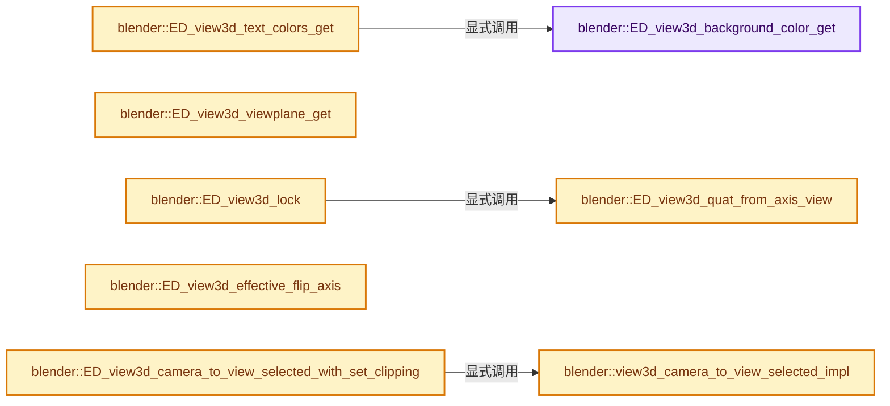
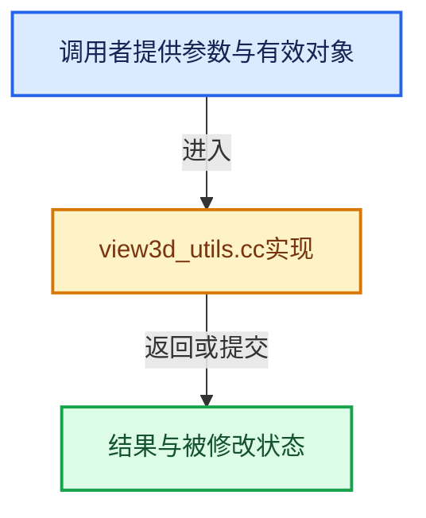

# 实现依赖专题：source/blender/editors/space_view3d/view3d_utils.cc

[方向导航](README.md) · [符号索引](../%E7%AC%A6%E5%8F%B7%E4%BE%9D%E8%B5%96%E4%B8%8E%E5%AE%9E%E7%8E%B0%E7%B4%A2%E5%BC%95.md)

本专题从正文实际调用进入，集中保存共享实现。函数有稳定锚点，可从调用处直接跳到对应完整函数；递归与互相调用通过回链组织。

## 本文件的实现关系






## 完整成员与函数实现

<a id="f-b1b650d1661c68bc"></a>

### `blender::ED_view3d_background_color_get`

实现位置：[source/blender/editors/space_view3d/view3d_utils.cc](../../../../../source/blender/editors/space_view3d/view3d_utils.cc) · L74—L88。

接口参数：

- `const Scene *scene`
- `const View3D *v3d`
- `float r_color[3]`

**教学注释版**

<!-- annotated:224905698ca731 -->

```cpp
void ED_view3d_background_color_get(const Scene *scene, const View3D *v3d, float r_color[3])
{
  if (v3d->shading.background_type == V3D_SHADING_BACKGROUND_WORLD) {
    if (scene->world) {
      copy_v3_v3(r_color, &scene->world->horr);
      return;
    }
  }
  else if (v3d->shading.background_type == V3D_SHADING_BACKGROUND_VIEWPORT) {
    copy_v3_v3(r_color, v3d->shading.background_color);
    return;
  }

  ui::theme::get_color_3fv(TH_BACK, r_color);
}
```

<details>
<summary>核对原始源码：source/blender/editors/space_view3d/view3d_utils.cc · L74—L88</summary>

<!-- original:224905698ca731:source/blender/editors/space_view3d/view3d_utils.cc:74:88 -->

```cpp
void ED_view3d_background_color_get(const Scene *scene, const View3D *v3d, float r_color[3])
{
  if (v3d->shading.background_type == V3D_SHADING_BACKGROUND_WORLD) {
    if (scene->world) {
      copy_v3_v3(r_color, &scene->world->horr);
      return;
    }
  }
  else if (v3d->shading.background_type == V3D_SHADING_BACKGROUND_VIEWPORT) {
    copy_v3_v3(r_color, v3d->shading.background_color);
    return;
  }

  ui::theme::get_color_3fv(TH_BACK, r_color);
}
```

</details>

**继续追踪实现**

- `copy_v3_v3` → [blender::copy_v3_v3 · L47](../12-%E7%A9%BA%E9%97%B4%E6%95%B0%E6%8D%AE%E7%BB%93%E6%9E%84%E4%B8%8E%E5%87%A0%E4%BD%95%E7%AE%97%E6%B3%95/%E4%BE%9D%E8%B5%96-math_vector_inline-0c8541.md#f-037a0d5fa5060bd6)。
- `ui::theme::get_color_3fv` → [blender::ui::theme::get_color_3fv · L1241](%E4%BE%9D%E8%B5%96-resources-ffea13.md#f-6ac6719124c421f4)。

<a id="f-9f6ab23c92831463"></a>

### `blender::ED_view3d_text_colors_get`

实现位置：[source/blender/editors/space_view3d/view3d_utils.cc](../../../../../source/blender/editors/space_view3d/view3d_utils.cc) · L90—L124。

接口参数：

- `const Scene *scene`
- `const View3D *v3d`
- `float r_text_color[4]`
- `float r_shadow_color[4]`

**教学注释版**

<!-- annotated:23eacc0ffc5bbf -->

```cpp
void ED_view3d_text_colors_get(const Scene *scene,
                               const View3D *v3d,
                               float r_text_color[4],
                               float r_shadow_color[4])
{
  /* Text fully opaque, shadow slightly transparent. */
  r_text_color[3] = 1.0f;
  r_shadow_color[3] = 0.8f;

  /* Default text color from TH_TEXT_HI. If it is too close
   * to the background color, darken or lighten it. */
  ui::theme::get_color_3fv(TH_TEXT_HI, r_text_color);
  float text_lightness = srgb_to_grayscale(r_text_color);
  float bg_color[3];
  ED_view3d_background_color_get(scene, v3d, bg_color);
  const float distance = len_v3v3(r_text_color, bg_color);
  if (distance < 0.5f) {
    if (text_lightness > 0.5f) {
      mul_v3_fl(r_text_color, 0.33f);
    }
    else {
      mul_v3_fl(r_text_color, 3.0f);
    }
    clamp_v3(r_text_color, 0.0f, 1.0f);
  }

  /* Shadow color is black or white depending on final text lightness. */
  text_lightness = srgb_to_grayscale(r_text_color);
  if (text_lightness > 0.4f) {
    copy_v3_fl(r_shadow_color, 0.0f);
  }
  else {
    copy_v3_fl(r_shadow_color, 1.0f);
  }
}
```

<details>
<summary>核对原始源码：source/blender/editors/space_view3d/view3d_utils.cc · L90—L124</summary>

<!-- original:23eacc0ffc5bbf:source/blender/editors/space_view3d/view3d_utils.cc:90:124 -->

```cpp
void ED_view3d_text_colors_get(const Scene *scene,
                               const View3D *v3d,
                               float r_text_color[4],
                               float r_shadow_color[4])
{
  /* Text fully opaque, shadow slightly transparent. */
  r_text_color[3] = 1.0f;
  r_shadow_color[3] = 0.8f;

  /* Default text color from TH_TEXT_HI. If it is too close
   * to the background color, darken or lighten it. */
  ui::theme::get_color_3fv(TH_TEXT_HI, r_text_color);
  float text_lightness = srgb_to_grayscale(r_text_color);
  float bg_color[3];
  ED_view3d_background_color_get(scene, v3d, bg_color);
  const float distance = len_v3v3(r_text_color, bg_color);
  if (distance < 0.5f) {
    if (text_lightness > 0.5f) {
      mul_v3_fl(r_text_color, 0.33f);
    }
    else {
      mul_v3_fl(r_text_color, 3.0f);
    }
    clamp_v3(r_text_color, 0.0f, 1.0f);
  }

  /* Shadow color is black or white depending on final text lightness. */
  text_lightness = srgb_to_grayscale(r_text_color);
  if (text_lightness > 0.4f) {
    copy_v3_fl(r_shadow_color, 0.0f);
  }
  else {
    copy_v3_fl(r_shadow_color, 1.0f);
  }
}
```

</details>

**沿实际写入检查状态**

- `r_text_color[3] = 1.0f;`
- `r_shadow_color[3] = 0.8f;`
- `text_lightness = srgb_to_grayscale(r_text_color);`

**继续追踪实现**

- `ui::theme::get_color_3fv` → [blender::ui::theme::get_color_3fv · L1241](%E4%BE%9D%E8%B5%96-resources-ffea13.md#f-6ac6719124c421f4)。
- `srgb_to_grayscale` → [blender::srgb_to_grayscale · L202](../12-%E7%A9%BA%E9%97%B4%E6%95%B0%E6%8D%AE%E7%BB%93%E6%9E%84%E4%B8%8E%E5%87%A0%E4%BD%95%E7%AE%97%E6%B3%95/%E4%BE%9D%E8%B5%96-math_color_inline-48fb4c.md#f-fd5e3aa570e85d4b)。
- `ED_view3d_background_color_get` → [blender::ED_view3d_background_color_get · L74](%E4%BE%9D%E8%B5%96-view3d_utils-7e7e0e.md#f-b1b650d1661c68bc)。
- `len_v3v3` → [blender::len_v3v3 · L826](../12-%E7%A9%BA%E9%97%B4%E6%95%B0%E6%8D%AE%E7%BB%93%E6%9E%84%E4%B8%8E%E5%87%A0%E4%BD%95%E7%AE%97%E6%B3%95/%E4%BE%9D%E8%B5%96-math_vector_inline-0c8541.md#f-c873370566848169)。
- `mul_v3_fl` → [blender::mul_v3_fl · L414](../12-%E7%A9%BA%E9%97%B4%E6%95%B0%E6%8D%AE%E7%BB%93%E6%9E%84%E4%B8%8E%E5%87%A0%E4%BD%95%E7%AE%97%E6%B3%95/%E4%BE%9D%E8%B5%96-math_vector_inline-0c8541.md#f-00165156a06d1224)。
- `clamp_v3` → [blender::clamp_v3 · L1075](../12-%E7%A9%BA%E9%97%B4%E6%95%B0%E6%8D%AE%E7%BB%93%E6%9E%84%E4%B8%8E%E5%87%A0%E4%BD%95%E7%AE%97%E6%B3%95/%E4%BE%9D%E8%B5%96-math_vector_inline-0c8541.md#f-bc39188e63e7b724)。
- `copy_v3_fl` → [blender::copy_v3_fl · L68](../12-%E7%A9%BA%E9%97%B4%E6%95%B0%E6%8D%AE%E7%BB%93%E6%9E%84%E4%B8%8E%E5%87%A0%E4%BD%95%E7%AE%97%E6%B3%95/%E4%BE%9D%E8%B5%96-math_vector_inline-0c8541.md#f-18676f3d43803485)。

<a id="f-eb79bd28205c51d0"></a>

### `blender::ED_view3d_viewplane_get`

实现位置：[source/blender/editors/space_view3d/view3d_utils.cc](../../../../../source/blender/editors/space_view3d/view3d_utils.cc) · L197—L227。

接口参数：

- `const Depsgraph *depsgraph`
- `const View3D *v3d`
- `const RegionView3D *rv3d`
- `int winx`
- `int winy`
- `rctf *r_viewplane`
- `float *r_clip_start`
- `float *r_clip_end`
- `float *r_pixsize`

**教学注释版**

<!-- annotated:0064eb7321df2c -->

```cpp
bool ED_view3d_viewplane_get(const Depsgraph *depsgraph,
                             const View3D *v3d,
                             const RegionView3D *rv3d,
                             int winx,
                             int winy,
                             rctf *r_viewplane,
                             float *r_clip_start,
                             float *r_clip_end,
                             float *r_pixsize)
{
  CameraParams params;

  BKE_camera_params_init(&params);
  BKE_camera_params_from_view3d(&params, depsgraph, v3d, rv3d);
  BKE_camera_params_compute_viewplane(&params, winx, winy, 1.0f, 1.0f);

  if (r_viewplane) {
    *r_viewplane = params.viewplane;
  }
  if (r_clip_start) {
    *r_clip_start = params.clip_start;
  }
  if (r_clip_end) {
    *r_clip_end = params.clip_end;
  }
  if (r_pixsize) {
    *r_pixsize = params.viewdx;
  }

  return params.is_ortho;
}
```

<details>
<summary>核对原始源码：source/blender/editors/space_view3d/view3d_utils.cc · L197—L227</summary>

<!-- original:0064eb7321df2c:source/blender/editors/space_view3d/view3d_utils.cc:197:227 -->

```cpp
bool ED_view3d_viewplane_get(const Depsgraph *depsgraph,
                             const View3D *v3d,
                             const RegionView3D *rv3d,
                             int winx,
                             int winy,
                             rctf *r_viewplane,
                             float *r_clip_start,
                             float *r_clip_end,
                             float *r_pixsize)
{
  CameraParams params;

  BKE_camera_params_init(&params);
  BKE_camera_params_from_view3d(&params, depsgraph, v3d, rv3d);
  BKE_camera_params_compute_viewplane(&params, winx, winy, 1.0f, 1.0f);

  if (r_viewplane) {
    *r_viewplane = params.viewplane;
  }
  if (r_clip_start) {
    *r_clip_start = params.clip_start;
  }
  if (r_clip_end) {
    *r_clip_end = params.clip_end;
  }
  if (r_pixsize) {
    *r_pixsize = params.viewdx;
  }

  return params.is_ortho;
}
```

</details>

**结果出口**

- `return params.is_ortho;`

**继续追踪实现**

- `BKE_camera_params_init` → [blender::BKE_camera_params_init · L365](%E4%BE%9D%E8%B5%96-camera-dbe667.md#f-01921b9d54f56ab2)。
- `BKE_camera_params_from_view3d` → [blender::BKE_camera_params_from_view3d · L425](%E4%BE%9D%E8%B5%96-camera-dbe667.md#f-d5d48392327338ee)。
- `BKE_camera_params_compute_viewplane` → [blender::BKE_camera_params_compute_viewplane · L483](%E4%BE%9D%E8%B5%96-camera-dbe667.md#f-27e265da4ca74d77)。

<a id="f-9a7309004b10f753"></a>

### `blender::ED_view3d_quat_from_axis_view`

实现位置：[source/blender/editors/space_view3d/view3d_utils.cc](../../../../../source/blender/editors/space_view3d/view3d_utils.cc) · L1511—L1521。

接口参数：

- `const eRegionView3D_View view`
- `const eRegionView3D_ViewAxisRoll view_axis_roll`
- `float r_quat[4]`

**教学注释版**

<!-- annotated:441822436d1536 -->

```cpp
bool ED_view3d_quat_from_axis_view(const eRegionView3D_View view,
                                   const eRegionView3D_ViewAxisRoll view_axis_roll,
                                   float r_quat[4])
{
  BLI_assert(view_axis_roll <= RV3D_VIEW_AXIS_ROLL_270);
  if (RV3D_VIEW_IS_AXIS(view)) {
    copy_qt_qt(r_quat, view3d_quat_axis[view - RV3D_VIEW_FRONT][view_axis_roll]);
    return true;
  }
  return false;
}
```

<details>
<summary>核对原始源码：source/blender/editors/space_view3d/view3d_utils.cc · L1511—L1521</summary>

<!-- original:441822436d1536:source/blender/editors/space_view3d/view3d_utils.cc:1511:1521 -->

```cpp
bool ED_view3d_quat_from_axis_view(const eRegionView3D_View view,
                                   const eRegionView3D_ViewAxisRoll view_axis_roll,
                                   float r_quat[4])
{
  BLI_assert(view_axis_roll <= RV3D_VIEW_AXIS_ROLL_270);
  if (RV3D_VIEW_IS_AXIS(view)) {
    copy_qt_qt(r_quat, view3d_quat_axis[view - RV3D_VIEW_FRONT][view_axis_roll]);
    return true;
  }
  return false;
}
```

</details>

**结果出口**

- `return true;`
- `return false;`

**继续追踪实现**

- `BLI_assert` → [BLI_assert · L48](../01-%E5%9F%BA%E7%A1%80%E5%AE%B9%E5%99%A8%E4%B8%8E%E7%8E%B0%E4%BB%A3CPP/%E4%BE%9D%E8%B5%96-BLI_assert-cc98e8.md#m-57a88495704d)；[BLI_assert · L63](../01-%E5%9F%BA%E7%A1%80%E5%AE%B9%E5%99%A8%E4%B8%8E%E7%8E%B0%E4%BB%A3CPP/%E4%BE%9D%E8%B5%96-BLI_assert-cc98e8.md#m-d07050020cb5)。宏定义由构建条件选择。
- `RV3D_VIEW_IS_AXIS` → [RV3D_VIEW_IS_AXIS · L147](%E4%BE%9D%E8%B5%96-DNA_view3d_types-26da97.md#m-d98bb13a4e54)。宏定义由构建条件选择。
- `copy_qt_qt` → [blender::copy_qt_qt · L51](../12-%E7%A9%BA%E9%97%B4%E6%95%B0%E6%8D%AE%E7%BB%93%E6%9E%84%E4%B8%8E%E5%87%A0%E4%BD%95%E7%AE%97%E6%B3%95/%E4%BE%9D%E8%B5%96-math_rotation_c-8e57f4.md#f-503531a8e10b755b)。

<a id="f-6bc68d269d8595b4"></a>

### `blender::ED_view3d_lock`

实现位置：[source/blender/editors/space_view3d/view3d_utils.cc](../../../../../source/blender/editors/space_view3d/view3d_utils.cc) · L1624—L1627。

接口参数：

- `RegionView3D *rv3d`

**教学注释版**

<!-- annotated:2613d81fbc1a1a -->

```cpp
bool ED_view3d_lock(RegionView3D *rv3d)
{
  return ED_view3d_quat_from_axis_view(rv3d->view, rv3d->view_axis_roll, rv3d->viewquat);
}
```

<details>
<summary>核对原始源码：source/blender/editors/space_view3d/view3d_utils.cc · L1624—L1627</summary>

<!-- original:2613d81fbc1a1a:source/blender/editors/space_view3d/view3d_utils.cc:1624:1627 -->

```cpp
bool ED_view3d_lock(RegionView3D *rv3d)
{
  return ED_view3d_quat_from_axis_view(rv3d->view, rv3d->view_axis_roll, rv3d->viewquat);
}
```

</details>

**结果出口**

- `return ED_view3d_quat_from_axis_view(rv3d->view, rv3d->view_axis_roll, rv3d->viewquat);`

**继续追踪实现**

- `ED_view3d_quat_from_axis_view` → [blender::ED_view3d_quat_from_axis_view · L1511](%E4%BE%9D%E8%B5%96-view3d_utils-7e7e0e.md#f-9a7309004b10f753)。

<a id="f-8fa1a68ce3d5f383"></a>

### `blender::ED_view3d_effective_flip_axis`

实现位置：[source/blender/editors/space_view3d/view3d_utils.cc](../../../../../source/blender/editors/space_view3d/view3d_utils.cc) · L1629—L1668。

接口参数：

- `const RegionView3D *rv3d`

**教学注释版**

<!-- annotated:713d8f263b5bcc -->

```cpp
eRegionView3D_ViewFlipRoll ED_view3d_effective_flip_axis(const RegionView3D *rv3d)
{
  constexpr float angle_threshold = 0.02f;

  if ((rv3d->rflag & RV3D_FLIP_X) != 0) {
    if (math::abs(rv3d->camroll) < angle_threshold) {
      return eRegionView3D_ViewFlipRoll::FlipX;
    }

    if (math::abs(rv3d->camroll - M_PI) < angle_threshold ||
        math::abs(rv3d->camroll + M_PI) < angle_threshold)
    {
      return eRegionView3D_ViewFlipRoll::FlipY;
    }

    return eRegionView3D_ViewFlipRoll::FlipOther;
  }

  if (math::abs(rv3d->camroll) < angle_threshold) {
    return eRegionView3D_ViewFlipRoll::Roll0;
  }

  if (math::abs(rv3d->camroll - M_PI / 2.0f) < angle_threshold) {
    return eRegionView3D_ViewFlipRoll::Roll90;
  }

  if (math::abs(rv3d->camroll - M_PI) < angle_threshold ||
      math::abs(rv3d->camroll + M_PI) < angle_threshold)
  {
    return eRegionView3D_ViewFlipRoll::Roll180;
  }

  if (math::abs(rv3d->camroll - M_PI * 3.0f / 2.0f) < angle_threshold ||
      math::abs(rv3d->camroll + M_PI / 2.0f) < angle_threshold)
  {
    return eRegionView3D_ViewFlipRoll::Roll270;
  }

  return eRegionView3D_ViewFlipRoll::RollOther;
}
```

<details>
<summary>核对原始源码：source/blender/editors/space_view3d/view3d_utils.cc · L1629—L1668</summary>

<!-- original:713d8f263b5bcc:source/blender/editors/space_view3d/view3d_utils.cc:1629:1668 -->

```cpp
eRegionView3D_ViewFlipRoll ED_view3d_effective_flip_axis(const RegionView3D *rv3d)
{
  constexpr float angle_threshold = 0.02f;

  if ((rv3d->rflag & RV3D_FLIP_X) != 0) {
    if (math::abs(rv3d->camroll) < angle_threshold) {
      return eRegionView3D_ViewFlipRoll::FlipX;
    }

    if (math::abs(rv3d->camroll - M_PI) < angle_threshold ||
        math::abs(rv3d->camroll + M_PI) < angle_threshold)
    {
      return eRegionView3D_ViewFlipRoll::FlipY;
    }

    return eRegionView3D_ViewFlipRoll::FlipOther;
  }

  if (math::abs(rv3d->camroll) < angle_threshold) {
    return eRegionView3D_ViewFlipRoll::Roll0;
  }

  if (math::abs(rv3d->camroll - M_PI / 2.0f) < angle_threshold) {
    return eRegionView3D_ViewFlipRoll::Roll90;
  }

  if (math::abs(rv3d->camroll - M_PI) < angle_threshold ||
      math::abs(rv3d->camroll + M_PI) < angle_threshold)
  {
    return eRegionView3D_ViewFlipRoll::Roll180;
  }

  if (math::abs(rv3d->camroll - M_PI * 3.0f / 2.0f) < angle_threshold ||
      math::abs(rv3d->camroll + M_PI / 2.0f) < angle_threshold)
  {
    return eRegionView3D_ViewFlipRoll::Roll270;
  }

  return eRegionView3D_ViewFlipRoll::RollOther;
}
```

</details>

**结果出口**

- `return eRegionView3D_ViewFlipRoll::FlipX;`
- `return eRegionView3D_ViewFlipRoll::FlipY;`
- `return eRegionView3D_ViewFlipRoll::FlipOther;`
- `return eRegionView3D_ViewFlipRoll::Roll0;`
- `return eRegionView3D_ViewFlipRoll::Roll90;`
- `return eRegionView3D_ViewFlipRoll::Roll180;`
- `return eRegionView3D_ViewFlipRoll::Roll270;`
- `return eRegionView3D_ViewFlipRoll::RollOther;`

**继续追踪实现**

- `math::abs` → [blender::math::abs · L38](../12-%E7%A9%BA%E9%97%B4%E6%95%B0%E6%8D%AE%E7%BB%93%E6%9E%84%E4%B8%8E%E5%87%A0%E4%BD%95%E7%AE%97%E6%B3%95/%E4%BE%9D%E8%B5%96-BLI_math_vector-906a87.md#f-e755530125bc2198)；[blender::math::abs · L201](../12-%E7%A9%BA%E9%97%B4%E6%95%B0%E6%8D%AE%E7%BB%93%E6%9E%84%E4%B8%8E%E5%87%A0%E4%BD%95%E7%AE%97%E6%B3%95/%E4%BE%9D%E8%B5%96-BLI_math_basis_types-fc7090.md#f-a137ffce39989ffc)；[blender::math::abs · L33](../12-%E7%A9%BA%E9%97%B4%E6%95%B0%E6%8D%AE%E7%BB%93%E6%9E%84%E4%B8%8E%E5%87%A0%E4%BD%95%E7%AE%97%E6%B3%95/%E4%BE%9D%E8%B5%96-BLI_math_base-0728eb.md#f-a2c9c981f4e8420c)。同名重载需按实参类型选择。

<a id="f-0b7f5c4fadd21a10"></a>

### `blender::view3d_camera_to_view_selected_impl`

实现位置：[source/blender/editors/space_view3d/view3d_utils.cc](../../../../../source/blender/editors/space_view3d/view3d_utils.cc) · L1761—L1804。

接口参数：

- `Main *bmain`
- `Depsgraph *depsgraph`
- `const Scene *scene`
- `Object *camera_ob`
- `float *r_clip_start`
- `float *r_clip_end`

**教学注释版**

<!-- annotated:150da710f079e8 -->

```cpp
static bool view3d_camera_to_view_selected_impl(Main *bmain,
                                                Depsgraph *depsgraph,
                                                const Scene *scene,
                                                Object *camera_ob,
                                                float *r_clip_start,
                                                float *r_clip_end)
{
  Object *camera_ob_eval = DEG_get_evaluated(depsgraph, camera_ob);
  float co[3]; /* the new location to apply */
  float scale; /* only for ortho cameras */

  if (BKE_camera_view_frame_fit_to_scene(
          depsgraph, scene, camera_ob_eval, co, &scale, r_clip_start, r_clip_end))
  {
    ObjectTfmProtectedChannels obtfm;
    float obmat_new[4][4];
    bool is_ortho_camera = false;

    if ((camera_ob_eval->type == OB_CAMERA) &&
        ((id_cast<Camera *>(camera_ob_eval->data))->type == CAM_ORTHO))
    {
      (id_cast<Camera *>(camera_ob->data))->ortho_scale = scale;
      is_ortho_camera = true;
    }

    copy_m4_m4(obmat_new, camera_ob_eval->object_to_world().ptr());
    copy_v3_v3(obmat_new[3], co);

    /* only touch location */
    BKE_object_tfm_protected_backup(camera_ob, &obtfm);
    BKE_object_apply_mat4(camera_ob, obmat_new, true, true);
    BKE_object_tfm_protected_restore(camera_ob, &obtfm, OB_LOCK_SCALE | OB_LOCK_ROT4D);

    /* notifiers */
    DEG_id_tag_update_ex(bmain, &camera_ob->id, ID_RECALC_TRANSFORM);
    if (is_ortho_camera) {
      DEG_id_tag_update_ex(bmain, camera_ob->data, ID_RECALC_PARAMETERS);
    }

    return true;
  }

  return false;
}
```

<details>
<summary>核对原始源码：source/blender/editors/space_view3d/view3d_utils.cc · L1761—L1804</summary>

<!-- original:150da710f079e8:source/blender/editors/space_view3d/view3d_utils.cc:1761:1804 -->

```cpp
static bool view3d_camera_to_view_selected_impl(Main *bmain,
                                                Depsgraph *depsgraph,
                                                const Scene *scene,
                                                Object *camera_ob,
                                                float *r_clip_start,
                                                float *r_clip_end)
{
  Object *camera_ob_eval = DEG_get_evaluated(depsgraph, camera_ob);
  float co[3]; /* the new location to apply */
  float scale; /* only for ortho cameras */

  if (BKE_camera_view_frame_fit_to_scene(
          depsgraph, scene, camera_ob_eval, co, &scale, r_clip_start, r_clip_end))
  {
    ObjectTfmProtectedChannels obtfm;
    float obmat_new[4][4];
    bool is_ortho_camera = false;

    if ((camera_ob_eval->type == OB_CAMERA) &&
        ((id_cast<Camera *>(camera_ob_eval->data))->type == CAM_ORTHO))
    {
      (id_cast<Camera *>(camera_ob->data))->ortho_scale = scale;
      is_ortho_camera = true;
    }

    copy_m4_m4(obmat_new, camera_ob_eval->object_to_world().ptr());
    copy_v3_v3(obmat_new[3], co);

    /* only touch location */
    BKE_object_tfm_protected_backup(camera_ob, &obtfm);
    BKE_object_apply_mat4(camera_ob, obmat_new, true, true);
    BKE_object_tfm_protected_restore(camera_ob, &obtfm, OB_LOCK_SCALE | OB_LOCK_ROT4D);

    /* notifiers */
    DEG_id_tag_update_ex(bmain, &camera_ob->id, ID_RECALC_TRANSFORM);
    if (is_ortho_camera) {
      DEG_id_tag_update_ex(bmain, camera_ob->data, ID_RECALC_PARAMETERS);
    }

    return true;
  }

  return false;
}
```

</details>

**沿实际写入检查状态**

- `is_ortho_camera = true;`

**结果出口**

- `return true;`
- `return false;`

**继续追踪实现**

- `DEG_get_evaluated` → [blender::DEG_get_evaluated · L106](../11-Depsgraph%E4%B8%8E%E5%B9%B6%E8%A1%8C%E4%BB%BB%E5%8A%A1%E7%B3%BB%E7%BB%9F/%E4%BE%9D%E8%B5%96-DEG_depsgraph_query-db0d31.md#f-e70143fa875363bf)；[blender::DEG_get_evaluated · L112](../11-Depsgraph%E4%B8%8E%E5%B9%B6%E8%A1%8C%E4%BB%BB%E5%8A%A1%E7%B3%BB%E7%BB%9F/%E4%BE%9D%E8%B5%96-DEG_depsgraph_query-db0d31.md#f-129df72cfb5a1bad)。同名重载需按实参类型选择。
- `BKE_camera_view_frame_fit_to_scene` → [blender::BKE_camera_view_frame_fit_to_scene · L1051](%E4%BE%9D%E8%B5%96-camera-dbe667.md#f-acbfd199ed544ec9)。
- `id_cast<Camera *>` → [blender::id_cast · L1417](%E4%BE%9D%E8%B5%96-DNA_ID-3eb091.md#f-6c8ac6412850ac5a)。
- `copy_m4_m4` → [blender::copy_m4_m4 · L84](../12-%E7%A9%BA%E9%97%B4%E6%95%B0%E6%8D%AE%E7%BB%93%E6%9E%84%E4%B8%8E%E5%87%A0%E4%BD%95%E7%AE%97%E6%B3%95/%E4%BE%9D%E8%B5%96-math_matrix_c-004123.md#f-b4390cf8c94710f5)。
- `camera_ob_eval->object_to_world().ptr` → [调用协议](../%E6%A8%A1%E6%9D%BF%E5%AE%8F%E4%B8%8E%E5%8A%A8%E6%80%81%E5%88%86%E6%B4%BE%E5%8D%8F%E8%AE%AE.md)：接收对象类型依赖auto、返回值或模板实例；不按同名猜测目标。调用位置L1786。
- `camera_ob_eval->object_to_world` → [blender::Object::object_to_world · L5761](%E4%BE%9D%E8%B5%96-object-843689.md#f-12fc20026327d50c)。
- `copy_v3_v3` → [blender::copy_v3_v3 · L47](../12-%E7%A9%BA%E9%97%B4%E6%95%B0%E6%8D%AE%E7%BB%93%E6%9E%84%E4%B8%8E%E5%87%A0%E4%BD%95%E7%AE%97%E6%B3%95/%E4%BE%9D%E8%B5%96-math_vector_inline-0c8541.md#f-037a0d5fa5060bd6)。
- `BKE_object_tfm_protected_backup` → [blender::BKE_object_tfm_protected_backup · L3025](%E4%BE%9D%E8%B5%96-object-843689.md#f-d21e7cf959cb0e94)。
- `BKE_object_apply_mat4` → [blender::BKE_object_apply_mat4 · L3663](%E4%BE%9D%E8%B5%96-object-843689.md#f-62f5d5579a370f40)。
- `BKE_object_tfm_protected_restore` → [blender::BKE_object_tfm_protected_restore · L3050](%E4%BE%9D%E8%B5%96-object-843689.md#f-db3e7936012760b0)。
- `DEG_id_tag_update_ex` → [blender::DEG_id_tag_update_ex · L849](../11-Depsgraph%E4%B8%8E%E5%B9%B6%E8%A1%8C%E4%BB%BB%E5%8A%A1%E7%B3%BB%E7%BB%9F/%E4%BE%9D%E8%B5%96-depsgraph_tag-d8b3c7.md#f-6396e6eeab36fb34)。

<a id="f-03c9a7efbb1bd6d8"></a>

### `blender::ED_view3d_camera_to_view_selected_with_set_clipping`

实现位置：[source/blender/editors/space_view3d/view3d_utils.cc](../../../../../source/blender/editors/space_view3d/view3d_utils.cc) · L1814—L1837。

接口参数：

- `Main *bmain`
- `Depsgraph *depsgraph`
- `const Scene *scene`
- `Object *camera_ob`

**教学注释版**

<!-- annotated:17bfad4a6b800d -->

```cpp
bool ED_view3d_camera_to_view_selected_with_set_clipping(Main *bmain,
                                                         Depsgraph *depsgraph,
                                                         const Scene *scene,
                                                         Object *camera_ob)
{
  float clip_start;
  float clip_end;
  if (view3d_camera_to_view_selected_impl(
          bmain, depsgraph, scene, camera_ob, &clip_start, &clip_end))
  {

    (id_cast<Camera *>(camera_ob->data))->clip_start = clip_start;
    (id_cast<Camera *>(camera_ob->data))->clip_end = clip_end;

    /* TODO: Support update via #ID_RECALC_PARAMETERS. */
    Object *camera_ob_eval = DEG_get_evaluated(depsgraph, camera_ob);
    (id_cast<Camera *>(camera_ob_eval->data))->clip_start = clip_start;
    (id_cast<Camera *>(camera_ob_eval->data))->clip_end = clip_end;

    return true;
  }

  return false;
}
```

<details>
<summary>核对原始源码：source/blender/editors/space_view3d/view3d_utils.cc · L1814—L1837</summary>

<!-- original:17bfad4a6b800d:source/blender/editors/space_view3d/view3d_utils.cc:1814:1837 -->

```cpp
bool ED_view3d_camera_to_view_selected_with_set_clipping(Main *bmain,
                                                         Depsgraph *depsgraph,
                                                         const Scene *scene,
                                                         Object *camera_ob)
{
  float clip_start;
  float clip_end;
  if (view3d_camera_to_view_selected_impl(
          bmain, depsgraph, scene, camera_ob, &clip_start, &clip_end))
  {

    (id_cast<Camera *>(camera_ob->data))->clip_start = clip_start;
    (id_cast<Camera *>(camera_ob->data))->clip_end = clip_end;

    /* TODO: Support update via #ID_RECALC_PARAMETERS. */
    Object *camera_ob_eval = DEG_get_evaluated(depsgraph, camera_ob);
    (id_cast<Camera *>(camera_ob_eval->data))->clip_start = clip_start;
    (id_cast<Camera *>(camera_ob_eval->data))->clip_end = clip_end;

    return true;
  }

  return false;
}
```

</details>

**结果出口**

- `return true;`
- `return false;`

**继续追踪实现**

- `view3d_camera_to_view_selected_impl` → [blender::view3d_camera_to_view_selected_impl · L1761](%E4%BE%9D%E8%B5%96-view3d_utils-7e7e0e.md#f-0b7f5c4fadd21a10)。
- `id_cast<Camera *>` → [blender::id_cast · L1417](%E4%BE%9D%E8%B5%96-DNA_ID-3eb091.md#f-6c8ac6412850ac5a)。
- `DEG_get_evaluated` → [blender::DEG_get_evaluated · L106](../11-Depsgraph%E4%B8%8E%E5%B9%B6%E8%A1%8C%E4%BB%BB%E5%8A%A1%E7%B3%BB%E7%BB%9F/%E4%BE%9D%E8%B5%96-DEG_depsgraph_query-db0d31.md#f-e70143fa875363bf)；[blender::DEG_get_evaluated · L112](../11-Depsgraph%E4%B8%8E%E5%B9%B6%E8%A1%8C%E4%BB%BB%E5%8A%A1%E7%B3%BB%E7%BB%9F/%E4%BE%9D%E8%B5%96-DEG_depsgraph_query-db0d31.md#f-129df72cfb5a1bad)。同名重载需按实参类型选择。
