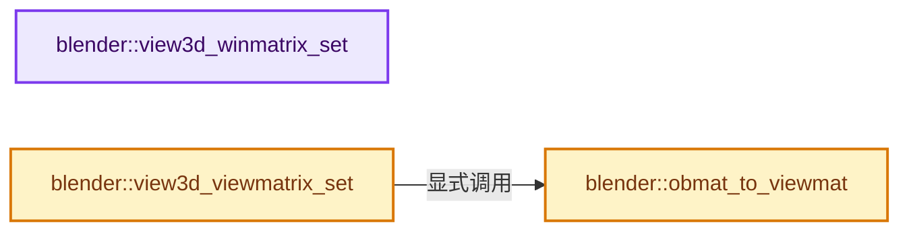
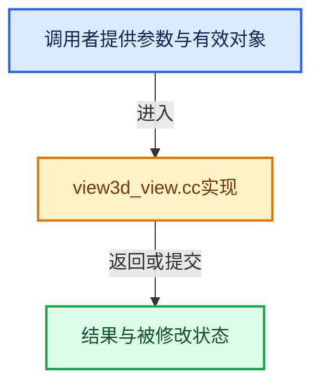

# 实现依赖专题：source/blender/editors/space_view3d/view3d_view.cc

[方向导航](README.md) · [符号索引](../%E7%AC%A6%E5%8F%B7%E4%BE%9D%E8%B5%96%E4%B8%8E%E5%AE%9E%E7%8E%B0%E7%B4%A2%E5%BC%95.md)

本专题从正文实际调用进入，集中保存共享实现。函数有稳定锚点，可从调用处直接跳到对应完整函数；递归与互相调用通过回链组织。

## 本文件的实现关系






## 完整成员与函数实现

<a id="f-ffd9eb47dc8954a6"></a>

### `blender::view3d_winmatrix_set`

实现位置：[source/blender/editors/space_view3d/view3d_view.cc](../../../../../source/blender/editors/space_view3d/view3d_view.cc) · L318—L380。

接口参数：

- `const Depsgraph *depsgraph`
- `ARegion *region`
- `const View3D *v3d`
- `const rcti *rect`

**教学注释版**

<!-- annotated:a8020ab8613f23 -->

```cpp
void view3d_winmatrix_set(const Depsgraph *depsgraph,
                          ARegion *region,
                          const View3D *v3d,
                          const rcti *rect)
{
  RegionView3D *rv3d = static_cast<RegionView3D *>(region->regiondata);
  rctf full_viewplane;
  float clipsta, clipend;
  bool is_ortho;

  is_ortho = ED_view3d_viewplane_get(depsgraph,
                                     v3d,
                                     rv3d,
                                     region->winx,
                                     region->winy,
                                     &full_viewplane,
                                     &clipsta,
                                     &clipend,
                                     nullptr);
  rv3d->is_persp = !is_ortho;

#if 0
  printf("%s: %d %d %f %f %f %f %f %f\n",
         __func__,
         winx,
         winy,
         full_viewplane.xmin,
         full_viewplane.ymin,
         full_viewplane.xmax,
         full_viewplane.ymax,
         clipsta,
         clipend);
#endif

  /* Note the code here was tweaked to avoid an apparent compiler bug in clang 13 (see #91680). */
  rctf viewplane;
  if (rect) {
    /* Smaller viewplane subset for selection picking. */
    viewplane.xmin = full_viewplane.xmin +
                     (BLI_rctf_size_x(&full_viewplane) * (rect->xmin / float(region->winx)));
    viewplane.ymin = full_viewplane.ymin +
                     (BLI_rctf_size_y(&full_viewplane) * (rect->ymin / float(region->winy)));
    viewplane.xmax = full_viewplane.xmin +
                     (BLI_rctf_size_x(&full_viewplane) * (rect->xmax / float(region->winx)));
    viewplane.ymax = full_viewplane.ymin +
                     (BLI_rctf_size_y(&full_viewplane) * (rect->ymax / float(region->winy)));
  }
  else {
    viewplane = full_viewplane;
  }

  if (is_ortho) {
    GPU_matrix_ortho_set(
        viewplane.xmin, viewplane.xmax, viewplane.ymin, viewplane.ymax, clipsta, clipend);
  }
  else {
    GPU_matrix_frustum_set(
        viewplane.xmin, viewplane.xmax, viewplane.ymin, viewplane.ymax, clipsta, clipend);
  }

  /* update matrix in 3d view region */
  GPU_matrix_projection_get(rv3d->winmat);
}
```

<details>
<summary>核对原始源码：source/blender/editors/space_view3d/view3d_view.cc · L318—L380</summary>

<!-- original:a8020ab8613f23:source/blender/editors/space_view3d/view3d_view.cc:318:380 -->

```cpp
void view3d_winmatrix_set(const Depsgraph *depsgraph,
                          ARegion *region,
                          const View3D *v3d,
                          const rcti *rect)
{
  RegionView3D *rv3d = static_cast<RegionView3D *>(region->regiondata);
  rctf full_viewplane;
  float clipsta, clipend;
  bool is_ortho;

  is_ortho = ED_view3d_viewplane_get(depsgraph,
                                     v3d,
                                     rv3d,
                                     region->winx,
                                     region->winy,
                                     &full_viewplane,
                                     &clipsta,
                                     &clipend,
                                     nullptr);
  rv3d->is_persp = !is_ortho;

#if 0
  printf("%s: %d %d %f %f %f %f %f %f\n",
         __func__,
         winx,
         winy,
         full_viewplane.xmin,
         full_viewplane.ymin,
         full_viewplane.xmax,
         full_viewplane.ymax,
         clipsta,
         clipend);
#endif

  /* Note the code here was tweaked to avoid an apparent compiler bug in clang 13 (see #91680). */
  rctf viewplane;
  if (rect) {
    /* Smaller viewplane subset for selection picking. */
    viewplane.xmin = full_viewplane.xmin +
                     (BLI_rctf_size_x(&full_viewplane) * (rect->xmin / float(region->winx)));
    viewplane.ymin = full_viewplane.ymin +
                     (BLI_rctf_size_y(&full_viewplane) * (rect->ymin / float(region->winy)));
    viewplane.xmax = full_viewplane.xmin +
                     (BLI_rctf_size_x(&full_viewplane) * (rect->xmax / float(region->winx)));
    viewplane.ymax = full_viewplane.ymin +
                     (BLI_rctf_size_y(&full_viewplane) * (rect->ymax / float(region->winy)));
  }
  else {
    viewplane = full_viewplane;
  }

  if (is_ortho) {
    GPU_matrix_ortho_set(
        viewplane.xmin, viewplane.xmax, viewplane.ymin, viewplane.ymax, clipsta, clipend);
  }
  else {
    GPU_matrix_frustum_set(
        viewplane.xmin, viewplane.xmax, viewplane.ymin, viewplane.ymax, clipsta, clipend);
  }

  /* update matrix in 3d view region */
  GPU_matrix_projection_get(rv3d->winmat);
}
```

</details>

**沿实际写入检查状态**

- `is_ortho = ED_view3d_viewplane_get(depsgraph,`
- `rv3d->is_persp = !is_ortho;`
- `viewplane.xmin = full_viewplane.xmin +`
- `viewplane.ymin = full_viewplane.ymin +`
- `viewplane.xmax = full_viewplane.xmin +`
- `viewplane.ymax = full_viewplane.ymin +`
- `viewplane = full_viewplane;`

**继续追踪实现**

- `ED_view3d_viewplane_get` → [blender::ED_view3d_viewplane_get · L197](%E4%BE%9D%E8%B5%96-view3d_utils-7e7e0e.md#f-eb79bd28205c51d0)。
- `printf` → [外部契约](https://eel.is/c++draft/)：这个边界按实际表达式及所属类型核对参数、返回值、寿命与失败行为。这里提供接口入口，不声称已解释该第三方版本的内部实现。
- `BLI_rctf_size_x` → [blender::BLI_rctf_size_x · L211](../01-%E5%9F%BA%E7%A1%80%E5%AE%B9%E5%99%A8%E4%B8%8E%E7%8E%B0%E4%BB%A3CPP/%E4%BE%9D%E8%B5%96-BLI_rect-2996c6.md#f-017b86a9d189e3ba)。
- `BLI_rctf_size_y` → [blender::BLI_rctf_size_y · L215](../01-%E5%9F%BA%E7%A1%80%E5%AE%B9%E5%99%A8%E4%B8%8E%E7%8E%B0%E4%BB%A3CPP/%E4%BE%9D%E8%B5%96-BLI_rect-2996c6.md#f-6d179bc3c1b71b0e)。
- `GPU_matrix_ortho_set` → [blender::GPU_matrix_ortho_set · L400](%E4%BE%9D%E8%B5%96-gpu_matrix-f7dc40.md#f-0bb5e2d8c02c2c99)。
- `GPU_matrix_frustum_set` → [blender::GPU_matrix_frustum_set · L423](%E4%BE%9D%E8%B5%96-gpu_matrix-f7dc40.md#f-618e253c5c23f237)。
- `GPU_matrix_projection_get` → [blender::GPU_matrix_projection_get · L563](%E4%BE%9D%E8%B5%96-gpu_matrix-f7dc40.md#f-0898a9a110e7a668)。

<a id="f-ce6c841a5b7ebd99"></a>

### `blender::obmat_to_viewmat`

实现位置：[source/blender/editors/space_view3d/view3d_view.cc](../../../../../source/blender/editors/space_view3d/view3d_view.cc) · L382—L403。

接口参数：

- `RegionView3D *rv3d`
- `Object *ob`

**教学注释版**

<!-- annotated:006a3a6655207f -->

```cpp
static void obmat_to_viewmat(RegionView3D *rv3d, Object *ob)
{
  float bmat[4][4];

  rv3d->view = RV3D_VIEW_USER; /* don't show the grid */

  normalize_m4_m4(bmat, ob->object_to_world().ptr());
  /* Apply roll. */
  if (rv3d->camroll != 0.0f) {
    rotate_m4(bmat, 'Z', -rv3d->camroll);
  }
  invert_m4_m4(rv3d->viewmat, bmat);

  /* view quat calculation, needed for add object */
  mat4_normalized_to_quat(rv3d->viewquat, rv3d->viewmat);

  if (rv3d->rflag & RV3D_FLIP_X) {
    transpose_m4(rv3d->viewmat);
    negate_v4(rv3d->viewmat[0]);
    transpose_m4(rv3d->viewmat);
  }
}
```

<details>
<summary>核对原始源码：source/blender/editors/space_view3d/view3d_view.cc · L382—L403</summary>

<!-- original:006a3a6655207f:source/blender/editors/space_view3d/view3d_view.cc:382:403 -->

```cpp
static void obmat_to_viewmat(RegionView3D *rv3d, Object *ob)
{
  float bmat[4][4];

  rv3d->view = RV3D_VIEW_USER; /* don't show the grid */

  normalize_m4_m4(bmat, ob->object_to_world().ptr());
  /* Apply roll. */
  if (rv3d->camroll != 0.0f) {
    rotate_m4(bmat, 'Z', -rv3d->camroll);
  }
  invert_m4_m4(rv3d->viewmat, bmat);

  /* view quat calculation, needed for add object */
  mat4_normalized_to_quat(rv3d->viewquat, rv3d->viewmat);

  if (rv3d->rflag & RV3D_FLIP_X) {
    transpose_m4(rv3d->viewmat);
    negate_v4(rv3d->viewmat[0]);
    transpose_m4(rv3d->viewmat);
  }
}
```

</details>

**沿实际写入检查状态**

- `rv3d->view = RV3D_VIEW_USER; /* don't show the grid */`

**继续追踪实现**

- `normalize_m4_m4` → [blender::normalize_m4_m4 · L1790](../12-%E7%A9%BA%E9%97%B4%E6%95%B0%E6%8D%AE%E7%BB%93%E6%9E%84%E4%B8%8E%E5%87%A0%E4%BD%95%E7%AE%97%E6%B3%95/%E4%BE%9D%E8%B5%96-math_matrix_c-004123.md#f-e2367d2fa1b43ad2)。
- `ob->object_to_world().ptr` → [调用协议](../%E6%A8%A1%E6%9D%BF%E5%AE%8F%E4%B8%8E%E5%8A%A8%E6%80%81%E5%88%86%E6%B4%BE%E5%8D%8F%E8%AE%AE.md)：接收对象类型依赖auto、返回值或模板实例；不按同名猜测目标。调用位置L388。
- `ob->object_to_world` → [blender::Object::object_to_world · L5761](%E4%BE%9D%E8%B5%96-object-843689.md#f-12fc20026327d50c)。
- `rotate_m4` → [blender::rotate_m4 · L2115](../12-%E7%A9%BA%E9%97%B4%E6%95%B0%E6%8D%AE%E7%BB%93%E6%9E%84%E4%B8%8E%E5%87%A0%E4%BD%95%E7%AE%97%E6%B3%95/%E4%BE%9D%E8%B5%96-math_matrix_c-004123.md#f-c255c473f69e9d03)。
- `invert_m4_m4` → [blender::invert_m4_m4 · L1150](../12-%E7%A9%BA%E9%97%B4%E6%95%B0%E6%8D%AE%E7%BB%93%E6%9E%84%E4%B8%8E%E5%87%A0%E4%BD%95%E7%AE%97%E6%B3%95/%E4%BE%9D%E8%B5%96-math_matrix_c-004123.md#f-c75789f10cdd5b92)。
- `mat4_normalized_to_quat` → [blender::mat4_normalized_to_quat · L410](../12-%E7%A9%BA%E9%97%B4%E6%95%B0%E6%8D%AE%E7%BB%93%E6%9E%84%E4%B8%8E%E5%87%A0%E4%BD%95%E7%AE%97%E6%B3%95/%E4%BE%9D%E8%B5%96-math_rotation_c-8e57f4.md#f-504759742542c99d)。
- `transpose_m4` → [blender::transpose_m4 · L1244](../12-%E7%A9%BA%E9%97%B4%E6%95%B0%E6%8D%AE%E7%BB%93%E6%9E%84%E4%B8%8E%E5%87%A0%E4%BD%95%E7%AE%97%E6%B3%95/%E4%BE%9D%E8%B5%96-math_matrix_c-004123.md#f-21ae38279292b2d6)。
- `negate_v4` → [blender::negate_v4 · L585](../12-%E7%A9%BA%E9%97%B4%E6%95%B0%E6%8D%AE%E7%BB%93%E6%9E%84%E4%B8%8E%E5%87%A0%E4%BD%95%E7%AE%97%E6%B3%95/%E4%BE%9D%E8%B5%96-math_vector_inline-0c8541.md#f-3b5c284e08b20579)。

<a id="f-76a23480c02e01ab"></a>

### `blender::view3d_viewmatrix_set`

实现位置：[source/blender/editors/space_view3d/view3d_view.cc](../../../../../source/blender/editors/space_view3d/view3d_view.cc) · L405—L486。

接口参数：

- `const Depsgraph *depsgraph`
- `const Scene *scene`
- `const View3D *v3d`
- `RegionView3D *rv3d`
- `const float rect_scale[2]`

**教学注释版**

<!-- annotated:3628d9465b7ece -->

```cpp
void view3d_viewmatrix_set(const Depsgraph *depsgraph,
                           const Scene *scene,
                           const View3D *v3d,
                           RegionView3D *rv3d,
                           const float rect_scale[2])
{
  if (rv3d->persp == RV3D_CAMOB) { /* obs/camera */
    if (v3d->camera) {
      Object *ob_camera_eval = DEG_get_evaluated(depsgraph, v3d->camera);
      obmat_to_viewmat(rv3d, ob_camera_eval);
    }
    else {
      quat_to_mat4(rv3d->viewmat, rv3d->viewquat);
      rv3d->viewmat[3][2] -= rv3d->dist;
    }
  }
  else {
    bool use_lock_ofs = false;

    /* should be moved to better initialize later on XXX */
    if (RV3D_LOCK_FLAGS(rv3d) & RV3D_LOCK_ROTATION) {
      ED_view3d_lock(rv3d);
    }

    quat_to_mat4(rv3d->viewmat, rv3d->viewquat);
    if (rv3d->persp == RV3D_PERSP) {
      rv3d->viewmat[3][2] -= rv3d->dist;
    }
    if (v3d->ob_center) {
      Object *ob_eval = DEG_get_evaluated(depsgraph, v3d->ob_center);
      float vec[3];

      copy_v3_v3(vec, ob_eval->object_to_world().location());
      if (ob_eval->type == OB_ARMATURE && v3d->ob_center_bone[0]) {
        bPoseChannel *pchan = BKE_pose_channel_find_name(ob_eval->pose, v3d->ob_center_bone);
        if (pchan) {
          copy_v3_v3(vec, pchan->pose_mat[3]);
          mul_m4_v3(ob_eval->object_to_world().ptr(), vec);
        }
      }
      translate_m4(rv3d->viewmat, -vec[0], -vec[1], -vec[2]);
      use_lock_ofs = true;
    }
    else if (v3d->ob_center_cursor) {
      float vec[3];
      copy_v3_v3(vec, scene->cursor.location);
      translate_m4(rv3d->viewmat, -vec[0], -vec[1], -vec[2]);
      use_lock_ofs = true;
    }
    else {
      translate_m4(rv3d->viewmat, rv3d->ofs[0], rv3d->ofs[1], rv3d->ofs[2]);
    }

    /* lock offset */
    if (use_lock_ofs) {
      float persmat[4][4], persinv[4][4];
      float vec[3];

      /* we could calculate the real persmat/persinv here
       * but it would be unreliable so better to later */
      mul_m4_m4m4(persmat, rv3d->winmat, rv3d->viewmat);
      invert_m4_m4(persinv, persmat);

      mul_v2_v2fl(vec, rv3d->ofs_lock, rv3d->is_persp ? rv3d->dist : 1.0f);
      vec[2] = 0.0f;

      if (rect_scale) {
        /* Since `RegionView3D.winmat` has been calculated and this function doesn't take the
         * #ARegion we don't know about the region size.
         * Use `rect_scale` when drawing a sub-region to apply 2D offset,
         * scaled by the difference between the sub-region and the region size.
         */
        vec[0] /= rect_scale[0];
        vec[1] /= rect_scale[1];
      }

      mul_mat3_m4_v3(persinv, vec);
      translate_m4(rv3d->viewmat, vec[0], vec[1], vec[2]);
    }
    /* end lock offset */
  }
}
```

<details>
<summary>核对原始源码：source/blender/editors/space_view3d/view3d_view.cc · L405—L486</summary>

<!-- original:3628d9465b7ece:source/blender/editors/space_view3d/view3d_view.cc:405:486 -->

```cpp
void view3d_viewmatrix_set(const Depsgraph *depsgraph,
                           const Scene *scene,
                           const View3D *v3d,
                           RegionView3D *rv3d,
                           const float rect_scale[2])
{
  if (rv3d->persp == RV3D_CAMOB) { /* obs/camera */
    if (v3d->camera) {
      Object *ob_camera_eval = DEG_get_evaluated(depsgraph, v3d->camera);
      obmat_to_viewmat(rv3d, ob_camera_eval);
    }
    else {
      quat_to_mat4(rv3d->viewmat, rv3d->viewquat);
      rv3d->viewmat[3][2] -= rv3d->dist;
    }
  }
  else {
    bool use_lock_ofs = false;

    /* should be moved to better initialize later on XXX */
    if (RV3D_LOCK_FLAGS(rv3d) & RV3D_LOCK_ROTATION) {
      ED_view3d_lock(rv3d);
    }

    quat_to_mat4(rv3d->viewmat, rv3d->viewquat);
    if (rv3d->persp == RV3D_PERSP) {
      rv3d->viewmat[3][2] -= rv3d->dist;
    }
    if (v3d->ob_center) {
      Object *ob_eval = DEG_get_evaluated(depsgraph, v3d->ob_center);
      float vec[3];

      copy_v3_v3(vec, ob_eval->object_to_world().location());
      if (ob_eval->type == OB_ARMATURE && v3d->ob_center_bone[0]) {
        bPoseChannel *pchan = BKE_pose_channel_find_name(ob_eval->pose, v3d->ob_center_bone);
        if (pchan) {
          copy_v3_v3(vec, pchan->pose_mat[3]);
          mul_m4_v3(ob_eval->object_to_world().ptr(), vec);
        }
      }
      translate_m4(rv3d->viewmat, -vec[0], -vec[1], -vec[2]);
      use_lock_ofs = true;
    }
    else if (v3d->ob_center_cursor) {
      float vec[3];
      copy_v3_v3(vec, scene->cursor.location);
      translate_m4(rv3d->viewmat, -vec[0], -vec[1], -vec[2]);
      use_lock_ofs = true;
    }
    else {
      translate_m4(rv3d->viewmat, rv3d->ofs[0], rv3d->ofs[1], rv3d->ofs[2]);
    }

    /* lock offset */
    if (use_lock_ofs) {
      float persmat[4][4], persinv[4][4];
      float vec[3];

      /* we could calculate the real persmat/persinv here
       * but it would be unreliable so better to later */
      mul_m4_m4m4(persmat, rv3d->winmat, rv3d->viewmat);
      invert_m4_m4(persinv, persmat);

      mul_v2_v2fl(vec, rv3d->ofs_lock, rv3d->is_persp ? rv3d->dist : 1.0f);
      vec[2] = 0.0f;

      if (rect_scale) {
        /* Since `RegionView3D.winmat` has been calculated and this function doesn't take the
         * #ARegion we don't know about the region size.
         * Use `rect_scale` when drawing a sub-region to apply 2D offset,
         * scaled by the difference between the sub-region and the region size.
         */
        vec[0] /= rect_scale[0];
        vec[1] /= rect_scale[1];
      }

      mul_mat3_m4_v3(persinv, vec);
      translate_m4(rv3d->viewmat, vec[0], vec[1], vec[2]);
    }
    /* end lock offset */
  }
}
```

</details>

**沿实际写入检查状态**

- `rv3d->viewmat[3][2] -= rv3d->dist;`
- `use_lock_ofs = true;`
- `vec[2] = 0.0f;`

**继续追踪实现**

- `DEG_get_evaluated` → [blender::DEG_get_evaluated · L106](../11-Depsgraph%E4%B8%8E%E5%B9%B6%E8%A1%8C%E4%BB%BB%E5%8A%A1%E7%B3%BB%E7%BB%9F/%E4%BE%9D%E8%B5%96-DEG_depsgraph_query-db0d31.md#f-e70143fa875363bf)；[blender::DEG_get_evaluated · L112](../11-Depsgraph%E4%B8%8E%E5%B9%B6%E8%A1%8C%E4%BB%BB%E5%8A%A1%E7%B3%BB%E7%BB%9F/%E4%BE%9D%E8%B5%96-DEG_depsgraph_query-db0d31.md#f-129df72cfb5a1bad)。同名重载需按实参类型选择。
- `obmat_to_viewmat` → [blender::obmat_to_viewmat · L382](%E4%BE%9D%E8%B5%96-view3d_view-4a686c.md#f-ce6c841a5b7ebd99)。
- `quat_to_mat4` → [blender::quat_to_mat4 · L244](../12-%E7%A9%BA%E9%97%B4%E6%95%B0%E6%8D%AE%E7%BB%93%E6%9E%84%E4%B8%8E%E5%87%A0%E4%BD%95%E7%AE%97%E6%B3%95/%E4%BE%9D%E8%B5%96-math_rotation_c-8e57f4.md#f-bc5e4af4dfd4dff1)。
- `RV3D_LOCK_FLAGS` → [RV3D_LOCK_FLAGS · L127](%E4%BE%9D%E8%B5%96-DNA_view3d_types-26da97.md#m-a24a459cd06f)。宏定义由构建条件选择。
- `ED_view3d_lock` → [blender::ED_view3d_lock · L1624](%E4%BE%9D%E8%B5%96-view3d_utils-7e7e0e.md#f-6bc68d269d8595b4)。
- `copy_v3_v3` → [blender::copy_v3_v3 · L47](../12-%E7%A9%BA%E9%97%B4%E6%95%B0%E6%8D%AE%E7%BB%93%E6%9E%84%E4%B8%8E%E5%87%A0%E4%BD%95%E7%AE%97%E6%B3%95/%E4%BE%9D%E8%B5%96-math_vector_inline-0c8541.md#f-037a0d5fa5060bd6)。
- `ob_eval->object_to_world().location` → [调用协议](../%E6%A8%A1%E6%9D%BF%E5%AE%8F%E4%B8%8E%E5%8A%A8%E6%80%81%E5%88%86%E6%B4%BE%E5%8D%8F%E8%AE%AE.md)：接收对象类型依赖auto、返回值或模板实例；不按同名猜测目标。调用位置L437。
- `ob_eval->object_to_world` → [blender::Object::object_to_world · L5761](%E4%BE%9D%E8%B5%96-object-843689.md#f-12fc20026327d50c)。
- `BKE_pose_channel_find_name` → [blender::BKE_pose_channel_find_name · L895](%E4%BE%9D%E8%B5%96-action-b3a47a.md#f-5997206551bfc9f9)。
- `mul_m4_v3` → [blender::mul_m4_v3 · L677](../12-%E7%A9%BA%E9%97%B4%E6%95%B0%E6%8D%AE%E7%BB%93%E6%9E%84%E4%B8%8E%E5%87%A0%E4%BD%95%E7%AE%97%E6%B3%95/%E4%BE%9D%E8%B5%96-math_matrix_c-004123.md#f-14a8c267710d47a3)。
- `ob_eval->object_to_world().ptr` → [调用协议](../%E6%A8%A1%E6%9D%BF%E5%AE%8F%E4%B8%8E%E5%8A%A8%E6%80%81%E5%88%86%E6%B4%BE%E5%8D%8F%E8%AE%AE.md)：接收对象类型依赖auto、返回值或模板实例；不按同名猜测目标。调用位置L442。
- `translate_m4` → [blender::translate_m4 · L2108](../12-%E7%A9%BA%E9%97%B4%E6%95%B0%E6%8D%AE%E7%BB%93%E6%9E%84%E4%B8%8E%E5%87%A0%E4%BD%95%E7%AE%97%E6%B3%95/%E4%BE%9D%E8%B5%96-math_matrix_c-004123.md#f-e05a7854c4f638e6)。
- `mul_m4_m4m4` → [blender::mul_m4_m4m4 · L217](../12-%E7%A9%BA%E9%97%B4%E6%95%B0%E6%8D%AE%E7%BB%93%E6%9E%84%E4%B8%8E%E5%87%A0%E4%BD%95%E7%AE%97%E6%B3%95/%E4%BE%9D%E8%B5%96-math_matrix_c-004123.md#f-b5272136b543b73b)。
- `invert_m4_m4` → [blender::invert_m4_m4 · L1150](../12-%E7%A9%BA%E9%97%B4%E6%95%B0%E6%8D%AE%E7%BB%93%E6%9E%84%E4%B8%8E%E5%87%A0%E4%BD%95%E7%AE%97%E6%B3%95/%E4%BE%9D%E8%B5%96-math_matrix_c-004123.md#f-c75789f10cdd5b92)。
- `mul_v2_v2fl` → [blender::mul_v2_v2fl · L408](../12-%E7%A9%BA%E9%97%B4%E6%95%B0%E6%8D%AE%E7%BB%93%E6%9E%84%E4%B8%8E%E5%87%A0%E4%BD%95%E7%AE%97%E6%B3%95/%E4%BE%9D%E8%B5%96-math_vector_inline-0c8541.md#f-680f65219a08d544)。
- `mul_mat3_m4_v3` → [blender::mul_mat3_m4_v3 · L738](../12-%E7%A9%BA%E9%97%B4%E6%95%B0%E6%8D%AE%E7%BB%93%E6%9E%84%E4%B8%8E%E5%87%A0%E4%BD%95%E7%AE%97%E6%B3%95/%E4%BE%9D%E8%B5%96-math_matrix_c-004123.md#f-85a92f87ede557ca)。
