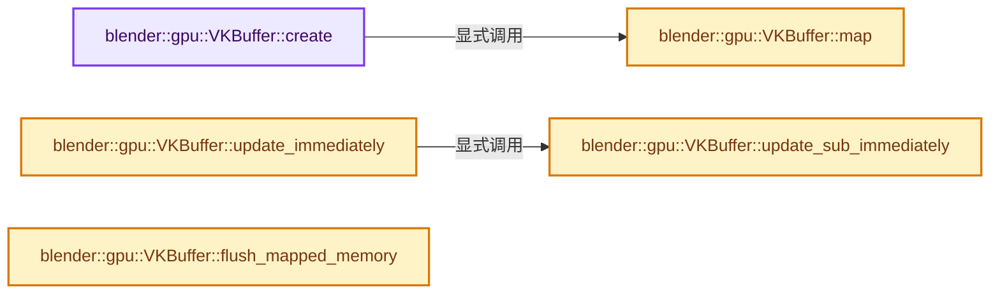
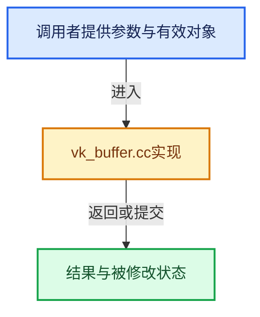

# 实现依赖专题：source/blender/gpu/vulkan/vk_buffer.cc

[方向导航](README.md) · [符号索引](../%E7%AC%A6%E5%8F%B7%E4%BE%9D%E8%B5%96%E4%B8%8E%E5%AE%9E%E7%8E%B0%E7%B4%A2%E5%BC%95.md)

本专题从正文实际调用进入，集中保存共享实现。函数有稳定锚点，可从调用处直接跳到对应完整函数；递归与互相调用通过回链组织。

## 本文件的实现关系






## 完整成员与函数实现

<a id="f-92e2d8f1ee95d335"></a>

### `blender::gpu::VKBuffer::create`

实现位置：[source/blender/gpu/vulkan/vk_buffer.cc](../../../../../source/blender/gpu/vulkan/vk_buffer.cc) · L29—L142。

接口参数：

- `size_t size_in_bytes`
- `VkBufferUsageFlags buffer_usage`
- `VmaMemoryUsage vma_memory_usage`
- `VmaAllocationCreateFlags allocation_flags`
- `float priority`
- `bool export_memory`
- `const char *debug_name`
- `size_t alignment`

**教学注释版**

<!-- annotated:e1b104e9ea06e4 -->

```cpp
bool VKBuffer::create(size_t size_in_bytes,
                      VkBufferUsageFlags buffer_usage,
                      VmaMemoryUsage vma_memory_usage,
                      VmaAllocationCreateFlags allocation_flags,
                      float priority,
                      bool export_memory,
                      const char *debug_name,
                      size_t alignment)
{
  BLI_assert(!is_allocated());
  BLI_assert(resource_.vk_handle == VK_NULL_HANDLE);
  BLI_assert(mapped_memory_ == nullptr);
  if (allocation_failed_) {
    return false;
  }

  size_in_bytes_ = size_in_bytes;
  /*
   * Vulkan doesn't allow empty buffers but some areas (DrawManager Instance data, PyGPU) create
   * them.
   */
  alloc_size_in_bytes_ = max_ulul(size_in_bytes_, 16);
  VKDevice &device = VKBackend::get().device;

  /* Precheck max buffer size. */
  if (device.extensions_get().maintenance4 &&
      alloc_size_in_bytes_ > device.physical_device_maintenance4_properties_get().maxBufferSize)
  {
    CLOG_WARN(
        &LOG,
        "Couldn't allocate buffer, requested allocation exceeds the maxBufferSize of the device.");
    allocation_failed_ = true;
    size_in_bytes_ = 0;
    alloc_size_in_bytes_ = 0;
    return false;
  }

  VmaAllocator allocator = device.mem_allocator_get();
  VkBufferCreateInfo create_info = {};
  create_info.sType = VK_STRUCTURE_TYPE_BUFFER_CREATE_INFO;
  create_info.flags = 0;
  create_info.size = alloc_size_in_bytes_;
  create_info.usage = buffer_usage;
  /* We use the same command queue for the compute and graphics pipeline, so it is safe to use
   * exclusive resource handling. */
  create_info.sharingMode = VK_SHARING_MODE_EXCLUSIVE;
  create_info.queueFamilyIndexCount = 1;
  const uint32_t queue_family_indices[1] = {device.queue_family_get()};
  create_info.pQueueFamilyIndices = queue_family_indices;

  VkExternalMemoryBufferCreateInfo external_memory_create_info = {
      VK_STRUCTURE_TYPE_EXTERNAL_MEMORY_BUFFER_CREATE_INFO, nullptr, 0};

  VmaAllocationCreateInfo vma_create_info = {};
  vma_create_info.flags = allocation_flags;
  vma_create_info.priority = priority;
  vma_create_info.usage = vma_memory_usage;

  if (export_memory) {
    create_info.pNext = &external_memory_create_info;
    external_memory_create_info.handleTypes = vk_external_memory_handle_type();

    /* Dedicated allocation for zero offset. */
    vma_create_info.flags |= VMA_ALLOCATION_CREATE_DEDICATED_MEMORY_BIT;
    vma_create_info.pool = device.vma_pools.external_memory_pixel_buffer.pool;
  }

  if (debug_name && G.debug & G_DEBUG_GPU) {
    vma_create_info.flags |= VMA_ALLOCATION_CREATE_USER_DATA_COPY_STRING_BIT;
    vma_create_info.pUserData = (void *)debug_name;
  }

  VkResult result = vmaCreateBufferWithAlignment(allocator,
                                                 &create_info,
                                                 &vma_create_info,
                                                 alignment,
                                                 &resource_.vk_handle,
                                                 &allocation_,
                                                 nullptr);
  if (result != VK_SUCCESS) {
    allocation_failed_ = true;
    size_in_bytes_ = 0;
    alloc_size_in_bytes_ = 0;
    return false;
  }

  resource_.resource_handle = device.resources.add_buffer(resource_.vk_handle);

  if (bool(create_info.usage & VK_BUFFER_USAGE_SHADER_DEVICE_ADDRESS_BIT)) {
    VkBufferDeviceAddressInfo vk_buffer_device_address_info = {
        VK_STRUCTURE_TYPE_BUFFER_DEVICE_ADDRESS_INFO, nullptr, resource_};
    vk_device_address = device.functions.vkGetBufferDeviceAddressKHR(
        device.vk_handle(), &vk_buffer_device_address_info);
  }

  if (debug_name) {
    debug::object_label(resource_.vk_handle, debug_name);
  }

  /* Check if the memory is mappable. Although the Vulkan specs allow to map any memory that is
   * host visible, VMA checks for specific host access flags.
   *
   * Source:
   * https://gpuopen-librariesandsdks.github.io/VulkanMemoryAllocator/html/memory_mapping.html
   */
  const bool is_mappable = bool(allocation_flags &
                                (VMA_ALLOCATION_CREATE_HOST_ACCESS_RANDOM_BIT |
                                 VMA_ALLOCATION_CREATE_HOST_ACCESS_SEQUENTIAL_WRITE_BIT));
  if (is_mappable) {
    return map();
  }

  return true;
}
```

<details>
<summary>核对原始源码：source/blender/gpu/vulkan/vk_buffer.cc · L29—L142</summary>

<!-- original:e1b104e9ea06e4:source/blender/gpu/vulkan/vk_buffer.cc:29:142 -->

```cpp
bool VKBuffer::create(size_t size_in_bytes,
                      VkBufferUsageFlags buffer_usage,
                      VmaMemoryUsage vma_memory_usage,
                      VmaAllocationCreateFlags allocation_flags,
                      float priority,
                      bool export_memory,
                      const char *debug_name,
                      size_t alignment)
{
  BLI_assert(!is_allocated());
  BLI_assert(resource_.vk_handle == VK_NULL_HANDLE);
  BLI_assert(mapped_memory_ == nullptr);
  if (allocation_failed_) {
    return false;
  }

  size_in_bytes_ = size_in_bytes;
  /*
   * Vulkan doesn't allow empty buffers but some areas (DrawManager Instance data, PyGPU) create
   * them.
   */
  alloc_size_in_bytes_ = max_ulul(size_in_bytes_, 16);
  VKDevice &device = VKBackend::get().device;

  /* Precheck max buffer size. */
  if (device.extensions_get().maintenance4 &&
      alloc_size_in_bytes_ > device.physical_device_maintenance4_properties_get().maxBufferSize)
  {
    CLOG_WARN(
        &LOG,
        "Couldn't allocate buffer, requested allocation exceeds the maxBufferSize of the device.");
    allocation_failed_ = true;
    size_in_bytes_ = 0;
    alloc_size_in_bytes_ = 0;
    return false;
  }

  VmaAllocator allocator = device.mem_allocator_get();
  VkBufferCreateInfo create_info = {};
  create_info.sType = VK_STRUCTURE_TYPE_BUFFER_CREATE_INFO;
  create_info.flags = 0;
  create_info.size = alloc_size_in_bytes_;
  create_info.usage = buffer_usage;
  /* We use the same command queue for the compute and graphics pipeline, so it is safe to use
   * exclusive resource handling. */
  create_info.sharingMode = VK_SHARING_MODE_EXCLUSIVE;
  create_info.queueFamilyIndexCount = 1;
  const uint32_t queue_family_indices[1] = {device.queue_family_get()};
  create_info.pQueueFamilyIndices = queue_family_indices;

  VkExternalMemoryBufferCreateInfo external_memory_create_info = {
      VK_STRUCTURE_TYPE_EXTERNAL_MEMORY_BUFFER_CREATE_INFO, nullptr, 0};

  VmaAllocationCreateInfo vma_create_info = {};
  vma_create_info.flags = allocation_flags;
  vma_create_info.priority = priority;
  vma_create_info.usage = vma_memory_usage;

  if (export_memory) {
    create_info.pNext = &external_memory_create_info;
    external_memory_create_info.handleTypes = vk_external_memory_handle_type();

    /* Dedicated allocation for zero offset. */
    vma_create_info.flags |= VMA_ALLOCATION_CREATE_DEDICATED_MEMORY_BIT;
    vma_create_info.pool = device.vma_pools.external_memory_pixel_buffer.pool;
  }

  if (debug_name && G.debug & G_DEBUG_GPU) {
    vma_create_info.flags |= VMA_ALLOCATION_CREATE_USER_DATA_COPY_STRING_BIT;
    vma_create_info.pUserData = (void *)debug_name;
  }

  VkResult result = vmaCreateBufferWithAlignment(allocator,
                                                 &create_info,
                                                 &vma_create_info,
                                                 alignment,
                                                 &resource_.vk_handle,
                                                 &allocation_,
                                                 nullptr);
  if (result != VK_SUCCESS) {
    allocation_failed_ = true;
    size_in_bytes_ = 0;
    alloc_size_in_bytes_ = 0;
    return false;
  }

  resource_.resource_handle = device.resources.add_buffer(resource_.vk_handle);

  if (bool(create_info.usage & VK_BUFFER_USAGE_SHADER_DEVICE_ADDRESS_BIT)) {
    VkBufferDeviceAddressInfo vk_buffer_device_address_info = {
        VK_STRUCTURE_TYPE_BUFFER_DEVICE_ADDRESS_INFO, nullptr, resource_};
    vk_device_address = device.functions.vkGetBufferDeviceAddressKHR(
        device.vk_handle(), &vk_buffer_device_address_info);
  }

  if (debug_name) {
    debug::object_label(resource_.vk_handle, debug_name);
  }

  /* Check if the memory is mappable. Although the Vulkan specs allow to map any memory that is
   * host visible, VMA checks for specific host access flags.
   *
   * Source:
   * https://gpuopen-librariesandsdks.github.io/VulkanMemoryAllocator/html/memory_mapping.html
   */
  const bool is_mappable = bool(allocation_flags &
                                (VMA_ALLOCATION_CREATE_HOST_ACCESS_RANDOM_BIT |
                                 VMA_ALLOCATION_CREATE_HOST_ACCESS_SEQUENTIAL_WRITE_BIT));
  if (is_mappable) {
    return map();
  }

  return true;
}
```

</details>

**沿实际写入检查状态**

- `size_in_bytes_ = size_in_bytes;`
- `alloc_size_in_bytes_ = max_ulul(size_in_bytes_, 16);`
- `allocation_failed_ = true;`
- `size_in_bytes_ = 0;`
- `alloc_size_in_bytes_ = 0;`
- `create_info.sType = VK_STRUCTURE_TYPE_BUFFER_CREATE_INFO;`
- `create_info.flags = 0;`
- `create_info.size = alloc_size_in_bytes_;`
- `create_info.usage = buffer_usage;`
- `create_info.sharingMode = VK_SHARING_MODE_EXCLUSIVE;`
- `create_info.queueFamilyIndexCount = 1;`
- `create_info.pQueueFamilyIndices = queue_family_indices;`
- `vma_create_info.flags = allocation_flags;`
- `vma_create_info.priority = priority;`
- `vma_create_info.usage = vma_memory_usage;`
- `create_info.pNext = &external_memory_create_info;`
- `external_memory_create_info.handleTypes = vk_external_memory_handle_type();`
- `vma_create_info.flags |= VMA_ALLOCATION_CREATE_DEDICATED_MEMORY_BIT;`
- `vma_create_info.pool = device.vma_pools.external_memory_pixel_buffer.pool;`
- `vma_create_info.flags |= VMA_ALLOCATION_CREATE_USER_DATA_COPY_STRING_BIT;`
- `vma_create_info.pUserData = (void *)debug_name;`
- `resource_.resource_handle = device.resources.add_buffer(resource_.vk_handle);`
- `vk_device_address = device.functions.vkGetBufferDeviceAddressKHR(`

**结果出口**

- `return false;`
- `return map();`
- `return true;`

**继续追踪实现**

- `BLI_assert` → [BLI_assert · L48](../01-%E5%9F%BA%E7%A1%80%E5%AE%B9%E5%99%A8%E4%B8%8E%E7%8E%B0%E4%BB%A3CPP/%E4%BE%9D%E8%B5%96-BLI_assert-cc98e8.md#m-57a88495704d)；[BLI_assert · L63](../01-%E5%9F%BA%E7%A1%80%E5%AE%B9%E5%99%A8%E4%B8%8E%E7%8E%B0%E4%BB%A3CPP/%E4%BE%9D%E8%B5%96-BLI_assert-cc98e8.md#m-d07050020cb5)。宏定义由构建条件选择。
- `is_allocated` → [blender::gpu::VKBuffer::is_allocated · L174](%E4%BE%9D%E8%B5%96-vk_buffer-912d24.md#f-72ed3e4e29c76545)。
- `max_ulul` → [blender::max_ulul · L386](../12-%E7%A9%BA%E9%97%B4%E6%95%B0%E6%8D%AE%E7%BB%93%E6%9E%84%E4%B8%8E%E5%87%A0%E4%BD%95%E7%AE%97%E6%B3%95/%E4%BE%9D%E8%B5%96-math_base_inline-546b00.md#f-923069c0e5dcada1)。
- `VKBackend::get` → [blender::gpu::VKBackend::get · L106](%E4%BE%9D%E8%B5%96-vk_backend-742e37.md#f-9b0f846ed492f55f)。
- `device.extensions_get` → [blender::gpu::VKDevice::extensions_get · L393](%E4%BE%9D%E8%B5%96-vk_device-7cec76.md#f-b9006d1d05b9eba2)。
- `device.physical_device_maintenance4_properties_get` → [blender::gpu::VKDevice::physical_device_maintenance4_properties_get · L294](%E4%BE%9D%E8%B5%96-vk_device-7cec76.md#f-fd203ed6c90ee67e)。
- `CLOG_WARN` → [CLOG_WARN · L189](%E4%BE%9D%E8%B5%96-CLG_log-e9051b.md#m-9da21a06cdbe)。宏定义由构建条件选择。
- `device.mem_allocator_get` → [blender::gpu::VKDevice::mem_allocator_get · L343](%E4%BE%9D%E8%B5%96-vk_device-7cec76.md#f-102d8b8844725694)。
- `device.queue_family_get` → [blender::gpu::VKDevice::queue_family_get · L338](%E4%BE%9D%E8%B5%96-vk_device-7cec76.md#f-1764fcb3e0c98f36)。
- `vk_external_memory_handle_type` → [blender::gpu::vk_external_memory_handle_type · L16](%E4%BE%9D%E8%B5%96-vk_memory_pool-d54c59.md#f-784b17870962d6c3)。
- `vmaCreateBufferWithAlignment` → [调用协议](../%E6%A8%A1%E6%9D%BF%E5%AE%8F%E4%B8%8E%E5%8A%A8%E6%80%81%E5%88%86%E6%B4%BE%E5%8D%8F%E8%AE%AE.md)：函数指针、局部可调用对象或未展开的宏；必须结合调用者环境。调用位置L101。
- `device.resources.add_buffer` → [调用协议](../%E6%A8%A1%E6%9D%BF%E5%AE%8F%E4%B8%8E%E5%8A%A8%E6%80%81%E5%88%86%E6%B4%BE%E5%8D%8F%E8%AE%AE.md)：接收对象类型依赖auto、返回值或模板实例；不按同名猜测目标。调用位置L115。
- `device.functions.vkGetBufferDeviceAddressKHR` → [调用协议](../%E6%A8%A1%E6%9D%BF%E5%AE%8F%E4%B8%8E%E5%8A%A8%E6%80%81%E5%88%86%E6%B4%BE%E5%8D%8F%E8%AE%AE.md)：接收对象类型依赖auto、返回值或模板实例；不按同名猜测目标。调用位置L120。
- `device.vk_handle` → [blender::gpu::VKDevice::vk_handle · L333](%E4%BE%9D%E8%B5%96-vk_device-7cec76.md#f-72924e77c918cdae)。
- `debug::object_label` → [blender::gpu::debug::object_label · L37](%E4%BE%9D%E8%B5%96-vk_debug-d35656.md#f-213fe73cbed61a8e)；[blender::gpu::debug::object_label · L173](%E4%BE%9D%E8%B5%96-vk_debug-6d0bb9.md#f-d9b83515b72f329f)。同名重载需按实参类型选择。
- `map` → [blender::gpu::VKBuffer::map · L215](%E4%BE%9D%E8%B5%96-vk_buffer-138d3d.md#f-66623997ab92f797)。

<a id="f-0342755e45ede2c0"></a>

### `blender::gpu::VKBuffer::update_immediately`

实现位置：[source/blender/gpu/vulkan/vk_buffer.cc](../../../../../source/blender/gpu/vulkan/vk_buffer.cc) · L144—L147。

接口参数：

- `const void *data`

**教学注释版**

<!-- annotated:46e4750b940d13 -->

```cpp
void VKBuffer::update_immediately(const void *data) const
{
  update_sub_immediately(0, size_in_bytes_, data);
}
```

<details>
<summary>核对原始源码：source/blender/gpu/vulkan/vk_buffer.cc · L144—L147</summary>

<!-- original:46e4750b940d13:source/blender/gpu/vulkan/vk_buffer.cc:144:147 -->

```cpp
void VKBuffer::update_immediately(const void *data) const
{
  update_sub_immediately(0, size_in_bytes_, data);
}
```

</details>

**继续追踪实现**

- `update_sub_immediately` → [blender::gpu::VKBuffer::update_sub_immediately · L149](%E4%BE%9D%E8%B5%96-vk_buffer-138d3d.md#f-b09191289b2dbf3d)。

<a id="f-b09191289b2dbf3d"></a>

### `blender::gpu::VKBuffer::update_sub_immediately`

实现位置：[source/blender/gpu/vulkan/vk_buffer.cc](../../../../../source/blender/gpu/vulkan/vk_buffer.cc) · L149—L155。

接口参数：

- `size_t start_offset`
- `size_t data_size`
- `const void *data`

**教学注释版**

<!-- annotated:3d421a1396d7f5 -->

```cpp
void VKBuffer::update_sub_immediately(size_t start_offset,
                                      size_t data_size,
                                      const void *data) const
{
  BLI_assert_msg(is_mapped(), "Cannot update a non-mapped buffer.");
  // [讲解] memcpy：复制字节，源与目标不应重叠。类型生命周期、对齐和可复制表示须由调用者证明，不是任意对象的复制构造。
  memcpy(static_cast<uint8_t *>(mapped_memory_) + start_offset, data, data_size);
}
```

<details>
<summary>核对原始源码：source/blender/gpu/vulkan/vk_buffer.cc · L149—L155</summary>

<!-- original:3d421a1396d7f5:source/blender/gpu/vulkan/vk_buffer.cc:149:155 -->

```cpp
void VKBuffer::update_sub_immediately(size_t start_offset,
                                      size_t data_size,
                                      const void *data) const
{
  BLI_assert_msg(is_mapped(), "Cannot update a non-mapped buffer.");
  memcpy(static_cast<uint8_t *>(mapped_memory_) + start_offset, data, data_size);
}
```

</details>

**继续追踪实现**

- `BLI_assert_msg` → [BLI_assert_msg · L55](../01-%E5%9F%BA%E7%A1%80%E5%AE%B9%E5%99%A8%E4%B8%8E%E7%8E%B0%E4%BB%A3CPP/%E4%BE%9D%E8%B5%96-BLI_assert-cc98e8.md#m-695eed20dceb)；[BLI_assert_msg · L64](../01-%E5%9F%BA%E7%A1%80%E5%AE%B9%E5%99%A8%E4%B8%8E%E7%8E%B0%E4%BB%A3CPP/%E4%BE%9D%E8%B5%96-BLI_assert-cc98e8.md#m-7de5563de4db)。宏定义由构建条件选择。
- `is_mapped` → [blender::gpu::VKBuffer::is_mapped · L169](%E4%BE%9D%E8%B5%96-vk_buffer-912d24.md#f-a3fdae0957cbf874)。
- `memcpy` → [外部契约](https://eel.is/c++draft/cstring.syn)：复制字节，源与目标不应重叠。类型生命周期、对齐和可复制表示须由调用者证明，不是任意对象的复制构造。

<a id="f-66623997ab92f797"></a>

### `blender::gpu::VKBuffer::map`

实现位置：[source/blender/gpu/vulkan/vk_buffer.cc](../../../../../source/blender/gpu/vulkan/vk_buffer.cc) · L215—L222。

**教学注释版**

<!-- annotated:d7d162e53e8b48 -->

```cpp
bool VKBuffer::map()
{
  BLI_assert(!is_mapped());
  const VKDevice &device = VKBackend::get().device;
  VmaAllocator allocator = device.mem_allocator_get();
  VkResult result = vmaMapMemory(allocator, allocation_, &mapped_memory_);
  return result == VK_SUCCESS;
}
```

<details>
<summary>核对原始源码：source/blender/gpu/vulkan/vk_buffer.cc · L215—L222</summary>

<!-- original:d7d162e53e8b48:source/blender/gpu/vulkan/vk_buffer.cc:215:222 -->

```cpp
bool VKBuffer::map()
{
  BLI_assert(!is_mapped());
  const VKDevice &device = VKBackend::get().device;
  VmaAllocator allocator = device.mem_allocator_get();
  VkResult result = vmaMapMemory(allocator, allocation_, &mapped_memory_);
  return result == VK_SUCCESS;
}
```

</details>

**结果出口**

- `return result == VK_SUCCESS;`

**继续追踪实现**

- `BLI_assert` → [BLI_assert · L48](../01-%E5%9F%BA%E7%A1%80%E5%AE%B9%E5%99%A8%E4%B8%8E%E7%8E%B0%E4%BB%A3CPP/%E4%BE%9D%E8%B5%96-BLI_assert-cc98e8.md#m-57a88495704d)；[BLI_assert · L63](../01-%E5%9F%BA%E7%A1%80%E5%AE%B9%E5%99%A8%E4%B8%8E%E7%8E%B0%E4%BB%A3CPP/%E4%BE%9D%E8%B5%96-BLI_assert-cc98e8.md#m-d07050020cb5)。宏定义由构建条件选择。
- `is_mapped` → [blender::gpu::VKBuffer::is_mapped · L169](%E4%BE%9D%E8%B5%96-vk_buffer-912d24.md#f-a3fdae0957cbf874)。
- `VKBackend::get` → [blender::gpu::VKBackend::get · L106](%E4%BE%9D%E8%B5%96-vk_backend-742e37.md#f-9b0f846ed492f55f)。
- `device.mem_allocator_get` → [blender::gpu::VKDevice::mem_allocator_get · L343](%E4%BE%9D%E8%B5%96-vk_device-7cec76.md#f-102d8b8844725694)。
- `vmaMapMemory` → [调用协议](../%E6%A8%A1%E6%9D%BF%E5%AE%8F%E4%B8%8E%E5%8A%A8%E6%80%81%E5%88%86%E6%B4%BE%E5%8D%8F%E8%AE%AE.md)：函数指针、局部可调用对象或未展开的宏；必须结合调用者环境。调用位置L220。

<a id="f-ef311b63953c45a0"></a>

### `blender::gpu::VKBuffer::flush_mapped_memory`

实现位置：[source/blender/gpu/vulkan/vk_buffer.cc](../../../../../source/blender/gpu/vulkan/vk_buffer.cc) · L251—L256。

**教学注释版**

<!-- annotated:449d5500302b94 -->

```cpp
void VKBuffer::flush_mapped_memory()
{
  const VKDevice &device = VKBackend::get().device;
  VmaAllocator allocator = device.mem_allocator_get();
  vmaFlushAllocation(allocator, allocation_, 0, size_in_bytes_);
}
```

<details>
<summary>核对原始源码：source/blender/gpu/vulkan/vk_buffer.cc · L251—L256</summary>

<!-- original:449d5500302b94:source/blender/gpu/vulkan/vk_buffer.cc:251:256 -->

```cpp
void VKBuffer::flush_mapped_memory()
{
  const VKDevice &device = VKBackend::get().device;
  VmaAllocator allocator = device.mem_allocator_get();
  vmaFlushAllocation(allocator, allocation_, 0, size_in_bytes_);
}
```

</details>

**继续追踪实现**

- `VKBackend::get` → [blender::gpu::VKBackend::get · L106](%E4%BE%9D%E8%B5%96-vk_backend-742e37.md#f-9b0f846ed492f55f)。
- `device.mem_allocator_get` → [blender::gpu::VKDevice::mem_allocator_get · L343](%E4%BE%9D%E8%B5%96-vk_device-7cec76.md#f-102d8b8844725694)。
- `vmaFlushAllocation` → [调用协议](../%E6%A8%A1%E6%9D%BF%E5%AE%8F%E4%B8%8E%E5%8A%A8%E6%80%81%E5%88%86%E6%B4%BE%E5%8D%8F%E8%AE%AE.md)：函数指针、局部可调用对象或未展开的宏；必须结合调用者环境。调用位置L255。
