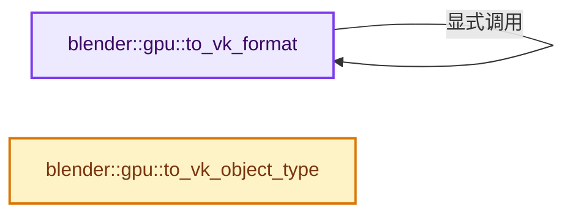
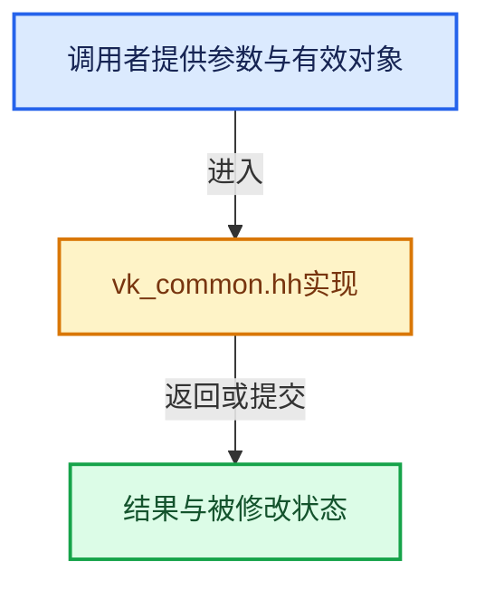

# 实现依赖专题：source/blender/gpu/vulkan/vk_common.hh

[方向导航](README.md) · [符号索引](../%E7%AC%A6%E5%8F%B7%E4%BE%9D%E8%B5%96%E4%B8%8E%E5%AE%9E%E7%8E%B0%E7%B4%A2%E5%BC%95.md)

本专题从正文实际调用进入，集中保存共享实现。函数有稳定锚点，可从调用处直接跳到对应完整函数；递归与互相调用通过回链组织。

## 本文件的实现关系






## 完整成员与函数实现

<a id="f-a3ac0c55c5d75864"></a>

### `blender::gpu::to_vk_format`

实现位置：[source/blender/gpu/vulkan/vk_common.hh](../../../../../source/blender/gpu/vulkan/vk_common.hh) · L95—L98。

接口参数：

- `const TextureTargetFormat format`

**教学注释版**

<!-- annotated:7f771e280e7cba -->

```cpp
BLI_INLINE VkFormat to_vk_format(const TextureTargetFormat format)
{
  return to_vk_format(to_texture_format(format));
}
```

<details>
<summary>核对原始源码：source/blender/gpu/vulkan/vk_common.hh · L95—L98</summary>

<!-- original:7f771e280e7cba:source/blender/gpu/vulkan/vk_common.hh:95:98 -->

```cpp
BLI_INLINE VkFormat to_vk_format(const TextureTargetFormat format)
{
  return to_vk_format(to_texture_format(format));
}
```

</details>

**结果出口**

- `return to_vk_format(to_texture_format(format));`

**继续追踪实现**

- `to_vk_format` → [blender::gpu::to_vk_format · L95](%E4%BE%9D%E8%B5%96-vk_common-9ed3a5.md#f-a3ac0c55c5d75864)。
- `to_texture_format` → [blender::gpu::to_texture_format · L203](%E4%BE%9D%E8%B5%96-GPU_texture-7797f2.md#f-bf764cadc2e1a38f)；[blender::gpu::to_texture_format · L268](%E4%BE%9D%E8%B5%96-GPU_texture-7797f2.md#f-b8a7d42ff73eb4b9)；[blender::gpu::to_texture_format · L910](%E4%BE%9D%E8%B5%96-gpu_texture_private-c1aac7.md#f-c39c4470878f5955)。同名重载需按实参类型选择。

<a id="f-8a5067e429fdd0cb"></a>

### `blender::gpu::to_vk_object_type`

实现位置：[source/blender/gpu/vulkan/vk_common.hh](../../../../../source/blender/gpu/vulkan/vk_common.hh) · L134—L194。

接口参数：

- `T`

**教学注释版**

<!-- annotated:b49155e0f17e4c -->

```cpp
template<typename T> VkObjectType to_vk_object_type(T /*vk_obj*/)
{
  const std::type_info &tid = typeid(T);
#define VK_EQ_TYPEID(name, name2) \
  if (tid == typeid(name)) { \
    return VK_OBJECT_TYPE_##name2; \
  }

  VK_EQ_TYPEID(VkInstance, INSTANCE);
  VK_EQ_TYPEID(VkPhysicalDevice, PHYSICAL_DEVICE);
  VK_EQ_TYPEID(VkDevice, DEVICE);
  VK_EQ_TYPEID(VkQueue, QUEUE);
  VK_EQ_TYPEID(VkSemaphore, SEMAPHORE);
  VK_EQ_TYPEID(VkCommandBuffer, COMMAND_BUFFER);
  VK_EQ_TYPEID(VkFence, FENCE);
  VK_EQ_TYPEID(VkDeviceMemory, DEVICE_MEMORY);
  VK_EQ_TYPEID(VkBuffer, BUFFER);
  VK_EQ_TYPEID(VkImage, IMAGE);
  VK_EQ_TYPEID(VkEvent, EVENT);
  VK_EQ_TYPEID(VkQueryPool, QUERY_POOL);
  VK_EQ_TYPEID(VkBufferView, BUFFER_VIEW);
  VK_EQ_TYPEID(VkImageView, IMAGE_VIEW);
  VK_EQ_TYPEID(VkShaderModule, SHADER_MODULE);
  VK_EQ_TYPEID(VkPipelineCache, PIPELINE_CACHE);
  VK_EQ_TYPEID(VkPipelineLayout, PIPELINE_LAYOUT);
  VK_EQ_TYPEID(VkRenderPass, RENDER_PASS);
  VK_EQ_TYPEID(VkPipeline, PIPELINE);
  VK_EQ_TYPEID(VkDescriptorSetLayout, DESCRIPTOR_SET_LAYOUT);
  VK_EQ_TYPEID(VkSampler, SAMPLER);
  VK_EQ_TYPEID(VkDescriptorPool, DESCRIPTOR_POOL);
  VK_EQ_TYPEID(VkDescriptorSet, DESCRIPTOR_SET);
  VK_EQ_TYPEID(VkFramebuffer, FRAMEBUFFER);
  VK_EQ_TYPEID(VkCommandPool, COMMAND_POOL);
  VK_EQ_TYPEID(VkSamplerYcbcrConversion, SAMPLER_YCBCR_CONVERSION);
  VK_EQ_TYPEID(VkDescriptorUpdateTemplate, DESCRIPTOR_UPDATE_TEMPLATE);
  VK_EQ_TYPEID(VkSurfaceKHR, SURFACE_KHR);
  VK_EQ_TYPEID(VkSwapchainKHR, SWAPCHAIN_KHR);
  VK_EQ_TYPEID(VkDisplayKHR, DISPLAY_KHR);
  VK_EQ_TYPEID(VkDisplayModeKHR, DISPLAY_MODE_KHR);
  VK_EQ_TYPEID(VkDebugReportCallbackEXT, DEBUG_REPORT_CALLBACK_EXT);
#ifdef VK_ENABLE_BETA_EXTENSIONS
  VK_EQ_TYPEID(VkVideoSessionKHR, VIDEO_SESSION_KHR);
#endif
#ifdef VK_ENABLE_BETA_EXTENSIONS
  VK_EQ_TYPEID(VkVideoSessionParametersKHR, VIDEO_SESSION_PARAMETERS_KHR);
#endif
  VK_EQ_TYPEID(VkCuModuleNVX, CU_MODULE_NVX);
  VK_EQ_TYPEID(VkCuFunctionNVX, CU_FUNCTION_NVX);
  VK_EQ_TYPEID(VkDebugUtilsMessengerEXT, DEBUG_UTILS_MESSENGER_EXT);
  VK_EQ_TYPEID(VkAccelerationStructureKHR, ACCELERATION_STRUCTURE_KHR);
  VK_EQ_TYPEID(VkValidationCacheEXT, VALIDATION_CACHE_EXT);
  VK_EQ_TYPEID(VkAccelerationStructureNV, ACCELERATION_STRUCTURE_NV);
  VK_EQ_TYPEID(VkPerformanceConfigurationINTEL, PERFORMANCE_CONFIGURATION_INTEL);
  VK_EQ_TYPEID(VkDeferredOperationKHR, DEFERRED_OPERATION_KHR);
  VK_EQ_TYPEID(VkIndirectCommandsLayoutNV, INDIRECT_COMMANDS_LAYOUT_NV);
  VK_EQ_TYPEID(VkPrivateDataSlotEXT, PRIVATE_DATA_SLOT_EXT);

  BLI_assert_unreachable();
#undef VK_EQ_TYPEID
  return VK_OBJECT_TYPE_UNKNOWN;
}
```

<details>
<summary>核对原始源码：source/blender/gpu/vulkan/vk_common.hh · L134—L194</summary>

<!-- original:b49155e0f17e4c:source/blender/gpu/vulkan/vk_common.hh:134:194 -->

```cpp
template<typename T> VkObjectType to_vk_object_type(T /*vk_obj*/)
{
  const std::type_info &tid = typeid(T);
#define VK_EQ_TYPEID(name, name2) \
  if (tid == typeid(name)) { \
    return VK_OBJECT_TYPE_##name2; \
  }

  VK_EQ_TYPEID(VkInstance, INSTANCE);
  VK_EQ_TYPEID(VkPhysicalDevice, PHYSICAL_DEVICE);
  VK_EQ_TYPEID(VkDevice, DEVICE);
  VK_EQ_TYPEID(VkQueue, QUEUE);
  VK_EQ_TYPEID(VkSemaphore, SEMAPHORE);
  VK_EQ_TYPEID(VkCommandBuffer, COMMAND_BUFFER);
  VK_EQ_TYPEID(VkFence, FENCE);
  VK_EQ_TYPEID(VkDeviceMemory, DEVICE_MEMORY);
  VK_EQ_TYPEID(VkBuffer, BUFFER);
  VK_EQ_TYPEID(VkImage, IMAGE);
  VK_EQ_TYPEID(VkEvent, EVENT);
  VK_EQ_TYPEID(VkQueryPool, QUERY_POOL);
  VK_EQ_TYPEID(VkBufferView, BUFFER_VIEW);
  VK_EQ_TYPEID(VkImageView, IMAGE_VIEW);
  VK_EQ_TYPEID(VkShaderModule, SHADER_MODULE);
  VK_EQ_TYPEID(VkPipelineCache, PIPELINE_CACHE);
  VK_EQ_TYPEID(VkPipelineLayout, PIPELINE_LAYOUT);
  VK_EQ_TYPEID(VkRenderPass, RENDER_PASS);
  VK_EQ_TYPEID(VkPipeline, PIPELINE);
  VK_EQ_TYPEID(VkDescriptorSetLayout, DESCRIPTOR_SET_LAYOUT);
  VK_EQ_TYPEID(VkSampler, SAMPLER);
  VK_EQ_TYPEID(VkDescriptorPool, DESCRIPTOR_POOL);
  VK_EQ_TYPEID(VkDescriptorSet, DESCRIPTOR_SET);
  VK_EQ_TYPEID(VkFramebuffer, FRAMEBUFFER);
  VK_EQ_TYPEID(VkCommandPool, COMMAND_POOL);
  VK_EQ_TYPEID(VkSamplerYcbcrConversion, SAMPLER_YCBCR_CONVERSION);
  VK_EQ_TYPEID(VkDescriptorUpdateTemplate, DESCRIPTOR_UPDATE_TEMPLATE);
  VK_EQ_TYPEID(VkSurfaceKHR, SURFACE_KHR);
  VK_EQ_TYPEID(VkSwapchainKHR, SWAPCHAIN_KHR);
  VK_EQ_TYPEID(VkDisplayKHR, DISPLAY_KHR);
  VK_EQ_TYPEID(VkDisplayModeKHR, DISPLAY_MODE_KHR);
  VK_EQ_TYPEID(VkDebugReportCallbackEXT, DEBUG_REPORT_CALLBACK_EXT);
#ifdef VK_ENABLE_BETA_EXTENSIONS
  VK_EQ_TYPEID(VkVideoSessionKHR, VIDEO_SESSION_KHR);
#endif
#ifdef VK_ENABLE_BETA_EXTENSIONS
  VK_EQ_TYPEID(VkVideoSessionParametersKHR, VIDEO_SESSION_PARAMETERS_KHR);
#endif
  VK_EQ_TYPEID(VkCuModuleNVX, CU_MODULE_NVX);
  VK_EQ_TYPEID(VkCuFunctionNVX, CU_FUNCTION_NVX);
  VK_EQ_TYPEID(VkDebugUtilsMessengerEXT, DEBUG_UTILS_MESSENGER_EXT);
  VK_EQ_TYPEID(VkAccelerationStructureKHR, ACCELERATION_STRUCTURE_KHR);
  VK_EQ_TYPEID(VkValidationCacheEXT, VALIDATION_CACHE_EXT);
  VK_EQ_TYPEID(VkAccelerationStructureNV, ACCELERATION_STRUCTURE_NV);
  VK_EQ_TYPEID(VkPerformanceConfigurationINTEL, PERFORMANCE_CONFIGURATION_INTEL);
  VK_EQ_TYPEID(VkDeferredOperationKHR, DEFERRED_OPERATION_KHR);
  VK_EQ_TYPEID(VkIndirectCommandsLayoutNV, INDIRECT_COMMANDS_LAYOUT_NV);
  VK_EQ_TYPEID(VkPrivateDataSlotEXT, PRIVATE_DATA_SLOT_EXT);

  BLI_assert_unreachable();
#undef VK_EQ_TYPEID
  return VK_OBJECT_TYPE_UNKNOWN;
}
```

</details>

**结果出口**

- `return VK_OBJECT_TYPE_##name2; \`
- `return VK_OBJECT_TYPE_UNKNOWN;`

**继续追踪实现**

- `typeid` → [调用协议](../%E6%A8%A1%E6%9D%BF%E5%AE%8F%E4%B8%8E%E5%8A%A8%E6%80%81%E5%88%86%E6%B4%BE%E5%8D%8F%E8%AE%AE.md)：函数指针、局部可调用对象或未展开的宏；必须结合调用者环境。调用位置L136。
- `VK_EQ_TYPEID` → [调用协议](../%E6%A8%A1%E6%9D%BF%E5%AE%8F%E4%B8%8E%E5%8A%A8%E6%80%81%E5%88%86%E6%B4%BE%E5%8D%8F%E8%AE%AE.md)：函数指针、局部可调用对象或未展开的宏；必须结合调用者环境。调用位置L142。
- `BLI_assert_unreachable` → [BLI_assert_unreachable · L77](../01-%E5%9F%BA%E7%A1%80%E5%AE%B9%E5%99%A8%E4%B8%8E%E7%8E%B0%E4%BB%A3CPP/%E4%BE%9D%E8%B5%96-BLI_assert-cc98e8.md#m-7a2d91a67d8e)。宏定义由构建条件选择。
