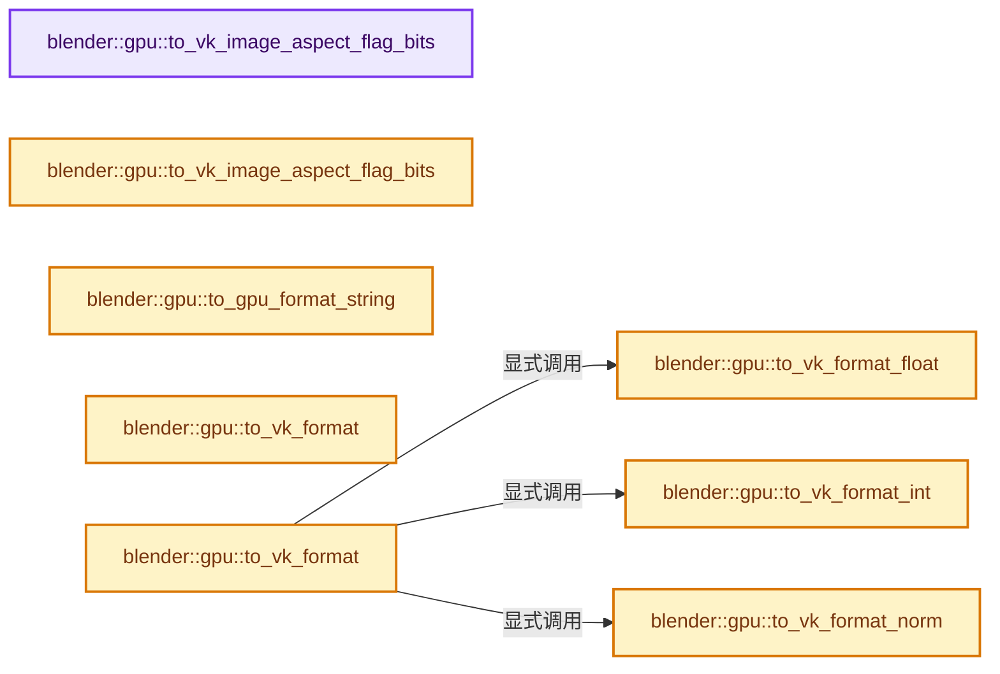

# 实现依赖专题：source/blender/gpu/vulkan/vk_common.cc

[方向导航](README.md) · [符号索引](../%E7%AC%A6%E5%8F%B7%E4%BE%9D%E8%B5%96%E4%B8%8E%E5%AE%9E%E7%8E%B0%E7%B4%A2%E5%BC%95.md)

本专题从正文实际调用进入，集中保存共享实现。函数有稳定锚点，可从调用处直接跳到对应完整函数；递归与互相调用通过回链组织。

## 本文件的实现关系




## 完整成员与函数实现

<a id="f-c1bea0adb03822dd"></a>

### `blender::gpu::to_vk_image_aspect_flag_bits`

实现位置：[source/blender/gpu/vulkan/vk_common.cc](../../../../../source/blender/gpu/vulkan/vk_common.cc) · L16—L105。

接口参数：

- `const TextureFormat format`

**教学注释版**

<!-- annotated:85ff538c37e319 -->

```cpp
VkImageAspectFlags to_vk_image_aspect_flag_bits(const TextureFormat format)
{
  switch (format) {
    /* Formats texture & render-buffer */
    case TextureFormat::UINT_32_32_32_32:
    case TextureFormat::UINT_32_32:
    case TextureFormat::UINT_32:
    case TextureFormat::UINT_16_16_16_16:
    case TextureFormat::UINT_16_16:
    case TextureFormat::UINT_16:
    case TextureFormat::UINT_8_8_8_8:
    case TextureFormat::UINT_8_8:
    case TextureFormat::UINT_8:
    case TextureFormat::SINT_32_32_32_32:
    case TextureFormat::SINT_32_32:
    case TextureFormat::SINT_32:
    case TextureFormat::SINT_16_16_16_16:
    case TextureFormat::SINT_16_16:
    case TextureFormat::SINT_16:
    case TextureFormat::SINT_8_8_8_8:
    case TextureFormat::SINT_8_8:
    case TextureFormat::SINT_8:
    case TextureFormat::SFLOAT_32_32_32_32:
    case TextureFormat::SFLOAT_32_32:
    case TextureFormat::SFLOAT_32:
    case TextureFormat::SFLOAT_16_16_16_16:
    case TextureFormat::SFLOAT_16_16:
    case TextureFormat::SFLOAT_16:
    case TextureFormat::UNORM_16_16_16_16:
    case TextureFormat::UNORM_16_16:
    case TextureFormat::UNORM_16:
    case TextureFormat::UNORM_8_8_8_8:
    case TextureFormat::UNORM_8_8:
    case TextureFormat::UNORM_8:
      return VK_IMAGE_ASPECT_COLOR_BIT;

    /* Special formats texture & render-buffer */
    case TextureFormat::UNORM_10_10_10_2:
    case TextureFormat::UINT_10_10_10_2:
    case TextureFormat::UFLOAT_11_11_10:
    case TextureFormat::SRGBA_8_8_8_8:
      return VK_IMAGE_ASPECT_COLOR_BIT;

    /* Depth Formats. */
    case TextureFormat::SFLOAT_32_DEPTH:
    case TextureFormat::UNORM_16_DEPTH:
      return VK_IMAGE_ASPECT_DEPTH_BIT;

    case TextureFormat::SFLOAT_32_DEPTH_UINT_8:
      return VK_IMAGE_ASPECT_DEPTH_BIT | VK_IMAGE_ASPECT_STENCIL_BIT;

    /* Texture only formats. */
    case TextureFormat::UINT_32_32_32:
    case TextureFormat::UINT_16_16_16:
    case TextureFormat::UINT_8_8_8:
    case TextureFormat::SINT_32_32_32:
    case TextureFormat::SINT_16_16_16:
    case TextureFormat::SINT_8_8_8:
    case TextureFormat::UNORM_16_16_16:
    case TextureFormat::UNORM_8_8_8:
    case TextureFormat::SNORM_16_16_16_16:
    case TextureFormat::SNORM_16_16_16:
    case TextureFormat::SNORM_16_16:
    case TextureFormat::SNORM_16:
    case TextureFormat::SNORM_8_8_8_8:
    case TextureFormat::SNORM_8_8_8:
    case TextureFormat::SNORM_8_8:
    case TextureFormat::SNORM_8:
    case TextureFormat::SFLOAT_32_32_32:
    case TextureFormat::SFLOAT_16_16_16:
      return VK_IMAGE_ASPECT_COLOR_BIT;

    /* Special formats, texture only. */
    case TextureFormat::SRGB_DXT1:
    case TextureFormat::SRGB_DXT3:
    case TextureFormat::SRGB_DXT5:
    case TextureFormat::SNORM_DXT1:
    case TextureFormat::SNORM_DXT3:
    case TextureFormat::SNORM_DXT5:
    case TextureFormat::SRGBA_8_8_8:
    case TextureFormat::UFLOAT_9_9_9_EXP_5:
      return VK_IMAGE_ASPECT_COLOR_BIT;

    case TextureFormat::Invalid:
      BLI_assert_unreachable();
      break;
  }
  BLI_assert_unreachable();
  return 0;
}
```

<details>
<summary>核对原始源码：source/blender/gpu/vulkan/vk_common.cc · L16—L105</summary>

<!-- original:85ff538c37e319:source/blender/gpu/vulkan/vk_common.cc:16:105 -->

```cpp
VkImageAspectFlags to_vk_image_aspect_flag_bits(const TextureFormat format)
{
  switch (format) {
    /* Formats texture & render-buffer */
    case TextureFormat::UINT_32_32_32_32:
    case TextureFormat::UINT_32_32:
    case TextureFormat::UINT_32:
    case TextureFormat::UINT_16_16_16_16:
    case TextureFormat::UINT_16_16:
    case TextureFormat::UINT_16:
    case TextureFormat::UINT_8_8_8_8:
    case TextureFormat::UINT_8_8:
    case TextureFormat::UINT_8:
    case TextureFormat::SINT_32_32_32_32:
    case TextureFormat::SINT_32_32:
    case TextureFormat::SINT_32:
    case TextureFormat::SINT_16_16_16_16:
    case TextureFormat::SINT_16_16:
    case TextureFormat::SINT_16:
    case TextureFormat::SINT_8_8_8_8:
    case TextureFormat::SINT_8_8:
    case TextureFormat::SINT_8:
    case TextureFormat::SFLOAT_32_32_32_32:
    case TextureFormat::SFLOAT_32_32:
    case TextureFormat::SFLOAT_32:
    case TextureFormat::SFLOAT_16_16_16_16:
    case TextureFormat::SFLOAT_16_16:
    case TextureFormat::SFLOAT_16:
    case TextureFormat::UNORM_16_16_16_16:
    case TextureFormat::UNORM_16_16:
    case TextureFormat::UNORM_16:
    case TextureFormat::UNORM_8_8_8_8:
    case TextureFormat::UNORM_8_8:
    case TextureFormat::UNORM_8:
      return VK_IMAGE_ASPECT_COLOR_BIT;

    /* Special formats texture & render-buffer */
    case TextureFormat::UNORM_10_10_10_2:
    case TextureFormat::UINT_10_10_10_2:
    case TextureFormat::UFLOAT_11_11_10:
    case TextureFormat::SRGBA_8_8_8_8:
      return VK_IMAGE_ASPECT_COLOR_BIT;

    /* Depth Formats. */
    case TextureFormat::SFLOAT_32_DEPTH:
    case TextureFormat::UNORM_16_DEPTH:
      return VK_IMAGE_ASPECT_DEPTH_BIT;

    case TextureFormat::SFLOAT_32_DEPTH_UINT_8:
      return VK_IMAGE_ASPECT_DEPTH_BIT | VK_IMAGE_ASPECT_STENCIL_BIT;

    /* Texture only formats. */
    case TextureFormat::UINT_32_32_32:
    case TextureFormat::UINT_16_16_16:
    case TextureFormat::UINT_8_8_8:
    case TextureFormat::SINT_32_32_32:
    case TextureFormat::SINT_16_16_16:
    case TextureFormat::SINT_8_8_8:
    case TextureFormat::UNORM_16_16_16:
    case TextureFormat::UNORM_8_8_8:
    case TextureFormat::SNORM_16_16_16_16:
    case TextureFormat::SNORM_16_16_16:
    case TextureFormat::SNORM_16_16:
    case TextureFormat::SNORM_16:
    case TextureFormat::SNORM_8_8_8_8:
    case TextureFormat::SNORM_8_8_8:
    case TextureFormat::SNORM_8_8:
    case TextureFormat::SNORM_8:
    case TextureFormat::SFLOAT_32_32_32:
    case TextureFormat::SFLOAT_16_16_16:
      return VK_IMAGE_ASPECT_COLOR_BIT;

    /* Special formats, texture only. */
    case TextureFormat::SRGB_DXT1:
    case TextureFormat::SRGB_DXT3:
    case TextureFormat::SRGB_DXT5:
    case TextureFormat::SNORM_DXT1:
    case TextureFormat::SNORM_DXT3:
    case TextureFormat::SNORM_DXT5:
    case TextureFormat::SRGBA_8_8_8:
    case TextureFormat::UFLOAT_9_9_9_EXP_5:
      return VK_IMAGE_ASPECT_COLOR_BIT;

    case TextureFormat::Invalid:
      BLI_assert_unreachable();
      break;
  }
  BLI_assert_unreachable();
  return 0;
}
```

</details>

**结果出口**

- `return VK_IMAGE_ASPECT_COLOR_BIT;`
- `return VK_IMAGE_ASPECT_DEPTH_BIT;`
- `return VK_IMAGE_ASPECT_DEPTH_BIT | VK_IMAGE_ASPECT_STENCIL_BIT;`
- `return 0;`

**继续追踪实现**

- `BLI_assert_unreachable` → [BLI_assert_unreachable · L77](../01-%E5%9F%BA%E7%A1%80%E5%AE%B9%E5%99%A8%E4%B8%8E%E7%8E%B0%E4%BB%A3CPP/%E4%BE%9D%E8%B5%96-BLI_assert-cc98e8.md#m-7a2d91a67d8e)。宏定义由构建条件选择。

<a id="f-ca44a24b98ba18ad"></a>

### `blender::gpu::to_vk_image_aspect_flag_bits`

实现位置：[source/blender/gpu/vulkan/vk_common.cc](../../../../../source/blender/gpu/vulkan/vk_common.cc) · L107—L120。

接口参数：

- `const GPUFrameBufferBits buffers`

**教学注释版**

<!-- annotated:0522a45b142c6d -->

```cpp
VkImageAspectFlags to_vk_image_aspect_flag_bits(const GPUFrameBufferBits buffers)
{
  VkImageAspectFlags result = 0;
  if (buffers & GPU_COLOR_BIT) {
    result |= VK_IMAGE_ASPECT_COLOR_BIT;
  }
  if (buffers & GPU_DEPTH_BIT) {
    result |= VK_IMAGE_ASPECT_DEPTH_BIT;
  }
  if (buffers & GPU_STENCIL_BIT) {
    result |= VK_IMAGE_ASPECT_STENCIL_BIT;
  }
  return result;
}
```

<details>
<summary>核对原始源码：source/blender/gpu/vulkan/vk_common.cc · L107—L120</summary>

<!-- original:0522a45b142c6d:source/blender/gpu/vulkan/vk_common.cc:107:120 -->

```cpp
VkImageAspectFlags to_vk_image_aspect_flag_bits(const GPUFrameBufferBits buffers)
{
  VkImageAspectFlags result = 0;
  if (buffers & GPU_COLOR_BIT) {
    result |= VK_IMAGE_ASPECT_COLOR_BIT;
  }
  if (buffers & GPU_DEPTH_BIT) {
    result |= VK_IMAGE_ASPECT_DEPTH_BIT;
  }
  if (buffers & GPU_STENCIL_BIT) {
    result |= VK_IMAGE_ASPECT_STENCIL_BIT;
  }
  return result;
}
```

</details>

**沿实际写入检查状态**

- `result |= VK_IMAGE_ASPECT_COLOR_BIT;`
- `result |= VK_IMAGE_ASPECT_DEPTH_BIT;`
- `result |= VK_IMAGE_ASPECT_STENCIL_BIT;`

**结果出口**

- `return result;`

**继续追踪实现**

本实现没有需要继续展开的显式调用；检查返回表达式、对象转换和调用者前置条件。

<a id="f-5c92afcb170f9e8a"></a>

### `blender::gpu::to_gpu_format_string`

实现位置：[source/blender/gpu/vulkan/vk_common.cc](../../../../../source/blender/gpu/vulkan/vk_common.cc) · L138—L155。

接口参数：

- `VkFormat format`

**教学注释版**

<!-- annotated:dc1d7f5e9e1b92 -->

```cpp
std::string to_gpu_format_string(VkFormat format)
{
#define CASE(a, b, c, blender_enum, vk_enum, e, f, g, h) \
  case VK_FORMAT_##vk_enum: \
    return STRINGIFY(blender_enum);
  switch (format) {
    GPU_TEXTURE_TARGET_FORMAT_EXPAND(CASE)

    case VK_FORMAT_UNDEFINED:
      return "UNDEFINED";

    default:
      BLI_assert_unreachable();
      break;
  }
#undef CASE
  return "Invalid";
}
```

<details>
<summary>核对原始源码：source/blender/gpu/vulkan/vk_common.cc · L138—L155</summary>

<!-- original:dc1d7f5e9e1b92:source/blender/gpu/vulkan/vk_common.cc:138:155 -->

```cpp
std::string to_gpu_format_string(VkFormat format)
{
#define CASE(a, b, c, blender_enum, vk_enum, e, f, g, h) \
  case VK_FORMAT_##vk_enum: \
    return STRINGIFY(blender_enum);
  switch (format) {
    GPU_TEXTURE_TARGET_FORMAT_EXPAND(CASE)

    case VK_FORMAT_UNDEFINED:
      return "UNDEFINED";

    default:
      BLI_assert_unreachable();
      break;
  }
#undef CASE
  return "Invalid";
}
```

</details>

**结果出口**

- `return STRINGIFY(blender_enum);`
- `return "UNDEFINED";`
- `return "Invalid";`

**继续追踪实现**

- `GPU_TEXTURE_TARGET_FORMAT_EXPAND` → [调用协议](../%E6%A8%A1%E6%9D%BF%E5%AE%8F%E4%B8%8E%E5%8A%A8%E6%80%81%E5%88%86%E6%B4%BE%E5%8D%8F%E8%AE%AE.md)：配置相关检测或外部运行时接口。调用位置L144。
- `BLI_assert_unreachable` → [BLI_assert_unreachable · L77](../01-%E5%9F%BA%E7%A1%80%E5%AE%B9%E5%99%A8%E4%B8%8E%E7%8E%B0%E4%BB%A3CPP/%E4%BE%9D%E8%B5%96-BLI_assert-cc98e8.md#m-7a2d91a67d8e)。宏定义由构建条件选择。

<a id="f-43921693d6c63cf3"></a>

### `blender::gpu::to_vk_format`

实现位置：[source/blender/gpu/vulkan/vk_common.cc](../../../../../source/blender/gpu/vulkan/vk_common.cc) · L157—L170。

接口参数：

- `const TextureFormat format`

**教学注释版**

<!-- annotated:cf0a1b83205a70 -->

```cpp
VkFormat to_vk_format(const TextureFormat format)
{
#define CASE(a, b, c, blender_enum, vk_enum, e, f, g, h) \
  case TextureFormat::blender_enum: \
    return VK_FORMAT_##vk_enum;

  switch (format) {
    GPU_TEXTURE_FORMAT_EXPAND(CASE)
    case TextureFormat::Invalid:
      break;
  }
#undef CASE
  return VK_FORMAT_UNDEFINED;
}
```

<details>
<summary>核对原始源码：source/blender/gpu/vulkan/vk_common.cc · L157—L170</summary>

<!-- original:cf0a1b83205a70:source/blender/gpu/vulkan/vk_common.cc:157:170 -->

```cpp
VkFormat to_vk_format(const TextureFormat format)
{
#define CASE(a, b, c, blender_enum, vk_enum, e, f, g, h) \
  case TextureFormat::blender_enum: \
    return VK_FORMAT_##vk_enum;

  switch (format) {
    GPU_TEXTURE_FORMAT_EXPAND(CASE)
    case TextureFormat::Invalid:
      break;
  }
#undef CASE
  return VK_FORMAT_UNDEFINED;
}
```

</details>

**结果出口**

- `return VK_FORMAT_##vk_enum;`
- `return VK_FORMAT_UNDEFINED;`

**继续追踪实现**

- `GPU_TEXTURE_FORMAT_EXPAND` → [调用协议](../%E6%A8%A1%E6%9D%BF%E5%AE%8F%E4%B8%8E%E5%8A%A8%E6%80%81%E5%88%86%E6%B4%BE%E5%8D%8F%E8%AE%AE.md)：配置相关检测或外部运行时接口。调用位置L164。

<a id="f-e411525697dee904"></a>

### `blender::gpu::to_vk_format_norm`

实现位置：[source/blender/gpu/vulkan/vk_common.cc](../../../../../source/blender/gpu/vulkan/vk_common.cc) · L172—L255。

接口参数：

- `const GPUVertCompType type`
- `const uint32_t size`

**教学注释版**

<!-- annotated:4989a0fdda20fa -->

```cpp
static VkFormat to_vk_format_norm(const GPUVertCompType type, const uint32_t size)
{
  switch (type) {
    case GPU_COMP_I8:
      switch (size) {
        case 1:
          return VK_FORMAT_R8_SNORM;
        case 2:
          return VK_FORMAT_R8G8_SNORM;
        case 3:
          return VK_FORMAT_R8G8B8_SNORM;
        case 4:
          return VK_FORMAT_R8G8B8A8_SNORM;
        case 16:
          return VK_FORMAT_R8G8B8A8_SNORM;
        default:
          BLI_assert_unreachable();
          return VK_FORMAT_R8_SNORM;
      }
      break;

    case GPU_COMP_U8:
      switch (size) {
        case 1:
          return VK_FORMAT_R8_UNORM;
        case 2:
          return VK_FORMAT_R8G8_UNORM;
        case 3:
          return VK_FORMAT_R8G8B8_UNORM;
        case 4:
          return VK_FORMAT_R8G8B8A8_UNORM;
        case 16:
          return VK_FORMAT_R8G8B8A8_UNORM;
        default:
          BLI_assert_unreachable();
          return VK_FORMAT_R8_UNORM;
      }
      break;

    case GPU_COMP_I16:
      switch (size) {
        case 2:
          return VK_FORMAT_R16_SNORM;
        case 4:
          return VK_FORMAT_R16G16_SNORM;
        case 6:
          return VK_FORMAT_R16G16B16_SNORM;
        case 8:
          return VK_FORMAT_R16G16B16A16_SNORM;
        default:
          BLI_assert_unreachable();
          return VK_FORMAT_R16_SNORM;
      }
      break;

    case GPU_COMP_U16:
      switch (size) {
        case 2:
          return VK_FORMAT_R16_UNORM;
        case 4:
          return VK_FORMAT_R16G16_UNORM;
        case 6:
          return VK_FORMAT_R16G16B16_UNORM;
        case 8:
          return VK_FORMAT_R16G16B16A16_UNORM;
        default:
          BLI_assert_unreachable();
          return VK_FORMAT_R16_UNORM;
      }
      break;

    case GPU_COMP_I10:
      BLI_assert(size == 4);
      return VK_FORMAT_A2B10G10R10_SNORM_PACK32;

    case GPU_COMP_I32:
    case GPU_COMP_U32:
    case GPU_COMP_F32:
    default:
      break;
  }
  BLI_assert_unreachable();
  return VK_FORMAT_R32_SFLOAT;
}
```

<details>
<summary>核对原始源码：source/blender/gpu/vulkan/vk_common.cc · L172—L255</summary>

<!-- original:4989a0fdda20fa:source/blender/gpu/vulkan/vk_common.cc:172:255 -->

```cpp
static VkFormat to_vk_format_norm(const GPUVertCompType type, const uint32_t size)
{
  switch (type) {
    case GPU_COMP_I8:
      switch (size) {
        case 1:
          return VK_FORMAT_R8_SNORM;
        case 2:
          return VK_FORMAT_R8G8_SNORM;
        case 3:
          return VK_FORMAT_R8G8B8_SNORM;
        case 4:
          return VK_FORMAT_R8G8B8A8_SNORM;
        case 16:
          return VK_FORMAT_R8G8B8A8_SNORM;
        default:
          BLI_assert_unreachable();
          return VK_FORMAT_R8_SNORM;
      }
      break;

    case GPU_COMP_U8:
      switch (size) {
        case 1:
          return VK_FORMAT_R8_UNORM;
        case 2:
          return VK_FORMAT_R8G8_UNORM;
        case 3:
          return VK_FORMAT_R8G8B8_UNORM;
        case 4:
          return VK_FORMAT_R8G8B8A8_UNORM;
        case 16:
          return VK_FORMAT_R8G8B8A8_UNORM;
        default:
          BLI_assert_unreachable();
          return VK_FORMAT_R8_UNORM;
      }
      break;

    case GPU_COMP_I16:
      switch (size) {
        case 2:
          return VK_FORMAT_R16_SNORM;
        case 4:
          return VK_FORMAT_R16G16_SNORM;
        case 6:
          return VK_FORMAT_R16G16B16_SNORM;
        case 8:
          return VK_FORMAT_R16G16B16A16_SNORM;
        default:
          BLI_assert_unreachable();
          return VK_FORMAT_R16_SNORM;
      }
      break;

    case GPU_COMP_U16:
      switch (size) {
        case 2:
          return VK_FORMAT_R16_UNORM;
        case 4:
          return VK_FORMAT_R16G16_UNORM;
        case 6:
          return VK_FORMAT_R16G16B16_UNORM;
        case 8:
          return VK_FORMAT_R16G16B16A16_UNORM;
        default:
          BLI_assert_unreachable();
          return VK_FORMAT_R16_UNORM;
      }
      break;

    case GPU_COMP_I10:
      BLI_assert(size == 4);
      return VK_FORMAT_A2B10G10R10_SNORM_PACK32;

    case GPU_COMP_I32:
    case GPU_COMP_U32:
    case GPU_COMP_F32:
    default:
      break;
  }
  BLI_assert_unreachable();
  return VK_FORMAT_R32_SFLOAT;
}
```

</details>

**结果出口**

- `return VK_FORMAT_R8_SNORM;`
- `return VK_FORMAT_R8G8_SNORM;`
- `return VK_FORMAT_R8G8B8_SNORM;`
- `return VK_FORMAT_R8G8B8A8_SNORM;`
- `return VK_FORMAT_R8_UNORM;`
- `return VK_FORMAT_R8G8_UNORM;`
- `return VK_FORMAT_R8G8B8_UNORM;`
- `return VK_FORMAT_R8G8B8A8_UNORM;`
- `return VK_FORMAT_R16_SNORM;`
- `return VK_FORMAT_R16G16_SNORM;`
- `return VK_FORMAT_R16G16B16_SNORM;`
- `return VK_FORMAT_R16G16B16A16_SNORM;`
- `return VK_FORMAT_R16_UNORM;`
- `return VK_FORMAT_R16G16_UNORM;`
- `return VK_FORMAT_R16G16B16_UNORM;`
- `return VK_FORMAT_R16G16B16A16_UNORM;`
- `return VK_FORMAT_A2B10G10R10_SNORM_PACK32;`
- `return VK_FORMAT_R32_SFLOAT;`

**继续追踪实现**

- `BLI_assert_unreachable` → [BLI_assert_unreachable · L77](../01-%E5%9F%BA%E7%A1%80%E5%AE%B9%E5%99%A8%E4%B8%8E%E7%8E%B0%E4%BB%A3CPP/%E4%BE%9D%E8%B5%96-BLI_assert-cc98e8.md#m-7a2d91a67d8e)。宏定义由构建条件选择。
- `BLI_assert` → [BLI_assert · L48](../01-%E5%9F%BA%E7%A1%80%E5%AE%B9%E5%99%A8%E4%B8%8E%E7%8E%B0%E4%BB%A3CPP/%E4%BE%9D%E8%B5%96-BLI_assert-cc98e8.md#m-57a88495704d)；[BLI_assert · L63](../01-%E5%9F%BA%E7%A1%80%E5%AE%B9%E5%99%A8%E4%B8%8E%E7%8E%B0%E4%BB%A3CPP/%E4%BE%9D%E8%B5%96-BLI_assert-cc98e8.md#m-d07050020cb5)。宏定义由构建条件选择。

<a id="f-81cdba298a3cf86c"></a>

### `blender::gpu::to_vk_format_float`

实现位置：[source/blender/gpu/vulkan/vk_common.cc](../../../../../source/blender/gpu/vulkan/vk_common.cc) · L257—L282。

接口参数：

- `const GPUVertCompType type`
- `const uint32_t size`

**教学注释版**

<!-- annotated:8c8b318620f27f -->

```cpp
static VkFormat to_vk_format_float(const GPUVertCompType type, const uint32_t size)
{
  switch (type) {
    case GPU_COMP_F32:
      switch (size) {
        case 4:
          return VK_FORMAT_R32_SFLOAT;
        case 8:
          return VK_FORMAT_R32G32_SFLOAT;
        case 12:
          return VK_FORMAT_R32G32B32_SFLOAT;
        case 16:
          return VK_FORMAT_R32G32B32A32_SFLOAT;
        case 64:
          return VK_FORMAT_R32G32B32A32_SFLOAT;
        default:
          BLI_assert_unreachable();
          return VK_FORMAT_R32_SFLOAT;
      }

    default:
      break;
  }
  BLI_assert_unreachable();
  return VK_FORMAT_R32_SFLOAT;
}
```

<details>
<summary>核对原始源码：source/blender/gpu/vulkan/vk_common.cc · L257—L282</summary>

<!-- original:8c8b318620f27f:source/blender/gpu/vulkan/vk_common.cc:257:282 -->

```cpp
static VkFormat to_vk_format_float(const GPUVertCompType type, const uint32_t size)
{
  switch (type) {
    case GPU_COMP_F32:
      switch (size) {
        case 4:
          return VK_FORMAT_R32_SFLOAT;
        case 8:
          return VK_FORMAT_R32G32_SFLOAT;
        case 12:
          return VK_FORMAT_R32G32B32_SFLOAT;
        case 16:
          return VK_FORMAT_R32G32B32A32_SFLOAT;
        case 64:
          return VK_FORMAT_R32G32B32A32_SFLOAT;
        default:
          BLI_assert_unreachable();
          return VK_FORMAT_R32_SFLOAT;
      }

    default:
      break;
  }
  BLI_assert_unreachable();
  return VK_FORMAT_R32_SFLOAT;
}
```

</details>

**结果出口**

- `return VK_FORMAT_R32_SFLOAT;`
- `return VK_FORMAT_R32G32_SFLOAT;`
- `return VK_FORMAT_R32G32B32_SFLOAT;`
- `return VK_FORMAT_R32G32B32A32_SFLOAT;`

**继续追踪实现**

- `BLI_assert_unreachable` → [BLI_assert_unreachable · L77](../01-%E5%9F%BA%E7%A1%80%E5%AE%B9%E5%99%A8%E4%B8%8E%E7%8E%B0%E4%BB%A3CPP/%E4%BE%9D%E8%B5%96-BLI_assert-cc98e8.md#m-7a2d91a67d8e)。宏定义由构建条件选择。

<a id="f-c959ca8568fdb529"></a>

### `blender::gpu::to_vk_format_int`

实现位置：[source/blender/gpu/vulkan/vk_common.cc](../../../../../source/blender/gpu/vulkan/vk_common.cc) · L284—L409。

接口参数：

- `const GPUVertCompType type`
- `const uint32_t size`

**教学注释版**

<!-- annotated:dcfa4b657ed192 -->

```cpp
static VkFormat to_vk_format_int(const GPUVertCompType type, const uint32_t size)
{
  switch (type) {
    case GPU_COMP_I8:
      switch (size) {
        case 1:
          return VK_FORMAT_R8_SINT;
        case 2:
          return VK_FORMAT_R8G8_SINT;
        case 3:
          return VK_FORMAT_R8G8B8_SINT;
        case 4:
          return VK_FORMAT_R8G8B8A8_SINT;
        default:
          BLI_assert_unreachable();
          return VK_FORMAT_R8_SINT;
      }
      break;

    case GPU_COMP_U8:
      switch (size) {
        case 1:
          return VK_FORMAT_R8_UINT;
        case 2:
          return VK_FORMAT_R8G8_UINT;
        case 3:
          return VK_FORMAT_R8G8B8_UINT;
        case 4:
          return VK_FORMAT_R8G8B8A8_UINT;
        default:
          BLI_assert_unreachable();
          return VK_FORMAT_R8_UINT;
      }
      break;

    case GPU_COMP_I16:
      switch (size) {
        case 2:
          return VK_FORMAT_R16_SINT;
        case 4:
          return VK_FORMAT_R16G16_SINT;
        case 6:
          return VK_FORMAT_R16G16B16_SINT;
        case 8:
          return VK_FORMAT_R16G16B16A16_SINT;
        default:
          BLI_assert_unreachable();
          return VK_FORMAT_R16_SINT;
      }
      break;

    case GPU_COMP_U16:
      switch (size) {
        case 2:
          return VK_FORMAT_R16_UINT;
        case 4:
          return VK_FORMAT_R16G16_UINT;
        case 6:
          return VK_FORMAT_R16G16B16_UINT;
        case 8:
          return VK_FORMAT_R16G16B16A16_UINT;
        default:
          BLI_assert_unreachable();
          return VK_FORMAT_R16_UINT;
      }
      break;

    case GPU_COMP_I32:
      switch (size) {
        case 4:
          return VK_FORMAT_R32_SINT;
        case 8:
          return VK_FORMAT_R32G32_SINT;
        case 12:
          return VK_FORMAT_R32G32B32_SINT;
        case 16:
          return VK_FORMAT_R32G32B32A32_SINT;
        default:
          BLI_assert_unreachable();
          return VK_FORMAT_R32_SINT;
      }
      break;

    case GPU_COMP_U32:
      switch (size) {
        case 4:
          return VK_FORMAT_R32_UINT;
        case 8:
          return VK_FORMAT_R32G32_UINT;
        case 12:
          return VK_FORMAT_R32G32B32_UINT;
        case 16:
          return VK_FORMAT_R32G32B32A32_UINT;
        default:
          BLI_assert_unreachable();
          return VK_FORMAT_R32_UINT;
      }
      break;

    case GPU_COMP_F32:
      switch (size) {
        case 4:
          return VK_FORMAT_R32_SINT;
        case 8:
          return VK_FORMAT_R32G32_SINT;
        case 12:
          return VK_FORMAT_R32G32B32_SINT;
        case 16:
          return VK_FORMAT_R32G32B32A32_SINT;
        default:
          BLI_assert_unreachable();
          return VK_FORMAT_R32_SINT;
      }
      break;

    case GPU_COMP_I10:
      BLI_assert(size == 4);
      return VK_FORMAT_A2B10G10R10_SINT_PACK32;

    default:
      break;
  }

  BLI_assert_unreachable();
  return VK_FORMAT_R32_SFLOAT;
}
```

<details>
<summary>核对原始源码：source/blender/gpu/vulkan/vk_common.cc · L284—L409</summary>

<!-- original:dcfa4b657ed192:source/blender/gpu/vulkan/vk_common.cc:284:409 -->

```cpp
static VkFormat to_vk_format_int(const GPUVertCompType type, const uint32_t size)
{
  switch (type) {
    case GPU_COMP_I8:
      switch (size) {
        case 1:
          return VK_FORMAT_R8_SINT;
        case 2:
          return VK_FORMAT_R8G8_SINT;
        case 3:
          return VK_FORMAT_R8G8B8_SINT;
        case 4:
          return VK_FORMAT_R8G8B8A8_SINT;
        default:
          BLI_assert_unreachable();
          return VK_FORMAT_R8_SINT;
      }
      break;

    case GPU_COMP_U8:
      switch (size) {
        case 1:
          return VK_FORMAT_R8_UINT;
        case 2:
          return VK_FORMAT_R8G8_UINT;
        case 3:
          return VK_FORMAT_R8G8B8_UINT;
        case 4:
          return VK_FORMAT_R8G8B8A8_UINT;
        default:
          BLI_assert_unreachable();
          return VK_FORMAT_R8_UINT;
      }
      break;

    case GPU_COMP_I16:
      switch (size) {
        case 2:
          return VK_FORMAT_R16_SINT;
        case 4:
          return VK_FORMAT_R16G16_SINT;
        case 6:
          return VK_FORMAT_R16G16B16_SINT;
        case 8:
          return VK_FORMAT_R16G16B16A16_SINT;
        default:
          BLI_assert_unreachable();
          return VK_FORMAT_R16_SINT;
      }
      break;

    case GPU_COMP_U16:
      switch (size) {
        case 2:
          return VK_FORMAT_R16_UINT;
        case 4:
          return VK_FORMAT_R16G16_UINT;
        case 6:
          return VK_FORMAT_R16G16B16_UINT;
        case 8:
          return VK_FORMAT_R16G16B16A16_UINT;
        default:
          BLI_assert_unreachable();
          return VK_FORMAT_R16_UINT;
      }
      break;

    case GPU_COMP_I32:
      switch (size) {
        case 4:
          return VK_FORMAT_R32_SINT;
        case 8:
          return VK_FORMAT_R32G32_SINT;
        case 12:
          return VK_FORMAT_R32G32B32_SINT;
        case 16:
          return VK_FORMAT_R32G32B32A32_SINT;
        default:
          BLI_assert_unreachable();
          return VK_FORMAT_R32_SINT;
      }
      break;

    case GPU_COMP_U32:
      switch (size) {
        case 4:
          return VK_FORMAT_R32_UINT;
        case 8:
          return VK_FORMAT_R32G32_UINT;
        case 12:
          return VK_FORMAT_R32G32B32_UINT;
        case 16:
          return VK_FORMAT_R32G32B32A32_UINT;
        default:
          BLI_assert_unreachable();
          return VK_FORMAT_R32_UINT;
      }
      break;

    case GPU_COMP_F32:
      switch (size) {
        case 4:
          return VK_FORMAT_R32_SINT;
        case 8:
          return VK_FORMAT_R32G32_SINT;
        case 12:
          return VK_FORMAT_R32G32B32_SINT;
        case 16:
          return VK_FORMAT_R32G32B32A32_SINT;
        default:
          BLI_assert_unreachable();
          return VK_FORMAT_R32_SINT;
      }
      break;

    case GPU_COMP_I10:
      BLI_assert(size == 4);
      return VK_FORMAT_A2B10G10R10_SINT_PACK32;

    default:
      break;
  }

  BLI_assert_unreachable();
  return VK_FORMAT_R32_SFLOAT;
}
```

</details>

**结果出口**

- `return VK_FORMAT_R8_SINT;`
- `return VK_FORMAT_R8G8_SINT;`
- `return VK_FORMAT_R8G8B8_SINT;`
- `return VK_FORMAT_R8G8B8A8_SINT;`
- `return VK_FORMAT_R8_UINT;`
- `return VK_FORMAT_R8G8_UINT;`
- `return VK_FORMAT_R8G8B8_UINT;`
- `return VK_FORMAT_R8G8B8A8_UINT;`
- `return VK_FORMAT_R16_SINT;`
- `return VK_FORMAT_R16G16_SINT;`
- `return VK_FORMAT_R16G16B16_SINT;`
- `return VK_FORMAT_R16G16B16A16_SINT;`
- `return VK_FORMAT_R16_UINT;`
- `return VK_FORMAT_R16G16_UINT;`
- `return VK_FORMAT_R16G16B16_UINT;`
- `return VK_FORMAT_R16G16B16A16_UINT;`
- `return VK_FORMAT_R32_SINT;`
- `return VK_FORMAT_R32G32_SINT;`
- `return VK_FORMAT_R32G32B32_SINT;`
- `return VK_FORMAT_R32G32B32A32_SINT;`
- `return VK_FORMAT_R32_UINT;`
- `return VK_FORMAT_R32G32_UINT;`
- `return VK_FORMAT_R32G32B32_UINT;`
- `return VK_FORMAT_R32G32B32A32_UINT;`
- `return VK_FORMAT_A2B10G10R10_SINT_PACK32;`
- `return VK_FORMAT_R32_SFLOAT;`

**继续追踪实现**

- `BLI_assert_unreachable` → [BLI_assert_unreachable · L77](../01-%E5%9F%BA%E7%A1%80%E5%AE%B9%E5%99%A8%E4%B8%8E%E7%8E%B0%E4%BB%A3CPP/%E4%BE%9D%E8%B5%96-BLI_assert-cc98e8.md#m-7a2d91a67d8e)。宏定义由构建条件选择。
- `BLI_assert` → [BLI_assert · L48](../01-%E5%9F%BA%E7%A1%80%E5%AE%B9%E5%99%A8%E4%B8%8E%E7%8E%B0%E4%BB%A3CPP/%E4%BE%9D%E8%B5%96-BLI_assert-cc98e8.md#m-57a88495704d)；[BLI_assert · L63](../01-%E5%9F%BA%E7%A1%80%E5%AE%B9%E5%99%A8%E4%B8%8E%E7%8E%B0%E4%BB%A3CPP/%E4%BE%9D%E8%B5%96-BLI_assert-cc98e8.md#m-d07050020cb5)。宏定义由构建条件选择。

<a id="f-784a5fd71d4f3618"></a>

### `blender::gpu::to_vk_format`

实现位置：[source/blender/gpu/vulkan/vk_common.cc](../../../../../source/blender/gpu/vulkan/vk_common.cc) · L411—L428。

接口参数：

- `const GPUVertCompType type`
- `const uint32_t size`
- `GPUVertFetchMode fetch_mode`

**教学注释版**

<!-- annotated:c46eb7436b5e5f -->

```cpp
VkFormat to_vk_format(const GPUVertCompType type, const uint32_t size, GPUVertFetchMode fetch_mode)
{
  switch (fetch_mode) {
    case GPU_FETCH_FLOAT:
      return to_vk_format_float(type, size);
    case GPU_FETCH_INT:
      return to_vk_format_int(type, size);
      break;
    case GPU_FETCH_INT_TO_FLOAT_UNIT:
      return to_vk_format_norm(type, size);
      break;
    default:
      break;
  }

  BLI_assert_unreachable();
  return VK_FORMAT_R32_SFLOAT;
}
```

<details>
<summary>核对原始源码：source/blender/gpu/vulkan/vk_common.cc · L411—L428</summary>

<!-- original:c46eb7436b5e5f:source/blender/gpu/vulkan/vk_common.cc:411:428 -->

```cpp
VkFormat to_vk_format(const GPUVertCompType type, const uint32_t size, GPUVertFetchMode fetch_mode)
{
  switch (fetch_mode) {
    case GPU_FETCH_FLOAT:
      return to_vk_format_float(type, size);
    case GPU_FETCH_INT:
      return to_vk_format_int(type, size);
      break;
    case GPU_FETCH_INT_TO_FLOAT_UNIT:
      return to_vk_format_norm(type, size);
      break;
    default:
      break;
  }

  BLI_assert_unreachable();
  return VK_FORMAT_R32_SFLOAT;
}
```

</details>

**结果出口**

- `return to_vk_format_float(type, size);`
- `return to_vk_format_int(type, size);`
- `return to_vk_format_norm(type, size);`
- `return VK_FORMAT_R32_SFLOAT;`

**继续追踪实现**

- `to_vk_format_float` → [blender::gpu::to_vk_format_float · L257](%E4%BE%9D%E8%B5%96-vk_common-ee0ea7.md#f-81cdba298a3cf86c)。
- `to_vk_format_int` → [blender::gpu::to_vk_format_int · L284](%E4%BE%9D%E8%B5%96-vk_common-ee0ea7.md#f-c959ca8568fdb529)。
- `to_vk_format_norm` → [blender::gpu::to_vk_format_norm · L172](%E4%BE%9D%E8%B5%96-vk_common-ee0ea7.md#f-e411525697dee904)。
- `BLI_assert_unreachable` → [BLI_assert_unreachable · L77](../01-%E5%9F%BA%E7%A1%80%E5%AE%B9%E5%99%A8%E4%B8%8E%E7%8E%B0%E4%BB%A3CPP/%E4%BE%9D%E8%B5%96-BLI_assert-cc98e8.md#m-7a2d91a67d8e)。宏定义由构建条件选择。

<a id="f-008fc5a91c53c0b5"></a>

### `blender::gpu::to_vk_format`

实现位置：[source/blender/gpu/vulkan/vk_common.cc](../../../../../source/blender/gpu/vulkan/vk_common.cc) · L430—L484。

接口参数：

- `const shader::Type type`

**教学注释版**

<!-- annotated:5ff687dc83ca7b -->

```cpp
VkFormat to_vk_format(const shader::Type type)
{
  switch (type) {
    case shader::Type::float_t:
      return VK_FORMAT_R32_SFLOAT;
    case shader::Type::float2_t:
      return VK_FORMAT_R32G32_SFLOAT;
    case shader::Type::float3_t:
      return VK_FORMAT_R32G32B32_SFLOAT;
    case shader::Type::float4_t:
      return VK_FORMAT_R32G32B32A32_SFLOAT;
    case shader::Type::uint_t:
      return VK_FORMAT_R32_UINT;
    case shader::Type::uint2_t:
      return VK_FORMAT_R32G32_UINT;
    case shader::Type::uint3_t:
      return VK_FORMAT_R32G32B32_UINT;
    case shader::Type::uint4_t:
      return VK_FORMAT_R32G32B32A32_UINT;
    case shader::Type::int_t:
      return VK_FORMAT_R32_SINT;
    case shader::Type::int2_t:
      return VK_FORMAT_R32G32_SINT;
    case shader::Type::int3_t:
      return VK_FORMAT_R32G32B32_SINT;
    case shader::Type::int4_t:
      return VK_FORMAT_R32G32B32A32_SINT;
    case shader::Type::float4x4_t:
      return VK_FORMAT_R32G32B32A32_SFLOAT;

    case shader::Type::float3x3_t:
    case shader::Type::bool_t:
    case shader::Type::float3_10_10_10_2_t:
    case shader::Type::uchar_t:
    case shader::Type::uchar2_t:
    case shader::Type::uchar3_t:
    case shader::Type::uchar4_t:
    case shader::Type::char_t:
    case shader::Type::char2_t:
    case shader::Type::char3_t:
    case shader::Type::char4_t:
    case shader::Type::short_t:
    case shader::Type::short2_t:
    case shader::Type::short3_t:
    case shader::Type::short4_t:
    case shader::Type::ushort_t:
    case shader::Type::ushort2_t:
    case shader::Type::ushort3_t:
    case shader::Type::ushort4_t:
      break;
  }

  BLI_assert_unreachable();
  return VK_FORMAT_R32G32B32A32_SFLOAT;
}
```

<details>
<summary>核对原始源码：source/blender/gpu/vulkan/vk_common.cc · L430—L484</summary>

<!-- original:5ff687dc83ca7b:source/blender/gpu/vulkan/vk_common.cc:430:484 -->

```cpp
VkFormat to_vk_format(const shader::Type type)
{
  switch (type) {
    case shader::Type::float_t:
      return VK_FORMAT_R32_SFLOAT;
    case shader::Type::float2_t:
      return VK_FORMAT_R32G32_SFLOAT;
    case shader::Type::float3_t:
      return VK_FORMAT_R32G32B32_SFLOAT;
    case shader::Type::float4_t:
      return VK_FORMAT_R32G32B32A32_SFLOAT;
    case shader::Type::uint_t:
      return VK_FORMAT_R32_UINT;
    case shader::Type::uint2_t:
      return VK_FORMAT_R32G32_UINT;
    case shader::Type::uint3_t:
      return VK_FORMAT_R32G32B32_UINT;
    case shader::Type::uint4_t:
      return VK_FORMAT_R32G32B32A32_UINT;
    case shader::Type::int_t:
      return VK_FORMAT_R32_SINT;
    case shader::Type::int2_t:
      return VK_FORMAT_R32G32_SINT;
    case shader::Type::int3_t:
      return VK_FORMAT_R32G32B32_SINT;
    case shader::Type::int4_t:
      return VK_FORMAT_R32G32B32A32_SINT;
    case shader::Type::float4x4_t:
      return VK_FORMAT_R32G32B32A32_SFLOAT;

    case shader::Type::float3x3_t:
    case shader::Type::bool_t:
    case shader::Type::float3_10_10_10_2_t:
    case shader::Type::uchar_t:
    case shader::Type::uchar2_t:
    case shader::Type::uchar3_t:
    case shader::Type::uchar4_t:
    case shader::Type::char_t:
    case shader::Type::char2_t:
    case shader::Type::char3_t:
    case shader::Type::char4_t:
    case shader::Type::short_t:
    case shader::Type::short2_t:
    case shader::Type::short3_t:
    case shader::Type::short4_t:
    case shader::Type::ushort_t:
    case shader::Type::ushort2_t:
    case shader::Type::ushort3_t:
    case shader::Type::ushort4_t:
      break;
  }

  BLI_assert_unreachable();
  return VK_FORMAT_R32G32B32A32_SFLOAT;
}
```

</details>

**结果出口**

- `return VK_FORMAT_R32_SFLOAT;`
- `return VK_FORMAT_R32G32_SFLOAT;`
- `return VK_FORMAT_R32G32B32_SFLOAT;`
- `return VK_FORMAT_R32G32B32A32_SFLOAT;`
- `return VK_FORMAT_R32_UINT;`
- `return VK_FORMAT_R32G32_UINT;`
- `return VK_FORMAT_R32G32B32_UINT;`
- `return VK_FORMAT_R32G32B32A32_UINT;`
- `return VK_FORMAT_R32_SINT;`
- `return VK_FORMAT_R32G32_SINT;`
- `return VK_FORMAT_R32G32B32_SINT;`
- `return VK_FORMAT_R32G32B32A32_SINT;`

**继续追踪实现**

- `BLI_assert_unreachable` → [BLI_assert_unreachable · L77](../01-%E5%9F%BA%E7%A1%80%E5%AE%B9%E5%99%A8%E4%B8%8E%E7%8E%B0%E4%BB%A3CPP/%E4%BE%9D%E8%B5%96-BLI_assert-cc98e8.md#m-7a2d91a67d8e)。宏定义由构建条件选择。

<a id="f-b9d1ab6bd443fe6a"></a>

### `blender::gpu::to_vk_image_type`

实现位置：[source/blender/gpu/vulkan/vk_common.cc](../../../../../source/blender/gpu/vulkan/vk_common.cc) · L496—L523。

接口参数：

- `const GPUTextureType type`

**教学注释版**

<!-- annotated:67dc1bb5d05e83 -->

```cpp
VkImageType to_vk_image_type(const GPUTextureType type)
{
  /* See
   * https://vulkan.lunarg.com/doc/view/1.3.243.0/linux/1.3-extensions/vkspec.html#resources-image-views-compatibility
   * for reference */
  switch (type) {
    case GPU_TEXTURE_1D:
    case GPU_TEXTURE_BUFFER:
    case GPU_TEXTURE_1D_ARRAY:
      return VK_IMAGE_TYPE_1D;

    case GPU_TEXTURE_2D:
    case GPU_TEXTURE_2D_ARRAY:
    case GPU_TEXTURE_CUBE:
    case GPU_TEXTURE_CUBE_ARRAY:
      return VK_IMAGE_TYPE_2D;

    case GPU_TEXTURE_3D:
      return VK_IMAGE_TYPE_3D;

    case GPU_TEXTURE_ARRAY:
      /* GPU_TEXTURE_ARRAY should always be used together with 1D, 2D, or CUBE. */
      break;
  }

  BLI_assert_unreachable();
  return VK_IMAGE_TYPE_1D;
}
```

<details>
<summary>核对原始源码：source/blender/gpu/vulkan/vk_common.cc · L496—L523</summary>

<!-- original:67dc1bb5d05e83:source/blender/gpu/vulkan/vk_common.cc:496:523 -->

```cpp
VkImageType to_vk_image_type(const GPUTextureType type)
{
  /* See
   * https://vulkan.lunarg.com/doc/view/1.3.243.0/linux/1.3-extensions/vkspec.html#resources-image-views-compatibility
   * for reference */
  switch (type) {
    case GPU_TEXTURE_1D:
    case GPU_TEXTURE_BUFFER:
    case GPU_TEXTURE_1D_ARRAY:
      return VK_IMAGE_TYPE_1D;

    case GPU_TEXTURE_2D:
    case GPU_TEXTURE_2D_ARRAY:
    case GPU_TEXTURE_CUBE:
    case GPU_TEXTURE_CUBE_ARRAY:
      return VK_IMAGE_TYPE_2D;

    case GPU_TEXTURE_3D:
      return VK_IMAGE_TYPE_3D;

    case GPU_TEXTURE_ARRAY:
      /* GPU_TEXTURE_ARRAY should always be used together with 1D, 2D, or CUBE. */
      break;
  }

  BLI_assert_unreachable();
  return VK_IMAGE_TYPE_1D;
}
```

</details>

**结果出口**

- `return VK_IMAGE_TYPE_1D;`
- `return VK_IMAGE_TYPE_2D;`
- `return VK_IMAGE_TYPE_3D;`

**继续追踪实现**

- `BLI_assert_unreachable` → [BLI_assert_unreachable · L77](../01-%E5%9F%BA%E7%A1%80%E5%AE%B9%E5%99%A8%E4%B8%8E%E7%8E%B0%E4%BB%A3CPP/%E4%BE%9D%E8%B5%96-BLI_assert-cc98e8.md#m-7a2d91a67d8e)。宏定义由构建条件选择。

<a id="f-eab56111add6c104"></a>

### `blender::gpu::to_vk_image_view_type`

实现位置：[source/blender/gpu/vulkan/vk_common.cc](../../../../../source/blender/gpu/vulkan/vk_common.cc) · L525—L586。

接口参数：

- `const GPUTextureType type`
- `const eImageViewUsage view_type`
- `VKImageViewArrayed arrayed`

**教学注释版**

<!-- annotated:6ab0c105ed4f0e -->

```cpp
VkImageViewType to_vk_image_view_type(const GPUTextureType type,
                                      const eImageViewUsage view_type,
                                      VKImageViewArrayed arrayed)
{
  VkImageViewType result = VK_IMAGE_VIEW_TYPE_1D;

  switch (type) {
    case GPU_TEXTURE_1D:
    case GPU_TEXTURE_BUFFER:
      result = VK_IMAGE_VIEW_TYPE_1D;
      break;
    case GPU_TEXTURE_2D:
      result = VK_IMAGE_VIEW_TYPE_2D;
      break;
    case GPU_TEXTURE_3D:
      result = VK_IMAGE_VIEW_TYPE_3D;
      break;
    case GPU_TEXTURE_CUBE:
      result = view_type == eImageViewUsage::Attachment ? VK_IMAGE_VIEW_TYPE_2D_ARRAY :
                                                          VK_IMAGE_VIEW_TYPE_CUBE;
      break;
    case GPU_TEXTURE_1D_ARRAY:
      result = VK_IMAGE_VIEW_TYPE_1D_ARRAY;
      break;
    case GPU_TEXTURE_2D_ARRAY:
      result = VK_IMAGE_VIEW_TYPE_2D_ARRAY;
      break;
    case GPU_TEXTURE_CUBE_ARRAY:
      result = view_type == eImageViewUsage::Attachment ? VK_IMAGE_VIEW_TYPE_2D_ARRAY :
                                                          VK_IMAGE_VIEW_TYPE_CUBE_ARRAY;
      break;

    case GPU_TEXTURE_ARRAY:
      /* GPU_TEXTURE_ARRAY should always be used together with 1D, 2D, or CUBE. */
      break;
  }

  if (arrayed == VKImageViewArrayed::NOT_ARRAYED) {
    if (result == VK_IMAGE_VIEW_TYPE_1D_ARRAY) {
      result = VK_IMAGE_VIEW_TYPE_1D;
    }
    else if (result == VK_IMAGE_VIEW_TYPE_2D_ARRAY) {
      result = VK_IMAGE_VIEW_TYPE_2D;
    }
    else if (result == VK_IMAGE_VIEW_TYPE_CUBE_ARRAY) {
      result = VK_IMAGE_VIEW_TYPE_CUBE;
    }
  }
  else if (arrayed == VKImageViewArrayed::ARRAYED) {
    if (result == VK_IMAGE_VIEW_TYPE_1D) {
      result = VK_IMAGE_VIEW_TYPE_1D_ARRAY;
    }
    else if (result == VK_IMAGE_VIEW_TYPE_2D) {
      result = VK_IMAGE_VIEW_TYPE_2D_ARRAY;
    }
    else if (result == VK_IMAGE_VIEW_TYPE_CUBE) {
      result = VK_IMAGE_VIEW_TYPE_CUBE_ARRAY;
    }
  }

  return result;
}
```

<details>
<summary>核对原始源码：source/blender/gpu/vulkan/vk_common.cc · L525—L586</summary>

<!-- original:6ab0c105ed4f0e:source/blender/gpu/vulkan/vk_common.cc:525:586 -->

```cpp
VkImageViewType to_vk_image_view_type(const GPUTextureType type,
                                      const eImageViewUsage view_type,
                                      VKImageViewArrayed arrayed)
{
  VkImageViewType result = VK_IMAGE_VIEW_TYPE_1D;

  switch (type) {
    case GPU_TEXTURE_1D:
    case GPU_TEXTURE_BUFFER:
      result = VK_IMAGE_VIEW_TYPE_1D;
      break;
    case GPU_TEXTURE_2D:
      result = VK_IMAGE_VIEW_TYPE_2D;
      break;
    case GPU_TEXTURE_3D:
      result = VK_IMAGE_VIEW_TYPE_3D;
      break;
    case GPU_TEXTURE_CUBE:
      result = view_type == eImageViewUsage::Attachment ? VK_IMAGE_VIEW_TYPE_2D_ARRAY :
                                                          VK_IMAGE_VIEW_TYPE_CUBE;
      break;
    case GPU_TEXTURE_1D_ARRAY:
      result = VK_IMAGE_VIEW_TYPE_1D_ARRAY;
      break;
    case GPU_TEXTURE_2D_ARRAY:
      result = VK_IMAGE_VIEW_TYPE_2D_ARRAY;
      break;
    case GPU_TEXTURE_CUBE_ARRAY:
      result = view_type == eImageViewUsage::Attachment ? VK_IMAGE_VIEW_TYPE_2D_ARRAY :
                                                          VK_IMAGE_VIEW_TYPE_CUBE_ARRAY;
      break;

    case GPU_TEXTURE_ARRAY:
      /* GPU_TEXTURE_ARRAY should always be used together with 1D, 2D, or CUBE. */
      break;
  }

  if (arrayed == VKImageViewArrayed::NOT_ARRAYED) {
    if (result == VK_IMAGE_VIEW_TYPE_1D_ARRAY) {
      result = VK_IMAGE_VIEW_TYPE_1D;
    }
    else if (result == VK_IMAGE_VIEW_TYPE_2D_ARRAY) {
      result = VK_IMAGE_VIEW_TYPE_2D;
    }
    else if (result == VK_IMAGE_VIEW_TYPE_CUBE_ARRAY) {
      result = VK_IMAGE_VIEW_TYPE_CUBE;
    }
  }
  else if (arrayed == VKImageViewArrayed::ARRAYED) {
    if (result == VK_IMAGE_VIEW_TYPE_1D) {
      result = VK_IMAGE_VIEW_TYPE_1D_ARRAY;
    }
    else if (result == VK_IMAGE_VIEW_TYPE_2D) {
      result = VK_IMAGE_VIEW_TYPE_2D_ARRAY;
    }
    else if (result == VK_IMAGE_VIEW_TYPE_CUBE) {
      result = VK_IMAGE_VIEW_TYPE_CUBE_ARRAY;
    }
  }

  return result;
}
```

</details>

**沿实际写入检查状态**

- `result = VK_IMAGE_VIEW_TYPE_1D;`
- `result = VK_IMAGE_VIEW_TYPE_2D;`
- `result = VK_IMAGE_VIEW_TYPE_3D;`
- `result = view_type == eImageViewUsage::Attachment ? VK_IMAGE_VIEW_TYPE_2D_ARRAY :`
- `result = VK_IMAGE_VIEW_TYPE_1D_ARRAY;`
- `result = VK_IMAGE_VIEW_TYPE_2D_ARRAY;`
- `result = VK_IMAGE_VIEW_TYPE_CUBE;`
- `result = VK_IMAGE_VIEW_TYPE_CUBE_ARRAY;`

**结果出口**

- `return result;`

**继续追踪实现**

本实现没有需要继续展开的显式调用；检查返回表达式、对象转换和调用者前置条件。

<a id="f-084b69dae42e1206"></a>

### `blender::gpu::to_vk_component_swizzle`

实现位置：[source/blender/gpu/vulkan/vk_common.cc](../../../../../source/blender/gpu/vulkan/vk_common.cc) · L588—L609。

接口参数：

- `const char swizzle`

**教学注释版**

<!-- annotated:a3ad3641350feb -->

```cpp
VkComponentSwizzle to_vk_component_swizzle(const char swizzle)
{
  switch (swizzle) {
    case '0':
      return VK_COMPONENT_SWIZZLE_ZERO;
    case '1':
      return VK_COMPONENT_SWIZZLE_ONE;
    case 'r':
      return VK_COMPONENT_SWIZZLE_R;
    case 'g':
      return VK_COMPONENT_SWIZZLE_G;
    case 'b':
      return VK_COMPONENT_SWIZZLE_B;
    case 'a':
      return VK_COMPONENT_SWIZZLE_A;

    default:
      break;
  }
  BLI_assert_unreachable();
  return VK_COMPONENT_SWIZZLE_IDENTITY;
}
```

<details>
<summary>核对原始源码：source/blender/gpu/vulkan/vk_common.cc · L588—L609</summary>

<!-- original:a3ad3641350feb:source/blender/gpu/vulkan/vk_common.cc:588:609 -->

```cpp
VkComponentSwizzle to_vk_component_swizzle(const char swizzle)
{
  switch (swizzle) {
    case '0':
      return VK_COMPONENT_SWIZZLE_ZERO;
    case '1':
      return VK_COMPONENT_SWIZZLE_ONE;
    case 'r':
      return VK_COMPONENT_SWIZZLE_R;
    case 'g':
      return VK_COMPONENT_SWIZZLE_G;
    case 'b':
      return VK_COMPONENT_SWIZZLE_B;
    case 'a':
      return VK_COMPONENT_SWIZZLE_A;

    default:
      break;
  }
  BLI_assert_unreachable();
  return VK_COMPONENT_SWIZZLE_IDENTITY;
}
```

</details>

**结果出口**

- `return VK_COMPONENT_SWIZZLE_ZERO;`
- `return VK_COMPONENT_SWIZZLE_ONE;`
- `return VK_COMPONENT_SWIZZLE_R;`
- `return VK_COMPONENT_SWIZZLE_G;`
- `return VK_COMPONENT_SWIZZLE_B;`
- `return VK_COMPONENT_SWIZZLE_A;`
- `return VK_COMPONENT_SWIZZLE_IDENTITY;`

**继续追踪实现**

- `BLI_assert_unreachable` → [BLI_assert_unreachable · L77](../01-%E5%9F%BA%E7%A1%80%E5%AE%B9%E5%99%A8%E4%B8%8E%E7%8E%B0%E4%BB%A3CPP/%E4%BE%9D%E8%B5%96-BLI_assert-cc98e8.md#m-7a2d91a67d8e)。宏定义由构建条件选择。

<a id="f-048c65000c4e945b"></a>

### `blender::gpu::to_vk_clear_color_value`

实现位置：[source/blender/gpu/vulkan/vk_common.cc](../../../../../source/blender/gpu/vulkan/vk_common.cc) · L611—L650。

接口参数：

- `const eGPUDataFormat format`
- `const double4 data`

**教学注释版**

<!-- annotated:b54a4aa8c38982 -->

```cpp
VkClearColorValue to_vk_clear_color_value(const eGPUDataFormat format, const double4 data)
{
  VkClearColorValue result = {{0.0f}};
  switch (format) {
    /* All float-like formats (i.e. everything except literal int/uint) go
     * into VkClearColorValue float color fields. */
    case GPU_DATA_FLOAT:
    case GPU_DATA_HALF_FLOAT:
    case GPU_DATA_UBYTE:
    case GPU_DATA_10_11_11_REV:
    case GPU_DATA_2_10_10_10_REV: {
      result.float32[0] = float(data[0]);
      result.float32[1] = float(data[1]);
      result.float32[2] = float(data[2]);
      result.float32[3] = float(data[3]);
      break;
    }

    case GPU_DATA_INT: {
      result.int32[0] = int32_t(data[0]);
      result.int32[1] = int32_t(data[1]);
      result.int32[2] = int32_t(data[2]);
      result.int32[3] = int32_t(data[3]);
      break;
    }

    case GPU_DATA_UINT: {
      result.uint32[0] = uint32_t(data[0]);
      result.uint32[1] = uint32_t(data[1]);
      result.uint32[2] = uint32_t(data[2]);
      result.uint32[3] = uint32_t(data[3]);
      break;
    }
    case GPU_DATA_UINT_24_8_DEPRECATED: {
      BLI_assert_unreachable();
      break;
    }
  }
  return result;
}
```

<details>
<summary>核对原始源码：source/blender/gpu/vulkan/vk_common.cc · L611—L650</summary>

<!-- original:b54a4aa8c38982:source/blender/gpu/vulkan/vk_common.cc:611:650 -->

```cpp
VkClearColorValue to_vk_clear_color_value(const eGPUDataFormat format, const double4 data)
{
  VkClearColorValue result = {{0.0f}};
  switch (format) {
    /* All float-like formats (i.e. everything except literal int/uint) go
     * into VkClearColorValue float color fields. */
    case GPU_DATA_FLOAT:
    case GPU_DATA_HALF_FLOAT:
    case GPU_DATA_UBYTE:
    case GPU_DATA_10_11_11_REV:
    case GPU_DATA_2_10_10_10_REV: {
      result.float32[0] = float(data[0]);
      result.float32[1] = float(data[1]);
      result.float32[2] = float(data[2]);
      result.float32[3] = float(data[3]);
      break;
    }

    case GPU_DATA_INT: {
      result.int32[0] = int32_t(data[0]);
      result.int32[1] = int32_t(data[1]);
      result.int32[2] = int32_t(data[2]);
      result.int32[3] = int32_t(data[3]);
      break;
    }

    case GPU_DATA_UINT: {
      result.uint32[0] = uint32_t(data[0]);
      result.uint32[1] = uint32_t(data[1]);
      result.uint32[2] = uint32_t(data[2]);
      result.uint32[3] = uint32_t(data[3]);
      break;
    }
    case GPU_DATA_UINT_24_8_DEPRECATED: {
      BLI_assert_unreachable();
      break;
    }
  }
  return result;
}
```

</details>

**沿实际写入检查状态**

- `result.float32[0] = float(data[0]);`
- `result.float32[1] = float(data[1]);`
- `result.float32[2] = float(data[2]);`
- `result.float32[3] = float(data[3]);`
- `result.int32[0] = int32_t(data[0]);`
- `result.int32[1] = int32_t(data[1]);`
- `result.int32[2] = int32_t(data[2]);`
- `result.int32[3] = int32_t(data[3]);`
- `result.uint32[0] = uint32_t(data[0]);`
- `result.uint32[1] = uint32_t(data[1]);`
- `result.uint32[2] = uint32_t(data[2]);`
- `result.uint32[3] = uint32_t(data[3]);`

**结果出口**

- `return result;`

**继续追踪实现**

- `BLI_assert_unreachable` → [BLI_assert_unreachable · L77](../01-%E5%9F%BA%E7%A1%80%E5%AE%B9%E5%99%A8%E4%B8%8E%E7%8E%B0%E4%BB%A3CPP/%E4%BE%9D%E8%B5%96-BLI_assert-cc98e8.md#m-7a2d91a67d8e)。宏定义由构建条件选择。

<a id="f-b49075ebfde69ace"></a>

### `blender::gpu::to_vk_primitive_topology`

实现位置：[source/blender/gpu/vulkan/vk_common.cc](../../../../../source/blender/gpu/vulkan/vk_common.cc) · L666—L696。

接口参数：

- `const GPUPrimType prim_type`

**教学注释版**

<!-- annotated:d9b71a80932534 -->

```cpp
VkPrimitiveTopology to_vk_primitive_topology(const GPUPrimType prim_type)
{
  switch (prim_type) {
    case GPU_PRIM_POINTS:
      return VK_PRIMITIVE_TOPOLOGY_POINT_LIST;
    case GPU_PRIM_LINES:
      return VK_PRIMITIVE_TOPOLOGY_LINE_LIST;
    case GPU_PRIM_TRIS:
      return VK_PRIMITIVE_TOPOLOGY_TRIANGLE_LIST;
    case GPU_PRIM_LINE_STRIP:
      return VK_PRIMITIVE_TOPOLOGY_LINE_STRIP;
    case GPU_PRIM_LINE_LOOP:
      return VK_PRIMITIVE_TOPOLOGY_LINE_STRIP;
    case GPU_PRIM_TRI_STRIP:
      return VK_PRIMITIVE_TOPOLOGY_TRIANGLE_STRIP;
    case GPU_PRIM_TRI_FAN:
      return VK_PRIMITIVE_TOPOLOGY_TRIANGLE_FAN;
    case GPU_PRIM_LINES_ADJ:
      return VK_PRIMITIVE_TOPOLOGY_LINE_LIST_WITH_ADJACENCY;
    case GPU_PRIM_TRIS_ADJ:
      return VK_PRIMITIVE_TOPOLOGY_TRIANGLE_LIST_WITH_ADJACENCY;
    case GPU_PRIM_LINE_STRIP_ADJ:
      return VK_PRIMITIVE_TOPOLOGY_LINE_STRIP_WITH_ADJACENCY;

    case GPU_PRIM_NONE:
      break;
  }

  BLI_assert_unreachable();
  return VK_PRIMITIVE_TOPOLOGY_POINT_LIST;
}
```

<details>
<summary>核对原始源码：source/blender/gpu/vulkan/vk_common.cc · L666—L696</summary>

<!-- original:d9b71a80932534:source/blender/gpu/vulkan/vk_common.cc:666:696 -->

```cpp
VkPrimitiveTopology to_vk_primitive_topology(const GPUPrimType prim_type)
{
  switch (prim_type) {
    case GPU_PRIM_POINTS:
      return VK_PRIMITIVE_TOPOLOGY_POINT_LIST;
    case GPU_PRIM_LINES:
      return VK_PRIMITIVE_TOPOLOGY_LINE_LIST;
    case GPU_PRIM_TRIS:
      return VK_PRIMITIVE_TOPOLOGY_TRIANGLE_LIST;
    case GPU_PRIM_LINE_STRIP:
      return VK_PRIMITIVE_TOPOLOGY_LINE_STRIP;
    case GPU_PRIM_LINE_LOOP:
      return VK_PRIMITIVE_TOPOLOGY_LINE_STRIP;
    case GPU_PRIM_TRI_STRIP:
      return VK_PRIMITIVE_TOPOLOGY_TRIANGLE_STRIP;
    case GPU_PRIM_TRI_FAN:
      return VK_PRIMITIVE_TOPOLOGY_TRIANGLE_FAN;
    case GPU_PRIM_LINES_ADJ:
      return VK_PRIMITIVE_TOPOLOGY_LINE_LIST_WITH_ADJACENCY;
    case GPU_PRIM_TRIS_ADJ:
      return VK_PRIMITIVE_TOPOLOGY_TRIANGLE_LIST_WITH_ADJACENCY;
    case GPU_PRIM_LINE_STRIP_ADJ:
      return VK_PRIMITIVE_TOPOLOGY_LINE_STRIP_WITH_ADJACENCY;

    case GPU_PRIM_NONE:
      break;
  }

  BLI_assert_unreachable();
  return VK_PRIMITIVE_TOPOLOGY_POINT_LIST;
}
```

</details>

**结果出口**

- `return VK_PRIMITIVE_TOPOLOGY_POINT_LIST;`
- `return VK_PRIMITIVE_TOPOLOGY_LINE_LIST;`
- `return VK_PRIMITIVE_TOPOLOGY_TRIANGLE_LIST;`
- `return VK_PRIMITIVE_TOPOLOGY_LINE_STRIP;`
- `return VK_PRIMITIVE_TOPOLOGY_TRIANGLE_STRIP;`
- `return VK_PRIMITIVE_TOPOLOGY_TRIANGLE_FAN;`
- `return VK_PRIMITIVE_TOPOLOGY_LINE_LIST_WITH_ADJACENCY;`
- `return VK_PRIMITIVE_TOPOLOGY_TRIANGLE_LIST_WITH_ADJACENCY;`
- `return VK_PRIMITIVE_TOPOLOGY_LINE_STRIP_WITH_ADJACENCY;`

**继续追踪实现**

- `BLI_assert_unreachable` → [BLI_assert_unreachable · L77](../01-%E5%9F%BA%E7%A1%80%E5%AE%B9%E5%99%A8%E4%B8%8E%E7%8E%B0%E4%BB%A3CPP/%E4%BE%9D%E8%B5%96-BLI_assert-cc98e8.md#m-7a2d91a67d8e)。宏定义由构建条件选择。

<a id="f-c1f0c3c1804baa64"></a>

### `blender::gpu::vk_need_extended_usage_for_storage_image`

实现位置：[source/blender/gpu/vulkan/vk_common.cc](../../../../../source/blender/gpu/vulkan/vk_common.cc) · L841—L848。

接口参数：

- `const eGPUTextureUsage usage`
- `const GPUTextureFormatFlag format_flag`

**教学注释版**

<!-- annotated:5537d4cdbf6c76 -->

```cpp
bool vk_need_extended_usage_for_storage_image(const eGPUTextureUsage usage,
                                              const GPUTextureFormatFlag format_flag)
{
  /* sRGB textures are not directly writable as storage images. These need EXTENDED_USAGE to bind
   * them as another format. Compressed formats have no storage capable format to bind as. */
  return (usage & GPU_TEXTURE_USAGE_FORMAT_VIEW) && (format_flag & GPU_FORMAT_SRGB) &&
         !(format_flag & GPU_FORMAT_COMPRESSED);
}
```

<details>
<summary>核对原始源码：source/blender/gpu/vulkan/vk_common.cc · L841—L848</summary>

<!-- original:5537d4cdbf6c76:source/blender/gpu/vulkan/vk_common.cc:841:848 -->

```cpp
bool vk_need_extended_usage_for_storage_image(const eGPUTextureUsage usage,
                                              const GPUTextureFormatFlag format_flag)
{
  /* sRGB textures are not directly writable as storage images. These need EXTENDED_USAGE to bind
   * them as another format. Compressed formats have no storage capable format to bind as. */
  return (usage & GPU_TEXTURE_USAGE_FORMAT_VIEW) && (format_flag & GPU_FORMAT_SRGB) &&
         !(format_flag & GPU_FORMAT_COMPRESSED);
}
```

</details>

**结果出口**

- `return (usage & GPU_TEXTURE_USAGE_FORMAT_VIEW) && (format_flag & GPU_FORMAT_SRGB) &&`

**继续追踪实现**

本实现没有需要继续展开的显式调用；检查返回表达式、对象转换和调用者前置条件。

<a id="f-407cb6fd9914b78b"></a>

### `blender::gpu::vk_extended_usage_storage_image_format`

实现位置：[source/blender/gpu/vulkan/vk_common.cc](../../../../../source/blender/gpu/vulkan/vk_common.cc) · L850—L862。

接口参数：

- `const VkFormat format`

**教学注释版**

<!-- annotated:cfdc9cae4e3f2f -->

```cpp
VkFormat vk_extended_usage_storage_image_format(const VkFormat format)
{
  /* sRGB textures are bound as UNORM 8 for storage images. */
  switch (format) {
    case VK_FORMAT_R8G8B8_SRGB:
      return VK_FORMAT_R8G8B8_UNORM;
    case VK_FORMAT_R8G8B8A8_SRGB:
      return VK_FORMAT_R8G8B8A8_UNORM;
    default:
      break;
  }
  return format;
}
```

<details>
<summary>核对原始源码：source/blender/gpu/vulkan/vk_common.cc · L850—L862</summary>

<!-- original:cfdc9cae4e3f2f:source/blender/gpu/vulkan/vk_common.cc:850:862 -->

```cpp
VkFormat vk_extended_usage_storage_image_format(const VkFormat format)
{
  /* sRGB textures are bound as UNORM 8 for storage images. */
  switch (format) {
    case VK_FORMAT_R8G8B8_SRGB:
      return VK_FORMAT_R8G8B8_UNORM;
    case VK_FORMAT_R8G8B8A8_SRGB:
      return VK_FORMAT_R8G8B8A8_UNORM;
    default:
      break;
  }
  return format;
}
```

</details>

**结果出口**

- `return VK_FORMAT_R8G8B8_UNORM;`
- `return VK_FORMAT_R8G8B8A8_UNORM;`
- `return format;`

**继续追踪实现**

本实现没有需要继续展开的显式调用；检查返回表达式、对象转换和调用者前置条件。

<a id="f-eaaa261f60d3a853"></a>

### `blender::gpu::to_vk_image_create`

实现位置：[source/blender/gpu/vulkan/vk_common.cc](../../../../../source/blender/gpu/vulkan/vk_common.cc) · L864—L891。

接口参数：

- `const GPUTextureType texture_type`
- `const GPUTextureFormatFlag format_flag`
- `eGPUTextureUsage usage`

**教学注释版**

<!-- annotated:b5c2c669137bea -->

```cpp
VkImageCreateFlags to_vk_image_create(const GPUTextureType texture_type,
                                      const GPUTextureFormatFlag format_flag,
                                      eGPUTextureUsage usage)
{
  VkImageCreateFlags result = 0;

  if (ELEM(texture_type, GPU_TEXTURE_CUBE, GPU_TEXTURE_CUBE_ARRAY)) {
    result |= VK_IMAGE_CREATE_CUBE_COMPATIBLE_BIT;
  }

  /* sRGB textures needs to be mutable as they can be used as non-sRGB frame-buffer attachments. */
  if (usage & GPU_TEXTURE_USAGE_ATTACHMENT && format_flag & GPU_FORMAT_SRGB) {
    result |= VK_IMAGE_CREATE_MUTABLE_FORMAT_BIT;
  }

  if (usage & GPU_TEXTURE_USAGE_FORMAT_VIEW) {
    result |= VK_IMAGE_CREATE_MUTABLE_FORMAT_BIT;
  }

  /* The image's own format does not support storage usage, so it is bound as a storage image
   * through a view with a different format. EXTENDED_USAGE lets the image keep the storage usage,
   * by deferring the check to the view. The mutable format lets the view reinterpret the data. */
  if (vk_need_extended_usage_for_storage_image(usage, format_flag)) {
    result |= VK_IMAGE_CREATE_MUTABLE_FORMAT_BIT | VK_IMAGE_CREATE_EXTENDED_USAGE_BIT;
  }

  return result;
}
```

<details>
<summary>核对原始源码：source/blender/gpu/vulkan/vk_common.cc · L864—L891</summary>

<!-- original:b5c2c669137bea:source/blender/gpu/vulkan/vk_common.cc:864:891 -->

```cpp
VkImageCreateFlags to_vk_image_create(const GPUTextureType texture_type,
                                      const GPUTextureFormatFlag format_flag,
                                      eGPUTextureUsage usage)
{
  VkImageCreateFlags result = 0;

  if (ELEM(texture_type, GPU_TEXTURE_CUBE, GPU_TEXTURE_CUBE_ARRAY)) {
    result |= VK_IMAGE_CREATE_CUBE_COMPATIBLE_BIT;
  }

  /* sRGB textures needs to be mutable as they can be used as non-sRGB frame-buffer attachments. */
  if (usage & GPU_TEXTURE_USAGE_ATTACHMENT && format_flag & GPU_FORMAT_SRGB) {
    result |= VK_IMAGE_CREATE_MUTABLE_FORMAT_BIT;
  }

  if (usage & GPU_TEXTURE_USAGE_FORMAT_VIEW) {
    result |= VK_IMAGE_CREATE_MUTABLE_FORMAT_BIT;
  }

  /* The image's own format does not support storage usage, so it is bound as a storage image
   * through a view with a different format. EXTENDED_USAGE lets the image keep the storage usage,
   * by deferring the check to the view. The mutable format lets the view reinterpret the data. */
  if (vk_need_extended_usage_for_storage_image(usage, format_flag)) {
    result |= VK_IMAGE_CREATE_MUTABLE_FORMAT_BIT | VK_IMAGE_CREATE_EXTENDED_USAGE_BIT;
  }

  return result;
}
```

</details>

**沿实际写入检查状态**

- `result |= VK_IMAGE_CREATE_CUBE_COMPATIBLE_BIT;`
- `result |= VK_IMAGE_CREATE_MUTABLE_FORMAT_BIT;`
- `result |= VK_IMAGE_CREATE_MUTABLE_FORMAT_BIT | VK_IMAGE_CREATE_EXTENDED_USAGE_BIT;`

**结果出口**

- `return result;`

**继续追踪实现**

- `ELEM` → [ELEM · L88](%E4%BE%9D%E8%B5%96-GHOST_utildefines-34b996.md#m-d28724a15928)；[ELEM · L135](../01-%E5%9F%BA%E7%A1%80%E5%AE%B9%E5%99%A8%E4%B8%8E%E7%8E%B0%E4%BB%A3CPP/%E4%BE%9D%E8%B5%96-BLI_utildefines-293a0a.md#m-d6572de7cae0)。宏定义由构建条件选择。
- `vk_need_extended_usage_for_storage_image` → [blender::gpu::vk_need_extended_usage_for_storage_image · L841](%E4%BE%9D%E8%B5%96-vk_common-ee0ea7.md#f-c1f0c3c1804baa64)。

<a id="f-bfde58514bd89325"></a>

### `blender::gpu::to_vk_image_usage`

实现位置：[source/blender/gpu/vulkan/vk_common.cc](../../../../../source/blender/gpu/vulkan/vk_common.cc) · L893—L944。

接口参数：

- `const eGPUTextureUsage usage`
- `const GPUTextureFormatFlag format_flag`
- `bool use_image_host_copy`

**教学注释版**

<!-- annotated:3891215b2d09e5 -->

```cpp
VkImageUsageFlags to_vk_image_usage(const eGPUTextureUsage usage,
                                    const GPUTextureFormatFlag format_flag,
                                    bool use_image_host_copy)
{
  const VKDevice &device = VKBackend::get().device;
  const VKExtensions &extensions = device.extensions_get();

  VkImageUsageFlags result = VK_IMAGE_USAGE_TRANSFER_SRC_BIT | VK_IMAGE_USAGE_TRANSFER_DST_BIT;
  if (usage & GPU_TEXTURE_USAGE_SHADER_READ) {
    result |= VK_IMAGE_USAGE_STORAGE_BIT | VK_IMAGE_USAGE_SAMPLED_BIT;
  }
  if (usage & GPU_TEXTURE_USAGE_SHADER_WRITE) {
    result |= VK_IMAGE_USAGE_STORAGE_BIT;
  }
  if (usage & GPU_TEXTURE_USAGE_ATTACHMENT) {
    if (format_flag & GPU_FORMAT_COMPRESSED) {
      /* These formats aren't supported as an attachment. When using GPU_TEXTURE_USAGE_DEFAULT they
       * are still being evaluated to be attachable. So we need to skip them. */
    }
    else {
      if (format_flag & (GPU_FORMAT_DEPTH | GPU_FORMAT_STENCIL)) {
        result |= VK_IMAGE_USAGE_DEPTH_STENCIL_ATTACHMENT_BIT;
      }
      else {
        result |= VK_IMAGE_USAGE_COLOR_ATTACHMENT_BIT;
        result |= extensions.dynamic_rendering_local_read ? VK_IMAGE_USAGE_INPUT_ATTACHMENT_BIT :
                                                            VK_IMAGE_USAGE_SAMPLED_BIT;
      }
    }
  }
  if (usage & GPU_TEXTURE_USAGE_HOST_READ) {
    result |= VK_IMAGE_USAGE_TRANSFER_SRC_BIT;
  }
  if (use_image_host_copy) {
    result |= VK_IMAGE_USAGE_HOST_TRANSFER_BIT_EXT;
  }

  /* Disable some usages based on the given format flag to support more devices. */
  if (format_flag & GPU_FORMAT_SRGB &&
      !vk_need_extended_usage_for_storage_image(usage, format_flag))
  {
    /* NVIDIA devices don't create SRGB textures when the storage bit is set and
     * EXTENDED_USAGE is not enabled. */
    result &= ~VK_IMAGE_USAGE_STORAGE_BIT;
  }
  if (format_flag & (GPU_FORMAT_DEPTH | GPU_FORMAT_STENCIL)) {
    /* NVIDIA devices don't create depth textures when it storage bit is set. */
    result &= ~VK_IMAGE_USAGE_STORAGE_BIT;
  }

  return result;
}
```

<details>
<summary>核对原始源码：source/blender/gpu/vulkan/vk_common.cc · L893—L944</summary>

<!-- original:3891215b2d09e5:source/blender/gpu/vulkan/vk_common.cc:893:944 -->

```cpp
VkImageUsageFlags to_vk_image_usage(const eGPUTextureUsage usage,
                                    const GPUTextureFormatFlag format_flag,
                                    bool use_image_host_copy)
{
  const VKDevice &device = VKBackend::get().device;
  const VKExtensions &extensions = device.extensions_get();

  VkImageUsageFlags result = VK_IMAGE_USAGE_TRANSFER_SRC_BIT | VK_IMAGE_USAGE_TRANSFER_DST_BIT;
  if (usage & GPU_TEXTURE_USAGE_SHADER_READ) {
    result |= VK_IMAGE_USAGE_STORAGE_BIT | VK_IMAGE_USAGE_SAMPLED_BIT;
  }
  if (usage & GPU_TEXTURE_USAGE_SHADER_WRITE) {
    result |= VK_IMAGE_USAGE_STORAGE_BIT;
  }
  if (usage & GPU_TEXTURE_USAGE_ATTACHMENT) {
    if (format_flag & GPU_FORMAT_COMPRESSED) {
      /* These formats aren't supported as an attachment. When using GPU_TEXTURE_USAGE_DEFAULT they
       * are still being evaluated to be attachable. So we need to skip them. */
    }
    else {
      if (format_flag & (GPU_FORMAT_DEPTH | GPU_FORMAT_STENCIL)) {
        result |= VK_IMAGE_USAGE_DEPTH_STENCIL_ATTACHMENT_BIT;
      }
      else {
        result |= VK_IMAGE_USAGE_COLOR_ATTACHMENT_BIT;
        result |= extensions.dynamic_rendering_local_read ? VK_IMAGE_USAGE_INPUT_ATTACHMENT_BIT :
                                                            VK_IMAGE_USAGE_SAMPLED_BIT;
      }
    }
  }
  if (usage & GPU_TEXTURE_USAGE_HOST_READ) {
    result |= VK_IMAGE_USAGE_TRANSFER_SRC_BIT;
  }
  if (use_image_host_copy) {
    result |= VK_IMAGE_USAGE_HOST_TRANSFER_BIT_EXT;
  }

  /* Disable some usages based on the given format flag to support more devices. */
  if (format_flag & GPU_FORMAT_SRGB &&
      !vk_need_extended_usage_for_storage_image(usage, format_flag))
  {
    /* NVIDIA devices don't create SRGB textures when the storage bit is set and
     * EXTENDED_USAGE is not enabled. */
    result &= ~VK_IMAGE_USAGE_STORAGE_BIT;
  }
  if (format_flag & (GPU_FORMAT_DEPTH | GPU_FORMAT_STENCIL)) {
    /* NVIDIA devices don't create depth textures when it storage bit is set. */
    result &= ~VK_IMAGE_USAGE_STORAGE_BIT;
  }

  return result;
}
```

</details>

**沿实际写入检查状态**

- `result |= VK_IMAGE_USAGE_STORAGE_BIT | VK_IMAGE_USAGE_SAMPLED_BIT;`
- `result |= VK_IMAGE_USAGE_STORAGE_BIT;`
- `result |= VK_IMAGE_USAGE_DEPTH_STENCIL_ATTACHMENT_BIT;`
- `result |= VK_IMAGE_USAGE_COLOR_ATTACHMENT_BIT;`
- `result |= extensions.dynamic_rendering_local_read ? VK_IMAGE_USAGE_INPUT_ATTACHMENT_BIT :`
- `result |= VK_IMAGE_USAGE_TRANSFER_SRC_BIT;`
- `result |= VK_IMAGE_USAGE_HOST_TRANSFER_BIT_EXT;`
- `result &= ~VK_IMAGE_USAGE_STORAGE_BIT;`

**结果出口**

- `return result;`

**继续追踪实现**

- `VKBackend::get` → [blender::gpu::VKBackend::get · L106](%E4%BE%9D%E8%B5%96-vk_backend-742e37.md#f-9b0f846ed492f55f)。
- `device.extensions_get` → [blender::gpu::VKDevice::extensions_get · L393](%E4%BE%9D%E8%B5%96-vk_device-7cec76.md#f-b9006d1d05b9eba2)。
- `vk_need_extended_usage_for_storage_image` → [blender::gpu::vk_need_extended_usage_for_storage_image · L841](%E4%BE%9D%E8%B5%96-vk_common-ee0ea7.md#f-c1f0c3c1804baa64)。
