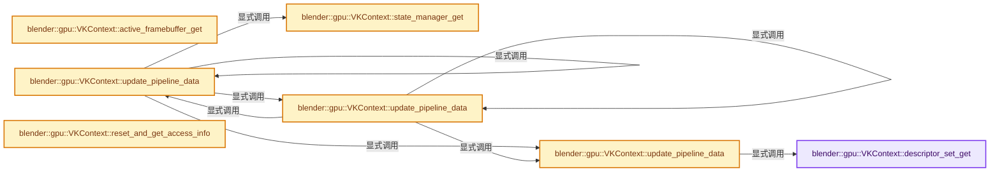
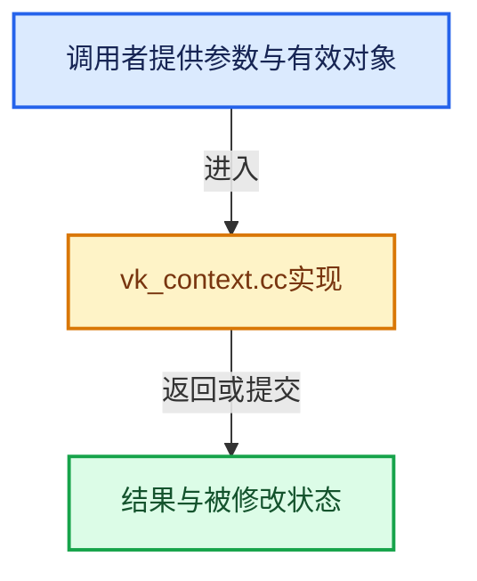

# 实现依赖专题：source/blender/gpu/vulkan/vk_context.cc

[方向导航](README.md) · [符号索引](../%E7%AC%A6%E5%8F%B7%E4%BE%9D%E8%B5%96%E4%B8%8E%E5%AE%9E%E7%8E%B0%E7%B4%A2%E5%BC%95.md)

本专题从正文实际调用进入，集中保存共享实现。函数有稳定锚点，可从调用处直接跳到对应完整函数；递归与互相调用通过回链组织。

## 本文件的实现关系






## 完整成员与函数实现

<a id="f-b0245ba6c8a46ce6"></a>

### `blender::gpu::VKContext::descriptor_set_get`

实现位置：[source/blender/gpu/vulkan/vk_context.cc](../../../../../source/blender/gpu/vulkan/vk_context.cc) · L233—L236。

**教学注释版**

<!-- annotated:c38fadfeb95fcb -->

```cpp
VKDescriptorSetTracker &VKContext::descriptor_set_get()
{
  return thread_data_.value().get().descriptor_set;
}
```

<details>
<summary>核对原始源码：source/blender/gpu/vulkan/vk_context.cc · L233—L236</summary>

<!-- original:c38fadfeb95fcb:source/blender/gpu/vulkan/vk_context.cc:233:236 -->

```cpp
VKDescriptorSetTracker &VKContext::descriptor_set_get()
{
  return thread_data_.value().get().descriptor_set;
}
```

</details>

**结果出口**

- `return thread_data_.value().get().descriptor_set;`

**继续追踪实现**

- `thread_data_.value().get` → [调用协议](../%E6%A8%A1%E6%9D%BF%E5%AE%8F%E4%B8%8E%E5%8A%A8%E6%80%81%E5%88%86%E6%B4%BE%E5%8D%8F%E8%AE%AE.md)：接收对象类型依赖auto、返回值或模板实例；不按同名猜测目标。调用位置L235。
- `thread_data_.value` → [调用协议](../%E6%A8%A1%E6%9D%BF%E5%AE%8F%E4%B8%8E%E5%8A%A8%E6%80%81%E5%88%86%E6%B4%BE%E5%8D%8F%E8%AE%AE.md)：接收对象类型依赖auto、返回值或模板实例；不按同名猜测目标。调用位置L235。

<a id="f-e18c55531e96aa04"></a>

### `blender::gpu::VKContext::state_manager_get`

实现位置：[source/blender/gpu/vulkan/vk_context.cc](../../../../../source/blender/gpu/vulkan/vk_context.cc) · L238—L241。

**教学注释版**

<!-- annotated:cc2c6ad8932a03 -->

```cpp
VKStateManager &VKContext::state_manager_get() const
{
  return *static_cast<VKStateManager *>(state_manager);
}
```

<details>
<summary>核对原始源码：source/blender/gpu/vulkan/vk_context.cc · L238—L241</summary>

<!-- original:cc2c6ad8932a03:source/blender/gpu/vulkan/vk_context.cc:238:241 -->

```cpp
VKStateManager &VKContext::state_manager_get() const
{
  return *static_cast<VKStateManager *>(state_manager);
}
```

</details>

**结果出口**

- `return *static_cast<VKStateManager *>(state_manager);`

**继续追踪实现**

本实现没有需要继续展开的显式调用；检查返回表达式、对象转换和调用者前置条件。

<a id="f-775975b6e7ea8bfd"></a>

### `blender::gpu::VKContext::active_framebuffer_get`

实现位置：[source/blender/gpu/vulkan/vk_context.cc](../../../../../source/blender/gpu/vulkan/vk_context.cc) · L272—L275。

**教学注释版**

<!-- annotated:a86dcd97e8c571 -->

```cpp
VKFrameBuffer *VKContext::active_framebuffer_get() const
{
  return unwrap(active_fb);
}
```

<details>
<summary>核对原始源码：source/blender/gpu/vulkan/vk_context.cc · L272—L275</summary>

<!-- original:a86dcd97e8c571:source/blender/gpu/vulkan/vk_context.cc:272:275 -->

```cpp
VKFrameBuffer *VKContext::active_framebuffer_get() const
{
  return unwrap(active_fb);
}
```

</details>

**结果出口**

- `return unwrap(active_fb);`

**继续追踪实现**

- `unwrap` → [blender::gpu::unwrap · L89](%E4%BE%9D%E8%B5%96-vk_vertex_buffer-066078.md#f-981924b7123a52bf)；[blender::gpu::unwrap · L93](%E4%BE%9D%E8%B5%96-vk_vertex_buffer-066078.md#f-aeaeaa21ca71cf93)；[blender::gpu::unwrap · L179](%E4%BE%9D%E8%B5%96-vk_texture-f366e5.md#f-ffb30b48418b1000)；[blender::gpu::unwrap · L71](%E4%BE%9D%E8%B5%96-vk_storage_buffer-e588a0.md#f-5273b40ca5cee3e7)；[blender::gpu::unwrap · L158](%E4%BE%9D%E8%B5%96-vk_shader-54a32f.md#f-94d260439993a24d)；[blender::gpu::unwrap · L163](%E4%BE%9D%E8%B5%96-vk_shader-54a32f.md#f-6cafb188fd34255d)；[blender::gpu::unwrap · L102](%E4%BE%9D%E8%B5%96-vk_ray_tracing-92bff6.md#f-2d7aee58c588d81f)；[blender::gpu::unwrap · L106](%E4%BE%9D%E8%B5%96-vk_ray_tracing-92bff6.md#f-f7db0fb1b2eac1ea)；[blender::gpu::unwrap · L38](%E4%BE%9D%E8%B5%96-vk_pixel_buffer-f57bf0.md#f-923d55b370d33139)；[blender::gpu::unwrap · L70](%E4%BE%9D%E8%B5%96-vk_index_buffer-9ae58f.md#f-62f2679fcad8aa93)；[blender::gpu::unwrap · L75](%E4%BE%9D%E8%B5%96-vk_index_buffer-9ae58f.md#f-fd72b5b309f16c1b)；[blender::gpu::unwrap · L149](%E4%BE%9D%E8%B5%96-vk_framebuffer-c36f0d.md#f-a0dda2e837c01412)；[blender::gpu::unwrap · L50](%E4%BE%9D%E8%B5%96-vk_batch-beb16a.md#f-be72573f46a049dd)。同名重载需按实参类型选择。

<a id="f-ef0394f4a1315d14"></a>

### `blender::gpu::VKContext::update_pipeline_data`

实现位置：[source/blender/gpu/vulkan/vk_context.cc](../../../../../source/blender/gpu/vulkan/vk_context.cc) · L306—L372。

接口参数：

- `const VKFrameBuffer &framebuffer`
- `GPUPrimType primitive`
- `VKVertexInputDescriptionPool::Key vertex_input_key`
- `render_graph::VKPipelineDataGraphics &r_pipeline_data`

**教学注释版**

<!-- annotated:72121ba8880ae8 -->

```cpp
void VKContext::update_pipeline_data(const VKFrameBuffer &framebuffer,
                                     GPUPrimType primitive,
                                     VKVertexInputDescriptionPool::Key vertex_input_key,
                                     render_graph::VKPipelineDataGraphics &r_pipeline_data)
{
  VKShader &vk_shader = unwrap(*shader);
  VKStateManager &state_manager = state_manager_get();

  /* Disable non-vulkan state flags to reduce unneeded pipeline compilation. */
  state_manager.state.clip_control = 0;

  framebuffer.vk_viewports_append(r_pipeline_data.viewport.viewports);
  framebuffer.vk_render_areas_append(r_pipeline_data.viewport.scissors);

  /* Override size of point shader when GPU_point size < 0 */
  const float point_size = state_manager.mutable_state.point_size;
  if (primitive == GPU_PRIM_POINTS && point_size < 0.0) {
    GPU_shader_uniform_1f(shader, "size", -point_size);
  }

  VKDevice &device = VKBackend::get().device;
  const VKExtensions &extensions = device.extensions_get();

  /* Dynamic state line width */
  const bool is_line_primitive = ELEM(primitive,
                                      GPU_PRIM_LINES,
                                      GPU_PRIM_LINE_LOOP,
                                      GPU_PRIM_LINE_STRIP,
                                      GPU_PRIM_LINES_ADJ,
                                      GPU_PRIM_LINE_STRIP_ADJ);
  if (is_line_primitive) {
    r_pipeline_data.line_width = extensions.wide_lines ? state_manager.mutable_state.line_width :
                                                         1.0f;
  }
  else {
    r_pipeline_data.line_width.reset();
  }

  /* Dynamic state stencil state */
  if (framebuffer.stencil_attachment_format_get() != VK_FORMAT_UNDEFINED &&
      state_manager.state.stencil_test != GPU_STENCIL_NONE)
  {
    r_pipeline_data.stencil_state = {state_manager.mutable_state.stencil_compare_mask,
                                     state_manager.mutable_state.stencil_reference,
                                     state_manager.mutable_state.stencil_write_mask};
  }
  else {
    r_pipeline_data.stencil_state.reset();
  }

  /* VK_EXT_extended_dynamic_state */
  if (extensions.extended_dynamic_state) {
    r_pipeline_data.front_face = state_manager.state.invert_facing ?
                                     VK_FRONT_FACE_COUNTER_CLOCKWISE :
                                     VK_FRONT_FACE_CLOCKWISE;
  }

  if (extensions.vertex_input_dynamic_state) {
    r_pipeline_data.vertex_input_description = vertex_input_key;
  }

  update_pipeline_data(
      vk_shader,
      vk_shader.ensure_and_get_graphics_pipeline(
          primitive, vertex_input_key, state_manager, framebuffer, constants_state_),
      r_pipeline_data.pipeline_data);
}
```

<details>
<summary>核对原始源码：source/blender/gpu/vulkan/vk_context.cc · L306—L372</summary>

<!-- original:72121ba8880ae8:source/blender/gpu/vulkan/vk_context.cc:306:372 -->

```cpp
void VKContext::update_pipeline_data(const VKFrameBuffer &framebuffer,
                                     GPUPrimType primitive,
                                     VKVertexInputDescriptionPool::Key vertex_input_key,
                                     render_graph::VKPipelineDataGraphics &r_pipeline_data)
{
  VKShader &vk_shader = unwrap(*shader);
  VKStateManager &state_manager = state_manager_get();

  /* Disable non-vulkan state flags to reduce unneeded pipeline compilation. */
  state_manager.state.clip_control = 0;

  framebuffer.vk_viewports_append(r_pipeline_data.viewport.viewports);
  framebuffer.vk_render_areas_append(r_pipeline_data.viewport.scissors);

  /* Override size of point shader when GPU_point size < 0 */
  const float point_size = state_manager.mutable_state.point_size;
  if (primitive == GPU_PRIM_POINTS && point_size < 0.0) {
    GPU_shader_uniform_1f(shader, "size", -point_size);
  }

  VKDevice &device = VKBackend::get().device;
  const VKExtensions &extensions = device.extensions_get();

  /* Dynamic state line width */
  const bool is_line_primitive = ELEM(primitive,
                                      GPU_PRIM_LINES,
                                      GPU_PRIM_LINE_LOOP,
                                      GPU_PRIM_LINE_STRIP,
                                      GPU_PRIM_LINES_ADJ,
                                      GPU_PRIM_LINE_STRIP_ADJ);
  if (is_line_primitive) {
    r_pipeline_data.line_width = extensions.wide_lines ? state_manager.mutable_state.line_width :
                                                         1.0f;
  }
  else {
    r_pipeline_data.line_width.reset();
  }

  /* Dynamic state stencil state */
  if (framebuffer.stencil_attachment_format_get() != VK_FORMAT_UNDEFINED &&
      state_manager.state.stencil_test != GPU_STENCIL_NONE)
  {
    r_pipeline_data.stencil_state = {state_manager.mutable_state.stencil_compare_mask,
                                     state_manager.mutable_state.stencil_reference,
                                     state_manager.mutable_state.stencil_write_mask};
  }
  else {
    r_pipeline_data.stencil_state.reset();
  }

  /* VK_EXT_extended_dynamic_state */
  if (extensions.extended_dynamic_state) {
    r_pipeline_data.front_face = state_manager.state.invert_facing ?
                                     VK_FRONT_FACE_COUNTER_CLOCKWISE :
                                     VK_FRONT_FACE_CLOCKWISE;
  }

  if (extensions.vertex_input_dynamic_state) {
    r_pipeline_data.vertex_input_description = vertex_input_key;
  }

  update_pipeline_data(
      vk_shader,
      vk_shader.ensure_and_get_graphics_pipeline(
          primitive, vertex_input_key, state_manager, framebuffer, constants_state_),
      r_pipeline_data.pipeline_data);
}
```

</details>

**沿实际写入检查状态**

- `state_manager.state.clip_control = 0;`
- `r_pipeline_data.line_width = extensions.wide_lines ? state_manager.mutable_state.line_width :`
- `r_pipeline_data.stencil_state = {state_manager.mutable_state.stencil_compare_mask,`
- `r_pipeline_data.front_face = state_manager.state.invert_facing ?`
- `r_pipeline_data.vertex_input_description = vertex_input_key;`

**继续追踪实现**

- `unwrap` → [blender::gpu::unwrap · L89](%E4%BE%9D%E8%B5%96-vk_vertex_buffer-066078.md#f-981924b7123a52bf)；[blender::gpu::unwrap · L93](%E4%BE%9D%E8%B5%96-vk_vertex_buffer-066078.md#f-aeaeaa21ca71cf93)；[blender::gpu::unwrap · L179](%E4%BE%9D%E8%B5%96-vk_texture-f366e5.md#f-ffb30b48418b1000)；[blender::gpu::unwrap · L71](%E4%BE%9D%E8%B5%96-vk_storage_buffer-e588a0.md#f-5273b40ca5cee3e7)；[blender::gpu::unwrap · L158](%E4%BE%9D%E8%B5%96-vk_shader-54a32f.md#f-94d260439993a24d)；[blender::gpu::unwrap · L163](%E4%BE%9D%E8%B5%96-vk_shader-54a32f.md#f-6cafb188fd34255d)；[blender::gpu::unwrap · L102](%E4%BE%9D%E8%B5%96-vk_ray_tracing-92bff6.md#f-2d7aee58c588d81f)；[blender::gpu::unwrap · L106](%E4%BE%9D%E8%B5%96-vk_ray_tracing-92bff6.md#f-f7db0fb1b2eac1ea)；[blender::gpu::unwrap · L38](%E4%BE%9D%E8%B5%96-vk_pixel_buffer-f57bf0.md#f-923d55b370d33139)；[blender::gpu::unwrap · L70](%E4%BE%9D%E8%B5%96-vk_index_buffer-9ae58f.md#f-62f2679fcad8aa93)；[blender::gpu::unwrap · L75](%E4%BE%9D%E8%B5%96-vk_index_buffer-9ae58f.md#f-fd72b5b309f16c1b)；[blender::gpu::unwrap · L149](%E4%BE%9D%E8%B5%96-vk_framebuffer-c36f0d.md#f-a0dda2e837c01412)；[blender::gpu::unwrap · L50](%E4%BE%9D%E8%B5%96-vk_batch-beb16a.md#f-be72573f46a049dd)。同名重载需按实参类型选择。
- `state_manager_get` → [blender::gpu::VKContext::state_manager_get · L238](%E4%BE%9D%E8%B5%96-vk_context-443184.md#f-e18c55531e96aa04)。
- `framebuffer.vk_viewports_append` → [blender::gpu::VKFrameBuffer::vk_viewports_append · L77](%E4%BE%9D%E8%B5%96-vk_framebuffer-84f42c.md#f-ef171f65ca8a2454)。
- `framebuffer.vk_render_areas_append` → [blender::gpu::VKFrameBuffer::vk_render_areas_append · L118](%E4%BE%9D%E8%B5%96-vk_framebuffer-84f42c.md#f-56f33668d9a68929)。
- `GPU_shader_uniform_1f` → [blender::GPU_shader_uniform_1f · L675](%E4%BE%9D%E8%B5%96-gpu_shader-141cc9.md#f-56672be17e2419d8)。
- `VKBackend::get` → [blender::gpu::VKBackend::get · L106](%E4%BE%9D%E8%B5%96-vk_backend-742e37.md#f-9b0f846ed492f55f)。
- `device.extensions_get` → [blender::gpu::VKDevice::extensions_get · L393](%E4%BE%9D%E8%B5%96-vk_device-7cec76.md#f-b9006d1d05b9eba2)。
- `ELEM` → [ELEM · L88](%E4%BE%9D%E8%B5%96-GHOST_utildefines-34b996.md#m-d28724a15928)；[ELEM · L135](../01-%E5%9F%BA%E7%A1%80%E5%AE%B9%E5%99%A8%E4%B8%8E%E7%8E%B0%E4%BB%A3CPP/%E4%BE%9D%E8%B5%96-BLI_utildefines-293a0a.md#m-d6572de7cae0)。宏定义由构建条件选择。
- `r_pipeline_data.line_width.reset` → [调用协议](../%E6%A8%A1%E6%9D%BF%E5%AE%8F%E4%B8%8E%E5%8A%A8%E6%80%81%E5%88%86%E6%B4%BE%E5%8D%8F%E8%AE%AE.md)：接收对象类型依赖auto、返回值或模板实例；不按同名猜测目标。调用位置L341。
- `framebuffer.stencil_attachment_format_get` → [blender::gpu::VKFrameBuffer::stencil_attachment_format_get · L780](%E4%BE%9D%E8%B5%96-vk_framebuffer-84f42c.md#f-48ba25af8369f83d)。
- `r_pipeline_data.stencil_state.reset` → [调用协议](../%E6%A8%A1%E6%9D%BF%E5%AE%8F%E4%B8%8E%E5%8A%A8%E6%80%81%E5%88%86%E6%B4%BE%E5%8D%8F%E8%AE%AE.md)：接收对象类型依赖auto、返回值或模板实例；不按同名猜测目标。调用位置L353。
- `update_pipeline_data` → [blender::gpu::VKContext::update_pipeline_data · L306](%E4%BE%9D%E8%B5%96-vk_context-443184.md#f-ef0394f4a1315d14)；[blender::gpu::VKContext::update_pipeline_data · L374](%E4%BE%9D%E8%B5%96-vk_context-443184.md#f-5bd967b8cc52c122)；[blender::gpu::VKContext::update_pipeline_data · L381](%E4%BE%9D%E8%B5%96-vk_context-443184.md#f-859a98f1f51a1838)。同名重载需按实参类型选择。
- `vk_shader.ensure_and_get_graphics_pipeline` → [blender::gpu::VKShader::ensure_and_get_graphics_pipeline · L1413](%E4%BE%9D%E8%B5%96-vk_shader-069c7e.md#f-ee6c035426791ddb)。

<a id="f-5bd967b8cc52c122"></a>

### `blender::gpu::VKContext::update_pipeline_data`

实现位置：[source/blender/gpu/vulkan/vk_context.cc](../../../../../source/blender/gpu/vulkan/vk_context.cc) · L374—L379。

接口参数：

- `render_graph::VKPipelineData &r_pipeline_data`

**教学注释版**

<!-- annotated:4f318c19ce6046 -->

```cpp
void VKContext::update_pipeline_data(render_graph::VKPipelineData &r_pipeline_data)
{
  VKShader &vk_shader = unwrap(*shader);
  update_pipeline_data(
      vk_shader, vk_shader.ensure_and_get_compute_pipeline(constants_state_), r_pipeline_data);
}
```

<details>
<summary>核对原始源码：source/blender/gpu/vulkan/vk_context.cc · L374—L379</summary>

<!-- original:4f318c19ce6046:source/blender/gpu/vulkan/vk_context.cc:374:379 -->

```cpp
void VKContext::update_pipeline_data(render_graph::VKPipelineData &r_pipeline_data)
{
  VKShader &vk_shader = unwrap(*shader);
  update_pipeline_data(
      vk_shader, vk_shader.ensure_and_get_compute_pipeline(constants_state_), r_pipeline_data);
}
```

</details>

**继续追踪实现**

- `unwrap` → [blender::gpu::unwrap · L89](%E4%BE%9D%E8%B5%96-vk_vertex_buffer-066078.md#f-981924b7123a52bf)；[blender::gpu::unwrap · L93](%E4%BE%9D%E8%B5%96-vk_vertex_buffer-066078.md#f-aeaeaa21ca71cf93)；[blender::gpu::unwrap · L179](%E4%BE%9D%E8%B5%96-vk_texture-f366e5.md#f-ffb30b48418b1000)；[blender::gpu::unwrap · L71](%E4%BE%9D%E8%B5%96-vk_storage_buffer-e588a0.md#f-5273b40ca5cee3e7)；[blender::gpu::unwrap · L158](%E4%BE%9D%E8%B5%96-vk_shader-54a32f.md#f-94d260439993a24d)；[blender::gpu::unwrap · L163](%E4%BE%9D%E8%B5%96-vk_shader-54a32f.md#f-6cafb188fd34255d)；[blender::gpu::unwrap · L102](%E4%BE%9D%E8%B5%96-vk_ray_tracing-92bff6.md#f-2d7aee58c588d81f)；[blender::gpu::unwrap · L106](%E4%BE%9D%E8%B5%96-vk_ray_tracing-92bff6.md#f-f7db0fb1b2eac1ea)；[blender::gpu::unwrap · L38](%E4%BE%9D%E8%B5%96-vk_pixel_buffer-f57bf0.md#f-923d55b370d33139)；[blender::gpu::unwrap · L70](%E4%BE%9D%E8%B5%96-vk_index_buffer-9ae58f.md#f-62f2679fcad8aa93)；[blender::gpu::unwrap · L75](%E4%BE%9D%E8%B5%96-vk_index_buffer-9ae58f.md#f-fd72b5b309f16c1b)；[blender::gpu::unwrap · L149](%E4%BE%9D%E8%B5%96-vk_framebuffer-c36f0d.md#f-a0dda2e837c01412)；[blender::gpu::unwrap · L50](%E4%BE%9D%E8%B5%96-vk_batch-beb16a.md#f-be72573f46a049dd)。同名重载需按实参类型选择。
- `update_pipeline_data` → [blender::gpu::VKContext::update_pipeline_data · L306](%E4%BE%9D%E8%B5%96-vk_context-443184.md#f-ef0394f4a1315d14)；[blender::gpu::VKContext::update_pipeline_data · L374](%E4%BE%9D%E8%B5%96-vk_context-443184.md#f-5bd967b8cc52c122)；[blender::gpu::VKContext::update_pipeline_data · L381](%E4%BE%9D%E8%B5%96-vk_context-443184.md#f-859a98f1f51a1838)。同名重载需按实参类型选择。
- `vk_shader.ensure_and_get_compute_pipeline` → [blender::gpu::VKShader::ensure_and_get_compute_pipeline · L1319](%E4%BE%9D%E8%B5%96-vk_shader-069c7e.md#f-401fc1345db1ecf3)。

<a id="f-859a98f1f51a1838"></a>

### `blender::gpu::VKContext::update_pipeline_data`

实现位置：[source/blender/gpu/vulkan/vk_context.cc](../../../../../source/blender/gpu/vulkan/vk_context.cc) · L381—L404。

接口参数：

- `VKShader &vk_shader`
- `VkPipeline vk_pipeline`
- `render_graph::VKPipelineData &r_pipeline_data`

**教学注释版**

<!-- annotated:a1b0ce49e6e414 -->

```cpp
void VKContext::update_pipeline_data(VKShader &vk_shader,
                                     VkPipeline vk_pipeline,
                                     render_graph::VKPipelineData &r_pipeline_data)
{
  r_pipeline_data.vk_pipeline_layout = vk_shader.vk_pipeline_layout;
  r_pipeline_data.vk_pipeline = vk_pipeline;

  /* Update push constants. */
  r_pipeline_data.push_constants_range = IndexRange::from_begin_size(0, 0);
  const VKPushConstants::Layout &push_constants_layout =
      vk_shader.interface_get().push_constants_layout_get();
  if (push_constants_layout.storage_type_get() == VKPushConstants::StorageType::PUSH_CONSTANTS) {
    r_pipeline_data.push_constants_range = render_graph().copy_push_constants(
        Span<uint8_t>(static_cast<const uint8_t *>(vk_shader.push_constants.data()),
                      push_constants_layout.size_in_bytes()));
  }

  /* Update descriptor set. */
  r_pipeline_data.vk_descriptor_set = VK_NULL_HANDLE;
  if (vk_shader.has_descriptor_set()) {
    VKDescriptorSetTracker &descriptor_set = descriptor_set_get();
    descriptor_set.update_descriptor_set(*this, access_info_, r_pipeline_data);
  }
}
```

<details>
<summary>核对原始源码：source/blender/gpu/vulkan/vk_context.cc · L381—L404</summary>

<!-- original:a1b0ce49e6e414:source/blender/gpu/vulkan/vk_context.cc:381:404 -->

```cpp
void VKContext::update_pipeline_data(VKShader &vk_shader,
                                     VkPipeline vk_pipeline,
                                     render_graph::VKPipelineData &r_pipeline_data)
{
  r_pipeline_data.vk_pipeline_layout = vk_shader.vk_pipeline_layout;
  r_pipeline_data.vk_pipeline = vk_pipeline;

  /* Update push constants. */
  r_pipeline_data.push_constants_range = IndexRange::from_begin_size(0, 0);
  const VKPushConstants::Layout &push_constants_layout =
      vk_shader.interface_get().push_constants_layout_get();
  if (push_constants_layout.storage_type_get() == VKPushConstants::StorageType::PUSH_CONSTANTS) {
    r_pipeline_data.push_constants_range = render_graph().copy_push_constants(
        Span<uint8_t>(static_cast<const uint8_t *>(vk_shader.push_constants.data()),
                      push_constants_layout.size_in_bytes()));
  }

  /* Update descriptor set. */
  r_pipeline_data.vk_descriptor_set = VK_NULL_HANDLE;
  if (vk_shader.has_descriptor_set()) {
    VKDescriptorSetTracker &descriptor_set = descriptor_set_get();
    descriptor_set.update_descriptor_set(*this, access_info_, r_pipeline_data);
  }
}
```

</details>

**沿实际写入检查状态**

- `r_pipeline_data.vk_pipeline_layout = vk_shader.vk_pipeline_layout;`
- `r_pipeline_data.vk_pipeline = vk_pipeline;`
- `r_pipeline_data.push_constants_range = IndexRange::from_begin_size(0, 0);`
- `r_pipeline_data.push_constants_range = render_graph().copy_push_constants(`
- `r_pipeline_data.vk_descriptor_set = VK_NULL_HANDLE;`

**继续追踪实现**

- `IndexRange::from_begin_size` → [blender::IndexRange::from_begin_size · L73](../01-%E5%9F%BA%E7%A1%80%E5%AE%B9%E5%99%A8%E4%B8%8E%E7%8E%B0%E4%BB%A3CPP/04-IndexRange%E8%BF%9E%E7%BB%AD%E6%95%B4%E6%95%B0%E5%8C%BA%E9%97%B4.md#f-392d3c73c80f255d)。
- `vk_shader.interface_get().push_constants_layout_get` → [调用协议](../%E6%A8%A1%E6%9D%BF%E5%AE%8F%E4%B8%8E%E5%8A%A8%E6%80%81%E5%88%86%E6%B4%BE%E5%8D%8F%E8%AE%AE.md)：接收对象类型依赖auto、返回值或模板实例；不按同名猜测目标。调用位置L391。
- `vk_shader.interface_get` → [blender::gpu::VKShader::interface_get · L1506](%E4%BE%9D%E8%B5%96-vk_shader-069c7e.md#f-8447a0d8fe619074)。
- `push_constants_layout.storage_type_get` → [blender::gpu::VKPushConstants::Layout::storage_type_get · L124](%E4%BE%9D%E8%B5%96-vk_push_constants-90a71c.md#f-1d81c16c25e4eba9)。
- `render_graph().copy_push_constants` → [调用协议](../%E6%A8%A1%E6%9D%BF%E5%AE%8F%E4%B8%8E%E5%8A%A8%E6%80%81%E5%88%86%E6%B4%BE%E5%8D%8F%E8%AE%AE.md)：接收对象类型依赖auto、返回值或模板实例；不按同名猜测目标。调用位置L393。
- `render_graph` → [blender::gpu::VKContext::render_graph · L81](%E4%BE%9D%E8%B5%96-vk_context-f02d3a.md#f-3a4bb825ec5d0a82)；[blender::gpu::VKContext::render_graph · L85](%E4%BE%9D%E8%B5%96-vk_context-f02d3a.md#f-b3ac6949ba355b17)。同名重载需按实参类型选择。
- `Span<uint8_t>` → [blender::Span](../01-%E5%9F%BA%E7%A1%80%E5%AE%B9%E5%99%A8%E4%B8%8E%E7%8E%B0%E4%BB%A3CPP/%E4%BE%9D%E8%B5%96-BLI_span-6aa95f.md#t-8765a8e0c1d5)；[blender::Span](../01-%E5%9F%BA%E7%A1%80%E5%AE%B9%E5%99%A8%E4%B8%8E%E7%8E%B0%E4%BB%A3CPP/%E4%BE%9D%E8%B5%96-BLI_index_range-7d7cc5.md#t-86091874a1c0)；[blender::Span](%E4%BE%9D%E8%B5%96-DNA_pointcloud_types-cfb82c.md#t-112aa6ed842c)；[blender::Span](%E4%BE%9D%E8%B5%96-DNA_node_types-6708b9.md#t-49ec6fbb9b69)；[blender::Span](%E4%BE%9D%E8%B5%96-DNA_mesh_types-81f02e.md#t-184fd48fb638)；[blender::Span](%E4%BE%9D%E8%B5%96-DNA_anim_types-39c5d9.md#t-d841071994c2)；[blender::Span](%E4%BE%9D%E8%B5%96-RNA_path_fwd-79c989.md#t-4dbb08969e41)。
- `vk_shader.push_constants.data` → [调用协议](../%E6%A8%A1%E6%9D%BF%E5%AE%8F%E4%B8%8E%E5%8A%A8%E6%80%81%E5%88%86%E6%B4%BE%E5%8D%8F%E8%AE%AE.md)：接收对象类型依赖auto、返回值或模板实例；不按同名猜测目标。调用位置L394。
- `push_constants_layout.size_in_bytes` → [blender::gpu::VKPushConstants::Layout::size_in_bytes · L142](%E4%BE%9D%E8%B5%96-vk_push_constants-90a71c.md#f-d377149f92ac4ce5)。
- `vk_shader.has_descriptor_set` → [blender::gpu::VKShader::has_descriptor_set · L126](%E4%BE%9D%E8%B5%96-vk_shader-54a32f.md#f-5cf408c70620d6a6)。
- `descriptor_set_get` → [blender::gpu::VKContext::descriptor_set_get · L233](%E4%BE%9D%E8%B5%96-vk_context-443184.md#f-b0245ba6c8a46ce6)。
- `descriptor_set.update_descriptor_set` → [blender::gpu::VKDescriptorSetTracker::update_descriptor_set · L26](%E4%BE%9D%E8%B5%96-vk_descriptor_set-8db396.md#f-053a991c0746730c)。

<a id="f-ac8970ee17d46c7a"></a>

### `blender::gpu::VKContext::reset_and_get_access_info`

实现位置：[source/blender/gpu/vulkan/vk_context.cc](../../../../../source/blender/gpu/vulkan/vk_context.cc) · L406—L410。

**教学注释版**

<!-- annotated:ba9e20027b227c -->

```cpp
render_graph::VKResourceAccessInfo &VKContext::reset_and_get_access_info()
{
  access_info_.reset();
  return access_info_;
}
```

<details>
<summary>核对原始源码：source/blender/gpu/vulkan/vk_context.cc · L406—L410</summary>

<!-- original:ba9e20027b227c:source/blender/gpu/vulkan/vk_context.cc:406:410 -->

```cpp
render_graph::VKResourceAccessInfo &VKContext::reset_and_get_access_info()
{
  access_info_.reset();
  return access_info_;
}
```

</details>

**结果出口**

- `return access_info_;`

**继续追踪实现**

- `access_info_.reset` → [调用协议](../%E6%A8%A1%E6%9D%BF%E5%AE%8F%E4%B8%8E%E5%8A%A8%E6%80%81%E5%88%86%E6%B4%BE%E5%8D%8F%E8%AE%AE.md)：接收对象类型依赖auto、返回值或模板实例；不按同名猜测目标。调用位置L408。
