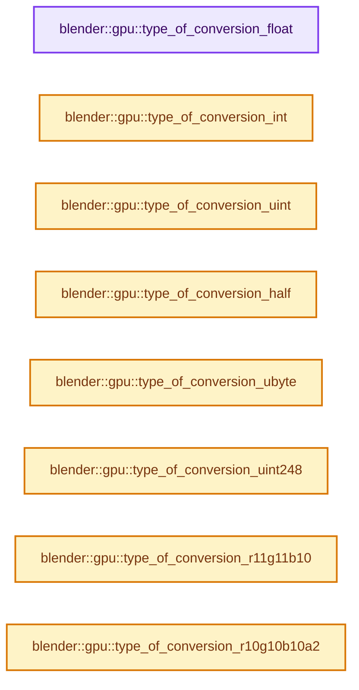

# 实现依赖专题：source/blender/gpu/vulkan/vk_data_conversion.cc

[方向导航](README.md) · [符号索引](../%E7%AC%A6%E5%8F%B7%E4%BE%9D%E8%B5%96%E4%B8%8E%E5%AE%9E%E7%8E%B0%E7%B4%A2%E5%BC%95.md)

本专题从正文实际调用进入，集中保存共享实现。函数有稳定锚点，可从调用处直接跳到对应完整函数；递归与互相调用通过回链组织。

## 本文件的实现关系




## 完整成员与函数实现

<a id="f-9a7a0745a1f361f2"></a>

### `blender::gpu::type_of_conversion_float`

实现位置：[source/blender/gpu/vulkan/vk_data_conversion.cc](../../../../../source/blender/gpu/vulkan/vk_data_conversion.cc) · L82—L193。

接口参数：

- `const TextureFormat host_format`
- `const TextureFormat device_format`

**教学注释版**

<!-- annotated:7a2ec95b5a4d32 -->

```cpp
static ConversionType type_of_conversion_float(const TextureFormat host_format,
                                               const TextureFormat device_format)
{
  if (host_format != device_format) {
    if (host_format == TextureFormat::SFLOAT_16_16_16 &&
        device_format == TextureFormat::SFLOAT_16_16_16_16)
    {
      return ConversionType::FLOAT3_TO_HALF4;
    }
    if (host_format == TextureFormat::SFLOAT_32_32_32 &&
        device_format == TextureFormat::SFLOAT_32_32_32_32)
    {
      return ConversionType::FLOAT3_TO_FLOAT4;
    }

    return ConversionType::UNSUPPORTED;
  }

  switch (device_format) {
    case TextureFormat::SFLOAT_32_32_32_32:
    case TextureFormat::SFLOAT_32_32:
    case TextureFormat::SFLOAT_32:
    case TextureFormat::SFLOAT_32_DEPTH:
      return ConversionType::PASS_THROUGH;

    case TextureFormat::SFLOAT_32_DEPTH_UINT_8:
      return ConversionType::PASS_THROUGH_D32F_S8;

    case TextureFormat::SFLOAT_16_16_16_16:
    case TextureFormat::SFLOAT_16_16:
    case TextureFormat::SFLOAT_16:
    case TextureFormat::SFLOAT_16_16_16:
      return ConversionType::FLOAT_TO_HALF;

    case TextureFormat::SRGBA_8_8_8_8:
    case TextureFormat::UNORM_8_8_8_8:
    case TextureFormat::UNORM_8_8:
    case TextureFormat::UNORM_8:
      return ConversionType::FLOAT_TO_UNORM8;

    case TextureFormat::SNORM_8_8_8_8:
    case TextureFormat::SNORM_8_8_8:
    case TextureFormat::SNORM_8_8:
    case TextureFormat::SNORM_8:
      return ConversionType::FLOAT_TO_SNORM8;

    case TextureFormat::UNORM_16_16_16_16:
    case TextureFormat::UNORM_16_16:
    case TextureFormat::UNORM_16:
      return ConversionType::FLOAT_TO_UNORM16;

    case TextureFormat::SNORM_16_16_16_16:
    case TextureFormat::SNORM_16_16_16:
    case TextureFormat::SNORM_16_16:
    case TextureFormat::SNORM_16:
      return ConversionType::FLOAT_TO_SNORM16;

    case TextureFormat::UFLOAT_11_11_10:
      return ConversionType::FLOAT_TO_B10F_G11F_R11F;

    case TextureFormat::SRGB_DXT1:
    case TextureFormat::SRGB_DXT3:
    case TextureFormat::SRGB_DXT5:
    case TextureFormat::SNORM_DXT1:
    case TextureFormat::SNORM_DXT3:
    case TextureFormat::SNORM_DXT5:
      /* Not an actual "conversion", but compressed texture upload code
       * pretends that host data is a float. It is actually raw BCn bits. */
      return ConversionType::PASS_THROUGH;

      /* #TextureFormat::SFLOAT_32_32_32 Not supported by vendors. */
    case TextureFormat::SFLOAT_32_32_32:

    case TextureFormat::UINT_8_8_8_8:
    case TextureFormat::SINT_8_8_8_8:
    case TextureFormat::UINT_16_16_16_16:
    case TextureFormat::SINT_16_16_16_16:
    case TextureFormat::UINT_32_32_32_32:
    case TextureFormat::SINT_32_32_32_32:
    case TextureFormat::UINT_8_8:
    case TextureFormat::SINT_8_8:
    case TextureFormat::UINT_16_16:
    case TextureFormat::SINT_16_16:
    case TextureFormat::UINT_32_32:
    case TextureFormat::SINT_32_32:
    case TextureFormat::UINT_8:
    case TextureFormat::SINT_8:
    case TextureFormat::UINT_16:
    case TextureFormat::SINT_16:
    case TextureFormat::UINT_32:
    case TextureFormat::SINT_32:
    case TextureFormat::UNORM_10_10_10_2:
    case TextureFormat::UINT_10_10_10_2:
    case TextureFormat::UINT_8_8_8:
    case TextureFormat::SINT_8_8_8:
    case TextureFormat::UNORM_8_8_8:
    case TextureFormat::UINT_16_16_16:
    case TextureFormat::SINT_16_16_16:
    case TextureFormat::UNORM_16_16_16:
    case TextureFormat::UINT_32_32_32:
    case TextureFormat::SINT_32_32_32:
    case TextureFormat::SRGBA_8_8_8:
    case TextureFormat::UFLOAT_9_9_9_EXP_5:
    case TextureFormat::UNORM_16_DEPTH:
      return ConversionType::UNSUPPORTED;

    case TextureFormat::Invalid:
      BLI_assert_unreachable();
      break;
  }
  return ConversionType::UNSUPPORTED;
}
```

<details>
<summary>核对原始源码：source/blender/gpu/vulkan/vk_data_conversion.cc · L82—L193</summary>

<!-- original:7a2ec95b5a4d32:source/blender/gpu/vulkan/vk_data_conversion.cc:82:193 -->

```cpp
static ConversionType type_of_conversion_float(const TextureFormat host_format,
                                               const TextureFormat device_format)
{
  if (host_format != device_format) {
    if (host_format == TextureFormat::SFLOAT_16_16_16 &&
        device_format == TextureFormat::SFLOAT_16_16_16_16)
    {
      return ConversionType::FLOAT3_TO_HALF4;
    }
    if (host_format == TextureFormat::SFLOAT_32_32_32 &&
        device_format == TextureFormat::SFLOAT_32_32_32_32)
    {
      return ConversionType::FLOAT3_TO_FLOAT4;
    }

    return ConversionType::UNSUPPORTED;
  }

  switch (device_format) {
    case TextureFormat::SFLOAT_32_32_32_32:
    case TextureFormat::SFLOAT_32_32:
    case TextureFormat::SFLOAT_32:
    case TextureFormat::SFLOAT_32_DEPTH:
      return ConversionType::PASS_THROUGH;

    case TextureFormat::SFLOAT_32_DEPTH_UINT_8:
      return ConversionType::PASS_THROUGH_D32F_S8;

    case TextureFormat::SFLOAT_16_16_16_16:
    case TextureFormat::SFLOAT_16_16:
    case TextureFormat::SFLOAT_16:
    case TextureFormat::SFLOAT_16_16_16:
      return ConversionType::FLOAT_TO_HALF;

    case TextureFormat::SRGBA_8_8_8_8:
    case TextureFormat::UNORM_8_8_8_8:
    case TextureFormat::UNORM_8_8:
    case TextureFormat::UNORM_8:
      return ConversionType::FLOAT_TO_UNORM8;

    case TextureFormat::SNORM_8_8_8_8:
    case TextureFormat::SNORM_8_8_8:
    case TextureFormat::SNORM_8_8:
    case TextureFormat::SNORM_8:
      return ConversionType::FLOAT_TO_SNORM8;

    case TextureFormat::UNORM_16_16_16_16:
    case TextureFormat::UNORM_16_16:
    case TextureFormat::UNORM_16:
      return ConversionType::FLOAT_TO_UNORM16;

    case TextureFormat::SNORM_16_16_16_16:
    case TextureFormat::SNORM_16_16_16:
    case TextureFormat::SNORM_16_16:
    case TextureFormat::SNORM_16:
      return ConversionType::FLOAT_TO_SNORM16;

    case TextureFormat::UFLOAT_11_11_10:
      return ConversionType::FLOAT_TO_B10F_G11F_R11F;

    case TextureFormat::SRGB_DXT1:
    case TextureFormat::SRGB_DXT3:
    case TextureFormat::SRGB_DXT5:
    case TextureFormat::SNORM_DXT1:
    case TextureFormat::SNORM_DXT3:
    case TextureFormat::SNORM_DXT5:
      /* Not an actual "conversion", but compressed texture upload code
       * pretends that host data is a float. It is actually raw BCn bits. */
      return ConversionType::PASS_THROUGH;

      /* #TextureFormat::SFLOAT_32_32_32 Not supported by vendors. */
    case TextureFormat::SFLOAT_32_32_32:

    case TextureFormat::UINT_8_8_8_8:
    case TextureFormat::SINT_8_8_8_8:
    case TextureFormat::UINT_16_16_16_16:
    case TextureFormat::SINT_16_16_16_16:
    case TextureFormat::UINT_32_32_32_32:
    case TextureFormat::SINT_32_32_32_32:
    case TextureFormat::UINT_8_8:
    case TextureFormat::SINT_8_8:
    case TextureFormat::UINT_16_16:
    case TextureFormat::SINT_16_16:
    case TextureFormat::UINT_32_32:
    case TextureFormat::SINT_32_32:
    case TextureFormat::UINT_8:
    case TextureFormat::SINT_8:
    case TextureFormat::UINT_16:
    case TextureFormat::SINT_16:
    case TextureFormat::UINT_32:
    case TextureFormat::SINT_32:
    case TextureFormat::UNORM_10_10_10_2:
    case TextureFormat::UINT_10_10_10_2:
    case TextureFormat::UINT_8_8_8:
    case TextureFormat::SINT_8_8_8:
    case TextureFormat::UNORM_8_8_8:
    case TextureFormat::UINT_16_16_16:
    case TextureFormat::SINT_16_16_16:
    case TextureFormat::UNORM_16_16_16:
    case TextureFormat::UINT_32_32_32:
    case TextureFormat::SINT_32_32_32:
    case TextureFormat::SRGBA_8_8_8:
    case TextureFormat::UFLOAT_9_9_9_EXP_5:
    case TextureFormat::UNORM_16_DEPTH:
      return ConversionType::UNSUPPORTED;

    case TextureFormat::Invalid:
      BLI_assert_unreachable();
      break;
  }
  return ConversionType::UNSUPPORTED;
}
```

</details>

**结果出口**

- `return ConversionType::FLOAT3_TO_HALF4;`
- `return ConversionType::FLOAT3_TO_FLOAT4;`
- `return ConversionType::UNSUPPORTED;`
- `return ConversionType::PASS_THROUGH;`
- `return ConversionType::PASS_THROUGH_D32F_S8;`
- `return ConversionType::FLOAT_TO_HALF;`
- `return ConversionType::FLOAT_TO_UNORM8;`
- `return ConversionType::FLOAT_TO_SNORM8;`
- `return ConversionType::FLOAT_TO_UNORM16;`
- `return ConversionType::FLOAT_TO_SNORM16;`
- `return ConversionType::FLOAT_TO_B10F_G11F_R11F;`

**继续追踪实现**

- `BLI_assert_unreachable` → [BLI_assert_unreachable · L77](../01-%E5%9F%BA%E7%A1%80%E5%AE%B9%E5%99%A8%E4%B8%8E%E7%8E%B0%E4%BB%A3CPP/%E4%BE%9D%E8%B5%96-BLI_assert-cc98e8.md#m-7a2d91a67d8e)。宏定义由构建条件选择。

<a id="f-0cca61f0a03d93af"></a>

### `blender::gpu::type_of_conversion_int`

实现位置：[source/blender/gpu/vulkan/vk_data_conversion.cc](../../../../../source/blender/gpu/vulkan/vk_data_conversion.cc) · L195—L274。

接口参数：

- `TextureFormat device_format`

**教学注释版**

<!-- annotated:8a093ec671804a -->

```cpp
static ConversionType type_of_conversion_int(TextureFormat device_format)
{
  switch (device_format) {
    case TextureFormat::SINT_32_32_32_32:
    case TextureFormat::SINT_32_32:
    case TextureFormat::SINT_32:
      return ConversionType::PASS_THROUGH;

    case TextureFormat::SINT_16_16_16_16:
    case TextureFormat::SINT_16_16:
    case TextureFormat::SINT_16:
      return ConversionType::I32_TO_I16;

    case TextureFormat::SINT_8_8_8_8:
    case TextureFormat::SINT_8_8:
    case TextureFormat::SINT_8:
      return ConversionType::I32_TO_I8;

    case TextureFormat::UINT_8_8_8_8:
    case TextureFormat::UNORM_8_8_8_8:
    case TextureFormat::UINT_16_16_16_16:
    case TextureFormat::SFLOAT_16_16_16_16:
    case TextureFormat::UNORM_16_16_16_16:
    case TextureFormat::UINT_32_32_32_32:
    case TextureFormat::SFLOAT_32_32_32_32:
    case TextureFormat::UINT_8_8:
    case TextureFormat::UNORM_8_8:
    case TextureFormat::UINT_16_16:
    case TextureFormat::SFLOAT_16_16:
    case TextureFormat::UINT_32_32:
    case TextureFormat::SFLOAT_32_32:
    case TextureFormat::UNORM_16_16:
    case TextureFormat::UINT_8:
    case TextureFormat::UNORM_8:
    case TextureFormat::UINT_16:
    case TextureFormat::SFLOAT_16:
    case TextureFormat::UNORM_16:
    case TextureFormat::UINT_32:
    case TextureFormat::SFLOAT_32:
    case TextureFormat::UNORM_10_10_10_2:
    case TextureFormat::UINT_10_10_10_2:
    case TextureFormat::UFLOAT_11_11_10:
    case TextureFormat::SFLOAT_32_DEPTH_UINT_8:
    case TextureFormat::SRGBA_8_8_8_8:
    case TextureFormat::SNORM_8_8_8_8:
    case TextureFormat::SNORM_16_16_16_16:
    case TextureFormat::UINT_8_8_8:
    case TextureFormat::SINT_8_8_8:
    case TextureFormat::UNORM_8_8_8:
    case TextureFormat::SNORM_8_8_8:
    case TextureFormat::UINT_16_16_16:
    case TextureFormat::SINT_16_16_16:
    case TextureFormat::SFLOAT_16_16_16:
    case TextureFormat::UNORM_16_16_16:
    case TextureFormat::SNORM_16_16_16:
    case TextureFormat::UINT_32_32_32:
    case TextureFormat::SINT_32_32_32:
    case TextureFormat::SFLOAT_32_32_32:
    case TextureFormat::SNORM_8_8:
    case TextureFormat::SNORM_16_16:
    case TextureFormat::SNORM_8:
    case TextureFormat::SNORM_16:
    case TextureFormat::SRGB_DXT1:
    case TextureFormat::SRGB_DXT3:
    case TextureFormat::SRGB_DXT5:
    case TextureFormat::SNORM_DXT1:
    case TextureFormat::SNORM_DXT3:
    case TextureFormat::SNORM_DXT5:
    case TextureFormat::SRGBA_8_8_8:
    case TextureFormat::UFLOAT_9_9_9_EXP_5:
    case TextureFormat::SFLOAT_32_DEPTH:
    case TextureFormat::UNORM_16_DEPTH:
      return ConversionType::UNSUPPORTED;

    case TextureFormat::Invalid:
      BLI_assert_unreachable();
      break;
  }
  return ConversionType::UNSUPPORTED;
}
```

<details>
<summary>核对原始源码：source/blender/gpu/vulkan/vk_data_conversion.cc · L195—L274</summary>

<!-- original:8a093ec671804a:source/blender/gpu/vulkan/vk_data_conversion.cc:195:274 -->

```cpp
static ConversionType type_of_conversion_int(TextureFormat device_format)
{
  switch (device_format) {
    case TextureFormat::SINT_32_32_32_32:
    case TextureFormat::SINT_32_32:
    case TextureFormat::SINT_32:
      return ConversionType::PASS_THROUGH;

    case TextureFormat::SINT_16_16_16_16:
    case TextureFormat::SINT_16_16:
    case TextureFormat::SINT_16:
      return ConversionType::I32_TO_I16;

    case TextureFormat::SINT_8_8_8_8:
    case TextureFormat::SINT_8_8:
    case TextureFormat::SINT_8:
      return ConversionType::I32_TO_I8;

    case TextureFormat::UINT_8_8_8_8:
    case TextureFormat::UNORM_8_8_8_8:
    case TextureFormat::UINT_16_16_16_16:
    case TextureFormat::SFLOAT_16_16_16_16:
    case TextureFormat::UNORM_16_16_16_16:
    case TextureFormat::UINT_32_32_32_32:
    case TextureFormat::SFLOAT_32_32_32_32:
    case TextureFormat::UINT_8_8:
    case TextureFormat::UNORM_8_8:
    case TextureFormat::UINT_16_16:
    case TextureFormat::SFLOAT_16_16:
    case TextureFormat::UINT_32_32:
    case TextureFormat::SFLOAT_32_32:
    case TextureFormat::UNORM_16_16:
    case TextureFormat::UINT_8:
    case TextureFormat::UNORM_8:
    case TextureFormat::UINT_16:
    case TextureFormat::SFLOAT_16:
    case TextureFormat::UNORM_16:
    case TextureFormat::UINT_32:
    case TextureFormat::SFLOAT_32:
    case TextureFormat::UNORM_10_10_10_2:
    case TextureFormat::UINT_10_10_10_2:
    case TextureFormat::UFLOAT_11_11_10:
    case TextureFormat::SFLOAT_32_DEPTH_UINT_8:
    case TextureFormat::SRGBA_8_8_8_8:
    case TextureFormat::SNORM_8_8_8_8:
    case TextureFormat::SNORM_16_16_16_16:
    case TextureFormat::UINT_8_8_8:
    case TextureFormat::SINT_8_8_8:
    case TextureFormat::UNORM_8_8_8:
    case TextureFormat::SNORM_8_8_8:
    case TextureFormat::UINT_16_16_16:
    case TextureFormat::SINT_16_16_16:
    case TextureFormat::SFLOAT_16_16_16:
    case TextureFormat::UNORM_16_16_16:
    case TextureFormat::SNORM_16_16_16:
    case TextureFormat::UINT_32_32_32:
    case TextureFormat::SINT_32_32_32:
    case TextureFormat::SFLOAT_32_32_32:
    case TextureFormat::SNORM_8_8:
    case TextureFormat::SNORM_16_16:
    case TextureFormat::SNORM_8:
    case TextureFormat::SNORM_16:
    case TextureFormat::SRGB_DXT1:
    case TextureFormat::SRGB_DXT3:
    case TextureFormat::SRGB_DXT5:
    case TextureFormat::SNORM_DXT1:
    case TextureFormat::SNORM_DXT3:
    case TextureFormat::SNORM_DXT5:
    case TextureFormat::SRGBA_8_8_8:
    case TextureFormat::UFLOAT_9_9_9_EXP_5:
    case TextureFormat::SFLOAT_32_DEPTH:
    case TextureFormat::UNORM_16_DEPTH:
      return ConversionType::UNSUPPORTED;

    case TextureFormat::Invalid:
      BLI_assert_unreachable();
      break;
  }
  return ConversionType::UNSUPPORTED;
}
```

</details>

**结果出口**

- `return ConversionType::PASS_THROUGH;`
- `return ConversionType::I32_TO_I16;`
- `return ConversionType::I32_TO_I8;`
- `return ConversionType::UNSUPPORTED;`

**继续追踪实现**

- `BLI_assert_unreachable` → [BLI_assert_unreachable · L77](../01-%E5%9F%BA%E7%A1%80%E5%AE%B9%E5%99%A8%E4%B8%8E%E7%8E%B0%E4%BB%A3CPP/%E4%BE%9D%E8%B5%96-BLI_assert-cc98e8.md#m-7a2d91a67d8e)。宏定义由构建条件选择。

<a id="f-821ac98e94925f81"></a>

### `blender::gpu::type_of_conversion_uint`

实现位置：[source/blender/gpu/vulkan/vk_data_conversion.cc](../../../../../source/blender/gpu/vulkan/vk_data_conversion.cc) · L276—L357。

接口参数：

- `TextureFormat device_format`

**教学注释版**

<!-- annotated:8f167ef2702a62 -->

```cpp
static ConversionType type_of_conversion_uint(TextureFormat device_format)
{
  switch (device_format) {
    case TextureFormat::UINT_32_32_32_32:
    case TextureFormat::UINT_32_32:
    case TextureFormat::UINT_32:
      return ConversionType::PASS_THROUGH;

    case TextureFormat::UINT_16_16_16_16:
    case TextureFormat::UINT_16_16:
    case TextureFormat::UINT_16:
    case TextureFormat::UINT_16_16_16:
      return ConversionType::UI32_TO_UI16;

    case TextureFormat::UINT_8_8_8_8:
    case TextureFormat::UINT_8_8:
    case TextureFormat::UINT_8:
      return ConversionType::UI32_TO_UI8;

    case TextureFormat::SFLOAT_32_DEPTH:
    case TextureFormat::SFLOAT_32_DEPTH_UINT_8:
      return ConversionType::UNORM32_TO_FLOAT;

    case TextureFormat::SINT_8_8_8_8:
    case TextureFormat::UNORM_8_8_8_8:
    case TextureFormat::SINT_16_16_16_16:
    case TextureFormat::SFLOAT_16_16_16_16:
    case TextureFormat::UNORM_16_16_16_16:
    case TextureFormat::SINT_32_32_32_32:
    case TextureFormat::SFLOAT_32_32_32_32:
    case TextureFormat::SINT_8_8:
    case TextureFormat::UNORM_8_8:
    case TextureFormat::SINT_16_16:
    case TextureFormat::SFLOAT_16_16:
    case TextureFormat::UNORM_16_16:
    case TextureFormat::SINT_32_32:
    case TextureFormat::SFLOAT_32_32:
    case TextureFormat::SINT_8:
    case TextureFormat::UNORM_8:
    case TextureFormat::SINT_16:
    case TextureFormat::SFLOAT_16:
    case TextureFormat::UNORM_16:
    case TextureFormat::SINT_32:
    case TextureFormat::SFLOAT_32:
    case TextureFormat::UNORM_10_10_10_2:
    case TextureFormat::UINT_10_10_10_2:
    case TextureFormat::UFLOAT_11_11_10:
    case TextureFormat::SRGBA_8_8_8_8:
    case TextureFormat::SNORM_8_8_8_8:
    case TextureFormat::SNORM_16_16_16_16:
    case TextureFormat::UINT_8_8_8:
    case TextureFormat::SINT_8_8_8:
    case TextureFormat::UNORM_8_8_8:
    case TextureFormat::SNORM_8_8_8:
    case TextureFormat::SINT_16_16_16:
    case TextureFormat::SFLOAT_16_16_16:
    case TextureFormat::UNORM_16_16_16:
    case TextureFormat::SNORM_16_16_16:
    case TextureFormat::UINT_32_32_32:
    case TextureFormat::SINT_32_32_32:
    case TextureFormat::SFLOAT_32_32_32:
    case TextureFormat::SNORM_8_8:
    case TextureFormat::SNORM_16_16:
    case TextureFormat::SNORM_8:
    case TextureFormat::SNORM_16:
    case TextureFormat::SRGB_DXT1:
    case TextureFormat::SRGB_DXT3:
    case TextureFormat::SRGB_DXT5:
    case TextureFormat::SNORM_DXT1:
    case TextureFormat::SNORM_DXT3:
    case TextureFormat::SNORM_DXT5:
    case TextureFormat::SRGBA_8_8_8:
    case TextureFormat::UFLOAT_9_9_9_EXP_5:
    case TextureFormat::UNORM_16_DEPTH:
      return ConversionType::UNSUPPORTED;

    case TextureFormat::Invalid:
      BLI_assert_unreachable();
      break;
  }
  return ConversionType::UNSUPPORTED;
}
```

<details>
<summary>核对原始源码：source/blender/gpu/vulkan/vk_data_conversion.cc · L276—L357</summary>

<!-- original:8f167ef2702a62:source/blender/gpu/vulkan/vk_data_conversion.cc:276:357 -->

```cpp
static ConversionType type_of_conversion_uint(TextureFormat device_format)
{
  switch (device_format) {
    case TextureFormat::UINT_32_32_32_32:
    case TextureFormat::UINT_32_32:
    case TextureFormat::UINT_32:
      return ConversionType::PASS_THROUGH;

    case TextureFormat::UINT_16_16_16_16:
    case TextureFormat::UINT_16_16:
    case TextureFormat::UINT_16:
    case TextureFormat::UINT_16_16_16:
      return ConversionType::UI32_TO_UI16;

    case TextureFormat::UINT_8_8_8_8:
    case TextureFormat::UINT_8_8:
    case TextureFormat::UINT_8:
      return ConversionType::UI32_TO_UI8;

    case TextureFormat::SFLOAT_32_DEPTH:
    case TextureFormat::SFLOAT_32_DEPTH_UINT_8:
      return ConversionType::UNORM32_TO_FLOAT;

    case TextureFormat::SINT_8_8_8_8:
    case TextureFormat::UNORM_8_8_8_8:
    case TextureFormat::SINT_16_16_16_16:
    case TextureFormat::SFLOAT_16_16_16_16:
    case TextureFormat::UNORM_16_16_16_16:
    case TextureFormat::SINT_32_32_32_32:
    case TextureFormat::SFLOAT_32_32_32_32:
    case TextureFormat::SINT_8_8:
    case TextureFormat::UNORM_8_8:
    case TextureFormat::SINT_16_16:
    case TextureFormat::SFLOAT_16_16:
    case TextureFormat::UNORM_16_16:
    case TextureFormat::SINT_32_32:
    case TextureFormat::SFLOAT_32_32:
    case TextureFormat::SINT_8:
    case TextureFormat::UNORM_8:
    case TextureFormat::SINT_16:
    case TextureFormat::SFLOAT_16:
    case TextureFormat::UNORM_16:
    case TextureFormat::SINT_32:
    case TextureFormat::SFLOAT_32:
    case TextureFormat::UNORM_10_10_10_2:
    case TextureFormat::UINT_10_10_10_2:
    case TextureFormat::UFLOAT_11_11_10:
    case TextureFormat::SRGBA_8_8_8_8:
    case TextureFormat::SNORM_8_8_8_8:
    case TextureFormat::SNORM_16_16_16_16:
    case TextureFormat::UINT_8_8_8:
    case TextureFormat::SINT_8_8_8:
    case TextureFormat::UNORM_8_8_8:
    case TextureFormat::SNORM_8_8_8:
    case TextureFormat::SINT_16_16_16:
    case TextureFormat::SFLOAT_16_16_16:
    case TextureFormat::UNORM_16_16_16:
    case TextureFormat::SNORM_16_16_16:
    case TextureFormat::UINT_32_32_32:
    case TextureFormat::SINT_32_32_32:
    case TextureFormat::SFLOAT_32_32_32:
    case TextureFormat::SNORM_8_8:
    case TextureFormat::SNORM_16_16:
    case TextureFormat::SNORM_8:
    case TextureFormat::SNORM_16:
    case TextureFormat::SRGB_DXT1:
    case TextureFormat::SRGB_DXT3:
    case TextureFormat::SRGB_DXT5:
    case TextureFormat::SNORM_DXT1:
    case TextureFormat::SNORM_DXT3:
    case TextureFormat::SNORM_DXT5:
    case TextureFormat::SRGBA_8_8_8:
    case TextureFormat::UFLOAT_9_9_9_EXP_5:
    case TextureFormat::UNORM_16_DEPTH:
      return ConversionType::UNSUPPORTED;

    case TextureFormat::Invalid:
      BLI_assert_unreachable();
      break;
  }
  return ConversionType::UNSUPPORTED;
}
```

</details>

**结果出口**

- `return ConversionType::PASS_THROUGH;`
- `return ConversionType::UI32_TO_UI16;`
- `return ConversionType::UI32_TO_UI8;`
- `return ConversionType::UNORM32_TO_FLOAT;`
- `return ConversionType::UNSUPPORTED;`

**继续追踪实现**

- `BLI_assert_unreachable` → [BLI_assert_unreachable · L77](../01-%E5%9F%BA%E7%A1%80%E5%AE%B9%E5%99%A8%E4%B8%8E%E7%8E%B0%E4%BB%A3CPP/%E4%BE%9D%E8%B5%96-BLI_assert-cc98e8.md#m-7a2d91a67d8e)。宏定义由构建条件选择。

<a id="f-b4997cf317c17e84"></a>

### `blender::gpu::type_of_conversion_half`

实现位置：[source/blender/gpu/vulkan/vk_data_conversion.cc](../../../../../source/blender/gpu/vulkan/vk_data_conversion.cc) · L359—L434。

接口参数：

- `TextureFormat device_format`

**教学注释版**

<!-- annotated:28a38afa347497 -->

```cpp
static ConversionType type_of_conversion_half(TextureFormat device_format)
{
  switch (device_format) {
    case TextureFormat::SFLOAT_16_16_16_16:
    case TextureFormat::SFLOAT_16_16:
    case TextureFormat::SFLOAT_16:
      return ConversionType::PASS_THROUGH;

    case TextureFormat::UINT_8_8_8_8:
    case TextureFormat::SINT_8_8_8_8:
    case TextureFormat::UNORM_8_8_8_8:
    case TextureFormat::UINT_16_16_16_16:
    case TextureFormat::SINT_16_16_16_16:
    case TextureFormat::UNORM_16_16_16_16:
    case TextureFormat::UINT_32_32_32_32:
    case TextureFormat::SINT_32_32_32_32:
    case TextureFormat::SFLOAT_32_32_32_32:
    case TextureFormat::UINT_8_8:
    case TextureFormat::SINT_8_8:
    case TextureFormat::UNORM_8_8:
    case TextureFormat::UINT_16_16:
    case TextureFormat::SINT_16_16:
    case TextureFormat::UNORM_16_16:
    case TextureFormat::UINT_32_32:
    case TextureFormat::SINT_32_32:
    case TextureFormat::SFLOAT_32_32:
    case TextureFormat::UINT_8:
    case TextureFormat::SINT_8:
    case TextureFormat::UNORM_8:
    case TextureFormat::UINT_16:
    case TextureFormat::SINT_16:
    case TextureFormat::UNORM_16:
    case TextureFormat::UINT_32:
    case TextureFormat::SINT_32:
    case TextureFormat::SFLOAT_32:
    case TextureFormat::UNORM_10_10_10_2:
    case TextureFormat::UINT_10_10_10_2:
    case TextureFormat::UFLOAT_11_11_10:
    case TextureFormat::SFLOAT_32_DEPTH_UINT_8:
    case TextureFormat::SRGBA_8_8_8_8:
    case TextureFormat::SNORM_8_8_8_8:
    case TextureFormat::SNORM_16_16_16_16:
    case TextureFormat::UINT_8_8_8:
    case TextureFormat::SINT_8_8_8:
    case TextureFormat::UNORM_8_8_8:
    case TextureFormat::SNORM_8_8_8:
    case TextureFormat::UINT_16_16_16:
    case TextureFormat::SINT_16_16_16:
    case TextureFormat::SFLOAT_16_16_16:
    case TextureFormat::UNORM_16_16_16:
    case TextureFormat::SNORM_16_16_16:
    case TextureFormat::UINT_32_32_32:
    case TextureFormat::SINT_32_32_32:
    case TextureFormat::SFLOAT_32_32_32:
    case TextureFormat::SNORM_8_8:
    case TextureFormat::SNORM_16_16:
    case TextureFormat::SNORM_8:
    case TextureFormat::SNORM_16:
    case TextureFormat::SRGB_DXT1:
    case TextureFormat::SRGB_DXT3:
    case TextureFormat::SRGB_DXT5:
    case TextureFormat::SNORM_DXT1:
    case TextureFormat::SNORM_DXT3:
    case TextureFormat::SNORM_DXT5:
    case TextureFormat::SRGBA_8_8_8:
    case TextureFormat::UFLOAT_9_9_9_EXP_5:
    case TextureFormat::SFLOAT_32_DEPTH:
    case TextureFormat::UNORM_16_DEPTH:
      return ConversionType::UNSUPPORTED;

    case TextureFormat::Invalid:
      BLI_assert_unreachable();
      break;
  }
  return ConversionType::UNSUPPORTED;
}
```

<details>
<summary>核对原始源码：source/blender/gpu/vulkan/vk_data_conversion.cc · L359—L434</summary>

<!-- original:28a38afa347497:source/blender/gpu/vulkan/vk_data_conversion.cc:359:434 -->

```cpp
static ConversionType type_of_conversion_half(TextureFormat device_format)
{
  switch (device_format) {
    case TextureFormat::SFLOAT_16_16_16_16:
    case TextureFormat::SFLOAT_16_16:
    case TextureFormat::SFLOAT_16:
      return ConversionType::PASS_THROUGH;

    case TextureFormat::UINT_8_8_8_8:
    case TextureFormat::SINT_8_8_8_8:
    case TextureFormat::UNORM_8_8_8_8:
    case TextureFormat::UINT_16_16_16_16:
    case TextureFormat::SINT_16_16_16_16:
    case TextureFormat::UNORM_16_16_16_16:
    case TextureFormat::UINT_32_32_32_32:
    case TextureFormat::SINT_32_32_32_32:
    case TextureFormat::SFLOAT_32_32_32_32:
    case TextureFormat::UINT_8_8:
    case TextureFormat::SINT_8_8:
    case TextureFormat::UNORM_8_8:
    case TextureFormat::UINT_16_16:
    case TextureFormat::SINT_16_16:
    case TextureFormat::UNORM_16_16:
    case TextureFormat::UINT_32_32:
    case TextureFormat::SINT_32_32:
    case TextureFormat::SFLOAT_32_32:
    case TextureFormat::UINT_8:
    case TextureFormat::SINT_8:
    case TextureFormat::UNORM_8:
    case TextureFormat::UINT_16:
    case TextureFormat::SINT_16:
    case TextureFormat::UNORM_16:
    case TextureFormat::UINT_32:
    case TextureFormat::SINT_32:
    case TextureFormat::SFLOAT_32:
    case TextureFormat::UNORM_10_10_10_2:
    case TextureFormat::UINT_10_10_10_2:
    case TextureFormat::UFLOAT_11_11_10:
    case TextureFormat::SFLOAT_32_DEPTH_UINT_8:
    case TextureFormat::SRGBA_8_8_8_8:
    case TextureFormat::SNORM_8_8_8_8:
    case TextureFormat::SNORM_16_16_16_16:
    case TextureFormat::UINT_8_8_8:
    case TextureFormat::SINT_8_8_8:
    case TextureFormat::UNORM_8_8_8:
    case TextureFormat::SNORM_8_8_8:
    case TextureFormat::UINT_16_16_16:
    case TextureFormat::SINT_16_16_16:
    case TextureFormat::SFLOAT_16_16_16:
    case TextureFormat::UNORM_16_16_16:
    case TextureFormat::SNORM_16_16_16:
    case TextureFormat::UINT_32_32_32:
    case TextureFormat::SINT_32_32_32:
    case TextureFormat::SFLOAT_32_32_32:
    case TextureFormat::SNORM_8_8:
    case TextureFormat::SNORM_16_16:
    case TextureFormat::SNORM_8:
    case TextureFormat::SNORM_16:
    case TextureFormat::SRGB_DXT1:
    case TextureFormat::SRGB_DXT3:
    case TextureFormat::SRGB_DXT5:
    case TextureFormat::SNORM_DXT1:
    case TextureFormat::SNORM_DXT3:
    case TextureFormat::SNORM_DXT5:
    case TextureFormat::SRGBA_8_8_8:
    case TextureFormat::UFLOAT_9_9_9_EXP_5:
    case TextureFormat::SFLOAT_32_DEPTH:
    case TextureFormat::UNORM_16_DEPTH:
      return ConversionType::UNSUPPORTED;

    case TextureFormat::Invalid:
      BLI_assert_unreachable();
      break;
  }
  return ConversionType::UNSUPPORTED;
}
```

</details>

**结果出口**

- `return ConversionType::PASS_THROUGH;`
- `return ConversionType::UNSUPPORTED;`

**继续追踪实现**

- `BLI_assert_unreachable` → [BLI_assert_unreachable · L77](../01-%E5%9F%BA%E7%A1%80%E5%AE%B9%E5%99%A8%E4%B8%8E%E7%8E%B0%E4%BB%A3CPP/%E4%BE%9D%E8%B5%96-BLI_assert-cc98e8.md#m-7a2d91a67d8e)。宏定义由构建条件选择。

<a id="f-b31428f086464b05"></a>

### `blender::gpu::type_of_conversion_ubyte`

实现位置：[source/blender/gpu/vulkan/vk_data_conversion.cc](../../../../../source/blender/gpu/vulkan/vk_data_conversion.cc) · L436—L513。

接口参数：

- `TextureFormat device_format`

**教学注释版**

<!-- annotated:c7851a57bf2508 -->

```cpp
static ConversionType type_of_conversion_ubyte(TextureFormat device_format)
{
  switch (device_format) {
    case TextureFormat::UINT_8_8_8_8:
    case TextureFormat::UNORM_8_8_8_8:
    case TextureFormat::UINT_8_8:
    case TextureFormat::UNORM_8_8:
    case TextureFormat::UINT_8:
    case TextureFormat::UNORM_8:
    case TextureFormat::SRGBA_8_8_8_8:
      return ConversionType::PASS_THROUGH;

    case TextureFormat::SFLOAT_16_16_16_16:
    case TextureFormat::SFLOAT_16_16:
    case TextureFormat::SFLOAT_16:
      return ConversionType::UI8_TO_HALF;

    case TextureFormat::SINT_8_8_8_8:
    case TextureFormat::UINT_16_16_16_16:
    case TextureFormat::SINT_16_16_16_16:
    case TextureFormat::UNORM_16_16_16_16:
    case TextureFormat::UINT_32_32_32_32:
    case TextureFormat::SINT_32_32_32_32:
    case TextureFormat::SFLOAT_32_32_32_32:
    case TextureFormat::SINT_8_8:
    case TextureFormat::UINT_16_16:
    case TextureFormat::SINT_16_16:
    case TextureFormat::UNORM_16_16:
    case TextureFormat::UINT_32_32:
    case TextureFormat::SINT_32_32:
    case TextureFormat::SFLOAT_32_32:
    case TextureFormat::SINT_8:
    case TextureFormat::UINT_16:
    case TextureFormat::SINT_16:
    case TextureFormat::UNORM_16:
    case TextureFormat::UINT_32:
    case TextureFormat::SINT_32:
    case TextureFormat::SFLOAT_32:
    case TextureFormat::UNORM_10_10_10_2:
    case TextureFormat::UINT_10_10_10_2:
    case TextureFormat::UFLOAT_11_11_10:
    case TextureFormat::SFLOAT_32_DEPTH_UINT_8:
    case TextureFormat::SNORM_8_8_8_8:
    case TextureFormat::SNORM_16_16_16_16:
    case TextureFormat::UINT_8_8_8:
    case TextureFormat::SINT_8_8_8:
    case TextureFormat::UNORM_8_8_8:
    case TextureFormat::SNORM_8_8_8:
    case TextureFormat::UINT_16_16_16:
    case TextureFormat::SINT_16_16_16:
    case TextureFormat::SFLOAT_16_16_16:
    case TextureFormat::UNORM_16_16_16:
    case TextureFormat::SNORM_16_16_16:
    case TextureFormat::UINT_32_32_32:
    case TextureFormat::SINT_32_32_32:
    case TextureFormat::SFLOAT_32_32_32:
    case TextureFormat::SNORM_8_8:
    case TextureFormat::SNORM_16_16:
    case TextureFormat::SNORM_8:
    case TextureFormat::SNORM_16:
    case TextureFormat::SRGB_DXT1:
    case TextureFormat::SRGB_DXT3:
    case TextureFormat::SRGB_DXT5:
    case TextureFormat::SNORM_DXT1:
    case TextureFormat::SNORM_DXT3:
    case TextureFormat::SNORM_DXT5:
    case TextureFormat::SRGBA_8_8_8:
    case TextureFormat::UFLOAT_9_9_9_EXP_5:
    case TextureFormat::SFLOAT_32_DEPTH:
    case TextureFormat::UNORM_16_DEPTH:
      return ConversionType::UNSUPPORTED;

    case TextureFormat::Invalid:
      BLI_assert_unreachable();
      break;
  }
  return ConversionType::UNSUPPORTED;
}
```

<details>
<summary>核对原始源码：source/blender/gpu/vulkan/vk_data_conversion.cc · L436—L513</summary>

<!-- original:c7851a57bf2508:source/blender/gpu/vulkan/vk_data_conversion.cc:436:513 -->

```cpp
static ConversionType type_of_conversion_ubyte(TextureFormat device_format)
{
  switch (device_format) {
    case TextureFormat::UINT_8_8_8_8:
    case TextureFormat::UNORM_8_8_8_8:
    case TextureFormat::UINT_8_8:
    case TextureFormat::UNORM_8_8:
    case TextureFormat::UINT_8:
    case TextureFormat::UNORM_8:
    case TextureFormat::SRGBA_8_8_8_8:
      return ConversionType::PASS_THROUGH;

    case TextureFormat::SFLOAT_16_16_16_16:
    case TextureFormat::SFLOAT_16_16:
    case TextureFormat::SFLOAT_16:
      return ConversionType::UI8_TO_HALF;

    case TextureFormat::SINT_8_8_8_8:
    case TextureFormat::UINT_16_16_16_16:
    case TextureFormat::SINT_16_16_16_16:
    case TextureFormat::UNORM_16_16_16_16:
    case TextureFormat::UINT_32_32_32_32:
    case TextureFormat::SINT_32_32_32_32:
    case TextureFormat::SFLOAT_32_32_32_32:
    case TextureFormat::SINT_8_8:
    case TextureFormat::UINT_16_16:
    case TextureFormat::SINT_16_16:
    case TextureFormat::UNORM_16_16:
    case TextureFormat::UINT_32_32:
    case TextureFormat::SINT_32_32:
    case TextureFormat::SFLOAT_32_32:
    case TextureFormat::SINT_8:
    case TextureFormat::UINT_16:
    case TextureFormat::SINT_16:
    case TextureFormat::UNORM_16:
    case TextureFormat::UINT_32:
    case TextureFormat::SINT_32:
    case TextureFormat::SFLOAT_32:
    case TextureFormat::UNORM_10_10_10_2:
    case TextureFormat::UINT_10_10_10_2:
    case TextureFormat::UFLOAT_11_11_10:
    case TextureFormat::SFLOAT_32_DEPTH_UINT_8:
    case TextureFormat::SNORM_8_8_8_8:
    case TextureFormat::SNORM_16_16_16_16:
    case TextureFormat::UINT_8_8_8:
    case TextureFormat::SINT_8_8_8:
    case TextureFormat::UNORM_8_8_8:
    case TextureFormat::SNORM_8_8_8:
    case TextureFormat::UINT_16_16_16:
    case TextureFormat::SINT_16_16_16:
    case TextureFormat::SFLOAT_16_16_16:
    case TextureFormat::UNORM_16_16_16:
    case TextureFormat::SNORM_16_16_16:
    case TextureFormat::UINT_32_32_32:
    case TextureFormat::SINT_32_32_32:
    case TextureFormat::SFLOAT_32_32_32:
    case TextureFormat::SNORM_8_8:
    case TextureFormat::SNORM_16_16:
    case TextureFormat::SNORM_8:
    case TextureFormat::SNORM_16:
    case TextureFormat::SRGB_DXT1:
    case TextureFormat::SRGB_DXT3:
    case TextureFormat::SRGB_DXT5:
    case TextureFormat::SNORM_DXT1:
    case TextureFormat::SNORM_DXT3:
    case TextureFormat::SNORM_DXT5:
    case TextureFormat::SRGBA_8_8_8:
    case TextureFormat::UFLOAT_9_9_9_EXP_5:
    case TextureFormat::SFLOAT_32_DEPTH:
    case TextureFormat::UNORM_16_DEPTH:
      return ConversionType::UNSUPPORTED;

    case TextureFormat::Invalid:
      BLI_assert_unreachable();
      break;
  }
  return ConversionType::UNSUPPORTED;
}
```

</details>

**结果出口**

- `return ConversionType::PASS_THROUGH;`
- `return ConversionType::UI8_TO_HALF;`
- `return ConversionType::UNSUPPORTED;`

**继续追踪实现**

- `BLI_assert_unreachable` → [BLI_assert_unreachable · L77](../01-%E5%9F%BA%E7%A1%80%E5%AE%B9%E5%99%A8%E4%B8%8E%E7%8E%B0%E4%BB%A3CPP/%E4%BE%9D%E8%B5%96-BLI_assert-cc98e8.md#m-7a2d91a67d8e)。宏定义由构建条件选择。

<a id="f-a122de0dcbf560a5"></a>

### `blender::gpu::type_of_conversion_uint248`

实现位置：[source/blender/gpu/vulkan/vk_data_conversion.cc](../../../../../source/blender/gpu/vulkan/vk_data_conversion.cc) · L515—L593。

接口参数：

- `const TextureFormat device_format`

**教学注释版**

<!-- annotated:1f8dc50e304145 -->

```cpp
static ConversionType type_of_conversion_uint248(const TextureFormat device_format)
{
  switch (device_format) {
    case TextureFormat::SFLOAT_32_DEPTH_UINT_8:
      return ConversionType::UINT_TO_DEPTH32F_STENCIL8;

    case TextureFormat::SFLOAT_32_32_32_32:
    case TextureFormat::SFLOAT_32_32:
    case TextureFormat::SFLOAT_32:
    case TextureFormat::SFLOAT_16_16_16_16:
    case TextureFormat::SFLOAT_16_16:
    case TextureFormat::SFLOAT_16:
    case TextureFormat::SFLOAT_16_16_16:
    case TextureFormat::UNORM_8_8_8_8:
    case TextureFormat::UNORM_8_8:
    case TextureFormat::UNORM_8:
    case TextureFormat::SNORM_8_8_8_8:
    case TextureFormat::SNORM_8_8_8:
    case TextureFormat::SNORM_8_8:
    case TextureFormat::SNORM_8:
    case TextureFormat::UNORM_16_16_16_16:
    case TextureFormat::UNORM_16_16:
    case TextureFormat::UNORM_16:
    case TextureFormat::SNORM_16_16_16_16:
    case TextureFormat::SNORM_16_16_16:
    case TextureFormat::SNORM_16_16:
    case TextureFormat::SNORM_16:
    case TextureFormat::SRGBA_8_8_8_8:
    case TextureFormat::SFLOAT_32_DEPTH:
    case TextureFormat::UFLOAT_11_11_10:
    case TextureFormat::SRGB_DXT1:
    case TextureFormat::SRGB_DXT3:
    case TextureFormat::SRGB_DXT5:
    case TextureFormat::SNORM_DXT1:
    case TextureFormat::SNORM_DXT3:
    case TextureFormat::SNORM_DXT5:

      /* #TextureFormat::SFLOAT_32_32_32 Not supported by vendors. */
    case TextureFormat::SFLOAT_32_32_32:

    case TextureFormat::UINT_8_8_8_8:
    case TextureFormat::SINT_8_8_8_8:
    case TextureFormat::UINT_16_16_16_16:
    case TextureFormat::SINT_16_16_16_16:
    case TextureFormat::UINT_32_32_32_32:
    case TextureFormat::SINT_32_32_32_32:
    case TextureFormat::UINT_8_8:
    case TextureFormat::SINT_8_8:
    case TextureFormat::UINT_16_16:
    case TextureFormat::SINT_16_16:
    case TextureFormat::UINT_32_32:
    case TextureFormat::SINT_32_32:
    case TextureFormat::UINT_8:
    case TextureFormat::SINT_8:
    case TextureFormat::UINT_16:
    case TextureFormat::SINT_16:
    case TextureFormat::UINT_32:
    case TextureFormat::SINT_32:
    case TextureFormat::UNORM_10_10_10_2:
    case TextureFormat::UINT_10_10_10_2:
    case TextureFormat::UINT_8_8_8:
    case TextureFormat::SINT_8_8_8:
    case TextureFormat::UNORM_8_8_8:
    case TextureFormat::UINT_16_16_16:
    case TextureFormat::SINT_16_16_16:
    case TextureFormat::UNORM_16_16_16:
    case TextureFormat::UINT_32_32_32:
    case TextureFormat::SINT_32_32_32:
    case TextureFormat::SRGBA_8_8_8:
    case TextureFormat::UFLOAT_9_9_9_EXP_5:
    case TextureFormat::UNORM_16_DEPTH:
      return ConversionType::UNSUPPORTED;

    case TextureFormat::Invalid:
      BLI_assert_unreachable();
      break;
  }
  return ConversionType::UNSUPPORTED;
}
```

<details>
<summary>核对原始源码：source/blender/gpu/vulkan/vk_data_conversion.cc · L515—L593</summary>

<!-- original:1f8dc50e304145:source/blender/gpu/vulkan/vk_data_conversion.cc:515:593 -->

```cpp
static ConversionType type_of_conversion_uint248(const TextureFormat device_format)
{
  switch (device_format) {
    case TextureFormat::SFLOAT_32_DEPTH_UINT_8:
      return ConversionType::UINT_TO_DEPTH32F_STENCIL8;

    case TextureFormat::SFLOAT_32_32_32_32:
    case TextureFormat::SFLOAT_32_32:
    case TextureFormat::SFLOAT_32:
    case TextureFormat::SFLOAT_16_16_16_16:
    case TextureFormat::SFLOAT_16_16:
    case TextureFormat::SFLOAT_16:
    case TextureFormat::SFLOAT_16_16_16:
    case TextureFormat::UNORM_8_8_8_8:
    case TextureFormat::UNORM_8_8:
    case TextureFormat::UNORM_8:
    case TextureFormat::SNORM_8_8_8_8:
    case TextureFormat::SNORM_8_8_8:
    case TextureFormat::SNORM_8_8:
    case TextureFormat::SNORM_8:
    case TextureFormat::UNORM_16_16_16_16:
    case TextureFormat::UNORM_16_16:
    case TextureFormat::UNORM_16:
    case TextureFormat::SNORM_16_16_16_16:
    case TextureFormat::SNORM_16_16_16:
    case TextureFormat::SNORM_16_16:
    case TextureFormat::SNORM_16:
    case TextureFormat::SRGBA_8_8_8_8:
    case TextureFormat::SFLOAT_32_DEPTH:
    case TextureFormat::UFLOAT_11_11_10:
    case TextureFormat::SRGB_DXT1:
    case TextureFormat::SRGB_DXT3:
    case TextureFormat::SRGB_DXT5:
    case TextureFormat::SNORM_DXT1:
    case TextureFormat::SNORM_DXT3:
    case TextureFormat::SNORM_DXT5:

      /* #TextureFormat::SFLOAT_32_32_32 Not supported by vendors. */
    case TextureFormat::SFLOAT_32_32_32:

    case TextureFormat::UINT_8_8_8_8:
    case TextureFormat::SINT_8_8_8_8:
    case TextureFormat::UINT_16_16_16_16:
    case TextureFormat::SINT_16_16_16_16:
    case TextureFormat::UINT_32_32_32_32:
    case TextureFormat::SINT_32_32_32_32:
    case TextureFormat::UINT_8_8:
    case TextureFormat::SINT_8_8:
    case TextureFormat::UINT_16_16:
    case TextureFormat::SINT_16_16:
    case TextureFormat::UINT_32_32:
    case TextureFormat::SINT_32_32:
    case TextureFormat::UINT_8:
    case TextureFormat::SINT_8:
    case TextureFormat::UINT_16:
    case TextureFormat::SINT_16:
    case TextureFormat::UINT_32:
    case TextureFormat::SINT_32:
    case TextureFormat::UNORM_10_10_10_2:
    case TextureFormat::UINT_10_10_10_2:
    case TextureFormat::UINT_8_8_8:
    case TextureFormat::SINT_8_8_8:
    case TextureFormat::UNORM_8_8_8:
    case TextureFormat::UINT_16_16_16:
    case TextureFormat::SINT_16_16_16:
    case TextureFormat::UNORM_16_16_16:
    case TextureFormat::UINT_32_32_32:
    case TextureFormat::SINT_32_32_32:
    case TextureFormat::SRGBA_8_8_8:
    case TextureFormat::UFLOAT_9_9_9_EXP_5:
    case TextureFormat::UNORM_16_DEPTH:
      return ConversionType::UNSUPPORTED;

    case TextureFormat::Invalid:
      BLI_assert_unreachable();
      break;
  }
  return ConversionType::UNSUPPORTED;
}
```

</details>

**结果出口**

- `return ConversionType::UINT_TO_DEPTH32F_STENCIL8;`
- `return ConversionType::UNSUPPORTED;`

**继续追踪实现**

- `BLI_assert_unreachable` → [BLI_assert_unreachable · L77](../01-%E5%9F%BA%E7%A1%80%E5%AE%B9%E5%99%A8%E4%B8%8E%E7%8E%B0%E4%BB%A3CPP/%E4%BE%9D%E8%B5%96-BLI_assert-cc98e8.md#m-7a2d91a67d8e)。宏定义由构建条件选择。

<a id="f-2aeb8fda445ae3d2"></a>

### `blender::gpu::type_of_conversion_r11g11b10`

实现位置：[source/blender/gpu/vulkan/vk_data_conversion.cc](../../../../../source/blender/gpu/vulkan/vk_data_conversion.cc) · L595—L601。

接口参数：

- `TextureFormat device_format`

**教学注释版**

<!-- annotated:9f75b64b6d5bd1 -->

```cpp
static ConversionType type_of_conversion_r11g11b10(TextureFormat device_format)
{
  if (device_format == TextureFormat::UFLOAT_11_11_10) {
    return ConversionType::PASS_THROUGH;
  }
  return ConversionType::UNSUPPORTED;
}
```

<details>
<summary>核对原始源码：source/blender/gpu/vulkan/vk_data_conversion.cc · L595—L601</summary>

<!-- original:9f75b64b6d5bd1:source/blender/gpu/vulkan/vk_data_conversion.cc:595:601 -->

```cpp
static ConversionType type_of_conversion_r11g11b10(TextureFormat device_format)
{
  if (device_format == TextureFormat::UFLOAT_11_11_10) {
    return ConversionType::PASS_THROUGH;
  }
  return ConversionType::UNSUPPORTED;
}
```

</details>

**结果出口**

- `return ConversionType::PASS_THROUGH;`
- `return ConversionType::UNSUPPORTED;`

**继续追踪实现**

本实现没有需要继续展开的显式调用；检查返回表达式、对象转换和调用者前置条件。

<a id="f-86b9dcb797fb0f11"></a>

### `blender::gpu::type_of_conversion_r10g10b10a2`

实现位置：[source/blender/gpu/vulkan/vk_data_conversion.cc](../../../../../source/blender/gpu/vulkan/vk_data_conversion.cc) · L603—L609。

接口参数：

- `TextureFormat device_format`

**教学注释版**

<!-- annotated:99263f3fa01e41 -->

```cpp
static ConversionType type_of_conversion_r10g10b10a2(TextureFormat device_format)
{
  if (ELEM(device_format, TextureFormat::UNORM_10_10_10_2, TextureFormat::UINT_10_10_10_2)) {
    return ConversionType::PASS_THROUGH;
  }
  return ConversionType::UNSUPPORTED;
}
```

<details>
<summary>核对原始源码：source/blender/gpu/vulkan/vk_data_conversion.cc · L603—L609</summary>

<!-- original:99263f3fa01e41:source/blender/gpu/vulkan/vk_data_conversion.cc:603:609 -->

```cpp
static ConversionType type_of_conversion_r10g10b10a2(TextureFormat device_format)
{
  if (ELEM(device_format, TextureFormat::UNORM_10_10_10_2, TextureFormat::UINT_10_10_10_2)) {
    return ConversionType::PASS_THROUGH;
  }
  return ConversionType::UNSUPPORTED;
}
```

</details>

**结果出口**

- `return ConversionType::PASS_THROUGH;`
- `return ConversionType::UNSUPPORTED;`

**继续追踪实现**

- `ELEM` → [ELEM · L88](%E4%BE%9D%E8%B5%96-GHOST_utildefines-34b996.md#m-d28724a15928)；[ELEM · L135](../01-%E5%9F%BA%E7%A1%80%E5%AE%B9%E5%99%A8%E4%B8%8E%E7%8E%B0%E4%BB%A3CPP/%E4%BE%9D%E8%B5%96-BLI_utildefines-293a0a.md#m-d6572de7cae0)。宏定义由构建条件选择。

<a id="f-c734d7194fc888fe"></a>

### `blender::gpu::host_to_device`

实现位置：[source/blender/gpu/vulkan/vk_data_conversion.cc](../../../../../source/blender/gpu/vulkan/vk_data_conversion.cc) · L611—L635。

接口参数：

- `const eGPUDataFormat host_format`
- `const TextureFormat host_texture_format`
- `const TextureFormat device_format`

**教学注释版**

<!-- annotated:4be8ba281799c1 -->

```cpp
static ConversionType host_to_device(const eGPUDataFormat host_format,
                                     const TextureFormat host_texture_format,
                                     const TextureFormat device_format)
{
  switch (host_format) {
    case GPU_DATA_FLOAT:
      return type_of_conversion_float(host_texture_format, device_format);
    case GPU_DATA_UINT:
      return type_of_conversion_uint(device_format);
    case GPU_DATA_INT:
      return type_of_conversion_int(device_format);
    case GPU_DATA_HALF_FLOAT:
      return type_of_conversion_half(device_format);
    case GPU_DATA_UBYTE:
      return type_of_conversion_ubyte(device_format);
    case GPU_DATA_10_11_11_REV:
      return type_of_conversion_r11g11b10(device_format);
    case GPU_DATA_2_10_10_10_REV:
      return type_of_conversion_r10g10b10a2(device_format);
    case GPU_DATA_UINT_24_8_DEPRECATED:
      return type_of_conversion_uint248(device_format);
  }

  return ConversionType::UNSUPPORTED;
}
```

<details>
<summary>核对原始源码：source/blender/gpu/vulkan/vk_data_conversion.cc · L611—L635</summary>

<!-- original:4be8ba281799c1:source/blender/gpu/vulkan/vk_data_conversion.cc:611:635 -->

```cpp
static ConversionType host_to_device(const eGPUDataFormat host_format,
                                     const TextureFormat host_texture_format,
                                     const TextureFormat device_format)
{
  switch (host_format) {
    case GPU_DATA_FLOAT:
      return type_of_conversion_float(host_texture_format, device_format);
    case GPU_DATA_UINT:
      return type_of_conversion_uint(device_format);
    case GPU_DATA_INT:
      return type_of_conversion_int(device_format);
    case GPU_DATA_HALF_FLOAT:
      return type_of_conversion_half(device_format);
    case GPU_DATA_UBYTE:
      return type_of_conversion_ubyte(device_format);
    case GPU_DATA_10_11_11_REV:
      return type_of_conversion_r11g11b10(device_format);
    case GPU_DATA_2_10_10_10_REV:
      return type_of_conversion_r10g10b10a2(device_format);
    case GPU_DATA_UINT_24_8_DEPRECATED:
      return type_of_conversion_uint248(device_format);
  }

  return ConversionType::UNSUPPORTED;
}
```

</details>

**结果出口**

- `return type_of_conversion_float(host_texture_format, device_format);`
- `return type_of_conversion_uint(device_format);`
- `return type_of_conversion_int(device_format);`
- `return type_of_conversion_half(device_format);`
- `return type_of_conversion_ubyte(device_format);`
- `return type_of_conversion_r11g11b10(device_format);`
- `return type_of_conversion_r10g10b10a2(device_format);`
- `return type_of_conversion_uint248(device_format);`
- `return ConversionType::UNSUPPORTED;`

**继续追踪实现**

- `type_of_conversion_float` → [blender::gpu::type_of_conversion_float · L82](%E4%BE%9D%E8%B5%96-vk_data_conversion-90c4a0.md#f-9a7a0745a1f361f2)。
- `type_of_conversion_uint` → [blender::gpu::type_of_conversion_uint · L276](%E4%BE%9D%E8%B5%96-vk_data_conversion-90c4a0.md#f-821ac98e94925f81)。
- `type_of_conversion_int` → [blender::gpu::type_of_conversion_int · L195](%E4%BE%9D%E8%B5%96-vk_data_conversion-90c4a0.md#f-0cca61f0a03d93af)。
- `type_of_conversion_half` → [blender::gpu::type_of_conversion_half · L359](%E4%BE%9D%E8%B5%96-vk_data_conversion-90c4a0.md#f-b4997cf317c17e84)。
- `type_of_conversion_ubyte` → [blender::gpu::type_of_conversion_ubyte · L436](%E4%BE%9D%E8%B5%96-vk_data_conversion-90c4a0.md#f-b31428f086464b05)。
- `type_of_conversion_r11g11b10` → [blender::gpu::type_of_conversion_r11g11b10 · L595](%E4%BE%9D%E8%B5%96-vk_data_conversion-90c4a0.md#f-2aeb8fda445ae3d2)。
- `type_of_conversion_r10g10b10a2` → [blender::gpu::type_of_conversion_r10g10b10a2 · L603](%E4%BE%9D%E8%B5%96-vk_data_conversion-90c4a0.md#f-86b9dcb797fb0f11)。
- `type_of_conversion_uint248` → [blender::gpu::type_of_conversion_uint248 · L515](%E4%BE%9D%E8%B5%96-vk_data_conversion-90c4a0.md#f-a122de0dcbf560a5)。

<a id="f-f1663edd6b5a4417"></a>

### `blender::gpu::float_to_uint32_t`

实现位置：[source/blender/gpu/vulkan/vk_data_conversion.cc](../../../../../source/blender/gpu/vulkan/vk_data_conversion.cc) · L685—L693。

接口参数：

- `float value`

**教学注释版**

<!-- annotated:d5060eb888381b -->

```cpp
static uint32_t float_to_uint32_t(float value)
{
  union {
    float fl;
    uint32_t u;
  } float_to_bits;
  float_to_bits.fl = value;
  return float_to_bits.u;
}
```

<details>
<summary>核对原始源码：source/blender/gpu/vulkan/vk_data_conversion.cc · L685—L693</summary>

<!-- original:d5060eb888381b:source/blender/gpu/vulkan/vk_data_conversion.cc:685:693 -->

```cpp
static uint32_t float_to_uint32_t(float value)
{
  union {
    float fl;
    uint32_t u;
  } float_to_bits;
  float_to_bits.fl = value;
  return float_to_bits.u;
}
```

</details>

**沿实际写入检查状态**

- `float_to_bits.fl = value;`

**结果出口**

- `return float_to_bits.u;`

**继续追踪实现**

本实现没有需要继续展开的显式调用；检查返回表达式、对象转换和调用者前置条件。

<a id="f-1a77d08489e5e56d"></a>

### `blender::gpu::uint32_t_to_float`

实现位置：[source/blender/gpu/vulkan/vk_data_conversion.cc](../../../../../source/blender/gpu/vulkan/vk_data_conversion.cc) · L695—L703。

接口参数：

- `uint32_t value`

**教学注释版**

<!-- annotated:36483c08f57bf1 -->

```cpp
static float uint32_t_to_float(uint32_t value)
{
  union {
    float fl;
    uint32_t u;
  } float_to_bits;
  float_to_bits.u = value;
  return float_to_bits.fl;
}
```

<details>
<summary>核对原始源码：source/blender/gpu/vulkan/vk_data_conversion.cc · L695—L703</summary>

<!-- original:36483c08f57bf1:source/blender/gpu/vulkan/vk_data_conversion.cc:695:703 -->

```cpp
static float uint32_t_to_float(uint32_t value)
{
  union {
    float fl;
    uint32_t u;
  } float_to_bits;
  float_to_bits.u = value;
  return float_to_bits.fl;
}
```

</details>

**沿实际写入检查状态**

- `float_to_bits.u = value;`

**结果出口**

- `return float_to_bits.fl;`

**继续追踪实现**

本实现没有需要继续展开的显式调用；检查返回表达式、对象转换和调用者前置条件。

<a id="f-db21bcb31857969b"></a>

### `blender::gpu::HALF4::get_r`

实现位置：[source/blender/gpu/vulkan/vk_data_conversion.cc](../../../../../source/blender/gpu/vulkan/vk_data_conversion.cc) · L727—L730。

**教学注释版**

<!-- annotated:a95501adaaf2f7 -->

```cpp
  uint32_t get_r() const
  {
    return value & 0xffff;
  }
```

<details>
<summary>核对原始源码：source/blender/gpu/vulkan/vk_data_conversion.cc · L727—L730</summary>

<!-- original:a95501adaaf2f7:source/blender/gpu/vulkan/vk_data_conversion.cc:727:730 -->

```cpp
  uint32_t get_r() const
  {
    return value & 0xffff;
  }
```

</details>

**结果出口**

- `return value & 0xffff;`

**继续追踪实现**

本实现没有需要继续展开的显式调用；检查返回表达式、对象转换和调用者前置条件。

<a id="f-0df5f8da59a50ee3"></a>

### `blender::gpu::HALF4::get_g`

实现位置：[source/blender/gpu/vulkan/vk_data_conversion.cc](../../../../../source/blender/gpu/vulkan/vk_data_conversion.cc) · L736—L739。

**教学注释版**

<!-- annotated:0c36796aebd0ae -->

```cpp
  uint64_t get_g() const
  {
    return (value >> 16) & 0xffff;
  }
```

<details>
<summary>核对原始源码：source/blender/gpu/vulkan/vk_data_conversion.cc · L736—L739</summary>

<!-- original:0c36796aebd0ae:source/blender/gpu/vulkan/vk_data_conversion.cc:736:739 -->

```cpp
  uint64_t get_g() const
  {
    return (value >> 16) & 0xffff;
  }
```

</details>

**结果出口**

- `return (value >> 16) & 0xffff;`

**继续追踪实现**

本实现没有需要继续展开的显式调用；检查返回表达式、对象转换和调用者前置条件。

<a id="f-fe7fc32bc864ec17"></a>

### `blender::gpu::HALF4::get_b`

实现位置：[source/blender/gpu/vulkan/vk_data_conversion.cc](../../../../../source/blender/gpu/vulkan/vk_data_conversion.cc) · L745—L748。

**教学注释版**

<!-- annotated:9ed2f1d19351c8 -->

```cpp
  uint64_t get_b() const
  {
    return (value >> 32) & 0xffff;
  }
```

<details>
<summary>核对原始源码：source/blender/gpu/vulkan/vk_data_conversion.cc · L745—L748</summary>

<!-- original:9ed2f1d19351c8:source/blender/gpu/vulkan/vk_data_conversion.cc:745:748 -->

```cpp
  uint64_t get_b() const
  {
    return (value >> 32) & 0xffff;
  }
```

</details>

**结果出口**

- `return (value >> 32) & 0xffff;`

**继续追踪实现**

本实现没有需要继续展开的显式调用；检查返回表达式、对象转换和调用者前置条件。

<a id="f-feb3d77962a8e446"></a>

### `blender::gpu::convert`

实现位置：[source/blender/gpu/vulkan/vk_data_conversion.cc](../../../../../source/blender/gpu/vulkan/vk_data_conversion.cc) · L805—L811。

接口参数：

- `SignedNormalized<StorageType> &dst`
- `const F32 &src`

**教学注释版**

<!-- annotated:a87edf9d1463ce -->

```cpp
template<typename StorageType> void convert(SignedNormalized<StorageType> &dst, const F32 &src)
{
  static constexpr int32_t scalar = SignedNormalized<StorageType>::scalar();
  static constexpr int32_t delta = SignedNormalized<StorageType>::delta();
  static constexpr int32_t max = SignedNormalized<StorageType>::max();
  dst.value = clamp_i((src.value * scalar + delta), 0, max);
}
```

<details>
<summary>核对原始源码：source/blender/gpu/vulkan/vk_data_conversion.cc · L805—L811</summary>

<!-- original:a87edf9d1463ce:source/blender/gpu/vulkan/vk_data_conversion.cc:805:811 -->

```cpp
template<typename StorageType> void convert(SignedNormalized<StorageType> &dst, const F32 &src)
{
  static constexpr int32_t scalar = SignedNormalized<StorageType>::scalar();
  static constexpr int32_t delta = SignedNormalized<StorageType>::delta();
  static constexpr int32_t max = SignedNormalized<StorageType>::max();
  dst.value = clamp_i((src.value * scalar + delta), 0, max);
}
```

</details>

**沿实际写入检查状态**

- `dst.value = clamp_i((src.value * scalar + delta), 0, max);`

**继续追踪实现**

- `SignedNormalized<StorageType>::scalar` → [调用协议](../%E6%A8%A1%E6%9D%BF%E5%AE%8F%E4%B8%8E%E5%8A%A8%E6%80%81%E5%88%86%E6%B4%BE%E5%8D%8F%E8%AE%AE.md)：局部可调用对象，须结合其初始化与捕获环境。调用位置L807。
- `SignedNormalized<StorageType>::delta` → [调用协议](../%E6%A8%A1%E6%9D%BF%E5%AE%8F%E4%B8%8E%E5%8A%A8%E6%80%81%E5%88%86%E6%B4%BE%E5%8D%8F%E8%AE%AE.md)：局部可调用对象，须结合其初始化与捕获环境。调用位置L808。
- `SignedNormalized<StorageType>::max` → [调用协议](../%E6%A8%A1%E6%9D%BF%E5%AE%8F%E4%B8%8E%E5%8A%A8%E6%80%81%E5%88%86%E6%B4%BE%E5%8D%8F%E8%AE%AE.md)：局部可调用对象，须结合其初始化与捕获环境。调用位置L809。
- `clamp_i` → [blender::clamp_i · L400](../12-%E7%A9%BA%E9%97%B4%E6%95%B0%E6%8D%AE%E7%BB%93%E6%9E%84%E4%B8%8E%E5%87%A0%E4%BD%95%E7%AE%97%E6%B3%95/%E4%BE%9D%E8%B5%96-math_base_inline-546b00.md#f-e9a0b16ec537d580)。

<a id="f-7af3c8403f282f1f"></a>

### `blender::gpu::convert`

实现位置：[source/blender/gpu/vulkan/vk_data_conversion.cc](../../../../../source/blender/gpu/vulkan/vk_data_conversion.cc) · L813—L818。

接口参数：

- `F32 &dst`
- `const SignedNormalized<StorageType> &src`

**教学注释版**

<!-- annotated:66175216487150 -->

```cpp
template<typename StorageType> void convert(F32 &dst, const SignedNormalized<StorageType> &src)
{
  static constexpr int32_t scalar = SignedNormalized<StorageType>::scalar();
  static constexpr int32_t delta = SignedNormalized<StorageType>::delta();
  dst.value = float(int32_t(src.value) - delta) / scalar;
}
```

<details>
<summary>核对原始源码：source/blender/gpu/vulkan/vk_data_conversion.cc · L813—L818</summary>

<!-- original:66175216487150:source/blender/gpu/vulkan/vk_data_conversion.cc:813:818 -->

```cpp
template<typename StorageType> void convert(F32 &dst, const SignedNormalized<StorageType> &src)
{
  static constexpr int32_t scalar = SignedNormalized<StorageType>::scalar();
  static constexpr int32_t delta = SignedNormalized<StorageType>::delta();
  dst.value = float(int32_t(src.value) - delta) / scalar;
}
```

</details>

**沿实际写入检查状态**

- `dst.value = float(int32_t(src.value) - delta) / scalar;`

**继续追踪实现**

- `SignedNormalized<StorageType>::scalar` → [调用协议](../%E6%A8%A1%E6%9D%BF%E5%AE%8F%E4%B8%8E%E5%8A%A8%E6%80%81%E5%88%86%E6%B4%BE%E5%8D%8F%E8%AE%AE.md)：局部可调用对象，须结合其初始化与捕获环境。调用位置L815。
- `SignedNormalized<StorageType>::delta` → [调用协议](../%E6%A8%A1%E6%9D%BF%E5%AE%8F%E4%B8%8E%E5%8A%A8%E6%80%81%E5%88%86%E6%B4%BE%E5%8D%8F%E8%AE%AE.md)：局部可调用对象，须结合其初始化与捕获环境。调用位置L816。

<a id="f-ab81aa2374d34cb0"></a>

### `blender::gpu::convert`

实现位置：[source/blender/gpu/vulkan/vk_data_conversion.cc](../../../../../source/blender/gpu/vulkan/vk_data_conversion.cc) · L820—L828。

接口参数：

- `UnsignedNormalized<StorageType> &dst`
- `const F32 &src`

**教学注释版**

<!-- annotated:53cd86f7371099 -->

```cpp
template<typename StorageType> void convert(UnsignedNormalized<StorageType> &dst, const F32 &src)
{
  static constexpr uint32_t scalar = UnsignedNormalized<StorageType>::scalar();
  static constexpr uint32_t max = scalar;
  /* When converting a DEPTH32F to DEPTH24 the scalar gets to large where 1.0 will wrap around and
   * become 0. Make sure that depth 1.0 will not wrap around. Without this gpu_select_pick will
   * fail as all depth 1.0 will occlude previous depths. */
  dst.value = src.value >= 1.0f ? max : max_ff(src.value * float(scalar), 0.0);
}
```

<details>
<summary>核对原始源码：source/blender/gpu/vulkan/vk_data_conversion.cc · L820—L828</summary>

<!-- original:53cd86f7371099:source/blender/gpu/vulkan/vk_data_conversion.cc:820:828 -->

```cpp
template<typename StorageType> void convert(UnsignedNormalized<StorageType> &dst, const F32 &src)
{
  static constexpr uint32_t scalar = UnsignedNormalized<StorageType>::scalar();
  static constexpr uint32_t max = scalar;
  /* When converting a DEPTH32F to DEPTH24 the scalar gets to large where 1.0 will wrap around and
   * become 0. Make sure that depth 1.0 will not wrap around. Without this gpu_select_pick will
   * fail as all depth 1.0 will occlude previous depths. */
  dst.value = src.value >= 1.0f ? max : max_ff(src.value * float(scalar), 0.0);
}
```

</details>

**沿实际写入检查状态**

- `dst.value = src.value >= 1.0f ? max : max_ff(src.value * float(scalar), 0.0);`

**继续追踪实现**

- `UnsignedNormalized<StorageType>::scalar` → [调用协议](../%E6%A8%A1%E6%9D%BF%E5%AE%8F%E4%B8%8E%E5%8A%A8%E6%80%81%E5%88%86%E6%B4%BE%E5%8D%8F%E8%AE%AE.md)：局部可调用对象，须结合其初始化与捕获环境。调用位置L822。
- `max_ff` → [blender::max_ff · L325](../12-%E7%A9%BA%E9%97%B4%E6%95%B0%E6%8D%AE%E7%BB%93%E6%9E%84%E4%B8%8E%E5%87%A0%E4%BD%95%E7%AE%97%E6%B3%95/%E4%BE%9D%E8%B5%96-math_base_inline-546b00.md#f-05a351a3afd7dc2a)。

<a id="f-61be1f42afb10684"></a>

### `blender::gpu::convert`

实现位置：[source/blender/gpu/vulkan/vk_data_conversion.cc](../../../../../source/blender/gpu/vulkan/vk_data_conversion.cc) · L830—L834。

接口参数：

- `F32 &dst`
- `const UnsignedNormalized<StorageType> &src`

**教学注释版**

<!-- annotated:689b7e7cfb60df -->

```cpp
template<typename StorageType> void convert(F32 &dst, const UnsignedNormalized<StorageType> &src)
{
  static constexpr uint32_t scalar = UnsignedNormalized<StorageType>::scalar();
  dst.value = float(uint32_t(src.value & scalar)) / float(scalar);
}
```

<details>
<summary>核对原始源码：source/blender/gpu/vulkan/vk_data_conversion.cc · L830—L834</summary>

<!-- original:689b7e7cfb60df:source/blender/gpu/vulkan/vk_data_conversion.cc:830:834 -->

```cpp
template<typename StorageType> void convert(F32 &dst, const UnsignedNormalized<StorageType> &src)
{
  static constexpr uint32_t scalar = UnsignedNormalized<StorageType>::scalar();
  dst.value = float(uint32_t(src.value & scalar)) / float(scalar);
}
```

</details>

**沿实际写入检查状态**

- `dst.value = float(uint32_t(src.value & scalar)) / float(scalar);`

**继续追踪实现**

- `UnsignedNormalized<StorageType>::scalar` → [调用协议](../%E6%A8%A1%E6%9D%BF%E5%AE%8F%E4%B8%8E%E5%8A%A8%E6%80%81%E5%88%86%E6%B4%BE%E5%8D%8F%E8%AE%AE.md)：局部可调用对象，须结合其初始化与捕获环境。调用位置L832。

<a id="f-b2b0f0587506c15f"></a>

### `blender::gpu::convert`

实现位置：[source/blender/gpu/vulkan/vk_data_conversion.cc](../../../../../source/blender/gpu/vulkan/vk_data_conversion.cc) · L836—L840。

接口参数：

- `UnsignedNormalized<StorageType> &`
- `const UI32 &`

**教学注释版**

<!-- annotated:9475042082abe5 -->

```cpp
template<typename StorageType>
void convert(UnsignedNormalized<StorageType> & /*dst*/, const UI32 & /*src*/)
{
  BLI_assert_unreachable();
}
```

<details>
<summary>核对原始源码：source/blender/gpu/vulkan/vk_data_conversion.cc · L836—L840</summary>

<!-- original:9475042082abe5:source/blender/gpu/vulkan/vk_data_conversion.cc:836:840 -->

```cpp
template<typename StorageType>
void convert(UnsignedNormalized<StorageType> & /*dst*/, const UI32 & /*src*/)
{
  BLI_assert_unreachable();
}
```

</details>

**继续追踪实现**

- `BLI_assert_unreachable` → [BLI_assert_unreachable · L77](../01-%E5%9F%BA%E7%A1%80%E5%AE%B9%E5%99%A8%E4%B8%8E%E7%8E%B0%E4%BB%A3CPP/%E4%BE%9D%E8%B5%96-BLI_assert-cc98e8.md#m-7a2d91a67d8e)。宏定义由构建条件选择。

<a id="f-41709215707892d1"></a>

### `blender::gpu::convert`

实现位置：[source/blender/gpu/vulkan/vk_data_conversion.cc](../../../../../source/blender/gpu/vulkan/vk_data_conversion.cc) · L842—L846。

接口参数：

- `UI32 &dst`
- `const UnsignedNormalized<StorageType> &src`

**教学注释版**

<!-- annotated:cb29b060410cb9 -->

```cpp
template<typename StorageType> void convert(UI32 &dst, const UnsignedNormalized<StorageType> &src)
{
  static constexpr uint32_t scalar = UnsignedNormalized<StorageType>::scalar();
  dst.value = uint32_t(src.value) & scalar;
}
```

<details>
<summary>核对原始源码：source/blender/gpu/vulkan/vk_data_conversion.cc · L842—L846</summary>

<!-- original:cb29b060410cb9:source/blender/gpu/vulkan/vk_data_conversion.cc:842:846 -->

```cpp
template<typename StorageType> void convert(UI32 &dst, const UnsignedNormalized<StorageType> &src)
{
  static constexpr uint32_t scalar = UnsignedNormalized<StorageType>::scalar();
  dst.value = uint32_t(src.value) & scalar;
}
```

</details>

**沿实际写入检查状态**

- `dst.value = uint32_t(src.value) & scalar;`

**继续追踪实现**

- `UnsignedNormalized<StorageType>::scalar` → [调用协议](../%E6%A8%A1%E6%9D%BF%E5%AE%8F%E4%B8%8E%E5%8A%A8%E6%80%81%E5%88%86%E6%B4%BE%E5%8D%8F%E8%AE%AE.md)：局部可调用对象，须结合其初始化与捕获环境。调用位置L844。

<a id="f-c31b851ebd284cc1"></a>

### `blender::gpu::convert`

实现位置：[source/blender/gpu/vulkan/vk_data_conversion.cc](../../../../../source/blender/gpu/vulkan/vk_data_conversion.cc) · L849—L860。

接口参数：

- `DestinationType &dst`
- `const SourceType &src`

**教学注释版**

<!-- annotated:c8a2ebfc0f8dca -->

```cpp
template<typename DestinationType, typename SourceType>
void convert(DestinationType &dst, const SourceType &src)
{
  static_assert(std::is_same<DestinationType, UI8>() || std::is_same<DestinationType, UI16>() ||
                std::is_same<DestinationType, UI32>() || std::is_same<DestinationType, I8>() ||
                std::is_same<DestinationType, I16>() || std::is_same<DestinationType, I32>());
  static_assert(std::is_same<SourceType, UI8>() || std::is_same<SourceType, UI16>() ||
                std::is_same<SourceType, UI32>() || std::is_same<SourceType, I8>() ||
                std::is_same<SourceType, I16>() || std::is_same<SourceType, I32>());
  static_assert(!std::is_same<DestinationType, SourceType>());
  dst.value = src.value;
}
```

<details>
<summary>核对原始源码：source/blender/gpu/vulkan/vk_data_conversion.cc · L849—L860</summary>

<!-- original:c8a2ebfc0f8dca:source/blender/gpu/vulkan/vk_data_conversion.cc:849:860 -->

```cpp
template<typename DestinationType, typename SourceType>
void convert(DestinationType &dst, const SourceType &src)
{
  static_assert(std::is_same<DestinationType, UI8>() || std::is_same<DestinationType, UI16>() ||
                std::is_same<DestinationType, UI32>() || std::is_same<DestinationType, I8>() ||
                std::is_same<DestinationType, I16>() || std::is_same<DestinationType, I32>());
  static_assert(std::is_same<SourceType, UI8>() || std::is_same<SourceType, UI16>() ||
                std::is_same<SourceType, UI32>() || std::is_same<SourceType, I8>() ||
                std::is_same<SourceType, I16>() || std::is_same<SourceType, I32>());
  static_assert(!std::is_same<DestinationType, SourceType>());
  dst.value = src.value;
}
```

</details>

**沿实际写入检查状态**

- `dst.value = src.value;`

**继续追踪实现**

- `std::is_same<DestinationType, UI8>` → [外部契约](https://eel.is/c++draft/)：这个边界按实际表达式及所属类型核对参数、返回值、寿命与失败行为。这里提供接口入口，不声称已解释该第三方版本的内部实现。
- `std::is_same<DestinationType, UI16>` → [外部契约](https://eel.is/c++draft/)：这个边界按实际表达式及所属类型核对参数、返回值、寿命与失败行为。这里提供接口入口，不声称已解释该第三方版本的内部实现。
- `std::is_same<DestinationType, UI32>` → [外部契约](https://eel.is/c++draft/)：这个边界按实际表达式及所属类型核对参数、返回值、寿命与失败行为。这里提供接口入口，不声称已解释该第三方版本的内部实现。
- `std::is_same<DestinationType, I8>` → [外部契约](https://eel.is/c++draft/)：这个边界按实际表达式及所属类型核对参数、返回值、寿命与失败行为。这里提供接口入口，不声称已解释该第三方版本的内部实现。
- `std::is_same<DestinationType, I16>` → [外部契约](https://eel.is/c++draft/)：这个边界按实际表达式及所属类型核对参数、返回值、寿命与失败行为。这里提供接口入口，不声称已解释该第三方版本的内部实现。
- `std::is_same<DestinationType, I32>` → [外部契约](https://eel.is/c++draft/)：这个边界按实际表达式及所属类型核对参数、返回值、寿命与失败行为。这里提供接口入口，不声称已解释该第三方版本的内部实现。
- `std::is_same<SourceType, UI8>` → [外部契约](https://eel.is/c++draft/)：这个边界按实际表达式及所属类型核对参数、返回值、寿命与失败行为。这里提供接口入口，不声称已解释该第三方版本的内部实现。
- `std::is_same<SourceType, UI16>` → [外部契约](https://eel.is/c++draft/)：这个边界按实际表达式及所属类型核对参数、返回值、寿命与失败行为。这里提供接口入口，不声称已解释该第三方版本的内部实现。
- `std::is_same<SourceType, UI32>` → [外部契约](https://eel.is/c++draft/)：这个边界按实际表达式及所属类型核对参数、返回值、寿命与失败行为。这里提供接口入口，不声称已解释该第三方版本的内部实现。
- `std::is_same<SourceType, I8>` → [外部契约](https://eel.is/c++draft/)：这个边界按实际表达式及所属类型核对参数、返回值、寿命与失败行为。这里提供接口入口，不声称已解释该第三方版本的内部实现。
- `std::is_same<SourceType, I16>` → [外部契约](https://eel.is/c++draft/)：这个边界按实际表达式及所属类型核对参数、返回值、寿命与失败行为。这里提供接口入口，不声称已解释该第三方版本的内部实现。
- `std::is_same<SourceType, I32>` → [外部契约](https://eel.is/c++draft/)：这个边界按实际表达式及所属类型核对参数、返回值、寿命与失败行为。这里提供接口入口，不声称已解释该第三方版本的内部实现。
- `std::is_same<DestinationType, SourceType>` → [外部契约](https://eel.is/c++draft/)：这个边界按实际表达式及所属类型核对参数、返回值、寿命与失败行为。这里提供接口入口，不声称已解释该第三方版本的内部实现。

<a id="f-931c46617ed7be4a"></a>

### `blender::gpu::convert`

实现位置：[source/blender/gpu/vulkan/vk_data_conversion.cc](../../../../../source/blender/gpu/vulkan/vk_data_conversion.cc) · L862—L867。

接口参数：

- `FLOAT3 &dst`
- `const HALF4 &src`

**教学注释版**

<!-- annotated:a2dd4c58f7b695 -->

```cpp
static void convert(FLOAT3 &dst, const HALF4 &src)
{
  dst.value.x = math::half_to_float(src.get_r());
  dst.value.y = math::half_to_float(src.get_g());
  dst.value.z = math::half_to_float(src.get_b());
}
```

<details>
<summary>核对原始源码：source/blender/gpu/vulkan/vk_data_conversion.cc · L862—L867</summary>

<!-- original:a2dd4c58f7b695:source/blender/gpu/vulkan/vk_data_conversion.cc:862:867 -->

```cpp
static void convert(FLOAT3 &dst, const HALF4 &src)
{
  dst.value.x = math::half_to_float(src.get_r());
  dst.value.y = math::half_to_float(src.get_g());
  dst.value.z = math::half_to_float(src.get_b());
}
```

</details>

**沿实际写入检查状态**

- `dst.value.x = math::half_to_float(src.get_r());`
- `dst.value.y = math::half_to_float(src.get_g());`
- `dst.value.z = math::half_to_float(src.get_b());`

**继续追踪实现**

- `math::half_to_float` → [blender::math::half_to_float · L113](../12-%E7%A9%BA%E9%97%B4%E6%95%B0%E6%8D%AE%E7%BB%93%E6%9E%84%E4%B8%8E%E5%87%A0%E4%BD%95%E7%AE%97%E6%B3%95/%E4%BE%9D%E8%B5%96-math_half-7f3d7c.md#f-c24855fbf0de756c)。
- `src.get_r` → [blender::gpu::HALF4::get_r · L727](%E4%BE%9D%E8%B5%96-vk_data_conversion-90c4a0.md#f-db21bcb31857969b)。
- `src.get_g` → [blender::gpu::HALF4::get_g · L736](%E4%BE%9D%E8%B5%96-vk_data_conversion-90c4a0.md#f-0df5f8da59a50ee3)。
- `src.get_b` → [blender::gpu::HALF4::get_b · L745](%E4%BE%9D%E8%B5%96-vk_data_conversion-90c4a0.md#f-fe7fc32bc864ec17)。

<a id="f-dfdca487dff4df0c"></a>

### `blender::gpu::convert`

实现位置：[source/blender/gpu/vulkan/vk_data_conversion.cc](../../../../../source/blender/gpu/vulkan/vk_data_conversion.cc) · L869—L874。

接口参数：

- `FLOAT3 &dst`
- `const FLOAT4 &src`

**教学注释版**

<!-- annotated:305c1d47bd99bc -->

```cpp
static void convert(FLOAT3 &dst, const FLOAT4 &src)
{
  dst.value.x = src.value.r;
  dst.value.y = src.value.g;
  dst.value.z = src.value.b;
}
```

<details>
<summary>核对原始源码：source/blender/gpu/vulkan/vk_data_conversion.cc · L869—L874</summary>

<!-- original:305c1d47bd99bc:source/blender/gpu/vulkan/vk_data_conversion.cc:869:874 -->

```cpp
static void convert(FLOAT3 &dst, const FLOAT4 &src)
{
  dst.value.x = src.value.r;
  dst.value.y = src.value.g;
  dst.value.z = src.value.b;
}
```

</details>

**沿实际写入检查状态**

- `dst.value.x = src.value.r;`
- `dst.value.y = src.value.g;`
- `dst.value.z = src.value.b;`

**继续追踪实现**

本实现没有需要继续展开的显式调用；检查返回表达式、对象转换和调用者前置条件。

<a id="f-a97d4e9ed00221b3"></a>

### `blender::gpu::convert`

实现位置：[source/blender/gpu/vulkan/vk_data_conversion.cc](../../../../../source/blender/gpu/vulkan/vk_data_conversion.cc) · L876—L882。

接口参数：

- `FLOAT4 &dst`
- `const FLOAT3 &src`

**教学注释版**

<!-- annotated:fa4782bcee3cf9 -->

```cpp
static void convert(FLOAT4 &dst, const FLOAT3 &src)
{
  dst.value.r = src.value.x;
  dst.value.g = src.value.y;
  dst.value.b = src.value.z;
  dst.value.a = 1.0f;
}
```

<details>
<summary>核对原始源码：source/blender/gpu/vulkan/vk_data_conversion.cc · L876—L882</summary>

<!-- original:fa4782bcee3cf9:source/blender/gpu/vulkan/vk_data_conversion.cc:876:882 -->

```cpp
static void convert(FLOAT4 &dst, const FLOAT3 &src)
{
  dst.value.r = src.value.x;
  dst.value.g = src.value.y;
  dst.value.b = src.value.z;
  dst.value.a = 1.0f;
}
```

</details>

**沿实际写入检查状态**

- `dst.value.r = src.value.x;`
- `dst.value.g = src.value.y;`
- `dst.value.b = src.value.z;`
- `dst.value.a = 1.0f;`

**继续追踪实现**

本实现没有需要继续展开的显式调用；检查返回表达式、对象转换和调用者前置条件。

<a id="f-f91392df32c64b5b"></a>

### `blender::gpu::convert`

实现位置：[source/blender/gpu/vulkan/vk_data_conversion.cc](../../../../../source/blender/gpu/vulkan/vk_data_conversion.cc) · L884—L891。

接口参数：

- `F16 &dst`
- `const UI8 &src`

**教学注释版**

<!-- annotated:924b06978163e9 -->

```cpp
static void convert(F16 &dst, const UI8 &src)
{
  UnsignedNormalized<uint8_t> un8;
  un8.value = src.value;
  F32 f32;
  convert(f32, un8);
  dst.value = math::float_to_half(f32.value);
}
```

<details>
<summary>核对原始源码：source/blender/gpu/vulkan/vk_data_conversion.cc · L884—L891</summary>

<!-- original:924b06978163e9:source/blender/gpu/vulkan/vk_data_conversion.cc:884:891 -->

```cpp
static void convert(F16 &dst, const UI8 &src)
{
  UnsignedNormalized<uint8_t> un8;
  un8.value = src.value;
  F32 f32;
  convert(f32, un8);
  dst.value = math::float_to_half(f32.value);
}
```

</details>

**沿实际写入检查状态**

- `un8.value = src.value;`
- `dst.value = math::float_to_half(f32.value);`

**继续追踪实现**

- `convert` → [blender::gpu::convert · L805](%E4%BE%9D%E8%B5%96-vk_data_conversion-90c4a0.md#f-feb3d77962a8e446)；[blender::gpu::convert · L813](%E4%BE%9D%E8%B5%96-vk_data_conversion-90c4a0.md#f-7af3c8403f282f1f)；[blender::gpu::convert · L820](%E4%BE%9D%E8%B5%96-vk_data_conversion-90c4a0.md#f-ab81aa2374d34cb0)；[blender::gpu::convert · L830](%E4%BE%9D%E8%B5%96-vk_data_conversion-90c4a0.md#f-61be1f42afb10684)；[blender::gpu::convert · L836](%E4%BE%9D%E8%B5%96-vk_data_conversion-90c4a0.md#f-b2b0f0587506c15f)；[blender::gpu::convert · L842](%E4%BE%9D%E8%B5%96-vk_data_conversion-90c4a0.md#f-41709215707892d1)；[blender::gpu::convert · L849](%E4%BE%9D%E8%B5%96-vk_data_conversion-90c4a0.md#f-c31b851ebd284cc1)；[blender::gpu::convert · L862](%E4%BE%9D%E8%B5%96-vk_data_conversion-90c4a0.md#f-931c46617ed7be4a)；[blender::gpu::convert · L869](%E4%BE%9D%E8%B5%96-vk_data_conversion-90c4a0.md#f-dfdca487dff4df0c)；[blender::gpu::convert · L876](%E4%BE%9D%E8%B5%96-vk_data_conversion-90c4a0.md#f-a97d4e9ed00221b3)；[blender::gpu::convert · L884](%E4%BE%9D%E8%B5%96-vk_data_conversion-90c4a0.md#f-f91392df32c64b5b)；[blender::gpu::convert · L893](%E4%BE%9D%E8%B5%96-vk_data_conversion-90c4a0.md#f-f9efca6d570ff5dc)；[blender::gpu::convert · L908](%E4%BE%9D%E8%B5%96-vk_data_conversion-90c4a0.md#f-23763a6cf31985a7)；[blender::gpu::convert · L918](%E4%BE%9D%E8%B5%96-vk_data_conversion-90c4a0.md#f-4153fa969130af3b)；[blender::gpu::convert · L928](%E4%BE%9D%E8%B5%96-vk_data_conversion-90c4a0.md#f-938beb692934eef0)；[blender::gpu::convert · L934](%E4%BE%9D%E8%B5%96-vk_data_conversion-90c4a0.md#f-c7de5eab3467e227)；[blender::gpu::convert · L940](%E4%BE%9D%E8%B5%96-vk_data_conversion-90c4a0.md#f-199b5286c7235d23)。同名重载需按实参类型选择。
- `math::float_to_half` → [blender::math::float_to_half · L32](../12-%E7%A9%BA%E9%97%B4%E6%95%B0%E6%8D%AE%E7%BB%93%E6%9E%84%E4%B8%8E%E5%87%A0%E4%BD%95%E7%AE%97%E6%B3%95/%E4%BE%9D%E8%B5%96-math_half-7f3d7c.md#f-7dd8046c65d563c1)。

<a id="f-f9efca6d570ff5dc"></a>

### `blender::gpu::convert`

实现位置：[source/blender/gpu/vulkan/vk_data_conversion.cc](../../../../../source/blender/gpu/vulkan/vk_data_conversion.cc) · L893—L900。

接口参数：

- `UI8 &dst`
- `const F16 &src`

**教学注释版**

<!-- annotated:1e0a2ce696f30c -->

```cpp
static void convert(UI8 &dst, const F16 &src)
{
  F32 f32;
  f32.value = math::half_to_float(src.value);
  UnsignedNormalized<uint8_t> un8;
  convert(un8, f32);
  dst.value = un8.value;
}
```

<details>
<summary>核对原始源码：source/blender/gpu/vulkan/vk_data_conversion.cc · L893—L900</summary>

<!-- original:1e0a2ce696f30c:source/blender/gpu/vulkan/vk_data_conversion.cc:893:900 -->

```cpp
static void convert(UI8 &dst, const F16 &src)
{
  F32 f32;
  f32.value = math::half_to_float(src.value);
  UnsignedNormalized<uint8_t> un8;
  convert(un8, f32);
  dst.value = un8.value;
}
```

</details>

**沿实际写入检查状态**

- `f32.value = math::half_to_float(src.value);`
- `dst.value = un8.value;`

**继续追踪实现**

- `math::half_to_float` → [blender::math::half_to_float · L113](../12-%E7%A9%BA%E9%97%B4%E6%95%B0%E6%8D%AE%E7%BB%93%E6%9E%84%E4%B8%8E%E5%87%A0%E4%BD%95%E7%AE%97%E6%B3%95/%E4%BE%9D%E8%B5%96-math_half-7f3d7c.md#f-c24855fbf0de756c)。
- `convert` → [blender::gpu::convert · L805](%E4%BE%9D%E8%B5%96-vk_data_conversion-90c4a0.md#f-feb3d77962a8e446)；[blender::gpu::convert · L813](%E4%BE%9D%E8%B5%96-vk_data_conversion-90c4a0.md#f-7af3c8403f282f1f)；[blender::gpu::convert · L820](%E4%BE%9D%E8%B5%96-vk_data_conversion-90c4a0.md#f-ab81aa2374d34cb0)；[blender::gpu::convert · L830](%E4%BE%9D%E8%B5%96-vk_data_conversion-90c4a0.md#f-61be1f42afb10684)；[blender::gpu::convert · L836](%E4%BE%9D%E8%B5%96-vk_data_conversion-90c4a0.md#f-b2b0f0587506c15f)；[blender::gpu::convert · L842](%E4%BE%9D%E8%B5%96-vk_data_conversion-90c4a0.md#f-41709215707892d1)；[blender::gpu::convert · L849](%E4%BE%9D%E8%B5%96-vk_data_conversion-90c4a0.md#f-c31b851ebd284cc1)；[blender::gpu::convert · L862](%E4%BE%9D%E8%B5%96-vk_data_conversion-90c4a0.md#f-931c46617ed7be4a)；[blender::gpu::convert · L869](%E4%BE%9D%E8%B5%96-vk_data_conversion-90c4a0.md#f-dfdca487dff4df0c)；[blender::gpu::convert · L876](%E4%BE%9D%E8%B5%96-vk_data_conversion-90c4a0.md#f-a97d4e9ed00221b3)；[blender::gpu::convert · L884](%E4%BE%9D%E8%B5%96-vk_data_conversion-90c4a0.md#f-f91392df32c64b5b)；[blender::gpu::convert · L893](%E4%BE%9D%E8%B5%96-vk_data_conversion-90c4a0.md#f-f9efca6d570ff5dc)；[blender::gpu::convert · L908](%E4%BE%9D%E8%B5%96-vk_data_conversion-90c4a0.md#f-23763a6cf31985a7)；[blender::gpu::convert · L918](%E4%BE%9D%E8%B5%96-vk_data_conversion-90c4a0.md#f-4153fa969130af3b)；[blender::gpu::convert · L928](%E4%BE%9D%E8%B5%96-vk_data_conversion-90c4a0.md#f-938beb692934eef0)；[blender::gpu::convert · L934](%E4%BE%9D%E8%B5%96-vk_data_conversion-90c4a0.md#f-c7de5eab3467e227)；[blender::gpu::convert · L940](%E4%BE%9D%E8%B5%96-vk_data_conversion-90c4a0.md#f-199b5286c7235d23)。同名重载需按实参类型选择。

<a id="f-23763a6cf31985a7"></a>

### `blender::gpu::convert`

实现位置：[source/blender/gpu/vulkan/vk_data_conversion.cc](../../../../../source/blender/gpu/vulkan/vk_data_conversion.cc) · L908—L916。

接口参数：

- `FLOAT3 &dst`
- `const B10F_G11G_R11F &src`

**教学注释版**

<!-- annotated:57902e988269b8 -->

```cpp
static void convert(FLOAT3 &dst, const B10F_G11G_R11F &src)
{
  dst.value.x = uint32_t_to_float(
      convert_float_formats<FormatF32, FormatF11>((src.value >> SHIFT_R) & MASK_11_BITS));
  dst.value.y = uint32_t_to_float(
      convert_float_formats<FormatF32, FormatF11>((src.value >> SHIFT_G) & MASK_11_BITS));
  dst.value.z = uint32_t_to_float(
      convert_float_formats<FormatF32, FormatF10>((src.value >> SHIFT_B) & MASK_10_BITS));
}
```

<details>
<summary>核对原始源码：source/blender/gpu/vulkan/vk_data_conversion.cc · L908—L916</summary>

<!-- original:57902e988269b8:source/blender/gpu/vulkan/vk_data_conversion.cc:908:916 -->

```cpp
static void convert(FLOAT3 &dst, const B10F_G11G_R11F &src)
{
  dst.value.x = uint32_t_to_float(
      convert_float_formats<FormatF32, FormatF11>((src.value >> SHIFT_R) & MASK_11_BITS));
  dst.value.y = uint32_t_to_float(
      convert_float_formats<FormatF32, FormatF11>((src.value >> SHIFT_G) & MASK_11_BITS));
  dst.value.z = uint32_t_to_float(
      convert_float_formats<FormatF32, FormatF10>((src.value >> SHIFT_B) & MASK_10_BITS));
}
```

</details>

**沿实际写入检查状态**

- `dst.value.x = uint32_t_to_float(`
- `dst.value.y = uint32_t_to_float(`
- `dst.value.z = uint32_t_to_float(`

**继续追踪实现**

- `uint32_t_to_float` → [blender::gpu::uint32_t_to_float · L695](%E4%BE%9D%E8%B5%96-vk_data_conversion-90c4a0.md#f-1a77d08489e5e56d)。
- `convert_float_formats<FormatF32, FormatF11>` → [blender::gpu::convert_float_formats · L161](%E4%BE%9D%E8%B5%96-vk_data_conversion-df99c1.md#f-6fdaa5637c3e0cda)。
- `convert_float_formats<FormatF32, FormatF10>` → [blender::gpu::convert_float_formats · L161](%E4%BE%9D%E8%B5%96-vk_data_conversion-df99c1.md#f-6fdaa5637c3e0cda)。

<a id="f-4153fa969130af3b"></a>

### `blender::gpu::convert`

实现位置：[source/blender/gpu/vulkan/vk_data_conversion.cc](../../../../../source/blender/gpu/vulkan/vk_data_conversion.cc) · L918—L924。

接口参数：

- `B10F_G11G_R11F &dst`
- `const FLOAT3 &src`

**教学注释版**

<!-- annotated:5a4b5ab3e5adfd -->

```cpp
static void convert(B10F_G11G_R11F &dst, const FLOAT3 &src)
{
  uint32_t r = convert_float_formats<FormatF11, FormatF32>(float_to_uint32_t(src.value.x));
  uint32_t g = convert_float_formats<FormatF11, FormatF32>(float_to_uint32_t(src.value.y));
  uint32_t b = convert_float_formats<FormatF10, FormatF32>(float_to_uint32_t(src.value.z));
  dst.value = r << SHIFT_R | g << SHIFT_G | b << SHIFT_B;
}
```

<details>
<summary>核对原始源码：source/blender/gpu/vulkan/vk_data_conversion.cc · L918—L924</summary>

<!-- original:5a4b5ab3e5adfd:source/blender/gpu/vulkan/vk_data_conversion.cc:918:924 -->

```cpp
static void convert(B10F_G11G_R11F &dst, const FLOAT3 &src)
{
  uint32_t r = convert_float_formats<FormatF11, FormatF32>(float_to_uint32_t(src.value.x));
  uint32_t g = convert_float_formats<FormatF11, FormatF32>(float_to_uint32_t(src.value.y));
  uint32_t b = convert_float_formats<FormatF10, FormatF32>(float_to_uint32_t(src.value.z));
  dst.value = r << SHIFT_R | g << SHIFT_G | b << SHIFT_B;
}
```

</details>

**沿实际写入检查状态**

- `dst.value = r << SHIFT_R | g << SHIFT_G | b << SHIFT_B;`

**继续追踪实现**

- `convert_float_formats<FormatF11, FormatF32>` → [blender::gpu::convert_float_formats · L161](%E4%BE%9D%E8%B5%96-vk_data_conversion-df99c1.md#f-6fdaa5637c3e0cda)。
- `float_to_uint32_t` → [blender::gpu::float_to_uint32_t · L685](%E4%BE%9D%E8%B5%96-vk_data_conversion-90c4a0.md#f-f1663edd6b5a4417)。
- `convert_float_formats<FormatF10, FormatF32>` → [blender::gpu::convert_float_formats · L161](%E4%BE%9D%E8%B5%96-vk_data_conversion-df99c1.md#f-6fdaa5637c3e0cda)。

<a id="f-938beb692934eef0"></a>

### `blender::gpu::convert`

实现位置：[source/blender/gpu/vulkan/vk_data_conversion.cc](../../../../../source/blender/gpu/vulkan/vk_data_conversion.cc) · L928—L932。

接口参数：

- `UI32 &dst`
- `const Depth32fStencil8 &src`

**教学注释版**

<!-- annotated:11a5c689c6739a -->

```cpp
static void convert(UI32 &dst, const Depth32fStencil8 &src)
{
  uint32_t depth = uint32_t(src.value * 0xFFFFFF);
  dst.value = (depth << 8);
}
```

<details>
<summary>核对原始源码：source/blender/gpu/vulkan/vk_data_conversion.cc · L928—L932</summary>

<!-- original:11a5c689c6739a:source/blender/gpu/vulkan/vk_data_conversion.cc:928:932 -->

```cpp
static void convert(UI32 &dst, const Depth32fStencil8 &src)
{
  uint32_t depth = uint32_t(src.value * 0xFFFFFF);
  dst.value = (depth << 8);
}
```

</details>

**沿实际写入检查状态**

- `dst.value = (depth << 8);`

**继续追踪实现**

本实现没有需要继续展开的显式调用；检查返回表达式、对象转换和调用者前置条件。

<a id="f-c7de5eab3467e227"></a>

### `blender::gpu::convert`

实现位置：[source/blender/gpu/vulkan/vk_data_conversion.cc](../../../../../source/blender/gpu/vulkan/vk_data_conversion.cc) · L934—L938。

接口参数：

- `Depth32fStencil8 &dst`
- `const UI32 &src`

**教学注释版**

<!-- annotated:5d347f9c18ed2b -->

```cpp
static void convert(Depth32fStencil8 &dst, const UI32 &src)
{
  uint32_t depth = (src.value >> 8) & 0xFFFFFF;
  dst.value = float(depth) * 0xFFFFFF;
}
```

<details>
<summary>核对原始源码：source/blender/gpu/vulkan/vk_data_conversion.cc · L934—L938</summary>

<!-- original:5d347f9c18ed2b:source/blender/gpu/vulkan/vk_data_conversion.cc:934:938 -->

```cpp
static void convert(Depth32fStencil8 &dst, const UI32 &src)
{
  uint32_t depth = (src.value >> 8) & 0xFFFFFF;
  dst.value = float(depth) * 0xFFFFFF;
}
```

</details>

**沿实际写入检查状态**

- `dst.value = float(depth) * 0xFFFFFF;`

**继续追踪实现**

本实现没有需要继续展开的显式调用；检查返回表达式、对象转换和调用者前置条件。

<a id="f-199b5286c7235d23"></a>

### `blender::gpu::convert`

实现位置：[source/blender/gpu/vulkan/vk_data_conversion.cc](../../../../../source/blender/gpu/vulkan/vk_data_conversion.cc) · L940—L947。

接口参数：

- `MutableSpan<DestinationType> dst`
- `Span<SourceType> src`

**教学注释版**

<!-- annotated:48a0cc69b7df9f -->

```cpp
template<typename DestinationType, typename SourceType>
void convert(MutableSpan<DestinationType> dst, Span<SourceType> src)
{
  // [讲解] src.size：查询视图长度或生成对应有效索引区间。
  BLI_assert(src.size() == dst.size());
  for (int64_t index : IndexRange(src.size())) {
    convert(dst[index], src[index]);
  }
}
```

<details>
<summary>核对原始源码：source/blender/gpu/vulkan/vk_data_conversion.cc · L940—L947</summary>

<!-- original:48a0cc69b7df9f:source/blender/gpu/vulkan/vk_data_conversion.cc:940:947 -->

```cpp
template<typename DestinationType, typename SourceType>
void convert(MutableSpan<DestinationType> dst, Span<SourceType> src)
{
  BLI_assert(src.size() == dst.size());
  for (int64_t index : IndexRange(src.size())) {
    convert(dst[index], src[index]);
  }
}
```

</details>

**继续追踪实现**

- `BLI_assert` → [BLI_assert · L48](../01-%E5%9F%BA%E7%A1%80%E5%AE%B9%E5%99%A8%E4%B8%8E%E7%8E%B0%E4%BB%A3CPP/%E4%BE%9D%E8%B5%96-BLI_assert-cc98e8.md#m-57a88495704d)；[BLI_assert · L63](../01-%E5%9F%BA%E7%A1%80%E5%AE%B9%E5%99%A8%E4%B8%8E%E7%8E%B0%E4%BB%A3CPP/%E4%BE%9D%E8%B5%96-BLI_assert-cc98e8.md#m-d07050020cb5)。宏定义由构建条件选择。
- `src.size` → [blender::Span::size · L256](../01-%E5%9F%BA%E7%A1%80%E5%AE%B9%E5%99%A8%E4%B8%8E%E7%8E%B0%E4%BB%A3CPP/05-Span%E5%8F%AA%E8%AF%BB%E8%BF%9E%E7%BB%AD%E8%A7%86%E5%9B%BE.md#f-5f80fa006089c998)。
- `dst.size` → [blender::MutableSpan::size · L499](../01-%E5%9F%BA%E7%A1%80%E5%AE%B9%E5%99%A8%E4%B8%8E%E7%8E%B0%E4%BB%A3CPP/06-MutableSpan%E5%8F%AF%E5%86%99%E8%A7%86%E5%9B%BE.md#f-1de6a66839c304a8)；[blender::gpu::shader::parser::MutableSpan::size · L87](%E4%BE%9D%E8%B5%96-utils-06433d.md#f-5e684af6ee7990e9)。同名重载需按实参类型选择。
- `IndexRange` → [blender::IndexRange](../01-%E5%9F%BA%E7%A1%80%E5%AE%B9%E5%99%A8%E4%B8%8E%E7%8E%B0%E4%BB%A3CPP/%E4%BE%9D%E8%B5%96-BLI_index_range-7d7cc5.md#t-caa3466d6776)；[blender::gpu::shader::parser::IndexRange](%E4%BE%9D%E8%B5%96-utils-06433d.md#t-82d2bd4ea71c)；[blender::IndexRange](%E4%BE%9D%E8%B5%96-DNA_node_types-6708b9.md#t-0448cc889d39)。
- `convert` → [blender::gpu::convert · L805](%E4%BE%9D%E8%B5%96-vk_data_conversion-90c4a0.md#f-feb3d77962a8e446)；[blender::gpu::convert · L813](%E4%BE%9D%E8%B5%96-vk_data_conversion-90c4a0.md#f-7af3c8403f282f1f)；[blender::gpu::convert · L820](%E4%BE%9D%E8%B5%96-vk_data_conversion-90c4a0.md#f-ab81aa2374d34cb0)；[blender::gpu::convert · L830](%E4%BE%9D%E8%B5%96-vk_data_conversion-90c4a0.md#f-61be1f42afb10684)；[blender::gpu::convert · L836](%E4%BE%9D%E8%B5%96-vk_data_conversion-90c4a0.md#f-b2b0f0587506c15f)；[blender::gpu::convert · L842](%E4%BE%9D%E8%B5%96-vk_data_conversion-90c4a0.md#f-41709215707892d1)；[blender::gpu::convert · L849](%E4%BE%9D%E8%B5%96-vk_data_conversion-90c4a0.md#f-c31b851ebd284cc1)；[blender::gpu::convert · L862](%E4%BE%9D%E8%B5%96-vk_data_conversion-90c4a0.md#f-931c46617ed7be4a)；[blender::gpu::convert · L869](%E4%BE%9D%E8%B5%96-vk_data_conversion-90c4a0.md#f-dfdca487dff4df0c)；[blender::gpu::convert · L876](%E4%BE%9D%E8%B5%96-vk_data_conversion-90c4a0.md#f-a97d4e9ed00221b3)；[blender::gpu::convert · L884](%E4%BE%9D%E8%B5%96-vk_data_conversion-90c4a0.md#f-f91392df32c64b5b)；[blender::gpu::convert · L893](%E4%BE%9D%E8%B5%96-vk_data_conversion-90c4a0.md#f-f9efca6d570ff5dc)；[blender::gpu::convert · L908](%E4%BE%9D%E8%B5%96-vk_data_conversion-90c4a0.md#f-23763a6cf31985a7)；[blender::gpu::convert · L918](%E4%BE%9D%E8%B5%96-vk_data_conversion-90c4a0.md#f-4153fa969130af3b)；[blender::gpu::convert · L928](%E4%BE%9D%E8%B5%96-vk_data_conversion-90c4a0.md#f-938beb692934eef0)；[blender::gpu::convert · L934](%E4%BE%9D%E8%B5%96-vk_data_conversion-90c4a0.md#f-c7de5eab3467e227)；[blender::gpu::convert · L940](%E4%BE%9D%E8%B5%96-vk_data_conversion-90c4a0.md#f-199b5286c7235d23)。同名重载需按实参类型选择。

<a id="f-988cb3a9624d9e1c"></a>

### `blender::gpu::convert_per_component`

实现位置：[source/blender/gpu/vulkan/vk_data_conversion.cc](../../../../../source/blender/gpu/vulkan/vk_data_conversion.cc) · L949—L961。

接口参数：

- `void *dst_memory`
- `const void *src_memory`
- `size_t buffer_size`
- `TextureFormat device_format`

**教学注释版**

<!-- annotated:4cb5394fe51752 -->

```cpp
template<typename DestinationType, typename SourceType>
void convert_per_component(void *dst_memory,
                           const void *src_memory,
                           size_t buffer_size,
                           TextureFormat device_format)
{
  size_t total_components = to_component_len(device_format) * buffer_size;
  Span<SourceType> src = Span<SourceType>(static_cast<const SourceType *>(src_memory),
                                          total_components);
  MutableSpan<DestinationType> dst = MutableSpan<DestinationType>(
      static_cast<DestinationType *>(dst_memory), total_components);
  convert<DestinationType, SourceType>(dst, src);
}
```

<details>
<summary>核对原始源码：source/blender/gpu/vulkan/vk_data_conversion.cc · L949—L961</summary>

<!-- original:4cb5394fe51752:source/blender/gpu/vulkan/vk_data_conversion.cc:949:961 -->

```cpp
template<typename DestinationType, typename SourceType>
void convert_per_component(void *dst_memory,
                           const void *src_memory,
                           size_t buffer_size,
                           TextureFormat device_format)
{
  size_t total_components = to_component_len(device_format) * buffer_size;
  Span<SourceType> src = Span<SourceType>(static_cast<const SourceType *>(src_memory),
                                          total_components);
  MutableSpan<DestinationType> dst = MutableSpan<DestinationType>(
      static_cast<DestinationType *>(dst_memory), total_components);
  convert<DestinationType, SourceType>(dst, src);
}
```

</details>

**继续追踪实现**

- `to_component_len` → [blender::gpu::to_component_len · L554](%E4%BE%9D%E8%B5%96-gpu_texture_private-c1aac7.md#f-24ff7034456d5942)。
- `Span<SourceType>` → [blender::Span](../01-%E5%9F%BA%E7%A1%80%E5%AE%B9%E5%99%A8%E4%B8%8E%E7%8E%B0%E4%BB%A3CPP/%E4%BE%9D%E8%B5%96-BLI_span-6aa95f.md#t-8765a8e0c1d5)；[blender::Span](../01-%E5%9F%BA%E7%A1%80%E5%AE%B9%E5%99%A8%E4%B8%8E%E7%8E%B0%E4%BB%A3CPP/%E4%BE%9D%E8%B5%96-BLI_index_range-7d7cc5.md#t-86091874a1c0)；[blender::Span](%E4%BE%9D%E8%B5%96-DNA_pointcloud_types-cfb82c.md#t-112aa6ed842c)；[blender::Span](%E4%BE%9D%E8%B5%96-DNA_node_types-6708b9.md#t-49ec6fbb9b69)；[blender::Span](%E4%BE%9D%E8%B5%96-DNA_mesh_types-81f02e.md#t-184fd48fb638)；[blender::Span](%E4%BE%9D%E8%B5%96-DNA_anim_types-39c5d9.md#t-d841071994c2)；[blender::Span](%E4%BE%9D%E8%B5%96-RNA_path_fwd-79c989.md#t-4dbb08969e41)。
- `MutableSpan<DestinationType>` → [blender::MutableSpan::MutableSpan · L462](../01-%E5%9F%BA%E7%A1%80%E5%AE%B9%E5%99%A8%E4%B8%8E%E7%8E%B0%E4%BB%A3CPP/06-MutableSpan%E5%8F%AF%E5%86%99%E8%A7%86%E5%9B%BE.md#f-0f07034aaffc3384)；[blender::MutableSpan::MutableSpan · L464](../01-%E5%9F%BA%E7%A1%80%E5%AE%B9%E5%99%A8%E4%B8%8E%E7%8E%B0%E4%BB%A3CPP/06-MutableSpan%E5%8F%AF%E5%86%99%E8%A7%86%E5%9B%BE.md#f-39977234ad0ce192)；[blender::MutableSpan::MutableSpan · L466](../01-%E5%9F%BA%E7%A1%80%E5%AE%B9%E5%99%A8%E4%B8%8E%E7%8E%B0%E4%BB%A3CPP/06-MutableSpan%E5%8F%AF%E5%86%99%E8%A7%86%E5%9B%BE.md#f-ee249b5042dd38aa)；[blender::MutableSpan::MutableSpan · L468](../01-%E5%9F%BA%E7%A1%80%E5%AE%B9%E5%99%A8%E4%B8%8E%E7%8E%B0%E4%BB%A3CPP/06-MutableSpan%E5%8F%AF%E5%86%99%E8%A7%86%E5%9B%BE.md#f-479c5f85921e531f)；[blender::MutableSpan::MutableSpan · L477](../01-%E5%9F%BA%E7%A1%80%E5%AE%B9%E5%99%A8%E4%B8%8E%E7%8E%B0%E4%BB%A3CPP/06-MutableSpan%E5%8F%AF%E5%86%99%E8%A7%86%E5%9B%BE.md#f-afcce5325e6f19e0)。同名重载需按实参类型选择。
- `convert<DestinationType, SourceType>` → [blender::gpu::convert · L805](%E4%BE%9D%E8%B5%96-vk_data_conversion-90c4a0.md#f-feb3d77962a8e446)；[blender::gpu::convert · L813](%E4%BE%9D%E8%B5%96-vk_data_conversion-90c4a0.md#f-7af3c8403f282f1f)；[blender::gpu::convert · L820](%E4%BE%9D%E8%B5%96-vk_data_conversion-90c4a0.md#f-ab81aa2374d34cb0)；[blender::gpu::convert · L830](%E4%BE%9D%E8%B5%96-vk_data_conversion-90c4a0.md#f-61be1f42afb10684)；[blender::gpu::convert · L836](%E4%BE%9D%E8%B5%96-vk_data_conversion-90c4a0.md#f-b2b0f0587506c15f)；[blender::gpu::convert · L842](%E4%BE%9D%E8%B5%96-vk_data_conversion-90c4a0.md#f-41709215707892d1)；[blender::gpu::convert · L849](%E4%BE%9D%E8%B5%96-vk_data_conversion-90c4a0.md#f-c31b851ebd284cc1)；[blender::gpu::convert · L862](%E4%BE%9D%E8%B5%96-vk_data_conversion-90c4a0.md#f-931c46617ed7be4a)；[blender::gpu::convert · L869](%E4%BE%9D%E8%B5%96-vk_data_conversion-90c4a0.md#f-dfdca487dff4df0c)；[blender::gpu::convert · L876](%E4%BE%9D%E8%B5%96-vk_data_conversion-90c4a0.md#f-a97d4e9ed00221b3)；[blender::gpu::convert · L884](%E4%BE%9D%E8%B5%96-vk_data_conversion-90c4a0.md#f-f91392df32c64b5b)；[blender::gpu::convert · L893](%E4%BE%9D%E8%B5%96-vk_data_conversion-90c4a0.md#f-f9efca6d570ff5dc)；[blender::gpu::convert · L908](%E4%BE%9D%E8%B5%96-vk_data_conversion-90c4a0.md#f-23763a6cf31985a7)；[blender::gpu::convert · L918](%E4%BE%9D%E8%B5%96-vk_data_conversion-90c4a0.md#f-4153fa969130af3b)；[blender::gpu::convert · L928](%E4%BE%9D%E8%B5%96-vk_data_conversion-90c4a0.md#f-938beb692934eef0)；[blender::gpu::convert · L934](%E4%BE%9D%E8%B5%96-vk_data_conversion-90c4a0.md#f-c7de5eab3467e227)；[blender::gpu::convert · L940](%E4%BE%9D%E8%B5%96-vk_data_conversion-90c4a0.md#f-199b5286c7235d23)。同名重载需按实参类型选择。

<a id="f-3cf6736e84feae16"></a>

### `blender::gpu::convert_per_pixel`

实现位置：[source/blender/gpu/vulkan/vk_data_conversion.cc](../../../../../source/blender/gpu/vulkan/vk_data_conversion.cc) · L963—L971。

接口参数：

- `void *dst_memory`
- `const void *src_memory`
- `size_t buffer_size`

**教学注释版**

<!-- annotated:6beb11ac74fe9f -->

```cpp
template<typename DestinationType, typename SourceType>
void convert_per_pixel(void *dst_memory, const void *src_memory, size_t buffer_size)
{
  Span<SourceType> src = Span<SourceType>(static_cast<const SourceType *>(src_memory),
                                          buffer_size);
  MutableSpan<DestinationType> dst = MutableSpan<DestinationType>(
      static_cast<DestinationType *>(dst_memory), buffer_size);
  convert<DestinationType, SourceType>(dst, src);
}
```

<details>
<summary>核对原始源码：source/blender/gpu/vulkan/vk_data_conversion.cc · L963—L971</summary>

<!-- original:6beb11ac74fe9f:source/blender/gpu/vulkan/vk_data_conversion.cc:963:971 -->

```cpp
template<typename DestinationType, typename SourceType>
void convert_per_pixel(void *dst_memory, const void *src_memory, size_t buffer_size)
{
  Span<SourceType> src = Span<SourceType>(static_cast<const SourceType *>(src_memory),
                                          buffer_size);
  MutableSpan<DestinationType> dst = MutableSpan<DestinationType>(
      static_cast<DestinationType *>(dst_memory), buffer_size);
  convert<DestinationType, SourceType>(dst, src);
}
```

</details>

**继续追踪实现**

- `Span<SourceType>` → [blender::Span](../01-%E5%9F%BA%E7%A1%80%E5%AE%B9%E5%99%A8%E4%B8%8E%E7%8E%B0%E4%BB%A3CPP/%E4%BE%9D%E8%B5%96-BLI_span-6aa95f.md#t-8765a8e0c1d5)；[blender::Span](../01-%E5%9F%BA%E7%A1%80%E5%AE%B9%E5%99%A8%E4%B8%8E%E7%8E%B0%E4%BB%A3CPP/%E4%BE%9D%E8%B5%96-BLI_index_range-7d7cc5.md#t-86091874a1c0)；[blender::Span](%E4%BE%9D%E8%B5%96-DNA_pointcloud_types-cfb82c.md#t-112aa6ed842c)；[blender::Span](%E4%BE%9D%E8%B5%96-DNA_node_types-6708b9.md#t-49ec6fbb9b69)；[blender::Span](%E4%BE%9D%E8%B5%96-DNA_mesh_types-81f02e.md#t-184fd48fb638)；[blender::Span](%E4%BE%9D%E8%B5%96-DNA_anim_types-39c5d9.md#t-d841071994c2)；[blender::Span](%E4%BE%9D%E8%B5%96-RNA_path_fwd-79c989.md#t-4dbb08969e41)。
- `MutableSpan<DestinationType>` → [blender::MutableSpan::MutableSpan · L462](../01-%E5%9F%BA%E7%A1%80%E5%AE%B9%E5%99%A8%E4%B8%8E%E7%8E%B0%E4%BB%A3CPP/06-MutableSpan%E5%8F%AF%E5%86%99%E8%A7%86%E5%9B%BE.md#f-0f07034aaffc3384)；[blender::MutableSpan::MutableSpan · L464](../01-%E5%9F%BA%E7%A1%80%E5%AE%B9%E5%99%A8%E4%B8%8E%E7%8E%B0%E4%BB%A3CPP/06-MutableSpan%E5%8F%AF%E5%86%99%E8%A7%86%E5%9B%BE.md#f-39977234ad0ce192)；[blender::MutableSpan::MutableSpan · L466](../01-%E5%9F%BA%E7%A1%80%E5%AE%B9%E5%99%A8%E4%B8%8E%E7%8E%B0%E4%BB%A3CPP/06-MutableSpan%E5%8F%AF%E5%86%99%E8%A7%86%E5%9B%BE.md#f-ee249b5042dd38aa)；[blender::MutableSpan::MutableSpan · L468](../01-%E5%9F%BA%E7%A1%80%E5%AE%B9%E5%99%A8%E4%B8%8E%E7%8E%B0%E4%BB%A3CPP/06-MutableSpan%E5%8F%AF%E5%86%99%E8%A7%86%E5%9B%BE.md#f-479c5f85921e531f)；[blender::MutableSpan::MutableSpan · L477](../01-%E5%9F%BA%E7%A1%80%E5%AE%B9%E5%99%A8%E4%B8%8E%E7%8E%B0%E4%BB%A3CPP/06-MutableSpan%E5%8F%AF%E5%86%99%E8%A7%86%E5%9B%BE.md#f-afcce5325e6f19e0)。同名重载需按实参类型选择。
- `convert<DestinationType, SourceType>` → [blender::gpu::convert · L805](%E4%BE%9D%E8%B5%96-vk_data_conversion-90c4a0.md#f-feb3d77962a8e446)；[blender::gpu::convert · L813](%E4%BE%9D%E8%B5%96-vk_data_conversion-90c4a0.md#f-7af3c8403f282f1f)；[blender::gpu::convert · L820](%E4%BE%9D%E8%B5%96-vk_data_conversion-90c4a0.md#f-ab81aa2374d34cb0)；[blender::gpu::convert · L830](%E4%BE%9D%E8%B5%96-vk_data_conversion-90c4a0.md#f-61be1f42afb10684)；[blender::gpu::convert · L836](%E4%BE%9D%E8%B5%96-vk_data_conversion-90c4a0.md#f-b2b0f0587506c15f)；[blender::gpu::convert · L842](%E4%BE%9D%E8%B5%96-vk_data_conversion-90c4a0.md#f-41709215707892d1)；[blender::gpu::convert · L849](%E4%BE%9D%E8%B5%96-vk_data_conversion-90c4a0.md#f-c31b851ebd284cc1)；[blender::gpu::convert · L862](%E4%BE%9D%E8%B5%96-vk_data_conversion-90c4a0.md#f-931c46617ed7be4a)；[blender::gpu::convert · L869](%E4%BE%9D%E8%B5%96-vk_data_conversion-90c4a0.md#f-dfdca487dff4df0c)；[blender::gpu::convert · L876](%E4%BE%9D%E8%B5%96-vk_data_conversion-90c4a0.md#f-a97d4e9ed00221b3)；[blender::gpu::convert · L884](%E4%BE%9D%E8%B5%96-vk_data_conversion-90c4a0.md#f-f91392df32c64b5b)；[blender::gpu::convert · L893](%E4%BE%9D%E8%B5%96-vk_data_conversion-90c4a0.md#f-f9efca6d570ff5dc)；[blender::gpu::convert · L908](%E4%BE%9D%E8%B5%96-vk_data_conversion-90c4a0.md#f-23763a6cf31985a7)；[blender::gpu::convert · L918](%E4%BE%9D%E8%B5%96-vk_data_conversion-90c4a0.md#f-4153fa969130af3b)；[blender::gpu::convert · L928](%E4%BE%9D%E8%B5%96-vk_data_conversion-90c4a0.md#f-938beb692934eef0)；[blender::gpu::convert · L934](%E4%BE%9D%E8%B5%96-vk_data_conversion-90c4a0.md#f-c7de5eab3467e227)；[blender::gpu::convert · L940](%E4%BE%9D%E8%B5%96-vk_data_conversion-90c4a0.md#f-199b5286c7235d23)。同名重载需按实参类型选择。

<a id="f-f6040cd1fe4eaf6a"></a>

### `blender::gpu::remap_components_3to4_front_to_back`

实现位置：[source/blender/gpu/vulkan/vk_data_conversion.cc](../../../../../source/blender/gpu/vulkan/vk_data_conversion.cc) · L977—L990。

接口参数：

- `MutableSpan<ComponentType> components`
- `int64_t size`
- `ComponentType component_4_value`

**教学注释版**

<!-- annotated:722bb8e43f3e11 -->

```cpp
template<typename ComponentType>
void remap_components_3to4_front_to_back(MutableSpan<ComponentType> components,
                                         int64_t size,
                                         ComponentType component_4_value)
{
  for (int index : IndexRange(size)) {
    const int src_index = index * 3 + size;
    const int dst_index = index * 4;
    components[dst_index] = components[src_index];
    components[dst_index + 1] = components[src_index + 1];
    components[dst_index + 2] = components[src_index + 2];
    components[dst_index + 3] = component_4_value;
  }
}
```

<details>
<summary>核对原始源码：source/blender/gpu/vulkan/vk_data_conversion.cc · L977—L990</summary>

<!-- original:722bb8e43f3e11:source/blender/gpu/vulkan/vk_data_conversion.cc:977:990 -->

```cpp
template<typename ComponentType>
void remap_components_3to4_front_to_back(MutableSpan<ComponentType> components,
                                         int64_t size,
                                         ComponentType component_4_value)
{
  for (int index : IndexRange(size)) {
    const int src_index = index * 3 + size;
    const int dst_index = index * 4;
    components[dst_index] = components[src_index];
    components[dst_index + 1] = components[src_index + 1];
    components[dst_index + 2] = components[src_index + 2];
    components[dst_index + 3] = component_4_value;
  }
}
```

</details>

**沿实际写入检查状态**

- `components[dst_index] = components[src_index];`

**继续追踪实现**

- `IndexRange` → [blender::IndexRange](../01-%E5%9F%BA%E7%A1%80%E5%AE%B9%E5%99%A8%E4%B8%8E%E7%8E%B0%E4%BB%A3CPP/%E4%BE%9D%E8%B5%96-BLI_index_range-7d7cc5.md#t-caa3466d6776)；[blender::gpu::shader::parser::IndexRange](%E4%BE%9D%E8%B5%96-utils-06433d.md#t-82d2bd4ea71c)；[blender::IndexRange](%E4%BE%9D%E8%B5%96-DNA_node_types-6708b9.md#t-0448cc889d39)。

<a id="f-bfd971925f9611eb"></a>

### `blender::gpu::convert_buffer`

实现位置：[source/blender/gpu/vulkan/vk_data_conversion.cc](../../../../../source/blender/gpu/vulkan/vk_data_conversion.cc) · L992—L1174。

接口参数：

- `void *dst_memory`
- `const void *src_memory`
- `size_t buffer_size`
- `TextureFormat device_format`
- `ConversionType type`

**教学注释版**

<!-- annotated:d32c08a613f45f -->

```cpp
static void convert_buffer(void *dst_memory,
                           const void *src_memory,
                           size_t buffer_size,
                           TextureFormat device_format,
                           ConversionType type)
{
  switch (type) {
    case ConversionType::UNSUPPORTED:
      return;

    case ConversionType::PASS_THROUGH:
      // [讲解] memcpy：复制字节，源与目标不应重叠。类型生命周期、对齐和可复制表示须由调用者证明，不是任意对象的复制构造。
      memcpy(dst_memory, src_memory, buffer_size * to_bytesize(device_format));
      return;

    case ConversionType::PASS_THROUGH_D32F_S8:
      memcpy(dst_memory, src_memory, buffer_size * to_bytesize(TextureFormat::SFLOAT_32_DEPTH));
      return;

    case ConversionType::UI32_TO_UI16:
      convert_per_component<UI16, UI32>(dst_memory, src_memory, buffer_size, device_format);
      break;

    case ConversionType::UI16_TO_UI32:
      convert_per_component<UI32, UI16>(dst_memory, src_memory, buffer_size, device_format);
      break;

    case ConversionType::UI32_TO_UI8:
      convert_per_component<UI8, UI32>(dst_memory, src_memory, buffer_size, device_format);
      break;

    case ConversionType::UI8_TO_UI32:
      convert_per_component<UI32, UI8>(dst_memory, src_memory, buffer_size, device_format);
      break;

    case ConversionType::I32_TO_I16:
      convert_per_component<I16, I32>(dst_memory, src_memory, buffer_size, device_format);
      break;

    case ConversionType::I16_TO_I32:
      convert_per_component<I32, I16>(dst_memory, src_memory, buffer_size, device_format);
      break;

    case ConversionType::I32_TO_I8:
      convert_per_component<I8, I32>(dst_memory, src_memory, buffer_size, device_format);
      break;

    case ConversionType::I8_TO_I32:
      convert_per_component<I32, I8>(dst_memory, src_memory, buffer_size, device_format);
      break;

    case ConversionType::FLOAT_TO_SNORM8:
      convert_per_component<SignedNormalized<uint8_t>, F32>(
          dst_memory, src_memory, buffer_size, device_format);
      break;
    case ConversionType::SNORM8_TO_FLOAT:
      convert_per_component<F32, SignedNormalized<uint8_t>>(
          dst_memory, src_memory, buffer_size, device_format);
      break;

    case ConversionType::FLOAT_TO_SNORM16:
      convert_per_component<SignedNormalized<uint16_t>, F32>(
          dst_memory, src_memory, buffer_size, device_format);
      break;
    case ConversionType::SNORM16_TO_FLOAT:
      convert_per_component<F32, SignedNormalized<uint16_t>>(
          dst_memory, src_memory, buffer_size, device_format);
      break;

    case ConversionType::FLOAT_TO_UNORM8:
      convert_per_component<UnsignedNormalized<uint8_t>, F32>(
          dst_memory, src_memory, buffer_size, device_format);
      break;
    case ConversionType::UNORM8_TO_FLOAT:
      convert_per_component<F32, UnsignedNormalized<uint8_t>>(
          dst_memory, src_memory, buffer_size, device_format);
      break;

    case ConversionType::FLOAT_TO_UNORM16:
      convert_per_component<UnsignedNormalized<uint16_t>, F32>(
          dst_memory, src_memory, buffer_size, device_format);
      break;
    case ConversionType::UNORM16_TO_FLOAT:
      convert_per_component<F32, UnsignedNormalized<uint16_t>>(
          dst_memory, src_memory, buffer_size, device_format);
      break;

    case ConversionType::FLOAT_TO_UNORM32:
      convert_per_component<UnsignedNormalized<uint32_t>, F32>(
          dst_memory, src_memory, buffer_size, device_format);
      break;
    case ConversionType::UNORM32_TO_FLOAT:
      convert_per_component<F32, UnsignedNormalized<uint32_t>>(
          dst_memory, src_memory, buffer_size, device_format);
      break;

    case ConversionType::UI8_TO_HALF:
      convert_per_component<F16, UI8>(dst_memory, src_memory, buffer_size, device_format);
      break;
    case ConversionType::HALF_TO_UI8:
      convert_per_component<UI8, F16>(dst_memory, src_memory, buffer_size, device_format);
      break;

    case ConversionType::FLOAT_TO_HALF: {
      size_t element_len = to_component_len(device_format) * buffer_size;
      Span<float> src(static_cast<const float *>(src_memory), element_len);
      MutableSpan<uint16_t> dst(static_cast<uint16_t *>(dst_memory), element_len);

      constexpr int64_t chunk_size = 4 * 1024 * 1024;

      threading::parallel_for(IndexRange(element_len), chunk_size, [&](const IndexRange range) {
        /* Doing float to half conversion manually to avoid implementation specific behavior
         * regarding Inf and NaNs. Use make finite version to avoid unexpected black pixels on
         * certain implementation. For platform parity we clamp these infinite values to finite
         * values. */
        math::float_to_half_make_finite_array(
            // [讲解] src.slice：建立原连续范围的子视图。
            src.slice(range).data(), dst.slice(range).data(), range.size());
      });
      break;
    }
    case ConversionType::HALF_TO_FLOAT:
      math::half_to_float_array(static_cast<const uint16_t *>(src_memory),
                                static_cast<float *>(dst_memory),
                                to_component_len(device_format) * buffer_size);
      break;

    case ConversionType::FLOAT_TO_B10F_G11F_R11F:
      convert_per_pixel<B10F_G11G_R11F, FLOAT3>(dst_memory, src_memory, buffer_size);
      break;

    case ConversionType::DEPTH32F_STENCIL8_TO_UINT:
      convert_per_pixel<UI32, Depth32fStencil8>(dst_memory, src_memory, buffer_size);
      break;
    case ConversionType::UINT_TO_DEPTH32F_STENCIL8:
      convert_per_pixel<Depth32fStencil8, UI32>(dst_memory, src_memory, buffer_size);
      break;

    case ConversionType::B10F_G11F_R11F_TO_FLOAT:
      convert_per_pixel<FLOAT3, B10F_G11G_R11F>(dst_memory, src_memory, buffer_size);
      break;

    case ConversionType::FLOAT3_TO_HALF4: {
      size_t element_len = buffer_size;
      constexpr int64_t src_component_len = 3;
      constexpr int64_t dst_component_len = 4;
      Span<float> src(static_cast<const float *>(src_memory), element_len * src_component_len);
      MutableSpan<uint16_t> dst(static_cast<uint16_t *>(dst_memory),
                                element_len * dst_component_len);

      /* Number of pixels to process in a single chunk. */
      constexpr int64_t chunk_size = 16 * 1024;

      threading::parallel_for(IndexRange(element_len), chunk_size, [&](const IndexRange range) {
        // [讲解] range.start：读取连续区间或分组的边界信息。
        IndexRange src_range = IndexRange(range.start() * src_component_len,
                                          // [讲解] range.size：读取连续区间或分组的边界信息。
                                          range.size() * src_component_len);
        IndexRange dst_range = IndexRange(range.start() * dst_component_len,
                                          range.size() * dst_component_len);
        IndexRange dst_range_offset = IndexRange(range.start() * dst_component_len + range.size(),
                                                 range.size() * src_component_len);
        /* Doing float to half conversion manually to avoid implementation specific behavior
         * regarding Inf and NaNs. Use make finite version to avoid unexpected black pixels on
         * certain implementation. For platform parity we clamp these infinite values to finite
         * values. */
        math::float_to_half_make_finite_array(
            src.slice(src_range).data(), dst.slice(dst_range_offset).data(), src_range.size());
        /* Conversion are stored at the end of the dst_memory, so remapping works with sequential
         * access. */
        remap_components_3to4_front_to_back(dst.slice(dst_range), range.size(), HALF_VALUE_1);
      });

      break;
    }
    case ConversionType::HALF4_TO_FLOAT3:
      convert_per_pixel<FLOAT3, HALF4>(dst_memory, src_memory, buffer_size);
      break;

    case ConversionType::FLOAT3_TO_FLOAT4:
      convert_per_pixel<FLOAT4, FLOAT3>(dst_memory, src_memory, buffer_size);
      break;
    case ConversionType::FLOAT4_TO_FLOAT3:
      convert_per_pixel<FLOAT3, FLOAT4>(dst_memory, src_memory, buffer_size);
      break;
  }
}
```

<details>
<summary>核对原始源码：source/blender/gpu/vulkan/vk_data_conversion.cc · L992—L1174</summary>

<!-- original:d32c08a613f45f:source/blender/gpu/vulkan/vk_data_conversion.cc:992:1174 -->

```cpp
static void convert_buffer(void *dst_memory,
                           const void *src_memory,
                           size_t buffer_size,
                           TextureFormat device_format,
                           ConversionType type)
{
  switch (type) {
    case ConversionType::UNSUPPORTED:
      return;

    case ConversionType::PASS_THROUGH:
      memcpy(dst_memory, src_memory, buffer_size * to_bytesize(device_format));
      return;

    case ConversionType::PASS_THROUGH_D32F_S8:
      memcpy(dst_memory, src_memory, buffer_size * to_bytesize(TextureFormat::SFLOAT_32_DEPTH));
      return;

    case ConversionType::UI32_TO_UI16:
      convert_per_component<UI16, UI32>(dst_memory, src_memory, buffer_size, device_format);
      break;

    case ConversionType::UI16_TO_UI32:
      convert_per_component<UI32, UI16>(dst_memory, src_memory, buffer_size, device_format);
      break;

    case ConversionType::UI32_TO_UI8:
      convert_per_component<UI8, UI32>(dst_memory, src_memory, buffer_size, device_format);
      break;

    case ConversionType::UI8_TO_UI32:
      convert_per_component<UI32, UI8>(dst_memory, src_memory, buffer_size, device_format);
      break;

    case ConversionType::I32_TO_I16:
      convert_per_component<I16, I32>(dst_memory, src_memory, buffer_size, device_format);
      break;

    case ConversionType::I16_TO_I32:
      convert_per_component<I32, I16>(dst_memory, src_memory, buffer_size, device_format);
      break;

    case ConversionType::I32_TO_I8:
      convert_per_component<I8, I32>(dst_memory, src_memory, buffer_size, device_format);
      break;

    case ConversionType::I8_TO_I32:
      convert_per_component<I32, I8>(dst_memory, src_memory, buffer_size, device_format);
      break;

    case ConversionType::FLOAT_TO_SNORM8:
      convert_per_component<SignedNormalized<uint8_t>, F32>(
          dst_memory, src_memory, buffer_size, device_format);
      break;
    case ConversionType::SNORM8_TO_FLOAT:
      convert_per_component<F32, SignedNormalized<uint8_t>>(
          dst_memory, src_memory, buffer_size, device_format);
      break;

    case ConversionType::FLOAT_TO_SNORM16:
      convert_per_component<SignedNormalized<uint16_t>, F32>(
          dst_memory, src_memory, buffer_size, device_format);
      break;
    case ConversionType::SNORM16_TO_FLOAT:
      convert_per_component<F32, SignedNormalized<uint16_t>>(
          dst_memory, src_memory, buffer_size, device_format);
      break;

    case ConversionType::FLOAT_TO_UNORM8:
      convert_per_component<UnsignedNormalized<uint8_t>, F32>(
          dst_memory, src_memory, buffer_size, device_format);
      break;
    case ConversionType::UNORM8_TO_FLOAT:
      convert_per_component<F32, UnsignedNormalized<uint8_t>>(
          dst_memory, src_memory, buffer_size, device_format);
      break;

    case ConversionType::FLOAT_TO_UNORM16:
      convert_per_component<UnsignedNormalized<uint16_t>, F32>(
          dst_memory, src_memory, buffer_size, device_format);
      break;
    case ConversionType::UNORM16_TO_FLOAT:
      convert_per_component<F32, UnsignedNormalized<uint16_t>>(
          dst_memory, src_memory, buffer_size, device_format);
      break;

    case ConversionType::FLOAT_TO_UNORM32:
      convert_per_component<UnsignedNormalized<uint32_t>, F32>(
          dst_memory, src_memory, buffer_size, device_format);
      break;
    case ConversionType::UNORM32_TO_FLOAT:
      convert_per_component<F32, UnsignedNormalized<uint32_t>>(
          dst_memory, src_memory, buffer_size, device_format);
      break;

    case ConversionType::UI8_TO_HALF:
      convert_per_component<F16, UI8>(dst_memory, src_memory, buffer_size, device_format);
      break;
    case ConversionType::HALF_TO_UI8:
      convert_per_component<UI8, F16>(dst_memory, src_memory, buffer_size, device_format);
      break;

    case ConversionType::FLOAT_TO_HALF: {
      size_t element_len = to_component_len(device_format) * buffer_size;
      Span<float> src(static_cast<const float *>(src_memory), element_len);
      MutableSpan<uint16_t> dst(static_cast<uint16_t *>(dst_memory), element_len);

      constexpr int64_t chunk_size = 4 * 1024 * 1024;

      threading::parallel_for(IndexRange(element_len), chunk_size, [&](const IndexRange range) {
        /* Doing float to half conversion manually to avoid implementation specific behavior
         * regarding Inf and NaNs. Use make finite version to avoid unexpected black pixels on
         * certain implementation. For platform parity we clamp these infinite values to finite
         * values. */
        math::float_to_half_make_finite_array(
            src.slice(range).data(), dst.slice(range).data(), range.size());
      });
      break;
    }
    case ConversionType::HALF_TO_FLOAT:
      math::half_to_float_array(static_cast<const uint16_t *>(src_memory),
                                static_cast<float *>(dst_memory),
                                to_component_len(device_format) * buffer_size);
      break;

    case ConversionType::FLOAT_TO_B10F_G11F_R11F:
      convert_per_pixel<B10F_G11G_R11F, FLOAT3>(dst_memory, src_memory, buffer_size);
      break;

    case ConversionType::DEPTH32F_STENCIL8_TO_UINT:
      convert_per_pixel<UI32, Depth32fStencil8>(dst_memory, src_memory, buffer_size);
      break;
    case ConversionType::UINT_TO_DEPTH32F_STENCIL8:
      convert_per_pixel<Depth32fStencil8, UI32>(dst_memory, src_memory, buffer_size);
      break;

    case ConversionType::B10F_G11F_R11F_TO_FLOAT:
      convert_per_pixel<FLOAT3, B10F_G11G_R11F>(dst_memory, src_memory, buffer_size);
      break;

    case ConversionType::FLOAT3_TO_HALF4: {
      size_t element_len = buffer_size;
      constexpr int64_t src_component_len = 3;
      constexpr int64_t dst_component_len = 4;
      Span<float> src(static_cast<const float *>(src_memory), element_len * src_component_len);
      MutableSpan<uint16_t> dst(static_cast<uint16_t *>(dst_memory),
                                element_len * dst_component_len);

      /* Number of pixels to process in a single chunk. */
      constexpr int64_t chunk_size = 16 * 1024;

      threading::parallel_for(IndexRange(element_len), chunk_size, [&](const IndexRange range) {
        IndexRange src_range = IndexRange(range.start() * src_component_len,
                                          range.size() * src_component_len);
        IndexRange dst_range = IndexRange(range.start() * dst_component_len,
                                          range.size() * dst_component_len);
        IndexRange dst_range_offset = IndexRange(range.start() * dst_component_len + range.size(),
                                                 range.size() * src_component_len);
        /* Doing float to half conversion manually to avoid implementation specific behavior
         * regarding Inf and NaNs. Use make finite version to avoid unexpected black pixels on
         * certain implementation. For platform parity we clamp these infinite values to finite
         * values. */
        math::float_to_half_make_finite_array(
            src.slice(src_range).data(), dst.slice(dst_range_offset).data(), src_range.size());
        /* Conversion are stored at the end of the dst_memory, so remapping works with sequential
         * access. */
        remap_components_3to4_front_to_back(dst.slice(dst_range), range.size(), HALF_VALUE_1);
      });

      break;
    }
    case ConversionType::HALF4_TO_FLOAT3:
      convert_per_pixel<FLOAT3, HALF4>(dst_memory, src_memory, buffer_size);
      break;

    case ConversionType::FLOAT3_TO_FLOAT4:
      convert_per_pixel<FLOAT4, FLOAT3>(dst_memory, src_memory, buffer_size);
      break;
    case ConversionType::FLOAT4_TO_FLOAT3:
      convert_per_pixel<FLOAT3, FLOAT4>(dst_memory, src_memory, buffer_size);
      break;
  }
}
```

</details>

**继续追踪实现**

- `memcpy` → [外部契约](https://eel.is/c++draft/cstring.syn)：复制字节，源与目标不应重叠。类型生命周期、对齐和可复制表示须由调用者证明，不是任意对象的复制构造。
- `to_bytesize` → [blender::gpu::to_bytesize · L31](%E4%BE%9D%E8%B5%96-GPU_index_buffer-093835.md#f-efdc25ce42dc43f3)；[blender::gpu::to_bytesize · L231](%E4%BE%9D%E8%B5%96-GPU_format-025e69.md#f-e6ecc4e3bd53a46f)；[blender::gpu::to_bytesize · L395](%E4%BE%9D%E8%B5%96-gpu_texture_private-c1aac7.md#f-a10860ed9785f89d)；[blender::gpu::to_bytesize · L559](%E4%BE%9D%E8%B5%96-gpu_texture_private-c1aac7.md#f-7e05648123684a02)；[blender::gpu::to_bytesize · L579](%E4%BE%9D%E8%B5%96-gpu_texture_private-c1aac7.md#f-8ad1c9330f26cf28)。同名重载需按实参类型选择。
- `convert_per_component<UI16, UI32>` → [blender::gpu::convert_per_component · L949](%E4%BE%9D%E8%B5%96-vk_data_conversion-90c4a0.md#f-988cb3a9624d9e1c)。
- `convert_per_component<UI32, UI16>` → [blender::gpu::convert_per_component · L949](%E4%BE%9D%E8%B5%96-vk_data_conversion-90c4a0.md#f-988cb3a9624d9e1c)。
- `convert_per_component<UI8, UI32>` → [blender::gpu::convert_per_component · L949](%E4%BE%9D%E8%B5%96-vk_data_conversion-90c4a0.md#f-988cb3a9624d9e1c)。
- `convert_per_component<UI32, UI8>` → [blender::gpu::convert_per_component · L949](%E4%BE%9D%E8%B5%96-vk_data_conversion-90c4a0.md#f-988cb3a9624d9e1c)。
- `convert_per_component<I16, I32>` → [blender::gpu::convert_per_component · L949](%E4%BE%9D%E8%B5%96-vk_data_conversion-90c4a0.md#f-988cb3a9624d9e1c)。
- `convert_per_component<I32, I16>` → [blender::gpu::convert_per_component · L949](%E4%BE%9D%E8%B5%96-vk_data_conversion-90c4a0.md#f-988cb3a9624d9e1c)。
- `convert_per_component<I8, I32>` → [blender::gpu::convert_per_component · L949](%E4%BE%9D%E8%B5%96-vk_data_conversion-90c4a0.md#f-988cb3a9624d9e1c)。
- `convert_per_component<I32, I8>` → [blender::gpu::convert_per_component · L949](%E4%BE%9D%E8%B5%96-vk_data_conversion-90c4a0.md#f-988cb3a9624d9e1c)。
- `convert_per_component<SignedNormalized<uint8_t>, F32>` → [blender::gpu::convert_per_component · L949](%E4%BE%9D%E8%B5%96-vk_data_conversion-90c4a0.md#f-988cb3a9624d9e1c)。
- `convert_per_component<F32, SignedNormalized<uint8_t>>` → [blender::gpu::convert_per_component · L949](%E4%BE%9D%E8%B5%96-vk_data_conversion-90c4a0.md#f-988cb3a9624d9e1c)。
- `convert_per_component<SignedNormalized<uint16_t>, F32>` → [blender::gpu::convert_per_component · L949](%E4%BE%9D%E8%B5%96-vk_data_conversion-90c4a0.md#f-988cb3a9624d9e1c)。
- `convert_per_component<F32, SignedNormalized<uint16_t>>` → [blender::gpu::convert_per_component · L949](%E4%BE%9D%E8%B5%96-vk_data_conversion-90c4a0.md#f-988cb3a9624d9e1c)。
- `convert_per_component<UnsignedNormalized<uint8_t>, F32>` → [blender::gpu::convert_per_component · L949](%E4%BE%9D%E8%B5%96-vk_data_conversion-90c4a0.md#f-988cb3a9624d9e1c)。
- `convert_per_component<F32, UnsignedNormalized<uint8_t>>` → [blender::gpu::convert_per_component · L949](%E4%BE%9D%E8%B5%96-vk_data_conversion-90c4a0.md#f-988cb3a9624d9e1c)。
- `convert_per_component<UnsignedNormalized<uint16_t>, F32>` → [blender::gpu::convert_per_component · L949](%E4%BE%9D%E8%B5%96-vk_data_conversion-90c4a0.md#f-988cb3a9624d9e1c)。
- `convert_per_component<F32, UnsignedNormalized<uint16_t>>` → [blender::gpu::convert_per_component · L949](%E4%BE%9D%E8%B5%96-vk_data_conversion-90c4a0.md#f-988cb3a9624d9e1c)。
- `convert_per_component<UnsignedNormalized<uint32_t>, F32>` → [blender::gpu::convert_per_component · L949](%E4%BE%9D%E8%B5%96-vk_data_conversion-90c4a0.md#f-988cb3a9624d9e1c)。
- `convert_per_component<F32, UnsignedNormalized<uint32_t>>` → [blender::gpu::convert_per_component · L949](%E4%BE%9D%E8%B5%96-vk_data_conversion-90c4a0.md#f-988cb3a9624d9e1c)。
- `convert_per_component<F16, UI8>` → [blender::gpu::convert_per_component · L949](%E4%BE%9D%E8%B5%96-vk_data_conversion-90c4a0.md#f-988cb3a9624d9e1c)。
- `convert_per_component<UI8, F16>` → [blender::gpu::convert_per_component · L949](%E4%BE%9D%E8%B5%96-vk_data_conversion-90c4a0.md#f-988cb3a9624d9e1c)。
- `to_component_len` → [blender::gpu::to_component_len · L554](%E4%BE%9D%E8%B5%96-gpu_texture_private-c1aac7.md#f-24ff7034456d5942)。
- `threading::parallel_for` → [blender::threading::parallel_for · L68](../11-Depsgraph%E4%B8%8E%E5%B9%B6%E8%A1%8C%E4%BB%BB%E5%8A%A1%E7%B3%BB%E7%BB%9F/07-%E4%BB%BB%E5%8A%A1%E6%B1%A0%E4%B8%8ETBB%E6%8E%A5%E5%85%A5.md#f-838294754c24426c)。
- `IndexRange` → [blender::IndexRange](../01-%E5%9F%BA%E7%A1%80%E5%AE%B9%E5%99%A8%E4%B8%8E%E7%8E%B0%E4%BB%A3CPP/%E4%BE%9D%E8%B5%96-BLI_index_range-7d7cc5.md#t-caa3466d6776)；[blender::gpu::shader::parser::IndexRange](%E4%BE%9D%E8%B5%96-utils-06433d.md#t-82d2bd4ea71c)；[blender::IndexRange](%E4%BE%9D%E8%B5%96-DNA_node_types-6708b9.md#t-0448cc889d39)。
- `math::float_to_half_make_finite_array` → [blender::math::float_to_half_make_finite_array · L355](../12-%E7%A9%BA%E9%97%B4%E6%95%B0%E6%8D%AE%E7%BB%93%E6%9E%84%E4%B8%8E%E5%87%A0%E4%BD%95%E7%AE%97%E6%B3%95/%E4%BE%9D%E8%B5%96-math_half-7f3d7c.md#f-ccbb2502bea18165)。
- `src.slice(range).data` → [调用协议](../%E6%A8%A1%E6%9D%BF%E5%AE%8F%E4%B8%8E%E5%8A%A8%E6%80%81%E5%88%86%E6%B4%BE%E5%8D%8F%E8%AE%AE.md)：接收对象类型依赖auto、返回值或模板实例；不按同名猜测目标。调用位置L1107。
- `src.slice` → [blender::Span::slice · L141](../01-%E5%9F%BA%E7%A1%80%E5%AE%B9%E5%99%A8%E4%B8%8E%E7%8E%B0%E4%BB%A3CPP/05-Span%E5%8F%AA%E8%AF%BB%E8%BF%9E%E7%BB%AD%E8%A7%86%E5%9B%BE.md#f-380a0e8fdcbd53cc)；[blender::Span::slice · L149](../01-%E5%9F%BA%E7%A1%80%E5%AE%B9%E5%99%A8%E4%B8%8E%E7%8E%B0%E4%BB%A3CPP/05-Span%E5%8F%AA%E8%AF%BB%E8%BF%9E%E7%BB%AD%E8%A7%86%E5%9B%BE.md#f-9b9c15e78dd54eec)。同名重载需按实参类型选择。
- `dst.slice(range).data` → [调用协议](../%E6%A8%A1%E6%9D%BF%E5%AE%8F%E4%B8%8E%E5%8A%A8%E6%80%81%E5%88%86%E6%B4%BE%E5%8D%8F%E8%AE%AE.md)：接收对象类型依赖auto、返回值或模板实例；不按同名猜测目标。调用位置L1107。
- `dst.slice` → [blender::MutableSpan::slice · L579](../01-%E5%9F%BA%E7%A1%80%E5%AE%B9%E5%99%A8%E4%B8%8E%E7%8E%B0%E4%BB%A3CPP/06-MutableSpan%E5%8F%AF%E5%86%99%E8%A7%86%E5%9B%BE.md#f-6808b4aefbf58808)；[blender::MutableSpan::slice · L587](../01-%E5%9F%BA%E7%A1%80%E5%AE%B9%E5%99%A8%E4%B8%8E%E7%8E%B0%E4%BB%A3CPP/06-MutableSpan%E5%8F%AF%E5%86%99%E8%A7%86%E5%9B%BE.md#f-c05b010821861e4f)。同名重载需按实参类型选择。
- `range.size` → [blender::IndexRange::size · L156](../01-%E5%9F%BA%E7%A1%80%E5%AE%B9%E5%99%A8%E4%B8%8E%E7%8E%B0%E4%BB%A3CPP/04-IndexRange%E8%BF%9E%E7%BB%AD%E6%95%B4%E6%95%B0%E5%8C%BA%E9%97%B4.md#f-05f66c3ebb2fdfec)。
- `math::half_to_float_array` → [blender::math::half_to_float_array · L449](../12-%E7%A9%BA%E9%97%B4%E6%95%B0%E6%8D%AE%E7%BB%93%E6%9E%84%E4%B8%8E%E5%87%A0%E4%BD%95%E7%AE%97%E6%B3%95/%E4%BE%9D%E8%B5%96-math_half-7f3d7c.md#f-be221f7500494cf9)。
- `convert_per_pixel<B10F_G11G_R11F, FLOAT3>` → [blender::gpu::convert_per_pixel · L963](%E4%BE%9D%E8%B5%96-vk_data_conversion-90c4a0.md#f-3cf6736e84feae16)。
- `convert_per_pixel<UI32, Depth32fStencil8>` → [blender::gpu::convert_per_pixel · L963](%E4%BE%9D%E8%B5%96-vk_data_conversion-90c4a0.md#f-3cf6736e84feae16)。
- `convert_per_pixel<Depth32fStencil8, UI32>` → [blender::gpu::convert_per_pixel · L963](%E4%BE%9D%E8%B5%96-vk_data_conversion-90c4a0.md#f-3cf6736e84feae16)。
- `convert_per_pixel<FLOAT3, B10F_G11G_R11F>` → [blender::gpu::convert_per_pixel · L963](%E4%BE%9D%E8%B5%96-vk_data_conversion-90c4a0.md#f-3cf6736e84feae16)。
- `range.start` → [blender::IndexRange::start · L243](../01-%E5%9F%BA%E7%A1%80%E5%AE%B9%E5%99%A8%E4%B8%8E%E7%8E%B0%E4%BB%A3CPP/04-IndexRange%E8%BF%9E%E7%BB%AD%E6%95%B4%E6%95%B0%E5%8C%BA%E9%97%B4.md#f-99d2195bd9cfd1f0)。
- `src.slice(src_range).data` → [调用协议](../%E6%A8%A1%E6%9D%BF%E5%AE%8F%E4%B8%8E%E5%8A%A8%E6%80%81%E5%88%86%E6%B4%BE%E5%8D%8F%E8%AE%AE.md)：接收对象类型依赖auto、返回值或模板实例；不按同名猜测目标。调用位置L1155。
- `dst.slice(dst_range_offset).data` → [调用协议](../%E6%A8%A1%E6%9D%BF%E5%AE%8F%E4%B8%8E%E5%8A%A8%E6%80%81%E5%88%86%E6%B4%BE%E5%8D%8F%E8%AE%AE.md)：接收对象类型依赖auto、返回值或模板实例；不按同名猜测目标。调用位置L1155。
- `src_range.size` → [blender::IndexRange::size · L156](../01-%E5%9F%BA%E7%A1%80%E5%AE%B9%E5%99%A8%E4%B8%8E%E7%8E%B0%E4%BB%A3CPP/04-IndexRange%E8%BF%9E%E7%BB%AD%E6%95%B4%E6%95%B0%E5%8C%BA%E9%97%B4.md#f-05f66c3ebb2fdfec)。
- `remap_components_3to4_front_to_back` → [blender::gpu::remap_components_3to4_front_to_back · L977](%E4%BE%9D%E8%B5%96-vk_data_conversion-90c4a0.md#f-f6040cd1fe4eaf6a)。
- `convert_per_pixel<FLOAT3, HALF4>` → [blender::gpu::convert_per_pixel · L963](%E4%BE%9D%E8%B5%96-vk_data_conversion-90c4a0.md#f-3cf6736e84feae16)。
- `convert_per_pixel<FLOAT4, FLOAT3>` → [blender::gpu::convert_per_pixel · L963](%E4%BE%9D%E8%B5%96-vk_data_conversion-90c4a0.md#f-3cf6736e84feae16)。
- `convert_per_pixel<FLOAT3, FLOAT4>` → [blender::gpu::convert_per_pixel · L963](%E4%BE%9D%E8%B5%96-vk_data_conversion-90c4a0.md#f-3cf6736e84feae16)。

<a id="f-e417a517ae7ba021"></a>

### `blender::gpu::needs_conversion`

实现位置：[source/blender/gpu/vulkan/vk_data_conversion.cc](../../../../../source/blender/gpu/vulkan/vk_data_conversion.cc) · L1180—L1186。

接口参数：

- `eGPUDataFormat host_format`
- `TextureFormat host_texture_format`
- `TextureFormat device_format`

**教学注释版**

<!-- annotated:d67f605d5f9ef0 -->

```cpp
bool needs_conversion(eGPUDataFormat host_format,
                      TextureFormat host_texture_format,
                      TextureFormat device_format)
{
  ConversionType conversion_type = host_to_device(host_format, host_texture_format, device_format);
  return conversion_type != ConversionType::PASS_THROUGH;
}
```

<details>
<summary>核对原始源码：source/blender/gpu/vulkan/vk_data_conversion.cc · L1180—L1186</summary>

<!-- original:d67f605d5f9ef0:source/blender/gpu/vulkan/vk_data_conversion.cc:1180:1186 -->

```cpp
bool needs_conversion(eGPUDataFormat host_format,
                      TextureFormat host_texture_format,
                      TextureFormat device_format)
{
  ConversionType conversion_type = host_to_device(host_format, host_texture_format, device_format);
  return conversion_type != ConversionType::PASS_THROUGH;
}
```

</details>

**结果出口**

- `return conversion_type != ConversionType::PASS_THROUGH;`

**继续追踪实现**

- `host_to_device` → [blender::gpu::host_to_device · L611](%E4%BE%9D%E8%B5%96-vk_data_conversion-90c4a0.md#f-c734d7194fc888fe)。

<a id="f-883dbbb3013c3814"></a>

### `blender::gpu::convert_host_to_device`

实现位置：[source/blender/gpu/vulkan/vk_data_conversion.cc](../../../../../source/blender/gpu/vulkan/vk_data_conversion.cc) · L1188—L1198。

接口参数：

- `void *dst_buffer`
- `const void *src_buffer`
- `size_t buffer_size`
- `eGPUDataFormat host_format`
- `TextureFormat host_texture_format`
- `TextureFormat device_format`

**教学注释版**

<!-- annotated:868d78a8221999 -->

```cpp
void convert_host_to_device(void *dst_buffer,
                            const void *src_buffer,
                            size_t buffer_size,
                            eGPUDataFormat host_format,
                            TextureFormat host_texture_format,
                            TextureFormat device_format)
{
  ConversionType conversion_type = host_to_device(host_format, host_texture_format, device_format);
  BLI_assert(conversion_type != ConversionType::UNSUPPORTED);
  convert_buffer(dst_buffer, src_buffer, buffer_size, device_format, conversion_type);
}
```

<details>
<summary>核对原始源码：source/blender/gpu/vulkan/vk_data_conversion.cc · L1188—L1198</summary>

<!-- original:868d78a8221999:source/blender/gpu/vulkan/vk_data_conversion.cc:1188:1198 -->

```cpp
void convert_host_to_device(void *dst_buffer,
                            const void *src_buffer,
                            size_t buffer_size,
                            eGPUDataFormat host_format,
                            TextureFormat host_texture_format,
                            TextureFormat device_format)
{
  ConversionType conversion_type = host_to_device(host_format, host_texture_format, device_format);
  BLI_assert(conversion_type != ConversionType::UNSUPPORTED);
  convert_buffer(dst_buffer, src_buffer, buffer_size, device_format, conversion_type);
}
```

</details>

**继续追踪实现**

- `host_to_device` → [blender::gpu::host_to_device · L611](%E4%BE%9D%E8%B5%96-vk_data_conversion-90c4a0.md#f-c734d7194fc888fe)。
- `BLI_assert` → [BLI_assert · L48](../01-%E5%9F%BA%E7%A1%80%E5%AE%B9%E5%99%A8%E4%B8%8E%E7%8E%B0%E4%BB%A3CPP/%E4%BE%9D%E8%B5%96-BLI_assert-cc98e8.md#m-57a88495704d)；[BLI_assert · L63](../01-%E5%9F%BA%E7%A1%80%E5%AE%B9%E5%99%A8%E4%B8%8E%E7%8E%B0%E4%BB%A3CPP/%E4%BE%9D%E8%B5%96-BLI_assert-cc98e8.md#m-d07050020cb5)。宏定义由构建条件选择。
- `convert_buffer` → [blender::gpu::convert_buffer · L992](%E4%BE%9D%E8%B5%96-vk_data_conversion-90c4a0.md#f-bfd971925f9611eb)。
