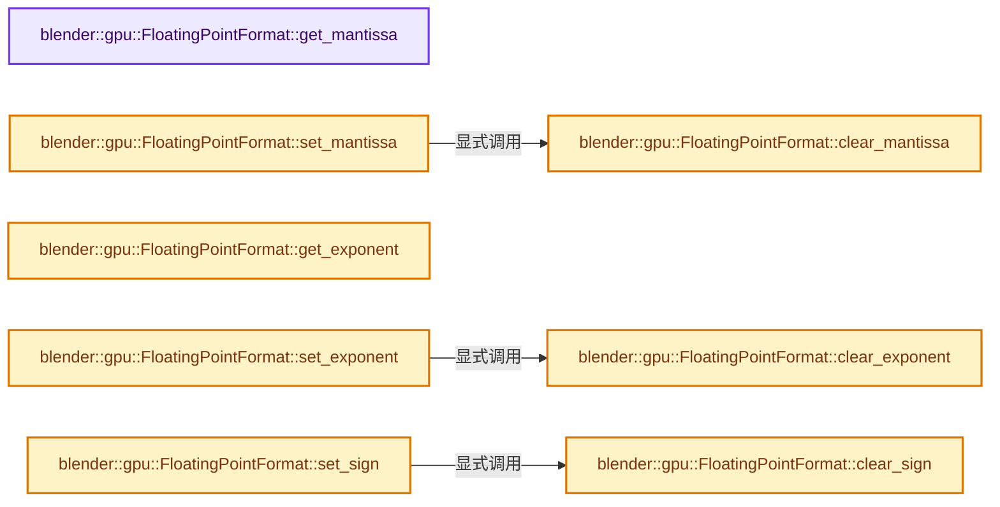
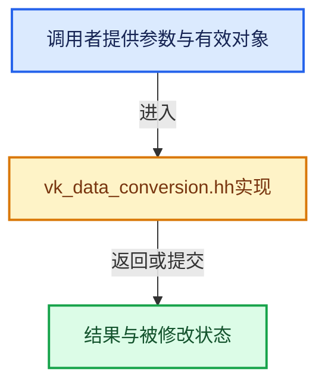

# 实现依赖专题：source/blender/gpu/vulkan/vk_data_conversion.hh

[方向导航](README.md) · [符号索引](../%E7%AC%A6%E5%8F%B7%E4%BE%9D%E8%B5%96%E4%B8%8E%E5%AE%9E%E7%8E%B0%E7%B4%A2%E5%BC%95.md)

本专题从正文实际调用进入，集中保存共享实现。函数有稳定锚点，可从调用处直接跳到对应完整函数；递归与互相调用通过回链组织。

## 本文件的实现关系






## 完整成员与函数实现

<a id="f-7deab5739a06fd03"></a>

### `blender::gpu::FloatingPointFormat::get_mantissa`

实现位置：[source/blender/gpu/vulkan/vk_data_conversion.hh](../../../../../source/blender/gpu/vulkan/vk_data_conversion.hh) · L96—L99。

接口参数：

- `uint32_t floating_point_number`

**教学注释版**

<!-- annotated:1726b19d3c9f0b -->

```cpp
  static uint32_t get_mantissa(uint32_t floating_point_number)
  {
    return (floating_point_number >> MANTISSA_SHIFT) & MANTISSA_MASK;
  }
```

<details>
<summary>核对原始源码：source/blender/gpu/vulkan/vk_data_conversion.hh · L96—L99</summary>

<!-- original:1726b19d3c9f0b:source/blender/gpu/vulkan/vk_data_conversion.hh:96:99 -->

```cpp
  static uint32_t get_mantissa(uint32_t floating_point_number)
  {
    return (floating_point_number >> MANTISSA_SHIFT) & MANTISSA_MASK;
  }
```

</details>

**结果出口**

- `return (floating_point_number >> MANTISSA_SHIFT) & MANTISSA_MASK;`

**继续追踪实现**

本实现没有需要继续展开的显式调用；检查返回表达式、对象转换和调用者前置条件。

<a id="f-40101d34784cebe0"></a>

### `blender::gpu::FloatingPointFormat::clear_mantissa`

实现位置：[source/blender/gpu/vulkan/vk_data_conversion.hh](../../../../../source/blender/gpu/vulkan/vk_data_conversion.hh) · L100—L103。

接口参数：

- `uint32_t floating_point_number`

**教学注释版**

<!-- annotated:f6a3548b403a1b -->

```cpp
  static uint32_t clear_mantissa(uint32_t floating_point_number)
  {
    return floating_point_number & ~(MANTISSA_MASK << MANTISSA_SHIFT);
  }
```

<details>
<summary>核对原始源码：source/blender/gpu/vulkan/vk_data_conversion.hh · L100—L103</summary>

<!-- original:f6a3548b403a1b:source/blender/gpu/vulkan/vk_data_conversion.hh:100:103 -->

```cpp
  static uint32_t clear_mantissa(uint32_t floating_point_number)
  {
    return floating_point_number & ~(MANTISSA_MASK << MANTISSA_SHIFT);
  }
```

</details>

**结果出口**

- `return floating_point_number & ~(MANTISSA_MASK << MANTISSA_SHIFT);`

**继续追踪实现**

本实现没有需要继续展开的显式调用；检查返回表达式、对象转换和调用者前置条件。

<a id="f-9532a91670eefcd3"></a>

### `blender::gpu::FloatingPointFormat::set_mantissa`

实现位置：[source/blender/gpu/vulkan/vk_data_conversion.hh](../../../../../source/blender/gpu/vulkan/vk_data_conversion.hh) · L104—L109。

接口参数：

- `uint32_t mantissa`
- `uint32_t floating_point_number`

**教学注释版**

<!-- annotated:0d80c91b6a2bcf -->

```cpp
  static uint32_t set_mantissa(uint32_t mantissa, uint32_t floating_point_number)
  {
    uint32_t result = clear_mantissa(floating_point_number);
    result |= mantissa << MANTISSA_SHIFT;
    return result;
  }
```

<details>
<summary>核对原始源码：source/blender/gpu/vulkan/vk_data_conversion.hh · L104—L109</summary>

<!-- original:0d80c91b6a2bcf:source/blender/gpu/vulkan/vk_data_conversion.hh:104:109 -->

```cpp
  static uint32_t set_mantissa(uint32_t mantissa, uint32_t floating_point_number)
  {
    uint32_t result = clear_mantissa(floating_point_number);
    result |= mantissa << MANTISSA_SHIFT;
    return result;
  }
```

</details>

**沿实际写入检查状态**

- `result |= mantissa << MANTISSA_SHIFT;`

**结果出口**

- `return result;`

**继续追踪实现**

- `clear_mantissa` → [blender::gpu::FloatingPointFormat::clear_mantissa · L100](%E4%BE%9D%E8%B5%96-vk_data_conversion-df99c1.md#f-40101d34784cebe0)。

<a id="f-629691bfd0a9dbbf"></a>

### `blender::gpu::FloatingPointFormat::get_exponent`

实现位置：[source/blender/gpu/vulkan/vk_data_conversion.hh](../../../../../source/blender/gpu/vulkan/vk_data_conversion.hh) · L111—L114。

接口参数：

- `uint32_t floating_point_number`

**教学注释版**

<!-- annotated:a778267cd95f6d -->

```cpp
  static uint32_t get_exponent(uint32_t floating_point_number)
  {
    return ((floating_point_number >> EXPONENT_SHIFT) & EXPONENT_MASK);
  }
```

<details>
<summary>核对原始源码：source/blender/gpu/vulkan/vk_data_conversion.hh · L111—L114</summary>

<!-- original:a778267cd95f6d:source/blender/gpu/vulkan/vk_data_conversion.hh:111:114 -->

```cpp
  static uint32_t get_exponent(uint32_t floating_point_number)
  {
    return ((floating_point_number >> EXPONENT_SHIFT) & EXPONENT_MASK);
  }
```

</details>

**结果出口**

- `return ((floating_point_number >> EXPONENT_SHIFT) & EXPONENT_MASK);`

**继续追踪实现**

本实现没有需要继续展开的显式调用；检查返回表达式、对象转换和调用者前置条件。

<a id="f-2445028cf1c0eb90"></a>

### `blender::gpu::FloatingPointFormat::clear_exponent`

实现位置：[source/blender/gpu/vulkan/vk_data_conversion.hh](../../../../../source/blender/gpu/vulkan/vk_data_conversion.hh) · L115—L118。

接口参数：

- `uint32_t floating_point_number`

**教学注释版**

<!-- annotated:c9d718cfbe80d7 -->

```cpp
  static uint32_t clear_exponent(uint32_t floating_point_number)
  {
    return floating_point_number & ~(EXPONENT_MASK << EXPONENT_SHIFT);
  }
```

<details>
<summary>核对原始源码：source/blender/gpu/vulkan/vk_data_conversion.hh · L115—L118</summary>

<!-- original:c9d718cfbe80d7:source/blender/gpu/vulkan/vk_data_conversion.hh:115:118 -->

```cpp
  static uint32_t clear_exponent(uint32_t floating_point_number)
  {
    return floating_point_number & ~(EXPONENT_MASK << EXPONENT_SHIFT);
  }
```

</details>

**结果出口**

- `return floating_point_number & ~(EXPONENT_MASK << EXPONENT_SHIFT);`

**继续追踪实现**

本实现没有需要继续展开的显式调用；检查返回表达式、对象转换和调用者前置条件。

<a id="f-d31f2401865c0bca"></a>

### `blender::gpu::FloatingPointFormat::set_exponent`

实现位置：[source/blender/gpu/vulkan/vk_data_conversion.hh](../../../../../source/blender/gpu/vulkan/vk_data_conversion.hh) · L119—L124。

接口参数：

- `uint32_t exponent`
- `uint32_t floating_point_number`

**教学注释版**

<!-- annotated:6dad37fc62ff29 -->

```cpp
  static uint32_t set_exponent(uint32_t exponent, uint32_t floating_point_number)
  {
    uint32_t result = clear_exponent(floating_point_number);
    result |= (exponent) << EXPONENT_SHIFT;
    return result;
  }
```

<details>
<summary>核对原始源码：source/blender/gpu/vulkan/vk_data_conversion.hh · L119—L124</summary>

<!-- original:6dad37fc62ff29:source/blender/gpu/vulkan/vk_data_conversion.hh:119:124 -->

```cpp
  static uint32_t set_exponent(uint32_t exponent, uint32_t floating_point_number)
  {
    uint32_t result = clear_exponent(floating_point_number);
    result |= (exponent) << EXPONENT_SHIFT;
    return result;
  }
```

</details>

**沿实际写入检查状态**

- `result |= (exponent) << EXPONENT_SHIFT;`

**结果出口**

- `return result;`

**继续追踪实现**

- `clear_exponent` → [blender::gpu::FloatingPointFormat::clear_exponent · L115](%E4%BE%9D%E8%B5%96-vk_data_conversion-df99c1.md#f-2445028cf1c0eb90)。

<a id="f-c1c4ba197a69db9d"></a>

### `blender::gpu::FloatingPointFormat::clear_sign`

实现位置：[source/blender/gpu/vulkan/vk_data_conversion.hh](../../../../../source/blender/gpu/vulkan/vk_data_conversion.hh) · L133—L136。

接口参数：

- `uint32_t floating_point_number`

**教学注释版**

<!-- annotated:666fa4be286288 -->

```cpp
  static uint32_t clear_sign(uint32_t floating_point_number)
  {
    return floating_point_number & ~(1 << SIGN_SHIFT);
  }
```

<details>
<summary>核对原始源码：source/blender/gpu/vulkan/vk_data_conversion.hh · L133—L136</summary>

<!-- original:666fa4be286288:source/blender/gpu/vulkan/vk_data_conversion.hh:133:136 -->

```cpp
  static uint32_t clear_sign(uint32_t floating_point_number)
  {
    return floating_point_number & ~(1 << SIGN_SHIFT);
  }
```

</details>

**结果出口**

- `return floating_point_number & ~(1 << SIGN_SHIFT);`

**继续追踪实现**

本实现没有需要继续展开的显式调用；检查返回表达式、对象转换和调用者前置条件。

<a id="f-61151dd25e99e1ea"></a>

### `blender::gpu::FloatingPointFormat::set_sign`

实现位置：[source/blender/gpu/vulkan/vk_data_conversion.hh](../../../../../source/blender/gpu/vulkan/vk_data_conversion.hh) · L138—L146。

接口参数：

- `bool sign`
- `uint32_t floating_point_number`

**教学注释版**

<!-- annotated:c28972bb8a090f -->

```cpp
  static uint32_t set_sign(bool sign, uint32_t floating_point_number)
  {
    if constexpr (!HasSignBit) {
      return floating_point_number;
    }
    uint32_t result = clear_sign(floating_point_number);
    result |= uint32_t(sign) << SIGN_SHIFT;
    return result;
  }
```

<details>
<summary>核对原始源码：source/blender/gpu/vulkan/vk_data_conversion.hh · L138—L146</summary>

<!-- original:c28972bb8a090f:source/blender/gpu/vulkan/vk_data_conversion.hh:138:146 -->

```cpp
  static uint32_t set_sign(bool sign, uint32_t floating_point_number)
  {
    if constexpr (!HasSignBit) {
      return floating_point_number;
    }
    uint32_t result = clear_sign(floating_point_number);
    result |= uint32_t(sign) << SIGN_SHIFT;
    return result;
  }
```

</details>

**沿实际写入检查状态**

- `result |= uint32_t(sign) << SIGN_SHIFT;`

**结果出口**

- `return floating_point_number;`
- `return result;`

**继续追踪实现**

- `clear_sign` → [blender::gpu::FloatingPointFormat::clear_sign · L133](%E4%BE%9D%E8%B5%96-vk_data_conversion-df99c1.md#f-c1c4ba197a69db9d)。

<a id="f-6fdaa5637c3e0cda"></a>

### `blender::gpu::convert_float_formats`

实现位置：[source/blender/gpu/vulkan/vk_data_conversion.hh](../../../../../source/blender/gpu/vulkan/vk_data_conversion.hh) · L161—L236。

**教学注释版**

<!-- annotated:74d67feadbf49a -->

```cpp
template<
    /**
     * FloatingPointFormat of the value that is converted to.
     */
    typename DestinationFormat,

    /**
     * FloatingPointFormat of the value that is converted from.
     */
    typename SourceFormat,

    /**
     * Should negative values be clamped to zero when DestinationFormat doesn't contain a sign
     * bit. Also -Inf will be clamped to zero.
     *
     * When set to `false` and DestinationFormat doesn't contain a sign bit the value will be
     * made absolute.
     */
    bool ClampNegativeToZero = true>
uint32_t convert_float_formats(uint32_t value)
{
  bool is_signed = SourceFormat::is_signed(value);
  uint32_t mantissa = SourceFormat::get_mantissa(value);
  int32_t exponent = SourceFormat::get_exponent(value);

  const bool is_nan = (exponent == SourceFormat::EXPONENT_SPECIAL_MASK) && mantissa;
  const bool is_inf = (exponent == SourceFormat::EXPONENT_SPECIAL_MASK) && (mantissa == 0);
  const bool is_zero = (exponent == 0 && mantissa == 0);

  /* Sign conversion */
  if constexpr (!DestinationFormat::HAS_SIGN && ClampNegativeToZero) {
    if (is_signed && !is_nan) {
      return 0;
    }
  }
  if (is_zero) {
    return 0;
  }

  if (is_inf) {
    exponent = DestinationFormat::EXPONENT_SPECIAL_MASK;
  }
  else if (is_nan) {
    exponent = DestinationFormat::EXPONENT_SPECIAL_MASK;
    mantissa = DestinationFormat::MANTISSA_NAN_MASK;
  }
  else {
    /* Exponent conversion */
    exponent -= SourceFormat::EXPONENT_BIAS;
    /* Clamping when destination has lower precision. */
    if constexpr (SourceFormat::EXPONENT_LEN > DestinationFormat::EXPONENT_LEN) {
      if (exponent > DestinationFormat::EXPONENT_BIAS) {
        exponent = 0;
        mantissa = SourceFormat::MANTISSA_MASK;
      }
      else if (exponent < -DestinationFormat::EXPONENT_BIAS) {
        return 0;
      }
    }
    exponent += DestinationFormat::EXPONENT_BIAS;

    /* Mantissa conversion */
    if constexpr (SourceFormat::MANTISSA_LEN > DestinationFormat::MANTISSA_LEN) {
      mantissa = mantissa >> (SourceFormat::MANTISSA_LEN - DestinationFormat::MANTISSA_LEN);
    }
    else if constexpr (SourceFormat::MANTISSA_LEN < DestinationFormat::MANTISSA_LEN) {
      mantissa = mantissa << (DestinationFormat::MANTISSA_LEN - SourceFormat::MANTISSA_LEN);
    }
  }

  uint32_t result = 0;
  result = DestinationFormat::set_sign(is_signed, result);
  result = DestinationFormat::set_exponent(exponent, result);
  result = DestinationFormat::set_mantissa(mantissa, result);
  return result;
}
```

<details>
<summary>核对原始源码：source/blender/gpu/vulkan/vk_data_conversion.hh · L161—L236</summary>

<!-- original:74d67feadbf49a:source/blender/gpu/vulkan/vk_data_conversion.hh:161:236 -->

```cpp
template<
    /**
     * FloatingPointFormat of the value that is converted to.
     */
    typename DestinationFormat,

    /**
     * FloatingPointFormat of the value that is converted from.
     */
    typename SourceFormat,

    /**
     * Should negative values be clamped to zero when DestinationFormat doesn't contain a sign
     * bit. Also -Inf will be clamped to zero.
     *
     * When set to `false` and DestinationFormat doesn't contain a sign bit the value will be
     * made absolute.
     */
    bool ClampNegativeToZero = true>
uint32_t convert_float_formats(uint32_t value)
{
  bool is_signed = SourceFormat::is_signed(value);
  uint32_t mantissa = SourceFormat::get_mantissa(value);
  int32_t exponent = SourceFormat::get_exponent(value);

  const bool is_nan = (exponent == SourceFormat::EXPONENT_SPECIAL_MASK) && mantissa;
  const bool is_inf = (exponent == SourceFormat::EXPONENT_SPECIAL_MASK) && (mantissa == 0);
  const bool is_zero = (exponent == 0 && mantissa == 0);

  /* Sign conversion */
  if constexpr (!DestinationFormat::HAS_SIGN && ClampNegativeToZero) {
    if (is_signed && !is_nan) {
      return 0;
    }
  }
  if (is_zero) {
    return 0;
  }

  if (is_inf) {
    exponent = DestinationFormat::EXPONENT_SPECIAL_MASK;
  }
  else if (is_nan) {
    exponent = DestinationFormat::EXPONENT_SPECIAL_MASK;
    mantissa = DestinationFormat::MANTISSA_NAN_MASK;
  }
  else {
    /* Exponent conversion */
    exponent -= SourceFormat::EXPONENT_BIAS;
    /* Clamping when destination has lower precision. */
    if constexpr (SourceFormat::EXPONENT_LEN > DestinationFormat::EXPONENT_LEN) {
      if (exponent > DestinationFormat::EXPONENT_BIAS) {
        exponent = 0;
        mantissa = SourceFormat::MANTISSA_MASK;
      }
      else if (exponent < -DestinationFormat::EXPONENT_BIAS) {
        return 0;
      }
    }
    exponent += DestinationFormat::EXPONENT_BIAS;

    /* Mantissa conversion */
    if constexpr (SourceFormat::MANTISSA_LEN > DestinationFormat::MANTISSA_LEN) {
      mantissa = mantissa >> (SourceFormat::MANTISSA_LEN - DestinationFormat::MANTISSA_LEN);
    }
    else if constexpr (SourceFormat::MANTISSA_LEN < DestinationFormat::MANTISSA_LEN) {
      mantissa = mantissa << (DestinationFormat::MANTISSA_LEN - SourceFormat::MANTISSA_LEN);
    }
  }

  uint32_t result = 0;
  result = DestinationFormat::set_sign(is_signed, result);
  result = DestinationFormat::set_exponent(exponent, result);
  result = DestinationFormat::set_mantissa(mantissa, result);
  return result;
}
```

</details>

**沿实际写入检查状态**

- `exponent = DestinationFormat::EXPONENT_SPECIAL_MASK;`
- `mantissa = DestinationFormat::MANTISSA_NAN_MASK;`
- `exponent -= SourceFormat::EXPONENT_BIAS;`
- `exponent = 0;`
- `mantissa = SourceFormat::MANTISSA_MASK;`
- `exponent += DestinationFormat::EXPONENT_BIAS;`
- `mantissa = mantissa >> (SourceFormat::MANTISSA_LEN - DestinationFormat::MANTISSA_LEN);`
- `mantissa = mantissa << (DestinationFormat::MANTISSA_LEN - SourceFormat::MANTISSA_LEN);`
- `result = DestinationFormat::set_sign(is_signed, result);`
- `result = DestinationFormat::set_exponent(exponent, result);`
- `result = DestinationFormat::set_mantissa(mantissa, result);`

**结果出口**

- `return 0;`
- `return result;`

**继续追踪实现**

- `SourceFormat::is_signed` → [调用协议](../%E6%A8%A1%E6%9D%BF%E5%AE%8F%E4%B8%8E%E5%8A%A8%E6%80%81%E5%88%86%E6%B4%BE%E5%8D%8F%E8%AE%AE.md)：局部可调用对象，须结合其初始化与捕获环境。调用位置L182。
- `SourceFormat::get_mantissa` → [blender::gpu::FloatingPointFormat::get_mantissa · L96](%E4%BE%9D%E8%B5%96-vk_data_conversion-df99c1.md#f-7deab5739a06fd03)。
- `SourceFormat::get_exponent` → [blender::gpu::FloatingPointFormat::get_exponent · L111](%E4%BE%9D%E8%B5%96-vk_data_conversion-df99c1.md#f-629691bfd0a9dbbf)。
- `DestinationFormat::set_sign` → [blender::gpu::FloatingPointFormat::set_sign · L138](%E4%BE%9D%E8%B5%96-vk_data_conversion-df99c1.md#f-61151dd25e99e1ea)。
- `DestinationFormat::set_exponent` → [blender::gpu::FloatingPointFormat::set_exponent · L119](%E4%BE%9D%E8%B5%96-vk_data_conversion-df99c1.md#f-d31f2401865c0bca)。
- `DestinationFormat::set_mantissa` → [blender::gpu::FloatingPointFormat::set_mantissa · L104](%E4%BE%9D%E8%B5%96-vk_data_conversion-df99c1.md#f-9532a91670eefcd3)。
