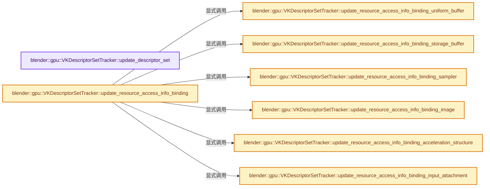

# 实现依赖专题：source/blender/gpu/vulkan/vk_descriptor_set.cc

[方向导航](README.md) · [符号索引](../%E7%AC%A6%E5%8F%B7%E4%BE%9D%E8%B5%96%E4%B8%8E%E5%AE%9E%E7%8E%B0%E7%B4%A2%E5%BC%95.md)

本专题从正文实际调用进入，集中保存共享实现。函数有稳定锚点，可从调用处直接跳到对应完整函数；递归与互相调用通过回链组织。

## 本文件的实现关系




## 完整成员与函数实现

<a id="f-053a991c0746730c"></a>

### `blender::gpu::VKDescriptorSetTracker::update_descriptor_set`

实现位置：[source/blender/gpu/vulkan/vk_descriptor_set.cc](../../../../../source/blender/gpu/vulkan/vk_descriptor_set.cc) · L26—L62。

接口参数：

- `VKContext &context`
- `render_graph::VKResourceAccessInfo &access_info`
- `render_graph::VKPipelineData &r_pipeline_data`

**教学注释版**

<!-- annotated:5a6cb932917631 -->

```cpp
void VKDescriptorSetTracker::update_descriptor_set(VKContext &context,
                                                   render_graph::VKResourceAccessInfo &access_info,
                                                   render_graph::VKPipelineData &r_pipeline_data)
{
  VKShader &shader = *unwrap(context.shader);
  VKStateManager &state_manager = context.state_manager_get();

  /* Need to know the exact buffer and offset when shader uses an uniform buffer to store push
   * constants. */
  VKBufferWithOffset push_constants_buffer = {};
  /* Bind uniform push constants to descriptor set. */
  if (shader.push_constants.layout_get().storage_type_get() ==
      VKPushConstants::StorageType::BUFFER)
  {
    push_constants_buffer = shader.push_constants.update_uniform_buffer(context);
  }

  update_resource_access_info(context, access_info, push_constants_buffer);

  /* Can we reuse previous descriptor set. */
  const VkDescriptorSetLayout shader_descriptor_set_layout = shader.vk_descriptor_set_layout_get();
  if (!state_manager.is_dirty && vk_descriptor_set_layout_ == shader_descriptor_set_layout &&
      shader.push_constants.layout_get().storage_type_get() !=
          VKPushConstants::StorageType::BUFFER)
  {
    r_pipeline_data.vk_descriptor_set = descriptor_sets.vk_descriptor_set;
    return;
  }
  vk_descriptor_set_layout_ = shader_descriptor_set_layout;
  state_manager.is_dirty = false;

  VKDevice &device = VKBackend::get().device;
  VkDescriptorSetLayout vk_descriptor_set_layout = shader.vk_descriptor_set_layout_get();
  descriptor_sets.allocate_new_descriptor_set(
      device, context, shader, vk_descriptor_set_layout, r_pipeline_data);
  descriptor_sets.bind_shader_resources(device, state_manager, shader, push_constants_buffer);
}
```

<details>
<summary>核对原始源码：source/blender/gpu/vulkan/vk_descriptor_set.cc · L26—L62</summary>

<!-- original:5a6cb932917631:source/blender/gpu/vulkan/vk_descriptor_set.cc:26:62 -->

```cpp
void VKDescriptorSetTracker::update_descriptor_set(VKContext &context,
                                                   render_graph::VKResourceAccessInfo &access_info,
                                                   render_graph::VKPipelineData &r_pipeline_data)
{
  VKShader &shader = *unwrap(context.shader);
  VKStateManager &state_manager = context.state_manager_get();

  /* Need to know the exact buffer and offset when shader uses an uniform buffer to store push
   * constants. */
  VKBufferWithOffset push_constants_buffer = {};
  /* Bind uniform push constants to descriptor set. */
  if (shader.push_constants.layout_get().storage_type_get() ==
      VKPushConstants::StorageType::BUFFER)
  {
    push_constants_buffer = shader.push_constants.update_uniform_buffer(context);
  }

  update_resource_access_info(context, access_info, push_constants_buffer);

  /* Can we reuse previous descriptor set. */
  const VkDescriptorSetLayout shader_descriptor_set_layout = shader.vk_descriptor_set_layout_get();
  if (!state_manager.is_dirty && vk_descriptor_set_layout_ == shader_descriptor_set_layout &&
      shader.push_constants.layout_get().storage_type_get() !=
          VKPushConstants::StorageType::BUFFER)
  {
    r_pipeline_data.vk_descriptor_set = descriptor_sets.vk_descriptor_set;
    return;
  }
  vk_descriptor_set_layout_ = shader_descriptor_set_layout;
  state_manager.is_dirty = false;

  VKDevice &device = VKBackend::get().device;
  VkDescriptorSetLayout vk_descriptor_set_layout = shader.vk_descriptor_set_layout_get();
  descriptor_sets.allocate_new_descriptor_set(
      device, context, shader, vk_descriptor_set_layout, r_pipeline_data);
  descriptor_sets.bind_shader_resources(device, state_manager, shader, push_constants_buffer);
}
```

</details>

**沿实际写入检查状态**

- `push_constants_buffer = shader.push_constants.update_uniform_buffer(context);`
- `r_pipeline_data.vk_descriptor_set = descriptor_sets.vk_descriptor_set;`
- `vk_descriptor_set_layout_ = shader_descriptor_set_layout;`
- `state_manager.is_dirty = false;`

**继续追踪实现**

- `unwrap` → [blender::gpu::unwrap · L89](%E4%BE%9D%E8%B5%96-vk_vertex_buffer-066078.md#f-981924b7123a52bf)；[blender::gpu::unwrap · L93](%E4%BE%9D%E8%B5%96-vk_vertex_buffer-066078.md#f-aeaeaa21ca71cf93)；[blender::gpu::unwrap · L179](%E4%BE%9D%E8%B5%96-vk_texture-f366e5.md#f-ffb30b48418b1000)；[blender::gpu::unwrap · L71](%E4%BE%9D%E8%B5%96-vk_storage_buffer-e588a0.md#f-5273b40ca5cee3e7)；[blender::gpu::unwrap · L158](%E4%BE%9D%E8%B5%96-vk_shader-54a32f.md#f-94d260439993a24d)；[blender::gpu::unwrap · L163](%E4%BE%9D%E8%B5%96-vk_shader-54a32f.md#f-6cafb188fd34255d)；[blender::gpu::unwrap · L102](%E4%BE%9D%E8%B5%96-vk_ray_tracing-92bff6.md#f-2d7aee58c588d81f)；[blender::gpu::unwrap · L106](%E4%BE%9D%E8%B5%96-vk_ray_tracing-92bff6.md#f-f7db0fb1b2eac1ea)；[blender::gpu::unwrap · L38](%E4%BE%9D%E8%B5%96-vk_pixel_buffer-f57bf0.md#f-923d55b370d33139)；[blender::gpu::unwrap · L70](%E4%BE%9D%E8%B5%96-vk_index_buffer-9ae58f.md#f-62f2679fcad8aa93)；[blender::gpu::unwrap · L75](%E4%BE%9D%E8%B5%96-vk_index_buffer-9ae58f.md#f-fd72b5b309f16c1b)；[blender::gpu::unwrap · L149](%E4%BE%9D%E8%B5%96-vk_framebuffer-c36f0d.md#f-a0dda2e837c01412)；[blender::gpu::unwrap · L50](%E4%BE%9D%E8%B5%96-vk_batch-beb16a.md#f-be72573f46a049dd)。同名重载需按实参类型选择。
- `context.state_manager_get` → [blender::gpu::VKContext::state_manager_get · L238](%E4%BE%9D%E8%B5%96-vk_context-443184.md#f-e18c55531e96aa04)。
- `shader.push_constants.layout_get().storage_type_get` → [调用协议](../%E6%A8%A1%E6%9D%BF%E5%AE%8F%E4%B8%8E%E5%8A%A8%E6%80%81%E5%88%86%E6%B4%BE%E5%8D%8F%E8%AE%AE.md)：接收对象类型依赖auto、返回值或模板实例；不按同名猜测目标。调用位置L37。
- `shader.push_constants.layout_get` → [调用协议](../%E6%A8%A1%E6%9D%BF%E5%AE%8F%E4%B8%8E%E5%8A%A8%E6%80%81%E5%88%86%E6%B4%BE%E5%8D%8F%E8%AE%AE.md)：接收对象类型依赖auto、返回值或模板实例；不按同名猜测目标。调用位置L37。
- `shader.push_constants.update_uniform_buffer` → [调用协议](../%E6%A8%A1%E6%9D%BF%E5%AE%8F%E4%B8%8E%E5%8A%A8%E6%80%81%E5%88%86%E6%B4%BE%E5%8D%8F%E8%AE%AE.md)：接收对象类型依赖auto、返回值或模板实例；不按同名猜测目标。调用位置L40。
- `update_resource_access_info` → [blender::gpu::VKDescriptorSetTracker::update_resource_access_info · L293](%E4%BE%9D%E8%B5%96-vk_descriptor_set-8db396.md#f-98411e7598f4f1a2)。
- `shader.vk_descriptor_set_layout_get` → [blender::gpu::VKShader::vk_descriptor_set_layout_get · L131](%E4%BE%9D%E8%B5%96-vk_shader-54a32f.md#f-84a5769a27554a1f)。
- `VKBackend::get` → [blender::gpu::VKBackend::get · L106](%E4%BE%9D%E8%B5%96-vk_backend-742e37.md#f-9b0f846ed492f55f)。
- `descriptor_sets.allocate_new_descriptor_set` → [调用协议](../%E6%A8%A1%E6%9D%BF%E5%AE%8F%E4%B8%8E%E5%8A%A8%E6%80%81%E5%88%86%E6%B4%BE%E5%8D%8F%E8%AE%AE.md)：接收对象类型依赖auto、返回值或模板实例；不按同名猜测目标。调用位置L59。
- `descriptor_sets.bind_shader_resources` → [调用协议](../%E6%A8%A1%E6%9D%BF%E5%AE%8F%E4%B8%8E%E5%8A%A8%E6%80%81%E5%88%86%E6%B4%BE%E5%8D%8F%E8%AE%AE.md)：接收对象类型依赖auto、返回值或模板实例；不按同名猜测目标。调用位置L61。

<a id="f-3bd835f8046bc79e"></a>

### `blender::gpu::VKDescriptorSetTracker::update_resource_access_info_binding_uniform_buffer`

实现位置：[source/blender/gpu/vulkan/vk_descriptor_set.cc](../../../../../source/blender/gpu/vulkan/vk_descriptor_set.cc) · L68—L76。

接口参数：

- `const VKStateManager &state_manager`
- `const VKResourceBinding &resource_binding`
- `render_graph::VKResourceAccessInfo &access_info`

**教学注释版**

<!-- annotated:14d0a38fb18cb2 -->

```cpp
void VKDescriptorSetTracker::update_resource_access_info_binding_uniform_buffer(
    const VKStateManager &state_manager,
    const VKResourceBinding &resource_binding,
    render_graph::VKResourceAccessInfo &access_info)
{
  VKUniformBuffer &uniform_buffer = *state_manager.uniform_buffers_.get(resource_binding.binding);
  uniform_buffer.ensure_updated();
  access_info.buffers.append({uniform_buffer.resource(), resource_binding.access_mask});
}
```

<details>
<summary>核对原始源码：source/blender/gpu/vulkan/vk_descriptor_set.cc · L68—L76</summary>

<!-- original:14d0a38fb18cb2:source/blender/gpu/vulkan/vk_descriptor_set.cc:68:76 -->

```cpp
void VKDescriptorSetTracker::update_resource_access_info_binding_uniform_buffer(
    const VKStateManager &state_manager,
    const VKResourceBinding &resource_binding,
    render_graph::VKResourceAccessInfo &access_info)
{
  VKUniformBuffer &uniform_buffer = *state_manager.uniform_buffers_.get(resource_binding.binding);
  uniform_buffer.ensure_updated();
  access_info.buffers.append({uniform_buffer.resource(), resource_binding.access_mask});
}
```

</details>

**继续追踪实现**

- `state_manager.uniform_buffers_.get` → [调用协议](../%E6%A8%A1%E6%9D%BF%E5%AE%8F%E4%B8%8E%E5%8A%A8%E6%80%81%E5%88%86%E6%B4%BE%E5%8D%8F%E8%AE%AE.md)：接收对象类型依赖auto、返回值或模板实例；不按同名猜测目标。调用位置L73。
- `uniform_buffer.ensure_updated` → [blender::gpu::VKUniformBuffer::ensure_updated · L61](%E4%BE%9D%E8%B5%96-vk_uniform_buffer-3b71f2.md#f-5b0edc7fd36c73c5)。
- `access_info.buffers.append` → [调用协议](../%E6%A8%A1%E6%9D%BF%E5%AE%8F%E4%B8%8E%E5%8A%A8%E6%80%81%E5%88%86%E6%B4%BE%E5%8D%8F%E8%AE%AE.md)：接收对象类型依赖auto、返回值或模板实例；不按同名猜测目标。调用位置L75。
- `uniform_buffer.resource` → [blender::gpu::VKUniformBuffer::resource · L45](%E4%BE%9D%E8%B5%96-vk_uniform_buffer-e09e45.md#f-476281dacc2dec1a)。

<a id="f-a26d4a7640dbcbac"></a>

### `blender::gpu::VKDescriptorSetTracker::update_resource_access_info_binding_storage_buffer`

实现位置：[source/blender/gpu/vulkan/vk_descriptor_set.cc](../../../../../source/blender/gpu/vulkan/vk_descriptor_set.cc) · L78—L123。

接口参数：

- `const VKStateManager &state_manager`
- `const VKResourceBinding &resource_binding`
- `render_graph::VKResourceAccessInfo &access_info`

**教学注释版**

<!-- annotated:1abc4a66157cdf -->

```cpp
void VKDescriptorSetTracker::update_resource_access_info_binding_storage_buffer(
    const VKStateManager &state_manager,
    const VKResourceBinding &resource_binding,
    render_graph::VKResourceAccessInfo &access_info)
{
  const BindSpaceStorageBuffers::Elem &elem = state_manager.storage_buffers_.get(
      resource_binding.binding);
  VKResourceWithHandle<VkBuffer> resource = {0};
  switch (elem.resource_type) {
    case BindSpaceStorageBuffers::Type::IndexBuffer: {
      VKIndexBuffer *index_buffer = static_cast<VKIndexBuffer *>(elem.resource);
      index_buffer->ensure_updated();
      resource = index_buffer->resource();
      break;
    }
    case BindSpaceStorageBuffers::Type::VertexBuffer: {
      VKVertexBuffer *vertex_buffer = static_cast<VKVertexBuffer *>(elem.resource);
      vertex_buffer->ensure_updated();
      resource = vertex_buffer->resource();
      break;
    }
    case BindSpaceStorageBuffers::Type::UniformBuffer: {
      VKUniformBuffer *uniform_buffer = static_cast<VKUniformBuffer *>(elem.resource);
      uniform_buffer->ensure_updated();
      resource = uniform_buffer->resource();
      break;
    }
    case BindSpaceStorageBuffers::Type::StorageBuffer: {
      VKStorageBuffer *storage_buffer = static_cast<VKStorageBuffer *>(elem.resource);
      storage_buffer->ensure_allocated();
      resource = storage_buffer->resource();
      break;
    }
    case BindSpaceStorageBuffers::Type::Buffer: {
      VKBuffer *buffer = static_cast<VKBuffer *>(elem.resource);
      resource = buffer->resource();
      break;
    }
    case BindSpaceStorageBuffers::Type::Unused: {
      BLI_assert_unreachable();
    }
  }
  if (resource.vk_handle != VK_NULL_HANDLE) {
    access_info.buffers.append({resource.resource_handle, resource_binding.access_mask});
  }
}
```

<details>
<summary>核对原始源码：source/blender/gpu/vulkan/vk_descriptor_set.cc · L78—L123</summary>

<!-- original:1abc4a66157cdf:source/blender/gpu/vulkan/vk_descriptor_set.cc:78:123 -->

```cpp
void VKDescriptorSetTracker::update_resource_access_info_binding_storage_buffer(
    const VKStateManager &state_manager,
    const VKResourceBinding &resource_binding,
    render_graph::VKResourceAccessInfo &access_info)
{
  const BindSpaceStorageBuffers::Elem &elem = state_manager.storage_buffers_.get(
      resource_binding.binding);
  VKResourceWithHandle<VkBuffer> resource = {0};
  switch (elem.resource_type) {
    case BindSpaceStorageBuffers::Type::IndexBuffer: {
      VKIndexBuffer *index_buffer = static_cast<VKIndexBuffer *>(elem.resource);
      index_buffer->ensure_updated();
      resource = index_buffer->resource();
      break;
    }
    case BindSpaceStorageBuffers::Type::VertexBuffer: {
      VKVertexBuffer *vertex_buffer = static_cast<VKVertexBuffer *>(elem.resource);
      vertex_buffer->ensure_updated();
      resource = vertex_buffer->resource();
      break;
    }
    case BindSpaceStorageBuffers::Type::UniformBuffer: {
      VKUniformBuffer *uniform_buffer = static_cast<VKUniformBuffer *>(elem.resource);
      uniform_buffer->ensure_updated();
      resource = uniform_buffer->resource();
      break;
    }
    case BindSpaceStorageBuffers::Type::StorageBuffer: {
      VKStorageBuffer *storage_buffer = static_cast<VKStorageBuffer *>(elem.resource);
      storage_buffer->ensure_allocated();
      resource = storage_buffer->resource();
      break;
    }
    case BindSpaceStorageBuffers::Type::Buffer: {
      VKBuffer *buffer = static_cast<VKBuffer *>(elem.resource);
      resource = buffer->resource();
      break;
    }
    case BindSpaceStorageBuffers::Type::Unused: {
      BLI_assert_unreachable();
    }
  }
  if (resource.vk_handle != VK_NULL_HANDLE) {
    access_info.buffers.append({resource.resource_handle, resource_binding.access_mask});
  }
}
```

</details>

**沿实际写入检查状态**

- `resource = index_buffer->resource();`
- `resource = vertex_buffer->resource();`
- `resource = uniform_buffer->resource();`
- `resource = storage_buffer->resource();`
- `resource = buffer->resource();`

**继续追踪实现**

- `state_manager.storage_buffers_.get` → [调用协议](../%E6%A8%A1%E6%9D%BF%E5%AE%8F%E4%B8%8E%E5%8A%A8%E6%80%81%E5%88%86%E6%B4%BE%E5%8D%8F%E8%AE%AE.md)：接收对象类型依赖auto、返回值或模板实例；不按同名猜测目标。调用位置L83。
- `index_buffer->ensure_updated` → [blender::gpu::VKIndexBuffer::ensure_updated · L25](%E4%BE%9D%E8%B5%96-vk_index_buffer-eb7fec.md#f-553dbe22ba7d43cd)。
- `index_buffer->resource` → [blender::gpu::VKIndexBuffer::resource · L39](%E4%BE%9D%E8%B5%96-vk_index_buffer-9ae58f.md#f-61717acfdca8d29c)。
- `vertex_buffer->ensure_updated` → [blender::gpu::VKVertexBuffer::ensure_updated · L48](%E4%BE%9D%E8%B5%96-vk_vertex_buffer-e6ca5c.md#f-3bc5facbf60cc56c)。
- `vertex_buffer->resource` → [blender::gpu::VKVertexBuffer::resource · L44](%E4%BE%9D%E8%B5%96-vk_vertex_buffer-066078.md#f-1a25d5da07366f2f)。
- `uniform_buffer->ensure_updated` → [blender::gpu::VKUniformBuffer::ensure_updated · L61](%E4%BE%9D%E8%B5%96-vk_uniform_buffer-3b71f2.md#f-5b0edc7fd36c73c5)。
- `uniform_buffer->resource` → [blender::gpu::VKUniformBuffer::resource · L45](%E4%BE%9D%E8%B5%96-vk_uniform_buffer-e09e45.md#f-476281dacc2dec1a)。
- `storage_buffer->ensure_allocated` → [blender::gpu::VKStorageBuffer::ensure_allocated · L73](%E4%BE%9D%E8%B5%96-vk_storage_buffer-a40125.md#f-f2ed205403195740)。
- `storage_buffer->resource` → [blender::gpu::VKStorageBuffer::resource · L47](%E4%BE%9D%E8%B5%96-vk_storage_buffer-e588a0.md#f-a178c9ecf87cd515)。
- `buffer->resource` → [blender::gpu::VKBuffer::resource · L109](%E4%BE%9D%E8%B5%96-vk_buffer-912d24.md#f-af10d02117b21353)。
- `BLI_assert_unreachable` → [BLI_assert_unreachable · L77](../01-%E5%9F%BA%E7%A1%80%E5%AE%B9%E5%99%A8%E4%B8%8E%E7%8E%B0%E4%BB%A3CPP/%E4%BE%9D%E8%B5%96-BLI_assert-cc98e8.md#m-7a2d91a67d8e)。宏定义由构建条件选择。
- `access_info.buffers.append` → [调用协议](../%E6%A8%A1%E6%9D%BF%E5%AE%8F%E4%B8%8E%E5%8A%A8%E6%80%81%E5%88%86%E6%B4%BE%E5%8D%8F%E8%AE%AE.md)：接收对象类型依赖auto、返回值或模板实例；不按同名猜测目标。调用位置L121。

<a id="f-62c3d420a8672c12"></a>

### `blender::gpu::VKDescriptorSetTracker::update_resource_access_info_binding_sampler`

实现位置：[source/blender/gpu/vulkan/vk_descriptor_set.cc](../../../../../source/blender/gpu/vulkan/vk_descriptor_set.cc) · L125—L182。

接口参数：

- `const VKStateManager &state_manager`
- `const VKResourceBinding &resource_binding`
- `render_graph::VKResourceAccessInfo &access_info`

**教学注释版**

<!-- annotated:e952976c7cdd28 -->

```cpp
void VKDescriptorSetTracker::update_resource_access_info_binding_sampler(
    const VKStateManager &state_manager,
    const VKResourceBinding &resource_binding,
    render_graph::VKResourceAccessInfo &access_info)
{
  const BindSpaceTextures::Elem *elem_ptr = state_manager.textures_.get(resource_binding.binding);
  if (!elem_ptr || elem_ptr->resource == nullptr) {
    /* Unbound resource. */
    if (bool(G.debug & G_DEBUG_GPU)) {
      VKContext &context = *VKContext::get();
      const VKShader &shader = *static_cast<const VKShader *>(context.shader);
      const VKShaderInterface &interface = shader.interface_get();
      const ShaderInput &shader_input = *interface.texture_get(resource_binding.binding);
      CLOG_ERROR(&LOG,
                 "Missing Texture bind at slot %d : %s > %s",
                 shader_input.binding,
                 shader.name_get().c_str(),
                 interface.input_name_get(&shader_input));
    }
    return;
  }
  const BindSpaceTextures::Elem &elem = *elem_ptr;
  switch (elem.resource_type) {
    case BindSpaceTextures::Type::VertexBuffer: {
      VKVertexBuffer &vertex_buffer = *static_cast<VKVertexBuffer *>(elem.resource);
      vertex_buffer.ensure_updated();
      access_info.buffers.append({vertex_buffer.resource(), resource_binding.access_mask});
      break;
    }
    case BindSpaceTextures::Type::Texture: {
      VKTexture *texture = static_cast<VKTexture *>(elem.resource);
      if (texture->type_ == GPU_TEXTURE_BUFFER) {
        VKVertexBuffer &vertex_buffer = *texture->source_buffer_;
        vertex_buffer.ensure_updated();
        access_info.buffers.append({vertex_buffer.resource(), resource_binding.access_mask});
      }
      else {
        VKSubImageRange subimage = {};
        if (texture->is_texture_view()) {
          IndexRange layer_range = texture->layer_range();
          IndexRange mipmap_range = texture->mip_map_range();
          // [讲解] mipmap_range.start：读取连续区间或分组的边界信息。
          subimage = {uint32_t(mipmap_range.start()),
                      // [讲解] mipmap_range.size：读取连续区间或分组的边界信息。
                      uint32_t(mipmap_range.size()),
                      uint32_t(layer_range.start()),
                      uint32_t(layer_range.size())};
        }
        access_info.images.append({texture->vk_image_handle(),
                                   resource_binding.access_mask,
                                   to_vk_image_aspect_flag_bits(texture->device_format_get()),
                                   subimage});
      }
      break;
    }
    case BindSpaceTextures::Type::Unused: {
      BLI_assert_unreachable();
    }
  }
}
```

<details>
<summary>核对原始源码：source/blender/gpu/vulkan/vk_descriptor_set.cc · L125—L182</summary>

<!-- original:e952976c7cdd28:source/blender/gpu/vulkan/vk_descriptor_set.cc:125:182 -->

```cpp
void VKDescriptorSetTracker::update_resource_access_info_binding_sampler(
    const VKStateManager &state_manager,
    const VKResourceBinding &resource_binding,
    render_graph::VKResourceAccessInfo &access_info)
{
  const BindSpaceTextures::Elem *elem_ptr = state_manager.textures_.get(resource_binding.binding);
  if (!elem_ptr || elem_ptr->resource == nullptr) {
    /* Unbound resource. */
    if (bool(G.debug & G_DEBUG_GPU)) {
      VKContext &context = *VKContext::get();
      const VKShader &shader = *static_cast<const VKShader *>(context.shader);
      const VKShaderInterface &interface = shader.interface_get();
      const ShaderInput &shader_input = *interface.texture_get(resource_binding.binding);
      CLOG_ERROR(&LOG,
                 "Missing Texture bind at slot %d : %s > %s",
                 shader_input.binding,
                 shader.name_get().c_str(),
                 interface.input_name_get(&shader_input));
    }
    return;
  }
  const BindSpaceTextures::Elem &elem = *elem_ptr;
  switch (elem.resource_type) {
    case BindSpaceTextures::Type::VertexBuffer: {
      VKVertexBuffer &vertex_buffer = *static_cast<VKVertexBuffer *>(elem.resource);
      vertex_buffer.ensure_updated();
      access_info.buffers.append({vertex_buffer.resource(), resource_binding.access_mask});
      break;
    }
    case BindSpaceTextures::Type::Texture: {
      VKTexture *texture = static_cast<VKTexture *>(elem.resource);
      if (texture->type_ == GPU_TEXTURE_BUFFER) {
        VKVertexBuffer &vertex_buffer = *texture->source_buffer_;
        vertex_buffer.ensure_updated();
        access_info.buffers.append({vertex_buffer.resource(), resource_binding.access_mask});
      }
      else {
        VKSubImageRange subimage = {};
        if (texture->is_texture_view()) {
          IndexRange layer_range = texture->layer_range();
          IndexRange mipmap_range = texture->mip_map_range();
          subimage = {uint32_t(mipmap_range.start()),
                      uint32_t(mipmap_range.size()),
                      uint32_t(layer_range.start()),
                      uint32_t(layer_range.size())};
        }
        access_info.images.append({texture->vk_image_handle(),
                                   resource_binding.access_mask,
                                   to_vk_image_aspect_flag_bits(texture->device_format_get()),
                                   subimage});
      }
      break;
    }
    case BindSpaceTextures::Type::Unused: {
      BLI_assert_unreachable();
    }
  }
}
```

</details>

**沿实际写入检查状态**

- `subimage = {uint32_t(mipmap_range.start()),`

**继续追踪实现**

- `state_manager.textures_.get` → [调用协议](../%E6%A8%A1%E6%9D%BF%E5%AE%8F%E4%B8%8E%E5%8A%A8%E6%80%81%E5%88%86%E6%B4%BE%E5%8D%8F%E8%AE%AE.md)：接收对象类型依赖auto、返回值或模板实例；不按同名猜测目标。调用位置L130。
- `VKContext::get` → [blender::gpu::VKContext::get · L148](%E4%BE%9D%E8%B5%96-vk_context-f02d3a.md#f-378401ce251eda2a)。
- `shader.interface_get` → [blender::gpu::VKShader::interface_get · L1506](%E4%BE%9D%E8%B5%96-vk_shader-069c7e.md#f-8447a0d8fe619074)。
- `interface.texture_get` → [blender::gpu::ShaderInterface::texture_get · L125](%E4%BE%9D%E8%B5%96-gpu_shader_interface-80a49f.md#f-3f380c6fa87cea55)。
- `CLOG_ERROR` → [CLOG_ERROR · L188](%E4%BE%9D%E8%B5%96-CLG_log-e9051b.md#m-081575cdc8d0)。宏定义由构建条件选择。
- `shader.name_get().c_str` → [调用协议](../%E6%A8%A1%E6%9D%BF%E5%AE%8F%E4%B8%8E%E5%8A%A8%E6%80%81%E5%88%86%E6%B4%BE%E5%8D%8F%E8%AE%AE.md)：接收对象类型依赖auto、返回值或模板实例；不按同名猜测目标。调用位置L141。
- `shader.name_get` → [调用协议](../%E6%A8%A1%E6%9D%BF%E5%AE%8F%E4%B8%8E%E5%8A%A8%E6%80%81%E5%88%86%E6%B4%BE%E5%8D%8F%E8%AE%AE.md)：由接收对象具体类型或运行时策略提供实现。调用位置L141。
- `interface.input_name_get` → [blender::gpu::ShaderInterface::input_name_get · L157](%E4%BE%9D%E8%B5%96-gpu_shader_interface-80a49f.md#f-82c196d031144f7f)。
- `vertex_buffer.ensure_updated` → [blender::gpu::VKVertexBuffer::ensure_updated · L48](%E4%BE%9D%E8%B5%96-vk_vertex_buffer-e6ca5c.md#f-3bc5facbf60cc56c)。
- `access_info.buffers.append` → [调用协议](../%E6%A8%A1%E6%9D%BF%E5%AE%8F%E4%B8%8E%E5%8A%A8%E6%80%81%E5%88%86%E6%B4%BE%E5%8D%8F%E8%AE%AE.md)：接收对象类型依赖auto、返回值或模板实例；不按同名猜测目标。调用位置L151。
- `vertex_buffer.resource` → [blender::gpu::VKVertexBuffer::resource · L44](%E4%BE%9D%E8%B5%96-vk_vertex_buffer-066078.md#f-1a25d5da07366f2f)。
- `texture->is_texture_view` → [blender::gpu::Texture::is_texture_view · L210](%E4%BE%9D%E8%B5%96-gpu_texture_private-c1aac7.md#f-788d968482534be1)。
- `texture->layer_range` → [blender::gpu::Texture::layer_range · L298](%E4%BE%9D%E8%B5%96-gpu_texture_private-c1aac7.md#f-e5bb6e7b882d8a9f)。
- `texture->mip_map_range` → [blender::gpu::Texture::mip_map_range · L293](%E4%BE%9D%E8%B5%96-gpu_texture_private-c1aac7.md#f-1f3e3bd8552609cd)。
- `mipmap_range.start` → [blender::IndexRange::start · L243](../01-%E5%9F%BA%E7%A1%80%E5%AE%B9%E5%99%A8%E4%B8%8E%E7%8E%B0%E4%BB%A3CPP/04-IndexRange%E8%BF%9E%E7%BB%AD%E6%95%B4%E6%95%B0%E5%8C%BA%E9%97%B4.md#f-99d2195bd9cfd1f0)。
- `mipmap_range.size` → [blender::IndexRange::size · L156](../01-%E5%9F%BA%E7%A1%80%E5%AE%B9%E5%99%A8%E4%B8%8E%E7%8E%B0%E4%BB%A3CPP/04-IndexRange%E8%BF%9E%E7%BB%AD%E6%95%B4%E6%95%B0%E5%8C%BA%E9%97%B4.md#f-05f66c3ebb2fdfec)。
- `layer_range.start` → [blender::IndexRange::start · L243](../01-%E5%9F%BA%E7%A1%80%E5%AE%B9%E5%99%A8%E4%B8%8E%E7%8E%B0%E4%BB%A3CPP/04-IndexRange%E8%BF%9E%E7%BB%AD%E6%95%B4%E6%95%B0%E5%8C%BA%E9%97%B4.md#f-99d2195bd9cfd1f0)。
- `layer_range.size` → [blender::IndexRange::size · L156](../01-%E5%9F%BA%E7%A1%80%E5%AE%B9%E5%99%A8%E4%B8%8E%E7%8E%B0%E4%BB%A3CPP/04-IndexRange%E8%BF%9E%E7%BB%AD%E6%95%B4%E6%95%B0%E5%8C%BA%E9%97%B4.md#f-05f66c3ebb2fdfec)。
- `access_info.images.append` → [调用协议](../%E6%A8%A1%E6%9D%BF%E5%AE%8F%E4%B8%8E%E5%8A%A8%E6%80%81%E5%88%86%E6%B4%BE%E5%8D%8F%E8%AE%AE.md)：接收对象类型依赖auto、返回值或模板实例；不按同名猜测目标。调用位置L171。
- `texture->vk_image_handle` → [blender::gpu::VKTexture::vk_image_handle · L124](%E4%BE%9D%E8%B5%96-vk_texture-f366e5.md#f-e1b6d3a2d30eedaa)。
- `to_vk_image_aspect_flag_bits` → [blender::gpu::to_vk_image_aspect_flag_bits · L16](%E4%BE%9D%E8%B5%96-vk_common-ee0ea7.md#f-c1bea0adb03822dd)；[blender::gpu::to_vk_image_aspect_flag_bits · L107](%E4%BE%9D%E8%B5%96-vk_common-ee0ea7.md#f-ca44a24b98ba18ad)。同名重载需按实参类型选择。
- `texture->device_format_get` → [blender::gpu::VKTexture::device_format_get · L136](%E4%BE%9D%E8%B5%96-vk_texture-f366e5.md#f-1f00dbe38bb3b55c)。
- `BLI_assert_unreachable` → [BLI_assert_unreachable · L77](../01-%E5%9F%BA%E7%A1%80%E5%AE%B9%E5%99%A8%E4%B8%8E%E7%8E%B0%E4%BB%A3CPP/%E4%BE%9D%E8%B5%96-BLI_assert-cc98e8.md#m-7a2d91a67d8e)。宏定义由构建条件选择。

<a id="f-bf0d4e302df6ac3c"></a>

### `blender::gpu::VKDescriptorSetTracker::update_resource_access_info_binding_image`

实现位置：[source/blender/gpu/vulkan/vk_descriptor_set.cc](../../../../../source/blender/gpu/vulkan/vk_descriptor_set.cc) · L184—L203。

接口参数：

- `const VKStateManager &state_manager`
- `const VKResourceBinding &resource_binding`
- `render_graph::VKResourceAccessInfo &access_info`

**教学注释版**

<!-- annotated:2fdb24ff9c2f96 -->

```cpp
void VKDescriptorSetTracker::update_resource_access_info_binding_image(
    const VKStateManager &state_manager,
    const VKResourceBinding &resource_binding,
    render_graph::VKResourceAccessInfo &access_info)
{
  VKTexture &texture = *state_manager.images_.get(resource_binding.binding);
  VKSubImageRange subimage = {};
  if (texture.is_texture_view()) {
    IndexRange layer_range = texture.layer_range();
    IndexRange mipmap_range = texture.mip_map_range();
    // [讲解] mipmap_range.start：读取连续区间或分组的边界信息。
    subimage = {uint32_t(mipmap_range.start()),
                // [讲解] mipmap_range.size：读取连续区间或分组的边界信息。
                uint32_t(mipmap_range.size()),
                uint32_t(layer_range.start()),
                uint32_t(layer_range.size())};
  }
  access_info.images.append({texture.vk_image_handle(),
                             resource_binding.access_mask,
                             to_vk_image_aspect_flag_bits(texture.device_format_get()),
                             subimage});
}
```

<details>
<summary>核对原始源码：source/blender/gpu/vulkan/vk_descriptor_set.cc · L184—L203</summary>

<!-- original:2fdb24ff9c2f96:source/blender/gpu/vulkan/vk_descriptor_set.cc:184:203 -->

```cpp
void VKDescriptorSetTracker::update_resource_access_info_binding_image(
    const VKStateManager &state_manager,
    const VKResourceBinding &resource_binding,
    render_graph::VKResourceAccessInfo &access_info)
{
  VKTexture &texture = *state_manager.images_.get(resource_binding.binding);
  VKSubImageRange subimage = {};
  if (texture.is_texture_view()) {
    IndexRange layer_range = texture.layer_range();
    IndexRange mipmap_range = texture.mip_map_range();
    subimage = {uint32_t(mipmap_range.start()),
                uint32_t(mipmap_range.size()),
                uint32_t(layer_range.start()),
                uint32_t(layer_range.size())};
  }
  access_info.images.append({texture.vk_image_handle(),
                             resource_binding.access_mask,
                             to_vk_image_aspect_flag_bits(texture.device_format_get()),
                             subimage});
}
```

</details>

**沿实际写入检查状态**

- `subimage = {uint32_t(mipmap_range.start()),`

**继续追踪实现**

- `state_manager.images_.get` → [调用协议](../%E6%A8%A1%E6%9D%BF%E5%AE%8F%E4%B8%8E%E5%8A%A8%E6%80%81%E5%88%86%E6%B4%BE%E5%8D%8F%E8%AE%AE.md)：接收对象类型依赖auto、返回值或模板实例；不按同名猜测目标。调用位置L189。
- `texture.is_texture_view` → [blender::gpu::Texture::is_texture_view · L210](%E4%BE%9D%E8%B5%96-gpu_texture_private-c1aac7.md#f-788d968482534be1)。
- `texture.layer_range` → [blender::gpu::Texture::layer_range · L298](%E4%BE%9D%E8%B5%96-gpu_texture_private-c1aac7.md#f-e5bb6e7b882d8a9f)。
- `texture.mip_map_range` → [blender::gpu::Texture::mip_map_range · L293](%E4%BE%9D%E8%B5%96-gpu_texture_private-c1aac7.md#f-1f3e3bd8552609cd)。
- `mipmap_range.start` → [blender::IndexRange::start · L243](../01-%E5%9F%BA%E7%A1%80%E5%AE%B9%E5%99%A8%E4%B8%8E%E7%8E%B0%E4%BB%A3CPP/04-IndexRange%E8%BF%9E%E7%BB%AD%E6%95%B4%E6%95%B0%E5%8C%BA%E9%97%B4.md#f-99d2195bd9cfd1f0)。
- `mipmap_range.size` → [blender::IndexRange::size · L156](../01-%E5%9F%BA%E7%A1%80%E5%AE%B9%E5%99%A8%E4%B8%8E%E7%8E%B0%E4%BB%A3CPP/04-IndexRange%E8%BF%9E%E7%BB%AD%E6%95%B4%E6%95%B0%E5%8C%BA%E9%97%B4.md#f-05f66c3ebb2fdfec)。
- `layer_range.start` → [blender::IndexRange::start · L243](../01-%E5%9F%BA%E7%A1%80%E5%AE%B9%E5%99%A8%E4%B8%8E%E7%8E%B0%E4%BB%A3CPP/04-IndexRange%E8%BF%9E%E7%BB%AD%E6%95%B4%E6%95%B0%E5%8C%BA%E9%97%B4.md#f-99d2195bd9cfd1f0)。
- `layer_range.size` → [blender::IndexRange::size · L156](../01-%E5%9F%BA%E7%A1%80%E5%AE%B9%E5%99%A8%E4%B8%8E%E7%8E%B0%E4%BB%A3CPP/04-IndexRange%E8%BF%9E%E7%BB%AD%E6%95%B4%E6%95%B0%E5%8C%BA%E9%97%B4.md#f-05f66c3ebb2fdfec)。
- `access_info.images.append` → [调用协议](../%E6%A8%A1%E6%9D%BF%E5%AE%8F%E4%B8%8E%E5%8A%A8%E6%80%81%E5%88%86%E6%B4%BE%E5%8D%8F%E8%AE%AE.md)：接收对象类型依赖auto、返回值或模板实例；不按同名猜测目标。调用位置L199。
- `texture.vk_image_handle` → [blender::gpu::VKTexture::vk_image_handle · L124](%E4%BE%9D%E8%B5%96-vk_texture-f366e5.md#f-e1b6d3a2d30eedaa)。
- `to_vk_image_aspect_flag_bits` → [blender::gpu::to_vk_image_aspect_flag_bits · L16](%E4%BE%9D%E8%B5%96-vk_common-ee0ea7.md#f-c1bea0adb03822dd)；[blender::gpu::to_vk_image_aspect_flag_bits · L107](%E4%BE%9D%E8%B5%96-vk_common-ee0ea7.md#f-ca44a24b98ba18ad)。同名重载需按实参类型选择。
- `texture.device_format_get` → [blender::gpu::VKTexture::device_format_get · L136](%E4%BE%9D%E8%B5%96-vk_texture-f366e5.md#f-1f00dbe38bb3b55c)。

<a id="f-988badb419f7da71"></a>

### `blender::gpu::VKDescriptorSetTracker::update_resource_access_info_binding_acceleration_structure`

实现位置：[source/blender/gpu/vulkan/vk_descriptor_set.cc](../../../../../source/blender/gpu/vulkan/vk_descriptor_set.cc) · L205—L214。

接口参数：

- `const VKStateManager &state_manager`
- `const VKResourceBinding &resource_binding`
- `render_graph::VKResourceAccessInfo &access_info`

**教学注释版**

<!-- annotated:8e1797753ba3be -->

```cpp
void VKDescriptorSetTracker::update_resource_access_info_binding_acceleration_structure(
    const VKStateManager &state_manager,
    const VKResourceBinding &resource_binding,
    render_graph::VKResourceAccessInfo &access_info)
{
  const VKTopLevelAS *tlas = state_manager.acceleration_structures_.get(resource_binding.binding);
  if (tlas != nullptr) {
    access_info.buffers.append({tlas->vk_buffer(), resource_binding.access_mask});
  }
}
```

<details>
<summary>核对原始源码：source/blender/gpu/vulkan/vk_descriptor_set.cc · L205—L214</summary>

<!-- original:8e1797753ba3be:source/blender/gpu/vulkan/vk_descriptor_set.cc:205:214 -->

```cpp
void VKDescriptorSetTracker::update_resource_access_info_binding_acceleration_structure(
    const VKStateManager &state_manager,
    const VKResourceBinding &resource_binding,
    render_graph::VKResourceAccessInfo &access_info)
{
  const VKTopLevelAS *tlas = state_manager.acceleration_structures_.get(resource_binding.binding);
  if (tlas != nullptr) {
    access_info.buffers.append({tlas->vk_buffer(), resource_binding.access_mask});
  }
}
```

</details>

**继续追踪实现**

- `state_manager.acceleration_structures_.get` → [调用协议](../%E6%A8%A1%E6%9D%BF%E5%AE%8F%E4%B8%8E%E5%8A%A8%E6%80%81%E5%88%86%E6%B4%BE%E5%8D%8F%E8%AE%AE.md)：接收对象类型依赖auto、返回值或模板实例；不按同名猜测目标。调用位置L210。
- `access_info.buffers.append` → [调用协议](../%E6%A8%A1%E6%9D%BF%E5%AE%8F%E4%B8%8E%E5%8A%A8%E6%80%81%E5%88%86%E6%B4%BE%E5%8D%8F%E8%AE%AE.md)：接收对象类型依赖auto、返回值或模板实例；不按同名猜测目标。调用位置L212。
- `tlas->vk_buffer` → [blender::gpu::VKTopLevelAS::vk_buffer · L53](%E4%BE%9D%E8%B5%96-vk_ray_tracing-92bff6.md#f-545818f7fb381bb6)。

<a id="f-9cb44569b058c62f"></a>

### `blender::gpu::VKDescriptorSetTracker::update_resource_access_info_binding_input_attachment`

实现位置：[source/blender/gpu/vulkan/vk_descriptor_set.cc](../../../../../source/blender/gpu/vulkan/vk_descriptor_set.cc) · L216—L249。

接口参数：

- `const VKStateManager &state_manager`
- `const VKResourceBinding &resource_binding`
- `render_graph::VKResourceAccessInfo &access_info`

**教学注释版**

<!-- annotated:72210cd40ed3ad -->

```cpp
void VKDescriptorSetTracker::update_resource_access_info_binding_input_attachment(
    const VKStateManager &state_manager,
    const VKResourceBinding &resource_binding,
    render_graph::VKResourceAccessInfo &access_info)
{
  const VKDevice &device = VKBackend::get().device;
  VKTexture *texture = nullptr;
  if (device.extensions_get().dynamic_rendering_local_read) {
    texture = state_manager.images_.get(resource_binding.binding);
  }
  else {
    texture = static_cast<VKTexture *>(
        state_manager.textures_.get(resource_binding.binding)->resource);
  }

  BLI_assert(texture);
  VkImage vk_image = texture->vk_image_handle();
  if (vk_image != VK_NULL_HANDLE) {
    VKSubImageRange subimage = {};
    if (texture->is_texture_view()) {
      IndexRange layer_range = texture->layer_range();
      IndexRange mipmap_range = texture->mip_map_range();
      // [讲解] mipmap_range.start：读取连续区间或分组的边界信息。
      subimage = {uint32_t(mipmap_range.start()),
                  // [讲解] mipmap_range.size：读取连续区间或分组的边界信息。
                  uint32_t(mipmap_range.size()),
                  uint32_t(layer_range.start()),
                  uint32_t(layer_range.size())};
    }

    access_info.images.append({texture->vk_image_handle(),
                               resource_binding.access_mask,
                               to_vk_image_aspect_flag_bits(texture->device_format_get()),
                               subimage});
  }
}
```

<details>
<summary>核对原始源码：source/blender/gpu/vulkan/vk_descriptor_set.cc · L216—L249</summary>

<!-- original:72210cd40ed3ad:source/blender/gpu/vulkan/vk_descriptor_set.cc:216:249 -->

```cpp
void VKDescriptorSetTracker::update_resource_access_info_binding_input_attachment(
    const VKStateManager &state_manager,
    const VKResourceBinding &resource_binding,
    render_graph::VKResourceAccessInfo &access_info)
{
  const VKDevice &device = VKBackend::get().device;
  VKTexture *texture = nullptr;
  if (device.extensions_get().dynamic_rendering_local_read) {
    texture = state_manager.images_.get(resource_binding.binding);
  }
  else {
    texture = static_cast<VKTexture *>(
        state_manager.textures_.get(resource_binding.binding)->resource);
  }

  BLI_assert(texture);
  VkImage vk_image = texture->vk_image_handle();
  if (vk_image != VK_NULL_HANDLE) {
    VKSubImageRange subimage = {};
    if (texture->is_texture_view()) {
      IndexRange layer_range = texture->layer_range();
      IndexRange mipmap_range = texture->mip_map_range();
      subimage = {uint32_t(mipmap_range.start()),
                  uint32_t(mipmap_range.size()),
                  uint32_t(layer_range.start()),
                  uint32_t(layer_range.size())};
    }

    access_info.images.append({texture->vk_image_handle(),
                               resource_binding.access_mask,
                               to_vk_image_aspect_flag_bits(texture->device_format_get()),
                               subimage});
  }
}
```

</details>

**沿实际写入检查状态**

- `texture = state_manager.images_.get(resource_binding.binding);`
- `texture = static_cast<VKTexture *>(`
- `subimage = {uint32_t(mipmap_range.start()),`

**继续追踪实现**

- `VKBackend::get` → [blender::gpu::VKBackend::get · L106](%E4%BE%9D%E8%B5%96-vk_backend-742e37.md#f-9b0f846ed492f55f)。
- `device.extensions_get` → [blender::gpu::VKDevice::extensions_get · L393](%E4%BE%9D%E8%B5%96-vk_device-7cec76.md#f-b9006d1d05b9eba2)。
- `state_manager.images_.get` → [调用协议](../%E6%A8%A1%E6%9D%BF%E5%AE%8F%E4%B8%8E%E5%8A%A8%E6%80%81%E5%88%86%E6%B4%BE%E5%8D%8F%E8%AE%AE.md)：接收对象类型依赖auto、返回值或模板实例；不按同名猜测目标。调用位置L224。
- `state_manager.textures_.get` → [调用协议](../%E6%A8%A1%E6%9D%BF%E5%AE%8F%E4%B8%8E%E5%8A%A8%E6%80%81%E5%88%86%E6%B4%BE%E5%8D%8F%E8%AE%AE.md)：接收对象类型依赖auto、返回值或模板实例；不按同名猜测目标。调用位置L228。
- `BLI_assert` → [BLI_assert · L48](../01-%E5%9F%BA%E7%A1%80%E5%AE%B9%E5%99%A8%E4%B8%8E%E7%8E%B0%E4%BB%A3CPP/%E4%BE%9D%E8%B5%96-BLI_assert-cc98e8.md#m-57a88495704d)；[BLI_assert · L63](../01-%E5%9F%BA%E7%A1%80%E5%AE%B9%E5%99%A8%E4%B8%8E%E7%8E%B0%E4%BB%A3CPP/%E4%BE%9D%E8%B5%96-BLI_assert-cc98e8.md#m-d07050020cb5)。宏定义由构建条件选择。
- `texture->vk_image_handle` → [blender::gpu::VKTexture::vk_image_handle · L124](%E4%BE%9D%E8%B5%96-vk_texture-f366e5.md#f-e1b6d3a2d30eedaa)。
- `texture->is_texture_view` → [blender::gpu::Texture::is_texture_view · L210](%E4%BE%9D%E8%B5%96-gpu_texture_private-c1aac7.md#f-788d968482534be1)。
- `texture->layer_range` → [blender::gpu::Texture::layer_range · L298](%E4%BE%9D%E8%B5%96-gpu_texture_private-c1aac7.md#f-e5bb6e7b882d8a9f)。
- `texture->mip_map_range` → [blender::gpu::Texture::mip_map_range · L293](%E4%BE%9D%E8%B5%96-gpu_texture_private-c1aac7.md#f-1f3e3bd8552609cd)。
- `mipmap_range.start` → [blender::IndexRange::start · L243](../01-%E5%9F%BA%E7%A1%80%E5%AE%B9%E5%99%A8%E4%B8%8E%E7%8E%B0%E4%BB%A3CPP/04-IndexRange%E8%BF%9E%E7%BB%AD%E6%95%B4%E6%95%B0%E5%8C%BA%E9%97%B4.md#f-99d2195bd9cfd1f0)。
- `mipmap_range.size` → [blender::IndexRange::size · L156](../01-%E5%9F%BA%E7%A1%80%E5%AE%B9%E5%99%A8%E4%B8%8E%E7%8E%B0%E4%BB%A3CPP/04-IndexRange%E8%BF%9E%E7%BB%AD%E6%95%B4%E6%95%B0%E5%8C%BA%E9%97%B4.md#f-05f66c3ebb2fdfec)。
- `layer_range.start` → [blender::IndexRange::start · L243](../01-%E5%9F%BA%E7%A1%80%E5%AE%B9%E5%99%A8%E4%B8%8E%E7%8E%B0%E4%BB%A3CPP/04-IndexRange%E8%BF%9E%E7%BB%AD%E6%95%B4%E6%95%B0%E5%8C%BA%E9%97%B4.md#f-99d2195bd9cfd1f0)。
- `layer_range.size` → [blender::IndexRange::size · L156](../01-%E5%9F%BA%E7%A1%80%E5%AE%B9%E5%99%A8%E4%B8%8E%E7%8E%B0%E4%BB%A3CPP/04-IndexRange%E8%BF%9E%E7%BB%AD%E6%95%B4%E6%95%B0%E5%8C%BA%E9%97%B4.md#f-05f66c3ebb2fdfec)。
- `access_info.images.append` → [调用协议](../%E6%A8%A1%E6%9D%BF%E5%AE%8F%E4%B8%8E%E5%8A%A8%E6%80%81%E5%88%86%E6%B4%BE%E5%8D%8F%E8%AE%AE.md)：接收对象类型依赖auto、返回值或模板实例；不按同名猜测目标。调用位置L244。
- `to_vk_image_aspect_flag_bits` → [blender::gpu::to_vk_image_aspect_flag_bits · L16](%E4%BE%9D%E8%B5%96-vk_common-ee0ea7.md#f-c1bea0adb03822dd)；[blender::gpu::to_vk_image_aspect_flag_bits · L107](%E4%BE%9D%E8%B5%96-vk_common-ee0ea7.md#f-ca44a24b98ba18ad)。同名重载需按实参类型选择。
- `texture->device_format_get` → [blender::gpu::VKTexture::device_format_get · L136](%E4%BE%9D%E8%B5%96-vk_texture-f366e5.md#f-1f00dbe38bb3b55c)。

<a id="f-9452ff6aef4fe07f"></a>

### `blender::gpu::VKDescriptorSetTracker::update_resource_access_info_binding`

实现位置：[source/blender/gpu/vulkan/vk_descriptor_set.cc](../../../../../source/blender/gpu/vulkan/vk_descriptor_set.cc) · L251—L291。

接口参数：

- `const VKStateManager &state_manager`
- `const VKResourceBinding &resource_binding`
- `render_graph::VKResourceAccessInfo &access_info`

**教学注释版**

<!-- annotated:2716c6cb175468 -->

```cpp
void VKDescriptorSetTracker::update_resource_access_info_binding(
    const VKStateManager &state_manager,
    const VKResourceBinding &resource_binding,
    render_graph::VKResourceAccessInfo &access_info)
{
  switch (resource_binding.bind_type) {
    case VKBindType::UNIFORM_BUFFER: {
      update_resource_access_info_binding_uniform_buffer(
          state_manager, resource_binding, access_info);
      break;
    }

    case VKBindType::STORAGE_BUFFER: {
      update_resource_access_info_binding_storage_buffer(
          state_manager, resource_binding, access_info);
      break;
    }

    case VKBindType::SAMPLER: {
      update_resource_access_info_binding_sampler(state_manager, resource_binding, access_info);
      break;
    }

    case VKBindType::IMAGE: {
      update_resource_access_info_binding_image(state_manager, resource_binding, access_info);
      break;
    }

    case VKBindType::ACCELERATION_STRUCTURE: {
      update_resource_access_info_binding_acceleration_structure(
          state_manager, resource_binding, access_info);
      break;
    }

    case VKBindType::INPUT_ATTACHMENT: {
      update_resource_access_info_binding_input_attachment(
          state_manager, resource_binding, access_info);
      break;
    }
  }
}
```

<details>
<summary>核对原始源码：source/blender/gpu/vulkan/vk_descriptor_set.cc · L251—L291</summary>

<!-- original:2716c6cb175468:source/blender/gpu/vulkan/vk_descriptor_set.cc:251:291 -->

```cpp
void VKDescriptorSetTracker::update_resource_access_info_binding(
    const VKStateManager &state_manager,
    const VKResourceBinding &resource_binding,
    render_graph::VKResourceAccessInfo &access_info)
{
  switch (resource_binding.bind_type) {
    case VKBindType::UNIFORM_BUFFER: {
      update_resource_access_info_binding_uniform_buffer(
          state_manager, resource_binding, access_info);
      break;
    }

    case VKBindType::STORAGE_BUFFER: {
      update_resource_access_info_binding_storage_buffer(
          state_manager, resource_binding, access_info);
      break;
    }

    case VKBindType::SAMPLER: {
      update_resource_access_info_binding_sampler(state_manager, resource_binding, access_info);
      break;
    }

    case VKBindType::IMAGE: {
      update_resource_access_info_binding_image(state_manager, resource_binding, access_info);
      break;
    }

    case VKBindType::ACCELERATION_STRUCTURE: {
      update_resource_access_info_binding_acceleration_structure(
          state_manager, resource_binding, access_info);
      break;
    }

    case VKBindType::INPUT_ATTACHMENT: {
      update_resource_access_info_binding_input_attachment(
          state_manager, resource_binding, access_info);
      break;
    }
  }
}
```

</details>

**继续追踪实现**

- `update_resource_access_info_binding_uniform_buffer` → [blender::gpu::VKDescriptorSetTracker::update_resource_access_info_binding_uniform_buffer · L68](%E4%BE%9D%E8%B5%96-vk_descriptor_set-8db396.md#f-3bd835f8046bc79e)。
- `update_resource_access_info_binding_storage_buffer` → [blender::gpu::VKDescriptorSetTracker::update_resource_access_info_binding_storage_buffer · L78](%E4%BE%9D%E8%B5%96-vk_descriptor_set-8db396.md#f-a26d4a7640dbcbac)。
- `update_resource_access_info_binding_sampler` → [blender::gpu::VKDescriptorSetTracker::update_resource_access_info_binding_sampler · L125](%E4%BE%9D%E8%B5%96-vk_descriptor_set-8db396.md#f-62c3d420a8672c12)。
- `update_resource_access_info_binding_image` → [blender::gpu::VKDescriptorSetTracker::update_resource_access_info_binding_image · L184](%E4%BE%9D%E8%B5%96-vk_descriptor_set-8db396.md#f-bf0d4e302df6ac3c)。
- `update_resource_access_info_binding_acceleration_structure` → [blender::gpu::VKDescriptorSetTracker::update_resource_access_info_binding_acceleration_structure · L205](%E4%BE%9D%E8%B5%96-vk_descriptor_set-8db396.md#f-988badb419f7da71)。
- `update_resource_access_info_binding_input_attachment` → [blender::gpu::VKDescriptorSetTracker::update_resource_access_info_binding_input_attachment · L216](%E4%BE%9D%E8%B5%96-vk_descriptor_set-8db396.md#f-9cb44569b058c62f)。

<a id="f-98411e7598f4f1a2"></a>

### `blender::gpu::VKDescriptorSetTracker::update_resource_access_info`

实现位置：[source/blender/gpu/vulkan/vk_descriptor_set.cc](../../../../../source/blender/gpu/vulkan/vk_descriptor_set.cc) · L293—L316。

接口参数：

- `VKContext &context`
- `render_graph::VKResourceAccessInfo &access_info`
- `const VKBufferWithOffset &push_constants_buffer`

**教学注释版**

<!-- annotated:77a94c9604071c -->

```cpp
void VKDescriptorSetTracker::update_resource_access_info(
    VKContext &context,
    render_graph::VKResourceAccessInfo &access_info,
    const VKBufferWithOffset &push_constants_buffer)
{
  VKShader &shader = *unwrap(context.shader);
  VKStateManager &state_manager = context.state_manager_get();
  const VKShaderInterface &shader_interface = shader.interface_get();

  for (const VKResourceBinding &resource_binding : shader_interface.resource_bindings_get()) {
    if (resource_binding.binding == -1) {
      continue;
    }
    update_resource_access_info_binding(state_manager, resource_binding, access_info);
  }

  /* Bind uniform push constants to descriptor set. */
  if (shader.push_constants.layout_get().storage_type_get() ==
          VKPushConstants::StorageType::BUFFER &&
      push_constants_buffer.buffer != VK_NULL_HANDLE)
  {
    access_info.buffers.append({push_constants_buffer.buffer, VK_ACCESS_UNIFORM_READ_BIT});
  }
}
```

<details>
<summary>核对原始源码：source/blender/gpu/vulkan/vk_descriptor_set.cc · L293—L316</summary>

<!-- original:77a94c9604071c:source/blender/gpu/vulkan/vk_descriptor_set.cc:293:316 -->

```cpp
void VKDescriptorSetTracker::update_resource_access_info(
    VKContext &context,
    render_graph::VKResourceAccessInfo &access_info,
    const VKBufferWithOffset &push_constants_buffer)
{
  VKShader &shader = *unwrap(context.shader);
  VKStateManager &state_manager = context.state_manager_get();
  const VKShaderInterface &shader_interface = shader.interface_get();

  for (const VKResourceBinding &resource_binding : shader_interface.resource_bindings_get()) {
    if (resource_binding.binding == -1) {
      continue;
    }
    update_resource_access_info_binding(state_manager, resource_binding, access_info);
  }

  /* Bind uniform push constants to descriptor set. */
  if (shader.push_constants.layout_get().storage_type_get() ==
          VKPushConstants::StorageType::BUFFER &&
      push_constants_buffer.buffer != VK_NULL_HANDLE)
  {
    access_info.buffers.append({push_constants_buffer.buffer, VK_ACCESS_UNIFORM_READ_BIT});
  }
}
```

</details>

**继续追踪实现**

- `unwrap` → [blender::gpu::unwrap · L89](%E4%BE%9D%E8%B5%96-vk_vertex_buffer-066078.md#f-981924b7123a52bf)；[blender::gpu::unwrap · L93](%E4%BE%9D%E8%B5%96-vk_vertex_buffer-066078.md#f-aeaeaa21ca71cf93)；[blender::gpu::unwrap · L179](%E4%BE%9D%E8%B5%96-vk_texture-f366e5.md#f-ffb30b48418b1000)；[blender::gpu::unwrap · L71](%E4%BE%9D%E8%B5%96-vk_storage_buffer-e588a0.md#f-5273b40ca5cee3e7)；[blender::gpu::unwrap · L158](%E4%BE%9D%E8%B5%96-vk_shader-54a32f.md#f-94d260439993a24d)；[blender::gpu::unwrap · L163](%E4%BE%9D%E8%B5%96-vk_shader-54a32f.md#f-6cafb188fd34255d)；[blender::gpu::unwrap · L102](%E4%BE%9D%E8%B5%96-vk_ray_tracing-92bff6.md#f-2d7aee58c588d81f)；[blender::gpu::unwrap · L106](%E4%BE%9D%E8%B5%96-vk_ray_tracing-92bff6.md#f-f7db0fb1b2eac1ea)；[blender::gpu::unwrap · L38](%E4%BE%9D%E8%B5%96-vk_pixel_buffer-f57bf0.md#f-923d55b370d33139)；[blender::gpu::unwrap · L70](%E4%BE%9D%E8%B5%96-vk_index_buffer-9ae58f.md#f-62f2679fcad8aa93)；[blender::gpu::unwrap · L75](%E4%BE%9D%E8%B5%96-vk_index_buffer-9ae58f.md#f-fd72b5b309f16c1b)；[blender::gpu::unwrap · L149](%E4%BE%9D%E8%B5%96-vk_framebuffer-c36f0d.md#f-a0dda2e837c01412)；[blender::gpu::unwrap · L50](%E4%BE%9D%E8%B5%96-vk_batch-beb16a.md#f-be72573f46a049dd)。同名重载需按实参类型选择。
- `context.state_manager_get` → [blender::gpu::VKContext::state_manager_get · L238](%E4%BE%9D%E8%B5%96-vk_context-443184.md#f-e18c55531e96aa04)。
- `shader.interface_get` → [blender::gpu::VKShader::interface_get · L1506](%E4%BE%9D%E8%B5%96-vk_shader-069c7e.md#f-8447a0d8fe619074)。
- `shader_interface.resource_bindings_get` → [blender::gpu::VKShaderInterface::resource_bindings_get · L93](%E4%BE%9D%E8%B5%96-vk_shader_interface-c1d19d.md#f-d0189e0eace2f039)。
- `update_resource_access_info_binding` → [blender::gpu::VKDescriptorSetTracker::update_resource_access_info_binding · L251](%E4%BE%9D%E8%B5%96-vk_descriptor_set-8db396.md#f-9452ff6aef4fe07f)。
- `shader.push_constants.layout_get().storage_type_get` → [调用协议](../%E6%A8%A1%E6%9D%BF%E5%AE%8F%E4%B8%8E%E5%8A%A8%E6%80%81%E5%88%86%E6%B4%BE%E5%8D%8F%E8%AE%AE.md)：接收对象类型依赖auto、返回值或模板实例；不按同名猜测目标。调用位置L310。
- `shader.push_constants.layout_get` → [调用协议](../%E6%A8%A1%E6%9D%BF%E5%AE%8F%E4%B8%8E%E5%8A%A8%E6%80%81%E5%88%86%E6%B4%BE%E5%8D%8F%E8%AE%AE.md)：接收对象类型依赖auto、返回值或模板实例；不按同名猜测目标。调用位置L310。
- `access_info.buffers.append` → [调用协议](../%E6%A8%A1%E6%9D%BF%E5%AE%8F%E4%B8%8E%E5%8A%A8%E6%80%81%E5%88%86%E6%B4%BE%E5%8D%8F%E8%AE%AE.md)：接收对象类型依赖auto、返回值或模板实例；不按同名猜测目标。调用位置L314。
