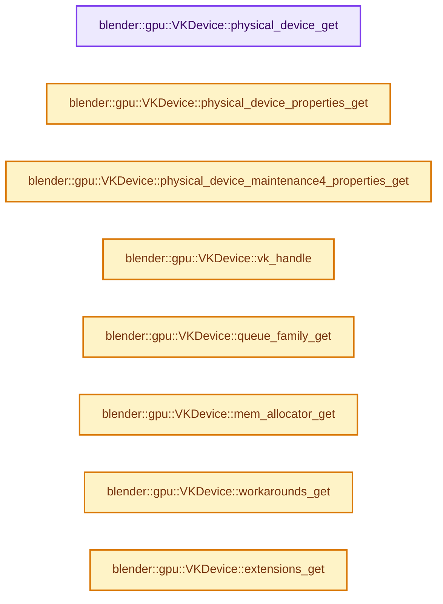
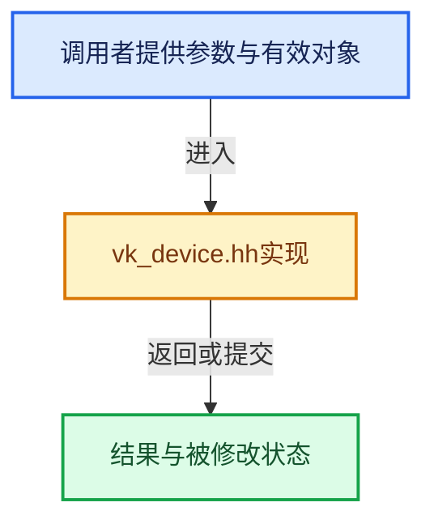

# 实现依赖专题：source/blender/gpu/vulkan/vk_device.hh

[方向导航](README.md) · [符号索引](../%E7%AC%A6%E5%8F%B7%E4%BE%9D%E8%B5%96%E4%B8%8E%E5%AE%9E%E7%8E%B0%E7%B4%A2%E5%BC%95.md)

本专题从正文实际调用进入，集中保存共享实现。函数有稳定锚点，可从调用处直接跳到对应完整函数；递归与互相调用通过回链组织。

## 本文件的实现关系






## 完整成员与函数实现

<a id="f-8da951274d96f8a7"></a>

### `blender::gpu::VKDevice::physical_device_get`

实现位置：[source/blender/gpu/vulkan/vk_device.hh](../../../../../source/blender/gpu/vulkan/vk_device.hh) · L284—L287。

**教学注释版**

<!-- annotated:c3025f9620a8a4 -->

```cpp
  VkPhysicalDevice physical_device_get() const
  {
    return vk_physical_device_;
  }
```

<details>
<summary>核对原始源码：source/blender/gpu/vulkan/vk_device.hh · L284—L287</summary>

<!-- original:c3025f9620a8a4:source/blender/gpu/vulkan/vk_device.hh:284:287 -->

```cpp
  VkPhysicalDevice physical_device_get() const
  {
    return vk_physical_device_;
  }
```

</details>

**结果出口**

- `return vk_physical_device_;`

**继续追踪实现**

本实现没有需要继续展开的显式调用；检查返回表达式、对象转换和调用者前置条件。

<a id="f-fc8f68bd8465a5f5"></a>

### `blender::gpu::VKDevice::physical_device_properties_get`

实现位置：[source/blender/gpu/vulkan/vk_device.hh](../../../../../source/blender/gpu/vulkan/vk_device.hh) · L289—L292。

**教学注释版**

<!-- annotated:7986cb8ab1ba36 -->

```cpp
  const VkPhysicalDeviceProperties &physical_device_properties_get() const
  {
    return vk_physical_device_properties_;
  }
```

<details>
<summary>核对原始源码：source/blender/gpu/vulkan/vk_device.hh · L289—L292</summary>

<!-- original:7986cb8ab1ba36:source/blender/gpu/vulkan/vk_device.hh:289:292 -->

```cpp
  const VkPhysicalDeviceProperties &physical_device_properties_get() const
  {
    return vk_physical_device_properties_;
  }
```

</details>

**结果出口**

- `return vk_physical_device_properties_;`

**继续追踪实现**

本实现没有需要继续展开的显式调用；检查返回表达式、对象转换和调用者前置条件。

<a id="f-fd203ed6c90ee67e"></a>

### `blender::gpu::VKDevice::physical_device_maintenance4_properties_get`

实现位置：[source/blender/gpu/vulkan/vk_device.hh](../../../../../source/blender/gpu/vulkan/vk_device.hh) · L294—L298。

**教学注释版**

<!-- annotated:7fa5ddaaf9eb4a -->

```cpp
  inline const VkPhysicalDeviceMaintenance4Properties &
  physical_device_maintenance4_properties_get() const
  {
    return vk_physical_device_maintenance4_properties_;
  }
```

<details>
<summary>核对原始源码：source/blender/gpu/vulkan/vk_device.hh · L294—L298</summary>

<!-- original:7fa5ddaaf9eb4a:source/blender/gpu/vulkan/vk_device.hh:294:298 -->

```cpp
  inline const VkPhysicalDeviceMaintenance4Properties &
  physical_device_maintenance4_properties_get() const
  {
    return vk_physical_device_maintenance4_properties_;
  }
```

</details>

**结果出口**

- `return vk_physical_device_maintenance4_properties_;`

**继续追踪实现**

本实现没有需要继续展开的显式调用；检查返回表达式、对象转换和调用者前置条件。

<a id="f-72924e77c918cdae"></a>

### `blender::gpu::VKDevice::vk_handle`

实现位置：[source/blender/gpu/vulkan/vk_device.hh](../../../../../source/blender/gpu/vulkan/vk_device.hh) · L333—L336。

**教学注释版**

<!-- annotated:ba4a6a53aeb2af -->

```cpp
  VkDevice vk_handle() const
  {
    return vk_device_;
  }
```

<details>
<summary>核对原始源码：source/blender/gpu/vulkan/vk_device.hh · L333—L336</summary>

<!-- original:ba4a6a53aeb2af:source/blender/gpu/vulkan/vk_device.hh:333:336 -->

```cpp
  VkDevice vk_handle() const
  {
    return vk_device_;
  }
```

</details>

**结果出口**

- `return vk_device_;`

**继续追踪实现**

本实现没有需要继续展开的显式调用；检查返回表达式、对象转换和调用者前置条件。

<a id="f-1764fcb3e0c98f36"></a>

### `blender::gpu::VKDevice::queue_family_get`

实现位置：[source/blender/gpu/vulkan/vk_device.hh](../../../../../source/blender/gpu/vulkan/vk_device.hh) · L338—L341。

**教学注释版**

<!-- annotated:2aae4add47606b -->

```cpp
  uint32_t queue_family_get() const
  {
    return vk_queue_family_;
  }
```

<details>
<summary>核对原始源码：source/blender/gpu/vulkan/vk_device.hh · L338—L341</summary>

<!-- original:2aae4add47606b:source/blender/gpu/vulkan/vk_device.hh:338:341 -->

```cpp
  uint32_t queue_family_get() const
  {
    return vk_queue_family_;
  }
```

</details>

**结果出口**

- `return vk_queue_family_;`

**继续追踪实现**

本实现没有需要继续展开的显式调用；检查返回表达式、对象转换和调用者前置条件。

<a id="f-102d8b8844725694"></a>

### `blender::gpu::VKDevice::mem_allocator_get`

实现位置：[source/blender/gpu/vulkan/vk_device.hh](../../../../../source/blender/gpu/vulkan/vk_device.hh) · L343—L346。

**教学注释版**

<!-- annotated:01456885187330 -->

```cpp
  inline VmaAllocator mem_allocator_get() const
  {
    return mem_allocator_;
  }
```

<details>
<summary>核对原始源码：source/blender/gpu/vulkan/vk_device.hh · L343—L346</summary>

<!-- original:01456885187330:source/blender/gpu/vulkan/vk_device.hh:343:346 -->

```cpp
  inline VmaAllocator mem_allocator_get() const
  {
    return mem_allocator_;
  }
```

</details>

**结果出口**

- `return mem_allocator_;`

**继续追踪实现**

本实现没有需要继续展开的显式调用；检查返回表达式、对象转换和调用者前置条件。

<a id="f-158c325b16f61407"></a>

### `blender::gpu::VKDevice::workarounds_get`

实现位置：[source/blender/gpu/vulkan/vk_device.hh](../../../../../source/blender/gpu/vulkan/vk_device.hh) · L389—L392。

**教学注释版**

<!-- annotated:a41042956fc048 -->

```cpp
  const VKWorkarounds &workarounds_get() const
  {
    return workarounds_;
  }
```

<details>
<summary>核对原始源码：source/blender/gpu/vulkan/vk_device.hh · L389—L392</summary>

<!-- original:a41042956fc048:source/blender/gpu/vulkan/vk_device.hh:389:392 -->

```cpp
  const VKWorkarounds &workarounds_get() const
  {
    return workarounds_;
  }
```

</details>

**结果出口**

- `return workarounds_;`

**继续追踪实现**

本实现没有需要继续展开的显式调用；检查返回表达式、对象转换和调用者前置条件。

<a id="f-b9006d1d05b9eba2"></a>

### `blender::gpu::VKDevice::extensions_get`

实现位置：[source/blender/gpu/vulkan/vk_device.hh](../../../../../source/blender/gpu/vulkan/vk_device.hh) · L393—L396。

**教学注释版**

<!-- annotated:9cb07d3a011df8 -->

```cpp
  inline const VKExtensions &extensions_get() const
  {
    return extensions_;
  }
```

<details>
<summary>核对原始源码：source/blender/gpu/vulkan/vk_device.hh · L393—L396</summary>

<!-- original:9cb07d3a011df8:source/blender/gpu/vulkan/vk_device.hh:393:396 -->

```cpp
  inline const VKExtensions &extensions_get() const
  {
    return extensions_;
  }
```

</details>

**结果出口**

- `return extensions_;`

**继续追踪实现**

本实现没有需要继续展开的显式调用；检查返回表达式、对象转换和调用者前置条件。
