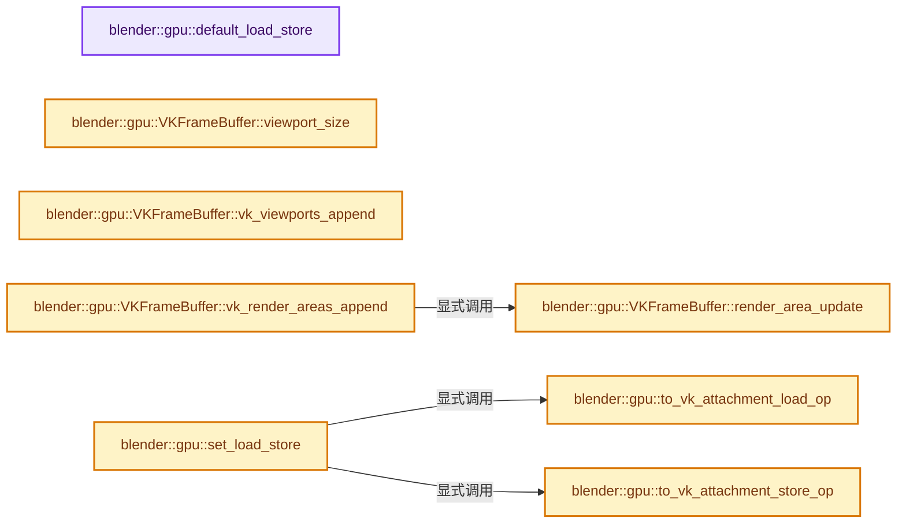

# 实现依赖专题：source/blender/gpu/vulkan/vk_framebuffer.cc

[方向导航](README.md) · [符号索引](../%E7%AC%A6%E5%8F%B7%E4%BE%9D%E8%B5%96%E4%B8%8E%E5%AE%9E%E7%8E%B0%E7%B4%A2%E5%BC%95.md)

本专题从正文实际调用进入，集中保存共享实现。函数有稳定锚点，可从调用处直接跳到对应完整函数；递归与互相调用通过回链组织。

## 本文件的实现关系




## 完整成员与函数实现

<a id="f-f57798b5fb06fd46"></a>

### `blender::gpu::default_load_store`

实现位置：[source/blender/gpu/vulkan/vk_framebuffer.cc](../../../../../source/blender/gpu/vulkan/vk_framebuffer.cc) · L20—L23。

**教学注释版**

<!-- annotated:823fda3fe0e422 -->

```cpp
constexpr GPULoadStore default_load_store()
{
  return {GPU_LOADACTION_LOAD, GPU_STOREACTION_STORE, {0.0f, 0.0f, 0.0f, 0.0f}};
}
```

<details>
<summary>核对原始源码：source/blender/gpu/vulkan/vk_framebuffer.cc · L20—L23</summary>

<!-- original:823fda3fe0e422:source/blender/gpu/vulkan/vk_framebuffer.cc:20:23 -->

```cpp
constexpr GPULoadStore default_load_store()
{
  return {GPU_LOADACTION_LOAD, GPU_STOREACTION_STORE, {0.0f, 0.0f, 0.0f, 0.0f}};
}
```

</details>

**结果出口**

- `return {GPU_LOADACTION_LOAD, GPU_STOREACTION_STORE, {0.0f, 0.0f, 0.0f, 0.0f}};`

**继续追踪实现**

本实现没有需要继续展开的显式调用；检查返回表达式、对象转换和调用者前置条件。

<a id="f-d4e11305f8edacd3"></a>

### `blender::gpu::VKFrameBuffer::viewport_size`

实现位置：[source/blender/gpu/vulkan/vk_framebuffer.cc](../../../../../source/blender/gpu/vulkan/vk_framebuffer.cc) · L72—L75。

**教学注释版**

<!-- annotated:4764c336d5b437 -->

```cpp
uint32_t VKFrameBuffer::viewport_size() const
{
  return this->multi_viewport_ ? GPU_MAX_VIEWPORTS : 1;
}
```

<details>
<summary>核对原始源码：source/blender/gpu/vulkan/vk_framebuffer.cc · L72—L75</summary>

<!-- original:4764c336d5b437:source/blender/gpu/vulkan/vk_framebuffer.cc:72:75 -->

```cpp
uint32_t VKFrameBuffer::viewport_size() const
{
  return this->multi_viewport_ ? GPU_MAX_VIEWPORTS : 1;
}
```

</details>

**结果出口**

- `return this->multi_viewport_ ? GPU_MAX_VIEWPORTS : 1;`

**继续追踪实现**

本实现没有需要继续展开的显式调用；检查返回表达式、对象转换和调用者前置条件。

<a id="f-ef171f65ca8a2454"></a>

### `blender::gpu::VKFrameBuffer::vk_viewports_append`

实现位置：[source/blender/gpu/vulkan/vk_framebuffer.cc](../../../../../source/blender/gpu/vulkan/vk_framebuffer.cc) · L77—L90。

接口参数：

- `Vector<VkViewport, GPU_MAX_VIEWPORTS> &r_viewports`

**教学注释版**

<!-- annotated:5e1c68abc3cae5 -->

```cpp
void VKFrameBuffer::vk_viewports_append(Vector<VkViewport, GPU_MAX_VIEWPORTS> &r_viewports) const
{
  BLI_assert(r_viewports.is_empty());
  for (int64_t index : IndexRange(this->multi_viewport_ ? GPU_MAX_VIEWPORTS : 1)) {
    VkViewport viewport;
    viewport.x = viewport_[index][0];
    viewport.y = viewport_[index][1];
    viewport.width = viewport_[index][2];
    viewport.height = viewport_[index][3];
    viewport.minDepth = 0.0f;
    viewport.maxDepth = 1.0f;
    // [讲解] r_viewports.append：在尾部建立新元素，必要时先扩大存储。
    r_viewports.append(viewport);
  }
}
```

<details>
<summary>核对原始源码：source/blender/gpu/vulkan/vk_framebuffer.cc · L77—L90</summary>

<!-- original:5e1c68abc3cae5:source/blender/gpu/vulkan/vk_framebuffer.cc:77:90 -->

```cpp
void VKFrameBuffer::vk_viewports_append(Vector<VkViewport, GPU_MAX_VIEWPORTS> &r_viewports) const
{
  BLI_assert(r_viewports.is_empty());
  for (int64_t index : IndexRange(this->multi_viewport_ ? GPU_MAX_VIEWPORTS : 1)) {
    VkViewport viewport;
    viewport.x = viewport_[index][0];
    viewport.y = viewport_[index][1];
    viewport.width = viewport_[index][2];
    viewport.height = viewport_[index][3];
    viewport.minDepth = 0.0f;
    viewport.maxDepth = 1.0f;
    r_viewports.append(viewport);
  }
}
```

</details>

**沿实际写入检查状态**

- `viewport.x = viewport_[index][0];`
- `viewport.y = viewport_[index][1];`
- `viewport.width = viewport_[index][2];`
- `viewport.height = viewport_[index][3];`
- `viewport.minDepth = 0.0f;`
- `viewport.maxDepth = 1.0f;`

**继续追踪实现**

- `BLI_assert` → [BLI_assert · L48](../01-%E5%9F%BA%E7%A1%80%E5%AE%B9%E5%99%A8%E4%B8%8E%E7%8E%B0%E4%BB%A3CPP/%E4%BE%9D%E8%B5%96-BLI_assert-cc98e8.md#m-57a88495704d)；[BLI_assert · L63](../01-%E5%9F%BA%E7%A1%80%E5%AE%B9%E5%99%A8%E4%B8%8E%E7%8E%B0%E4%BB%A3CPP/%E4%BE%9D%E8%B5%96-BLI_assert-cc98e8.md#m-d07050020cb5)。宏定义由构建条件选择。
- `r_viewports.is_empty` → [blender::Vector::is_empty · L792](../01-%E5%9F%BA%E7%A1%80%E5%AE%B9%E5%99%A8%E4%B8%8E%E7%8E%B0%E4%BB%A3CPP/11-Vector%E6%8F%92%E5%85%A5%E5%88%A0%E9%99%A4%E4%B8%8E%E9%87%8D%E6%8E%92.md#f-937bbd9cb80bdcc8)。
- `IndexRange` → [blender::IndexRange](../01-%E5%9F%BA%E7%A1%80%E5%AE%B9%E5%99%A8%E4%B8%8E%E7%8E%B0%E4%BB%A3CPP/%E4%BE%9D%E8%B5%96-BLI_index_range-7d7cc5.md#t-caa3466d6776)；[blender::gpu::shader::parser::IndexRange](%E4%BE%9D%E8%B5%96-utils-06433d.md#t-82d2bd4ea71c)；[blender::IndexRange](%E4%BE%9D%E8%B5%96-DNA_node_types-6708b9.md#t-0448cc889d39)。
- `r_viewports.append` → [blender::Vector::append · L498](../01-%E5%9F%BA%E7%A1%80%E5%AE%B9%E5%99%A8%E4%B8%8E%E7%8E%B0%E4%BB%A3CPP/11-Vector%E6%8F%92%E5%85%A5%E5%88%A0%E9%99%A4%E4%B8%8E%E9%87%8D%E6%8E%92.md#f-5bde268a69e443ec)；[blender::Vector::append · L502](../01-%E5%9F%BA%E7%A1%80%E5%AE%B9%E5%99%A8%E4%B8%8E%E7%8E%B0%E4%BB%A3CPP/11-Vector%E6%8F%92%E5%85%A5%E5%88%A0%E9%99%A4%E4%B8%8E%E9%87%8D%E6%8E%92.md#f-591e0b15e6308532)。同名重载需按实参类型选择。

<a id="f-5650b38f3d2a3e2c"></a>

### `blender::gpu::VKFrameBuffer::render_area_update`

实现位置：[source/blender/gpu/vulkan/vk_framebuffer.cc](../../../../../source/blender/gpu/vulkan/vk_framebuffer.cc) · L92—L116。

接口参数：

- `VkRect2D &render_area`

**教学注释版**

<!-- annotated:be74788a5dc66a -->

```cpp
void VKFrameBuffer::render_area_update(VkRect2D &render_area) const
{
  if (scissor_test_get()) {
    int scissor_rect[4];
    scissor_get(scissor_rect);
    render_area.offset.x = clamp_i(scissor_rect[0], 0, width_);
    render_area.offset.y = clamp_i(scissor_rect[1], 0, height_);
    render_area.extent.width = clamp_i(scissor_rect[2], 1, max_ii(1, width_ - scissor_rect[0]));
    render_area.extent.height = clamp_i(scissor_rect[3], 1, max_ii(1, height_ - scissor_rect[1]));
  }
  else {
    render_area.offset.x = 0;
    render_area.offset.y = 0;
    render_area.extent.width = width_;
    render_area.extent.height = height_;
  }

#ifndef NDEBUG
  const VKDevice &device = VKBackend::get().device;
  BLI_assert(render_area.offset.x + render_area.extent.width <=
             device.physical_device_properties_get().limits.maxFramebufferWidth);
  BLI_assert(render_area.offset.y + render_area.extent.height <=
             device.physical_device_properties_get().limits.maxFramebufferHeight);
#endif
}
```

<details>
<summary>核对原始源码：source/blender/gpu/vulkan/vk_framebuffer.cc · L92—L116</summary>

<!-- original:be74788a5dc66a:source/blender/gpu/vulkan/vk_framebuffer.cc:92:116 -->

```cpp
void VKFrameBuffer::render_area_update(VkRect2D &render_area) const
{
  if (scissor_test_get()) {
    int scissor_rect[4];
    scissor_get(scissor_rect);
    render_area.offset.x = clamp_i(scissor_rect[0], 0, width_);
    render_area.offset.y = clamp_i(scissor_rect[1], 0, height_);
    render_area.extent.width = clamp_i(scissor_rect[2], 1, max_ii(1, width_ - scissor_rect[0]));
    render_area.extent.height = clamp_i(scissor_rect[3], 1, max_ii(1, height_ - scissor_rect[1]));
  }
  else {
    render_area.offset.x = 0;
    render_area.offset.y = 0;
    render_area.extent.width = width_;
    render_area.extent.height = height_;
  }

#ifndef NDEBUG
  const VKDevice &device = VKBackend::get().device;
  BLI_assert(render_area.offset.x + render_area.extent.width <=
             device.physical_device_properties_get().limits.maxFramebufferWidth);
  BLI_assert(render_area.offset.y + render_area.extent.height <=
             device.physical_device_properties_get().limits.maxFramebufferHeight);
#endif
}
```

</details>

**沿实际写入检查状态**

- `render_area.offset.x = clamp_i(scissor_rect[0], 0, width_);`
- `render_area.offset.y = clamp_i(scissor_rect[1], 0, height_);`
- `render_area.extent.width = clamp_i(scissor_rect[2], 1, max_ii(1, width_ - scissor_rect[0]));`
- `render_area.extent.height = clamp_i(scissor_rect[3], 1, max_ii(1, height_ - scissor_rect[1]));`
- `render_area.offset.x = 0;`
- `render_area.offset.y = 0;`
- `render_area.extent.width = width_;`
- `render_area.extent.height = height_;`

**继续追踪实现**

- `scissor_test_get` → [blender::gpu::FrameBuffer::scissor_test_get · L222](%E4%BE%9D%E8%B5%96-gpu_framebuffer_private-e365da.md#f-c51983076af7c7ca)。
- `scissor_get` → [blender::gpu::FrameBuffer::scissor_get · L217](%E4%BE%9D%E8%B5%96-gpu_framebuffer_private-e365da.md#f-c04f3f0bb934f038)。
- `clamp_i` → [blender::clamp_i · L400](../12-%E7%A9%BA%E9%97%B4%E6%95%B0%E6%8D%AE%E7%BB%93%E6%9E%84%E4%B8%8E%E5%87%A0%E4%BD%95%E7%AE%97%E6%B3%95/%E4%BE%9D%E8%B5%96-math_base_inline-546b00.md#f-e9a0b16ec537d580)。
- `max_ii` → [blender::max_ii · L368](../12-%E7%A9%BA%E9%97%B4%E6%95%B0%E6%8D%AE%E7%BB%93%E6%9E%84%E4%B8%8E%E5%87%A0%E4%BD%95%E7%AE%97%E6%B3%95/%E4%BE%9D%E8%B5%96-math_base_inline-546b00.md#f-c45aa7b373adb94c)。
- `VKBackend::get` → [blender::gpu::VKBackend::get · L106](%E4%BE%9D%E8%B5%96-vk_backend-742e37.md#f-9b0f846ed492f55f)。
- `BLI_assert` → [BLI_assert · L48](../01-%E5%9F%BA%E7%A1%80%E5%AE%B9%E5%99%A8%E4%B8%8E%E7%8E%B0%E4%BB%A3CPP/%E4%BE%9D%E8%B5%96-BLI_assert-cc98e8.md#m-57a88495704d)；[BLI_assert · L63](../01-%E5%9F%BA%E7%A1%80%E5%AE%B9%E5%99%A8%E4%B8%8E%E7%8E%B0%E4%BB%A3CPP/%E4%BE%9D%E8%B5%96-BLI_assert-cc98e8.md#m-d07050020cb5)。宏定义由构建条件选择。
- `device.physical_device_properties_get` → [blender::gpu::VKDevice::physical_device_properties_get · L289](%E4%BE%9D%E8%B5%96-vk_device-7cec76.md#f-fc8f68bd8465a5f5)。

<a id="f-56f33668d9a68929"></a>

### `blender::gpu::VKFrameBuffer::vk_render_areas_append`

实现位置：[source/blender/gpu/vulkan/vk_framebuffer.cc](../../../../../source/blender/gpu/vulkan/vk_framebuffer.cc) · L118—L125。

接口参数：

- `Vector<VkRect2D, GPU_MAX_VIEWPORTS> &r_render_areas`

**教学注释版**

<!-- annotated:a95e2ff372eca3 -->

```cpp
void VKFrameBuffer::vk_render_areas_append(
    Vector<VkRect2D, GPU_MAX_VIEWPORTS> &r_render_areas) const
{
  BLI_assert(r_render_areas.is_empty());
  VkRect2D render_area;
  render_area_update(render_area);
  r_render_areas.append_n_times(render_area, this->multi_viewport_ ? GPU_MAX_VIEWPORTS : 1);
}
```

<details>
<summary>核对原始源码：source/blender/gpu/vulkan/vk_framebuffer.cc · L118—L125</summary>

<!-- original:a95e2ff372eca3:source/blender/gpu/vulkan/vk_framebuffer.cc:118:125 -->

```cpp
void VKFrameBuffer::vk_render_areas_append(
    Vector<VkRect2D, GPU_MAX_VIEWPORTS> &r_render_areas) const
{
  BLI_assert(r_render_areas.is_empty());
  VkRect2D render_area;
  render_area_update(render_area);
  r_render_areas.append_n_times(render_area, this->multi_viewport_ ? GPU_MAX_VIEWPORTS : 1);
}
```

</details>

**继续追踪实现**

- `BLI_assert` → [BLI_assert · L48](../01-%E5%9F%BA%E7%A1%80%E5%AE%B9%E5%99%A8%E4%B8%8E%E7%8E%B0%E4%BB%A3CPP/%E4%BE%9D%E8%B5%96-BLI_assert-cc98e8.md#m-57a88495704d)；[BLI_assert · L63](../01-%E5%9F%BA%E7%A1%80%E5%AE%B9%E5%99%A8%E4%B8%8E%E7%8E%B0%E4%BB%A3CPP/%E4%BE%9D%E8%B5%96-BLI_assert-cc98e8.md#m-d07050020cb5)。宏定义由构建条件选择。
- `r_render_areas.is_empty` → [blender::Vector::is_empty · L792](../01-%E5%9F%BA%E7%A1%80%E5%AE%B9%E5%99%A8%E4%B8%8E%E7%8E%B0%E4%BB%A3CPP/11-Vector%E6%8F%92%E5%85%A5%E5%88%A0%E9%99%A4%E4%B8%8E%E9%87%8D%E6%8E%92.md#f-937bbd9cb80bdcc8)。
- `render_area_update` → [blender::gpu::VKFrameBuffer::render_area_update · L92](%E4%BE%9D%E8%B5%96-vk_framebuffer-84f42c.md#f-5650b38f3d2a3e2c)。
- `r_render_areas.append_n_times` → [blender::Vector::append_n_times · L569](../01-%E5%9F%BA%E7%A1%80%E5%AE%B9%E5%99%A8%E4%B8%8E%E7%8E%B0%E4%BB%A3CPP/11-Vector%E6%8F%92%E5%85%A5%E5%88%A0%E9%99%A4%E4%B8%8E%E9%87%8D%E6%8E%92.md#f-8b696bc4bd1e57b2)。

<a id="f-0c62634820a0c5fc"></a>

### `blender::gpu::to_vk_attachment_load_op`

实现位置：[source/blender/gpu/vulkan/vk_framebuffer.cc](../../../../../source/blender/gpu/vulkan/vk_framebuffer.cc) · L268—L280。

接口参数：

- `GPULoadOp load_op`

**教学注释版**

<!-- annotated:3635dc2c4ece5d -->

```cpp
static VkAttachmentLoadOp to_vk_attachment_load_op(GPULoadOp load_op)
{
  switch (load_op) {
    case GPU_LOADACTION_DONT_CARE:
      return VK_ATTACHMENT_LOAD_OP_DONT_CARE;
    case GPU_LOADACTION_CLEAR:
      return VK_ATTACHMENT_LOAD_OP_CLEAR;
    case GPU_LOADACTION_LOAD:
      return VK_ATTACHMENT_LOAD_OP_LOAD;
  }
  BLI_assert_unreachable();
  return VK_ATTACHMENT_LOAD_OP_LOAD;
}
```

<details>
<summary>核对原始源码：source/blender/gpu/vulkan/vk_framebuffer.cc · L268—L280</summary>

<!-- original:3635dc2c4ece5d:source/blender/gpu/vulkan/vk_framebuffer.cc:268:280 -->

```cpp
static VkAttachmentLoadOp to_vk_attachment_load_op(GPULoadOp load_op)
{
  switch (load_op) {
    case GPU_LOADACTION_DONT_CARE:
      return VK_ATTACHMENT_LOAD_OP_DONT_CARE;
    case GPU_LOADACTION_CLEAR:
      return VK_ATTACHMENT_LOAD_OP_CLEAR;
    case GPU_LOADACTION_LOAD:
      return VK_ATTACHMENT_LOAD_OP_LOAD;
  }
  BLI_assert_unreachable();
  return VK_ATTACHMENT_LOAD_OP_LOAD;
}
```

</details>

**结果出口**

- `return VK_ATTACHMENT_LOAD_OP_DONT_CARE;`
- `return VK_ATTACHMENT_LOAD_OP_CLEAR;`
- `return VK_ATTACHMENT_LOAD_OP_LOAD;`

**继续追踪实现**

- `BLI_assert_unreachable` → [BLI_assert_unreachable · L77](../01-%E5%9F%BA%E7%A1%80%E5%AE%B9%E5%99%A8%E4%B8%8E%E7%8E%B0%E4%BB%A3CPP/%E4%BE%9D%E8%B5%96-BLI_assert-cc98e8.md#m-7a2d91a67d8e)。宏定义由构建条件选择。

<a id="f-eaf99d16e2ff0c4f"></a>

### `blender::gpu::to_vk_attachment_store_op`

实现位置：[source/blender/gpu/vulkan/vk_framebuffer.cc](../../../../../source/blender/gpu/vulkan/vk_framebuffer.cc) · L282—L292。

接口参数：

- `GPUStoreOp store_op`

**教学注释版**

<!-- annotated:f57f0ad4a26be0 -->

```cpp
static VkAttachmentStoreOp to_vk_attachment_store_op(GPUStoreOp store_op)
{
  switch (store_op) {
    case GPU_STOREACTION_DONT_CARE:
      return VK_ATTACHMENT_STORE_OP_DONT_CARE;
    case GPU_STOREACTION_STORE:
      return VK_ATTACHMENT_STORE_OP_STORE;
  }
  BLI_assert_unreachable();
  return VK_ATTACHMENT_STORE_OP_STORE;
}
```

<details>
<summary>核对原始源码：source/blender/gpu/vulkan/vk_framebuffer.cc · L282—L292</summary>

<!-- original:f57f0ad4a26be0:source/blender/gpu/vulkan/vk_framebuffer.cc:282:292 -->

```cpp
static VkAttachmentStoreOp to_vk_attachment_store_op(GPUStoreOp store_op)
{
  switch (store_op) {
    case GPU_STOREACTION_DONT_CARE:
      return VK_ATTACHMENT_STORE_OP_DONT_CARE;
    case GPU_STOREACTION_STORE:
      return VK_ATTACHMENT_STORE_OP_STORE;
  }
  BLI_assert_unreachable();
  return VK_ATTACHMENT_STORE_OP_STORE;
}
```

</details>

**结果出口**

- `return VK_ATTACHMENT_STORE_OP_DONT_CARE;`
- `return VK_ATTACHMENT_STORE_OP_STORE;`

**继续追踪实现**

- `BLI_assert_unreachable` → [BLI_assert_unreachable · L77](../01-%E5%9F%BA%E7%A1%80%E5%AE%B9%E5%99%A8%E4%B8%8E%E7%8E%B0%E4%BB%A3CPP/%E4%BE%9D%E8%B5%96-BLI_assert-cc98e8.md#m-7a2d91a67d8e)。宏定义由构建条件选择。

<a id="f-6a4534320936c938"></a>

### `blender::gpu::set_load_store`

实现位置：[source/blender/gpu/vulkan/vk_framebuffer.cc](../../../../../source/blender/gpu/vulkan/vk_framebuffer.cc) · L294—L301。

接口参数：

- `VkRenderingAttachmentInfo &r_rendering_attachment`
- `eGPUDataFormat data_format`
- `const GPULoadStore &ls`

**教学注释版**

<!-- annotated:4a23a065bcfb80 -->

```cpp
static void set_load_store(VkRenderingAttachmentInfo &r_rendering_attachment,
                           eGPUDataFormat data_format,
                           const GPULoadStore &ls)
{
  r_rendering_attachment.clearValue.color = to_vk_clear_color_value(data_format, ls.clear_value);
  r_rendering_attachment.loadOp = to_vk_attachment_load_op(ls.load_action);
  r_rendering_attachment.storeOp = to_vk_attachment_store_op(ls.store_action);
}
```

<details>
<summary>核对原始源码：source/blender/gpu/vulkan/vk_framebuffer.cc · L294—L301</summary>

<!-- original:4a23a065bcfb80:source/blender/gpu/vulkan/vk_framebuffer.cc:294:301 -->

```cpp
static void set_load_store(VkRenderingAttachmentInfo &r_rendering_attachment,
                           eGPUDataFormat data_format,
                           const GPULoadStore &ls)
{
  r_rendering_attachment.clearValue.color = to_vk_clear_color_value(data_format, ls.clear_value);
  r_rendering_attachment.loadOp = to_vk_attachment_load_op(ls.load_action);
  r_rendering_attachment.storeOp = to_vk_attachment_store_op(ls.store_action);
}
```

</details>

**沿实际写入检查状态**

- `r_rendering_attachment.clearValue.color = to_vk_clear_color_value(data_format, ls.clear_value);`
- `r_rendering_attachment.loadOp = to_vk_attachment_load_op(ls.load_action);`
- `r_rendering_attachment.storeOp = to_vk_attachment_store_op(ls.store_action);`

**继续追踪实现**

- `to_vk_clear_color_value` → [blender::gpu::to_vk_clear_color_value · L611](%E4%BE%9D%E8%B5%96-vk_common-ee0ea7.md#f-048c65000c4e945b)。
- `to_vk_attachment_load_op` → [blender::gpu::to_vk_attachment_load_op · L268](%E4%BE%9D%E8%B5%96-vk_framebuffer-84f42c.md#f-0c62634820a0c5fc)。
- `to_vk_attachment_store_op` → [blender::gpu::to_vk_attachment_store_op · L282](%E4%BE%9D%E8%B5%96-vk_framebuffer-84f42c.md#f-eaf99d16e2ff0c4f)。

<a id="f-13b129e191902bc6"></a>

### `blender::gpu::VKFrameBuffer::rendering_ensure_dynamic_rendering`

实现位置：[source/blender/gpu/vulkan/vk_framebuffer.cc](../../../../../source/blender/gpu/vulkan/vk_framebuffer.cc) · L569—L755。

接口参数：

- `VKContext &context`
- `const VKExtensions &extensions`

**教学注释版**

<!-- annotated:3e703dfeacc55e -->

```cpp
void VKFrameBuffer::rendering_ensure_dynamic_rendering(VKContext &context,
                                                       const VKExtensions &extensions)
{
  const VKDevice &device = VKBackend::get().device;
  const bool supports_local_read = device.extensions_get().dynamic_rendering_local_read;

  depth_attachment_format_ = VK_FORMAT_UNDEFINED;
  stencil_attachment_format_ = VK_FORMAT_UNDEFINED;

  render_graph::VKResourceAccessInfo access_info;
  render_graph::VKBeginRenderingNode::CreateInfo begin_rendering(access_info);
  begin_rendering.node_data.vk_rendering_info.sType = VK_STRUCTURE_TYPE_RENDERING_INFO;
  begin_rendering.node_data.vk_rendering_info.layerCount = 1;
  render_area_update(begin_rendering.node_data.vk_rendering_info.renderArea);

  color_attachment_formats_.clear();
  int32_t max_filled_slot_index = -1;
  for (int color_attachment_index :
       IndexRange(GPU_FB_COLOR_ATTACHMENT0, GPU_FB_MAX_COLOR_ATTACHMENT))
  {
    const GPUAttachment &attachment = attachments_[color_attachment_index];
    if (attachment.tex == nullptr) {
      color_attachment_formats_.append(VK_FORMAT_UNDEFINED);
      VkRenderingAttachmentInfo &attachment_info =
          begin_rendering.node_data.color_attachments[begin_rendering.node_data.vk_rendering_info
                                                          .colorAttachmentCount++];
      attachment_info = {VK_STRUCTURE_TYPE_RENDERING_ATTACHMENT_INFO,
                         nullptr,
                         VK_NULL_HANDLE,
                         VK_IMAGE_LAYOUT_UNDEFINED,
                         VK_RESOLVE_MODE_NONE,
                         VK_NULL_HANDLE,
                         VK_IMAGE_LAYOUT_UNDEFINED,
                         VK_ATTACHMENT_LOAD_OP_DONT_CARE,
                         VK_ATTACHMENT_STORE_OP_DONT_CARE};
      continue;
    }
    max_filled_slot_index = color_attachment_index - GPU_FB_COLOR_ATTACHMENT0;

    VKTexture &color_texture = *unwrap(unwrap(attachment.tex));
    BLI_assert_msg(color_texture.usage_get() & GPU_TEXTURE_USAGE_ATTACHMENT,
                   "Texture is used as an attachment, but doesn't have the "
                   "GPU_TEXTURE_USAGE_ATTACHMENT flag.");
    /* To support `gpu_Layer` we need to set the layerCount to the number of layers it can
     * access.
     */
    int layer_count = color_texture.layer_count();
    if (attachment.layer == -1 && layer_count != 1) {
      begin_rendering.node_data.vk_rendering_info.layerCount = max_ii(
          begin_rendering.node_data.vk_rendering_info.layerCount, layer_count);
    }

    VkRenderingAttachmentInfo &attachment_info =
        begin_rendering.node_data
            .color_attachments[begin_rendering.node_data.vk_rendering_info.colorAttachmentCount++];
    attachment_info.sType = VK_STRUCTURE_TYPE_RENDERING_ATTACHMENT_INFO;

    VkImageView vk_image_view = VK_NULL_HANDLE;
    uint32_t layer_base = max_ii(attachment.layer, 0);
    GPUAttachmentState attachment_state = attachment_states_[color_attachment_index];
    VkFormat vk_format = to_vk_format(color_texture.device_format_get());
    if (srgb_ && !enabled_srgb_) {
      if (vk_format == VK_FORMAT_R8G8B8A8_SRGB) {
        vk_format = VK_FORMAT_R8G8B8A8_UNORM;
      }
      if (vk_format == VK_FORMAT_R8G8B8_SRGB) {
        vk_format = VK_FORMAT_R8G8B8_UNORM;
      }
    }
    if (attachment_state == GPU_ATTACHMENT_WRITE) {
      VKImageViewInfo image_view_info = {
          eImageViewUsage::Attachment,
          IndexRange(layer_base,
                     layer_count != 1 ? max_ii(layer_count - layer_base, 1) : layer_count),
          IndexRange(attachment.mip, 1),
          {{'r', 'g', 'b', 'a'}},
          VKImageViewArrayed::DONT_CARE,
          vk_format,
          VK_IMAGE_ASPECT_COLOR_BIT};
      const VKImageView &image_view = color_texture.image_view_get(image_view_info);
      vk_image_view = image_view.vk_handle();
    }
    attachment_info.imageView = vk_image_view;
    attachment_info.imageLayout = supports_local_read ? VK_IMAGE_LAYOUT_RENDERING_LOCAL_READ_KHR :
                                                        VK_IMAGE_LAYOUT_COLOR_ATTACHMENT_OPTIMAL;

    eGPUDataFormat data_format = to_texture_data_format(color_texture.format_get());

    set_load_store(attachment_info, data_format, load_stores[color_attachment_index]);

    access_info.images.append(
        {color_texture.vk_image_handle(),
         VK_ACCESS_COLOR_ATTACHMENT_READ_BIT | VK_ACCESS_COLOR_ATTACHMENT_WRITE_BIT,
         VK_IMAGE_ASPECT_COLOR_BIT,
         {uint32_t(attachment.mip),
          1,
          layer_base,
          uint32_t(max_ii(layer_count - layer_base, 1))}});
    color_attachment_formats_.append(
        (!extensions.dynamic_rendering_unused_attachments && vk_image_view == VK_NULL_HANDLE) ?
            VK_FORMAT_UNDEFINED :
            vk_format);
  }
  uint32_t color_attachment_size = uint32_t(max_filled_slot_index + 1);
  color_attachment_formats_.resize(color_attachment_size);

  begin_rendering.node_data.vk_rendering_info.colorAttachmentCount = color_attachment_size;
  begin_rendering.node_data.vk_rendering_info.pColorAttachments =
      begin_rendering.node_data.color_attachments;

  for (int depth_attachment_index : IndexRange(GPU_FB_DEPTH_ATTACHMENT, 2)) {
    const GPUAttachment &attachment = attachments_[depth_attachment_index];

    if (attachment.tex == nullptr) {
      continue;
    }
    bool is_stencil_attachment = depth_attachment_index == GPU_FB_DEPTH_STENCIL_ATTACHMENT;
    VKTexture &depth_texture = *unwrap(unwrap(attachment.tex));
    BLI_assert_msg(depth_texture.usage_get() & GPU_TEXTURE_USAGE_ATTACHMENT,
                   "Texture is used as an attachment, but doesn't have the "
                   "GPU_TEXTURE_USAGE_ATTACHMENT flag.");
    bool is_depth_stencil_attachment = to_vk_image_aspect_flag_bits(
                                           depth_texture.device_format_get()) &
                                       VK_IMAGE_ASPECT_STENCIL_BIT;
    VkImageLayout vk_image_layout = is_depth_stencil_attachment ?
                                        VK_IMAGE_LAYOUT_DEPTH_STENCIL_ATTACHMENT_OPTIMAL :
                                        VK_IMAGE_LAYOUT_DEPTH_ATTACHMENT_OPTIMAL;
    GPUAttachmentState attachment_state = attachment_states_[GPU_FB_DEPTH_ATTACHMENT];
    VkImageView depth_image_view = VK_NULL_HANDLE;
    if (attachment_state == GPU_ATTACHMENT_WRITE) {
      VKImageViewInfo image_view_info = {
          eImageViewUsage::Attachment,
          IndexRange(max_ii(attachment.layer, 0), 1),
          IndexRange(attachment.mip, 1),
          {{'r', 'g', 'b', 'a'}},
          VKImageViewArrayed::DONT_CARE,
          to_vk_format(depth_texture.device_format_get()),
          is_stencil_attachment ? static_cast<VkImageAspectFlags>(VK_IMAGE_ASPECT_STENCIL_BIT) :
                                  static_cast<VkImageAspectFlags>(VK_IMAGE_ASPECT_DEPTH_BIT)};
      depth_image_view = depth_texture.image_view_get(image_view_info).vk_handle();
    }
    VkFormat vk_format = (!extensions.dynamic_rendering_unused_attachments &&
                          depth_image_view == VK_NULL_HANDLE) ?
                             VK_FORMAT_UNDEFINED :
                             to_vk_format(depth_texture.device_format_get());

    /* TODO: we should be able to use a single attachment info and only set the
     * #pDepthAttachment/#pStencilAttachment to the same struct.
     * But perhaps the stencil clear op might be different. */
    {
      VkRenderingAttachmentInfo &attachment_info = begin_rendering.node_data.depth_attachment;
      attachment_info.sType = VK_STRUCTURE_TYPE_RENDERING_ATTACHMENT_INFO;
      attachment_info.imageView = depth_image_view;
      attachment_info.imageLayout = vk_image_layout;

      set_load_store(attachment_info, GPU_DATA_FLOAT, load_stores[depth_attachment_index]);
      depth_attachment_format_ = vk_format;
      begin_rendering.node_data.vk_rendering_info.pDepthAttachment =
          &begin_rendering.node_data.depth_attachment;
    }

    if (is_stencil_attachment) {
      VkRenderingAttachmentInfo &attachment_info = begin_rendering.node_data.stencil_attachment;
      attachment_info.sType = VK_STRUCTURE_TYPE_RENDERING_ATTACHMENT_INFO;
      attachment_info.imageView = depth_image_view;
      attachment_info.imageLayout = vk_image_layout;

      set_load_store(attachment_info, GPU_DATA_UINT, load_stores[depth_attachment_index]);
      stencil_attachment_format_ = vk_format;
      begin_rendering.node_data.vk_rendering_info.pStencilAttachment =
          &begin_rendering.node_data.stencil_attachment;
    }

    access_info.images.append(
        {depth_texture.vk_image_handle(),
         VK_ACCESS_DEPTH_STENCIL_ATTACHMENT_READ_BIT |
             VK_ACCESS_DEPTH_STENCIL_ATTACHMENT_WRITE_BIT,
         is_depth_stencil_attachment ?
             static_cast<VkImageAspectFlags>(VK_IMAGE_ASPECT_DEPTH_BIT |
                                             VK_IMAGE_ASPECT_STENCIL_BIT) :
             static_cast<VkImageAspectFlags>(VK_IMAGE_ASPECT_DEPTH_BIT),
         {uint32_t(attachment.mip), 1, uint32_t(max_ii(attachment.layer, 0)), 1}});
    break;
  }

  context.render_graph().add_node(begin_rendering);
}
```

<details>
<summary>核对原始源码：source/blender/gpu/vulkan/vk_framebuffer.cc · L569—L755</summary>

<!-- original:3e703dfeacc55e:source/blender/gpu/vulkan/vk_framebuffer.cc:569:755 -->

```cpp
void VKFrameBuffer::rendering_ensure_dynamic_rendering(VKContext &context,
                                                       const VKExtensions &extensions)
{
  const VKDevice &device = VKBackend::get().device;
  const bool supports_local_read = device.extensions_get().dynamic_rendering_local_read;

  depth_attachment_format_ = VK_FORMAT_UNDEFINED;
  stencil_attachment_format_ = VK_FORMAT_UNDEFINED;

  render_graph::VKResourceAccessInfo access_info;
  render_graph::VKBeginRenderingNode::CreateInfo begin_rendering(access_info);
  begin_rendering.node_data.vk_rendering_info.sType = VK_STRUCTURE_TYPE_RENDERING_INFO;
  begin_rendering.node_data.vk_rendering_info.layerCount = 1;
  render_area_update(begin_rendering.node_data.vk_rendering_info.renderArea);

  color_attachment_formats_.clear();
  int32_t max_filled_slot_index = -1;
  for (int color_attachment_index :
       IndexRange(GPU_FB_COLOR_ATTACHMENT0, GPU_FB_MAX_COLOR_ATTACHMENT))
  {
    const GPUAttachment &attachment = attachments_[color_attachment_index];
    if (attachment.tex == nullptr) {
      color_attachment_formats_.append(VK_FORMAT_UNDEFINED);
      VkRenderingAttachmentInfo &attachment_info =
          begin_rendering.node_data.color_attachments[begin_rendering.node_data.vk_rendering_info
                                                          .colorAttachmentCount++];
      attachment_info = {VK_STRUCTURE_TYPE_RENDERING_ATTACHMENT_INFO,
                         nullptr,
                         VK_NULL_HANDLE,
                         VK_IMAGE_LAYOUT_UNDEFINED,
                         VK_RESOLVE_MODE_NONE,
                         VK_NULL_HANDLE,
                         VK_IMAGE_LAYOUT_UNDEFINED,
                         VK_ATTACHMENT_LOAD_OP_DONT_CARE,
                         VK_ATTACHMENT_STORE_OP_DONT_CARE};
      continue;
    }
    max_filled_slot_index = color_attachment_index - GPU_FB_COLOR_ATTACHMENT0;

    VKTexture &color_texture = *unwrap(unwrap(attachment.tex));
    BLI_assert_msg(color_texture.usage_get() & GPU_TEXTURE_USAGE_ATTACHMENT,
                   "Texture is used as an attachment, but doesn't have the "
                   "GPU_TEXTURE_USAGE_ATTACHMENT flag.");
    /* To support `gpu_Layer` we need to set the layerCount to the number of layers it can
     * access.
     */
    int layer_count = color_texture.layer_count();
    if (attachment.layer == -1 && layer_count != 1) {
      begin_rendering.node_data.vk_rendering_info.layerCount = max_ii(
          begin_rendering.node_data.vk_rendering_info.layerCount, layer_count);
    }

    VkRenderingAttachmentInfo &attachment_info =
        begin_rendering.node_data
            .color_attachments[begin_rendering.node_data.vk_rendering_info.colorAttachmentCount++];
    attachment_info.sType = VK_STRUCTURE_TYPE_RENDERING_ATTACHMENT_INFO;

    VkImageView vk_image_view = VK_NULL_HANDLE;
    uint32_t layer_base = max_ii(attachment.layer, 0);
    GPUAttachmentState attachment_state = attachment_states_[color_attachment_index];
    VkFormat vk_format = to_vk_format(color_texture.device_format_get());
    if (srgb_ && !enabled_srgb_) {
      if (vk_format == VK_FORMAT_R8G8B8A8_SRGB) {
        vk_format = VK_FORMAT_R8G8B8A8_UNORM;
      }
      if (vk_format == VK_FORMAT_R8G8B8_SRGB) {
        vk_format = VK_FORMAT_R8G8B8_UNORM;
      }
    }
    if (attachment_state == GPU_ATTACHMENT_WRITE) {
      VKImageViewInfo image_view_info = {
          eImageViewUsage::Attachment,
          IndexRange(layer_base,
                     layer_count != 1 ? max_ii(layer_count - layer_base, 1) : layer_count),
          IndexRange(attachment.mip, 1),
          {{'r', 'g', 'b', 'a'}},
          VKImageViewArrayed::DONT_CARE,
          vk_format,
          VK_IMAGE_ASPECT_COLOR_BIT};
      const VKImageView &image_view = color_texture.image_view_get(image_view_info);
      vk_image_view = image_view.vk_handle();
    }
    attachment_info.imageView = vk_image_view;
    attachment_info.imageLayout = supports_local_read ? VK_IMAGE_LAYOUT_RENDERING_LOCAL_READ_KHR :
                                                        VK_IMAGE_LAYOUT_COLOR_ATTACHMENT_OPTIMAL;

    eGPUDataFormat data_format = to_texture_data_format(color_texture.format_get());

    set_load_store(attachment_info, data_format, load_stores[color_attachment_index]);

    access_info.images.append(
        {color_texture.vk_image_handle(),
         VK_ACCESS_COLOR_ATTACHMENT_READ_BIT | VK_ACCESS_COLOR_ATTACHMENT_WRITE_BIT,
         VK_IMAGE_ASPECT_COLOR_BIT,
         {uint32_t(attachment.mip),
          1,
          layer_base,
          uint32_t(max_ii(layer_count - layer_base, 1))}});
    color_attachment_formats_.append(
        (!extensions.dynamic_rendering_unused_attachments && vk_image_view == VK_NULL_HANDLE) ?
            VK_FORMAT_UNDEFINED :
            vk_format);
  }
  uint32_t color_attachment_size = uint32_t(max_filled_slot_index + 1);
  color_attachment_formats_.resize(color_attachment_size);

  begin_rendering.node_data.vk_rendering_info.colorAttachmentCount = color_attachment_size;
  begin_rendering.node_data.vk_rendering_info.pColorAttachments =
      begin_rendering.node_data.color_attachments;

  for (int depth_attachment_index : IndexRange(GPU_FB_DEPTH_ATTACHMENT, 2)) {
    const GPUAttachment &attachment = attachments_[depth_attachment_index];

    if (attachment.tex == nullptr) {
      continue;
    }
    bool is_stencil_attachment = depth_attachment_index == GPU_FB_DEPTH_STENCIL_ATTACHMENT;
    VKTexture &depth_texture = *unwrap(unwrap(attachment.tex));
    BLI_assert_msg(depth_texture.usage_get() & GPU_TEXTURE_USAGE_ATTACHMENT,
                   "Texture is used as an attachment, but doesn't have the "
                   "GPU_TEXTURE_USAGE_ATTACHMENT flag.");
    bool is_depth_stencil_attachment = to_vk_image_aspect_flag_bits(
                                           depth_texture.device_format_get()) &
                                       VK_IMAGE_ASPECT_STENCIL_BIT;
    VkImageLayout vk_image_layout = is_depth_stencil_attachment ?
                                        VK_IMAGE_LAYOUT_DEPTH_STENCIL_ATTACHMENT_OPTIMAL :
                                        VK_IMAGE_LAYOUT_DEPTH_ATTACHMENT_OPTIMAL;
    GPUAttachmentState attachment_state = attachment_states_[GPU_FB_DEPTH_ATTACHMENT];
    VkImageView depth_image_view = VK_NULL_HANDLE;
    if (attachment_state == GPU_ATTACHMENT_WRITE) {
      VKImageViewInfo image_view_info = {
          eImageViewUsage::Attachment,
          IndexRange(max_ii(attachment.layer, 0), 1),
          IndexRange(attachment.mip, 1),
          {{'r', 'g', 'b', 'a'}},
          VKImageViewArrayed::DONT_CARE,
          to_vk_format(depth_texture.device_format_get()),
          is_stencil_attachment ? static_cast<VkImageAspectFlags>(VK_IMAGE_ASPECT_STENCIL_BIT) :
                                  static_cast<VkImageAspectFlags>(VK_IMAGE_ASPECT_DEPTH_BIT)};
      depth_image_view = depth_texture.image_view_get(image_view_info).vk_handle();
    }
    VkFormat vk_format = (!extensions.dynamic_rendering_unused_attachments &&
                          depth_image_view == VK_NULL_HANDLE) ?
                             VK_FORMAT_UNDEFINED :
                             to_vk_format(depth_texture.device_format_get());

    /* TODO: we should be able to use a single attachment info and only set the
     * #pDepthAttachment/#pStencilAttachment to the same struct.
     * But perhaps the stencil clear op might be different. */
    {
      VkRenderingAttachmentInfo &attachment_info = begin_rendering.node_data.depth_attachment;
      attachment_info.sType = VK_STRUCTURE_TYPE_RENDERING_ATTACHMENT_INFO;
      attachment_info.imageView = depth_image_view;
      attachment_info.imageLayout = vk_image_layout;

      set_load_store(attachment_info, GPU_DATA_FLOAT, load_stores[depth_attachment_index]);
      depth_attachment_format_ = vk_format;
      begin_rendering.node_data.vk_rendering_info.pDepthAttachment =
          &begin_rendering.node_data.depth_attachment;
    }

    if (is_stencil_attachment) {
      VkRenderingAttachmentInfo &attachment_info = begin_rendering.node_data.stencil_attachment;
      attachment_info.sType = VK_STRUCTURE_TYPE_RENDERING_ATTACHMENT_INFO;
      attachment_info.imageView = depth_image_view;
      attachment_info.imageLayout = vk_image_layout;

      set_load_store(attachment_info, GPU_DATA_UINT, load_stores[depth_attachment_index]);
      stencil_attachment_format_ = vk_format;
      begin_rendering.node_data.vk_rendering_info.pStencilAttachment =
          &begin_rendering.node_data.stencil_attachment;
    }

    access_info.images.append(
        {depth_texture.vk_image_handle(),
         VK_ACCESS_DEPTH_STENCIL_ATTACHMENT_READ_BIT |
             VK_ACCESS_DEPTH_STENCIL_ATTACHMENT_WRITE_BIT,
         is_depth_stencil_attachment ?
             static_cast<VkImageAspectFlags>(VK_IMAGE_ASPECT_DEPTH_BIT |
                                             VK_IMAGE_ASPECT_STENCIL_BIT) :
             static_cast<VkImageAspectFlags>(VK_IMAGE_ASPECT_DEPTH_BIT),
         {uint32_t(attachment.mip), 1, uint32_t(max_ii(attachment.layer, 0)), 1}});
    break;
  }

  context.render_graph().add_node(begin_rendering);
}
```

</details>

**沿实际写入检查状态**

- `depth_attachment_format_ = VK_FORMAT_UNDEFINED;`
- `stencil_attachment_format_ = VK_FORMAT_UNDEFINED;`
- `begin_rendering.node_data.vk_rendering_info.sType = VK_STRUCTURE_TYPE_RENDERING_INFO;`
- `begin_rendering.node_data.vk_rendering_info.layerCount = 1;`
- `attachment_info = {VK_STRUCTURE_TYPE_RENDERING_ATTACHMENT_INFO,`
- `max_filled_slot_index = color_attachment_index - GPU_FB_COLOR_ATTACHMENT0;`
- `begin_rendering.node_data.vk_rendering_info.layerCount = max_ii(`
- `attachment_info.sType = VK_STRUCTURE_TYPE_RENDERING_ATTACHMENT_INFO;`
- `vk_format = VK_FORMAT_R8G8B8A8_UNORM;`
- `vk_format = VK_FORMAT_R8G8B8_UNORM;`
- `vk_image_view = image_view.vk_handle();`
- `attachment_info.imageView = vk_image_view;`
- `attachment_info.imageLayout = supports_local_read ? VK_IMAGE_LAYOUT_RENDERING_LOCAL_READ_KHR :`
- `begin_rendering.node_data.vk_rendering_info.colorAttachmentCount = color_attachment_size;`
- `begin_rendering.node_data.vk_rendering_info.pColorAttachments =`
- `depth_image_view = depth_texture.image_view_get(image_view_info).vk_handle();`
- `attachment_info.imageView = depth_image_view;`
- `attachment_info.imageLayout = vk_image_layout;`
- `depth_attachment_format_ = vk_format;`
- `begin_rendering.node_data.vk_rendering_info.pDepthAttachment =`
- `stencil_attachment_format_ = vk_format;`
- `begin_rendering.node_data.vk_rendering_info.pStencilAttachment =`

**继续追踪实现**

- `VKBackend::get` → [blender::gpu::VKBackend::get · L106](%E4%BE%9D%E8%B5%96-vk_backend-742e37.md#f-9b0f846ed492f55f)。
- `device.extensions_get` → [blender::gpu::VKDevice::extensions_get · L393](%E4%BE%9D%E8%B5%96-vk_device-7cec76.md#f-b9006d1d05b9eba2)。
- `render_area_update` → [blender::gpu::VKFrameBuffer::render_area_update · L92](%E4%BE%9D%E8%B5%96-vk_framebuffer-84f42c.md#f-5650b38f3d2a3e2c)。
- `color_attachment_formats_.clear` → [调用协议](../%E6%A8%A1%E6%9D%BF%E5%AE%8F%E4%B8%8E%E5%8A%A8%E6%80%81%E5%88%86%E6%B4%BE%E5%8D%8F%E8%AE%AE.md)：接收对象类型依赖auto、返回值或模板实例；不按同名猜测目标。调用位置L584。
- `IndexRange` → [blender::IndexRange](../01-%E5%9F%BA%E7%A1%80%E5%AE%B9%E5%99%A8%E4%B8%8E%E7%8E%B0%E4%BB%A3CPP/%E4%BE%9D%E8%B5%96-BLI_index_range-7d7cc5.md#t-caa3466d6776)；[blender::gpu::shader::parser::IndexRange](%E4%BE%9D%E8%B5%96-utils-06433d.md#t-82d2bd4ea71c)；[blender::IndexRange](%E4%BE%9D%E8%B5%96-DNA_node_types-6708b9.md#t-0448cc889d39)。
- `color_attachment_formats_.append` → [调用协议](../%E6%A8%A1%E6%9D%BF%E5%AE%8F%E4%B8%8E%E5%8A%A8%E6%80%81%E5%88%86%E6%B4%BE%E5%8D%8F%E8%AE%AE.md)：接收对象类型依赖auto、返回值或模板实例；不按同名猜测目标。调用位置L591。
- `unwrap` → [blender::gpu::unwrap · L89](%E4%BE%9D%E8%B5%96-vk_vertex_buffer-066078.md#f-981924b7123a52bf)；[blender::gpu::unwrap · L93](%E4%BE%9D%E8%B5%96-vk_vertex_buffer-066078.md#f-aeaeaa21ca71cf93)；[blender::gpu::unwrap · L179](%E4%BE%9D%E8%B5%96-vk_texture-f366e5.md#f-ffb30b48418b1000)；[blender::gpu::unwrap · L71](%E4%BE%9D%E8%B5%96-vk_storage_buffer-e588a0.md#f-5273b40ca5cee3e7)；[blender::gpu::unwrap · L158](%E4%BE%9D%E8%B5%96-vk_shader-54a32f.md#f-94d260439993a24d)；[blender::gpu::unwrap · L163](%E4%BE%9D%E8%B5%96-vk_shader-54a32f.md#f-6cafb188fd34255d)；[blender::gpu::unwrap · L102](%E4%BE%9D%E8%B5%96-vk_ray_tracing-92bff6.md#f-2d7aee58c588d81f)；[blender::gpu::unwrap · L106](%E4%BE%9D%E8%B5%96-vk_ray_tracing-92bff6.md#f-f7db0fb1b2eac1ea)；[blender::gpu::unwrap · L38](%E4%BE%9D%E8%B5%96-vk_pixel_buffer-f57bf0.md#f-923d55b370d33139)；[blender::gpu::unwrap · L70](%E4%BE%9D%E8%B5%96-vk_index_buffer-9ae58f.md#f-62f2679fcad8aa93)；[blender::gpu::unwrap · L75](%E4%BE%9D%E8%B5%96-vk_index_buffer-9ae58f.md#f-fd72b5b309f16c1b)；[blender::gpu::unwrap · L149](%E4%BE%9D%E8%B5%96-vk_framebuffer-c36f0d.md#f-a0dda2e837c01412)；[blender::gpu::unwrap · L50](%E4%BE%9D%E8%B5%96-vk_batch-beb16a.md#f-be72573f46a049dd)。同名重载需按实参类型选择。
- `BLI_assert_msg` → [BLI_assert_msg · L55](../01-%E5%9F%BA%E7%A1%80%E5%AE%B9%E5%99%A8%E4%B8%8E%E7%8E%B0%E4%BB%A3CPP/%E4%BE%9D%E8%B5%96-BLI_assert-cc98e8.md#m-695eed20dceb)；[BLI_assert_msg · L64](../01-%E5%9F%BA%E7%A1%80%E5%AE%B9%E5%99%A8%E4%B8%8E%E7%8E%B0%E4%BB%A3CPP/%E4%BE%9D%E8%B5%96-BLI_assert-cc98e8.md#m-7de5563de4db)。宏定义由构建条件选择。
- `color_texture.usage_get` → [blender::gpu::Texture::usage_get · L206](%E4%BE%9D%E8%B5%96-gpu_texture_private-c1aac7.md#f-33e0781d80810456)。
- `color_texture.layer_count` → [blender::gpu::Texture::layer_count · L274](%E4%BE%9D%E8%B5%96-gpu_texture_private-c1aac7.md#f-ae5bba132ad53865)。
- `max_ii` → [blender::max_ii · L368](../12-%E7%A9%BA%E9%97%B4%E6%95%B0%E6%8D%AE%E7%BB%93%E6%9E%84%E4%B8%8E%E5%87%A0%E4%BD%95%E7%AE%97%E6%B3%95/%E4%BE%9D%E8%B5%96-math_base_inline-546b00.md#f-c45aa7b373adb94c)。
- `to_vk_format` → [blender::gpu::to_vk_format · L95](%E4%BE%9D%E8%B5%96-vk_common-9ed3a5.md#f-a3ac0c55c5d75864)；[blender::gpu::to_vk_format · L157](%E4%BE%9D%E8%B5%96-vk_common-ee0ea7.md#f-43921693d6c63cf3)；[blender::gpu::to_vk_format · L411](%E4%BE%9D%E8%B5%96-vk_common-ee0ea7.md#f-784a5fd71d4f3618)；[blender::gpu::to_vk_format · L430](%E4%BE%9D%E8%B5%96-vk_common-ee0ea7.md#f-008fc5a91c53c0b5)。同名重载需按实参类型选择。
- `color_texture.device_format_get` → [blender::gpu::VKTexture::device_format_get · L136](%E4%BE%9D%E8%B5%96-vk_texture-f366e5.md#f-1f00dbe38bb3b55c)。
- `color_texture.image_view_get` → [blender::gpu::VKTexture::image_view_get · L796](%E4%BE%9D%E8%B5%96-vk_texture-f027b3.md#f-a97fb83dee4e9213)；[blender::gpu::VKTexture::image_view_get · L813](%E4%BE%9D%E8%B5%96-vk_texture-f027b3.md#f-fe9c3dbb8c7d8a31)。同名重载需按实参类型选择。
- `image_view.vk_handle` → [blender::gpu::VKImageView::vk_handle · L58](%E4%BE%9D%E8%B5%96-vk_image_view-157dfc.md#f-a8bc0118daad6c7d)。
- `to_texture_data_format` → [blender::gpu::to_texture_data_format · L715](%E4%BE%9D%E8%B5%96-gpu_texture_private-c1aac7.md#f-34cec07ea5aff5d0)。
- `color_texture.format_get` → [blender::gpu::Texture::format_get · L303](%E4%BE%9D%E8%B5%96-gpu_texture_private-c1aac7.md#f-84c066db43b6cfaa)。
- `set_load_store` → [blender::gpu::set_load_store · L294](%E4%BE%9D%E8%B5%96-vk_framebuffer-84f42c.md#f-6a4534320936c938)。
- `access_info.images.append` → [调用协议](../%E6%A8%A1%E6%9D%BF%E5%AE%8F%E4%B8%8E%E5%8A%A8%E6%80%81%E5%88%86%E6%B4%BE%E5%8D%8F%E8%AE%AE.md)：接收对象类型依赖auto、返回值或模板实例；不按同名猜测目标。调用位置L659。
- `color_texture.vk_image_handle` → [blender::gpu::VKTexture::vk_image_handle · L124](%E4%BE%9D%E8%B5%96-vk_texture-f366e5.md#f-e1b6d3a2d30eedaa)。
- `color_attachment_formats_.resize` → [调用协议](../%E6%A8%A1%E6%9D%BF%E5%AE%8F%E4%B8%8E%E5%8A%A8%E6%80%81%E5%88%86%E6%B4%BE%E5%8D%8F%E8%AE%AE.md)：接收对象类型依赖auto、返回值或模板实例；不按同名猜测目标。调用位置L673。
- `depth_texture.usage_get` → [blender::gpu::Texture::usage_get · L206](%E4%BE%9D%E8%B5%96-gpu_texture_private-c1aac7.md#f-33e0781d80810456)。
- `to_vk_image_aspect_flag_bits` → [blender::gpu::to_vk_image_aspect_flag_bits · L16](%E4%BE%9D%E8%B5%96-vk_common-ee0ea7.md#f-c1bea0adb03822dd)；[blender::gpu::to_vk_image_aspect_flag_bits · L107](%E4%BE%9D%E8%B5%96-vk_common-ee0ea7.md#f-ca44a24b98ba18ad)。同名重载需按实参类型选择。
- `depth_texture.device_format_get` → [blender::gpu::VKTexture::device_format_get · L136](%E4%BE%9D%E8%B5%96-vk_texture-f366e5.md#f-1f00dbe38bb3b55c)。
- `depth_texture.image_view_get(image_view_info).vk_handle` → [调用协议](../%E6%A8%A1%E6%9D%BF%E5%AE%8F%E4%B8%8E%E5%8A%A8%E6%80%81%E5%88%86%E6%B4%BE%E5%8D%8F%E8%AE%AE.md)：接收对象类型依赖auto、返回值或模板实例；不按同名猜测目标。调用位置L708。
- `depth_texture.image_view_get` → [blender::gpu::VKTexture::image_view_get · L796](%E4%BE%9D%E8%B5%96-vk_texture-f027b3.md#f-a97fb83dee4e9213)；[blender::gpu::VKTexture::image_view_get · L813](%E4%BE%9D%E8%B5%96-vk_texture-f027b3.md#f-fe9c3dbb8c7d8a31)。同名重载需按实参类型选择。
- `depth_texture.vk_image_handle` → [blender::gpu::VKTexture::vk_image_handle · L124](%E4%BE%9D%E8%B5%96-vk_texture-f366e5.md#f-e1b6d3a2d30eedaa)。
- `context.render_graph().add_node` → [调用协议](../%E6%A8%A1%E6%9D%BF%E5%AE%8F%E4%B8%8E%E5%8A%A8%E6%80%81%E5%88%86%E6%B4%BE%E5%8D%8F%E8%AE%AE.md)：接收对象类型依赖auto、返回值或模板实例；不按同名猜测目标。调用位置L754。
- `context.render_graph` → [blender::gpu::VKContext::render_graph · L81](%E4%BE%9D%E8%B5%96-vk_context-f02d3a.md#f-3a4bb825ec5d0a82)；[blender::gpu::VKContext::render_graph · L85](%E4%BE%9D%E8%B5%96-vk_context-f02d3a.md#f-b3ac6949ba355b17)。同名重载需按实参类型选择。

<a id="f-2082e0a1416a3a2d"></a>

### `blender::gpu::VKFrameBuffer::rendering_ensure`

实现位置：[source/blender/gpu/vulkan/vk_framebuffer.cc](../../../../../source/blender/gpu/vulkan/vk_framebuffer.cc) · L757—L774。

接口参数：

- `VKContext &context`

**教学注释版**

<!-- annotated:c7adb64dd02d24 -->

```cpp
void VKFrameBuffer::rendering_ensure(VKContext &context)
{
  if (!dirty_state_ && is_rendering_) {
    return;
  }

  if (is_rendering_) {
    rendering_end(context);
  }

  const VKExtensions &extensions = VKBackend::get().device.extensions_get();
  is_rendering_ = true;
  rendering_ensure_dynamic_rendering(context, extensions);
  dirty_attachments_ = false;
  dirty_state_ = false;
  use_explicit_load_store_ = false;
  load_stores.fill(default_load_store());
}
```

<details>
<summary>核对原始源码：source/blender/gpu/vulkan/vk_framebuffer.cc · L757—L774</summary>

<!-- original:c7adb64dd02d24:source/blender/gpu/vulkan/vk_framebuffer.cc:757:774 -->

```cpp
void VKFrameBuffer::rendering_ensure(VKContext &context)
{
  if (!dirty_state_ && is_rendering_) {
    return;
  }

  if (is_rendering_) {
    rendering_end(context);
  }

  const VKExtensions &extensions = VKBackend::get().device.extensions_get();
  is_rendering_ = true;
  rendering_ensure_dynamic_rendering(context, extensions);
  dirty_attachments_ = false;
  dirty_state_ = false;
  use_explicit_load_store_ = false;
  load_stores.fill(default_load_store());
}
```

</details>

**沿实际写入检查状态**

- `is_rendering_ = true;`
- `dirty_attachments_ = false;`
- `dirty_state_ = false;`
- `use_explicit_load_store_ = false;`

**继续追踪实现**

- `rendering_end` → [blender::gpu::VKFrameBuffer::rendering_end · L789](%E4%BE%9D%E8%B5%96-vk_framebuffer-84f42c.md#f-ca73cdce108d84f0)。
- `VKBackend::get().device.extensions_get` → [调用协议](../%E6%A8%A1%E6%9D%BF%E5%AE%8F%E4%B8%8E%E5%8A%A8%E6%80%81%E5%88%86%E6%B4%BE%E5%8D%8F%E8%AE%AE.md)：接收对象类型依赖auto、返回值或模板实例；不按同名猜测目标。调用位置L767。
- `VKBackend::get` → [blender::gpu::VKBackend::get · L106](%E4%BE%9D%E8%B5%96-vk_backend-742e37.md#f-9b0f846ed492f55f)。
- `rendering_ensure_dynamic_rendering` → [blender::gpu::VKFrameBuffer::rendering_ensure_dynamic_rendering · L569](%E4%BE%9D%E8%B5%96-vk_framebuffer-84f42c.md#f-13b129e191902bc6)。
- `load_stores.fill` → [调用协议](../%E6%A8%A1%E6%9D%BF%E5%AE%8F%E4%B8%8E%E5%8A%A8%E6%80%81%E5%88%86%E6%B4%BE%E5%8D%8F%E8%AE%AE.md)：接收对象类型依赖auto、返回值或模板实例；不按同名猜测目标。调用位置L773。
- `default_load_store` → [blender::gpu::default_load_store · L20](%E4%BE%9D%E8%B5%96-vk_framebuffer-84f42c.md#f-f57798b5fb06fd46)。

<a id="f-641153c96d72a098"></a>

### `blender::gpu::VKFrameBuffer::depth_attachment_format_get`

实现位置：[source/blender/gpu/vulkan/vk_framebuffer.cc](../../../../../source/blender/gpu/vulkan/vk_framebuffer.cc) · L776—L779。

**教学注释版**

<!-- annotated:9ff283432553cf -->

```cpp
VkFormat VKFrameBuffer::depth_attachment_format_get() const
{
  return depth_attachment_format_;
}
```

<details>
<summary>核对原始源码：source/blender/gpu/vulkan/vk_framebuffer.cc · L776—L779</summary>

<!-- original:9ff283432553cf:source/blender/gpu/vulkan/vk_framebuffer.cc:776:779 -->

```cpp
VkFormat VKFrameBuffer::depth_attachment_format_get() const
{
  return depth_attachment_format_;
}
```

</details>

**结果出口**

- `return depth_attachment_format_;`

**继续追踪实现**

本实现没有需要继续展开的显式调用；检查返回表达式、对象转换和调用者前置条件。

<a id="f-48ba25af8369f83d"></a>

### `blender::gpu::VKFrameBuffer::stencil_attachment_format_get`

实现位置：[source/blender/gpu/vulkan/vk_framebuffer.cc](../../../../../source/blender/gpu/vulkan/vk_framebuffer.cc) · L780—L783。

**教学注释版**

<!-- annotated:58db13c4320b53 -->

```cpp
VkFormat VKFrameBuffer::stencil_attachment_format_get() const
{
  return stencil_attachment_format_;
};
```

<details>
<summary>核对原始源码：source/blender/gpu/vulkan/vk_framebuffer.cc · L780—L783</summary>

<!-- original:58db13c4320b53:source/blender/gpu/vulkan/vk_framebuffer.cc:780:783 -->

```cpp
VkFormat VKFrameBuffer::stencil_attachment_format_get() const
{
  return stencil_attachment_format_;
};
```

</details>

**结果出口**

- `return stencil_attachment_format_;`

**继续追踪实现**

本实现没有需要继续展开的显式调用；检查返回表达式、对象转换和调用者前置条件。

<a id="f-6c4f7a899e9bc60d"></a>

### `blender::gpu::VKFrameBuffer::color_attachment_formats_get`

实现位置：[source/blender/gpu/vulkan/vk_framebuffer.cc](../../../../../source/blender/gpu/vulkan/vk_framebuffer.cc) · L784—L787。

**教学注释版**

<!-- annotated:5a2ca0f0ed3c65 -->

```cpp
Span<VkFormat> VKFrameBuffer::color_attachment_formats_get() const
{
  return color_attachment_formats_.as_span();
}
```

<details>
<summary>核对原始源码：source/blender/gpu/vulkan/vk_framebuffer.cc · L784—L787</summary>

<!-- original:5a2ca0f0ed3c65:source/blender/gpu/vulkan/vk_framebuffer.cc:784:787 -->

```cpp
Span<VkFormat> VKFrameBuffer::color_attachment_formats_get() const
{
  return color_attachment_formats_.as_span();
}
```

</details>

**结果出口**

- `return color_attachment_formats_.as_span();`

**继续追踪实现**

- `color_attachment_formats_.as_span` → [调用协议](../%E6%A8%A1%E6%9D%BF%E5%AE%8F%E4%B8%8E%E5%8A%A8%E6%80%81%E5%88%86%E6%B4%BE%E5%8D%8F%E8%AE%AE.md)：接收对象类型依赖auto、返回值或模板实例；不按同名猜测目标。调用位置L786。

<a id="f-ca73cdce108d84f0"></a>

### `blender::gpu::VKFrameBuffer::rendering_end`

实现位置：[source/blender/gpu/vulkan/vk_framebuffer.cc](../../../../../source/blender/gpu/vulkan/vk_framebuffer.cc) · L789—L800。

接口参数：

- `VKContext &context`

**教学注释版**

<!-- annotated:543ff4357ab8a7 -->

```cpp
void VKFrameBuffer::rendering_end(VKContext &context)
{
  if (!is_rendering_ && use_explicit_load_store_) {
    rendering_ensure(context);
  }

  if (is_rendering_) {
    render_graph::VKEndRenderingNode::CreateInfo end_rendering = {};
    context.render_graph().add_node(end_rendering);
    is_rendering_ = false;
  }
}
```

<details>
<summary>核对原始源码：source/blender/gpu/vulkan/vk_framebuffer.cc · L789—L800</summary>

<!-- original:543ff4357ab8a7:source/blender/gpu/vulkan/vk_framebuffer.cc:789:800 -->

```cpp
void VKFrameBuffer::rendering_end(VKContext &context)
{
  if (!is_rendering_ && use_explicit_load_store_) {
    rendering_ensure(context);
  }

  if (is_rendering_) {
    render_graph::VKEndRenderingNode::CreateInfo end_rendering = {};
    context.render_graph().add_node(end_rendering);
    is_rendering_ = false;
  }
}
```

</details>

**沿实际写入检查状态**

- `is_rendering_ = false;`

**继续追踪实现**

- `rendering_ensure` → [blender::gpu::VKFrameBuffer::rendering_ensure · L757](%E4%BE%9D%E8%B5%96-vk_framebuffer-84f42c.md#f-2082e0a1416a3a2d)。
- `context.render_graph().add_node` → [调用协议](../%E6%A8%A1%E6%9D%BF%E5%AE%8F%E4%B8%8E%E5%8A%A8%E6%80%81%E5%88%86%E6%B4%BE%E5%8D%8F%E8%AE%AE.md)：接收对象类型依赖auto、返回值或模板实例；不按同名猜测目标。调用位置L797。
- `context.render_graph` → [blender::gpu::VKContext::render_graph · L81](%E4%BE%9D%E8%B5%96-vk_context-f02d3a.md#f-3a4bb825ec5d0a82)；[blender::gpu::VKContext::render_graph · L85](%E4%BE%9D%E8%B5%96-vk_context-f02d3a.md#f-b3ac6949ba355b17)。同名重载需按实参类型选择。
