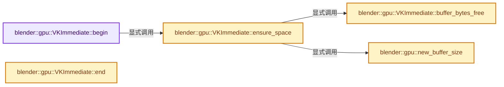
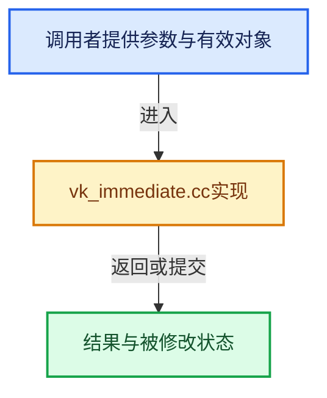

# 实现依赖专题：source/blender/gpu/vulkan/vk_immediate.cc

[方向导航](README.md) · [符号索引](../%E7%AC%A6%E5%8F%B7%E4%BE%9D%E8%B5%96%E4%B8%8E%E5%AE%9E%E7%8E%B0%E7%B4%A2%E5%BC%95.md)

本专题从正文实际调用进入，集中保存共享实现。函数有稳定锚点，可从调用处直接跳到对应完整函数；递归与互相调用通过回链组织。

## 本文件的实现关系






## 完整成员与函数实现

<a id="f-1d628bedbeb91605"></a>

### `blender::gpu::VKImmediate::begin`

实现位置：[source/blender/gpu/vulkan/vk_immediate.cc](../../../../../source/blender/gpu/vulkan/vk_immediate.cc) · L27—L38。

**教学注释版**

<!-- annotated:8ed5cccc5166d1 -->

```cpp
uchar *VKImmediate::begin()
{
  uint add_vertex = prim_type == GPU_PRIM_LINE_LOOP ? 1 : 0;
  const size_t bytes_needed = vertex_buffer_size(&vertex_format, vertex_len + add_vertex);
  size_t offset_alignment = GPU_storage_buffer_alignment();
  VKBuffer &buffer = ensure_space(bytes_needed, offset_alignment);
  buffer_offset_ = ceil_to_multiple_ul(buffer_offset_, offset_alignment);

  current_subbuffer_len_ = bytes_needed;
  uchar *data = static_cast<uchar *>(buffer.mapped_memory_get());
  return data + buffer_offset_;
}
```

<details>
<summary>核对原始源码：source/blender/gpu/vulkan/vk_immediate.cc · L27—L38</summary>

<!-- original:8ed5cccc5166d1:source/blender/gpu/vulkan/vk_immediate.cc:27:38 -->

```cpp
uchar *VKImmediate::begin()
{
  uint add_vertex = prim_type == GPU_PRIM_LINE_LOOP ? 1 : 0;
  const size_t bytes_needed = vertex_buffer_size(&vertex_format, vertex_len + add_vertex);
  size_t offset_alignment = GPU_storage_buffer_alignment();
  VKBuffer &buffer = ensure_space(bytes_needed, offset_alignment);
  buffer_offset_ = ceil_to_multiple_ul(buffer_offset_, offset_alignment);

  current_subbuffer_len_ = bytes_needed;
  uchar *data = static_cast<uchar *>(buffer.mapped_memory_get());
  return data + buffer_offset_;
}
```

</details>

**沿实际写入检查状态**

- `buffer_offset_ = ceil_to_multiple_ul(buffer_offset_, offset_alignment);`
- `current_subbuffer_len_ = bytes_needed;`

**结果出口**

- `return data + buffer_offset_;`

**继续追踪实现**

- `vertex_buffer_size` → [blender::vertex_buffer_size · L360](%E4%BE%9D%E8%B5%96-gpu_vertex_format-4f7148.md#f-4bf048994dbfc23a)。
- `GPU_storage_buffer_alignment` → [blender::GPU_storage_buffer_alignment · L212](%E4%BE%9D%E8%B5%96-gpu_capabilities-508ffd.md#f-86a9e42b396e1168)。
- `ensure_space` → [blender::gpu::VKImmediate::ensure_space · L122](%E4%BE%9D%E8%B5%96-vk_immediate-b2c4a8.md#f-266b35d1d8744e8e)。
- `ceil_to_multiple_ul` → [blender::ceil_to_multiple_ul · L250](../12-%E7%A9%BA%E9%97%B4%E6%95%B0%E6%8D%AE%E7%BB%93%E6%9E%84%E4%B8%8E%E5%87%A0%E4%BD%95%E7%AE%97%E6%B3%95/%E4%BE%9D%E8%B5%96-math_base_inline-546b00.md#f-2d8b440555643252)。
- `buffer.mapped_memory_get` → [blender::gpu::VKBuffer::mapped_memory_get · L163](%E4%BE%9D%E8%B5%96-vk_buffer-912d24.md#f-38ee8a98c0370614)。

<a id="f-7bb7a8d61fdf60f5"></a>

### `blender::gpu::VKImmediate::end`

实现位置：[source/blender/gpu/vulkan/vk_immediate.cc](../../../../../source/blender/gpu/vulkan/vk_immediate.cc) · L40—L104。

**教学注释版**

<!-- annotated:d588f3ea1ae468 -->

```cpp
void VKImmediate::end()
{
  BLI_assert_msg(prim_type != GPU_PRIM_NONE, "Illegal state: not between an immBegin/End pair.");
  if (vertex_idx == 0) {
    return;
  }

  if (prim_type == GPU_PRIM_LINE_LOOP) {
    uchar *first_vertex_ptr = static_cast<uchar *>(active_buffer_->mapped_memory_get()) +
                              buffer_offset_;
    size_t vertex_stride = current_subbuffer_len_ / (vertex_len + 1);
    uchar *last_vertex_ptr = first_vertex_ptr + vertex_stride * vertex_len;
    // [讲解] memcpy：复制字节，源与目标不应重叠。类型生命周期、对齐和可复制表示须由调用者证明，不是任意对象的复制构造。
    memcpy(last_vertex_ptr, first_vertex_ptr, vertex_stride);

    prim_type = GPU_PRIM_LINE_STRIP;
    vertex_idx += 1;
  }

  VKContext &context = *VKContext::get();
  BLI_assert(context.shader == shader);
  Shader &shader = *this->shader;
  if (shader.is_polyline) {
    VKBuffer &buffer = active_buffer_.value();
    VKStateManager &state_manager = context.state_manager_get();
    state_manager.storage_buffer_bind(BindSpaceStorageBuffers::Type::Buffer,
                                      &buffer,
                                      GPU_SSBO_POLYLINE_POS_BUF_SLOT,
                                      buffer_offset_);
    state_manager.storage_buffer_bind(BindSpaceStorageBuffers::Type::Buffer,
                                      &buffer,
                                      GPU_SSBO_POLYLINE_COL_BUF_SLOT,
                                      buffer_offset_);
    /* Not used. Satisfy the binding. */
    state_manager.storage_buffer_bind(
        BindSpaceStorageBuffers::Type::Buffer, &buffer, GPU_SSBO_INDEX_BUF_SLOT, buffer_offset_);
    this->polyline_draw_workaround(0);
  }
  else {
    GPU_matrix_bind(context.shader);
    render_graph::VKRenderGraph &graph = context.render_graph();
    render_graph::VKResourceAccessInfo &resource_access_info = context.reset_and_get_access_info();
    VKDevice &device = VKBackend::get().device;
    vertex_attributes_.update_bindings(*this);
    vertex_attributes_.update_vertex_input_key(device.vertex_input_descriptions);
    VKFrameBuffer &framebuffer = *context.active_framebuffer_get();
    framebuffer.rendering_ensure(context);

    render_graph::VKNodeData<render_graph::VKDrawNode> node =
        graph.alloc_node<render_graph::VKDrawNode>();
    node.data.vertex_count = vertex_idx;
    node.data.instance_count = 1;
    node.data.first_vertex = 0;
    node.data.first_instance = 0;

    vertex_attributes_.bind(node.data.vertex_buffers);
    context.update_pipeline_data(
        framebuffer, prim_type, vertex_attributes_.vertex_input_key, node.data.graphics);

    render_graph::VKDrawNode::CreateInfo draw(resource_access_info);
    node.finalize(graph, draw);
  }

  buffer_offset_ += current_subbuffer_len_;
  current_subbuffer_len_ = 0;
}
```

<details>
<summary>核对原始源码：source/blender/gpu/vulkan/vk_immediate.cc · L40—L104</summary>

<!-- original:d588f3ea1ae468:source/blender/gpu/vulkan/vk_immediate.cc:40:104 -->

```cpp
void VKImmediate::end()
{
  BLI_assert_msg(prim_type != GPU_PRIM_NONE, "Illegal state: not between an immBegin/End pair.");
  if (vertex_idx == 0) {
    return;
  }

  if (prim_type == GPU_PRIM_LINE_LOOP) {
    uchar *first_vertex_ptr = static_cast<uchar *>(active_buffer_->mapped_memory_get()) +
                              buffer_offset_;
    size_t vertex_stride = current_subbuffer_len_ / (vertex_len + 1);
    uchar *last_vertex_ptr = first_vertex_ptr + vertex_stride * vertex_len;
    memcpy(last_vertex_ptr, first_vertex_ptr, vertex_stride);

    prim_type = GPU_PRIM_LINE_STRIP;
    vertex_idx += 1;
  }

  VKContext &context = *VKContext::get();
  BLI_assert(context.shader == shader);
  Shader &shader = *this->shader;
  if (shader.is_polyline) {
    VKBuffer &buffer = active_buffer_.value();
    VKStateManager &state_manager = context.state_manager_get();
    state_manager.storage_buffer_bind(BindSpaceStorageBuffers::Type::Buffer,
                                      &buffer,
                                      GPU_SSBO_POLYLINE_POS_BUF_SLOT,
                                      buffer_offset_);
    state_manager.storage_buffer_bind(BindSpaceStorageBuffers::Type::Buffer,
                                      &buffer,
                                      GPU_SSBO_POLYLINE_COL_BUF_SLOT,
                                      buffer_offset_);
    /* Not used. Satisfy the binding. */
    state_manager.storage_buffer_bind(
        BindSpaceStorageBuffers::Type::Buffer, &buffer, GPU_SSBO_INDEX_BUF_SLOT, buffer_offset_);
    this->polyline_draw_workaround(0);
  }
  else {
    GPU_matrix_bind(context.shader);
    render_graph::VKRenderGraph &graph = context.render_graph();
    render_graph::VKResourceAccessInfo &resource_access_info = context.reset_and_get_access_info();
    VKDevice &device = VKBackend::get().device;
    vertex_attributes_.update_bindings(*this);
    vertex_attributes_.update_vertex_input_key(device.vertex_input_descriptions);
    VKFrameBuffer &framebuffer = *context.active_framebuffer_get();
    framebuffer.rendering_ensure(context);

    render_graph::VKNodeData<render_graph::VKDrawNode> node =
        graph.alloc_node<render_graph::VKDrawNode>();
    node.data.vertex_count = vertex_idx;
    node.data.instance_count = 1;
    node.data.first_vertex = 0;
    node.data.first_instance = 0;

    vertex_attributes_.bind(node.data.vertex_buffers);
    context.update_pipeline_data(
        framebuffer, prim_type, vertex_attributes_.vertex_input_key, node.data.graphics);

    render_graph::VKDrawNode::CreateInfo draw(resource_access_info);
    node.finalize(graph, draw);
  }

  buffer_offset_ += current_subbuffer_len_;
  current_subbuffer_len_ = 0;
}
```

</details>

**沿实际写入检查状态**

- `prim_type = GPU_PRIM_LINE_STRIP;`
- `vertex_idx += 1;`
- `node.data.vertex_count = vertex_idx;`
- `node.data.instance_count = 1;`
- `node.data.first_vertex = 0;`
- `node.data.first_instance = 0;`
- `buffer_offset_ += current_subbuffer_len_;`
- `current_subbuffer_len_ = 0;`

**继续追踪实现**

- `BLI_assert_msg` → [BLI_assert_msg · L55](../01-%E5%9F%BA%E7%A1%80%E5%AE%B9%E5%99%A8%E4%B8%8E%E7%8E%B0%E4%BB%A3CPP/%E4%BE%9D%E8%B5%96-BLI_assert-cc98e8.md#m-695eed20dceb)；[BLI_assert_msg · L64](../01-%E5%9F%BA%E7%A1%80%E5%AE%B9%E5%99%A8%E4%B8%8E%E7%8E%B0%E4%BB%A3CPP/%E4%BE%9D%E8%B5%96-BLI_assert-cc98e8.md#m-7de5563de4db)。宏定义由构建条件选择。
- `active_buffer_->mapped_memory_get` → [调用协议](../%E6%A8%A1%E6%9D%BF%E5%AE%8F%E4%B8%8E%E5%8A%A8%E6%80%81%E5%88%86%E6%B4%BE%E5%8D%8F%E8%AE%AE.md)：接收对象类型依赖auto、返回值或模板实例；不按同名猜测目标。调用位置L48。
- `memcpy` → [外部契约](https://eel.is/c++draft/cstring.syn)：复制字节，源与目标不应重叠。类型生命周期、对齐和可复制表示须由调用者证明，不是任意对象的复制构造。
- `VKContext::get` → [blender::gpu::VKContext::get · L148](%E4%BE%9D%E8%B5%96-vk_context-f02d3a.md#f-378401ce251eda2a)。
- `BLI_assert` → [BLI_assert · L48](../01-%E5%9F%BA%E7%A1%80%E5%AE%B9%E5%99%A8%E4%B8%8E%E7%8E%B0%E4%BB%A3CPP/%E4%BE%9D%E8%B5%96-BLI_assert-cc98e8.md#m-57a88495704d)；[BLI_assert · L63](../01-%E5%9F%BA%E7%A1%80%E5%AE%B9%E5%99%A8%E4%B8%8E%E7%8E%B0%E4%BB%A3CPP/%E4%BE%9D%E8%B5%96-BLI_assert-cc98e8.md#m-d07050020cb5)。宏定义由构建条件选择。
- `active_buffer_.value` → [调用协议](../%E6%A8%A1%E6%9D%BF%E5%AE%8F%E4%B8%8E%E5%8A%A8%E6%80%81%E5%88%86%E6%B4%BE%E5%8D%8F%E8%AE%AE.md)：接收对象类型依赖auto、返回值或模板实例；不按同名猜测目标。调用位置L62。
- `context.state_manager_get` → [blender::gpu::VKContext::state_manager_get · L238](%E4%BE%9D%E8%B5%96-vk_context-443184.md#f-e18c55531e96aa04)。
- `state_manager.storage_buffer_bind` → [blender::gpu::VKStateManager::storage_buffer_bind · L128](%E4%BE%9D%E8%B5%96-vk_state_manager-22bab5.md#f-12388359005eb531)。
- `this->polyline_draw_workaround` → [调用协议](../%E6%A8%A1%E6%9D%BF%E5%AE%8F%E4%B8%8E%E5%8A%A8%E6%80%81%E5%88%86%E6%B4%BE%E5%8D%8F%E8%AE%AE.md)：由接收对象具体类型或运行时策略提供实现。调用位置L75。
- `GPU_matrix_bind` → [blender::GPU_matrix_bind · L612](%E4%BE%9D%E8%B5%96-gpu_matrix-f7dc40.md#f-c4bd0ac3f45ded4f)。
- `context.render_graph` → [blender::gpu::VKContext::render_graph · L81](%E4%BE%9D%E8%B5%96-vk_context-f02d3a.md#f-3a4bb825ec5d0a82)；[blender::gpu::VKContext::render_graph · L85](%E4%BE%9D%E8%B5%96-vk_context-f02d3a.md#f-b3ac6949ba355b17)。同名重载需按实参类型选择。
- `context.reset_and_get_access_info` → [blender::gpu::VKContext::reset_and_get_access_info · L406](%E4%BE%9D%E8%B5%96-vk_context-443184.md#f-ac8970ee17d46c7a)。
- `VKBackend::get` → [blender::gpu::VKBackend::get · L106](%E4%BE%9D%E8%B5%96-vk_backend-742e37.md#f-9b0f846ed492f55f)。
- `vertex_attributes_.update_bindings` → [调用协议](../%E6%A8%A1%E6%9D%BF%E5%AE%8F%E4%B8%8E%E5%8A%A8%E6%80%81%E5%88%86%E6%B4%BE%E5%8D%8F%E8%AE%AE.md)：接收对象类型依赖auto、返回值或模板实例；不按同名猜测目标。调用位置L82。
- `vertex_attributes_.update_vertex_input_key` → [调用协议](../%E6%A8%A1%E6%9D%BF%E5%AE%8F%E4%B8%8E%E5%8A%A8%E6%80%81%E5%88%86%E6%B4%BE%E5%8D%8F%E8%AE%AE.md)：接收对象类型依赖auto、返回值或模板实例；不按同名猜测目标。调用位置L83。
- `context.active_framebuffer_get` → [blender::gpu::VKContext::active_framebuffer_get · L272](%E4%BE%9D%E8%B5%96-vk_context-443184.md#f-775975b6e7ea8bfd)。
- `framebuffer.rendering_ensure` → [blender::gpu::VKFrameBuffer::rendering_ensure · L757](%E4%BE%9D%E8%B5%96-vk_framebuffer-84f42c.md#f-2082e0a1416a3a2d)。
- `graph.alloc_node<render_graph::VKDrawNode>` → [blender::gpu::render_graph::VKRenderGraph::alloc_node · L156](%E4%BE%9D%E8%B5%96-vk_render_graph-cb92b0.md#f-a0d4edaed4a41eb5)。
- `vertex_attributes_.bind` → [调用协议](../%E6%A8%A1%E6%9D%BF%E5%AE%8F%E4%B8%8E%E5%8A%A8%E6%80%81%E5%88%86%E6%B4%BE%E5%8D%8F%E8%AE%AE.md)：接收对象类型依赖auto、返回值或模板实例；不按同名猜测目标。调用位置L94。
- `context.update_pipeline_data` → [blender::gpu::VKContext::update_pipeline_data · L306](%E4%BE%9D%E8%B5%96-vk_context-443184.md#f-ef0394f4a1315d14)；[blender::gpu::VKContext::update_pipeline_data · L374](%E4%BE%9D%E8%B5%96-vk_context-443184.md#f-5bd967b8cc52c122)；[blender::gpu::VKContext::update_pipeline_data · L381](%E4%BE%9D%E8%B5%96-vk_context-443184.md#f-859a98f1f51a1838)。同名重载需按实参类型选择。
- `node.finalize` → [blender::gpu::render_graph::VKNodeData<NodeInfo>::finalize · L350](%E4%BE%9D%E8%B5%96-vk_render_graph-cb92b0.md#f-7c55aeae65a89a74)。

<a id="f-37a84573604ab511"></a>

### `blender::gpu::VKImmediate::buffer_bytes_free`

实现位置：[source/blender/gpu/vulkan/vk_immediate.cc](../../../../../source/blender/gpu/vulkan/vk_immediate.cc) · L112—L115。

**教学注释版**

<!-- annotated:f4feec7f65e773 -->

```cpp
VkDeviceSize VKImmediate::buffer_bytes_free()
{
  return active_buffer_->size_in_bytes() - buffer_offset_;
}
```

<details>
<summary>核对原始源码：source/blender/gpu/vulkan/vk_immediate.cc · L112—L115</summary>

<!-- original:f4feec7f65e773:source/blender/gpu/vulkan/vk_immediate.cc:112:115 -->

```cpp
VkDeviceSize VKImmediate::buffer_bytes_free()
{
  return active_buffer_->size_in_bytes() - buffer_offset_;
}
```

</details>

**结果出口**

- `return active_buffer_->size_in_bytes() - buffer_offset_;`

**继续追踪实现**

- `active_buffer_->size_in_bytes` → [调用协议](../%E6%A8%A1%E6%9D%BF%E5%AE%8F%E4%B8%8E%E5%8A%A8%E6%80%81%E5%88%86%E6%B4%BE%E5%8D%8F%E8%AE%AE.md)：接收对象类型依赖auto、返回值或模板实例；不按同名猜测目标。调用位置L114。

<a id="f-5f0b2ac18433f81c"></a>

### `blender::gpu::new_buffer_size`

实现位置：[source/blender/gpu/vulkan/vk_immediate.cc](../../../../../source/blender/gpu/vulkan/vk_immediate.cc) · L117—L120。

接口参数：

- `VkDeviceSize sub_buffer_size`

**教学注释版**

<!-- annotated:8bc560aec5d6a5 -->

```cpp
static VkDeviceSize new_buffer_size(VkDeviceSize sub_buffer_size)
{
  return max_ulul(sub_buffer_size, DEFAULT_INTERNAL_BUFFER_SIZE);
}
```

<details>
<summary>核对原始源码：source/blender/gpu/vulkan/vk_immediate.cc · L117—L120</summary>

<!-- original:8bc560aec5d6a5:source/blender/gpu/vulkan/vk_immediate.cc:117:120 -->

```cpp
static VkDeviceSize new_buffer_size(VkDeviceSize sub_buffer_size)
{
  return max_ulul(sub_buffer_size, DEFAULT_INTERNAL_BUFFER_SIZE);
}
```

</details>

**结果出口**

- `return max_ulul(sub_buffer_size, DEFAULT_INTERNAL_BUFFER_SIZE);`

**继续追踪实现**

- `max_ulul` → [blender::max_ulul · L386](../12-%E7%A9%BA%E9%97%B4%E6%95%B0%E6%8D%AE%E7%BB%93%E6%9E%84%E4%B8%8E%E5%87%A0%E4%BD%95%E7%AE%97%E6%B3%95/%E4%BE%9D%E8%B5%96-math_base_inline-546b00.md#f-923069c0e5dcada1)。

<a id="f-266b35d1d8744e8e"></a>

### `blender::gpu::VKImmediate::ensure_space`

实现位置：[source/blender/gpu/vulkan/vk_immediate.cc](../../../../../source/blender/gpu/vulkan/vk_immediate.cc) · L122—L152。

接口参数：

- `VkDeviceSize bytes_needed`
- `VkDeviceSize offset_alignment`

**教学注释版**

<!-- annotated:d59977d71ac78f -->

```cpp
VKBuffer &VKImmediate::ensure_space(VkDeviceSize bytes_needed, VkDeviceSize offset_alignment)
{
  VkDeviceSize bytes_required = ceil_to_multiple_ul(bytes_needed, offset_alignment);

  /* Last used buffer still has space. */
  if (active_buffer_.has_value() && buffer_bytes_free() >= bytes_required) {
    return active_buffer_.value();
  }

  /* Offset alignment isn't needed when creating buffers as it is managed by VMA. */
  VkDeviceSize alloc_size = new_buffer_size(bytes_needed);
  CLOG_TRACE(&LOG,
             "Immediate buffer cannot hold another %d bytes, it contains %d bytes. A new "
             "buffer will be allocated (size=%d)",
             int(bytes_required),
             int(buffer_offset_),
             int(alloc_size));
  buffer_offset_ = 0;
  VKBuffer &result = active_buffer_.emplace();
  result.create(alloc_size,
                VK_BUFFER_USAGE_STORAGE_BUFFER_BIT | VK_BUFFER_USAGE_VERTEX_BUFFER_BIT |
                    VK_BUFFER_USAGE_TRANSFER_DST_BIT,
                VMA_MEMORY_USAGE_AUTO_PREFER_HOST,
                VMA_ALLOCATION_CREATE_MAPPED_BIT |
                    VMA_ALLOCATION_CREATE_HOST_ACCESS_SEQUENTIAL_WRITE_BIT,
                0.8,
                false,
                "Immediate");

  return result;
}
```

<details>
<summary>核对原始源码：source/blender/gpu/vulkan/vk_immediate.cc · L122—L152</summary>

<!-- original:d59977d71ac78f:source/blender/gpu/vulkan/vk_immediate.cc:122:152 -->

```cpp
VKBuffer &VKImmediate::ensure_space(VkDeviceSize bytes_needed, VkDeviceSize offset_alignment)
{
  VkDeviceSize bytes_required = ceil_to_multiple_ul(bytes_needed, offset_alignment);

  /* Last used buffer still has space. */
  if (active_buffer_.has_value() && buffer_bytes_free() >= bytes_required) {
    return active_buffer_.value();
  }

  /* Offset alignment isn't needed when creating buffers as it is managed by VMA. */
  VkDeviceSize alloc_size = new_buffer_size(bytes_needed);
  CLOG_TRACE(&LOG,
             "Immediate buffer cannot hold another %d bytes, it contains %d bytes. A new "
             "buffer will be allocated (size=%d)",
             int(bytes_required),
             int(buffer_offset_),
             int(alloc_size));
  buffer_offset_ = 0;
  VKBuffer &result = active_buffer_.emplace();
  result.create(alloc_size,
                VK_BUFFER_USAGE_STORAGE_BUFFER_BIT | VK_BUFFER_USAGE_VERTEX_BUFFER_BIT |
                    VK_BUFFER_USAGE_TRANSFER_DST_BIT,
                VMA_MEMORY_USAGE_AUTO_PREFER_HOST,
                VMA_ALLOCATION_CREATE_MAPPED_BIT |
                    VMA_ALLOCATION_CREATE_HOST_ACCESS_SEQUENTIAL_WRITE_BIT,
                0.8,
                false,
                "Immediate");

  return result;
}
```

</details>

**沿实际写入检查状态**

- `buffer_offset_ = 0;`

**结果出口**

- `return active_buffer_.value();`
- `return result;`

**继续追踪实现**

- `ceil_to_multiple_ul` → [blender::ceil_to_multiple_ul · L250](../12-%E7%A9%BA%E9%97%B4%E6%95%B0%E6%8D%AE%E7%BB%93%E6%9E%84%E4%B8%8E%E5%87%A0%E4%BD%95%E7%AE%97%E6%B3%95/%E4%BE%9D%E8%B5%96-math_base_inline-546b00.md#f-2d8b440555643252)。
- `active_buffer_.has_value` → [调用协议](../%E6%A8%A1%E6%9D%BF%E5%AE%8F%E4%B8%8E%E5%8A%A8%E6%80%81%E5%88%86%E6%B4%BE%E5%8D%8F%E8%AE%AE.md)：接收对象类型依赖auto、返回值或模板实例；不按同名猜测目标。调用位置L127。
- `buffer_bytes_free` → [blender::gpu::VKImmediate::buffer_bytes_free · L112](%E4%BE%9D%E8%B5%96-vk_immediate-b2c4a8.md#f-37a84573604ab511)。
- `active_buffer_.value` → [调用协议](../%E6%A8%A1%E6%9D%BF%E5%AE%8F%E4%B8%8E%E5%8A%A8%E6%80%81%E5%88%86%E6%B4%BE%E5%8D%8F%E8%AE%AE.md)：接收对象类型依赖auto、返回值或模板实例；不按同名猜测目标。调用位置L128。
- `new_buffer_size` → [blender::gpu::new_buffer_size · L117](%E4%BE%9D%E8%B5%96-vk_immediate-b2c4a8.md#f-5f0b2ac18433f81c)。
- `CLOG_TRACE` → [CLOG_TRACE · L192](%E4%BE%9D%E8%B5%96-CLG_log-e9051b.md#m-46273bee5728)。宏定义由构建条件选择。
- `active_buffer_.emplace` → [调用协议](../%E6%A8%A1%E6%9D%BF%E5%AE%8F%E4%B8%8E%E5%8A%A8%E6%80%81%E5%88%86%E6%B4%BE%E5%8D%8F%E8%AE%AE.md)：接收对象类型依赖auto、返回值或模板实例；不按同名猜测目标。调用位置L140。
- `result.create` → [blender::gpu::VKBuffer::create · L29](%E4%BE%9D%E8%B5%96-vk_buffer-138d3d.md#f-92e2d8f1ee95d335)。
