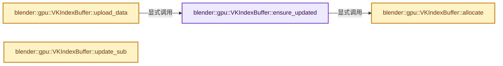

# 实现依赖专题：source/blender/gpu/vulkan/vk_index_buffer.cc

[方向导航](README.md) · [符号索引](../%E7%AC%A6%E5%8F%B7%E4%BE%9D%E8%B5%96%E4%B8%8E%E5%AE%9E%E7%8E%B0%E7%B4%A2%E5%BC%95.md)

本专题从正文实际调用进入，集中保存共享实现。函数有稳定锚点，可从调用处直接跳到对应完整函数；递归与互相调用通过回链组织。

## 本文件的实现关系




## 完整成员与函数实现

<a id="f-553dbe22ba7d43cd"></a>

### `blender::gpu::VKIndexBuffer::ensure_updated`

实现位置：[source/blender/gpu/vulkan/vk_index_buffer.cc](../../../../../source/blender/gpu/vulkan/vk_index_buffer.cc) · L25—L69。

**教学注释版**

<!-- annotated:8abecc46b0f10a -->

```cpp
void VKIndexBuffer::ensure_updated()
{
  if (is_subrange_) {
    src_->upload_data();
    return;
  }

  if (!buffer_.is_allocated()) {
    allocate();
    if (!buffer_.is_allocated()) {
      CLOG_ERROR(&LOG, "Unable to allocate index buffer. Most likely an out of memory issue.");
      return;
    }
  }

  if (data_ == nullptr) {
    return;
  }

  if (!data_uploaded_ && buffer_.is_mapped()) {
    buffer_.update_immediately(data_);
    MEM_SAFE_DELETE_VOID(data_);
  }
  else {
    VKContext &context = *VKContext::get();
    VKStagingBuffer staging_buffer(buffer_, VKStagingBuffer::Direction::HostToDevice);
    VKBuffer &buffer = staging_buffer.host_buffer_get();
    if (buffer.is_allocated()) {
      staging_buffer.host_buffer_get().update_immediately(data_);
      staging_buffer.copy_to_device(context);
    }
    else {
      buffer_.clear(context, 0u);
      CLOG_ERROR(
          &LOG,
          "Unable to upload data to index buffer via a staging buffer as the staging buffer "
          "could not be allocated. Index buffer will be filled with on zeros to reduce "
          "drawing artifacts due to read from uninitialized memory.");
      buffer_.clear(context, 0u);
    }
    MEM_SAFE_DELETE_VOID(data_);
  }

  data_uploaded_ = true;
}
```

<details>
<summary>核对原始源码：source/blender/gpu/vulkan/vk_index_buffer.cc · L25—L69</summary>

<!-- original:8abecc46b0f10a:source/blender/gpu/vulkan/vk_index_buffer.cc:25:69 -->

```cpp
void VKIndexBuffer::ensure_updated()
{
  if (is_subrange_) {
    src_->upload_data();
    return;
  }

  if (!buffer_.is_allocated()) {
    allocate();
    if (!buffer_.is_allocated()) {
      CLOG_ERROR(&LOG, "Unable to allocate index buffer. Most likely an out of memory issue.");
      return;
    }
  }

  if (data_ == nullptr) {
    return;
  }

  if (!data_uploaded_ && buffer_.is_mapped()) {
    buffer_.update_immediately(data_);
    MEM_SAFE_DELETE_VOID(data_);
  }
  else {
    VKContext &context = *VKContext::get();
    VKStagingBuffer staging_buffer(buffer_, VKStagingBuffer::Direction::HostToDevice);
    VKBuffer &buffer = staging_buffer.host_buffer_get();
    if (buffer.is_allocated()) {
      staging_buffer.host_buffer_get().update_immediately(data_);
      staging_buffer.copy_to_device(context);
    }
    else {
      buffer_.clear(context, 0u);
      CLOG_ERROR(
          &LOG,
          "Unable to upload data to index buffer via a staging buffer as the staging buffer "
          "could not be allocated. Index buffer will be filled with on zeros to reduce "
          "drawing artifacts due to read from uninitialized memory.");
      buffer_.clear(context, 0u);
    }
    MEM_SAFE_DELETE_VOID(data_);
  }

  data_uploaded_ = true;
}
```

</details>

**沿实际写入检查状态**

- `data_uploaded_ = true;`

**继续追踪实现**

- `src_->upload_data` → [调用协议](../%E6%A8%A1%E6%9D%BF%E5%AE%8F%E4%B8%8E%E5%8A%A8%E6%80%81%E5%88%86%E6%B4%BE%E5%8D%8F%E8%AE%AE.md)：接收对象类型依赖auto、返回值或模板实例；不按同名猜测目标。调用位置L28。
- `buffer_.is_allocated` → [调用协议](../%E6%A8%A1%E6%9D%BF%E5%AE%8F%E4%B8%8E%E5%8A%A8%E6%80%81%E5%88%86%E6%B4%BE%E5%8D%8F%E8%AE%AE.md)：接收对象类型依赖auto、返回值或模板实例；不按同名猜测目标。调用位置L32。
- `allocate` → [blender::gpu::VKIndexBuffer::allocate · L153](%E4%BE%9D%E8%B5%96-vk_index_buffer-eb7fec.md#f-03314de324cd17f5)。
- `CLOG_ERROR` → [CLOG_ERROR · L188](%E4%BE%9D%E8%B5%96-CLG_log-e9051b.md#m-081575cdc8d0)。宏定义由构建条件选择。
- `buffer_.is_mapped` → [调用协议](../%E6%A8%A1%E6%9D%BF%E5%AE%8F%E4%B8%8E%E5%8A%A8%E6%80%81%E5%88%86%E6%B4%BE%E5%8D%8F%E8%AE%AE.md)：接收对象类型依赖auto、返回值或模板实例；不按同名猜测目标。调用位置L44。
- `buffer_.update_immediately` → [调用协议](../%E6%A8%A1%E6%9D%BF%E5%AE%8F%E4%B8%8E%E5%8A%A8%E6%80%81%E5%88%86%E6%B4%BE%E5%8D%8F%E8%AE%AE.md)：接收对象类型依赖auto、返回值或模板实例；不按同名猜测目标。调用位置L45。
- `MEM_SAFE_DELETE_VOID` → [MEM_SAFE_DELETE_VOID · L448](../03-%E5%86%85%E5%AD%98%E5%88%86%E9%85%8D%E4%B8%8E%E8%BF%90%E8%A1%8C%E6%97%B6%E7%B1%BB%E5%9E%8B/%E4%BE%9D%E8%B5%96-MEM_guardedalloc-b54eca.md#m-66e7eff3d7bc)。宏定义由构建条件选择。
- `VKContext::get` → [blender::gpu::VKContext::get · L148](%E4%BE%9D%E8%B5%96-vk_context-f02d3a.md#f-378401ce251eda2a)。
- `staging_buffer.host_buffer_get` → [blender::gpu::VKStagingBuffer::host_buffer_get · L70](%E4%BE%9D%E8%B5%96-vk_staging_buffer-afb795.md#f-4c77f080c3925bcb)。
- `buffer.is_allocated` → [blender::gpu::VKBuffer::is_allocated · L174](%E4%BE%9D%E8%B5%96-vk_buffer-912d24.md#f-72ed3e4e29c76545)。
- `staging_buffer.host_buffer_get().update_immediately` → [调用协议](../%E6%A8%A1%E6%9D%BF%E5%AE%8F%E4%B8%8E%E5%8A%A8%E6%80%81%E5%88%86%E6%B4%BE%E5%8D%8F%E8%AE%AE.md)：接收对象类型依赖auto、返回值或模板实例；不按同名猜测目标。调用位置L53。
- `staging_buffer.copy_to_device` → [blender::gpu::VKStagingBuffer::copy_to_device · L41](%E4%BE%9D%E8%B5%96-vk_staging_buffer-fc65d8.md#f-3f8ba3ac2523c07a)。
- `buffer_.clear` → [调用协议](../%E6%A8%A1%E6%9D%BF%E5%AE%8F%E4%B8%8E%E5%8A%A8%E6%80%81%E5%88%86%E6%B4%BE%E5%8D%8F%E8%AE%AE.md)：接收对象类型依赖auto、返回值或模板实例；不按同名猜测目标。调用位置L57。

<a id="f-d2df8afcc42600a4"></a>

### `blender::gpu::VKIndexBuffer::upload_data`

实现位置：[source/blender/gpu/vulkan/vk_index_buffer.cc](../../../../../source/blender/gpu/vulkan/vk_index_buffer.cc) · L71—L74。

**教学注释版**

<!-- annotated:721513cb557f16 -->

```cpp
void VKIndexBuffer::upload_data()
{
  ensure_updated();
}
```

<details>
<summary>核对原始源码：source/blender/gpu/vulkan/vk_index_buffer.cc · L71—L74</summary>

<!-- original:721513cb557f16:source/blender/gpu/vulkan/vk_index_buffer.cc:71:74 -->

```cpp
void VKIndexBuffer::upload_data()
{
  ensure_updated();
}
```

</details>

**继续追踪实现**

- `ensure_updated` → [blender::gpu::VKIndexBuffer::ensure_updated · L25](%E4%BE%9D%E8%B5%96-vk_index_buffer-eb7fec.md#f-553dbe22ba7d43cd)。

<a id="f-b46f9dcfad212bfb"></a>

### `blender::gpu::VKIndexBuffer::update_sub`

实现位置：[source/blender/gpu/vulkan/vk_index_buffer.cc](../../../../../source/blender/gpu/vulkan/vk_index_buffer.cc) · L103—L119。

接口参数：

- `uint start`
- `uint len`
- `const void *data`

**教学注释版**

<!-- annotated:41590ffc9b1c36 -->

```cpp
void VKIndexBuffer::update_sub(uint start, uint len, const void *data)
{
  if (!buffer_.is_allocated()) {
    /* Allocating huge buffers can fail, in that case we skip copying data. */
    return;
  }
  BLI_assert_msg(start + len <= buffer_.size_in_bytes(), "Out of bound write to index buffer");
  if (buffer_.is_mapped()) {
    buffer_.update_sub_immediately(start, len, data);
  }
  else {
    VKContext &context = *VKContext::get();
    VKStagingBuffer staging_buffer(buffer_, VKStagingBuffer::Direction::HostToDevice, start, len);
    // [讲解] memcpy：复制字节，源与目标不应重叠。类型生命周期、对齐和可复制表示须由调用者证明，不是任意对象的复制构造。
    memcpy(staging_buffer.host_buffer_get().mapped_memory_get(), data, len);
    staging_buffer.copy_to_device(context);
  }
}
```

<details>
<summary>核对原始源码：source/blender/gpu/vulkan/vk_index_buffer.cc · L103—L119</summary>

<!-- original:41590ffc9b1c36:source/blender/gpu/vulkan/vk_index_buffer.cc:103:119 -->

```cpp
void VKIndexBuffer::update_sub(uint start, uint len, const void *data)
{
  if (!buffer_.is_allocated()) {
    /* Allocating huge buffers can fail, in that case we skip copying data. */
    return;
  }
  BLI_assert_msg(start + len <= buffer_.size_in_bytes(), "Out of bound write to index buffer");
  if (buffer_.is_mapped()) {
    buffer_.update_sub_immediately(start, len, data);
  }
  else {
    VKContext &context = *VKContext::get();
    VKStagingBuffer staging_buffer(buffer_, VKStagingBuffer::Direction::HostToDevice, start, len);
    memcpy(staging_buffer.host_buffer_get().mapped_memory_get(), data, len);
    staging_buffer.copy_to_device(context);
  }
}
```

</details>

**继续追踪实现**

- `buffer_.is_allocated` → [调用协议](../%E6%A8%A1%E6%9D%BF%E5%AE%8F%E4%B8%8E%E5%8A%A8%E6%80%81%E5%88%86%E6%B4%BE%E5%8D%8F%E8%AE%AE.md)：接收对象类型依赖auto、返回值或模板实例；不按同名猜测目标。调用位置L105。
- `BLI_assert_msg` → [BLI_assert_msg · L55](../01-%E5%9F%BA%E7%A1%80%E5%AE%B9%E5%99%A8%E4%B8%8E%E7%8E%B0%E4%BB%A3CPP/%E4%BE%9D%E8%B5%96-BLI_assert-cc98e8.md#m-695eed20dceb)；[BLI_assert_msg · L64](../01-%E5%9F%BA%E7%A1%80%E5%AE%B9%E5%99%A8%E4%B8%8E%E7%8E%B0%E4%BB%A3CPP/%E4%BE%9D%E8%B5%96-BLI_assert-cc98e8.md#m-7de5563de4db)。宏定义由构建条件选择。
- `buffer_.size_in_bytes` → [调用协议](../%E6%A8%A1%E6%9D%BF%E5%AE%8F%E4%B8%8E%E5%8A%A8%E6%80%81%E5%88%86%E6%B4%BE%E5%8D%8F%E8%AE%AE.md)：接收对象类型依赖auto、返回值或模板实例；不按同名猜测目标。调用位置L109。
- `buffer_.is_mapped` → [调用协议](../%E6%A8%A1%E6%9D%BF%E5%AE%8F%E4%B8%8E%E5%8A%A8%E6%80%81%E5%88%86%E6%B4%BE%E5%8D%8F%E8%AE%AE.md)：接收对象类型依赖auto、返回值或模板实例；不按同名猜测目标。调用位置L110。
- `buffer_.update_sub_immediately` → [调用协议](../%E6%A8%A1%E6%9D%BF%E5%AE%8F%E4%B8%8E%E5%8A%A8%E6%80%81%E5%88%86%E6%B4%BE%E5%8D%8F%E8%AE%AE.md)：接收对象类型依赖auto、返回值或模板实例；不按同名猜测目标。调用位置L111。
- `VKContext::get` → [blender::gpu::VKContext::get · L148](%E4%BE%9D%E8%B5%96-vk_context-f02d3a.md#f-378401ce251eda2a)。
- `memcpy` → [外部契约](https://eel.is/c++draft/cstring.syn)：复制字节，源与目标不应重叠。类型生命周期、对齐和可复制表示须由调用者证明，不是任意对象的复制构造。
- `staging_buffer.host_buffer_get().mapped_memory_get` → [调用协议](../%E6%A8%A1%E6%9D%BF%E5%AE%8F%E4%B8%8E%E5%8A%A8%E6%80%81%E5%88%86%E6%B4%BE%E5%8D%8F%E8%AE%AE.md)：接收对象类型依赖auto、返回值或模板实例；不按同名猜测目标。调用位置L116。
- `staging_buffer.host_buffer_get` → [blender::gpu::VKStagingBuffer::host_buffer_get · L70](%E4%BE%9D%E8%B5%96-vk_staging_buffer-afb795.md#f-4c77f080c3925bcb)。
- `staging_buffer.copy_to_device` → [blender::gpu::VKStagingBuffer::copy_to_device · L41](%E4%BE%9D%E8%B5%96-vk_staging_buffer-fc65d8.md#f-3f8ba3ac2523c07a)。

<a id="f-03314de324cd17f5"></a>

### `blender::gpu::VKIndexBuffer::allocate`

实现位置：[source/blender/gpu/vulkan/vk_index_buffer.cc](../../../../../source/blender/gpu/vulkan/vk_index_buffer.cc) · L153—L171。

**教学注释版**

<!-- annotated:4befc22560fff7 -->

```cpp
void VKIndexBuffer::allocate()
{
  VkBufferUsageFlags vk_buffer_usage = VK_BUFFER_USAGE_STORAGE_BUFFER_BIT |
                                       VK_BUFFER_USAGE_INDEX_BUFFER_BIT |
                                       VK_BUFFER_USAGE_TRANSFER_DST_BIT |
                                       VK_BUFFER_USAGE_TRANSFER_SRC_BIT;
  if (GCaps.ray_query_support) {
    vk_buffer_usage |= VK_BUFFER_USAGE_ACCELERATION_STRUCTURE_BUILD_INPUT_READ_ONLY_BIT_KHR |
                       VK_BUFFER_USAGE_SHADER_DEVICE_ADDRESS_BIT;
  }

  buffer_.create(size_get(),
                 vk_buffer_usage,
                 VMA_MEMORY_USAGE_AUTO,
                 VmaAllocationCreateFlags(0),
                 0.8f,
                 false,
                 "IndexBuffer");
}
```

<details>
<summary>核对原始源码：source/blender/gpu/vulkan/vk_index_buffer.cc · L153—L171</summary>

<!-- original:4befc22560fff7:source/blender/gpu/vulkan/vk_index_buffer.cc:153:171 -->

```cpp
void VKIndexBuffer::allocate()
{
  VkBufferUsageFlags vk_buffer_usage = VK_BUFFER_USAGE_STORAGE_BUFFER_BIT |
                                       VK_BUFFER_USAGE_INDEX_BUFFER_BIT |
                                       VK_BUFFER_USAGE_TRANSFER_DST_BIT |
                                       VK_BUFFER_USAGE_TRANSFER_SRC_BIT;
  if (GCaps.ray_query_support) {
    vk_buffer_usage |= VK_BUFFER_USAGE_ACCELERATION_STRUCTURE_BUILD_INPUT_READ_ONLY_BIT_KHR |
                       VK_BUFFER_USAGE_SHADER_DEVICE_ADDRESS_BIT;
  }

  buffer_.create(size_get(),
                 vk_buffer_usage,
                 VMA_MEMORY_USAGE_AUTO,
                 VmaAllocationCreateFlags(0),
                 0.8f,
                 false,
                 "IndexBuffer");
}
```

</details>

**沿实际写入检查状态**

- `vk_buffer_usage |= VK_BUFFER_USAGE_ACCELERATION_STRUCTURE_BUILD_INPUT_READ_ONLY_BIT_KHR |`

**继续追踪实现**

- `buffer_.create` → [调用协议](../%E6%A8%A1%E6%9D%BF%E5%AE%8F%E4%B8%8E%E5%8A%A8%E6%80%81%E5%88%86%E6%B4%BE%E5%8D%8F%E8%AE%AE.md)：接收对象类型依赖auto、返回值或模板实例；不按同名猜测目标。调用位置L164。
- `size_get` → [调用协议](../%E6%A8%A1%E6%9D%BF%E5%AE%8F%E4%B8%8E%E5%8A%A8%E6%80%81%E5%88%86%E6%B4%BE%E5%8D%8F%E8%AE%AE.md)：函数指针、局部可调用对象或未展开的宏；必须结合调用者环境。调用位置L164。
- `VmaAllocationCreateFlags` → [调用协议](../%E6%A8%A1%E6%9D%BF%E5%AE%8F%E4%B8%8E%E5%8A%A8%E6%80%81%E5%88%86%E6%B4%BE%E5%8D%8F%E8%AE%AE.md)：函数指针、局部可调用对象或未展开的宏；必须结合调用者环境。调用位置L167。
