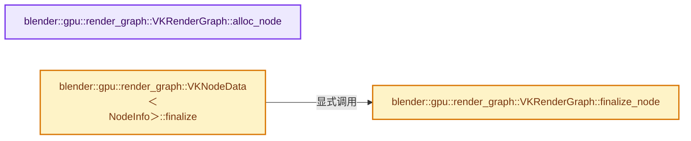
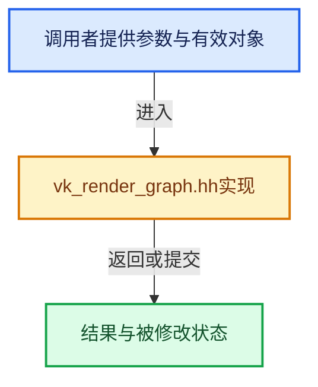

# 实现依赖专题：source/blender/gpu/vulkan/render_graph/vk_render_graph.hh

[方向导航](README.md) · [符号索引](../%E7%AC%A6%E5%8F%B7%E4%BE%9D%E8%B5%96%E4%B8%8E%E5%AE%9E%E7%8E%B0%E7%B4%A2%E5%BC%95.md)

本专题从正文实际调用进入，集中保存共享实现。函数有稳定锚点，可从调用处直接跳到对应完整函数；递归与互相调用通过回链组织。

## 本文件的实现关系






## 完整成员与函数实现

<a id="f-a0d4edaed4a41eb5"></a>

### `blender::gpu::render_graph::VKRenderGraph::alloc_node`

实现位置：[source/blender/gpu/vulkan/render_graph/vk_render_graph.hh](../../../../../source/blender/gpu/vulkan/render_graph/vk_render_graph.hh) · L156—L163。

**教学注释版**

<!-- annotated:b482fe8941f962 -->

```cpp
  template<typename NodeInfo> VKNodeData<NodeInfo> alloc_node()
  {
    static VKRenderGraphNode node_template = {};
    // [讲解] nodes_.append_and_get_index：在尾部建立新元素，必要时先扩大存储。
    NodeHandle node_handle = nodes_.append_and_get_index(node_template);
    VKRenderGraphNode &node = nodes_[node_handle];
    typename NodeInfo::Data &data = node.alloc_node_data<NodeInfo>(storage_);
    return {node_handle, data};
  }
```

<details>
<summary>核对原始源码：source/blender/gpu/vulkan/render_graph/vk_render_graph.hh · L156—L163</summary>

<!-- original:b482fe8941f962:source/blender/gpu/vulkan/render_graph/vk_render_graph.hh:156:163 -->

```cpp
  template<typename NodeInfo> VKNodeData<NodeInfo> alloc_node()
  {
    static VKRenderGraphNode node_template = {};
    NodeHandle node_handle = nodes_.append_and_get_index(node_template);
    VKRenderGraphNode &node = nodes_[node_handle];
    typename NodeInfo::Data &data = node.alloc_node_data<NodeInfo>(storage_);
    return {node_handle, data};
  }
```

</details>

**结果出口**

- `return {node_handle, data};`

**继续追踪实现**

- `nodes_.append_and_get_index` → [blender::Vector::append_and_get_index · L517](../01-%E5%9F%BA%E7%A1%80%E5%AE%B9%E5%99%A8%E4%B8%8E%E7%8E%B0%E4%BB%A3CPP/11-Vector%E6%8F%92%E5%85%A5%E5%88%A0%E9%99%A4%E4%B8%8E%E9%87%8D%E6%8E%92.md#f-1de78b06c3aa90cd)；[blender::Vector::append_and_get_index · L521](../01-%E5%9F%BA%E7%A1%80%E5%AE%B9%E5%99%A8%E4%B8%8E%E7%8E%B0%E4%BB%A3CPP/11-Vector%E6%8F%92%E5%85%A5%E5%88%A0%E9%99%A4%E4%B8%8E%E9%87%8D%E6%8E%92.md#f-91413faf22574850)。同名重载需按实参类型选择。
- `node.alloc_node_data<NodeInfo>` → [blender::gpu::render_graph::VKRenderGraphNode::alloc_node_data · L211](%E4%BE%9D%E8%B5%96-vk_render_graph_node-1e117b.md#f-100df13b35dcee09)。

<a id="f-e2ecde1610e16285"></a>

### `blender::gpu::render_graph::VKRenderGraph::finalize_node`

实现位置：[source/blender/gpu/vulkan/render_graph/vk_render_graph.hh](../../../../../source/blender/gpu/vulkan/render_graph/vk_render_graph.hh) · L170—L189。

接口参数：

- `NodeHandle node_handle`
- `const typename NodeInfo::CreateInfo &create_info`

**教学注释版**

<!-- annotated:4b227c8ce81be0 -->

```cpp
  template<typename NodeInfo>
  void finalize_node(NodeHandle node_handle, const typename NodeInfo::CreateInfo &create_info)
  {
    std::scoped_lock lock(resources_.mutex);
    VKRenderGraphNode &node = nodes_[node_handle];
    BLI_assert(node.type == NodeInfo::node_type);

    if (G.debug & G_DEBUG_GPU) {
      if (!debug_.group_used) {
        debug_.group_used = true;
        debug_.used_groups.append(debug_.group_stack);
      }
      // [讲解] nodes_.size：用end_减begin_得到活元素数量。
      if (nodes_.size() > debug_.node_group_map.size()) {
        debug_.node_group_map.resize(nodes_.size());
      }
      debug_.node_group_map[node_handle] = debug_.used_groups.size() - 1;
    }

    node.template finalize_node<NodeInfo>(storage_, resources_, links_, create_info);
  }
```

<details>
<summary>核对原始源码：source/blender/gpu/vulkan/render_graph/vk_render_graph.hh · L170—L189</summary>

<!-- original:4b227c8ce81be0:source/blender/gpu/vulkan/render_graph/vk_render_graph.hh:170:189 -->

```cpp
  template<typename NodeInfo>
  void finalize_node(NodeHandle node_handle, const typename NodeInfo::CreateInfo &create_info)
  {
    std::scoped_lock lock(resources_.mutex);
    VKRenderGraphNode &node = nodes_[node_handle];
    BLI_assert(node.type == NodeInfo::node_type);

    if (G.debug & G_DEBUG_GPU) {
      if (!debug_.group_used) {
        debug_.group_used = true;
        debug_.used_groups.append(debug_.group_stack);
      }
      if (nodes_.size() > debug_.node_group_map.size()) {
        debug_.node_group_map.resize(nodes_.size());
      }
      debug_.node_group_map[node_handle] = debug_.used_groups.size() - 1;
    }

    node.template finalize_node<NodeInfo>(storage_, resources_, links_, create_info);
  }
```

</details>

**沿实际写入检查状态**

- `debug_.group_used = true;`
- `debug_.node_group_map[node_handle] = debug_.used_groups.size() - 1;`

**继续追踪实现**

- `BLI_assert` → [BLI_assert · L48](../01-%E5%9F%BA%E7%A1%80%E5%AE%B9%E5%99%A8%E4%B8%8E%E7%8E%B0%E4%BB%A3CPP/%E4%BE%9D%E8%B5%96-BLI_assert-cc98e8.md#m-57a88495704d)；[BLI_assert · L63](../01-%E5%9F%BA%E7%A1%80%E5%AE%B9%E5%99%A8%E4%B8%8E%E7%8E%B0%E4%BB%A3CPP/%E4%BE%9D%E8%B5%96-BLI_assert-cc98e8.md#m-d07050020cb5)。宏定义由构建条件选择。
- `debug_.used_groups.append` → [调用协议](../%E6%A8%A1%E6%9D%BF%E5%AE%8F%E4%B8%8E%E5%8A%A8%E6%80%81%E5%88%86%E6%B4%BE%E5%8D%8F%E8%AE%AE.md)：接收对象类型依赖auto、返回值或模板实例；不按同名猜测目标。调用位置L180。
- `nodes_.size` → [blender::Vector::size · L780](../01-%E5%9F%BA%E7%A1%80%E5%AE%B9%E5%99%A8%E4%B8%8E%E7%8E%B0%E4%BB%A3CPP/11-Vector%E6%8F%92%E5%85%A5%E5%88%A0%E9%99%A4%E4%B8%8E%E9%87%8D%E6%8E%92.md#f-714773731767349c)。
- `debug_.node_group_map.size` → [调用协议](../%E6%A8%A1%E6%9D%BF%E5%AE%8F%E4%B8%8E%E5%8A%A8%E6%80%81%E5%88%86%E6%B4%BE%E5%8D%8F%E8%AE%AE.md)：接收对象类型依赖auto、返回值或模板实例；不按同名猜测目标。调用位置L182。
- `debug_.node_group_map.resize` → [调用协议](../%E6%A8%A1%E6%9D%BF%E5%AE%8F%E4%B8%8E%E5%8A%A8%E6%80%81%E5%88%86%E6%B4%BE%E5%8D%8F%E8%AE%AE.md)：接收对象类型依赖auto、返回值或模板实例；不按同名猜测目标。调用位置L183。
- `debug_.used_groups.size` → [调用协议](../%E6%A8%A1%E6%9D%BF%E5%AE%8F%E4%B8%8E%E5%8A%A8%E6%80%81%E5%88%86%E6%B4%BE%E5%8D%8F%E8%AE%AE.md)：接收对象类型依赖auto、返回值或模板实例；不按同名猜测目标。调用位置L185。
- `node.template finalize_node<NodeInfo>` → [blender::gpu::render_graph::VKRenderGraphNode::finalize_node · L225](%E4%BE%9D%E8%B5%96-vk_render_graph_node-1e117b.md#f-7e41904e5efa48c0)。

<a id="f-7c55aeae65a89a74"></a>

### `blender::gpu::render_graph::VKNodeData<NodeInfo>::finalize`

实现位置：[source/blender/gpu/vulkan/render_graph/vk_render_graph.hh](../../../../../source/blender/gpu/vulkan/render_graph/vk_render_graph.hh) · L350—L355。

接口参数：

- `VKRenderGraph &render_graph`
- `const typename NodeInfo::CreateInfo &create_info`

**教学注释版**

<!-- annotated:f76eb4a2cc922a -->

```cpp
template<typename NodeInfo>
void VKNodeData<NodeInfo>::finalize(VKRenderGraph &render_graph,
                                    const typename NodeInfo::CreateInfo &create_info)
{
  render_graph.finalize_node<NodeInfo>(node_handle, create_info);
}
```

<details>
<summary>核对原始源码：source/blender/gpu/vulkan/render_graph/vk_render_graph.hh · L350—L355</summary>

<!-- original:f76eb4a2cc922a:source/blender/gpu/vulkan/render_graph/vk_render_graph.hh:350:355 -->

```cpp
template<typename NodeInfo>
void VKNodeData<NodeInfo>::finalize(VKRenderGraph &render_graph,
                                    const typename NodeInfo::CreateInfo &create_info)
{
  render_graph.finalize_node<NodeInfo>(node_handle, create_info);
}
```

</details>

**继续追踪实现**

- `render_graph.finalize_node<NodeInfo>` → [blender::gpu::render_graph::VKRenderGraph::finalize_node · L170](%E4%BE%9D%E8%B5%96-vk_render_graph-cb92b0.md#f-e2ecde1610e16285)。
