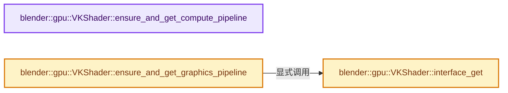
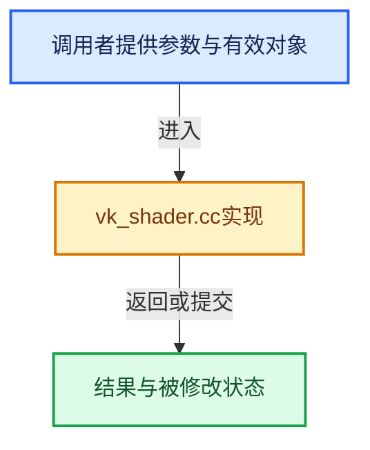

# 实现依赖专题：source/blender/gpu/vulkan/vk_shader.cc

[方向导航](README.md) · [符号索引](../%E7%AC%A6%E5%8F%B7%E4%BE%9D%E8%B5%96%E4%B8%8E%E5%AE%9E%E7%8E%B0%E7%B4%A2%E5%BC%95.md)

本专题从正文实际调用进入，集中保存共享实现。函数有稳定锚点，可从调用处直接跳到对应完整函数；递归与互相调用通过回链组织。

## 本文件的实现关系






## 完整成员与函数实现

<a id="f-401fc1345db1ecf3"></a>

### `blender::gpu::VKShader::ensure_and_get_compute_pipeline`

实现位置：[source/blender/gpu/vulkan/vk_shader.cc](../../../../../source/blender/gpu/vulkan/vk_shader.cc) · L1319—L1345。

接口参数：

- `const shader::SpecializationConstants &constants_state`

**教学注释版**

<!-- annotated:40800f62a14318 -->

```cpp
VkPipeline VKShader::ensure_and_get_compute_pipeline(
    const shader::SpecializationConstants &constants_state)
{
  BLI_assert(is_compute_shader_);
  BLI_assert(compute_module.vk_shader_module != VK_NULL_HANDLE);
  BLI_assert(vk_pipeline_layout != VK_NULL_HANDLE);

  /* Early exit when no specialization constants are used and the vk_pipeline_base_ is already
   * valid. This would handle most cases. */
  if (constants_state.values.is_empty() && vk_pipeline_base_ != VK_NULL_HANDLE) {
    return vk_pipeline_base_;
  }

  VKComputeInfo compute_info = {};
  compute_info.specialization_constants.extend(constants_state.values);
  compute_info.vk_shader_module = compute_module.vk_shader_module;
  compute_info.vk_pipeline_layout = vk_pipeline_layout;

  VKDevice &device = VKBackend::get().device;
  /* Store result in local variable to ensure thread safety. */
  VkPipeline vk_pipeline = device.pipelines.get_or_create_compute_pipeline(
      compute_info, is_static_shader_, vk_pipeline_base_, name_get());
  if (vk_pipeline_base_ == VK_NULL_HANDLE) {
    vk_pipeline_base_ = vk_pipeline;
  }
  return vk_pipeline;
}
```

<details>
<summary>核对原始源码：source/blender/gpu/vulkan/vk_shader.cc · L1319—L1345</summary>

<!-- original:40800f62a14318:source/blender/gpu/vulkan/vk_shader.cc:1319:1345 -->

```cpp
VkPipeline VKShader::ensure_and_get_compute_pipeline(
    const shader::SpecializationConstants &constants_state)
{
  BLI_assert(is_compute_shader_);
  BLI_assert(compute_module.vk_shader_module != VK_NULL_HANDLE);
  BLI_assert(vk_pipeline_layout != VK_NULL_HANDLE);

  /* Early exit when no specialization constants are used and the vk_pipeline_base_ is already
   * valid. This would handle most cases. */
  if (constants_state.values.is_empty() && vk_pipeline_base_ != VK_NULL_HANDLE) {
    return vk_pipeline_base_;
  }

  VKComputeInfo compute_info = {};
  compute_info.specialization_constants.extend(constants_state.values);
  compute_info.vk_shader_module = compute_module.vk_shader_module;
  compute_info.vk_pipeline_layout = vk_pipeline_layout;

  VKDevice &device = VKBackend::get().device;
  /* Store result in local variable to ensure thread safety. */
  VkPipeline vk_pipeline = device.pipelines.get_or_create_compute_pipeline(
      compute_info, is_static_shader_, vk_pipeline_base_, name_get());
  if (vk_pipeline_base_ == VK_NULL_HANDLE) {
    vk_pipeline_base_ = vk_pipeline;
  }
  return vk_pipeline;
}
```

</details>

**沿实际写入检查状态**

- `compute_info.vk_shader_module = compute_module.vk_shader_module;`
- `compute_info.vk_pipeline_layout = vk_pipeline_layout;`
- `vk_pipeline_base_ = vk_pipeline;`

**结果出口**

- `return vk_pipeline_base_;`
- `return vk_pipeline;`

**继续追踪实现**

- `BLI_assert` → [BLI_assert · L48](../01-%E5%9F%BA%E7%A1%80%E5%AE%B9%E5%99%A8%E4%B8%8E%E7%8E%B0%E4%BB%A3CPP/%E4%BE%9D%E8%B5%96-BLI_assert-cc98e8.md#m-57a88495704d)；[BLI_assert · L63](../01-%E5%9F%BA%E7%A1%80%E5%AE%B9%E5%99%A8%E4%B8%8E%E7%8E%B0%E4%BB%A3CPP/%E4%BE%9D%E8%B5%96-BLI_assert-cc98e8.md#m-d07050020cb5)。宏定义由构建条件选择。
- `constants_state.values.is_empty` → [调用协议](../%E6%A8%A1%E6%9D%BF%E5%AE%8F%E4%B8%8E%E5%8A%A8%E6%80%81%E5%88%86%E6%B4%BE%E5%8D%8F%E8%AE%AE.md)：接收对象类型依赖auto、返回值或模板实例；不按同名猜测目标。调用位置L1328。
- `compute_info.specialization_constants.extend` → [调用协议](../%E6%A8%A1%E6%9D%BF%E5%AE%8F%E4%B8%8E%E5%8A%A8%E6%80%81%E5%88%86%E6%B4%BE%E5%8D%8F%E8%AE%AE.md)：接收对象类型依赖auto、返回值或模板实例；不按同名猜测目标。调用位置L1333。
- `VKBackend::get` → [blender::gpu::VKBackend::get · L106](%E4%BE%9D%E8%B5%96-vk_backend-742e37.md#f-9b0f846ed492f55f)。
- `device.pipelines.get_or_create_compute_pipeline` → [调用协议](../%E6%A8%A1%E6%9D%BF%E5%AE%8F%E4%B8%8E%E5%8A%A8%E6%80%81%E5%88%86%E6%B4%BE%E5%8D%8F%E8%AE%AE.md)：接收对象类型依赖auto、返回值或模板实例；不按同名猜测目标。调用位置L1339。
- `name_get` → [调用协议](../%E6%A8%A1%E6%9D%BF%E5%AE%8F%E4%B8%8E%E5%8A%A8%E6%80%81%E5%88%86%E6%B4%BE%E5%8D%8F%E8%AE%AE.md)：函数指针、局部可调用对象或未展开的宏；必须结合调用者环境。调用位置L1340。

<a id="f-ee6c035426791ddb"></a>

### `blender::gpu::VKShader::ensure_and_get_graphics_pipeline`

实现位置：[source/blender/gpu/vulkan/vk_shader.cc](../../../../../source/blender/gpu/vulkan/vk_shader.cc) · L1413—L1504。

接口参数：

- `GPUPrimType primitive`
- `VKVertexInputDescriptionPool::Key vertex_input_description_key`
- `VKStateManager &state_manager`
- `const VKFrameBuffer &framebuffer`
- `SpecializationConstants &constants_state`

**教学注释版**

<!-- annotated:d54e79e01d1983 -->

```cpp
VkPipeline VKShader::ensure_and_get_graphics_pipeline(
    GPUPrimType primitive,
    VKVertexInputDescriptionPool::Key vertex_input_description_key,
    VKStateManager &state_manager,
    const VKFrameBuffer &framebuffer,
    SpecializationConstants &constants_state)
{
  VKDevice &device = VKBackend::get().device;
  const VKExtensions &extensions = device.extensions_get();

  BLI_assert(!is_compute_shader_);
  BLI_assert_msg(
      primitive != GPU_PRIM_POINTS || interface_get().is_point_shader(),
      "GPU_PRIM_POINTS is used with a shader that doesn't set point size before "
      "drawing fragments. Calling code should be adapted to use a shader that sets the "
      "gl_PointSize before entering the fragment stage. For example `GPU_SHADER_3D_POINT_*`.");

  const VkPrimitiveTopology vk_topology = to_vk_primitive_topology(primitive);
  const VkFormat depth_attachment_format = framebuffer.depth_attachment_format_get();
  const VkFormat stencil_attachment_format = framebuffer.stencil_attachment_format_get();

  VKGraphicsInfo graphics_info = {};
  graphics_info.vertex_in.vk_topology = vk_topology;
  /* When vertex input dynamic state is enabled the actual vertex input doesn't matter. We use an
   * invalid key to ensure that same hash-keys are constructed for compatible graphics infos and
   * incorrect usages would still assert.*/
  graphics_info.vertex_in.vertex_input_key = extensions.vertex_input_dynamic_state ?
                                                 VKVertexInputDescriptionPool::invalid_key :
                                                 vertex_input_description_key;

  graphics_info.shaders.vk_vertex_module = vertex_module.vk_shader_module;
  graphics_info.shaders.vk_geometry_module = geometry_module.vk_shader_module;
  graphics_info.shaders.vk_fragment_module = fragment_module.vk_shader_module;
  graphics_info.shaders.vk_pipeline_layout = vk_pipeline_layout;
  graphics_info.shaders.vk_topology = vk_topology;
  graphics_info.shaders.state = state_manager.state;
  graphics_info.shaders.viewport_count = framebuffer.viewport_size();
  if (device.workarounds_get().static_viewport_scissor) {
    framebuffer.vk_viewports_append(graphics_info.shaders.viewports);
    framebuffer.vk_render_areas_append(graphics_info.shaders.scissors);
  }
  graphics_info.shaders.specialization_constants.extend(constants_state.values);
  graphics_info.shaders.has_depth = depth_attachment_format != VK_FORMAT_UNDEFINED;
  graphics_info.shaders.has_stencil = stencil_attachment_format != VK_FORMAT_UNDEFINED;
  graphics_info.shaders.max_input_attachment_index = max_input_attachment_index_;
  /* Cleanup state to increase cache hits. */
  if (!graphics_info.shaders.has_stencil || state_manager.state.stencil_test == GPU_STENCIL_NONE) {
    graphics_info.shaders.state.stencil_test = GPU_STENCIL_NONE;
    graphics_info.shaders.state.stencil_op = GPU_STENCIL_OP_NONE;
  }
  if (extensions.extended_dynamic_state) {
    graphics_info.shaders.state.invert_facing = false;
  }

  graphics_info.fragment_out.depth_attachment_format = depth_attachment_format;
  graphics_info.fragment_out.stencil_attachment_format = stencil_attachment_format;
  graphics_info.fragment_out.color_attachment_formats.extend(
      framebuffer.color_attachment_formats_get());
  graphics_info.fragment_out.state = graphics_info.shaders.state;
  graphics_info.shaders.color_attachment_count = uint32_t(
      graphics_info.fragment_out.color_attachment_formats.size());

  bool pipeline_created = false;
  VkPipeline vk_pipeline = device.pipelines.get_or_create_graphics_pipeline(
      graphics_info, is_static_shader_, vk_pipeline_base_, name_get(), pipeline_created);

  UNUSED_VARS_NDEBUG(pipeline_created);
#ifndef NDEBUG
  if (has_precompiled_pipelines_ && pipeline_created) {
    /* Sanity check: Used to detect mismatches between shader create info states and actual used
     * pipeline states.
     *
     * NOTE: This could trigger false positives where input attributes are just different between
     * objects that require a new pipeline state. */
    CLOG_INFO(&LOG,
              "Pipeline states were compiled for `%s`, however a pipeline state triggered a new "
              "pipeline compilation.",
              name_get().c_str());
    if (G.debug & G_DEBUG_GPU) {
      CLOG_DEBUG(
          &LOG, "Missing pipeline state:\n%s", graphics_info.pipeline_info_source().c_str());
    }
    const VKContext &context = *VKContext::get();
    BLI_assert(!context.debug_pipeline_creation);
  }
#endif

  if (vk_pipeline_base_ == VK_NULL_HANDLE) {
    vk_pipeline_base_ = vk_pipeline;
  }
  return vk_pipeline;
}
```

<details>
<summary>核对原始源码：source/blender/gpu/vulkan/vk_shader.cc · L1413—L1504</summary>

<!-- original:d54e79e01d1983:source/blender/gpu/vulkan/vk_shader.cc:1413:1504 -->

```cpp
VkPipeline VKShader::ensure_and_get_graphics_pipeline(
    GPUPrimType primitive,
    VKVertexInputDescriptionPool::Key vertex_input_description_key,
    VKStateManager &state_manager,
    const VKFrameBuffer &framebuffer,
    SpecializationConstants &constants_state)
{
  VKDevice &device = VKBackend::get().device;
  const VKExtensions &extensions = device.extensions_get();

  BLI_assert(!is_compute_shader_);
  BLI_assert_msg(
      primitive != GPU_PRIM_POINTS || interface_get().is_point_shader(),
      "GPU_PRIM_POINTS is used with a shader that doesn't set point size before "
      "drawing fragments. Calling code should be adapted to use a shader that sets the "
      "gl_PointSize before entering the fragment stage. For example `GPU_SHADER_3D_POINT_*`.");

  const VkPrimitiveTopology vk_topology = to_vk_primitive_topology(primitive);
  const VkFormat depth_attachment_format = framebuffer.depth_attachment_format_get();
  const VkFormat stencil_attachment_format = framebuffer.stencil_attachment_format_get();

  VKGraphicsInfo graphics_info = {};
  graphics_info.vertex_in.vk_topology = vk_topology;
  /* When vertex input dynamic state is enabled the actual vertex input doesn't matter. We use an
   * invalid key to ensure that same hash-keys are constructed for compatible graphics infos and
   * incorrect usages would still assert.*/
  graphics_info.vertex_in.vertex_input_key = extensions.vertex_input_dynamic_state ?
                                                 VKVertexInputDescriptionPool::invalid_key :
                                                 vertex_input_description_key;

  graphics_info.shaders.vk_vertex_module = vertex_module.vk_shader_module;
  graphics_info.shaders.vk_geometry_module = geometry_module.vk_shader_module;
  graphics_info.shaders.vk_fragment_module = fragment_module.vk_shader_module;
  graphics_info.shaders.vk_pipeline_layout = vk_pipeline_layout;
  graphics_info.shaders.vk_topology = vk_topology;
  graphics_info.shaders.state = state_manager.state;
  graphics_info.shaders.viewport_count = framebuffer.viewport_size();
  if (device.workarounds_get().static_viewport_scissor) {
    framebuffer.vk_viewports_append(graphics_info.shaders.viewports);
    framebuffer.vk_render_areas_append(graphics_info.shaders.scissors);
  }
  graphics_info.shaders.specialization_constants.extend(constants_state.values);
  graphics_info.shaders.has_depth = depth_attachment_format != VK_FORMAT_UNDEFINED;
  graphics_info.shaders.has_stencil = stencil_attachment_format != VK_FORMAT_UNDEFINED;
  graphics_info.shaders.max_input_attachment_index = max_input_attachment_index_;
  /* Cleanup state to increase cache hits. */
  if (!graphics_info.shaders.has_stencil || state_manager.state.stencil_test == GPU_STENCIL_NONE) {
    graphics_info.shaders.state.stencil_test = GPU_STENCIL_NONE;
    graphics_info.shaders.state.stencil_op = GPU_STENCIL_OP_NONE;
  }
  if (extensions.extended_dynamic_state) {
    graphics_info.shaders.state.invert_facing = false;
  }

  graphics_info.fragment_out.depth_attachment_format = depth_attachment_format;
  graphics_info.fragment_out.stencil_attachment_format = stencil_attachment_format;
  graphics_info.fragment_out.color_attachment_formats.extend(
      framebuffer.color_attachment_formats_get());
  graphics_info.fragment_out.state = graphics_info.shaders.state;
  graphics_info.shaders.color_attachment_count = uint32_t(
      graphics_info.fragment_out.color_attachment_formats.size());

  bool pipeline_created = false;
  VkPipeline vk_pipeline = device.pipelines.get_or_create_graphics_pipeline(
      graphics_info, is_static_shader_, vk_pipeline_base_, name_get(), pipeline_created);

  UNUSED_VARS_NDEBUG(pipeline_created);
#ifndef NDEBUG
  if (has_precompiled_pipelines_ && pipeline_created) {
    /* Sanity check: Used to detect mismatches between shader create info states and actual used
     * pipeline states.
     *
     * NOTE: This could trigger false positives where input attributes are just different between
     * objects that require a new pipeline state. */
    CLOG_INFO(&LOG,
              "Pipeline states were compiled for `%s`, however a pipeline state triggered a new "
              "pipeline compilation.",
              name_get().c_str());
    if (G.debug & G_DEBUG_GPU) {
      CLOG_DEBUG(
          &LOG, "Missing pipeline state:\n%s", graphics_info.pipeline_info_source().c_str());
    }
    const VKContext &context = *VKContext::get();
    BLI_assert(!context.debug_pipeline_creation);
  }
#endif

  if (vk_pipeline_base_ == VK_NULL_HANDLE) {
    vk_pipeline_base_ = vk_pipeline;
  }
  return vk_pipeline;
}
```

</details>

**沿实际写入检查状态**

- `graphics_info.vertex_in.vk_topology = vk_topology;`
- `graphics_info.vertex_in.vertex_input_key = extensions.vertex_input_dynamic_state ?`
- `graphics_info.shaders.vk_vertex_module = vertex_module.vk_shader_module;`
- `graphics_info.shaders.vk_geometry_module = geometry_module.vk_shader_module;`
- `graphics_info.shaders.vk_fragment_module = fragment_module.vk_shader_module;`
- `graphics_info.shaders.vk_pipeline_layout = vk_pipeline_layout;`
- `graphics_info.shaders.vk_topology = vk_topology;`
- `graphics_info.shaders.state = state_manager.state;`
- `graphics_info.shaders.viewport_count = framebuffer.viewport_size();`
- `graphics_info.shaders.has_depth = depth_attachment_format != VK_FORMAT_UNDEFINED;`
- `graphics_info.shaders.has_stencil = stencil_attachment_format != VK_FORMAT_UNDEFINED;`
- `graphics_info.shaders.max_input_attachment_index = max_input_attachment_index_;`
- `graphics_info.shaders.state.stencil_test = GPU_STENCIL_NONE;`
- `graphics_info.shaders.state.stencil_op = GPU_STENCIL_OP_NONE;`
- `graphics_info.shaders.state.invert_facing = false;`
- `graphics_info.fragment_out.depth_attachment_format = depth_attachment_format;`
- `graphics_info.fragment_out.stencil_attachment_format = stencil_attachment_format;`
- `graphics_info.fragment_out.state = graphics_info.shaders.state;`
- `graphics_info.shaders.color_attachment_count = uint32_t(`
- `vk_pipeline_base_ = vk_pipeline;`

**结果出口**

- `return vk_pipeline;`

**继续追踪实现**

- `VKBackend::get` → [blender::gpu::VKBackend::get · L106](%E4%BE%9D%E8%B5%96-vk_backend-742e37.md#f-9b0f846ed492f55f)。
- `device.extensions_get` → [blender::gpu::VKDevice::extensions_get · L393](%E4%BE%9D%E8%B5%96-vk_device-7cec76.md#f-b9006d1d05b9eba2)。
- `BLI_assert` → [BLI_assert · L48](../01-%E5%9F%BA%E7%A1%80%E5%AE%B9%E5%99%A8%E4%B8%8E%E7%8E%B0%E4%BB%A3CPP/%E4%BE%9D%E8%B5%96-BLI_assert-cc98e8.md#m-57a88495704d)；[BLI_assert · L63](../01-%E5%9F%BA%E7%A1%80%E5%AE%B9%E5%99%A8%E4%B8%8E%E7%8E%B0%E4%BB%A3CPP/%E4%BE%9D%E8%B5%96-BLI_assert-cc98e8.md#m-d07050020cb5)。宏定义由构建条件选择。
- `BLI_assert_msg` → [BLI_assert_msg · L55](../01-%E5%9F%BA%E7%A1%80%E5%AE%B9%E5%99%A8%E4%B8%8E%E7%8E%B0%E4%BB%A3CPP/%E4%BE%9D%E8%B5%96-BLI_assert-cc98e8.md#m-695eed20dceb)；[BLI_assert_msg · L64](../01-%E5%9F%BA%E7%A1%80%E5%AE%B9%E5%99%A8%E4%B8%8E%E7%8E%B0%E4%BB%A3CPP/%E4%BE%9D%E8%B5%96-BLI_assert-cc98e8.md#m-7de5563de4db)。宏定义由构建条件选择。
- `interface_get().is_point_shader` → [调用协议](../%E6%A8%A1%E6%9D%BF%E5%AE%8F%E4%B8%8E%E5%8A%A8%E6%80%81%E5%88%86%E6%B4%BE%E5%8D%8F%E8%AE%AE.md)：接收对象类型依赖auto、返回值或模板实例；不按同名猜测目标。调用位置L1425。
- `interface_get` → [blender::gpu::VKShader::interface_get · L1506](%E4%BE%9D%E8%B5%96-vk_shader-069c7e.md#f-8447a0d8fe619074)。
- `to_vk_primitive_topology` → [blender::gpu::to_vk_primitive_topology · L666](%E4%BE%9D%E8%B5%96-vk_common-ee0ea7.md#f-b49075ebfde69ace)。
- `framebuffer.depth_attachment_format_get` → [blender::gpu::VKFrameBuffer::depth_attachment_format_get · L776](%E4%BE%9D%E8%B5%96-vk_framebuffer-84f42c.md#f-641153c96d72a098)。
- `framebuffer.stencil_attachment_format_get` → [blender::gpu::VKFrameBuffer::stencil_attachment_format_get · L780](%E4%BE%9D%E8%B5%96-vk_framebuffer-84f42c.md#f-48ba25af8369f83d)。
- `framebuffer.viewport_size` → [blender::gpu::VKFrameBuffer::viewport_size · L72](%E4%BE%9D%E8%B5%96-vk_framebuffer-84f42c.md#f-d4e11305f8edacd3)。
- `device.workarounds_get` → [blender::gpu::VKDevice::workarounds_get · L389](%E4%BE%9D%E8%B5%96-vk_device-7cec76.md#f-158c325b16f61407)。
- `framebuffer.vk_viewports_append` → [blender::gpu::VKFrameBuffer::vk_viewports_append · L77](%E4%BE%9D%E8%B5%96-vk_framebuffer-84f42c.md#f-ef171f65ca8a2454)。
- `framebuffer.vk_render_areas_append` → [blender::gpu::VKFrameBuffer::vk_render_areas_append · L118](%E4%BE%9D%E8%B5%96-vk_framebuffer-84f42c.md#f-56f33668d9a68929)。
- `graphics_info.shaders.specialization_constants.extend` → [调用协议](../%E6%A8%A1%E6%9D%BF%E5%AE%8F%E4%B8%8E%E5%8A%A8%E6%80%81%E5%88%86%E6%B4%BE%E5%8D%8F%E8%AE%AE.md)：接收对象类型依赖auto、返回值或模板实例；不按同名猜测目标。调用位置L1454。
- `graphics_info.fragment_out.color_attachment_formats.extend` → [调用协议](../%E6%A8%A1%E6%9D%BF%E5%AE%8F%E4%B8%8E%E5%8A%A8%E6%80%81%E5%88%86%E6%B4%BE%E5%8D%8F%E8%AE%AE.md)：接收对象类型依赖auto、返回值或模板实例；不按同名猜测目标。调用位置L1469。
- `framebuffer.color_attachment_formats_get` → [blender::gpu::VKFrameBuffer::color_attachment_formats_get · L784](%E4%BE%9D%E8%B5%96-vk_framebuffer-84f42c.md#f-6c4f7a899e9bc60d)。
- `graphics_info.fragment_out.color_attachment_formats.size` → [调用协议](../%E6%A8%A1%E6%9D%BF%E5%AE%8F%E4%B8%8E%E5%8A%A8%E6%80%81%E5%88%86%E6%B4%BE%E5%8D%8F%E8%AE%AE.md)：接收对象类型依赖auto、返回值或模板实例；不按同名猜测目标。调用位置L1473。
- `device.pipelines.get_or_create_graphics_pipeline` → [调用协议](../%E6%A8%A1%E6%9D%BF%E5%AE%8F%E4%B8%8E%E5%8A%A8%E6%80%81%E5%88%86%E6%B4%BE%E5%8D%8F%E8%AE%AE.md)：接收对象类型依赖auto、返回值或模板实例；不按同名猜测目标。调用位置L1476。
- `name_get` → [调用协议](../%E6%A8%A1%E6%9D%BF%E5%AE%8F%E4%B8%8E%E5%8A%A8%E6%80%81%E5%88%86%E6%B4%BE%E5%8D%8F%E8%AE%AE.md)：函数指针、局部可调用对象或未展开的宏；必须结合调用者环境。调用位置L1477。
- `UNUSED_VARS_NDEBUG` → [UNUSED_VARS_NDEBUG · L526](../01-%E5%9F%BA%E7%A1%80%E5%AE%B9%E5%99%A8%E4%B8%8E%E7%8E%B0%E4%BB%A3CPP/%E4%BE%9D%E8%B5%96-BLI_utildefines-293a0a.md#m-fea439f7d366)；[UNUSED_VARS_NDEBUG · L528](../01-%E5%9F%BA%E7%A1%80%E5%AE%B9%E5%99%A8%E4%B8%8E%E7%8E%B0%E4%BB%A3CPP/%E4%BE%9D%E8%B5%96-BLI_utildefines-293a0a.md#m-a8f8cfac06c0)。宏定义由构建条件选择。
- `CLOG_INFO` → [CLOG_INFO · L190](%E4%BE%9D%E8%B5%96-CLG_log-e9051b.md#m-f8b5efdfcc0f)。宏定义由构建条件选择。
- `name_get().c_str` → [调用协议](../%E6%A8%A1%E6%9D%BF%E5%AE%8F%E4%B8%8E%E5%8A%A8%E6%80%81%E5%88%86%E6%B4%BE%E5%8D%8F%E8%AE%AE.md)：接收对象类型依赖auto、返回值或模板实例；不按同名猜测目标。调用位置L1490。
- `CLOG_DEBUG` → [CLOG_DEBUG · L191](%E4%BE%9D%E8%B5%96-CLG_log-e9051b.md#m-e062f5f17675)。宏定义由构建条件选择。
- `graphics_info.pipeline_info_source().c_str` → [调用协议](../%E6%A8%A1%E6%9D%BF%E5%AE%8F%E4%B8%8E%E5%8A%A8%E6%80%81%E5%88%86%E6%B4%BE%E5%8D%8F%E8%AE%AE.md)：接收对象类型依赖auto、返回值或模板实例；不按同名猜测目标。调用位置L1493。
- `graphics_info.pipeline_info_source` → [blender::gpu::VKGraphicsInfo::pipeline_info_source · L255](%E4%BE%9D%E8%B5%96-vk_pipeline_pool-7964b4.md#f-82a47663d2b27b7d)。
- `VKContext::get` → [blender::gpu::VKContext::get · L148](%E4%BE%9D%E8%B5%96-vk_context-f02d3a.md#f-378401ce251eda2a)。

<a id="f-8447a0d8fe619074"></a>

### `blender::gpu::VKShader::interface_get`

实现位置：[source/blender/gpu/vulkan/vk_shader.cc](../../../../../source/blender/gpu/vulkan/vk_shader.cc) · L1506—L1512。

**教学注释版**

<!-- annotated:debda2edca5463 -->

```cpp
const VKShaderInterface &VKShader::interface_get() const
{
  BLI_assert_msg(interface != nullptr,
                 "Interface can be accessed after the VKShader has been initialized "
                 "`VKShader::init`");
  return *static_cast<const VKShaderInterface *>(interface);
}
```

<details>
<summary>核对原始源码：source/blender/gpu/vulkan/vk_shader.cc · L1506—L1512</summary>

<!-- original:debda2edca5463:source/blender/gpu/vulkan/vk_shader.cc:1506:1512 -->

```cpp
const VKShaderInterface &VKShader::interface_get() const
{
  BLI_assert_msg(interface != nullptr,
                 "Interface can be accessed after the VKShader has been initialized "
                 "`VKShader::init`");
  return *static_cast<const VKShaderInterface *>(interface);
}
```

</details>

**结果出口**

- `return *static_cast<const VKShaderInterface *>(interface);`

**继续追踪实现**

- `BLI_assert_msg` → [BLI_assert_msg · L55](../01-%E5%9F%BA%E7%A1%80%E5%AE%B9%E5%99%A8%E4%B8%8E%E7%8E%B0%E4%BB%A3CPP/%E4%BE%9D%E8%B5%96-BLI_assert-cc98e8.md#m-695eed20dceb)；[BLI_assert_msg · L64](../01-%E5%9F%BA%E7%A1%80%E5%AE%B9%E5%99%A8%E4%B8%8E%E7%8E%B0%E4%BB%A3CPP/%E4%BE%9D%E8%B5%96-BLI_assert-cc98e8.md#m-7de5563de4db)。宏定义由构建条件选择。
