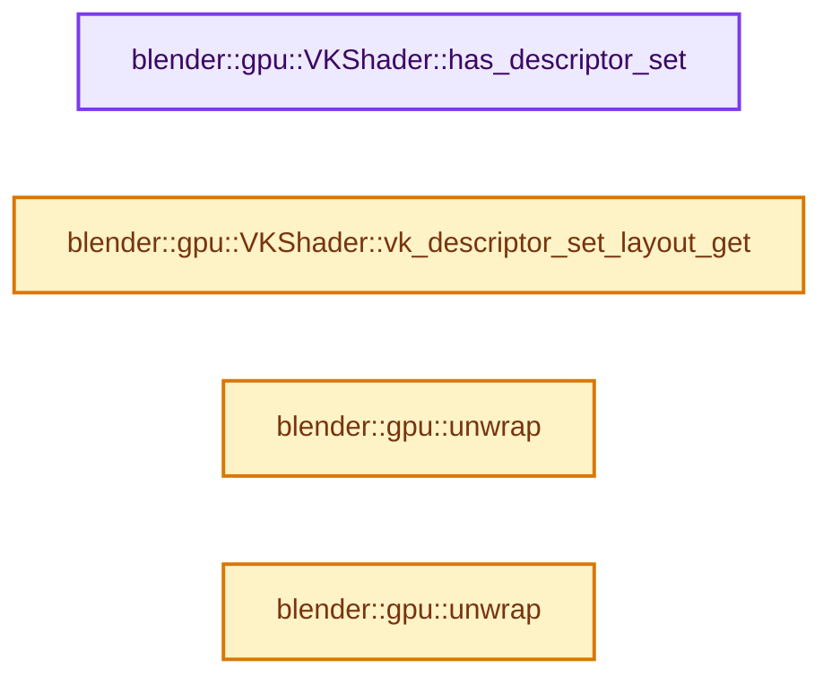
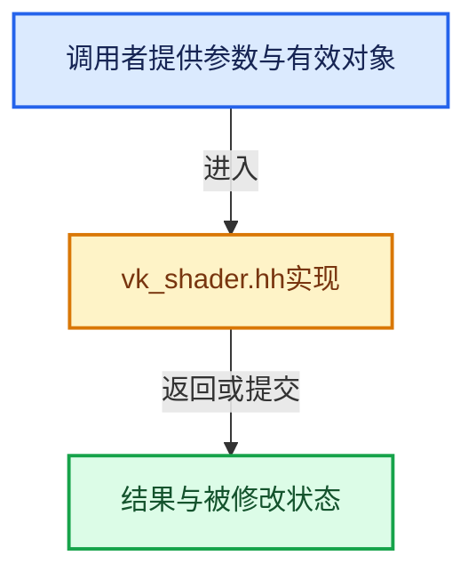

# 实现依赖专题：source/blender/gpu/vulkan/vk_shader.hh

[方向导航](README.md) · [符号索引](../%E7%AC%A6%E5%8F%B7%E4%BE%9D%E8%B5%96%E4%B8%8E%E5%AE%9E%E7%8E%B0%E7%B4%A2%E5%BC%95.md)

本专题从正文实际调用进入，集中保存共享实现。函数有稳定锚点，可从调用处直接跳到对应完整函数；递归与互相调用通过回链组织。

## 本文件的实现关系






## 完整成员与函数实现

<a id="f-5cf408c70620d6a6"></a>

### `blender::gpu::VKShader::has_descriptor_set`

实现位置：[source/blender/gpu/vulkan/vk_shader.hh](../../../../../source/blender/gpu/vulkan/vk_shader.hh) · L126—L129。

**教学注释版**

<!-- annotated:1f96d82487cdd5 -->

```cpp
  bool has_descriptor_set() const
  {
    return vk_descriptor_set_layout_ != VK_NULL_HANDLE;
  }
```

<details>
<summary>核对原始源码：source/blender/gpu/vulkan/vk_shader.hh · L126—L129</summary>

<!-- original:1f96d82487cdd5:source/blender/gpu/vulkan/vk_shader.hh:126:129 -->

```cpp
  bool has_descriptor_set() const
  {
    return vk_descriptor_set_layout_ != VK_NULL_HANDLE;
  }
```

</details>

**结果出口**

- `return vk_descriptor_set_layout_ != VK_NULL_HANDLE;`

**继续追踪实现**

本实现没有需要继续展开的显式调用；检查返回表达式、对象转换和调用者前置条件。

<a id="f-84a5769a27554a1f"></a>

### `blender::gpu::VKShader::vk_descriptor_set_layout_get`

实现位置：[source/blender/gpu/vulkan/vk_shader.hh](../../../../../source/blender/gpu/vulkan/vk_shader.hh) · L131—L134。

**教学注释版**

<!-- annotated:7a7b98c9939a61 -->

```cpp
  VkDescriptorSetLayout vk_descriptor_set_layout_get() const
  {
    return vk_descriptor_set_layout_;
  }
```

<details>
<summary>核对原始源码：source/blender/gpu/vulkan/vk_shader.hh · L131—L134</summary>

<!-- original:7a7b98c9939a61:source/blender/gpu/vulkan/vk_shader.hh:131:134 -->

```cpp
  VkDescriptorSetLayout vk_descriptor_set_layout_get() const
  {
    return vk_descriptor_set_layout_;
  }
```

</details>

**结果出口**

- `return vk_descriptor_set_layout_;`

**继续追踪实现**

本实现没有需要继续展开的显式调用；检查返回表达式、对象转换和调用者前置条件。

<a id="f-94d260439993a24d"></a>

### `blender::gpu::unwrap`

实现位置：[source/blender/gpu/vulkan/vk_shader.hh](../../../../../source/blender/gpu/vulkan/vk_shader.hh) · L158—L161。

接口参数：

- `Shader &shader`

**教学注释版**

<!-- annotated:b805d5c539b611 -->

```cpp
static inline VKShader &unwrap(Shader &shader)
{
  return static_cast<VKShader &>(shader);
}
```

<details>
<summary>核对原始源码：source/blender/gpu/vulkan/vk_shader.hh · L158—L161</summary>

<!-- original:b805d5c539b611:source/blender/gpu/vulkan/vk_shader.hh:158:161 -->

```cpp
static inline VKShader &unwrap(Shader &shader)
{
  return static_cast<VKShader &>(shader);
}
```

</details>

**结果出口**

- `return static_cast<VKShader &>(shader);`

**继续追踪实现**

本实现没有需要继续展开的显式调用；检查返回表达式、对象转换和调用者前置条件。

<a id="f-6cafb188fd34255d"></a>

### `blender::gpu::unwrap`

实现位置：[source/blender/gpu/vulkan/vk_shader.hh](../../../../../source/blender/gpu/vulkan/vk_shader.hh) · L163—L166。

接口参数：

- `Shader *shader`

**教学注释版**

<!-- annotated:fe75cc3a9b1918 -->

```cpp
static inline VKShader *unwrap(Shader *shader)
{
  return static_cast<VKShader *>(shader);
}
```

<details>
<summary>核对原始源码：source/blender/gpu/vulkan/vk_shader.hh · L163—L166</summary>

<!-- original:fe75cc3a9b1918:source/blender/gpu/vulkan/vk_shader.hh:163:166 -->

```cpp
static inline VKShader *unwrap(Shader *shader)
{
  return static_cast<VKShader *>(shader);
}
```

</details>

**结果出口**

- `return static_cast<VKShader *>(shader);`

**继续追踪实现**

本实现没有需要继续展开的显式调用；检查返回表达式、对象转换和调用者前置条件。
