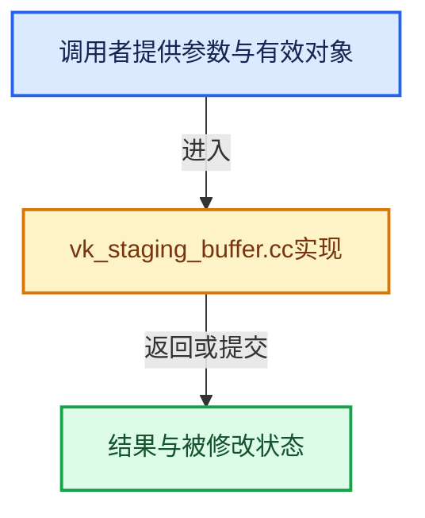

# 实现依赖专题：source/blender/gpu/vulkan/vk_staging_buffer.cc

[方向导航](README.md) · [符号索引](../%E7%AC%A6%E5%8F%B7%E4%BE%9D%E8%B5%96%E4%B8%8E%E5%AE%9E%E7%8E%B0%E7%B4%A2%E5%BC%95.md)

本专题从正文实际调用进入，集中保存共享实现。函数有稳定锚点，可从调用处直接跳到对应完整函数；递归与互相调用通过回链组织。

## 本文件的实现关系





## 完整成员与函数实现

<a id="f-3f8ba3ac2523c07a"></a>

### `blender::gpu::VKStagingBuffer::copy_to_device`

实现位置：[source/blender/gpu/vulkan/vk_staging_buffer.cc](../../../../../source/blender/gpu/vulkan/vk_staging_buffer.cc) · L41—L51。

接口参数：

- `VKContext &context`

**教学注释版**

<!-- annotated:a5047628daede7 -->

```cpp
void VKStagingBuffer::copy_to_device(VKContext &context)
{
  BLI_assert(host_buffer_.is_allocated() && host_buffer_.is_mapped());
  render_graph::VKCopyBufferNode::CreateInfo copy_buffer = {};
  copy_buffer.src_buffer = host_buffer_.resource();
  copy_buffer.dst_buffer = device_buffer_.resource();
  copy_buffer.region.dstOffset = device_buffer_offset_;
  copy_buffer.region.size = region_size_;

  context.render_graph().add_node(copy_buffer);
}
```

<details>
<summary>核对原始源码：source/blender/gpu/vulkan/vk_staging_buffer.cc · L41—L51</summary>

<!-- original:a5047628daede7:source/blender/gpu/vulkan/vk_staging_buffer.cc:41:51 -->

```cpp
void VKStagingBuffer::copy_to_device(VKContext &context)
{
  BLI_assert(host_buffer_.is_allocated() && host_buffer_.is_mapped());
  render_graph::VKCopyBufferNode::CreateInfo copy_buffer = {};
  copy_buffer.src_buffer = host_buffer_.resource();
  copy_buffer.dst_buffer = device_buffer_.resource();
  copy_buffer.region.dstOffset = device_buffer_offset_;
  copy_buffer.region.size = region_size_;

  context.render_graph().add_node(copy_buffer);
}
```

</details>

**沿实际写入检查状态**

- `copy_buffer.src_buffer = host_buffer_.resource();`
- `copy_buffer.dst_buffer = device_buffer_.resource();`
- `copy_buffer.region.dstOffset = device_buffer_offset_;`
- `copy_buffer.region.size = region_size_;`

**继续追踪实现**

- `BLI_assert` → [BLI_assert · L48](../01-%E5%9F%BA%E7%A1%80%E5%AE%B9%E5%99%A8%E4%B8%8E%E7%8E%B0%E4%BB%A3CPP/%E4%BE%9D%E8%B5%96-BLI_assert-cc98e8.md#m-57a88495704d)；[BLI_assert · L63](../01-%E5%9F%BA%E7%A1%80%E5%AE%B9%E5%99%A8%E4%B8%8E%E7%8E%B0%E4%BB%A3CPP/%E4%BE%9D%E8%B5%96-BLI_assert-cc98e8.md#m-d07050020cb5)。宏定义由构建条件选择。
- `host_buffer_.is_allocated` → [调用协议](../%E6%A8%A1%E6%9D%BF%E5%AE%8F%E4%B8%8E%E5%8A%A8%E6%80%81%E5%88%86%E6%B4%BE%E5%8D%8F%E8%AE%AE.md)：接收对象类型依赖auto、返回值或模板实例；不按同名猜测目标。调用位置L43。
- `host_buffer_.is_mapped` → [调用协议](../%E6%A8%A1%E6%9D%BF%E5%AE%8F%E4%B8%8E%E5%8A%A8%E6%80%81%E5%88%86%E6%B4%BE%E5%8D%8F%E8%AE%AE.md)：接收对象类型依赖auto、返回值或模板实例；不按同名猜测目标。调用位置L43。
- `host_buffer_.resource` → [调用协议](../%E6%A8%A1%E6%9D%BF%E5%AE%8F%E4%B8%8E%E5%8A%A8%E6%80%81%E5%88%86%E6%B4%BE%E5%8D%8F%E8%AE%AE.md)：接收对象类型依赖auto、返回值或模板实例；不按同名猜测目标。调用位置L45。
- `device_buffer_.resource` → [调用协议](../%E6%A8%A1%E6%9D%BF%E5%AE%8F%E4%B8%8E%E5%8A%A8%E6%80%81%E5%88%86%E6%B4%BE%E5%8D%8F%E8%AE%AE.md)：接收对象类型依赖auto、返回值或模板实例；不按同名猜测目标。调用位置L46。
- `context.render_graph().add_node` → [调用协议](../%E6%A8%A1%E6%9D%BF%E5%AE%8F%E4%B8%8E%E5%8A%A8%E6%80%81%E5%88%86%E6%B4%BE%E5%8D%8F%E8%AE%AE.md)：接收对象类型依赖auto、返回值或模板实例；不按同名猜测目标。调用位置L50。
- `context.render_graph` → [blender::gpu::VKContext::render_graph · L81](%E4%BE%9D%E8%B5%96-vk_context-f02d3a.md#f-3a4bb825ec5d0a82)；[blender::gpu::VKContext::render_graph · L85](%E4%BE%9D%E8%B5%96-vk_context-f02d3a.md#f-b3ac6949ba355b17)。同名重载需按实参类型选择。
