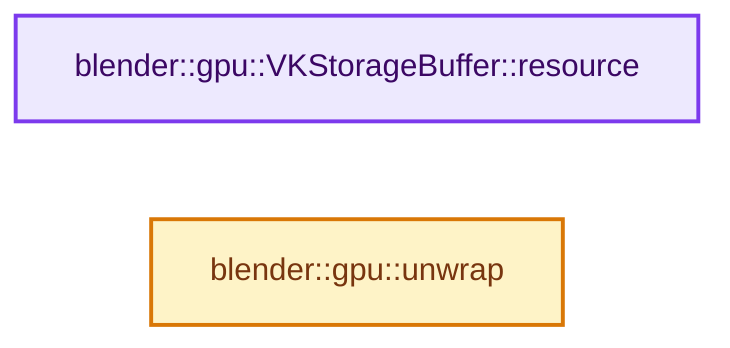

# 实现依赖专题：source/blender/gpu/vulkan/vk_storage_buffer.hh

[方向导航](README.md) · [符号索引](../%E7%AC%A6%E5%8F%B7%E4%BE%9D%E8%B5%96%E4%B8%8E%E5%AE%9E%E7%8E%B0%E7%B4%A2%E5%BC%95.md)

本专题从正文实际调用进入，集中保存共享实现。函数有稳定锚点，可从调用处直接跳到对应完整函数；递归与互相调用通过回链组织。

## 本文件的实现关系




## 完整成员与函数实现

<a id="f-a178c9ecf87cd515"></a>

### `blender::gpu::VKStorageBuffer::resource`

实现位置：[source/blender/gpu/vulkan/vk_storage_buffer.hh](../../../../../source/blender/gpu/vulkan/vk_storage_buffer.hh) · L47—L50。

**教学注释版**

<!-- annotated:b18c6f38ba2c54 -->

```cpp
  const VKResourceWithHandle<VkBuffer> &resource() const
  {
    return buffer_.resource();
  }
```

<details>
<summary>核对原始源码：source/blender/gpu/vulkan/vk_storage_buffer.hh · L47—L50</summary>

<!-- original:b18c6f38ba2c54:source/blender/gpu/vulkan/vk_storage_buffer.hh:47:50 -->

```cpp
  const VKResourceWithHandle<VkBuffer> &resource() const
  {
    return buffer_.resource();
  }
```

</details>

**结果出口**

- `return buffer_.resource();`

**继续追踪实现**

- `buffer_.resource` → [blender::gpu::VKBuffer::resource · L109](%E4%BE%9D%E8%B5%96-vk_buffer-912d24.md#f-af10d02117b21353)。

<a id="f-5273b40ca5cee3e7"></a>

### `blender::gpu::unwrap`

实现位置：[source/blender/gpu/vulkan/vk_storage_buffer.hh](../../../../../source/blender/gpu/vulkan/vk_storage_buffer.hh) · L71—L74。

接口参数：

- `StorageBuf *storage_buffer`

**教学注释版**

<!-- annotated:f7451e00a619e9 -->

```cpp
BLI_INLINE VKStorageBuffer *unwrap(StorageBuf *storage_buffer)
{
  return static_cast<VKStorageBuffer *>(storage_buffer);
}
```

<details>
<summary>核对原始源码：source/blender/gpu/vulkan/vk_storage_buffer.hh · L71—L74</summary>

<!-- original:f7451e00a619e9:source/blender/gpu/vulkan/vk_storage_buffer.hh:71:74 -->

```cpp
BLI_INLINE VKStorageBuffer *unwrap(StorageBuf *storage_buffer)
{
  return static_cast<VKStorageBuffer *>(storage_buffer);
}
```

</details>

**结果出口**

- `return static_cast<VKStorageBuffer *>(storage_buffer);`

**继续追踪实现**

本实现没有需要继续展开的显式调用；检查返回表达式、对象转换和调用者前置条件。
