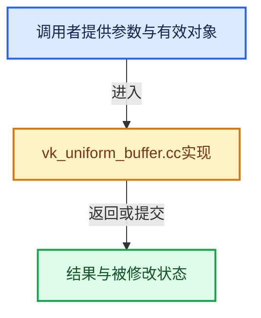

# 实现依赖专题：source/blender/gpu/vulkan/vk_uniform_buffer.cc

[方向导航](README.md) · [符号索引](../%E7%AC%A6%E5%8F%B7%E4%BE%9D%E8%B5%96%E4%B8%8E%E5%AE%9E%E7%8E%B0%E7%B4%A2%E5%BC%95.md)

本专题从正文实际调用进入，集中保存共享实现。函数有稳定锚点，可从调用处直接跳到对应完整函数；递归与互相调用通过回链组织。

## 本文件的实现关系





## 完整成员与函数实现

<a id="f-7572f9758343a774"></a>

### `blender::gpu::VKUniformBuffer::allocate`

实现位置：[source/blender/gpu/vulkan/vk_uniform_buffer.cc](../../../../../source/blender/gpu/vulkan/vk_uniform_buffer.cc) · L39—L49。

**教学注释版**

<!-- annotated:669248ee8b3c7a -->

```cpp
void VKUniformBuffer::allocate()
{
  buffer_.create(size_in_bytes_,
                 VK_BUFFER_USAGE_UNIFORM_BUFFER_BIT | VK_BUFFER_USAGE_STORAGE_BUFFER_BIT |
                     VK_BUFFER_USAGE_TRANSFER_DST_BIT,
                 VMA_MEMORY_USAGE_AUTO_PREFER_DEVICE,
                 VMA_ALLOCATION_CREATE_HOST_ACCESS_SEQUENTIAL_WRITE_BIT,
                 0.8f,
                 false,
                 name_);
}
```

<details>
<summary>核对原始源码：source/blender/gpu/vulkan/vk_uniform_buffer.cc · L39—L49</summary>

<!-- original:669248ee8b3c7a:source/blender/gpu/vulkan/vk_uniform_buffer.cc:39:49 -->

```cpp
void VKUniformBuffer::allocate()
{
  buffer_.create(size_in_bytes_,
                 VK_BUFFER_USAGE_UNIFORM_BUFFER_BIT | VK_BUFFER_USAGE_STORAGE_BUFFER_BIT |
                     VK_BUFFER_USAGE_TRANSFER_DST_BIT,
                 VMA_MEMORY_USAGE_AUTO_PREFER_DEVICE,
                 VMA_ALLOCATION_CREATE_HOST_ACCESS_SEQUENTIAL_WRITE_BIT,
                 0.8f,
                 false,
                 name_);
}
```

</details>

**继续追踪实现**

- `buffer_.create` → [调用协议](../%E6%A8%A1%E6%9D%BF%E5%AE%8F%E4%B8%8E%E5%8A%A8%E6%80%81%E5%88%86%E6%B4%BE%E5%8D%8F%E8%AE%AE.md)：接收对象类型依赖auto、返回值或模板实例；不按同名猜测目标。调用位置L41。

<a id="f-5b0edc7fd36c73c5"></a>

### `blender::gpu::VKUniformBuffer::ensure_updated`

实现位置：[source/blender/gpu/vulkan/vk_uniform_buffer.cc](../../../../../source/blender/gpu/vulkan/vk_uniform_buffer.cc) · L61—L87。

**教学注释版**

<!-- annotated:7936ed952916df -->

```cpp
void VKUniformBuffer::ensure_updated()
{
  if (!buffer_.is_allocated()) {
    allocate();
    if (!buffer_.is_allocated()) {
      CLOG_ERROR(&LOG,
                 "Unable to allocate uniform buffer [%s]. Most likely an out of memory issue.",
                 name_);
      return;
    }
  }

  /* Upload attached data, during bind time. */
  if (data_) {
    if (!data_uploaded_ && buffer_.is_mapped()) {
      buffer_.update_immediately(data_);
      // [讲解] MEM_delete_void：以原始存储释放约定调用当前后端。
      MEM_delete_void(data_);
      data_ = nullptr;
    }
    else {
      VKContext &context = *VKContext::get();
      // [讲解] std::move：把表达式转换成可供移动重载选择的值类别；不保证真的移动，不结束源对象寿命，对const值可能选择复制。
      buffer_.update_render_graph(context, std::move(data_));
      data_ = nullptr;
    }
    data_uploaded_ = true;
  }
}
```

<details>
<summary>核对原始源码：source/blender/gpu/vulkan/vk_uniform_buffer.cc · L61—L87</summary>

<!-- original:7936ed952916df:source/blender/gpu/vulkan/vk_uniform_buffer.cc:61:87 -->

```cpp
void VKUniformBuffer::ensure_updated()
{
  if (!buffer_.is_allocated()) {
    allocate();
    if (!buffer_.is_allocated()) {
      CLOG_ERROR(&LOG,
                 "Unable to allocate uniform buffer [%s]. Most likely an out of memory issue.",
                 name_);
      return;
    }
  }

  /* Upload attached data, during bind time. */
  if (data_) {
    if (!data_uploaded_ && buffer_.is_mapped()) {
      buffer_.update_immediately(data_);
      MEM_delete_void(data_);
      data_ = nullptr;
    }
    else {
      VKContext &context = *VKContext::get();
      buffer_.update_render_graph(context, std::move(data_));
      data_ = nullptr;
    }
    data_uploaded_ = true;
  }
}
```

</details>

**沿实际写入检查状态**

- `data_ = nullptr;`
- `data_uploaded_ = true;`

**继续追踪实现**

- `buffer_.is_allocated` → [调用协议](../%E6%A8%A1%E6%9D%BF%E5%AE%8F%E4%B8%8E%E5%8A%A8%E6%80%81%E5%88%86%E6%B4%BE%E5%8D%8F%E8%AE%AE.md)：接收对象类型依赖auto、返回值或模板实例；不按同名猜测目标。调用位置L63。
- `allocate` → [blender::gpu::VKUniformBuffer::allocate · L39](%E4%BE%9D%E8%B5%96-vk_uniform_buffer-3b71f2.md#f-7572f9758343a774)。
- `CLOG_ERROR` → [CLOG_ERROR · L188](%E4%BE%9D%E8%B5%96-CLG_log-e9051b.md#m-081575cdc8d0)。宏定义由构建条件选择。
- `buffer_.is_mapped` → [调用协议](../%E6%A8%A1%E6%9D%BF%E5%AE%8F%E4%B8%8E%E5%8A%A8%E6%80%81%E5%88%86%E6%B4%BE%E5%8D%8F%E8%AE%AE.md)：接收对象类型依赖auto、返回值或模板实例；不按同名猜测目标。调用位置L75。
- `buffer_.update_immediately` → [调用协议](../%E6%A8%A1%E6%9D%BF%E5%AE%8F%E4%B8%8E%E5%8A%A8%E6%80%81%E5%88%86%E6%B4%BE%E5%8D%8F%E8%AE%AE.md)：接收对象类型依赖auto、返回值或模板实例；不按同名猜测目标。调用位置L76。
- `MEM_delete_void` → [MEM_delete_void · L647](../03-%E5%86%85%E5%AD%98%E5%88%86%E9%85%8D%E4%B8%8E%E8%BF%90%E8%A1%8C%E6%97%B6%E7%B1%BB%E5%9E%8B/%E4%BE%9D%E8%B5%96-MEM_guardedalloc-b54eca.md#f-642896c7c62ff8b9)；[MEM_delete_void · L109](../03-%E5%86%85%E5%AD%98%E5%88%86%E9%85%8D%E4%B8%8E%E8%BF%90%E8%A1%8C%E6%97%B6%E7%B1%BB%E5%9E%8B/%E4%BE%9D%E8%B5%96-mallocn-afdcd4.md#f-9a07b26421f2bee6)。同名重载需按实参类型选择。
- `VKContext::get` → [blender::gpu::VKContext::get · L148](%E4%BE%9D%E8%B5%96-vk_context-f02d3a.md#f-378401ce251eda2a)。
- `buffer_.update_render_graph` → [调用协议](../%E6%A8%A1%E6%9D%BF%E5%AE%8F%E4%B8%8E%E5%8A%A8%E6%80%81%E5%88%86%E6%B4%BE%E5%8D%8F%E8%AE%AE.md)：接收对象类型依赖auto、返回值或模板实例；不按同名猜测目标。调用位置L82。
- `std::move` → [外部契约](https://eel.is/c++draft/utility.forward)：把表达式转换成可供移动重载选择的值类别；不保证真的移动，不结束源对象寿命，对const值可能选择复制。
