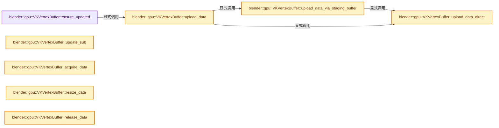
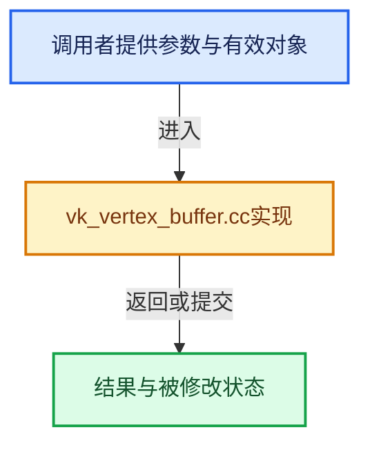

# 实现依赖专题：source/blender/gpu/vulkan/vk_vertex_buffer.cc

[方向导航](README.md) · [符号索引](../%E7%AC%A6%E5%8F%B7%E4%BE%9D%E8%B5%96%E4%B8%8E%E5%AE%9E%E7%8E%B0%E7%B4%A2%E5%BC%95.md)

本专题从正文实际调用进入，集中保存共享实现。函数有稳定锚点，可从调用处直接跳到对应完整函数；递归与互相调用通过回链组织。

## 本文件的实现关系






## 完整成员与函数实现

<a id="f-3bc5facbf60cc56c"></a>

### `blender::gpu::VKVertexBuffer::ensure_updated`

实现位置：[source/blender/gpu/vulkan/vk_vertex_buffer.cc](../../../../../source/blender/gpu/vulkan/vk_vertex_buffer.cc) · L48—L51。

**教学注释版**

<!-- annotated:7d358de98136b9 -->

```cpp
void VKVertexBuffer::ensure_updated()
{
  upload_data();
}
```

<details>
<summary>核对原始源码：source/blender/gpu/vulkan/vk_vertex_buffer.cc · L48—L51</summary>

<!-- original:7d358de98136b9:source/blender/gpu/vulkan/vk_vertex_buffer.cc:48:51 -->

```cpp
void VKVertexBuffer::ensure_updated()
{
  upload_data();
}
```

</details>

**继续追踪实现**

- `upload_data` → [blender::gpu::VKVertexBuffer::upload_data · L200](%E4%BE%9D%E8%B5%96-vk_vertex_buffer-e6ca5c.md#f-ce298f569168f1a2)。

<a id="f-093a4f852029668d"></a>

### `blender::gpu::VKVertexBuffer::update_sub`

实现位置：[source/blender/gpu/vulkan/vk_vertex_buffer.cc](../../../../../source/blender/gpu/vulkan/vk_vertex_buffer.cc) · L76—L94。

接口参数：

- `uint start_offset`
- `uint data_size_in_bytes`
- `const void *data`

**教学注释版**

<!-- annotated:213a4309f2fab3 -->

```cpp
void VKVertexBuffer::update_sub(uint start_offset, uint data_size_in_bytes, const void *data)
{
  if (!buffer_.is_allocated()) {
    /* Allocating huge buffers can fail, in that case we skip copying data. */
    return;
  }
  BLI_assert_msg(start_offset + data_size_in_bytes <= buffer_.size_in_bytes(),
                 "Out of bound write to vertex buffer");
  if (buffer_.is_mapped()) {
    buffer_.update_sub_immediately(start_offset, data_size_in_bytes, data);
  }
  else {
    VKContext &context = *VKContext::get();
    VKStagingBuffer staging_buffer(
        buffer_, VKStagingBuffer::Direction::HostToDevice, start_offset, data_size_in_bytes);
    // [讲解] memcpy：复制字节，源与目标不应重叠。类型生命周期、对齐和可复制表示须由调用者证明，不是任意对象的复制构造。
    memcpy(staging_buffer.host_buffer_get().mapped_memory_get(), data, data_size_in_bytes);
    staging_buffer.copy_to_device(context);
  }
}
```

<details>
<summary>核对原始源码：source/blender/gpu/vulkan/vk_vertex_buffer.cc · L76—L94</summary>

<!-- original:213a4309f2fab3:source/blender/gpu/vulkan/vk_vertex_buffer.cc:76:94 -->

```cpp
void VKVertexBuffer::update_sub(uint start_offset, uint data_size_in_bytes, const void *data)
{
  if (!buffer_.is_allocated()) {
    /* Allocating huge buffers can fail, in that case we skip copying data. */
    return;
  }
  BLI_assert_msg(start_offset + data_size_in_bytes <= buffer_.size_in_bytes(),
                 "Out of bound write to vertex buffer");
  if (buffer_.is_mapped()) {
    buffer_.update_sub_immediately(start_offset, data_size_in_bytes, data);
  }
  else {
    VKContext &context = *VKContext::get();
    VKStagingBuffer staging_buffer(
        buffer_, VKStagingBuffer::Direction::HostToDevice, start_offset, data_size_in_bytes);
    memcpy(staging_buffer.host_buffer_get().mapped_memory_get(), data, data_size_in_bytes);
    staging_buffer.copy_to_device(context);
  }
}
```

</details>

**继续追踪实现**

- `buffer_.is_allocated` → [调用协议](../%E6%A8%A1%E6%9D%BF%E5%AE%8F%E4%B8%8E%E5%8A%A8%E6%80%81%E5%88%86%E6%B4%BE%E5%8D%8F%E8%AE%AE.md)：接收对象类型依赖auto、返回值或模板实例；不按同名猜测目标。调用位置L78。
- `BLI_assert_msg` → [BLI_assert_msg · L55](../01-%E5%9F%BA%E7%A1%80%E5%AE%B9%E5%99%A8%E4%B8%8E%E7%8E%B0%E4%BB%A3CPP/%E4%BE%9D%E8%B5%96-BLI_assert-cc98e8.md#m-695eed20dceb)；[BLI_assert_msg · L64](../01-%E5%9F%BA%E7%A1%80%E5%AE%B9%E5%99%A8%E4%B8%8E%E7%8E%B0%E4%BB%A3CPP/%E4%BE%9D%E8%B5%96-BLI_assert-cc98e8.md#m-7de5563de4db)。宏定义由构建条件选择。
- `buffer_.size_in_bytes` → [调用协议](../%E6%A8%A1%E6%9D%BF%E5%AE%8F%E4%B8%8E%E5%8A%A8%E6%80%81%E5%88%86%E6%B4%BE%E5%8D%8F%E8%AE%AE.md)：接收对象类型依赖auto、返回值或模板实例；不按同名猜测目标。调用位置L82。
- `buffer_.is_mapped` → [调用协议](../%E6%A8%A1%E6%9D%BF%E5%AE%8F%E4%B8%8E%E5%8A%A8%E6%80%81%E5%88%86%E6%B4%BE%E5%8D%8F%E8%AE%AE.md)：接收对象类型依赖auto、返回值或模板实例；不按同名猜测目标。调用位置L84。
- `buffer_.update_sub_immediately` → [调用协议](../%E6%A8%A1%E6%9D%BF%E5%AE%8F%E4%B8%8E%E5%8A%A8%E6%80%81%E5%88%86%E6%B4%BE%E5%8D%8F%E8%AE%AE.md)：接收对象类型依赖auto、返回值或模板实例；不按同名猜测目标。调用位置L85。
- `VKContext::get` → [blender::gpu::VKContext::get · L148](%E4%BE%9D%E8%B5%96-vk_context-f02d3a.md#f-378401ce251eda2a)。
- `memcpy` → [外部契约](https://eel.is/c++draft/cstring.syn)：复制字节，源与目标不应重叠。类型生命周期、对齐和可复制表示须由调用者证明，不是任意对象的复制构造。
- `staging_buffer.host_buffer_get().mapped_memory_get` → [调用协议](../%E6%A8%A1%E6%9D%BF%E5%AE%8F%E4%B8%8E%E5%8A%A8%E6%80%81%E5%88%86%E6%B4%BE%E5%8D%8F%E8%AE%AE.md)：接收对象类型依赖auto、返回值或模板实例；不按同名猜测目标。调用位置L91。
- `staging_buffer.host_buffer_get` → [blender::gpu::VKStagingBuffer::host_buffer_get · L70](%E4%BE%9D%E8%B5%96-vk_staging_buffer-afb795.md#f-4c77f080c3925bcb)。
- `staging_buffer.copy_to_device` → [blender::gpu::VKStagingBuffer::copy_to_device · L41](%E4%BE%9D%E8%B5%96-vk_staging_buffer-fc65d8.md#f-3f8ba3ac2523c07a)。

<a id="f-7007b0c3e93fccbb"></a>

### `blender::gpu::VKVertexBuffer::acquire_data`

实现位置：[source/blender/gpu/vulkan/vk_vertex_buffer.cc](../../../../../source/blender/gpu/vulkan/vk_vertex_buffer.cc) · L145—L155。

**教学注释版**

<!-- annotated:95c3d768d92669 -->

```cpp
void VKVertexBuffer::acquire_data()
{
  if (usage_ == GPU_USAGE_DEVICE_ONLY) {
    return;
  }

  /* Discard previous data if any. */
  /* TODO: Use mapped memory. */
  MEM_SAFE_DELETE(data_);
  data_ = MEM_new_array_uninitialized<uchar>(this->size_alloc_get(), __func__);
}
```

<details>
<summary>核对原始源码：source/blender/gpu/vulkan/vk_vertex_buffer.cc · L145—L155</summary>

<!-- original:95c3d768d92669:source/blender/gpu/vulkan/vk_vertex_buffer.cc:145:155 -->

```cpp
void VKVertexBuffer::acquire_data()
{
  if (usage_ == GPU_USAGE_DEVICE_ONLY) {
    return;
  }

  /* Discard previous data if any. */
  /* TODO: Use mapped memory. */
  MEM_SAFE_DELETE(data_);
  data_ = MEM_new_array_uninitialized<uchar>(this->size_alloc_get(), __func__);
}
```

</details>

**沿实际写入检查状态**

- `data_ = MEM_new_array_uninitialized<uchar>(this->size_alloc_get(), __func__);`

**继续追踪实现**

- `MEM_SAFE_DELETE` → [MEM_SAFE_DELETE · L436](../03-%E5%86%85%E5%AD%98%E5%88%86%E9%85%8D%E4%B8%8E%E8%BF%90%E8%A1%8C%E6%97%B6%E7%B1%BB%E5%9E%8B/%E4%BE%9D%E8%B5%96-MEM_guardedalloc-b54eca.md#m-eadb3bc5b902)。宏定义由构建条件选择。
- `MEM_new_array_uninitialized<uchar>` → [MEM_new_array_uninitialized · L608](../03-%E5%86%85%E5%AD%98%E5%88%86%E9%85%8D%E4%B8%8E%E8%BF%90%E8%A1%8C%E6%97%B6%E7%B1%BB%E5%9E%8B/%E4%BE%9D%E8%B5%96-MEM_guardedalloc-b54eca.md#f-b7103eae8eb57b05)；[MEM_new_array_uninitialized · L129](../03-%E5%86%85%E5%AD%98%E5%88%86%E9%85%8D%E4%B8%8E%E8%BF%90%E8%A1%8C%E6%97%B6%E7%B1%BB%E5%9E%8B/%E4%BE%9D%E8%B5%96-mallocn-afdcd4.md#f-bf6ef4ddcfb6e5df)。同名重载需按实参类型选择。
- `this->size_alloc_get` → [blender::gpu::VertBuf::size_alloc_get · L186](%E4%BE%9D%E8%B5%96-GPU_vertex_buffer-d7610b.md#f-e679f152211ac8cf)。

<a id="f-4c72b05866dbbc31"></a>

### `blender::gpu::VKVertexBuffer::resize_data`

实现位置：[source/blender/gpu/vulkan/vk_vertex_buffer.cc](../../../../../source/blender/gpu/vulkan/vk_vertex_buffer.cc) · L157—L165。

**教学注释版**

<!-- annotated:428388dbe0b321 -->

```cpp
void VKVertexBuffer::resize_data()
{
  if (usage_ == GPU_USAGE_DEVICE_ONLY) {
    return;
  }

  data_ = static_cast<uchar *>(
      MEM_realloc_uninitialized(data_, sizeof(uchar) * this->size_alloc_get()));
}
```

<details>
<summary>核对原始源码：source/blender/gpu/vulkan/vk_vertex_buffer.cc · L157—L165</summary>

<!-- original:428388dbe0b321:source/blender/gpu/vulkan/vk_vertex_buffer.cc:157:165 -->

```cpp
void VKVertexBuffer::resize_data()
{
  if (usage_ == GPU_USAGE_DEVICE_ONLY) {
    return;
  }

  data_ = static_cast<uchar *>(
      MEM_realloc_uninitialized(data_, sizeof(uchar) * this->size_alloc_get()));
}
```

</details>

**沿实际写入检查状态**

- `data_ = static_cast<uchar *>(`

**继续追踪实现**

- `MEM_realloc_uninitialized` → [MEM_realloc_uninitialized · L118](../03-%E5%86%85%E5%AD%98%E5%88%86%E9%85%8D%E4%B8%8E%E8%BF%90%E8%A1%8C%E6%97%B6%E7%B1%BB%E5%9E%8B/%E4%BE%9D%E8%B5%96-MEM_guardedalloc-b54eca.md#m-813b7cd3fcff)。宏定义由构建条件选择。
- `this->size_alloc_get` → [blender::gpu::VertBuf::size_alloc_get · L186](%E4%BE%9D%E8%B5%96-GPU_vertex_buffer-d7610b.md#f-e679f152211ac8cf)。

<a id="f-38d787f624790d45"></a>

### `blender::gpu::VKVertexBuffer::release_data`

实现位置：[source/blender/gpu/vulkan/vk_vertex_buffer.cc](../../../../../source/blender/gpu/vulkan/vk_vertex_buffer.cc) · L167—L175。

**教学注释版**

<!-- annotated:9e9c859bf380ca -->

```cpp
void VKVertexBuffer::release_data()
{
  if (vk_buffer_view_ != VK_NULL_HANDLE) {
    VKDiscardPool::discard_pool_get().discard_buffer_view(vk_buffer_view_);
    vk_buffer_view_ = VK_NULL_HANDLE;
  }

  MEM_SAFE_DELETE(data_);
}
```

<details>
<summary>核对原始源码：source/blender/gpu/vulkan/vk_vertex_buffer.cc · L167—L175</summary>

<!-- original:9e9c859bf380ca:source/blender/gpu/vulkan/vk_vertex_buffer.cc:167:175 -->

```cpp
void VKVertexBuffer::release_data()
{
  if (vk_buffer_view_ != VK_NULL_HANDLE) {
    VKDiscardPool::discard_pool_get().discard_buffer_view(vk_buffer_view_);
    vk_buffer_view_ = VK_NULL_HANDLE;
  }

  MEM_SAFE_DELETE(data_);
}
```

</details>

**沿实际写入检查状态**

- `vk_buffer_view_ = VK_NULL_HANDLE;`

**继续追踪实现**

- `VKDiscardPool::discard_pool_get().discard_buffer_view` → [调用协议](../%E6%A8%A1%E6%9D%BF%E5%AE%8F%E4%B8%8E%E5%8A%A8%E6%80%81%E5%88%86%E6%B4%BE%E5%8D%8F%E8%AE%AE.md)：接收对象类型依赖auto、返回值或模板实例；不按同名猜测目标。调用位置L170。
- `VKDiscardPool::discard_pool_get` → [blender::gpu::VKDiscardPool::discard_pool_get · L164](%E4%BE%9D%E8%B5%96-vk_resource_pool-8847d5.md#f-1ed54101dbe3f794)。
- `MEM_SAFE_DELETE` → [MEM_SAFE_DELETE · L436](../03-%E5%86%85%E5%AD%98%E5%88%86%E9%85%8D%E4%B8%8E%E8%BF%90%E8%A1%8C%E6%97%B6%E7%B1%BB%E5%9E%8B/%E4%BE%9D%E8%B5%96-MEM_guardedalloc-b54eca.md#m-eadb3bc5b902)。宏定义由构建条件选择。

<a id="f-7181a949e4beea0a"></a>

### `blender::gpu::VKVertexBuffer::upload_data_direct`

实现位置：[source/blender/gpu/vulkan/vk_vertex_buffer.cc](../../../../../source/blender/gpu/vulkan/vk_vertex_buffer.cc) · L177—L180。

接口参数：

- `const VKBuffer &host_buffer`

**教学注释版**

<!-- annotated:3acff9765a6795 -->

```cpp
void VKVertexBuffer::upload_data_direct(const VKBuffer &host_buffer)
{
  host_buffer.update_immediately(data_);
}
```

<details>
<summary>核对原始源码：source/blender/gpu/vulkan/vk_vertex_buffer.cc · L177—L180</summary>

<!-- original:3acff9765a6795:source/blender/gpu/vulkan/vk_vertex_buffer.cc:177:180 -->

```cpp
void VKVertexBuffer::upload_data_direct(const VKBuffer &host_buffer)
{
  host_buffer.update_immediately(data_);
}
```

</details>

**继续追踪实现**

- `host_buffer.update_immediately` → [blender::gpu::VKBuffer::update_immediately · L144](%E4%BE%9D%E8%B5%96-vk_buffer-138d3d.md#f-0342755e45ede2c0)。

<a id="f-51f88d147c9050c5"></a>

### `blender::gpu::VKVertexBuffer::upload_data_via_staging_buffer`

实现位置：[source/blender/gpu/vulkan/vk_vertex_buffer.cc](../../../../../source/blender/gpu/vulkan/vk_vertex_buffer.cc) · L182—L198。

接口参数：

- `VKContext &context`

**教学注释版**

<!-- annotated:74cea12e456542 -->

```cpp
void VKVertexBuffer::upload_data_via_staging_buffer(VKContext &context)
{
  VKStagingBuffer staging_buffer(
      buffer_, VKStagingBuffer::Direction::HostToDevice, 0, this->size_used_get());
  VKBuffer &buffer = staging_buffer.host_buffer_get();
  if (buffer.is_allocated()) {
    upload_data_direct(buffer);
    staging_buffer.copy_to_device(context);
  }
  else {
    CLOG_ERROR(&LOG,
               "Unable to upload data to vertex buffer via a staging buffer as the staging buffer "
               "could not be allocated. Vertex buffer will be filled with on zeros to reduce "
               "drawing artifacts due to read from uninitialized memory.");
    buffer_.clear(context, 0u);
  }
}
```

<details>
<summary>核对原始源码：source/blender/gpu/vulkan/vk_vertex_buffer.cc · L182—L198</summary>

<!-- original:74cea12e456542:source/blender/gpu/vulkan/vk_vertex_buffer.cc:182:198 -->

```cpp
void VKVertexBuffer::upload_data_via_staging_buffer(VKContext &context)
{
  VKStagingBuffer staging_buffer(
      buffer_, VKStagingBuffer::Direction::HostToDevice, 0, this->size_used_get());
  VKBuffer &buffer = staging_buffer.host_buffer_get();
  if (buffer.is_allocated()) {
    upload_data_direct(buffer);
    staging_buffer.copy_to_device(context);
  }
  else {
    CLOG_ERROR(&LOG,
               "Unable to upload data to vertex buffer via a staging buffer as the staging buffer "
               "could not be allocated. Vertex buffer will be filled with on zeros to reduce "
               "drawing artifacts due to read from uninitialized memory.");
    buffer_.clear(context, 0u);
  }
}
```

</details>

**继续追踪实现**

- `this->size_used_get` → [blender::gpu::VertBuf::size_used_get · L192](%E4%BE%9D%E8%B5%96-GPU_vertex_buffer-d7610b.md#f-fb11c22cfc2ca429)。
- `staging_buffer.host_buffer_get` → [blender::gpu::VKStagingBuffer::host_buffer_get · L70](%E4%BE%9D%E8%B5%96-vk_staging_buffer-afb795.md#f-4c77f080c3925bcb)。
- `buffer.is_allocated` → [blender::gpu::VKBuffer::is_allocated · L174](%E4%BE%9D%E8%B5%96-vk_buffer-912d24.md#f-72ed3e4e29c76545)。
- `upload_data_direct` → [blender::gpu::VKVertexBuffer::upload_data_direct · L177](%E4%BE%9D%E8%B5%96-vk_vertex_buffer-e6ca5c.md#f-7181a949e4beea0a)。
- `staging_buffer.copy_to_device` → [blender::gpu::VKStagingBuffer::copy_to_device · L41](%E4%BE%9D%E8%B5%96-vk_staging_buffer-fc65d8.md#f-3f8ba3ac2523c07a)。
- `CLOG_ERROR` → [CLOG_ERROR · L188](%E4%BE%9D%E8%B5%96-CLG_log-e9051b.md#m-081575cdc8d0)。宏定义由构建条件选择。
- `buffer_.clear` → [调用协议](../%E6%A8%A1%E6%9D%BF%E5%AE%8F%E4%B8%8E%E5%8A%A8%E6%80%81%E5%88%86%E6%B4%BE%E5%8D%8F%E8%AE%AE.md)：接收对象类型依赖auto、返回值或模板实例；不按同名猜测目标。调用位置L196。

<a id="f-ce298f569168f1a2"></a>

### `blender::gpu::VKVertexBuffer::upload_data`

实现位置：[source/blender/gpu/vulkan/vk_vertex_buffer.cc](../../../../../source/blender/gpu/vulkan/vk_vertex_buffer.cc) · L200—L231。

**教学注释版**

<!-- annotated:c94190356fbddc -->

```cpp
void VKVertexBuffer::upload_data()
{
  if (!buffer_.is_allocated()) {
    allocate();
    /* If allocation fails, don't upload. */
    if (!buffer_.is_allocated()) {
      CLOG_ERROR(&LOG, "Unable to allocate vertex buffer. Most likely an out of memory issue.");
      return;
    }
  }

  if (!ELEM(usage_, GPU_USAGE_STATIC, GPU_USAGE_STREAM, GPU_USAGE_DYNAMIC)) {
    return;
  }

  if (flag & GPU_VERTBUF_DATA_DIRTY) {
    if (buffer_.is_mapped() && !data_uploaded_) {
      upload_data_direct(buffer_);
    }
    else {
      VKContext &context = *VKContext::get();
      upload_data_via_staging_buffer(context);
    }
    if (usage_ == GPU_USAGE_STATIC) {
      MEM_SAFE_DELETE(data_);
    }
    data_uploaded_ = true;

    flag &= ~GPU_VERTBUF_DATA_DIRTY;
    flag |= GPU_VERTBUF_DATA_UPLOADED;
  }
}
```

<details>
<summary>核对原始源码：source/blender/gpu/vulkan/vk_vertex_buffer.cc · L200—L231</summary>

<!-- original:c94190356fbddc:source/blender/gpu/vulkan/vk_vertex_buffer.cc:200:231 -->

```cpp
void VKVertexBuffer::upload_data()
{
  if (!buffer_.is_allocated()) {
    allocate();
    /* If allocation fails, don't upload. */
    if (!buffer_.is_allocated()) {
      CLOG_ERROR(&LOG, "Unable to allocate vertex buffer. Most likely an out of memory issue.");
      return;
    }
  }

  if (!ELEM(usage_, GPU_USAGE_STATIC, GPU_USAGE_STREAM, GPU_USAGE_DYNAMIC)) {
    return;
  }

  if (flag & GPU_VERTBUF_DATA_DIRTY) {
    if (buffer_.is_mapped() && !data_uploaded_) {
      upload_data_direct(buffer_);
    }
    else {
      VKContext &context = *VKContext::get();
      upload_data_via_staging_buffer(context);
    }
    if (usage_ == GPU_USAGE_STATIC) {
      MEM_SAFE_DELETE(data_);
    }
    data_uploaded_ = true;

    flag &= ~GPU_VERTBUF_DATA_DIRTY;
    flag |= GPU_VERTBUF_DATA_UPLOADED;
  }
}
```

</details>

**沿实际写入检查状态**

- `data_uploaded_ = true;`
- `flag &= ~GPU_VERTBUF_DATA_DIRTY;`
- `flag |= GPU_VERTBUF_DATA_UPLOADED;`

**继续追踪实现**

- `buffer_.is_allocated` → [调用协议](../%E6%A8%A1%E6%9D%BF%E5%AE%8F%E4%B8%8E%E5%8A%A8%E6%80%81%E5%88%86%E6%B4%BE%E5%8D%8F%E8%AE%AE.md)：接收对象类型依赖auto、返回值或模板实例；不按同名猜测目标。调用位置L202。
- `allocate` → [blender::gpu::VKVertexBuffer::allocate · L233](%E4%BE%9D%E8%B5%96-vk_vertex_buffer-e6ca5c.md#f-7b01962d3c62d126)。
- `CLOG_ERROR` → [CLOG_ERROR · L188](%E4%BE%9D%E8%B5%96-CLG_log-e9051b.md#m-081575cdc8d0)。宏定义由构建条件选择。
- `ELEM` → [ELEM · L88](%E4%BE%9D%E8%B5%96-GHOST_utildefines-34b996.md#m-d28724a15928)；[ELEM · L135](../01-%E5%9F%BA%E7%A1%80%E5%AE%B9%E5%99%A8%E4%B8%8E%E7%8E%B0%E4%BB%A3CPP/%E4%BE%9D%E8%B5%96-BLI_utildefines-293a0a.md#m-d6572de7cae0)。宏定义由构建条件选择。
- `buffer_.is_mapped` → [调用协议](../%E6%A8%A1%E6%9D%BF%E5%AE%8F%E4%B8%8E%E5%8A%A8%E6%80%81%E5%88%86%E6%B4%BE%E5%8D%8F%E8%AE%AE.md)：接收对象类型依赖auto、返回值或模板实例；不按同名猜测目标。调用位置L216。
- `upload_data_direct` → [blender::gpu::VKVertexBuffer::upload_data_direct · L177](%E4%BE%9D%E8%B5%96-vk_vertex_buffer-e6ca5c.md#f-7181a949e4beea0a)。
- `VKContext::get` → [blender::gpu::VKContext::get · L148](%E4%BE%9D%E8%B5%96-vk_context-f02d3a.md#f-378401ce251eda2a)。
- `upload_data_via_staging_buffer` → [blender::gpu::VKVertexBuffer::upload_data_via_staging_buffer · L182](%E4%BE%9D%E8%B5%96-vk_vertex_buffer-e6ca5c.md#f-51f88d147c9050c5)。
- `MEM_SAFE_DELETE` → [MEM_SAFE_DELETE · L436](../03-%E5%86%85%E5%AD%98%E5%88%86%E9%85%8D%E4%B8%8E%E8%BF%90%E8%A1%8C%E6%97%B6%E7%B1%BB%E5%9E%8B/%E4%BE%9D%E8%B5%96-MEM_guardedalloc-b54eca.md#m-eadb3bc5b902)。宏定义由构建条件选择。

<a id="f-7b01962d3c62d126"></a>

### `blender::gpu::VKVertexBuffer::allocate`

实现位置：[source/blender/gpu/vulkan/vk_vertex_buffer.cc](../../../../../source/blender/gpu/vulkan/vk_vertex_buffer.cc) · L233—L252。

**教学注释版**

<!-- annotated:9eaf49890e8053 -->

```cpp
void VKVertexBuffer::allocate()
{
  VkBufferUsageFlags vk_buffer_usage = VK_BUFFER_USAGE_TRANSFER_SRC_BIT |
                                       VK_BUFFER_USAGE_STORAGE_BUFFER_BIT |
                                       VK_BUFFER_USAGE_VERTEX_BUFFER_BIT |
                                       VK_BUFFER_USAGE_UNIFORM_TEXEL_BUFFER_BIT |
                                       VK_BUFFER_USAGE_TRANSFER_DST_BIT;
  if (GCaps.ray_query_support) {
    vk_buffer_usage |= VK_BUFFER_USAGE_ACCELERATION_STRUCTURE_BUILD_INPUT_READ_ONLY_BIT_KHR |
                       VK_BUFFER_USAGE_SHADER_DEVICE_ADDRESS_BIT;
  }

  buffer_.create(size_alloc_get(),
                 vk_buffer_usage,
                 VMA_MEMORY_USAGE_AUTO,
                 VmaAllocationCreateFlags(0),
                 0.8f,
                 false,
                 "VertexBuffer");
}
```

<details>
<summary>核对原始源码：source/blender/gpu/vulkan/vk_vertex_buffer.cc · L233—L252</summary>

<!-- original:9eaf49890e8053:source/blender/gpu/vulkan/vk_vertex_buffer.cc:233:252 -->

```cpp
void VKVertexBuffer::allocate()
{
  VkBufferUsageFlags vk_buffer_usage = VK_BUFFER_USAGE_TRANSFER_SRC_BIT |
                                       VK_BUFFER_USAGE_STORAGE_BUFFER_BIT |
                                       VK_BUFFER_USAGE_VERTEX_BUFFER_BIT |
                                       VK_BUFFER_USAGE_UNIFORM_TEXEL_BUFFER_BIT |
                                       VK_BUFFER_USAGE_TRANSFER_DST_BIT;
  if (GCaps.ray_query_support) {
    vk_buffer_usage |= VK_BUFFER_USAGE_ACCELERATION_STRUCTURE_BUILD_INPUT_READ_ONLY_BIT_KHR |
                       VK_BUFFER_USAGE_SHADER_DEVICE_ADDRESS_BIT;
  }

  buffer_.create(size_alloc_get(),
                 vk_buffer_usage,
                 VMA_MEMORY_USAGE_AUTO,
                 VmaAllocationCreateFlags(0),
                 0.8f,
                 false,
                 "VertexBuffer");
}
```

</details>

**沿实际写入检查状态**

- `vk_buffer_usage |= VK_BUFFER_USAGE_ACCELERATION_STRUCTURE_BUILD_INPUT_READ_ONLY_BIT_KHR |`

**继续追踪实现**

- `buffer_.create` → [调用协议](../%E6%A8%A1%E6%9D%BF%E5%AE%8F%E4%B8%8E%E5%8A%A8%E6%80%81%E5%88%86%E6%B4%BE%E5%8D%8F%E8%AE%AE.md)：接收对象类型依赖auto、返回值或模板实例；不按同名猜测目标。调用位置L245。
- `size_alloc_get` → [blender::gpu::VertBuf::size_alloc_get · L186](%E4%BE%9D%E8%B5%96-GPU_vertex_buffer-d7610b.md#f-e679f152211ac8cf)。
- `VmaAllocationCreateFlags` → [调用协议](../%E6%A8%A1%E6%9D%BF%E5%AE%8F%E4%B8%8E%E5%8A%A8%E6%80%81%E5%88%86%E6%B4%BE%E5%8D%8F%E8%AE%AE.md)：函数指针、局部可调用对象或未展开的宏；必须结合调用者环境。调用位置L248。
