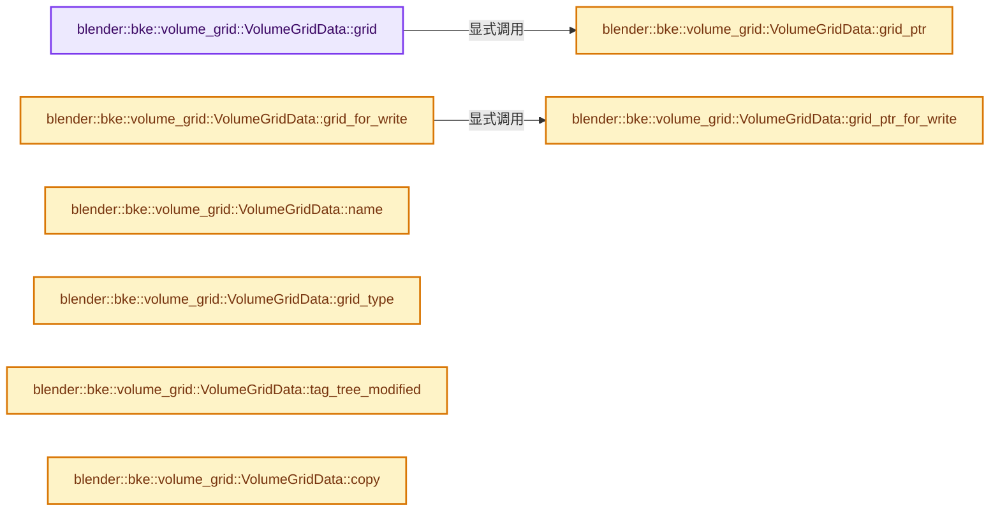
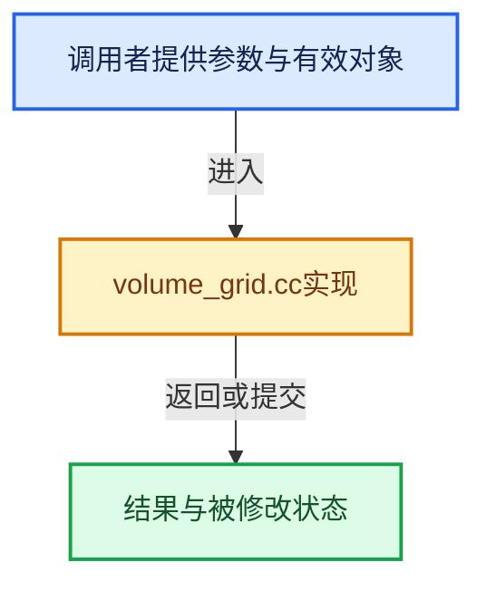

# 实现依赖专题：source/blender/blenkernel/intern/volume_grid.cc

[方向导航](README.md) · [符号索引](../%E7%AC%A6%E5%8F%B7%E4%BE%9D%E8%B5%96%E4%B8%8E%E5%AE%9E%E7%8E%B0%E7%B4%A2%E5%BC%95.md)

本专题从正文实际调用进入，集中保存共享实现。函数有稳定锚点，可从调用处直接跳到对应完整函数；递归与互相调用通过回链组织。

## 本文件的实现关系






## 完整成员与函数实现

<a id="f-6f4e1ca70438fb12"></a>

### `blender::bke::volume_grid::VolumeGridData::grid`

实现位置：[source/blender/blenkernel/intern/volume_grid.cc](../../../../../source/blender/blenkernel/intern/volume_grid.cc) · L85—L88。

接口参数：

- `VolumeTreeAccessToken &r_token`

**教学注释版**

<!-- annotated:93ddb20ea6b54d -->

```cpp
const openvdb::GridBase &VolumeGridData::grid(VolumeTreeAccessToken &r_token) const
{
  return *this->grid_ptr(r_token);
}
```

<details>
<summary>核对原始源码：source/blender/blenkernel/intern/volume_grid.cc · L85—L88</summary>

<!-- original:93ddb20ea6b54d:source/blender/blenkernel/intern/volume_grid.cc:85:88 -->

```cpp
const openvdb::GridBase &VolumeGridData::grid(VolumeTreeAccessToken &r_token) const
{
  return *this->grid_ptr(r_token);
}
```

</details>

**结果出口**

- `return *this->grid_ptr(r_token);`

**继续追踪实现**

- `this->grid_ptr` → [blender::bke::volume_grid::VolumeGridData::grid_ptr · L95](%E4%BE%9D%E8%B5%96-volume_grid-a7c9da.md#f-b7ec9a3e99e6695c)。

<a id="f-c64fdc65ed03800c"></a>

### `blender::bke::volume_grid::VolumeGridData::grid_for_write`

实现位置：[source/blender/blenkernel/intern/volume_grid.cc](../../../../../source/blender/blenkernel/intern/volume_grid.cc) · L90—L93。

接口参数：

- `VolumeTreeAccessToken &r_token`

**教学注释版**

<!-- annotated:c0d3b3f989bbf3 -->

```cpp
openvdb::GridBase &VolumeGridData::grid_for_write(VolumeTreeAccessToken &r_token)
{
  return *this->grid_ptr_for_write(r_token);
}
```

<details>
<summary>核对原始源码：source/blender/blenkernel/intern/volume_grid.cc · L90—L93</summary>

<!-- original:c0d3b3f989bbf3:source/blender/blenkernel/intern/volume_grid.cc:90:93 -->

```cpp
openvdb::GridBase &VolumeGridData::grid_for_write(VolumeTreeAccessToken &r_token)
{
  return *this->grid_ptr_for_write(r_token);
}
```

</details>

**结果出口**

- `return *this->grid_ptr_for_write(r_token);`

**继续追踪实现**

- `this->grid_ptr_for_write` → [blender::bke::volume_grid::VolumeGridData::grid_ptr_for_write · L104](%E4%BE%9D%E8%B5%96-volume_grid-a7c9da.md#f-13cab1ce100500c3)。

<a id="f-b7ec9a3e99e6695c"></a>

### `blender::bke::volume_grid::VolumeGridData::grid_ptr`

实现位置：[source/blender/blenkernel/intern/volume_grid.cc](../../../../../source/blender/blenkernel/intern/volume_grid.cc) · L95—L102。

接口参数：

- `VolumeTreeAccessToken &r_token`

**教学注释版**

<!-- annotated:cd8b9df000bd85 -->

```cpp
std::shared_ptr<const openvdb::GridBase> VolumeGridData::grid_ptr(
    VolumeTreeAccessToken &r_token) const
{
  std::lock_guard lock{mutex_};
  this->ensure_grid_loaded();
  r_token.token_ = tree_access_token_;
  return grid_;
}
```

<details>
<summary>核对原始源码：source/blender/blenkernel/intern/volume_grid.cc · L95—L102</summary>

<!-- original:cd8b9df000bd85:source/blender/blenkernel/intern/volume_grid.cc:95:102 -->

```cpp
std::shared_ptr<const openvdb::GridBase> VolumeGridData::grid_ptr(
    VolumeTreeAccessToken &r_token) const
{
  std::lock_guard lock{mutex_};
  this->ensure_grid_loaded();
  r_token.token_ = tree_access_token_;
  return grid_;
}
```

</details>

**沿实际写入检查状态**

- `r_token.token_ = tree_access_token_;`

**结果出口**

- `return grid_;`

**继续追踪实现**

- `this->ensure_grid_loaded` → [blender::bke::volume_grid::VolumeGridData::ensure_grid_loaded · L327](%E4%BE%9D%E8%B5%96-volume_grid-a7c9da.md#f-a6d664dbbe400b67)。

<a id="f-13cab1ce100500c3"></a>

### `blender::bke::volume_grid::VolumeGridData::grid_ptr_for_write`

实现位置：[source/blender/blenkernel/intern/volume_grid.cc](../../../../../source/blender/blenkernel/intern/volume_grid.cc) · L104—L122。

接口参数：

- `VolumeTreeAccessToken &r_token`

**教学注释版**

<!-- annotated:ba53146dc46768 -->

```cpp
std::shared_ptr<openvdb::GridBase> VolumeGridData::grid_ptr_for_write(
    VolumeTreeAccessToken &r_token)
{
  // [讲解] this->is_mutable：检查相应共享状态是否允许独占修改。
  BLI_assert(this->is_mutable());
  std::lock_guard lock{mutex_};
  this->ensure_grid_loaded();
  r_token.token_ = tree_access_token_;
  if (tree_sharing_info_->is_mutable()) {
    tree_sharing_info_->tag_ensured_mutable();
  }
  else {
    auto tree_copy = grid_->baseTree().copy();
    grid_->setTree(tree_copy);
    // [讲解] std::move：把表达式转换成可供移动重载选择的值类别；不保证真的移动，不结束源对象寿命，对const值可能选择复制。
    tree_sharing_info_ = OpenvdbTreeSharingInfo::make(std::move(tree_copy));
  }
  /* Can't reload the grid anymore if it has been changed. */
  lazy_load_grid_ = {};
  return grid_;
}
```

<details>
<summary>核对原始源码：source/blender/blenkernel/intern/volume_grid.cc · L104—L122</summary>

<!-- original:ba53146dc46768:source/blender/blenkernel/intern/volume_grid.cc:104:122 -->

```cpp
std::shared_ptr<openvdb::GridBase> VolumeGridData::grid_ptr_for_write(
    VolumeTreeAccessToken &r_token)
{
  BLI_assert(this->is_mutable());
  std::lock_guard lock{mutex_};
  this->ensure_grid_loaded();
  r_token.token_ = tree_access_token_;
  if (tree_sharing_info_->is_mutable()) {
    tree_sharing_info_->tag_ensured_mutable();
  }
  else {
    auto tree_copy = grid_->baseTree().copy();
    grid_->setTree(tree_copy);
    tree_sharing_info_ = OpenvdbTreeSharingInfo::make(std::move(tree_copy));
  }
  /* Can't reload the grid anymore if it has been changed. */
  lazy_load_grid_ = {};
  return grid_;
}
```

</details>

**沿实际写入检查状态**

- `r_token.token_ = tree_access_token_;`
- `tree_sharing_info_ = OpenvdbTreeSharingInfo::make(std::move(tree_copy));`
- `lazy_load_grid_ = {};`

**结果出口**

- `return grid_;`

**继续追踪实现**

- `BLI_assert` → [BLI_assert · L48](../01-%E5%9F%BA%E7%A1%80%E5%AE%B9%E5%99%A8%E4%B8%8E%E7%8E%B0%E4%BB%A3CPP/%E4%BE%9D%E8%B5%96-BLI_assert-cc98e8.md#m-57a88495704d)；[BLI_assert · L63](../01-%E5%9F%BA%E7%A1%80%E5%AE%B9%E5%99%A8%E4%B8%8E%E7%8E%B0%E4%BB%A3CPP/%E4%BE%9D%E8%B5%96-BLI_assert-cc98e8.md#m-d07050020cb5)。宏定义由构建条件选择。
- `this->is_mutable` → [blender::ImplicitSharingInfo::is_mutable · L76](../06-%E9%9A%90%E5%BC%8F%E5%85%B1%E4%BA%AB%E4%B8%8E%E7%BC%93%E5%AD%98%E7%B3%BB%E7%BB%9F/01-%E6%89%80%E6%9C%89%E6%9D%83%E4%B8%8E%E5%86%99%E6%97%B6%E5%A4%8D%E5%88%B6.md#f-b4d31aba499caecb)。
- `this->ensure_grid_loaded` → [blender::bke::volume_grid::VolumeGridData::ensure_grid_loaded · L327](%E4%BE%9D%E8%B5%96-volume_grid-a7c9da.md#f-a6d664dbbe400b67)。
- `tree_sharing_info_->is_mutable` → [调用协议](../%E6%A8%A1%E6%9D%BF%E5%AE%8F%E4%B8%8E%E5%8A%A8%E6%80%81%E5%88%86%E6%B4%BE%E5%8D%8F%E8%AE%AE.md)：接收对象类型依赖auto、返回值或模板实例；不按同名猜测目标。调用位置L111。
- `tree_sharing_info_->tag_ensured_mutable` → [调用协议](../%E6%A8%A1%E6%9D%BF%E5%AE%8F%E4%B8%8E%E5%8A%A8%E6%80%81%E5%88%86%E6%B4%BE%E5%8D%8F%E8%AE%AE.md)：接收对象类型依赖auto、返回值或模板实例；不按同名猜测目标。调用位置L112。
- `grid_->baseTree().copy` → [调用协议](../%E6%A8%A1%E6%9D%BF%E5%AE%8F%E4%B8%8E%E5%8A%A8%E6%80%81%E5%88%86%E6%B4%BE%E5%8D%8F%E8%AE%AE.md)：接收对象类型依赖auto、返回值或模板实例；不按同名猜测目标。调用位置L115。
- `grid_->baseTree` → [调用协议](../%E6%A8%A1%E6%9D%BF%E5%AE%8F%E4%B8%8E%E5%8A%A8%E6%80%81%E5%88%86%E6%B4%BE%E5%8D%8F%E8%AE%AE.md)：接收对象类型依赖auto、返回值或模板实例；不按同名猜测目标。调用位置L115。
- `grid_->setTree` → [调用协议](../%E6%A8%A1%E6%9D%BF%E5%AE%8F%E4%B8%8E%E5%8A%A8%E6%80%81%E5%88%86%E6%B4%BE%E5%8D%8F%E8%AE%AE.md)：接收对象类型依赖auto、返回值或模板实例；不按同名猜测目标。调用位置L116。
- `OpenvdbTreeSharingInfo::make` → [blender::bke::volume_grid::OpenvdbTreeSharingInfo::make · L456](%E4%BE%9D%E8%B5%96-volume_grid-a7c9da.md#f-3662d20b40c4dc08)。
- `std::move` → [外部契约](https://eel.is/c++draft/utility.forward)：把表达式转换成可供移动重载选择的值类别；不保证真的移动，不结束源对象寿命，对const值可能选择复制。

<a id="f-2f24877bf1543cb5"></a>

### `blender::bke::volume_grid::VolumeGridData::name`

实现位置：[source/blender/blenkernel/intern/volume_grid.cc](../../../../../source/blender/blenkernel/intern/volume_grid.cc) · L143—L150。

**教学注释版**

<!-- annotated:41a4df3727b9dd -->

```cpp
std::string VolumeGridData::name() const
{
  std::lock_guard lock{mutex_};
  if (!meta_data_loaded_) {
    this->ensure_grid_loaded();
  }
  return grid_->getName();
}
```

<details>
<summary>核对原始源码：source/blender/blenkernel/intern/volume_grid.cc · L143—L150</summary>

<!-- original:41a4df3727b9dd:source/blender/blenkernel/intern/volume_grid.cc:143:150 -->

```cpp
std::string VolumeGridData::name() const
{
  std::lock_guard lock{mutex_};
  if (!meta_data_loaded_) {
    this->ensure_grid_loaded();
  }
  return grid_->getName();
}
```

</details>

**结果出口**

- `return grid_->getName();`

**继续追踪实现**

- `this->ensure_grid_loaded` → [blender::bke::volume_grid::VolumeGridData::ensure_grid_loaded · L327](%E4%BE%9D%E8%B5%96-volume_grid-a7c9da.md#f-a6d664dbbe400b67)。
- `grid_->getName` → [调用协议](../%E6%A8%A1%E6%9D%BF%E5%AE%8F%E4%B8%8E%E5%8A%A8%E6%80%81%E5%88%86%E6%B4%BE%E5%8D%8F%E8%AE%AE.md)：接收对象类型依赖auto、返回值或模板实例；不按同名猜测目标。调用位置L149。

<a id="f-0a131609bd285679"></a>

### `blender::bke::volume_grid::VolumeGridData::grid_type`

实现位置：[source/blender/blenkernel/intern/volume_grid.cc](../../../../../source/blender/blenkernel/intern/volume_grid.cc) · L162—L169。

**教学注释版**

<!-- annotated:21afee639a1694 -->

```cpp
VolumeGridType VolumeGridData::grid_type() const
{
  std::lock_guard lock{mutex_};
  if (!meta_data_loaded_) {
    this->ensure_grid_loaded();
  }
  return get_type(*grid_);
}
```

<details>
<summary>核对原始源码：source/blender/blenkernel/intern/volume_grid.cc · L162—L169</summary>

<!-- original:21afee639a1694:source/blender/blenkernel/intern/volume_grid.cc:162:169 -->

```cpp
VolumeGridType VolumeGridData::grid_type() const
{
  std::lock_guard lock{mutex_};
  if (!meta_data_loaded_) {
    this->ensure_grid_loaded();
  }
  return get_type(*grid_);
}
```

</details>

**结果出口**

- `return get_type(*grid_);`

**继续追踪实现**

- `this->ensure_grid_loaded` → [blender::bke::volume_grid::VolumeGridData::ensure_grid_loaded · L327](%E4%BE%9D%E8%B5%96-volume_grid-a7c9da.md#f-a6d664dbbe400b67)。
- `get_type` → [blender::bke::volume_grid::get_type · L416](%E4%BE%9D%E8%B5%96-volume_grid-a7c9da.md#f-6ec0031de7935520)；[blender::bke::volume_grid::get_type · L451](%E4%BE%9D%E8%B5%96-volume_grid-a7c9da.md#f-e58020f175d3e983)；[blender::bke::volume_grid::get_type · L499](%E4%BE%9D%E8%B5%96-volume_grid-a7c9da.md#f-522a600410e01abc)。同名重载需按实参类型选择。

<a id="f-8ef835c0175ba6d1"></a>

### `blender::bke::volume_grid::VolumeGridData::tag_tree_modified`

实现位置：[source/blender/blenkernel/intern/volume_grid.cc](../../../../../source/blender/blenkernel/intern/volume_grid.cc) · L194—L201。

**教学注释版**

<!-- annotated:e1c5000d15acf6 -->

```cpp
void VolumeGridData::tag_tree_modified() const
{
  active_voxels_mutex_.tag_dirty();
  active_leaf_voxels_mutex_.tag_dirty();
  active_tiles_mutex_.tag_dirty();
  size_in_bytes_mutex_.tag_dirty();
  active_bounds_mutex_.tag_dirty();
}
```

<details>
<summary>核对原始源码：source/blender/blenkernel/intern/volume_grid.cc · L194—L201</summary>

<!-- original:e1c5000d15acf6:source/blender/blenkernel/intern/volume_grid.cc:194:201 -->

```cpp
void VolumeGridData::tag_tree_modified() const
{
  active_voxels_mutex_.tag_dirty();
  active_leaf_voxels_mutex_.tag_dirty();
  active_tiles_mutex_.tag_dirty();
  size_in_bytes_mutex_.tag_dirty();
  active_bounds_mutex_.tag_dirty();
}
```

</details>

**继续追踪实现**

- `active_voxels_mutex_.tag_dirty` → [调用协议](../%E6%A8%A1%E6%9D%BF%E5%AE%8F%E4%B8%8E%E5%8A%A8%E6%80%81%E5%88%86%E6%B4%BE%E5%8D%8F%E8%AE%AE.md)：接收对象类型依赖auto、返回值或模板实例；不按同名猜测目标。调用位置L196。
- `active_leaf_voxels_mutex_.tag_dirty` → [调用协议](../%E6%A8%A1%E6%9D%BF%E5%AE%8F%E4%B8%8E%E5%8A%A8%E6%80%81%E5%88%86%E6%B4%BE%E5%8D%8F%E8%AE%AE.md)：接收对象类型依赖auto、返回值或模板实例；不按同名猜测目标。调用位置L197。
- `active_tiles_mutex_.tag_dirty` → [调用协议](../%E6%A8%A1%E6%9D%BF%E5%AE%8F%E4%B8%8E%E5%8A%A8%E6%80%81%E5%88%86%E6%B4%BE%E5%8D%8F%E8%AE%AE.md)：接收对象类型依赖auto、返回值或模板实例；不按同名猜测目标。调用位置L198。
- `size_in_bytes_mutex_.tag_dirty` → [调用协议](../%E6%A8%A1%E6%9D%BF%E5%AE%8F%E4%B8%8E%E5%8A%A8%E6%80%81%E5%88%86%E6%B4%BE%E5%8D%8F%E8%AE%AE.md)：接收对象类型依赖auto、返回值或模板实例；不按同名猜测目标。调用位置L199。
- `active_bounds_mutex_.tag_dirty` → [调用协议](../%E6%A8%A1%E6%9D%BF%E5%AE%8F%E4%B8%8E%E5%8A%A8%E6%80%81%E5%88%86%E6%B4%BE%E5%8D%8F%E8%AE%AE.md)：接收对象类型依赖auto、返回值或模板实例；不按同名猜测目标。调用位置L200。

<a id="f-1b9d7fc6c05d8d65"></a>

### `blender::bke::volume_grid::VolumeGridData::copy`

实现位置：[source/blender/blenkernel/intern/volume_grid.cc](../../../../../source/blender/blenkernel/intern/volume_grid.cc) · L311—L325。

**教学注释版**

<!-- annotated:04ff9905974ba0 -->

```cpp
GVolumeGrid VolumeGridData::copy() const
{
  std::lock_guard lock{mutex_};
  this->ensure_grid_loaded();
  /* Can't use #MEM_new because the default constructor is private. */
  VolumeGridData *new_copy = new (MEM_new_uninitialized(sizeof(VolumeGridData), __func__))
      VolumeGridData();
  /* Makes a deep copy of the meta-data but shares the tree. */
  new_copy->grid_ = grid_->copyGrid();
  new_copy->tree_sharing_info_ = tree_sharing_info_;
  new_copy->tree_loaded_ = tree_loaded_;
  new_copy->transform_loaded_ = transform_loaded_;
  new_copy->meta_data_loaded_ = meta_data_loaded_;
  return GVolumeGrid(new_copy);
}
```

<details>
<summary>核对原始源码：source/blender/blenkernel/intern/volume_grid.cc · L311—L325</summary>

<!-- original:04ff9905974ba0:source/blender/blenkernel/intern/volume_grid.cc:311:325 -->

```cpp
GVolumeGrid VolumeGridData::copy() const
{
  std::lock_guard lock{mutex_};
  this->ensure_grid_loaded();
  /* Can't use #MEM_new because the default constructor is private. */
  VolumeGridData *new_copy = new (MEM_new_uninitialized(sizeof(VolumeGridData), __func__))
      VolumeGridData();
  /* Makes a deep copy of the meta-data but shares the tree. */
  new_copy->grid_ = grid_->copyGrid();
  new_copy->tree_sharing_info_ = tree_sharing_info_;
  new_copy->tree_loaded_ = tree_loaded_;
  new_copy->transform_loaded_ = transform_loaded_;
  new_copy->meta_data_loaded_ = meta_data_loaded_;
  return GVolumeGrid(new_copy);
}
```

</details>

**沿实际写入检查状态**

- `new_copy->grid_ = grid_->copyGrid();`
- `new_copy->tree_sharing_info_ = tree_sharing_info_;`
- `new_copy->tree_loaded_ = tree_loaded_;`
- `new_copy->transform_loaded_ = transform_loaded_;`
- `new_copy->meta_data_loaded_ = meta_data_loaded_;`

**结果出口**

- `return GVolumeGrid(new_copy);`

**继续追踪实现**

- `this->ensure_grid_loaded` → [blender::bke::volume_grid::VolumeGridData::ensure_grid_loaded · L327](%E4%BE%9D%E8%B5%96-volume_grid-a7c9da.md#f-a6d664dbbe400b67)。
- `MEM_new_uninitialized` → [MEM_new_uninitialized · L590](../03-%E5%86%85%E5%AD%98%E5%88%86%E9%85%8D%E4%B8%8E%E8%BF%90%E8%A1%8C%E6%97%B6%E7%B1%BB%E5%9E%8B/%E4%BE%9D%E8%B5%96-MEM_guardedalloc-b54eca.md#f-c773b2e5b8fe70e4)；[MEM_new_uninitialized · L124](../03-%E5%86%85%E5%AD%98%E5%88%86%E9%85%8D%E4%B8%8E%E8%BF%90%E8%A1%8C%E6%97%B6%E7%B1%BB%E5%9E%8B/%E4%BE%9D%E8%B5%96-mallocn-afdcd4.md#f-28a7e00a1e67f699)。同名重载需按实参类型选择。
- `grid_->copyGrid` → [调用协议](../%E6%A8%A1%E6%9D%BF%E5%AE%8F%E4%B8%8E%E5%8A%A8%E6%80%81%E5%88%86%E6%B4%BE%E5%8D%8F%E8%AE%AE.md)：接收对象类型依赖auto、返回值或模板实例；不按同名猜测目标。调用位置L319。
- `GVolumeGrid` → [blender::bke::volume_grid::GVolumeGrid::GVolumeGrid · L394](%E4%BE%9D%E8%B5%96-volume_grid-a7c9da.md#f-c6814ec651f2d5ea)；[blender::bke::volume_grid::GVolumeGrid::GVolumeGrid · L399](%E4%BE%9D%E8%B5%96-volume_grid-a7c9da.md#f-9584c1218cce92a3)。同名重载需按实参类型选择。

<a id="f-a6d664dbbe400b67"></a>

### `blender::bke::volume_grid::VolumeGridData::ensure_grid_loaded`

实现位置：[source/blender/blenkernel/intern/volume_grid.cc](../../../../../source/blender/blenkernel/intern/volume_grid.cc) · L327—L392。

**教学注释版**

<!-- annotated:47d7cbdf26cab3 -->

```cpp
void VolumeGridData::ensure_grid_loaded() const
{
  /* Assert that the mutex is locked. */
  BLI_assert(!mutex_.try_lock());

  if (tree_loaded_ && transform_loaded_ && meta_data_loaded_) {
    return;
  }
  BLI_assert(lazy_load_grid_);
  LazyLoadedGrid loaded_grid;
  /* Isolate because the a mutex is locked. */
  threading::isolate_task([&]() {
    error_message_.clear();
    try {
      loaded_grid = lazy_load_grid_();
    }
    catch (const openvdb::IoError &e) {
      error_message_ = e.what();
    }
    catch (...) {
      error_message_ = "Unknown error reading VDB file";
    }
  });
  if (!loaded_grid.grid) {
    BLI_assert(!loaded_grid.tree_sharing_info);
    if (grid_) {
      const openvdb::Name &grid_type = grid_->type();
      if (openvdb::GridBase::isRegistered(grid_type)) {
        /* Create a dummy grid of the expected type. */
        loaded_grid.grid = openvdb::GridBase::createGrid(grid_type);
      }
    }
  }
  if (!loaded_grid.grid) {
    /* Create a dummy grid. We can't really know the expected data type here. */
    loaded_grid.grid = openvdb::FloatGrid::create();
  }
  BLI_assert(loaded_grid.grid);
  BLI_assert(loaded_grid.grid.use_count() == 1);

  if (!loaded_grid.tree_sharing_info) {
    BLI_assert(loaded_grid.grid->isTreeUnique());
    loaded_grid.tree_sharing_info = OpenvdbTreeSharingInfo::make(loaded_grid.grid->baseTreePtr());
  }

  if (grid_) {
    /* Keep the existing grid pointer and just insert the newly loaded data. */
    BLI_assert(!tree_loaded_);
    BLI_assert(meta_data_loaded_);
    grid_->setTree(loaded_grid.grid->baseTreePtr());
    if (!transform_loaded_) {
      grid_->setTransform(loaded_grid.grid->transformPtr());
    }
  }
  else {
    // [讲解] std::move：把表达式转换成可供移动重载选择的值类别；不保证真的移动，不结束源对象寿命，对const值可能选择复制。
    grid_ = std::move(loaded_grid.grid);
  }

  BLI_assert(!tree_sharing_info_);
  BLI_assert(loaded_grid.tree_sharing_info);
  tree_sharing_info_ = std::move(loaded_grid.tree_sharing_info);

  tree_loaded_ = true;
  transform_loaded_ = true;
  meta_data_loaded_ = true;
}
```

<details>
<summary>核对原始源码：source/blender/blenkernel/intern/volume_grid.cc · L327—L392</summary>

<!-- original:47d7cbdf26cab3:source/blender/blenkernel/intern/volume_grid.cc:327:392 -->

```cpp
void VolumeGridData::ensure_grid_loaded() const
{
  /* Assert that the mutex is locked. */
  BLI_assert(!mutex_.try_lock());

  if (tree_loaded_ && transform_loaded_ && meta_data_loaded_) {
    return;
  }
  BLI_assert(lazy_load_grid_);
  LazyLoadedGrid loaded_grid;
  /* Isolate because the a mutex is locked. */
  threading::isolate_task([&]() {
    error_message_.clear();
    try {
      loaded_grid = lazy_load_grid_();
    }
    catch (const openvdb::IoError &e) {
      error_message_ = e.what();
    }
    catch (...) {
      error_message_ = "Unknown error reading VDB file";
    }
  });
  if (!loaded_grid.grid) {
    BLI_assert(!loaded_grid.tree_sharing_info);
    if (grid_) {
      const openvdb::Name &grid_type = grid_->type();
      if (openvdb::GridBase::isRegistered(grid_type)) {
        /* Create a dummy grid of the expected type. */
        loaded_grid.grid = openvdb::GridBase::createGrid(grid_type);
      }
    }
  }
  if (!loaded_grid.grid) {
    /* Create a dummy grid. We can't really know the expected data type here. */
    loaded_grid.grid = openvdb::FloatGrid::create();
  }
  BLI_assert(loaded_grid.grid);
  BLI_assert(loaded_grid.grid.use_count() == 1);

  if (!loaded_grid.tree_sharing_info) {
    BLI_assert(loaded_grid.grid->isTreeUnique());
    loaded_grid.tree_sharing_info = OpenvdbTreeSharingInfo::make(loaded_grid.grid->baseTreePtr());
  }

  if (grid_) {
    /* Keep the existing grid pointer and just insert the newly loaded data. */
    BLI_assert(!tree_loaded_);
    BLI_assert(meta_data_loaded_);
    grid_->setTree(loaded_grid.grid->baseTreePtr());
    if (!transform_loaded_) {
      grid_->setTransform(loaded_grid.grid->transformPtr());
    }
  }
  else {
    grid_ = std::move(loaded_grid.grid);
  }

  BLI_assert(!tree_sharing_info_);
  BLI_assert(loaded_grid.tree_sharing_info);
  tree_sharing_info_ = std::move(loaded_grid.tree_sharing_info);

  tree_loaded_ = true;
  transform_loaded_ = true;
  meta_data_loaded_ = true;
}
```

</details>

**沿实际写入检查状态**

- `loaded_grid = lazy_load_grid_();`
- `error_message_ = e.what();`
- `error_message_ = "Unknown error reading VDB file";`
- `loaded_grid.grid = openvdb::GridBase::createGrid(grid_type);`
- `loaded_grid.grid = openvdb::FloatGrid::create();`
- `loaded_grid.tree_sharing_info = OpenvdbTreeSharingInfo::make(loaded_grid.grid->baseTreePtr());`
- `grid_ = std::move(loaded_grid.grid);`
- `tree_sharing_info_ = std::move(loaded_grid.tree_sharing_info);`
- `tree_loaded_ = true;`
- `transform_loaded_ = true;`
- `meta_data_loaded_ = true;`

**继续追踪实现**

- `BLI_assert` → [BLI_assert · L48](../01-%E5%9F%BA%E7%A1%80%E5%AE%B9%E5%99%A8%E4%B8%8E%E7%8E%B0%E4%BB%A3CPP/%E4%BE%9D%E8%B5%96-BLI_assert-cc98e8.md#m-57a88495704d)；[BLI_assert · L63](../01-%E5%9F%BA%E7%A1%80%E5%AE%B9%E5%99%A8%E4%B8%8E%E7%8E%B0%E4%BB%A3CPP/%E4%BE%9D%E8%B5%96-BLI_assert-cc98e8.md#m-d07050020cb5)。宏定义由构建条件选择。
- `mutex_.try_lock` → [调用协议](../%E6%A8%A1%E6%9D%BF%E5%AE%8F%E4%B8%8E%E5%8A%A8%E6%80%81%E5%88%86%E6%B4%BE%E5%8D%8F%E8%AE%AE.md)：接收对象类型依赖auto、返回值或模板实例；不按同名猜测目标。调用位置L330。
- `threading::isolate_task` → [blender::threading::isolate_task · L224](../11-Depsgraph%E4%B8%8E%E5%B9%B6%E8%A1%8C%E4%BB%BB%E5%8A%A1%E7%B3%BB%E7%BB%9F/07-%E4%BB%BB%E5%8A%A1%E6%B1%A0%E4%B8%8ETBB%E6%8E%A5%E5%85%A5.md#f-c13dd3df595aa4f8)。
- `error_message_.clear` → [调用协议](../%E6%A8%A1%E6%9D%BF%E5%AE%8F%E4%B8%8E%E5%8A%A8%E6%80%81%E5%88%86%E6%B4%BE%E5%8D%8F%E8%AE%AE.md)：接收对象类型依赖auto、返回值或模板实例；不按同名猜测目标。调用位置L339。
- `lazy_load_grid_` → [调用协议](../%E6%A8%A1%E6%9D%BF%E5%AE%8F%E4%B8%8E%E5%8A%A8%E6%80%81%E5%88%86%E6%B4%BE%E5%8D%8F%E8%AE%AE.md)：函数指针、局部可调用对象或未展开的宏；必须结合调用者环境。调用位置L341。
- `e.what` → [GHOST_XrException::what · L22](%E4%BE%9D%E8%B5%96-GHOST_XrException-37f429.md#f-da2482d747eab515)。
- `grid_->type` → [调用协议](../%E6%A8%A1%E6%9D%BF%E5%AE%8F%E4%B8%8E%E5%8A%A8%E6%80%81%E5%88%86%E6%B4%BE%E5%8D%8F%E8%AE%AE.md)：接收对象类型依赖auto、返回值或模板实例；不按同名猜测目标。调用位置L353。
- `openvdb::GridBase::isRegistered` → [外部契约](https://eel.is/c++draft/)：这个边界按实际表达式及所属类型核对参数、返回值、寿命与失败行为。这里提供接口入口，不声称已解释该第三方版本的内部实现。
- `openvdb::GridBase::createGrid` → [外部契约](https://eel.is/c++draft/)：这个边界按实际表达式及所属类型核对参数、返回值、寿命与失败行为。这里提供接口入口，不声称已解释该第三方版本的内部实现。
- `openvdb::FloatGrid::create` → [外部契约](https://eel.is/c++draft/)：这个边界按实际表达式及所属类型核对参数、返回值、寿命与失败行为。这里提供接口入口，不声称已解释该第三方版本的内部实现。
- `loaded_grid.grid.use_count` → [调用协议](../%E6%A8%A1%E6%9D%BF%E5%AE%8F%E4%B8%8E%E5%8A%A8%E6%80%81%E5%88%86%E6%B4%BE%E5%8D%8F%E8%AE%AE.md)：接收对象类型依赖auto、返回值或模板实例；不按同名猜测目标。调用位置L365。
- `loaded_grid.grid->isTreeUnique` → [调用协议](../%E6%A8%A1%E6%9D%BF%E5%AE%8F%E4%B8%8E%E5%8A%A8%E6%80%81%E5%88%86%E6%B4%BE%E5%8D%8F%E8%AE%AE.md)：接收对象类型依赖auto、返回值或模板实例；不按同名猜测目标。调用位置L368。
- `OpenvdbTreeSharingInfo::make` → [blender::bke::volume_grid::OpenvdbTreeSharingInfo::make · L456](%E4%BE%9D%E8%B5%96-volume_grid-a7c9da.md#f-3662d20b40c4dc08)。
- `loaded_grid.grid->baseTreePtr` → [调用协议](../%E6%A8%A1%E6%9D%BF%E5%AE%8F%E4%B8%8E%E5%8A%A8%E6%80%81%E5%88%86%E6%B4%BE%E5%8D%8F%E8%AE%AE.md)：接收对象类型依赖auto、返回值或模板实例；不按同名猜测目标。调用位置L369。
- `grid_->setTree` → [调用协议](../%E6%A8%A1%E6%9D%BF%E5%AE%8F%E4%B8%8E%E5%8A%A8%E6%80%81%E5%88%86%E6%B4%BE%E5%8D%8F%E8%AE%AE.md)：接收对象类型依赖auto、返回值或模板实例；不按同名猜测目标。调用位置L376。
- `grid_->setTransform` → [调用协议](../%E6%A8%A1%E6%9D%BF%E5%AE%8F%E4%B8%8E%E5%8A%A8%E6%80%81%E5%88%86%E6%B4%BE%E5%8D%8F%E8%AE%AE.md)：接收对象类型依赖auto、返回值或模板实例；不按同名猜测目标。调用位置L378。
- `loaded_grid.grid->transformPtr` → [调用协议](../%E6%A8%A1%E6%9D%BF%E5%AE%8F%E4%B8%8E%E5%8A%A8%E6%80%81%E5%88%86%E6%B4%BE%E5%8D%8F%E8%AE%AE.md)：接收对象类型依赖auto、返回值或模板实例；不按同名猜测目标。调用位置L378。
- `std::move` → [外部契约](https://eel.is/c++draft/utility.forward)：把表达式转换成可供移动重载选择的值类别；不保证真的移动，不结束源对象寿命，对const值可能选择复制。

<a id="f-c6814ec651f2d5ea"></a>

### `blender::bke::volume_grid::GVolumeGrid::GVolumeGrid`

实现位置：[source/blender/blenkernel/intern/volume_grid.cc](../../../../../source/blender/blenkernel/intern/volume_grid.cc) · L394—L397。

接口参数：

- `std::shared_ptr<openvdb::GridBase> grid`

**教学注释版**

<!-- annotated:f3baf15c1d884d -->

```cpp
GVolumeGrid::GVolumeGrid(std::shared_ptr<openvdb::GridBase> grid)
{
  // [讲解] std::move：把表达式转换成可供移动重载选择的值类别；不保证真的移动，不结束源对象寿命，对const值可能选择复制。
  data_ = ImplicitSharingPtr(MEM_new<VolumeGridData>(__func__, std::move(grid)));
}
```

<details>
<summary>核对原始源码：source/blender/blenkernel/intern/volume_grid.cc · L394—L397</summary>

<!-- original:f3baf15c1d884d:source/blender/blenkernel/intern/volume_grid.cc:394:397 -->

```cpp
GVolumeGrid::GVolumeGrid(std::shared_ptr<openvdb::GridBase> grid)
{
  data_ = ImplicitSharingPtr(MEM_new<VolumeGridData>(__func__, std::move(grid)));
}
```

</details>

**沿实际写入检查状态**

- `data_ = ImplicitSharingPtr(MEM_new<VolumeGridData>(__func__, std::move(grid)));`

**继续追踪实现**

- `ImplicitSharingPtr` → [blender::ImplicitSharingPtr::ImplicitSharingPtr · L32](../06-%E9%9A%90%E5%BC%8F%E5%85%B1%E4%BA%AB%E4%B8%8E%E7%BC%93%E5%AD%98%E7%B3%BB%E7%BB%9F/03-Mixin%E4%B8%8E%E5%85%B1%E4%BA%AB%E6%8C%87%E9%92%88%E5%B0%81%E8%A3%85.md#f-d28a43dbb5ed8c05)；[blender::ImplicitSharingPtr::ImplicitSharingPtr · L34](../06-%E9%9A%90%E5%BC%8F%E5%85%B1%E4%BA%AB%E4%B8%8E%E7%BC%93%E5%AD%98%E7%B3%BB%E7%BB%9F/03-Mixin%E4%B8%8E%E5%85%B1%E4%BA%AB%E6%8C%87%E9%92%88%E5%B0%81%E8%A3%85.md#f-d27d5ebf676e244a)；[blender::ImplicitSharingPtr::ImplicitSharingPtr · L37](../06-%E9%9A%90%E5%BC%8F%E5%85%B1%E4%BA%AB%E4%B8%8E%E7%BC%93%E5%AD%98%E7%B3%BB%E7%BB%9F/03-Mixin%E4%B8%8E%E5%85%B1%E4%BA%AB%E6%8C%87%E9%92%88%E5%B0%81%E8%A3%85.md#f-17d0c5fe2b03a664)；[blender::ImplicitSharingPtr::ImplicitSharingPtr · L39](../06-%E9%9A%90%E5%BC%8F%E5%85%B1%E4%BA%AB%E4%B8%8E%E7%BC%93%E5%AD%98%E7%B3%BB%E7%BB%9F/03-Mixin%E4%B8%8E%E5%85%B1%E4%BA%AB%E6%8C%87%E9%92%88%E5%B0%81%E8%A3%85.md#f-1c8729ae57532370)；[blender::ImplicitSharingPtr::ImplicitSharingPtr · L44](../06-%E9%9A%90%E5%BC%8F%E5%85%B1%E4%BA%AB%E4%B8%8E%E7%BC%93%E5%AD%98%E7%B3%BB%E7%BB%9F/03-Mixin%E4%B8%8E%E5%85%B1%E4%BA%AB%E6%8C%87%E9%92%88%E5%B0%81%E8%A3%85.md#f-0b6be0142b98009e)；[blender::ImplicitSharingPtr::ImplicitSharingPtr · L49](../06-%E9%9A%90%E5%BC%8F%E5%85%B1%E4%BA%AB%E4%B8%8E%E7%BC%93%E5%AD%98%E7%B3%BB%E7%BB%9F/03-Mixin%E4%B8%8E%E5%85%B1%E4%BA%AB%E6%8C%87%E9%92%88%E5%B0%81%E8%A3%85.md#f-90c601ed9ed99045)；[blender::ImplicitSharingPtr::ImplicitSharingPtr · L57](../06-%E9%9A%90%E5%BC%8F%E5%85%B1%E4%BA%AB%E4%B8%8E%E7%BC%93%E5%AD%98%E7%B3%BB%E7%BB%9F/03-Mixin%E4%B8%8E%E5%85%B1%E4%BA%AB%E6%8C%87%E9%92%88%E5%B0%81%E8%A3%85.md#f-1625179ceae7a66d)。同名重载需按实参类型选择。
- `MEM_new<VolumeGridData>` → [MEM_new · L351](../03-%E5%86%85%E5%AD%98%E5%88%86%E9%85%8D%E4%B8%8E%E8%BF%90%E8%A1%8C%E6%97%B6%E7%B1%BB%E5%9E%8B/%E4%BE%9D%E8%B5%96-MEM_guardedalloc-b54eca.md#f-115f9b6784f89912)。
- `std::move` → [外部契约](https://eel.is/c++draft/utility.forward)：把表达式转换成可供移动重载选择的值类别；不保证真的移动，不结束源对象寿命，对const值可能选择复制。

<a id="f-9584c1218cce92a3"></a>

### `blender::bke::volume_grid::GVolumeGrid::GVolumeGrid`

实现位置：[source/blender/blenkernel/intern/volume_grid.cc](../../../../../source/blender/blenkernel/intern/volume_grid.cc) · L399—L402。

接口参数：

- `const VolumeGridType grid_type`

**教学注释版**

<!-- annotated:e83f7455cdf53a -->

```cpp
GVolumeGrid::GVolumeGrid(const VolumeGridType grid_type)
    : GVolumeGrid(create_grid_for_type(grid_type))
{
}
```

<details>
<summary>核对原始源码：source/blender/blenkernel/intern/volume_grid.cc · L399—L402</summary>

<!-- original:e83f7455cdf53a:source/blender/blenkernel/intern/volume_grid.cc:399:402 -->

```cpp
GVolumeGrid::GVolumeGrid(const VolumeGridType grid_type)
    : GVolumeGrid(create_grid_for_type(grid_type))
{
}
```

</details>

**继续追踪实现**

本实现没有需要继续展开的显式调用；检查返回表达式、对象转换和调用者前置条件。

<a id="f-6ec0031de7935520"></a>

### `blender::bke::volume_grid::get_type`

实现位置：[source/blender/blenkernel/intern/volume_grid.cc](../../../../../source/blender/blenkernel/intern/volume_grid.cc) · L416—L449。

接口参数：

- `const openvdb::TreeBase &tree`

**教学注释版**

<!-- annotated:dc4902524437c2 -->

```cpp
VolumeGridType get_type(const openvdb::TreeBase &tree)
{
  if (tree.isType<openvdb::FloatTree>()) {
    return VOLUME_GRID_FLOAT;
  }
  if (tree.isType<openvdb::Vec3fTree>()) {
    return VOLUME_GRID_VECTOR_FLOAT;
  }
  if (tree.isType<openvdb::BoolTree>()) {
    return VOLUME_GRID_BOOLEAN;
  }
  if (tree.isType<openvdb::DoubleTree>()) {
    return VOLUME_GRID_DOUBLE;
  }
  if (tree.isType<openvdb::Int32Tree>()) {
    return VOLUME_GRID_INT;
  }
  if (tree.isType<openvdb::Int64Tree>()) {
    return VOLUME_GRID_INT64;
  }
  if (tree.isType<openvdb::Vec3ITree>()) {
    return VOLUME_GRID_VECTOR_INT;
  }
  if (tree.isType<openvdb::Vec3dTree>()) {
    return VOLUME_GRID_VECTOR_DOUBLE;
  }
  if (tree.isType<openvdb::MaskTree>()) {
    return VOLUME_GRID_MASK;
  }
  if (tree.isType<openvdb::points::PointDataTree>()) {
    return VOLUME_GRID_POINTS;
  }
  return VOLUME_GRID_UNKNOWN;
}
```

<details>
<summary>核对原始源码：source/blender/blenkernel/intern/volume_grid.cc · L416—L449</summary>

<!-- original:dc4902524437c2:source/blender/blenkernel/intern/volume_grid.cc:416:449 -->

```cpp
VolumeGridType get_type(const openvdb::TreeBase &tree)
{
  if (tree.isType<openvdb::FloatTree>()) {
    return VOLUME_GRID_FLOAT;
  }
  if (tree.isType<openvdb::Vec3fTree>()) {
    return VOLUME_GRID_VECTOR_FLOAT;
  }
  if (tree.isType<openvdb::BoolTree>()) {
    return VOLUME_GRID_BOOLEAN;
  }
  if (tree.isType<openvdb::DoubleTree>()) {
    return VOLUME_GRID_DOUBLE;
  }
  if (tree.isType<openvdb::Int32Tree>()) {
    return VOLUME_GRID_INT;
  }
  if (tree.isType<openvdb::Int64Tree>()) {
    return VOLUME_GRID_INT64;
  }
  if (tree.isType<openvdb::Vec3ITree>()) {
    return VOLUME_GRID_VECTOR_INT;
  }
  if (tree.isType<openvdb::Vec3dTree>()) {
    return VOLUME_GRID_VECTOR_DOUBLE;
  }
  if (tree.isType<openvdb::MaskTree>()) {
    return VOLUME_GRID_MASK;
  }
  if (tree.isType<openvdb::points::PointDataTree>()) {
    return VOLUME_GRID_POINTS;
  }
  return VOLUME_GRID_UNKNOWN;
}
```

</details>

**结果出口**

- `return VOLUME_GRID_FLOAT;`
- `return VOLUME_GRID_VECTOR_FLOAT;`
- `return VOLUME_GRID_BOOLEAN;`
- `return VOLUME_GRID_DOUBLE;`
- `return VOLUME_GRID_INT;`
- `return VOLUME_GRID_INT64;`
- `return VOLUME_GRID_VECTOR_INT;`
- `return VOLUME_GRID_VECTOR_DOUBLE;`
- `return VOLUME_GRID_MASK;`
- `return VOLUME_GRID_POINTS;`
- `return VOLUME_GRID_UNKNOWN;`

**继续追踪实现**

- `tree.isType<openvdb::FloatTree>` → [调用协议](../%E6%A8%A1%E6%9D%BF%E5%AE%8F%E4%B8%8E%E5%8A%A8%E6%80%81%E5%88%86%E6%B4%BE%E5%8D%8F%E8%AE%AE.md)：由接收对象具体类型或运行时策略提供实现。调用位置L418。
- `tree.isType<openvdb::Vec3fTree>` → [调用协议](../%E6%A8%A1%E6%9D%BF%E5%AE%8F%E4%B8%8E%E5%8A%A8%E6%80%81%E5%88%86%E6%B4%BE%E5%8D%8F%E8%AE%AE.md)：由接收对象具体类型或运行时策略提供实现。调用位置L421。
- `tree.isType<openvdb::BoolTree>` → [调用协议](../%E6%A8%A1%E6%9D%BF%E5%AE%8F%E4%B8%8E%E5%8A%A8%E6%80%81%E5%88%86%E6%B4%BE%E5%8D%8F%E8%AE%AE.md)：由接收对象具体类型或运行时策略提供实现。调用位置L424。
- `tree.isType<openvdb::DoubleTree>` → [调用协议](../%E6%A8%A1%E6%9D%BF%E5%AE%8F%E4%B8%8E%E5%8A%A8%E6%80%81%E5%88%86%E6%B4%BE%E5%8D%8F%E8%AE%AE.md)：由接收对象具体类型或运行时策略提供实现。调用位置L427。
- `tree.isType<openvdb::Int32Tree>` → [调用协议](../%E6%A8%A1%E6%9D%BF%E5%AE%8F%E4%B8%8E%E5%8A%A8%E6%80%81%E5%88%86%E6%B4%BE%E5%8D%8F%E8%AE%AE.md)：由接收对象具体类型或运行时策略提供实现。调用位置L430。
- `tree.isType<openvdb::Int64Tree>` → [调用协议](../%E6%A8%A1%E6%9D%BF%E5%AE%8F%E4%B8%8E%E5%8A%A8%E6%80%81%E5%88%86%E6%B4%BE%E5%8D%8F%E8%AE%AE.md)：由接收对象具体类型或运行时策略提供实现。调用位置L433。
- `tree.isType<openvdb::Vec3ITree>` → [调用协议](../%E6%A8%A1%E6%9D%BF%E5%AE%8F%E4%B8%8E%E5%8A%A8%E6%80%81%E5%88%86%E6%B4%BE%E5%8D%8F%E8%AE%AE.md)：由接收对象具体类型或运行时策略提供实现。调用位置L436。
- `tree.isType<openvdb::Vec3dTree>` → [调用协议](../%E6%A8%A1%E6%9D%BF%E5%AE%8F%E4%B8%8E%E5%8A%A8%E6%80%81%E5%88%86%E6%B4%BE%E5%8D%8F%E8%AE%AE.md)：由接收对象具体类型或运行时策略提供实现。调用位置L439。
- `tree.isType<openvdb::MaskTree>` → [调用协议](../%E6%A8%A1%E6%9D%BF%E5%AE%8F%E4%B8%8E%E5%8A%A8%E6%80%81%E5%88%86%E6%B4%BE%E5%8D%8F%E8%AE%AE.md)：由接收对象具体类型或运行时策略提供实现。调用位置L442。
- `tree.isType<openvdb::points::PointDataTree>` → [调用协议](../%E6%A8%A1%E6%9D%BF%E5%AE%8F%E4%B8%8E%E5%8A%A8%E6%80%81%E5%88%86%E6%B4%BE%E5%8D%8F%E8%AE%AE.md)：由接收对象具体类型或运行时策略提供实现。调用位置L445。

<a id="f-e58020f175d3e983"></a>

### `blender::bke::volume_grid::get_type`

实现位置：[source/blender/blenkernel/intern/volume_grid.cc](../../../../../source/blender/blenkernel/intern/volume_grid.cc) · L451—L454。

接口参数：

- `const openvdb::GridBase &grid`

**教学注释版**

<!-- annotated:c567c6e5ad3a27 -->

```cpp
VolumeGridType get_type(const openvdb::GridBase &grid)
{
  return get_type(grid.baseTree());
}
```

<details>
<summary>核对原始源码：source/blender/blenkernel/intern/volume_grid.cc · L451—L454</summary>

<!-- original:c567c6e5ad3a27:source/blender/blenkernel/intern/volume_grid.cc:451:454 -->

```cpp
VolumeGridType get_type(const openvdb::GridBase &grid)
{
  return get_type(grid.baseTree());
}
```

</details>

**结果出口**

- `return get_type(grid.baseTree());`

**继续追踪实现**

- `get_type` → [blender::bke::volume_grid::get_type · L416](%E4%BE%9D%E8%B5%96-volume_grid-a7c9da.md#f-6ec0031de7935520)；[blender::bke::volume_grid::get_type · L451](%E4%BE%9D%E8%B5%96-volume_grid-a7c9da.md#f-e58020f175d3e983)；[blender::bke::volume_grid::get_type · L499](%E4%BE%9D%E8%B5%96-volume_grid-a7c9da.md#f-522a600410e01abc)。同名重载需按实参类型选择。
- `grid.baseTree` → [调用协议](../%E6%A8%A1%E6%9D%BF%E5%AE%8F%E4%B8%8E%E5%8A%A8%E6%80%81%E5%88%86%E6%B4%BE%E5%8D%8F%E8%AE%AE.md)：由接收对象具体类型或运行时策略提供实现。调用位置L453。

<a id="f-3662d20b40c4dc08"></a>

### `blender::bke::volume_grid::OpenvdbTreeSharingInfo::make`

实现位置：[source/blender/blenkernel/intern/volume_grid.cc](../../../../../source/blender/blenkernel/intern/volume_grid.cc) · L456—L459。

接口参数：

- `std::shared_ptr<openvdb::tree::TreeBase> tree`

**教学注释版**

<!-- annotated:708bac1339738b -->

```cpp
ImplicitSharingPtr<> OpenvdbTreeSharingInfo::make(std::shared_ptr<openvdb::tree::TreeBase> tree)
{
  // [讲解] std::move：把表达式转换成可供移动重载选择的值类别；不保证真的移动，不结束源对象寿命，对const值可能选择复制。
  return ImplicitSharingPtr<>{MEM_new<OpenvdbTreeSharingInfo>(__func__, std::move(tree))};
}
```

<details>
<summary>核对原始源码：source/blender/blenkernel/intern/volume_grid.cc · L456—L459</summary>

<!-- original:708bac1339738b:source/blender/blenkernel/intern/volume_grid.cc:456:459 -->

```cpp
ImplicitSharingPtr<> OpenvdbTreeSharingInfo::make(std::shared_ptr<openvdb::tree::TreeBase> tree)
{
  return ImplicitSharingPtr<>{MEM_new<OpenvdbTreeSharingInfo>(__func__, std::move(tree))};
}
```

</details>

**结果出口**

- `return ImplicitSharingPtr<>{MEM_new<OpenvdbTreeSharingInfo>(__func__, std::move(tree))};`

**继续追踪实现**

- `MEM_new<OpenvdbTreeSharingInfo>` → [MEM_new · L351](../03-%E5%86%85%E5%AD%98%E5%88%86%E9%85%8D%E4%B8%8E%E8%BF%90%E8%A1%8C%E6%97%B6%E7%B1%BB%E5%9E%8B/%E4%BE%9D%E8%B5%96-MEM_guardedalloc-b54eca.md#f-115f9b6784f89912)。
- `std::move` → [外部契约](https://eel.is/c++draft/utility.forward)：把表达式转换成可供移动重载选择的值类别；不保证真的移动，不结束源对象寿命，对const值可能选择复制。

<a id="f-167da07e394b6f15"></a>

### `blender::bke::volume_grid::get_name`

实现位置：[source/blender/blenkernel/intern/volume_grid.cc](../../../../../source/blender/blenkernel/intern/volume_grid.cc) · L489—L497。

接口参数：

- `const VolumeGridData &grid`

**教学注释版**

<!-- annotated:d6671df1f0c831 -->

```cpp
std::string get_name(const VolumeGridData &grid)
{
#ifdef WITH_OPENVDB
  return grid.name();
#else
  UNUSED_VARS(grid);
  return "density";
#endif
}
```

<details>
<summary>核对原始源码：source/blender/blenkernel/intern/volume_grid.cc · L489—L497</summary>

<!-- original:d6671df1f0c831:source/blender/blenkernel/intern/volume_grid.cc:489:497 -->

```cpp
std::string get_name(const VolumeGridData &grid)
{
#ifdef WITH_OPENVDB
  return grid.name();
#else
  UNUSED_VARS(grid);
  return "density";
#endif
}
```

</details>

**结果出口**

- `return grid.name();`
- `return "density";`

**继续追踪实现**

- `grid.name` → [blender::bke::volume_grid::VolumeGridData::name · L143](%E4%BE%9D%E8%B5%96-volume_grid-a7c9da.md#f-2f24877bf1543cb5)。
- `UNUSED_VARS` → [UNUSED_VARS · L522](../01-%E5%9F%BA%E7%A1%80%E5%AE%B9%E5%99%A8%E4%B8%8E%E7%8E%B0%E4%BB%A3CPP/%E4%BE%9D%E8%B5%96-BLI_utildefines-293a0a.md#m-013582537634)；[UNUSED_VARS · L41](%E4%BE%9D%E8%B5%96-GPU_shader_shared_utils-0adda3.md#m-05d9d7a33da0)；[UNUSED_VARS · L62](%E4%BE%9D%E8%B5%96-GPU_shader_shared_utils-0adda3.md#m-e12c683a4aca)。宏定义由构建条件选择。

<a id="f-522a600410e01abc"></a>

### `blender::bke::volume_grid::get_type`

实现位置：[source/blender/blenkernel/intern/volume_grid.cc](../../../../../source/blender/blenkernel/intern/volume_grid.cc) · L499—L507。

接口参数：

- `const VolumeGridData &grid`

**教学注释版**

<!-- annotated:2e1d9bbc1e99ab -->

```cpp
VolumeGridType get_type(const VolumeGridData &grid)
{
#ifdef WITH_OPENVDB
  return grid.grid_type();
#else
  UNUSED_VARS(grid);
  return VOLUME_GRID_UNKNOWN;
#endif
}
```

<details>
<summary>核对原始源码：source/blender/blenkernel/intern/volume_grid.cc · L499—L507</summary>

<!-- original:2e1d9bbc1e99ab:source/blender/blenkernel/intern/volume_grid.cc:499:507 -->

```cpp
VolumeGridType get_type(const VolumeGridData &grid)
{
#ifdef WITH_OPENVDB
  return grid.grid_type();
#else
  UNUSED_VARS(grid);
  return VOLUME_GRID_UNKNOWN;
#endif
}
```

</details>

**结果出口**

- `return grid.grid_type();`
- `return VOLUME_GRID_UNKNOWN;`

**继续追踪实现**

- `grid.grid_type` → [blender::bke::volume_grid::VolumeGridData::grid_type · L162](%E4%BE%9D%E8%B5%96-volume_grid-a7c9da.md#f-0a131609bd285679)。
- `UNUSED_VARS` → [UNUSED_VARS · L522](../01-%E5%9F%BA%E7%A1%80%E5%AE%B9%E5%99%A8%E4%B8%8E%E7%8E%B0%E4%BB%A3CPP/%E4%BE%9D%E8%B5%96-BLI_utildefines-293a0a.md#m-013582537634)；[UNUSED_VARS · L41](%E4%BE%9D%E8%B5%96-GPU_shader_shared_utils-0adda3.md#m-05d9d7a33da0)；[UNUSED_VARS · L62](%E4%BE%9D%E8%B5%96-GPU_shader_shared_utils-0adda3.md#m-e12c683a4aca)。宏定义由构建条件选择。

<a id="f-afc6664112bb59fe"></a>

### `blender::bke::volume_grid::parallel_grid_topology_tasks_leaf_node`

实现位置：[source/blender/blenkernel/intern/volume_grid.cc](../../../../../source/blender/blenkernel/intern/volume_grid.cc) · L606—L637。

接口参数：

- `const LeafNodeT &node`
- `const ProcessLeafFn process_leaf_fn`
- `Vector<openvdb::Coord, 1024> &r_coords`

**教学注释版**

<!-- annotated:1379ea54592cf5 -->

```cpp
template<typename LeafNodeT>
static void parallel_grid_topology_tasks_leaf_node(const LeafNodeT &node,
                                                   const ProcessLeafFn process_leaf_fn,
                                                   Vector<openvdb::Coord, 1024> &r_coords)
{
  using NodeMaskT = typename LeafNodeT::NodeMaskType;

  const int on_count = node.onVoxelCount();
  /* This number is somewhat arbitrary. 64 is a 1/8th of the number of voxels in a standard leaf
   * which is 8x8x8. It's a trade-off between benefiting from the better performance of
   * leaf-processing vs. processing more voxels in a batch. */
  const int on_count_threshold = 64;
  if (on_count <= on_count_threshold) {
    /* The leaf contains only a few active voxels. It's beneficial to process them in a batch with
     * active voxels from other leafs. So only gather them here for later processing. */
    for (auto value_iter = node.cbeginValueOn(); value_iter.test(); ++value_iter) {
      const openvdb::Coord coord = value_iter.getCoord();
      // [讲解] r_coords.append：在尾部建立新元素，必要时先扩大存储。
      r_coords.append(coord);
    }
    return;
  }
  /* Process entire leaf at once. This is especially beneficial when very many of the voxels in
   * the leaf are active. In that case, one can work on the openvdb arrays stored in the leafs
   * directly. */
  const NodeMaskT &value_mask = node.getValueMask();
  const openvdb::CoordBBox bbox = node.getNodeBoundingBox();
  process_leaf_fn(value_mask, bbox, [&](MutableSpan<openvdb::Coord> r_voxels) {
    for (auto value_iter = node.cbeginValueOn(); value_iter.test(); ++value_iter) {
      r_voxels[value_iter.pos()] = value_iter.getCoord();
    }
  });
}
```

<details>
<summary>核对原始源码：source/blender/blenkernel/intern/volume_grid.cc · L606—L637</summary>

<!-- original:1379ea54592cf5:source/blender/blenkernel/intern/volume_grid.cc:606:637 -->

```cpp
template<typename LeafNodeT>
static void parallel_grid_topology_tasks_leaf_node(const LeafNodeT &node,
                                                   const ProcessLeafFn process_leaf_fn,
                                                   Vector<openvdb::Coord, 1024> &r_coords)
{
  using NodeMaskT = typename LeafNodeT::NodeMaskType;

  const int on_count = node.onVoxelCount();
  /* This number is somewhat arbitrary. 64 is a 1/8th of the number of voxels in a standard leaf
   * which is 8x8x8. It's a trade-off between benefiting from the better performance of
   * leaf-processing vs. processing more voxels in a batch. */
  const int on_count_threshold = 64;
  if (on_count <= on_count_threshold) {
    /* The leaf contains only a few active voxels. It's beneficial to process them in a batch with
     * active voxels from other leafs. So only gather them here for later processing. */
    for (auto value_iter = node.cbeginValueOn(); value_iter.test(); ++value_iter) {
      const openvdb::Coord coord = value_iter.getCoord();
      r_coords.append(coord);
    }
    return;
  }
  /* Process entire leaf at once. This is especially beneficial when very many of the voxels in
   * the leaf are active. In that case, one can work on the openvdb arrays stored in the leafs
   * directly. */
  const NodeMaskT &value_mask = node.getValueMask();
  const openvdb::CoordBBox bbox = node.getNodeBoundingBox();
  process_leaf_fn(value_mask, bbox, [&](MutableSpan<openvdb::Coord> r_voxels) {
    for (auto value_iter = node.cbeginValueOn(); value_iter.test(); ++value_iter) {
      r_voxels[value_iter.pos()] = value_iter.getCoord();
    }
  });
}
```

</details>

**继续追踪实现**

- `node.onVoxelCount` → [调用协议](../%E6%A8%A1%E6%9D%BF%E5%AE%8F%E4%B8%8E%E5%8A%A8%E6%80%81%E5%88%86%E6%B4%BE%E5%8D%8F%E8%AE%AE.md)：由接收对象具体类型或运行时策略提供实现。调用位置L613。
- `node.cbeginValueOn` → [调用协议](../%E6%A8%A1%E6%9D%BF%E5%AE%8F%E4%B8%8E%E5%8A%A8%E6%80%81%E5%88%86%E6%B4%BE%E5%8D%8F%E8%AE%AE.md)：由接收对象具体类型或运行时策略提供实现。调用位置L621。
- `value_iter.test` → [调用协议](../%E6%A8%A1%E6%9D%BF%E5%AE%8F%E4%B8%8E%E5%8A%A8%E6%80%81%E5%88%86%E6%B4%BE%E5%8D%8F%E8%AE%AE.md)：接收对象类型依赖auto、返回值或模板实例；不按同名猜测目标。调用位置L621。
- `value_iter.getCoord` → [调用协议](../%E6%A8%A1%E6%9D%BF%E5%AE%8F%E4%B8%8E%E5%8A%A8%E6%80%81%E5%88%86%E6%B4%BE%E5%8D%8F%E8%AE%AE.md)：接收对象类型依赖auto、返回值或模板实例；不按同名猜测目标。调用位置L622。
- `r_coords.append` → [blender::Vector::append · L498](../01-%E5%9F%BA%E7%A1%80%E5%AE%B9%E5%99%A8%E4%B8%8E%E7%8E%B0%E4%BB%A3CPP/11-Vector%E6%8F%92%E5%85%A5%E5%88%A0%E9%99%A4%E4%B8%8E%E9%87%8D%E6%8E%92.md#f-5bde268a69e443ec)；[blender::Vector::append · L502](../01-%E5%9F%BA%E7%A1%80%E5%AE%B9%E5%99%A8%E4%B8%8E%E7%8E%B0%E4%BB%A3CPP/11-Vector%E6%8F%92%E5%85%A5%E5%88%A0%E9%99%A4%E4%B8%8E%E9%87%8D%E6%8E%92.md#f-591e0b15e6308532)。同名重载需按实参类型选择。
- `node.getValueMask` → [调用协议](../%E6%A8%A1%E6%9D%BF%E5%AE%8F%E4%B8%8E%E5%8A%A8%E6%80%81%E5%88%86%E6%B4%BE%E5%8D%8F%E8%AE%AE.md)：由接收对象具体类型或运行时策略提供实现。调用位置L630。
- `node.getNodeBoundingBox` → [调用协议](../%E6%A8%A1%E6%9D%BF%E5%AE%8F%E4%B8%8E%E5%8A%A8%E6%80%81%E5%88%86%E6%B4%BE%E5%8D%8F%E8%AE%AE.md)：由接收对象具体类型或运行时策略提供实现。调用位置L631。
- `process_leaf_fn` → [调用协议](../%E6%A8%A1%E6%9D%BF%E5%AE%8F%E4%B8%8E%E5%8A%A8%E6%80%81%E5%88%86%E6%B4%BE%E5%8D%8F%E8%AE%AE.md)：局部可调用对象，须结合其初始化与捕获环境。调用位置L632。
- `value_iter.pos` → [调用协议](../%E6%A8%A1%E6%9D%BF%E5%AE%8F%E4%B8%8E%E5%8A%A8%E6%80%81%E5%88%86%E6%B4%BE%E5%8D%8F%E8%AE%AE.md)：接收对象类型依赖auto、返回值或模板实例；不按同名猜测目标。调用位置L634。

<a id="f-6d4a6ecd4f8d4499"></a>

### `blender::bke::volume_grid::parallel_grid_topology_tasks_internal_node`

实现位置：[source/blender/blenkernel/intern/volume_grid.cc](../../../../../source/blender/blenkernel/intern/volume_grid.cc) · L642—L704。

接口参数：

- `const InternalNodeT &node`
- `const ProcessLeafFn process_leaf_fn`
- `const ProcessVoxelsFn process_voxels_fn`
- `const ProcessTilesFn process_tiles_fn`

**教学注释版**

<!-- annotated:a9424397b5299c -->

```cpp
template<typename InternalNodeT>
static void parallel_grid_topology_tasks_internal_node(const InternalNodeT &node,
                                                       const ProcessLeafFn process_leaf_fn,
                                                       const ProcessVoxelsFn process_voxels_fn,
                                                       const ProcessTilesFn process_tiles_fn)
{
  using ChildNodeT = typename InternalNodeT::ChildNodeType;
  using LeafNodeT = typename InternalNodeT::LeafNodeType;
  using NodeMaskT = typename InternalNodeT::NodeMaskType;
  using UnionT = typename InternalNodeT::UnionType;

  /* Gather the active sub-nodes first, to be able to parallelize over them more easily. */
  const NodeMaskT &child_mask = node.getChildMask();
  const UnionT *table = node.getTable();
  Vector<int, 512> child_indices;
  for (auto child_mask_iter = child_mask.beginOn(); child_mask_iter.test(); ++child_mask_iter) {
    // [讲解] child_indices.append：在尾部建立新元素，必要时先扩大存储。
    child_indices.append(child_mask_iter.pos());
  }

  threading::parallel_for(child_indices.index_range(), 8, [&](const IndexRange range) {
    /* Voxels collected from potentially multiple leaf nodes to be processed in one batch. This
     * inline buffer size is sufficient to avoid an allocation in all cases (a single standard leaf
     * has 512 voxels). */
    Vector<openvdb::Coord, 1024> gathered_voxels;
    // [讲解] child_indices.as_span：构造对当前有效元素区间的借用视图。
    for (const int child_index : child_indices.as_span().slice(range)) {
      const ChildNodeT &child = *table[child_index].getChild();
      if constexpr (std::is_same_v<ChildNodeT, LeafNodeT>) {
        parallel_grid_topology_tasks_leaf_node(child, process_leaf_fn, gathered_voxels);
        /* If enough voxels have been gathered, process them in one batch. */
        // [讲解] gathered_voxels.size：用end_减begin_得到活元素数量。
        if (gathered_voxels.size() >= 512) {
          process_voxels_fn(gathered_voxels);
          // [讲解] gathered_voxels.clear：销毁所有有效元素，把size变为0，但保留原分配或内嵌容量。
          gathered_voxels.clear();
        }
      }
      else {
        /* Recurse into lower-level internal nodes. */
        parallel_grid_topology_tasks_internal_node(
            child, process_leaf_fn, process_voxels_fn, process_tiles_fn);
      }
    }
    /* Process any remaining voxels. */
    if (!gathered_voxels.is_empty()) {
      process_voxels_fn(gathered_voxels);
      gathered_voxels.clear();
    }
  });

  /* Process the active tiles within the internal node. Note that these are not processed above
   * already because there only sub-nodes are handled, but tiles are "inlined" into internal nodes.
   * All tiles are first gathered and then processed in one batch. */
  const NodeMaskT &value_mask = node.getValueMask();
  Vector<openvdb::CoordBBox> tile_bboxes;
  for (auto value_mask_iter = value_mask.beginOn(); value_mask_iter.test(); ++value_mask_iter) {
    const openvdb::Index32 index = value_mask_iter.pos();
    const openvdb::Coord tile_origin = node.offsetToGlobalCoord(index);
    const openvdb::CoordBBox tile_bbox = openvdb::CoordBBox::createCube(tile_origin,
                                                                        ChildNodeT::DIM);
    tile_bboxes.append(tile_bbox);
  }
  if (!tile_bboxes.is_empty()) {
    process_tiles_fn(tile_bboxes);
  }
}
```

<details>
<summary>核对原始源码：source/blender/blenkernel/intern/volume_grid.cc · L642—L704</summary>

<!-- original:a9424397b5299c:source/blender/blenkernel/intern/volume_grid.cc:642:704 -->

```cpp
template<typename InternalNodeT>
static void parallel_grid_topology_tasks_internal_node(const InternalNodeT &node,
                                                       const ProcessLeafFn process_leaf_fn,
                                                       const ProcessVoxelsFn process_voxels_fn,
                                                       const ProcessTilesFn process_tiles_fn)
{
  using ChildNodeT = typename InternalNodeT::ChildNodeType;
  using LeafNodeT = typename InternalNodeT::LeafNodeType;
  using NodeMaskT = typename InternalNodeT::NodeMaskType;
  using UnionT = typename InternalNodeT::UnionType;

  /* Gather the active sub-nodes first, to be able to parallelize over them more easily. */
  const NodeMaskT &child_mask = node.getChildMask();
  const UnionT *table = node.getTable();
  Vector<int, 512> child_indices;
  for (auto child_mask_iter = child_mask.beginOn(); child_mask_iter.test(); ++child_mask_iter) {
    child_indices.append(child_mask_iter.pos());
  }

  threading::parallel_for(child_indices.index_range(), 8, [&](const IndexRange range) {
    /* Voxels collected from potentially multiple leaf nodes to be processed in one batch. This
     * inline buffer size is sufficient to avoid an allocation in all cases (a single standard leaf
     * has 512 voxels). */
    Vector<openvdb::Coord, 1024> gathered_voxels;
    for (const int child_index : child_indices.as_span().slice(range)) {
      const ChildNodeT &child = *table[child_index].getChild();
      if constexpr (std::is_same_v<ChildNodeT, LeafNodeT>) {
        parallel_grid_topology_tasks_leaf_node(child, process_leaf_fn, gathered_voxels);
        /* If enough voxels have been gathered, process them in one batch. */
        if (gathered_voxels.size() >= 512) {
          process_voxels_fn(gathered_voxels);
          gathered_voxels.clear();
        }
      }
      else {
        /* Recurse into lower-level internal nodes. */
        parallel_grid_topology_tasks_internal_node(
            child, process_leaf_fn, process_voxels_fn, process_tiles_fn);
      }
    }
    /* Process any remaining voxels. */
    if (!gathered_voxels.is_empty()) {
      process_voxels_fn(gathered_voxels);
      gathered_voxels.clear();
    }
  });

  /* Process the active tiles within the internal node. Note that these are not processed above
   * already because there only sub-nodes are handled, but tiles are "inlined" into internal nodes.
   * All tiles are first gathered and then processed in one batch. */
  const NodeMaskT &value_mask = node.getValueMask();
  Vector<openvdb::CoordBBox> tile_bboxes;
  for (auto value_mask_iter = value_mask.beginOn(); value_mask_iter.test(); ++value_mask_iter) {
    const openvdb::Index32 index = value_mask_iter.pos();
    const openvdb::Coord tile_origin = node.offsetToGlobalCoord(index);
    const openvdb::CoordBBox tile_bbox = openvdb::CoordBBox::createCube(tile_origin,
                                                                        ChildNodeT::DIM);
    tile_bboxes.append(tile_bbox);
  }
  if (!tile_bboxes.is_empty()) {
    process_tiles_fn(tile_bboxes);
  }
}
```

</details>

**继续追踪实现**

- `node.getChildMask` → [调用协议](../%E6%A8%A1%E6%9D%BF%E5%AE%8F%E4%B8%8E%E5%8A%A8%E6%80%81%E5%88%86%E6%B4%BE%E5%8D%8F%E8%AE%AE.md)：由接收对象具体类型或运行时策略提供实现。调用位置L654。
- `node.getTable` → [调用协议](../%E6%A8%A1%E6%9D%BF%E5%AE%8F%E4%B8%8E%E5%8A%A8%E6%80%81%E5%88%86%E6%B4%BE%E5%8D%8F%E8%AE%AE.md)：由接收对象具体类型或运行时策略提供实现。调用位置L655。
- `child_mask.beginOn` → [调用协议](../%E6%A8%A1%E6%9D%BF%E5%AE%8F%E4%B8%8E%E5%8A%A8%E6%80%81%E5%88%86%E6%B4%BE%E5%8D%8F%E8%AE%AE.md)：由接收对象具体类型或运行时策略提供实现。调用位置L657。
- `child_mask_iter.test` → [调用协议](../%E6%A8%A1%E6%9D%BF%E5%AE%8F%E4%B8%8E%E5%8A%A8%E6%80%81%E5%88%86%E6%B4%BE%E5%8D%8F%E8%AE%AE.md)：接收对象类型依赖auto、返回值或模板实例；不按同名猜测目标。调用位置L657。
- `child_indices.append` → [blender::Vector::append · L498](../01-%E5%9F%BA%E7%A1%80%E5%AE%B9%E5%99%A8%E4%B8%8E%E7%8E%B0%E4%BB%A3CPP/11-Vector%E6%8F%92%E5%85%A5%E5%88%A0%E9%99%A4%E4%B8%8E%E9%87%8D%E6%8E%92.md#f-5bde268a69e443ec)；[blender::Vector::append · L502](../01-%E5%9F%BA%E7%A1%80%E5%AE%B9%E5%99%A8%E4%B8%8E%E7%8E%B0%E4%BB%A3CPP/11-Vector%E6%8F%92%E5%85%A5%E5%88%A0%E9%99%A4%E4%B8%8E%E9%87%8D%E6%8E%92.md#f-591e0b15e6308532)。同名重载需按实参类型选择。
- `child_mask_iter.pos` → [调用协议](../%E6%A8%A1%E6%9D%BF%E5%AE%8F%E4%B8%8E%E5%8A%A8%E6%80%81%E5%88%86%E6%B4%BE%E5%8D%8F%E8%AE%AE.md)：接收对象类型依赖auto、返回值或模板实例；不按同名猜测目标。调用位置L658。
- `threading::parallel_for` → [blender::threading::parallel_for · L68](../11-Depsgraph%E4%B8%8E%E5%B9%B6%E8%A1%8C%E4%BB%BB%E5%8A%A1%E7%B3%BB%E7%BB%9F/07-%E4%BB%BB%E5%8A%A1%E6%B1%A0%E4%B8%8ETBB%E6%8E%A5%E5%85%A5.md#f-838294754c24426c)。
- `child_indices.index_range` → [blender::Vector::index_range · L1026](../01-%E5%9F%BA%E7%A1%80%E5%AE%B9%E5%99%A8%E4%B8%8E%E7%8E%B0%E4%BB%A3CPP/12-Vector%E5%BC%82%E5%B8%B8%E5%AE%89%E5%85%A8%E4%B8%8E%E8%BE%B9%E7%95%8C.md#f-ac29cf36ef185ab9)。
- `child_indices.as_span().slice` → [调用协议](../%E6%A8%A1%E6%9D%BF%E5%AE%8F%E4%B8%8E%E5%8A%A8%E6%80%81%E5%88%86%E6%B4%BE%E5%8D%8F%E8%AE%AE.md)：接收对象类型依赖auto、返回值或模板实例；不按同名猜测目标。调用位置L666。
- `child_indices.as_span` → [blender::Vector::as_span · L390](../01-%E5%9F%BA%E7%A1%80%E5%AE%B9%E5%99%A8%E4%B8%8E%E7%8E%B0%E4%BB%A3CPP/10-Vector%E6%89%A9%E5%AE%B9%E4%B8%8E%E5%A2%9E%E9%95%BF.md#f-e2eed03cefcdd2ff)。
- `table[child_index].getChild` → [调用协议](../%E6%A8%A1%E6%9D%BF%E5%AE%8F%E4%B8%8E%E5%8A%A8%E6%80%81%E5%88%86%E6%B4%BE%E5%8D%8F%E8%AE%AE.md)：接收对象类型依赖auto、返回值或模板实例；不按同名猜测目标。调用位置L667。
- `parallel_grid_topology_tasks_leaf_node` → [blender::bke::volume_grid::parallel_grid_topology_tasks_leaf_node · L606](%E4%BE%9D%E8%B5%96-volume_grid-a7c9da.md#f-afc6664112bb59fe)。
- `gathered_voxels.size` → [blender::Vector::size · L780](../01-%E5%9F%BA%E7%A1%80%E5%AE%B9%E5%99%A8%E4%B8%8E%E7%8E%B0%E4%BB%A3CPP/11-Vector%E6%8F%92%E5%85%A5%E5%88%A0%E9%99%A4%E4%B8%8E%E9%87%8D%E6%8E%92.md#f-714773731767349c)。
- `process_voxels_fn` → [调用协议](../%E6%A8%A1%E6%9D%BF%E5%AE%8F%E4%B8%8E%E5%8A%A8%E6%80%81%E5%88%86%E6%B4%BE%E5%8D%8F%E8%AE%AE.md)：局部可调用对象，须结合其初始化与捕获环境。调用位置L672。
- `gathered_voxels.clear` → [blender::Vector::clear · L468](../01-%E5%9F%BA%E7%A1%80%E5%AE%B9%E5%99%A8%E4%B8%8E%E7%8E%B0%E4%BB%A3CPP/10-Vector%E6%89%A9%E5%AE%B9%E4%B8%8E%E5%A2%9E%E9%95%BF.md#f-d051bebff5275a43)。
- `parallel_grid_topology_tasks_internal_node` → [blender::bke::volume_grid::parallel_grid_topology_tasks_internal_node · L642](%E4%BE%9D%E8%B5%96-volume_grid-a7c9da.md#f-6d4a6ecd4f8d4499)。
- `gathered_voxels.is_empty` → [blender::Vector::is_empty · L792](../01-%E5%9F%BA%E7%A1%80%E5%AE%B9%E5%99%A8%E4%B8%8E%E7%8E%B0%E4%BB%A3CPP/11-Vector%E6%8F%92%E5%85%A5%E5%88%A0%E9%99%A4%E4%B8%8E%E9%87%8D%E6%8E%92.md#f-937bbd9cb80bdcc8)。
- `node.getValueMask` → [调用协议](../%E6%A8%A1%E6%9D%BF%E5%AE%8F%E4%B8%8E%E5%8A%A8%E6%80%81%E5%88%86%E6%B4%BE%E5%8D%8F%E8%AE%AE.md)：由接收对象具体类型或运行时策略提供实现。调用位置L692。
- `value_mask.beginOn` → [调用协议](../%E6%A8%A1%E6%9D%BF%E5%AE%8F%E4%B8%8E%E5%8A%A8%E6%80%81%E5%88%86%E6%B4%BE%E5%8D%8F%E8%AE%AE.md)：由接收对象具体类型或运行时策略提供实现。调用位置L694。
- `value_mask_iter.test` → [调用协议](../%E6%A8%A1%E6%9D%BF%E5%AE%8F%E4%B8%8E%E5%8A%A8%E6%80%81%E5%88%86%E6%B4%BE%E5%8D%8F%E8%AE%AE.md)：接收对象类型依赖auto、返回值或模板实例；不按同名猜测目标。调用位置L694。
- `value_mask_iter.pos` → [调用协议](../%E6%A8%A1%E6%9D%BF%E5%AE%8F%E4%B8%8E%E5%8A%A8%E6%80%81%E5%88%86%E6%B4%BE%E5%8D%8F%E8%AE%AE.md)：接收对象类型依赖auto、返回值或模板实例；不按同名猜测目标。调用位置L695。
- `node.offsetToGlobalCoord` → [调用协议](../%E6%A8%A1%E6%9D%BF%E5%AE%8F%E4%B8%8E%E5%8A%A8%E6%80%81%E5%88%86%E6%B4%BE%E5%8D%8F%E8%AE%AE.md)：由接收对象具体类型或运行时策略提供实现。调用位置L696。
- `openvdb::CoordBBox::createCube` → [外部契约](https://eel.is/c++draft/)：这个边界按实际表达式及所属类型核对参数、返回值、寿命与失败行为。这里提供接口入口，不声称已解释该第三方版本的内部实现。
- `tile_bboxes.append` → [blender::Vector::append · L498](../01-%E5%9F%BA%E7%A1%80%E5%AE%B9%E5%99%A8%E4%B8%8E%E7%8E%B0%E4%BB%A3CPP/11-Vector%E6%8F%92%E5%85%A5%E5%88%A0%E9%99%A4%E4%B8%8E%E9%87%8D%E6%8E%92.md#f-5bde268a69e443ec)；[blender::Vector::append · L502](../01-%E5%9F%BA%E7%A1%80%E5%AE%B9%E5%99%A8%E4%B8%8E%E7%8E%B0%E4%BB%A3CPP/11-Vector%E6%8F%92%E5%85%A5%E5%88%A0%E9%99%A4%E4%B8%8E%E9%87%8D%E6%8E%92.md#f-591e0b15e6308532)。同名重载需按实参类型选择。
- `tile_bboxes.is_empty` → [blender::Vector::is_empty · L792](../01-%E5%9F%BA%E7%A1%80%E5%AE%B9%E5%99%A8%E4%B8%8E%E7%8E%B0%E4%BB%A3CPP/11-Vector%E6%8F%92%E5%85%A5%E5%88%A0%E9%99%A4%E4%B8%8E%E9%87%8D%E6%8E%92.md#f-937bbd9cb80bdcc8)。
- `process_tiles_fn` → [调用协议](../%E6%A8%A1%E6%9D%BF%E5%AE%8F%E4%B8%8E%E5%8A%A8%E6%80%81%E5%88%86%E6%B4%BE%E5%8D%8F%E8%AE%AE.md)：局部可调用对象，须结合其初始化与捕获环境。调用位置L702。

<a id="f-6a69966e5a1b1d1a"></a>

### `blender::bke::volume_grid::parallel_grid_topology_tasks`

实现位置：[source/blender/blenkernel/intern/volume_grid.cc](../../../../../source/blender/blenkernel/intern/volume_grid.cc) · L707—L720。

接口参数：

- `const openvdb::MaskTree &mask_tree`
- `const ProcessLeafFn process_leaf_fn`
- `const ProcessVoxelsFn process_voxels_fn`
- `const ProcessTilesFn process_tiles_fn`

**教学注释版**

<!-- annotated:1066531a84a883 -->

```cpp
void parallel_grid_topology_tasks(const openvdb::MaskTree &mask_tree,
                                  const ProcessLeafFn process_leaf_fn,
                                  const ProcessVoxelsFn process_voxels_fn,
                                  const ProcessTilesFn process_tiles_fn)
{
  /* Iterate over the root internal nodes. */
  for (auto root_child_iter = mask_tree.cbeginRootChildren(); root_child_iter.test();
       ++root_child_iter)
  {
    const auto &internal_node = *root_child_iter;
    parallel_grid_topology_tasks_internal_node(
        internal_node, process_leaf_fn, process_voxels_fn, process_tiles_fn);
  }
}
```

<details>
<summary>核对原始源码：source/blender/blenkernel/intern/volume_grid.cc · L707—L720</summary>

<!-- original:1066531a84a883:source/blender/blenkernel/intern/volume_grid.cc:707:720 -->

```cpp
void parallel_grid_topology_tasks(const openvdb::MaskTree &mask_tree,
                                  const ProcessLeafFn process_leaf_fn,
                                  const ProcessVoxelsFn process_voxels_fn,
                                  const ProcessTilesFn process_tiles_fn)
{
  /* Iterate over the root internal nodes. */
  for (auto root_child_iter = mask_tree.cbeginRootChildren(); root_child_iter.test();
       ++root_child_iter)
  {
    const auto &internal_node = *root_child_iter;
    parallel_grid_topology_tasks_internal_node(
        internal_node, process_leaf_fn, process_voxels_fn, process_tiles_fn);
  }
}
```

</details>

**继续追踪实现**

- `mask_tree.cbeginRootChildren` → [调用协议](../%E6%A8%A1%E6%9D%BF%E5%AE%8F%E4%B8%8E%E5%8A%A8%E6%80%81%E5%88%86%E6%B4%BE%E5%8D%8F%E8%AE%AE.md)：由接收对象具体类型或运行时策略提供实现。调用位置L713。
- `root_child_iter.test` → [调用协议](../%E6%A8%A1%E6%9D%BF%E5%AE%8F%E4%B8%8E%E5%8A%A8%E6%80%81%E5%88%86%E6%B4%BE%E5%8D%8F%E8%AE%AE.md)：接收对象类型依赖auto、返回值或模板实例；不按同名猜测目标。调用位置L713。
- `parallel_grid_topology_tasks_internal_node` → [blender::bke::volume_grid::parallel_grid_topology_tasks_internal_node · L642](%E4%BE%9D%E8%B5%96-volume_grid-a7c9da.md#f-6d4a6ecd4f8d4499)。

<a id="f-bd2a49faa0651bc6"></a>

### `blender::bke::volume_grid::create_grid_with_topology`

实现位置：[source/blender/blenkernel/intern/volume_grid.cc](../../../../../source/blender/blenkernel/intern/volume_grid.cc) · L722—L737。

接口参数：

- `const openvdb::MaskTree &topology`
- `const openvdb::math::Transform &transform`
- `const VolumeGridType grid_type`

**教学注释版**

<!-- annotated:f86f5b1532bb82 -->

```cpp
openvdb::GridBase::Ptr create_grid_with_topology(const openvdb::MaskTree &topology,
                                                 const openvdb::math::Transform &transform,
                                                 const VolumeGridType grid_type)
{
  openvdb::GridBase::Ptr grid;
  BKE_volume_grid_type_to_static_type(
      grid_type, [&]<std::derived_from<openvdb::GridBase> GridT>() {
        using TreeT = typename GridT::TreeType;
        using ValueType = typename TreeT::ValueType;
        const ValueType background{};
        // [讲解] std::make_shared<TreeT>：构造由共享控制块管理的对象；共享寿命不自动使被指对象读写线程安全，强引用环需单独处理。
        auto tree = std::make_shared<TreeT>(topology, background, openvdb::TopologyCopy());
        // [讲解] std::move：把表达式转换成可供移动重载选择的值类别；不保证真的移动，不结束源对象寿命，对const值可能选择复制。
        grid = openvdb::createGrid(std::move(tree));
        grid->setTransform(transform.copy());
      });
  return grid;
}
```

<details>
<summary>核对原始源码：source/blender/blenkernel/intern/volume_grid.cc · L722—L737</summary>

<!-- original:f86f5b1532bb82:source/blender/blenkernel/intern/volume_grid.cc:722:737 -->

```cpp
openvdb::GridBase::Ptr create_grid_with_topology(const openvdb::MaskTree &topology,
                                                 const openvdb::math::Transform &transform,
                                                 const VolumeGridType grid_type)
{
  openvdb::GridBase::Ptr grid;
  BKE_volume_grid_type_to_static_type(
      grid_type, [&]<std::derived_from<openvdb::GridBase> GridT>() {
        using TreeT = typename GridT::TreeType;
        using ValueType = typename TreeT::ValueType;
        const ValueType background{};
        auto tree = std::make_shared<TreeT>(topology, background, openvdb::TopologyCopy());
        grid = openvdb::createGrid(std::move(tree));
        grid->setTransform(transform.copy());
      });
  return grid;
}
```

</details>

**沿实际写入检查状态**

- `grid = openvdb::createGrid(std::move(tree));`

**结果出口**

- `return grid;`

**继续追踪实现**

- `BKE_volume_grid_type_to_static_type` → [blender::BKE_volume_grid_type_to_static_type · L84](%E4%BE%9D%E8%B5%96-BKE_volume_openvdb-4fd2e3.md#f-1d920456c1819c30)。
- `std::make_shared<TreeT>` → [外部契约](https://eel.is/c++draft/util.smartptr.shared.create)：构造由共享控制块管理的对象；共享寿命不自动使被指对象读写线程安全，强引用环需单独处理。
- `openvdb::TopologyCopy` → [外部契约](https://eel.is/c++draft/)：这个边界按实际表达式及所属类型核对参数、返回值、寿命与失败行为。这里提供接口入口，不声称已解释该第三方版本的内部实现。
- `openvdb::createGrid` → [外部契约](https://eel.is/c++draft/)：这个边界按实际表达式及所属类型核对参数、返回值、寿命与失败行为。这里提供接口入口，不声称已解释该第三方版本的内部实现。
- `std::move` → [外部契约](https://eel.is/c++draft/utility.forward)：把表达式转换成可供移动重载选择的值类别；不保证真的移动，不结束源对象寿命，对const值可能选择复制。
- `grid->setTransform` → [调用协议](../%E6%A8%A1%E6%9D%BF%E5%AE%8F%E4%B8%8E%E5%8A%A8%E6%80%81%E5%88%86%E6%B4%BE%E5%8D%8F%E8%AE%AE.md)：由接收对象具体类型或运行时策略提供实现。调用位置L734。
- `transform.copy` → [blender::bke::volume_grid::VolumeGridData::copy · L311](%E4%BE%9D%E8%B5%96-volume_grid-a7c9da.md#f-1b9d7fc6c05d8d65)。

<a id="f-1f1d00af59829b7b"></a>

### `blender::bke::volume_grid::set_grid_values`

实现位置：[source/blender/blenkernel/intern/volume_grid.cc](../../../../../source/blender/blenkernel/intern/volume_grid.cc) · L739—L754。

接口参数：

- `openvdb::GridBase &grid_base`
- `const GSpan values`
- `const Span<openvdb::Coord> voxels`

**教学注释版**

<!-- annotated:c6c78a33ca8654 -->

```cpp
void set_grid_values(openvdb::GridBase &grid_base,
                     const GSpan values,
                     const Span<openvdb::Coord> voxels)
{
  // [讲解] voxels.size：查询视图长度或生成对应有效索引区间。
  BLI_assert(values.size() == voxels.size());
  to_typed_grid(grid_base, [&](auto &grid) {
    using GridT = std::decay_t<decltype(grid)>;
    using ValueType = typename GridT::ValueType;
    const ValueType *data = static_cast<const ValueType *>(values.data());

    auto accessor = grid.getUnsafeAccessor();
    // [讲解] voxels.index_range：查询视图长度或生成对应有效索引区间。
    for (const int64_t i : voxels.index_range()) {
      accessor.setValue(voxels[i], data[i]);
    }
  });
}
```

<details>
<summary>核对原始源码：source/blender/blenkernel/intern/volume_grid.cc · L739—L754</summary>

<!-- original:c6c78a33ca8654:source/blender/blenkernel/intern/volume_grid.cc:739:754 -->

```cpp
void set_grid_values(openvdb::GridBase &grid_base,
                     const GSpan values,
                     const Span<openvdb::Coord> voxels)
{
  BLI_assert(values.size() == voxels.size());
  to_typed_grid(grid_base, [&](auto &grid) {
    using GridT = std::decay_t<decltype(grid)>;
    using ValueType = typename GridT::ValueType;
    const ValueType *data = static_cast<const ValueType *>(values.data());

    auto accessor = grid.getUnsafeAccessor();
    for (const int64_t i : voxels.index_range()) {
      accessor.setValue(voxels[i], data[i]);
    }
  });
}
```

</details>

**继续追踪实现**

- `BLI_assert` → [BLI_assert · L48](../01-%E5%9F%BA%E7%A1%80%E5%AE%B9%E5%99%A8%E4%B8%8E%E7%8E%B0%E4%BB%A3CPP/%E4%BE%9D%E8%B5%96-BLI_assert-cc98e8.md#m-57a88495704d)；[BLI_assert · L63](../01-%E5%9F%BA%E7%A1%80%E5%AE%B9%E5%99%A8%E4%B8%8E%E7%8E%B0%E4%BB%A3CPP/%E4%BE%9D%E8%B5%96-BLI_assert-cc98e8.md#m-d07050020cb5)。宏定义由构建条件选择。
- `values.size` → [blender::GSpan::size · L71](../03-%E5%86%85%E5%AD%98%E5%88%86%E9%85%8D%E4%B8%8E%E8%BF%90%E8%A1%8C%E6%97%B6%E7%B1%BB%E5%9E%8B/11-GSpan%E4%B8%8EGArray.md#f-c942a700d5d93de1)。
- `voxels.size` → [blender::Span::size · L256](../01-%E5%9F%BA%E7%A1%80%E5%AE%B9%E5%99%A8%E4%B8%8E%E7%8E%B0%E4%BB%A3CPP/05-Span%E5%8F%AA%E8%AF%BB%E8%BF%9E%E7%BB%AD%E8%A7%86%E5%9B%BE.md#f-5f80fa006089c998)。
- `to_typed_grid` → [blender::bke::volume_grid::to_typed_grid · L64](%E4%BE%9D%E8%B5%96-BKE_volume_grid_process-493995.md#f-356e1d0ee290f573)；[blender::bke::volume_grid::to_typed_grid · L78](%E4%BE%9D%E8%B5%96-BKE_volume_grid_process-493995.md#f-3f4ee1f29941cc08)。同名重载需按实参类型选择。
- `values.data` → [blender::GSpan::data · L81](../03-%E5%86%85%E5%AD%98%E5%88%86%E9%85%8D%E4%B8%8E%E8%BF%90%E8%A1%8C%E6%97%B6%E7%B1%BB%E5%9E%8B/11-GSpan%E4%B8%8EGArray.md#f-25f2f0038c437d19)。
- `grid.getUnsafeAccessor` → [调用协议](../%E6%A8%A1%E6%9D%BF%E5%AE%8F%E4%B8%8E%E5%8A%A8%E6%80%81%E5%88%86%E6%B4%BE%E5%8D%8F%E8%AE%AE.md)：接收对象类型依赖auto、返回值或模板实例；不按同名猜测目标。调用位置L749。
- `voxels.index_range` → [blender::Span::index_range · L405](../01-%E5%9F%BA%E7%A1%80%E5%AE%B9%E5%99%A8%E4%B8%8E%E7%8E%B0%E4%BB%A3CPP/05-Span%E5%8F%AA%E8%AF%BB%E8%BF%9E%E7%BB%AD%E8%A7%86%E5%9B%BE.md#f-caaa9b06e13e53e0)。
- `accessor.setValue` → [调用协议](../%E6%A8%A1%E6%9D%BF%E5%AE%8F%E4%B8%8E%E5%8A%A8%E6%80%81%E5%88%86%E6%B4%BE%E5%8D%8F%E8%AE%AE.md)：接收对象类型依赖auto、返回值或模板实例；不按同名猜测目标。调用位置L751。

<a id="f-2518481f99160057"></a>

### `blender::bke::volume_grid::set_tile_values`

实现位置：[source/blender/blenkernel/intern/volume_grid.cc](../../../../../source/blender/blenkernel/intern/volume_grid.cc) · L756—L799。

接口参数：

- `openvdb::GridBase &grid_base`
- `const GSpan values`
- `const Span<openvdb::CoordBBox> tiles`

**教学注释版**

<!-- annotated:d45f57227ed58b -->

```cpp
void set_tile_values(openvdb::GridBase &grid_base,
                     const GSpan values,
                     const Span<openvdb::CoordBBox> tiles)
{
  // [讲解] tiles.size：查询视图长度或生成对应有效索引区间。
  BLI_assert(values.size() == tiles.size());
  to_typed_grid(grid_base, [&](auto &grid) {
    using GridT = typename std::decay_t<decltype(grid)>;
    using TreeT = typename GridT::TreeType;
    using ValueType = typename GridT::ValueType;
    auto &tree = grid.tree();

    const ValueType *computed_values = static_cast<const ValueType *>(values.data());

    const auto set_tile_value = [&](auto &node, const openvdb::Coord &coord_in_tile, auto value) {
      const openvdb::Index n = node.coordToOffset(coord_in_tile);
      BLI_assert(node.isChildMaskOff(n));
      /* TODO: Figure out how to do this without const_cast, although the same is done in
       * `openvdb_ax/openvdb_ax/compiler/VolumeExecutable.cc` which has a similar purpose.
       * It seems like OpenVDB generally allows that, but it does not have a proper public
       * API for this yet. */
      using UnionType = typename std::decay_t<decltype(node)>::UnionType;
      auto *table = const_cast<UnionType *>(node.getTable());
      table[n].setValue(value);
    };

    // [讲解] tiles.index_range：查询视图长度或生成对应有效索引区间。
    for (const int i : tiles.index_range()) {
      const openvdb::CoordBBox tile = tiles[i];
      const openvdb::Coord coord_in_tile = tile.min();
      const auto &computed_value = computed_values[i];
      using InternalNode1 = typename TreeT::RootNodeType::ChildNodeType;
      using InternalNode2 = typename InternalNode1::ChildNodeType;
      /* Find the internal node that contains the tile and update the value in there. */
      if (auto *node = tree.template probeNode<InternalNode2>(coord_in_tile)) {
        set_tile_value(*node, coord_in_tile, computed_value);
      }
      else if (auto *node = tree.template probeNode<InternalNode1>(coord_in_tile)) {
        set_tile_value(*node, coord_in_tile, computed_value);
      }
      else {
        BLI_assert_unreachable();
      }
    }
  });
}
```

<details>
<summary>核对原始源码：source/blender/blenkernel/intern/volume_grid.cc · L756—L799</summary>

<!-- original:d45f57227ed58b:source/blender/blenkernel/intern/volume_grid.cc:756:799 -->

```cpp
void set_tile_values(openvdb::GridBase &grid_base,
                     const GSpan values,
                     const Span<openvdb::CoordBBox> tiles)
{
  BLI_assert(values.size() == tiles.size());
  to_typed_grid(grid_base, [&](auto &grid) {
    using GridT = typename std::decay_t<decltype(grid)>;
    using TreeT = typename GridT::TreeType;
    using ValueType = typename GridT::ValueType;
    auto &tree = grid.tree();

    const ValueType *computed_values = static_cast<const ValueType *>(values.data());

    const auto set_tile_value = [&](auto &node, const openvdb::Coord &coord_in_tile, auto value) {
      const openvdb::Index n = node.coordToOffset(coord_in_tile);
      BLI_assert(node.isChildMaskOff(n));
      /* TODO: Figure out how to do this without const_cast, although the same is done in
       * `openvdb_ax/openvdb_ax/compiler/VolumeExecutable.cc` which has a similar purpose.
       * It seems like OpenVDB generally allows that, but it does not have a proper public
       * API for this yet. */
      using UnionType = typename std::decay_t<decltype(node)>::UnionType;
      auto *table = const_cast<UnionType *>(node.getTable());
      table[n].setValue(value);
    };

    for (const int i : tiles.index_range()) {
      const openvdb::CoordBBox tile = tiles[i];
      const openvdb::Coord coord_in_tile = tile.min();
      const auto &computed_value = computed_values[i];
      using InternalNode1 = typename TreeT::RootNodeType::ChildNodeType;
      using InternalNode2 = typename InternalNode1::ChildNodeType;
      /* Find the internal node that contains the tile and update the value in there. */
      if (auto *node = tree.template probeNode<InternalNode2>(coord_in_tile)) {
        set_tile_value(*node, coord_in_tile, computed_value);
      }
      else if (auto *node = tree.template probeNode<InternalNode1>(coord_in_tile)) {
        set_tile_value(*node, coord_in_tile, computed_value);
      }
      else {
        BLI_assert_unreachable();
      }
    }
  });
}
```

</details>

**继续追踪实现**

- `BLI_assert` → [BLI_assert · L48](../01-%E5%9F%BA%E7%A1%80%E5%AE%B9%E5%99%A8%E4%B8%8E%E7%8E%B0%E4%BB%A3CPP/%E4%BE%9D%E8%B5%96-BLI_assert-cc98e8.md#m-57a88495704d)；[BLI_assert · L63](../01-%E5%9F%BA%E7%A1%80%E5%AE%B9%E5%99%A8%E4%B8%8E%E7%8E%B0%E4%BB%A3CPP/%E4%BE%9D%E8%B5%96-BLI_assert-cc98e8.md#m-d07050020cb5)。宏定义由构建条件选择。
- `values.size` → [blender::GSpan::size · L71](../03-%E5%86%85%E5%AD%98%E5%88%86%E9%85%8D%E4%B8%8E%E8%BF%90%E8%A1%8C%E6%97%B6%E7%B1%BB%E5%9E%8B/11-GSpan%E4%B8%8EGArray.md#f-c942a700d5d93de1)。
- `tiles.size` → [blender::Span::size · L256](../01-%E5%9F%BA%E7%A1%80%E5%AE%B9%E5%99%A8%E4%B8%8E%E7%8E%B0%E4%BB%A3CPP/05-Span%E5%8F%AA%E8%AF%BB%E8%BF%9E%E7%BB%AD%E8%A7%86%E5%9B%BE.md#f-5f80fa006089c998)。
- `to_typed_grid` → [blender::bke::volume_grid::to_typed_grid · L64](%E4%BE%9D%E8%B5%96-BKE_volume_grid_process-493995.md#f-356e1d0ee290f573)；[blender::bke::volume_grid::to_typed_grid · L78](%E4%BE%9D%E8%B5%96-BKE_volume_grid_process-493995.md#f-3f4ee1f29941cc08)。同名重载需按实参类型选择。
- `grid.tree` → [调用协议](../%E6%A8%A1%E6%9D%BF%E5%AE%8F%E4%B8%8E%E5%8A%A8%E6%80%81%E5%88%86%E6%B4%BE%E5%8D%8F%E8%AE%AE.md)：接收对象类型依赖auto、返回值或模板实例；不按同名猜测目标。调用位置L765。
- `values.data` → [blender::GSpan::data · L81](../03-%E5%86%85%E5%AD%98%E5%88%86%E9%85%8D%E4%B8%8E%E8%BF%90%E8%A1%8C%E6%97%B6%E7%B1%BB%E5%9E%8B/11-GSpan%E4%B8%8EGArray.md#f-25f2f0038c437d19)。
- `node.coordToOffset` → [调用协议](../%E6%A8%A1%E6%9D%BF%E5%AE%8F%E4%B8%8E%E5%8A%A8%E6%80%81%E5%88%86%E6%B4%BE%E5%8D%8F%E8%AE%AE.md)：接收对象类型依赖auto、返回值或模板实例；不按同名猜测目标。调用位置L770。
- `node.isChildMaskOff` → [调用协议](../%E6%A8%A1%E6%9D%BF%E5%AE%8F%E4%B8%8E%E5%8A%A8%E6%80%81%E5%88%86%E6%B4%BE%E5%8D%8F%E8%AE%AE.md)：接收对象类型依赖auto、返回值或模板实例；不按同名猜测目标。调用位置L771。
- `node.getTable` → [调用协议](../%E6%A8%A1%E6%9D%BF%E5%AE%8F%E4%B8%8E%E5%8A%A8%E6%80%81%E5%88%86%E6%B4%BE%E5%8D%8F%E8%AE%AE.md)：接收对象类型依赖auto、返回值或模板实例；不按同名猜测目标。调用位置L777。
- `table[n].setValue` → [调用协议](../%E6%A8%A1%E6%9D%BF%E5%AE%8F%E4%B8%8E%E5%8A%A8%E6%80%81%E5%88%86%E6%B4%BE%E5%8D%8F%E8%AE%AE.md)：接收对象类型依赖auto、返回值或模板实例；不按同名猜测目标。调用位置L778。
- `tiles.index_range` → [blender::Span::index_range · L405](../01-%E5%9F%BA%E7%A1%80%E5%AE%B9%E5%99%A8%E4%B8%8E%E7%8E%B0%E4%BB%A3CPP/05-Span%E5%8F%AA%E8%AF%BB%E8%BF%9E%E7%BB%AD%E8%A7%86%E5%9B%BE.md#f-caaa9b06e13e53e0)。
- `tile.min` → [min · L38](../01-%E5%9F%BA%E7%A1%80%E5%AE%B9%E5%99%A8%E4%B8%8E%E7%8E%B0%E4%BB%A3CPP/%E4%BE%9D%E8%B5%96-sort-db51c6.md#m-d8ff5d6169c0)。宏定义由构建条件选择。
- `tree.template probeNode<InternalNode2>` → [调用协议](../%E6%A8%A1%E6%9D%BF%E5%AE%8F%E4%B8%8E%E5%8A%A8%E6%80%81%E5%88%86%E6%B4%BE%E5%8D%8F%E8%AE%AE.md)：接收对象类型依赖auto、返回值或模板实例；不按同名猜测目标。调用位置L788。
- `set_tile_value` → [调用协议](../%E6%A8%A1%E6%9D%BF%E5%AE%8F%E4%B8%8E%E5%8A%A8%E6%80%81%E5%88%86%E6%B4%BE%E5%8D%8F%E8%AE%AE.md)：局部可调用对象，须结合其初始化与捕获环境。调用位置L789。
- `tree.template probeNode<InternalNode1>` → [调用协议](../%E6%A8%A1%E6%9D%BF%E5%AE%8F%E4%B8%8E%E5%8A%A8%E6%80%81%E5%88%86%E6%B4%BE%E5%8D%8F%E8%AE%AE.md)：接收对象类型依赖auto、返回值或模板实例；不按同名猜测目标。调用位置L791。
- `BLI_assert_unreachable` → [BLI_assert_unreachable · L77](../01-%E5%9F%BA%E7%A1%80%E5%AE%B9%E5%99%A8%E4%B8%8E%E7%8E%B0%E4%BB%A3CPP/%E4%BE%9D%E8%B5%96-BLI_assert-cc98e8.md#m-7a2d91a67d8e)。宏定义由构建条件选择。

<a id="f-88964eb1e18f833b"></a>

### `blender::bke::volume_grid::set_mask_leaf_buffer_from_bools`

实现位置：[source/blender/blenkernel/intern/volume_grid.cc](../../../../../source/blender/blenkernel/intern/volume_grid.cc) · L877—L888。

接口参数：

- `openvdb::BoolGrid &grid`
- `const Span<bool> values`
- `const IndexMask &index_mask`
- `const Span<openvdb::Coord> voxels`

**教学注释版**

<!-- annotated:26ebf75b1ed097 -->

```cpp
void set_mask_leaf_buffer_from_bools(openvdb::BoolGrid &grid,
                                     const Span<bool> values,
                                     const IndexMask &index_mask,
                                     const Span<openvdb::Coord> voxels)
{
  auto accessor = grid.getUnsafeAccessor();
  /* Could probably use int16_t for the iteration index. Double check this. */
  index_mask.foreach_index_optimized<int>([&](const int i) {
    const openvdb::Coord &coord = voxels[i];
    accessor.setValue(coord, values[i]);
  });
}
```

<details>
<summary>核对原始源码：source/blender/blenkernel/intern/volume_grid.cc · L877—L888</summary>

<!-- original:26ebf75b1ed097:source/blender/blenkernel/intern/volume_grid.cc:877:888 -->

```cpp
void set_mask_leaf_buffer_from_bools(openvdb::BoolGrid &grid,
                                     const Span<bool> values,
                                     const IndexMask &index_mask,
                                     const Span<openvdb::Coord> voxels)
{
  auto accessor = grid.getUnsafeAccessor();
  /* Could probably use int16_t for the iteration index. Double check this. */
  index_mask.foreach_index_optimized<int>([&](const int i) {
    const openvdb::Coord &coord = voxels[i];
    accessor.setValue(coord, values[i]);
  });
}
```

</details>

**继续追踪实现**

- `grid.getUnsafeAccessor` → [调用协议](../%E6%A8%A1%E6%9D%BF%E5%AE%8F%E4%B8%8E%E5%8A%A8%E6%80%81%E5%88%86%E6%B4%BE%E5%8D%8F%E8%AE%AE.md)：由接收对象具体类型或运行时策略提供实现。调用位置L882。
- `index_mask.foreach_index_optimized<int>` → [blender::index_mask::IndexMask::foreach_index_optimized · L937](../04-%E8%99%9A%E6%8B%9F%E6%95%B0%E7%BB%84%E4%B8%8E%E7%B4%A2%E5%BC%95%E9%80%89%E6%8B%A9/12-%E9%87%8D%E6%9E%84%E5%8E%86%E5%8F%B2%E4%B8%8E%E5%9F%BA%E5%87%86%E7%BB%83%E4%B9%A0.md#f-a2c3e7876407eaaf)。
- `accessor.setValue` → [调用协议](../%E6%A8%A1%E6%9D%BF%E5%AE%8F%E4%B8%8E%E5%8A%A8%E6%80%81%E5%88%86%E6%B4%BE%E5%8D%8F%E8%AE%AE.md)：接收对象类型依赖auto、返回值或模板实例；不按同名猜测目标。调用位置L886。

<a id="f-d61ec643cc10e413"></a>

### `blender::bke::volume_grid::set_grid_background`

实现位置：[source/blender/blenkernel/intern/volume_grid.cc](../../../../../source/blender/blenkernel/intern/volume_grid.cc) · L890—L900。

接口参数：

- `openvdb::GridBase &grid_base`
- `const GPointer value`

**教学注释版**

<!-- annotated:a2e81748664911 -->

```cpp
void set_grid_background(openvdb::GridBase &grid_base, const GPointer value)
{
  to_typed_grid(grid_base, [&](auto &grid) {
    using GridT = std::decay_t<decltype(grid)>;
    using ValueType = typename GridT::ValueType;
    auto &tree = grid.tree();

    BLI_assert(value.type()->size == sizeof(ValueType));
    tree.root().setBackground(*static_cast<const ValueType *>(value.get()), true);
  });
}
```

<details>
<summary>核对原始源码：source/blender/blenkernel/intern/volume_grid.cc · L890—L900</summary>

<!-- original:a2e81748664911:source/blender/blenkernel/intern/volume_grid.cc:890:900 -->

```cpp
void set_grid_background(openvdb::GridBase &grid_base, const GPointer value)
{
  to_typed_grid(grid_base, [&](auto &grid) {
    using GridT = std::decay_t<decltype(grid)>;
    using ValueType = typename GridT::ValueType;
    auto &tree = grid.tree();

    BLI_assert(value.type()->size == sizeof(ValueType));
    tree.root().setBackground(*static_cast<const ValueType *>(value.get()), true);
  });
}
```

</details>

**继续追踪实现**

- `to_typed_grid` → [blender::bke::volume_grid::to_typed_grid · L64](%E4%BE%9D%E8%B5%96-BKE_volume_grid_process-493995.md#f-356e1d0ee290f573)；[blender::bke::volume_grid::to_typed_grid · L78](%E4%BE%9D%E8%B5%96-BKE_volume_grid_process-493995.md#f-3f4ee1f29941cc08)。同名重载需按实参类型选择。
- `grid.tree` → [调用协议](../%E6%A8%A1%E6%9D%BF%E5%AE%8F%E4%B8%8E%E5%8A%A8%E6%80%81%E5%88%86%E6%B4%BE%E5%8D%8F%E8%AE%AE.md)：接收对象类型依赖auto、返回值或模板实例；不按同名猜测目标。调用位置L895。
- `BLI_assert` → [BLI_assert · L48](../01-%E5%9F%BA%E7%A1%80%E5%AE%B9%E5%99%A8%E4%B8%8E%E7%8E%B0%E4%BB%A3CPP/%E4%BE%9D%E8%B5%96-BLI_assert-cc98e8.md#m-57a88495704d)；[BLI_assert · L63](../01-%E5%9F%BA%E7%A1%80%E5%AE%B9%E5%99%A8%E4%B8%8E%E7%8E%B0%E4%BB%A3CPP/%E4%BE%9D%E8%B5%96-BLI_assert-cc98e8.md#m-d07050020cb5)。宏定义由构建条件选择。
- `value.type` → [blender::GPointer::type · L122](../03-%E5%86%85%E5%AD%98%E5%88%86%E9%85%8D%E4%B8%8E%E8%BF%90%E8%A1%8C%E6%97%B6%E7%B1%BB%E5%9E%8B/12-%E5%BC%82%E6%9E%84%E5%80%BC%E5%AD%98%E5%82%A8%E5%AE%9E%E6%88%98.md#f-fab893bd990213d9)。
- `tree.root().setBackground` → [调用协议](../%E6%A8%A1%E6%9D%BF%E5%AE%8F%E4%B8%8E%E5%8A%A8%E6%80%81%E5%88%86%E6%B4%BE%E5%8D%8F%E8%AE%AE.md)：接收对象类型依赖auto、返回值或模板实例；不按同名猜测目标。调用位置L898。
- `tree.root` → [调用协议](../%E6%A8%A1%E6%9D%BF%E5%AE%8F%E4%B8%8E%E5%8A%A8%E6%80%81%E5%88%86%E6%B4%BE%E5%8D%8F%E8%AE%AE.md)：接收对象类型依赖auto、返回值或模板实例；不按同名猜测目标。调用位置L898。
- `value.get` → [blender::GPointer::get · L117](../03-%E5%86%85%E5%AD%98%E5%88%86%E9%85%8D%E4%B8%8E%E8%BF%90%E8%A1%8C%E6%97%B6%E7%B1%BB%E5%9E%8B/12-%E5%BC%82%E6%9E%84%E5%80%BC%E5%AD%98%E5%82%A8%E5%AE%9E%E6%88%98.md#f-d98a4f1af4104afe)；[blender::GPointer::get · L127](../03-%E5%86%85%E5%AD%98%E5%88%86%E9%85%8D%E4%B8%8E%E8%BF%90%E8%A1%8C%E6%97%B6%E7%B1%BB%E5%9E%8B/12-%E5%BC%82%E6%9E%84%E5%80%BC%E5%AD%98%E5%82%A8%E5%AE%9E%E6%88%98.md#f-5cf9e563400cde6b)。同名重载需按实参类型选择。

<a id="f-9f92900a01d9be58"></a>

### `blender::bke::volume_grid::cpp_type_to_grid_type`

实现位置：[source/blender/blenkernel/intern/volume_grid.cc](../../../../../source/blender/blenkernel/intern/volume_grid.cc) · L966—L973。

接口参数：

- `const CPPType &cpp_type`

**教学注释版**

<!-- annotated:9562df02dbf234 -->

```cpp
std::optional<VolumeGridType> cpp_type_to_grid_type(const CPPType &cpp_type)
{
  const std::optional<eCustomDataType> cd_type = bke::cpp_type_to_custom_data_type(cpp_type);
  if (!cd_type) {
    return std::nullopt;
  }
  return bke::custom_data_type_to_volume_grid_type(*cd_type);
}
```

<details>
<summary>核对原始源码：source/blender/blenkernel/intern/volume_grid.cc · L966—L973</summary>

<!-- original:9562df02dbf234:source/blender/blenkernel/intern/volume_grid.cc:966:973 -->

```cpp
std::optional<VolumeGridType> cpp_type_to_grid_type(const CPPType &cpp_type)
{
  const std::optional<eCustomDataType> cd_type = bke::cpp_type_to_custom_data_type(cpp_type);
  if (!cd_type) {
    return std::nullopt;
  }
  return bke::custom_data_type_to_volume_grid_type(*cd_type);
}
```

</details>

**结果出口**

- `return std::nullopt;`
- `return bke::custom_data_type_to_volume_grid_type(*cd_type);`

**继续追踪实现**

- `bke::cpp_type_to_custom_data_type` → [blender::bke::cpp_type_to_custom_data_type · L164](%E4%BE%9D%E8%B5%96-attribute_access-bceef3.md#f-1976326ff582d3c4)。
- `bke::custom_data_type_to_volume_grid_type` → [blender::bke::custom_data_type_to_volume_grid_type · L5046](%E4%BE%9D%E8%B5%96-customdata-2eef81.md#f-8816dc4a9c4b168c)。
