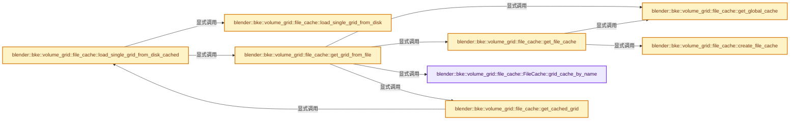
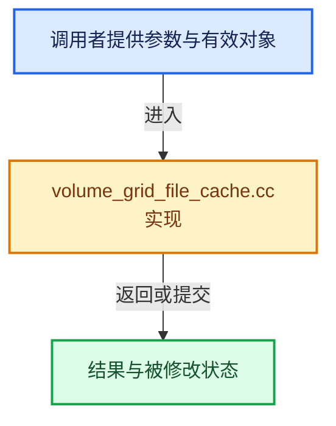

# 实现依赖专题：source/blender/blenkernel/intern/volume_grid_file_cache.cc

[方向导航](README.md) · [符号索引](../%E7%AC%A6%E5%8F%B7%E4%BE%9D%E8%B5%96%E4%B8%8E%E5%AE%9E%E7%8E%B0%E7%B4%A2%E5%BC%95.md)

本专题从正文实际调用进入，集中保存共享实现。函数有稳定锚点，可从调用处直接跳到对应完整函数；递归与互相调用通过回链组织。

## 本文件的实现关系






## 完整成员与函数实现

<a id="f-a4efd6f163ff0d70"></a>

### `blender::bke::volume_grid::file_cache::FileCache::grid_cache_by_name`

实现位置：[source/blender/blenkernel/intern/volume_grid_file_cache.cc](../../../../../source/blender/blenkernel/intern/volume_grid_file_cache.cc) · L54—L62。

接口参数：

- `const StringRef name`

**教学注释版**

<!-- annotated:5ab98d870ae4c0 -->

```cpp
  GridCache *grid_cache_by_name(const StringRef name)
  {
    for (GridCache &grid_cache : this->grids) {
      if (grid_cache.meta_data_grid->getName() == name) {
        return &grid_cache;
      }
    }
    return nullptr;
  }
```

<details>
<summary>核对原始源码：source/blender/blenkernel/intern/volume_grid_file_cache.cc · L54—L62</summary>

<!-- original:5ab98d870ae4c0:source/blender/blenkernel/intern/volume_grid_file_cache.cc:54:62 -->

```cpp
  GridCache *grid_cache_by_name(const StringRef name)
  {
    for (GridCache &grid_cache : this->grids) {
      if (grid_cache.meta_data_grid->getName() == name) {
        return &grid_cache;
      }
    }
    return nullptr;
  }
```

</details>

**结果出口**

- `return &grid_cache;`
- `return nullptr;`

**继续追踪实现**

- `grid_cache.meta_data_grid->getName` → [调用协议](../%E6%A8%A1%E6%9D%BF%E5%AE%8F%E4%B8%8E%E5%8A%A8%E6%80%81%E5%88%86%E6%B4%BE%E5%8D%8F%E8%AE%AE.md)：接收对象类型依赖auto、返回值或模板实例；不按同名猜测目标。调用位置L57。

<a id="f-b9b6cea14295dbc0"></a>

### `blender::bke::volume_grid::file_cache::get_global_cache`

实现位置：[source/blender/blenkernel/intern/volume_grid_file_cache.cc](../../../../../source/blender/blenkernel/intern/volume_grid_file_cache.cc) · L76—L80。

**教学注释版**

<!-- annotated:33b4b2141a11d1 -->

```cpp
static GlobalCache &get_global_cache()
{
  static GlobalCache global_cache;
  return global_cache;
}
```

<details>
<summary>核对原始源码：source/blender/blenkernel/intern/volume_grid_file_cache.cc · L76—L80</summary>

<!-- original:33b4b2141a11d1:source/blender/blenkernel/intern/volume_grid_file_cache.cc:76:80 -->

```cpp
static GlobalCache &get_global_cache()
{
  static GlobalCache global_cache;
  return global_cache;
}
```

</details>

**结果出口**

- `return global_cache;`

**继续追踪实现**

本实现没有需要继续展开的显式调用；检查返回表达式、对象转换和调用者前置条件。

<a id="f-a1ea3a507289fb55"></a>

### `blender::bke::volume_grid::file_cache::create_file_cache`

实现位置：[source/blender/blenkernel/intern/volume_grid_file_cache.cc](../../../../../source/blender/blenkernel/intern/volume_grid_file_cache.cc) · L86—L123。

接口参数：

- `const StringRef file_path`

**教学注释版**

<!-- annotated:e4a86263d129d8 -->

```cpp
static FileCache create_file_cache(const StringRef file_path)
{
  FileCache file_cache;

  openvdb::io::File file(file_path);
  openvdb::GridPtrVec vdb_grids;
  try {
    /* Disable delay loading and file copying, this has poor performance
     * on network drives. */
    const bool delay_load = false;
#  ifdef OPENVDB_USE_DELAYED_LOADING
    file.setCopyMaxBytes(0);
#  endif
    file.open(delay_load);
    vdb_grids = *(file.readAllGridMetadata());
    file_cache.meta_data = *file.getMetadata();
  }
  catch (const openvdb::IoError &e) {
    file_cache.error_message = e.what();
  }
  catch (...) {
    file_cache.error_message = "Unknown error reading VDB file";
  }
  if (!file_cache.error_message.empty()) {
    return file_cache;
  }

  for (openvdb::GridBase::Ptr &vdb_grid : vdb_grids) {
    if (!vdb_grid) {
      continue;
    }
    GridCache grid_cache;
    grid_cache.meta_data_grid = vdb_grid;
    // [讲解] std::move：把表达式转换成可供移动重载选择的值类别；不保证真的移动，不结束源对象寿命，对const值可能选择复制。
    file_cache.grids.append(std::move(grid_cache));
  }

  return file_cache;
}
```

<details>
<summary>核对原始源码：source/blender/blenkernel/intern/volume_grid_file_cache.cc · L86—L123</summary>

<!-- original:e4a86263d129d8:source/blender/blenkernel/intern/volume_grid_file_cache.cc:86:123 -->

```cpp
static FileCache create_file_cache(const StringRef file_path)
{
  FileCache file_cache;

  openvdb::io::File file(file_path);
  openvdb::GridPtrVec vdb_grids;
  try {
    /* Disable delay loading and file copying, this has poor performance
     * on network drives. */
    const bool delay_load = false;
#  ifdef OPENVDB_USE_DELAYED_LOADING
    file.setCopyMaxBytes(0);
#  endif
    file.open(delay_load);
    vdb_grids = *(file.readAllGridMetadata());
    file_cache.meta_data = *file.getMetadata();
  }
  catch (const openvdb::IoError &e) {
    file_cache.error_message = e.what();
  }
  catch (...) {
    file_cache.error_message = "Unknown error reading VDB file";
  }
  if (!file_cache.error_message.empty()) {
    return file_cache;
  }

  for (openvdb::GridBase::Ptr &vdb_grid : vdb_grids) {
    if (!vdb_grid) {
      continue;
    }
    GridCache grid_cache;
    grid_cache.meta_data_grid = vdb_grid;
    file_cache.grids.append(std::move(grid_cache));
  }

  return file_cache;
}
```

</details>

**沿实际写入检查状态**

- `vdb_grids = *(file.readAllGridMetadata());`
- `file_cache.meta_data = *file.getMetadata();`
- `file_cache.error_message = e.what();`
- `file_cache.error_message = "Unknown error reading VDB file";`
- `grid_cache.meta_data_grid = vdb_grid;`

**结果出口**

- `return file_cache;`

**继续追踪实现**

- `file.setCopyMaxBytes` → [调用协议](../%E6%A8%A1%E6%9D%BF%E5%AE%8F%E4%B8%8E%E5%8A%A8%E6%80%81%E5%88%86%E6%B4%BE%E5%8D%8F%E8%AE%AE.md)：由接收对象具体类型或运行时策略提供实现。调用位置L97。
- `file.open` → [调用协议](../%E6%A8%A1%E6%9D%BF%E5%AE%8F%E4%B8%8E%E5%8A%A8%E6%80%81%E5%88%86%E6%B4%BE%E5%8D%8F%E8%AE%AE.md)：由接收对象具体类型或运行时策略提供实现。调用位置L99。
- `file.readAllGridMetadata` → [调用协议](../%E6%A8%A1%E6%9D%BF%E5%AE%8F%E4%B8%8E%E5%8A%A8%E6%80%81%E5%88%86%E6%B4%BE%E5%8D%8F%E8%AE%AE.md)：由接收对象具体类型或运行时策略提供实现。调用位置L100。
- `file.getMetadata` → [调用协议](../%E6%A8%A1%E6%9D%BF%E5%AE%8F%E4%B8%8E%E5%8A%A8%E6%80%81%E5%88%86%E6%B4%BE%E5%8D%8F%E8%AE%AE.md)：由接收对象具体类型或运行时策略提供实现。调用位置L101。
- `e.what` → [GHOST_XrException::what · L22](%E4%BE%9D%E8%B5%96-GHOST_XrException-37f429.md#f-da2482d747eab515)。
- `file_cache.error_message.empty` → [调用协议](../%E6%A8%A1%E6%9D%BF%E5%AE%8F%E4%B8%8E%E5%8A%A8%E6%80%81%E5%88%86%E6%B4%BE%E5%8D%8F%E8%AE%AE.md)：接收对象类型依赖auto、返回值或模板实例；不按同名猜测目标。调用位置L109。
- `file_cache.grids.append` → [调用协议](../%E6%A8%A1%E6%9D%BF%E5%AE%8F%E4%B8%8E%E5%8A%A8%E6%80%81%E5%88%86%E6%B4%BE%E5%8D%8F%E8%AE%AE.md)：接收对象类型依赖auto、返回值或模板实例；不按同名猜测目标。调用位置L119。
- `std::move` → [外部契约](https://eel.is/c++draft/utility.forward)：把表达式转换成可供移动重载选择的值类别；不保证真的移动，不结束源对象寿命，对const值可能选择复制。

<a id="f-9925cf4957ecc630"></a>

### `blender::bke::volume_grid::file_cache::get_file_cache`

实现位置：[source/blender/blenkernel/intern/volume_grid_file_cache.cc](../../../../../source/blender/blenkernel/intern/volume_grid_file_cache.cc) · L125—L132。

接口参数：

- `const StringRef file_path`

**教学注释版**

<!-- annotated:84660896774fc0 -->

```cpp
static FileCache &get_file_cache(const StringRef file_path)
{
  GlobalCache &global_cache = get_global_cache();
  /* Assumes that the cache is locked already. */
  BLI_assert(!global_cache.mutex.try_lock());
  return global_cache.file_map.lookup_or_add_cb_as(file_path,
                                                   [&]() { return create_file_cache(file_path); });
}
```

<details>
<summary>核对原始源码：source/blender/blenkernel/intern/volume_grid_file_cache.cc · L125—L132</summary>

<!-- original:84660896774fc0:source/blender/blenkernel/intern/volume_grid_file_cache.cc:125:132 -->

```cpp
static FileCache &get_file_cache(const StringRef file_path)
{
  GlobalCache &global_cache = get_global_cache();
  /* Assumes that the cache is locked already. */
  BLI_assert(!global_cache.mutex.try_lock());
  return global_cache.file_map.lookup_or_add_cb_as(file_path,
                                                   [&]() { return create_file_cache(file_path); });
}
```

</details>

**结果出口**

- `return global_cache.file_map.lookup_or_add_cb_as(file_path,`

**继续追踪实现**

- `get_global_cache` → [blender::bke::volume_grid::file_cache::get_global_cache · L76](%E4%BE%9D%E8%B5%96-volume_grid_file_cache-3f219a.md#f-b9b6cea14295dbc0)。
- `BLI_assert` → [BLI_assert · L48](../01-%E5%9F%BA%E7%A1%80%E5%AE%B9%E5%99%A8%E4%B8%8E%E7%8E%B0%E4%BB%A3CPP/%E4%BE%9D%E8%B5%96-BLI_assert-cc98e8.md#m-57a88495704d)；[BLI_assert · L63](../01-%E5%9F%BA%E7%A1%80%E5%AE%B9%E5%99%A8%E4%B8%8E%E7%8E%B0%E4%BB%A3CPP/%E4%BE%9D%E8%B5%96-BLI_assert-cc98e8.md#m-d07050020cb5)。宏定义由构建条件选择。
- `global_cache.mutex.try_lock` → [调用协议](../%E6%A8%A1%E6%9D%BF%E5%AE%8F%E4%B8%8E%E5%8A%A8%E6%80%81%E5%88%86%E6%B4%BE%E5%8D%8F%E8%AE%AE.md)：接收对象类型依赖auto、返回值或模板实例；不按同名猜测目标。调用位置L129。
- `global_cache.file_map.lookup_or_add_cb_as` → [调用协议](../%E6%A8%A1%E6%9D%BF%E5%AE%8F%E4%B8%8E%E5%8A%A8%E6%80%81%E5%88%86%E6%B4%BE%E5%8D%8F%E8%AE%AE.md)：接收对象类型依赖auto、返回值或模板实例；不按同名猜测目标。调用位置L130。
- `create_file_cache` → [blender::bke::volume_grid::file_cache::create_file_cache · L86](%E4%BE%9D%E8%B5%96-volume_grid_file_cache-3f219a.md#f-a1ea3a507289fb55)。

<a id="f-130ce55c531a35d6"></a>

### `blender::bke::volume_grid::file_cache::load_single_grid_from_disk`

实现位置：[source/blender/blenkernel/intern/volume_grid_file_cache.cc](../../../../../source/blender/blenkernel/intern/volume_grid_file_cache.cc) · L187—L200。

接口参数：

- `const StringRef file_path`
- `const StringRef grid_name`

**教学注释版**

<!-- annotated:5a191356530e9f -->

```cpp
static openvdb::GridBase::Ptr load_single_grid_from_disk(const StringRef file_path,
                                                         const StringRef grid_name)
{
  /* Disable delay loading and file copying, this has poor performance
   * on network drivers. */
  const bool delay_load = false;

  openvdb::io::File file(file_path);
#  ifdef OPENVDB_USE_DELAYED_LOADING
  file.setCopyMaxBytes(0);
#  endif
  file.open(delay_load);
  return file.readGrid(grid_name);
}
```

<details>
<summary>核对原始源码：source/blender/blenkernel/intern/volume_grid_file_cache.cc · L187—L200</summary>

<!-- original:5a191356530e9f:source/blender/blenkernel/intern/volume_grid_file_cache.cc:187:200 -->

```cpp
static openvdb::GridBase::Ptr load_single_grid_from_disk(const StringRef file_path,
                                                         const StringRef grid_name)
{
  /* Disable delay loading and file copying, this has poor performance
   * on network drivers. */
  const bool delay_load = false;

  openvdb::io::File file(file_path);
#  ifdef OPENVDB_USE_DELAYED_LOADING
  file.setCopyMaxBytes(0);
#  endif
  file.open(delay_load);
  return file.readGrid(grid_name);
}
```

</details>

**结果出口**

- `return file.readGrid(grid_name);`

**继续追踪实现**

- `file.setCopyMaxBytes` → [调用协议](../%E6%A8%A1%E6%9D%BF%E5%AE%8F%E4%B8%8E%E5%8A%A8%E6%80%81%E5%88%86%E6%B4%BE%E5%8D%8F%E8%AE%AE.md)：由接收对象具体类型或运行时策略提供实现。调用位置L196。
- `file.open` → [调用协议](../%E6%A8%A1%E6%9D%BF%E5%AE%8F%E4%B8%8E%E5%8A%A8%E6%80%81%E5%88%86%E6%B4%BE%E5%8D%8F%E8%AE%AE.md)：由接收对象具体类型或运行时策略提供实现。调用位置L198。
- `file.readGrid` → [调用协议](../%E6%A8%A1%E6%9D%BF%E5%AE%8F%E4%B8%8E%E5%8A%A8%E6%80%81%E5%88%86%E6%B4%BE%E5%8D%8F%E8%AE%AE.md)：由接收对象具体类型或运行时策略提供实现。调用位置L199。

<a id="f-ae9fa148dc7effa4"></a>

### `blender::bke::volume_grid::file_cache::load_single_grid_from_disk_cached`

实现位置：[source/blender/blenkernel/intern/volume_grid_file_cache.cc](../../../../../source/blender/blenkernel/intern/volume_grid_file_cache.cc) · L206—L242。

接口参数：

- `const StringRef file_path`
- `const StringRef grid_name`
- `const int simplify_level`

**教学注释版**

<!-- annotated:411dcc70041042 -->

```cpp
static LazyLoadedGrid load_single_grid_from_disk_cached(const StringRef file_path,
                                                        const StringRef grid_name,
                                                        const int simplify_level)
{
  GridReadKey key;
  key.file_path = file_path;
  key.grid_name = grid_name;
  key.simplify_level = simplify_level;

  std::shared_ptr<const GridReadValue> value = memory_cache::get<GridReadValue>(key, [&key]() {
    openvdb::GridBase::Ptr grid;
    if (key.simplify_level == 0) {
      grid = load_single_grid_from_disk(key.file_path, key.grid_name);
    }
    else {
      /* Build the simplified grid from the main grid. */
      const GVolumeGrid main_grid = get_grid_from_file(key.file_path, key.grid_name, 0);
      const VolumeGridType grid_type = main_grid->grid_type();
      const float resolution_factor = 1.0f / (1 << key.simplify_level);
      VolumeTreeAccessToken tree_token;
      grid = BKE_volume_grid_create_with_changed_resolution(
          grid_type, main_grid->grid(tree_token), resolution_factor);
    }
    // [讲解] std::make_unique<GridReadValue>：创建独占拥有的对象，拥有关系可移动，get返回的借用指针不自动延长寿命。
    auto value = std::make_unique<GridReadValue>();
    // [讲解] std::move：把表达式转换成可供移动重载选择的值类别；不保证真的移动，不结束源对象寿命，对const值可能选择复制。
    value->grid = std::move(grid);
    value->tree_sharing_info = OpenvdbTreeSharingInfo::make(value->grid->baseTreePtr());
    return value;
  });
  if (!value) {
    return {};
  }

  /* Copy the grid so that it has a single owner. Note that the tree is still shared. */
  openvdb::GridBase::Ptr grid = value->grid->copyGrid();
  grid->setTransform(grid->transform().copy());
  return {grid, value->tree_sharing_info};
}
```

<details>
<summary>核对原始源码：source/blender/blenkernel/intern/volume_grid_file_cache.cc · L206—L242</summary>

<!-- original:411dcc70041042:source/blender/blenkernel/intern/volume_grid_file_cache.cc:206:242 -->

```cpp
static LazyLoadedGrid load_single_grid_from_disk_cached(const StringRef file_path,
                                                        const StringRef grid_name,
                                                        const int simplify_level)
{
  GridReadKey key;
  key.file_path = file_path;
  key.grid_name = grid_name;
  key.simplify_level = simplify_level;

  std::shared_ptr<const GridReadValue> value = memory_cache::get<GridReadValue>(key, [&key]() {
    openvdb::GridBase::Ptr grid;
    if (key.simplify_level == 0) {
      grid = load_single_grid_from_disk(key.file_path, key.grid_name);
    }
    else {
      /* Build the simplified grid from the main grid. */
      const GVolumeGrid main_grid = get_grid_from_file(key.file_path, key.grid_name, 0);
      const VolumeGridType grid_type = main_grid->grid_type();
      const float resolution_factor = 1.0f / (1 << key.simplify_level);
      VolumeTreeAccessToken tree_token;
      grid = BKE_volume_grid_create_with_changed_resolution(
          grid_type, main_grid->grid(tree_token), resolution_factor);
    }
    auto value = std::make_unique<GridReadValue>();
    value->grid = std::move(grid);
    value->tree_sharing_info = OpenvdbTreeSharingInfo::make(value->grid->baseTreePtr());
    return value;
  });
  if (!value) {
    return {};
  }

  /* Copy the grid so that it has a single owner. Note that the tree is still shared. */
  openvdb::GridBase::Ptr grid = value->grid->copyGrid();
  grid->setTransform(grid->transform().copy());
  return {grid, value->tree_sharing_info};
}
```

</details>

**沿实际写入检查状态**

- `key.file_path = file_path;`
- `key.grid_name = grid_name;`
- `key.simplify_level = simplify_level;`
- `grid = load_single_grid_from_disk(key.file_path, key.grid_name);`
- `grid = BKE_volume_grid_create_with_changed_resolution(`
- `value->grid = std::move(grid);`
- `value->tree_sharing_info = OpenvdbTreeSharingInfo::make(value->grid->baseTreePtr());`

**结果出口**

- `return value;`
- `return {};`
- `return {grid, value->tree_sharing_info};`

**继续追踪实现**

- `memory_cache::get<GridReadValue>` → [blender::memory_cache::get · L71](../03-%E5%86%85%E5%AD%98%E5%88%86%E9%85%8D%E4%B8%8E%E8%BF%90%E8%A1%8C%E6%97%B6%E7%B1%BB%E5%9E%8B/%E4%BE%9D%E8%B5%96-BLI_memory_cache-da9f93.md#f-9502b9f00795f10d)。
- `load_single_grid_from_disk` → [blender::bke::volume_grid::file_cache::load_single_grid_from_disk · L187](%E4%BE%9D%E8%B5%96-volume_grid_file_cache-3f219a.md#f-130ce55c531a35d6)。
- `get_grid_from_file` → [blender::bke::volume_grid::file_cache::get_grid_from_file · L276](%E4%BE%9D%E8%B5%96-volume_grid_file_cache-3f219a.md#f-5a5a0153c1661f12)。
- `main_grid->grid_type` → [blender::bke::volume_grid::VolumeGridData::grid_type · L162](%E4%BE%9D%E8%B5%96-volume_grid-a7c9da.md#f-0a131609bd285679)。
- `BKE_volume_grid_create_with_changed_resolution` → [blender::BKE_volume_grid_create_with_changed_resolution · L1178](%E4%BE%9D%E8%B5%96-volume-8dd0eb.md#f-1b084b7bfa1b43aa)。
- `main_grid->grid` → [调用协议](../%E6%A8%A1%E6%9D%BF%E5%AE%8F%E4%B8%8E%E5%8A%A8%E6%80%81%E5%88%86%E6%B4%BE%E5%8D%8F%E8%AE%AE.md)：由接收对象具体类型或运行时策略提供实现。调用位置L227。
- `std::make_unique<GridReadValue>` → [外部契约](https://eel.is/c++draft/unique.ptr.create)：创建独占拥有的对象，拥有关系可移动，get返回的借用指针不自动延长寿命。
- `std::move` → [外部契约](https://eel.is/c++draft/utility.forward)：把表达式转换成可供移动重载选择的值类别；不保证真的移动，不结束源对象寿命，对const值可能选择复制。
- `OpenvdbTreeSharingInfo::make` → [blender::bke::volume_grid::OpenvdbTreeSharingInfo::make · L456](%E4%BE%9D%E8%B5%96-volume_grid-a7c9da.md#f-3662d20b40c4dc08)。
- `value->grid->baseTreePtr` → [调用协议](../%E6%A8%A1%E6%9D%BF%E5%AE%8F%E4%B8%8E%E5%8A%A8%E6%80%81%E5%88%86%E6%B4%BE%E5%8D%8F%E8%AE%AE.md)：接收对象类型依赖auto、返回值或模板实例；不按同名猜测目标。调用位置L231。
- `value->grid->copyGrid` → [调用协议](../%E6%A8%A1%E6%9D%BF%E5%AE%8F%E4%B8%8E%E5%8A%A8%E6%80%81%E5%88%86%E6%B4%BE%E5%8D%8F%E8%AE%AE.md)：接收对象类型依赖auto、返回值或模板实例；不按同名猜测目标。调用位置L239。
- `grid->setTransform` → [调用协议](../%E6%A8%A1%E6%9D%BF%E5%AE%8F%E4%B8%8E%E5%8A%A8%E6%80%81%E5%88%86%E6%B4%BE%E5%8D%8F%E8%AE%AE.md)：由接收对象具体类型或运行时策略提供实现。调用位置L240。
- `grid->transform().copy` → [调用协议](../%E6%A8%A1%E6%9D%BF%E5%AE%8F%E4%B8%8E%E5%8A%A8%E6%80%81%E5%88%86%E6%B4%BE%E5%8D%8F%E8%AE%AE.md)：接收对象类型依赖auto、返回值或模板实例；不按同名猜测目标。调用位置L240。
- `grid->transform` → [调用协议](../%E6%A8%A1%E6%9D%BF%E5%AE%8F%E4%B8%8E%E5%8A%A8%E6%80%81%E5%88%86%E6%B4%BE%E5%8D%8F%E8%AE%AE.md)：由接收对象具体类型或运行时策略提供实现。调用位置L240。

<a id="f-ba931dafcb86f624"></a>

### `blender::bke::volume_grid::file_cache::get_cached_grid`

实现位置：[source/blender/blenkernel/intern/volume_grid_file_cache.cc](../../../../../source/blender/blenkernel/intern/volume_grid_file_cache.cc) · L248—L274。

接口参数：

- `const StringRef file_path`
- `GridCache &grid_cache`
- `const int simplify_level`

**教学注释版**

<!-- annotated:d964826dee744a -->

```cpp
static GVolumeGrid get_cached_grid(const StringRef file_path,
                                   GridCache &grid_cache,
                                   const int simplify_level)
{
  if (GVolumeGrid *grid = grid_cache.grid_by_simplify_level.lookup_ptr(simplify_level)) {
    return *grid;
  }
  /* A callback that actually loads the full grid including the tree when it's accessed. */
  auto load_grid_fn = [file_path = std::string(file_path),
                       grid_name = std::string(grid_cache.meta_data_grid->getName()),
                       simplify_level]() -> LazyLoadedGrid {
    return load_single_grid_from_disk_cached(file_path, grid_name, simplify_level);
  };
  /* This allows the returned grid to already contain meta-data and transforms, even if the tree is
   * not loaded yet. */
  openvdb::GridBase::Ptr meta_data_and_transform_grid;
  if (simplify_level == 0) {
    /* Only pass the meta-data grid when there is no simplification for now. For simplified grids,
     * the transform would have to be updated here already. */
    meta_data_and_transform_grid = grid_cache.meta_data_grid->copyGrid();
  }
  VolumeGridData *grid_data = MEM_new<VolumeGridData>(
      __func__, load_grid_fn, meta_data_and_transform_grid);
  GVolumeGrid grid{grid_data};
  grid_cache.grid_by_simplify_level.add(simplify_level, grid);
  return grid;
}
```

<details>
<summary>核对原始源码：source/blender/blenkernel/intern/volume_grid_file_cache.cc · L248—L274</summary>

<!-- original:d964826dee744a:source/blender/blenkernel/intern/volume_grid_file_cache.cc:248:274 -->

```cpp
static GVolumeGrid get_cached_grid(const StringRef file_path,
                                   GridCache &grid_cache,
                                   const int simplify_level)
{
  if (GVolumeGrid *grid = grid_cache.grid_by_simplify_level.lookup_ptr(simplify_level)) {
    return *grid;
  }
  /* A callback that actually loads the full grid including the tree when it's accessed. */
  auto load_grid_fn = [file_path = std::string(file_path),
                       grid_name = std::string(grid_cache.meta_data_grid->getName()),
                       simplify_level]() -> LazyLoadedGrid {
    return load_single_grid_from_disk_cached(file_path, grid_name, simplify_level);
  };
  /* This allows the returned grid to already contain meta-data and transforms, even if the tree is
   * not loaded yet. */
  openvdb::GridBase::Ptr meta_data_and_transform_grid;
  if (simplify_level == 0) {
    /* Only pass the meta-data grid when there is no simplification for now. For simplified grids,
     * the transform would have to be updated here already. */
    meta_data_and_transform_grid = grid_cache.meta_data_grid->copyGrid();
  }
  VolumeGridData *grid_data = MEM_new<VolumeGridData>(
      __func__, load_grid_fn, meta_data_and_transform_grid);
  GVolumeGrid grid{grid_data};
  grid_cache.grid_by_simplify_level.add(simplify_level, grid);
  return grid;
}
```

</details>

**沿实际写入检查状态**

- `grid_name = std::string(grid_cache.meta_data_grid->getName()),`
- `meta_data_and_transform_grid = grid_cache.meta_data_grid->copyGrid();`

**结果出口**

- `return *grid;`
- `return load_single_grid_from_disk_cached(file_path, grid_name, simplify_level);`
- `return grid;`

**继续追踪实现**

- `grid_cache.grid_by_simplify_level.lookup_ptr` → [调用协议](../%E6%A8%A1%E6%9D%BF%E5%AE%8F%E4%B8%8E%E5%8A%A8%E6%80%81%E5%88%86%E6%B4%BE%E5%8D%8F%E8%AE%AE.md)：接收对象类型依赖auto、返回值或模板实例；不按同名猜测目标。调用位置L252。
- `std::string` → [外部契约](https://eel.is/c++draft/)：这个边界按实际表达式及所属类型核对参数、返回值、寿命与失败行为。这里提供接口入口，不声称已解释该第三方版本的内部实现。
- `grid_cache.meta_data_grid->getName` → [调用协议](../%E6%A8%A1%E6%9D%BF%E5%AE%8F%E4%B8%8E%E5%8A%A8%E6%80%81%E5%88%86%E6%B4%BE%E5%8D%8F%E8%AE%AE.md)：接收对象类型依赖auto、返回值或模板实例；不按同名猜测目标。调用位置L257。
- `load_single_grid_from_disk_cached` → [blender::bke::volume_grid::file_cache::load_single_grid_from_disk_cached · L206](%E4%BE%9D%E8%B5%96-volume_grid_file_cache-3f219a.md#f-ae9fa148dc7effa4)。
- `grid_cache.meta_data_grid->copyGrid` → [调用协议](../%E6%A8%A1%E6%9D%BF%E5%AE%8F%E4%B8%8E%E5%8A%A8%E6%80%81%E5%88%86%E6%B4%BE%E5%8D%8F%E8%AE%AE.md)：接收对象类型依赖auto、返回值或模板实例；不按同名猜测目标。调用位置L267。
- `MEM_new<VolumeGridData>` → [MEM_new · L351](../03-%E5%86%85%E5%AD%98%E5%88%86%E9%85%8D%E4%B8%8E%E8%BF%90%E8%A1%8C%E6%97%B6%E7%B1%BB%E5%9E%8B/%E4%BE%9D%E8%B5%96-MEM_guardedalloc-b54eca.md#f-115f9b6784f89912)。
- `grid_cache.grid_by_simplify_level.add` → [调用协议](../%E6%A8%A1%E6%9D%BF%E5%AE%8F%E4%B8%8E%E5%8A%A8%E6%80%81%E5%88%86%E6%B4%BE%E5%8D%8F%E8%AE%AE.md)：接收对象类型依赖auto、返回值或模板实例；不按同名猜测目标。调用位置L272。

<a id="f-5a5a0153c1661f12"></a>

### `blender::bke::volume_grid::file_cache::get_grid_from_file`

实现位置：[source/blender/blenkernel/intern/volume_grid_file_cache.cc](../../../../../source/blender/blenkernel/intern/volume_grid_file_cache.cc) · L276—L287。

接口参数：

- `const StringRef file_path`
- `const StringRef grid_name`
- `const int simplify_level`

**教学注释版**

<!-- annotated:45cc5dcc26366e -->

```cpp
GVolumeGrid get_grid_from_file(const StringRef file_path,
                               const StringRef grid_name,
                               const int simplify_level)
{
  GlobalCache &global_cache = get_global_cache();
  std::lock_guard lock{global_cache.mutex};
  FileCache &file_cache = get_file_cache(file_path);
  if (GridCache *grid_cache = file_cache.grid_cache_by_name(grid_name)) {
    return get_cached_grid(file_path, *grid_cache, simplify_level);
  }
  return {};
}
```

<details>
<summary>核对原始源码：source/blender/blenkernel/intern/volume_grid_file_cache.cc · L276—L287</summary>

<!-- original:45cc5dcc26366e:source/blender/blenkernel/intern/volume_grid_file_cache.cc:276:287 -->

```cpp
GVolumeGrid get_grid_from_file(const StringRef file_path,
                               const StringRef grid_name,
                               const int simplify_level)
{
  GlobalCache &global_cache = get_global_cache();
  std::lock_guard lock{global_cache.mutex};
  FileCache &file_cache = get_file_cache(file_path);
  if (GridCache *grid_cache = file_cache.grid_cache_by_name(grid_name)) {
    return get_cached_grid(file_path, *grid_cache, simplify_level);
  }
  return {};
}
```

</details>

**结果出口**

- `return get_cached_grid(file_path, *grid_cache, simplify_level);`
- `return {};`

**继续追踪实现**

- `get_global_cache` → [blender::bke::volume_grid::file_cache::get_global_cache · L76](%E4%BE%9D%E8%B5%96-volume_grid_file_cache-3f219a.md#f-b9b6cea14295dbc0)。
- `get_file_cache` → [blender::bke::volume_grid::file_cache::get_file_cache · L125](%E4%BE%9D%E8%B5%96-volume_grid_file_cache-3f219a.md#f-9925cf4957ecc630)。
- `file_cache.grid_cache_by_name` → [blender::bke::volume_grid::file_cache::FileCache::grid_cache_by_name · L54](%E4%BE%9D%E8%B5%96-volume_grid_file_cache-3f219a.md#f-a4efd6f163ff0d70)。
- `get_cached_grid` → [blender::bke::volume_grid::file_cache::get_cached_grid · L248](%E4%BE%9D%E8%B5%96-volume_grid_file_cache-3f219a.md#f-ba931dafcb86f624)。

<a id="f-4e9ea5bd2089509c"></a>

### `blender::bke::volume_grid::file_cache::get_all_grids_from_file`

实现位置：[source/blender/blenkernel/intern/volume_grid_file_cache.cc](../../../../../source/blender/blenkernel/intern/volume_grid_file_cache.cc) · L289—L305。

接口参数：

- `const StringRef file_path`
- `const int simplify_level`

**教学注释版**

<!-- annotated:47127c9012bbf5 -->

```cpp
GridsFromFile get_all_grids_from_file(const StringRef file_path, const int simplify_level)
{
  GridsFromFile result;
  GlobalCache &global_cache = get_global_cache();
  std::lock_guard lock{global_cache.mutex};
  FileCache &file_cache = get_file_cache(file_path);

  if (!file_cache.error_message.empty()) {
    result.error_message = file_cache.error_message;
    return result;
  }
  // [讲解] std::make_shared<openvdb::MetaMap>：构造由共享控制块管理的对象；共享寿命不自动使被指对象读写线程安全，强引用环需单独处理。
  result.file_meta_data = std::make_shared<openvdb::MetaMap>(file_cache.meta_data);
  for (GridCache &grid_cache : file_cache.grids) {
    result.grids.append(get_cached_grid(file_path, grid_cache, simplify_level));
  }
  return result;
}
```

<details>
<summary>核对原始源码：source/blender/blenkernel/intern/volume_grid_file_cache.cc · L289—L305</summary>

<!-- original:47127c9012bbf5:source/blender/blenkernel/intern/volume_grid_file_cache.cc:289:305 -->

```cpp
GridsFromFile get_all_grids_from_file(const StringRef file_path, const int simplify_level)
{
  GridsFromFile result;
  GlobalCache &global_cache = get_global_cache();
  std::lock_guard lock{global_cache.mutex};
  FileCache &file_cache = get_file_cache(file_path);

  if (!file_cache.error_message.empty()) {
    result.error_message = file_cache.error_message;
    return result;
  }
  result.file_meta_data = std::make_shared<openvdb::MetaMap>(file_cache.meta_data);
  for (GridCache &grid_cache : file_cache.grids) {
    result.grids.append(get_cached_grid(file_path, grid_cache, simplify_level));
  }
  return result;
}
```

</details>

**沿实际写入检查状态**

- `result.error_message = file_cache.error_message;`
- `result.file_meta_data = std::make_shared<openvdb::MetaMap>(file_cache.meta_data);`

**结果出口**

- `return result;`

**继续追踪实现**

- `get_global_cache` → [blender::bke::volume_grid::file_cache::get_global_cache · L76](%E4%BE%9D%E8%B5%96-volume_grid_file_cache-3f219a.md#f-b9b6cea14295dbc0)。
- `get_file_cache` → [blender::bke::volume_grid::file_cache::get_file_cache · L125](%E4%BE%9D%E8%B5%96-volume_grid_file_cache-3f219a.md#f-9925cf4957ecc630)。
- `file_cache.error_message.empty` → [调用协议](../%E6%A8%A1%E6%9D%BF%E5%AE%8F%E4%B8%8E%E5%8A%A8%E6%80%81%E5%88%86%E6%B4%BE%E5%8D%8F%E8%AE%AE.md)：接收对象类型依赖auto、返回值或模板实例；不按同名猜测目标。调用位置L296。
- `std::make_shared<openvdb::MetaMap>` → [外部契约](https://eel.is/c++draft/util.smartptr.shared.create)：构造由共享控制块管理的对象；共享寿命不自动使被指对象读写线程安全，强引用环需单独处理。
- `result.grids.append` → [调用协议](../%E6%A8%A1%E6%9D%BF%E5%AE%8F%E4%B8%8E%E5%8A%A8%E6%80%81%E5%88%86%E6%B4%BE%E5%8D%8F%E8%AE%AE.md)：接收对象类型依赖auto、返回值或模板实例；不按同名猜测目标。调用位置L302。
- `get_cached_grid` → [blender::bke::volume_grid::file_cache::get_cached_grid · L248](%E4%BE%9D%E8%B5%96-volume_grid_file_cache-3f219a.md#f-ba931dafcb86f624)。
