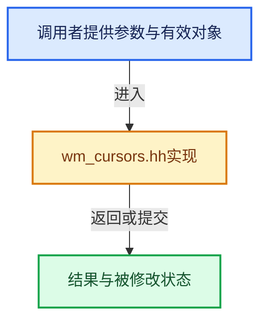

# 实现依赖专题：source/blender/windowmanager/wm_cursors.hh

[方向导航](README.md) · [符号索引](../%E7%AC%A6%E5%8F%B7%E4%BE%9D%E8%B5%96%E4%B8%8E%E5%AE%9E%E7%8E%B0%E7%B4%A2%E5%BC%95.md)

本专题从正文实际调用进入，集中保存共享实现。函数有稳定锚点，可从调用处直接跳到对应完整函数；递归与互相调用通过回链组织。

## 本文件的实现关系





## 相关类型布局与成员入口

<a id="t-deb33f2585f5"></a>

### `blender::wmCursorType`

原始声明：[source/blender/windowmanager/wm_cursors.hh](../../../../../source/blender/windowmanager/wm_cursors.hh) · L16—L73。

以下保留类的数据声明与编译条件，成员函数实现通过后面的精确链接阅读。

<!-- annotated:037151b36937a4 -->

```cpp
enum wmCursorType {
  WM_CURSOR_DEFAULT = 1,
  WM_CURSOR_TEXT_EDIT,
  WM_CURSOR_WAIT,
  WM_CURSOR_STOP,
  WM_CURSOR_EDIT,
  WM_CURSOR_COPY,
  WM_CURSOR_MOVE,
  WM_CURSOR_HAND,
  WM_CURSOR_HAND_CLOSED,
  WM_CURSOR_HAND_POINT,

  WM_CURSOR_CROSS,
  WM_CURSOR_PAINT,
  WM_CURSOR_DOT,
  WM_CURSOR_CROSSC,

  WM_CURSOR_KNIFE,
  WM_CURSOR_BLADE,
  WM_CURSOR_VERTEX_LOOP,
  WM_CURSOR_PAINT_BRUSH,
  WM_CURSOR_ERASER,
  WM_CURSOR_EYEDROPPER,

  WM_CURSOR_SWAP_AREA,
  WM_CURSOR_X_MOVE,
  WM_CURSOR_Y_MOVE,
  WM_CURSOR_H_SPLIT,
  WM_CURSOR_V_SPLIT,

  WM_CURSOR_NW_ARROW,
  WM_CURSOR_NS_ARROW,
  WM_CURSOR_EW_ARROW,
  WM_CURSOR_N_ARROW,
  WM_CURSOR_S_ARROW,
  WM_CURSOR_E_ARROW,
  WM_CURSOR_W_ARROW,

  WM_CURSOR_NSEW_SCROLL,
  WM_CURSOR_NS_SCROLL,
  WM_CURSOR_EW_SCROLL,

  WM_CURSOR_ZOOM_IN,
  WM_CURSOR_ZOOM_OUT,

  WM_CURSOR_NONE,
  WM_CURSOR_MUTE,

  WM_CURSOR_PICK_AREA,

  WM_CURSOR_LEFT_HANDLE,
  WM_CURSOR_RIGHT_HANDLE,
  WM_CURSOR_BOTH_HANDLES,
  WM_CURSOR_SLIP,

  /* --- ALWAYS LAST ----- */
  WM_CURSOR_NUM,
};
```

<details>
<summary>核对原始源码：source/blender/windowmanager/wm_cursors.hh · L16—L73</summary>

<!-- original:037151b36937a4:source/blender/windowmanager/wm_cursors.hh:16:73 -->

```cpp
enum wmCursorType {
  WM_CURSOR_DEFAULT = 1,
  WM_CURSOR_TEXT_EDIT,
  WM_CURSOR_WAIT,
  WM_CURSOR_STOP,
  WM_CURSOR_EDIT,
  WM_CURSOR_COPY,
  WM_CURSOR_MOVE,
  WM_CURSOR_HAND,
  WM_CURSOR_HAND_CLOSED,
  WM_CURSOR_HAND_POINT,

  WM_CURSOR_CROSS,
  WM_CURSOR_PAINT,
  WM_CURSOR_DOT,
  WM_CURSOR_CROSSC,

  WM_CURSOR_KNIFE,
  WM_CURSOR_BLADE,
  WM_CURSOR_VERTEX_LOOP,
  WM_CURSOR_PAINT_BRUSH,
  WM_CURSOR_ERASER,
  WM_CURSOR_EYEDROPPER,

  WM_CURSOR_SWAP_AREA,
  WM_CURSOR_X_MOVE,
  WM_CURSOR_Y_MOVE,
  WM_CURSOR_H_SPLIT,
  WM_CURSOR_V_SPLIT,

  WM_CURSOR_NW_ARROW,
  WM_CURSOR_NS_ARROW,
  WM_CURSOR_EW_ARROW,
  WM_CURSOR_N_ARROW,
  WM_CURSOR_S_ARROW,
  WM_CURSOR_E_ARROW,
  WM_CURSOR_W_ARROW,

  WM_CURSOR_NSEW_SCROLL,
  WM_CURSOR_NS_SCROLL,
  WM_CURSOR_EW_SCROLL,

  WM_CURSOR_ZOOM_IN,
  WM_CURSOR_ZOOM_OUT,

  WM_CURSOR_NONE,
  WM_CURSOR_MUTE,

  WM_CURSOR_PICK_AREA,

  WM_CURSOR_LEFT_HANDLE,
  WM_CURSOR_RIGHT_HANDLE,
  WM_CURSOR_BOTH_HANDLES,
  WM_CURSOR_SLIP,

  /* --- ALWAYS LAST ----- */
  WM_CURSOR_NUM,
};
```

</details>


## 完整成员与函数实现
