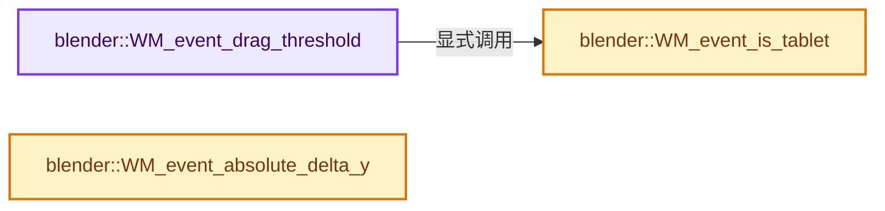

# 实现依赖专题：source/blender/windowmanager/intern/wm_event_query.cc

[方向导航](README.md) · [符号索引](../%E7%AC%A6%E5%8F%B7%E4%BE%9D%E8%B5%96%E4%B8%8E%E5%AE%9E%E7%8E%B0%E7%B4%A2%E5%BC%95.md)

本专题从正文实际调用进入，集中保存共享实现。函数有稳定锚点，可从调用处直接跳到对应完整函数；递归与互相调用通过回链组织。

## 本文件的实现关系




## 完整成员与函数实现

<a id="f-1065f10e02e67852"></a>

### `blender::WM_event_drag_threshold`

实现位置：[source/blender/windowmanager/intern/wm_event_query.cc](../../../../../source/blender/windowmanager/intern/wm_event_query.cc) · L407—L427。

接口参数：

- `const wmEvent *event`

**教学注释版**

<!-- annotated:f1d44087275b55 -->

```cpp
int WM_event_drag_threshold(const wmEvent *event)
{
  int drag_threshold;
  BLI_assert(event->prev_press_type != MOUSEMOVE);
  if (ISMOUSE_BUTTON(event->prev_press_type)) {
    /* Using the previous type is important is we want to check the last pressed/released button,
     * The `event->type` would include #MOUSEMOVE which is always the case when dragging
     * and does not help us know which threshold to use. */
    if (WM_event_is_tablet(event)) {
      drag_threshold = U.drag_threshold_tablet;
    }
    else {
      drag_threshold = U.drag_threshold_mouse;
    }
  }
  else {
    /* Typically keyboard, could be NDOF button or other less common types. */
    drag_threshold = U.drag_threshold;
  }
  return drag_threshold * UI_SCALE_FAC;
}
```

<details>
<summary>核对原始源码：source/blender/windowmanager/intern/wm_event_query.cc · L407—L427</summary>

<!-- original:f1d44087275b55:source/blender/windowmanager/intern/wm_event_query.cc:407:427 -->

```cpp
int WM_event_drag_threshold(const wmEvent *event)
{
  int drag_threshold;
  BLI_assert(event->prev_press_type != MOUSEMOVE);
  if (ISMOUSE_BUTTON(event->prev_press_type)) {
    /* Using the previous type is important is we want to check the last pressed/released button,
     * The `event->type` would include #MOUSEMOVE which is always the case when dragging
     * and does not help us know which threshold to use. */
    if (WM_event_is_tablet(event)) {
      drag_threshold = U.drag_threshold_tablet;
    }
    else {
      drag_threshold = U.drag_threshold_mouse;
    }
  }
  else {
    /* Typically keyboard, could be NDOF button or other less common types. */
    drag_threshold = U.drag_threshold;
  }
  return drag_threshold * UI_SCALE_FAC;
}
```

</details>

**沿实际写入检查状态**

- `drag_threshold = U.drag_threshold_tablet;`
- `drag_threshold = U.drag_threshold_mouse;`
- `drag_threshold = U.drag_threshold;`

**结果出口**

- `return drag_threshold * UI_SCALE_FAC;`

**继续追踪实现**

- `BLI_assert` → [BLI_assert · L48](../01-%E5%9F%BA%E7%A1%80%E5%AE%B9%E5%99%A8%E4%B8%8E%E7%8E%B0%E4%BB%A3CPP/%E4%BE%9D%E8%B5%96-BLI_assert-cc98e8.md#m-57a88495704d)；[BLI_assert · L63](../01-%E5%9F%BA%E7%A1%80%E5%AE%B9%E5%99%A8%E4%B8%8E%E7%8E%B0%E4%BB%A3CPP/%E4%BE%9D%E8%B5%96-BLI_assert-cc98e8.md#m-d07050020cb5)。宏定义由构建条件选择。
- `ISMOUSE_BUTTON` → [ISMOUSE_BUTTON · L424](%E4%BE%9D%E8%B5%96-wm_event_types-1eaf8f.md#m-81751ae40f08)。宏定义由构建条件选择。
- `WM_event_is_tablet` → [blender::WM_event_is_tablet · L640](%E4%BE%9D%E8%B5%96-wm_event_query-3f5652.md#f-26b004d3cc7eb3ce)。

<a id="f-26b004d3cc7eb3ce"></a>

### `blender::WM_event_is_tablet`

实现位置：[source/blender/windowmanager/intern/wm_event_query.cc](../../../../../source/blender/windowmanager/intern/wm_event_query.cc) · L640—L643。

接口参数：

- `const wmEvent *event`

**教学注释版**

<!-- annotated:36a61a68da611f -->

```cpp
bool WM_event_is_tablet(const wmEvent *event)
{
  return (event->tablet.active != EVT_TABLET_NONE);
}
```

<details>
<summary>核对原始源码：source/blender/windowmanager/intern/wm_event_query.cc · L640—L643</summary>

<!-- original:36a61a68da611f:source/blender/windowmanager/intern/wm_event_query.cc:640:643 -->

```cpp
bool WM_event_is_tablet(const wmEvent *event)
{
  return (event->tablet.active != EVT_TABLET_NONE);
}
```

</details>

**结果出口**

- `return (event->tablet.active != EVT_TABLET_NONE);`

**继续追踪实现**

本实现没有需要继续展开的显式调用；检查返回表达式、对象转换和调用者前置条件。

<a id="f-16053d03de44f715"></a>

### `blender::WM_event_absolute_delta_y`

实现位置：[source/blender/windowmanager/intern/wm_event_query.cc](../../../../../source/blender/windowmanager/intern/wm_event_query.cc) · L666—L675。

接口参数：

- `const wmEvent *event`

**教学注释版**

<!-- annotated:b9cb285ea798b8 -->

```cpp
int WM_event_absolute_delta_y(const wmEvent *event)
{
  int dy = event->xy[1] - event->prev_xy[1];

  if ((event->flag & WM_EVENT_SCROLL_INVERT) == 0) {
    dy = -dy;
  }

  return dy;
}
```

<details>
<summary>核对原始源码：source/blender/windowmanager/intern/wm_event_query.cc · L666—L675</summary>

<!-- original:b9cb285ea798b8:source/blender/windowmanager/intern/wm_event_query.cc:666:675 -->

```cpp
int WM_event_absolute_delta_y(const wmEvent *event)
{
  int dy = event->xy[1] - event->prev_xy[1];

  if ((event->flag & WM_EVENT_SCROLL_INVERT) == 0) {
    dy = -dy;
  }

  return dy;
}
```

</details>

**沿实际写入检查状态**

- `dy = -dy;`

**结果出口**

- `return dy;`

**继续追踪实现**

本实现没有需要继续展开的显式调用；检查返回表达式、对象转换和调用者前置条件。
