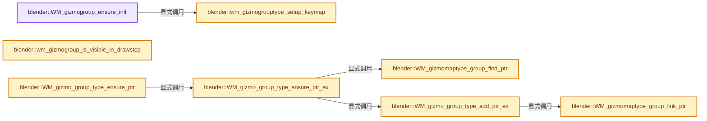
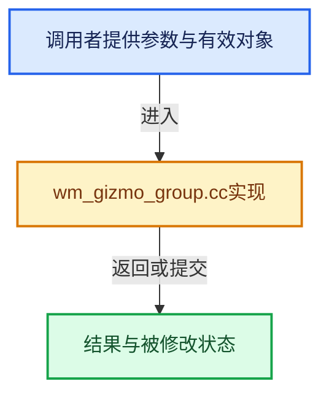

# 实现依赖专题：source/blender/windowmanager/gizmo/intern/wm_gizmo_group.cc

[方向导航](README.md) · [符号索引](../%E7%AC%A6%E5%8F%B7%E4%BE%9D%E8%B5%96%E4%B8%8E%E5%AE%9E%E7%8E%B0%E7%B4%A2%E5%BC%95.md)

本专题从正文实际调用进入，集中保存共享实现。函数有稳定锚点，可从调用处直接跳到对应完整函数；递归与互相调用通过回链组织。

## 本文件的实现关系






## 完整成员与函数实现

<a id="f-d8e6a4510bd5569a"></a>

### `blender::WM_gizmogroup_ensure_init`

实现位置：[source/blender/windowmanager/gizmo/intern/wm_gizmo_group.cc](../../../../../source/blender/windowmanager/gizmo/intern/wm_gizmo_group.cc) · L240—L265。

接口参数：

- `const bContext *C`
- `wmGizmoGroup *gzgroup`

**教学注释版**

<!-- annotated:2f50f2b5538999 -->

```cpp
void WM_gizmogroup_ensure_init(const bContext *C, wmGizmoGroup *gzgroup)
{
  /* Prepare for first draw. */
  if ((gzgroup->init_flag & WM_GIZMOGROUP_INIT_SETUP) == 0) [[unlikely]] {

    gzgroup->type->setup(C, gzgroup);

    /* Not ideal, initialize keymap here, needed for RNA runtime generated gizmos. */
    wmGizmoGroupType *gzgt = gzgroup->type;
    if (gzgt->keymap == nullptr) {
      wmWindowManager *wm = CTX_wm_manager(C);
      wm_gizmogrouptype_setup_keymap(gzgt, wm->runtime->defaultconf);
      BLI_assert(gzgt->keymap != nullptr);
    }
    gzgroup->init_flag |= WM_GIZMOGROUP_INIT_SETUP;
  }

  /* Refresh may be called multiple times,
   * this just ensures its called at least once before we draw. */
  if ((gzgroup->init_flag & WM_GIZMOGROUP_INIT_REFRESH) == 0) [[unlikely]] {
    /* Clear the flag before calling refresh so the callback
     * can postpone the refresh by clearing this flag. */
    gzgroup->init_flag |= WM_GIZMOGROUP_INIT_REFRESH;
    WM_gizmo_group_refresh(C, gzgroup);
  }
}
```

<details>
<summary>核对原始源码：source/blender/windowmanager/gizmo/intern/wm_gizmo_group.cc · L240—L265</summary>

<!-- original:2f50f2b5538999:source/blender/windowmanager/gizmo/intern/wm_gizmo_group.cc:240:265 -->

```cpp
void WM_gizmogroup_ensure_init(const bContext *C, wmGizmoGroup *gzgroup)
{
  /* Prepare for first draw. */
  if ((gzgroup->init_flag & WM_GIZMOGROUP_INIT_SETUP) == 0) [[unlikely]] {

    gzgroup->type->setup(C, gzgroup);

    /* Not ideal, initialize keymap here, needed for RNA runtime generated gizmos. */
    wmGizmoGroupType *gzgt = gzgroup->type;
    if (gzgt->keymap == nullptr) {
      wmWindowManager *wm = CTX_wm_manager(C);
      wm_gizmogrouptype_setup_keymap(gzgt, wm->runtime->defaultconf);
      BLI_assert(gzgt->keymap != nullptr);
    }
    gzgroup->init_flag |= WM_GIZMOGROUP_INIT_SETUP;
  }

  /* Refresh may be called multiple times,
   * this just ensures its called at least once before we draw. */
  if ((gzgroup->init_flag & WM_GIZMOGROUP_INIT_REFRESH) == 0) [[unlikely]] {
    /* Clear the flag before calling refresh so the callback
     * can postpone the refresh by clearing this flag. */
    gzgroup->init_flag |= WM_GIZMOGROUP_INIT_REFRESH;
    WM_gizmo_group_refresh(C, gzgroup);
  }
}
```

</details>

**沿实际写入检查状态**

- `gzgroup->init_flag |= WM_GIZMOGROUP_INIT_SETUP;`
- `gzgroup->init_flag |= WM_GIZMOGROUP_INIT_REFRESH;`

**继续追踪实现**

- `gzgroup->type->setup` → [调用协议](../%E6%A8%A1%E6%9D%BF%E5%AE%8F%E4%B8%8E%E5%8A%A8%E6%80%81%E5%88%86%E6%B4%BE%E5%8D%8F%E8%AE%AE.md)：接收对象类型依赖auto、返回值或模板实例；不按同名猜测目标。调用位置L245。
- `CTX_wm_manager` → [blender::CTX_wm_manager · L928](%E4%BE%9D%E8%B5%96-context-a929d9.md#f-158f36db7379fbe8)。
- `wm_gizmogrouptype_setup_keymap` → [blender::wm_gizmogrouptype_setup_keymap · L1107](%E4%BE%9D%E8%B5%96-wm_gizmo_group-79dae7.md#f-e21803a7a449b954)。
- `BLI_assert` → [BLI_assert · L48](../01-%E5%9F%BA%E7%A1%80%E5%AE%B9%E5%99%A8%E4%B8%8E%E7%8E%B0%E4%BB%A3CPP/%E4%BE%9D%E8%B5%96-BLI_assert-cc98e8.md#m-57a88495704d)；[BLI_assert · L63](../01-%E5%9F%BA%E7%A1%80%E5%AE%B9%E5%99%A8%E4%B8%8E%E7%8E%B0%E4%BB%A3CPP/%E4%BE%9D%E8%B5%96-BLI_assert-cc98e8.md#m-d07050020cb5)。宏定义由构建条件选择。
- `WM_gizmo_group_refresh` → [blender::WM_gizmo_group_refresh · L1269](%E4%BE%9D%E8%B5%96-wm_gizmo_group-79dae7.md#f-fb20871b37a38b35)。

<a id="f-ae2633108c99c4ce"></a>

### `blender::wm_gizmogroup_is_visible_in_drawstep`

实现位置：[source/blender/windowmanager/gizmo/intern/wm_gizmo_group.cc](../../../../../source/blender/windowmanager/gizmo/intern/wm_gizmo_group.cc) · L297—L309。

接口参数：

- `const wmGizmoGroup *gzgroup`
- `const eWM_GizmoFlagMapDrawStep drawstep`

**教学注释版**

<!-- annotated:3acceca2ded3bf -->

```cpp
bool wm_gizmogroup_is_visible_in_drawstep(const wmGizmoGroup *gzgroup,
                                          const eWM_GizmoFlagMapDrawStep drawstep)
{
  switch (drawstep) {
    case WM_GIZMOMAP_DRAWSTEP_2D:
      return (gzgroup->type->flag & WM_GIZMOGROUPTYPE_3D) == 0;
    case WM_GIZMOMAP_DRAWSTEP_3D:
      return (gzgroup->type->flag & WM_GIZMOGROUPTYPE_3D);
    default:
      BLI_assert_unreachable();
      return false;
  }
}
```

<details>
<summary>核对原始源码：source/blender/windowmanager/gizmo/intern/wm_gizmo_group.cc · L297—L309</summary>

<!-- original:3acceca2ded3bf:source/blender/windowmanager/gizmo/intern/wm_gizmo_group.cc:297:309 -->

```cpp
bool wm_gizmogroup_is_visible_in_drawstep(const wmGizmoGroup *gzgroup,
                                          const eWM_GizmoFlagMapDrawStep drawstep)
{
  switch (drawstep) {
    case WM_GIZMOMAP_DRAWSTEP_2D:
      return (gzgroup->type->flag & WM_GIZMOGROUPTYPE_3D) == 0;
    case WM_GIZMOMAP_DRAWSTEP_3D:
      return (gzgroup->type->flag & WM_GIZMOGROUPTYPE_3D);
    default:
      BLI_assert_unreachable();
      return false;
  }
}
```

</details>

**结果出口**

- `return (gzgroup->type->flag & WM_GIZMOGROUPTYPE_3D) == 0;`
- `return (gzgroup->type->flag & WM_GIZMOGROUPTYPE_3D);`
- `return false;`

**继续追踪实现**

- `BLI_assert_unreachable` → [BLI_assert_unreachable · L77](../01-%E5%9F%BA%E7%A1%80%E5%AE%B9%E5%99%A8%E4%B8%8E%E7%8E%B0%E4%BB%A3CPP/%E4%BE%9D%E8%B5%96-BLI_assert-cc98e8.md#m-7a2d91a67d8e)。宏定义由构建条件选择。

<a id="f-91a5e35c76925d68"></a>

### `blender::WM_gizmomaptype_group_find_ptr`

实现位置：[source/blender/windowmanager/gizmo/intern/wm_gizmo_group.cc](../../../../../source/blender/windowmanager/gizmo/intern/wm_gizmo_group.cc) · L954—L964。

接口参数：

- `wmGizmoMapType *gzmap_type`
- `const wmGizmoGroupType *gzgt`

**教学注释版**

<!-- annotated:d5b628495d9ac9 -->

```cpp
wmGizmoGroupTypeRef *WM_gizmomaptype_group_find_ptr(wmGizmoMapType *gzmap_type,
                                                    const wmGizmoGroupType *gzgt)
{
  /* Could use hash lookups as operator types do, for now simple search. */
  for (wmGizmoGroupTypeRef &gzgt_ref : gzmap_type->grouptype_refs) {
    if (gzgt_ref.type == gzgt) {
      return &gzgt_ref;
    }
  }
  return nullptr;
}
```

<details>
<summary>核对原始源码：source/blender/windowmanager/gizmo/intern/wm_gizmo_group.cc · L954—L964</summary>

<!-- original:d5b628495d9ac9:source/blender/windowmanager/gizmo/intern/wm_gizmo_group.cc:954:964 -->

```cpp
wmGizmoGroupTypeRef *WM_gizmomaptype_group_find_ptr(wmGizmoMapType *gzmap_type,
                                                    const wmGizmoGroupType *gzgt)
{
  /* Could use hash lookups as operator types do, for now simple search. */
  for (wmGizmoGroupTypeRef &gzgt_ref : gzmap_type->grouptype_refs) {
    if (gzgt_ref.type == gzgt) {
      return &gzgt_ref;
    }
  }
  return nullptr;
}
```

</details>

**结果出口**

- `return &gzgt_ref;`
- `return nullptr;`

**继续追踪实现**

本实现没有需要继续展开的显式调用；检查返回表达式、对象转换和调用者前置条件。

<a id="f-6ca0a2cac8ffb776"></a>

### `blender::WM_gizmomaptype_group_link_ptr`

实现位置：[source/blender/windowmanager/gizmo/intern/wm_gizmo_group.cc](../../../../../source/blender/windowmanager/gizmo/intern/wm_gizmo_group.cc) · L984—L991。

接口参数：

- `wmGizmoMapType *gzmap_type`
- `wmGizmoGroupType *gzgt`

**教学注释版**

<!-- annotated:fdf1caf9e25d77 -->

```cpp
wmGizmoGroupTypeRef *WM_gizmomaptype_group_link_ptr(wmGizmoMapType *gzmap_type,
                                                    wmGizmoGroupType *gzgt)
{
  wmGizmoGroupTypeRef *gzgt_ref = MEM_new_zeroed<wmGizmoGroupTypeRef>("gizmo-group-ref");
  gzgt_ref->type = gzgt;
  BLI_addtail(&gzmap_type->grouptype_refs, gzgt_ref);
  return gzgt_ref;
}
```

<details>
<summary>核对原始源码：source/blender/windowmanager/gizmo/intern/wm_gizmo_group.cc · L984—L991</summary>

<!-- original:fdf1caf9e25d77:source/blender/windowmanager/gizmo/intern/wm_gizmo_group.cc:984:991 -->

```cpp
wmGizmoGroupTypeRef *WM_gizmomaptype_group_link_ptr(wmGizmoMapType *gzmap_type,
                                                    wmGizmoGroupType *gzgt)
{
  wmGizmoGroupTypeRef *gzgt_ref = MEM_new_zeroed<wmGizmoGroupTypeRef>("gizmo-group-ref");
  gzgt_ref->type = gzgt;
  BLI_addtail(&gzmap_type->grouptype_refs, gzgt_ref);
  return gzgt_ref;
}
```

</details>

**沿实际写入检查状态**

- `gzgt_ref->type = gzgt;`

**结果出口**

- `return gzgt_ref;`

**继续追踪实现**

- `MEM_new_zeroed<wmGizmoGroupTypeRef>` → [MEM_new_zeroed · L550](../03-%E5%86%85%E5%AD%98%E5%88%86%E9%85%8D%E4%B8%8E%E8%BF%90%E8%A1%8C%E6%97%B6%E7%B1%BB%E5%9E%8B/%E4%BE%9D%E8%B5%96-MEM_guardedalloc-b54eca.md#f-eeb1e2a7f57dd231)；[MEM_new_zeroed · L114](../03-%E5%86%85%E5%AD%98%E5%88%86%E9%85%8D%E4%B8%8E%E8%BF%90%E8%A1%8C%E6%97%B6%E7%B1%BB%E5%9E%8B/%E4%BE%9D%E8%B5%96-mallocn-afdcd4.md#f-e04cf01c64c8b180)。同名重载需按实参类型选择。
- `BLI_addtail` → [blender::BLI_addtail · L118](../01-%E5%9F%BA%E7%A1%80%E5%AE%B9%E5%99%A8%E4%B8%8E%E7%8E%B0%E4%BB%A3CPP/%E4%BE%9D%E8%B5%96-listbase-2816d9.md#f-4fb027713fa3115b)。

<a id="f-e21803a7a449b954"></a>

### `blender::wm_gizmogrouptype_setup_keymap`

实现位置：[source/blender/windowmanager/gizmo/intern/wm_gizmo_group.cc](../../../../../source/blender/windowmanager/gizmo/intern/wm_gizmo_group.cc) · L1107—L1116。

接口参数：

- `wmGizmoGroupType *gzgt`
- `wmKeyConfig *keyconf`

**教学注释版**

<!-- annotated:2bb4d4ff8ffe94 -->

```cpp
void wm_gizmogrouptype_setup_keymap(wmGizmoGroupType *gzgt, wmKeyConfig *keyconf)
{
  /* Use flag since setup_keymap may return nullptr,
   * in that case we better not keep calling it. */
  if (gzgt->type_update_flag & WM_GIZMOMAPTYPE_KEYMAP_INIT) {
    gzgt->keymap = gzgt->setup_keymap(gzgt, keyconf);
    gzgt->keyconf = keyconf;
    gzgt->type_update_flag &= ~WM_GIZMOMAPTYPE_KEYMAP_INIT;
  }
}
```

<details>
<summary>核对原始源码：source/blender/windowmanager/gizmo/intern/wm_gizmo_group.cc · L1107—L1116</summary>

<!-- original:2bb4d4ff8ffe94:source/blender/windowmanager/gizmo/intern/wm_gizmo_group.cc:1107:1116 -->

```cpp
void wm_gizmogrouptype_setup_keymap(wmGizmoGroupType *gzgt, wmKeyConfig *keyconf)
{
  /* Use flag since setup_keymap may return nullptr,
   * in that case we better not keep calling it. */
  if (gzgt->type_update_flag & WM_GIZMOMAPTYPE_KEYMAP_INIT) {
    gzgt->keymap = gzgt->setup_keymap(gzgt, keyconf);
    gzgt->keyconf = keyconf;
    gzgt->type_update_flag &= ~WM_GIZMOMAPTYPE_KEYMAP_INIT;
  }
}
```

</details>

**沿实际写入检查状态**

- `gzgt->keymap = gzgt->setup_keymap(gzgt, keyconf);`
- `gzgt->keyconf = keyconf;`
- `gzgt->type_update_flag &= ~WM_GIZMOMAPTYPE_KEYMAP_INIT;`

**继续追踪实现**

- `gzgt->setup_keymap` → [调用协议](../%E6%A8%A1%E6%9D%BF%E5%AE%8F%E4%B8%8E%E5%8A%A8%E6%80%81%E5%88%86%E6%B4%BE%E5%8D%8F%E8%AE%AE.md)：由接收对象具体类型或运行时策略提供实现。调用位置L1112。

<a id="f-31432f91ebf428f3"></a>

### `blender::WM_gizmo_group_type_add_ptr_ex`

实现位置：[source/blender/windowmanager/gizmo/intern/wm_gizmo_group.cc](../../../../../source/blender/windowmanager/gizmo/intern/wm_gizmo_group.cc) · L1134—L1139。

接口参数：

- `wmGizmoGroupType *gzgt`
- `wmGizmoMapType *gzmap_type`

**教学注释版**

<!-- annotated:c7503ce0248209 -->

```cpp
void WM_gizmo_group_type_add_ptr_ex(wmGizmoGroupType *gzgt, wmGizmoMapType *gzmap_type)
{
  WM_gizmomaptype_group_link_ptr(gzmap_type, gzgt);

  WM_gizmoconfig_update_tag_group_type_init(gzmap_type, gzgt);
}
```

<details>
<summary>核对原始源码：source/blender/windowmanager/gizmo/intern/wm_gizmo_group.cc · L1134—L1139</summary>

<!-- original:c7503ce0248209:source/blender/windowmanager/gizmo/intern/wm_gizmo_group.cc:1134:1139 -->

```cpp
void WM_gizmo_group_type_add_ptr_ex(wmGizmoGroupType *gzgt, wmGizmoMapType *gzmap_type)
{
  WM_gizmomaptype_group_link_ptr(gzmap_type, gzgt);

  WM_gizmoconfig_update_tag_group_type_init(gzmap_type, gzgt);
}
```

</details>

**继续追踪实现**

- `WM_gizmomaptype_group_link_ptr` → [blender::WM_gizmomaptype_group_link_ptr · L984](%E4%BE%9D%E8%B5%96-wm_gizmo_group-79dae7.md#f-6ca0a2cac8ffb776)。
- `WM_gizmoconfig_update_tag_group_type_init` → [blender::WM_gizmoconfig_update_tag_group_type_init · L1337](%E4%BE%9D%E8%B5%96-wm_gizmo_map-649dcc.md#f-f8447d255f8b8471)。

<a id="f-031bfe7e014e4444"></a>

### `blender::WM_gizmo_group_type_ensure_ptr_ex`

实现位置：[source/blender/windowmanager/gizmo/intern/wm_gizmo_group.cc](../../../../../source/blender/windowmanager/gizmo/intern/wm_gizmo_group.cc) · L1152—L1160。

接口参数：

- `wmGizmoGroupType *gzgt`
- `wmGizmoMapType *gzmap_type`

**教学注释版**

<!-- annotated:26ae21e1b74817 -->

```cpp
bool WM_gizmo_group_type_ensure_ptr_ex(wmGizmoGroupType *gzgt, wmGizmoMapType *gzmap_type)
{
  wmGizmoGroupTypeRef *gzgt_ref = WM_gizmomaptype_group_find_ptr(gzmap_type, gzgt);
  if (gzgt_ref == nullptr) {
    WM_gizmo_group_type_add_ptr_ex(gzgt, gzmap_type);
    return true;
  }
  return false;
}
```

<details>
<summary>核对原始源码：source/blender/windowmanager/gizmo/intern/wm_gizmo_group.cc · L1152—L1160</summary>

<!-- original:26ae21e1b74817:source/blender/windowmanager/gizmo/intern/wm_gizmo_group.cc:1152:1160 -->

```cpp
bool WM_gizmo_group_type_ensure_ptr_ex(wmGizmoGroupType *gzgt, wmGizmoMapType *gzmap_type)
{
  wmGizmoGroupTypeRef *gzgt_ref = WM_gizmomaptype_group_find_ptr(gzmap_type, gzgt);
  if (gzgt_ref == nullptr) {
    WM_gizmo_group_type_add_ptr_ex(gzgt, gzmap_type);
    return true;
  }
  return false;
}
```

</details>

**结果出口**

- `return true;`
- `return false;`

**继续追踪实现**

- `WM_gizmomaptype_group_find_ptr` → [blender::WM_gizmomaptype_group_find_ptr · L954](%E4%BE%9D%E8%B5%96-wm_gizmo_group-79dae7.md#f-91a5e35c76925d68)。
- `WM_gizmo_group_type_add_ptr_ex` → [blender::WM_gizmo_group_type_add_ptr_ex · L1134](%E4%BE%9D%E8%B5%96-wm_gizmo_group-79dae7.md#f-31432f91ebf428f3)。

<a id="f-5f7d6e8dd1fff568"></a>

### `blender::WM_gizmo_group_type_ensure_ptr`

实现位置：[source/blender/windowmanager/gizmo/intern/wm_gizmo_group.cc](../../../../../source/blender/windowmanager/gizmo/intern/wm_gizmo_group.cc) · L1161—L1165。

接口参数：

- `wmGizmoGroupType *gzgt`

**教学注释版**

<!-- annotated:b9d7f41683bf67 -->

```cpp
bool WM_gizmo_group_type_ensure_ptr(wmGizmoGroupType *gzgt)
{
  wmGizmoMapType *gzmap_type = WM_gizmomaptype_ensure(&gzgt->gzmap_params);
  return WM_gizmo_group_type_ensure_ptr_ex(gzgt, gzmap_type);
}
```

<details>
<summary>核对原始源码：source/blender/windowmanager/gizmo/intern/wm_gizmo_group.cc · L1161—L1165</summary>

<!-- original:b9d7f41683bf67:source/blender/windowmanager/gizmo/intern/wm_gizmo_group.cc:1161:1165 -->

```cpp
bool WM_gizmo_group_type_ensure_ptr(wmGizmoGroupType *gzgt)
{
  wmGizmoMapType *gzmap_type = WM_gizmomaptype_ensure(&gzgt->gzmap_params);
  return WM_gizmo_group_type_ensure_ptr_ex(gzgt, gzmap_type);
}
```

</details>

**结果出口**

- `return WM_gizmo_group_type_ensure_ptr_ex(gzgt, gzmap_type);`

**继续追踪实现**

- `WM_gizmomaptype_ensure` → [blender::WM_gizmomaptype_ensure · L1288](%E4%BE%9D%E8%B5%96-wm_gizmo_map-649dcc.md#f-5d9e0cef44c4f537)。
- `WM_gizmo_group_type_ensure_ptr_ex` → [blender::WM_gizmo_group_type_ensure_ptr_ex · L1152](%E4%BE%9D%E8%B5%96-wm_gizmo_group-79dae7.md#f-031bfe7e014e4444)。

<a id="f-2cd488795ae2cae9"></a>

### `blender::WM_gizmo_group_type_poll`

实现位置：[source/blender/windowmanager/gizmo/intern/wm_gizmo_group.cc](../../../../../source/blender/windowmanager/gizmo/intern/wm_gizmo_group.cc) · L1255—L1267。

接口参数：

- `const bContext *C`
- `const wmGizmoGroupType *gzgt`

**教学注释版**

<!-- annotated:19c3ebf58d04ae -->

```cpp
bool WM_gizmo_group_type_poll(const bContext *C, const wmGizmoGroupType *gzgt)
{
  /* If we're tagged, only use compatible. */
  if (gzgt->owner_id[0] != '\0') {
    const WorkSpace *workspace = CTX_wm_workspace(C);
    if (BKE_workspace_owner_id_check(workspace, gzgt->owner_id) == false) {
      return false;
    }
  }
  /* Check for poll function, if gizmo-group belongs to an operator,
   * also check if the operator is running. */
  return (!gzgt->poll || gzgt->poll(C, const_cast<wmGizmoGroupType *>(gzgt)));
}
```

<details>
<summary>核对原始源码：source/blender/windowmanager/gizmo/intern/wm_gizmo_group.cc · L1255—L1267</summary>

<!-- original:19c3ebf58d04ae:source/blender/windowmanager/gizmo/intern/wm_gizmo_group.cc:1255:1267 -->

```cpp
bool WM_gizmo_group_type_poll(const bContext *C, const wmGizmoGroupType *gzgt)
{
  /* If we're tagged, only use compatible. */
  if (gzgt->owner_id[0] != '\0') {
    const WorkSpace *workspace = CTX_wm_workspace(C);
    if (BKE_workspace_owner_id_check(workspace, gzgt->owner_id) == false) {
      return false;
    }
  }
  /* Check for poll function, if gizmo-group belongs to an operator,
   * also check if the operator is running. */
  return (!gzgt->poll || gzgt->poll(C, const_cast<wmGizmoGroupType *>(gzgt)));
}
```

</details>

**结果出口**

- `return false;`
- `return (!gzgt->poll || gzgt->poll(C, const_cast<wmGizmoGroupType *>(gzgt)));`

**继续追踪实现**

- `CTX_wm_workspace` → [blender::CTX_wm_workspace · L943](%E4%BE%9D%E8%B5%96-context-a929d9.md#f-b74037d7a9d4ee39)。
- `BKE_workspace_owner_id_check` → [blender::BKE_workspace_owner_id_check · L607](%E4%BE%9D%E8%B5%96-workspace-c772d1.md#f-c029513fe561a031)。
- `gzgt->poll` → [调用协议](../%E6%A8%A1%E6%9D%BF%E5%AE%8F%E4%B8%8E%E5%8A%A8%E6%80%81%E5%88%86%E6%B4%BE%E5%8D%8F%E8%AE%AE.md)：由接收对象具体类型或运行时策略提供实现。调用位置L1266。

<a id="f-fb20871b37a38b35"></a>

### `blender::WM_gizmo_group_refresh`

实现位置：[source/blender/windowmanager/gizmo/intern/wm_gizmo_group.cc](../../../../../source/blender/windowmanager/gizmo/intern/wm_gizmo_group.cc) · L1269—L1305。

接口参数：

- `const bContext *C`
- `wmGizmoGroup *gzgroup`

**教学注释版**

<!-- annotated:f4063c4bbd8614 -->

```cpp
void WM_gizmo_group_refresh(const bContext *C, wmGizmoGroup *gzgroup)
{
  const wmGizmoGroupType *gzgt = gzgroup->type;
  if (gzgt->flag & WM_GIZMOGROUPTYPE_DELAY_REFRESH_FOR_TWEAK) {
    wmGizmoMap *gzmap = gzgroup->parent_gzmap;
    wmGizmo *gz = nullptr;
    /* Without the check for refresh, any highlighted gizmo will prevent hiding
     * when selecting with RMB when the cursor happens to be over a gizmo. */
    if ((gzgroup->init_flag & WM_GIZMOGROUP_INIT_REFRESH) == 0) {
      gz = wm_gizmomap_highlight_get(gzmap);
    }
    if (!gz || gz->parent_gzgroup != gzgroup) {
      wmWindow *win = CTX_wm_window(C);
      ARegion *region = CTX_wm_region(C);
      BLI_assert(region->runtime->gizmo_map == gzmap);
      /* Check if the tweak event originated from this region. */
      if ((win->runtime->eventstate != nullptr) && (win->event_queue_check_drag) &&
          BLI_rcti_isect_pt_v(&region->winrct, win->runtime->eventstate->prev_press_xy))
      {
        /* We need to run refresh again. */
        gzgroup->init_flag &= ~WM_GIZMOGROUP_INIT_REFRESH;
        WM_gizmomap_tag_refresh_drawstep(gzmap, WM_gizmomap_drawstep_from_gizmo_group(gzgroup));
        gzgroup->hide.delay_refresh_for_tweak = true;
        return;
      }
    }
    gzgroup->hide.delay_refresh_for_tweak = false;
  }

  if (gzgroup->hide.any) {
    return;
  }

  if (gzgt->refresh) {
    gzgt->refresh(C, gzgroup);
  }
}
```

<details>
<summary>核对原始源码：source/blender/windowmanager/gizmo/intern/wm_gizmo_group.cc · L1269—L1305</summary>

<!-- original:f4063c4bbd8614:source/blender/windowmanager/gizmo/intern/wm_gizmo_group.cc:1269:1305 -->

```cpp
void WM_gizmo_group_refresh(const bContext *C, wmGizmoGroup *gzgroup)
{
  const wmGizmoGroupType *gzgt = gzgroup->type;
  if (gzgt->flag & WM_GIZMOGROUPTYPE_DELAY_REFRESH_FOR_TWEAK) {
    wmGizmoMap *gzmap = gzgroup->parent_gzmap;
    wmGizmo *gz = nullptr;
    /* Without the check for refresh, any highlighted gizmo will prevent hiding
     * when selecting with RMB when the cursor happens to be over a gizmo. */
    if ((gzgroup->init_flag & WM_GIZMOGROUP_INIT_REFRESH) == 0) {
      gz = wm_gizmomap_highlight_get(gzmap);
    }
    if (!gz || gz->parent_gzgroup != gzgroup) {
      wmWindow *win = CTX_wm_window(C);
      ARegion *region = CTX_wm_region(C);
      BLI_assert(region->runtime->gizmo_map == gzmap);
      /* Check if the tweak event originated from this region. */
      if ((win->runtime->eventstate != nullptr) && (win->event_queue_check_drag) &&
          BLI_rcti_isect_pt_v(&region->winrct, win->runtime->eventstate->prev_press_xy))
      {
        /* We need to run refresh again. */
        gzgroup->init_flag &= ~WM_GIZMOGROUP_INIT_REFRESH;
        WM_gizmomap_tag_refresh_drawstep(gzmap, WM_gizmomap_drawstep_from_gizmo_group(gzgroup));
        gzgroup->hide.delay_refresh_for_tweak = true;
        return;
      }
    }
    gzgroup->hide.delay_refresh_for_tweak = false;
  }

  if (gzgroup->hide.any) {
    return;
  }

  if (gzgt->refresh) {
    gzgt->refresh(C, gzgroup);
  }
}
```

</details>

**沿实际写入检查状态**

- `gz = wm_gizmomap_highlight_get(gzmap);`
- `gzgroup->init_flag &= ~WM_GIZMOGROUP_INIT_REFRESH;`
- `gzgroup->hide.delay_refresh_for_tweak = true;`
- `gzgroup->hide.delay_refresh_for_tweak = false;`

**继续追踪实现**

- `wm_gizmomap_highlight_get` → [blender::wm_gizmomap_highlight_get · L1083](%E4%BE%9D%E8%B5%96-wm_gizmo_map-649dcc.md#f-e453d5744c8dccd2)。
- `CTX_wm_window` → [blender::CTX_wm_window · L938](%E4%BE%9D%E8%B5%96-context-a929d9.md#f-a1996003b2409854)。
- `CTX_wm_region` → [blender::CTX_wm_region · L965](%E4%BE%9D%E8%B5%96-context-a929d9.md#f-6cc0a26bc4539ae0)。
- `BLI_assert` → [BLI_assert · L48](../01-%E5%9F%BA%E7%A1%80%E5%AE%B9%E5%99%A8%E4%B8%8E%E7%8E%B0%E4%BB%A3CPP/%E4%BE%9D%E8%B5%96-BLI_assert-cc98e8.md#m-57a88495704d)；[BLI_assert · L63](../01-%E5%9F%BA%E7%A1%80%E5%AE%B9%E5%99%A8%E4%B8%8E%E7%8E%B0%E4%BB%A3CPP/%E4%BE%9D%E8%B5%96-BLI_assert-cc98e8.md#m-d07050020cb5)。宏定义由构建条件选择。
- `BLI_rcti_isect_pt_v` → [blender::BLI_rcti_isect_pt_v · L78](../01-%E5%9F%BA%E7%A1%80%E5%AE%B9%E5%99%A8%E4%B8%8E%E7%8E%B0%E4%BB%A3CPP/%E4%BE%9D%E8%B5%96-rct-6e7349.md#f-fbeeea057dda9fad)。
- `WM_gizmomap_tag_refresh_drawstep` → [blender::WM_gizmomap_tag_refresh_drawstep · L315](%E4%BE%9D%E8%B5%96-wm_gizmo_map-649dcc.md#f-71f1a3f569b88133)。
- `WM_gizmomap_drawstep_from_gizmo_group` → [blender::WM_gizmomap_drawstep_from_gizmo_group · L303](%E4%BE%9D%E8%B5%96-wm_gizmo_map-649dcc.md#f-3c1dccfe09cf0099)。
- `gzgt->refresh` → [调用协议](../%E6%A8%A1%E6%9D%BF%E5%AE%8F%E4%B8%8E%E5%8A%A8%E6%80%81%E5%88%86%E6%B4%BE%E5%8D%8F%E8%AE%AE.md)：由接收对象具体类型或运行时策略提供实现。调用位置L1303。
