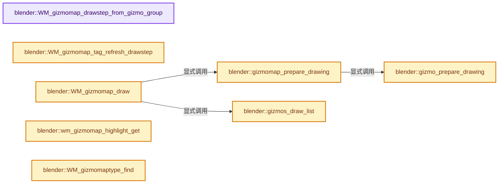

# 实现依赖专题：source/blender/windowmanager/gizmo/intern/wm_gizmo_map.cc

[方向导航](README.md) · [符号索引](../%E7%AC%A6%E5%8F%B7%E4%BE%9D%E8%B5%96%E4%B8%8E%E5%AE%9E%E7%8E%B0%E7%B4%A2%E5%BC%95.md)

本专题从正文实际调用进入，集中保存共享实现。函数有稳定锚点，可从调用处直接跳到对应完整函数；递归与互相调用通过回链组织。

## 本文件的实现关系




## 完整成员与函数实现

<a id="f-3c1dccfe09cf0099"></a>

### `blender::WM_gizmomap_drawstep_from_gizmo_group`

实现位置：[source/blender/windowmanager/gizmo/intern/wm_gizmo_map.cc](../../../../../source/blender/windowmanager/gizmo/intern/wm_gizmo_map.cc) · L303—L313。

接口参数：

- `const wmGizmoGroup *gzgroup`

**教学注释版**

<!-- annotated:8e3db5cd306dcb -->

```cpp
eWM_GizmoFlagMapDrawStep WM_gizmomap_drawstep_from_gizmo_group(const wmGizmoGroup *gzgroup)
{
  eWM_GizmoFlagMapDrawStep step;
  if (gzgroup->type->flag & WM_GIZMOGROUPTYPE_3D) {
    step = WM_GIZMOMAP_DRAWSTEP_3D;
  }
  else {
    step = WM_GIZMOMAP_DRAWSTEP_2D;
  }
  return step;
}
```

<details>
<summary>核对原始源码：source/blender/windowmanager/gizmo/intern/wm_gizmo_map.cc · L303—L313</summary>

<!-- original:8e3db5cd306dcb:source/blender/windowmanager/gizmo/intern/wm_gizmo_map.cc:303:313 -->

```cpp
eWM_GizmoFlagMapDrawStep WM_gizmomap_drawstep_from_gizmo_group(const wmGizmoGroup *gzgroup)
{
  eWM_GizmoFlagMapDrawStep step;
  if (gzgroup->type->flag & WM_GIZMOGROUPTYPE_3D) {
    step = WM_GIZMOMAP_DRAWSTEP_3D;
  }
  else {
    step = WM_GIZMOMAP_DRAWSTEP_2D;
  }
  return step;
}
```

</details>

**沿实际写入检查状态**

- `step = WM_GIZMOMAP_DRAWSTEP_3D;`
- `step = WM_GIZMOMAP_DRAWSTEP_2D;`

**结果出口**

- `return step;`

**继续追踪实现**

本实现没有需要继续展开的显式调用；检查返回表达式、对象转换和调用者前置条件。

<a id="f-71f1a3f569b88133"></a>

### `blender::WM_gizmomap_tag_refresh_drawstep`

实现位置：[source/blender/windowmanager/gizmo/intern/wm_gizmo_map.cc](../../../../../source/blender/windowmanager/gizmo/intern/wm_gizmo_map.cc) · L315—L324。

接口参数：

- `wmGizmoMap *gzmap`
- `const eWM_GizmoFlagMapDrawStep drawstep`

**教学注释版**

<!-- annotated:9460767a1c315f -->

```cpp
void WM_gizmomap_tag_refresh_drawstep(wmGizmoMap *gzmap, const eWM_GizmoFlagMapDrawStep drawstep)
{
  BLI_assert(uint(drawstep) < WM_GIZMOMAP_DRAWSTEP_MAX);
  if (gzmap) {
    gzmap->update_flag[drawstep] |= (GIZMOMAP_IS_PREPARE_DRAW | GIZMOMAP_IS_REFRESH_CALLBACK);
    /* This could be split out into a separate tagging function,
     * in practice both when refreshing the highlight should also be updated. */
    gzmap->tag_highlight_pending = true;
  }
}
```

<details>
<summary>核对原始源码：source/blender/windowmanager/gizmo/intern/wm_gizmo_map.cc · L315—L324</summary>

<!-- original:9460767a1c315f:source/blender/windowmanager/gizmo/intern/wm_gizmo_map.cc:315:324 -->

```cpp
void WM_gizmomap_tag_refresh_drawstep(wmGizmoMap *gzmap, const eWM_GizmoFlagMapDrawStep drawstep)
{
  BLI_assert(uint(drawstep) < WM_GIZMOMAP_DRAWSTEP_MAX);
  if (gzmap) {
    gzmap->update_flag[drawstep] |= (GIZMOMAP_IS_PREPARE_DRAW | GIZMOMAP_IS_REFRESH_CALLBACK);
    /* This could be split out into a separate tagging function,
     * in practice both when refreshing the highlight should also be updated. */
    gzmap->tag_highlight_pending = true;
  }
}
```

</details>

**沿实际写入检查状态**

- `gzmap->update_flag[drawstep] |= (GIZMOMAP_IS_PREPARE_DRAW | GIZMOMAP_IS_REFRESH_CALLBACK);`
- `gzmap->tag_highlight_pending = true;`

**继续追踪实现**

- `BLI_assert` → [BLI_assert · L48](../01-%E5%9F%BA%E7%A1%80%E5%AE%B9%E5%99%A8%E4%B8%8E%E7%8E%B0%E4%BB%A3CPP/%E4%BE%9D%E8%B5%96-BLI_assert-cc98e8.md#m-57a88495704d)；[BLI_assert · L63](../01-%E5%9F%BA%E7%A1%80%E5%AE%B9%E5%99%A8%E4%B8%8E%E7%8E%B0%E4%BB%A3CPP/%E4%BE%9D%E8%B5%96-BLI_assert-cc98e8.md#m-d07050020cb5)。宏定义由构建条件选择。

<a id="f-234e58794ebedcea"></a>

### `blender::gizmo_prepare_drawing`

实现位置：[source/blender/windowmanager/gizmo/intern/wm_gizmo_map.cc](../../../../../source/blender/windowmanager/gizmo/intern/wm_gizmo_map.cc) · L347—L370。

接口参数：

- `wmGizmoMap *gzmap`
- `wmGizmo *gz`
- `const bContext *C`
- `ListBaseT<LinkData> *draw_gizmos`
- `const eWM_GizmoFlagMapDrawStep drawstep`

**教学注释版**

<!-- annotated:15fabd19fa4aca -->

```cpp
static bool gizmo_prepare_drawing(wmGizmoMap *gzmap,
                                  wmGizmo *gz,
                                  const bContext *C,
                                  ListBaseT<LinkData> *draw_gizmos,
                                  const eWM_GizmoFlagMapDrawStep drawstep)
{
  int do_draw = wm_gizmo_is_visible(gz);
  if (do_draw == 0) {
    /* Skip. */
  }
  else {
    /* Ensure we get RNA updates. */
    if (do_draw & WM_GIZMO_IS_VISIBLE_UPDATE) {
      /* Hover gizmos need updating, even if we don't draw them. */
      wm_gizmo_update(gz, C, (gzmap->update_flag[drawstep] & GIZMOMAP_IS_PREPARE_DRAW) != 0);
    }
    if (do_draw & WM_GIZMO_IS_VISIBLE_DRAW) {
      BLI_addhead(draw_gizmos, BLI_genericNodeN(gz));
    }
    return true;
  }

  return false;
}
```

<details>
<summary>核对原始源码：source/blender/windowmanager/gizmo/intern/wm_gizmo_map.cc · L347—L370</summary>

<!-- original:15fabd19fa4aca:source/blender/windowmanager/gizmo/intern/wm_gizmo_map.cc:347:370 -->

```cpp
static bool gizmo_prepare_drawing(wmGizmoMap *gzmap,
                                  wmGizmo *gz,
                                  const bContext *C,
                                  ListBaseT<LinkData> *draw_gizmos,
                                  const eWM_GizmoFlagMapDrawStep drawstep)
{
  int do_draw = wm_gizmo_is_visible(gz);
  if (do_draw == 0) {
    /* Skip. */
  }
  else {
    /* Ensure we get RNA updates. */
    if (do_draw & WM_GIZMO_IS_VISIBLE_UPDATE) {
      /* Hover gizmos need updating, even if we don't draw them. */
      wm_gizmo_update(gz, C, (gzmap->update_flag[drawstep] & GIZMOMAP_IS_PREPARE_DRAW) != 0);
    }
    if (do_draw & WM_GIZMO_IS_VISIBLE_DRAW) {
      BLI_addhead(draw_gizmos, BLI_genericNodeN(gz));
    }
    return true;
  }

  return false;
}
```

</details>

**结果出口**

- `return true;`
- `return false;`

**继续追踪实现**

- `wm_gizmo_is_visible` → [blender::wm_gizmo_is_visible · L497](%E4%BE%9D%E8%B5%96-wm_gizmo-686f1a.md#f-bdaed1f2ac5e3d1d)。
- `wm_gizmo_update` → [blender::wm_gizmo_update · L489](%E4%BE%9D%E8%B5%96-wm_gizmo-686f1a.md#f-92db90866896bca0)。
- `BLI_addhead` → [blender::BLI_addhead · L98](../01-%E5%9F%BA%E7%A1%80%E5%AE%B9%E5%99%A8%E4%B8%8E%E7%8E%B0%E4%BB%A3CPP/%E4%BE%9D%E8%B5%96-listbase-2816d9.md#f-fed3ad483fcdfeb9)。
- `BLI_genericNodeN` → [blender::BLI_genericNodeN · L936](../01-%E5%9F%BA%E7%A1%80%E5%AE%B9%E5%99%A8%E4%B8%8E%E7%8E%B0%E4%BB%A3CPP/%E4%BE%9D%E8%B5%96-listbase-2816d9.md#f-a3f8fad9ff74a185)。

<a id="f-aac5a6db3cb04ca9"></a>

### `blender::gizmomap_prepare_drawing`

实现位置：[source/blender/windowmanager/gizmo/intern/wm_gizmo_map.cc](../../../../../source/blender/windowmanager/gizmo/intern/wm_gizmo_map.cc) · L376—L444。

接口参数：

- `wmGizmoMap *gzmap`
- `const bContext *C`
- `ListBaseT<LinkData> *draw_gizmos`
- `const eWM_GizmoFlagMapDrawStep drawstep`

**教学注释版**

<!-- annotated:91ef17847c95ee -->

```cpp
static void gizmomap_prepare_drawing(wmGizmoMap *gzmap,
                                     const bContext *C,
                                     ListBaseT<LinkData> *draw_gizmos,
                                     const eWM_GizmoFlagMapDrawStep drawstep)
{
  if (!gzmap || gzmap->groups.is_empty()) {
    return;
  }

  gzmap->is_init = false;

  wmGizmo *gz_modal = gzmap->gzmap_context.modal;

  /* Allow refresh functions to ask to be refreshed again, clear before the loop below. */
  const bool do_refresh = gzmap->update_flag[drawstep] & GIZMOMAP_IS_REFRESH_CALLBACK;
  gzmap->update_flag[drawstep] &= ~GIZMOMAP_IS_REFRESH_CALLBACK;

  for (wmGizmoGroup &gzgroup : gzmap->groups) {
    /* Check group visibility - drawstep first to avoid unnecessary call of group poll callback. */
    if (!wm_gizmogroup_is_visible_in_drawstep(&gzgroup, drawstep)) {
      continue;
    }

    if (gz_modal && (&gzgroup == gz_modal->parent_gzgroup)) {
      if (gzgroup.type->flag & WM_GIZMOGROUPTYPE_DRAW_MODAL_EXCLUDE) {
        continue;
      }
    }
    else { /* Don't poll modal gizmo since some poll functions unlink. */
      if (!WM_gizmo_group_type_poll(C, gzgroup.type)) {
        continue;
      }
      /* When modal only show other gizmo groups tagged with #WM_GIZMOGROUPTYPE_DRAW_MODAL_ALL. */
      if (gz_modal && ((gzgroup.type->flag & WM_GIZMOGROUPTYPE_DRAW_MODAL_ALL) == 0)) {
        continue;
      }
    }

    /* Needs to be initialized on first draw. */
    /* XXX weak: Gizmo-group may skip refreshing if it's invisible
     * (map gets untagged nevertheless). */
    if (do_refresh) {
      /* Force refresh again. */
      gzgroup.init_flag &= ~WM_GIZMOGROUP_INIT_REFRESH;
    }
    /* Calls `setup`, `setup_keymap` and `refresh` if they're defined. */
    WM_gizmogroup_ensure_init(C, &gzgroup);

    /* Check after ensure which can run refresh and update this value. */
    if (gzgroup.hide.any != 0) {
      continue;
    }

    /* Prepare drawing. */
    if (gzgroup.type->draw_prepare) {
      gzgroup.type->draw_prepare(C, &gzgroup);
    }

    for (wmGizmo &gz : gzgroup.gizmos) {
      gizmo_prepare_drawing(gzmap, &gz, C, draw_gizmos, drawstep);
    }

    if (gzgroup.type->draw_background) {
      gzgroup.type->draw_background(C, &gzgroup);
    }
  }

  gzmap->update_flag[drawstep] &= ~GIZMOMAP_IS_PREPARE_DRAW;
}
```

<details>
<summary>核对原始源码：source/blender/windowmanager/gizmo/intern/wm_gizmo_map.cc · L376—L444</summary>

<!-- original:91ef17847c95ee:source/blender/windowmanager/gizmo/intern/wm_gizmo_map.cc:376:444 -->

```cpp
static void gizmomap_prepare_drawing(wmGizmoMap *gzmap,
                                     const bContext *C,
                                     ListBaseT<LinkData> *draw_gizmos,
                                     const eWM_GizmoFlagMapDrawStep drawstep)
{
  if (!gzmap || gzmap->groups.is_empty()) {
    return;
  }

  gzmap->is_init = false;

  wmGizmo *gz_modal = gzmap->gzmap_context.modal;

  /* Allow refresh functions to ask to be refreshed again, clear before the loop below. */
  const bool do_refresh = gzmap->update_flag[drawstep] & GIZMOMAP_IS_REFRESH_CALLBACK;
  gzmap->update_flag[drawstep] &= ~GIZMOMAP_IS_REFRESH_CALLBACK;

  for (wmGizmoGroup &gzgroup : gzmap->groups) {
    /* Check group visibility - drawstep first to avoid unnecessary call of group poll callback. */
    if (!wm_gizmogroup_is_visible_in_drawstep(&gzgroup, drawstep)) {
      continue;
    }

    if (gz_modal && (&gzgroup == gz_modal->parent_gzgroup)) {
      if (gzgroup.type->flag & WM_GIZMOGROUPTYPE_DRAW_MODAL_EXCLUDE) {
        continue;
      }
    }
    else { /* Don't poll modal gizmo since some poll functions unlink. */
      if (!WM_gizmo_group_type_poll(C, gzgroup.type)) {
        continue;
      }
      /* When modal only show other gizmo groups tagged with #WM_GIZMOGROUPTYPE_DRAW_MODAL_ALL. */
      if (gz_modal && ((gzgroup.type->flag & WM_GIZMOGROUPTYPE_DRAW_MODAL_ALL) == 0)) {
        continue;
      }
    }

    /* Needs to be initialized on first draw. */
    /* XXX weak: Gizmo-group may skip refreshing if it's invisible
     * (map gets untagged nevertheless). */
    if (do_refresh) {
      /* Force refresh again. */
      gzgroup.init_flag &= ~WM_GIZMOGROUP_INIT_REFRESH;
    }
    /* Calls `setup`, `setup_keymap` and `refresh` if they're defined. */
    WM_gizmogroup_ensure_init(C, &gzgroup);

    /* Check after ensure which can run refresh and update this value. */
    if (gzgroup.hide.any != 0) {
      continue;
    }

    /* Prepare drawing. */
    if (gzgroup.type->draw_prepare) {
      gzgroup.type->draw_prepare(C, &gzgroup);
    }

    for (wmGizmo &gz : gzgroup.gizmos) {
      gizmo_prepare_drawing(gzmap, &gz, C, draw_gizmos, drawstep);
    }

    if (gzgroup.type->draw_background) {
      gzgroup.type->draw_background(C, &gzgroup);
    }
  }

  gzmap->update_flag[drawstep] &= ~GIZMOMAP_IS_PREPARE_DRAW;
}
```

</details>

**沿实际写入检查状态**

- `gzmap->is_init = false;`
- `gzmap->update_flag[drawstep] &= ~GIZMOMAP_IS_REFRESH_CALLBACK;`
- `gzgroup.init_flag &= ~WM_GIZMOGROUP_INIT_REFRESH;`
- `gzmap->update_flag[drawstep] &= ~GIZMOMAP_IS_PREPARE_DRAW;`

**继续追踪实现**

- `gzmap->groups.is_empty` → [调用协议](../%E6%A8%A1%E6%9D%BF%E5%AE%8F%E4%B8%8E%E5%8A%A8%E6%80%81%E5%88%86%E6%B4%BE%E5%8D%8F%E8%AE%AE.md)：接收对象类型依赖auto、返回值或模板实例；不按同名猜测目标。调用位置L381。
- `wm_gizmogroup_is_visible_in_drawstep` → [blender::wm_gizmogroup_is_visible_in_drawstep · L297](%E4%BE%9D%E8%B5%96-wm_gizmo_group-79dae7.md#f-ae2633108c99c4ce)。
- `WM_gizmo_group_type_poll` → [blender::WM_gizmo_group_type_poll · L1255](%E4%BE%9D%E8%B5%96-wm_gizmo_group-79dae7.md#f-2cd488795ae2cae9)。
- `WM_gizmogroup_ensure_init` → [blender::WM_gizmogroup_ensure_init · L240](%E4%BE%9D%E8%B5%96-wm_gizmo_group-79dae7.md#f-d8e6a4510bd5569a)。
- `gzgroup.type->draw_prepare` → [调用协议](../%E6%A8%A1%E6%9D%BF%E5%AE%8F%E4%B8%8E%E5%8A%A8%E6%80%81%E5%88%86%E6%B4%BE%E5%8D%8F%E8%AE%AE.md)：接收对象类型依赖auto、返回值或模板实例；不按同名猜测目标。调用位置L431。
- `gizmo_prepare_drawing` → [blender::gizmo_prepare_drawing · L347](%E4%BE%9D%E8%B5%96-wm_gizmo_map-649dcc.md#f-234e58794ebedcea)。
- `gzgroup.type->draw_background` → [调用协议](../%E6%A8%A1%E6%9D%BF%E5%AE%8F%E4%B8%8E%E5%8A%A8%E6%80%81%E5%88%86%E6%B4%BE%E5%8D%8F%E8%AE%AE.md)：接收对象类型依赖auto、返回值或模板实例；不按同名猜测目标。调用位置L439。

<a id="f-4da82544ee34ceb1"></a>

### `blender::gizmos_draw_list`

实现位置：[source/blender/windowmanager/gizmo/intern/wm_gizmo_map.cc](../../../../../source/blender/windowmanager/gizmo/intern/wm_gizmo_map.cc) · L450—L505。

接口参数：

- `const wmGizmoMap *gzmap`
- `const bContext *C`
- `ListBaseT<LinkData> *draw_gizmos`

**教学注释版**

<!-- annotated:f5908a7ccaa7c6 -->

```cpp
static void gizmos_draw_list(const wmGizmoMap *gzmap,
                             const bContext *C,
                             ListBaseT<LinkData> *draw_gizmos)
{
  /* Can be empty if we're dynamically added and removed. */
  if ((gzmap == nullptr) || gzmap->groups.is_empty()) {
    return;
  }

  /* TODO(@ideasman42): This will need its own shader probably?
   * Don't think it can be handled from that point though. */
  // const bool use_lighting = (U.gizmo_flag & V3D_GIZMO_SHADED) != 0;

  bool is_depth_prev = false;

  /* `draw_gizmos` contains all visible gizmos - draw them. */
  for (LinkData &link : draw_gizmos->items_mutable()) {
    wmGizmo *gz = static_cast<wmGizmo *>(link.data);
    bool is_depth = (gz->parent_gzgroup->type->flag & WM_GIZMOGROUPTYPE_DEPTH_3D) != 0;

    /* Weak! since we don't 100% support depth yet (select ignores depth)
     * always show highlighted. */
    if (is_depth && (gz->state & WM_GIZMO_STATE_HIGHLIGHT)) {
      is_depth = false;
    }

    if (is_depth == is_depth_prev) {
      /* Pass. */
    }
    else {
      if (is_depth) {
        GPU_depth_test(GPU_DEPTH_LESS_EQUAL);
      }
      else {
        GPU_depth_test(GPU_DEPTH_NONE);
      }
      is_depth_prev = is_depth;
    }

    /* XXX force AntiAlias Gizmos. */
    GPU_line_smooth(true);
    GPU_polygon_smooth(true);

    gz->type->draw(C, gz);

    GPU_line_smooth(false);
    GPU_polygon_smooth(false);

    /* Free/remove gizmo link after drawing. */
    BLI_freelinkN(draw_gizmos, &link);
  }

  if (is_depth_prev) {
    GPU_depth_test(GPU_DEPTH_NONE);
  }
}
```

<details>
<summary>核对原始源码：source/blender/windowmanager/gizmo/intern/wm_gizmo_map.cc · L450—L505</summary>

<!-- original:f5908a7ccaa7c6:source/blender/windowmanager/gizmo/intern/wm_gizmo_map.cc:450:505 -->

```cpp
static void gizmos_draw_list(const wmGizmoMap *gzmap,
                             const bContext *C,
                             ListBaseT<LinkData> *draw_gizmos)
{
  /* Can be empty if we're dynamically added and removed. */
  if ((gzmap == nullptr) || gzmap->groups.is_empty()) {
    return;
  }

  /* TODO(@ideasman42): This will need its own shader probably?
   * Don't think it can be handled from that point though. */
  // const bool use_lighting = (U.gizmo_flag & V3D_GIZMO_SHADED) != 0;

  bool is_depth_prev = false;

  /* `draw_gizmos` contains all visible gizmos - draw them. */
  for (LinkData &link : draw_gizmos->items_mutable()) {
    wmGizmo *gz = static_cast<wmGizmo *>(link.data);
    bool is_depth = (gz->parent_gzgroup->type->flag & WM_GIZMOGROUPTYPE_DEPTH_3D) != 0;

    /* Weak! since we don't 100% support depth yet (select ignores depth)
     * always show highlighted. */
    if (is_depth && (gz->state & WM_GIZMO_STATE_HIGHLIGHT)) {
      is_depth = false;
    }

    if (is_depth == is_depth_prev) {
      /* Pass. */
    }
    else {
      if (is_depth) {
        GPU_depth_test(GPU_DEPTH_LESS_EQUAL);
      }
      else {
        GPU_depth_test(GPU_DEPTH_NONE);
      }
      is_depth_prev = is_depth;
    }

    /* XXX force AntiAlias Gizmos. */
    GPU_line_smooth(true);
    GPU_polygon_smooth(true);

    gz->type->draw(C, gz);

    GPU_line_smooth(false);
    GPU_polygon_smooth(false);

    /* Free/remove gizmo link after drawing. */
    BLI_freelinkN(draw_gizmos, &link);
  }

  if (is_depth_prev) {
    GPU_depth_test(GPU_DEPTH_NONE);
  }
}
```

</details>

**沿实际写入检查状态**

- `is_depth = false;`
- `is_depth_prev = is_depth;`

**继续追踪实现**

- `gzmap->groups.is_empty` → [调用协议](../%E6%A8%A1%E6%9D%BF%E5%AE%8F%E4%B8%8E%E5%8A%A8%E6%80%81%E5%88%86%E6%B4%BE%E5%8D%8F%E8%AE%AE.md)：接收对象类型依赖auto、返回值或模板实例；不按同名猜测目标。调用位置L455。
- `draw_gizmos->items_mutable` → [blender::ListBaseT::items_mutable · L163](%E4%BE%9D%E8%B5%96-DNA_listBase-48dbc9.md#f-cc603252f543d4ad)。
- `GPU_depth_test` → [blender::GPU_depth_test · L70](%E4%BE%9D%E8%B5%96-gpu_state-82c525.md#f-b3b9ee4be7572808)。
- `GPU_line_smooth` → [blender::GPU_line_smooth · L80](%E4%BE%9D%E8%B5%96-gpu_state-82c525.md#f-8b145981bbc8915e)。
- `GPU_polygon_smooth` → [blender::GPU_polygon_smooth · L85](%E4%BE%9D%E8%B5%96-gpu_state-82c525.md#f-0012556792e814bc)。
- `gz->type->draw` → [调用协议](../%E6%A8%A1%E6%9D%BF%E5%AE%8F%E4%B8%8E%E5%8A%A8%E6%80%81%E5%88%86%E6%B4%BE%E5%8D%8F%E8%AE%AE.md)：接收对象类型依赖auto、返回值或模板实例；不按同名猜测目标。调用位置L493。
- `BLI_freelinkN` → [blender::BLI_freelinkN · L277](../01-%E5%9F%BA%E7%A1%80%E5%AE%B9%E5%99%A8%E4%B8%8E%E7%8E%B0%E4%BB%A3CPP/%E4%BE%9D%E8%B5%96-listbase-2816d9.md#f-c7719591852af7da)。

<a id="f-25216a0ce94632c3"></a>

### `blender::WM_gizmomap_draw`

实现位置：[source/blender/windowmanager/gizmo/intern/wm_gizmo_map.cc](../../../../../source/blender/windowmanager/gizmo/intern/wm_gizmo_map.cc) · L507—L520。

接口参数：

- `wmGizmoMap *gzmap`
- `const bContext *C`
- `const eWM_GizmoFlagMapDrawStep drawstep`

**教学注释版**

<!-- annotated:f3910f8e87e7ff -->

```cpp
void WM_gizmomap_draw(wmGizmoMap *gzmap,
                      const bContext *C,
                      const eWM_GizmoFlagMapDrawStep drawstep)
{
  if (!WM_gizmo_context_check_drawstep(C, drawstep)) {
    return;
  }

  ListBaseT<LinkData> draw_gizmos = {nullptr};

  gizmomap_prepare_drawing(gzmap, C, &draw_gizmos, drawstep);
  gizmos_draw_list(gzmap, C, &draw_gizmos);
  BLI_assert(draw_gizmos.is_empty());
}
```

<details>
<summary>核对原始源码：source/blender/windowmanager/gizmo/intern/wm_gizmo_map.cc · L507—L520</summary>

<!-- original:f3910f8e87e7ff:source/blender/windowmanager/gizmo/intern/wm_gizmo_map.cc:507:520 -->

```cpp
void WM_gizmomap_draw(wmGizmoMap *gzmap,
                      const bContext *C,
                      const eWM_GizmoFlagMapDrawStep drawstep)
{
  if (!WM_gizmo_context_check_drawstep(C, drawstep)) {
    return;
  }

  ListBaseT<LinkData> draw_gizmos = {nullptr};

  gizmomap_prepare_drawing(gzmap, C, &draw_gizmos, drawstep);
  gizmos_draw_list(gzmap, C, &draw_gizmos);
  BLI_assert(draw_gizmos.is_empty());
}
```

</details>

**继续追踪实现**

- `WM_gizmo_context_check_drawstep` → [blender::WM_gizmo_context_check_drawstep · L725](%E4%BE%9D%E8%B5%96-wm_gizmo-686f1a.md#f-de3060f53f851d2b)。
- `gizmomap_prepare_drawing` → [blender::gizmomap_prepare_drawing · L376](%E4%BE%9D%E8%B5%96-wm_gizmo_map-649dcc.md#f-aac5a6db3cb04ca9)。
- `gizmos_draw_list` → [blender::gizmos_draw_list · L450](%E4%BE%9D%E8%B5%96-wm_gizmo_map-649dcc.md#f-4da82544ee34ceb1)。
- `BLI_assert` → [BLI_assert · L48](../01-%E5%9F%BA%E7%A1%80%E5%AE%B9%E5%99%A8%E4%B8%8E%E7%8E%B0%E4%BB%A3CPP/%E4%BE%9D%E8%B5%96-BLI_assert-cc98e8.md#m-57a88495704d)；[BLI_assert · L63](../01-%E5%9F%BA%E7%A1%80%E5%AE%B9%E5%99%A8%E4%B8%8E%E7%8E%B0%E4%BB%A3CPP/%E4%BE%9D%E8%B5%96-BLI_assert-cc98e8.md#m-d07050020cb5)。宏定义由构建条件选择。
- `draw_gizmos.is_empty` → [blender::ListBaseT::is_empty · L54](%E4%BE%9D%E8%B5%96-DNA_listBase-48dbc9.md#f-189938e5bf0f989b)。

<a id="f-e453d5744c8dccd2"></a>

### `blender::wm_gizmomap_highlight_get`

实现位置：[source/blender/windowmanager/gizmo/intern/wm_gizmo_map.cc](../../../../../source/blender/windowmanager/gizmo/intern/wm_gizmo_map.cc) · L1083—L1086。

接口参数：

- `wmGizmoMap *gzmap`

**教学注释版**

<!-- annotated:92f2eec73c99b6 -->

```cpp
wmGizmo *wm_gizmomap_highlight_get(wmGizmoMap *gzmap)
{
  return gzmap->gzmap_context.highlight;
}
```

<details>
<summary>核对原始源码：source/blender/windowmanager/gizmo/intern/wm_gizmo_map.cc · L1083—L1086</summary>

<!-- original:92f2eec73c99b6:source/blender/windowmanager/gizmo/intern/wm_gizmo_map.cc:1083:1086 -->

```cpp
wmGizmo *wm_gizmomap_highlight_get(wmGizmoMap *gzmap)
{
  return gzmap->gzmap_context.highlight;
}
```

</details>

**结果出口**

- `return gzmap->gzmap_context.highlight;`

**继续追踪实现**

本实现没有需要继续展开的显式调用；检查返回表达式、对象转换和调用者前置条件。

<a id="f-4219b1335481a6cd"></a>

### `blender::WM_gizmomaptype_find`

实现位置：[source/blender/windowmanager/gizmo/intern/wm_gizmo_map.cc](../../../../../source/blender/windowmanager/gizmo/intern/wm_gizmo_map.cc) · L1275—L1286。

接口参数：

- `const wmGizmoMapType_Params *gzmap_params`

**教学注释版**

<!-- annotated:c695b0b9bdb632 -->

```cpp
wmGizmoMapType *WM_gizmomaptype_find(const wmGizmoMapType_Params *gzmap_params)
{
  for (wmGizmoMapType &gzmap_type : gizmomaptypes) {
    if (gzmap_type.spaceid == gzmap_params->spaceid &&
        gzmap_type.regionid == gzmap_params->regionid)
    {
      return &gzmap_type;
    }
  }

  return nullptr;
}
```

<details>
<summary>核对原始源码：source/blender/windowmanager/gizmo/intern/wm_gizmo_map.cc · L1275—L1286</summary>

<!-- original:c695b0b9bdb632:source/blender/windowmanager/gizmo/intern/wm_gizmo_map.cc:1275:1286 -->

```cpp
wmGizmoMapType *WM_gizmomaptype_find(const wmGizmoMapType_Params *gzmap_params)
{
  for (wmGizmoMapType &gzmap_type : gizmomaptypes) {
    if (gzmap_type.spaceid == gzmap_params->spaceid &&
        gzmap_type.regionid == gzmap_params->regionid)
    {
      return &gzmap_type;
    }
  }

  return nullptr;
}
```

</details>

**结果出口**

- `return &gzmap_type;`
- `return nullptr;`

**继续追踪实现**

本实现没有需要继续展开的显式调用；检查返回表达式、对象转换和调用者前置条件。

<a id="f-5d9e0cef44c4f537"></a>

### `blender::WM_gizmomaptype_ensure`

实现位置：[source/blender/windowmanager/gizmo/intern/wm_gizmo_map.cc](../../../../../source/blender/windowmanager/gizmo/intern/wm_gizmo_map.cc) · L1288—L1302。

接口参数：

- `const wmGizmoMapType_Params *gzmap_params`

**教学注释版**

<!-- annotated:e25725d98ddc85 -->

```cpp
wmGizmoMapType *WM_gizmomaptype_ensure(const wmGizmoMapType_Params *gzmap_params)
{
  wmGizmoMapType *gzmap_type = WM_gizmomaptype_find(gzmap_params);

  if (gzmap_type) {
    return gzmap_type;
  }

  gzmap_type = MEM_new_zeroed<wmGizmoMapType>("gizmotype list");
  gzmap_type->spaceid = gzmap_params->spaceid;
  gzmap_type->regionid = gzmap_params->regionid;
  BLI_addhead(&gizmomaptypes, gzmap_type);

  return gzmap_type;
}
```

<details>
<summary>核对原始源码：source/blender/windowmanager/gizmo/intern/wm_gizmo_map.cc · L1288—L1302</summary>

<!-- original:e25725d98ddc85:source/blender/windowmanager/gizmo/intern/wm_gizmo_map.cc:1288:1302 -->

```cpp
wmGizmoMapType *WM_gizmomaptype_ensure(const wmGizmoMapType_Params *gzmap_params)
{
  wmGizmoMapType *gzmap_type = WM_gizmomaptype_find(gzmap_params);

  if (gzmap_type) {
    return gzmap_type;
  }

  gzmap_type = MEM_new_zeroed<wmGizmoMapType>("gizmotype list");
  gzmap_type->spaceid = gzmap_params->spaceid;
  gzmap_type->regionid = gzmap_params->regionid;
  BLI_addhead(&gizmomaptypes, gzmap_type);

  return gzmap_type;
}
```

</details>

**沿实际写入检查状态**

- `gzmap_type = MEM_new_zeroed<wmGizmoMapType>("gizmotype list");`
- `gzmap_type->spaceid = gzmap_params->spaceid;`
- `gzmap_type->regionid = gzmap_params->regionid;`

**结果出口**

- `return gzmap_type;`

**继续追踪实现**

- `WM_gizmomaptype_find` → [blender::WM_gizmomaptype_find · L1275](%E4%BE%9D%E8%B5%96-wm_gizmo_map-649dcc.md#f-4219b1335481a6cd)。
- `MEM_new_zeroed<wmGizmoMapType>` → [MEM_new_zeroed · L550](../03-%E5%86%85%E5%AD%98%E5%88%86%E9%85%8D%E4%B8%8E%E8%BF%90%E8%A1%8C%E6%97%B6%E7%B1%BB%E5%9E%8B/%E4%BE%9D%E8%B5%96-MEM_guardedalloc-b54eca.md#f-eeb1e2a7f57dd231)；[MEM_new_zeroed · L114](../03-%E5%86%85%E5%AD%98%E5%88%86%E9%85%8D%E4%B8%8E%E8%BF%90%E8%A1%8C%E6%97%B6%E7%B1%BB%E5%9E%8B/%E4%BE%9D%E8%B5%96-mallocn-afdcd4.md#f-e04cf01c64c8b180)。同名重载需按实参类型选择。
- `BLI_addhead` → [blender::BLI_addhead · L98](../01-%E5%9F%BA%E7%A1%80%E5%AE%B9%E5%99%A8%E4%B8%8E%E7%8E%B0%E4%BB%A3CPP/%E4%BE%9D%E8%B5%96-listbase-2816d9.md#f-fed3ad483fcdfeb9)。

<a id="f-f8447d255f8b8471"></a>

### `blender::WM_gizmoconfig_update_tag_group_type_init`

实现位置：[source/blender/windowmanager/gizmo/intern/wm_gizmo_map.cc](../../../../../source/blender/windowmanager/gizmo/intern/wm_gizmo_map.cc) · L1337—L1344。

接口参数：

- `wmGizmoMapType *gzmap_type`
- `wmGizmoGroupType *gzgt`

**教学注释版**

<!-- annotated:7340d767e1a48c -->

```cpp
void WM_gizmoconfig_update_tag_group_type_init(wmGizmoMapType *gzmap_type, wmGizmoGroupType *gzgt)
{
  /* Tag for update on next use. */
  gzmap_type->type_update_flag |= (WM_GIZMOMAPTYPE_UPDATE_INIT | WM_GIZMOMAPTYPE_KEYMAP_INIT);
  gzgt->type_update_flag |= (WM_GIZMOMAPTYPE_UPDATE_INIT | WM_GIZMOMAPTYPE_KEYMAP_INIT);

  wm_gzmap_type_update_flag |= WM_GIZMOMAPTYPE_GLOBAL_UPDATE_INIT;
}
```

<details>
<summary>核对原始源码：source/blender/windowmanager/gizmo/intern/wm_gizmo_map.cc · L1337—L1344</summary>

<!-- original:7340d767e1a48c:source/blender/windowmanager/gizmo/intern/wm_gizmo_map.cc:1337:1344 -->

```cpp
void WM_gizmoconfig_update_tag_group_type_init(wmGizmoMapType *gzmap_type, wmGizmoGroupType *gzgt)
{
  /* Tag for update on next use. */
  gzmap_type->type_update_flag |= (WM_GIZMOMAPTYPE_UPDATE_INIT | WM_GIZMOMAPTYPE_KEYMAP_INIT);
  gzgt->type_update_flag |= (WM_GIZMOMAPTYPE_UPDATE_INIT | WM_GIZMOMAPTYPE_KEYMAP_INIT);

  wm_gzmap_type_update_flag |= WM_GIZMOMAPTYPE_GLOBAL_UPDATE_INIT;
}
```

</details>

**沿实际写入检查状态**

- `gzmap_type->type_update_flag |= (WM_GIZMOMAPTYPE_UPDATE_INIT | WM_GIZMOMAPTYPE_KEYMAP_INIT);`
- `gzgt->type_update_flag |= (WM_GIZMOMAPTYPE_UPDATE_INIT | WM_GIZMOMAPTYPE_KEYMAP_INIT);`
- `wm_gzmap_type_update_flag |= WM_GIZMOMAPTYPE_GLOBAL_UPDATE_INIT;`

**继续追踪实现**

本实现没有需要继续展开的显式调用；检查返回表达式、对象转换和调用者前置条件。
