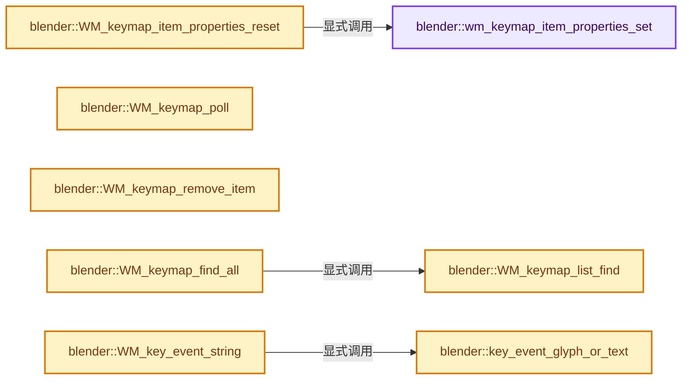
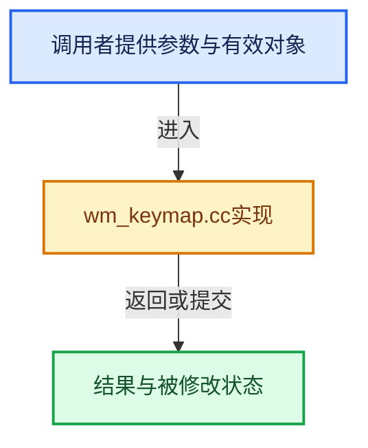

# 实现依赖专题：source/blender/windowmanager/intern/wm_keymap.cc

[方向导航](README.md) · [符号索引](../%E7%AC%A6%E5%8F%B7%E4%BE%9D%E8%B5%96%E4%B8%8E%E5%AE%9E%E7%8E%B0%E7%B4%A2%E5%BC%95.md)

本专题从正文实际调用进入，集中保存共享实现。函数有稳定锚点，可从调用处直接跳到对应完整函数；递归与互相调用通过回链组织。

## 本文件的实现关系






## 完整成员与函数实现

<a id="f-b3feb3fdaf6a35fb"></a>

### `blender::wm_keymap_item_properties_set`

实现位置：[source/blender/windowmanager/intern/wm_keymap.cc](../../../../../source/blender/windowmanager/intern/wm_keymap.cc) · L119—L126。

接口参数：

- `wmKeyMapItem *kmi`

**教学注释版**

<!-- annotated:747c0e104afc5b -->

```cpp
static void wm_keymap_item_properties_set(wmKeyMapItem *kmi)
{
  WM_operator_properties_alloc(&(kmi->ptr), &(kmi->properties), kmi->idname);
  WM_operator_properties_sanitize(kmi->ptr, true);

  /* Signal for no context, see #STRUCT_NO_CONTEXT_WITHOUT_OWNER_ID. */
  kmi->ptr->owner_id = nullptr;
}
```

<details>
<summary>核对原始源码：source/blender/windowmanager/intern/wm_keymap.cc · L119—L126</summary>

<!-- original:747c0e104afc5b:source/blender/windowmanager/intern/wm_keymap.cc:119:126 -->

```cpp
static void wm_keymap_item_properties_set(wmKeyMapItem *kmi)
{
  WM_operator_properties_alloc(&(kmi->ptr), &(kmi->properties), kmi->idname);
  WM_operator_properties_sanitize(kmi->ptr, true);

  /* Signal for no context, see #STRUCT_NO_CONTEXT_WITHOUT_OWNER_ID. */
  kmi->ptr->owner_id = nullptr;
}
```

</details>

**沿实际写入检查状态**

- `kmi->ptr->owner_id = nullptr;`

**继续追踪实现**

- `WM_operator_properties_alloc` → [blender::WM_operator_properties_alloc · L767](%E4%BE%9D%E8%B5%96-wm_operators-6f9715.md#f-c8eab9fbde094b50)。
- `WM_operator_properties_sanitize` → [blender::WM_operator_properties_sanitize · L786](%E4%BE%9D%E8%B5%96-wm_operators-6f9715.md#f-089e465a535d934f)。

<a id="f-662e2ee93ff43a48"></a>

### `blender::WM_keymap_item_properties_reset`

实现位置：[source/blender/windowmanager/intern/wm_keymap.cc](../../../../../source/blender/windowmanager/intern/wm_keymap.cc) · L210—L225。

接口参数：

- `wmKeyMapItem *kmi`
- `IDProperty *properties`

**教学注释版**

<!-- annotated:4ef2a5557854ce -->

```cpp
void WM_keymap_item_properties_reset(wmKeyMapItem *kmi, IDProperty *properties)
{
  if (kmi->ptr) [[likely]] {
    WM_operator_properties_free(kmi->ptr);
    MEM_delete(kmi->ptr);

    kmi->ptr = nullptr;
  }
  else if (kmi->properties) {
    IDP_FreeProperty(kmi->properties);
  }

  kmi->properties = properties;

  wm_keymap_item_properties_set(kmi);
}
```

<details>
<summary>核对原始源码：source/blender/windowmanager/intern/wm_keymap.cc · L210—L225</summary>

<!-- original:4ef2a5557854ce:source/blender/windowmanager/intern/wm_keymap.cc:210:225 -->

```cpp
void WM_keymap_item_properties_reset(wmKeyMapItem *kmi, IDProperty *properties)
{
  if (kmi->ptr) [[likely]] {
    WM_operator_properties_free(kmi->ptr);
    MEM_delete(kmi->ptr);

    kmi->ptr = nullptr;
  }
  else if (kmi->properties) {
    IDP_FreeProperty(kmi->properties);
  }

  kmi->properties = properties;

  wm_keymap_item_properties_set(kmi);
}
```

</details>

**沿实际写入检查状态**

- `kmi->ptr = nullptr;`
- `kmi->properties = properties;`

**继续追踪实现**

- `WM_operator_properties_free` → [blender::WM_operator_properties_free · L868](%E4%BE%9D%E8%B5%96-wm_operators-6f9715.md#f-b0519201115d9aa0)。
- `MEM_delete` → [MEM_delete · L400](../03-%E5%86%85%E5%AD%98%E5%88%86%E9%85%8D%E4%B8%8E%E8%BF%90%E8%A1%8C%E6%97%B6%E7%B1%BB%E5%9E%8B/%E4%BE%9D%E8%B5%96-MEM_guardedalloc-b54eca.md#f-9049ffdd1682887c)。
- `IDP_FreeProperty` → [blender::IDP_FreeProperty · L1403](%E4%BE%9D%E8%B5%96-idprop-006c65.md#f-389134a630df1bed)。
- `wm_keymap_item_properties_set` → [blender::wm_keymap_item_properties_set · L119](%E4%BE%9D%E8%B5%96-wm_keymap-7a630e.md#f-b3feb3fdaf6a35fb)。

<a id="f-95b1e6239af89fd0"></a>

### `blender::WM_keymap_poll`

实现位置：[source/blender/windowmanager/intern/wm_keymap.cc](../../../../../source/blender/windowmanager/intern/wm_keymap.cc) · L485—L519。

接口参数：

- `bContext *C`
- `wmKeyMap *keymap`

**教学注释版**

<!-- annotated:be904be711fe63 -->

```cpp
bool WM_keymap_poll(bContext *C, wmKeyMap *keymap)
{
  /* If we're tagged, only use compatible. */
  if (keymap->owner_id[0] != '\0') {
    const WorkSpace *workspace = CTX_wm_workspace(C);
    if (BKE_workspace_owner_id_check(workspace, keymap->owner_id) == false) {
      return false;
    }
  }

  if (keymap->items.is_empty()) [[unlikely]] {
    /* Empty key-maps may be missing more there may be a typo in the name.
     * Warn early to avoid losing time investigating each case.
     * When developing a customized Blender though you may want empty keymaps. */
    if (!U.app_template[0] &&
        /* Fallback key-maps may be intentionally empty, don't flood the output. */
        !BLI_str_endswith(keymap->idname, " (fallback)") &&
        /* This is an exception which may be empty.
         * Longer term we might want a flag to indicate an empty key-map is intended. */
        !STREQ(keymap->idname, "Node Tool: Tweak") &&
        /* Another exception: Asset shelf keymap is meant for add-ons to use, it's empty by
         * default. */
        !STREQ(keymap->idname, "Asset Shelf") &&
        /* Same for the asset browser keymap. */
        !STREQ(keymap->idname, "Asset Browser Main"))
    {
      CLOG_WARN(WM_LOG_EVENTS, "empty keymap '%s'", keymap->idname);
    }
  }

  if (keymap->poll != nullptr) {
    return keymap->poll(C);
  }
  return true;
}
```

<details>
<summary>核对原始源码：source/blender/windowmanager/intern/wm_keymap.cc · L485—L519</summary>

<!-- original:be904be711fe63:source/blender/windowmanager/intern/wm_keymap.cc:485:519 -->

```cpp
bool WM_keymap_poll(bContext *C, wmKeyMap *keymap)
{
  /* If we're tagged, only use compatible. */
  if (keymap->owner_id[0] != '\0') {
    const WorkSpace *workspace = CTX_wm_workspace(C);
    if (BKE_workspace_owner_id_check(workspace, keymap->owner_id) == false) {
      return false;
    }
  }

  if (keymap->items.is_empty()) [[unlikely]] {
    /* Empty key-maps may be missing more there may be a typo in the name.
     * Warn early to avoid losing time investigating each case.
     * When developing a customized Blender though you may want empty keymaps. */
    if (!U.app_template[0] &&
        /* Fallback key-maps may be intentionally empty, don't flood the output. */
        !BLI_str_endswith(keymap->idname, " (fallback)") &&
        /* This is an exception which may be empty.
         * Longer term we might want a flag to indicate an empty key-map is intended. */
        !STREQ(keymap->idname, "Node Tool: Tweak") &&
        /* Another exception: Asset shelf keymap is meant for add-ons to use, it's empty by
         * default. */
        !STREQ(keymap->idname, "Asset Shelf") &&
        /* Same for the asset browser keymap. */
        !STREQ(keymap->idname, "Asset Browser Main"))
    {
      CLOG_WARN(WM_LOG_EVENTS, "empty keymap '%s'", keymap->idname);
    }
  }

  if (keymap->poll != nullptr) {
    return keymap->poll(C);
  }
  return true;
}
```

</details>

**结果出口**

- `return false;`
- `return keymap->poll(C);`
- `return true;`

**继续追踪实现**

- `CTX_wm_workspace` → [blender::CTX_wm_workspace · L943](%E4%BE%9D%E8%B5%96-context-a929d9.md#f-b74037d7a9d4ee39)。
- `BKE_workspace_owner_id_check` → [blender::BKE_workspace_owner_id_check · L607](%E4%BE%9D%E8%B5%96-workspace-c772d1.md#f-c029513fe561a031)。
- `keymap->items.is_empty` → [调用协议](../%E6%A8%A1%E6%9D%BF%E5%AE%8F%E4%B8%8E%E5%8A%A8%E6%80%81%E5%88%86%E6%B4%BE%E5%8D%8F%E8%AE%AE.md)：接收对象类型依赖auto、返回值或模板实例；不按同名猜测目标。调用位置L495。
- `BLI_str_endswith` → [blender::BLI_str_endswith · L907](../01-%E5%9F%BA%E7%A1%80%E5%AE%B9%E5%99%A8%E4%B8%8E%E7%8E%B0%E4%BB%A3CPP/%E4%BE%9D%E8%B5%96-string-1d986f.md#f-2bf007208258ff88)。
- `STREQ` → [STREQ · L112](%E4%BE%9D%E8%B5%96-GHOST_utildefines-34b996.md#m-9549fb6aafd2)；[STREQ · L451](../01-%E5%9F%BA%E7%A1%80%E5%AE%B9%E5%99%A8%E4%B8%8E%E7%8E%B0%E4%BB%A3CPP/%E4%BE%9D%E8%B5%96-BLI_utildefines-293a0a.md#m-c7b745bcfad2)；[STREQ · L55](%E4%BE%9D%E8%B5%96-clog-a0bec8.md#m-96e78f386894)。宏定义由构建条件选择。
- `CLOG_WARN` → [CLOG_WARN · L189](%E4%BE%9D%E8%B5%96-CLG_log-e9051b.md#m-9da21a06cdbe)。宏定义由构建条件选择。
- `keymap->poll` → [调用协议](../%E6%A8%A1%E6%9D%BF%E5%AE%8F%E4%B8%8E%E5%8A%A8%E6%80%81%E5%88%86%E6%B4%BE%E5%8D%8F%E8%AE%AE.md)：由接收对象具体类型或运行时策略提供实现。调用位置L516。

<a id="f-383652c7f68754e0"></a>

### `blender::WM_keymap_remove_item`

实现位置：[source/blender/windowmanager/intern/wm_keymap.cc](../../../../../source/blender/windowmanager/intern/wm_keymap.cc) · L595—L608。

接口参数：

- `wmKeyMap *keymap`
- `wmKeyMapItem *kmi`

**教学注释版**

<!-- annotated:cd2849cba40e69 -->

```cpp
void WM_keymap_remove_item(wmKeyMap *keymap, wmKeyMapItem *kmi)
{
  BLI_assert(BLI_findindex(&keymap->items, kmi) != -1);
  if (kmi->ptr) {
    WM_operator_properties_free(kmi->ptr);
    MEM_delete(kmi->ptr);
  }
  else if (kmi->properties) {
    IDP_FreeProperty(kmi->properties);
  }
  BLI_freelinkN(&keymap->items, kmi);

  WM_keyconfig_update_tag(keymap, nullptr);
}
```

<details>
<summary>核对原始源码：source/blender/windowmanager/intern/wm_keymap.cc · L595—L608</summary>

<!-- original:cd2849cba40e69:source/blender/windowmanager/intern/wm_keymap.cc:595:608 -->

```cpp
void WM_keymap_remove_item(wmKeyMap *keymap, wmKeyMapItem *kmi)
{
  BLI_assert(BLI_findindex(&keymap->items, kmi) != -1);
  if (kmi->ptr) {
    WM_operator_properties_free(kmi->ptr);
    MEM_delete(kmi->ptr);
  }
  else if (kmi->properties) {
    IDP_FreeProperty(kmi->properties);
  }
  BLI_freelinkN(&keymap->items, kmi);

  WM_keyconfig_update_tag(keymap, nullptr);
}
```

</details>

**继续追踪实现**

- `BLI_assert` → [BLI_assert · L48](../01-%E5%9F%BA%E7%A1%80%E5%AE%B9%E5%99%A8%E4%B8%8E%E7%8E%B0%E4%BB%A3CPP/%E4%BE%9D%E8%B5%96-BLI_assert-cc98e8.md#m-57a88495704d)；[BLI_assert · L63](../01-%E5%9F%BA%E7%A1%80%E5%AE%B9%E5%99%A8%E4%B8%8E%E7%8E%B0%E4%BB%A3CPP/%E4%BE%9D%E8%B5%96-BLI_assert-cc98e8.md#m-d07050020cb5)。宏定义由构建条件选择。
- `BLI_findindex` → [blender::BLI_findindex · L593](../01-%E5%9F%BA%E7%A1%80%E5%AE%B9%E5%99%A8%E4%B8%8E%E7%8E%B0%E4%BB%A3CPP/%E4%BE%9D%E8%B5%96-listbase-2816d9.md#f-cb9036f12bd486b7)。
- `WM_operator_properties_free` → [blender::WM_operator_properties_free · L868](%E4%BE%9D%E8%B5%96-wm_operators-6f9715.md#f-b0519201115d9aa0)。
- `MEM_delete` → [MEM_delete · L400](../03-%E5%86%85%E5%AD%98%E5%88%86%E9%85%8D%E4%B8%8E%E8%BF%90%E8%A1%8C%E6%97%B6%E7%B1%BB%E5%9E%8B/%E4%BE%9D%E8%B5%96-MEM_guardedalloc-b54eca.md#f-9049ffdd1682887c)。
- `IDP_FreeProperty` → [blender::IDP_FreeProperty · L1403](%E4%BE%9D%E8%B5%96-idprop-006c65.md#f-389134a630df1bed)。
- `BLI_freelinkN` → [blender::BLI_freelinkN · L277](../01-%E5%9F%BA%E7%A1%80%E5%AE%B9%E5%99%A8%E4%B8%8E%E7%8E%B0%E4%BB%A3CPP/%E4%BE%9D%E8%B5%96-listbase-2816d9.md#f-c7719591852af7da)。
- `WM_keyconfig_update_tag` → [blender::WM_keyconfig_update_tag · L1833](%E4%BE%9D%E8%B5%96-wm_keymap-7a630e.md#f-452e6ccc1fbf59fc)。

<a id="f-df396d4767c4613c"></a>

### `blender::WM_keymap_list_find`

实现位置：[source/blender/windowmanager/intern/wm_keymap.cc](../../../../../source/blender/windowmanager/intern/wm_keymap.cc) · L903—L917。

接口参数：

- `ListBaseT<wmKeyMap> *lb`
- `const char *idname`
- `int spaceid`
- `int regionid`

**教学注释版**

<!-- annotated:6c5a0be57a57ac -->

```cpp
wmKeyMap *WM_keymap_list_find(ListBaseT<wmKeyMap> *lb,
                              const char *idname,
                              int spaceid,
                              int regionid)
{
  for (wmKeyMap &km : *lb) {
    if (km.spaceid == spaceid && km.regionid == regionid) {
      if (STREQLEN(idname, km.idname, KMAP_MAX_NAME)) {
        return &km;
      }
    }
  }

  return nullptr;
}
```

<details>
<summary>核对原始源码：source/blender/windowmanager/intern/wm_keymap.cc · L903—L917</summary>

<!-- original:6c5a0be57a57ac:source/blender/windowmanager/intern/wm_keymap.cc:903:917 -->

```cpp
wmKeyMap *WM_keymap_list_find(ListBaseT<wmKeyMap> *lb,
                              const char *idname,
                              int spaceid,
                              int regionid)
{
  for (wmKeyMap &km : *lb) {
    if (km.spaceid == spaceid && km.regionid == regionid) {
      if (STREQLEN(idname, km.idname, KMAP_MAX_NAME)) {
        return &km;
      }
    }
  }

  return nullptr;
}
```

</details>

**结果出口**

- `return &km;`
- `return nullptr;`

**继续追踪实现**

- `STREQLEN` → [STREQLEN · L114](%E4%BE%9D%E8%B5%96-GHOST_utildefines-34b996.md#m-4c9fb75cc1d1)；[STREQLEN · L453](../01-%E5%9F%BA%E7%A1%80%E5%AE%B9%E5%99%A8%E4%B8%8E%E7%8E%B0%E4%BB%A3CPP/%E4%BE%9D%E8%B5%96-BLI_utildefines-293a0a.md#m-c74c1422ab62)；[STREQLEN · L56](%E4%BE%9D%E8%B5%96-clog-a0bec8.md#m-c4a18b1393b9)。宏定义由构建条件选择。

<a id="f-69501e2a189e4d06"></a>

### `blender::WM_keymap_find_all`

实现位置：[source/blender/windowmanager/intern/wm_keymap.cc](../../../../../source/blender/windowmanager/intern/wm_keymap.cc) · L949—L952。

接口参数：

- `wmWindowManager *wm`
- `const char *idname`
- `int spaceid`
- `int regionid`

**教学注释版**

<!-- annotated:61ccc3a81d1918 -->

```cpp
wmKeyMap *WM_keymap_find_all(wmWindowManager *wm, const char *idname, int spaceid, int regionid)
{
  return WM_keymap_list_find(&wm->runtime->userconf->keymaps, idname, spaceid, regionid);
}
```

<details>
<summary>核对原始源码：source/blender/windowmanager/intern/wm_keymap.cc · L949—L952</summary>

<!-- original:61ccc3a81d1918:source/blender/windowmanager/intern/wm_keymap.cc:949:952 -->

```cpp
wmKeyMap *WM_keymap_find_all(wmWindowManager *wm, const char *idname, int spaceid, int regionid)
{
  return WM_keymap_list_find(&wm->runtime->userconf->keymaps, idname, spaceid, regionid);
}
```

</details>

**结果出口**

- `return WM_keymap_list_find(&wm->runtime->userconf->keymaps, idname, spaceid, regionid);`

**继续追踪实现**

- `WM_keymap_list_find` → [blender::WM_keymap_list_find · L903](%E4%BE%9D%E8%B5%96-wm_keymap-7a630e.md#f-df396d4767c4613c)。

<a id="f-75bb91ee6ca62bb1"></a>

### `blender::key_event_glyph_or_text`

实现位置：[source/blender/windowmanager/intern/wm_keymap.cc](../../../../../source/blender/windowmanager/intern/wm_keymap.cc) · L1125—L1133。

接口参数：

- `const int font_id`
- `const char *text`
- `const char *single_glyph`

**教学注释版**

<!-- annotated:bdf2ff771962d2 -->

```cpp
static const char *key_event_glyph_or_text(const int font_id,
                                           const char *text,
                                           const char *single_glyph)
{
  BLI_assert(single_glyph == nullptr || (BLI_strlen_utf8(single_glyph) == 1));
  return (single_glyph && BLF_has_glyph(font_id, BLI_str_utf8_as_unicode_or_error(single_glyph))) ?
             single_glyph :
             text;
}
```

<details>
<summary>核对原始源码：source/blender/windowmanager/intern/wm_keymap.cc · L1125—L1133</summary>

<!-- original:bdf2ff771962d2:source/blender/windowmanager/intern/wm_keymap.cc:1125:1133 -->

```cpp
static const char *key_event_glyph_or_text(const int font_id,
                                           const char *text,
                                           const char *single_glyph)
{
  BLI_assert(single_glyph == nullptr || (BLI_strlen_utf8(single_glyph) == 1));
  return (single_glyph && BLF_has_glyph(font_id, BLI_str_utf8_as_unicode_or_error(single_glyph))) ?
             single_glyph :
             text;
}
```

</details>

**结果出口**

- `return (single_glyph && BLF_has_glyph(font_id, BLI_str_utf8_as_unicode_or_error(single_glyph))) ?`

**继续追踪实现**

- `BLI_assert` → [BLI_assert · L48](../01-%E5%9F%BA%E7%A1%80%E5%AE%B9%E5%99%A8%E4%B8%8E%E7%8E%B0%E4%BB%A3CPP/%E4%BE%9D%E8%B5%96-BLI_assert-cc98e8.md#m-57a88495704d)；[BLI_assert · L63](../01-%E5%9F%BA%E7%A1%80%E5%AE%B9%E5%99%A8%E4%B8%8E%E7%8E%B0%E4%BB%A3CPP/%E4%BE%9D%E8%B5%96-BLI_assert-cc98e8.md#m-d07050020cb5)。宏定义由构建条件选择。
- `BLI_strlen_utf8` → [blender::BLI_strlen_utf8 · L496](../01-%E5%9F%BA%E7%A1%80%E5%AE%B9%E5%99%A8%E4%B8%8E%E7%8E%B0%E4%BB%A3CPP/%E4%BE%9D%E8%B5%96-string_utf8-3c62ca.md#f-bc30e6eb8f81798c)。
- `BLF_has_glyph` → [blender::BLF_has_glyph · L153](%E4%BE%9D%E8%B5%96-blf-1ee3d6.md#f-15c0b520834b5f0c)。
- `BLI_str_utf8_as_unicode_or_error` → [blender::BLI_str_utf8_as_unicode_or_error · L1091](../01-%E5%9F%BA%E7%A1%80%E5%AE%B9%E5%99%A8%E4%B8%8E%E7%8E%B0%E4%BB%A3CPP/%E4%BE%9D%E8%B5%96-string_utf8-3c62ca.md#f-282c9fcc5d8b855c)。

<a id="f-5ead108fbe91b735"></a>

### `blender::WM_key_event_string`

实现位置：[source/blender/windowmanager/intern/wm_keymap.cc](../../../../../source/blender/windowmanager/intern/wm_keymap.cc) · L1135—L1233。

接口参数：

- `const short type`
- `const bool compact`

**教学注释版**

<!-- annotated:fbd9ab982bd70c -->

```cpp
const char *WM_key_event_string(const short type, const bool compact)
{
  if (compact) {
    /* String storing a single unicode character or nullptr. */
    const char *single_glyph = nullptr;
    int font_id = BLF_default();
    const enum {
      UNIX,
      MACOS,
      MSWIN,
    } platform =

#if defined(__APPLE__)
        MACOS
#elif defined(_WIN32)
        MSWIN
#else
        UNIX
#endif
        ;

    switch (type) {
      case EVT_LEFTSHIFTKEY:
      case EVT_RIGHTSHIFTKEY: {
        if (platform == MACOS) {
          single_glyph = BLI_STR_UTF8_UPWARDS_WHITE_ARROW;
        }
        return key_event_glyph_or_text(
            font_id, CTX_IFACE_(BLT_I18NCONTEXT_ID_WINDOWMANAGER, "Shift"), single_glyph);
      }
      case EVT_LEFTCTRLKEY:
      case EVT_RIGHTCTRLKEY:
        if (platform == MACOS) {
          return key_event_glyph_or_text(font_id, "^", BLI_STR_UTF8_UP_ARROWHEAD);
        }
        return IFACE_("Ctrl");
      case EVT_LEFTALTKEY:
      case EVT_RIGHTALTKEY: {
        if (platform == MACOS) {
          /* Option symbol on Mac keyboard. */
          single_glyph = BLI_STR_UTF8_OPTION_KEY;
        }
        return key_event_glyph_or_text(font_id, IFACE_("Alt"), single_glyph);
      }
      case EVT_OSKEY: {
        /* Keep these labels in sync with: `scripts/modules/rna_keymap_ui.py`. */
        if (platform == MACOS) {
          return key_event_glyph_or_text(
              font_id, IFACE_("Cmd"), BLI_STR_UTF8_PLACE_OF_INTEREST_SIGN);
        }
        if (platform == MSWIN) {
          return key_event_glyph_or_text(
              font_id, IFACE_("Win"), BLI_STR_UTF8_BLACK_DIAMOND_MINUS_WHITE_X);
        }
        return IFACE_("OS");
      }
      case EVT_TABKEY:
        return key_event_glyph_or_text(
            font_id, CTX_N_(BLT_I18NCONTEXT_UI_EVENTS, "Tab"), BLI_STR_UTF8_HORIZONTAL_TAB_KEY);
      case EVT_BACKSPACEKEY:
        return key_event_glyph_or_text(font_id, IFACE_("Bksp"), BLI_STR_UTF8_ERASE_TO_THE_LEFT);
      case EVT_ESCKEY:
        if (platform == MACOS) {
          single_glyph = BLI_STR_UTF8_BROKEN_CIRCLE_WITH_NORTHWEST_ARROW;
        }
        return key_event_glyph_or_text(font_id, IFACE_("Esc"), single_glyph);
      case EVT_RETKEY:
        return key_event_glyph_or_text(font_id, IFACE_("Enter"), BLI_STR_UTF8_RETURN_SYMBOL);
      case EVT_SPACEKEY:
        return key_event_glyph_or_text(
            font_id, CTX_IFACE_(BLT_I18NCONTEXT_UI_EVENTS, "Space"), BLI_STR_UTF8_OPEN_BOX);
      case EVT_LEFTARROWKEY:
        return key_event_glyph_or_text(font_id, IFACE_("Left"), BLI_STR_UTF8_LEFTWARDS_ARROW);
      case EVT_UPARROWKEY:
        return key_event_glyph_or_text(font_id, IFACE_("Up"), BLI_STR_UTF8_UPWARDS_ARROW);
      case EVT_RIGHTARROWKEY:
        return key_event_glyph_or_text(font_id, IFACE_("Right"), BLI_STR_UTF8_RIGHTWARDS_ARROW);
      case EVT_DOWNARROWKEY:
        return key_event_glyph_or_text(font_id, IFACE_("Down"), BLI_STR_UTF8_DOWNWARDS_ARROW);
    }
  }

  const EnumPropertyItem *it;
  const int i = RNA_enum_from_value(rna_enum_event_type_items, int(type));

  if (i == -1) {
    return "";
  }
  it = &rna_enum_event_type_items[i];

  /* We first try enum items' description (abused as short-name here),
   * and fall back to usual name if empty. */
  if (compact && it->description[0]) {
    /* XXX No context for enum descriptions... In practice shall not be an issue though. */
    return IFACE_(it->description);
  }

  return CTX_IFACE_(BLT_I18NCONTEXT_UI_EVENTS, it->name);
}
```

<details>
<summary>核对原始源码：source/blender/windowmanager/intern/wm_keymap.cc · L1135—L1233</summary>

<!-- original:fbd9ab982bd70c:source/blender/windowmanager/intern/wm_keymap.cc:1135:1233 -->

```cpp
const char *WM_key_event_string(const short type, const bool compact)
{
  if (compact) {
    /* String storing a single unicode character or nullptr. */
    const char *single_glyph = nullptr;
    int font_id = BLF_default();
    const enum {
      UNIX,
      MACOS,
      MSWIN,
    } platform =

#if defined(__APPLE__)
        MACOS
#elif defined(_WIN32)
        MSWIN
#else
        UNIX
#endif
        ;

    switch (type) {
      case EVT_LEFTSHIFTKEY:
      case EVT_RIGHTSHIFTKEY: {
        if (platform == MACOS) {
          single_glyph = BLI_STR_UTF8_UPWARDS_WHITE_ARROW;
        }
        return key_event_glyph_or_text(
            font_id, CTX_IFACE_(BLT_I18NCONTEXT_ID_WINDOWMANAGER, "Shift"), single_glyph);
      }
      case EVT_LEFTCTRLKEY:
      case EVT_RIGHTCTRLKEY:
        if (platform == MACOS) {
          return key_event_glyph_or_text(font_id, "^", BLI_STR_UTF8_UP_ARROWHEAD);
        }
        return IFACE_("Ctrl");
      case EVT_LEFTALTKEY:
      case EVT_RIGHTALTKEY: {
        if (platform == MACOS) {
          /* Option symbol on Mac keyboard. */
          single_glyph = BLI_STR_UTF8_OPTION_KEY;
        }
        return key_event_glyph_or_text(font_id, IFACE_("Alt"), single_glyph);
      }
      case EVT_OSKEY: {
        /* Keep these labels in sync with: `scripts/modules/rna_keymap_ui.py`. */
        if (platform == MACOS) {
          return key_event_glyph_or_text(
              font_id, IFACE_("Cmd"), BLI_STR_UTF8_PLACE_OF_INTEREST_SIGN);
        }
        if (platform == MSWIN) {
          return key_event_glyph_or_text(
              font_id, IFACE_("Win"), BLI_STR_UTF8_BLACK_DIAMOND_MINUS_WHITE_X);
        }
        return IFACE_("OS");
      }
      case EVT_TABKEY:
        return key_event_glyph_or_text(
            font_id, CTX_N_(BLT_I18NCONTEXT_UI_EVENTS, "Tab"), BLI_STR_UTF8_HORIZONTAL_TAB_KEY);
      case EVT_BACKSPACEKEY:
        return key_event_glyph_or_text(font_id, IFACE_("Bksp"), BLI_STR_UTF8_ERASE_TO_THE_LEFT);
      case EVT_ESCKEY:
        if (platform == MACOS) {
          single_glyph = BLI_STR_UTF8_BROKEN_CIRCLE_WITH_NORTHWEST_ARROW;
        }
        return key_event_glyph_or_text(font_id, IFACE_("Esc"), single_glyph);
      case EVT_RETKEY:
        return key_event_glyph_or_text(font_id, IFACE_("Enter"), BLI_STR_UTF8_RETURN_SYMBOL);
      case EVT_SPACEKEY:
        return key_event_glyph_or_text(
            font_id, CTX_IFACE_(BLT_I18NCONTEXT_UI_EVENTS, "Space"), BLI_STR_UTF8_OPEN_BOX);
      case EVT_LEFTARROWKEY:
        return key_event_glyph_or_text(font_id, IFACE_("Left"), BLI_STR_UTF8_LEFTWARDS_ARROW);
      case EVT_UPARROWKEY:
        return key_event_glyph_or_text(font_id, IFACE_("Up"), BLI_STR_UTF8_UPWARDS_ARROW);
      case EVT_RIGHTARROWKEY:
        return key_event_glyph_or_text(font_id, IFACE_("Right"), BLI_STR_UTF8_RIGHTWARDS_ARROW);
      case EVT_DOWNARROWKEY:
        return key_event_glyph_or_text(font_id, IFACE_("Down"), BLI_STR_UTF8_DOWNWARDS_ARROW);
    }
  }

  const EnumPropertyItem *it;
  const int i = RNA_enum_from_value(rna_enum_event_type_items, int(type));

  if (i == -1) {
    return "";
  }
  it = &rna_enum_event_type_items[i];

  /* We first try enum items' description (abused as short-name here),
   * and fall back to usual name if empty. */
  if (compact && it->description[0]) {
    /* XXX No context for enum descriptions... In practice shall not be an issue though. */
    return IFACE_(it->description);
  }

  return CTX_IFACE_(BLT_I18NCONTEXT_UI_EVENTS, it->name);
}
```

</details>

**沿实际写入检查状态**

- `single_glyph = BLI_STR_UTF8_UPWARDS_WHITE_ARROW;`
- `single_glyph = BLI_STR_UTF8_OPTION_KEY;`
- `single_glyph = BLI_STR_UTF8_BROKEN_CIRCLE_WITH_NORTHWEST_ARROW;`
- `it = &rna_enum_event_type_items[i];`

**结果出口**

- `return key_event_glyph_or_text(`
- `return key_event_glyph_or_text(font_id, "^", BLI_STR_UTF8_UP_ARROWHEAD);`
- `return IFACE_("Ctrl");`
- `return key_event_glyph_or_text(font_id, IFACE_("Alt"), single_glyph);`
- `return IFACE_("OS");`
- `return key_event_glyph_or_text(font_id, IFACE_("Bksp"), BLI_STR_UTF8_ERASE_TO_THE_LEFT);`
- `return key_event_glyph_or_text(font_id, IFACE_("Esc"), single_glyph);`
- `return key_event_glyph_or_text(font_id, IFACE_("Enter"), BLI_STR_UTF8_RETURN_SYMBOL);`
- `return key_event_glyph_or_text(font_id, IFACE_("Left"), BLI_STR_UTF8_LEFTWARDS_ARROW);`
- `return key_event_glyph_or_text(font_id, IFACE_("Up"), BLI_STR_UTF8_UPWARDS_ARROW);`
- `return key_event_glyph_or_text(font_id, IFACE_("Right"), BLI_STR_UTF8_RIGHTWARDS_ARROW);`
- `return key_event_glyph_or_text(font_id, IFACE_("Down"), BLI_STR_UTF8_DOWNWARDS_ARROW);`
- `return "";`
- `return IFACE_(it->description);`
- `return CTX_IFACE_(BLT_I18NCONTEXT_UI_EVENTS, it->name);`

**继续追踪实现**

- `BLF_default` → [blender::BLF_default · L39](%E4%BE%9D%E8%B5%96-blf_default-2ce71d.md#f-bf89d50f903b84ce)。
- `key_event_glyph_or_text` → [blender::key_event_glyph_or_text · L1125](%E4%BE%9D%E8%B5%96-wm_keymap-7a630e.md#f-75bb91ee6ca62bb1)。
- `CTX_IFACE_` → [CTX_IFACE_ · L53](%E4%BE%9D%E8%B5%96-BLT_translation-c89e58.md#m-8d5c11953dfa)。宏定义由构建条件选择。
- `IFACE_` → [IFACE_ · L49](%E4%BE%9D%E8%B5%96-BLT_translation-c89e58.md#m-378ed115fdc8)。宏定义由构建条件选择。
- `CTX_N_` → [CTX_N_ · L45](%E4%BE%9D%E8%B5%96-BLT_translation-c89e58.md#m-3c3326ce4afe)。宏定义由构建条件选择。
- `RNA_enum_from_value` → [blender::RNA_enum_from_value · L2141](%E4%BE%9D%E8%B5%96-rna_access-706bea.md#f-7a65b9442cd3b3e0)。

<a id="f-df50389c087d7835"></a>

### `blender::WM_keymap_item_raw_to_string`

实现位置：[source/blender/windowmanager/intern/wm_keymap.cc](../../../../../source/blender/windowmanager/intern/wm_keymap.cc) · L1235—L1293。

接口参数：

- `const int8_t shift`
- `const int8_t ctrl`
- `const int8_t alt`
- `const int8_t oskey`
- `const int8_t hyper`
- `const short keymodifier`
- `const short val`
- `const short type`
- `const bool compact`

**教学注释版**

<!-- annotated:4823849fb675b1 -->

```cpp
std::optional<std::string> WM_keymap_item_raw_to_string(const int8_t shift,
                                                        const int8_t ctrl,
                                                        const int8_t alt,
                                                        const int8_t oskey,
                                                        const int8_t hyper,
                                                        const short keymodifier,
                                                        const short val,
                                                        const short type,
                                                        const bool compact)
{
  /* TODO: also support (some) value, like e.g. double-click? */
  Vector<std::string_view, 12> result_array;

  const char *space = " ";

  /* When a modifier is #KM_ANY, it isn't shown as this would end up being overly verbose. */

  if (shift == KM_MOD_HELD) {
    // [讲解] result_array.append：在尾部建立新元素，必要时先扩大存储。
    result_array.append(WM_key_event_string(EVT_LEFTSHIFTKEY, true));
    result_array.append(space);
  }
  if (ctrl == KM_MOD_HELD) {
    result_array.append(WM_key_event_string(EVT_LEFTCTRLKEY, true));
    result_array.append(space);
  }
  if (alt == KM_MOD_HELD) {
    result_array.append(WM_key_event_string(EVT_LEFTALTKEY, true));
    result_array.append(space);
  }
  if (oskey == KM_MOD_HELD) {
    result_array.append(WM_key_event_string(EVT_OSKEY, true));
    result_array.append(space);
  }
  if (hyper == KM_MOD_HELD) {
    result_array.append(WM_key_event_string(EVT_HYPER, true));
    result_array.append(space);
  }

  if (keymodifier) {
    result_array.append(WM_key_event_string(keymodifier, compact));
    result_array.append(space);
  }

  if (type) {
    if (val == KM_DBL_CLICK) {
      result_array.append(IFACE_("dbl-"));
    }
    else if (val == KM_PRESS_DRAG) {
      result_array.append(IFACE_("drag-"));
    }
    result_array.append(WM_key_event_string(type, compact));
  }

  // [讲解] result_array.last：访问有效范围首端或末端元素。
  if (!result_array.is_empty() && (result_array.last() == space)) {
    // [讲解] result_array.remove_last：结束被移除元素寿命，并维护剩余有效区间。
    result_array.remove_last();
  }

  return fmt::to_string(fmt::join(result_array, ""));
}
```

<details>
<summary>核对原始源码：source/blender/windowmanager/intern/wm_keymap.cc · L1235—L1293</summary>

<!-- original:4823849fb675b1:source/blender/windowmanager/intern/wm_keymap.cc:1235:1293 -->

```cpp
std::optional<std::string> WM_keymap_item_raw_to_string(const int8_t shift,
                                                        const int8_t ctrl,
                                                        const int8_t alt,
                                                        const int8_t oskey,
                                                        const int8_t hyper,
                                                        const short keymodifier,
                                                        const short val,
                                                        const short type,
                                                        const bool compact)
{
  /* TODO: also support (some) value, like e.g. double-click? */
  Vector<std::string_view, 12> result_array;

  const char *space = " ";

  /* When a modifier is #KM_ANY, it isn't shown as this would end up being overly verbose. */

  if (shift == KM_MOD_HELD) {
    result_array.append(WM_key_event_string(EVT_LEFTSHIFTKEY, true));
    result_array.append(space);
  }
  if (ctrl == KM_MOD_HELD) {
    result_array.append(WM_key_event_string(EVT_LEFTCTRLKEY, true));
    result_array.append(space);
  }
  if (alt == KM_MOD_HELD) {
    result_array.append(WM_key_event_string(EVT_LEFTALTKEY, true));
    result_array.append(space);
  }
  if (oskey == KM_MOD_HELD) {
    result_array.append(WM_key_event_string(EVT_OSKEY, true));
    result_array.append(space);
  }
  if (hyper == KM_MOD_HELD) {
    result_array.append(WM_key_event_string(EVT_HYPER, true));
    result_array.append(space);
  }

  if (keymodifier) {
    result_array.append(WM_key_event_string(keymodifier, compact));
    result_array.append(space);
  }

  if (type) {
    if (val == KM_DBL_CLICK) {
      result_array.append(IFACE_("dbl-"));
    }
    else if (val == KM_PRESS_DRAG) {
      result_array.append(IFACE_("drag-"));
    }
    result_array.append(WM_key_event_string(type, compact));
  }

  if (!result_array.is_empty() && (result_array.last() == space)) {
    result_array.remove_last();
  }

  return fmt::to_string(fmt::join(result_array, ""));
}
```

</details>

**结果出口**

- `return fmt::to_string(fmt::join(result_array, ""));`

**继续追踪实现**

- `result_array.append` → [blender::Vector::append · L498](../01-%E5%9F%BA%E7%A1%80%E5%AE%B9%E5%99%A8%E4%B8%8E%E7%8E%B0%E4%BB%A3CPP/11-Vector%E6%8F%92%E5%85%A5%E5%88%A0%E9%99%A4%E4%B8%8E%E9%87%8D%E6%8E%92.md#f-5bde268a69e443ec)；[blender::Vector::append · L502](../01-%E5%9F%BA%E7%A1%80%E5%AE%B9%E5%99%A8%E4%B8%8E%E7%8E%B0%E4%BB%A3CPP/11-Vector%E6%8F%92%E5%85%A5%E5%88%A0%E9%99%A4%E4%B8%8E%E9%87%8D%E6%8E%92.md#f-591e0b15e6308532)。同名重载需按实参类型选择。
- `WM_key_event_string` → [blender::WM_key_event_string · L1135](%E4%BE%9D%E8%B5%96-wm_keymap-7a630e.md#f-5ead108fbe91b735)。
- `IFACE_` → [IFACE_ · L49](%E4%BE%9D%E8%B5%96-BLT_translation-c89e58.md#m-378ed115fdc8)。宏定义由构建条件选择。
- `result_array.is_empty` → [blender::Vector::is_empty · L792](../01-%E5%9F%BA%E7%A1%80%E5%AE%B9%E5%99%A8%E4%B8%8E%E7%8E%B0%E4%BB%A3CPP/11-Vector%E6%8F%92%E5%85%A5%E5%88%A0%E9%99%A4%E4%B8%8E%E9%87%8D%E6%8E%92.md#f-937bbd9cb80bdcc8)。
- `result_array.last` → [blender::Vector::last · L749](../01-%E5%9F%BA%E7%A1%80%E5%AE%B9%E5%99%A8%E4%B8%8E%E7%8E%B0%E4%BB%A3CPP/11-Vector%E6%8F%92%E5%85%A5%E5%88%A0%E9%99%A4%E4%B8%8E%E9%87%8D%E6%8E%92.md#f-d32e1fd895e766b4)；[blender::Vector::last · L755](../01-%E5%9F%BA%E7%A1%80%E5%AE%B9%E5%99%A8%E4%B8%8E%E7%8E%B0%E4%BB%A3CPP/11-Vector%E6%8F%92%E5%85%A5%E5%88%A0%E9%99%A4%E4%B8%8E%E9%87%8D%E6%8E%92.md#f-66b262993c080d9d)。同名重载需按实参类型选择。
- `result_array.remove_last` → [blender::Vector::remove_last · L801](../01-%E5%9F%BA%E7%A1%80%E5%AE%B9%E5%99%A8%E4%B8%8E%E7%8E%B0%E4%BB%A3CPP/11-Vector%E6%8F%92%E5%85%A5%E5%88%A0%E9%99%A4%E4%B8%8E%E9%87%8D%E6%8E%92.md#f-eb628db49318cc2d)。
- `fmt::to_string` → [外部契约](https://fmt.dev/latest/api/)：按fmt接口的格式字符串与参数类型契约使用，格式化不改变被格式化对象的拥有关系。
- `fmt::join` → [外部契约](https://fmt.dev/latest/api/)：按fmt接口的格式字符串与参数类型契约使用，格式化不改变被格式化对象的拥有关系。

<a id="f-122bd8ddec50eb5d"></a>

### `blender::WM_keymap_item_to_string`

实现位置：[source/blender/windowmanager/intern/wm_keymap.cc](../../../../../source/blender/windowmanager/intern/wm_keymap.cc) · L1295—L1306。

接口参数：

- `const wmKeyMapItem *kmi`
- `const bool compact`

**教学注释版**

<!-- annotated:83c55d054d5c9a -->

```cpp
std::optional<std::string> WM_keymap_item_to_string(const wmKeyMapItem *kmi, const bool compact)
{
  return WM_keymap_item_raw_to_string(kmi->shift,
                                      kmi->ctrl,
                                      kmi->alt,
                                      kmi->oskey,
                                      kmi->hyper,
                                      kmi->keymodifier,
                                      kmi->val,
                                      kmi->type,
                                      compact);
}
```

<details>
<summary>核对原始源码：source/blender/windowmanager/intern/wm_keymap.cc · L1295—L1306</summary>

<!-- original:83c55d054d5c9a:source/blender/windowmanager/intern/wm_keymap.cc:1295:1306 -->

```cpp
std::optional<std::string> WM_keymap_item_to_string(const wmKeyMapItem *kmi, const bool compact)
{
  return WM_keymap_item_raw_to_string(kmi->shift,
                                      kmi->ctrl,
                                      kmi->alt,
                                      kmi->oskey,
                                      kmi->hyper,
                                      kmi->keymodifier,
                                      kmi->val,
                                      kmi->type,
                                      compact);
}
```

</details>

**结果出口**

- `return WM_keymap_item_raw_to_string(kmi->shift,`

**继续追踪实现**

- `WM_keymap_item_raw_to_string` → [blender::WM_keymap_item_raw_to_string · L1235](%E4%BE%9D%E8%B5%96-wm_keymap-7a630e.md#f-df50389c087d7835)。

<a id="f-5b1992e69fb1bd6a"></a>

### `blender::wm_keymap_item_find_in_keymap`

实现位置：[source/blender/windowmanager/intern/wm_keymap.cc](../../../../../source/blender/windowmanager/intern/wm_keymap.cc) · L1345—L1426。

接口参数：

- `wmKeyMap *keymap`
- `const char *opname`
- `const IDProperty *properties`
- `const bool is_strict`
- `const wmKeyMapItemFind_Params *params`

**教学注释版**

<!-- annotated:5de56722825e16 -->

```cpp
static wmKeyMapItem *wm_keymap_item_find_in_keymap(wmKeyMap *keymap,
                                                   const char *opname,
                                                   const IDProperty *properties,
                                                   const bool is_strict,
                                                   const wmKeyMapItemFind_Params *params)
{
  for (wmKeyMapItem &kmi : keymap->items) {
    /* Skip disabled keymap items, see: #38447. */
    if (kmi.flag & KMI_INACTIVE) {
      continue;
    }
    if (!STREQ(kmi.idname, opname)) {
      continue;
    }

    bool kmi_match = false;
    if (properties) {
/* Example of debugging keymaps. */
#if 0
      if (kmi->ptr) {
        if (STREQ("MESH_OT_rip_move", opname)) {
          printf("OPERATOR\n");
          IDP_print(properties);
          printf("KEYMAP\n");
          IDP_print(kmi->ptr->data);
        }
      }
#endif

      if (kmi.ptr && IDP_EqualsProperties_ex(
                         properties, static_cast<const IDProperty *>(kmi.ptr->data), is_strict))
      {
        kmi_match = true;
      }
      /* Debug only, helps spotting mismatches between menu entries and shortcuts! */
      else if (G.debug & G_DEBUG_WM) {
        if (is_strict && kmi.ptr) {
          wmOperatorType *ot = WM_operatortype_find(opname, true);
          if (ot) {
            /* Make a copy of the properties and set unset ones to their default values. */
            IDProperty *properties_default = IDP_CopyProperty(
                static_cast<const IDProperty *>(kmi.ptr->data));

            PointerRNA opptr = RNA_pointer_create_discrete(nullptr, ot->srna, properties_default);
            WM_operator_properties_default(&opptr, true);

            if (IDP_EqualsProperties_ex(properties, properties_default, is_strict)) {
              std::string kmi_str = WM_keymap_item_to_string(&kmi, false).value_or("");
              /* NOTE: given properties could come from other things than menu entry. */
              printf(
                  "%s: Some set values in menu entry match default op values, "
                  "this might not be desired!\n",
                  opname);
              printf("\tkm: '%s', kmi: '%s'\n", keymap->idname, kmi_str.c_str());
#ifndef NDEBUG
#  ifdef WITH_PYTHON
              printf("OPERATOR\n");
              IDP_print(properties);
              printf("KEYMAP\n");
              IDP_print(static_cast<IDProperty *>(kmi.ptr->data));
#  endif
#endif
              printf("\n");
            }

            IDP_FreeProperty(properties_default);
          }
        }
      }
    }
    else {
      kmi_match = true;
    }

    if (kmi_match) {
      if ((params == nullptr) || params->filter_fn(keymap, &kmi, params->user_data)) {
        return &kmi;
      }
    }
  }
  return nullptr;
}
```

<details>
<summary>核对原始源码：source/blender/windowmanager/intern/wm_keymap.cc · L1345—L1426</summary>

<!-- original:5de56722825e16:source/blender/windowmanager/intern/wm_keymap.cc:1345:1426 -->

```cpp
static wmKeyMapItem *wm_keymap_item_find_in_keymap(wmKeyMap *keymap,
                                                   const char *opname,
                                                   const IDProperty *properties,
                                                   const bool is_strict,
                                                   const wmKeyMapItemFind_Params *params)
{
  for (wmKeyMapItem &kmi : keymap->items) {
    /* Skip disabled keymap items, see: #38447. */
    if (kmi.flag & KMI_INACTIVE) {
      continue;
    }
    if (!STREQ(kmi.idname, opname)) {
      continue;
    }

    bool kmi_match = false;
    if (properties) {
/* Example of debugging keymaps. */
#if 0
      if (kmi->ptr) {
        if (STREQ("MESH_OT_rip_move", opname)) {
          printf("OPERATOR\n");
          IDP_print(properties);
          printf("KEYMAP\n");
          IDP_print(kmi->ptr->data);
        }
      }
#endif

      if (kmi.ptr && IDP_EqualsProperties_ex(
                         properties, static_cast<const IDProperty *>(kmi.ptr->data), is_strict))
      {
        kmi_match = true;
      }
      /* Debug only, helps spotting mismatches between menu entries and shortcuts! */
      else if (G.debug & G_DEBUG_WM) {
        if (is_strict && kmi.ptr) {
          wmOperatorType *ot = WM_operatortype_find(opname, true);
          if (ot) {
            /* Make a copy of the properties and set unset ones to their default values. */
            IDProperty *properties_default = IDP_CopyProperty(
                static_cast<const IDProperty *>(kmi.ptr->data));

            PointerRNA opptr = RNA_pointer_create_discrete(nullptr, ot->srna, properties_default);
            WM_operator_properties_default(&opptr, true);

            if (IDP_EqualsProperties_ex(properties, properties_default, is_strict)) {
              std::string kmi_str = WM_keymap_item_to_string(&kmi, false).value_or("");
              /* NOTE: given properties could come from other things than menu entry. */
              printf(
                  "%s: Some set values in menu entry match default op values, "
                  "this might not be desired!\n",
                  opname);
              printf("\tkm: '%s', kmi: '%s'\n", keymap->idname, kmi_str.c_str());
#ifndef NDEBUG
#  ifdef WITH_PYTHON
              printf("OPERATOR\n");
              IDP_print(properties);
              printf("KEYMAP\n");
              IDP_print(static_cast<IDProperty *>(kmi.ptr->data));
#  endif
#endif
              printf("\n");
            }

            IDP_FreeProperty(properties_default);
          }
        }
      }
    }
    else {
      kmi_match = true;
    }

    if (kmi_match) {
      if ((params == nullptr) || params->filter_fn(keymap, &kmi, params->user_data)) {
        return &kmi;
      }
    }
  }
  return nullptr;
}
```

</details>

**沿实际写入检查状态**

- `kmi_match = true;`

**结果出口**

- `return &kmi;`
- `return nullptr;`

**继续追踪实现**

- `STREQ` → [STREQ · L112](%E4%BE%9D%E8%B5%96-GHOST_utildefines-34b996.md#m-9549fb6aafd2)；[STREQ · L451](../01-%E5%9F%BA%E7%A1%80%E5%AE%B9%E5%99%A8%E4%B8%8E%E7%8E%B0%E4%BB%A3CPP/%E4%BE%9D%E8%B5%96-BLI_utildefines-293a0a.md#m-c7b745bcfad2)；[STREQ · L55](%E4%BE%9D%E8%B5%96-clog-a0bec8.md#m-96e78f386894)。宏定义由构建条件选择。
- `printf` → [外部契约](https://eel.is/c++draft/)：这个边界按实际表达式及所属类型核对参数、返回值、寿命与失败行为。这里提供接口入口，不声称已解释该第三方版本的内部实现。
- `IDP_print` → [blender::IDP_print · L261](%E4%BE%9D%E8%B5%96-idprop_utils-f11117.md#f-e529bd123ffb3f84)。
- `IDP_EqualsProperties_ex` → [blender::IDP_EqualsProperties_ex · L1036](%E4%BE%9D%E8%B5%96-idprop-006c65.md#f-0f5c195e92cf3213)。
- `WM_operatortype_find` → [blender::WM_operatortype_find · L78](%E4%BE%9D%E8%B5%96-wm_operator_type-1e8a89.md#f-9fc2574dfd3703ee)。
- `IDP_CopyProperty` → [blender::IDP_CopyProperty · L986](%E4%BE%9D%E8%B5%96-idprop-006c65.md#f-e78bbf56cd2a07bd)。
- `RNA_pointer_create_discrete` → [blender::RNA_pointer_create_discrete · L181](%E4%BE%9D%E8%B5%96-rna_access-706bea.md#f-592a276e869c6d94)。
- `WM_operator_properties_default` → [blender::WM_operator_properties_default · L815](%E4%BE%9D%E8%B5%96-wm_operators-6f9715.md#f-7243bb0c43cadf69)。
- `WM_keymap_item_to_string(&kmi, false).value_or` → [调用协议](../%E6%A8%A1%E6%9D%BF%E5%AE%8F%E4%B8%8E%E5%8A%A8%E6%80%81%E5%88%86%E6%B4%BE%E5%8D%8F%E8%AE%AE.md)：接收对象类型依赖auto、返回值或模板实例；不按同名猜测目标。调用位置L1392。
- `WM_keymap_item_to_string` → [blender::WM_keymap_item_to_string · L1295](%E4%BE%9D%E8%B5%96-wm_keymap-7a630e.md#f-122bd8ddec50eb5d)。
- `kmi_str.c_str` → [外部契约](https://eel.is/c++draft/)：这个边界按实际表达式及所属类型核对参数、返回值、寿命与失败行为。这里提供接口入口，不声称已解释该第三方版本的内部实现。
- `IDP_FreeProperty` → [blender::IDP_FreeProperty · L1403](%E4%BE%9D%E8%B5%96-idprop-006c65.md#f-389134a630df1bed)。
- `params->filter_fn` → [调用协议](../%E6%A8%A1%E6%9D%BF%E5%AE%8F%E4%B8%8E%E5%8A%A8%E6%80%81%E5%88%86%E6%B4%BE%E5%8D%8F%E8%AE%AE.md)：由接收对象具体类型或运行时策略提供实现。调用位置L1420。

<a id="f-c16897c60a3ebcdc"></a>

### `blender::wm_keymap_item_find_handlers`

实现位置：[source/blender/windowmanager/intern/wm_keymap.cc](../../../../../source/blender/windowmanager/intern/wm_keymap.cc) · L1428—L1465。

接口参数：

- `const bContext *C`
- `wmWindowManager *wm`
- `wmWindow *win`
- `ListBaseT<wmEventHandler> *handlers`
- `const char *opname`
- `wm::OpCallContext`
- `const IDProperty *properties`
- `const bool is_strict`
- `const wmKeyMapItemFind_Params *params`
- `wmKeyMap **r_keymap`

**教学注释版**

<!-- annotated:f76ebb359abbee -->

```cpp
static wmKeyMapItem *wm_keymap_item_find_handlers(const bContext *C,
                                                  wmWindowManager *wm,
                                                  wmWindow *win,
                                                  ListBaseT<wmEventHandler> *handlers,
                                                  const char *opname,
                                                  wm::OpCallContext /*opcontext*/,
                                                  const IDProperty *properties,
                                                  const bool is_strict,
                                                  const wmKeyMapItemFind_Params *params,
                                                  wmKeyMap **r_keymap)
{
  /* Find keymap item in handlers. */
  for (wmEventHandler &handler_base : *handlers) {
    if (handler_base.type == WM_HANDLER_TYPE_KEYMAP) {
      wmEventHandler_Keymap *handler = reinterpret_cast<wmEventHandler_Keymap *>(&handler_base);
      wmEventHandler_KeymapResult km_result;
      WM_event_get_keymaps_from_handler(wm, win, handler, &km_result);
      for (int km_index = 0; km_index < km_result.keymaps_len; km_index++) {
        wmKeyMap *keymap = km_result.keymaps[km_index];
        if (WM_keymap_poll(const_cast<bContext *>(C), keymap)) {
          wmKeyMapItem *kmi = wm_keymap_item_find_in_keymap(
              keymap, opname, properties, is_strict, params);
          if (kmi != nullptr) {
            if (r_keymap) {
              *r_keymap = keymap;
            }
            return kmi;
          }
        }
      }
    }
  }
  /* Ensure un-initialized keymap is never used. */
  if (r_keymap) {
    *r_keymap = nullptr;
  }
  return nullptr;
}
```

<details>
<summary>核对原始源码：source/blender/windowmanager/intern/wm_keymap.cc · L1428—L1465</summary>

<!-- original:f76ebb359abbee:source/blender/windowmanager/intern/wm_keymap.cc:1428:1465 -->

```cpp
static wmKeyMapItem *wm_keymap_item_find_handlers(const bContext *C,
                                                  wmWindowManager *wm,
                                                  wmWindow *win,
                                                  ListBaseT<wmEventHandler> *handlers,
                                                  const char *opname,
                                                  wm::OpCallContext /*opcontext*/,
                                                  const IDProperty *properties,
                                                  const bool is_strict,
                                                  const wmKeyMapItemFind_Params *params,
                                                  wmKeyMap **r_keymap)
{
  /* Find keymap item in handlers. */
  for (wmEventHandler &handler_base : *handlers) {
    if (handler_base.type == WM_HANDLER_TYPE_KEYMAP) {
      wmEventHandler_Keymap *handler = reinterpret_cast<wmEventHandler_Keymap *>(&handler_base);
      wmEventHandler_KeymapResult km_result;
      WM_event_get_keymaps_from_handler(wm, win, handler, &km_result);
      for (int km_index = 0; km_index < km_result.keymaps_len; km_index++) {
        wmKeyMap *keymap = km_result.keymaps[km_index];
        if (WM_keymap_poll(const_cast<bContext *>(C), keymap)) {
          wmKeyMapItem *kmi = wm_keymap_item_find_in_keymap(
              keymap, opname, properties, is_strict, params);
          if (kmi != nullptr) {
            if (r_keymap) {
              *r_keymap = keymap;
            }
            return kmi;
          }
        }
      }
    }
  }
  /* Ensure un-initialized keymap is never used. */
  if (r_keymap) {
    *r_keymap = nullptr;
  }
  return nullptr;
}
```

</details>

**结果出口**

- `return kmi;`
- `return nullptr;`

**继续追踪实现**

- `WM_event_get_keymaps_from_handler` → [blender::WM_event_get_keymaps_from_handler · L6660](%E4%BE%9D%E8%B5%96-wm_event_system-a0fa4f.md#f-e5fc7e21dbc1f36e)。
- `WM_keymap_poll` → [blender::WM_keymap_poll · L485](%E4%BE%9D%E8%B5%96-wm_keymap-7a630e.md#f-95b1e6239af89fd0)。
- `wm_keymap_item_find_in_keymap` → [blender::wm_keymap_item_find_in_keymap · L1345](%E4%BE%9D%E8%B5%96-wm_keymap-7a630e.md#f-5b1992e69fb1bd6a)。

<a id="f-e2d9e7629bb91f21"></a>

### `blender::wm_keymap_item_find_props`

实现位置：[source/blender/windowmanager/intern/wm_keymap.cc](../../../../../source/blender/windowmanager/intern/wm_keymap.cc) · L1467—L1592。

接口参数：

- `const bContext *C`
- `const char *opname`
- `wm::OpCallContext opcontext`
- `const IDProperty *properties`
- `const bool is_strict`
- `const wmKeyMapItemFind_Params *params`
- `wmKeyMap **r_keymap`

**教学注释版**

<!-- annotated:77c7c7b5b33893 -->

```cpp
static wmKeyMapItem *wm_keymap_item_find_props(const bContext *C,
                                               const char *opname,
                                               wm::OpCallContext opcontext,
                                               const IDProperty *properties,
                                               const bool is_strict,
                                               const wmKeyMapItemFind_Params *params,
                                               wmKeyMap **r_keymap)
{
  wmWindowManager *wm = CTX_wm_manager(C);
  wmWindow *win = CTX_wm_window(C);
  ScrArea *area = CTX_wm_area(C);
  ARegion *region = CTX_wm_region(C);
  wmKeyMapItem *found = nullptr;

  /* Look into multiple handler lists to find the item. */
  if (win) {
    found = wm_keymap_item_find_handlers(C,
                                         wm,
                                         win,
                                         &win->runtime->modalhandlers,
                                         opname,
                                         opcontext,
                                         properties,
                                         is_strict,
                                         params,
                                         r_keymap);
    if (found == nullptr) {
      found = wm_keymap_item_find_handlers(C,
                                           wm,
                                           win,
                                           &win->runtime->handlers,
                                           opname,
                                           opcontext,
                                           properties,
                                           is_strict,
                                           params,
                                           r_keymap);
    }
  }

  if (area && found == nullptr) {
    found = wm_keymap_item_find_handlers(
        C, wm, win, &area->handlers, opname, opcontext, properties, is_strict, params, r_keymap);
  }

  if (found == nullptr) {
    if (ELEM(opcontext, wm::OpCallContext::ExecRegionWin, wm::OpCallContext::InvokeRegionWin)) {
      if (area) {
        if (!(region && region->regiontype == RGN_TYPE_WINDOW)) {
          region = BKE_area_find_region_type(area, RGN_TYPE_WINDOW);
        }

        if (region) {
          found = wm_keymap_item_find_handlers(C,
                                               wm,
                                               win,
                                               &region->runtime->handlers,
                                               opname,
                                               opcontext,
                                               properties,
                                               is_strict,
                                               params,
                                               r_keymap);
        }
      }
    }
    else if (ELEM(opcontext,
                  wm::OpCallContext::ExecRegionChannels,
                  wm::OpCallContext::InvokeRegionChannels))
    {
      if (!(region && region->regiontype == RGN_TYPE_CHANNELS)) {
        region = BKE_area_find_region_type(area, RGN_TYPE_CHANNELS);
      }

      if (region) {
        found = wm_keymap_item_find_handlers(C,
                                             wm,
                                             win,
                                             &region->runtime->handlers,
                                             opname,
                                             opcontext,
                                             properties,
                                             is_strict,
                                             params,
                                             r_keymap);
      }
    }
    else if (ELEM(opcontext,
                  wm::OpCallContext::ExecRegionPreview,
                  wm::OpCallContext::InvokeRegionPreview))
    {
      if (!(region && region->regiontype == RGN_TYPE_PREVIEW)) {
        region = BKE_area_find_region_type(area, RGN_TYPE_PREVIEW);
      }

      if (region) {
        found = wm_keymap_item_find_handlers(C,
                                             wm,
                                             win,
                                             &region->runtime->handlers,
                                             opname,
                                             opcontext,
                                             properties,
                                             is_strict,
                                             params,
                                             r_keymap);
      }
    }
    else {
      if (region) {
        found = wm_keymap_item_find_handlers(C,
                                             wm,
                                             win,
                                             &region->runtime->handlers,
                                             opname,
                                             opcontext,
                                             properties,
                                             is_strict,
                                             params,
                                             r_keymap);
      }
    }
  }

  return found;
}
```

<details>
<summary>核对原始源码：source/blender/windowmanager/intern/wm_keymap.cc · L1467—L1592</summary>

<!-- original:77c7c7b5b33893:source/blender/windowmanager/intern/wm_keymap.cc:1467:1592 -->

```cpp
static wmKeyMapItem *wm_keymap_item_find_props(const bContext *C,
                                               const char *opname,
                                               wm::OpCallContext opcontext,
                                               const IDProperty *properties,
                                               const bool is_strict,
                                               const wmKeyMapItemFind_Params *params,
                                               wmKeyMap **r_keymap)
{
  wmWindowManager *wm = CTX_wm_manager(C);
  wmWindow *win = CTX_wm_window(C);
  ScrArea *area = CTX_wm_area(C);
  ARegion *region = CTX_wm_region(C);
  wmKeyMapItem *found = nullptr;

  /* Look into multiple handler lists to find the item. */
  if (win) {
    found = wm_keymap_item_find_handlers(C,
                                         wm,
                                         win,
                                         &win->runtime->modalhandlers,
                                         opname,
                                         opcontext,
                                         properties,
                                         is_strict,
                                         params,
                                         r_keymap);
    if (found == nullptr) {
      found = wm_keymap_item_find_handlers(C,
                                           wm,
                                           win,
                                           &win->runtime->handlers,
                                           opname,
                                           opcontext,
                                           properties,
                                           is_strict,
                                           params,
                                           r_keymap);
    }
  }

  if (area && found == nullptr) {
    found = wm_keymap_item_find_handlers(
        C, wm, win, &area->handlers, opname, opcontext, properties, is_strict, params, r_keymap);
  }

  if (found == nullptr) {
    if (ELEM(opcontext, wm::OpCallContext::ExecRegionWin, wm::OpCallContext::InvokeRegionWin)) {
      if (area) {
        if (!(region && region->regiontype == RGN_TYPE_WINDOW)) {
          region = BKE_area_find_region_type(area, RGN_TYPE_WINDOW);
        }

        if (region) {
          found = wm_keymap_item_find_handlers(C,
                                               wm,
                                               win,
                                               &region->runtime->handlers,
                                               opname,
                                               opcontext,
                                               properties,
                                               is_strict,
                                               params,
                                               r_keymap);
        }
      }
    }
    else if (ELEM(opcontext,
                  wm::OpCallContext::ExecRegionChannels,
                  wm::OpCallContext::InvokeRegionChannels))
    {
      if (!(region && region->regiontype == RGN_TYPE_CHANNELS)) {
        region = BKE_area_find_region_type(area, RGN_TYPE_CHANNELS);
      }

      if (region) {
        found = wm_keymap_item_find_handlers(C,
                                             wm,
                                             win,
                                             &region->runtime->handlers,
                                             opname,
                                             opcontext,
                                             properties,
                                             is_strict,
                                             params,
                                             r_keymap);
      }
    }
    else if (ELEM(opcontext,
                  wm::OpCallContext::ExecRegionPreview,
                  wm::OpCallContext::InvokeRegionPreview))
    {
      if (!(region && region->regiontype == RGN_TYPE_PREVIEW)) {
        region = BKE_area_find_region_type(area, RGN_TYPE_PREVIEW);
      }

      if (region) {
        found = wm_keymap_item_find_handlers(C,
                                             wm,
                                             win,
                                             &region->runtime->handlers,
                                             opname,
                                             opcontext,
                                             properties,
                                             is_strict,
                                             params,
                                             r_keymap);
      }
    }
    else {
      if (region) {
        found = wm_keymap_item_find_handlers(C,
                                             wm,
                                             win,
                                             &region->runtime->handlers,
                                             opname,
                                             opcontext,
                                             properties,
                                             is_strict,
                                             params,
                                             r_keymap);
      }
    }
  }

  return found;
}
```

</details>

**沿实际写入检查状态**

- `found = wm_keymap_item_find_handlers(C,`
- `found = wm_keymap_item_find_handlers(`
- `region = BKE_area_find_region_type(area, RGN_TYPE_WINDOW);`
- `region = BKE_area_find_region_type(area, RGN_TYPE_CHANNELS);`
- `region = BKE_area_find_region_type(area, RGN_TYPE_PREVIEW);`

**结果出口**

- `return found;`

**继续追踪实现**

- `CTX_wm_manager` → [blender::CTX_wm_manager · L928](%E4%BE%9D%E8%B5%96-context-a929d9.md#f-158f36db7379fbe8)。
- `CTX_wm_window` → [blender::CTX_wm_window · L938](%E4%BE%9D%E8%B5%96-context-a929d9.md#f-a1996003b2409854)。
- `CTX_wm_area` → [blender::CTX_wm_area · L954](%E4%BE%9D%E8%B5%96-context-a929d9.md#f-f8ad7c2c364d711c)。
- `CTX_wm_region` → [blender::CTX_wm_region · L965](%E4%BE%9D%E8%B5%96-context-a929d9.md#f-6cc0a26bc4539ae0)。
- `wm_keymap_item_find_handlers` → [blender::wm_keymap_item_find_handlers · L1428](%E4%BE%9D%E8%B5%96-wm_keymap-7a630e.md#f-c16897c60a3ebcdc)。
- `ELEM` → [ELEM · L88](%E4%BE%9D%E8%B5%96-GHOST_utildefines-34b996.md#m-d28724a15928)；[ELEM · L135](../01-%E5%9F%BA%E7%A1%80%E5%AE%B9%E5%99%A8%E4%B8%8E%E7%8E%B0%E4%BB%A3CPP/%E4%BE%9D%E8%B5%96-BLI_utildefines-293a0a.md#m-d6572de7cae0)。宏定义由构建条件选择。
- `BKE_area_find_region_type` → [blender::BKE_area_find_region_type · L1022](%E4%BE%9D%E8%B5%96-screen-f062a7.md#f-0196b501297e2f5c)。

<a id="f-3c0792671dcb61d0"></a>

### `blender::wm_keymap_item_find`

实现位置：[source/blender/windowmanager/intern/wm_keymap.cc](../../../../../source/blender/windowmanager/intern/wm_keymap.cc) · L1594—L1680。

接口参数：

- `const bContext *C`
- `const char *opname`
- `wm::OpCallContext opcontext`
- `IDProperty *properties`
- `bool is_strict`
- `const wmKeyMapItemFind_Params *params`
- `wmKeyMap **r_keymap`

**教学注释版**

<!-- annotated:34455835532cba -->

```cpp
static wmKeyMapItem *wm_keymap_item_find(const bContext *C,
                                         const char *opname,
                                         wm::OpCallContext opcontext,
                                         IDProperty *properties,
                                         bool is_strict,
                                         const wmKeyMapItemFind_Params *params,
                                         wmKeyMap **r_keymap)
{
  /* XXX Hack! Macro operators in menu entry have their whole props defined,
   * which is not the case for relevant keymap entries.
   * Could be good to check and harmonize this,
   * but for now always compare non-strict in this case. */
  wmOperatorType *ot = WM_operatortype_find(opname, true);
  if (ot) {
    is_strict = is_strict && ((ot->flag & OPTYPE_MACRO) == 0);
  }

  wmKeyMapItem *found = wm_keymap_item_find_props(
      C, opname, opcontext, properties, is_strict, params, r_keymap);

  /* This block is *only* useful in one case: when op uses an enum menu in its prop member
   * (then, we want to rerun a comparison with that 'prop' unset). Note this remains brittle,
   * since now any enum prop may be used in UI (specified by name), ot->prop is not so much used...
   * Otherwise:
   *     * If non-strict, unset properties always match set ones in IDP_EqualsProperties_ex.
   *     * If strict, unset properties never match set ones in IDP_EqualsProperties_ex,
   *       and we do not want that to change (else we get things like #41757)!
   * ...so in either case, re-running a comparison with unset props set to default is useless.
   */
  if (!found && properties) {
    if (ot && ot->prop) { /* XXX Shall we also check ot->prop is actually an enum? */
      /* Make a copy of the properties and unset the 'ot->prop' one if set. */
      IDProperty *properties_temp = IDP_CopyProperty(properties);

      PointerRNA opptr = RNA_pointer_create_discrete(nullptr, ot->srna, properties_temp);

      if (RNA_property_is_set(&opptr, ot->prop)) {
        /* For operator that has enum menu,
         * unset it so its value does not affect comparison result. */
        RNA_property_unset(&opptr, ot->prop);

        found = wm_keymap_item_find_props(
            C, opname, opcontext, properties_temp, is_strict, params, r_keymap);
      }

      IDP_FreeProperty(properties_temp);
    }
  }

  /* Debug only, helps spotting mismatches between menu entries and shortcuts! */
  if (G.debug & G_DEBUG_WM) {
    if (!found && is_strict && properties) {
      if (ot) {
        /* Make a copy of the properties and set unset ones to their default values. */
        IDProperty *properties_default = IDP_CopyProperty(properties);

        PointerRNA opptr = RNA_pointer_create_discrete(nullptr, ot->srna, properties_default);
        WM_operator_properties_default(&opptr, true);

        wmKeyMap *km;
        wmKeyMapItem *kmi = wm_keymap_item_find_props(
            C, opname, opcontext, properties_default, is_strict, params, &km);
        if (kmi) {
          std::string kmi_str = WM_keymap_item_to_string(kmi, false).value_or("");
          printf(
              "%s: Some set values in keymap entry match default op values, "
              "this might not be desired!\n",
              opname);
          printf("\tkm: '%s', kmi: '%s'\n", km->idname, kmi_str.c_str());
#ifndef NDEBUG
#  ifdef WITH_PYTHON
          printf("OPERATOR\n");
          IDP_print(properties);
          printf("KEYMAP\n");
          IDP_print(static_cast<IDProperty *>(kmi->ptr->data));
#  endif
#endif
          printf("\n");
        }

        IDP_FreeProperty(properties_default);
      }
    }
  }

  return found;
}
```

<details>
<summary>核对原始源码：source/blender/windowmanager/intern/wm_keymap.cc · L1594—L1680</summary>

<!-- original:34455835532cba:source/blender/windowmanager/intern/wm_keymap.cc:1594:1680 -->

```cpp
static wmKeyMapItem *wm_keymap_item_find(const bContext *C,
                                         const char *opname,
                                         wm::OpCallContext opcontext,
                                         IDProperty *properties,
                                         bool is_strict,
                                         const wmKeyMapItemFind_Params *params,
                                         wmKeyMap **r_keymap)
{
  /* XXX Hack! Macro operators in menu entry have their whole props defined,
   * which is not the case for relevant keymap entries.
   * Could be good to check and harmonize this,
   * but for now always compare non-strict in this case. */
  wmOperatorType *ot = WM_operatortype_find(opname, true);
  if (ot) {
    is_strict = is_strict && ((ot->flag & OPTYPE_MACRO) == 0);
  }

  wmKeyMapItem *found = wm_keymap_item_find_props(
      C, opname, opcontext, properties, is_strict, params, r_keymap);

  /* This block is *only* useful in one case: when op uses an enum menu in its prop member
   * (then, we want to rerun a comparison with that 'prop' unset). Note this remains brittle,
   * since now any enum prop may be used in UI (specified by name), ot->prop is not so much used...
   * Otherwise:
   *     * If non-strict, unset properties always match set ones in IDP_EqualsProperties_ex.
   *     * If strict, unset properties never match set ones in IDP_EqualsProperties_ex,
   *       and we do not want that to change (else we get things like #41757)!
   * ...so in either case, re-running a comparison with unset props set to default is useless.
   */
  if (!found && properties) {
    if (ot && ot->prop) { /* XXX Shall we also check ot->prop is actually an enum? */
      /* Make a copy of the properties and unset the 'ot->prop' one if set. */
      IDProperty *properties_temp = IDP_CopyProperty(properties);

      PointerRNA opptr = RNA_pointer_create_discrete(nullptr, ot->srna, properties_temp);

      if (RNA_property_is_set(&opptr, ot->prop)) {
        /* For operator that has enum menu,
         * unset it so its value does not affect comparison result. */
        RNA_property_unset(&opptr, ot->prop);

        found = wm_keymap_item_find_props(
            C, opname, opcontext, properties_temp, is_strict, params, r_keymap);
      }

      IDP_FreeProperty(properties_temp);
    }
  }

  /* Debug only, helps spotting mismatches between menu entries and shortcuts! */
  if (G.debug & G_DEBUG_WM) {
    if (!found && is_strict && properties) {
      if (ot) {
        /* Make a copy of the properties and set unset ones to their default values. */
        IDProperty *properties_default = IDP_CopyProperty(properties);

        PointerRNA opptr = RNA_pointer_create_discrete(nullptr, ot->srna, properties_default);
        WM_operator_properties_default(&opptr, true);

        wmKeyMap *km;
        wmKeyMapItem *kmi = wm_keymap_item_find_props(
            C, opname, opcontext, properties_default, is_strict, params, &km);
        if (kmi) {
          std::string kmi_str = WM_keymap_item_to_string(kmi, false).value_or("");
          printf(
              "%s: Some set values in keymap entry match default op values, "
              "this might not be desired!\n",
              opname);
          printf("\tkm: '%s', kmi: '%s'\n", km->idname, kmi_str.c_str());
#ifndef NDEBUG
#  ifdef WITH_PYTHON
          printf("OPERATOR\n");
          IDP_print(properties);
          printf("KEYMAP\n");
          IDP_print(static_cast<IDProperty *>(kmi->ptr->data));
#  endif
#endif
          printf("\n");
        }

        IDP_FreeProperty(properties_default);
      }
    }
  }

  return found;
}
```

</details>

**沿实际写入检查状态**

- `is_strict = is_strict && ((ot->flag & OPTYPE_MACRO) == 0);`
- `found = wm_keymap_item_find_props(`

**结果出口**

- `return found;`

**继续追踪实现**

- `WM_operatortype_find` → [blender::WM_operatortype_find · L78](%E4%BE%9D%E8%B5%96-wm_operator_type-1e8a89.md#f-9fc2574dfd3703ee)。
- `wm_keymap_item_find_props` → [blender::wm_keymap_item_find_props · L1467](%E4%BE%9D%E8%B5%96-wm_keymap-7a630e.md#f-e2d9e7629bb91f21)。
- `IDP_CopyProperty` → [blender::IDP_CopyProperty · L986](%E4%BE%9D%E8%B5%96-idprop-006c65.md#f-e78bbf56cd2a07bd)。
- `RNA_pointer_create_discrete` → [blender::RNA_pointer_create_discrete · L181](%E4%BE%9D%E8%B5%96-rna_access-706bea.md#f-592a276e869c6d94)。
- `RNA_property_is_set` → [blender::RNA_property_is_set · L7144](%E4%BE%9D%E8%B5%96-rna_access-706bea.md#f-1d96c7fb8252ed45)。
- `RNA_property_unset` → [blender::RNA_property_unset · L7154](%E4%BE%9D%E8%B5%96-rna_access-706bea.md#f-491101ef2cd187b3)。
- `IDP_FreeProperty` → [blender::IDP_FreeProperty · L1403](%E4%BE%9D%E8%B5%96-idprop-006c65.md#f-389134a630df1bed)。
- `WM_operator_properties_default` → [blender::WM_operator_properties_default · L815](%E4%BE%9D%E8%B5%96-wm_operators-6f9715.md#f-7243bb0c43cadf69)。
- `WM_keymap_item_to_string(kmi, false).value_or` → [调用协议](../%E6%A8%A1%E6%9D%BF%E5%AE%8F%E4%B8%8E%E5%8A%A8%E6%80%81%E5%88%86%E6%B4%BE%E5%8D%8F%E8%AE%AE.md)：接收对象类型依赖auto、返回值或模板实例；不按同名猜测目标。调用位置L1657。
- `WM_keymap_item_to_string` → [blender::WM_keymap_item_to_string · L1295](%E4%BE%9D%E8%B5%96-wm_keymap-7a630e.md#f-122bd8ddec50eb5d)。
- `printf` → [外部契约](https://eel.is/c++draft/)：这个边界按实际表达式及所属类型核对参数、返回值、寿命与失败行为。这里提供接口入口，不声称已解释该第三方版本的内部实现。
- `kmi_str.c_str` → [外部契约](https://eel.is/c++draft/)：这个边界按实际表达式及所属类型核对参数、返回值、寿命与失败行为。这里提供接口入口，不声称已解释该第三方版本的内部实现。
- `IDP_print` → [blender::IDP_print · L261](%E4%BE%9D%E8%B5%96-idprop_utils-f11117.md#f-e529bd123ffb3f84)。

<a id="f-3e66ca4b74a6b730"></a>

### `blender::WM_key_event_operator_string`

实现位置：[source/blender/windowmanager/intern/wm_keymap.cc](../../../../../source/blender/windowmanager/intern/wm_keymap.cc) · L1690—L1706。

接口参数：

- `const bContext *C`
- `const char *opname`
- `wm::OpCallContext opcontext`
- `IDProperty *properties`
- `const bool is_strict`

**教学注释版**

<!-- annotated:2d698858c39b9f -->

```cpp
std::optional<std::string> WM_key_event_operator_string(const bContext *C,
                                                        const char *opname,
                                                        wm::OpCallContext opcontext,
                                                        IDProperty *properties,
                                                        const bool is_strict)
{
  wmKeyMapItemFind_Params params{};
  params.filter_fn = kmi_filter_is_visible;
  params.user_data = nullptr;
  wmKeyMapItem *kmi = wm_keymap_item_find(
      C, opname, opcontext, properties, is_strict, &params, nullptr);
  if (kmi) {
    return WM_keymap_item_to_string(kmi, false);
  }

  return std::nullopt;
}
```

<details>
<summary>核对原始源码：source/blender/windowmanager/intern/wm_keymap.cc · L1690—L1706</summary>

<!-- original:2d698858c39b9f:source/blender/windowmanager/intern/wm_keymap.cc:1690:1706 -->

```cpp
std::optional<std::string> WM_key_event_operator_string(const bContext *C,
                                                        const char *opname,
                                                        wm::OpCallContext opcontext,
                                                        IDProperty *properties,
                                                        const bool is_strict)
{
  wmKeyMapItemFind_Params params{};
  params.filter_fn = kmi_filter_is_visible;
  params.user_data = nullptr;
  wmKeyMapItem *kmi = wm_keymap_item_find(
      C, opname, opcontext, properties, is_strict, &params, nullptr);
  if (kmi) {
    return WM_keymap_item_to_string(kmi, false);
  }

  return std::nullopt;
}
```

</details>

**沿实际写入检查状态**

- `params.filter_fn = kmi_filter_is_visible;`
- `params.user_data = nullptr;`

**结果出口**

- `return WM_keymap_item_to_string(kmi, false);`
- `return std::nullopt;`

**继续追踪实现**

- `wm_keymap_item_find` → [blender::wm_keymap_item_find · L1594](%E4%BE%9D%E8%B5%96-wm_keymap-7a630e.md#f-3c0792671dcb61d0)。
- `WM_keymap_item_to_string` → [blender::WM_keymap_item_to_string · L1295](%E4%BE%9D%E8%B5%96-wm_keymap-7a630e.md#f-122bd8ddec50eb5d)。

<a id="f-18fbe357fd25ad52"></a>

### `blender::WM_key_event_operator`

实现位置：[source/blender/windowmanager/intern/wm_keymap.cc](../../../../../source/blender/windowmanager/intern/wm_keymap.cc) · L1718—L1732。

接口参数：

- `const bContext *C`
- `const char *opname`
- `wm::OpCallContext opcontext`
- `IDProperty *properties`
- `const short include_mask`
- `const short exclude_mask`
- `wmKeyMap **r_keymap`

**教学注释版**

<!-- annotated:1a30ff22a877d4 -->

```cpp
wmKeyMapItem *WM_key_event_operator(const bContext *C,
                                    const char *opname,
                                    wm::OpCallContext opcontext,
                                    IDProperty *properties,
                                    const short include_mask,
                                    const short exclude_mask,
                                    wmKeyMap **r_keymap)
{
  short user_data_mask[2] = {include_mask, exclude_mask};
  bool use_mask = (include_mask != EVT_TYPE_MASK_ALL) || (exclude_mask != 0);
  wmKeyMapItemFind_Params params{};
  params.filter_fn = use_mask ? kmi_filter_is_visible_type_mask : kmi_filter_is_visible;
  params.user_data = use_mask ? user_data_mask : nullptr;
  return wm_keymap_item_find(C, opname, opcontext, properties, true, &params, r_keymap);
}
```

<details>
<summary>核对原始源码：source/blender/windowmanager/intern/wm_keymap.cc · L1718—L1732</summary>

<!-- original:1a30ff22a877d4:source/blender/windowmanager/intern/wm_keymap.cc:1718:1732 -->

```cpp
wmKeyMapItem *WM_key_event_operator(const bContext *C,
                                    const char *opname,
                                    wm::OpCallContext opcontext,
                                    IDProperty *properties,
                                    const short include_mask,
                                    const short exclude_mask,
                                    wmKeyMap **r_keymap)
{
  short user_data_mask[2] = {include_mask, exclude_mask};
  bool use_mask = (include_mask != EVT_TYPE_MASK_ALL) || (exclude_mask != 0);
  wmKeyMapItemFind_Params params{};
  params.filter_fn = use_mask ? kmi_filter_is_visible_type_mask : kmi_filter_is_visible;
  params.user_data = use_mask ? user_data_mask : nullptr;
  return wm_keymap_item_find(C, opname, opcontext, properties, true, &params, r_keymap);
}
```

</details>

**沿实际写入检查状态**

- `params.filter_fn = use_mask ? kmi_filter_is_visible_type_mask : kmi_filter_is_visible;`
- `params.user_data = use_mask ? user_data_mask : nullptr;`

**结果出口**

- `return wm_keymap_item_find(C, opname, opcontext, properties, true, &params, r_keymap);`

**继续追踪实现**

- `wm_keymap_item_find` → [blender::wm_keymap_item_find · L1594](%E4%BE%9D%E8%B5%96-wm_keymap-7a630e.md#f-3c0792671dcb61d0)。

<a id="f-452e6ccc1fbf59fc"></a>

### `blender::WM_keyconfig_update_tag`

实现位置：[source/blender/windowmanager/intern/wm_keymap.cc](../../../../../source/blender/windowmanager/intern/wm_keymap.cc) · L1833—L1844。

接口参数：

- `wmKeyMap *keymap`
- `wmKeyMapItem *kmi`

**教学注释版**

<!-- annotated:c6559cade5168e -->

```cpp
void WM_keyconfig_update_tag(wmKeyMap *keymap, wmKeyMapItem *kmi)
{
  /* Quick tag to do delayed keymap updates. */
  wm_keymap_update_flag |= WM_KEYMAP_UPDATE_RECONFIGURE;

  if (keymap) {
    keymap->flag |= KEYMAP_UPDATE;
  }
  if (kmi) {
    kmi->flag |= KMI_UPDATE;
  }
}
```

<details>
<summary>核对原始源码：source/blender/windowmanager/intern/wm_keymap.cc · L1833—L1844</summary>

<!-- original:c6559cade5168e:source/blender/windowmanager/intern/wm_keymap.cc:1833:1844 -->

```cpp
void WM_keyconfig_update_tag(wmKeyMap *keymap, wmKeyMapItem *kmi)
{
  /* Quick tag to do delayed keymap updates. */
  wm_keymap_update_flag |= WM_KEYMAP_UPDATE_RECONFIGURE;

  if (keymap) {
    keymap->flag |= KEYMAP_UPDATE;
  }
  if (kmi) {
    kmi->flag |= KMI_UPDATE;
  }
}
```

</details>

**沿实际写入检查状态**

- `wm_keymap_update_flag |= WM_KEYMAP_UPDATE_RECONFIGURE;`
- `keymap->flag |= KEYMAP_UPDATE;`
- `kmi->flag |= KMI_UPDATE;`

**继续追踪实现**

本实现没有需要继续展开的显式调用；检查返回表达式、对象转换和调用者前置条件。

<a id="f-213fe38271804a42"></a>

### `blender::WM_keyconfig_update_operatortype_tag`

实现位置：[source/blender/windowmanager/intern/wm_keymap.cc](../../../../../source/blender/windowmanager/intern/wm_keymap.cc) · L1846—L1849。

**教学注释版**

<!-- annotated:6a89b2f4569f27 -->

```cpp
void WM_keyconfig_update_operatortype_tag()
{
  wm_keymap_update_flag |= WM_KEYMAP_UPDATE_OPERATORTYPE;
}
```

<details>
<summary>核对原始源码：source/blender/windowmanager/intern/wm_keymap.cc · L1846—L1849</summary>

<!-- original:6a89b2f4569f27:source/blender/windowmanager/intern/wm_keymap.cc:1846:1849 -->

```cpp
void WM_keyconfig_update_operatortype_tag()
{
  wm_keymap_update_flag |= WM_KEYMAP_UPDATE_OPERATORTYPE;
}
```

</details>

**沿实际写入检查状态**

- `wm_keymap_update_flag |= WM_KEYMAP_UPDATE_OPERATORTYPE;`

**继续追踪实现**

本实现没有需要继续展开的显式调用；检查返回表达式、对象转换和调用者前置条件。

<a id="f-6f7f5d6473d3918f"></a>

### `blender::WM_keymap_active`

实现位置：[source/blender/windowmanager/intern/wm_keymap.cc](../../../../../source/blender/windowmanager/intern/wm_keymap.cc) · L2075—L2090。

接口参数：

- `const wmWindowManager *wm`
- `wmKeyMap *keymap`

**教学注释版**

<!-- annotated:59afbea1afa33d -->

```cpp
wmKeyMap *WM_keymap_active(const wmWindowManager *wm, wmKeyMap *keymap)
{
  if (!keymap) {
    return nullptr;
  }

  /* First user defined keymaps. */
  wmKeyMap *km = WM_keymap_list_find(
      &wm->runtime->userconf->keymaps, keymap->idname, keymap->spaceid, keymap->regionid);

  if (km) {
    return km;
  }

  return keymap;
}
```

<details>
<summary>核对原始源码：source/blender/windowmanager/intern/wm_keymap.cc · L2075—L2090</summary>

<!-- original:59afbea1afa33d:source/blender/windowmanager/intern/wm_keymap.cc:2075:2090 -->

```cpp
wmKeyMap *WM_keymap_active(const wmWindowManager *wm, wmKeyMap *keymap)
{
  if (!keymap) {
    return nullptr;
  }

  /* First user defined keymaps. */
  wmKeyMap *km = WM_keymap_list_find(
      &wm->runtime->userconf->keymaps, keymap->idname, keymap->spaceid, keymap->regionid);

  if (km) {
    return km;
  }

  return keymap;
}
```

</details>

**结果出口**

- `return nullptr;`
- `return km;`
- `return keymap;`

**继续追踪实现**

- `WM_keymap_list_find` → [blender::WM_keymap_list_find · L903](%E4%BE%9D%E8%B5%96-wm_keymap-7a630e.md#f-df396d4767c4613c)。
