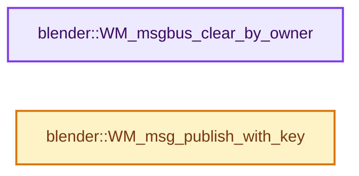

# 实现依赖专题：source/blender/windowmanager/message_bus/intern/wm_message_bus.cc

[方向导航](README.md) · [符号索引](../%E7%AC%A6%E5%8F%B7%E4%BE%9D%E8%B5%96%E4%B8%8E%E5%AE%9E%E7%8E%B0%E7%B4%A2%E5%BC%95.md)

本专题从正文实际调用进入，集中保存共享实现。函数有稳定锚点，可从调用处直接跳到对应完整函数；递归与互相调用通过回链组织。

## 本文件的实现关系




## 完整成员与函数实现

<a id="f-e919252b73b679b6"></a>

### `blender::WM_msgbus_clear_by_owner`

实现位置：[source/blender/windowmanager/message_bus/intern/wm_message_bus.cc](../../../../../source/blender/windowmanager/message_bus/intern/wm_message_bus.cc) · L69—L101。

接口参数：

- `wmMsgBus *mbus`
- `void *owner`

**教学注释版**

<!-- annotated:d5560781a18347 -->

```cpp
void WM_msgbus_clear_by_owner(wmMsgBus *mbus, void *owner)
{
  wmMsgSubscribeKey *msg_key, *msg_key_next;
  for (msg_key = mbus->messages.first(); msg_key; msg_key = msg_key_next) {
    msg_key_next = msg_key->next;

    wmMsgSubscribeValueLink *msg_lnk_next;
    for (wmMsgSubscribeValueLink *msg_lnk = msg_key->values.first(); msg_lnk;
         msg_lnk = msg_lnk_next)
    {
      msg_lnk_next = msg_lnk->next;
      if (msg_lnk->params.owner == owner) {
        if (msg_lnk->params.tag) {
          mbus->messages_tag_count -= 1;
        }
        if (msg_lnk->params.free_data) {
          msg_lnk->params.free_data(msg_key, &msg_lnk->params);
        }
        BLI_remlink(&msg_key->values, msg_lnk);
        MEM_delete(msg_lnk);
      }
    }

    if (msg_key->values.is_empty()) {
      const wmMsg *msg = wm_msg_subscribe_value_msg_cast(msg_key);
      wmMsgTypeInfo *info = &wm_msg_types[msg->type];
      BLI_remlink(&mbus->messages, msg_key);
      bool ok = BLI_gset_remove(mbus->messages_gset[msg->type], msg_key, info->gset.key_free_fn);
      BLI_assert(ok);
      UNUSED_VARS_NDEBUG(ok);
    }
  }
}
```

<details>
<summary>核对原始源码：source/blender/windowmanager/message_bus/intern/wm_message_bus.cc · L69—L101</summary>

<!-- original:d5560781a18347:source/blender/windowmanager/message_bus/intern/wm_message_bus.cc:69:101 -->

```cpp
void WM_msgbus_clear_by_owner(wmMsgBus *mbus, void *owner)
{
  wmMsgSubscribeKey *msg_key, *msg_key_next;
  for (msg_key = mbus->messages.first(); msg_key; msg_key = msg_key_next) {
    msg_key_next = msg_key->next;

    wmMsgSubscribeValueLink *msg_lnk_next;
    for (wmMsgSubscribeValueLink *msg_lnk = msg_key->values.first(); msg_lnk;
         msg_lnk = msg_lnk_next)
    {
      msg_lnk_next = msg_lnk->next;
      if (msg_lnk->params.owner == owner) {
        if (msg_lnk->params.tag) {
          mbus->messages_tag_count -= 1;
        }
        if (msg_lnk->params.free_data) {
          msg_lnk->params.free_data(msg_key, &msg_lnk->params);
        }
        BLI_remlink(&msg_key->values, msg_lnk);
        MEM_delete(msg_lnk);
      }
    }

    if (msg_key->values.is_empty()) {
      const wmMsg *msg = wm_msg_subscribe_value_msg_cast(msg_key);
      wmMsgTypeInfo *info = &wm_msg_types[msg->type];
      BLI_remlink(&mbus->messages, msg_key);
      bool ok = BLI_gset_remove(mbus->messages_gset[msg->type], msg_key, info->gset.key_free_fn);
      BLI_assert(ok);
      UNUSED_VARS_NDEBUG(ok);
    }
  }
}
```

</details>

**沿实际写入检查状态**

- `msg_key_next = msg_key->next;`
- `msg_lnk = msg_lnk_next)`
- `msg_lnk_next = msg_lnk->next;`
- `mbus->messages_tag_count -= 1;`

**继续追踪实现**

- `mbus->messages.first` → [调用协议](../%E6%A8%A1%E6%9D%BF%E5%AE%8F%E4%B8%8E%E5%8A%A8%E6%80%81%E5%88%86%E6%B4%BE%E5%8D%8F%E8%AE%AE.md)：接收对象类型依赖auto、返回值或模板实例；不按同名猜测目标。调用位置L72。
- `msg_key->values.first` → [调用协议](../%E6%A8%A1%E6%9D%BF%E5%AE%8F%E4%B8%8E%E5%8A%A8%E6%80%81%E5%88%86%E6%B4%BE%E5%8D%8F%E8%AE%AE.md)：接收对象类型依赖auto、返回值或模板实例；不按同名猜测目标。调用位置L76。
- `msg_lnk->params.free_data` → [调用协议](../%E6%A8%A1%E6%9D%BF%E5%AE%8F%E4%B8%8E%E5%8A%A8%E6%80%81%E5%88%86%E6%B4%BE%E5%8D%8F%E8%AE%AE.md)：接收对象类型依赖auto、返回值或模板实例；不按同名猜测目标。调用位置L85。
- `BLI_remlink` → [blender::BLI_remlink · L138](../01-%E5%9F%BA%E7%A1%80%E5%AE%B9%E5%99%A8%E4%B8%8E%E7%8E%B0%E4%BB%A3CPP/%E4%BE%9D%E8%B5%96-listbase-2816d9.md#f-120d80f281ca4cb7)。
- `MEM_delete` → [MEM_delete · L400](../03-%E5%86%85%E5%AD%98%E5%88%86%E9%85%8D%E4%B8%8E%E8%BF%90%E8%A1%8C%E6%97%B6%E7%B1%BB%E5%9E%8B/%E4%BE%9D%E8%B5%96-MEM_guardedalloc-b54eca.md#f-9049ffdd1682887c)。
- `msg_key->values.is_empty` → [调用协议](../%E6%A8%A1%E6%9D%BF%E5%AE%8F%E4%B8%8E%E5%8A%A8%E6%80%81%E5%88%86%E6%B4%BE%E5%8D%8F%E8%AE%AE.md)：接收对象类型依赖auto、返回值或模板实例；不按同名猜测目标。调用位置L92。
- `wm_msg_subscribe_value_msg_cast` → [blender::wm_msg_subscribe_value_msg_cast · L35](%E4%BE%9D%E8%B5%96-wm_message_bus_intern-58303c.md#f-35434129c473ed60)。
- `BLI_gset_remove` → [blender::BLI_gset_remove · L1011](../02-%E5%93%88%E5%B8%8C%E8%A1%A8%E4%B8%8E%E5%85%B3%E8%81%94%E6%95%B0%E6%8D%AE%E7%BB%93%E6%9E%84/%E4%BE%9D%E8%B5%96-BLI_ghash-ceaea0.md#f-c444320ca316fa78)。
- `BLI_assert` → [BLI_assert · L48](../01-%E5%9F%BA%E7%A1%80%E5%AE%B9%E5%99%A8%E4%B8%8E%E7%8E%B0%E4%BB%A3CPP/%E4%BE%9D%E8%B5%96-BLI_assert-cc98e8.md#m-57a88495704d)；[BLI_assert · L63](../01-%E5%9F%BA%E7%A1%80%E5%AE%B9%E5%99%A8%E4%B8%8E%E7%8E%B0%E4%BB%A3CPP/%E4%BE%9D%E8%B5%96-BLI_assert-cc98e8.md#m-d07050020cb5)。宏定义由构建条件选择。
- `UNUSED_VARS_NDEBUG` → [UNUSED_VARS_NDEBUG · L526](../01-%E5%9F%BA%E7%A1%80%E5%AE%B9%E5%99%A8%E4%B8%8E%E7%8E%B0%E4%BB%A3CPP/%E4%BE%9D%E8%B5%96-BLI_utildefines-293a0a.md#m-fea439f7d366)；[UNUSED_VARS_NDEBUG · L528](../01-%E5%9F%BA%E7%A1%80%E5%AE%B9%E5%99%A8%E4%B8%8E%E7%8E%B0%E4%BB%A3CPP/%E4%BE%9D%E8%B5%96-BLI_utildefines-293a0a.md#m-a8f8cfac06c0)。宏定义由构建条件选择。

<a id="f-773dd6753f9d0d59"></a>

### `blender::WM_msg_publish_with_key`

实现位置：[source/blender/windowmanager/message_bus/intern/wm_message_bus.cc](../../../../../source/blender/windowmanager/message_bus/intern/wm_message_bus.cc) · L176—L194。

接口参数：

- `wmMsgBus *mbus`
- `wmMsgSubscribeKey *msg_key`

**教学注释版**

<!-- annotated:f56bec2d809170 -->

```cpp
void WM_msg_publish_with_key(wmMsgBus *mbus, wmMsgSubscribeKey *msg_key)
{
  CLOG_DEBUG(WM_LOG_MSGBUS_SUB,
             "tagging subscribers: (ptr=%p, len=%d)",
             msg_key,
             msg_key->values.count());

  for (wmMsgSubscribeValueLink &msg_lnk : msg_key->values) {
    if (false) { /* Make an option? */
      msg_lnk.params.notify(nullptr, msg_key, &msg_lnk.params);
    }
    else {
      if (msg_lnk.params.tag == false) {
        msg_lnk.params.tag = true;
        mbus->messages_tag_count += 1;
      }
    }
  }
}
```

<details>
<summary>核对原始源码：source/blender/windowmanager/message_bus/intern/wm_message_bus.cc · L176—L194</summary>

<!-- original:f56bec2d809170:source/blender/windowmanager/message_bus/intern/wm_message_bus.cc:176:194 -->

```cpp
void WM_msg_publish_with_key(wmMsgBus *mbus, wmMsgSubscribeKey *msg_key)
{
  CLOG_DEBUG(WM_LOG_MSGBUS_SUB,
             "tagging subscribers: (ptr=%p, len=%d)",
             msg_key,
             msg_key->values.count());

  for (wmMsgSubscribeValueLink &msg_lnk : msg_key->values) {
    if (false) { /* Make an option? */
      msg_lnk.params.notify(nullptr, msg_key, &msg_lnk.params);
    }
    else {
      if (msg_lnk.params.tag == false) {
        msg_lnk.params.tag = true;
        mbus->messages_tag_count += 1;
      }
    }
  }
}
```

</details>

**沿实际写入检查状态**

- `msg_lnk.params.tag = true;`
- `mbus->messages_tag_count += 1;`

**继续追踪实现**

- `CLOG_DEBUG` → [CLOG_DEBUG · L191](%E4%BE%9D%E8%B5%96-CLG_log-e9051b.md#m-e062f5f17675)。宏定义由构建条件选择。
- `msg_key->values.count` → [调用协议](../%E6%A8%A1%E6%9D%BF%E5%AE%8F%E4%B8%8E%E5%8A%A8%E6%80%81%E5%88%86%E6%B4%BE%E5%8D%8F%E8%AE%AE.md)：接收对象类型依赖auto、返回值或模板实例；不按同名猜测目标。调用位置L181。
- `msg_lnk.params.notify` → [调用协议](../%E6%A8%A1%E6%9D%BF%E5%AE%8F%E4%B8%8E%E5%8A%A8%E6%80%81%E5%88%86%E6%B4%BE%E5%8D%8F%E8%AE%AE.md)：接收对象类型依赖auto、返回值或模板实例；不按同名猜测目标。调用位置L185。
