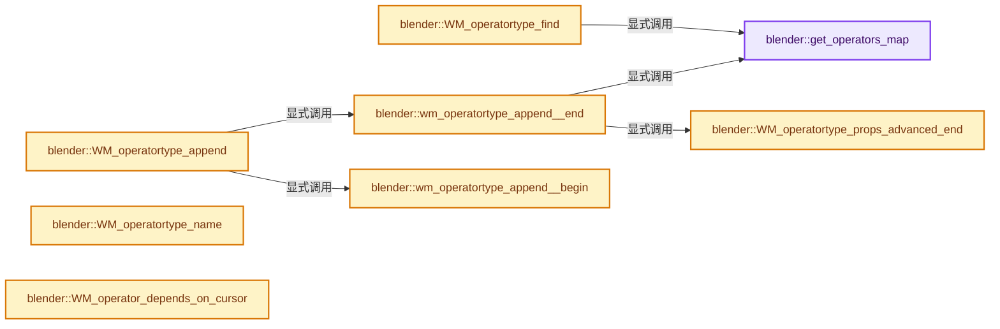

# 实现依赖专题：source/blender/windowmanager/intern/wm_operator_type.cc

[方向导航](README.md) · [符号索引](../%E7%AC%A6%E5%8F%B7%E4%BE%9D%E8%B5%96%E4%B8%8E%E5%AE%9E%E7%8E%B0%E7%B4%A2%E5%BC%95.md)

本专题从正文实际调用进入，集中保存共享实现。函数有稳定锚点，可从调用处直接跳到对应完整函数；递归与互相调用通过回链组织。

## 本文件的实现关系




## 完整成员与函数实现

<a id="f-c5abd779e5051225"></a>

### `blender::get_operators_map`

实现位置：[source/blender/windowmanager/intern/wm_operator_type.cc](../../../../../source/blender/windowmanager/intern/wm_operator_type.cc) · L53—L68。

**教学注释版**

<!-- annotated:3aca3d74c1dc6b -->

```cpp
static auto &get_operators_map()
{
  struct OperatorNameGetter {
    StringRef operator()(const wmOperatorType *value) const
    {
      return StringRef(value->idname);
    }
  };
  static auto map = []() {
    CustomIDVectorSet<wmOperatorType *, OperatorNameGetter> map;
    /* Reserve size is set based on blender default setup. */
    map.reserve(2048);
    return map;
  }();
  return map;
}
```

<details>
<summary>核对原始源码：source/blender/windowmanager/intern/wm_operator_type.cc · L53—L68</summary>

<!-- original:3aca3d74c1dc6b:source/blender/windowmanager/intern/wm_operator_type.cc:53:68 -->

```cpp
static auto &get_operators_map()
{
  struct OperatorNameGetter {
    StringRef operator()(const wmOperatorType *value) const
    {
      return StringRef(value->idname);
    }
  };
  static auto map = []() {
    CustomIDVectorSet<wmOperatorType *, OperatorNameGetter> map;
    /* Reserve size is set based on blender default setup. */
    map.reserve(2048);
    return map;
  }();
  return map;
}
```

</details>

**结果出口**

- `return StringRef(value->idname);`
- `return map;`

**继续追踪实现**

- `StringRef` → [blender::StringRef::StringRef · L555](../01-%E5%9F%BA%E7%A1%80%E5%AE%B9%E5%99%A8%E4%B8%8E%E7%8E%B0%E4%BB%A3CPP/15-StringRef%E5%AD%97%E7%AC%A6%E4%B8%B2%E8%A7%86%E5%9B%BE.md#f-f6aca324a36faa7e)；[blender::StringRef::StringRef · L560](../01-%E5%9F%BA%E7%A1%80%E5%AE%B9%E5%99%A8%E4%B8%8E%E7%8E%B0%E4%BB%A3CPP/15-StringRef%E5%AD%97%E7%AC%A6%E4%B8%B2%E8%A7%86%E5%9B%BE.md#f-ab9714781ca51bac)；[blender::StringRef::StringRef · L565](../01-%E5%9F%BA%E7%A1%80%E5%AE%B9%E5%99%A8%E4%B8%8E%E7%8E%B0%E4%BB%A3CPP/15-StringRef%E5%AD%97%E7%AC%A6%E4%B8%B2%E8%A7%86%E5%9B%BE.md#f-95f0b483bbdd7739)；[blender::StringRef::StringRef · L570](../01-%E5%9F%BA%E7%A1%80%E5%AE%B9%E5%99%A8%E4%B8%8E%E7%8E%B0%E4%BB%A3CPP/15-StringRef%E5%AD%97%E7%AC%A6%E4%B8%B2%E8%A7%86%E5%9B%BE.md#f-808d05699cb33334)；[blender::StringRef::StringRef · L631](../01-%E5%9F%BA%E7%A1%80%E5%AE%B9%E5%99%A8%E4%B8%8E%E7%8E%B0%E4%BB%A3CPP/15-StringRef%E5%AD%97%E7%AC%A6%E4%B8%B2%E8%A7%86%E5%9B%BE.md#f-37788e5f3fa3b736)；[blender::StringRef::StringRef · L641](../01-%E5%9F%BA%E7%A1%80%E5%AE%B9%E5%99%A8%E4%B8%8E%E7%8E%B0%E4%BB%A3CPP/15-StringRef%E5%AD%97%E7%AC%A6%E4%B8%B2%E8%A7%86%E5%9B%BE.md#f-11abd0510fb6b926)；[blender::StringRef::StringRef · L646](../01-%E5%9F%BA%E7%A1%80%E5%AE%B9%E5%99%A8%E4%B8%8E%E7%8E%B0%E4%BB%A3CPP/15-StringRef%E5%AD%97%E7%AC%A6%E4%B8%B2%E8%A7%86%E5%9B%BE.md#f-8437dbd8a582eefd)；[blender::StringRef::StringRef · L651](../01-%E5%9F%BA%E7%A1%80%E5%AE%B9%E5%99%A8%E4%B8%8E%E7%8E%B0%E4%BB%A3CPP/15-StringRef%E5%AD%97%E7%AC%A6%E4%B8%B2%E8%A7%86%E5%9B%BE.md#f-70bcb338de0db978)。同名重载需按实参类型选择。
- `[]() { CustomIDVectorSet<wmOperatorType *, OperatorNameGetter> map; /* Reserve size is set based on blender default setup. */ map.reserve(2048); return map; }` → [blender::() · L390](../12-%E7%A9%BA%E9%97%B4%E6%95%B0%E6%8D%AE%E7%BB%93%E6%9E%84%E4%B8%8E%E5%87%A0%E4%BD%95%E7%AE%97%E6%B3%95/%E4%BE%9D%E8%B5%96-BLI_math_vector_types-5b9874.md#f-26f597afed18e002)。
- `map.reserve` → [调用协议](../%E6%A8%A1%E6%9D%BF%E5%AE%8F%E4%B8%8E%E5%8A%A8%E6%80%81%E5%88%86%E6%B4%BE%E5%8D%8F%E8%AE%AE.md)：由接收对象具体类型或运行时策略提供实现。调用位置L64。

<a id="f-9fc2574dfd3703ee"></a>

### `blender::WM_operatortype_find`

实现位置：[source/blender/windowmanager/intern/wm_operator_type.cc](../../../../../source/blender/windowmanager/intern/wm_operator_type.cc) · L78—L100。

接口参数：

- `const char *idname`
- `bool quiet`

**教学注释版**

<!-- annotated:7378a6d6354c05 -->

```cpp
wmOperatorType *WM_operatortype_find(const char *idname, bool quiet)
{
  if (idname[0]) {
    /* Needed to support python style names without the `_OT_` syntax. */
    char idname_bl[OP_MAX_TYPENAME];
    WM_operator_bl_idname(idname_bl, idname);

    if (wmOperatorType *const *ot = get_operators_map().lookup_key_ptr_as(StringRef(idname_bl))) {
      return *ot;
    }

    if (!quiet) {
      CLOG_INFO(WM_LOG_OPERATORS, "Search for unknown operator '%s', '%s'", idname_bl, idname);
    }
  }
  else {
    if (!quiet) {
      CLOG_INFO(WM_LOG_OPERATORS, "Search for empty operator");
    }
  }

  return nullptr;
}
```

<details>
<summary>核对原始源码：source/blender/windowmanager/intern/wm_operator_type.cc · L78—L100</summary>

<!-- original:7378a6d6354c05:source/blender/windowmanager/intern/wm_operator_type.cc:78:100 -->

```cpp
wmOperatorType *WM_operatortype_find(const char *idname, bool quiet)
{
  if (idname[0]) {
    /* Needed to support python style names without the `_OT_` syntax. */
    char idname_bl[OP_MAX_TYPENAME];
    WM_operator_bl_idname(idname_bl, idname);

    if (wmOperatorType *const *ot = get_operators_map().lookup_key_ptr_as(StringRef(idname_bl))) {
      return *ot;
    }

    if (!quiet) {
      CLOG_INFO(WM_LOG_OPERATORS, "Search for unknown operator '%s', '%s'", idname_bl, idname);
    }
  }
  else {
    if (!quiet) {
      CLOG_INFO(WM_LOG_OPERATORS, "Search for empty operator");
    }
  }

  return nullptr;
}
```

</details>

**结果出口**

- `return *ot;`
- `return nullptr;`

**继续追踪实现**

- `WM_operator_bl_idname` → [blender::WM_operator_bl_idname · L161](%E4%BE%9D%E8%B5%96-wm_operators-6f9715.md#f-745c1ebc1a2015ee)。
- `get_operators_map().lookup_key_ptr_as` → [调用协议](../%E6%A8%A1%E6%9D%BF%E5%AE%8F%E4%B8%8E%E5%8A%A8%E6%80%81%E5%88%86%E6%B4%BE%E5%8D%8F%E8%AE%AE.md)：接收对象类型依赖auto、返回值或模板实例；不按同名猜测目标。调用位置L85。
- `get_operators_map` → [blender::get_operators_map · L53](%E4%BE%9D%E8%B5%96-wm_operator_type-1e8a89.md#f-c5abd779e5051225)。
- `StringRef` → [blender::StringRef::StringRef · L555](../01-%E5%9F%BA%E7%A1%80%E5%AE%B9%E5%99%A8%E4%B8%8E%E7%8E%B0%E4%BB%A3CPP/15-StringRef%E5%AD%97%E7%AC%A6%E4%B8%B2%E8%A7%86%E5%9B%BE.md#f-f6aca324a36faa7e)；[blender::StringRef::StringRef · L560](../01-%E5%9F%BA%E7%A1%80%E5%AE%B9%E5%99%A8%E4%B8%8E%E7%8E%B0%E4%BB%A3CPP/15-StringRef%E5%AD%97%E7%AC%A6%E4%B8%B2%E8%A7%86%E5%9B%BE.md#f-ab9714781ca51bac)；[blender::StringRef::StringRef · L565](../01-%E5%9F%BA%E7%A1%80%E5%AE%B9%E5%99%A8%E4%B8%8E%E7%8E%B0%E4%BB%A3CPP/15-StringRef%E5%AD%97%E7%AC%A6%E4%B8%B2%E8%A7%86%E5%9B%BE.md#f-95f0b483bbdd7739)；[blender::StringRef::StringRef · L570](../01-%E5%9F%BA%E7%A1%80%E5%AE%B9%E5%99%A8%E4%B8%8E%E7%8E%B0%E4%BB%A3CPP/15-StringRef%E5%AD%97%E7%AC%A6%E4%B8%B2%E8%A7%86%E5%9B%BE.md#f-808d05699cb33334)；[blender::StringRef::StringRef · L631](../01-%E5%9F%BA%E7%A1%80%E5%AE%B9%E5%99%A8%E4%B8%8E%E7%8E%B0%E4%BB%A3CPP/15-StringRef%E5%AD%97%E7%AC%A6%E4%B8%B2%E8%A7%86%E5%9B%BE.md#f-37788e5f3fa3b736)；[blender::StringRef::StringRef · L641](../01-%E5%9F%BA%E7%A1%80%E5%AE%B9%E5%99%A8%E4%B8%8E%E7%8E%B0%E4%BB%A3CPP/15-StringRef%E5%AD%97%E7%AC%A6%E4%B8%B2%E8%A7%86%E5%9B%BE.md#f-11abd0510fb6b926)；[blender::StringRef::StringRef · L646](../01-%E5%9F%BA%E7%A1%80%E5%AE%B9%E5%99%A8%E4%B8%8E%E7%8E%B0%E4%BB%A3CPP/15-StringRef%E5%AD%97%E7%AC%A6%E4%B8%B2%E8%A7%86%E5%9B%BE.md#f-8437dbd8a582eefd)；[blender::StringRef::StringRef · L651](../01-%E5%9F%BA%E7%A1%80%E5%AE%B9%E5%99%A8%E4%B8%8E%E7%8E%B0%E4%BB%A3CPP/15-StringRef%E5%AD%97%E7%AC%A6%E4%B8%B2%E8%A7%86%E5%9B%BE.md#f-70bcb338de0db978)。同名重载需按实参类型选择。
- `CLOG_INFO` → [CLOG_INFO · L190](%E4%BE%9D%E8%B5%96-CLG_log-e9051b.md#m-f8b5efdfcc0f)。宏定义由构建条件选择。

<a id="f-56858ac27471da84"></a>

### `blender::wm_operatortype_append__begin`

实现位置：[source/blender/windowmanager/intern/wm_operator_type.cc](../../../../../source/blender/windowmanager/intern/wm_operator_type.cc) · L108—L122。

**教学注释版**

<!-- annotated:c3778347e2f417 -->

```cpp
static wmOperatorType *wm_operatortype_append__begin()
{
  wmOperatorType *ot = MEM_new<wmOperatorType>(__func__);

  BLI_assert(ot_prop_basic_count == -1);

  ot->srna = RNA_def_struct_ptr(&RNA_blender_rna_get(), "", RNA_OperatorProperties);
  RNA_def_struct_property_tags(ot->srna, rna_enum_operator_property_tag_items);
  /* Set the default i18n context now, so that opfunc can redefine it if needed! */
  RNA_def_struct_translation_context(ot->srna, BLT_I18NCONTEXT_OPERATOR_DEFAULT);
  ot->translation_context = BLT_I18NCONTEXT_OPERATOR_DEFAULT;
  ot->cursor_pending = WM_CURSOR_PICK_AREA;

  return ot;
}
```

<details>
<summary>核对原始源码：source/blender/windowmanager/intern/wm_operator_type.cc · L108—L122</summary>

<!-- original:c3778347e2f417:source/blender/windowmanager/intern/wm_operator_type.cc:108:122 -->

```cpp
static wmOperatorType *wm_operatortype_append__begin()
{
  wmOperatorType *ot = MEM_new<wmOperatorType>(__func__);

  BLI_assert(ot_prop_basic_count == -1);

  ot->srna = RNA_def_struct_ptr(&RNA_blender_rna_get(), "", RNA_OperatorProperties);
  RNA_def_struct_property_tags(ot->srna, rna_enum_operator_property_tag_items);
  /* Set the default i18n context now, so that opfunc can redefine it if needed! */
  RNA_def_struct_translation_context(ot->srna, BLT_I18NCONTEXT_OPERATOR_DEFAULT);
  ot->translation_context = BLT_I18NCONTEXT_OPERATOR_DEFAULT;
  ot->cursor_pending = WM_CURSOR_PICK_AREA;

  return ot;
}
```

</details>

**沿实际写入检查状态**

- `ot->srna = RNA_def_struct_ptr(&RNA_blender_rna_get(), "", RNA_OperatorProperties);`
- `ot->translation_context = BLT_I18NCONTEXT_OPERATOR_DEFAULT;`
- `ot->cursor_pending = WM_CURSOR_PICK_AREA;`

**结果出口**

- `return ot;`

**继续追踪实现**

- `MEM_new<wmOperatorType>` → [MEM_new · L351](../03-%E5%86%85%E5%AD%98%E5%88%86%E9%85%8D%E4%B8%8E%E8%BF%90%E8%A1%8C%E6%97%B6%E7%B1%BB%E5%9E%8B/%E4%BE%9D%E8%B5%96-MEM_guardedalloc-b54eca.md#f-115f9b6784f89912)。
- `BLI_assert` → [BLI_assert · L48](../01-%E5%9F%BA%E7%A1%80%E5%AE%B9%E5%99%A8%E4%B8%8E%E7%8E%B0%E4%BB%A3CPP/%E4%BE%9D%E8%B5%96-BLI_assert-cc98e8.md#m-57a88495704d)；[BLI_assert · L63](../01-%E5%9F%BA%E7%A1%80%E5%AE%B9%E5%99%A8%E4%B8%8E%E7%8E%B0%E4%BB%A3CPP/%E4%BE%9D%E8%B5%96-BLI_assert-cc98e8.md#m-d07050020cb5)。宏定义由构建条件选择。
- `RNA_def_struct_ptr` → [blender::RNA_def_struct_ptr · L805](%E4%BE%9D%E8%B5%96-rna_define-0e9991.md#f-37cc235892d0094b)。
- `RNA_blender_rna_get` → [调用协议](../%E6%A8%A1%E6%9D%BF%E5%AE%8F%E4%B8%8E%E5%8A%A8%E6%80%81%E5%88%86%E6%B4%BE%E5%8D%8F%E8%AE%AE.md)：函数指针、局部可调用对象或未展开的宏；必须结合调用者环境。调用位置L114。
- `RNA_def_struct_property_tags` → [blender::RNA_def_struct_property_tags · L1047](%E4%BE%9D%E8%B5%96-rna_define-0e9991.md#f-ace495c5822f170c)。
- `RNA_def_struct_translation_context` → [blender::RNA_def_struct_translation_context · L1169](%E4%BE%9D%E8%B5%96-rna_define-0e9991.md#f-330c13f8bf500966)。

<a id="f-f1aac27a3f1bf744"></a>

### `blender::wm_operatortype_append__end`

实现位置：[source/blender/windowmanager/intern/wm_operator_type.cc](../../../../../source/blender/windowmanager/intern/wm_operator_type.cc) · L123—L147。

接口参数：

- `wmOperatorType *ot`

**教学注释版**

<!-- annotated:36e3f7845a83a7 -->

```cpp
static void wm_operatortype_append__end(wmOperatorType *ot)
{
  if (ot->name == nullptr) {
    CLOG_ERROR(WM_LOG_OPERATORS, "Operator '%s' has no name property", ot->idname);
  }
  BLI_assert((ot->description == nullptr) || (ot->description[0]));

  /* Allow calling _begin without _end in operatortype creation. */
  WM_operatortype_props_advanced_end(ot);

  /* XXX All ops should have a description but for now allow them not to. */
  RNA_def_struct_ui_text(
      ot->srna, ot->name, ot->description ? ot->description : UNDOCUMENTED_OPERATOR_TIP);
  RNA_def_struct_identifier(&RNA_blender_rna_get(), ot->srna, ot->idname);

  BLI_assert(WM_operator_bl_idname_is_valid(ot->idname));
  get_operators_map().add_new(ot);

  /* Needed so any operators registered after startup will have their shortcuts set,
   * in "register" scripts for example, see: #143838.
   *
   * This only has run-time implications when run after startup,
   * it's a no-op when run beforehand, see: #WM_keyconfig_update_on_startup. */
  WM_keyconfig_update_operatortype_tag();
}
```

<details>
<summary>核对原始源码：source/blender/windowmanager/intern/wm_operator_type.cc · L123—L147</summary>

<!-- original:36e3f7845a83a7:source/blender/windowmanager/intern/wm_operator_type.cc:123:147 -->

```cpp
static void wm_operatortype_append__end(wmOperatorType *ot)
{
  if (ot->name == nullptr) {
    CLOG_ERROR(WM_LOG_OPERATORS, "Operator '%s' has no name property", ot->idname);
  }
  BLI_assert((ot->description == nullptr) || (ot->description[0]));

  /* Allow calling _begin without _end in operatortype creation. */
  WM_operatortype_props_advanced_end(ot);

  /* XXX All ops should have a description but for now allow them not to. */
  RNA_def_struct_ui_text(
      ot->srna, ot->name, ot->description ? ot->description : UNDOCUMENTED_OPERATOR_TIP);
  RNA_def_struct_identifier(&RNA_blender_rna_get(), ot->srna, ot->idname);

  BLI_assert(WM_operator_bl_idname_is_valid(ot->idname));
  get_operators_map().add_new(ot);

  /* Needed so any operators registered after startup will have their shortcuts set,
   * in "register" scripts for example, see: #143838.
   *
   * This only has run-time implications when run after startup,
   * it's a no-op when run beforehand, see: #WM_keyconfig_update_on_startup. */
  WM_keyconfig_update_operatortype_tag();
}
```

</details>

**继续追踪实现**

- `CLOG_ERROR` → [CLOG_ERROR · L188](%E4%BE%9D%E8%B5%96-CLG_log-e9051b.md#m-081575cdc8d0)。宏定义由构建条件选择。
- `BLI_assert` → [BLI_assert · L48](../01-%E5%9F%BA%E7%A1%80%E5%AE%B9%E5%99%A8%E4%B8%8E%E7%8E%B0%E4%BB%A3CPP/%E4%BE%9D%E8%B5%96-BLI_assert-cc98e8.md#m-57a88495704d)；[BLI_assert · L63](../01-%E5%9F%BA%E7%A1%80%E5%AE%B9%E5%99%A8%E4%B8%8E%E7%8E%B0%E4%BB%A3CPP/%E4%BE%9D%E8%B5%96-BLI_assert-cc98e8.md#m-d07050020cb5)。宏定义由构建条件选择。
- `WM_operatortype_props_advanced_end` → [blender::WM_operatortype_props_advanced_end · L247](%E4%BE%9D%E8%B5%96-wm_operator_type-1e8a89.md#f-0f98caa710ac814e)。
- `RNA_def_struct_ui_text` → [blender::RNA_def_struct_ui_text · L1158](%E4%BE%9D%E8%B5%96-rna_define-0e9991.md#f-76f0d59df7ce449d)。
- `RNA_def_struct_identifier` → [blender::RNA_def_struct_identifier · L1135](%E4%BE%9D%E8%B5%96-rna_define-0e9991.md#f-8f8ed4a3429de76b)。
- `RNA_blender_rna_get` → [调用协议](../%E6%A8%A1%E6%9D%BF%E5%AE%8F%E4%B8%8E%E5%8A%A8%E6%80%81%E5%88%86%E6%B4%BE%E5%8D%8F%E8%AE%AE.md)：函数指针、局部可调用对象或未展开的宏；必须结合调用者环境。调用位置L136。
- `WM_operator_bl_idname_is_valid` → [blender::WM_operator_bl_idname_is_valid · L181](%E4%BE%9D%E8%B5%96-wm_operators-6f9715.md#f-3bd2ac8a72489f8a)。
- `get_operators_map().add_new` → [调用协议](../%E6%A8%A1%E6%9D%BF%E5%AE%8F%E4%B8%8E%E5%8A%A8%E6%80%81%E5%88%86%E6%B4%BE%E5%8D%8F%E8%AE%AE.md)：接收对象类型依赖auto、返回值或模板实例；不按同名猜测目标。调用位置L139。
- `get_operators_map` → [blender::get_operators_map · L53](%E4%BE%9D%E8%B5%96-wm_operator_type-1e8a89.md#f-c5abd779e5051225)。
- `WM_keyconfig_update_operatortype_tag` → [blender::WM_keyconfig_update_operatortype_tag · L1846](%E4%BE%9D%E8%B5%96-wm_keymap-7a630e.md#f-213fe38271804a42)。

<a id="f-a579a0f27ca25b75"></a>

### `blender::WM_operatortype_append`

实现位置：[source/blender/windowmanager/intern/wm_operator_type.cc](../../../../../source/blender/windowmanager/intern/wm_operator_type.cc) · L151—L156。

接口参数：

- `void (*opfunc)(wmOperatorType *)`
- `wmOperatorType *`

**教学注释版**

<!-- annotated:b5f9a049a057ea -->

```cpp
void WM_operatortype_append(void (*opfunc)(wmOperatorType *))
{
  wmOperatorType *ot = wm_operatortype_append__begin();
  opfunc(ot);
  wm_operatortype_append__end(ot);
}
```

<details>
<summary>核对原始源码：source/blender/windowmanager/intern/wm_operator_type.cc · L151—L156</summary>

<!-- original:b5f9a049a057ea:source/blender/windowmanager/intern/wm_operator_type.cc:151:156 -->

```cpp
void WM_operatortype_append(void (*opfunc)(wmOperatorType *))
{
  wmOperatorType *ot = wm_operatortype_append__begin();
  opfunc(ot);
  wm_operatortype_append__end(ot);
}
```

</details>

**继续追踪实现**

- `wm_operatortype_append__begin` → [blender::wm_operatortype_append__begin · L108](%E4%BE%9D%E8%B5%96-wm_operator_type-1e8a89.md#f-56858ac27471da84)。
- `opfunc` → [调用协议](../%E6%A8%A1%E6%9D%BF%E5%AE%8F%E4%B8%8E%E5%8A%A8%E6%80%81%E5%88%86%E6%B4%BE%E5%8D%8F%E8%AE%AE.md)：局部可调用对象，须结合其初始化与捕获环境。调用位置L154。
- `wm_operatortype_append__end` → [blender::wm_operatortype_append__end · L123](%E4%BE%9D%E8%B5%96-wm_operator_type-1e8a89.md#f-f1aac27a3f1bf744)。

<a id="f-0f98caa710ac814e"></a>

### `blender::WM_operatortype_props_advanced_end`

实现位置：[source/blender/windowmanager/intern/wm_operator_type.cc](../../../../../source/blender/windowmanager/intern/wm_operator_type.cc) · L247—L267。

接口参数：

- `wmOperatorType *ot`

**教学注释版**

<!-- annotated:b1e8f8403665c1 -->

```cpp
void WM_operatortype_props_advanced_end(wmOperatorType *ot)
{
  int counter = 0;

  if (ot_prop_basic_count == -1) {
    /* WM_operatortype_props_advanced_begin was not called. Don't do anything. */
    return;
  }

  PointerRNA struct_ptr = WM_operator_properties_create_ptr(ot);

  RNA_STRUCT_BEGIN (&struct_ptr, prop) {
    counter++;
    if (counter > ot_prop_basic_count) {
      WM_operatortype_prop_tag(prop, OP_PROP_TAG_ADVANCED);
    }
  }
  RNA_STRUCT_END;

  ot_prop_basic_count = -1;
}
```

<details>
<summary>核对原始源码：source/blender/windowmanager/intern/wm_operator_type.cc · L247—L267</summary>

<!-- original:b1e8f8403665c1:source/blender/windowmanager/intern/wm_operator_type.cc:247:267 -->

```cpp
void WM_operatortype_props_advanced_end(wmOperatorType *ot)
{
  int counter = 0;

  if (ot_prop_basic_count == -1) {
    /* WM_operatortype_props_advanced_begin was not called. Don't do anything. */
    return;
  }

  PointerRNA struct_ptr = WM_operator_properties_create_ptr(ot);

  RNA_STRUCT_BEGIN (&struct_ptr, prop) {
    counter++;
    if (counter > ot_prop_basic_count) {
      WM_operatortype_prop_tag(prop, OP_PROP_TAG_ADVANCED);
    }
  }
  RNA_STRUCT_END;

  ot_prop_basic_count = -1;
}
```

</details>

**沿实际写入检查状态**

- `ot_prop_basic_count = -1;`

**继续追踪实现**

- `WM_operator_properties_create_ptr` → [blender::WM_operator_properties_create_ptr · L748](%E4%BE%9D%E8%B5%96-wm_operators-6f9715.md#f-6314bcba0ea304a8)。
- `RNA_STRUCT_BEGIN` → [RNA_STRUCT_BEGIN · L836](%E4%BE%9D%E8%B5%96-RNA_access-80976f.md#m-e0d1e461ee20)。宏定义由构建条件选择。
- `WM_operatortype_prop_tag` → [WM_operatortype_prop_tag · L1580](%E4%BE%9D%E8%B5%96-WM_api-91d43b.md#m-19c9d065aee2)。宏定义由构建条件选择。

<a id="f-19c9f19400462ee9"></a>

### `blender::WM_operatortype_name`

实现位置：[source/blender/windowmanager/intern/wm_operator_type.cc](../../../../../source/blender/windowmanager/intern/wm_operator_type.cc) · L598—L606。

接口参数：

- `wmOperatorType *ot`
- `PointerRNA *properties`

**教学注释版**

<!-- annotated:b1b1d1788628f9 -->

```cpp
std::string WM_operatortype_name(wmOperatorType *ot, PointerRNA *properties)
{
  std::string name;
  if (ot->get_name && properties) {
    name = ot->get_name(ot, properties);
  }

  return name.empty() ? std::string(RNA_struct_ui_name(ot->srna)) : name;
}
```

<details>
<summary>核对原始源码：source/blender/windowmanager/intern/wm_operator_type.cc · L598—L606</summary>

<!-- original:b1b1d1788628f9:source/blender/windowmanager/intern/wm_operator_type.cc:598:606 -->

```cpp
std::string WM_operatortype_name(wmOperatorType *ot, PointerRNA *properties)
{
  std::string name;
  if (ot->get_name && properties) {
    name = ot->get_name(ot, properties);
  }

  return name.empty() ? std::string(RNA_struct_ui_name(ot->srna)) : name;
}
```

</details>

**沿实际写入检查状态**

- `name = ot->get_name(ot, properties);`

**结果出口**

- `return name.empty() ? std::string(RNA_struct_ui_name(ot->srna)) : name;`

**继续追踪实现**

- `ot->get_name` → [调用协议](../%E6%A8%A1%E6%9D%BF%E5%AE%8F%E4%B8%8E%E5%8A%A8%E6%80%81%E5%88%86%E6%B4%BE%E5%8D%8F%E8%AE%AE.md)：由接收对象具体类型或运行时策略提供实现。调用位置L602。
- `name.empty` → [外部契约](https://eel.is/c++draft/)：这个边界按实际表达式及所属类型核对参数、返回值、寿命与失败行为。这里提供接口入口，不声称已解释该第三方版本的内部实现。
- `std::string` → [外部契约](https://eel.is/c++draft/)：这个边界按实际表达式及所属类型核对参数、返回值、寿命与失败行为。这里提供接口入口，不声称已解释该第三方版本的内部实现。
- `RNA_struct_ui_name` → [blender::RNA_struct_ui_name · L716](%E4%BE%9D%E8%B5%96-rna_access-706bea.md#f-84372d92ac83ee19)。

<a id="f-9e3a6fed5b56d472"></a>

### `blender::WM_operator_depends_on_cursor`

实现位置：[source/blender/windowmanager/intern/wm_operator_type.cc](../../../../../source/blender/windowmanager/intern/wm_operator_type.cc) · L638—L647。

接口参数：

- `bContext &C`
- `wmOperatorType &ot`
- `PointerRNA *properties`

**教学注释版**

<!-- annotated:e015fce666cc71 -->

```cpp
bool WM_operator_depends_on_cursor(bContext &C, wmOperatorType &ot, PointerRNA *properties)
{
  if (ot.flag & OPTYPE_DEPENDS_ON_CURSOR) {
    return true;
  }
  if (ot.depends_on_cursor) {
    return ot.depends_on_cursor(C, ot, properties);
  }
  return false;
}
```

<details>
<summary>核对原始源码：source/blender/windowmanager/intern/wm_operator_type.cc · L638—L647</summary>

<!-- original:e015fce666cc71:source/blender/windowmanager/intern/wm_operator_type.cc:638:647 -->

```cpp
bool WM_operator_depends_on_cursor(bContext &C, wmOperatorType &ot, PointerRNA *properties)
{
  if (ot.flag & OPTYPE_DEPENDS_ON_CURSOR) {
    return true;
  }
  if (ot.depends_on_cursor) {
    return ot.depends_on_cursor(C, ot, properties);
  }
  return false;
}
```

</details>

**结果出口**

- `return true;`
- `return ot.depends_on_cursor(C, ot, properties);`
- `return false;`

**继续追踪实现**

- `ot.depends_on_cursor` → [调用协议](../%E6%A8%A1%E6%9D%BF%E5%AE%8F%E4%B8%8E%E5%8A%A8%E6%80%81%E5%88%86%E6%B4%BE%E5%8D%8F%E8%AE%AE.md)：由接收对象具体类型或运行时策略提供实现。调用位置L644。
